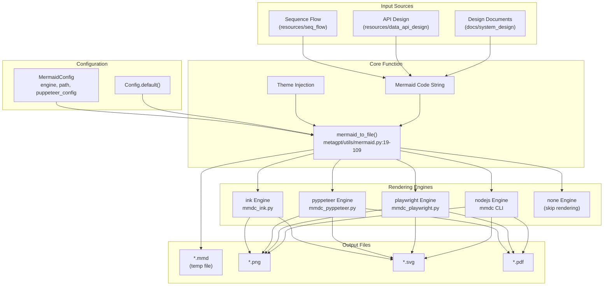
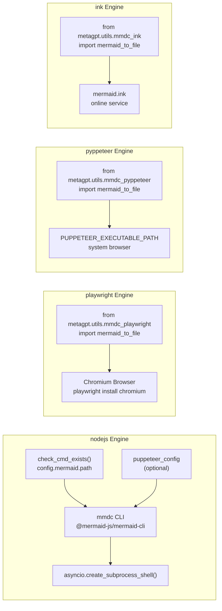
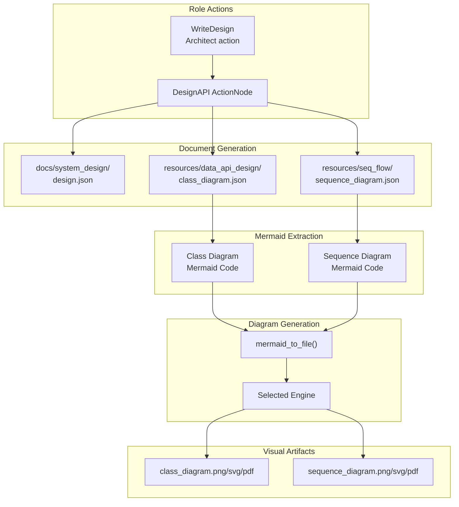

<!-- source: DeepWiki mcp.deepwiki.com · repo FoundationAgents/MetaGPT · page 6.4 Mermaid Diagram Generation · fetched 2026-10-30 -->

# Mermaid Diagram Generation

<details>
<summary>Relevant source files</summary>

The following files were used as context for generating this wiki page:

- [Dockerfile](Dockerfile)
- [README.md](README.md)
- [docs/ACADEMIC_WORK.md](docs/ACADEMIC_WORK.md)
- [docs/NEWS.md](docs/NEWS.md)
- [docs/README_CN.md](docs/README_CN.md)
- [docs/README_FR.md](docs/README_FR.md)
- [docs/README_JA.md](docs/README_JA.md)
- [metagpt/utils/mermaid.py](metagpt/utils/mermaid.py)

</details>


This document describes the Mermaid diagram generation subsystem in MetaGPT, which converts textual Mermaid diagram definitions into visual file formats (PNG, SVG, PDF). This system enables automatic visualization of system designs, data models, and sequence flows produced by software development roles.

For information about how these diagrams are embedded in project artifacts, see [6.1](#6.1). For details on the roles that generate design documents containing Mermaid code, see [5.1](#5.1).

## System Overview

The Mermaid diagram generation system provides a unified interface for converting Mermaid markup language into visual diagrams using multiple rendering engines. The system is primarily implemented in the `mermaid_to_file` utility function, which supports four distinct rendering backends and can generate multiple output formats from a single Mermaid source.



Sources: [metagpt/utils/mermaid.py:1-165](), [Dockerfile:1-25]()

## The `mermaid_to_file` Function

The `mermaid_to_file` function is the primary entry point for diagram generation. It accepts Mermaid code as a string and produces one or more output files in the requested formats.

### Function Signature

| Parameter | Type | Default | Description |
|-----------|------|---------|-------------|
| `engine` | `str` | required | Rendering engine: "nodejs", "playwright", "pyppeteer", "ink", or "none" |
| `mermaid_code` | `str` | required | Mermaid diagram markup |
| `output_file_without_suffix` | `str` | required | Output path without file extension |
| `width` | `int` | `2048` | Output image width in pixels |
| `height` | `int` | `2048` | Output image height in pixels |
| `config` | `Optional[Config]` | `None` | Configuration object (defaults to `Config.default()`) |
| `suffixes` | `Optional[List[str]]` | `["svg"]` | List of output formats: "png", "svg", "pdf" |

**Return Value:** `int` - Returns `0` on success, `-1` on failure

### Theme Injection

The function automatically prepends a theme header to the Mermaid code if not already present:

```
%%{init: {'theme': 'default', 'themeVariables': { 'fontFamily': 'Inter' }}}%%
```

This ensures consistent styling across all generated diagrams. The theme injection logic is at [metagpt/utils/mermaid.py:42-44]().

### Temporary File Management

The function writes the Mermaid code to a temporary `.mmd` file before rendering. The file is created at `{output_file_without_suffix}.mmd` with automatic directory creation if needed [metagpt/utils/mermaid.py:48-52]().

Sources: [metagpt/utils/mermaid.py:19-109]()

## Rendering Engines

The system supports four distinct rendering engines, each with different dependencies and capabilities. The engine is selected via the `engine` parameter to `mermaid_to_file`.



### nodejs Engine

The `nodejs` engine uses the official Mermaid CLI (`mmdc`) installed via npm. This is the default engine referenced in the Dockerfile installation.

**Installation:**
```bash
npm install -g @mermaid-js/mermaid-cli
```

**Requirements:** Node.js and npm must be available. The system checks for the `mmdc` command availability using `check_cmd_exists()` [metagpt/utils/mermaid.py:55-60]().

**Command Construction:**
- Without puppeteer config: `mmdc -i <input>.mmd -o <output>.<suffix> -w <width> -H <height>`
- With puppeteer config: Adds `-p <puppeteer_config>` flag [metagpt/utils/mermaid.py:67-82]()

**Execution:** The command is executed via `asyncio.create_subprocess_shell()` with stdout/stderr capture [metagpt/utils/mermaid.py:83-91]().

**Supported Formats:** PNG, SVG, PDF

Sources: [metagpt/utils/mermaid.py:54-91](), [Dockerfile:9-14]()

### playwright Engine

The `playwright` engine uses Python's Playwright library to render diagrams in a headless browser.

**Installation:**
```bash
pip install playwright
playwright install --with-deps chromium
```

**Configuration:** Set `mermaid.engine: playwright` in `config2.yaml`.

**Implementation:** Delegates to `metagpt.utils.mmdc_playwright.mermaid_to_file()` [metagpt/utils/mermaid.py:93-96]().

**Supported Formats:** PNG, SVG, PDF

Sources: [metagpt/utils/mermaid.py:93-96](), [docs/README_JA.md:92-114]()

### pyppeteer Engine

The `pyppeteer` engine uses the Pyppeteer library (Python port of Puppeteer) for browser-based rendering.

**Installation:**
```bash
pip install pyppeteer
export PUPPETEER_EXECUTABLE_PATH=/path/to/chromium
```

**Configuration:** Set `mermaid.engine: pyppeteer` in `config2.yaml`.

**Implementation:** Delegates to `metagpt.utils.mmdc_pyppeteer.mermaid_to_file()` [metagpt/utils/mermaid.py:97-100]().

**Note:** The documentation warns against using `pyppeteer-install` as it installs an outdated browser [docs/README_JA.md:131-135]().

**Supported Formats:** PNG, SVG, PDF

Sources: [metagpt/utils/mermaid.py:97-100](), [docs/README_JA.md:116-144]()

### ink Engine

The `ink` engine uses the mermaid.ink online service to render diagrams without local dependencies.

**Installation:** No installation required.

**Configuration:** Set `mermaid.engine: ink` in `config2.yaml`.

**Implementation:** Delegates to `metagpt.utils.mmdc_ink.mermaid_to_file()` [metagpt/utils/mermaid.py:101-104]().

**Limitations:** Does not support PDF export [docs/README_JA.md:156]().

**Supported Formats:** PNG, SVG

Sources: [metagpt/utils/mermaid.py:101-104](), [docs/README_JA.md:146-156]()

### none Engine

The `none` engine skips rendering entirely and returns immediately. This is useful for disabling diagram generation without modifying code [metagpt/utils/mermaid.py:105-106]().

Sources: [metagpt/utils/mermaid.py:105-109]()

## Configuration

Mermaid diagram generation is configured through the `MermaidConfig` section of `config2.yaml`.

### Configuration Schema

| Field | Type | Description |
|-------|------|-------------|
| `engine` | `str` | Selected rendering engine: "nodejs", "playwright", "pyppeteer", "ink", or "none" |
| `path` | `str` | Path to `mmdc` executable (nodejs engine only) |
| `puppeteer_config` | `str` | Path to Puppeteer configuration JSON (nodejs engine only) |

### Example Configuration

**For nodejs engine:**
```yaml
mermaid:
  engine: nodejs
  path: "./node_modules/.bin/mmdc"
  puppeteer_config: "./config/puppeteer-config.json"
```

**For playwright engine:**
```yaml
mermaid:
  engine: playwright
```

**For pyppeteer engine:**
```yaml
mermaid:
  engine: pyppeteer
```

**For ink engine:**
```yaml
mermaid:
  engine: ink
```

Sources: [docs/README_JA.md:82-86](), [docs/README_JA.md:108-154]()

### Docker Environment

The Dockerfile pre-configures the nodejs engine with global Mermaid CLI installation and Chromium browser:

```dockerfile
ENV CHROME_BIN="/usr/bin/chromium"
ENV puppeteer_config="/app/metagpt/config/puppeteer-config.json"
ENV PUPPETEER_SKIP_CHROMIUM_DOWNLOAD="true"
RUN npm install -g @mermaid-js/mermaid-cli
```

This setup uses the system-installed Chromium browser instead of downloading a separate copy [Dockerfile:10-14]().

Sources: [Dockerfile:1-25]()

## Integration with Project Artifacts

The Mermaid diagram generation system is integrated with MetaGPT's software development workflow through the `Architect` role, which produces design documents containing Mermaid code.



### Document Structure

Design documents generated by the `Architect` role contain Mermaid code in string fields. These documents are stored as JSON files in the project repository structure:

- **System Design:** `docs/system_design/design.json` - Contains overall architecture
- **Data/API Design:** `resources/data_api_design/class_diagram.json` - Contains class diagrams in Mermaid format
- **Sequence Flow:** `resources/seq_flow/sequence_diagram.json` - Contains sequence diagrams in Mermaid format

### Example Mermaid Samples

The codebase includes example Mermaid diagrams for testing and reference [metagpt/utils/mermaid.py:112-164]():

**Class Diagram (MMC1):**
- Demonstrates class relationships for a search engine system
- Shows properties, methods, and dependencies
- Located at [metagpt/utils/mermaid.py:112-144]()

**Sequence Diagram (MMC2):**
- Illustrates message flow between components
- Shows participant interactions over time
- Located at [metagpt/utils/mermaid.py:146-164]()

Sources: [metagpt/utils/mermaid.py:1-165]()

## File Format Support

The system generates multiple output formats from a single Mermaid source. Format selection is controlled by the `suffixes` parameter.

### Supported Formats

| Format | Extension | Supported Engines | Notes |
|--------|-----------|-------------------|-------|
| PNG | `.png` | nodejs, playwright, pyppeteer, ink | Bitmap image, suitable for embedding in documents |
| SVG | `.svg` | nodejs, playwright, pyppeteer, ink | Vector graphic, scalable without quality loss |
| PDF | `.pdf` | nodejs, playwright, pyppeteer | Vector format, suitable for print and documentation |

### Multi-Format Generation

To generate multiple formats in a single call:

```python
await mermaid_to_file(
    engine="playwright",
    mermaid_code=diagram_code,
    output_file_without_suffix="docs/design",
    suffixes=["png", "svg", "pdf"]
)
```

This produces:
- `docs/design.png`
- `docs/design.svg`
- `docs/design.pdf`
- `docs/design.mmd` (temporary Mermaid source)

### Default Format

If `suffixes` is not specified, the system defaults to `["svg"]` [metagpt/utils/mermaid.py:45]().

Sources: [metagpt/utils/mermaid.py:19-109]()

## Error Handling

The system provides logging and error reporting for common failure scenarios.

### nodejs Engine Errors

**Missing Command:** If `mmdc` is not found, the system logs a warning and returns `-1`:
```
RUN `npm install -g @mermaid-js/mermaid-cli` to install mmdc,
or consider changing engine to `playwright`, `pyppeteer`, or `ink`.
```
[metagpt/utils/mermaid.py:56-60]()

**Subprocess Output:** Both stdout and stderr from the `mmdc` command are captured and logged:
- stdout → `logger.info()` [metagpt/utils/mermaid.py:88-89]()
- stderr → `logger.warning()` [metagpt/utils/mermaid.py:90-91]()

### Unsupported Engine

If an unrecognized engine is specified, the system logs a warning:
```
Unsupported mermaid engine: {engine}
```
[metagpt/utils/mermaid.py:108]()

### Return Codes

- `0` - Success
- `-1` - Failure (command not found or execution error)

Sources: [metagpt/utils/mermaid.py:19-109]()

---

