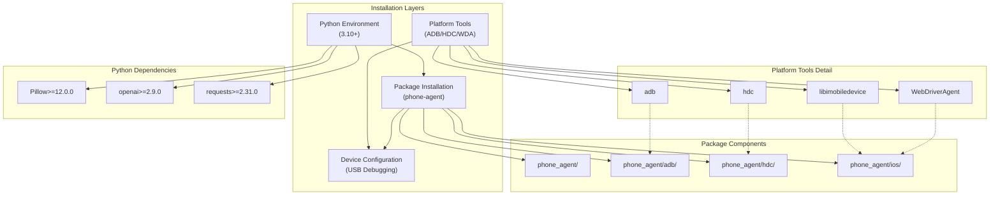
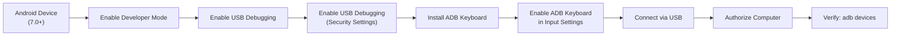
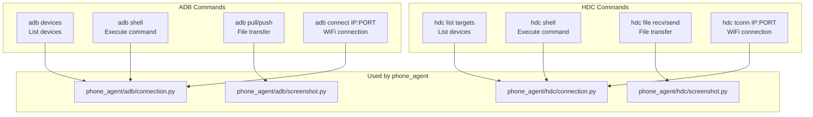

<!-- source: DeepWiki mcp.deepwiki.com · repo zai-org/Open-AutoGLM · page 2.1 Installation · fetched 2026-10-29 -->

# Installation

<details>
<summary>Relevant source files</summary>

The following files were used as context for generating this wiki page:

- [LICENSE](LICENSE)
- [README.md](README.md)
- [README_coding_agent.md](README_coding_agent.md)
- [README_en.md](README_en.md)
- [phone_agent/__init__.py](phone_agent/__init__.py)
- [phone_agent/adb/screenshot.py](phone_agent/adb/screenshot.py)
- [requirements.txt](requirements.txt)
- [setup.py](setup.py)

</details>


This page covers the complete installation process for Open-AutoGLM, including system requirements, platform-specific debugging tools (ADB/HDC/libimobiledevice), Python dependencies, and device configuration. For initial usage after installation, see [Quick Start](#2.2). For configuring model services and agent parameters, see [Configuration Basics](#2.3).

---

## Overview

Open-AutoGLM requires three layers of installation:

1. **Platform debugging tools** - Command-line utilities for device communication
2. **Python package and dependencies** - The core framework and its libraries
3. **Device configuration** - Enabling developer mode and debugging permissions on target devices

The installation process varies by target platform (Android, HarmonyOS, or iOS).

---

## System Requirements

### Software Requirements

| Component | Minimum Version | Purpose |
|-----------|----------------|---------|
| Python | 3.10 | Runtime environment |
| pip | (bundled with Python) | Package management |
| USB cable | Data transfer capable | Device connection (not charging-only) |

**Platform-Specific Tools:**

| Platform | Tool | Installation Source |
|----------|------|---------------------|
| Android | ADB (Android Debug Bridge) | [Android Platform Tools](https://developer.android.com/tools/releases/platform-tools) |
| HarmonyOS | HDC (HarmonyOS Device Connector) | [HarmonyOS SDK](https://developer.huawei.com/consumer/en/download) |
| iOS | WebDriverAgent + Xcode | See [iOS Environment Setup](#4.3) |

### Device Requirements

| Platform | Minimum Version | Required Settings |
|----------|----------------|-------------------|
| Android | 7.0+ | Developer Mode, USB Debugging |
| HarmonyOS | NEXT+ | Developer Mode, USB Debugging |
| iOS | 13.0+ | Developer Mode, Trust Computer |

Sources: [README.md:59-103](), [README_en.md:49-95]()

---

## Installation Architecture



**Installation Dependency Flow**: Platform tools must be installed and accessible in PATH before device configuration. Python environment and package installation can proceed independently but must complete before first usage.

Sources: [README.md:59-132](), [setup.py:1-50]()

---

## Step 1: Platform Tool Installation

### Android - ADB Installation

**Download and Extract:**

1. Download [Android Platform Tools](https://developer.android.com/tools/releases/platform-tools)
2. Extract to a permanent location (e.g., `~/Downloads/platform-tools` or `C:\platform-tools`)

**Configure Environment Variables:**

**macOS/Linux:**

```bash
# Add to ~/.bash_profile or ~/.zshrc
export PATH=${PATH}:~/Downloads/platform-tools

# Apply changes
source ~/.bash_profile  # or source ~/.zshrc
```

**Windows:**

1. Open System Properties → Environment Variables
2. Edit `Path` system variable
3. Add extracted directory path (e.g., `C:\platform-tools`)

**Verify Installation:**

```bash
adb version
# Expected output: Android Debug Bridge version X.X.X
```

Sources: [README.md:68-79](), [README_en.md:59-69]()

### HarmonyOS - HDC Installation

**Download and Extract:**

1. Download [HarmonyOS SDK](https://developer.huawei.com/consumer/en/download)
2. Extract toolchains directory (e.g., `~/Downloads/harmonyos-sdk/toolchains`)

**Configure Environment Variables:**

**macOS/Linux:**

```bash
# Add to ~/.bash_profile or ~/.zshrc
export PATH=${PATH}:~/Downloads/harmonyos-sdk/toolchains

# Apply changes
source ~/.bash_profile
```

**Windows:**

Add HDC directory to system PATH environment variable (similar to ADB process above).

**Verify Installation:**

```bash
hdc version
# Expected output: HDC version information
```

Sources: [README.md:83-95](), [README_en.md:72-84]()

### iOS - WebDriverAgent Setup

iOS device automation requires more extensive setup involving Xcode and WebDriverAgent. This process is documented separately due to its complexity.

**Refer to:** [iOS Environment Setup](#4.3) for complete WebDriverAgent installation and configuration instructions.

Sources: [README.md:117-123](), [README_en.md:105-123]()

---

## Step 2: Python Package Installation

### Install Core Dependencies

The package uses a standard `requirements.txt` and `setup.py` installation flow.

```bash
# Install runtime dependencies
pip install -r requirements.txt

# Install package in editable mode
pip install -e .
```

**Core Dependencies Installed:**

| Package | Version | Purpose |
|---------|---------|---------|
| `Pillow` | >=12.0.0 | Screenshot image processing |
| `openai` | >=2.9.0 | ModelClient API compatibility |
| `requests` | >=2.31.0 | iOS WebDriverAgent communication |

Sources: [requirements.txt:1-6](), [setup.py:32-35]()

### Optional: Model Deployment Dependencies

If you plan to self-host AutoGLM models (see [Self-Hosting Models](#8.2)), install inference engines:

```bash
# Option A: vLLM
pip install vllm>=0.12.0
pip install -U transformers --pre  # Upgrade to 5.0.0rc0

# Option B: SGLang
pip install sglang>=0.5.6.post1
pip install -U transformers --pre
```

**Note:** Transformers dependency conflicts can be ignored as noted in [requirements.txt:10]().

Sources: [requirements.txt:7-14](), [README.md:201-227]()

### Optional: Development Dependencies

For contributors and developers:

```bash
# Install with development extras
pip install -e ".[dev]"
```

This installs additional tools defined in [setup.py:36-43]():
- `pytest>=7.0.0` - Testing framework
- `black>=23.0.0` - Code formatting
- `mypy>=1.0.0` - Type checking
- `ruff>=0.1.0` - Linting

See [Development Environment Setup](#9.2) for more details.

Sources: [setup.py:36-43](), [README.md:667-671]()

---

## Step 3: Device Configuration

### Android Device Setup



**Step-by-Step Process:**

**1. Enable Developer Mode:**

Navigate to `Settings → About Phone → Build Number` and tap rapidly 10 times until "Developer mode enabled" appears.

**2. Enable USB Debugging:**

Navigate to `Settings → Developer Options → USB Debugging` and toggle it on.

**3. Enable USB Debugging (Security Settings):**

Some devices require an additional permission at `Settings → Developer Options → USB Debugging (Security Settings)`. Enable this to allow tap/swipe actions.

**4. Install ADB Keyboard:**

- Download [ADBKeyboard.apk](https://github.com/senzhk/ADBKeyBoard/blob/master/ADBKeyboard.apk)
- Install on device
- Navigate to `Settings → System → Language & Input → Virtual Keyboard`
- Enable "ADB Keyboard"

Alternatively, enable via command:
```bash
adb shell ime enable com.android.adbkeyboard/.AdbIME
```

**5. Connect and Authorize:**

Connect device via USB cable. A popup appears on the device: "Allow USB debugging?" - tap "Allow".

**6. Verify Connection:**

```bash
adb devices
# Expected output:
# List of devices attached
# ABC123XYZ    device
```

**Troubleshooting:** If device shows as "unauthorized", check the authorization popup on the device. Some devices require a restart after enabling developer options.

Sources: [README.md:98-116](), [README_en.md:86-103](), [phone_agent/adb/device.py:1-10]()

### HarmonyOS Device Setup


**Process:**

**1-2. Enable Developer Mode and USB Debugging:**

Same process as Android (tap Build Number 10 times, enable in Developer Options).

**3. Enable Wireless Debugging (Optional):**

Navigate to `Settings → System & Updates → Developer Options → Wireless Debugging`. Note the IP address and port if using WiFi connectivity (see [Remote Device Connection](#5.3)).

**4. Verify Connection:**

```bash
hdc list targets
# Expected output:
# 7001005458323933328a01bce01c2500
```

**Key Difference from Android:** HarmonyOS uses native input methods instead of ADB Keyboard, so no additional keyboard installation is required. Text input is handled via [phone_agent/hdc/input.py:1-50]().

Sources: [README.md:96-103](), [README.md:151-163](), [README_en.md:131-143]()

### iOS Device Setup

iOS setup requires Xcode, WebDriverAgent compilation, and device provisioning. This is a multi-step process documented in detail at [iOS Environment Setup](#4.3).

**Prerequisites:**
- macOS with Xcode installed
- Apple Developer account (free or paid)
- iOS device with Developer Mode enabled

Sources: [README.md:117-123](), [docs/ios_setup/ios_setup.md]()

---

## Step 4: Verification

### Verify ADB/HDC Connectivity

**Android:**

```bash
# List connected devices
adb devices

# Test screenshot capability
adb shell screencap -p /sdcard/test.png
adb pull /sdcard/test.png

# Test input capability (if ADB Keyboard installed)
adb shell ime list -s
# Should include: com.android.adbkeyboard/.AdbIME
```

**HarmonyOS:**

```bash
# List connected devices
hdc list targets

# Test shell access
hdc shell "echo test"
```

Sources: [README.md:142-149](), [README.md:158-163]()

### Verify Package Installation

```bash
# Check package is installed
pip list | grep phone-agent
# Expected: phone-agent 0.1.0 (or current version)

# Verify imports work
python -c "from phone_agent import PhoneAgent; print('OK')"
# Expected: OK
```

### Verify Platform Module Loading

The package uses lazy loading for platform-specific modules. Verify the device factory can detect your platform:

```python
from phone_agent.device_factory import DeviceType, DeviceFactory

# Test device type detection
DeviceFactory.set_device_type(DeviceType.ADB)  # or HDC, IOS
print("Device type set successfully")
```

Sources: [phone_agent/__init__.py:1-13](), [phone_agent/device_factory.py:1-50]()

---

## Platform Tool Command Reference



**Common ADB/HDC Operations:**

| Operation | ADB Command | HDC Command | Used By |
|-----------|-------------|-------------|---------|
| List devices | `adb devices` | `hdc list targets` | [connection.py]()|
| Screenshot | `adb shell screencap` | `hdc shell snapshot_display` | [screenshot.py]()|
| Tap screen | `adb shell input tap X Y` | `hdc shell uitest uiInput tap X Y` | [device.py]()|
| Type text | Via ADB Keyboard | `hdc shell uitest uiInput text` | [input.py]()|
| Launch app | `adb shell monkey -p PKG` | `hdc shell aa start -b PKG` | [device.py]()|

Sources: [phone_agent/adb/connection.py:1-100](), [phone_agent/hdc/connection.py:1-100]()

---

## Installation Validation Checklist

Before proceeding to [Quick Start](#2.2), verify:

- [ ] Platform tool (ADB/HDC) installed and in PATH
- [ ] `adb version` or `hdc version` executes successfully
- [ ] Device appears in `adb devices` or `hdc list targets`
- [ ] Python 3.10+ installed
- [ ] `pip install -r requirements.txt` completed without errors
- [ ] `pip install -e .` completed successfully
- [ ] `from phone_agent import PhoneAgent` imports without error
- [ ] (Android only) ADB Keyboard installed and enabled on device
- [ ] Device USB debugging enabled and computer authorized

---

## Common Installation Issues

### Platform Tool Not Found

**Error:** `adb: command not found` or `hdc: command not found`

**Solution:** 
1. Verify extraction path is correct
2. Ensure PATH environment variable is set
3. Restart terminal/command prompt after setting PATH
4. Run `which adb` (Unix) or `where adb` (Windows) to verify PATH

### Device Not Detected

**Error:** `adb devices` shows empty list

**Solution:**
1. Check USB cable supports data transfer (not charging-only)
2. Verify USB debugging is enabled on device
3. Check for authorization popup on device
4. Try `adb kill-server && adb start-server`
5. Some devices require restart after enabling developer options

Sources: [README.md:704-720](), [README_en.md:641-656]()

### Python Package Import Errors

**Error:** `ModuleNotFoundError: No module named 'phone_agent'`

**Solution:**
1. Verify `pip install -e .` completed successfully
2. Check you're using correct Python environment (virtual env if created)
3. Run `pip list` to verify `phone-agent` is installed

### ADB Keyboard Not Working (Android)

**Error:** Text input fails or shows garbled characters

**Solution:**
1. Verify APK is installed: `adb shell pm list packages | grep adbkeyboard`
2. Enable in settings: `Settings → System → Language & Input → Virtual Keyboard`
3. Or via command: `adb shell ime enable com.android.adbkeyboard/.AdbIME`
4. Check current input method: `adb shell ime list -s`

Sources: [README.md:731-735](), [README_en.md:665-670]()

---

## Next Steps

After completing installation:

1. **Quick Start** - Run your first automated task: [Quick Start](#2.2)
2. **Model Setup** - Configure AI model service: [Using Third-Party APIs](#8.1) or [Self-Hosting Models](#8.2)
3. **Device Connection** - Enable WiFi debugging: [Remote Device Connection](#5.3)
4. **Configuration** - Customize agent behavior: [Configuration Basics](#2.3)

Sources: [README.md:294-344](), [README_en.md:234-284]()

---

