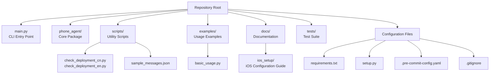
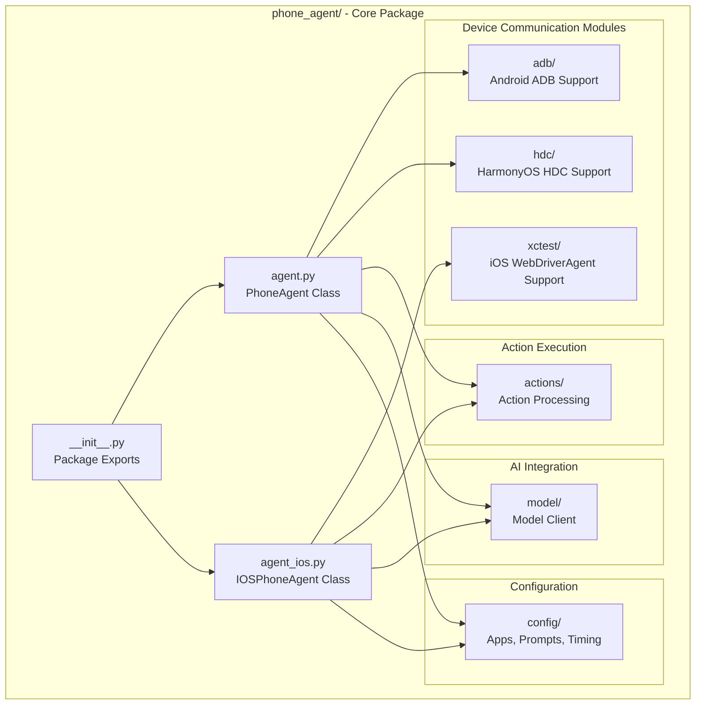
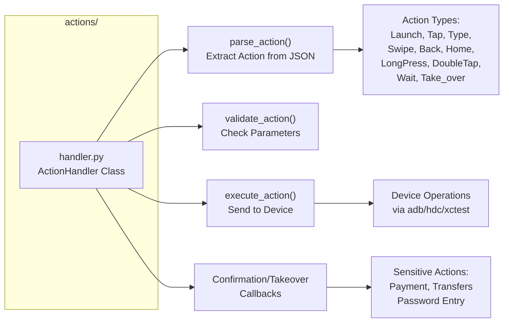
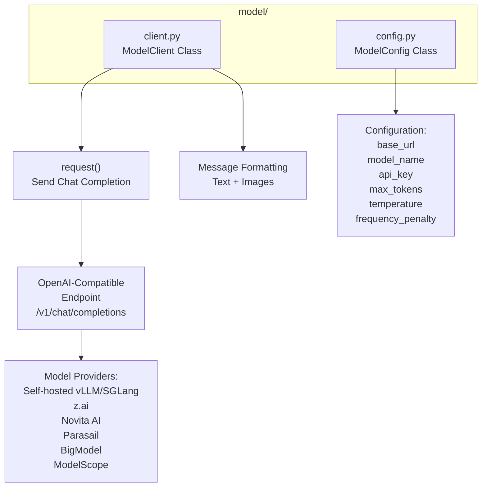
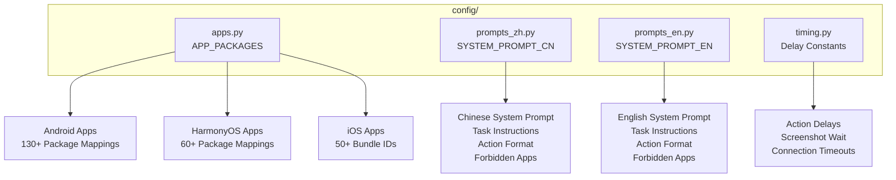
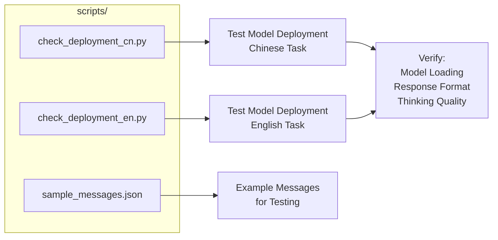
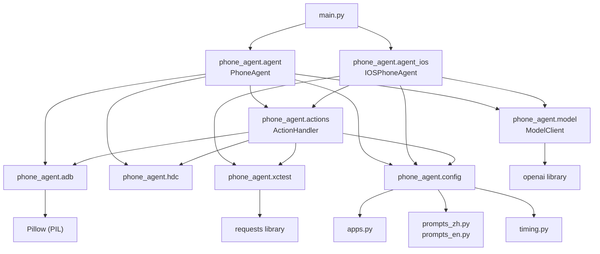

<!-- source: DeepWiki mcp.deepwiki.com · repo zai-org/Open-AutoGLM · page 9.1 Project Structure · fetched 2026-10-29 -->

# Project Structure

<details>
<summary>Relevant source files</summary>

The following files were used as context for generating this wiki page:

- [LICENSE](LICENSE)
- [README_coding_agent.md](README_coding_agent.md)
- [README_en.md](README_en.md)
- [phone_agent/__init__.py](phone_agent/__init__.py)
- [phone_agent/adb/screenshot.py](phone_agent/adb/screenshot.py)
- [requirements.txt](requirements.txt)
- [setup.py](setup.py)

</details>


This document provides a comprehensive overview of the Open-AutoGLM codebase organization, describing the purpose and responsibilities of each major component. This information is essential for developers who want to understand how the system is organized, contribute code, or extend functionality.

For information about setting up a development environment, see [Development Environment Setup](#9.2). For details on specific subsystems like device support or the action system, see [Device Support](#4) and [Action System](#6).

## Overview

The Open-AutoGLM project is organized as a Python package with clear separation of concerns across multiple modules. The codebase follows a layered architecture with distinct responsibilities for device communication, AI model integration, action execution, and configuration management.

Sources: [README.md:668-687]()

## Repository Root Structure



**Root-Level Structure**

Sources: [README.md:1-981]()

### Entry Points

| File | Purpose | Key Functionality |
|------|---------|-------------------|
| `main.py` | Command-line interface | Provides interactive and single-task modes for running automation tasks |
| `phone_agent/__init__.py` | Package exports | Exposes `PhoneAgent` and `IOSPhoneAgent` classes for programmatic use |

The `main.py` file serves as the primary entry point for CLI usage, handling argument parsing, device type selection, and task execution modes.

Sources: [README.md:286-313](), [phone_agent/__init__.py:1-12]()

### Configuration Files

| File | Purpose |
|------|---------|
| `requirements.txt` | Python dependencies for runtime and optional deployment/development |
| `setup.py` | Package installation configuration |
| `.pre-commit-config.yaml` | Git pre-commit hooks for code quality (Ruff, Typos, PyMarkdown) |

Sources: [requirements.txt:1-21]()

### Utility Directories

| Directory | Purpose |
|-----------|---------|
| `scripts/` | Deployment verification and testing utilities |
| `examples/` | Sample code demonstrating API usage patterns |
| `docs/` | Additional documentation, including iOS setup guides |
| `tests/` | Unit and integration tests (pytest-based) |

Sources: [README.md:252-282](), [README.md:643-651]()

## Core Package Structure



**Core Package Organization**

Sources: [README.md:668-687](), [phone_agent/__init__.py:1-12]()

### Agent Classes

The agent classes implement the core automation logic and orchestrate the observe-think-act loop.

| Component | File | Responsibilities |
|-----------|------|------------------|
| `PhoneAgent` | `agent.py` | Android/HarmonyOS automation, device management, task execution loop |
| `IOSPhoneAgent` | `agent_ios.py` | iOS automation using WebDriverAgent protocol |
| `AgentConfig` | `agent.py` | Configuration for agent behavior (max_steps, device_id, language, verbose) |

Both agent classes follow the same interface pattern but use different device communication backends. See [Agent Execution Loop](#3.3) for details on the automation cycle.

Sources: [README.md:27-33](), [README.md:315-333]()

## Device Communication Modules

```mermaid
graph TB
    subgraph "adb/ - Android Device Bridge"
        ADB_CONN["connection.py<br/>ADBConnection Class"]
        ADB_DEV["device.py<br/>Device Control Operations"]
        ADB_SS["screenshot.py<br/>Screen Capture"]
        ADB_INPUT["input.py<br/>ADB Keyboard Integration"]
        ADB_UTILS["utils.py<br/>Helper Functions"]
    end
    
    subgraph "hdc/ - HarmonyOS Debug Client"
        HDC_CONN["connection.py<br/>HDCConnection Class"]
        HDC_DEV["device.py<br/>UITest Commands"]
        HDC_SS["screenshot.py<br/>Screen Capture"]
        HDC_INPUT["input.py<br/>Native Input"]
        HDC_UTILS["utils.py<br/>Helper Functions"]
    end
    
    subgraph "xctest/ - iOS WebDriverAgent"
        WDA_CONN["connection.py<br/>XCTestConnection Class"]
        WDA_DEV["device.py<br/>WebDriver Protocol Operations"]
        WDA_SS["screenshot.py<br/>Screen Capture"]
        WDA_INPUT["input.py<br/>Native Input"]
        WDA_UTILS["utils.py<br/>Helper Functions"]
    end
    
    FACTORY["DeviceFactory Pattern"]
    FACTORY -.-> ADB_CONN
    FACTORY -.-> HDC_CONN
    FACTORY -.-> WDA_CONN
```



**Device Module Architecture**

Each device module provides a consistent interface with platform-specific implementations:

### Common Module Structure

| File | Responsibilities |
|------|------------------|
| `connection.py` | Connection management (USB, WiFi), device enumeration, network setup |
| `device.py` | Core device operations (tap, swipe, back, home, launch app) |
| `screenshot.py` | Screen capture and image processing |
| `input.py` | Text input handling (platform-specific keyboard mechanisms) |
| `utils.py` | Helper functions, type definitions, device info retrieval |

Sources: [README.md:56-105](), [README.md:336-456]()

### Platform-Specific Details

**Android (adb)**
- Uses ADB (Android Debug Bridge) protocol
- Text input via ADB Keyboard application
- Supports USB and WiFi (tcpip mode) connections
- Commands: `adb shell input tap`, `adb shell input swipe`, etc.

**HarmonyOS (hdc)**
- Uses HDC (HarmonyOS Debug Client) protocol
- Native text input (no keyboard app required)
- Supports USB and WiFi (tconn mode) connections
- Commands: `hdc shell uitest uiInput click`, etc.

**iOS (xctest)**
- Uses WebDriverAgent (WDA) with WebDriver protocol
- Native text input via WDA
- Supports USB (via iproxy) and WiFi connections
- HTTP-based API for device control

Sources: [README.md:56-84](), [README.md:106-112]()

## Action System



**Action Processing Flow**

The `actions/handler.py` module implements the `ActionHandler` class, which:

1. **Parses** model output to extract structured actions
2. **Validates** action parameters and coordinates
3. **Maps** app names to package identifiers using `APP_PACKAGES`
4. **Executes** actions on the device through the appropriate protocol
5. **Handles** sensitive operations with confirmation callbacks
6. **Manages** manual takeover for authentication scenarios

Sources: [README.md:604-620](), [README.md:621-641]()

## Model Integration



**Model Client Architecture**

The `model/client.py` module provides:

- `ModelClient`: Handles communication with OpenAI-compatible model APIs
- `ModelConfig`: Configuration object for model settings
- `ModelResponse`: Structured response containing thinking and action

The client supports multimodal requests with both text and image inputs, enabling the vision-language model to understand screen content.

Sources: [README.md:498-511](), [README.md:154-249]()

## Configuration System



**Configuration Modules**

| Module | Purpose | Key Contents |
|--------|---------|--------------|
| `apps.py` | Application package mappings | Maps friendly names ("微信") to package IDs ("com.tencent.mm") for Android, HarmonyOS, and iOS |
| `prompts_zh.py` | Chinese system prompts | System instructions for the AI model in Chinese |
| `prompts_en.py` | English system prompts | System instructions for the AI model in English |
| `timing.py` | Timing configuration | Delays between actions, timeouts for operations |

The `APP_PACKAGES` dictionary is critical for the `Launch` action, as it translates natural language app names into platform-specific identifiers.

Sources: [README.md:476-484](), [README.md:567-602]()

## Scripts and Utilities



**Utility Scripts**

| Script | Purpose | Usage |
|--------|---------|-------|
| `check_deployment_cn.py` | Verify Chinese model deployment | Tests model with sample Chinese task, validates response format |
| `check_deployment_en.py` | Verify English model deployment | Tests model with sample English task, validates response format |
| `sample_messages.json` | Test message templates | Contains example request messages for deployment testing |

These scripts are essential for validating that a model service is correctly configured before attempting device automation.

Sources: [README.md:252-282]()

## Module Dependencies



**Dependency Graph**

This diagram shows the import relationships between modules. Key observations:

- `main.py` depends only on the agent classes
- Agent classes depend on model, actions, device modules, and config
- Device modules are independent and only imported when needed
- ActionHandler imports all device modules to support multi-platform execution

Sources: [README.md:668-687](), [requirements.txt:1-21]()

## Key Design Patterns

### Device Factory Pattern

The system uses a factory pattern to instantiate the appropriate device module based on `device_type`:

```
if device_type == "adb":
    from phone_agent.adb import connection, device, screenshot, input
elif device_type == "hdc":
    from phone_agent.hdc import connection, device, screenshot, input
elif device_type == "ios":
    from phone_agent.xctest import connection, device, screenshot, input
```

This allows the agent logic to remain device-agnostic while supporting multiple platforms.

### Configuration Layers

Configuration flows through multiple layers:
1. **Default values** in code
2. **Environment variables** (`PHONE_AGENT_*`)
3. **CLI arguments** (`--base-url`, `--model`, etc.)
4. **Programmatic config objects** (`ModelConfig`, `AgentConfig`)

Later layers override earlier ones, providing flexibility for different deployment scenarios.

Sources: [README.md:476-524]()

## File Organization Summary

| Component | Location | Lines of Code (est.) | Primary Classes/Functions |
|-----------|----------|---------------------|---------------------------|
| Entry Point | `main.py` | ~500 | `main()`, CLI argument parsing |
| Core Agent | `phone_agent/agent.py` | ~800 | `PhoneAgent`, `AgentConfig` |
| iOS Agent | `phone_agent/agent_ios.py` | ~700 | `IOSPhoneAgent` |
| ADB Module | `phone_agent/adb/*.py` | ~1200 | `ADBConnection`, device operations |
| HDC Module | `phone_agent/hdc/*.py` | ~1000 | `HDCConnection`, device operations |
| XCTest Module | `phone_agent/xctest/*.py` | ~900 | `XCTestConnection`, WDA protocol |
| Action Handler | `phone_agent/actions/handler.py` | ~600 | `ActionHandler` |
| Model Client | `phone_agent/model/*.py` | ~400 | `ModelClient`, `ModelConfig` |
| Configuration | `phone_agent/config/*.py` | ~800 | `APP_PACKAGES`, system prompts |
| Documentation | `README.md`, `docs/` | ~1000 | Setup guides, usage examples |

Sources: [README.md:1-981]()

This project structure enables clear separation of concerns, making it straightforward to:
- Add support for new devices by creating a new module following the established pattern
- Modify AI model behavior by editing configuration files
- Extend action types by updating the ActionHandler
- Deploy in different environments using configuration layers

For implementation details of specific components, refer to the relevant sections: [Core Components](#3.2), [Device Support](#4), [Action System](#6), and [Configuration Reference](#7).

---

