# Page: Overview

# Overview

<details>
<summary>Relevant source files</summary>

The following files were used as context for generating this wiki page:

- [README.md](README.md)
- [README_coding_agent.md](README_coding_agent.md)
- [README_en.md](README_en.md)

</details>


This document provides a comprehensive introduction to Open-AutoGLM, explaining its purpose, architecture, and core components. It serves as the entry point for understanding the entire system.

For installation instructions, see [Getting Started](#2). For detailed architecture documentation, see [Architecture](#3). For usage guides, see [User Guide](#5).

## Purpose

Open-AutoGLM is an AI-powered mobile automation framework that enables natural language control of Android, HarmonyOS, and iOS devices. Users describe tasks in plain language (e.g., "Open Maps and search for nearby coffee shops"), and the system uses vision-language models to understand screen content, plan actions, and execute them through device automation protocols.

**Key capabilities:**
- Multi-platform support: Android (ADB), HarmonyOS (HDC), iOS (WebDriverAgent)
- Vision-based screen understanding using AutoGLM-Phone-9B models
- Natural language task execution with iterative refinement
- Safe operation with confirmation callbacks for sensitive actions
- Remote device control over WiFi/network

Sources: [README.md:27-33](), [README_en.md:21-23]()

## System Architecture

Open-AutoGLM is organized into six architectural layers, each with clear responsibilities. The following diagram maps the complete system architecture to concrete code entities:

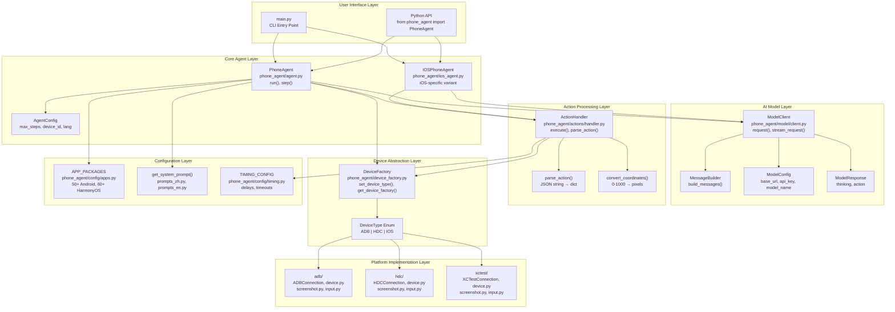

**Architecture Layers:**

| Layer | Purpose | Key Components | Primary Files |
|-------|---------|----------------|---------------|
| User Interface | Entry points for task execution | `main.py`, `PhoneAgent`, `IOSPhoneAgent` | [main.py](), [phone_agent/__init__.py]() |
| Core Agent | Task orchestration, perception-action loop | `PhoneAgent.run()`, `PhoneAgent.step()`, `AgentConfig` | [phone_agent/agent.py](), [phone_agent/ios_agent.py]() |
| AI Model | Vision-language model integration | `ModelClient.request()`, `MessageBuilder`, `ModelResponse` | [phone_agent/model/client.py](), [phone_agent/model/config.py]() |
| Action Processing | Action parsing, validation, execution dispatch | `ActionHandler.execute()`, `parse_action()` | [phone_agent/actions/handler.py]() |
| Device Abstraction | Platform-agnostic device interface | `DeviceFactory`, `DeviceType`, lazy loading | [phone_agent/device_factory.py]() |
| Platform Implementation | Platform-specific protocols | ADB/HDC/WDA command execution | [phone_agent/adb/](), [phone_agent/hdc/](), [phone_agent/xctest/]() |
| Configuration | App mappings, prompts, timing | `APP_PACKAGES`, `get_system_prompt()`, `TIMING_CONFIG` | [phone_agent/config/]() |

Sources: [README.md:668-687](), [README_en.md:605-624](), [phone_agent/agent.py](), [phone_agent/device_factory.py]()

## Core Workflow

The system implements a perception-action loop where the agent iteratively observes the screen, reasons about the next action, and executes it. The following sequence diagram shows the complete execution flow from user request to device action:

```mermaid
sequenceDiagram
    participant User
    participant main_py as "main.py"
    participant PhoneAgent as "PhoneAgent<br/>phone_agent/agent.py"
    participant Config as "get_system_prompt()<br/>APP_PACKAGES"
    participant ModelClient as "ModelClient<br/>phone_agent/model/client.py"
    participant ModelAPI as "AI Model Service<br/>AutoGLM-Phone-9B"
    participant ActionHandler as "ActionHandler<br/>phone_agent/actions/handler.py"
    participant DeviceFactory as "DeviceFactory<br/>device_factory.py"
    participant Device as "Device<br/>ADB/HDC/WDA"
    
    User->>main_py: "Open Maps, search coffee"
    main_py->>PhoneAgent: run(task)
    activate PhoneAgent
    
    PhoneAgent->>Config: get_system_prompt(lang)
    Config-->>PhoneAgent: system_prompt, app_packages
    
    loop "Until task complete or max_steps reached (default: 100)"
        PhoneAgent->>DeviceFactory: get_screenshot()
        DeviceFactory->>Device: screencap / snapshot_display
        Device-->>DeviceFactory: PNG screenshot
        DeviceFactory-->>PhoneAgent: PIL.Image
        
        PhoneAgent->>DeviceFactory: get_current_app()
        DeviceFactory->>Device: dumpsys / uitest / WDA query
        Device-->>DeviceFactory: package/bundle identifier
        DeviceFactory-->>PhoneAgent: app_name string
        
        PhoneAgent->>ModelClient: request(messages, images)
        ModelClient->>ModelAPI: POST /v1/chat/completions
        ModelAPI-->>ModelClient: Stream: &lt;think&gt;...&lt;/think&gt;&lt;answer&gt;...&lt;/answer&gt;
        ModelClient-->>PhoneAgent: ModelResponse(thinking, action)
        
        PhoneAgent->>ActionHandler: execute(action, screen_size, callbacks)
        ActionHandler->>ActionHandler: parse_action(action_str)
        ActionHandler->>ActionHandler: convert_coordinates(element, dims)
        
        alt "Sensitive Operation (e.g., Payment)"
            ActionHandler->>User: confirmation_callback(message)
            User-->>ActionHandler: True/False
        end
        
        alt "Manual Task (e.g., Login, Captcha)"
            ActionHandler->>User: takeover_callback(message)
            User->>Device: Manual operation
            User-->>ActionHandler: Continue
        end
        
        alt "Normal Action"
            ActionHandler->>DeviceFactory: tap() / swipe() / type_text() / launch_app()
            DeviceFactory->>Device: ADB/HDC/WDA command
            Device-->>DeviceFactory: Command result
            DeviceFactory-->>ActionHandler: Success/Failure
        end
        
        ActionHandler-->>PhoneAgent: ActionResult
        
        alt "Task Complete (finish() action)"
            PhoneAgent-->>main_py: Success message
        end
        
        alt "Max Steps Reached"
            PhoneAgent-->>main_py: Timeout message
        end
    end
    
    deactivate PhoneAgent
    main_py-->>User: Display result
```

**Detailed Workflow Steps:**

| Step | Code Entity | Description |
|------|-------------|-------------|
| 1. Initialization | `PhoneAgent.__init__()` | Load `AgentConfig`, `ModelConfig`, initialize `ModelClient` and `ActionHandler` |
| 2. System Prompt | `get_system_prompt(lang)` | Load bilingual prompts from [phone_agent/config/prompts_zh.py]() or [phone_agent/config/prompts_en.py]() |
| 3. Screen Capture | `DeviceFactory.get_screenshot()` | Call platform-specific screenshot: `adb exec-out screencap`, `hdc shell snapshot_display`, or WDA API |
| 4. App Detection | `DeviceFactory.get_current_app()` | Query foreground app via `dumpsys window`, `uitest dumpLayout`, or WDA session |
| 5. Model Request | `ModelClient.request()` | Build message with `MessageBuilder`, send to OpenAI-compatible endpoint |
| 6. Response Parsing | `ModelResponse.parse()` | Extract `<think>` and `<answer>` tags, parse action JSON |
| 7. Action Dispatch | `ActionHandler.execute()` | Validate action type, convert coordinates, apply timing delays |
| 8. Safety Callbacks | `confirmation_callback()`, `takeover_callback()` | Optional user intervention for sensitive or manual operations |
| 9. Device Execution | Platform-specific modules | Execute via `adb shell input`, `hdc shell uitest`, or WDA WebDriver protocol |
| 10. Loop Condition | `PhoneAgent.run()` | Continue until `finish()` action or `max_steps` (default: 100) reached |

**Key Functions:**

- **`PhoneAgent.run(task: str)`**: Main entry point, executes full task with automatic loop
- **`PhoneAgent.step()`**: Single iteration of perception-action loop, useful for debugging
- **`ModelClient.request(messages, images)`**: Sends request to vision-language model
- **`ActionHandler.execute(action, screen_size, callbacks)`**: Parses and executes single action
- **`DeviceFactory.get_device_factory(device_type)`**: Returns platform-specific device instance

Sources: [README.md:27-32](), [phone_agent/agent.py](), [phone_agent/model/client.py](), [phone_agent/actions/handler.py]()

## Platform Support Matrix

Open-AutoGLM supports three mobile platforms through a unified interface:

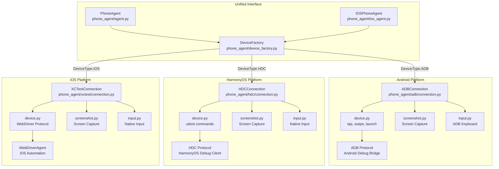

**Platform-Specific Features:**

| Platform | Protocol | Connection Types | Text Input | Screen Capture | Launch Apps |
|----------|----------|------------------|------------|----------------|-------------|
| Android 7.0+ | ADB | USB, WiFi (TCP/IP) | ADB Keyboard | `adb exec-out screencap` | Package name |
| HarmonyOS NEXT+ | HDC | USB, WiFi (`hdc tconn`) | Native input | `hdc shell snapshot_display` | Bundle identifier |
| iOS 14.0+ | WebDriverAgent | USB (iproxy), WiFi | Native input | WDA screenshot API | Bundle identifier |

For detailed platform setup, see [Android (ADB)](#4.1), [HarmonyOS (HDC)](#4.2), and [iOS (WebDriverAgent)](#4.3).

Sources: [README.md:46-111](), [README_en.md:36-93](), [phone_agent/device_factory.py]()

## Model Deployment Options

The `ModelClient` ([phone_agent/model/client.py]()) communicates with vision-language models via OpenAI-compatible API. The system supports both cloud-hosted services and self-hosted inference servers:

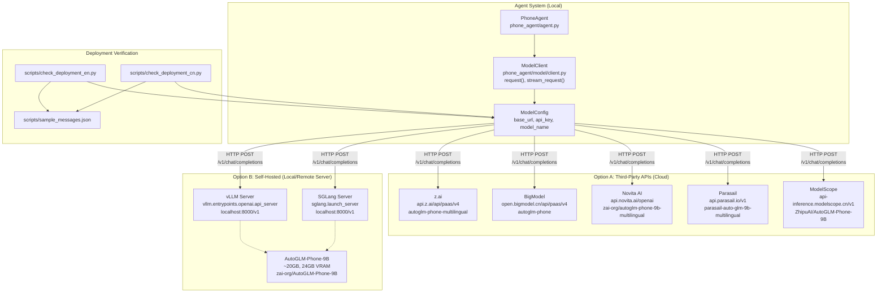

**Deployment Comparison:**

| Approach | Hardware Requirements | Setup Complexity | Configuration | Use Case |
|----------|----------------------|------------------|---------------|----------|
| Third-Party API | None (cloud-based) | Low (API key only) | `--base-url`, `--apikey` | Quick start, production, no GPU |
| Self-Hosted (vLLM) | 24GB+ VRAM GPU, ~20GB disk | High (model download, vLLM setup) | `--base-url` only | Research, privacy, high volume |
| Self-Hosted (SGLang) | 24GB+ VRAM GPU, ~20GB disk | High (model download, SGLang setup) | `--base-url` only | Research, privacy, high volume |

**Configuration Methods:**

| Method | Example | Primary File |
|--------|---------|--------------|
| CLI Arguments | `python main.py --base-url URL --model NAME --apikey KEY` | [main.py:1-100]() |
| Environment Variables | `export PHONE_AGENT_BASE_URL="https://api.z.ai/api/paas/v4"` | N/A |
| Python API | `ModelConfig(base_url="...", api_key="...", model_name="...")` | [phone_agent/model/config.py]() |

**Self-Hosted Startup Commands:**

```bash
# vLLM (strict parameters required)
python3 -m vllm.entrypoints.openai.api_server \
  --served-model-name autoglm-phone-9b \
  --allowed-local-media-path / \
  --mm-encoder-tp-mode data \
  --mm_processor_cache_type shm \
  --mm_processor_kwargs "{\"max_pixels\":5000000}" \
  --max-model-len 25480 \
  --chat-template-content-format string \
  --limit-mm-per-prompt "{\"image\":10}" \
  --model zai-org/AutoGLM-Phone-9B \
  --port 8000

# SGLang
python3 -m sglang.launch_server \
  --model-path zai-org/AutoGLM-Phone-9B \
  --served-model-name autoglm-phone-9b \
  --context-length 25480 \
  --mm-enable-dp-encoder \
  --mm-process-config '{"image":{"max_pixels":5000000}}' \
  --port 8000
```

**Deployment Verification:**

Use the provided scripts to validate your deployment:

```bash
# Test Chinese model
python scripts/check_deployment_cn.py \
  --base-url http://localhost:8000/v1 \
  --model autoglm-phone-9b

# Test English model with API key
python scripts/check_deployment_en.py \
  --base-url https://api.z.ai/api/paas/v4 \
  --model autoglm-phone-multilingual \
  --apikey sk-xxxxx
```

Expected output includes structured thinking process and valid action JSON. Short thinking chains or garbled output indicate deployment issues.

For detailed deployment instructions, see [Using Third-Party APIs](#8.1), [Self-Hosting Models](#8.2), and [Deployment Verification](#8.3).

Sources: [README.md:154-283](), [README_en.md:134-222](), [phone_agent/model/client.py](), [scripts/check_deployment_cn.py](), [scripts/check_deployment_en.py]()

## Key Components and Code Entities

The following tables map system concepts to concrete code entities, organized by architectural layer:

### Core Agent Components

| Component | File Path | Key Methods/Attributes | Purpose |
|-----------|-----------|------------------------|---------|
| `PhoneAgent` | [phone_agent/agent.py]() | `run(task)`, `step()`, `reset()` | Main agent for Android/HarmonyOS, orchestrates perception-action loop |
| `IOSPhoneAgent` | [phone_agent/ios_agent.py]() | `run(task)`, `step()` | iOS-specific agent variant, handles WDA protocol differences |
| `AgentConfig` | [phone_agent/agent.py]() | `max_steps`, `device_id`, `lang`, `verbose` | Configuration dataclass for agent initialization |

### Model Integration Components

| Component | File Path | Key Methods/Attributes | Purpose |
|-----------|-----------|------------------------|---------|
| `ModelClient` | [phone_agent/model/client.py]() | `request(messages, images)`, `stream_request()` | OpenAI-compatible API client, manages HTTP communication |
| `ModelConfig` | [phone_agent/model/config.py]() | `base_url`, `api_key`, `model_name`, `temperature` | Model service configuration |
| `ModelResponse` | [phone_agent/model/types.py]() | `thinking`, `action`, `parse()` | Parses `<think>` and `<answer>` tags from model output |
| `MessageBuilder` | [phone_agent/model/client.py]() | `build_messages(history, screenshot)` | Constructs OpenAI-format message arrays with images |

### Action Processing Components

| Component | File Path | Key Methods/Attributes | Purpose |
|-----------|-----------|------------------------|---------|
| `ActionHandler` | [phone_agent/actions/handler.py]() | `execute(action, screen_size)`, `parse_action()` | Main action dispatcher, handles all 15+ action types |
| `parse_action()` | [phone_agent/actions/handler.py]() | Returns `dict` | Parses JSON action string into structured dictionary |
| `convert_coordinates()` | [phone_agent/actions/handler.py]() | Converts 0-1000 → pixels | Normalizes coordinates across different screen sizes |
| Action Types | [phone_agent/actions/handler.py]() | `Launch`, `Tap`, `Type`, `Swipe`, `Back`, `Home`, `Long_press`, `Double_tap`, `Wait`, `Take_over`, `Note`, `Call_API`, `Interact`, `finish()` | Supported action primitives |

### Device Abstraction Components

| Component | File Path | Key Methods/Attributes | Purpose |
|-----------|-----------|------------------------|---------|
| `DeviceFactory` | [phone_agent/device_factory.py]() | `set_device_type()`, `get_device_factory()` | Factory pattern for device instantiation |
| `DeviceType` | [phone_agent/device_factory.py]() | `ADB`, `HDC`, `IOS` enum values | Platform enumeration for routing |

### Android Platform Components (ADB)

| Component | File Path | Key Methods | Purpose |
|-----------|-----------|-------------|---------|
| `ADBConnection` | [phone_agent/adb/connection.py]() | `connect()`, `disconnect()`, `enable_tcpip()` | Manages ADB connections (USB/WiFi) |
| `list_devices()` | [phone_agent/adb/connection.py]() | Returns `List[DeviceInfo]` | Enumerates connected Android devices |
| `tap()`, `swipe()`, `launch_app()` | [phone_agent/adb/device.py]() | Platform operations | Executes `adb shell input` and `monkey` commands |
| `get_screenshot()` | [phone_agent/adb/screenshot.py]() | Returns `PIL.Image` | Executes `adb exec-out screencap -p` |
| `ADBKeyboard` | [phone_agent/adb/input.py]() | `type_text()`, `switch_to_adb_keyboard()` | Text input via ADB Keyboard app |

### HarmonyOS Platform Components (HDC)

| Component | File Path | Key Methods | Purpose |
|-----------|-----------|-------------|---------|
| `HDCConnection` | [phone_agent/hdc/connection.py]() | `connect()`, `disconnect()` | Manages HDC connections (USB/WiFi via `hdc tconn`) |
| `list_devices()` | [phone_agent/hdc/connection.py]() | Returns `List[DeviceInfo]` | Enumerates connected HarmonyOS devices |
| `tap()`, `swipe()`, `launch_app()` | [phone_agent/hdc/device.py]() | Platform operations | Executes `hdc shell uitest uiInput` and `aa start` commands |
| `get_screenshot()` | [phone_agent/hdc/screenshot.py]() | Returns `PIL.Image` | Executes `hdc shell snapshot_display` |
| Native input | [phone_agent/hdc/input.py]() | `type_text()` | Text input via `uitest uiInput text` (no keyboard app needed) |

### iOS Platform Components (WebDriverAgent)

| Component | File Path | Key Methods | Purpose |
|-----------|-----------|-------------|---------|
| `XCTestConnection` | [phone_agent/xctest/connection.py]() | `connect()`, `disconnect()` | Manages WebDriverAgent HTTP connections |
| `tap()`, `swipe()`, `launch_app()` | [phone_agent/xctest/device.py]() | Platform operations | Executes WebDriver protocol HTTP requests |
| `get_screenshot()` | [phone_agent/xctest/screenshot.py]() | Returns `PIL.Image` | Fetches screenshot via WDA API |
| Native input | [phone_agent/xctest/input.py]() | `type_text()` | Text input via WDA keyboard API |

### Configuration Components

| Component | File Path | Key Attributes | Purpose |
|-----------|-----------|----------------|---------|
| `APP_PACKAGES` | [phone_agent/config/apps.py]() | Dict mapping app names → package IDs | 50+ Android apps (e.g., `"微信": "com.tencent.mm"`) |
| `APP_PACKAGES_HARMONYOS` | [phone_agent/config/apps_harmonyos.py]() | Dict mapping app names → bundle IDs | 60+ HarmonyOS apps (e.g., `"微信": "com.tencent.wechat"`) |
| `APP_PACKAGES_IOS` | [phone_agent/config/apps_ios.py]() | Dict mapping app names → bundle IDs | iOS apps (e.g., `"Safari": "com.apple.mobilesafari"`) |
| `get_system_prompt()` | [phone_agent/config/prompts_zh.py](), [phone_agent/config/prompts_en.py]() | Returns prompt string | Bilingual system prompts with action definitions |
| `TIMING_CONFIG` | [phone_agent/config/timing.py]() | `ActionTimingConfig`, `DeviceTimingConfig` | Configurable delays and timeouts for all operations |
| `get_messages()` | [phone_agent/config/i18n.py]() | Returns UI strings | Bilingual UI messages for CLI output |

### Entry Points and Utilities

| Component | File Path | Key Functions | Purpose |
|-----------|-----------|---------------|---------|
| `main()` | [main.py]() | CLI entry point | Argument parsing, device selection, task execution |
| Package exports | [phone_agent/__init__.py]() | `__all__` list | Exports `PhoneAgent`, `IOSPhoneAgent`, `ModelConfig`, `AgentConfig` |
| Deployment checks | [scripts/check_deployment_cn.py](), [scripts/check_deployment_en.py]() | Validation scripts | Tests model service with sample messages |

Sources: [phone_agent/agent.py](), [phone_agent/model/client.py](), [phone_agent/actions/handler.py](), [phone_agent/device_factory.py](), [phone_agent/adb/](), [phone_agent/hdc/](), [phone_agent/xctest/](), [phone_agent/config/]()

## Usage Examples

### CLI Usage

```bash
# Single task execution (Android)
python main.py --base-url http://localhost:8000/v1 \
               --model autoglm-phone-9b \
               "Open Maps and search for nearby coffee shops"

# Single task execution (HarmonyOS)
python main.py --device-type hdc \
               --base-url http://localhost:8000/v1 \
               "Open Maps and search for nearby coffee shops"

# Single task execution (iOS)
python main.py --device-type ios \
               --base-url http://localhost:8000/v1 \
               "Open Maps and search for nearby coffee shops"

# Interactive mode
python main.py --base-url http://localhost:8000/v1 --model autoglm-phone-9b

# List supported applications
python main.py --list-apps
python main.py --device-type hdc --list-apps
```

### Python API Usage

```python
from phone_agent import PhoneAgent, IOSPhoneAgent
from phone_agent.model import ModelConfig
from phone_agent.agent import AgentConfig

# Configure model
model_config = ModelConfig(
    base_url="http://localhost:8000/v1",
    model_name="autoglm-phone-9b",
    api_key="EMPTY",
    temperature=0.1,
)

# Configure agent
agent_config = AgentConfig(
    max_steps=100,
    device_id=None,  # Auto-detect
    lang="en",
    verbose=True,
)

# Create agent (Android/HarmonyOS)
agent = PhoneAgent(
    model_config=model_config,
    agent_config=agent_config,
)

# Create agent (iOS)
ios_agent = IOSPhoneAgent(
    model_config=model_config,
    agent_config=agent_config,
)

# Execute task
result = agent.run("Open Maps and search for nearby coffee shops")
print(result)
```

### Custom Callbacks

```python
def my_confirmation(message: str) -> bool:
    """Called before sensitive operations (payments, etc.)"""
    return input(f"Confirm: {message}? (y/n): ").lower() == "y"

def my_takeover(message: str) -> None:
    """Called when manual intervention needed (login, captcha)"""
    print(f"Manual intervention required: {message}")
    input("Press Enter after completing manually...")

agent = PhoneAgent(
    confirmation_callback=my_confirmation,
    takeover_callback=my_takeover,
)
```

For detailed usage guides, see [Command-Line Interface](#5.1), [Python API](#5.2), and [Custom Callbacks](#6.3).

Sources: [README.md:286-333](), [README.md:621-641](), [README_en.md:223-273](), [README_en.md:558-578]()

## Application Support

Open-AutoGLM includes pre-configured mappings for 130+ Android apps, 60+ HarmonyOS apps, and 50+ iOS apps in the `APP_PACKAGES` dictionary:

**Android Example Apps:**
- Social: WeChat, QQ, Weibo, WhatsApp, Telegram, Instagram
- Shopping: Taobao, JD.com, Amazon, eBay, Temu
- Utilities: Chrome, Gmail, Google Maps, Google Calendar
- Entertainment: TikTok, YouTube, Netflix, Spotify

**HarmonyOS Example Apps:**
- Social: WeChat, QQ, Weibo, Feishu
- Shopping: Taobao, JD.com, Pinduoduo
- Utilities: Browser, Calendar, File Manager
- System: Settings, Camera, Contacts

**iOS Example Apps:**
- Social: WhatsApp, Telegram, Instagram, Facebook
- Productivity: Gmail, Google Calendar, Notes
- Shopping: Amazon, eBay
- Utilities: Safari, Maps, Calendar

To view the complete list:

```bash
python main.py --list-apps                    # Android
python main.py --device-type hdc --list-apps  # HarmonyOS
python main.py --device-type ios --list-apps  # iOS
```

For application configuration details, see [Application Packages](#7.1).

Sources: [README.md:567-602](), [README_en.md:506-539]()

## Development and Quality Assurance

The project includes comprehensive development tooling:

**Code Quality:**
- Pre-commit hooks with Ruff (linter/formatter), typos, and PyMarkdown
- Type hints throughout the codebase
- Automated formatting on commit

**Testing:**
- Unit tests via pytest
- Deployment verification scripts: [scripts/check_deployment_cn.py](), [scripts/check_deployment_en.py]()
- System requirement checks for ADB/HDC/WDA

**Documentation:**
- Bilingual documentation (Chinese and English)
- Comprehensive README files
- API documentation via docstrings

For development setup, see [Development Guide](#9).

Sources: [README.md:652-667](), [README_en.md:589-604]()

## Related Resources

- **Getting Started**: Installation, quick start, and basic configuration - see [Getting Started](#2)
- **Architecture Details**: Deep dive into system design and components - see [Architecture](#3)
- **Device Setup**: Platform-specific setup guides - see [Device Support](#4)
- **Usage Guides**: CLI, API, and advanced features - see [User Guide](#5)
- **Action Reference**: Complete action type documentation - see [Action System](#6)
- **Configuration**: Environment variables, prompts, and app packages - see [Configuration Reference](#7)
- **Model Deployment**: Self-hosting and third-party services - see [Model Deployment](#8)

Sources: [README.md:1-981](), [README_en.md:1-923]()

---

# Page: Getting Started

# Getting Started

<details>
<summary>Relevant source files</summary>

The following files were used as context for generating this wiki page:

- [README.md](README.md)
- [README_coding_agent.md](README_coding_agent.md)
- [README_en.md](README_en.md)

</details>


This page provides an overview of the initial setup process for Open-AutoGLM, an AI-powered mobile automation framework. It covers system requirements, deployment options, and the basic workflow to get your first automation task running.

For detailed installation instructions, see [Installation](#2.1). For step-by-step usage examples, see [Quick Start](#2.2). For configuration options, see [Configuration Basics](#2.3).

## Overview

Open-AutoGLM enables AI-driven control of mobile devices through a three-component architecture:

1. **Agent Code** (this repository) - Runs on your computer
2. **Device Connection** - ADB/HDC/WebDriverAgent for device communication
3. **AI Model Service** - Vision-language model for decision-making

The setup process involves preparing your development environment, connecting your device, configuring a model service, and verifying the deployment.

## System Architecture Overview

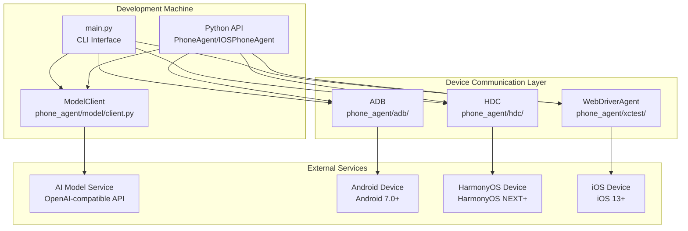

**Component Mapping**

This diagram maps the system's natural language components to their code locations:

- `main.py` - Entry point for CLI usage [main.py]()
- `PhoneAgent` - Android/HarmonyOS agent class [phone_agent/agent.py]()
- `IOSPhoneAgent` - iOS agent class [phone_agent/ios_agent.py]()
- `ModelClient` - AI model communication [phone_agent/model/client.py]()
- Device modules - Platform-specific implementations in [phone_agent/adb/](), [phone_agent/hdc/](), [phone_agent/xctest/]()

**Sources:** [README.md:1-980](), [README_en.md:1-923](), [phone_agent/agent.py](), [phone_agent/ios_agent.py](), [main.py]()

## Prerequisites Checklist

Before beginning installation, ensure you have the following:

### Hardware Requirements

| Requirement | Android | HarmonyOS | iOS |
|------------|---------|-----------|-----|
| Device OS | Android 7.0+ | HarmonyOS NEXT+ | iOS 13+ |
| Connection Cable | USB data cable | USB data cable | USB data cable or WiFi |
| Computer OS | Windows/macOS/Linux | Windows/macOS/Linux | macOS only |

### Software Requirements

| Component | Purpose | Installation Link |
|-----------|---------|------------------|
| Python 3.10+ | Runtime environment | https://www.python.org/downloads/ |
| ADB Tools | Android device control | https://developer.android.com/tools/releases/platform-tools |
| HDC Tools | HarmonyOS device control | https://developer.huawei.com/consumer/en/download/ |
| Xcode + WDA | iOS device control | See [iOS Setup](#4.3) |
| ADB Keyboard | Text input on Android | https://github.com/senzhk/ADBKeyBoard |

### Device Configuration

**Android Devices:**
- Developer Mode enabled (Settings → About Phone → tap Build Number 7 times)
- USB Debugging enabled (Settings → Developer Options → USB Debugging)
- USB Debugging (Security Settings) enabled on some devices
- ADB Keyboard installed and enabled

**HarmonyOS Devices:**
- Developer Mode enabled
- USB Debugging enabled
- No ADB Keyboard required (uses native input)

**iOS Devices:**
- Developer account (free or paid)
- Xcode installed
- WebDriverAgent configured
- Device trusted in Xcode

**Sources:** [README.md:46-112](), [README_en.md:36-93](), [docs/ios_setup/ios_setup.md]()

## Deployment Decision Tree

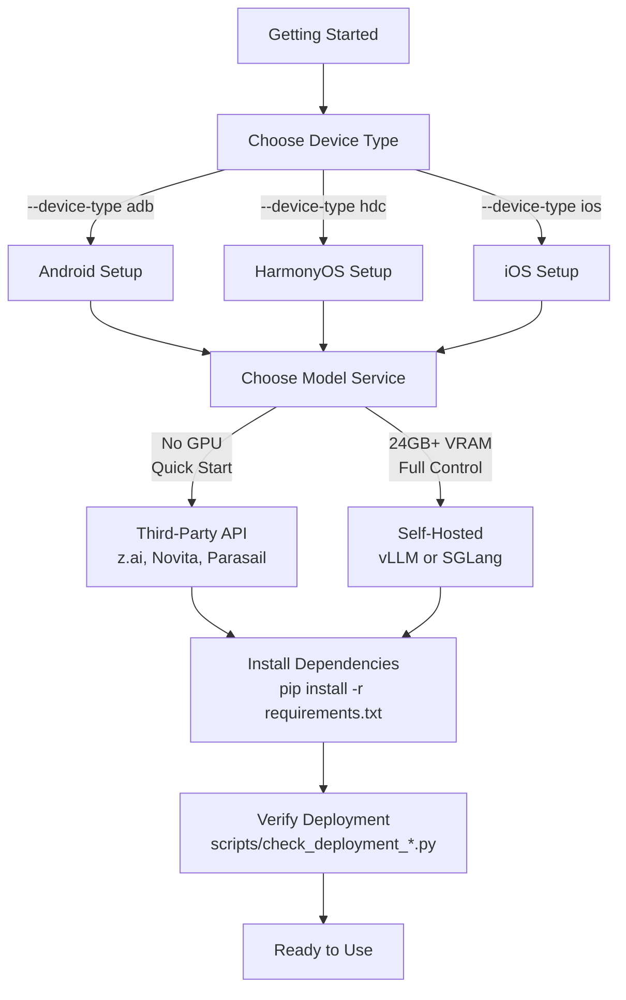

**Configuration Mapping**

The deployment choices map to these configuration points:

- **Device Type**: `--device-type` CLI argument or `DeviceType` enum [phone_agent/device_factory.py:15-18]()
- **Model Service**: `--base-url` and `--apikey` CLI arguments or `ModelConfig` class [phone_agent/model/config.py:8-23]()
- **Agent Settings**: `--max-steps`, `--lang`, `--verbose` arguments or `AgentConfig` class [phone_agent/agent.py:25-50]()

**Sources:** [README.md:134-283](), [README_en.md:134-222](), [phone_agent/device_factory.py](), [phone_agent/model/config.py](), [phone_agent/agent.py]()

## Setup Process

### Step 1: Environment Preparation

Install Python 3.10+ and the appropriate device debug tools for your platform:

**For Android:**
```bash
# Download ADB from https://developer.android.com/tools/releases/platform-tools
# Add to PATH environment variable
export PATH=${PATH}:/path/to/platform-tools
```

**For HarmonyOS:**
```bash
# Download HDC from HarmonyOS SDK
# Add to PATH environment variable
export PATH=${PATH}:/path/to/harmonyos-sdk/toolchains
```

**For iOS:**
```bash
# Install Xcode from App Store
# Configure WebDriverAgent (see iOS Setup guide)
```

Verify device tool installation:
```bash
# Android
adb version

# HarmonyOS
hdc version
```

**Sources:** [README.md:46-104](), [README_en.md:36-74]()

### Step 2: Device Connection

Connect your device via USB and enable debugging:

**Android/HarmonyOS:**
1. Connect device with USB data cable (not charging-only cable)
2. Approve USB debugging authorization on device
3. Verify connection:

```bash
# Android
adb devices

# HarmonyOS
hdc list targets
```

**iOS:**
1. Connect device via USB or WiFi
2. Trust device in Xcode
3. Start WebDriverAgent
4. Verify connection at http://localhost:8100/status

See [Remote Device Connection](#5.3) for WiFi debugging setup.

**Sources:** [README.md:124-153](), [README_en.md:103-133](), [docs/ios_setup/ios_setup.md]()

### Step 3: Install Dependencies

Clone the repository and install Python dependencies:

```bash
git clone https://github.com/zai-org/Open-AutoGLM.git
cd Open-AutoGLM

# Create virtual environment (recommended)
python -m venv venv
source venv/bin/activate  # Windows: venv\Scripts\activate

# Install dependencies
pip install -r requirements.txt
pip install -e .
```

**For Android only:** Install ADB Keyboard APK on your device from https://github.com/senzhk/ADBKeyBoard and enable it in device settings.

**Sources:** [README.md:117-121](), [README_en.md:96-101](), [requirements.txt]()

### Step 4: Configure Model Service

Choose a model deployment option:

#### Option A: Third-Party API (Recommended for Quick Start)

Use a hosted model service with no local GPU requirements:

| Service | base-url | model | Notes |
|---------|----------|-------|-------|
| z.ai | `https://api.z.ai/api/paas/v4` | `autoglm-phone-multilingual` | Requires API key |
| Novita AI | `https://api.novita.ai/openai` | `zai-org/autoglm-phone-9b-multilingual` | Requires API key |
| Parasail | `https://api.parasail.io/v1` | `parasail-auto-glm-9b-multilingual` | Requires API key |
| BigModel (CN) | `https://open.bigmodel.cn/api/paas/v4` | `autoglm-phone` | Chinese optimized |
| ModelScope (CN) | `https://api-inference.modelscope.cn/v1` | `ZhipuAI/AutoGLM-Phone-9B` | Chinese optimized |

**Sources:** [README.md:158-184](), [README_en.md:138-174]()

#### Option B: Self-Hosted Model (Advanced)

Deploy the model locally using vLLM or SGLang:

**Requirements:**
- NVIDIA GPU with 24GB+ VRAM
- CUDA-compatible drivers

**vLLM Deployment:**
```bash
pip install vllm

python3 -m vllm.entrypoints.openai.api_server \
 --served-model-name autoglm-phone-9b-multilingual \
 --allowed-local-media-path / \
 --mm-encoder-tp-mode data \
 --mm_processor_cache_type shm \
 --mm_processor_kwargs "{\"max_pixels\":5000000}" \
 --max-model-len 25480 \
 --chat-template-content-format string \
 --limit-mm-per-prompt "{\"image\":10}" \
 --model zai-org/AutoGLM-Phone-9B-Multilingual \
 --port 8000
```

Service will be available at `http://localhost:8000/v1`.

**Sources:** [README.md:186-250](), [README_en.md:176-202]()

### Step 5: Verify Deployment

Test your configuration using the deployment check script:

```bash
# For self-hosted models
python scripts/check_deployment_en.py \
  --base-url http://localhost:8000/v1 \
  --model autoglm-phone-9b-multilingual

# For third-party APIs
python scripts/check_deployment_en.py \
  --base-url https://api.novita.ai/openai \
  --model zai-org/autoglm-phone-9b-multilingual \
  --apikey your-api-key
```

Expected output should include a coherent thinking process (`<think>`) and an action (`<answer>`). If the output is truncated or contains garbled text, the model deployment may have failed.

**Sources:** [README.md:252-277](), [README_en.md:203-221](), [scripts/check_deployment_en.py](), [scripts/check_deployment_cn.py]()

## First Task Execution

### Command Line Interface

Execute your first automation task:

```bash
# Android device
python main.py \
  --base-url http://localhost:8000/v1 \
  --model autoglm-phone-9b-multilingual \
  "Open Chrome and search for weather"

# HarmonyOS device
python main.py \
  --device-type hdc \
  --base-url http://localhost:8000/v1 \
  --model autoglm-phone-9b-multilingual \
  "Open browser and search for weather"

# iOS device
python main.py \
  --device-type ios \
  --base-url http://localhost:8000/v1 \
  --model autoglm-phone-9b-multilingual \
  "Open Safari and search for weather"
```

The agent will:
1. Capture a screenshot of the device
2. Send it to the AI model with your task description
3. Receive thinking process and action from the model
4. Execute the action on the device
5. Repeat until task completion or max steps reached

**Sources:** [README.md:284-313](), [README_en.md:223-253](), [main.py:1-200]()

### Python API

Alternatively, use the Python API for programmatic control:

```python
from phone_agent import PhoneAgent, IOSPhoneAgent
from phone_agent.model import ModelConfig

# Configure model
model_config = ModelConfig(
    base_url="http://localhost:8000/v1",
    model_name="autoglm-phone-9b-multilingual",
    api_key="your-api-key"  # if required
)

# Create agent for Android/HarmonyOS
agent = PhoneAgent(model_config=model_config)

# Or for iOS
# agent = IOSPhoneAgent(model_config=model_config)

# Execute task
result = agent.run("Open Gmail and check inbox")
print(result)
```

**Sources:** [README.md:315-333](), [README_en.md:255-273](), [phone_agent/agent.py:100-300](), [phone_agent/ios_agent.py:50-250]()

## Configuration Files and Environment Variables

### Key Configuration Classes

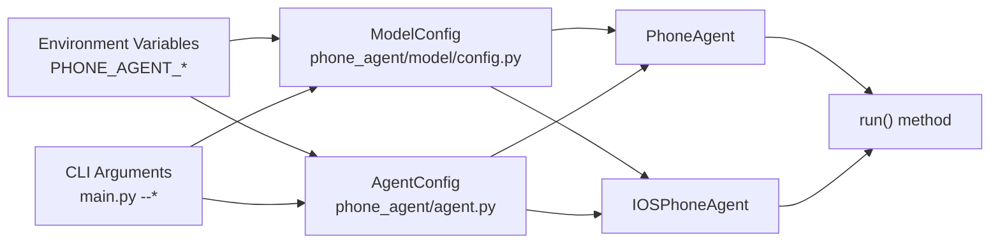

**Configuration Sources Priority (highest to lowest):**
1. Explicit parameters to `PhoneAgent()` or `IOSPhoneAgent()` constructor
2. CLI arguments in `main.py`
3. Environment variables (`PHONE_AGENT_*`)
4. Default values in configuration classes

**Important Environment Variables:**

| Variable | Purpose | Default | File Reference |
|----------|---------|---------|----------------|
| `PHONE_AGENT_BASE_URL` | Model API endpoint | `http://localhost:8000/v1` | [phone_agent/model/config.py:8-10]() |
| `PHONE_AGENT_MODEL` | Model name | `autoglm-phone-9b` | [phone_agent/model/config.py:11-13]() |
| `PHONE_AGENT_API_KEY` | API authentication | `EMPTY` | [phone_agent/model/config.py:14-16]() |
| `PHONE_AGENT_MAX_STEPS` | Max steps per task | `100` | [phone_agent/agent.py:30-32]() |
| `PHONE_AGENT_DEVICE_ID` | Specific device ID | Auto-detect | [phone_agent/agent.py:35-37]() |
| `PHONE_AGENT_DEVICE_TYPE` | Device type | `adb` | [phone_agent/agent.py:38-40]() |
| `PHONE_AGENT_LANG` | System prompt language | `cn` | [phone_agent/agent.py:41-43]() |

**Sources:** [README.md:476-524](), [README_en.md:415-464](), [phone_agent/model/config.py](), [phone_agent/agent.py:25-50]()

## Interactive Mode

For exploratory testing, use interactive mode:

```bash
python main.py \
  --base-url http://localhost:8000/v1 \
  --model autoglm-phone-9b-multilingual
```

The agent will prompt for tasks continuously:

```
请输入任务(输入 'quit' 退出):
> Open Settings and check battery status
[Agent executes task...]
✅ Task completed

请输入任务(输入 'quit' 退出):
> Open Gallery and view recent photos
[Agent executes task...]
✅ Task completed

请输入任务(输入 'quit' 退出):
> quit
```

For more details on interactive mode features, see [Interactive Mode](#5.5).

**Sources:** [README.md:284-313](), [README_en.md:223-253](), [main.py:150-200]()

## Troubleshooting Quick Reference

| Issue | Quick Fix | Detailed Info |
|-------|-----------|---------------|
| Device not found | `adb kill-server && adb start-server` | See [Installation](#2.1) |
| Can open apps but can't tap | Enable "USB Debugging (Security Settings)" | See [Installation](#2.1) |
| Text input fails | Install and enable ADB Keyboard | See [Installation](#2.1) |
| Model returns gibberish | Check model deployment parameters | See [Model Deployment](#8) |
| Connection timeout | Check WiFi connection or USB cable | See [Remote Device Connection](#5.3) |
| `ModuleNotFoundError` | Run `pip install -r requirements.txt` | See [Installation](#2.1) |

**Sources:** [README.md:689-740](), [README_en.md:626-673]()

## Next Steps

After successful setup:

1. **Learn CLI options:** See [Command-Line Interface](#5.1) for all available arguments
2. **Explore Python API:** See [Python API](#5.2) for programmatic usage patterns
3. **Configure remote debugging:** See [Remote Device Connection](#5.3) for WiFi setup
4. **Understand actions:** See [Action Types Reference](#6.1) for available device operations
5. **Customize behavior:** See [Configuration Management](#5.4) for advanced settings
6. **Review examples:** Check the `examples/` directory for sample implementations

For platform-specific details, see:
- [Android (ADB)](#4.1)
- [HarmonyOS (HDC)](#4.2)
- [iOS (WebDriverAgent)](#4.3)

**Sources:** [README.md:1-980](), [README_en.md:1-923](), [examples/]()

---

# Page: Installation

# Installation

<details>
<summary>Relevant source files</summary>

The following files were used as context for generating this wiki page:

- [LICENSE](LICENSE)
- [README.md](README.md)
- [README_coding_agent.md](README_coding_agent.md)
- [README_en.md](README_en.md)
- [phone_agent/__init__.py](phone_agent/__init__.py)
- [phone_agent/adb/screenshot.py](phone_agent/adb/screenshot.py)
- [requirements.txt](requirements.txt)
- [setup.py](setup.py)

</details>


This page covers the complete installation process for Open-AutoGLM, including system requirements, platform-specific debugging tools (ADB/HDC/libimobiledevice), Python dependencies, and device configuration. For initial usage after installation, see [Quick Start](#2.2). For configuring model services and agent parameters, see [Configuration Basics](#2.3).

---

## Overview

Open-AutoGLM requires three layers of installation:

1. **Platform debugging tools** - Command-line utilities for device communication
2. **Python package and dependencies** - The core framework and its libraries
3. **Device configuration** - Enabling developer mode and debugging permissions on target devices

The installation process varies by target platform (Android, HarmonyOS, or iOS).

---

## System Requirements

### Software Requirements

| Component | Minimum Version | Purpose |
|-----------|----------------|---------|
| Python | 3.10 | Runtime environment |
| pip | (bundled with Python) | Package management |
| USB cable | Data transfer capable | Device connection (not charging-only) |

**Platform-Specific Tools:**

| Platform | Tool | Installation Source |
|----------|------|---------------------|
| Android | ADB (Android Debug Bridge) | [Android Platform Tools](https://developer.android.com/tools/releases/platform-tools) |
| HarmonyOS | HDC (HarmonyOS Device Connector) | [HarmonyOS SDK](https://developer.huawei.com/consumer/en/download) |
| iOS | WebDriverAgent + Xcode | See [iOS Environment Setup](#4.3) |

### Device Requirements

| Platform | Minimum Version | Required Settings |
|----------|----------------|-------------------|
| Android | 7.0+ | Developer Mode, USB Debugging |
| HarmonyOS | NEXT+ | Developer Mode, USB Debugging |
| iOS | 13.0+ | Developer Mode, Trust Computer |

Sources: [README.md:59-103](), [README_en.md:49-95]()

---

## Installation Architecture

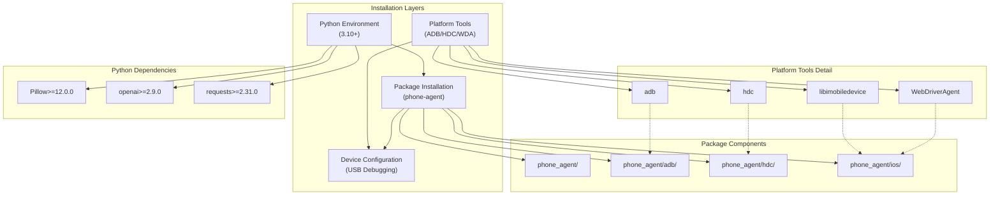

**Installation Dependency Flow**: Platform tools must be installed and accessible in PATH before device configuration. Python environment and package installation can proceed independently but must complete before first usage.

Sources: [README.md:59-132](), [setup.py:1-50]()

---

## Step 1: Platform Tool Installation

### Android - ADB Installation

**Download and Extract:**

1. Download [Android Platform Tools](https://developer.android.com/tools/releases/platform-tools)
2. Extract to a permanent location (e.g., `~/Downloads/platform-tools` or `C:\platform-tools`)

**Configure Environment Variables:**

**macOS/Linux:**

```bash
# Add to ~/.bash_profile or ~/.zshrc
export PATH=${PATH}:~/Downloads/platform-tools

# Apply changes
source ~/.bash_profile  # or source ~/.zshrc
```

**Windows:**

1. Open System Properties → Environment Variables
2. Edit `Path` system variable
3. Add extracted directory path (e.g., `C:\platform-tools`)

**Verify Installation:**

```bash
adb version
# Expected output: Android Debug Bridge version X.X.X
```

Sources: [README.md:68-79](), [README_en.md:59-69]()

### HarmonyOS - HDC Installation

**Download and Extract:**

1. Download [HarmonyOS SDK](https://developer.huawei.com/consumer/en/download)
2. Extract toolchains directory (e.g., `~/Downloads/harmonyos-sdk/toolchains`)

**Configure Environment Variables:**

**macOS/Linux:**

```bash
# Add to ~/.bash_profile or ~/.zshrc
export PATH=${PATH}:~/Downloads/harmonyos-sdk/toolchains

# Apply changes
source ~/.bash_profile
```

**Windows:**

Add HDC directory to system PATH environment variable (similar to ADB process above).

**Verify Installation:**

```bash
hdc version
# Expected output: HDC version information
```

Sources: [README.md:83-95](), [README_en.md:72-84]()

### iOS - WebDriverAgent Setup

iOS device automation requires more extensive setup involving Xcode and WebDriverAgent. This process is documented separately due to its complexity.

**Refer to:** [iOS Environment Setup](#4.3) for complete WebDriverAgent installation and configuration instructions.

Sources: [README.md:117-123](), [README_en.md:105-123]()

---

## Step 2: Python Package Installation

### Install Core Dependencies

The package uses a standard `requirements.txt` and `setup.py` installation flow.

```bash
# Install runtime dependencies
pip install -r requirements.txt

# Install package in editable mode
pip install -e .
```

**Core Dependencies Installed:**

| Package | Version | Purpose |
|---------|---------|---------|
| `Pillow` | >=12.0.0 | Screenshot image processing |
| `openai` | >=2.9.0 | ModelClient API compatibility |
| `requests` | >=2.31.0 | iOS WebDriverAgent communication |

Sources: [requirements.txt:1-6](), [setup.py:32-35]()

### Optional: Model Deployment Dependencies

If you plan to self-host AutoGLM models (see [Self-Hosting Models](#8.2)), install inference engines:

```bash
# Option A: vLLM
pip install vllm>=0.12.0
pip install -U transformers --pre  # Upgrade to 5.0.0rc0

# Option B: SGLang
pip install sglang>=0.5.6.post1
pip install -U transformers --pre
```

**Note:** Transformers dependency conflicts can be ignored as noted in [requirements.txt:10]().

Sources: [requirements.txt:7-14](), [README.md:201-227]()

### Optional: Development Dependencies

For contributors and developers:

```bash
# Install with development extras
pip install -e ".[dev]"
```

This installs additional tools defined in [setup.py:36-43]():
- `pytest>=7.0.0` - Testing framework
- `black>=23.0.0` - Code formatting
- `mypy>=1.0.0` - Type checking
- `ruff>=0.1.0` - Linting

See [Development Environment Setup](#9.2) for more details.

Sources: [setup.py:36-43](), [README.md:667-671]()

---

## Step 3: Device Configuration

### Android Device Setup

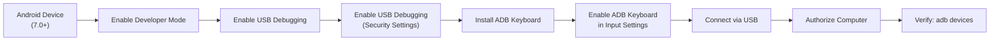

**Step-by-Step Process:**

**1. Enable Developer Mode:**

Navigate to `Settings → About Phone → Build Number` and tap rapidly 10 times until "Developer mode enabled" appears.

**2. Enable USB Debugging:**

Navigate to `Settings → Developer Options → USB Debugging` and toggle it on.

**3. Enable USB Debugging (Security Settings):**

Some devices require an additional permission at `Settings → Developer Options → USB Debugging (Security Settings)`. Enable this to allow tap/swipe actions.

**4. Install ADB Keyboard:**

- Download [ADBKeyboard.apk](https://github.com/senzhk/ADBKeyBoard/blob/master/ADBKeyboard.apk)
- Install on device
- Navigate to `Settings → System → Language & Input → Virtual Keyboard`
- Enable "ADB Keyboard"

Alternatively, enable via command:
```bash
adb shell ime enable com.android.adbkeyboard/.AdbIME
```

**5. Connect and Authorize:**

Connect device via USB cable. A popup appears on the device: "Allow USB debugging?" - tap "Allow".

**6. Verify Connection:**

```bash
adb devices
# Expected output:
# List of devices attached
# ABC123XYZ    device
```

**Troubleshooting:** If device shows as "unauthorized", check the authorization popup on the device. Some devices require a restart after enabling developer options.

Sources: [README.md:98-116](), [README_en.md:86-103](), [phone_agent/adb/device.py:1-10]()

### HarmonyOS Device Setup

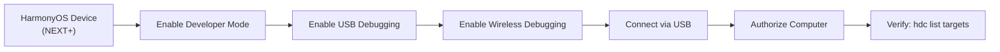

**Process:**

**1-2. Enable Developer Mode and USB Debugging:**

Same process as Android (tap Build Number 10 times, enable in Developer Options).

**3. Enable Wireless Debugging (Optional):**

Navigate to `Settings → System & Updates → Developer Options → Wireless Debugging`. Note the IP address and port if using WiFi connectivity (see [Remote Device Connection](#5.3)).

**4. Verify Connection:**

```bash
hdc list targets
# Expected output:
# 7001005458323933328a01bce01c2500
```

**Key Difference from Android:** HarmonyOS uses native input methods instead of ADB Keyboard, so no additional keyboard installation is required. Text input is handled via [phone_agent/hdc/input.py:1-50]().

Sources: [README.md:96-103](), [README.md:151-163](), [README_en.md:131-143]()

### iOS Device Setup

iOS setup requires Xcode, WebDriverAgent compilation, and device provisioning. This is a multi-step process documented in detail at [iOS Environment Setup](#4.3).

**Prerequisites:**
- macOS with Xcode installed
- Apple Developer account (free or paid)
- iOS device with Developer Mode enabled

Sources: [README.md:117-123](), [docs/ios_setup/ios_setup.md]()

---

## Step 4: Verification

### Verify ADB/HDC Connectivity

**Android:**

```bash
# List connected devices
adb devices

# Test screenshot capability
adb shell screencap -p /sdcard/test.png
adb pull /sdcard/test.png

# Test input capability (if ADB Keyboard installed)
adb shell ime list -s
# Should include: com.android.adbkeyboard/.AdbIME
```

**HarmonyOS:**

```bash
# List connected devices
hdc list targets

# Test shell access
hdc shell "echo test"
```

Sources: [README.md:142-149](), [README.md:158-163]()

### Verify Package Installation

```bash
# Check package is installed
pip list | grep phone-agent
# Expected: phone-agent 0.1.0 (or current version)

# Verify imports work
python -c "from phone_agent import PhoneAgent; print('OK')"
# Expected: OK
```

### Verify Platform Module Loading

The package uses lazy loading for platform-specific modules. Verify the device factory can detect your platform:

```python
from phone_agent.device_factory import DeviceType, DeviceFactory

# Test device type detection
DeviceFactory.set_device_type(DeviceType.ADB)  # or HDC, IOS
print("Device type set successfully")
```

Sources: [phone_agent/__init__.py:1-13](), [phone_agent/device_factory.py:1-50]()

---

## Platform Tool Command Reference

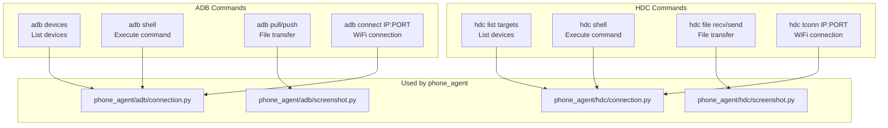

**Common ADB/HDC Operations:**

| Operation | ADB Command | HDC Command | Used By |
|-----------|-------------|-------------|---------|
| List devices | `adb devices` | `hdc list targets` | [connection.py]()|
| Screenshot | `adb shell screencap` | `hdc shell snapshot_display` | [screenshot.py]()|
| Tap screen | `adb shell input tap X Y` | `hdc shell uitest uiInput tap X Y` | [device.py]()|
| Type text | Via ADB Keyboard | `hdc shell uitest uiInput text` | [input.py]()|
| Launch app | `adb shell monkey -p PKG` | `hdc shell aa start -b PKG` | [device.py]()|

Sources: [phone_agent/adb/connection.py:1-100](), [phone_agent/hdc/connection.py:1-100]()

---

## Installation Validation Checklist

Before proceeding to [Quick Start](#2.2), verify:

- [ ] Platform tool (ADB/HDC) installed and in PATH
- [ ] `adb version` or `hdc version` executes successfully
- [ ] Device appears in `adb devices` or `hdc list targets`
- [ ] Python 3.10+ installed
- [ ] `pip install -r requirements.txt` completed without errors
- [ ] `pip install -e .` completed successfully
- [ ] `from phone_agent import PhoneAgent` imports without error
- [ ] (Android only) ADB Keyboard installed and enabled on device
- [ ] Device USB debugging enabled and computer authorized

---

## Common Installation Issues

### Platform Tool Not Found

**Error:** `adb: command not found` or `hdc: command not found`

**Solution:** 
1. Verify extraction path is correct
2. Ensure PATH environment variable is set
3. Restart terminal/command prompt after setting PATH
4. Run `which adb` (Unix) or `where adb` (Windows) to verify PATH

### Device Not Detected

**Error:** `adb devices` shows empty list

**Solution:**
1. Check USB cable supports data transfer (not charging-only)
2. Verify USB debugging is enabled on device
3. Check for authorization popup on device
4. Try `adb kill-server && adb start-server`
5. Some devices require restart after enabling developer options

Sources: [README.md:704-720](), [README_en.md:641-656]()

### Python Package Import Errors

**Error:** `ModuleNotFoundError: No module named 'phone_agent'`

**Solution:**
1. Verify `pip install -e .` completed successfully
2. Check you're using correct Python environment (virtual env if created)
3. Run `pip list` to verify `phone-agent` is installed

### ADB Keyboard Not Working (Android)

**Error:** Text input fails or shows garbled characters

**Solution:**
1. Verify APK is installed: `adb shell pm list packages | grep adbkeyboard`
2. Enable in settings: `Settings → System → Language & Input → Virtual Keyboard`
3. Or via command: `adb shell ime enable com.android.adbkeyboard/.AdbIME`
4. Check current input method: `adb shell ime list -s`

Sources: [README.md:731-735](), [README_en.md:665-670]()

---

## Next Steps

After completing installation:

1. **Quick Start** - Run your first automated task: [Quick Start](#2.2)
2. **Model Setup** - Configure AI model service: [Using Third-Party APIs](#8.1) or [Self-Hosting Models](#8.2)
3. **Device Connection** - Enable WiFi debugging: [Remote Device Connection](#5.3)
4. **Configuration** - Customize agent behavior: [Configuration Basics](#2.3)

Sources: [README.md:294-344](), [README_en.md:234-284]()

---

# Page: Quick Start

# Quick Start

<details>
<summary>Relevant source files</summary>

The following files were used as context for generating this wiki page:

- [README.md](README.md)
- [README_coding_agent.md](README_coding_agent.md)
- [README_en.md](README_en.md)
- [examples/basic_usage.py](examples/basic_usage.py)
- [examples/demo_thinking.py](examples/demo_thinking.py)
- [main.py](main.py)
- [phone_agent/config/prompts.py](phone_agent/config/prompts.py)

</details>


This page walks you through running your first automated phone task with Open-AutoGLM. It assumes you have completed the installation steps described in [Installation](#2.1) and are ready to execute tasks on a connected device.

For detailed configuration options, see [Configuration Basics](#2.3). For advanced Python API usage patterns, see [Python API](#5.2).

---

## Prerequisites Verification

Before executing tasks, the system must verify two critical requirements: device connectivity and model service availability.

### System Requirements Check

The `main.py` CLI automatically runs `check_system_requirements()` to verify:

| Check | Android (ADB) | HarmonyOS (HDC) | iOS |
|-------|--------------|-----------------|-----|
| Tool installed | `adb version` | `hdc -v` | `idevice_id -ln` |
| Device connected | `adb devices` shows device | `hdc list targets` shows device | `idevice_id -l` shows UUID |
| Input method | ADB Keyboard installed | Native input (no check) | WebDriverAgent accessible |

The check runs automatically when you execute `main.py` without special flags. You can trigger it manually:

```bash
# Android device check
python main.py --list-devices

# HarmonyOS device check
python main.py --device-type hdc --list-devices

# iOS device check
python main.py --device-type ios --list-devices
```

**Expected output** for a successful Android check:

```
🔍 Checking system requirements...
--------------------------------------------------
1. Checking ADB installation... ✅ OK (Android Debug Bridge version 1.0.41)
2. Checking connected devices... ✅ OK (1 device(s): emulator-5554)
3. Checking ADB Keyboard... ✅ OK
--------------------------------------------------
✅ All system checks passed!
```

Sources: [main.py:37-269]()

### Model API Verification

The system calls `check_model_api()` to verify connectivity to the model service:

```bash
# Test model endpoint connectivity
python main.py --base-url http://localhost:8000/v1 --model autoglm-phone-9b
```

This sends a minimal chat completion request to verify the endpoint is responsive. For third-party services:

```bash
# Test z.ai endpoint
python main.py --base-url https://api.z.ai/api/paas/v4 \
               --model autoglm-phone-multilingual \
               --apikey your-api-key
```

**Expected output:**

```
🔍 Checking model API...
--------------------------------------------------
1. Checking API connectivity (http://localhost:8000/v1)... ✅ OK
--------------------------------------------------
✅ Model API checks passed!
```

Sources: [main.py:272-352]()

---

## First Task Execution Flow

The following diagram illustrates the complete execution path from command invocation to device action:

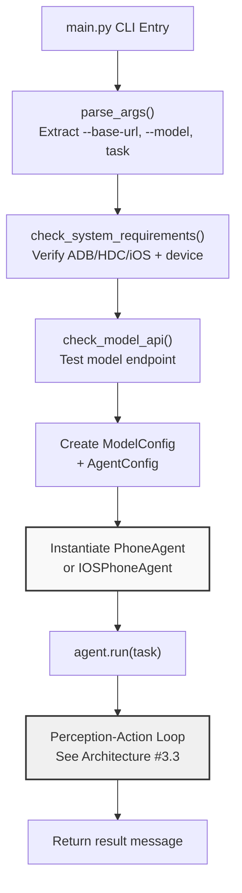

Sources: [main.py:684-798](), [README.md:294-324]()

---

## Command Line Usage

### Basic Command Structure

The `main.py` script accepts tasks in two modes:

**Interactive Mode** (no task argument):
```bash
python main.py --base-url <MODEL_URL> --model <MODEL_NAME>
```

The agent prompts for tasks in a loop until you type `exit`.

**Single Task Mode** (task argument provided):
```bash
python main.py --base-url <MODEL_URL> --model <MODEL_NAME> "Your task description"
```

The agent executes the task once and exits.

Sources: [main.py:1-14](), [main.py:517-522]()

### Platform-Specific Examples

#### Android Device

```bash
# Self-hosted model (local vLLM/SGLang server)
python main.py --base-url http://localhost:8000/v1 \
               --model autoglm-phone-9b \
               "Open Chrome and search for weather"

# Third-party API (z.ai)
python main.py --base-url https://api.z.ai/api/paas/v4 \
               --model autoglm-phone-multilingual \
               --apikey sk-your-api-key \
               "Open Maps and find nearby coffee shops"

# Chinese prompt with ModelScope
python main.py --base-url https://api-inference.modelscope.cn/v1 \
               --model ZhipuAI/AutoGLM-Phone-9B \
               --apikey your-modelscope-key \
               "打开微信发消息给文件传输助手"
```

#### HarmonyOS Device

```bash
# Specify device type as hdc
python main.py --device-type hdc \
               --base-url http://localhost:8000/v1 \
               --model autoglm-phone-9b \
               "打开美团搜索附近的火锅店"
```

#### iOS Device

```bash
# Default WebDriverAgent URL (localhost:8100)
python main.py --device-type ios \
               --base-url http://localhost:8000/v1 \
               --model autoglm-phone-9b-multilingual \
               "Open Safari and search for iPhone tips"

# WiFi connection (custom WDA URL)
python main.py --device-type ios \
               --wda-url http://192.168.1.100:8100 \
               --base-url http://localhost:8000/v1 \
               "Open Photos and show recent images"
```

Sources: [README.md:294-324](), [README_en.md:234-264](), [main.py:355-524]()

### Understanding Verbose Output

When a task executes, the `PhoneAgent` (with `verbose=True` by default in CLI) outputs structured information at each step:

```
==================================================
💭 Thinking Process:
--------------------------------------------------
Currently on system desktop, need to launch Chrome app first
--------------------------------------------------
🎯 Executing Action:
{
  "_metadata": "do",
  "action": "Launch",
  "app": "Chrome"
}
==================================================
```

After action execution:

```
==================================================
💭 Thinking Process:
--------------------------------------------------
Chrome is now open, need to tap the search bar at top
--------------------------------------------------
🎯 Executing Action:
{
  "_metadata": "do",
  "action": "Tap",
  "element": [500, 150]
}
==================================================
```

Upon task completion:

```
🎉 ================================================
✅ Task Completed: Successfully opened Chrome and searched for 'weather'
==================================================
```

This output is controlled by the `AgentConfig.verbose` parameter. See [Configuration Basics](#2.3) for details.

Sources: [README.md:537-575](), [phone_agent/agent.py:1-100]() (inferred structure)

---

## Python API Usage

### Basic Script Structure

The following diagram maps Python API components to their implementation files:

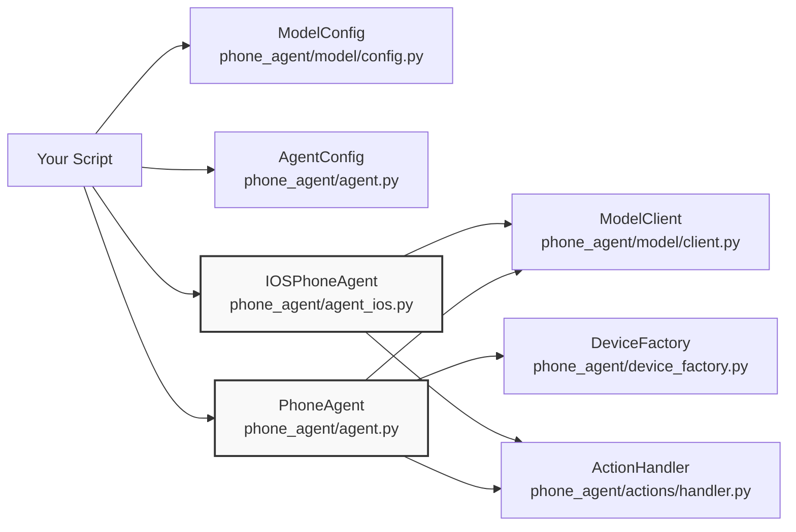

Sources: [examples/basic_usage.py:1-191](), Project structure analysis

### Minimal Example (Android/HarmonyOS)

```python
from phone_agent import PhoneAgent
from phone_agent.model import ModelConfig

# Configure model endpoint
model_config = ModelConfig(
    base_url="http://localhost:8000/v1",
    model_name="autoglm-phone-9b",
)

# Create agent (defaults: max_steps=100, verbose=True, lang="cn")
agent = PhoneAgent(model_config=model_config)

# Execute task
result = agent.run("打开淘宝搜索无线耳机")
print(result)
```

The `PhoneAgent` constructor automatically:
- Detects the device type (ADB or HDC) via `DeviceFactory`
- Selects the appropriate system prompt based on `AgentConfig.lang`
- Initializes the `ModelClient` with the provided `ModelConfig`
- Sets up default `ActionHandler` for action execution

Sources: [examples/basic_usage.py:15-42](), [README.md:326-344]()

### Minimal Example (iOS)

```python
from phone_agent.agent_ios import IOSPhoneAgent
from phone_agent.model import ModelConfig

# Configure model endpoint
model_config = ModelConfig(
    base_url="http://localhost:8000/v1",
    model_name="autoglm-phone-9b-multilingual",
)

# Create iOS agent (defaults: wda_url="http://localhost:8100")
agent = IOSPhoneAgent(model_config=model_config)

# Execute task
result = agent.run("Open Safari and search for iPhone tips")
print(result)
```

The `IOSPhoneAgent` differs from `PhoneAgent` in that it:
- Uses `XCTestConnection` instead of `ADBConnection` or `HDCConnection`
- Communicates via WebDriverAgent HTTP API
- Requires `wda_url` parameter for custom WDA endpoints

Sources: [main.py:27](), [README_en.md:266-284]()

### Configuration Options

Both `ModelConfig` and `AgentConfig` support customization:

```python
from phone_agent import PhoneAgent
from phone_agent.agent import AgentConfig
from phone_agent.model import ModelConfig

# Detailed model configuration
model_config = ModelConfig(
    base_url="http://localhost:8000/v1",
    api_key="your-api-key",           # For third-party services
    model_name="autoglm-phone-9b",
    max_tokens=3000,                  # Maximum response tokens
    temperature=0.1,                  # Sampling temperature
    frequency_penalty=0.2,            # Repetition penalty
)

# Detailed agent configuration
agent_config = AgentConfig(
    max_steps=50,                     # Maximum steps per task
    device_id="192.168.1.100:5555",   # Specific device ID
    lang="en",                        # System prompt language
    verbose=True,                     # Enable detailed output
)

# Create agent with both configs
agent = PhoneAgent(
    model_config=model_config,
    agent_config=agent_config,
)

# Execute task
result = agent.run("Open eBay and search for wireless earphones")
```

For a complete list of configuration parameters, see [Configuration Basics](#2.3).

Sources: [examples/basic_usage.py:15-42](), [README.md:509-535]()

---

## Common First-Run Issues

### Device Not Detected

**Symptom:** System check fails at step 2 (no devices connected)

**Solution:**
```bash
# Restart ADB server
adb kill-server
adb start-server
adb devices

# For HarmonyOS
hdc kill
hdc start
hdc list targets
```

Verify:
- USB debugging is enabled on the device
- USB cable supports data transfer (not charging-only)
- Device authorization popup was approved

Sources: [README.md:704-719]()

### ADB Keyboard Not Installed (Android only)

**Symptom:** System check fails at step 3

**Solution:**
1. Download [ADBKeyboard.apk](https://github.com/senzhk/ADBKeyBoard/blob/master/ADBKeyboard.apk)
2. Install: `adb install ADBKeyboard.apk`
3. Enable in device settings: `Settings > System > Languages & Input > Virtual Keyboard > ADB Keyboard`
4. Or via command: `adb shell ime enable com.android.adbkeyboard/.AdbIME`

Sources: [README.md:108-115](), [main.py:194-228]()

### Model API Connection Failed

**Symptom:** API check fails with connection refused or timeout

**Solution:**
1. Verify the model server is running:
   ```bash
   curl http://localhost:8000/v1/models
   ```
2. Check firewall settings are not blocking the port
3. For remote servers, verify the IP address is correct
4. Test with a simple HTTP request:
   ```bash
   curl -X POST http://localhost:8000/v1/chat/completions \
     -H "Content-Type: application/json" \
     -d '{"model":"autoglm-phone-9b","messages":[{"role":"user","content":"Hi"}],"max_tokens":5}'
   ```

Sources: [README.md:262-272](), [main.py:272-352]()

### WebDriverAgent Not Running (iOS only)

**Symptom:** iOS system check fails at step 3

**Solution:**
1. Open WebDriverAgent project in Xcode
2. Select your iOS device as the target
3. Run the WebDriverAgentRunner scheme (Product > Test or Cmd+U)
4. For USB connections, set up port forwarding:
   ```bash
   iproxy 8100 8100
   ```
5. Verify in browser: open `http://localhost:8100/status`

For detailed iOS setup, see [iOS Setup Guide](#4.3).

Sources: [README_en.md:105-124](), [main.py:234-260]()

---

## Task Execution Patterns

### Understanding the Agent Loop

When you call `agent.run(task)`, the agent enters a perception-action loop that continues until either:
- The task completes successfully (`finish()` action)
- Maximum steps are reached (`max_steps` from `AgentConfig`)
- An unrecoverable error occurs

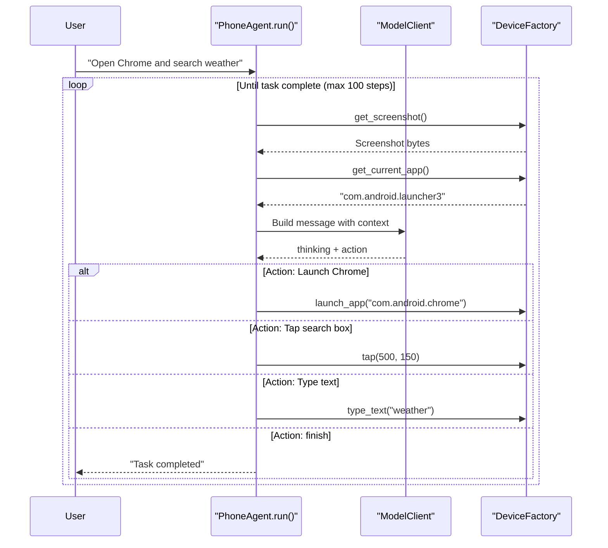

For a detailed breakdown of the perception-action loop, see [Agent Execution Loop](#3.3).

Sources: [phone_agent/agent.py]() (inferred from README descriptions), Diagram 2 from system overview

### Step-by-Step Debugging

For debugging or observing individual steps, use the `step()` method instead of `run()`:

```python
from phone_agent import PhoneAgent
from phone_agent.model import ModelConfig

model_config = ModelConfig(
    base_url="http://localhost:8000/v1",
    model_name="autoglm-phone-9b",
)

agent = PhoneAgent(model_config=model_config)

# Initialize with task
result = agent.step("Open Maps and find nearby coffee shops")
print(f"Step 1: {result.action}")

# Continue step-by-step
while not result.finished and agent.step_count < 10:
    result = agent.step()
    print(f"Step {agent.step_count}: {result.action}")
    print(f"  Thinking: {result.thinking[:100]}...")

print(f"\nFinal result: {result.message}")
```

The `step()` method returns a result object containing:
- `result.action`: The action dictionary executed
- `result.thinking`: The model's reasoning process
- `result.finished`: Boolean indicating task completion
- `result.message`: Final message (if finished)

Sources: [examples/basic_usage.py:73-91]()

---

## Next Steps

After successfully executing your first task, explore:

- **[Configuration Basics](#2.3)**: Customize model parameters, timing settings, and system prompts
- **[Command-Line Interface](#5.1)**: Full reference of CLI arguments and environment variables
- **[Python API](#5.2)**: Advanced usage patterns, callbacks, and multi-task workflows
- **[Action Types Reference](#6.1)**: Complete list of available actions (Launch, Tap, Type, Swipe, etc.)
- **[Remote Device Connection](#5.3)**: Connect to devices over WiFi for wireless debugging

For troubleshooting specific platforms:
- **[Android (ADB)](#4.1)**: Android-specific device setup and debugging
- **[HarmonyOS (HDC)](#4.2)**: HarmonyOS-specific configuration
- **[iOS (WebDriverAgent)](#4.3)**: iOS device pairing and WDA setup

Sources: Table of contents structure

---

# Page: Configuration Basics

# Configuration Basics

<details>
<summary>Relevant source files</summary>

The following files were used as context for generating this wiki page:

- [main.py](main.py)
- [phone_agent/agent.py](phone_agent/agent.py)
- [phone_agent/config/__init__.py](phone_agent/config/__init__.py)

</details>


This page provides an overview of the essential configuration options in Open-AutoGLM. It covers the basic configuration patterns needed to get started with the framework, including environment variables, model settings, and agent behavior options. For detailed configuration management and advanced options, see [Configuration Management](#5.4). For complete reference documentation on specific configuration files, see the [Configuration Reference](#7) section.

## Configuration Architecture

Open-AutoGLM uses a layered configuration system where settings can be specified through multiple sources with a clear precedence order:

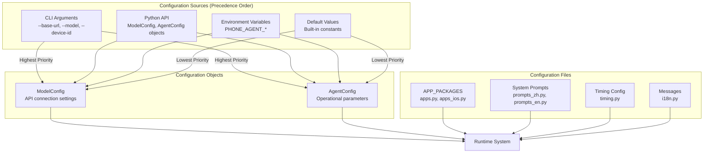

**Sources:** [README.md:476-524](), [phone_agent/config/__init__.py:1-54]()

The configuration system follows this precedence (highest to lowest):
1. **CLI Arguments** - Override all other settings for quick testing
2. **Python API** - Explicit configuration objects in code
3. **Environment Variables** - System-wide defaults
4. **Built-in Defaults** - Fallback values

## Model Configuration

The `ModelConfig` class controls how the agent communicates with the AI model service. This is required for all operations as the model provides the intelligence for screen understanding and action planning.

### ModelConfig Class Structure

| Parameter | Type | Default | Description |
|-----------|------|---------|-------------|
| `base_url` | `str` | `"http://localhost:8000/v1"` | OpenAI-compatible API endpoint |
| `api_key` | `str` | `"EMPTY"` | API key for authentication |
| `model_name` | `str` | `"autoglm-phone-9b"` | Model identifier |
| `max_tokens` | `int` | `3000` | Maximum tokens in model response |
| `temperature` | `float` | `0.1` | Sampling temperature (0.0-1.0) |
| `frequency_penalty` | `float` | `0.2` | Frequency penalty for token generation |

**Sources:** [README.md:498-511]()

### Usage Examples

**Via Environment Variables:**
```bash
export PHONE_AGENT_BASE_URL="https://api.example.com/v1"
export PHONE_AGENT_MODEL="autoglm-phone-9b"
export PHONE_AGENT_API_KEY="sk-xxxxx"

python main.py "打开美团"
```

**Via CLI Arguments:**
```bash
python main.py \
  --base-url "https://api.example.com/v1" \
  --model "autoglm-phone-9b" \
  --apikey "sk-xxxxx" \
  "打开美团"
```

**Via Python API:**
```python
from phone_agent.model import ModelConfig

config = ModelConfig(
    base_url="https://api.example.com/v1",
    api_key="sk-xxxxx",
    model_name="autoglm-phone-9b",
    max_tokens=3000,
    temperature=0.1
)
```

**Sources:** [README.md:317-333](), [README.md:498-511]()

## Agent Configuration

The `AgentConfig` class controls operational behavior of the phone agent, including execution limits, device selection, and output verbosity.

### AgentConfig Class Structure

| Parameter | Type | Default | Description |
|-----------|------|---------|-------------|
| `max_steps` | `int` | `100` | Maximum steps per task execution |
| `device_id` | `Optional[str]` | `None` | Specific device ID (auto-detect if None) |
| `device_type` | `str` | `"adb"` | Device protocol: `"adb"`, `"hdc"`, or `"ios"` |
| `lang` | `str` | `"cn"` | System prompt language: `"cn"` or `"en"` |
| `verbose` | `bool` | `True` | Print detailed execution information |

**Sources:** [README.md:513-524]()

### Usage Examples

**Via Environment Variables:**
```bash
export PHONE_AGENT_MAX_STEPS=50
export PHONE_AGENT_DEVICE_TYPE="hdc"
export PHONE_AGENT_LANG="en"

python main.py "Open Maps"
```

**Via CLI Arguments:**
```bash
# Android device with English prompts
python main.py --lang en --device-type adb "Open Chrome browser"

# HarmonyOS device, specific device ID
python main.py --device-type hdc --device-id "192.168.1.100:5555" "打开抖音"

# iOS device
python main.py --device-type ios "Open Safari"
```

**Via Python API:**
```python
from phone_agent.agent import AgentConfig, PhoneAgent
from phone_agent.model import ModelConfig

agent_config = AgentConfig(
    max_steps=50,
    device_id="192.168.1.100:5555",
    device_type="hdc",
    lang="en",
    verbose=True
)

model_config = ModelConfig(base_url="http://localhost:8000/v1")
agent = PhoneAgent(model_config=model_config, agent_config=agent_config)
```

**Sources:** [README.md:513-524]()

## Environment Variables Reference

All configuration parameters can be set via environment variables with the `PHONE_AGENT_` prefix. This is useful for setting system-wide defaults or for CI/CD environments.

| Variable | Maps To | Default Value | Example |
|----------|---------|---------------|---------|
| `PHONE_AGENT_BASE_URL` | `ModelConfig.base_url` | `http://localhost:8000/v1` | `https://api.z.ai/v1` |
| `PHONE_AGENT_MODEL` | `ModelConfig.model_name` | `autoglm-phone-9b` | `autoglm-phone` |
| `PHONE_AGENT_API_KEY` | `ModelConfig.api_key` | `EMPTY` | `sk-abc123` |
| `PHONE_AGENT_MAX_STEPS` | `AgentConfig.max_steps` | `100` | `50` |
| `PHONE_AGENT_DEVICE_ID` | `AgentConfig.device_id` | (auto-detect) | `emulator-5554` |
| `PHONE_AGENT_DEVICE_TYPE` | `AgentConfig.device_type` | `adb` | `hdc`, `ios` |
| `PHONE_AGENT_LANG` | `AgentConfig.lang` | `cn` | `en` |

**Sources:** [README.md:486-496]()

### Setting Environment Variables

**Linux/macOS:**
```bash
# Temporary (current session only)
export PHONE_AGENT_BASE_URL="https://api.example.com/v1"
export PHONE_AGENT_MODEL="autoglm-phone-9b"

# Permanent (add to ~/.bashrc or ~/.zshrc)
echo 'export PHONE_AGENT_BASE_URL="https://api.example.com/v1"' >> ~/.bashrc
```

**Windows (Command Prompt):**
```cmd
# Temporary
set PHONE_AGENT_BASE_URL=https://api.example.com/v1
set PHONE_AGENT_MODEL=autoglm-phone-9b

# Permanent (System Properties > Environment Variables)
setx PHONE_AGENT_BASE_URL "https://api.example.com/v1"
```

**Windows (PowerShell):**
```powershell
# Temporary
$env:PHONE_AGENT_BASE_URL = "https://api.example.com/v1"
$env:PHONE_AGENT_MODEL = "autoglm-phone-9b"

# Permanent
[System.Environment]::SetEnvironmentVariable("PHONE_AGENT_BASE_URL", "https://api.example.com/v1", "User")
```

**Sources:** [README.md:486-496]()

## Configuration Files Overview

Open-AutoGLM includes several configuration files that define supported applications, system prompts, timing parameters, and localized messages. These files are typically not modified during normal usage but can be customized for specific needs.

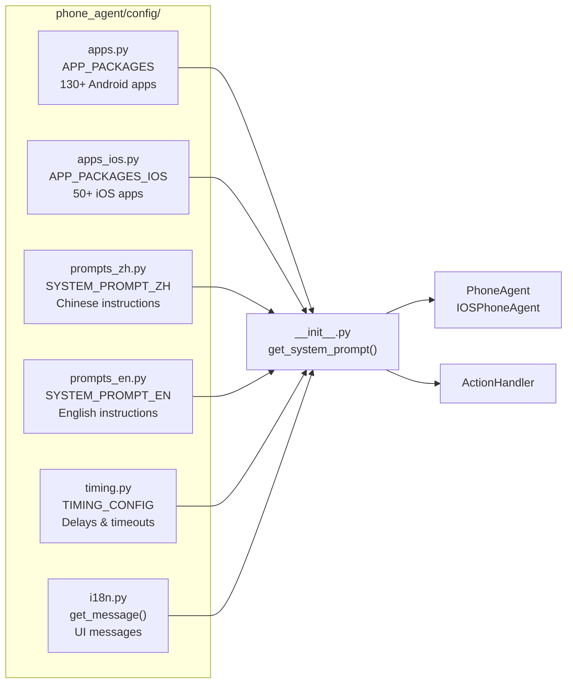

**Sources:** [phone_agent/config/__init__.py:1-54]()

### Configuration File Purposes

| File | Purpose | Typical Usage | Reference |
|------|---------|---------------|-----------|
| `apps.py` | Maps app names to Android/HarmonyOS package IDs | Auto-loaded by agent | [Application Packages](#7.1) |
| `apps_ios.py` | Maps app names to iOS bundle IDs | Auto-loaded by iOS agent | [Application Packages](#7.1) |
| `prompts_zh.py` | Chinese system prompt template | Selected via `--lang cn` | [System Prompts](#7.2) |
| `prompts_en.py` | English system prompt template | Selected via `--lang en` | [System Prompts](#7.2) |
| `timing.py` | Action delays, connection timeouts | Auto-loaded, customizable | [Timing Configuration](#7.3) |
| `i18n.py` | Localized UI messages | Auto-loaded based on `lang` | [System Prompts](#7.2) |

**Sources:** [phone_agent/config/__init__.py:3-16]()

### Accessing Configuration Files

The configuration module provides convenient access functions:

```python
from phone_agent.config import (
    APP_PACKAGES,           # Android/HarmonyOS app mappings
    APP_PACKAGES_IOS,       # iOS app mappings
    get_system_prompt,      # Get prompt by language
    TIMING_CONFIG,          # Timing parameters
    get_message,            # Get localized message
)

# Get system prompt for specific language
prompt_cn = get_system_prompt("cn")
prompt_en = get_system_prompt("en")

# Access app package mappings
wechat_package = APP_PACKAGES.get("微信")  # Returns package ID
safari_bundle = APP_PACKAGES_IOS.get("Safari")  # Returns bundle ID

# Access timing config
action_delay = TIMING_CONFIG.action.tap_delay
```

**Sources:** [phone_agent/config/__init__.py:19-53]()

## Configuration Flow Diagram

This diagram shows how configuration flows from user input through the system to the runtime components:

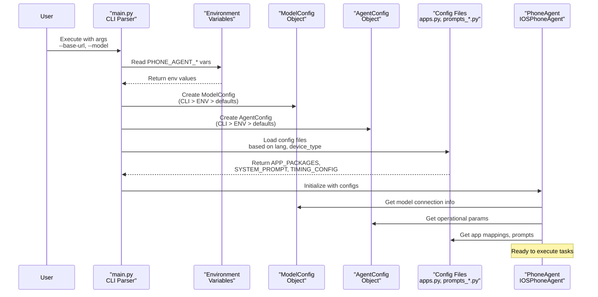

**Sources:** [README.md:476-524](), [phone_agent/config/__init__.py:1-54]()

## Practical Configuration Scenarios

### Scenario 1: Using Third-Party API Service

When using a hosted model service like z.ai or ModelScope:

```bash
# Set via environment for persistent use
export PHONE_AGENT_BASE_URL="https://api.z.ai/v1"
export PHONE_AGENT_API_KEY="sk-your-api-key-here"
export PHONE_AGENT_MODEL="autoglm-phone-9b"

# Now all commands use these settings
python main.py "打开美团"
python main.py "搜索附近的咖啡店"
```

**Sources:** [README.md:158-184]()

### Scenario 2: Self-Hosted Model

When running a local model service:

```bash
# Start model service first (in separate terminal)
python3 -m vllm.entrypoints.openai.api_server \
  --model zai-org/AutoGLM-Phone-9B \
  --port 8000

# Configure agent to use local service
export PHONE_AGENT_BASE_URL="http://localhost:8000/v1"
export PHONE_AGENT_MODEL="autoglm-phone-9b"
export PHONE_AGENT_API_KEY="EMPTY"

python main.py "打开美团"
```

**Sources:** [README.md:186-250]()

### Scenario 3: Multi-Device Setup

When working with multiple devices connected:

```bash
# List available devices
adb devices
# Output:
# emulator-5554    device
# 192.168.1.100:5555    device

# Specify device via CLI
python main.py --device-id "emulator-5554" "打开微信"

# Or set via environment
export PHONE_AGENT_DEVICE_ID="192.168.1.100:5555"
python main.py "打开抖音"
```

**Sources:** [README.md:374-406]()

### Scenario 4: HarmonyOS Device

When using a HarmonyOS device instead of Android:

```bash
# Set device type
export PHONE_AGENT_DEVICE_TYPE="hdc"
export PHONE_AGENT_BASE_URL="http://localhost:8000/v1"

# Verify HDC connection
hdc list targets

# Run agent
python main.py "打开美团"
```

**Sources:** [README.md:287-313]()

### Scenario 5: iOS Device

When using an iOS device with WebDriverAgent:

```bash
# Set device type to iOS
export PHONE_AGENT_DEVICE_TYPE="ios"
export PHONE_AGENT_BASE_URL="http://localhost:8000/v1"
export PHONE_AGENT_LANG="en"

# Run agent
python main.py "Open Safari and search for coffee shops"
```

**Sources:** [README.md:106-112]()

## Configuration Best Practices

### 1. Environment Variables for Defaults

Set frequently used values as environment variables:

```bash
# Add to ~/.bashrc or ~/.zshrc
export PHONE_AGENT_BASE_URL="https://api.example.com/v1"
export PHONE_AGENT_API_KEY="sk-your-key"
export PHONE_AGENT_MODEL="autoglm-phone-9b"
export PHONE_AGENT_LANG="cn"
```

This allows commands like `python main.py "任务描述"` without repeating configuration.

### 2. CLI Overrides for Testing

Use CLI arguments to temporarily override defaults during testing:

```bash
# Test with different model
python main.py --model "autoglm-phone-9b-multilingual" "Open Chrome"

# Test with verbose output disabled
python main.py --no-verbose "打开微信"
```

### 3. Python API for Programmatic Control

Use explicit configuration objects when embedding in Python applications:

```python
from phone_agent import PhoneAgent
from phone_agent.model import ModelConfig
from phone_agent.agent import AgentConfig

# Explicit configuration - no environment dependencies
model_config = ModelConfig(
    base_url="https://api.example.com/v1",
    api_key="sk-key-from-secrets-manager",
    model_name="autoglm-phone-9b"
)

agent_config = AgentConfig(
    max_steps=50,
    verbose=False  # Reduce output in production
)

agent = PhoneAgent(
    model_config=model_config,
    agent_config=agent_config
)
```

### 4. Separate Configurations per Environment

Use different configuration sets for development, testing, and production:

```bash
# dev.env
PHONE_AGENT_BASE_URL=http://localhost:8000/v1
PHONE_AGENT_VERBOSE=true
PHONE_AGENT_MAX_STEPS=100

# production.env
PHONE_AGENT_BASE_URL=https://api.production.com/v1
PHONE_AGENT_API_KEY=sk-prod-key
PHONE_AGENT_VERBOSE=false
PHONE_AGENT_MAX_STEPS=50

# Load specific environment
source dev.env && python main.py "test task"
```

**Sources:** [README.md:476-524]()

## Next Steps

- For detailed configuration management including callbacks and advanced options, see [Configuration Management](#5.4)
- For complete reference on application package mappings, see [Application Packages](#7.1)
- For customizing system prompts and AI behavior, see [System Prompts](#7.2)
- For timing and delay configuration, see [Timing Configuration](#7.3)
- For model deployment options, see [Model Deployment](#8)

---

# Page: Architecture

# Architecture

<details>
<summary>Relevant source files</summary>

The following files were used as context for generating this wiki page:

- [README_coding_agent.md](README_coding_agent.md)
- [README_en.md](README_en.md)
- [phone_agent/agent.py](phone_agent/agent.py)
- [phone_agent/device_factory.py](phone_agent/device_factory.py)

</details>


This document describes the high-level architecture of Open-AutoGLM, a multi-platform mobile automation framework powered by vision-language models. It covers the system's layered design, core components, data flow patterns, and abstraction mechanisms that enable cross-platform device control.

For detailed implementation of specific subsystems, see [System Overview](#3.1), [Core Components](#3.2), [Agent Execution Loop](#3.3), [AI Model Integration](#3.4), and [Device Communication Layer](#3.5).

For practical usage information, see [Getting Started](#2) and [User Guide](#5).

## System Layers

Open-AutoGLM is organized into five distinct architectural layers, each with specific responsibilities:

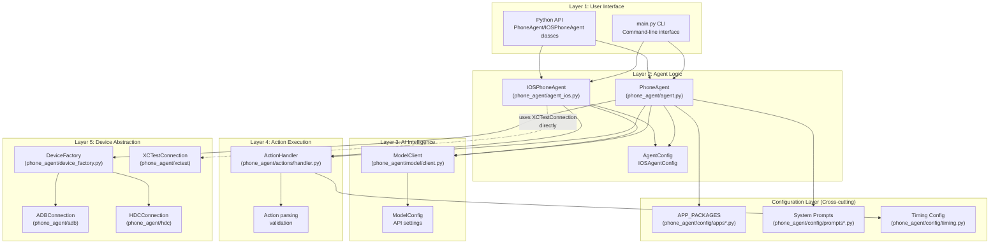

**Sources:** [main.py:1-854](), [phone_agent/agent.py](), [phone_agent/agent_ios.py](), [phone_agent/model/client.py](), [phone_agent/actions/handler.py](), [phone_agent/device_factory.py]()

### Layer Responsibilities

| Layer | Components | Responsibilities |
|-------|-----------|------------------|
| **User Interface** | `main.py`, Python API | Command parsing, interactive mode, system checks |
| **Agent Logic** | `PhoneAgent`, `IOSPhoneAgent`, configs | Task orchestration, message management, callback handling |
| **AI Intelligence** | `ModelClient`, `ModelConfig` | OpenAI-compatible API communication, response parsing |
| **Action Execution** | `ActionHandler` | Action validation, coordinate transformation, device operation dispatch |
| **Device Abstraction** | `DeviceFactory`, connection classes | Platform-specific device control, screenshot capture, input methods |
| **Configuration** | `APP_PACKAGES`, prompts, timing | Application mappings, system prompts, operational parameters |

**Sources:** [main.py:1-854](), [phone_agent/agent.py](), [phone_agent/actions/handler.py](), [phone_agent/device_factory.py]()

## Core Component Interaction

The following diagram shows how the primary code entities interact during task execution:

```mermaid
sequenceDiagram
    participant User
    participant main["main.py"]
    participant PA["PhoneAgent<br/>(agent.py)"]
    participant MC["ModelClient<br/>(model/client.py)"]
    participant AH["ActionHandler<br/>(actions/handler.py)"]
    participant DF["DeviceFactory<br/>(device_factory.py)"]
    participant Device["Device Module<br/>(adb/hdc/xctest)"]
    
    User->>main: python main.py "task"
    main->>main: parse_args()
    main->>main: check_system_requirements()
    main->>main: check_model_api()
    
    main->>PA: PhoneAgent(model_config, agent_config)
    main->>PA: run(task)
    
    loop "max_steps iterations"
        PA->>DF: capture_screenshot()
        DF->>Device: screenshot command
        Device-->>DF: image bytes
        DF-->>PA: screenshot image
        
        PA->>PA: _build_messages(screenshot)
        PA->>MC: request(messages)
        MC->>MC: _prepare_request()
        MC-->>PA: ModelResponse(thinking, action)
        
        PA->>PA: _parse_action(response)
        PA->>AH: execute(action, screen_size, device_id)
        
        alt "Normal Action"
            AH->>DF: device operation
            DF->>Device: adb/hdc/wda command
            Device-->>DF: result
            DF-->>AH: execution result
        else "Sensitive Action"
            AH->>User: confirmation_callback()
            User-->>AH: approval
        else "Take_over Action"
            AH->>User: takeover_callback()
            User-->>AH: completion signal
        end
        
        AH-->>PA: ActionResult
        
        alt "Task Complete"
            PA-->>main: success message
        else "Max Steps"
            PA-->>main: max steps reached
        end
    end
    
    main-->>User: display result
```

**Sources:** [main.py:684-853](), [phone_agent/agent.py](), [phone_agent/model/client.py](), [phone_agent/actions/handler.py](), [phone_agent/device_factory.py]()

## Device Factory Pattern

Open-AutoGLM uses the Factory pattern to abstract device-specific implementations behind a unified interface. This enables the same agent logic to control Android, HarmonyOS, and iOS devices.

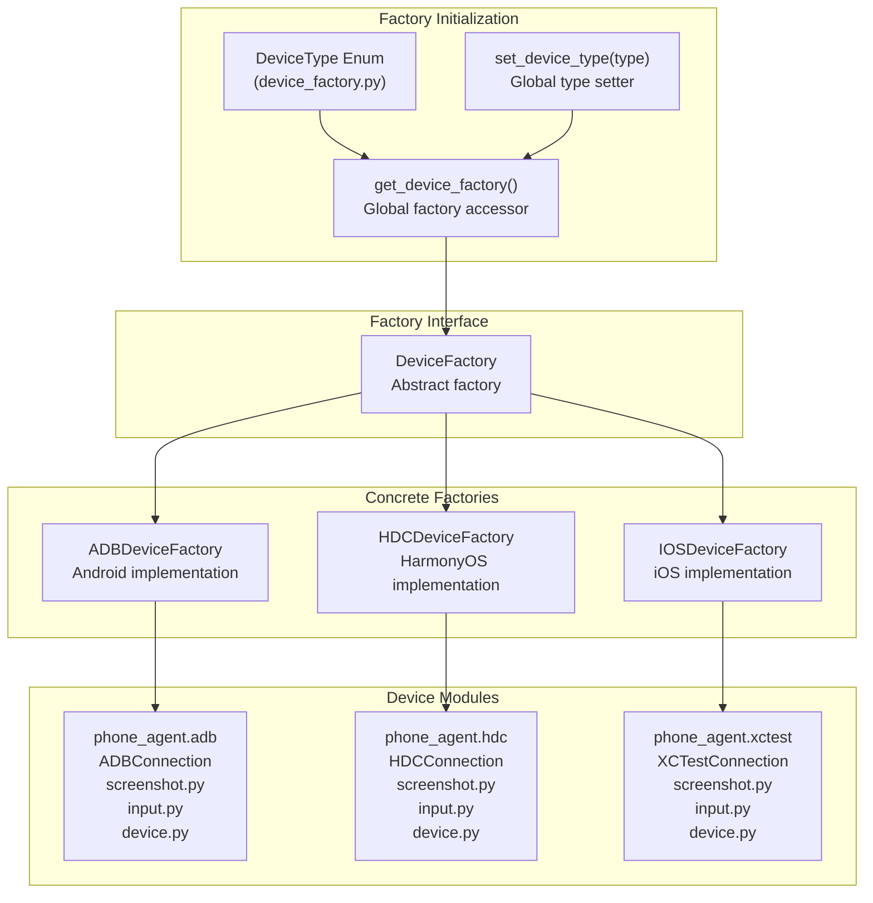

**Sources:** [phone_agent/device_factory.py](), [phone_agent/adb/__init__.py](), [phone_agent/hdc/__init__.py](), [phone_agent/xctest/__init__.py]()

### Factory Methods

Each factory implementation provides standardized methods:

| Method | Return Type | Purpose |
|--------|-------------|---------|
| `get_connection_class()` | `Type[Connection]` | Returns connection class for device type |
| `list_devices()` | `List[DeviceInfo]` | Enumerates connected devices |
| `capture_screenshot(device_id)` | `bytes` | Captures device screen |
| `get_screen_size(device_id)` | `Tuple[int, int]` | Returns screen dimensions |
| `get_current_app(device_id)` | `str` | Gets foreground app package/bundle ID |
| `launch_app(app_name, device_id)` | `bool` | Launches application |
| `tap(x, y, device_id)` | `bool` | Performs tap at coordinates |
| `swipe(start, end, duration, device_id)` | `bool` | Performs swipe gesture |
| `type_text(text, device_id)` | `bool` | Inputs text |
| `press_back(device_id)` | `bool` | Presses back button |
| `press_home(device_id)` | `bool` | Returns to home screen |

**Sources:** [phone_agent/device_factory.py]()

## Agent Configuration Architecture

Configuration flows from multiple sources into structured configuration objects:

```mermaid
graph LR
    subgraph "Configuration Sources"
        ENV["Environment Variables<br/>PHONE_AGENT_*"]
        CLI["CLI Arguments<br/>(main.py argparse)"]
        DEFAULTS["Default Values<br/>(hardcoded)"]
    end
    
    subgraph "Configuration Objects"
        MC["ModelConfig<br/>(model/client.py)<br/>- base_url<br/>- model_name<br/>- api_key<br/>- max_tokens<br/>- temperature"]
        AC["AgentConfig<br/>(agent.py)<br/>- max_steps<br/>- device_id<br/>- lang<br/>- verbose"]
        IAC["IOSAgentConfig<br/>(agent_ios.py)<br/>- wda_url<br/>- device_id"]
    end
    
    subgraph "Runtime Components"
        PA["PhoneAgent<br/>IOSPhoneAgent"]
        MCL["ModelClient"]
        AH["ActionHandler"]
    end
    
    ENV --> MC
    ENV --> AC
    CLI --> MC
    CLI --> AC
    CLI --> IAC
    DEFAULTS --> MC
    DEFAULTS --> AC
    
    MC --> MCL
    AC --> PA
    IAC --> PA
    MCL --> PA
    PA --> AH
```

**Sources:** [main.py:355-524](), [phone_agent/model/client.py](), [phone_agent/agent.py](), [phone_agent/agent_ios.py]()

### Configuration Precedence

Configuration values are resolved in the following order (highest to lowest priority):

1. CLI arguments (e.g., `--base-url`, `--model`)
2. Environment variables (e.g., `PHONE_AGENT_BASE_URL`)
3. Default values in code

**Sources:** [main.py:405-524]()

## Data Flow: Screenshot to Action

The core automation loop transforms visual observations into device actions:

```mermaid
graph TB
    subgraph "Observation Phase"
        SS["Screenshot Capture<br/>(device_factory.py)"]
        ENC["Base64 Encoding<br/>(agent.py)"]
        APP["Get Current App<br/>(device_factory.py)"]
        SIZE["Get Screen Size<br/>(device_factory.py)"]
    end
    
    subgraph "Context Building"
        MSG["Message Construction<br/>(agent.py _build_messages)"]
        HIST["Message History<br/>(agent.py messages list)"]
        PROMPT["System Prompt<br/>(config/prompts_*.py)"]
    end
    
    subgraph "AI Decision"
        REQ["API Request<br/>(model/client.py)"]
        RESP["Model Response<br/>thinking + action"]
        PARSE["Parse Action<br/>(agent.py _parse_action)"]
    end
    
    subgraph "Action Execution"
        VAL["Validate Action<br/>(actions/handler.py)"]
        TRANS["Transform Coordinates<br/>(actions/handler.py)"]
        EXEC["Execute on Device<br/>(device_factory.py)"]
    end
    
    SS --> ENC
    APP --> MSG
    SIZE --> MSG
    ENC --> MSG
    MSG --> HIST
    PROMPT --> MSG
    HIST --> REQ
    
    REQ --> RESP
    RESP --> PARSE
    PARSE --> VAL
    VAL --> TRANS
    TRANS --> EXEC
```

**Sources:** [phone_agent/agent.py](), [phone_agent/model/client.py](), [phone_agent/actions/handler.py](), [phone_agent/device_factory.py]()

## Platform-Specific Implementation Details

Each platform has distinct implementation characteristics:

### Android (ADB)

```mermaid
graph LR
    subgraph "ADB Module (phone_agent/adb)"
        CONN["connection.py<br/>ADBConnection"]
        SS["screenshot.py<br/>capture_screenshot()"]
        INPUT["input.py<br/>ADB Keyboard integration"]
        DEV["device.py<br/>tap, swipe, launch_app"]
    end
    
    subgraph "ADB Commands"
        SHELL["adb shell"]
        SCREENCAP["screencap -p"]
        MONKEY["monkey -p package"]
        IME["ime set/enable"]
    end
    
    CONN --> SHELL
    SS --> SCREENCAP
    INPUT --> IME
    DEV --> MONKEY
    DEV --> SHELL
```

**Key characteristics:**
- Uses `adb shell` for command execution
- Requires ADB Keyboard app for text input [phone_agent/adb/input.py]()
- Screenshot via `screencap -p` command [phone_agent/adb/screenshot.py]()
- Supports USB and WiFi connections [phone_agent/adb/connection.py]()

**Sources:** [phone_agent/adb/]()

### HarmonyOS (HDC)

```mermaid
graph LR
    subgraph "HDC Module (phone_agent/hdc)"
        CONN["connection.py<br/>HDCConnection"]
        SS["screenshot.py<br/>capture_screenshot()"]
        INPUT["input.py<br/>Native input"]
        DEV["device.py<br/>uitest commands"]
    end
    
    subgraph "HDC Commands"
        SHELL["hdc shell"]
        SNAP["snapshot_display -f"]
        UITEST["uitest uiInput<br/>click, inputText"]
        AA["aa start"]
    end
    
    CONN --> SHELL
    SS --> SNAP
    INPUT --> UITEST
    DEV --> UITEST
    DEV --> AA
```

**Key characteristics:**
- Uses `hdc shell` for command execution
- Native input via `uitest uiInput` (no keyboard app needed) [phone_agent/hdc/input.py]()
- Screenshot via `snapshot_display` command [phone_agent/hdc/screenshot.py]()
- App launch via `aa start` (Ability Manager) [phone_agent/hdc/device.py]()

**Sources:** [phone_agent/hdc/]()

### iOS (WebDriverAgent)

```mermaid
graph LR
    subgraph "XCTest Module (phone_agent/xctest)"
        CONN["connection.py<br/>XCTestConnection"]
        SS["screenshot.py<br/>GET /screenshot"]
        INPUT["input.py<br/>POST /keys"]
        DEV["device.py<br/>WebDriver protocol"]
    end
    
    subgraph "WDA API Endpoints"
        STATUS["/status"]
        SCREENSHOT["/screenshot"]
        TAP["/wda/tap"]
        KEYS["/wda/keys"]
        LAUNCH["/wda/apps/launch"]
    end
    
    CONN --> STATUS
    SS --> SCREENSHOT
    INPUT --> KEYS
    DEV --> TAP
    DEV --> LAUNCH
```

**Key characteristics:**
- Uses WebDriverAgent HTTP API (WebDriver protocol) [phone_agent/xctest/connection.py]()
- No external keyboard app needed (native iOS input) [phone_agent/xctest/input.py]()
- Screenshot via HTTP GET endpoint [phone_agent/xctest/screenshot.py]()
- Requires WebDriverAgent running on device [docs/ios_setup/]()

**Sources:** [phone_agent/xctest/](), [docs/ios_setup/ios_setup.md]()

## Action Handling Pipeline

The `ActionHandler` validates and executes actions through a multi-stage pipeline:

```mermaid
graph TB
    INPUT["Action JSON<br/>from Model"]
    
    PARSE["Parse JSON<br/>(actions/handler.py)"]
    VALIDATE["Validate Action Type<br/>Check required fields"]
    
    CLASSIFY{"Action Type?"}
    
    LAUNCH["Launch Action<br/>- Get package ID<br/>- Call launch_app()"]
    TAP["Tap Action<br/>- Transform coordinates<br/>- Call tap()"]
    TYPE["Type Action<br/>- Switch to input method<br/>- Call type_text()"]
    SWIPE["Swipe Action<br/>- Transform coordinates<br/>- Call swipe()"]
    NAV["Navigation Action<br/>- Back/Home<br/>- Call press_*()"]
    TAKEOVER["Take_over Action<br/>- Invoke callback<br/>- Wait for user"]
    
    COORD_TRANS["Coordinate Transformation<br/>(actions/handler.py)<br/>Scale to screen dimensions"]
    
    CONFIRM{"Sensitive<br/>Action?"}
    CALLBACK["confirmation_callback()<br/>Request user approval"]
    
    EXECUTE["Execute on Device<br/>(device_factory.py)"]
    
    INPUT --> PARSE
    PARSE --> VALIDATE
    VALIDATE --> CLASSIFY
    
    CLASSIFY -->|"Launch"| LAUNCH
    CLASSIFY -->|"Tap"| TAP
    CLASSIFY -->|"Type"| TYPE
    CLASSIFY -->|"Swipe"| SWIPE
    CLASSIFY -->|"Back/Home"| NAV
    CLASSIFY -->|"Take_over"| TAKEOVER
    
    LAUNCH --> CONFIRM
    TAP --> COORD_TRANS
    TYPE --> EXECUTE
    SWIPE --> COORD_TRANS
    NAV --> EXECUTE
    
    COORD_TRANS --> CONFIRM
    CONFIRM -->|"Yes"| CALLBACK
    CONFIRM -->|"No"| EXECUTE
    CALLBACK -->|"Approved"| EXECUTE
    CALLBACK -->|"Denied"| INPUT
    
    TAKEOVER --> CALLBACK
```

**Sources:** [phone_agent/actions/handler.py]()

### Coordinate Transformation

The model outputs coordinates in normalized space, which `ActionHandler` transforms to device-specific pixel coordinates:

```python
# Normalized coordinates (0-1000 range) from model
model_x, model_y = action["element"]

# Transform to actual screen pixels
screen_width, screen_height = get_screen_size()
actual_x = int((model_x / 1000.0) * screen_width)
actual_y = int((model_y / 1000.0) * screen_height)
```

**Sources:** [phone_agent/actions/handler.py]()

## Application Package Resolution

The system maintains platform-specific application mappings:

```mermaid
graph TB
    subgraph "App Name Resolution"
        INPUT["App Name<br/>(from model/user)"]
        DETECT["Detect Platform<br/>(device_factory.py)"]
        
        ANDROID["APP_PACKAGES<br/>(config/apps.py)<br/>130+ Android apps"]
        HARMONY["APP_PACKAGES_HARMONYOS<br/>(config/apps_harmonyos.py)<br/>60+ HarmonyOS apps"]
        IOS["APP_PACKAGES_IOS<br/>(config/apps_ios.py)<br/>50+ iOS apps"]
        
        RESOLVE["Resolve to Package ID<br/>actions/handler.py"]
        LAUNCH["Launch Application<br/>device_factory.py"]
    end
    
    INPUT --> DETECT
    DETECT -->|"ADB"| ANDROID
    DETECT -->|"HDC"| HARMONY
    DETECT -->|"IOS"| IOS
    
    ANDROID --> RESOLVE
    HARMONY --> RESOLVE
    IOS --> RESOLVE
    
    RESOLVE --> LAUNCH
```

**Example mappings:**

| App Name | Android Package | HarmonyOS Bundle | iOS Bundle ID |
|----------|----------------|------------------|---------------|
| 微信 (WeChat) | `com.tencent.mm` | `com.tencent.wechat` | `com.tencent.xin` |
| 淘宝 (Taobao) | `com.taobao.taobao` | `com.taobao.taobao` | `com.taobao.taobao4iphone` |
| 抖音 (Douyin) | `com.ss.android.ugc.aweme` | `com.ss.android.ugc.aweme` | `com.ss.iphone.ugc.Aweme` |

**Sources:** [phone_agent/config/apps.py](), [phone_agent/config/apps_harmonyos.py](), [phone_agent/config/apps_ios.py](), [phone_agent/actions/handler.py]()

## System Prompt Architecture

System prompts guide the model's behavior and are language-specific:

```mermaid
graph LR
    subgraph "Prompt Selection"
        LANG["Language Parameter<br/>(--lang cn/en)"]
        
        CN["prompts_zh.py<br/>Chinese prompts<br/>- SYSTEM_PROMPT_ZH<br/>- APP_GUIDELINES_ZH"]
        EN["prompts_en.py<br/>English prompts<br/>- SYSTEM_PROMPT_EN<br/>- APP_GUIDELINES_EN"]
    end
    
    subgraph "Prompt Components"
        SYS["System Instruction<br/>Role, capabilities, output format"]
        APP["App-Specific Guidelines<br/>Known app behaviors"]
        CONST["Constraints<br/>Safety, sensitive actions"]
    end
    
    subgraph "Message Construction"
        MSGS["Messages List<br/>(agent.py)"]
        FIRST["First Message:<br/>System Prompt"]
        CONTEXT["Subsequent Messages:<br/>Screenshot + Context"]
    end
    
    LANG -->|"cn"| CN
    LANG -->|"en"| EN
    
    CN --> SYS
    EN --> SYS
    SYS --> APP
    APP --> CONST
    
    CONST --> FIRST
    FIRST --> MSGS
    MSGS --> CONTEXT
```

**Sources:** [phone_agent/config/prompts_zh.py](), [phone_agent/config/prompts_en.py](), [phone_agent/agent.py]()

## Model Integration Architecture

Open-AutoGLM uses OpenAI-compatible APIs for model interaction:

```mermaid
graph TB
    subgraph "Model Configuration"
        MC["ModelConfig<br/>- base_url<br/>- model_name<br/>- api_key<br/>- max_tokens<br/>- temperature"]
    end
    
    subgraph "Client Implementation"
        MCL["ModelClient<br/>(model/client.py)"]
        OPENAI["OpenAI SDK<br/>openai.OpenAI"]
    end
    
    subgraph "Deployment Options"
        CLOUD["Third-Party APIs<br/>- BigModel<br/>- ModelScope"]
        SELFHOST["Self-Hosted<br/>- vLLM server<br/>- SGLang server"]
    end
    
    subgraph "Request Processing"
        PREP["_prepare_request()<br/>Format messages<br/>Handle images"]
        SEND["chat.completions.create()<br/>POST /v1/chat/completions"]
        PARSE["_parse_response()<br/>Extract thinking + action"]
    end
    
    MC --> MCL
    MCL --> OPENAI
    
    OPENAI --> CLOUD
    OPENAI --> SELFHOST
    
    MCL --> PREP
    PREP --> SEND
    SEND --> PARSE
```

**API Request Format:**
```json
{
  "model": "autoglm-phone-9b",
  "messages": [
    {"role": "system", "content": "..."},
    {
      "role": "user",
      "content": [
        {"type": "text", "text": "Current app: com.example"},
        {"type": "image_url", "image_url": {"url": "data:image/jpeg;base64,..."}}
      ]
    }
  ],
  "max_tokens": 3000,
  "temperature": 0.1
}
```

**Sources:** [phone_agent/model/client.py](), [main.py:272-352]()

## Error Handling and Callbacks

The agent provides extension points for custom behavior:

| Callback | Signature | Purpose | Invoked By |
|----------|-----------|---------|------------|
| `confirmation_callback` | `(message: str) -> bool` | User approval for sensitive actions | `ActionHandler` |
| `takeover_callback` | `(message: str) -> None` | Manual intervention request | `ActionHandler` |

**Default Implementations:**
- `confirmation_callback`: CLI prompt with "yes/no" input [phone_agent/agent.py]()
- `takeover_callback`: CLI prompt to wait for user completion [phone_agent/agent.py]()

**Custom Implementation Example:**
```python
def custom_confirm(message: str) -> bool:
    # Custom logic (e.g., GUI dialog, logging)
    return user_approval

agent = PhoneAgent(
    confirmation_callback=custom_confirm,
    takeover_callback=custom_takeover
)
```

**Sources:** [phone_agent/agent.py](), [phone_agent/actions/handler.py](), [examples/basic_usage.py]()

## Threading and Concurrency

Open-AutoGLM follows a synchronous, single-threaded execution model:

- **No Concurrent Operations**: Each task executes sequentially in the main thread
- **Blocking API Calls**: Model requests block until response received
- **Sequential Device Commands**: Device operations execute one at a time
- **Stateful Message History**: Maintains conversation context across steps

This design prioritizes simplicity and predictability over throughput, suitable for interactive automation scenarios.

**Sources:** [phone_agent/agent.py](), [phone_agent/model/client.py]()

---

# Page: System Overview

# System Overview

<details>
<summary>Relevant source files</summary>

The following files were used as context for generating this wiki page:

- [README.md](README.md)
- [README_coding_agent.md](README_coding_agent.md)
- [README_en.md](README_en.md)
- [main.py](main.py)
- [phone_agent/agent.py](phone_agent/agent.py)

</details>


## Purpose and Scope

This document provides a high-level architectural overview of the Open-AutoGLM Phone Agent system, describing the major components, their interactions, and the overall system design. It serves as a conceptual map for understanding how natural language commands are transformed into device actions through multiple processing layers.

For detailed information about specific components, see:
- Core component implementations: [Core Components](#3.2)
- Execution loop mechanics: [Agent Execution Loop](#3.3)
- AI model integration details: [AI Model Integration](#3.4)
- Device communication protocols: [Device Communication Layer](#3.5)

For usage instructions and practical examples, see:
- Command-line usage: [Command-Line Interface](#5.1)
- Programmatic usage: [Python API](#5.2)

---

## System Architecture

Open-AutoGLM implements a **layered architecture** that separates concerns across six distinct layers, enabling platform-agnostic phone automation through AI-powered decision making.

### Architecture Layers

```mermaid
graph TB
    subgraph UserInterface["User Interface Layer"]
        MainPy["main.py<br/>CLI Entry Point"]
        PythonAPI["Python API<br/>PhoneAgent/IOSPhoneAgent"]
    end
    
    subgraph AgentLayer["Agent Layer"]
        PhoneAgent["PhoneAgent<br/>phone_agent/agent.py"]
        IOSAgent["IOSPhoneAgent<br/>phone_agent/agent_ios.py"]
        AgentConfig["AgentConfig<br/>StepResult"]
    end
    
    subgraph ModelLayer["Model Layer"]
        ModelClient["ModelClient<br/>phone_agent/model/client.py"]
        MessageBuilder["MessageBuilder<br/>Message Formatting"]
        ModelConfig["ModelConfig"]
    end
    
    subgraph ActionLayer["Action Processing Layer"]
        ActionHandler["ActionHandler<br/>phone_agent/actions/handler.py"]
        ParseAction["parse_action()<br/>do() / finish()"]
    end
    
    subgraph AbstractionLayer["Device Abstraction Layer"]
        DeviceFactory["DeviceFactory<br/>phone_agent/device_factory.py"]
        DeviceType["DeviceType Enum<br/>ADB | HDC | IOS"]
    end
    
    subgraph PlatformLayer["Platform Implementation Layer"]
        ADBModule["ADB Module<br/>phone_agent/adb/"]
        HDCModule["HDC Module<br/>phone_agent/hdc/"]
        IOSModule["iOS Module<br/>phone_agent/ios/"]
    end
    
    subgraph ConfigLayer["Configuration Layer"]
        SystemPrompts["System Prompts<br/>prompts_zh.py, prompts_en.py"]
        AppPackages["App Packages<br/>apps.py, apps_harmonyos.py, apps_ios.py"]
        TimingConfig["Timing Config<br/>config/timing.py"]
    end
    
    MainPy --> PhoneAgent
    MainPy --> IOSAgent
    PythonAPI --> PhoneAgent
    PythonAPI --> IOSAgent
    
    PhoneAgent --> ModelClient
    PhoneAgent --> ActionHandler
    PhoneAgent --> DeviceFactory
    IOSAgent --> ModelClient
    IOSAgent --> ActionHandler
    
    ModelClient --> MessageBuilder
    
    ActionHandler --> ParseAction
    ActionHandler --> DeviceFactory
    
    DeviceFactory --> DeviceType
    DeviceFactory --> ADBModule
    DeviceFactory --> HDCModule
    DeviceFactory --> IOSModule
    
    PhoneAgent --> AgentConfig
    ModelClient --> ModelConfig
    PhoneAgent --> SystemPrompts
    PhoneAgent --> AppPackages
    ActionHandler --> TimingConfig
```

**Sources:** [README.md:1-772](), [main.py:1-854](), [phone_agent/agent.py:1-254]()

### Component Responsibilities

| Layer | Primary Components | Responsibility |
|-------|-------------------|----------------|
| **User Interface** | `main.py`, `PhoneAgent`, `IOSPhoneAgent` | Accept user commands via CLI or API; parse arguments; initialize agent |
| **Agent** | `PhoneAgent`, `IOSPhoneAgent`, `AgentConfig` | Orchestrate task execution; manage conversation context; coordinate between model and actions |
| **Model** | `ModelClient`, `MessageBuilder`, `ModelConfig` | Communicate with AI model; build multimodal messages; stream and parse responses |
| **Action Processing** | `ActionHandler`, `parse_action()`, `do()`, `finish()` | Parse action strings; validate actions; execute via device abstraction; handle callbacks |
| **Device Abstraction** | `DeviceFactory`, `DeviceType` | Provide platform-agnostic interface; lazy-load platform modules; route operations |
| **Platform Implementation** | `adb/`, `hdc/`, `ios/` modules | Implement device-specific protocols; handle screenshots, input, app launching |
| **Configuration** | `prompts_*.py`, `apps*.py`, `timing.py` | Define system behavior; map app names to packages; configure timing parameters |

**Sources:** [phone_agent/agent.py:1-254](), [phone_agent/model/client.py](), [phone_agent/actions/handler.py](), [phone_agent/device_factory.py]()

---

## Core Component Mapping

The following diagram maps high-level system concepts to concrete code entities, bridging natural language descriptions to implementation details.

```mermaid
graph LR
    subgraph Concepts["System Concepts"]
        UserTask["User Task<br/>(Natural Language)"]
        ScreenUnderstanding["Screen Understanding"]
        ActionDecision["Action Decision"]
        DeviceControl["Device Control"]
    end
    
    subgraph CodeEntities["Code Entities"]
        RunMethod["PhoneAgent.run(task: str)<br/>[agent.py:84-110]"]
        ExecuteStep["PhoneAgent._execute_step()<br/>[agent.py:136-243]"]
        GetScreenshot["DeviceFactory.get_screenshot()<br/>[device_factory.py]"]
        ModelRequest["ModelClient.request(messages)<br/>[model/client.py]"]
        ParseActionFunc["parse_action(action_str)<br/>[actions/handler.py]"]
        ActionExecute["ActionHandler.execute(action)<br/>[actions/handler.py]"]
        ADBDevice["adb.device.tap/swipe/type<br/>[adb/device.py]"]
        HDCDevice["hdc.device.tap/swipe/type<br/>[hdc/device.py]"]
        IOSDevice["ios.device.tap/swipe/type<br/>[ios/device.py]"]
    end
    
    UserTask --> RunMethod
    RunMethod --> ExecuteStep
    
    ScreenUnderstanding --> GetScreenshot
    ScreenUnderstanding --> ModelRequest
    ExecuteStep --> GetScreenshot
    ExecuteStep --> ModelRequest
    
    ActionDecision --> ModelRequest
    ActionDecision --> ParseActionFunc
    ModelRequest --> ParseActionFunc
    
    DeviceControl --> ActionExecute
    ParseActionFunc --> ActionExecute
    ActionExecute --> ADBDevice
    ActionExecute --> HDCDevice
    ActionExecute --> IOSDevice
```

**Sources:** [phone_agent/agent.py:84-243](), [phone_agent/model/client.py](), [phone_agent/actions/handler.py](), [phone_agent/device_factory.py]()

### Key Classes and Their Roles

| Class | Location | Primary Responsibility | Key Methods |
|-------|----------|----------------------|-------------|
| `PhoneAgent` | [phone_agent/agent.py:42-254]() | Task orchestration and loop management | `run()`, `step()`, `_execute_step()` |
| `IOSPhoneAgent` | [phone_agent/agent_ios.py]() | iOS-specific task orchestration | `run()`, `step()` |
| `ModelClient` | [phone_agent/model/client.py]() | AI model communication | `request()`, stream handling |
| `MessageBuilder` | [phone_agent/model/client.py]() | Multimodal message construction | `create_user_message()`, `build_screen_info()` |
| `ActionHandler` | [phone_agent/actions/handler.py]() | Action execution and validation | `execute()`, coordinate conversion |
| `DeviceFactory` | [phone_agent/device_factory.py]() | Platform abstraction | `get_screenshot()`, `get_current_app()` |
| `AgentConfig` | [phone_agent/agent.py:16-29]() | Agent behavior configuration | `max_steps`, `device_id`, `lang` |
| `ModelConfig` | [phone_agent/model/__init__.py]() | Model connection configuration | `base_url`, `model_name`, `api_key` |

**Sources:** [phone_agent/agent.py:16-254](), [phone_agent/model/client.py](), [phone_agent/actions/handler.py]()

---

## Execution Flow

The system operates as a **perception-action loop** where each iteration captures device state, queries the AI model, and executes the resulting action.

### Task Execution Sequence

```mermaid
sequenceDiagram
    participant User
    participant MainPy as "main.py"
    participant Agent as "PhoneAgent<br/>[agent.py]"
    participant DeviceFactory as "DeviceFactory<br/>[device_factory.py]"
    participant ModelClient as "ModelClient<br/>[model/client.py]"
    participant ActionHandler as "ActionHandler<br/>[actions/handler.py]"
    participant Device as "ADB/HDC/iOS Module"
    
    User->>MainPy: "Open WeChat and send message"
    MainPy->>Agent: run(task)
    activate Agent
    
    Agent->>Agent: _context = []
    Agent->>Agent: _execute_step(task, is_first=True)
    
    loop Until finished or max_steps
        Agent->>DeviceFactory: get_screenshot(device_id)
        DeviceFactory->>Device: Capture screen
        Device-->>DeviceFactory: Screenshot(base64_data, width, height)
        DeviceFactory-->>Agent: Screenshot
        
        Agent->>DeviceFactory: get_current_app(device_id)
        DeviceFactory->>Device: Query foreground app
        Device-->>DeviceFactory: App package name
        DeviceFactory-->>Agent: current_app
        
        Agent->>Agent: MessageBuilder.create_user_message(text, image)
        Agent->>Agent: _context.append(message)
        
        Agent->>ModelClient: request(_context)
        ModelClient->>ModelClient: Stream response
        ModelClient-->>Agent: ModelResponse(thinking, action)
        
        Agent->>Agent: parse_action(response.action)
        
        Agent->>ActionHandler: execute(action, width, height)
        ActionHandler->>ActionHandler: Convert coordinates
        
        alt Confirmation needed
            ActionHandler->>User: confirmation_callback(message)
            User-->>ActionHandler: bool (approve/deny)
        end
        
        alt Takeover needed
            ActionHandler->>User: takeover_callback(message)
            User-->>ActionHandler: Complete manually
        end
        
        ActionHandler->>DeviceFactory: Execute via platform
        DeviceFactory->>Device: tap/swipe/type command
        Device-->>DeviceFactory: Success/failure
        DeviceFactory-->>ActionHandler: ActionResult
        ActionHandler-->>Agent: ActionResult
        
        Agent->>Agent: _context.append(assistant_message)
        
        alt action._metadata == "finish"
            Agent-->>MainPy: Final message
            MainPy-->>User: Display result
        end
    end
    
    deactivate Agent
```

**Sources:** [phone_agent/agent.py:84-243](), [main.py:684-850]()

### Execution Loop Mechanics

The `PhoneAgent._execute_step()` method implements the core loop:

1. **State Capture** ([agent.py:143-145]()): Call `DeviceFactory.get_screenshot()` and `get_current_app()` to capture current device state
2. **Message Building** ([agent.py:149-169]()): Use `MessageBuilder` to construct multimodal messages with text and screenshot
3. **Model Inference** ([agent.py:172-177]()): Send messages to `ModelClient.request()` for AI reasoning
4. **Action Parsing** ([agent.py:190-196]()): Parse structured action from `<answer>` tag using `parse_action()`
5. **Action Execution** ([agent.py:208-217]()): Execute action via `ActionHandler.execute()` with coordinate conversion
6. **Context Update** ([agent.py:220-224]()): Append assistant response to conversation context
7. **Completion Check** ([agent.py:227]()): Check if `_metadata == "finish"` or `result.should_finish`

**Sources:** [phone_agent/agent.py:136-243]()

---

## Platform Abstraction Strategy

The system supports three device platforms through a **factory pattern** with lazy loading.

### Device Abstraction Architecture

```mermaid
graph TB
    subgraph ClientCode["Client Code"]
        Agent["PhoneAgent<br/>IOSPhoneAgent"]
    end
    
    subgraph FactoryLayer["Device Factory Layer"]
        GetFactory["get_device_factory()<br/>[device_factory.py:104-133]"]
        SetType["set_device_type(DeviceType)<br/>[device_factory.py:136-145]"]
        DeviceTypeEnum["DeviceType Enum<br/>ADB | HDC | IOS"]
        GlobalVar["_device_factory: DeviceFactory | None"]
    end
    
    subgraph AbstractInterface["Abstract Interface"]
        DeviceFactory["DeviceFactory Protocol<br/>[device_factory.py:15-62]"]
        Methods["get_screenshot()<br/>get_current_app()<br/>list_devices()<br/>get_connection_class()"]
    end
    
    subgraph Implementations["Platform Implementations"]
        ADBFactory["ADBDeviceFactory<br/>[adb/device.py]"]
        HDCFactory["HDCDeviceFactory<br/>[hdc/device.py]"]
        IOSFactory["IOSDeviceFactory<br/>[ios/device.py]"]
    end
    
    subgraph PlatformModules["Platform Modules"]
        ADBConn["ADBConnection<br/>[adb/connection.py]"]
        ADBDev["adb.device.tap/swipe<br/>[adb/device.py]"]
        HDCConn["HDCConnection<br/>[hdc/connection.py]"]
        HDCDev["hdc.device.tap/swipe<br/>[hdc/device.py]"]
        IOSConn["XCTestConnection<br/>[xctest/connection.py]"]
        IOSDev["ios.device.tap/swipe<br/>[ios/device.py]"]
    end
    
    Agent --> GetFactory
    GetFactory --> GlobalVar
    GetFactory --> SetType
    SetType --> DeviceTypeEnum
    
    DeviceTypeEnum -->|ADB| ADBFactory
    DeviceTypeEnum -->|HDC| HDCFactory
    DeviceTypeEnum -->|IOS| IOSFactory
    
    ADBFactory -.implements.-> DeviceFactory
    HDCFactory -.implements.-> DeviceFactory
    IOSFactory -.implements.-> DeviceFactory
    
    DeviceFactory --> Methods
    
    ADBFactory --> ADBConn
    ADBFactory --> ADBDev
    HDCFactory --> HDCConn
    HDCFactory --> HDCDev
    IOSFactory --> IOSConn
    IOSFactory --> IOSDev
```

**Sources:** [phone_agent/device_factory.py:1-145](), [phone_agent/adb/device.py](), [phone_agent/hdc/device.py](), [phone_agent/ios/device.py]()

### Factory Pattern Implementation

The abstraction is implemented through:

1. **DeviceType Enum** ([device_factory.py:10-13]()): Defines `ADB`, `HDC`, `IOS` types
2. **Protocol Definition** ([device_factory.py:15-62]()): `DeviceFactory` protocol specifies required methods
3. **Global Factory** ([device_factory.py:65-133]()): Singleton pattern via `_device_factory` module variable
4. **Lazy Loading** ([device_factory.py:104-133]()): Platform modules imported only when needed via `get_device_factory()`
5. **Type Setting** ([device_factory.py:136-145]()): `set_device_type()` configures platform at runtime

Each platform implementation provides:
- Connection management (`ADBConnection`, `HDCConnection`, `XCTestConnection`)
- Screenshot capture (`screenshot.py` in each module)
- Input methods (`input.py` for text entry)
- Device control (`device.py` for tap/swipe/launch operations)
- App configuration (`apps.py`, `apps_harmonyos.py`, `apps_ios.py`)

**Sources:** [phone_agent/device_factory.py:1-145](), [phone_agent/adb/](), [phone_agent/hdc/](), [phone_agent/ios/]()

---

## Configuration System

The system uses a **modular configuration architecture** with separate concerns for prompts, app mappings, and timing parameters.

### Configuration Components

| Configuration Type | Files | Purpose | Runtime Selection |
|-------------------|-------|---------|-------------------|
| **System Prompts** | `prompts_zh.py`, `prompts_en.py` | Define AI model instructions and action definitions | `get_system_prompt(lang)` [config/__init__.py]() |
| **App Packages** | `apps.py`, `apps_harmonyos.py`, `apps_ios.py` | Map natural language app names to package identifiers | Platform-specific module import |
| **Timing Parameters** | `timing.py` | Configure delays for actions, device operations, connections | `TIMING_CONFIG` singleton [config/timing.py]() |
| **UI Messages** | `i18n.py` | Localized user-facing strings | `get_messages(lang)` [config/i18n.py]() |

**Sources:** [phone_agent/config/prompts_zh.py](), [phone_agent/config/prompts_en.py](), [phone_agent/config/apps.py](), [phone_agent/config/timing.py]()

### Configuration Loading

Configuration is loaded at different stages:

1. **Agent Initialization** ([agent.py:26-28]()): System prompt loaded via `get_system_prompt(lang)` if not provided
2. **First Step** ([agent.py:149-150]()): System prompt added to context as first message
3. **Action Execution**: Timing config accessed via `TIMING_CONFIG` singleton
4. **App Name Resolution**: App packages imported based on device type (lazy loading)

**Sources:** [phone_agent/agent.py:26-28](), [phone_agent/config/__init__.py](), [phone_agent/config/timing.py]()

---

## Entry Points and Usage Modes

The system provides two primary entry points for different usage scenarios.

### Entry Point Comparison

| Entry Point | Location | Use Case | Initialization |
|-------------|----------|----------|----------------|
| **CLI** | [main.py:684-853]() | Command-line usage, interactive mode, system checks | Parse args → check requirements → create Agent → run/loop |
| **Python API** | `from phone_agent import PhoneAgent` | Programmatic integration, custom workflows | Direct instantiation with config objects |

### CLI Entry Point Flow

```mermaid
graph TD
    Start["main()<br/>[main.py:684]"] --> ParseArgs["parse_args()<br/>[main.py:355-524]"]
    ParseArgs --> SetDevice["set_device_type(DeviceType)<br/>[main.py:689-698]"]
    
    SetDevice --> CheckList{"--list-apps or<br/>device commands?"}
    CheckList -->|Yes| HandleCommands["handle_device_commands()<br/>[main.py:602-681]"]
    HandleCommands --> Exit1["Exit"]
    
    CheckList -->|No| CheckReqs["check_system_requirements()<br/>[main.py:37-269]"]
    CheckReqs --> CheckModel["check_model_api()<br/>[main.py:272-352]"]
    
    CheckModel --> CreateConfigs["Create ModelConfig<br/>and AgentConfig<br/>[main.py:748-781]"]
    CreateConfigs --> CreateAgent["Instantiate PhoneAgent<br/>or IOSPhoneAgent<br/>[main.py:769-781]"]
    
    CreateAgent --> TaskProvided{"task argument<br/>provided?"}
    TaskProvided -->|Yes| RunOnce["agent.run(task)<br/>[main.py:823]"]
    RunOnce --> Exit2["Exit"]
    
    TaskProvided -->|No| InteractiveLoop["Interactive loop<br/>input() → agent.run()<br/>[main.py:827-849]"]
    InteractiveLoop --> Exit3["Exit on quit"]
```

**Sources:** [main.py:684-853](), [main.py:355-524](), [main.py:37-352]()

### Python API Usage Pattern

Direct instantiation allows custom configuration and integration:

```python
# Typical usage pattern
model_config = ModelConfig(base_url, model_name, api_key)
agent_config = AgentConfig(max_steps, device_id, lang)
agent = PhoneAgent(model_config, agent_config, callbacks...)
result = agent.run("task description")
```

The `PhoneAgent.__init__()` ([agent.py:64-82]()) creates:
- `ModelClient` for AI communication
- `ActionHandler` for action execution
- Internal state (`_context`, `_step_count`)

**Sources:** [phone_agent/agent.py:64-82](), [README.md:328-344]()

---

## Design Patterns

The system employs several key design patterns:

| Pattern | Implementation | Benefit |
|---------|----------------|---------|
| **Factory Pattern** | `DeviceFactory` with `get_device_factory()` | Platform abstraction, lazy loading |
| **Singleton Pattern** | `_device_factory` global variable | Single device factory per process |
| **Strategy Pattern** | Platform-specific modules (adb, hdc, ios) | Interchangeable device control implementations |
| **Builder Pattern** | `MessageBuilder` for constructing messages | Consistent multimodal message creation |
| **Callback Pattern** | `confirmation_callback`, `takeover_callback` | User intervention for sensitive operations |

**Sources:** [phone_agent/device_factory.py:65-145](), [phone_agent/model/client.py](), [phone_agent/actions/handler.py]()

---

# Page: Core Components

# Core Components

<details>
<summary>Relevant source files</summary>

The following files were used as context for generating this wiki page:

- [phone_agent/actions/handler.py](phone_agent/actions/handler.py)
- [phone_agent/agent.py](phone_agent/agent.py)
- [phone_agent/device_factory.py](phone_agent/device_factory.py)
- [phone_agent/model/client.py](phone_agent/model/client.py)
- [scripts/check_deployment_cn.py](scripts/check_deployment_cn.py)
- [scripts/sample_messages.json](scripts/sample_messages.json)

</details>


## Purpose and Scope

This document provides detailed technical documentation for the five core components that constitute the Open-AutoGLM framework:

| Component | Module | Purpose |
|-----------|--------|---------|
| **PhoneAgent** | `phone_agent.agent` | Orchestrates task execution, manages conversation context, coordinates all subsystems |
| **IOSPhoneAgent** | `phone_agent.agent_ios` | iOS-specific variant using WebDriverAgent instead of ADB/HDC |
| **ModelClient** | `phone_agent.model.client` | Communicates with AI models via OpenAI-compatible API, handles streaming inference |
| **ActionHandler** | `phone_agent.actions.handler` | Parses model responses, dispatches actions to device layer, manages callbacks |
| **DeviceFactory** | `phone_agent.device_factory` | Abstracts device operations across Android/HarmonyOS/iOS platforms |

For system-level architecture and component interactions, see [System Overview](#3.1). For the agent execution loop details, see [Agent Execution Loop](#3.3). For AI model integration patterns, see [AI Model Integration](#3.4).

**Sources:** [phone_agent/__init__.py:1-12](), [phone_agent/agent.py:1-254](), [phone_agent/model/client.py:1-291](), [phone_agent/actions/handler.py:1-400](), [phone_agent/device_factory.py:1-168]()

## Component Interaction Overview

The following diagram illustrates how the five core components interact during task execution:

```mermaid
graph TB
    User["User/CLI"] --> PhoneAgent["PhoneAgent<br/>(agent.py)"]
    
    PhoneAgent --> ModelClient["ModelClient<br/>(model/client.py)"]
    PhoneAgent --> ActionHandler["ActionHandler<br/>(actions/handler.py)"]
    PhoneAgent --> DeviceFactory["DeviceFactory<br/>(device_factory.py)"]
    
    ModelClient --> ModelAPI["AI Model Service<br/>(OpenAI-compatible)"]
    
    ActionHandler --> DeviceFactory
    ActionHandler --> Callbacks["confirmation_callback<br/>takeover_callback"]
    
    DeviceFactory --> ADB["adb module"]
    DeviceFactory --> HDC["hdc module"]
    
    IOSPhoneAgent["IOSPhoneAgent<br/>(agent_ios.py)"] --> ModelClient
    IOSPhoneAgent --> ActionHandler
    IOSPhoneAgent --> WDA["xctest module<br/>(WebDriverAgent)"]
```

**Sources:** [phone_agent/agent.py:42-254](), [phone_agent/model/client.py:41-217](), [phone_agent/actions/handler.py:24-330](), [phone_agent/device_factory.py:15-168]()

## PhoneAgent

`PhoneAgent` is the primary orchestrator class for Android and HarmonyOS automation tasks. It manages the perception-action loop, maintains conversation context, and coordinates all subsystems.

### Class Structure

```python
class PhoneAgent:
    def __init__(
        self,
        model_config: ModelConfig | None = None,
        agent_config: AgentConfig | None = None,
        confirmation_callback: Callable[[str], bool] | None = None,
        takeover_callback: Callable[[str], None] | None = None,
    )
```

**Key Attributes:**
- `model_client`: `ModelClient` instance for AI inference
- `action_handler`: `ActionHandler` instance for executing actions
- `model_config`: Configuration for AI model (base URL, API key, model name)
- `agent_config`: Configuration for agent behavior (max steps, language, device ID)
- `_context`: List of conversation messages in OpenAI format
- `_step_count`: Current execution step counter

**Sources:** [phone_agent/agent.py:42-82]()

### Configuration Objects

Two configuration dataclasses control agent behavior:

```python
@dataclass
class ModelConfig:
    base_url: str = "http://localhost:8000/v1"
    api_key: str = "EMPTY"
    model_name: str = "autoglm-phone-9b"
    max_tokens: int = 3000
    temperature: float = 0.0
    top_p: float = 0.85
    frequency_penalty: float = 0.2
    extra_body: dict[str, Any] = field(default_factory=dict)
    lang: str = "cn"  # 'cn' or 'en'

@dataclass
class AgentConfig:
    max_steps: int = 100
    device_id: str | None = None
    lang: str = "cn"
    system_prompt: str | None = None
    verbose: bool = True
```

**Sources:** [phone_agent/model/client.py:14-26](), [phone_agent/agent.py:17-29]()

### Core Methods

| Method | Signature | Purpose |
|--------|-----------|---------|
| `run(task: str)` | → `str` | Execute complete task until finished or max steps reached |
| `step(task: str \| None)` | → `StepResult` | Execute single agent step; useful for debugging/manual control |
| `reset()` | → `None` | Clear context and step count for new task |
| `context` | property → `list[dict]` | Get current conversation history |
| `step_count` | property → `int` | Get current step number |

**Sources:** [phone_agent/agent.py:84-253]()

### Task Execution Flow

```mermaid
sequenceDiagram
    participant User
    participant PhoneAgent
    participant DeviceFactory
    participant ModelClient
    participant ActionHandler
    
    User->>PhoneAgent: run(task="Open WeChat")
    PhoneAgent->>PhoneAgent: Reset context, step_count=0
    
    loop Until finished or max_steps
        PhoneAgent->>DeviceFactory: get_screenshot(device_id)
        DeviceFactory-->>PhoneAgent: Screenshot
        
        PhoneAgent->>DeviceFactory: get_current_app(device_id)
        DeviceFactory-->>PhoneAgent: "com.android.launcher3"
        
        PhoneAgent->>PhoneAgent: Build user message<br/>(image + screen_info)
        PhoneAgent->>PhoneAgent: Add to _context
        
        PhoneAgent->>ModelClient: request(_context)
        ModelClient-->>PhoneAgent: ModelResponse(thinking, action)
        
        PhoneAgent->>PhoneAgent: parse_action(response.action)
        PhoneAgent->>ActionHandler: execute(action, width, height)
        ActionHandler-->>PhoneAgent: ActionResult(success, should_finish)
        
        PhoneAgent->>PhoneAgent: Add assistant message to _context
        PhoneAgent->>PhoneAgent: Increment step_count
        
        alt action.finish or should_finish
            PhoneAgent-->>User: Return final message
        end
    end
    
    PhoneAgent-->>User: "Max steps reached"
```

**Sources:** [phone_agent/agent.py:84-243]()

### Context Management

`PhoneAgent` maintains conversation history in OpenAI message format:

```mermaid
graph LR
    System["System Message<br/>(system_prompt)"] --> User1["User Message<br/>(task + screenshot)"]
    User1 --> Asst1["Assistant Message<br/>(thinking + action)"]
    Asst1 --> User2["User Message<br/>(screenshot,<br/>no image data)"]
    User2 --> Asst2["Assistant Message"]
    Asst2 --> UserN["..."]
```

After each step, images are removed from previous user messages to conserve context window space (see [phone_agent/agent.py:205]()). This allows the agent to maintain longer interaction histories without exceeding token limits.

**Sources:** [phone_agent/agent.py:136-224](), [phone_agent/model/client.py:261-275]()

## IOSPhoneAgent

`IOSPhoneAgent` is a specialized variant for iOS automation that uses WebDriverAgent instead of ADB/HDC. It maintains API compatibility with `PhoneAgent` for task execution but uses different device communication mechanisms internally.

### Key Differences

| Aspect | PhoneAgent | IOSPhoneAgent |
|--------|------------|---------------|
| **Device Layer** | `DeviceFactory` with `adb`/`hdc` modules | Direct `xctest` module imports |
| **Protocol** | Shell commands via ADB/HDC | HTTP requests to WebDriverAgent |
| **Connection** | USB/TCP via debug bridges | USB with XCTest session |
| **Screen Capture** | `adb screencap` / `hdc shell snapshot` | WebDriverAgent screenshot endpoint |
| **Input Methods** | Native shell input commands | XCTest touch/keyboard APIs |

Despite these differences, both agent classes expose identical `run()` and `step()` methods, allowing users to write platform-independent automation scripts at the API level.

**Sources:** [phone_agent/__init__.py:9]()

## ModelClient

`ModelClient` handles all communication with vision-language models via OpenAI-compatible APIs. It supports streaming inference, response parsing, and performance metrics tracking.

### Class Structure

```python
class ModelClient:
    def __init__(self, config: ModelConfig | None = None):
        self.config = config or ModelConfig()
        self.client = OpenAI(base_url=self.config.base_url, api_key=self.config.api_key)
    
    def request(self, messages: list[dict[str, Any]]) -> ModelResponse:
        # Sends streaming request, parses response
```

**Sources:** [phone_agent/model/client.py:41-217]()

### Response Parsing

The client extracts thinking and action components from model output using marker-based parsing:

```mermaid
flowchart TD
    Start["Raw model output"] --> Check1{"Contains<br/>'finish(message='?"}
    Check1 -->|Yes| Split1["Split on 'finish(message='<br/>thinking = before<br/>action = from marker onward"]
    Check1 -->|No| Check2{"Contains<br/>'do(action='?"}
    Check2 -->|Yes| Split2["Split on 'do(action='<br/>thinking = before<br/>action = from marker onward"]
    Check2 -->|No| Check3{"Contains<br/>'<answer>'?"}
    Check3 -->|Yes| XML["Parse XML tags<br/><answer>...</answer>"]
    Check3 -->|No| Fallback["thinking = empty<br/>action = full content"]
    
    Split1 --> Return["ModelResponse(thinking, action)"]
    Split2 --> Return
    XML --> Return
    Fallback --> Return
```

**Sources:** [phone_agent/model/client.py:176-216]()

### Streaming Display

During inference, the client streams thinking content to stdout in real-time while buffering action content:

1. Accumulate tokens in `buffer`
2. Check if any action marker (`finish(message=`, `do(action=`) is present
3. If marker found, print thinking portion and enter action phase
4. If no marker, check for partial marker prefix at buffer end
5. Print buffer only when safe (no potential marker)

This provides live feedback to users while ensuring actions aren't prematurely displayed.

**Sources:** [phone_agent/model/client.py:82-174]()

### ModelResponse Dataclass

```python
@dataclass
class ModelResponse:
    thinking: str                         # Model's reasoning process
    action: str                          # Generated action string
    raw_content: str                     # Full unprocessed response
    time_to_first_token: float | None   # TTFT in seconds
    time_to_thinking_end: float | None  # Time to complete thinking
    total_time: float | None            # Total inference time
```

Performance metrics are calculated during streaming and displayed after each inference.

**Sources:** [phone_agent/model/client.py:28-39](), [phone_agent/model/client.py:148-174]()

### MessageBuilder Helper

The `MessageBuilder` class provides static methods for constructing OpenAI-format messages:

```python
class MessageBuilder:
    @staticmethod
    def create_system_message(content: str) -> dict[str, Any]
    
    @staticmethod
    def create_user_message(text: str, image_base64: str | None = None) -> dict[str, Any]
    
    @staticmethod
    def create_assistant_message(content: str) -> dict[str, Any]
    
    @staticmethod
    def remove_images_from_message(message: dict[str, Any]) -> dict[str, Any]
    
    @staticmethod
    def build_screen_info(current_app: str, **extra_info) -> str
```

These methods standardize message creation and ensure proper multimodal content structure (images + text).

**Sources:** [phone_agent/model/client.py:219-291]()

## ActionHandler

`ActionHandler` translates AI model outputs into executable device operations. It parses action strings, validates parameters, converts coordinates, invokes user callbacks, and dispatches to the device layer.

### Class Structure

```python
class ActionHandler:
    def __init__(
        self,
        device_id: str | None = None,
        confirmation_callback: Callable[[str], bool] | None = None,
        takeover_callback: Callable[[str], None] | None = None,
    ):
        self.device_id = device_id
        self.confirmation_callback = confirmation_callback or self._default_confirmation
        self.takeover_callback = takeover_callback or self._default_takeover
    
    def execute(
        self, action: dict[str, Any], screen_width: int, screen_height: int
    ) -> ActionResult
```

**Sources:** [phone_agent/actions/handler.py:24-88]()

### ActionResult Dataclass

```python
@dataclass
class ActionResult:
    success: bool                    # Whether action executed successfully
    should_finish: bool              # Whether to terminate task
    message: str | None = None       # Optional result/error message
    requires_confirmation: bool = False  # (not currently used)
```

**Sources:** [phone_agent/actions/handler.py:14-22]()

### Action Dispatch Mechanism

```mermaid
flowchart TD
    Start["execute(action, width, height)"] --> CheckMeta{"action['_metadata']?"}
    
    CheckMeta -->|"'finish'"| Finish["Return ActionResult<br/>(success=True,<br/>should_finish=True,<br/>message=action['message'])"]
    
    CheckMeta -->|"'do'"| GetName["action_name = action['action']"]
    CheckMeta -->|Other| UnknownType["Return error:<br/>'Unknown action type'"]
    
    GetName --> LookupHandler["handler = _get_handler(action_name)"]
    LookupHandler --> CheckHandler{"handler exists?"}
    
    CheckHandler -->|No| UnknownAction["Return error:<br/>'Unknown action'"]
    CheckHandler -->|Yes| TryExecute["Try: handler(action, width, height)"]
    
    TryExecute --> Success["Return ActionResult<br/>from handler"]
    TryExecute --> CatchError["Catch Exception"] --> FailResult["Return ActionResult<br/>(success=False,<br/>message='Action failed')"]
```

The handler registry maps action names to methods:

```python
handlers = {
    "Launch": self._handle_launch,
    "Tap": self._handle_tap,
    "Type": self._handle_type,
    "Type_Name": self._handle_type,
    "Swipe": self._handle_swipe,
    "Back": self._handle_back,
    "Home": self._handle_home,
    "Double Tap": self._handle_double_tap,
    "Long Press": self._handle_long_press,
    "Wait": self._handle_wait,
    "Take_over": self._handle_takeover,
    "Note": self._handle_note,
    "Call_API": self._handle_call_api,
    "Interact": self._handle_interact,
}
```

**Sources:** [phone_agent/actions/handler.py:45-108]()

### Coordinate Conversion

Actions specify coordinates in a normalized 0-1000 space, which are converted to absolute pixels:

```python
def _convert_relative_to_absolute(
    self, element: list[int], screen_width: int, screen_height: int
) -> tuple[int, int]:
    """Convert relative coordinates (0-1000) to absolute pixels."""
    x = int(element[0] / 1000 * screen_width)
    y = int(element[1] / 1000 * screen_height)
    return x, y
```

This normalization allows the AI model to work with consistent coordinates regardless of device resolution.

**Sources:** [phone_agent/actions/handler.py:110-116]()

### Callback Integration

The handler supports two user-defined callbacks:

| Callback | Trigger | Return Type | Purpose |
|----------|---------|-------------|---------|
| `confirmation_callback` | Tap action with `message` field | `bool` | Confirm sensitive operations (e.g., "Confirm payment?") |
| `takeover_callback` | `Take_over` action | `None` | Pause for manual intervention (e.g., login, CAPTCHA) |

Default implementations use console `input()` for CLI interaction. Custom callbacks enable GUI integrations or automated approval logic.

**Sources:** [phone_agent/actions/handler.py:35-43](), [phone_agent/actions/handler.py:139-146](), [phone_agent/actions/handler.py:235-239](), [phone_agent/actions/handler.py:320-329]()

### Action Parsing

The `parse_action()` function converts model output strings into action dictionaries:

```mermaid
flowchart TD
    Start["parse_action(response)"] --> Strip["response = response.strip()"]
    
    Strip --> CheckType{"Check action type"}
    
    CheckType -->|"Starts with 'do(action=\"Type\"'"| TypeSpecial["Extract text from string<br/>Return {'_metadata': 'do',<br/>'action': 'Type',<br/>'text': extracted_text}"]
    
    CheckType -->|"Starts with 'do'"| ParseAST["Parse with ast.parse()<br/>Extract keyword arguments<br/>Return {'_metadata': 'do',<br/>...keyword args}"]
    
    CheckType -->|"Starts with 'finish'"| ParseFinish["Extract message string<br/>Return {'_metadata': 'finish',<br/>'message': extracted_message}"]
    
    CheckType -->|Other| Error["raise ValueError"]
    
    ParseAST --> CheckSyntax{"Valid syntax?"}
    CheckSyntax -->|Yes| Return["Return action dict"]
    CheckSyntax -->|No| Error
```

AST parsing is used instead of `eval()` for security. Special handling for `Type` actions accommodates newlines and special characters in text content.

**Sources:** [phone_agent/actions/handler.py:332-388]()

### Type Action Implementation

The `Type` action has special handling for keyboard switching and text input:

```mermaid
sequenceDiagram
    participant Handler as ActionHandler
    participant Factory as DeviceFactory
    participant Device
    
    Handler->>Factory: detect_and_set_adb_keyboard(device_id)
    Note right of Factory: Switch to ADB Keyboard IME
    Factory-->>Handler: original_ime
    
    Handler->>Handler: sleep(keyboard_switch_delay)
    
    Handler->>Factory: clear_text(device_id)
    Handler->>Handler: sleep(text_clear_delay)
    
    Handler->>Factory: type_text(text, device_id)
    Note right of Factory: Send text via ADB Keyboard
    Handler->>Handler: sleep(text_input_delay)
    
    Handler->>Factory: restore_keyboard(original_ime, device_id)
    Handler->>Handler: sleep(keyboard_restore_delay)
```

This sequence ensures reliable text input by using ADB Keyboard (Android) or native input methods (HarmonyOS), with configurable timing delays from `TIMING_CONFIG`.

**Sources:** [phone_agent/actions/handler.py:151-173]()

## DeviceFactory Pattern

The `DeviceFactory` class provides a unified abstraction layer that enables the same agent logic to work across multiple mobile platforms. This factory pattern isolates platform-specific device communication code from the core agent logic.

### Class Structure

```mermaid
classDiagram
    class DeviceType {
        <<enumeration>>
        +ADB
        +HDC
        +IOS
    }
    
    class DeviceFactory {
        -device_type: DeviceType
        -_module: Any
        +module: property
        +get_screenshot(device_id, timeout)
        +get_current_app(device_id)
        +tap(x, y, device_id, delay)
        +double_tap(x, y, device_id, delay)
        +long_press(x, y, duration_ms, device_id, delay)
        +swipe(start_x, start_y, end_x, end_y, duration_ms, device_id, delay)
        +back(device_id, delay)
        +home(device_id, delay)
        +launch_app(app_name, device_id, delay)
        +type_text(text, device_id)
        +clear_text(device_id)
        +detect_and_set_adb_keyboard(device_id)
        +restore_keyboard(ime, device_id)
        +list_devices()
        +get_connection_class()
    }
    
    class adb_module {
        <<module>>
        +get_screenshot()
        +get_current_app()
        +tap()
        +swipe()
        +launch_app()
        +ADBConnection
    }
    
    class hdc_module {
        <<module>>
        +get_screenshot()
        +get_current_app()
        +tap()
        +swipe()
        +launch_app()
        +HDCConnection
    }
    
    class PhoneAgent {
        +device_factory: DeviceFactory
        +run(task)
    }
    
    class IOSPhoneAgent {
        +xctest_module
        +run(task)
    }
    
    DeviceFactory --> DeviceType
    DeviceFactory --> adb_module : loads when DeviceType.ADB
    DeviceFactory --> hdc_module : loads when DeviceType.HDC
    PhoneAgent --> DeviceFactory
    IOSPhoneAgent ..> DeviceFactory : not used directly
```

**Sources:** [phone_agent/device_factory.py:1-168]()

### DeviceType Enumeration

The `DeviceType` enum defines the supported device platforms:

```python
class DeviceType(Enum):
    ADB = "adb"      # Android devices via Android Debug Bridge
    HDC = "hdc"      # HarmonyOS devices via HarmonyOS Debug Client  
    IOS = "ios"      # iOS devices via WebDriverAgent
```

This enum is used to configure the `DeviceFactory` at initialization and determines which platform-specific module gets loaded. See [phone_agent/device_factory.py:7-12]().

**Sources:** [phone_agent/device_factory.py:7-12]()

### Factory Method Resolution

The `DeviceFactory` uses lazy module loading to import platform-specific implementations only when needed:

```mermaid
flowchart TD
    Start["DeviceFactory.method()"] --> CheckModule{"_module<br/>loaded?"}
    CheckModule -->|No| CheckType{"device_type?"}
    CheckModule -->|Yes| CallMethod["Call module.method()"]
    
    CheckType -->|ADB| ImportADB["import phone_agent.adb<br/>as _module"]
    CheckType -->|HDC| ImportHDC["import phone_agent.hdc<br/>as _module"]
    CheckType -->|IOS| Error["raise ValueError"]
    
    ImportADB --> CallMethod
    ImportHDC --> CallMethod
    Error --> End["Exception"]
    CallMethod --> End["Return result"]
```

The lazy loading mechanism is implemented in the `module` property at [phone_agent/device_factory.py:32-46](). Each method call on `DeviceFactory` (e.g., `tap()`, `swipe()`) delegates to the corresponding method in the loaded module, as shown in methods like [phone_agent/device_factory.py:56-60]().

**Sources:** [phone_agent/device_factory.py:32-46](), [phone_agent/device_factory.py:48-123]()

### Supported Operations

The `DeviceFactory` exposes a comprehensive set of device operations:

| Category | Methods | Description |
|----------|---------|-------------|
| **Observation** | `get_screenshot()`, `get_current_app()` | Capture device state |
| **Touch Input** | `tap()`, `double_tap()`, `long_press()`, `swipe()` | Simulate touch gestures |
| **Navigation** | `back()`, `home()`, `launch_app()` | Navigate device UI |
| **Text Input** | `type_text()`, `clear_text()` | Enter and manage text |
| **Keyboard** | `detect_and_set_adb_keyboard()`, `restore_keyboard()` | Manage input methods (Android/HarmonyOS) |
| **Device Management** | `list_devices()`, `get_connection_class()` | Enumerate and connect to devices |

All operations accept optional `device_id` and `delay` parameters to support multi-device scenarios and action timing control.

**Sources:** [phone_agent/device_factory.py:48-140]()

## Global Factory Instance

The framework maintains a global `DeviceFactory` instance that can be configured at runtime:

```mermaid
flowchart LR
    SetType["set_device_type(DeviceType.ADB)"] --> GlobalVar["_device_factory<br/>global variable"]
    GlobalVar --> GetFactory["get_device_factory()"]
    GetFactory --> AgentUse["PhoneAgent uses factory"]
    
    Start["Application Start"] --> DefaultCheck{"_device_factory<br/>exists?"}
    DefaultCheck -->|No| DefaultInit["Initialize with DeviceType.ADB"]
    DefaultCheck -->|Yes| GetFactory
    DefaultInit --> GetFactory
```

The global instance management is implemented in [phone_agent/device_factory.py:142-167]():

- **`_device_factory`**: Module-level variable storing the singleton instance
- **`set_device_type(device_type)`**: Configure the global factory with a specific device type
- **`get_device_factory()`**: Retrieve the global factory, creating it with `DeviceType.ADB` as default if not already initialized

This pattern allows agent classes and other components to access a consistent device factory without explicit dependency injection.

**Sources:** [phone_agent/device_factory.py:142-167]()

## Component Initialization Sequence

```mermaid
sequenceDiagram
    participant User
    participant Main as main.py/API
    participant Agent as PhoneAgent
    participant MC as ModelClient
    participant AH as ActionHandler
    participant DF as DeviceFactory
    
    User->>Main: Start automation
    
    alt CLI Mode
        Main->>Main: Parse --device-type flag
        Main->>DF: set_device_type(DeviceType.ADB/HDC)
    end
    
    Main->>Agent: PhoneAgent(model_config, agent_config)
    
    Agent->>MC: ModelClient(model_config)
    MC->>MC: OpenAI(base_url, api_key)
    MC-->>Agent: Store as self.model_client
    
    Agent->>AH: ActionHandler(device_id, callbacks)
    AH-->>Agent: Store as self.action_handler
    
    Agent->>Agent: Initialize _context = []<br/>_step_count = 0
    Agent-->>Main: PhoneAgent instance ready
    
    Main->>Agent: run(task)
    
    Agent->>DF: get_device_factory()
    
    alt Factory not initialized
        DF->>DF: Create DeviceFactory(DeviceType.ADB)
    end
    
    DF-->>Agent: DeviceFactory instance
    
    Agent->>DF: get_screenshot(device_id)
    
    alt Platform module not loaded
        DF->>DF: import phone_agent.adb/hdc
    end
    
    DF->>DF: module.get_screenshot(device_id)
    DF-->>Agent: Screenshot
```

**Key initialization steps:**
1. Device type configuration (CLI or API)
2. `PhoneAgent` construction with configs
3. `ModelClient` instantiation with OpenAI client
4. `ActionHandler` creation with callback functions
5. Global `DeviceFactory` retrieval (lazy creation)
6. Platform module import on first device operation

**Sources:** [phone_agent/agent.py:64-82](), [phone_agent/model/client.py:49-51](), [phone_agent/actions/handler.py:35-43](), [phone_agent/device_factory.py:146-167]()

## Design Principles

The core component architecture embodies several design principles:

| Principle | Implementation | Benefit |
|-----------|---------------|---------|
| **Single Responsibility** | Each component has one primary function | Clear code organization; easier testing and maintenance |
| **Dependency Injection** | Configs and callbacks passed to constructors | Flexible configuration; testability without mocks |
| **Platform Abstraction** | `DeviceFactory` with `DeviceType` enum | Agent logic works across platforms without platform-specific code |
| **Lazy Loading** | Platform modules imported on first use | Fast startup; run without installing all platform tools |
| **Streaming Processing** | `ModelClient` streams tokens, prints thinking in real-time | Better user experience; no waiting for full response |
| **Coordinate Normalization** | Actions use 0-1000 space, converted to pixels | Model works with consistent coordinates across device resolutions |
| **Safe Parsing** | `ast.parse()` instead of `eval()` | Security: no arbitrary code execution from model output |

**Sources:** [phone_agent/agent.py:42-82](), [phone_agent/model/client.py:82-141](), [phone_agent/actions/handler.py:110-116](), [phone_agent/actions/handler.py:356-376](), [phone_agent/device_factory.py:32-46]()

## Component Dependencies

The following diagram shows import dependencies between core components:

```mermaid
graph TB
    Agent["PhoneAgent<br/>(agent.py)"] --> ModelClient["ModelClient<br/>(model/client.py)"]
    Agent --> ActionHandler["ActionHandler<br/>(actions/handler.py)"]
    Agent --> Factory["get_device_factory()<br/>(device_factory.py)"]
    Agent --> Config["get_system_prompt()<br/>get_messages()<br/>(config)"]
    
    ActionHandler --> Factory
    ActionHandler --> TimingConfig["TIMING_CONFIG<br/>(config/timing.py)"]
    ActionHandler --> ParseAction["parse_action()<br/>(handler.py)"]
    
    ModelClient --> OpenAI["openai.OpenAI"]
    ModelClient --> I18n["get_message()<br/>(config/i18n.py)"]
    
    Factory --> DeviceType["DeviceType enum"]
    Factory --> ADBModule["phone_agent.adb<br/>(lazy import)"]
    Factory --> HDCModule["phone_agent.hdc<br/>(lazy import)"]
    
    ParseAction --> AST["ast.parse()<br/>ast.literal_eval()"]
```

All core components are imported and instantiated by `PhoneAgent` during initialization. The device factory uses lazy loading to defer platform-specific imports until first device operation.

**Sources:** [phone_agent/agent.py:1-14](), [phone_agent/actions/handler.py:1-11](), [phone_agent/model/client.py:1-10](), [phone_agent/device_factory.py:1-46]()

## Configuration Integration

The core components integrate with the framework's configuration system:

```mermaid
graph LR
    EnvVars["Environment Variables<br/>PHONE_AGENT_DEVICE_TYPE"] --> Config["AgentConfig"]
    CLIArgs["CLI Arguments<br/>--device-type"] --> DeviceType["DeviceType enum"]
    
    DeviceType --> SetGlobal["set_device_type()"]
    SetGlobal --> Factory["_device_factory<br/>global instance"]
    
    Config --> Agent["PhoneAgent"]
    Factory --> Agent
    
    Agent --> Run["run() execution"]
```

Device type can be configured via:
- Environment variable `PHONE_AGENT_DEVICE_TYPE` (read by configuration layer)
- CLI argument `--device-type adb|hdc` (parsed by [main.py]())
- Direct API call to `set_device_type()` in Python scripts

For comprehensive configuration options, see [Configuration Management](#5.4).

**Sources:** [phone_agent/device_factory.py:146-154]()

---

# Page: Agent Execution Loop

# Agent Execution Loop

<details>
<summary>Relevant source files</summary>

The following files were used as context for generating this wiki page:

- [README_coding_agent.md](README_coding_agent.md)
- [README_en.md](README_en.md)
- [phone_agent/actions/handler.py](phone_agent/actions/handler.py)
- [phone_agent/agent.py](phone_agent/agent.py)

</details>


This page explains the core execution loop that powers task automation in Open-AutoGLM. The loop implements the observe-think-act cycle where the agent repeatedly captures the device screen, reasons about the next action using an AI model, and executes that action until the task is complete.

For information about the AI model integration specifically, see [AI Model Integration](#3.4). For details on how actions are executed, see [ActionHandler Architecture](#6.2). For configuration of loop parameters, see [Agent Configuration](#7).

## Loop Architecture

The agent execution loop is implemented in the `PhoneAgent` class and follows a cyclic pattern of observation, reasoning, and action. Each iteration captures the current device state, sends it to a vision-language model for decision-making, parses the model's response, and executes the resulting action.

```mermaid
sequenceDiagram
    participant User
    participant PhoneAgent
    participant DeviceFactory
    participant ModelClient
    participant ActionHandler
    participant Device
    
    User->>PhoneAgent: run(task)
    PhoneAgent->>PhoneAgent: reset state (_context=[], _step_count=0)
    
    loop Until Finished or Max Steps
        PhoneAgent->>DeviceFactory: get_screenshot(device_id)
        DeviceFactory->>Device: capture screen
        Device-->>DeviceFactory: Screenshot
        DeviceFactory-->>PhoneAgent: Screenshot(base64, width, height)
        
        PhoneAgent->>DeviceFactory: get_current_app(device_id)
        DeviceFactory-->>PhoneAgent: current_app name
        
        PhoneAgent->>PhoneAgent: build messages with MessageBuilder
        PhoneAgent->>ModelClient: request(messages)
        ModelClient-->>PhoneAgent: ModelResponse(thinking, action)
        
        PhoneAgent->>PhoneAgent: parse_action(action_string)
        PhoneAgent->>PhoneAgent: remove image from context
        
        PhoneAgent->>ActionHandler: execute(action, width, height)
        ActionHandler->>Device: perform action
        Device-->>ActionHandler: ActionResult
        ActionHandler-->>PhoneAgent: ActionResult(success, message, should_finish)
        
        PhoneAgent->>PhoneAgent: add assistant response to context
        PhoneAgent->>PhoneAgent: increment _step_count
        
        alt Task Finished
            PhoneAgent-->>User: completion message
        else Max Steps Reached
            PhoneAgent-->>User: "Max steps reached"
        else Continue
            PhoneAgent->>PhoneAgent: next iteration
        end
    end
```

Sources: [phone_agent/agent.py:84-110](), [phone_agent/agent.py:136-243]()

## Loop Entry Point

The primary entry point for the execution loop is the `run()` method, which initializes the agent state and begins the iterative process.

### Initialization Sequence

When `run(task)` is called, the following initialization occurs:

1. **State Reset**: Context and step count are cleared
2. **First Step Execution**: Initial step with user task prompt
3. **Early Exit Check**: If task completes in first step, return immediately
4. **Loop Continuation**: Otherwise, enter main execution loop

```mermaid
stateDiagram-v2
    [*] --> Initialized: run(task)
    Initialized --> FirstStep: reset _context, _step_count
    FirstStep --> ExecuteStep: _execute_step(task, is_first=True)
    ExecuteStep --> CheckFinished: get StepResult
    CheckFinished --> Completed: if result.finished
    CheckFinished --> MainLoop: if not finished
    MainLoop --> ExecuteStep: _execute_step(is_first=False)
    MainLoop --> MaxSteps: if _step_count >= max_steps
    Completed --> [*]: return message
    MaxSteps --> [*]: return "Max steps reached"
```

**Key Method**: The `run()` method orchestrates this flow:

| Line Range | Responsibility |
|------------|---------------|
| [phone_agent/agent.py:94-95]() | Reset context and step count |
| [phone_agent/agent.py:98]() | Execute first step with user task |
| [phone_agent/agent.py:100-101]() | Early return if task completes immediately |
| [phone_agent/agent.py:104-108]() | Main loop until finished or max steps |

Sources: [phone_agent/agent.py:84-110]()

## Core Loop Iteration

Each iteration of the loop follows a consistent pattern implemented in the `_execute_step()` method. The method takes an optional user prompt (only used on first step) and the `is_first` flag to control initialization behavior.

### Observation Phase

The agent captures the current state of the device:

```mermaid
graph LR
    A["_execute_step"] --> B["DeviceFactory.get_screenshot"]
    A --> C["DeviceFactory.get_current_app"]
    B --> D["Screenshot(base64, width, height)"]
    C --> E["current_app name"]
    D --> F["MessageBuilder.build_screen_info"]
    E --> F
    F --> G["Construct user message"]
    G --> H["Append to _context"]
```

**Implementation Details**:

| Component | Location | Purpose |
|-----------|----------|---------|
| `get_device_factory()` | [phone_agent/agent.py:143]() | Retrieves device interface |
| `get_screenshot()` | [phone_agent/agent.py:144]() | Captures screen as base64 image |
| `get_current_app()` | [phone_agent/agent.py:145]() | Identifies foreground application |
| `build_screen_info()` | [phone_agent/model/client.py:278-290]() | Constructs JSON screen metadata |

For the first step, the system prompt and user task are included:

```mermaid
graph TD
    A["is_first == True"] --> B["create_system_message"]
    B --> C["Append system_prompt to _context"]
    C --> D["build_screen_info with current_app"]
    D --> E["Combine user_prompt + screen_info"]
    E --> F["create_user_message with image"]
    F --> G["Append to _context"]
```

For subsequent steps, only screen info is provided:

```mermaid
graph TD
    A["is_first == False"] --> B["build_screen_info with current_app"]
    B --> C["Format as '** Screen Info **'"]
    C --> D["create_user_message with image"]
    D --> E["Append to _context"]
```

Sources: [phone_agent/agent.py:142-169](), [phone_agent/model/client.py:228-253](), [phone_agent/model/client.py:278-290]()

### Reasoning Phase

The agent sends the accumulated context to the AI model for decision-making:

**Request Flow**:

| Step | Code Location | Description |
|------|---------------|-------------|
| 1. Get localized messages | [phone_agent/agent.py:173]() | Retrieve UI strings for current language |
| 2. Print thinking header | [phone_agent/agent.py:174-176]() | Display visual separator and "Thinking" label |
| 3. Send model request | [phone_agent/agent.py:177]() | `ModelClient.request(_context)` |
| 4. Stream response | [phone_agent/model/client.py:71-141]() | Stream tokens and detect thinking/action boundary |
| 5. Parse response | [phone_agent/model/client.py:176-216]() | Extract thinking and action from response |
| 6. Return response | [phone_agent/model/client.py:167-174]() | Package as `ModelResponse` with metrics |

**Error Handling**: If model request fails, the loop catches the exception and returns a `StepResult` with `finished=True` and error message:

```mermaid
graph TD
    A["try: model_client.request"] --> B["Success"]
    A --> C["Exception"]
    B --> D["Continue to action parsing"]
    C --> E["Print traceback if verbose"]
    E --> F["Return StepResult(success=False, finished=True)"]
```

Sources: [phone_agent/agent.py:172-187](), [phone_agent/model/client.py:53-174]()

### Action Phase

The agent parses the model's response and executes the determined action:

```mermaid
graph TD
    A["response.action string"] --> B["parse_action()"]
    B --> C{"Valid action?"}
    C -->|Yes| D["action dict"]
    C -->|No| E["ValueError"]
    E --> F["finish(message=response.action)"]
    D --> G["Print action if verbose"]
    F --> G
    G --> H["remove_images_from_message"]
    H --> I["ActionHandler.execute()"]
    I --> J["ActionResult"]
```

**Parsing Logic**: The `parse_action()` function recognizes two formats:

| Format | Example | Handler |
|--------|---------|---------|
| Function call | `do(action="Tap", element=[100, 200])` | [phone_agent/actions/handler.py:36-98]() |
| JSON dict | `{"action": "Tap", "element": [100, 200]}` | [phone_agent/actions/handler.py:100-120]() |

**Context Optimization**: Before action execution, images are removed from the last message to save memory:

```python
self._context[-1] = MessageBuilder.remove_images_from_message(self._context[-1])
```

This keeps only text content while preserving conversation history.

**Action Execution**: The `ActionHandler.execute()` method translates the parsed action into device commands. If execution fails, the agent wraps the error in a `finish()` action:

```mermaid
graph LR
    A["try: execute action"] --> B["Success: ActionResult"]
    A --> C["Exception"]
    C --> D["execute finish(error_message)"]
    D --> E["ActionResult with error"]
```

Sources: [phone_agent/agent.py:190-218](), [phone_agent/actions/handler.py:36-120](), [phone_agent/model/client.py:261-275]()

### Context Update

After action execution, the agent updates the conversation context with the model's response:

```mermaid
graph LR
    A["response.thinking"] --> B["Wrap in <answer>...</answer>'"]
    B1 --> C
    C --> D["create_assistant_message"]
    D --> E["Append to _context"]
```

This preserves the full reasoning trace for future iterations, allowing the model to reference previous decisions.

**Context Structure Example**:

```json
[
  {"role": "system", "content": "You are a phone automation assistant..."},
  {"role": "user", "content": [{"type": "text", "text": "Open WeChat..."}, {"type": "image_url", "image_url": {...}}]},
  {"role": "assistant", "content": "<answer>do(action=\"Launch\", app=\"WeChat\")</answer>"},
  {"role": "user", "content": [{"type": "text", "text": "** Screen Info **\n{\"current_app\": \"WeChat\"}"}]},
  ...
]
```

Sources: [phone_agent/agent.py:220-224]()

## State Management

The `PhoneAgent` maintains two critical state variables throughout the execution loop:

### Internal State Variables

| Variable | Type | Purpose | Initialization | Update Location |
|----------|------|---------|----------------|-----------------|
| `_context` | `list[dict]` | Conversation history with model | `[]` in `run()` | [phone_agent/agent.py:149-168](), [phone_agent/agent.py:220-224]() |
| `_step_count` | `int` | Current iteration number | `0` in `run()` | [phone_agent/agent.py:140]() |

### Context Management Strategy

The context list grows with each iteration but uses optimization strategies:

1. **Image Removal**: After model processes each screenshot, the base64 image data is stripped from the message while preserving text content ([phone_agent/agent.py:205]())
2. **Incremental Appending**: New observations and model responses are appended sequentially
3. **No Sliding Window**: All messages are retained (future optimization opportunity)

**Context Access**: The agent exposes read-only access to state via properties:

```python
@property
def context(self) -> list[dict[str, Any]]:
    """Get the current conversation context."""
    return self._context.copy()

@property
def step_count(self) -> int:
    """Get the current step count."""
    return self._step_count
```

These properties enable external monitoring and debugging without allowing direct state mutation.

Sources: [phone_agent/agent.py:81-82](), [phone_agent/agent.py:94-95](), [phone_agent/agent.py:140](), [phone_agent/agent.py:245-253]()

## Loop Termination

The execution loop terminates under three conditions:

### Termination Conditions

```mermaid
stateDiagram-v2
    state "Loop Iteration" as Loop
    state "Check Termination" as Check
    state "Task Completion" as Complete
    state "Max Steps" as MaxSteps
    state "Explicit Finish" as Finish
    
    Loop --> Check: after _execute_step()
    Check --> Complete: action._metadata == "finish"
    Check --> Complete: result.should_finish == True
    Check --> MaxSteps: _step_count >= max_steps
    Check --> Loop: continue
    Complete --> [*]: return message
    MaxSteps --> [*]: return "Max steps reached"
```

**Condition Details**:

| Condition | Detection Point | Code Location | Result |
|-----------|----------------|---------------|--------|
| Explicit finish | Action metadata | [phone_agent/agent.py:227]() | Task completed successfully |
| Action handler finish | Result flag | [phone_agent/agent.py:227]() | Action handler requests termination |
| Max steps exceeded | Step counter | [phone_agent/agent.py:104]() | Loop timeout |

### Finish Action

When the model determines the task is complete, it outputs a `finish(message=...)` action:

```python
# Model outputs this format
"finish(message=\"Successfully opened WeChat and sent message\")"

# Parsed into action dict
{
    "_metadata": "finish",
    "message": "Successfully opened WeChat and sent message"
}
```

The action handler processes finish actions without performing device operations and returns an `ActionResult` with relevant completion information.

### Should Finish Flag

The `ActionHandler` can request early termination via the `should_finish` flag in `ActionResult`. This occurs when:

- A takeover callback is invoked (manual intervention required)
- A critical error occurs that prevents continuation
- A sensitive action is rejected by confirmation callback

Sources: [phone_agent/agent.py:104-110](), [phone_agent/agent.py:227-235](), [phone_agent/actions/handler.py:242-278]()

## Manual Step Control

In addition to the automatic `run()` method, the agent provides a `step()` method for manual, single-step execution:

```mermaid
graph TD
    A["step(task=None)"] --> B{"_context empty?"}
    B -->|Yes, first step| C{"task provided?"}
    B -->|No, continuation| D["_execute_step(task=None, is_first=False)"]
    C -->|Yes| E["_execute_step(task, is_first=True)"]
    C -->|No| F["ValueError: task required"]
    E --> G["Return StepResult"]
    D --> G
```

**Use Cases**:

1. **Debugging**: Execute one step at a time to inspect state
2. **Interactive Mode**: Allow user to approve each action before continuation
3. **Custom Control Flow**: Implement specialized loop logic outside the agent
4. **Testing**: Validate individual step behavior

**StepResult Structure**:

| Field | Type | Description |
|-------|------|-------------|
| `success` | `bool` | Whether action executed successfully |
| `finished` | `bool` | Whether task is complete |
| `action` | `dict` | Parsed action that was executed |
| `thinking` | `str` | Model's reasoning process |
| `message` | `str \| None` | Completion or error message |

Sources: [phone_agent/agent.py:112-129](), [phone_agent/agent.py:31-40]()

## Error Recovery

The execution loop includes multiple error handling layers to maintain robustness:

### Error Handling Hierarchy

```mermaid
graph TD
    A["_execute_step"] --> B["try: model_client.request"]
    B --> C["try: parse_action"]
    C --> D["try: action_handler.execute"]
    
    B -->|Exception| E["Return StepResult(finished=True, error)"]
    C -->|ValueError| F["parse as finish(action_string)"]
    D -->|Exception| G["execute finish(error_message)"]
    
    F --> H["Continue execution"]
    G --> H
    E --> I["Loop terminates"]
    H --> J["Normal completion"]
```

**Error Handling Strategies**:

| Error Type | Location | Strategy | Result |
|------------|----------|----------|--------|
| Model request failure | [phone_agent/agent.py:172-187]() | Catch exception, return finished | Immediate termination with error |
| Action parsing failure | [phone_agent/agent.py:190-195]() | Wrap in finish() action | Graceful completion with raw response |
| Action execution failure | [phone_agent/agent.py:208-217]() | Execute finish() with error | Converts failure to clean exit |

### Verbose Error Reporting

When `AgentConfig.verbose=True`, the agent prints full stack traces for all exceptions using `traceback.print_exc()`. This aids debugging while keeping the loop structure intact.

Sources: [phone_agent/agent.py:172-217]()

## Performance Tracking

The execution loop tracks performance metrics at both the model inference level and overall loop level.

### Model Inference Metrics

The `ModelClient` measures three timing points during each request:

```mermaid
graph LR
    A["Request Start"] --> B["Time to First Token"]
    B --> C["Time to Thinking End"]
    C --> D["Total Inference Time"]
    
    B -.-> E["TTFT: First token received"]
    C -.-> F["TTE: 'do(' or 'finish(' detected"]
    D -.-> G["Total: Stream complete"]
```

**Metrics in ModelResponse**:

| Metric | Field | Description | Measured At |
|--------|-------|-------------|-------------|
| Time to First Token | `time_to_first_token` | Latency until first token arrives | [phone_agent/model/client.py:96-98]() |
| Time to Thinking End | `time_to_thinking_end` | Duration until action phase begins | [phone_agent/model/client.py:118-119]() |
| Total Inference Time | `total_time` | Complete request-response cycle | [phone_agent/model/client.py:143]() |

These metrics are printed after each model response:

```
==================================================
⏱️  Performance Metrics:
--------------------------------------------------
Time to First Token: 0.234s
Time to Thinking End:        1.567s
Total Inference Time:          2.143s
==================================================
```

### Step Count Tracking

The `_step_count` variable tracks the number of iterations, which is useful for:

- Enforcing `max_steps` limit
- Monitoring task complexity
- Debugging infinite loops
- Performance analysis

The step count is incremented at the beginning of each `_execute_step()` call and is accessible via the `step_count` property.

Sources: [phone_agent/model/client.py:66-174](), [phone_agent/agent.py:140](), [phone_agent/agent.py:245-253]()

---

# Page: AI Model Integration

# AI Model Integration

<details>
<summary>Relevant source files</summary>

The following files were used as context for generating this wiki page:

- [README.md](README.md)
- [README_coding_agent.md](README_coding_agent.md)
- [README_en.md](README_en.md)
- [phone_agent/model/client.py](phone_agent/model/client.py)
- [scripts/check_deployment_cn.py](scripts/check_deployment_cn.py)
- [scripts/sample_messages.json](scripts/sample_messages.json)

</details>


## Purpose and Scope

This document describes how Open-AutoGLM integrates with vision-language models (VLMs) to enable AI-powered decision-making for mobile automation. It covers the model client architecture, request/response format, message building, response parsing, and deployment options.

For information about how the agent orchestrates model calls within the execution loop, see [Agent Execution Loop](#3.3). For details on the core agent classes, see [Core Components](#3.2). For model deployment procedures, see [Model Deployment](#8).

---

## Model Configuration

The system uses `ModelConfig` to control AI model behavior and API connection parameters.

### Configuration Parameters

| Parameter | Type | Default | Description |
|-----------|------|---------|-------------|
| `base_url` | `str` | `http://localhost:8000/v1` | OpenAI-compatible API endpoint |
| `api_key` | `str` | `EMPTY` | API authentication key |
| `model_name` | `str` | `autoglm-phone-9b` | Model identifier for inference |
| `max_tokens` | `int` | `3000` | Maximum tokens in model response |
| `temperature` | `float` | `0.0` | Sampling temperature (0.0 = deterministic) |
| `top_p` | `float` | `0.85` | Nucleus sampling threshold |
| `frequency_penalty` | `float` | `0.2` | Repetition penalty |
| `extra_body` | `dict` | `{}` | Additional parameters for specific providers |
| `lang` | `str` | `cn` | Language for UI messages (`cn` or `en`) |

### Usage Example

```python
from phone_agent.model import ModelConfig

config = ModelConfig(
    base_url="http://localhost:8000/v1",
    model_name="autoglm-phone-9b",
    temperature=0.1,
    lang="en"
)
```

**Sources:** [phone_agent/model/client.py:14-26]()

---

## Model Client Architecture

The `ModelClient` class provides a standardized interface for interacting with OpenAI-compatible vision-language models.

### Architecture Overview

```mermaid
graph TD
    subgraph "Agent Layer"
        AGENT["PhoneAgent"]
    end
    
    subgraph "Model Integration"
        MC["ModelClient"]
        MCFG["ModelConfig"]
        MB["MessageBuilder"]
    end
    
    subgraph "OpenAI SDK"
        OPENAI["openai.OpenAI"]
    end
    
    subgraph "External Services"
        API["Model API Endpoint"]
        VLM["Vision-Language Model"]
    end
    
    AGENT -->|"request(messages)"| MC
    MC -->|"uses"| MCFG
    AGENT -->|"build messages"| MB
    MC -->|"initialize"| OPENAI
    OPENAI -->|"HTTP POST /chat/completions"| API
    API -->|"inference"| VLM
    VLM -->|"streaming response"| API
    API -->|"chunks"| OPENAI
    OPENAI -->|"stream"| MC
    MC -->|"ModelResponse"| AGENT
```

### Client Initialization

The `ModelClient` initializes an OpenAI client with the configured endpoint and credentials:

[phone_agent/model/client.py:49-51]()

The client abstracts away provider-specific differences, allowing the same code to work with:
- Self-hosted vLLM or SGLang servers
- Third-party APIs (BigModel, ModelScope, etc.)
- Any OpenAI-compatible service

**Sources:** [phone_agent/model/client.py:41-51](), [README.md:156-184]()

---

## Request and Response Flow

### Request Method

The `request()` method sends messages to the model and processes the streaming response:

```mermaid
sequenceDiagram
    participant Agent as PhoneAgent
    participant Client as ModelClient
    participant OpenAI as OpenAI SDK
    participant API as Model API
    
    Agent->>Client: request(messages)
    Client->>Client: Start timing
    Client->>OpenAI: chat.completions.create(stream=True)
    OpenAI->>API: POST /v1/chat/completions
    
    loop Streaming Response
        API-->>OpenAI: Response chunk
        OpenAI-->>Client: chunk.choices[0].delta.content
        
        alt First token received
            Client->>Client: Record time_to_first_token
        end
        
        alt Thinking phase
            Client->>Client: Print content to console
        end
        
        alt Action marker detected
            Client->>Client: Record time_to_thinking_end
            Client->>Client: Stop printing (enter action phase)
        end
        
        Client->>Client: Accumulate raw_content
    end
    
    Client->>Client: Parse thinking and action
    Client->>Client: Calculate total_time
    Client->>Client: Print performance metrics
    Client-->>Agent: ModelResponse
```

### Performance Metrics Collection

The client tracks three timing metrics during inference:

| Metric | Description | Recorded At |
|--------|-------------|-------------|
| `time_to_first_token` | Latency before first token arrives | First non-empty chunk |
| `time_to_thinking_end` | Time until action marker detected | When `finish(` or `do(` found |
| `total_time` | Complete inference duration | Stream exhausted |

**Sources:** [phone_agent/model/client.py:53-174](), [phone_agent/model/client.py:66-143]()

---

## Message Format and Building

### MessageBuilder Utility

The `MessageBuilder` class provides static methods for constructing OpenAI-compatible message dictionaries:

```mermaid
classDiagram
    class MessageBuilder {
        +create_system_message(content: str) dict
        +create_user_message(text: str, image_base64: str) dict
        +create_assistant_message(content: str) dict
        +remove_images_from_message(message: dict) dict
        +build_screen_info(current_app: str, **extra_info) str
    }
    
    class Message {
        role: str
        content: str | list
    }
    
    class UserMessageContent {
        type: str
        text: str
        image_url: dict
    }
    
    MessageBuilder ..> Message : creates
    Message ..> UserMessageContent : contains
```

### Message Types

#### System Message
Contains the system prompt that defines agent behavior:
[phone_agent/model/client.py:223-225]()

#### User Message with Vision
Combines text and base64-encoded screenshot:
[phone_agent/model/client.py:227-253]()

Format:
```json
{
  "role": "user",
  "content": [
    {
      "type": "image_url",
      "image_url": {
        "url": "data:image/png;base64,iVBORw0KG..."
      }
    },
    {
      "type": "text",
      "text": "Open WeChat\n\n{\"current_app\": \"com.android.launcher\"}"
    }
  ]
}
```

#### Assistant Message
Records model's previous responses in context:
[phone_agent/model/client.py:256-258]()

### Screen Info Building

The `build_screen_info()` method creates JSON metadata about the current device state:
[phone_agent/model/client.py:278-290]()

Typical output:
```json
{
  "current_app": "com.tencent.mm",
  "timestamp": "2024-01-15T10:30:00Z"
}
```

### Context Management

To prevent context window overflow, images are removed from historical messages after processing:
[phone_agent/model/client.py:261-275]()

This is invoked by the agent after each step:
[phone_agent/agent.py:205]()

**Sources:** [phone_agent/model/client.py:219-291](), [phone_agent/agent.py:148-169](), [phone_agent/agent.py:205]()

---

## Response Parsing

### Response Structure

The model generates responses in two phases:
1. **Thinking**: Reasoning about the current screen and task
2. **Action**: Executable command (function call format)

### ModelResponse Object

[phone_agent/model/client.py:28-39]()

| Field | Type | Description |
|-------|------|-------------|
| `thinking` | `str` | Model's reasoning process |
| `action` | `str` | Executable action string |
| `raw_content` | `str` | Complete unprocessed response |
| `time_to_first_token` | `float` | Latency metric (seconds) |
| `time_to_thinking_end` | `float` | Thinking duration (seconds) |
| `total_time` | `float` | Total inference time (seconds) |

### Parsing Rules

The `_parse_response()` method applies these rules in order:

```mermaid
graph TD
    START["Raw content"] --> CHECK1{"Contains 'finish(message='?"}
    CHECK1 -->|Yes| RULE1["Split at 'finish(message='<br/>Before = thinking<br/>After = action"]
    CHECK1 -->|No| CHECK2{"Contains 'do(action='?"}
    CHECK2 -->|Yes| RULE2["Split at 'do(action='<br/>Before = thinking<br/>After = action"]
    CHECK2 -->|No| CHECK3{"Contains '<answer>'?"}
    CHECK3 -->|Yes| RULE3["Legacy XML parsing<br/>Extract <think> and <answer>"]
    CHECK3 -->|No| RULE4["Fallback:<br/>thinking = empty<br/>action = full content"]
    
    RULE1 --> RETURN["Return (thinking, action)"]
    RULE2 --> RETURN
    RULE3 --> RETURN
    RULE4 --> RETURN
```

### Example Parsing

**Input:**
```
User wants to search for coffee shops. Currently on home screen.
Need to launch Maps app first.
finish(message="Task completed successfully")
```

**Output:**
- `thinking`: `"User wants to search for coffee shops. Currently on home screen.\nNeed to launch Maps app first."`
- `action`: `"finish(message=\"Task completed successfully\")"`

**Input:**
```
Current screen shows the search bar. Need to tap it.
do(action="Tap", element=[540, 120])
```

**Output:**
- `thinking`: `"Current screen shows the search bar. Need to tap it."`
- `action`: `"do(action=\"Tap\", element=[540, 120])"`

**Sources:** [phone_agent/model/client.py:176-216]()

---

## Streaming and Console Output

### Incremental Thinking Display

The client streams the model's thinking process in real-time to provide user feedback:

```mermaid
stateDiagram-v2
    [*] --> Buffering: Receive token
    Buffering --> CheckMarker: Accumulate in buffer
    CheckMarker --> PotentialMarker: Partial marker match?
    PotentialMarker --> Buffering: Yes (wait for more)
    CheckMarker --> PrintBuffer: No match
    PrintBuffer --> Buffering: Print and clear buffer
    
    CheckMarker --> ActionPhase: Full marker detected
    ActionPhase --> ActionPhase: Silently accumulate
    ActionPhase --> [*]: Stream complete
```

### Marker Detection

The system detects two action markers to transition from thinking to action phase:
- `"finish(message="`
- `"do(action="`

Once a marker is detected:
1. Everything before the marker is printed as thinking
2. Everything from the marker onwards is accumulated silently
3. A newline is printed to separate thinking from action

**Incremental Detection Logic:**
[phone_agent/model/client.py:104-141]()

This provides immediate feedback to users while keeping action details clean for parsing.

**Sources:** [phone_agent/model/client.py:82-141]()

---

## Integration with PhoneAgent

### Model Client Lifecycle

```mermaid
graph LR
    subgraph "PhoneAgent.__init__"
        INIT_CFG["ModelConfig"]
        INIT_CLIENT["ModelClient(config)"]
    end
    
    subgraph "PhoneAgent._execute_step"
        BUILD["Build messages<br/>(MessageBuilder)"]
        REQUEST["model_client.request(messages)"]
        PARSE["parse_action(response.action)"]
    end
    
    subgraph "Context Management"
        APPEND_USER["Append user message"]
        REMOVE_IMG["Remove images from history"]
        APPEND_ASSIST["Append assistant message"]
    end
    
    INIT_CFG --> INIT_CLIENT
    INIT_CLIENT --> REQUEST
    
    BUILD --> APPEND_USER
    APPEND_USER --> REQUEST
    REQUEST --> PARSE
    REQUEST --> REMOVE_IMG
    PARSE --> APPEND_ASSIST
```

### Message Flow in Agent

The agent constructs messages differently for first and subsequent steps:

**First Step:**
[phone_agent/agent.py:148-160]()
- System prompt
- User task + screen info + screenshot

**Subsequent Steps:**
[phone_agent/agent.py:161-169]()
- Screen info + screenshot only
- Previous conversation in context

### Error Handling

The agent wraps model calls in try-except blocks to gracefully handle inference failures:
[phone_agent/agent.py:172-187]()

If the model response cannot be parsed, the agent defaults to a finish action:
[phone_agent/agent.py:190-195]()

**Sources:** [phone_agent/agent.py:64-79](), [phone_agent/agent.py:136-224]()

---

## Deployment Options

### Architecture Overview

```mermaid
graph TB
    subgraph "Open-AutoGLM Agent"
        AGENT["PhoneAgent<br/>(your computer)"]
        CLIENT["ModelClient"]
    end
    
    subgraph "Option A: Third-Party Services"
        BIGMODEL["BigModel<br/>open.bigmodel.cn"]
        MODELSCOPE["ModelScope<br/>api-inference.modelscope.cn"]
        ZAI["z.ai<br/>api.z.ai"]
        NOVITA["Novita AI<br/>api.novita.ai"]
    end
    
    subgraph "Option B: Self-Hosted"
        VLLM["vLLM Server<br/>localhost:8000"]
        SGLANG["SGLang Server<br/>localhost:8000"]
    end
    
    subgraph "Model Files"
        MODEL["AutoGLM-Phone-9B<br/>(~20GB)"]
    end
    
    AGENT --> CLIENT
    CLIENT -->|"--base-url<br/>--apikey"| BIGMODEL
    CLIENT -->|"--base-url<br/>--apikey"| MODELSCOPE
    CLIENT -->|"--base-url<br/>--apikey"| ZAI
    CLIENT -->|"--base-url<br/>--apikey"| NOVITA
    CLIENT -->|"--base-url<br/>localhost:8000/v1"| VLLM
    CLIENT -->|"--base-url<br/>localhost:8000/v1"| SGLANG
    
    VLLM -.->|"loads"| MODEL
    SGLANG -.->|"loads"| MODEL
```

### Third-Party API Services

These services provide hosted AutoGLM models without requiring local GPU resources:

| Provider | Base URL | Model Name | Authentication |
|----------|----------|------------|----------------|
| BigModel | `https://open.bigmodel.cn/api/paas/v4` | `autoglm-phone` | API Key required |
| ModelScope | `https://api-inference.modelscope.cn/v1` | `ZhipuAI/AutoGLM-Phone-9B` | API Key required |
| z.ai | `https://api.z.ai/v1` | Provider-specific | API Key required |
| Novita AI | `https://api.novita.ai/v1` | Provider-specific | API Key required |

**Configuration Example:**
```bash
python main.py \
  --base-url https://open.bigmodel.cn/api/paas/v4 \
  --model autoglm-phone \
  --apikey sk-xxxxxxxxxxxxx \
  "Open WeChat"
```

### Self-Hosted Deployment

#### vLLM Deployment

```bash
python3 -m vllm.entrypoints.openai.api_server \
  --served-model-name autoglm-phone-9b \
  --allowed-local-media-path / \
  --mm-encoder-tp-mode data \
  --mm_processor_cache_type shm \
  --mm_processor_kwargs '{"max_pixels":5000000}' \
  --max-model-len 25480 \
  --chat-template-content-format string \
  --limit-mm-per-prompt '{"image":10}' \
  --model zai-org/AutoGLM-Phone-9B \
  --port 8000
```

#### SGLang Deployment

```bash
python3 -m sglang.launch_server \
  --model-path zai-org/AutoGLM-Phone-9B \
  --served-model-name autoglm-phone-9b \
  --context-length 25480 \
  --mm-enable-dp-encoder \
  --mm-process-config '{"image":{"max_pixels":5000000}}' \
  --port 8000
```

#### Hardware Requirements

- **GPU:** NVIDIA GPU with 24GB+ VRAM
- **Model Size:** ~20GB disk space
- **Memory:** 32GB+ RAM recommended

**Configuration Example:**
```bash
python main.py \
  --base-url http://localhost:8000/v1 \
  --model autoglm-phone-9b \
  "Open WeChat"
```

### Deployment Verification

Use the check deployment script to verify model service functionality:

```bash
python scripts/check_deployment_cn.py \
  --base-url http://localhost:8000/v1 \
  --model autoglm-phone-9b
```

Expected output should include coherent thinking and valid action syntax. Gibberish or very short responses indicate deployment issues.

**Sources:** [README.md:156-262](), [README.md:869-915]()

---

## Configuration via Environment Variables

Model configuration can be set through environment variables as an alternative to CLI arguments:

| Environment Variable | Equivalent CLI Argument | Default |
|---------------------|------------------------|---------|
| `PHONE_AGENT_BASE_URL` | `--base-url` | `http://localhost:8000/v1` |
| `PHONE_AGENT_MODEL` | `--model` | `autoglm-phone-9b` |
| `PHONE_AGENT_API_KEY` | `--apikey` | `EMPTY` |

**Example:**
```bash
export PHONE_AGENT_BASE_URL="https://open.bigmodel.cn/api/paas/v4"
export PHONE_AGENT_MODEL="autoglm-phone"
export PHONE_AGENT_API_KEY="sk-xxxxxxxxxxxxx"

python main.py "Open WeChat"
```

**Sources:** [README.md:486-496]()

---

## Performance Considerations

### Context Window Management

The agent removes images from historical messages to conserve context window space:
[phone_agent/model/client.py:261-275]()

This allows longer task execution without exceeding model context limits.

### Streaming Benefits

Streaming provides:
1. **Real-time feedback:** Users see thinking process immediately
2. **Lower latency perception:** Time to first token < total time
3. **Interruptibility:** Can cancel long-running requests

### Temperature and Sampling

Default configuration uses low temperature (`0.0`) for deterministic behavior:
[phone_agent/model/client.py:21]()

This reduces randomness in action selection, making agent behavior more predictable and reproducible.

**Sources:** [phone_agent/model/client.py:14-26](), [phone_agent/model/client.py:261-275](), [phone_agent/agent.py:205]()

---

# Page: Device Communication Layer

# Device Communication Layer

<details>
<summary>Relevant source files</summary>

The following files were used as context for generating this wiki page:

- [phone_agent/adb/connection.py](phone_agent/adb/connection.py)
- [phone_agent/adb/device.py](phone_agent/adb/device.py)
- [phone_agent/config/apps_harmonyos.py](phone_agent/config/apps_harmonyos.py)
- [phone_agent/config/timing.py](phone_agent/config/timing.py)
- [phone_agent/device_factory.py](phone_agent/device_factory.py)
- [phone_agent/hdc/device.py](phone_agent/hdc/device.py)

</details>


## Purpose and Scope

The Device Communication Layer provides a unified abstraction for controlling mobile devices across multiple platforms (Android, HarmonyOS, and iOS). This layer implements the factory pattern to route device operations to platform-specific implementations while presenting a consistent interface to higher-level components.

This page focuses on the abstraction mechanism and common interface. For platform-specific setup and operations, see:
- Android (ADB): [4.1](#4.1)
- HarmonyOS (HDC): [4.2](#4.2)
- iOS (WebDriverAgent): [4.3](#4.3)

For how this layer is used by the agent execution loop, see [Agent Execution Loop](#3.3).

---

## Architecture Overview

The Device Communication Layer uses the **Factory Pattern** to abstract away platform differences. The `DeviceFactory` class serves as the central abstraction, dynamically loading the appropriate platform module and routing all device operations accordingly.

```mermaid
graph TB
    subgraph "Higher Level Components"
        AGENT["PhoneAgent / IOSPhoneAgent"]
        ACTION["ActionHandler"]
    end
    
    subgraph "Abstraction Layer"
        FACTORY["DeviceFactory"]
        ENUM["DeviceType Enum<br/>ADB | HDC | IOS"]
    end
    
    subgraph "Platform Implementations"
        ADB_MOD["phone_agent.adb<br/>Module"]
        HDC_MOD["phone_agent.hdc<br/>Module"]
        IOS_MOD["phone_agent.xctest<br/>Module"]
    end
    
    subgraph "Device Control"
        ADB_CMD["ADB Commands<br/>adb shell input"]
        HDC_CMD["HDC Commands<br/>hdc shell uitest"]
        WDA_API["WebDriverAgent API<br/>HTTP Requests"]
    end
    
    AGENT --> FACTORY
    ACTION --> FACTORY
    
    FACTORY --> ENUM
    ENUM -->|device_type=ADB| ADB_MOD
    ENUM -->|device_type=HDC| HDC_MOD
    ENUM -->|device_type=IOS| IOS_MOD
    
    ADB_MOD --> ADB_CMD
    HDC_MOD --> HDC_CMD
    IOS_MOD --> WDA_API
    
    ADB_CMD --> ANDROID["Android Device"]
    HDC_CMD --> HARMONY["HarmonyOS Device"]
    WDA_API --> IOS_DEVICE["iOS Device"]
```

**Sources:** [phone_agent/device_factory.py:1-168](), [README.md:56-84]()

---

## DeviceType Enumeration

The `DeviceType` enum defines the three supported platforms. This enum is the primary discriminator for selecting the appropriate device module.

| DeviceType Value | Platform | Debug Tool | Module Path |
|-----------------|----------|------------|-------------|
| `DeviceType.ADB` | Android | Android Debug Bridge | `phone_agent.adb` |
| `DeviceType.HDC` | HarmonyOS | HarmonyOS Debug Client | `phone_agent.hdc` |
| `DeviceType.IOS` | iOS | WebDriverAgent | `phone_agent.xctest` |

**Sources:** [phone_agent/device_factory.py:7-12]()

---

## DeviceFactory Class

### Factory Initialization and Module Loading

The `DeviceFactory` class implements lazy loading of platform modules. The module is not imported until the first operation is requested, reducing startup time and allowing the system to work even if some platform dependencies are not installed.

```mermaid
sequenceDiagram
    participant Client
    participant Factory as "DeviceFactory"
    participant Module as "Platform Module<br/>(adb/hdc)"
    
    Client->>Factory: "__init__(device_type)"
    Note over Factory: _module = None<br/>device_type stored
    
    Client->>Factory: "tap(x, y)"
    Factory->>Factory: "module property accessed"
    
    alt Module not loaded
        Factory->>Module: "import phone_agent.{adb|hdc}"
        Module-->>Factory: Module reference
        Note over Factory: _module cached
    end
    
    Factory->>Module: "tap(x, y, device_id)"
    Module-->>Factory: Result
    Factory-->>Client: Result
```

The module loading logic is implemented in the `module` property:

[phone_agent/device_factory.py:32-46]()

**Sources:** [phone_agent/device_factory.py:22-46]()

### Global Factory Instance

The system maintains a global `DeviceFactory` instance to ensure consistent device type selection across all components. This is managed through module-level functions:

- **`set_device_type(device_type)`**: Initializes the global factory with the specified device type
- **`get_device_factory()`**: Returns the global factory instance, defaulting to ADB if not set

```mermaid
graph LR
    MAIN["main.py<br/>CLI Entry Point"]
    AGENT["PhoneAgent<br/>Agent Initialization"]
    ACTION["ActionHandler<br/>Operation Execution"]
    
    MAIN -->|"set_device_type()"| GLOBAL["Global Factory<br/>_device_factory"]
    AGENT -->|"get_device_factory()"| GLOBAL
    ACTION -->|"get_device_factory()"| GLOBAL
    
    GLOBAL --> FACTORY["DeviceFactory Instance<br/>device_type set"]
```

**Sources:** [phone_agent/device_factory.py:142-167]()

---

## Common Operations Interface

The `DeviceFactory` provides a unified interface for all device operations. Each method delegates to the corresponding function in the loaded platform module.

### Screen Capture Operations

| Method | Parameters | Returns | Platform Module Function |
|--------|------------|---------|--------------------------|
| `get_screenshot()` | `device_id`, `timeout` | Screenshot bytes or image | `module.get_screenshot()` |
| `get_current_app()` | `device_id` | App package name (str) | `module.get_current_app()` |

**Sources:** [phone_agent/device_factory.py:48-54]()

### Touch Operations

| Method | Parameters | Description | Platform Module Function |
|--------|------------|-------------|--------------------------|
| `tap()` | `x`, `y`, `device_id`, `delay` | Single tap at coordinates | `module.tap()` |
| `double_tap()` | `x`, `y`, `device_id`, `delay` | Double tap at coordinates | `module.double_tap()` |
| `long_press()` | `x`, `y`, `duration_ms`, `device_id`, `delay` | Long press with duration | `module.long_press()` |
| `swipe()` | `start_x`, `start_y`, `end_x`, `end_y`, `duration_ms`, `device_id`, `delay` | Swipe gesture | `module.swipe()` |

**Sources:** [phone_agent/device_factory.py:56-92]()

### Navigation Operations

| Method | Parameters | Description | Platform Module Function |
|--------|------------|-------------|--------------------------|
| `back()` | `device_id`, `delay` | Press back button | `module.back()` |
| `home()` | `device_id`, `delay` | Press home button | `module.home()` |

**Sources:** [phone_agent/device_factory.py:94-100]()

### Application Control

| Method | Parameters | Returns | Platform Module Function |
|--------|------------|---------|--------------------------|
| `launch_app()` | `app_name`, `device_id`, `delay` | Success (bool) | `module.launch_app()` |

**Sources:** [phone_agent/device_factory.py:102-106]()

### Text Input Operations

| Method | Parameters | Description | Platform Module Function |
|--------|------------|-------------|--------------------------|
| `type_text()` | `text`, `device_id` | Type text string | `module.type_text()` |
| `clear_text()` | `device_id` | Clear current text input | `module.clear_text()` |
| `detect_and_set_adb_keyboard()` | `device_id` | Detect and activate keyboard | `module.detect_and_set_adb_keyboard()` |
| `restore_keyboard()` | `ime`, `device_id` | Restore original keyboard | `module.restore_keyboard()` |

**Note:** The keyboard methods are named generically but may have platform-specific behavior. Android uses ADB Keyboard, HarmonyOS uses native input, and iOS uses native input through WebDriverAgent.

**Sources:** [phone_agent/device_factory.py:108-122]()

### Device Management

| Method | Parameters | Returns | Description |
|--------|------------|---------|-------------|
| `list_devices()` | None | List of device objects | List all connected devices |
| `get_connection_class()` | None | Connection class | Returns `ADBConnection` or `HDCConnection` |

**Sources:** [phone_agent/device_factory.py:124-139]()

---

## Operation Flow: From Agent to Device

This diagram shows the complete flow of a typical device operation from the agent layer down to the physical device:

```mermaid
sequenceDiagram
    participant Agent as "PhoneAgent"
    participant Handler as "ActionHandler"
    participant Factory as "DeviceFactory"
    participant Module as "Platform Module"
    participant Tool as "Debug Tool<br/>(adb/hdc)"
    participant Device as "Mobile Device"
    
    Agent->>Handler: "execute_action(action_dict)"
    Note over Handler: Parse action type<br/>Extract parameters
    
    Handler->>Factory: "get_device_factory()"
    Factory-->>Handler: Factory instance
    
    alt Tap Action
        Handler->>Factory: "tap(x, y)"
        Factory->>Module: "tap(x, y, device_id)"
        Module->>Tool: "shell input tap x y"
        Tool->>Device: Execute tap
    else Swipe Action
        Handler->>Factory: "swipe(x1, y1, x2, y2)"
        Factory->>Module: "swipe(...)"
        Module->>Tool: "shell input swipe x1 y1 x2 y2"
        Tool->>Device: Execute swipe
    else Launch Action
        Handler->>Factory: "launch_app(app_name)"
        Factory->>Module: "launch_app(app_name)"
        Module->>Tool: "shell am start -n package"
        Tool->>Device: Launch application
    end
    
    Device-->>Tool: Operation result
    Tool-->>Module: Command output
    Module-->>Factory: Result
    Factory-->>Handler: Result
    Handler-->>Agent: Execution status
```

**Sources:** [phone_agent/device_factory.py:48-122]()

---

## Platform-Specific Implementations

Each platform module must implement all the operations defined in the `DeviceFactory` interface. The factory dynamically imports the appropriate module based on the `device_type`.

### Module Structure

```mermaid
graph TB
    subgraph "phone_agent.adb (Android)"
        ADB_CONN["connection.py<br/>ADBConnection"]
        ADB_DEV["device.py<br/>tap, swipe, home, back"]
        ADB_SCR["screenshot.py<br/>get_screenshot, get_current_app"]
        ADB_INP["input.py<br/>type_text, ADB Keyboard"]
    end
    
    subgraph "phone_agent.hdc (HarmonyOS)"
        HDC_CONN["connection.py<br/>HDCConnection"]
        HDC_DEV["device.py<br/>tap, swipe, uitest commands"]
        HDC_SCR["screenshot.py<br/>get_screenshot, get_current_app"]
        HDC_INP["input.py<br/>type_text, native input"]
    end
    
    subgraph "phone_agent.xctest (iOS)"
        WDA_CONN["connection.py<br/>XCTestConnection"]
        WDA_DEV["device.py<br/>WebDriver operations"]
        WDA_SCR["screenshot.py<br/>get_screenshot via WDA"]
        WDA_INP["input.py<br/>type_text via WDA"]
    end
    
    FACTORY["DeviceFactory"] -->|"device_type=ADB"| ADB_CONN
    FACTORY -->|"device_type=HDC"| HDC_CONN
    FACTORY -->|"device_type=IOS"| WDA_CONN
```

**Sources:** [README.md:674-686]()

### Implementation Differences

| Operation | Android (ADB) | HarmonyOS (HDC) | iOS (WebDriverAgent) |
|-----------|---------------|-----------------|----------------------|
| **Tap** | `adb shell input tap x y` | `hdc shell uitest uiInput click x y` | HTTP POST to `/session/{id}/wda/tap` |
| **Type Text** | ADB Keyboard app | Native input via HDC | Native keyboard via WDA |
| **Screenshot** | `adb exec-out screencap -p` | `hdc shell snapshot_display` | HTTP GET to `/screenshot` endpoint |
| **Launch App** | `adb shell am start -n package/activity` | `hdc shell aa start -a action -b bundle` | HTTP POST to `/session/{id}/wda/apps/launch` |
| **Connection** | USB or TCP/IP (port 5555) | USB or TCP/IP (port 5555) | USB via iproxy or WiFi |

**Sources:** [README.md:56-152]()

---

## Connection Management

Each platform has its own connection management class that handles device discovery, connection establishment, and network debugging.

### Connection Class Access

The factory provides access to the appropriate connection class through the `get_connection_class()` method:

```python
# Get the connection class for the current device type
connection_class = factory.get_connection_class()

# Returns: ADBConnection or HDCConnection
conn = connection_class()
```

[phone_agent/device_factory.py:128-139]()

### Connection Classes

| Device Type | Connection Class | Module Path |
|-------------|-----------------|-------------|
| Android | `ADBConnection` | `phone_agent.adb.connection` |
| HarmonyOS | `HDCConnection` | `phone_agent.hdc.connection` |
| iOS | `XCTestConnection` | `phone_agent.xctest.connection` |

These classes provide methods for:
- Listing connected devices
- Establishing network connections (WiFi debugging)
- Managing connection state
- Device discovery

**Sources:** [phone_agent/device_factory.py:128-139](), [README.md:336-455]()

---

## Device Selection and Multi-Device Support

The `device_id` parameter, present in all operation methods, allows the system to target specific devices when multiple devices are connected.

```mermaid
graph LR
    subgraph "Device Selection Flow"
        FACTORY["DeviceFactory<br/>Operation Method"]
        
        CHECK{{"device_id<br/>provided?"}}
        
        AUTO["Auto-detect<br/>First available device"]
        TARGET["Target specific<br/>device by ID"]
        
        FACTORY --> CHECK
        CHECK -->|No| AUTO
        CHECK -->|Yes| TARGET
        
        AUTO --> OPERATION["Execute on<br/>default device"]
        TARGET --> OPERATION
    end
```

### Device ID Formats

| Platform | Device ID Format | Example |
|----------|-----------------|---------|
| Android (USB) | Serial number | `emulator-5554` |
| Android (WiFi) | IP:Port | `192.168.1.100:5555` |
| HarmonyOS (USB) | Hardware identifier | `7001005458323933328a01bce01c2500` |
| HarmonyOS (WiFi) | IP:Port | `192.168.1.100:5555` |
| iOS | UDID or localhost:port | `00008030-001234567890001E` |

**Sources:** [README.md:336-406](), [phone_agent/device_factory.py:48-122]()

---

## Usage Examples

### Basic Factory Usage

```python
from phone_agent.device_factory import DeviceFactory, DeviceType, set_device_type, get_device_factory

# Option 1: Direct instantiation
factory = DeviceFactory(DeviceType.ADB)

# Option 2: Using global factory
set_device_type(DeviceType.HDC)
factory = get_device_factory()

# Perform operations
screenshot = factory.get_screenshot()
factory.tap(100, 200)
factory.launch_app("微信")
```

### Multi-Device Operations

```python
from phone_agent.device_factory import get_device_factory

factory = get_device_factory()

# List all connected devices
devices = factory.list_devices()
for device in devices:
    print(f"{device.device_id} - {device.connection_type.value}")

# Operate on specific device
factory.tap(100, 200, device_id="192.168.1.100:5555")
```

### Platform-Specific Connection Management

```python
# Get the connection class for current device type
ConnectionClass = factory.get_connection_class()

# Create connection manager
conn = ConnectionClass()

# Connect to remote device (WiFi debugging)
success, message = conn.connect("192.168.1.100:5555")

# List devices
devices = factory.list_devices()
```

**Sources:** [phone_agent/device_factory.py:1-168](), [README.md:408-455]()

---

## Integration with Other Components

The Device Communication Layer is primarily consumed by two higher-level components:

1. **PhoneAgent / IOSPhoneAgent** (see [Core Components](#3.2)): Uses the factory to capture screenshots and retrieve current app information during the observe phase of the execution loop.

2. **ActionHandler** (see [ActionHandler Architecture](#6.2)): Uses the factory to execute parsed actions (tap, swipe, launch, etc.) on the device during the act phase of the execution loop.

```mermaid
graph TB
    subgraph "Agent Layer"
        PHONE["PhoneAgent"]
        IOS["IOSPhoneAgent"]
    end
    
    subgraph "Action Layer"
        HANDLER["ActionHandler"]
    end
    
    subgraph "Device Communication Layer"
        FACTORY["DeviceFactory"]
        
        FACTORY_OPS["Operations:<br/>get_screenshot()<br/>get_current_app()<br/>tap(), swipe()<br/>launch_app()<br/>type_text()"]
    end
    
    subgraph "Platform Modules"
        ADB["phone_agent.adb"]
        HDC["phone_agent.hdc"]
        XCTEST["phone_agent.xctest"]
    end
    
    PHONE -->|"Observe: capture state"| FACTORY
    IOS -->|"Observe: capture state"| FACTORY
    HANDLER -->|"Act: execute actions"| FACTORY
    
    FACTORY --> FACTORY_OPS
    FACTORY_OPS --> ADB
    FACTORY_OPS --> HDC
    FACTORY_OPS --> XCTEST
```

**Sources:** [phone_agent/device_factory.py:1-168]()

---

# Page: Device Support

# Device Support

<details>
<summary>Relevant source files</summary>

The following files were used as context for generating this wiki page:

- [README.md](README.md)
- [README_coding_agent.md](README_coding_agent.md)
- [README_en.md](README_en.md)
- [phone_agent/device_factory.py](phone_agent/device_factory.py)

</details>


**Purpose:** This page provides an overview of the mobile platforms supported by Open-AutoGLM and the architecture that enables cross-platform device control. It covers the three supported platforms (Android, HarmonyOS, and iOS), their connection methods, and the abstraction layer that unifies device operations.

**Scope:** This page focuses on the high-level device support architecture and platform comparison. For detailed platform-specific setup instructions and operations, see:
- [Android (ADB)](#4.1) - Android device setup and ADB operations
- [HarmonyOS (HDC)](#4.2) - HarmonyOS device setup and HDC operations  
- [iOS (WebDriverAgent)](#4.3) - iOS device setup and WebDriverAgent configuration

---

## Supported Platforms

Open-AutoGLM supports three mobile platforms through their respective debug protocols:

| Platform | Debug Tool | Module Path | Minimum Version | Text Input Method |
|----------|-----------|-------------|-----------------|-------------------|
| **Android** | ADB (Android Debug Bridge) | `phone_agent.adb` | Android 7.0+ | ADB Keyboard (external app) |
| **HarmonyOS** | HDC (HarmonyOS Debug Client) | `phone_agent.hdc` | HarmonyOS NEXT+ | Native input |
| **iOS** | WebDriverAgent (XCTest) | `phone_agent.xctest` | iOS (version TBD) | Native input |

Each platform requires its respective debug tool to be installed and configured on the host machine. The system communicates with mobile devices using these tools to capture screenshots, execute actions, and manage device state.

**Sources:** [README.md:46-104](), [README.md:106-112](), [README_en.md:42-93]()

---

## Device Factory Architecture

The system uses a factory pattern implemented in [phone_agent/device_factory.py]() to abstract platform-specific implementations behind a unified interface. The `DeviceFactory` class dynamically loads the appropriate device module based on the `DeviceType` enum value.

### DeviceFactory Implementation

```mermaid
graph TB
    CLI[main.py]
    SetType["set_device_type(device_type)<br/>phone_agent.device_factory"]
    GetFactory["get_device_factory()<br/>Returns: DeviceFactory"]
    Factory["DeviceFactory<br/>_device_factory (singleton)"]
    
    Enum["DeviceType Enum<br/>ADB | HDC | IOS"]
    Module["module property<br/>Lazy loads platform module"]
    
    ADB_Import["import phone_agent.adb"]
    HDC_Import["import phone_agent.hdc"]
    IOS_Import["import phone_agent.xctest"]
    
    ADB_Impl["phone_agent.adb.*<br/>connection.py, device.py,<br/>screenshot.py, input.py"]
    HDC_Impl["phone_agent.hdc.*<br/>connection.py, device.py,<br/>screenshot.py, input.py"]
    IOS_Impl["phone_agent.xctest.*<br/>connection.py, device.py,<br/>screenshot.py, input.py"]
    
    CLI -->|"--device-type adb/hdc/ios"| SetType
    SetType --> Factory
    Factory --> Enum
    Factory --> Module
    
    GetFactory --> Factory
    
    Module -->|"DeviceType.ADB"| ADB_Import
    Module -->|"DeviceType.HDC"| HDC_Import
    Module -->|"DeviceType.IOS"| IOS_Import
    
    ADB_Import --> ADB_Impl
    HDC_Import --> HDC_Impl
    IOS_Import --> IOS_Impl
```

**Key Implementation Details:**

The `DeviceFactory` class provides a unified API surface through delegation:

```
DeviceFactory methods (delegates to platform module):
- get_screenshot(device_id, timeout) -> PIL.Image
- get_current_app(device_id) -> str
- tap(x, y, device_id, delay)
- double_tap(x, y, device_id, delay)
- long_press(x, y, duration_ms, device_id, delay)
- swipe(start_x, start_y, end_x, end_y, duration_ms, device_id, delay)
- back(device_id, delay)
- home(device_id, delay)
- launch_app(app_name, device_id, delay) -> bool
- type_text(text, device_id)
- clear_text(device_id)
- detect_and_set_adb_keyboard(device_id) -> str
- restore_keyboard(ime, device_id)
- list_devices()
- get_connection_class() -> ADBConnection | HDCConnection | XCTestConnection
```

The global singleton instance is managed through `set_device_type()` and `get_device_factory()` functions, defaulting to `DeviceType.ADB` if not explicitly configured.

**Sources:** [phone_agent/device_factory.py:1-168](), [README.md:298-312](), [README_en.md:238-252]()

---

## Platform Architecture Comparison

Each platform module implements a consistent interface through platform-specific implementations. The following diagram maps the module structure to underlying command execution mechanisms:

### Platform Module Structure

```mermaid
graph TB
    subgraph Android["Android Platform (phone_agent.adb)"]
        ADB_CONN[connection.py<br/>ADBConnection]
        ADB_SS[screenshot.py<br/>get_screenshot]
        ADB_INPUT[input.py<br/>type_text, clear_text,<br/>detect_and_set_adb_keyboard]
        ADB_DEV[device.py<br/>tap, swipe, launch_app,<br/>get_current_app]
        
        ADB_SHELL[adb shell commands]
        ADB_EXEC[adb exec-out screencap]
        ADB_KB_APK[ADB Keyboard APK<br/>com.android.adbkeyboard]
        ADB_MONKEY[am start / monkey commands]
    end
    
    subgraph HarmonyOS["HarmonyOS Platform (phone_agent.hdc)"]
        HDC_CONN[connection.py<br/>HDCConnection]
        HDC_SS[screenshot.py<br/>get_screenshot]
        HDC_INPUT[input.py<br/>type_text native]
        HDC_DEV[device.py<br/>tap, swipe, launch_app,<br/>get_current_app]
        
        HDC_SHELL[hdc shell commands]
        HDC_UITEST[uitest uiInput tap/swipe/text]
        HDC_AA[aa start ability]
    end
    
    subgraph iOS["iOS Platform (phone_agent.xctest)"]
        IOS_CONN[connection.py<br/>XCTestConnection]
        IOS_SS[screenshot.py<br/>get_screenshot]
        IOS_INPUT[input.py<br/>type_text native]
        IOS_DEV[device.py<br/>tap, swipe, launch_app]
        
        WDA_HTTP[WebDriverAgent HTTP API]
        WDA_SCREENSHOT[GET /screenshot]
        WDA_TAP[POST /tap]
        WDA_TYPE[POST /keys]
    end
    
    ADB_CONN --> ADB_SHELL
    ADB_SS --> ADB_EXEC
    ADB_INPUT --> ADB_KB_APK
    ADB_DEV --> ADB_SHELL
    ADB_DEV --> ADB_MONKEY
    
    HDC_CONN --> HDC_SHELL
    HDC_SS --> HDC_SHELL
    HDC_INPUT --> HDC_UITEST
    HDC_DEV --> HDC_UITEST
    HDC_DEV --> HDC_AA
    
    IOS_CONN --> WDA_HTTP
    IOS_SS --> WDA_SCREENSHOT
    IOS_INPUT --> WDA_TYPE
    IOS_DEV --> WDA_TAP
```

### Platform-Specific Command Translation

| Operation | Android (ADB) | HarmonyOS (HDC) | iOS (WebDriverAgent) |
|-----------|---------------|-----------------|----------------------|
| **Screenshot** | `adb exec-out screencap -p` | `hdc shell snapshot_screen` | `GET http://localhost:8100/screenshot` |
| **Tap** | `adb shell input tap x y` | `hdc shell uitest uiInput tap x y` | `POST /session/{id}/wda/tap/0` |
| **Type Text** | Switch to ADB Keyboard APK<br/>`adb shell am broadcast -a ADB_INPUT_TEXT` | `hdc shell uitest uiInput text "content"` | `POST /session/{id}/wda/keys` |
| **Swipe** | `adb shell input swipe x1 y1 x2 y2 ms` | `hdc shell uitest uiInput swipe x1 y1 x2 y2 ms` | `POST /session/{id}/wda/dragfromtoforduration` |
| **Launch App** | `adb shell monkey -p package.name -c android.intent.category.LAUNCHER 1` | `hdc shell aa start -b bundle.name -a ability.name` | `POST /session/{id}/wda/apps/launch` |
| **Get Current App** | `adb shell dumpsys window` | `hdc shell aa dump -a` | `GET /session/{id}/wda/activeAppInfo` |

**Key Architectural Differences:**

- **Android**: Requires external ADB Keyboard APK installation (`com.android.adbkeyboard/.AdbIME`) for text input. Commands executed via `adb shell` subprocess calls. Connection management handles USB and TCP/IP modes.

- **HarmonyOS**: Uses HarmonyOS's native `uitest` framework for all UI operations. Text input works natively without external dependencies. Ability launching uses the `aa` (Ability Assistant) tool with bundle and ability names.

- **iOS**: Communicates over HTTP with WebDriverAgent (WDA) running on the device. Uses WebDriver protocol JSON payloads. Requires initial Xcode setup and WDA installation. Connection can be USB-forwarded (via `iproxy`) or direct WiFi.

**Sources:** [phone_agent/device_factory.py:48-127](), [README.md:108-116](), [README_en.md:96-103](), [docs/ios_setup/ios_setup.md]()

---

## Connection Methods

All three platforms support both USB and network-based connections through their respective connection management classes: `ADBConnection`, `HDCConnection`, and `XCTestConnection`.

### Connection Management Flow

```mermaid
graph TB
    User[User/Agent]
    Factory[DeviceFactory.get_connection_class]
    
    ADB_Class[ADBConnection<br/>phone_agent.adb.connection]
    HDC_Class[HDCConnection<br/>phone_agent.hdc.connection]
    IOS_Class[XCTestConnection<br/>phone_agent.xctest.connection]
    
    ADB_USB[USB Mode<br/>adb devices]
    ADB_TCP[TCP/IP Mode<br/>adb connect IP:PORT]
    
    HDC_USB[USB Mode<br/>hdc list targets]
    HDC_TCP[TCP/IP Mode<br/>hdc tconn IP:PORT]
    
    IOS_USB[USB + iproxy<br/>Port forwarding]
    IOS_WIFI[WiFi Direct<br/>http://DEVICE_IP:8100]
    
    User -->|"DeviceType.ADB"| Factory
    User -->|"DeviceType.HDC"| Factory
    User -->|"DeviceType.IOS"| Factory
    
    Factory --> ADB_Class
    Factory --> HDC_Class
    Factory --> IOS_Class
    
    ADB_Class --> ADB_USB
    ADB_Class --> ADB_TCP
    
    HDC_Class --> HDC_USB
    HDC_Class --> HDC_TCP
    
    IOS_Class --> IOS_USB
    IOS_Class --> IOS_WIFI
```

### Connection API Methods

Each connection class provides these methods for connection management:

```
ADBConnection / HDCConnection:
- list_devices() -> List[DeviceInfo]
- connect(address: str) -> Tuple[bool, str]
- disconnect(address: str) -> Tuple[bool, str]
- enable_tcpip(port: int) -> Tuple[bool, str]  (Android only)
- get_device_ip() -> str

XCTestConnection:
- connect(wda_url: str) -> bool
- get_session_id() -> str
```

### USB Connection Setup

USB connections require a data-capable USB cable (not charging-only) and device authorization:

| Platform | List Command | Expected Output Format | Authorization Required |
|----------|--------------|------------------------|------------------------|
| Android | `adb devices` | `<serial>    device` | Yes - "Allow USB debugging" popup |
| HarmonyOS | `hdc list targets` | `<serial>` or `IP:PORT` | Yes - Developer options consent |
| iOS | Xcode device list | Device appears in WDA | Yes - Trust this computer |

**Connection State Enumeration:**

Android/HarmonyOS devices can be in these states:
- `device` - Connected and authorized
- `unauthorized` - Connected but not authorized
- `offline` - Device not responsive
- `no devices` - No devices detected

**Sources:** [README.md:136-163](), [README_en.md:114-143]()

### Network Connection Setup

Network connections enable remote device control without physical USB:

| Platform | Enable Method | Connect Command | Python API |
|----------|--------------|-----------------|------------|
| Android | `adb tcpip 5555` (USB first) | `adb connect 192.168.1.100:5555` | `conn.enable_tcpip(5555)`<br/>`conn.connect("192.168.1.100:5555")` |
| HarmonyOS | Settings → Developer Options → Wireless Debugging | `hdc tconn 192.168.1.100:5555` | `conn.connect("192.168.1.100:5555")` |
| iOS | WebDriverAgent config | Direct HTTP to `http://IP:8100` | `conn.connect("http://192.168.1.100:8100")` |

**Network Connection Workflow (Android):**

```mermaid
sequenceDiagram
    participant User
    participant ADB_CLI as adb CLI
    participant ADB_Conn as ADBConnection
    participant Device
    
    Note over User,Device: Initial USB Setup
    User->>ADB_CLI: adb devices
    ADB_CLI-->>User: device_id device
    User->>ADB_CLI: adb tcpip 5555
    ADB_CLI->>Device: Enable TCP/IP on port 5555
    Device-->>ADB_CLI: Success
    
    Note over User,Device: Get Device IP
    User->>ADB_Conn: get_device_ip()
    ADB_Conn->>Device: shell ip route
    Device-->>ADB_Conn: 192.168.1.100
    
    Note over User,Device: Connect via WiFi
    User->>ADB_Conn: connect("192.168.1.100:5555")
    ADB_Conn->>Device: TCP connection to 192.168.1.100:5555
    Device-->>ADB_Conn: Connected
    ADB_Conn-->>User: (True, "Connected successfully")
    
    Note over User,Device: Disconnect USB cable - WiFi connection remains
```

Both the device and host computer must be on the same local network. For Android and HarmonyOS, wireless debugging must be enabled in device developer settings.

**Sources:** [README.md:347-466](), [README_en.md:286-407](), [phone_agent/device_factory.py:124-140]()

---

## Core Device Capabilities

The `DeviceFactory` class provides a unified interface to device operations across all platforms. Each method delegates to the appropriate platform module.

### Device Operations Interface

```mermaid
graph TD
    Factory[DeviceFactory]
    
    subgraph Screenshot["Screenshot Operations"]
        GetSS[get_screenshot<br/>device_id, timeout]
        ADB_SS["adb.screenshot.get_screenshot"]
        HDC_SS["hdc.screenshot.get_screenshot"]
        IOS_SS["xctest.screenshot.get_screenshot"]
    end
    
    subgraph Input["Input Operations"]
        Tap[tap<br/>x, y, device_id, delay]
        DoubleTap[double_tap<br/>x, y, device_id, delay]
        LongPress[long_press<br/>x, y, duration_ms, device_id, delay]
        Swipe[swipe<br/>start_x, start_y, end_x, end_y,<br/>duration_ms, device_id, delay]
        TypeText[type_text<br/>text, device_id]
        ClearText[clear_text<br/>device_id]
    end
    
    subgraph Navigation["Navigation Operations"]
        Back[back<br/>device_id, delay]
        Home[home<br/>device_id, delay]
        LaunchApp[launch_app<br/>app_name, device_id, delay]
    end
    
    subgraph System["System Query Operations"]
        GetApp[get_current_app<br/>device_id]
        ListDev[list_devices]
        GetConn[get_connection_class]
    end
    
    Factory --> GetSS
    Factory --> Tap
    Factory --> DoubleTap
    Factory --> LongPress
    Factory --> Swipe
    Factory --> TypeText
    Factory --> ClearText
    Factory --> Back
    Factory --> Home
    Factory --> LaunchApp
    Factory --> GetApp
    Factory --> ListDev
    Factory --> GetConn
    
    GetSS --> ADB_SS
    GetSS --> HDC_SS
    GetSS --> IOS_SS
```

### Method Signatures and Behavior

**Screenshot Capture:**
```python
get_screenshot(device_id: str | None = None, timeout: int = 10) -> PIL.Image
```
Captures the current device screen and returns a PIL Image object. The `timeout` parameter specifies maximum wait time in seconds.

**Touch Input:**
```python
tap(x: int, y: int, device_id: str | None = None, delay: float | None = None)
double_tap(x: int, y: int, device_id: str | None = None, delay: float | None = None)
long_press(x: int, y: int, duration_ms: int = 3000, device_id: str | None = None, delay: float | None = None)
```
Coordinates are absolute screen pixels. The `delay` parameter adds a wait period after the action. Long press duration defaults to 3000ms.

**Swipe/Gesture:**
```python
swipe(start_x: int, start_y: int, end_x: int, end_y: int, 
      duration_ms: int | None = None, device_id: str | None = None, delay: float | None = None)
```
Performs a swipe gesture from start coordinates to end coordinates. Duration controls swipe speed.

**Text Input:**
```python
type_text(text: str, device_id: str | None = None)
clear_text(device_id: str | None = None)
```
For Android, automatically switches to ADB Keyboard before typing. HarmonyOS and iOS use native input.

**Navigation:**
```python
back(device_id: str | None = None, delay: float | None = None)
home(device_id: str | None = None, delay: float | None = None)
launch_app(app_name: str, device_id: str | None = None, delay: float | None = None) -> bool
```
Navigation commands control system-level actions. `launch_app` uses app names from `phone_agent/config/apps.py` or `apps_harmonyos.py` or `apps_ios.py`.

**System Queries:**
```python
get_current_app(device_id: str | None = None) -> str
list_devices() -> List[DeviceInfo]
get_connection_class() -> Type[ADBConnection | HDCConnection | XCTestConnection]
```
Returns current foreground application package/bundle name, list of connected devices, or the appropriate connection class.

### Keyboard Management (Android Only)

Android requires ADB Keyboard for text input:

```python
detect_and_set_adb_keyboard(device_id: str | None = None) -> str
restore_keyboard(ime: str, device_id: str | None = None)
```

The system automatically switches to ADB Keyboard (`com.android.adbkeyboard/.AdbIME`) before text input and restores the original keyboard afterward. This is handled transparently by the `type_text()` method.

**Sources:** [phone_agent/device_factory.py:48-140](), [README.md:615-631](), [README_en.md:552-568]()

---

## Application Support

Each platform maintains application name-to-identifier mappings in the `phone_agent/config/` directory. These mappings enable the agent to translate natural language app names into platform-specific package or bundle identifiers.

### Application Configuration Files

| Platform | Configuration File | Variable Name | Format |
|----------|-------------------|---------------|--------|
| Android | `phone_agent/config/apps.py` | `APP_PACKAGES` (Android section) | `"App Name": "com.package.name"` |
| HarmonyOS | `phone_agent/config/apps_harmonyos.py` | `APP_PACKAGES` | `"App Name": "com.bundle.name"` |
| iOS | `phone_agent/config/apps_ios.py` | `APP_PACKAGES` | `"App Name": "com.bundle.id"` |

### Configuration API

```python
# Defined in phone_agent/config/apps.py, apps_harmonyos.py, apps_ios.py
get_package_name(app_name: str, device_type: str = "adb") -> str | None
get_app_name(package_name: str, device_type: str = "adb") -> str | None
list_supported_apps(device_type: str = "adb") -> List[str]
```

**Usage Example:**
```python
from phone_agent.config.apps import get_package_name, list_supported_apps

# Get package identifier for an app
package = get_package_name("WeChat", device_type="adb")  # Returns: "com.tencent.mm"
package = get_package_name("微信", device_type="hdc")     # Returns: "com.tencent.wechat"

# List all supported apps for a platform
apps = list_supported_apps(device_type="hdc")  # Returns list of 60+ app names
```

### Supported Application Summary

| Platform | Total Apps | Categories |
|----------|-----------|------------|
| **Android** | 50+ apps | Social (X, WhatsApp, Telegram)<br/>Shopping (Amazon, eBay, Temu)<br/>Productivity (Gmail, Google Drive)<br/>Navigation (Google Maps)<br/>Media (Chrome, YouTube) |
| **HarmonyOS** | 60+ apps | Social (微信, QQ, 微博)<br/>E-commerce (淘宝, 京东, 拼多多)<br/>Food (美团, 饿了么)<br/>Travel (12306, 滴滴出行)<br/>Entertainment (抖音, bilibili)<br/>System (浏览器, 日历, 相机) |
| **iOS** | 50+ apps | Social & messaging apps<br/>Productivity tools<br/>System applications |

### Viewing Supported Apps

Command-line interface to list all supported applications:

```bash
# Android apps (default)
python main.py --list-apps

# HarmonyOS apps
python main.py --device-type hdc --list-apps

# iOS apps
python main.py --device-type ios --list-apps
```

**Adding Custom Applications:**

Edit the appropriate configuration file to add new applications:

```python
# In phone_agent/config/apps.py (Android section)
APP_PACKAGES = {
    # ... existing apps ...
    "Custom App": "com.company.customapp",
}

# In phone_agent/config/apps_harmonyos.py
APP_PACKAGES = {
    # ... existing apps ...
    "自定义应用": "com.company.customapp",
}
```

**Sources:** [README.md:577-613](), [README_en.md:517-550](), [phone_agent/config/apps.py](), [phone_agent/config/apps_harmonyos.py](), [phone_agent/config/apps_ios.py]()

---

## Device Selection

When multiple devices are connected, users can specify which device to control using the `--device-id` parameter:

```bash
# Android device
python main.py --device-id 192.168.1.100:5555 "task description"

# HarmonyOS device
python main.py --device-type hdc --device-id 192.168.1.100:5555 "task description"

# iOS device
python main.py --device-type ios --device-id <device-udid> "task description"
```

If `--device-id` is not specified, the system automatically selects the first available device of the specified type.

**Sources:** [README.md:388-405](), [README_en.md:328-345]()

---

## Environment Variables

Device-related environment variables:

| Variable | Description | Default | Platforms |
|----------|-------------|---------|-----------|
| `PHONE_AGENT_DEVICE_TYPE` | Device type (`adb`, `hdc`, or `ios`) | `adb` | All |
| `PHONE_AGENT_DEVICE_ID` | Specific device identifier | (auto-detect) | All |

These can be set to avoid specifying command-line arguments repeatedly:

```bash
export PHONE_AGENT_DEVICE_TYPE=hdc
export PHONE_AGENT_DEVICE_ID=192.168.1.100:5555
```

**Sources:** [README.md:488-496](), [README_en.md:427-436]()

---

## Platform Requirements Summary

### Android Requirements

1. **Host machine**: ADB tools installed and added to PATH
2. **Device settings**: Developer mode enabled, USB debugging enabled
3. **Additional software**: ADB Keyboard APK installed and enabled
4. **Connection**: USB data cable or WiFi with same network

### HarmonyOS Requirements

1. **Host machine**: HDC tools installed and added to PATH
2. **Device settings**: Developer mode enabled, USB debugging enabled
3. **Additional software**: None (uses native input)
4. **Connection**: USB data cable or WiFi with same network

### iOS Requirements

1. **Host machine**: Xcode installed, WebDriverAgent configured
2. **Device settings**: Developer mode enabled, device registered in Xcode
3. **Additional software**: WebDriverAgent running on device
4. **Connection**: USB with iproxy or WiFi direct to WDA

For detailed setup instructions for each platform, refer to the platform-specific pages listed at the beginning of this document.

**Sources:** [README.md:46-112](), [README_en.md:36-93](), [docs/ios_setup/ios_setup.md]()

---

# Page: Android (ADB)

# Android (ADB)

<details>
<summary>Relevant source files</summary>

The following files were used as context for generating this wiki page:

- [LICENSE](LICENSE)
- [README.md](README.md)
- [README_coding_agent.md](README_coding_agent.md)
- [README_en.md](README_en.md)
- [phone_agent/adb/connection.py](phone_agent/adb/connection.py)
- [phone_agent/adb/device.py](phone_agent/adb/device.py)
- [phone_agent/adb/screenshot.py](phone_agent/adb/screenshot.py)
- [phone_agent/config/timing.py](phone_agent/config/timing.py)
- [setup.py](setup.py)

</details>


This document covers the setup, connection management, and device operations for Android devices using ADB (Android Debug Bridge). ADB is the primary communication protocol for controlling Android devices in the Open-AutoGLM framework.

For HarmonyOS devices, see [HarmonyOS (HDC)](#4.2). For iOS devices, see [iOS (WebDriverAgent)](#4.3). For information about remote device connections via WiFi, see [Remote Device Connection](#5.3).

---

## Overview

ADB (Android Debug Bridge) is a command-line tool that enables communication between a computer and Android devices. Open-AutoGLM uses ADB to:

- Capture screenshots of the device screen
- Execute touch gestures (tap, swipe, long press)
- Input text via ADB Keyboard
- Launch applications
- Query device state and current application

The ADB implementation in Open-AutoGLM supports both USB and WiFi connections, allowing flexible device control for local and remote scenarios.

**Sources:** [README.md:46-105](), [README.md:336-474]()

---

## Prerequisites

### System Requirements

| Requirement | Details |
|-------------|---------|
| **Android Version** | Android 7.0 (API level 24) or higher |
| **USB Cable** | Must support data transfer, not charging-only |
| **ADB Tool** | Platform Tools from Android SDK |
| **Python** | Python 3.10 or higher |

**Sources:** [README.md:46-51](), [README.md:85-92]()

### ADB Installation

#### macOS

```bash
# Option 1: Using Homebrew
brew install android-platform-tools

# Option 2: Manual installation
# Download from https://developer.android.com/tools/releases/platform-tools
# Extract and add to PATH
export PATH=${PATH}:~/Downloads/platform-tools
```

#### Windows

1. Download the [Platform Tools package](https://developer.android.com/tools/releases/platform-tools)
2. Extract to a directory (e.g., `C:\platform-tools`)
3. Add the directory to your system PATH environment variable

#### Verification

```bash
adb version
# Expected output: Android Debug Bridge version X.X.X
```

**Sources:** [README.md:56-68]()

---

## Device Configuration

### Enable Developer Mode

1. Navigate to **Settings → About Phone → Build Number**
2. Tap the build number **7-10 times** until "Developer Mode Enabled" appears
3. Different manufacturers may have slightly different paths

### Enable USB Debugging

1. Navigate to **Settings → Developer Options**
2. Enable **USB Debugging**
3. For certain devices, also enable **USB Debugging (Security Settings)**

**Important:** Some devices require enabling both "USB Debugging" and "USB Debugging (Security Settings)" for full functionality.

### Authorize Computer

When connecting via USB, the device will display an authorization dialog:

1. Check "Always allow from this computer" (recommended)
2. Tap "Allow"

**Sources:** [README.md:85-96](), [README.md:710-717]()

### Install ADB Keyboard

ADB Keyboard is required for text input on Android devices. The native keyboard cannot be controlled via ADB commands.

1. Download [ADB Keyboard APK](https://github.com/senzhk/ADBKeyBoard/blob/master/ADBKeyboard.apk)
2. Install on the Android device
3. Navigate to **Settings → System → Languages & Input → Virtual Keyboard**
4. Enable **ADB Keyboard**

Alternatively, enable via command:
```bash
adb shell ime enable com.android.adbkeyboard/.AdbIME
```

**Sources:** [README.md:97-104](), [README.md:720-723]()

---

## Connection Management

### ADBConnection Class

The `ADBConnection` class in [phone_agent/adb/connection.py]() provides comprehensive connection management for Android devices.

```mermaid
classDiagram
    class ADBConnection {
        +adb_path: str
        +connect(address: str) tuple[bool, str]
        +disconnect(address: str) tuple[bool, str]
        +list_devices() list[DeviceInfo]
        +get_device_info(device_id: str) DeviceInfo
        +is_connected(device_id: str) bool
        +enable_tcpip(port: int) tuple[bool, str]
        +get_device_ip(device_id: str) str
        +restart_server() tuple[bool, str]
    }
    
    class DeviceInfo {
        +device_id: str
        +status: str
        +connection_type: ConnectionType
        +model: str
        +android_version: str
    }
    
    class ConnectionType {
        <<enumeration>>
        USB
        WIFI
        REMOTE
    }
    
    ADBConnection --> DeviceInfo : returns
    DeviceInfo --> ConnectionType : uses
```

**ADBConnection Class Diagram**

**Sources:** [phone_agent/adb/connection.py:31-329]()

### USB Connection

USB connections are the default and most reliable method for controlling Android devices.

#### Verify USB Connection

```bash
# List connected devices
adb devices

# Expected output:
# List of devices attached
# ABC123DEF456    device
```

#### Python API

```python
from phone_agent.adb import ADBConnection, list_devices

# List all connected devices
devices = list_devices()
for device in devices:
    print(f"{device.device_id} - {device.connection_type.value}")

# Check if device is connected
conn = ADBConnection()
if conn.is_connected():
    print("Device connected via USB")
```

**Sources:** [README.md:125-138](), [phone_agent/adb/connection.py:120-173]()

### WiFi/TCP Connection

WiFi connections enable wireless device control without a USB cable. The device and computer must be on the same network.

```mermaid
sequenceDiagram
    participant Computer
    participant ADB
    participant Device
    
    Note over Computer,Device: Initial USB Setup
    Computer->>ADB: adb tcpip 5555
    ADB->>Device: Enable TCP/IP on port 5555
    Device-->>ADB: TCP/IP mode enabled
    ADB-->>Computer: Restarting in TCP mode
    
    Note over Computer,Device: USB can now be disconnected
    
    Note over Computer,Device: WiFi Connection
    Computer->>ADB: adb connect 192.168.1.100:5555
    ADB->>Device: TCP connection request
    Device-->>ADB: Connection established
    ADB-->>Computer: Connected to 192.168.1.100:5555
    
    Note over Computer,Device: Device operations via WiFi
```

**WiFi Connection Flow**

#### Enable TCP/IP Mode

```bash
# Enable TCP/IP debugging (device must be connected via USB)
adb tcpip 5555

# Get device IP address
adb shell ip route | grep "src"
# Or check in device Settings → About Phone → Status → IP Address

# Disconnect USB cable
# Connect via WiFi
adb connect 192.168.1.100:5555

# Verify connection
adb devices
# Output: 192.168.1.100:5555    device
```

#### Python API

```python
from phone_agent.adb import ADBConnection

conn = ADBConnection()

# Enable TCP/IP on USB-connected device
success, message = conn.enable_tcpip(5555)
print(message)  # "TCP/IP mode enabled on port 5555"

# Get device IP
ip = conn.get_device_ip()
print(f"Device IP: {ip}")

# Connect via WiFi
success, message = conn.connect(f"{ip}:5555")
print(message)  # "Connected to 192.168.1.100:5555"

# Disconnect
conn.disconnect(f"{ip}:5555")
```

**Sources:** [README.md:336-434](), [phone_agent/adb/connection.py:56-96](), [phone_agent/adb/connection.py:219-256]()

### Device Discovery

The `list_devices()` function and `ADBConnection.list_devices()` method enumerate all connected devices with detailed information.

```python
from phone_agent.adb import list_devices, ConnectionType

devices = list_devices()
for device in devices:
    print(f"ID: {device.device_id}")
    print(f"Status: {device.status}")
    print(f"Type: {device.connection_type.value}")
    print(f"Model: {device.model}")
    print("---")
```

**Device Identification:**
- USB devices: Serial number (e.g., `ABC123DEF456`)
- WiFi devices: IP address with port (e.g., `192.168.1.100:5555`)
- Emulators: Identifier like `emulator-5554`

**Sources:** [phone_agent/adb/connection.py:120-173](), [phone_agent/adb/connection.py:345-353]()

### Connection Troubleshooting

| Issue | Cause | Solution |
|-------|-------|----------|
| No devices listed | USB debugging disabled or cable issue | Enable USB debugging, try different cable/port |
| Device shows "unauthorized" | Computer not authorized on device | Check device screen for authorization dialog |
| TCP connection refused | TCP/IP mode not enabled | Run `adb tcpip 5555` while connected via USB |
| Connection drops frequently | WiFi instability or device sleep | Keep device screen on, use stable WiFi |
| Multiple devices conflict | Device ID not specified | Use `--device-id` or `-s` flag |

**Restart ADB Server:**
```bash
adb kill-server
adb start-server
adb devices
```

**Python API:**
```python
conn = ADBConnection()
success, message = conn.restart_server()
print(message)  # "ADB server restarted"
```

**Sources:** [README.md:457-473](), [README.md:693-709](), [phone_agent/adb/connection.py:305-328]()

---

## Device Operations

The `phone_agent.adb.device` module provides functions for controlling Android devices through ADB commands.

```mermaid
graph TB
    subgraph "Device Control Module"
        DeviceOps["phone_agent/adb/device.py"]
    end
    
    subgraph "Core Operations"
        GetApp["get_current_app()"]
        Tap["tap(x, y)"]
        DoubleTap["double_tap(x, y)"]
        LongPress["long_press(x, y, duration)"]
        Swipe["swipe(x1, y1, x2, y2)"]
        Back["back()"]
        Home["home()"]
        Launch["launch_app(app_name)"]
    end
    
    subgraph "Configuration"
        APPPackages["APP_PACKAGES"]
        TimingConfig["TIMING_CONFIG"]
    end
    
    subgraph "ADB Commands"
        ShellInput["adb shell input"]
        ShellDumpsys["adb shell dumpsys"]
        ShellMonkey["adb shell monkey"]
    end
    
    DeviceOps --> GetApp
    DeviceOps --> Tap
    DeviceOps --> DoubleTap
    DeviceOps --> LongPress
    DeviceOps --> Swipe
    DeviceOps --> Back
    DeviceOps --> Home
    DeviceOps --> Launch
    
    GetApp --> ShellDumpsys
    GetApp --> APPPackages
    
    Tap --> ShellInput
    DoubleTap --> ShellInput
    LongPress --> ShellInput
    Swipe --> ShellInput
    Back --> ShellInput
    Home --> ShellInput
    
    Launch --> ShellMonkey
    Launch --> APPPackages
    
    Tap --> TimingConfig
    DoubleTap --> TimingConfig
    LongPress --> TimingConfig
    Swipe --> TimingConfig
    Back --> TimingConfig
    Home --> TimingConfig
    Launch --> TimingConfig
```

**Device Operations Module Structure**

**Sources:** [phone_agent/adb/device.py:1-253]()

### Basic Operations

#### Tap

Simulates a touch at specific screen coordinates.

```python
from phone_agent.adb.device import tap

# Tap at coordinates (500, 800)
tap(x=500, y=800, device_id=None, delay=1.0)
```

**Implementation:** Uses `adb shell input tap x y` command. Default delay is 1.0 seconds after tap.

**Sources:** [phone_agent/adb/device.py:41-62]()

#### Double Tap

Executes two taps in rapid succession.

```python
from phone_agent.adb.device import double_tap

# Double tap at coordinates
double_tap(x=500, y=800, device_id=None, delay=1.0)
```

**Implementation:** Two `input tap` commands with 0.1 second interval between taps.

**Sources:** [phone_agent/adb/device.py:64-89]()

#### Long Press

Simulates a long press gesture.

```python
from phone_agent.adb.device import long_press

# Long press for 3 seconds (3000ms)
long_press(x=500, y=800, duration_ms=3000, device_id=None, delay=1.0)
```

**Implementation:** Uses `adb shell input swipe x y x y duration` with identical start/end coordinates.

**Sources:** [phone_agent/adb/device.py:91-119]()

#### Swipe

Executes a swipe gesture from one point to another.

```python
from phone_agent.adb.device import swipe

# Swipe from (500, 1000) to (500, 300) - scroll up
swipe(start_x=500, start_y=1000, end_x=500, end_y=300, 
      duration_ms=1000, device_id=None, delay=1.0)
```

**Auto-calculated Duration:** If `duration_ms` is None, it's calculated based on distance:
```
duration_ms = int(distance_squared / 1000)
clamped to [1000, 2000] milliseconds
```

**Sources:** [phone_agent/adb/device.py:121-168]()

### Navigation Operations

#### Back Button

```python
from phone_agent.adb.device import back

# Press back button
back(device_id=None, delay=1.0)
```

**Implementation:** Sends keycode 4 (`KEYCODE_BACK`) via `adb shell input keyevent 4`.

**Sources:** [phone_agent/adb/device.py:170-187]()

#### Home Button

```python
from phone_agent.adb.device import home

# Return to home screen
home(device_id=None, delay=1.0)
```

**Implementation:** Sends `KEYCODE_HOME` via `adb shell input keyevent KEYCODE_HOME`.

**Sources:** [phone_agent/adb/device.py:189-206]()

### Application Control

#### Launch App

```python
from phone_agent.adb.device import launch_app

# Launch WeChat
success = launch_app("微信", device_id=None, delay=1.0)
if success:
    print("App launched")
else:
    print("App not found in APP_PACKAGES")
```

**Implementation:** 
1. Looks up package name in `APP_PACKAGES` dictionary
2. Uses `adb shell monkey -p <package> -c android.intent.category.LAUNCHER 1`
3. Returns `False` if app name not found in package mapping

**Sources:** [phone_agent/adb/device.py:208-246](), [phone_agent/config/apps.py]()

#### Get Current App

```python
from phone_agent.adb.device import get_current_app

# Query currently focused app
current_app = get_current_app(device_id=None)
print(f"Current app: {current_app}")  # e.g., "微信" or "System Home"
```

**Implementation:**
1. Executes `adb shell dumpsys window`
2. Parses output for `mCurrentFocus` or `mFocusedApp` lines
3. Matches package name against `APP_PACKAGES` dictionary
4. Returns app name if recognized, otherwise "System Home"

**Sources:** [phone_agent/adb/device.py:12-39]()

---

## Timing Configuration

All device operations include configurable delays to ensure UI stability. The timing system is defined in [phone_agent/config/timing.py]().

### Default Timing Values

| Operation | Default Delay | Environment Variable |
|-----------|--------------|---------------------|
| Tap | 1.0s | `PHONE_AGENT_TAP_DELAY` |
| Double Tap | 1.0s | `PHONE_AGENT_DOUBLE_TAP_DELAY` |
| Long Press | 1.0s | `PHONE_AGENT_LONG_PRESS_DELAY` |
| Swipe | 1.0s | `PHONE_AGENT_SWIPE_DELAY` |
| Back | 1.0s | `PHONE_AGENT_BACK_DELAY` |
| Home | 1.0s | `PHONE_AGENT_HOME_DELAY` |
| Launch App | 1.0s | `PHONE_AGENT_LAUNCH_DELAY` |

**Additional Timing:**
- Double tap interval: 0.1s between taps
- TCP/IP restart delay: 2.0s after enabling tcpip mode
- Server restart delay: 1.0s between kill and start

**Sources:** [phone_agent/config/timing.py:37-77]()

### Custom Timing Configuration

```python
from phone_agent.config.timing import DeviceTimingConfig, update_timing_config

# Create custom timing
custom_timing = DeviceTimingConfig(
    default_tap_delay=0.5,  # Faster taps
    default_swipe_delay=1.5,  # Slower swipes for animations
    default_launch_delay=2.0  # More time for apps to start
)

# Apply globally
update_timing_config(device=custom_timing)
```

**Environment Variable Method:**
```bash
export PHONE_AGENT_TAP_DELAY=0.5
export PHONE_AGENT_LAUNCH_DELAY=2.0
python main.py --base-url http://localhost:8000/v1 "打开微信"
```

**Sources:** [phone_agent/config/timing.py:37-77](), [phone_agent/config/timing.py:129-156]()

---

## Architecture Integration

### ADB in the System Architecture

```mermaid
graph TB
    subgraph "Agent Layer"
        PhoneAgent["PhoneAgent"]
        ActionHandler["ActionHandler"]
    end
    
    subgraph "ADB Module"
        ADBConnection["ADBConnection<br/>(connection.py)"]
        ADBDevice["Device Operations<br/>(device.py)"]
        ADBScreenshot["Screenshot Capture<br/>(screenshot.py)"]
        ADBInput["Text Input<br/>(input.py)"]
    end
    
    subgraph "Configuration"
        APPPackages["APP_PACKAGES<br/>(apps.py)"]
        TimingConfig["TIMING_CONFIG<br/>(timing.py)"]
    end
    
    subgraph "ADB Commands"
        ADBBinary["adb executable"]
    end
    
    subgraph "Physical Device"
        AndroidDevice["Android Device<br/>(7.0+)"]
    end
    
    PhoneAgent --> ActionHandler
    ActionHandler --> ADBDevice
    ActionHandler --> ADBScreenshot
    ActionHandler --> ADBInput
    
    PhoneAgent --> ADBConnection
    
    ADBDevice --> APPPackages
    ADBDevice --> TimingConfig
    ADBInput --> TimingConfig
    ADBConnection --> TimingConfig
    
    ADBConnection --> ADBBinary
    ADBDevice --> ADBBinary
    ADBScreenshot --> ADBBinary
    ADBInput --> ADBBinary
    
    ADBBinary --> AndroidDevice
```

**ADB Integration in Open-AutoGLM Architecture**

**Sources:** [phone_agent/adb/connection.py:1-354](), [phone_agent/adb/device.py:1-253]()

### Module Structure

The ADB implementation is organized into specialized modules:

| Module | Purpose | Key Functions |
|--------|---------|---------------|
| `connection.py` | Connection management | `connect()`, `disconnect()`, `list_devices()`, `enable_tcpip()` |
| `device.py` | Device control | `tap()`, `swipe()`, `launch_app()`, `get_current_app()` |
| `screenshot.py` | Screen capture | `capture_screenshot()` (not shown in provided files) |
| `input.py` | Text input via ADB Keyboard | Text input operations (not shown in provided files) |

### Device ID Handling

All device operation functions accept an optional `device_id` parameter for multi-device scenarios:

```python
def _get_adb_prefix(device_id: str | None) -> list:
    """Get ADB command prefix with optional device specifier."""
    if device_id:
        return ["adb", "-s", device_id]
    return ["adb"]
```

When `device_id` is specified, all ADB commands are prefixed with `-s <device_id>` to target the specific device.

**Sources:** [phone_agent/adb/device.py:248-253]()

### Error Handling

The ADB implementation uses return tuples for connection operations:

```python
# Connection methods return (success: bool, message: str)
success, message = conn.connect("192.168.1.100:5555")
if success:
    print(f"✓ {message}")
else:
    print(f"✗ {message}")
```

Device operation functions either:
- Return void (tap, swipe, etc.) and assume success
- Return boolean (launch_app) to indicate success/failure
- Return data (get_current_app) and raise exceptions on error

**Sources:** [phone_agent/adb/connection.py:56-96](), [phone_agent/adb/device.py:208-246]()

---

## Usage Examples

### Single Device Operation

```python
from phone_agent import PhoneAgent
from phone_agent.model import ModelConfig

# Configure model
model_config = ModelConfig(
    base_url="http://localhost:8000/v1",
    model_name="autoglm-phone-9b",
)

# Create agent (automatically detects connected Android device)
agent = PhoneAgent(model_config=model_config)

# Execute task
result = agent.run("打开微信给文件传输助手发消息")
print(result)
```

**Sources:** [README.md:315-333]()

### Multi-Device Scenario

```python
from phone_agent.adb import list_devices
from phone_agent import PhoneAgent

# List all connected devices
devices = list_devices()
for device in devices:
    print(f"Found: {device.device_id} ({device.connection_type.value})")

# Use specific device
agent = PhoneAgent(
    model_config=model_config,
    device_id="192.168.1.100:5555"  # Specify device ID
)
```

**Sources:** [README.md:375-406](), [phone_agent/adb/connection.py:345-353]()

### Remote WiFi Setup

```python
from phone_agent.adb import ADBConnection

conn = ADBConnection()

# Step 1: Enable TCP/IP on USB-connected device
success, msg = conn.enable_tcpip(5555)
print(msg)

# Step 2: Get device IP
ip = conn.get_device_ip()
print(f"Device IP: {ip}")

# Step 3: Disconnect USB and connect via WiFi
success, msg = conn.connect(f"{ip}:5555")
print(msg)

# Step 4: Verify connection
devices = conn.list_devices()
for d in devices:
    if d.connection_type.value == "remote":
        print(f"✓ WiFi connected: {d.device_id}")
```

**Sources:** [README.md:410-434](), [phone_agent/adb/connection.py:219-256]()

---

## Command-Line Interface

The CLI automatically detects and uses connected Android devices when `--device-type adb` is specified (default).

```bash
# Interactive mode (default device type is adb)
python main.py --base-url http://localhost:8000/v1 --model "autoglm-phone-9b"

# Single task
python main.py --base-url http://localhost:8000/v1 "打开抖音刷视频"

# Specify device ID for multi-device setups
python main.py --device-id 192.168.1.100:5555 \
    --base-url http://localhost:8000/v1 "打开美团"

# List supported Android apps
python main.py --list-apps
```

**Sources:** [README.md:287-313](), [README.md:375-390]()

---

## Best Practices

### Connection Stability

1. **USB Connections:**
   - Use high-quality data cables
   - Avoid USB hubs when possible
   - Keep devices plugged in during long operations

2. **WiFi Connections:**
   - Ensure stable network connection
   - Keep device screen on to prevent sleep
   - Use static IP or DHCP reservation
   - Re-enable TCP/IP mode after device reboot

### Performance Optimization

1. **Reduce Timing Delays:** Lower delays for faster operation (test stability first)
   ```python
   custom_timing = DeviceTimingConfig(
       default_tap_delay=0.5,
       default_swipe_delay=0.7
   )
   update_timing_config(device=custom_timing)
   ```

2. **Minimize Screenshots:** Screenshots are expensive operations
3. **Batch Operations:** Group multiple device commands when possible

### Security Considerations

1. **Authorization:** Always review and authorize computers on device
2. **TCP/IP Mode:** Disable when not needed for security
3. **Public Networks:** Avoid using WiFi debugging on public networks
4. **Screen Lock:** Temporarily disable screen lock during automation

**Sources:** [README.md:457-473](), [phone_agent/config/timing.py:129-156]()

---

# Page: HarmonyOS (HDC)

# HarmonyOS (HDC)

<details>
<summary>Relevant source files</summary>

The following files were used as context for generating this wiki page:

- [README.md](README.md)
- [README_coding_agent.md](README_coding_agent.md)
- [README_en.md](README_en.md)
- [phone_agent/config/apps_harmonyos.py](phone_agent/config/apps_harmonyos.py)
- [phone_agent/hdc/device.py](phone_agent/hdc/device.py)
- [phone_agent/hdc/input.py](phone_agent/hdc/input.py)

</details>


This page documents the HarmonyOS device control implementation using HDC (Huawei Device Connector), the device debugging tool for HarmonyOS devices. This implementation provides platform-specific device control for HarmonyOS NEXT and later versions.

**Scope**: This document covers HDC connection management, device operations, app launching with abilities, and native input handling for HarmonyOS devices. For Android device control, see [Android (ADB)](#4.1). For general device abstraction patterns, see [Device Communication Layer](#3.5).

## Overview

The HarmonyOS support in Open-AutoGLM is implemented through three core modules that parallel the Android implementation but use HarmonyOS-specific protocols:

| Module | Purpose | Key Difference from Android |
|--------|---------|----------------------------|
| `phone_agent/hdc/connection.py` | Device connection management | Uses `hdc` command instead of `adb` |
| `phone_agent/hdc/device.py` | Device control operations | Uses `uitest uiInput` instead of `input tap/swipe` |
| `phone_agent/hdc/input.py` | Text input handling | Native input, no ADB Keyboard required |
| `phone_agent/hdc/screenshot.py` | Screen capture | Uses `hdc shell snapshot_display` |
| `phone_agent/config/apps_harmonyos.py` | App configuration | Bundle + Ability architecture |

The implementation supports USB and WiFi connectivity, multi-device scenarios, and 60+ HarmonyOS native applications including system apps.

**Sources**: [phone_agent/hdc/device.py:1-311](), [phone_agent/hdc/input.py:1-150](), [phone_agent/config/apps_harmonyos.py:1-267](), [README.md:81-95]()

## HDC Connection Architecture

The HDC connection system manages device connectivity through both USB and network transports. Unlike ADB, HDC uses the `hdc list targets` command for device enumeration and `hdc tconn`/`hdc tdisconn` for network connections.

```mermaid
graph TB
    subgraph "Connection Management"
        HDCConn["HDCConnection"]
        DeviceList["list_devices()"]
        RunCmd["_run_hdc_command()"]
    end
    
    subgraph "Connection Types"
        USB["USB Connection<br/>Direct cable"]
        WiFi["WiFi Connection<br/>hdc tconn IP:PORT"]
        TCP["TCP Connection<br/>Network debugging"]
    end
    
    subgraph "HDC Commands"
        ListTargets["hdc list targets"]
        TConn["hdc tconn IP:PORT"]
        TDisconn["hdc tdisconn IP:PORT"]
        Shell["hdc shell {command}"]
    end
    
    subgraph "Device Discovery"
        GetIP["get_device_ip()"]
        CheckStatus["Connection status check"]
        Retry["Restart HDC server"]
    end
    
    HDCConn --> DeviceList
    HDCConn --> RunCmd
    
    DeviceList --> ListTargets
    HDCConn --> TConn
    HDCConn --> TDisconn
    
    USB --> ListTargets
    WiFi --> TConn
    TCP --> TConn
    
    RunCmd --> Shell
    
    CheckStatus --> GetIP
    CheckStatus --> Retry
```

**HDC vs ADB Connection Differences**:

| Operation | Android (ADB) | HarmonyOS (HDC) |
|-----------|--------------|-----------------|
| List devices | `adb devices` | `hdc list targets` |
| Connect via WiFi | `adb connect IP:PORT` | `hdc tconn IP:PORT` |
| Disconnect | `adb disconnect IP:PORT` | `hdc tdisconn IP:PORT` |
| Device specifier | `adb -s DEVICE_ID` | `hdc -t DEVICE_ID` |
| Server restart | `adb kill-server` | `hdc kill` |

**Sources**: [README.md:151-163](), [README.md:377-383](), [README.md:404-417](), [phone_agent/hdc/connection.py]()

## Device Operation Commands

HarmonyOS uses the `uitest uiInput` command suite instead of Android's `input` commands. All operations are routed through the `hdc shell` interface.

### Command Translation Map

```mermaid
graph LR
    subgraph "High-Level Operations"
        Tap["tap(x, y)"]
        DoubleTap["double_tap(x, y)"]
        LongPress["long_press(x, y)"]
        Swipe["swipe(x1, y1, x2, y2)"]
        Back["back()"]
        Home["home()"]
        Launch["launch_app(name)"]
        TypeText["type_text(text)"]
    end
    
    subgraph "HDC Shell Commands"
        ClickCmd["uitest uiInput click X Y"]
        DClickCmd["uitest uiInput doubleClick X Y"]
        LClickCmd["uitest uiInput longClick X Y"]
        SwipeCmd["uitest uiInput swipe X1 Y1 X2 Y2 DUR"]
        BackKey["uitest uiInput keyEvent Back"]
        HomeKey["uitest uiInput keyEvent Home"]
        AAStart["aa start -b BUNDLE -a ABILITY"]
        TextInput["uitest uiInput text TEXT"]
    end
    
    Tap --> ClickCmd
    DoubleTap --> DClickCmd
    LongPress --> LClickCmd
    Swipe --> SwipeCmd
    Back --> BackKey
    Home --> HomeKey
    Launch --> AAStart
    TypeText --> TextInput
```

**Implementation Details**:

The `tap()` function demonstrates the pattern used throughout the HDC device module:

```python
# phone_agent/hdc/device.py:80-103
def tap(x: int, y: int, device_id: str | None = None, delay: float | None = None) -> None:
    hdc_prefix = _get_hdc_prefix(device_id)
    _run_hdc_command(
        hdc_prefix + ["shell", "uitest", "uiInput", "click", str(x), str(y)],
        capture_output=True
    )
    time.sleep(delay)
```

The `_get_hdc_prefix()` helper function builds device-specific command prefixes:

```python
# phone_agent/hdc/device.py:303-307
def _get_hdc_prefix(device_id: str | None) -> list:
    if device_id:
        return ["hdc", "-t", device_id]
    return ["hdc"]
```

**Sources**: [phone_agent/hdc/device.py:80-103](), [phone_agent/hdc/device.py:105-128](), [phone_agent/hdc/device.py:130-159](), [phone_agent/hdc/device.py:161-211](), [phone_agent/hdc/device.py:213-253](), [phone_agent/hdc/device.py:303-307]()

## Application Management and Abilities

HarmonyOS uses a two-part identification system for apps: **bundle names** (similar to Android package names) and **ability names** (entry points). This is a key architectural difference from Android.

### Bundle and Ability Architecture

```mermaid
graph TB
    subgraph "App Launch Process"
        LaunchReq["launch_app('微信')"]
        LookupPkg["APP_PACKAGES lookup"]
        LookupAbl["APP_ABILITIES lookup"]
        BuildCmd["Build aa start command"]
        Execute["Execute via HDC"]
    end
    
    subgraph "Configuration"
        AppPkgs["APP_PACKAGES<br/>Name → Bundle"]
        AppAbils["APP_ABILITIES<br/>Bundle → Ability"]
        DefaultAbl["Default: 'EntryAbility'"]
    end
    
    subgraph "Examples"
        WX["'微信' → 'com.tencent.wechat'<br/>→ 'EntryAbility'"]
        TB["'淘宝' → 'com.taobao.taobao4hmos'<br/>→ 'Taobao_mainAbility'"]
        JD["'京东' → 'com.jd.hm.mall'<br/>→ 'EntryAbility'"]
        WPS["'WPS' → 'cn.wps.mobileoffice.hap'<br/>→ 'DocumentAbility'"]
    end
    
    LaunchReq --> LookupPkg
    LookupPkg --> LookupAbl
    LookupAbl --> BuildCmd
    BuildCmd --> Execute
    
    LookupPkg --> AppPkgs
    LookupAbl --> AppAbils
    LookupAbl --> DefaultAbl
    
    AppPkgs --> WX
    AppPkgs --> TB
    AppPkgs --> JD
    AppPkgs --> WPS
```

The `launch_app()` function implements the bundle + ability resolution:

```python
# phone_agent/hdc/device.py:255-301
def launch_app(app_name: str, device_id: str | None = None, delay: float | None = None) -> bool:
    if app_name not in APP_PACKAGES:
        return False
    
    hdc_prefix = _get_hdc_prefix(device_id)
    bundle = APP_PACKAGES[app_name]
    
    # Get the ability name for this bundle
    # Default to "EntryAbility" if not specified in APP_ABILITIES
    ability = APP_ABILITIES.get(bundle, "EntryAbility")
    
    # HarmonyOS uses 'aa start' command to launch apps
    # Format: aa start -b {bundle} -a {ability}
    _run_hdc_command(
        hdc_prefix + [
            "shell", "aa", "start", "-b", bundle, "-a", ability,
        ],
        capture_output=True,
    )
    time.sleep(delay)
    return True
```

**APP_ABILITIES Dictionary Structure**:

The `APP_ABILITIES` dictionary maps bundle names to non-standard ability names. If a bundle is not in this dictionary, the default `"EntryAbility"` is used:

| Bundle | Ability | Notes |
|--------|---------|-------|
| `com.taobao.taobao4hmos` | `Taobao_mainAbility` | Custom naming |
| `cn.wps.mobileoffice.hap` | `DocumentAbility` | Document-focused entry |
| `com.huawei.hmos.browser` | `MainAbility` | System app pattern |
| `com.tencent.wechat` | `EntryAbility` (default) | Standard naming |

**Sources**: [phone_agent/hdc/device.py:255-301](), [phone_agent/config/apps_harmonyos.py:7-57](), [phone_agent/config/apps_harmonyos.py:59-227]()

## Current App Detection

HarmonyOS provides app state information through the `aa dump -l` command, which lists all running abilities and their states. The system parses this output to identify the foreground app.

```mermaid
graph TB
    subgraph "Current App Detection Flow"
        GetApp["get_current_app()"]
        AADump["hdc shell aa dump -l"]
        ParseOut["Parse output"]
        FindFG["Find FOREGROUND state"]
        ExtractBundle["Extract bundle name"]
        MatchApp["Match to APP_PACKAGES"]
    end
    
    subgraph "aa dump Output Format"
        Mission["Mission ID #139"]
        MissionName["mission name #[bundle:ability]"]
        AppName["app name [bundle]"]
        BundleName["bundle name [bundle]"]
        AbilType["ability type [PAGE]"]
        State["state #FOREGROUND"]
    end
    
    subgraph "Resolution"
        KnownApp["Return app name"]
        UnknownApp["Return bundle name"]
        NoApp["Return 'System Home'"]
    end
    
    GetApp --> AADump
    AADump --> ParseOut
    ParseOut --> FindFG
    FindFG --> ExtractBundle
    ExtractBundle --> MatchApp
    
    ParseOut --> Mission
    Mission --> MissionName
    Mission --> AppName
    Mission --> BundleName
    Mission --> AbilType
    Mission --> State
    
    MatchApp --> KnownApp
    MatchApp --> UnknownApp
    MatchApp --> NoApp
```

The implementation uses regex parsing to extract bundle names from the structured output:

```python
# phone_agent/hdc/device.py:13-77
def get_current_app(device_id: str | None = None) -> str:
    hdc_prefix = _get_hdc_prefix(device_id)
    
    result = _run_hdc_command(
        hdc_prefix + ["shell", "aa", "dump", "-l"],
        capture_output=True, text=True, encoding="utf-8"
    )
    output = result.stdout
    
    lines = output.split("\n")
    foreground_bundle = None
    current_bundle = None
    
    for line in lines:
        # Track the current mission's bundle name
        if "app name [" in line:
            match = re.search(r'\[([^\]]+)\]', line)
            if match:
                current_bundle = match.group(1)
        
        # Check if this mission is in FOREGROUND state
        if "state #FOREGROUND" in line or "state #foreground" in line.lower():
            if current_bundle:
                foreground_bundle = current_bundle
                break
        
        # Reset current_bundle when starting a new mission
        if "Mission ID" in line:
            current_bundle = None
    
    # Match against known apps
    if foreground_bundle:
        for app_name, package in APP_PACKAGES.items():
            if package == foreground_bundle:
                return app_name
        return foreground_bundle
    return "System Home"
```

**Sources**: [phone_agent/hdc/device.py:13-77]()

## Native Input Handling

Unlike Android devices which require ADB Keyboard, HarmonyOS devices use native input methods through the `uitest uiInput text` command. This eliminates the need for third-party keyboard applications.

### Text Input Architecture

```mermaid
graph TB
    subgraph "Input Processing"
        TypeFunc["type_text(text, device_id)"]
        CheckML["Check for newlines"]
        SplitLines["Split into lines"]
        EscapeChars["Escape special chars"]
    end
    
    subgraph "Single Line Input"
        Escape1["Escape quotes and $"]
        UitestText["uitest uiInput text TEXT"]
    end
    
    subgraph "Multi-Line Input"
        IterLines["For each line"]
        SendLine["uitest uiInput text LINE"]
        SendEnter["uitest uiInput keyEvent 2054"]
    end
    
    subgraph "Special Commands"
        ClearText["clear_text()"]
        SelectAll["keyEvent 2072 2017<br/>Ctrl+A"]
        Delete["keyEvent 2055<br/>Delete"]
    end
    
    TypeFunc --> CheckML
    CheckML -->|Single line| Escape1
    CheckML -->|Multi-line| SplitLines
    
    Escape1 --> UitestText
    
    SplitLines --> IterLines
    IterLines --> SendLine
    IterLines --> SendEnter
    
    ClearText --> SelectAll
    SelectAll --> Delete
```

**Key Differences from Android**:

| Aspect | Android (ADB) | HarmonyOS (HDC) |
|--------|--------------|-----------------|
| Input method | ADB Keyboard app required | Native `uitest uiInput` |
| Installation | Must install APK | No installation needed |
| Keyboard switching | `ime set` commands | Not required |
| Multi-line support | Line-by-line with keyevent | Built-in newline handling |
| Special characters | UTF-8 via ADB Keyboard | Direct shell escaping |

The `type_text()` function handles both single-line and multi-line text with proper escaping:

```python
# phone_agent/hdc/input.py:10-64
def type_text(text: str, device_id: str | None = None) -> None:
    hdc_prefix = _get_hdc_prefix(device_id)
    
    # Handle multi-line text by splitting on newlines
    if '\n' in text:
        lines = text.split('\n')
        for i, line in enumerate(lines):
            if line:  # Only process non-empty lines
                escaped_line = line.replace('"', '\\"').replace("$", "\\$")
                _run_hdc_command(
                    hdc_prefix + ["shell", "uitest", "uiInput", "text", escaped_line],
                    capture_output=True, text=True,
                )
            
            # Send ENTER key event after each line except the last one
            if i < len(lines) - 1:
                _run_hdc_command(
                    hdc_prefix + ["shell", "uitest", "uiInput", "keyEvent", "2054"],
                    capture_output=True, text=True,
                )
    else:
        # Single line text
        escaped_text = text.replace('"', '\\"').replace("$", "\\$")
        _run_hdc_command(
            hdc_prefix + ["shell", "uitest", "uiInput", "text", escaped_text],
            capture_output=True, text=True,
        )
```

**HarmonyOS Key Event Codes**:

| Key | Code | Usage |
|-----|------|-------|
| Enter | 2054 | Multi-line text input |
| Delete | 2055 | Text deletion |
| Ctrl | 2072 | Modifier for shortcuts |
| A | 2017 | Select all (with Ctrl) |

**Sources**: [phone_agent/hdc/input.py:10-64](), [phone_agent/hdc/input.py:66-90](), [phone_agent/hdc/input.py:92-122]()

## Supported Applications

The HarmonyOS configuration includes 60+ applications across system apps, third-party apps, and Huawei services. The configuration distinguishes between mainstream Android apps ported to HarmonyOS and native HarmonyOS applications.

### Application Categories

```mermaid
graph TB
    subgraph "App Configuration Structure"
        AppPackages["APP_PACKAGES<br/>Dict[str, str]<br/>230+ entries"]
        AppAbilities["APP_ABILITIES<br/>Dict[str, str]<br/>45+ custom abilities"]
    end
    
    subgraph "Third-Party Apps"
        Social["Social & Messaging<br/>微信, QQ, 微博, 飞书"]
        Ecom["E-commerce<br/>淘宝, 京东, 拼多多"]
        Video["Video & Entertainment<br/>bilibili, 抖音, 快手"]
        Music["Music & Audio<br/>QQ音乐, 汽水音乐, 喜马拉雅"]
        Life["Lifestyle<br/>小红书, 知乎, 今日头条"]
    end
    
    subgraph "System Apps"
        Tools["Tools<br/>浏览器, 计算器, 日历"]
        Media["Media<br/>相机, 相册, 录音机"]
        Comm["Communication<br/>联系人, 短信, 电话"]
        Settings["System<br/>设置, 健康, 钱包"]
    end
    
    subgraph "Huawei Services"
        Store["应用市场<br/>AppGallery"]
        Content["音乐, 视频, 阅读<br/>Media services"]
        Util["主题, 天气, 搜索<br/>Utilities"]
    end
    
    AppPackages --> Social
    AppPackages --> Ecom
    AppPackages --> Video
    AppPackages --> Music
    AppPackages --> Life
    AppPackages --> Tools
    AppPackages --> Media
    AppPackages --> Comm
    AppPackages --> Settings
    AppPackages --> Store
    AppPackages --> Content
    AppPackages --> Util
```

**System App Naming Patterns**:

| Pattern | Example Bundle | Notes |
|---------|----------------|-------|
| `com.huawei.hmos.*` | `com.huawei.hmos.browser` | HarmonyOS system apps |
| `com.huawei.hmsapp.*` | `com.huawei.hmsapp.appgallery` | Huawei services |
| `com.ohos.*` | `com.ohos.contacts` | OpenHarmony base system |
| `*.hap` | `cn.wps.mobileoffice.hap` | HarmonyOS app package |
| `*.hos` | `com.dewu.hos` | HarmonyOS app suffix |

The configuration provides helper functions for app lookup:

```python
# phone_agent/config/apps_harmonyos.py:230-267
def get_package_name(app_name: str) -> str | None:
    """Get the package name for an app."""
    return APP_PACKAGES.get(app_name)

def get_app_name(package_name: str) -> str | None:
    """Get the app name from a package name."""
    for name, package in APP_PACKAGES.items():
        if package == package_name:
            return name
    return None

def list_supported_apps() -> list[str]:
    """Get a list of all supported app names."""
    return list(APP_PACKAGES.keys())
```

**Sources**: [phone_agent/config/apps_harmonyos.py:59-227](), [phone_agent/config/apps_harmonyos.py:230-267](), [README.md:597-614]()

## Command-Line Usage

The HDC device type is specified via the `--device-type hdc` flag. All other command-line options remain the same as the Android implementation.

### Basic Commands

```bash
# Interactive mode with HarmonyOS device
python main.py --device-type hdc --base-url http://localhost:8000/v1

# Execute specific task
python main.py --device-type hdc --base-url http://localhost:8000/v1 "打开美团搜索附近的火锅店"

# List supported HarmonyOS apps
python main.py --device-type hdc --list-apps

# Specify device by ID
python main.py --device-type hdc --device-id 192.168.1.100:5555 --base-url http://localhost:8000/v1 "打开抖音刷视频"
```

### Remote Debugging Setup

```bash
# List connected HarmonyOS devices
hdc list targets

# Connect to device via WiFi
hdc tconn 192.168.1.100:5555

# Verify connection
hdc list targets

# Disconnect device
hdc tdisconn 192.168.1.100:5555
```

**Sources**: [README.md:296-324](), [README.md:404-417]()

## Python API Usage

The HDC implementation is accessed through the same `PhoneAgent` API by setting the device type in the configuration or environment.

### Basic Usage

```python
from phone_agent import PhoneAgent
from phone_agent.model import ModelConfig
from phone_agent.device_factory import DeviceType

# Configure for HarmonyOS device
model_config = ModelConfig(
    base_url="http://localhost:8000/v1",
    model_name="autoglm-phone-9b"
)

# Create agent - device type can be set via environment
# or by using DeviceFactory.set_device_type(DeviceType.HDC)
agent = PhoneAgent(model_config=model_config)

# Execute task
result = agent.run("打开淘宝搜索无线耳机")
print(result)
```

### Connection Management API

```python
from phone_agent.hdc import HDCConnection, list_devices

# Create connection manager
conn = HDCConnection()

# Connect to remote device
success, message = conn.connect("192.168.1.100:5555")
print(f"连接状态: {message}")

# List connected devices
devices = list_devices()
for device in devices:
    print(f"{device.device_id} - {device.connection_type.value}")

# Disconnect
conn.disconnect("192.168.1.100:5555")
```

**Environment Variables for HDC**:

| Variable | Description | Value for HDC |
|----------|-------------|---------------|
| `PHONE_AGENT_DEVICE_TYPE` | Device platform | `hdc` |
| `PHONE_AGENT_DEVICE_ID` | Specific device ID | From `hdc list targets` |

**Sources**: [README.md:328-345](), [README.md:449-466]()

## Timing Configuration

The HDC device operations use the same timing configuration system as Android, with delays applied after each operation to ensure the device has time to respond.

```mermaid
graph LR
    subgraph "Timing Config"
        DeviceConfig["DeviceTimingConfig"]
        TapDelay["default_tap_delay"]
        SwipeDelay["default_swipe_delay"]
        LaunchDelay["default_launch_delay"]
        BackDelay["default_back_delay"]
    end
    
    subgraph "HDC Operations"
        TapOp["tap(x, y, delay)"]
        SwipeOp["swipe(x1, y1, x2, y2, delay)"]
        LaunchOp["launch_app(name, delay)"]
        BackOp["back(delay)"]
    end
    
    DeviceConfig --> TapDelay
    DeviceConfig --> SwipeDelay
    DeviceConfig --> LaunchDelay
    DeviceConfig --> BackDelay
    
    TapDelay --> TapOp
    SwipeDelay --> SwipeOp
    LaunchDelay --> LaunchOp
    BackDelay --> BackOp
```

All device operation functions accept an optional `delay` parameter that overrides the configured default:

```python
# Example from phone_agent/hdc/device.py:80-103
def tap(x: int, y: int, device_id: str | None = None, delay: float | None = None) -> None:
    if delay is None:
        delay = TIMING_CONFIG.device.default_tap_delay
    
    hdc_prefix = _get_hdc_prefix(device_id)
    _run_hdc_command(
        hdc_prefix + ["shell", "uitest", "uiInput", "click", str(x), str(y)],
        capture_output=True
    )
    time.sleep(delay)
```

**Sources**: [phone_agent/hdc/device.py:80-103](), [phone_agent/hdc/device.py:161-211](), [phone_agent/hdc/device.py:255-301]()

## Troubleshooting

### Device Not Detected

**Symptoms**: `hdc list targets` returns empty or device not found.

**Resolution**:
1. Verify USB debugging is enabled in Developer Options
2. Check that USB cable supports data transfer
3. Confirm device authorization popup was approved
4. Restart HDC server: `hdc kill` then retry
5. Some devices require "Wireless debugging" to be enabled even for USB

### App Launch Fails

**Symptoms**: App does not open or incorrect app opens.

**Resolution**:
1. Verify the app is in `APP_PACKAGES` dictionary: [phone_agent/config/apps_harmonyos.py:59-227]()
2. Check if app requires custom ability in `APP_ABILITIES`: [phone_agent/config/apps_harmonyos.py:7-57]()
3. Test manually: `hdc shell aa start -b {bundle} -a {ability}`
4. Use `hdc shell aa dump -l` to verify bundle name on device

### Text Input Not Working

**Symptoms**: Text does not appear in input fields.

**Resolution**:
1. Ensure input field has focus (tap it first)
2. Check for special characters that need escaping
3. Verify the field is not read-only
4. For multi-line text, verify ENTER key events (2054) are supported

### Remote Connection Drops

**Symptoms**: WiFi connection disconnects frequently.

**Resolution**:
1. Ensure device and computer remain on same network
2. Check WiFi power saving settings on device
3. Use static IP address if possible
4. Re-enable TCP mode after device restart
5. Monitor firewall rules for port 5555

**Sources**: [README.md:81-95](), [README.md:469-485](), [phone_agent/hdc/device.py:255-301](), [phone_agent/hdc/input.py:10-64]()

---

# Page: iOS (WebDriverAgent)

# iOS (WebDriverAgent)

<details>
<summary>Relevant source files</summary>

The following files were used as context for generating this wiki page:

- [README_coding_agent.md](README_coding_agent.md)
- [README_en.md](README_en.md)
- [docs/ios_setup/resources/enable-ui-automation.jpg](docs/ios_setup/resources/enable-ui-automation.jpg)
- [main.py](main.py)
- [resources/enable-ui-automation.jpg](resources/enable-ui-automation.jpg)
- [resources/select-your-iphone-device.png](resources/select-your-iphone-device.png)
- [resources/setup-xcode-wda.png](resources/setup-xcode-wda.png)
- [resources/start-wda-testing.png](resources/start-wda-testing.png)
- [resources/trust-dev-app.jpg](resources/trust-dev-app.jpg)

</details>


## Purpose and Scope

This page covers iOS device support in Open-AutoGLM through WebDriverAgent integration. It documents the architecture of the iOS automation module, WebDriverAgent setup requirements, connection management, and available device operations. For Android device support, see [Android (ADB)](#4.1). For HarmonyOS support, see [HarmonyOS (HDC)](#4.2).

## System Architecture

The iOS implementation uses WebDriverAgent (WDA), an official Facebook-developed iOS test automation framework that runs on the iOS device and exposes a WebDriver-compatible HTTP API.

```mermaid
graph TB
    subgraph "Open-AutoGLM Agent"
        IOSPhoneAgent["IOSPhoneAgent<br/>phone_agent.agent"]
        DeviceFactory["DeviceFactory<br/>DeviceType.IOS"]
    end
    
    subgraph "iOS Module: phone_agent.xctest"
        XCTestConnection["XCTestConnection<br/>Connection Management"]
        DeviceOps["Device Operations<br/>tap, swipe, type"]
        ScreenCapture["Screenshot Capture<br/>PNG format"]
        TextInput["Text Input<br/>Native keyboard"]
    end
    
    subgraph "Connection Layer"
        iproxy["iproxy<br/>USB Port Forwarding<br/>localhost:8100"]
        WiFiDirect["WiFi Direct<br/>http://DEVICE_IP:8100"]
    end
    
    subgraph "iOS Device"
        WDA["WebDriverAgent<br/>Xcode-signed App<br/>Port 8100"]
        iOS["iOS System<br/>UIKit Automation"]
    end
    
    IOSPhoneAgent --> DeviceFactory
    DeviceFactory --> XCTestConnection
    XCTestConnection --> DeviceOps
    XCTestConnection --> ScreenCapture
    XCTestConnection --> TextInput
    
    DeviceOps --> iproxy
    DeviceOps --> WiFiDirect
    ScreenCapture --> iproxy
    ScreenCapture --> WiFiDirect
    TextInput --> iproxy
    TextInput --> WiFiDirect
    
    iproxy --> WDA
    WiFiDirect --> WDA
    WDA --> iOS
```

**Sources:** [README_en.md:1-923](), [docs/ios_setup/ios_setup.md:1-135]()

## Component Responsibilities

| Component | Module/File | Responsibility |
|-----------|-------------|----------------|
| `IOSPhoneAgent` | `phone_agent.agent` | Main agent class for iOS automation, inherits from base PhoneAgent |
| `XCTestConnection` | `phone_agent.xctest.connection` | Manages WebDriverAgent HTTP connections, session lifecycle |
| `DeviceOperations` | `phone_agent.xctest.device` | Executes tap, swipe, launch, back, home actions via WDA API |
| `ScreenshotCapture` | `phone_agent.xctest.screenshot` | Captures device screenshots in PNG format via WDA |
| `TextInput` | `phone_agent.xctest.input` | Sends text input using native iOS keyboard |
| `WebDriverAgent` | External iOS app | Test automation server running on iOS device, exposes HTTP API |

**Sources:** [README_en.md:607-624]()

## WebDriverAgent Setup Process

WebDriverAgent must be compiled, signed, and deployed to the iOS device before automation can begin. This is a one-time setup per device.

```mermaid
sequenceDiagram
    participant Dev as Developer
    participant Xcode as Xcode IDE
    participant WDA as WebDriverAgent<br/>Repository
    participant Device as iOS Device
    participant iproxy as iproxy Process
    
    Dev->>WDA: git clone WebDriverAgent
    Dev->>Xcode: Open WebDriverAgent.xcodeproj
    Dev->>Xcode: Configure Signing & Capabilities
    Note over Xcode: Set Team, Bundle ID<br/>Enable Auto-manage signing
    Dev->>Xcode: Select WebDriverAgentRunner target
    Dev->>Xcode: Select iOS device
    Dev->>Xcode: Long-press Run → Test
    Xcode->>Device: Build and deploy WDA
    Device->>Dev: First-time: Trust developer prompt
    Dev->>Device: Settings → VPN & Device Management<br/>Trust developer certificate
    Dev->>Device: Settings → Developer<br/>Enable UI Automation
    Dev->>Xcode: Run Test again
    Xcode->>Device: Launch WebDriverAgentRunner
    Device-->>Dev: Display "Automation Running"
    Note over Device: WDA listening on port 8100
    
    alt USB Connection
        Dev->>iproxy: iproxy 8100 8100
        iproxy->>Device: Port forwarding established
        Note over Dev,Device: Access via http://localhost:8100
    else WiFi Connection
        Note over Device: Display IP: 192.168.x.x:8100
        Note over Dev,Device: Access via http://192.168.x.x:8100
    end
```

**Sources:** [docs/ios_setup/ios_setup.md:14-107](), [README_en.md:695-923]()

### Prerequisites

| Requirement | Details |
|-------------|---------|
| Operating System | macOS (Xcode requirement) |
| Xcode | Latest version from App Store |
| Apple Developer Account | Free account sufficient (no paid membership required) |
| iOS Device | iPhone or iPad |
| Connection | USB cable or same WiFi network |
| Tools | `libimobiledevice` for device communication: `brew install libimobiledevice` |

**Sources:** [docs/ios_setup/ios_setup.md:6-12]()

### Xcode Configuration Steps

1. **Clone WebDriverAgent repository:**
   ```bash
   git clone https://github.com/appium/WebDriverAgent.git
   cd WebDriverAgent
   ```

2. **Open project in Xcode:**
   - Double-click `WebDriverAgent.xcodeproj` to open in Xcode

3. **Configure Signing & Capabilities:**
   - Select `WebDriverAgent` in project navigator
   - Go to `Signing & Capabilities` tab
   - Check `Automatically manage signing`
   - Select your Team (Apple Developer Account)
   - Change Bundle ID to unique identifier (e.g., `com.yourname.WebDriverAgentRunner`)

4. **Configure all targets:**
   - Repeat signing configuration for:
     - `WebDriverAgentLib`
     - `WebDriverAgentRunner` (primary target)
     - `IntegrationApp`

**Sources:** [docs/ios_setup/ios_setup.md:18-37]()

### Device Trust Configuration

First-time deployment requires manual trust configuration on the iOS device:

1. **Trust Developer Certificate:**
   - Navigate to: `Settings → General → VPN & Device Management`
   - Under "Developer App", select your developer certificate
   - Tap "Trust [Certificate Name]"

2. **Enable UI Automation:**
   - Navigate to: `Settings → Developer`
   - Enable "UI Automation" toggle
   - This allows WebDriverAgent to control UI elements

3. **WiFi Connection Setup (Optional):**
   - Connect device via USB first
   - Open Finder, select iPhone
   - Under "General", check "Show this iPhone when on WiFi"
   - Ensure Mac and iPhone are on same WiFi network

**Sources:** [docs/ios_setup/ios_setup.md:62-78]()

## Connection Management

### USB Connection with iproxy

USB connection requires port forwarding from localhost to the device using `iproxy` (part of `libimobiledevice`):

```bash
# Install libimobiledevice
brew install libimobiledevice

# Verify device connection
idevice_id -l

# Start port forwarding (keeps running)
iproxy 8100 8100
```

The agent connects to `http://localhost:8100` while iproxy forwards requests to the device.

**Command-line usage:**
```bash
python ios.py --base-url "YOUR_BASE_URL" \
    --model "autoglm-phone" \
    --api-key "YOUR_API_KEY" \
    --wda-url http://localhost:8100 \
    "Open Safari and search for coffee shops"
```

**Sources:** [docs/ios_setup/ios_setup.md:81-116]()

### WiFi Connection

WiFi connection eliminates the need for iproxy by directly accessing the device's IP address:

1. **Enable Wireless Debugging:**
   - Ensure device and Mac are on same WiFi network
   - WebDriverAgent displays IP when running: `http://[DEVICE_IP]:8100`

2. **Verify connection:**
   ```bash
   # Check WebDriverAgent status
   curl http://192.168.x.x:8100/status
   ```

3. **Use in commands:**
   ```bash
   python ios.py --base-url "YOUR_BASE_URL" \
       --model "autoglm-phone" \
       --api-key "YOUR_API_KEY" \
       --wda-url http://192.168.x.x:8100 \
       "Open Calendar and create new event"
   ```

**Sources:** [docs/ios_setup/ios_setup.md:43-107]()

## Connection Architecture

```mermaid
graph LR
    subgraph "Development Machine"
        Agent["IOSPhoneAgent"]
        iproxy["iproxy<br/>Port 8100"]
    end
    
    subgraph "iOS Device"
        WDA["WebDriverAgent<br/>Port 8100"]
        Apps["iOS Apps"]
    end
    
    subgraph "USB Connection Flow"
        Agent -->|HTTP Request| iproxy
        iproxy -->|USB Protocol| WDA
    end
    
    subgraph "WiFi Connection Flow"
        Agent -->|HTTP Request<br/>Direct IP| WDA
    end
    
    WDA --> Apps
    
    style iproxy fill:#f9f9f9
    style WDA fill:#f9f9f9
```

**Sources:** [docs/ios_setup/ios_setup.md:110-116](), [README_en.md:1-923]()

## Device Operations

iOS device operations are implemented through WebDriverAgent's WebDriver-compatible HTTP API. The implementation differs from Android/HarmonyOS as iOS uses native UIKit automation.

### Available Actions

| Action | WebDriver Endpoint | Implementation Module | Description |
|--------|-------------------|----------------------|-------------|
| `Tap` | `POST /session/{id}/element/{id}/click` | `phone_agent.xctest.device` | Tap at coordinates or UI element |
| `Type` | `POST /session/{id}/element/{id}/value` | `phone_agent.xctest.input` | Input text using native keyboard |
| `Swipe` | `POST /session/{id}/actions` | `phone_agent.xctest.device` | Swipe gesture with start/end points |
| `Launch` | `POST /session/{id}/wda/apps/launch` | `phone_agent.xctest.device` | Launch app by bundle identifier |
| `Back` | Navigation via element tap | `phone_agent.xctest.device` | Tap back button in navigation bar |
| `Home` | `POST /session/{id}/wda/homescreen` | `phone_agent.xctest.device` | Return to home screen |
| `Screenshot` | `GET /session/{id}/screenshot` | `phone_agent.xctest.screenshot` | Capture PNG screenshot |

**Sources:** [README_en.md:541-557]()

### Screenshot Capture

iOS screenshots are captured via WebDriverAgent's screenshot endpoint, which returns base64-encoded PNG data:

```python
# Internal flow in phone_agent.xctest.screenshot
# GET http://WDA_URL/session/{session_id}/screenshot
# Response: {"value": "base64_png_data", "sessionId": "..."}
# Decode base64 → PIL.Image object
```

Unlike Android which uses `screencap` shell command, iOS screenshots maintain original device resolution and color accuracy through native APIs.

**Sources:** [README_en.md:607-624]()

### Text Input

iOS text input uses the native iOS keyboard through WebDriverAgent's element value API:

```python
# Internal flow in phone_agent.xctest.input
# 1. Focus on input element (tap)
# 2. POST /session/{id}/element/{element_id}/value
# 3. Send keys: {"value": ["text", "to", "type"]}
```

No additional keyboard app installation is required (unlike Android's ADB Keyboard requirement). The system keyboard handles all text input, including special characters and emoji.

**Sources:** [README_en.md:86-92]()

## Application Package Mapping

iOS apps are identified by bundle identifiers (e.g., `com.apple.mobilesafari`) rather than package names. The `APP_PACKAGES` configuration maps friendly names to bundle IDs:

```python
# Example from phone_agent/config/apps.py
IOS_APPS = {
    "Safari": "com.apple.mobilesafari",
    "Mail": "com.apple.mobilemail",
    "Calendar": "com.apple.mobilecal",
    "Maps": "com.apple.Maps",
    "Settings": "com.apple.Preferences",
    # ... 50+ apps
}
```

The agent uses these mappings when processing `Launch` actions to determine the correct bundle identifier for WebDriverAgent's launch API.

**Sources:** [README_en.md:506-540]()

## Usage Examples

### Command-Line Interface

The iOS implementation is accessed through the `ios.py` script (or `main.py` with `--device-type ios` flag):

```bash
# Interactive mode
python ios.py --base-url http://localhost:8000/v1 \
    --model "autoglm-phone-9b-multilingual" \
    --wda-url http://localhost:8100

# Single task execution
python ios.py --base-url http://localhost:8000/v1 \
    --wda-url http://localhost:8100 \
    "Open Safari and search for nearby restaurants"

# With API key authentication
python ios.py --apikey sk-xxxxx \
    --wda-url http://192.168.1.100:8100 \
    "Open Mail and compose new message"
```

**Sources:** [docs/ios_setup/ios_setup.md:108-124]()

### Python API

```python
from phone_agent import IOSPhoneAgent
from phone_agent.model import ModelConfig

# Configure model
model_config = ModelConfig(
    base_url="http://localhost:8000/v1",
    model_name="autoglm-phone-9b-multilingual",
)

# Create iOS agent with WDA URL
agent = IOSPhoneAgent(
    model_config=model_config,
    wda_url="http://localhost:8100"
)

# Execute task
result = agent.run("Open Calendar and create event for tomorrow at 2pm")
print(result)
```

**Sources:** [README_en.md:256-273]()

## Configuration Parameters

| Parameter | Environment Variable | Default | Description |
|-----------|---------------------|---------|-------------|
| `--wda-url` | `PHONE_AGENT_WDA_URL` | `http://localhost:8100` | WebDriverAgent base URL |
| `--device-type` | `PHONE_AGENT_DEVICE_TYPE` | `adb` | Set to `ios` for iOS devices |
| `--base-url` | `PHONE_AGENT_BASE_URL` | `http://localhost:8000/v1` | Model API endpoint |
| `--model` | `PHONE_AGENT_MODEL` | `autoglm-phone-9b` | Model name |
| `--apikey` | `PHONE_AGENT_API_KEY` | `EMPTY` | API authentication key |
| `--max-steps` | `PHONE_AGENT_MAX_STEPS` | `100` | Maximum automation steps |
| `--lang` | `PHONE_AGENT_LANG` | `en` | System prompt language (cn/en) |

**Sources:** [README_en.md:427-436]()

## Supported Applications

Open-AutoGLM includes pre-configured bundle identifiers for 50+ iOS apps across multiple categories:

| Category | Example Apps |
|----------|--------------|
| **Social & Messaging** | X, WhatsApp, Telegram, Facebook Messenger, Instagram |
| **Productivity** | Mail, Calendar, Notes, Files, Reminders |
| **E-commerce** | Amazon, eBay, Shopping apps |
| **Utilities** | Safari, Maps, Clock, Weather, Settings |
| **Entertainment** | Photos, Music, TV, Books, Podcasts |

To view the complete list of supported iOS apps:
```bash
python main.py --device-type ios --list-apps
```

**Sources:** [README_en.md:506-540]()

## Execution Flow

```mermaid
sequenceDiagram
    participant User
    participant IOSPhoneAgent
    participant ModelClient
    participant XCTestConnection
    participant WDA as WebDriverAgent<br/>on iOS Device
    participant iOS
    
    User->>IOSPhoneAgent: run("Open Maps, search coffee")
    
    loop Until Task Complete (max 100 steps)
        IOSPhoneAgent->>XCTestConnection: capture_screenshot()
        XCTestConnection->>WDA: GET /session/{id}/screenshot
        WDA->>iOS: Capture screen
        iOS-->>WDA: PNG data
        WDA-->>XCTestConnection: base64 PNG
        XCTestConnection-->>IOSPhoneAgent: PIL.Image
        
        IOSPhoneAgent->>ModelClient: request(messages + image)
        ModelClient-->>IOSPhoneAgent: Action JSON
        
        alt Action: Launch
            IOSPhoneAgent->>XCTestConnection: launch_app("Maps")
            XCTestConnection->>WDA: POST /wda/apps/launch<br/>{"bundleId": "com.apple.Maps"}
            WDA->>iOS: Launch app
        else Action: Tap
            IOSPhoneAgent->>XCTestConnection: tap(x, y)
            XCTestConnection->>WDA: POST /element/{id}/click
            WDA->>iOS: Tap at coordinates
        else Action: Type
            IOSPhoneAgent->>XCTestConnection: type_text("coffee")
            XCTestConnection->>WDA: POST /element/{id}/value<br/>{"value": ["c","o","f","f","e","e"]}
            WDA->>iOS: Input text
        end
        
        iOS-->>WDA: Action result
        WDA-->>XCTestConnection: Status response
        XCTestConnection-->>IOSPhoneAgent: Success/Failure
    end
    
    IOSPhoneAgent-->>User: Task result
```

**Sources:** [README_en.md:1-923](), [docs/ios_setup/ios_setup.md:1-135]()

## Troubleshooting

### WebDriverAgent Build Failures

**Symptom:** Xcode build errors during WebDriverAgent compilation

**Common Causes:**
1. Code signing identity not selected
2. Bundle identifier conflicts
3. Provisioning profile issues

**Solutions:**
- Verify Team selection in Signing & Capabilities
- Use unique Bundle ID (e.g., `com.yourname.WebDriverAgentRunner`)
- Clean build folder: Xcode → Product → Clean Build Folder
- Delete derived data: `rm -rf ~/Library/Developer/Xcode/DerivedData/*`

### Device Trust Issues

**Symptom:** App installed but won't launch, shows "Untrusted Developer"

**Solution:**
1. Go to Settings → General → VPN & Device Management
2. Find developer certificate under "Developer App"
3. Tap certificate and select "Trust"
4. Return to Xcode and run Test again

### Connection Failures

**Symptom:** Agent cannot connect to WebDriverAgent URL

**USB Connection:**
```bash
# Verify iproxy is running
ps aux | grep iproxy

# Check device connection
idevice_id -l

# Restart iproxy if needed
killall iproxy
iproxy 8100 8100
```

**WiFi Connection:**
```bash
# Test WebDriverAgent availability
curl http://DEVICE_IP:8100/status

# Verify devices on same network
ping DEVICE_IP
```

### UI Automation Disabled

**Symptom:** Actions execute but have no effect on device

**Solution:**
- Navigate to Settings → Developer
- Enable "UI Automation" toggle
- Restart WebDriverAgent test in Xcode

### Session Timeout

**Symptom:** Long-running tasks fail with session errors

**Cause:** WebDriverAgent sessions expire after inactivity

**Solution:**
- Sessions are automatically recreated by `XCTestConnection`
- Adjust `max_steps` parameter if tasks require more steps
- Check device lock settings (auto-lock should be disabled during automation)

**Sources:** [README_en.md:626-673](), [docs/ios_setup/ios_setup.md:1-135]()

## Limitations and Considerations

1. **macOS Requirement:** WebDriverAgent compilation requires Xcode, which only runs on macOS
2. **Code Signing:** Each device requires WebDriverAgent to be signed with a developer certificate
3. **Certificate Expiration:** Free developer certificates expire after 7 days, requiring re-signing
4. **System Apps:** Some system-level operations may be restricted by iOS sandboxing
5. **Background Operation:** WebDriverAgent must remain in foreground; device cannot be locked during automation
6. **App Store Apps:** Some apps may detect and block automation frameworks
7. **WiFi Stability:** WiFi connections may be less stable than USB for long automation sessions

**Sources:** [docs/ios_setup/ios_setup.md:1-135](), [README_en.md:1-923]()

---

# Page: User Guide

# User Guide

<details>
<summary>Relevant source files</summary>

The following files were used as context for generating this wiki page:

- [README_coding_agent.md](README_coding_agent.md)
- [README_en.md](README_en.md)
- [examples/basic_usage.py](examples/basic_usage.py)
- [examples/demo_thinking.py](examples/demo_thinking.py)
- [main.py](main.py)
- [phone_agent/config/prompts.py](phone_agent/config/prompts.py)

</details>


## Purpose and Scope

This User Guide provides practical documentation for end users on how to interact with Open-AutoGLM to automate phone tasks. It covers the two primary usage modes—command-line interface and Python API—along with configuration basics and common workflows.

For detailed information on specific topics:
- CLI command reference and arguments: see [Command-Line Interface](#5.1)
- Programmatic usage and API details: see [Python API](#5.2)
- Connecting devices over WiFi/network: see [Remote Device Connection](#5.3)
- Managing configurations and environment variables: see [Configuration Management](#5.4)
- Using the interactive CLI mode: see [Interactive Mode](#5.5)

For platform-specific device setup (ADB, HDC, iOS), see the [Device Support](#4) section.

---

## Usage Modes Overview

Open-AutoGLM supports two primary usage modes, both interacting with the same underlying system but through different interfaces:

| Mode | Entry Point | Use Case | Example |
|------|-------------|----------|---------|
| **Command-Line Interface** | `main.py` | Quick tasks, automation scripts, interactive exploration | `python main.py "Open Chrome"` |
| **Python API** | `PhoneAgent` class | Programmatic integration, custom workflows, batch processing | `agent.run("Open Chrome")` |

Both modes support:
- **Single-task execution**: Execute one task and exit
- **Interactive mode**: Continuous task execution with manual input (CLI only)
- **Step-by-step debugging**: Execute one action at a time

**Diagram: User Interaction Entry Points**

```mermaid
graph TB
    User["User / Script"]
    
    subgraph "CLI Mode"
        MainPy["main.py<br/>CLI Entry Point"]
        ParseArgs["parse_args()<br/>argparse.Namespace"]
        CheckSys["check_system_requirements()<br/>Device Validation"]
        CheckAPI["check_model_api()<br/>API Validation"]
    end
    
    subgraph "API Mode"
        DirectImport["from phone_agent import PhoneAgent"]
        CustomScript["Custom Python Script"]
    end
    
    subgraph "Configuration Layer"
        ModelCfg["ModelConfig<br/>base_url, model_name, api_key"]
        AgentCfg["AgentConfig<br/>max_steps, device_id, lang"]
        IOSAgentCfg["IOSAgentConfig<br/>wda_url, device_id"]
    end
    
    subgraph "Agent Layer"
        PhoneAgent["PhoneAgent<br/>Android/HarmonyOS"]
        IOSAgent["IOSPhoneAgent<br/>iOS"]
    end
    
    subgraph "Execution"
        RunMethod["run(task: str)<br/>Complete Execution"]
        StepMethod["step(task?: str)<br/>Single-Step Debug"]
        ResetMethod["reset()<br/>Clear State"]
    end
    
    User -->|CLI Arguments| MainPy
    User -->|Import & Call| DirectImport
    
    MainPy --> ParseArgs
    ParseArgs --> CheckSys
    CheckSys --> CheckAPI
    CheckAPI --> ModelCfg
    CheckAPI --> AgentCfg
    CheckAPI --> IOSAgentCfg
    
    DirectImport --> CustomScript
    CustomScript --> ModelCfg
    CustomScript --> AgentCfg
    
    ModelCfg --> PhoneAgent
    AgentCfg --> PhoneAgent
    ModelCfg --> IOSAgent
    IOSAgentCfg --> IOSAgent
    
    PhoneAgent --> RunMethod
    PhoneAgent --> StepMethod
    PhoneAgent --> ResetMethod
    IOSAgent --> RunMethod
    IOSAgent --> StepMethod
    IOSAgent --> ResetMethod
```

Sources: [main.py:1-853](), [examples/basic_usage.py:1-191]()

---

## CLI to Code Entity Mapping

Understanding how command-line arguments translate to code entities is essential for both CLI users and those transitioning to the API.

**Diagram: CLI Arguments to Configuration Objects**

```mermaid
graph LR
    subgraph "CLI Arguments"
        BaseURL["--base-url<br/>http://localhost:8000/v1"]
        Model["--model<br/>autoglm-phone-9b"]
        APIKey["--apikey<br/>sk-xxxxx"]
        MaxSteps["--max-steps<br/>100"]
        DeviceID["--device-id<br/>emulator-5554"]
        DeviceType["--device-type<br/>adb|hdc|ios"]
        Lang["--lang<br/>cn|en"]
        WDAURL["--wda-url<br/>http://localhost:8100"]
        Quiet["--quiet<br/>flag"]
        Task["task<br/>positional argument"]
    end
    
    subgraph "ModelConfig"
        MC_BaseURL["base_url: str"]
        MC_Model["model_name: str"]
        MC_APIKey["api_key: str"]
        MC_Temp["temperature: float"]
        MC_MaxTokens["max_tokens: int"]
    end
    
    subgraph "AgentConfig"
        AC_MaxSteps["max_steps: int"]
        AC_DeviceID["device_id: str | None"]
        AC_Lang["lang: str"]
        AC_Verbose["verbose: bool"]
    end
    
    subgraph "IOSAgentConfig"
        IOS_MaxSteps["max_steps: int"]
        IOS_WDAURL["wda_url: str"]
        IOS_DeviceID["device_id: str | None"]
        IOS_Lang["lang: str"]
        IOS_Verbose["verbose: bool"]
    end
    
    subgraph "Global State"
        SetDeviceType["set_device_type()<br/>DeviceType enum"]
    end
    
    BaseURL --> MC_BaseURL
    Model --> MC_Model
    APIKey --> MC_APIKey
    
    MaxSteps --> AC_MaxSteps
    MaxSteps --> IOS_MaxSteps
    DeviceID --> AC_DeviceID
    DeviceID --> IOS_DeviceID
    Lang --> AC_Lang
    Lang --> IOS_Lang
    Quiet --> AC_Verbose
    Quiet --> IOS_Verbose
    
    WDAURL --> IOS_WDAURL
    
    DeviceType --> SetDeviceType
```

Sources: [main.py:355-524](), [main.py:748-781](), [phone_agent/agent.py](), [phone_agent/model.py]()

**Environment Variable Equivalents**

All CLI arguments have environment variable equivalents defined in [main.py:8-13]():

| CLI Argument | Environment Variable | Default |
|--------------|---------------------|---------|
| `--base-url` | `PHONE_AGENT_BASE_URL` | `http://localhost:8000/v1` |
| `--model` | `PHONE_AGENT_MODEL` | `autoglm-phone-9b` |
| `--apikey` | `PHONE_AGENT_API_KEY` | `EMPTY` |
| `--max-steps` | `PHONE_AGENT_MAX_STEPS` | `100` |
| `--device-id` | `PHONE_AGENT_DEVICE_ID` | (auto-detect) |
| `--device-type` | `PHONE_AGENT_DEVICE_TYPE` | `adb` |
| `--lang` | `PHONE_AGENT_LANG` | `cn` |
| `--wda-url` | `PHONE_AGENT_WDA_URL` | `http://localhost:8100` |

Sources: [main.py:405-477](), [README_en.md:439-447]()

---

## Basic Execution Workflow

Both CLI and API modes follow the same underlying execution flow:

**Diagram: Task Execution Workflow**

```mermaid
sequenceDiagram
    participant User
    participant CLI as main.py
    participant Agent as PhoneAgent / IOSPhoneAgent
    participant Config as ModelConfig + AgentConfig
    participant Loop as run() method
    participant Step as step() method
    
    User->>CLI: python main.py "Open Chrome"
    activate CLI
    
    CLI->>CLI: parse_args()
    CLI->>CLI: check_system_requirements()
    CLI->>CLI: check_model_api()
    
    CLI->>Config: Create ModelConfig
    CLI->>Config: Create AgentConfig
    
    CLI->>Agent: PhoneAgent(model_config, agent_config)
    
    CLI->>Agent: run(task)
    activate Agent
    
    Agent->>Loop: Initialize task
    
    loop Until finished or max_steps
        Loop->>Step: step()
        Step->>Step: Screenshot + Model Inference
        Step->>Step: Parse & Execute Action
        Step-->>Loop: StepResult(finished, action, thinking)
    end
    
    Loop-->>Agent: Final message
    deactivate Agent
    
    Agent-->>CLI: Result string
    CLI-->>User: Print result
    deactivate CLI
```

Sources: [main.py:684-850](), [phone_agent/agent.py]()

**CLI Single-Task Example**

```bash
# Android device - specify task directly
python main.py --base-url http://localhost:8000/v1 \
               --model "autoglm-phone-9b-multilingual" \
               "Open Maps and search for nearby coffee shops"

# HarmonyOS device
python main.py --device-type hdc \
               --base-url http://localhost:8000/v1 \
               "Open Maps and search for nearby coffee shops"

# iOS device
python main.py --device-type ios \
               --wda-url http://localhost:8100 \
               "Open Safari and search for iPhone tips"
```

Sources: [README_en.md:240-257](), [main.py:821-824]()

**Python API Equivalent**

```python
from phone_agent import PhoneAgent
from phone_agent.model import ModelConfig
from phone_agent.agent import AgentConfig

# Configure model
model_config = ModelConfig(
    base_url="http://localhost:8000/v1",
    model_name="autoglm-phone-9b-multilingual"
)

# Configure agent behavior
agent_config = AgentConfig(
    max_steps=100,
    verbose=True,
    lang="en"
)

# Create and run
agent = PhoneAgent(
    model_config=model_config,
    agent_config=agent_config
)

result = agent.run("Open Maps and search for nearby coffee shops")
print(result)
```

Sources: [README_en.md:267-284](), [examples/basic_usage.py:15-42]()

---

## Common Usage Patterns

### Pattern 1: Interactive Mode

Interactive mode allows continuous task execution without restarting the program. Available only via CLI.

```bash
# Enter interactive mode
python main.py --base-url http://localhost:8000/v1

# System will prompt:
# > Enter your task:
```

Each task is executed independently. The agent state is automatically reset between tasks using `agent.reset()`.

Sources: [main.py:826-849](), [README_en.md:826-849]()

For detailed interactive mode usage, see [Interactive Mode](#5.5).

### Pattern 2: Batch Tasks via API

Execute multiple tasks programmatically with state management:

```python
from phone_agent import PhoneAgent
from phone_agent.agent import AgentConfig

agent = PhoneAgent(agent_config=AgentConfig())

tasks = [
    "Open Google Maps and check traffic",
    "Open Yelp and search for nearby cafes",
    "Open YouTube and search for Python tutorials"
]

for task in tasks:
    result = agent.run(task)
    print(f"Task: {task}\nResult: {result}\n")
    agent.reset()  # Clear state between tasks
```

Sources: [examples/basic_usage.py:93-116]()

### Pattern 3: Step-by-Step Debugging

Execute one action at a time for debugging or fine-grained control:

```python
from phone_agent import PhoneAgent

agent = PhoneAgent()

# Initialize task
result = agent.step("Open eBay and search for wireless earphones")
print(f"Step 1: {result.action}")

# Continue step-by-step
while not result.finished and agent.step_count < 10:
    result = agent.step()
    print(f"Step {agent.step_count}: {result.action}")
    print(f"  Thinking: {result.thinking[:100]}...")

print(f"Final result: {result.message}")
```

Sources: [examples/basic_usage.py:73-91]()

### Pattern 4: Custom Callbacks

Handle sensitive operations and manual takeover scenarios:

```python
def my_confirmation(message: str) -> bool:
    """Called before sensitive actions (payments, privacy)"""
    return input(f"Confirm: {message}? (y/n): ").lower() == "y"

def my_takeover(message: str) -> None:
    """Called when manual intervention needed (login, captcha)"""
    print(f"Please complete manually: {message}")
    input("Press Enter when done...")

agent = PhoneAgent(
    confirmation_callback=my_confirmation,
    takeover_callback=my_takeover
)

result = agent.run("Open Taobao and add wireless earphones to cart")
```

Sources: [README_en.md:573-589](), [examples/basic_usage.py:44-71]()

---

## Platform-Specific Considerations

### Device Type Selection

The system supports three device types, selected via `--device-type` or `set_device_type()`:

| Device Type | Enum Value | Communication | Input Method |
|-------------|------------|---------------|--------------|
| Android | `DeviceType.ADB` | ADB commands | ADB Keyboard required |
| HarmonyOS | `DeviceType.HDC` | HDC commands | Native input (no keyboard needed) |
| iOS | `DeviceType.IOS` | WebDriverAgent HTTP | Native input via WDA |

**CLI Device Type Selection**

```bash
# Android (default)
python main.py "Open Chrome"

# HarmonyOS
python main.py --device-type hdc "Open Browser"

# iOS
python main.py --device-type ios --wda-url http://localhost:8100 "Open Safari"
```

Sources: [main.py:509-515](), [main.py:689-704]()

**API Device Type Selection**

```python
from phone_agent.device_factory import DeviceType, set_device_type

# Set globally before creating agent
set_device_type(DeviceType.HDC)

agent = PhoneAgent()  # Will use HDC

# For iOS, use IOSPhoneAgent instead
from phone_agent.agent_ios import IOSPhoneAgent, IOSAgentConfig

ios_agent = IOSPhoneAgent(
    agent_config=IOSAgentConfig(wda_url="http://localhost:8100")
)
```

Sources: [phone_agent/device_factory.py](), [phone_agent/agent_ios.py]()

### Platform Differences

| Feature | Android (ADB) | HarmonyOS (HDC) | iOS |
|---------|---------------|-----------------|-----|
| Agent Class | `PhoneAgent` | `PhoneAgent` | `IOSPhoneAgent` |
| Screenshot | `adb exec-out screencap -p` | `hdc shell snapshot_display` | WDA `/screenshot` endpoint |
| Text Input | ADB Keyboard app required | Native `uitest uiInput text` | Native via WDA keyboard |
| Tap | `adb shell input tap` | `hdc shell uitest uiInput tap` | WDA `/session/xxx/element/xxx/click` |
| App Launch | `adb shell monkey -p` | `hdc shell aa start -b` | WDA `/session/xxx/wda/apps/launch` |

Sources: [phone_agent/adb/device.py](), [phone_agent/hdc/device.py](), [phone_agent/ios/device.py]()

---

## Verbose Mode Output

When `verbose=True` in `AgentConfig` or when not using `--quiet` in CLI, the system outputs detailed execution information at each step:

```
==================================================
💭 Thinking Process:
--------------------------------------------------
Currently on the system desktop, need to launch eBay app first
--------------------------------------------------
🎯 Executing Action:
{
  "_metadata": "do",
  "action": "Launch",
  "app": "eBay"
}
==================================================

==================================================
💭 Thinking Process:
--------------------------------------------------
eBay is now open, need to tap the search box
--------------------------------------------------
🎯 Executing Action:
{
  "_metadata": "do",
  "action": "Tap",
  "element": [499, 182]
}
==================================================
```

This output includes:
- **Thinking Process**: The AI model's reasoning (`<think>` tag content)
- **Executing Action**: The parsed action structure (`<answer>` tag content)
- **Action Results**: Success/failure messages from device operations

Sources: [README_en.md:477-514](), [phone_agent/agent.py]()

---

## Configuration Quick Reference

### ModelConfig Parameters

| Parameter | Type | Default | Description |
|-----------|------|---------|-------------|
| `base_url` | `str` | `http://localhost:8000/v1` | Model API endpoint |
| `model_name` | `str` | `autoglm-phone-9b` | Model identifier |
| `api_key` | `str` | `EMPTY` | Authentication key |
| `max_tokens` | `int` | `3000` | Maximum output tokens |
| `temperature` | `float` | `0.1` | Sampling temperature |
| `frequency_penalty` | `float` | `0.2` | Repetition penalty |

Sources: [README_en.md:452-462](), [phone_agent/model.py]()

### AgentConfig Parameters

| Parameter | Type | Default | Description |
|-----------|------|---------|-------------|
| `max_steps` | `int` | `100` | Maximum steps per task |
| `device_id` | `str \| None` | `None` | Specific device ID (auto-detect if None) |
| `lang` | `str` | `cn` | Language: `cn` or `en` |
| `verbose` | `bool` | `True` | Print thinking and actions |

Sources: [README_en.md:466-475](), [phone_agent/agent.py]()

For comprehensive configuration documentation, see [Configuration Management](#5.4).

---

## Device Commands Reference

### Listing Devices

```bash
# List connected devices
python main.py --list-devices

# Android output example:
# Connected devices:
# emulator-5554              [USB]
# 192.168.1.100:5555        [WiFi]

# iOS output example:
# Connected iOS devices:
# iPhone 15 Pro
#   UUID: 00008030-001234567890001E
#   Model: iPhone15,2
#   OS: iOS 17.1
```

Sources: [main.py:623-638](), [main.py:536-560]()

### Listing Supported Apps

```bash
# Android apps
python main.py --list-apps

# HarmonyOS apps
python main.py --device-type hdc --list-apps

# iOS apps
python main.py --device-type ios --list-apps
```

Sources: [main.py:707-728](), [README_en.md:259-263]()

### Remote Connection Commands

For detailed remote connection workflows, see [Remote Device Connection](#5.3).

```bash
# Connect to remote device
python main.py --connect 192.168.1.100:5555

# Disconnect from device
python main.py --disconnect 192.168.1.100:5555

# Enable TCP/IP mode on USB device
python main.py --enable-tcpip 5555
```

Sources: [main.py:640-680](), [README_en.md:309-323]()

---

## Next Steps

- **[Command-Line Interface](#5.1)**: Complete CLI reference with all arguments and usage patterns
- **[Python API](#5.2)**: In-depth programmatic usage guide with advanced examples
- **[Remote Device Connection](#5.3)**: WiFi/network connection setup and troubleshooting
- **[Configuration Management](#5.4)**: Detailed configuration options and precedence rules
- **[Interactive Mode](#5.5)**: Using the interactive CLI for continuous task execution

For action reference and system capabilities:
- **[Action System](#6)**: Complete documentation of available actions and execution system
- **[Configuration Reference](#7)**: Deep dive into configuration files (apps, prompts, timing)
- **[Model Deployment](#8)**: Setting up AI model services (third-party or self-hosted)

---

# Page: Command-Line Interface

# Command-Line Interface

<details>
<summary>Relevant source files</summary>

The following files were used as context for generating this wiki page:

- [README.md](README.md)
- [README_coding_agent.md](README_coding_agent.md)
- [README_en.md](README_en.md)
- [main.py](main.py)

</details>


This document provides a complete reference for the `main.py` command-line interface, which serves as the primary entry point for running Open-AutoGLM automation tasks. The CLI supports both single-task execution and interactive mode, handles device management operations, and performs system validation checks before execution.

For programmatic control using the Python API, see [Python API](#5.2). For details on WiFi/network device connections, see [Remote Device Connection](#5.3). For environment variable configuration, see [Configuration Management](#5.4). For details on the interactive shell, see [Interactive Mode](#5.5).

## Overview

The CLI is implemented in `main.py` and provides a unified interface for:
- Executing automation tasks on Android, HarmonyOS, and iOS devices
- Managing device connections (USB and network)
- Validating system requirements and model API connectivity
- Listing supported applications and connected devices
- Configuring model endpoints, authentication, and agent behavior

**CLI Entry Point Flow**

```mermaid
graph TD
    ENTRY["main.py:main()"] --> PARSE["parse_args()"]
    PARSE --> SET_TYPE["Set DeviceType<br/>ADB/HDC/IOS"]
    SET_TYPE --> LIST_APPS{"--list-apps?"}
    LIST_APPS -->|Yes| SHOW_APPS["list_supported_apps()<br/>list_harmonyos_apps()<br/>list_ios_apps()"]
    LIST_APPS -->|No| DEV_CMD{"Device Commands?<br/>--list-devices<br/>--connect<br/>--disconnect<br/>--enable-tcpip"}
    DEV_CMD -->|Yes| HANDLE_DEV["handle_device_commands()<br/>handle_ios_device_commands()"]
    DEV_CMD -->|No| SYS_CHECK["check_system_requirements()"]
    SYS_CHECK --> API_CHECK["check_model_api()"]
    API_CHECK --> CREATE_CFG["Create ModelConfig<br/>AgentConfig/IOSAgentConfig"]
    CREATE_CFG --> CREATE_AGENT["Create PhoneAgent<br/>or IOSPhoneAgent"]
    CREATE_AGENT --> MODE{"Task Provided?"}
    MODE -->|Yes| SINGLE["agent.run(task)"]
    MODE -->|No| INTERACTIVE["Interactive Loop<br/>input() -> agent.run()"]
    
    SHOW_APPS --> EXIT1["Exit"]
    HANDLE_DEV --> EXIT2["Exit"]
    SINGLE --> EXIT3["Exit"]
    INTERACTIVE --> EXIT4["Exit on quit"]
```

Sources: [main.py:684-854]()

## Command-Line Arguments

The CLI accepts arguments organized into several categories: model configuration, device selection, iOS-specific options, and operational modes.

### Model Configuration Arguments

| Argument | Environment Variable | Default | Description |
|----------|---------------------|---------|-------------|
| `--base-url` | `PHONE_AGENT_BASE_URL` | `http://localhost:8000/v1` | Model API base URL (OpenAI-compatible endpoint) |
| `--model` | `PHONE_AGENT_MODEL` | `autoglm-phone-9b` | Model name to use for inference |
| `--apikey` | `PHONE_AGENT_API_KEY` | `EMPTY` | API key for authentication |
| `--max-steps` | `PHONE_AGENT_MAX_STEPS` | `100` | Maximum steps per task execution |
| `--lang` | `PHONE_AGENT_LANG` | `cn` | System prompt language (`cn` or `en`) |

**Argument Parsing Implementation**

```mermaid
graph LR
    ARGPARSE["argparse.ArgumentParser"] --> ENV["Environment Variables<br/>os.getenv()"]
    ARGPARSE --> DEFAULTS["Default Values"]
    ENV --> ARGS["args: Namespace"]
    DEFAULTS --> ARGS
    ARGS --> MODEL_CFG["ModelConfig<br/>(base_url, model_name,<br/>api_key, lang)"]
    ARGS --> AGENT_CFG["AgentConfig or<br/>IOSAgentConfig<br/>(max_steps, device_id,<br/>verbose, lang)"]
```

Sources: [main.py:355-524](), [main.py:748-781]()

### Device Selection Arguments

| Argument | Environment Variable | Default | Description |
|----------|---------------------|---------|-------------|
| `--device-type` | `PHONE_AGENT_DEVICE_TYPE` | `adb` | Device platform: `adb` (Android), `hdc` (HarmonyOS), `ios` (iPhone) |
| `--device-id`, `-d` | `PHONE_AGENT_DEVICE_ID` | Auto-detect | Specific device identifier to use |
| `--connect`, `-c` | - | - | Connect to remote device at `ADDRESS` (e.g., `192.168.1.100:5555`) |
| `--disconnect` | - | - | Disconnect from remote device (`ADDRESS` or `all`) |
| `--enable-tcpip` | - | `5555` | Enable TCP/IP debugging on USB device |
| `--list-devices` | - | - | List all connected devices and exit |

**Device Type Selection**

```mermaid
graph TD
    ARG_TYPE["args.device_type"] --> CHECK_TYPE{"Type?"}
    CHECK_TYPE -->|"adb"| SET_ADB["DeviceType.ADB<br/>set_device_type(ADB)"]
    CHECK_TYPE -->|"hdc"| SET_HDC["DeviceType.HDC<br/>set_device_type(HDC)<br/>set_hdc_verbose(True)"]
    CHECK_TYPE -->|"ios"| SET_IOS["DeviceType.IOS<br/>No global setter"]
    
    SET_ADB --> FACTORY_ADB["get_device_factory()<br/>Returns ADB DeviceFactory"]
    SET_HDC --> FACTORY_HDC["get_device_factory()<br/>Returns HDC DeviceFactory"]
    SET_IOS --> IOS_CONN["XCTestConnection<br/>(wda_url)"]
    
    FACTORY_ADB --> AGENT_ANDROID["PhoneAgent<br/>Uses ADB operations"]
    FACTORY_HDC --> AGENT_HARMONY["PhoneAgent<br/>Uses HDC operations"]
    IOS_CONN --> AGENT_IOS["IOSPhoneAgent<br/>Uses WDA operations"]
```

Sources: [main.py:688-704](), [main.py:756-781]()

### iOS-Specific Arguments

| Argument | Environment Variable | Default | Description |
|----------|---------------------|---------|-------------|
| `--wda-url` | `PHONE_AGENT_WDA_URL` | `http://localhost:8100` | WebDriverAgent URL for iOS automation |
| `--pair` | - | - | Pair with iOS device (required for some operations) |
| `--wda-status` | - | - | Show WebDriverAgent status and exit |

Sources: [main.py:473-490]()

### Other Arguments

| Argument | Description |
|----------|-------------|
| `--quiet`, `-q` | Suppress verbose output (no thinking process display) |
| `--list-apps` | List supported applications for the selected device type and exit |
| `task` | Positional argument: task description for single-task mode |

Sources: [main.py:492-522]()

## Execution Modes

The CLI supports two primary execution modes: single-task mode and interactive mode.

### Single-Task Mode

When a task is provided as a positional argument, the CLI executes it once and exits:

```bash
python main.py "打开美团搜索附近的火锅店"
python main.py --device-type hdc "打开美团搜索附近的火锅店"
python main.py --device-type ios "Open Safari and search for iPhone tips"
```

**Single-Task Execution Flow**

```mermaid
sequenceDiagram
    participant User
    participant main.py
    participant Agent as "PhoneAgent/<br/>IOSPhoneAgent"
    participant Device
    
    User->>main.py: "python main.py <task>"
    main.py->>main.py: parse_args()
    main.py->>main.py: check_system_requirements()
    main.py->>main.py: check_model_api()
    main.py->>Agent: Create agent instance
    main.py->>Agent: agent.run(task)
    
    Agent->>Device: Execute automation loop
    Device-->>Agent: Task completion/error
    
    Agent-->>main.py: Return result
    main.py->>User: Print result and exit
```

Sources: [main.py:821-824]()

### Interactive Mode

When no task is provided, the CLI enters interactive mode with a continuous input loop:

```bash
python main.py
python main.py --device-type hdc
python main.py --device-type ios
```

In interactive mode:
- The agent persists between tasks
- Users can enter multiple tasks sequentially
- Type `quit`, `exit`, or `q` to terminate
- Press `Ctrl+C` to interrupt
- Agent state is reset between tasks via `agent.reset()`

**Interactive Mode Loop**

```mermaid
graph TD
    START["Interactive Mode Entry"] --> PROMPT["input('Enter your task: ')"]
    PROMPT --> CHECK_QUIT{"task == 'quit'<br/>or 'exit'?"}
    CHECK_QUIT -->|Yes| EXIT["Print 'Goodbye!'<br/>Exit"]
    CHECK_QUIT -->|No| CHECK_EMPTY{"task empty?"}
    CHECK_EMPTY -->|Yes| PROMPT
    CHECK_EMPTY -->|No| RUN["agent.run(task)"]
    RUN --> PRINT["Print result"]
    PRINT --> RESET["agent.reset()"]
    RESET --> PROMPT
    
    PROMPT -.->|KeyboardInterrupt| INTERRUPT["Catch exception<br/>Print 'Interrupted'"]
    RUN -.->|Exception| ERROR["Catch exception<br/>Print error"]
    
    INTERRUPT --> EXIT
    ERROR --> RESET
```

Sources: [main.py:826-849]()

## System Requirements Validation

Before executing tasks, the CLI performs comprehensive system checks via `check_system_requirements()`. This function validates the environment based on device type.

### Validation Checks by Device Type

**Android (ADB)**
1. ADB tool installation and version
2. At least one device connected
3. ADB Keyboard installed on device

**HarmonyOS (HDC)**
1. HDC tool installation and version
2. At least one device connected
3. Skip keyboard check (uses native input)

**iOS**
1. libimobiledevice tools installed
2. At least one device connected
3. WebDriverAgent accessible and running

**System Check Flow**

```mermaid
graph TD
    CHECK_START["check_system_requirements()"] --> DET_TYPE{"Device Type?"}
    
    DET_TYPE -->|ADB| ADB_TOOL["Check adb command<br/>subprocess.run(['adb', 'version'])"]
    DET_TYPE -->|HDC| HDC_TOOL["Check hdc command<br/>subprocess.run(['hdc', '-v'])"]
    DET_TYPE -->|IOS| IOS_TOOL["Check idevice_id command<br/>subprocess.run(['idevice_id', '-ln'])"]
    
    ADB_TOOL --> ADB_DEV["Check devices<br/>subprocess.run(['adb', 'devices'])"]
    HDC_TOOL --> HDC_DEV["Check devices<br/>subprocess.run(['hdc', 'list', 'targets'])"]
    IOS_TOOL --> IOS_DEV["Check devices<br/>list_ios_devices()"]
    
    ADB_DEV --> ADB_KB["Check ADB Keyboard<br/>adb shell ime list -s"]
    HDC_DEV --> HDC_SKIP["Skip keyboard check"]
    IOS_DEV --> IOS_WDA["Check WebDriverAgent<br/>XCTestConnection.is_wda_ready()"]
    
    ADB_KB --> RESULT{"All Passed?"}
    HDC_SKIP --> RESULT
    IOS_WDA --> RESULT
    
    RESULT -->|Yes| SUCCESS["Return True<br/>Continue execution"]
    RESULT -->|No| FAILURE["Return False<br/>Print errors & solutions<br/>Exit with code 1"]
```

Sources: [main.py:37-269]()

### Model API Validation

The `check_model_api()` function validates model endpoint connectivity:

1. **Network Connectivity**: Attempts a test chat completion request to verify the endpoint is reachable
2. **Model Availability**: Validates the specified model responds correctly

```mermaid
graph TD
    API_CHECK["check_model_api()"] --> CREATE_CLIENT["OpenAI(base_url, api_key)"]
    CREATE_CLIENT --> TEST_CALL["client.chat.completions.create()<br/>Test request with 'Hi'"]
    
    TEST_CALL --> SUCCESS_CHECK{"Response<br/>valid?"}
    SUCCESS_CHECK -->|Yes| API_OK["Return True"]
    SUCCESS_CHECK -->|No| API_FAIL["Return False<br/>Empty response error"]
    
    TEST_CALL -.->|Exception| ERR_PARSE{"Error Type?"}
    ERR_PARSE -->|Connection refused| ERR_CONN["Connection error message"]
    ERR_PARSE -->|Timeout| ERR_TIME["Timeout error message"]
    ERR_PARSE -->|DNS| ERR_DNS["DNS resolution error"]
    ERR_PARSE -->|Other| ERR_GEN["Generic error message"]
    
    ERR_CONN --> API_FAIL
    ERR_TIME --> API_FAIL
    ERR_DNS --> API_FAIL
    ERR_GEN --> API_FAIL
```

Sources: [main.py:272-352]()

## Device Management Commands

The CLI provides commands for managing device connections without running automation tasks. These commands are handled by `handle_device_commands()` for Android/HarmonyOS and `handle_ios_device_commands()` for iOS.

### Common Device Commands

**List Connected Devices**

```bash
# Android
python main.py --list-devices

# HarmonyOS
python main.py --device-type hdc --list-devices

# iOS
python main.py --device-type ios --list-devices
```

Output includes device ID, connection type (USB/WiFi), model information, and status.

**Connect to Remote Device**

```bash
# Android
python main.py --connect 192.168.1.100:5555

# HarmonyOS
python main.py --device-type hdc --connect 192.168.1.100:5555

# iOS (via WiFi WDA)
python main.py --device-type ios --wda-url http://192.168.1.100:8100
```

Sources: [main.py:624-638](), [main.py:641-648]()

**Disconnect from Remote Device**

```bash
# Disconnect specific device
python main.py --disconnect 192.168.1.100:5555

# Disconnect all remote devices
python main.py --disconnect all
```

Sources: [main.py:651-659]()

**Enable TCP/IP Mode (Android/HarmonyOS)**

This command enables network debugging on a USB-connected device:

```bash
# Enable on default port 5555
python main.py --enable-tcpip

# Enable on custom port
python main.py --enable-tcpip 12345
```

The CLI automatically retrieves the device's IP address and displays the connection command.

Sources: [main.py:662-679]()

### iOS-Specific Commands

**Pair with iOS Device**

Required for certain operations on iOS devices:

```bash
python main.py --device-type ios --pair
python main.py --device-type ios --device-id <uuid> --pair
```

Sources: [main.py:563-567]()

**Check WebDriverAgent Status**

Verify WDA is running and accessible:

```bash
python main.py --device-type ios --wda-status
python main.py --device-type ios --wda-url http://192.168.1.100:8100 --wda-status
```

Displays session ID, build information, and current app details.

Sources: [main.py:569-597]()

**Device Command Dispatch**

```mermaid
graph TD
    HANDLE_CMD["handle_device_commands()"] --> IOS_CHECK{"DeviceType<br/>== IOS?"}
    
    IOS_CHECK -->|Yes| IOS_HANDLE["handle_ios_device_commands()"]
    IOS_CHECK -->|No| GET_FACTORY["get_device_factory()"]
    
    GET_FACTORY --> GET_CONN["ConnectionClass =<br/>factory.get_connection_class()"]
    GET_CONN --> CREATE_CONN["conn = ConnectionClass()"]
    
    CREATE_CONN --> CMD_DISPATCH{"Command?"}
    CMD_DISPATCH -->|"--list-devices"| LIST["factory.list_devices()"]
    CMD_DISPATCH -->|"--connect"| CONNECT["conn.connect(address)"]
    CMD_DISPATCH -->|"--disconnect"| DISCONNECT["conn.disconnect(address)"]
    CMD_DISPATCH -->|"--enable-tcpip"| TCPIP["conn.enable_tcpip(port)"]
    
    IOS_HANDLE --> IOS_DISPATCH{"Command?"}
    IOS_DISPATCH -->|"--list-devices"| IOS_LIST["list_ios_devices()"]
    IOS_DISPATCH -->|"--pair"| IOS_PAIR["XCTestConnection.pair_device()"]
    IOS_DISPATCH -->|"--wda-status"| IOS_STATUS["XCTestConnection.get_wda_status()"]
    
    LIST --> RETURN_TRUE["Return True<br/>(Exit CLI)"]
    CONNECT -.->|Success| RETURN_FALSE["Return False<br/>(Continue)"]
    CONNECT -.->|Failure| RETURN_TRUE
    DISCONNECT --> RETURN_TRUE
    TCPIP --> RETURN_TRUE
    
    IOS_LIST --> RETURN_TRUE
    IOS_PAIR --> RETURN_TRUE
    IOS_STATUS --> RETURN_TRUE
```

Sources: [main.py:602-682]()

## Application Listing

The `--list-apps` command displays supported applications for the selected device type:

```bash
# Android apps
python main.py --list-apps

# HarmonyOS apps
python main.py --device-type hdc --list-apps

# iOS apps
python main.py --device-type ios --list-apps
```

This command calls device-specific functions:
- `list_supported_apps()` for Android
- `list_harmonyos_apps()` for HarmonyOS  
- `list_ios_apps()` for iOS

The output lists application names that can be used in `Launch` actions.

Sources: [main.py:707-728]()

## Configuration Priority

Configuration values are resolved in the following order (highest to lowest priority):

1. **Command-line arguments**: Explicitly provided via flags
2. **Environment variables**: Values from `PHONE_AGENT_*` variables
3. **Default values**: Hardcoded defaults in argument parser

**Configuration Resolution Flow**

```mermaid
graph LR
    CLI_ARG["CLI Argument<br/>--base-url"] --> CHECK_CLI{"Provided?"}
    CHECK_CLI -->|Yes| USE_CLI["Use CLI value"]
    CHECK_CLI -->|No| ENV_VAR["Environment Variable<br/>PHONE_AGENT_BASE_URL"]
    
    ENV_VAR --> CHECK_ENV{"Set?"}
    CHECK_ENV -->|Yes| USE_ENV["Use ENV value"]
    CHECK_ENV -->|No| USE_DEFAULT["Use default<br/>http://localhost:8000/v1"]
    
    USE_CLI --> MODEL_CONFIG["ModelConfig.base_url"]
    USE_ENV --> MODEL_CONFIG
    USE_DEFAULT --> MODEL_CONFIG
```

Sources: [main.py:405-410](), [main.py:412-417](), [main.py:419-424]()

## Usage Examples

### Basic Usage

```bash
# Android device with local model
python main.py --base-url http://localhost:8000/v1 --model "autoglm-phone-9b" "打开微信"

# HarmonyOS device with remote API
python main.py --device-type hdc --base-url https://api.example.com/v1 --apikey sk-xxx "打开微信"

# iOS device with third-party API
python main.py --device-type ios --base-url https://open.bigmodel.cn/api/paas/v4 --model "autoglm-phone" --apikey sk-xxx "Open Safari"
```

### Multi-Device Setup

```bash
# List devices
python main.py --list-devices

# Use specific device
python main.py --device-id emulator-5554 "打开淘宝"

# Connect remote device then run task
python main.py --connect 192.168.1.100:5555 "打开美团"
```

### Interactive Mode with Custom Configuration

```bash
# Start interactive mode with English prompts
python main.py --lang en --base-url http://localhost:8000/v1

# Quiet mode (no verbose output)
python main.py --quiet
```

### iOS Device Setup and Usage

```bash
# Check WebDriverAgent status
python main.py --device-type ios --wda-status

# Pair device (if needed)
python main.py --device-type ios --pair

# Run task via USB (with port forwarding: iproxy 8100 8100)
python main.py --device-type ios "Open Settings"

# Run task via WiFi
python main.py --device-type ios --wda-url http://192.168.1.100:8100 "Open Safari"
```

Sources: [main.py:360-401]()

## Error Handling

The CLI performs early validation and provides actionable error messages:

### System Check Failures

When system requirements are not met, the CLI:
1. Prints a detailed error message
2. Provides step-by-step solution instructions
3. Exits with status code 1

Common failures include:
- ADB/HDC/libimobiledevice not installed
- No devices connected
- ADB Keyboard not installed (Android)
- WebDriverAgent not running (iOS)

Sources: [main.py:734-741]()

### Model API Failures

When model API checks fail, the CLI:
1. Identifies the specific error (connection refused, timeout, DNS failure)
2. Suggests troubleshooting steps
3. Exits with status code 1

Sources: [main.py:744-745]()

### Interactive Mode Exceptions

During interactive mode:
- `KeyboardInterrupt` (Ctrl+C): Gracefully exits with "Interrupted" message
- Task execution exceptions: Prints error and continues to next input
- Empty input: Re-prompts without error

Sources: [main.py:845-849]()

## Exit Codes

| Exit Code | Meaning |
|-----------|---------|
| `0` | Successful execution |
| `1` | System requirements check failed |
| `1` | Model API check failed |
| `1` (implicit) | Unhandled exception |

The CLI uses `sys.exit(1)` for validation failures and relies on Python's default behavior for other errors.

Sources: [main.py:741](), [main.py:745]()

---

# Page: Python API

# Python API

<details>
<summary>Relevant source files</summary>

The following files were used as context for generating this wiki page:

- [README_coding_agent.md](README_coding_agent.md)
- [README_en.md](README_en.md)
- [examples/basic_usage.py](examples/basic_usage.py)
- [examples/demo_thinking.py](examples/demo_thinking.py)
- [phone_agent/agent.py](phone_agent/agent.py)
- [phone_agent/config/prompts.py](phone_agent/config/prompts.py)

</details>


This page documents the programmatic Python API for Open-AutoGLM, focusing on the `PhoneAgent` class and related components for building automated mobile phone interactions in Python code. For command-line usage, see [Command-Line Interface](#5.1). For configuration details, see [Configuration Management](#5.4).

## Purpose and Scope

The Python API provides direct programmatic access to Open-AutoGLM's agent capabilities. It is designed for:
- Integrating phone automation into Python applications
- Building custom automation workflows
- Batch task execution
- Fine-grained control over agent behavior
- Custom callback implementations for user confirmation and manual takeover scenarios

## Core Classes and Architecture

The Python API centers around several key classes that work together to provide phone automation capabilities.

```mermaid
classDiagram
    class PhoneAgent {
        +model_config: ModelConfig
        +agent_config: AgentConfig
        +model_client: ModelClient
        +action_handler: ActionHandler
        +run(task: str) str
        +step(task: str|None) StepResult
        +reset() None
        +context: list
        +step_count: int
    }
    
    class ModelConfig {
        +base_url: str
        +api_key: str
        +model_name: str
        +max_tokens: int
        +temperature: float
        +top_p: float
        +frequency_penalty: float
        +extra_body: dict
        +lang: str
    }
    
    class AgentConfig {
        +max_steps: int
        +device_id: str|None
        +lang: str
        +system_prompt: str|None
        +verbose: bool
    }
    
    class ModelClient {
        +config: ModelConfig
        +client: OpenAI
        +request(messages: list) ModelResponse
    }
    
    class ActionHandler {
        +device_id: str|None
        +confirmation_callback: Callable
        +takeover_callback: Callable
        +execute(action: dict, width: int, height: int) ActionResult
    }
    
    class StepResult {
        +success: bool
        +finished: bool
        +action: dict|None
        +thinking: str
        +message: str|None
    }
    
    class ModelResponse {
        +thinking: str
        +action: str
        +raw_content: str
        +time_to_first_token: float|None
        +time_to_thinking_end: float|None
        +total_time: float|None
    }
    
    PhoneAgent --> ModelConfig
    PhoneAgent --> AgentConfig
    PhoneAgent --> ModelClient
    PhoneAgent --> ActionHandler
    PhoneAgent --> StepResult : returns
    ModelClient --> ModelResponse : returns
```

**Sources:** [phone_agent/agent.py:1-254](), [phone_agent/model/client.py:1-291]()

## Basic Execution Flow

The following diagram illustrates how user code interacts with the API to execute tasks on mobile devices:

```mermaid
sequenceDiagram
    participant UserCode as "User Code"
    participant PhoneAgent
    participant ModelClient
    participant ActionHandler
    participant DeviceFactory as "get_device_factory()"
    participant Device as "Mobile Device"
    
    UserCode->>PhoneAgent: PhoneAgent(model_config, agent_config)
    UserCode->>PhoneAgent: run(task="Open Maps")
    
    PhoneAgent->>DeviceFactory: get_screenshot(device_id)
    DeviceFactory->>Device: Capture screen
    Device-->>PhoneAgent: Screenshot + dimensions
    
    PhoneAgent->>ModelClient: request(messages)
    ModelClient-->>PhoneAgent: ModelResponse(thinking, action)
    
    PhoneAgent->>ActionHandler: execute(action, width, height)
    ActionHandler->>Device: Execute action (tap/swipe/type)
    Device-->>ActionHandler: ActionResult
    ActionHandler-->>PhoneAgent: ActionResult
    
    alt Task not finished
        PhoneAgent->>PhoneAgent: Loop until finished or max_steps
    end
    
    PhoneAgent-->>UserCode: Final message
```

**Sources:** [phone_agent/agent.py:84-110](), [phone_agent/agent.py:136-243]()

## Creating and Configuring an Agent

### Basic Agent Creation

The simplest way to create an agent requires only model configuration:

```python
from phone_agent import PhoneAgent
from phone_agent.model import ModelConfig

model_config = ModelConfig(
    base_url="http://localhost:8000/v1",
    model_name="autoglm-phone-9b"
)

agent = PhoneAgent(model_config=model_config)
```

**Sources:** [README.md:315-333](), [phone_agent/agent.py:64-79]()

### Full Configuration

For complete control over agent behavior, provide both `ModelConfig` and `AgentConfig`:

```python
from phone_agent import PhoneAgent
from phone_agent.model import ModelConfig
from phone_agent.agent import AgentConfig

model_config = ModelConfig(
    base_url="http://localhost:8000/v1",
    api_key="EMPTY",
    model_name="autoglm-phone-9b",
    max_tokens=3000,
    temperature=0.1,
    frequency_penalty=0.2
)

agent_config = AgentConfig(
    max_steps=100,
    device_id=None,  # Auto-detect device
    lang="cn",       # Chinese prompts
    verbose=True     # Print debug info
)

agent = PhoneAgent(
    model_config=model_config,
    agent_config=agent_config
)
```

**Sources:** [phone_agent/agent.py:16-28](), [phone_agent/model/client.py:14-26]()

### Configuration Parameters

#### ModelConfig Parameters

| Parameter | Type | Default | Description |
|-----------|------|---------|-------------|
| `base_url` | `str` | `"http://localhost:8000/v1"` | Model API endpoint URL |
| `api_key` | `str` | `"EMPTY"` | API key for authentication |
| `model_name` | `str` | `"autoglm-phone-9b"` | Model identifier |
| `max_tokens` | `int` | `3000` | Maximum output tokens per request |
| `temperature` | `float` | `0.0` | Sampling temperature (0.0-1.0) |
| `top_p` | `float` | `0.85` | Nucleus sampling threshold |
| `frequency_penalty` | `float` | `0.2` | Penalty for token repetition |
| `extra_body` | `dict` | `{}` | Additional request parameters |
| `lang` | `str` | `"cn"` | Language for UI messages (`"cn"` or `"en"`) |

**Sources:** [phone_agent/model/client.py:14-26]()

#### AgentConfig Parameters

| Parameter | Type | Default | Description |
|-----------|------|---------|-------------|
| `max_steps` | `int` | `100` | Maximum steps per task before timeout |
| `device_id` | `str \| None` | `None` | Device identifier (None for auto-detect) |
| `lang` | `str` | `"cn"` | Language for system prompts (`"cn"` or `"en"`) |
| `system_prompt` | `str \| None` | `None` | Custom system prompt (overrides `lang`) |
| `verbose` | `bool` | `True` | Print thinking process and actions |

**Sources:** [phone_agent/agent.py:16-28]()

## Running Tasks

### Complete Task Execution

The `run()` method executes a complete task from start to finish:

```python
agent = PhoneAgent(model_config=model_config)

# Run task - blocks until completion or max_steps
result = agent.run("Open WeChat and send a message to John")
print(result)  # "Task completed" or final message
```

The `run()` method:
1. Resets agent state (clears context and step count)
2. Captures initial screenshot
3. Sends task to model
4. Executes actions iteratively
5. Continues until task completion or `max_steps` reached
6. Returns final status message

**Sources:** [phone_agent/agent.py:84-110](), [README.md:329-333]()

### Return Values

The `run()` method returns a string containing:
- Success message: The completion message from the model
- Timeout message: `"Max steps reached"` if `max_steps` exceeded
- Error message: Description if an unrecoverable error occurs

## Step-by-Step Execution

For fine-grained control, use the `step()` method to execute individual agent steps:

```python
from phone_agent import PhoneAgent
from phone_agent.model import ModelConfig

agent = PhoneAgent(model_config=model_config)

# First step requires task description
result = agent.step("Open Settings app")

print(f"Step {agent.step_count}:")
print(f"  Success: {result.success}")
print(f"  Finished: {result.finished}")
print(f"  Action: {result.action}")
print(f"  Thinking: {result.thinking}")

# Continue with subsequent steps (no task needed)
while not result.finished and agent.step_count < 10:
    result = agent.step()
    print(f"Step {agent.step_count}: {result.action}")

# Reset for new task
agent.reset()
```

**Sources:** [phone_agent/agent.py:112-134]()

### StepResult Object

Each `step()` call returns a `StepResult` dataclass:

| Field | Type | Description |
|-------|------|-------------|
| `success` | `bool` | Whether the action executed successfully |
| `finished` | `bool` | Whether the task is complete |
| `action` | `dict \| None` | Parsed action dictionary |
| `thinking` | `str` | Model's reasoning process |
| `message` | `str \| None` | Status or completion message |

**Sources:** [phone_agent/agent.py:31-40]()

## Custom Callbacks

The agent supports two callback types for user interaction during sensitive operations:

```mermaid
graph TB
    Agent["PhoneAgent"]
    Action["ActionHandler.execute()"]
    
    subgraph "Callback Types"
        Confirm["confirmation_callback(message: str) → bool"]
        Takeover["takeover_callback(message: str) → None"]
    end
    
    Agent -->|"Sensitive action detected"| Action
    Action -->|"Payment/deletion/etc"| Confirm
    Action -->|"Login/CAPTCHA/manual input"| Takeover
    
    Confirm -->|"Return True"| Execute["Execute action"]
    Confirm -->|"Return False"| Skip["Skip action"]
    
    Takeover -->|"Blocks execution"| Wait["Wait for user completion"]
    Wait -->|"User presses Enter"| Resume["Resume automation"]
```

**Sources:** [phone_agent/agent.py:64-79](), [phone_agent/actions/handler.py:1-300]()

### Implementing Confirmation Callback

The confirmation callback is invoked before executing sensitive actions (payments, deletions, etc.):

```python
def my_confirmation(message: str) -> bool:
    """
    Called before sensitive operations.
    
    Args:
        message: Description of the operation requiring confirmation
        
    Returns:
        True to proceed, False to cancel
    """
    print(f"⚠️  Confirmation required: {message}")
    response = input("Proceed? (y/n): ")
    return response.lower() == "y"


agent = PhoneAgent(
    model_config=model_config,
    confirmation_callback=my_confirmation
)
```

**Sources:** [README.md:623-642](), [README_en.md:559-578]()

### Implementing Takeover Callback

The takeover callback is invoked when manual intervention is required:

```python
def my_takeover(message: str) -> None:
    """
    Called when manual intervention is needed.
    
    Args:
        message: Description of what the user should do manually
    """
    print(f"🖐️  Manual takeover requested")
    print(f"📝 Please: {message}")
    input("Press Enter when you've completed this step...")


agent = PhoneAgent(
    model_config=model_config,
    takeover_callback=my_takeover
)
```

**Sources:** [README.md:623-642](), [README_en.md:559-578]()

### Default Callback Behavior

If no callbacks are provided:
- **Confirmation callback**: Defaults to terminal input prompting user for y/n
- **Takeover callback**: Defaults to terminal input pausing execution until Enter is pressed

## Working with Device Connections

### Specifying Target Device

Control which device the agent operates on using the `device_id` parameter:

```python
# Auto-detect connected device (default)
agent = PhoneAgent(
    model_config=model_config,
    agent_config=AgentConfig(device_id=None)
)

# Target specific device by ID
agent = PhoneAgent(
    model_config=model_config,
    agent_config=AgentConfig(device_id="192.168.1.100:5555")
)
```

**Sources:** [phone_agent/agent.py:76-79]()

### Remote Device Management via API

For Android devices, use `ADBConnection` for programmatic device management:

```python
from phone_agent.adb import ADBConnection, list_devices

# Create connection manager
conn = ADBConnection()

# Connect to remote device
success, message = conn.connect("192.168.1.100:5555")
print(f"Connection status: {message}")

# List connected devices
devices = list_devices()
for device in devices:
    print(f"{device.device_id} - {device.connection_type.value}")

# Enable TCP/IP on USB device
success, message = conn.enable_tcpip(5555)
ip = conn.get_device_ip()
print(f"Device IP: {ip}")

# Disconnect
conn.disconnect("192.168.1.100:5555")
```

For HarmonyOS devices, use `HDCConnection`:

```python
from phone_agent.hdc import HDCConnection, list_devices

# Create connection manager
conn = HDCConnection()

# Connect to remote device
success, message = conn.connect("192.168.1.100:5555")
print(f"Connection status: {message}")

# List connected devices
devices = list_devices()
for device in devices:
    print(f"{device.device_id} - {device.connection_type.value}")

# Disconnect
conn.disconnect("192.168.1.100:5555")
```

**Sources:** [README.md:408-456](), [README_en.md:348-395]()

## Context and State Management

### Accessing Conversation Context

The agent maintains a conversation context (message history) that can be accessed programmatically:

```python
agent = PhoneAgent(model_config=model_config)

# Execute some steps
agent.run("Open Settings")

# Access context (returns a copy)
context = agent.context
print(f"Context has {len(context)} messages")

# Inspect messages
for i, message in enumerate(context):
    print(f"Message {i}: {message['role']}")
```

The context contains:
- System prompt message
- User messages with screenshots (images removed after processing to save space)
- Assistant responses with thinking and actions

**Sources:** [phone_agent/agent.py:245-253]()

### Monitoring Step Count

Track execution progress using the `step_count` property:

```python
agent = PhoneAgent(model_config=model_config)

print(f"Steps taken: {agent.step_count}")  # 0

agent.step("Open Calculator")
print(f"Steps taken: {agent.step_count}")  # 1

agent.step()
print(f"Steps taken: {agent.step_count}")  # 2
```

**Sources:** [phone_agent/agent.py:250-253]()

### Resetting Agent State

Reset the agent to prepare for a new task:

```python
agent = PhoneAgent(model_config=model_config)

# Run first task
agent.run("Open WeChat")
print(f"Steps: {agent.step_count}, Context: {len(agent.context)}")

# Reset before new task
agent.reset()
print(f"Steps: {agent.step_count}, Context: {len(agent.context)}")  # Both 0

# Run new task with clean state
agent.run("Open Settings")
```

The `reset()` method:
- Clears conversation context
- Resets step counter to 0
- Does not affect configuration or callbacks

**Sources:** [phone_agent/agent.py:131-134]()

## Device Type Selection

The agent automatically determines device type through the device factory pattern. The device type (ADB for Android, HDC for HarmonyOS, or iOS) is selected based on:

1. Environment variable `PHONE_AGENT_DEVICE_TYPE` 
2. Connected device detection
3. Device ID format (e.g., iOS device IDs are handled specially)

To explicitly control device type, set it via environment variable before creating the agent:

```python
import os
os.environ['PHONE_AGENT_DEVICE_TYPE'] = 'hdc'  # For HarmonyOS devices

agent = PhoneAgent(model_config=model_config)
```

**Sources:** [phone_agent/device_factory.py:1-100]() (referenced in architecture diagrams)

## Error Handling

### Model Request Errors

If the model service is unreachable or returns an error:

```python
try:
    result = agent.run("Open Maps")
except Exception as e:
    print(f"Agent execution failed: {e}")
```

When `verbose=True` (default), the agent prints error tracebacks. When `verbose=False`, errors are captured in the `StepResult`:

```python
agent = PhoneAgent(
    model_config=model_config,
    agent_config=AgentConfig(verbose=False)
)

result = agent.step("Open Maps")
if not result.success:
    print(f"Step failed: {result.message}")
```

**Sources:** [phone_agent/agent.py:172-187]()

### Action Execution Errors

If an action fails to execute (e.g., device disconnected):

- With `verbose=True`: Traceback is printed, execution converts error to `finish()` action
- With `verbose=False`: Error is captured silently in `StepResult`

```python
result = agent.step()
if not result.success:
    print(f"Action failed: {result.message}")
    print(f"Failed action: {result.action}")
```

**Sources:** [phone_agent/agent.py:208-217]()

### Device Connection Errors

Device connection errors typically occur during screenshot capture or action execution. The agent handles these by:

1. Attempting to capture the error message
2. Converting to a `finish()` action with error description
3. Marking the task as finished with failure status

To handle device connection errors explicitly:

```python
from phone_agent.device_factory import get_device_factory

# Test device connection before creating agent
factory = get_device_factory()
try:
    screenshot = factory.get_screenshot(device_id=None)
    print("Device connected successfully")
except Exception as e:
    print(f"Device connection failed: {e}")
```

**Sources:** [phone_agent/agent.py:143-146]()

## Advanced Configuration

### Custom System Prompts

Override the default system prompt with custom instructions:

```python
custom_prompt = """
You are a phone automation assistant specialized in e-commerce tasks.
When searching for products, always filter by price from low to high.
Always verify product ratings before adding to cart.
"""

agent_config = AgentConfig(
    lang="en",  # Ignored when system_prompt is provided
    system_prompt=custom_prompt
)

agent = PhoneAgent(
    model_config=model_config,
    agent_config=agent_config
)
```

**Sources:** [phone_agent/agent.py:26-28]()

### Model-Specific Parameters

Pass additional parameters to the model API using `extra_body`:

```python
model_config = ModelConfig(
    base_url="http://localhost:8000/v1",
    model_name="autoglm-phone-9b",
    extra_body={
        "custom_parameter": "value",
        "another_option": 123
    }
)
```

The `extra_body` dictionary is passed directly to the OpenAI client's request.

**Sources:** [phone_agent/model/client.py:24](), [phone_agent/model/client.py:78]()

## Complete Usage Example

A comprehensive example demonstrating key API features:

```python
from phone_agent import PhoneAgent
from phone_agent.model import ModelConfig
from phone_agent.agent import AgentConfig

# Custom callbacks
def confirm_action(message: str) -> bool:
    print(f"⚠️  Confirm: {message}")
    return input("Proceed? (y/n): ").lower() == "y"

def handle_takeover(message: str) -> None:
    print(f"🖐️  Please: {message}")
    input("Press Enter when done...")

# Configure
model_config = ModelConfig(
    base_url="http://localhost:8000/v1",
    model_name="autoglm-phone-9b",
    temperature=0.1
)

agent_config = AgentConfig(
    max_steps=50,
    device_id=None,
    lang="en",
    verbose=True
)

# Create agent
agent = PhoneAgent(
    model_config=model_config,
    agent_config=agent_config,
    confirmation_callback=confirm_action,
    takeover_callback=handle_takeover
)

# Execute task
try:
    result = agent.run("Open Maps and search for nearby restaurants")
    print(f"\n✅ Result: {result}")
    print(f"📊 Steps taken: {agent.step_count}")
except Exception as e:
    print(f"\n❌ Error: {e}")
```

**Sources:** [README.md:315-333](), [README.md:623-642](), [phone_agent/agent.py:42-254]()

---

# Page: Remote Device Connection

# Remote Device Connection

<details>
<summary>Relevant source files</summary>

The following files were used as context for generating this wiki page:

- [README.md](README.md)
- [README_coding_agent.md](README_coding_agent.md)
- [README_en.md](README_en.md)
- [main.py](main.py)
- [phone_agent/adb/connection.py](phone_agent/adb/connection.py)
- [phone_agent/adb/device.py](phone_agent/adb/device.py)
- [phone_agent/config/timing.py](phone_agent/config/timing.py)

</details>


## Purpose and Scope

This document describes how to set up and manage remote connections to Android, HarmonyOS, and iOS devices over WiFi or network connections. Remote connections enable device control without USB cables, allowing for flexible deployment scenarios including remote servers and development machines in different locations.

For device-specific setup instructions including USB connections, see [Android (ADB)](#4.1), [HarmonyOS (HDC)](#4.2), and [iOS (WebDriverAgent)](#4.3). For using devices with the CLI or Python API, see [Command-Line Interface](#5.1) and [Python API](#5.2).

## Connection Architecture

The system supports three distinct remote connection protocols, each tailored to its target platform:

```mermaid
graph TB
    subgraph "Control Machine"
        Agent["PhoneAgent / IOSPhoneAgent"]
        ADBConn["ADBConnection"]
        HDCConn["HDCConnection"]
        WDAConn["XCTestConnection"]
    end
    
    subgraph "Network"
        WiFi["WiFi Network<br/>Same subnet required"]
        Internet["Internet<br/>Optional port forwarding"]
    end
    
    subgraph "Android Device"
        ADBDaemon["ADB Daemon<br/>Port 5555 (default)"]
        TCPIPMode["TCP/IP Mode"]
    end
    
    subgraph "HarmonyOS Device"
        HDCDaemon["HDC Daemon<br/>Port 5555 (default)"]
        HDCMode["TCP/IP Mode"]
    end
    
    subgraph "iOS Device"
        WDAServer["WebDriverAgent Server<br/>Port 8100"]
        Lockdown["lockdownd Service"]
    end
    
    Agent --> ADBConn
    Agent --> HDCConn
    Agent --> WDAConn
    
    ADBConn -->|"adb connect"| WiFi
    ADBConn -->|"Over Internet"| Internet
    HDCConn -->|"hdc tconn"| WiFi
    WDAConn -->|"iproxy/WiFi"| WiFi
    
    WiFi --> ADBDaemon
    WiFi --> HDCDaemon
    WiFi --> WDAServer
    Internet --> ADBDaemon
    
    ADBDaemon --> TCPIPMode
    HDCDaemon --> HDCMode
    WDAServer --> Lockdown
```

**Sources:** [README.md:335-474](), [README_en.md:275-414](), [phone_agent/adb/connection.py:1-354]()

## Android Remote Connection (ADB)

### Connection Types

Android devices support three connection types, each identified by the `ConnectionType` enum:

| Connection Type | Identifier Format | Use Case |
|----------------|-------------------|----------|
| USB | Serial number (e.g., `emulator-5554`) | Direct connection, initial setup |
| WIFI | IP address with colon | Same network wireless connection |
| REMOTE | IP:port (e.g., `192.168.1.100:5555`) | Remote network connection |

**Sources:** [phone_agent/adb/connection.py:12-18]()

### Enabling WiFi Debugging on Android

Before establishing a remote connection, the device must be configured for TCP/IP mode:

```mermaid
sequenceDiagram
    participant Dev as Developer
    participant PC as Control Machine
    participant USB as USB Connection
    participant Device as Android Device
    participant WiFi as WiFi Network
    
    Dev->>Device: Enable Developer Mode
    Dev->>Device: Enable USB Debugging
    Dev->>USB: Connect USB cable
    PC->>Device: adb devices (verify USB)
    Device-->>PC: Serial number shown
    
    PC->>Device: adb tcpip 5555
    Note over Device: ADB daemon restarts<br/>in TCP/IP mode
    Device-->>PC: "restarting in TCP/IP..."
    
    PC->>Device: adb shell ip route
    Device-->>PC: Device IP address
    
    Dev->>USB: Disconnect USB (optional)
    
    PC->>WiFi: adb connect 192.168.1.100:5555
    WiFi->>Device: Connection request
    Device-->>WiFi: Connection established
    WiFi-->>PC: "connected to 192.168.1.100:5555"
```

**Sources:** [README.md:339-373](), [README_en.md:279-312]()

### Using ADBConnection Class

The `ADBConnection` class provides programmatic access to connection management:

```python
from phone_agent.adb import ADBConnection, list_devices

# Initialize connection manager
conn = ADBConnection()

# Enable TCP/IP mode on USB-connected device
success, message = conn.enable_tcpip(5555)
print(f"TCP/IP mode: {message}")

# Get device IP address
ip = conn.get_device_ip()
print(f"Device IP: {ip}")

# Connect to remote device
success, message = conn.connect(f"{ip}:5555")
print(f"Connection: {message}")

# Verify connection
devices = list_devices()
for device in devices:
    print(f"{device.device_id} - {device.connection_type.value}")

# Disconnect when done
conn.disconnect(f"{ip}:5555")
```

#### Key Methods

**`connect(address: str, timeout: int = 10) -> tuple[bool, str]`**

Establishes a TCP/IP connection to a remote device. Accepts addresses in format `host:port` or just `host` (defaults to port 5555). Returns tuple of success status and message.

**Sources:** [phone_agent/adb/connection.py:56-96]()

**`enable_tcpip(port: int = 5555, device_id: str | None = None) -> tuple[bool, str]`**

Enables TCP/IP debugging mode on a USB-connected device. The device must be connected via USB first. After enabling, waits for `TIMING_CONFIG.connection.adb_restart_delay` seconds (default 2.0s) for the daemon to restart.

**Sources:** [phone_agent/adb/connection.py:219-256](), [phone_agent/config/timing.py:83-97]()

**`get_device_ip(device_id: str | None = None) -> str | None`**

Retrieves the device's IP address by executing `adb shell ip route` and parsing the output. Falls back to checking the `wlan0` interface if needed.

**Sources:** [phone_agent/adb/connection.py:257-303]()

**`disconnect(address: str | None = None) -> tuple[bool, str]`**

Disconnects from a remote device. If `address` is None, disconnects from all remote devices.

**Sources:** [phone_agent/adb/connection.py:97-118]()

**`list_devices() -> list[DeviceInfo]`**

Returns a list of all connected devices with their connection type, status, and model information.

**Sources:** [phone_agent/adb/connection.py:120-173]()

### DeviceInfo Structure

Connection information is represented by the `DeviceInfo` dataclass:

```python
@dataclass
class DeviceInfo:
    device_id: str              # Device identifier or IP:port
    status: str                 # "device", "offline", "unauthorized"
    connection_type: ConnectionType  # USB, WIFI, or REMOTE
    model: str | None           # Device model name
    android_version: str | None # Android version (optional)
```

**Sources:** [phone_agent/adb/connection.py:20-29]()

### CLI Usage for Remote Android Devices

```bash
# List all connected devices
adb devices

# Connect to remote device
adb connect 192.168.1.100:5555

# Disconnect specific device
adb disconnect 192.168.1.100:5555

# Execute task on specific remote device
python main.py --device-id 192.168.1.100:5555 --base-url http://localhost:8000/v1 "Open Chrome"
```

**Sources:** [README.md:376-406](), [README_en.md:314-346]()

## HarmonyOS Remote Connection (HDC)

### Enabling WiFi Debugging on HarmonyOS

HarmonyOS uses the HDC (HarmonyOS Device Connector) protocol, which is similar to ADB but with different commands:

1. Navigate to `Settings > System & Updates > Developer Options`
2. Enable both `USB Debugging` and `Wireless Debugging`
3. Note the IP address and port displayed in the developer options

```mermaid
graph LR
    subgraph Setup
        Settings["Settings App"]
        DevOpts["Developer Options"]
        USBDebug["Enable USB Debugging"]
        WifiDebug["Enable Wireless Debugging"]
    end
    
    subgraph Connection
        HDCCmd["hdc tconn IP:port"]
        Verify["hdc list targets"]
    end
    
    Settings --> DevOpts
    DevOpts --> USBDebug
    DevOpts --> WifiDebug
    WifiDebug --> HDCCmd
    HDCCmd --> Verify
```

**Sources:** [README.md:349-372](), [README_en.md:289-312]()

### Using HDCConnection Class

The `HDCConnection` class provides similar functionality to `ADBConnection` but for HarmonyOS devices:

```python
from phone_agent.hdc import HDCConnection, list_devices

# Create connection manager
conn = HDCConnection()

# Connect to remote device
success, message = conn.connect("192.168.1.100:5555")
print(f"Connection status: {message}")

# List connected devices
devices = list_devices()
for device in devices:
    print(f"{device.device_id} - {device.connection_type.value}")

# Disconnect
conn.disconnect("192.168.1.100:5555")
```

**Sources:** [README.md:436-455](), [README_en.md:376-395]()

### CLI Usage for Remote HarmonyOS Devices

```bash
# List all connected devices
hdc list targets

# Connect to remote device
hdc tconn 192.168.1.100:5555

# Disconnect specific device
hdc tdisconn 192.168.1.100:5555

# Execute task on specific device
python main.py --device-type hdc --device-id 192.168.1.100:5555 --base-url http://localhost:8000/v1 "Open browser"
```

**Sources:** [README.md:392-406](), [README_en.md:332-346]()

## iOS Remote Connection

iOS devices use WebDriverAgent (WDA) for automation and support two remote connection methods:

### USB Connection via iproxy

For USB connections, `iproxy` forwards the WebDriverAgent port from the device to the local machine:

```mermaid
graph LR
    subgraph "Local Machine"
        PhoneAgent["IOSPhoneAgent"]
        iproxy["iproxy 8100:8100"]
        LocalPort["localhost:8100"]
    end
    
    subgraph "USB Connection"
        USB["USB Cable"]
    end
    
    subgraph "iOS Device"
        WDA["WebDriverAgent<br/>Port 8100"]
    end
    
    PhoneAgent -->|"HTTP Requests"| LocalPort
    LocalPort --> iproxy
    iproxy --> USB
    USB --> WDA
```

### WiFi Connection

For WiFi connections, the device and control machine must be on the same network, and the device's IP address must be obtained:

```bash
# Device IP can be found in Settings > WiFi > (i) icon
# Connect directly to device IP
python main.py --device-type ios --device-id 192.168.1.100:8100 --base-url http://localhost:8000/v1 "Open Safari"
```

**Sources:** [README.md:106-113](), [README_en.md:106-113]()

## Connection Management Flow

The following diagram illustrates the connection lifecycle for all platforms:

```mermaid
stateDiagram-v2
    [*] --> Disconnected
    
    Disconnected --> Connecting: connect(address)
    Connecting --> Connected: Success
    Connecting --> Disconnected: Timeout/Error
    
    Connected --> Verifying: list_devices()
    Verifying --> Active: Device found
    Verifying --> Disconnected: Device not found
    
    Active --> Active: Execute operations
    Active --> Disconnected: disconnect()
    Active --> Disconnected: Connection lost
    
    Disconnected --> Enabling: enable_tcpip()<br/>(ADB only)
    Enabling --> Disconnected: Success
    Enabling --> Disconnected: Error
    
    Active --> [*]: Session end
    Disconnected --> [*]: Session end
```

**Sources:** [phone_agent/adb/connection.py:31-329]()

## Connection Timing Configuration

All connection-related delays are configurable through the `TIMING_CONFIG.connection` object:

| Parameter | Default | Environment Variable | Description |
|-----------|---------|---------------------|-------------|
| `adb_restart_delay` | 2.0s | `PHONE_AGENT_ADB_RESTART_DELAY` | Wait time after enabling TCP/IP mode |
| `server_restart_delay` | 1.0s | `PHONE_AGENT_SERVER_RESTART_DELAY` | Wait time between killing and starting ADB server |

```python
from phone_agent.config.timing import update_timing_config, ConnectionTimingConfig

# Customize connection timing
custom_timing = ConnectionTimingConfig(
    adb_restart_delay=3.0,
    server_restart_delay=2.0
)
update_timing_config(connection=custom_timing)
```

**Sources:** [phone_agent/config/timing.py:79-97]()

## Connection Troubleshooting

### Connection Refused

**Symptoms:** `adb connect` returns "Connection refused" or times out.

**Resolution:**
1. Verify device and computer are on same WiFi network
2. Check firewall settings on both device and computer
3. Ensure TCP/IP mode is enabled: `adb tcpip 5555`
4. Verify device IP address hasn't changed (DHCP reassignment)

**Sources:** [README.md:457-474](), [README_en.md:397-414]()

### Connection Dropped

**Symptoms:** Connection works initially but drops after some time.

**Resolution:**
1. WiFi may have disconnected - reconnect using `adb connect`
2. Some devices disable TCP/IP mode after restart - re-enable via USB
3. Check device power saving settings that may disable WiFi

**Sources:** [README.md:465-469]()

### Unauthorized Device

**Symptoms:** Device shows as "unauthorized" in `adb devices` output.

**Resolution:**
1. Check device screen for authorization prompt
2. Tap "Allow" on the device
3. Enable "Always allow from this computer" if prompted
4. Restart ADB server: `adb kill-server && adb start-server`

### Multiple Devices

When multiple devices are connected, operations must specify which device to target:

```bash
# List all devices with IDs
adb devices

# Use --device-id flag
python main.py --device-id 192.168.1.100:5555 --base-url http://localhost:8000/v1 "task"

# Or in Python API
from phone_agent import PhoneAgent
from phone_agent.agent import AgentConfig

config = AgentConfig(device_id="192.168.1.100:5555")
agent = PhoneAgent(config=config)
```

**Sources:** [README.md:470-474](), [README_en.md:410-414]()

## Advanced: Restarting ADB Server

The `ADBConnection.restart_server()` method provides a programmatic way to restart the ADB server, which can resolve various connection issues:

```python
from phone_agent.adb import ADBConnection

conn = ADBConnection()
success, message = conn.restart_server()
print(message)  # "ADB server restarted"
```

This method:
1. Executes `adb kill-server`
2. Waits for `TIMING_CONFIG.connection.server_restart_delay` seconds
3. Executes `adb start-server`

**Sources:** [phone_agent/adb/connection.py:305-328]()

## Helper Functions

The module provides convenience functions for quick operations without instantiating connection objects:

**`quick_connect(address: str) -> tuple[bool, str]`**

Quickly connect to a remote device without creating an ADBConnection instance.

**`list_devices() -> list[DeviceInfo]`**

Quickly list all connected devices without creating an ADBConnection instance.

```python
from phone_agent.adb import quick_connect, list_devices

# Quick connect
success, msg = quick_connect("192.168.1.100:5555")

# Quick list
devices = list_devices()
```

**Sources:** [phone_agent/adb/connection.py:331-353]()

---

# Page: Configuration Management

# Configuration Management

<details>
<summary>Relevant source files</summary>

The following files were used as context for generating this wiki page:

- [main.py](main.py)
- [phone_agent/agent.py](phone_agent/agent.py)
- [phone_agent/config/__init__.py](phone_agent/config/__init__.py)

</details>


## Purpose and Scope

This page documents the configuration management system in Open-AutoGLM, covering how to configure the AI model client, agent behavior, and operational parameters. It explains the `ModelConfig` and `AgentConfig` classes, environment variable integration, and configuration precedence rules.

For initial setup guidance, see [Configuration Basics](#2.3). For detailed reference on specific configuration files (application packages, system prompts, timing parameters), see [Configuration Reference](#7) and its subsections.

## Configuration Architecture Overview

Open-AutoGLM uses a layered configuration system where settings can be specified through multiple sources with defined precedence rules. Configuration flows from external sources (environment variables, CLI arguments) into structured configuration objects that control different aspects of the system.

**Configuration Architecture Diagram**

```mermaid
graph TB
    subgraph "Input Sources"
        ENV["Environment Variables<br/>PHONE_AGENT_BASE_URL<br/>PHONE_AGENT_MODEL<br/>PHONE_AGENT_API_KEY"]
        CLI["parse_args()<br/>main.py:355-524"]
        DEFAULTS["Default Values<br/>AgentConfig.max_steps=100<br/>ModelConfig.base_url"]
    end
    
    subgraph "Configuration Classes"
        MC["ModelConfig<br/>phone_agent.model.ModelConfig<br/>base_url, api_key, model_name"]
        AC["AgentConfig<br/>phone_agent.agent.AgentConfig:16-29<br/>max_steps, device_id, lang"]
        IOSAC["IOSAgentConfig<br/>phone_agent.agent_ios<br/>wda_url, device_id"]
    end
    
    subgraph "Configuration Data"
        APPS["APP_PACKAGES<br/>phone_agent/config/apps.py"]
        APPS_HM["APP_PACKAGES<br/>phone_agent/config/apps_harmonyos.py"]
        APPS_IOS["APP_PACKAGES_IOS<br/>phone_agent/config/apps_ios.py"]
        PROMPTS["get_system_prompt(lang)<br/>phone_agent/config/__init__.py:19-31"]
        TIMING["TIMING_CONFIG<br/>phone_agent/config/timing.py"]
    end
    
    subgraph "Runtime Components"
        AGENT["PhoneAgent.__init__()<br/>phone_agent/agent.py:64-83"]
        IOSAGENT["IOSPhoneAgent.__init__()<br/>phone_agent/agent_ios.py"]
        CLIENT["ModelClient<br/>self.model_client"]
        HANDLER["ActionHandler<br/>self.action_handler"]
    end
    
    CLI -->|"priority 1"| MC
    CLI -->|"priority 1"| AC
    CLI -->|"priority 1"| IOSAC
    ENV -->|"priority 2"| MC
    ENV -->|"priority 2"| AC
    DEFAULTS -->|"priority 3"| MC
    DEFAULTS -->|"priority 3"| AC
    
    MC --> CLIENT
    AC --> AGENT
    IOSAC --> IOSAGENT
    MC --> AGENT
    MC --> IOSAGENT
    APPS --> AGENT
    APPS_HM --> AGENT
    APPS_IOS --> IOSAGENT
    PROMPTS --> AGENT
    PROMPTS --> IOSAGENT
    TIMING --> HANDLER
    
    AGENT --> CLIENT
    AGENT --> HANDLER
    IOSAGENT --> CLIENT
```

**Sources:** [main.py:355-524](), [main.py:748-781](), [phone_agent/agent.py:16-29](), [phone_agent/agent.py:64-83](), [phone_agent/config/__init__.py:1-54]()
</thinking>

## ModelConfig

The `ModelConfig` class controls all AI model interaction parameters. It configures the OpenAI-compatible API client used to communicate with vision-language models.

### Configuration Parameters

| Parameter | Type | Default | Description |
|-----------|------|---------|-------------|
| `base_url` | str | `http://localhost:8000/v1` | Model service endpoint URL |
| `api_key` | str | `EMPTY` | Authentication API key |
| `model_name` | str | `autoglm-phone-9b` | Model identifier |
| `max_tokens` | int | `3000` | Maximum output tokens per request |
| `temperature` | float | `0.1` | Sampling temperature (0.0-2.0) |
| `frequency_penalty` | float | `0.2` | Frequency penalty for repetition |
| `lang` | str | `cn` | Language for system prompt |

### Environment Variable Mapping

**ModelConfig Environment Variables**

```mermaid
graph LR
    subgraph "Environment Variables<br/>main.py:8-13"
        E1["PHONE_AGENT_BASE_URL<br/>default: http://localhost:8000/v1"]
        E2["PHONE_AGENT_API_KEY<br/>default: EMPTY"]
        E3["PHONE_AGENT_MODEL<br/>default: autoglm-phone-9b"]
    end
    
    subgraph "ModelConfig Fields<br/>phone_agent.model.ModelConfig"
        F1["base_url"]
        F2["api_key"]
        F3["model_name"]
    end
    
    subgraph "CLI Arguments<br/>main.py:405-424"
        C1["--base-url"]
        C2["--apikey"]
        C3["--model"]
    end
    
    E1 -->|"os.getenv()"| C1
    E2 -->|"os.getenv()"| C2
    E3 -->|"os.getenv()"| C3
    
    C1 -->|"args.base_url"| F1
    C2 -->|"args.apikey"| F2
    C3 -->|"args.model"| F3
```

**Sources:** [main.py:8-13](), [main.py:405-424](), [main.py:748-753]()

## ModelConfig

The `ModelConfig` class controls all AI model interaction parameters. It configures the OpenAI-compatible API client used to communicate with vision-language models.

### Configuration Parameters

| Parameter | Type | Default | Description |
|-----------|------|---------|-------------|
| `base_url` | str | `http://localhost:8000/v1` | Model service endpoint URL |
| `api_key` | str | `EMPTY` | Authentication API key |
| `model_name` | str | `autoglm-phone-9b` | Model identifier |
| `max_tokens` | int | `3000` | Maximum output tokens per request |
| `temperature` | float | `0.1` | Sampling temperature (0.0-2.0) |
| `frequency_penalty` | float | `0.2` | Frequency penalty for repetition |

### Environment Variable Mapping

```mermaid
graph LR
    subgraph "Environment Variables"
        E1["PHONE_AGENT_BASE_URL"]
        E2["PHONE_AGENT_API_KEY"]
        E3["PHONE_AGENT_MODEL"]
    end
    
    subgraph "ModelConfig Fields"
        F1["base_url"]
        F2["api_key"]
        F3["model_name"]
    end
    
    E1 -.->|maps to| F1
    E2 -.->|maps to| F2
    E3 -.->|maps to| F3
```

### Usage Examples

**Via Python API:**

```python
from phone_agent.model import ModelConfig

# Basic configuration
config = ModelConfig(
    base_url="http://localhost:8000/v1",
    model_name="autoglm-phone-9b"
)

# With authentication
config = ModelConfig(
    base_url="https://api.z.ai/v1",
    api_key="sk-xxxxx",
    model_name="autoglm-phone-9b"
)

# Advanced tuning
config = ModelConfig(
    base_url="http://localhost:8000/v1",
    model_name="autoglm-phone-9b",
    max_tokens=5000,
    temperature=0.05,  # More deterministic
    frequency_penalty=0.5  # Stronger repetition penalty
)
```

**Via CLI Arguments:**

```bash
# Basic usage
python main.py --base-url http://localhost:8000/v1 --model autoglm-phone-9b

# With API key
python main.py --base-url https://api.z.ai/v1 --apikey sk-xxxxx

# Using third-party service
python main.py --base-url https://open.bigmodel.cn/api/paas/v4 \
               --model autoglm-phone \
               --apikey your-key
```

**Via Environment Variables:**

```bash
export PHONE_AGENT_BASE_URL="http://localhost:8000/v1"
export PHONE_AGENT_MODEL="autoglm-phone-9b"
export PHONE_AGENT_API_KEY="sk-xxxxx"

# Now run without arguments
python main.py "打开微信"
```

**Sources:** [README.md:498-511](), [README.md:488-496]()

## AgentConfig

The `AgentConfig` class controls agent operational behavior, including execution limits, device selection, language settings, and output verbosity. There are two variants: `AgentConfig` for Android/HarmonyOS and `IOSAgentConfig` for iOS devices.

### AgentConfig (Android/HarmonyOS)

Defined in [phone_agent/agent.py:16-29](), this dataclass controls Android and HarmonyOS agent behavior.

| Parameter | Type | Default | Description |
|-----------|------|---------|-------------|
| `max_steps` | int | `100` | Maximum steps per task before timeout |
| `device_id` | str \| None | `None` | Specific device ID (auto-detect if None) |
| `lang` | str | `cn` | System prompt language: `cn` or `en` |
| `system_prompt` | str \| None | `None` | Custom system prompt (auto-selected if None) |
| `verbose` | bool | `True` | Enable detailed logging output |

### IOSAgentConfig

Defined in [phone_agent/agent_ios.py](), this dataclass extends configuration for iOS devices with WebDriverAgent-specific settings.

| Parameter | Type | Default | Description |
|-----------|------|---------|-------------|
| `max_steps` | int | `100` | Maximum steps per task before timeout |
| `wda_url` | str | `http://localhost:8100` | WebDriverAgent URL |
| `device_id` | str \| None | `None` | iOS device UUID (auto-detect if None) |
| `lang` | str | `cn` | System prompt language: `cn` or `en` |
| `system_prompt` | str \| None | `None` | Custom system prompt (auto-selected if None) |
| `verbose` | bool | `True` | Enable detailed logging output |

### Environment Variable Mapping

**AgentConfig Environment Variables**

```mermaid
graph LR
    subgraph "Environment Variables<br/>main.py:12-14"
        E1["PHONE_AGENT_MAX_STEPS<br/>default: 100"]
        E2["PHONE_AGENT_DEVICE_ID"]
        E3["PHONE_AGENT_DEVICE_TYPE<br/>default: adb"]
        E4["PHONE_AGENT_LANG<br/>default: cn"]
        E5["PHONE_AGENT_WDA_URL<br/>default: http://localhost:8100"]
    end
    
    subgraph "CLI Arguments<br/>main.py:427-515"
        C1["--max-steps"]
        C2["--device-id"]
        C3["--device-type"]
        C4["--lang"]
        C5["--wda-url"]
    end
    
    subgraph "Config Classes"
        AC["AgentConfig<br/>phone_agent/agent.py:16-29"]
        IOSAC["IOSAgentConfig<br/>phone_agent/agent_ios.py"]
    end
    
    E1 -->|"os.getenv()"| C1
    E2 -->|"os.getenv()"| C2
    E3 -->|"os.getenv()"| C3
    E4 -->|"os.getenv()"| C4
    E5 -->|"os.getenv()"| C5
    
    C1 -->|"args.max_steps"| AC
    C2 -->|"args.device_id"| AC
    C3 -->|"set_device_type()"| AC
    C4 -->|"args.lang"| AC
    
    C1 -->|"args.max_steps"| IOSAC
    C2 -->|"args.device_id"| IOSAC
    C4 -->|"args.lang"| IOSAC
    C5 -->|"args.wda_url"| IOSAC
```

**Sources:** [main.py:12-14](), [main.py:427-515](), [main.py:755-781](), [phone_agent/agent.py:16-29]()

### Usage Examples

**Via Python API (Android/HarmonyOS):**

```python
from phone_agent import PhoneAgent
from phone_agent.agent import AgentConfig
from phone_agent.model import ModelConfig

# Basic agent configuration
agent_config = AgentConfig(
    max_steps=50,  # Stop after 50 steps
    lang="cn",
    verbose=True
)

model_config = ModelConfig(
    base_url="http://localhost:8000/v1",
    model_name="autoglm-phone-9b"
)

agent = PhoneAgent(
    model_config=model_config,
    agent_config=agent_config
)

# Specific device configuration
agent_config = AgentConfig(
    device_id="192.168.1.100:5555",  # Remote device
    lang="en",
    verbose=False  # Suppress detailed output
)
```

**Via Python API (iOS):**

```python
from phone_agent.agent_ios import IOSPhoneAgent, IOSAgentConfig
from phone_agent.model import ModelConfig

# iOS agent configuration
ios_config = IOSAgentConfig(
    max_steps=100,
    wda_url="http://localhost:8100",
    device_id="00008030-001234567890401E",
    lang="en",
    verbose=True
)

model_config = ModelConfig(
    base_url="http://localhost:8000/v1",
    model_name="autoglm-phone-9b"
)

agent = IOSPhoneAgent(
    model_config=model_config,
    agent_config=ios_config
)
```

**Via CLI Arguments:**

```bash
# Android with specific options
python main.py --max-steps 50 --lang en --device-type adb

# Specific device
python main.py --device-id 192.168.1.100:5555 --device-type adb

# HarmonyOS device
python main.py --device-type hdc

# iOS device with WebDriverAgent
python main.py --device-type ios \
               --wda-url http://localhost:8100 \
               --device-id 00008030-001234567890401E
```

**Via Environment Variables:**

```bash
# Set environment variables
export PHONE_AGENT_MAX_STEPS=50
export PHONE_AGENT_DEVICE_TYPE=adb
export PHONE_AGENT_LANG=en

# Run without arguments
python main.py "Open Settings"

# For iOS
export PHONE_AGENT_DEVICE_TYPE=ios
export PHONE_AGENT_WDA_URL=http://localhost:8100
python main.py "Open Safari"
```

**Sources:** [main.py:355-524](), [main.py:748-781](), [phone_agent/agent.py:64-83]()

## Environment Variables Reference

The following table documents all environment variables recognized by Open-AutoGLM, as defined in [main.py:8-14]():

| Variable | Target Config | Type | Default | Line Reference | Description |
|----------|---------------|------|---------|----------------|-------------|
| `PHONE_AGENT_BASE_URL` | ModelConfig | string | `http://localhost:8000/v1` | [main.py:9]() | Model API endpoint |
| `PHONE_AGENT_MODEL` | ModelConfig | string | `autoglm-phone-9b` | [main.py:10]() | Model name/identifier |
| `PHONE_AGENT_API_KEY` | ModelConfig | string | `EMPTY` | [main.py:11]() | API authentication key |
| `PHONE_AGENT_MAX_STEPS` | AgentConfig | integer | `100` | [main.py:12]() | Maximum steps per task |
| `PHONE_AGENT_DEVICE_ID` | AgentConfig | string | (auto) | [main.py:13]() | Specific device identifier |
| `PHONE_AGENT_DEVICE_TYPE` | CLI routing | enum | `adb` | [main.py:513]() | Device type: `adb`, `hdc`, `ios` |
| `PHONE_AGENT_LANG` | AgentConfig | enum | `cn` | [main.py:505]() | Prompt language: `cn`, `en` |
| `PHONE_AGENT_WDA_URL` | IOSAgentConfig | string | `http://localhost:8100` | [main.py:476]() | WebDriverAgent URL for iOS |

### Environment Variable Loading Sequence

**Configuration Loading Flow**

```mermaid
graph TB
    subgraph "Step 1: Parse Arguments"
        PARSE["parse_args()<br/>main.py:355-524"]
        ENV["os.getenv() calls<br/>main.py:408, 415, 422, 429, 438, 505, 513, 476"]
    end
    
    subgraph "Step 2: Apply Defaults"
        DEFAULTS["Default values<br/>set in argparse.add_argument()"]
        ARGS["args Namespace<br/>argparse.Namespace"]
    end
    
    subgraph "Step 3: Construct Configs"
        BUILD_MC["ModelConfig()<br/>main.py:748-753"]
        BUILD_AC["AgentConfig() or<br/>IOSAgentConfig()<br/>main.py:757-777"]
    end
    
    subgraph "Step 4: Initialize Components"
        AGENT["PhoneAgent() or<br/>IOSPhoneAgent()<br/>main.py:765-781"]
    end
    
    ENV --> PARSE
    PARSE --> DEFAULTS
    DEFAULTS --> ARGS
    ARGS --> BUILD_MC
    ARGS --> BUILD_AC
    BUILD_MC --> AGENT
    BUILD_AC --> AGENT
```

**Sources:** [main.py:8-14](), [main.py:355-524](), [main.py:748-781]()

## Configuration Precedence

When configuration values are specified through multiple sources, they are resolved using the following precedence order (highest to lowest priority). The implementation follows standard argparse behavior where CLI arguments override environment variable defaults.

**Configuration Precedence Flow**

```mermaid
graph TD
    subgraph "Priority 1: CLI Arguments"
        CLI["parser.add_argument()<br/>main.py:405-515<br/>--base-url, --model, --max-steps"]
    end
    
    subgraph "Priority 2: Environment Variables"
        ENV["os.getenv() in default=<br/>main.py:408, 415, 422, 429<br/>PHONE_AGENT_BASE_URL, etc."]
    end
    
    subgraph "Priority 3: Hardcoded Defaults"
        DEFAULTS["argparse default values<br/>http://localhost:8000/v1<br/>autoglm-phone-9b<br/>max_steps=100"]
    end
    
    subgraph "Resolution"
        PARSE["parse_args() returns<br/>Namespace object<br/>main.py:524"]
    end
    
    CLI -->|"if provided"| PARSE
    ENV -->|"if CLI not provided"| PARSE
    DEFAULTS -->|"if neither provided"| PARSE
    
    PARSE --> CONFIG["ModelConfig(<br/>  base_url=args.base_url,<br/>  model_name=args.model,<br/>  api_key=args.apikey<br/>)<br/>main.py:748-753"]
```

### Precedence Example

The precedence is implemented through argparse's `default` parameter in [main.py:405-515]():

```python
# From main.py
parser.add_argument(
    "--base-url",
    type=str,
    default=os.getenv("PHONE_AGENT_BASE_URL", "http://localhost:8000/v1"),
    help="Model API base URL",
)
```

This creates the precedence: CLI arg > Environment Variable > Hardcoded default.

**Practical Example:**

```bash
# Environment variables set
export PHONE_AGENT_BASE_URL="http://env-server:8000/v1"
export PHONE_AGENT_MODEL="env-model"

# CLI execution with arguments
python main.py \
    --base-url http://cli-server:9000/v1 \
    --model cli-model \
    "Open WeChat"

# Effective configuration:
# base_url = "http://cli-server:9000/v1"  (CLI arg wins over env var)
# model_name = "cli-model"                (CLI arg wins over env var)
# api_key = "EMPTY"                       (default, neither CLI nor env set)
# max_steps = 100                         (default, neither CLI nor env set)
```

**Sources:** [main.py:405-515](), [main.py:748-753]()

## Configuration Module Structure

The `phone_agent/config/` module provides structured configuration data used throughout the system. This data is separate from operational configuration (ModelConfig, AgentConfig) and includes application definitions, prompts, and timing parameters.

**Configuration Module Architecture**

```mermaid
graph TD
    subgraph "phone_agent/config/"
        INIT["__init__.py:1-54<br/>Exports and Functions"]
        APPS["apps.py<br/>APP_PACKAGES dict<br/>Android apps"]
        APPS_HM["apps_harmonyos.py<br/>APP_PACKAGES dict<br/>HarmonyOS apps"]
        APPS_IOS["apps_ios.py<br/>APP_PACKAGES_IOS dict<br/>iOS apps"]
        PROMPTS_ZH["prompts_zh.py<br/>SYSTEM_PROMPT_ZH str"]
        PROMPTS_EN["prompts_en.py<br/>SYSTEM_PROMPT_EN str"]
        TIMING["timing.py<br/>TIMING_CONFIG<br/>TimingConfig instance"]
        I18N["i18n.py<br/>MESSAGES_ZH dict<br/>MESSAGES_EN dict"]
    end
    
    subgraph "Exported Functions"
        GETSYSPROMPT["get_system_prompt(lang)<br/>__init__.py:19-31"]
        GETMSG["get_messages(lang)<br/>i18n.py"]
        GETTIMING["get_timing_config()<br/>timing.py"]
    end
    
    subgraph "Consumer Components"
        AGENTINIT["PhoneAgent.__init__()<br/>agent.py:64-83"]
        IOSAGENTINIT["IOSPhoneAgent.__init__()<br/>agent_ios.py"]
        HANDLERINIT["ActionHandler.__init__()<br/>actions/handler.py"]
        EXECSTEP["PhoneAgent._execute_step()<br/>agent.py:136-243"]
    end
    
    INIT --> APPS
    INIT --> APPS_HM
    INIT --> APPS_IOS
    INIT --> PROMPTS_ZH
    INIT --> PROMPTS_EN
    INIT --> TIMING
    INIT --> I18N
    
    PROMPTS_ZH --> GETSYSPROMPT
    PROMPTS_EN --> GETSYSPROMPT
    I18N --> GETMSG
    TIMING --> GETTIMING
    
    GETSYSPROMPT --> AGENTINIT
    GETSYSPROMPT --> IOSAGENTINIT
    GETMSG --> EXECSTEP
    GETTIMING --> HANDLERINIT
    APPS --> AGENTINIT
    APPS_HM --> AGENTINIT
    APPS_IOS --> IOSAGENTINIT
```

### Configuration Module Functions

The `phone_agent/config/__init__.py` module exports key functions defined in [phone_agent/config/__init__.py:1-54]():

| Function | File Location | Purpose | Returns | Usage |
|----------|---------------|---------|---------|-------|
| `get_system_prompt(lang)` | [__init__.py:19-31]() | Get system prompt by language | `str` | Agent initialization |
| `get_message(key, lang)` | [i18n.py]() | Get single translated UI message | `str` | Runtime UI text |
| `get_messages(lang)` | [i18n.py]() | Get all messages for language | `dict` | Batch UI text |
| `get_timing_config()` | [timing.py]() | Get current timing configuration | `TimingConfig` | Action delays |
| `update_timing_config(config)` | [timing.py]() | Update timing configuration | `None` | Runtime tuning |

**Example Usage:**

```python
from phone_agent.config import (
    get_system_prompt,
    get_timing_config,
    get_messages
)

# Get system prompt - used in AgentConfig.__post_init__()
prompt_cn = get_system_prompt("cn")  # Returns SYSTEM_PROMPT_ZH
prompt_en = get_system_prompt("en")  # Returns SYSTEM_PROMPT_EN

# Get UI messages - used in PhoneAgent._execute_step()
msgs = get_messages("cn")
print(msgs['thinking'])  # "思考中..."
print(msgs['action'])    # "执行动作"

# Get timing configuration - used in ActionHandler
timing = get_timing_config()
print(f"Tap delay: {timing.device.tap_delay}s")
print(f"Text input delay: {timing.action.text_input_delay}s")
```

**Sources:** [phone_agent/config/__init__.py:1-54](), [phone_agent/agent.py:26-28](), [phone_agent/agent.py:173]()

## Complete Configuration Flow

This diagram shows the complete configuration flow from initial input sources through to runtime component configuration, with specific code references.

**End-to-End Configuration Flow**

```mermaid
graph TB
    subgraph "Input Sources"
        USER["User Task String"]
        CLI_ARGS["CLI Arguments<br/>sys.argv"]
        ENV_VARS["Environment Variables<br/>PHONE_AGENT_*"]
    end
    
    subgraph "Parsing Stage<br/>main.py:684-781"
        PARSE["parse_args()<br/>main.py:355-524<br/>returns Namespace"]
        SETDEVTYPE["set_device_type(device_type)<br/>main.py:698<br/>DeviceFactory routing"]
    end
    
    subgraph "Configuration Construction<br/>main.py:748-781"
        BUILD_MC["ModelConfig(<br/>  base_url=args.base_url,<br/>  model_name=args.model,<br/>  api_key=args.apikey,<br/>  lang=args.lang<br/>)<br/>main.py:748-753"]
        BUILD_AC["AgentConfig(<br/>  max_steps=args.max_steps,<br/>  device_id=args.device_id,<br/>  verbose=not args.quiet,<br/>  lang=args.lang<br/>)<br/>main.py:771-776"]
        BUILD_IOSAC["IOSAgentConfig(<br/>  max_steps=args.max_steps,<br/>  wda_url=args.wda_url,<br/>  device_id=args.device_id,<br/>  verbose=not args.quiet,<br/>  lang=args.lang<br/>)<br/>main.py:757-763"]
        LOAD_PROMPT["get_system_prompt(lang)<br/>AgentConfig.__post_init__<br/>agent.py:27-28"]
    end
    
    subgraph "Component Initialization"
        INIT_AGENT["PhoneAgent(<br/>  model_config=model_config,<br/>  agent_config=agent_config<br/>)<br/>main.py:779-781<br/>agent.py:64-83"]
        INIT_IOS["IOSPhoneAgent(<br/>  model_config=model_config,<br/>  agent_config=ios_config<br/>)<br/>main.py:765-768"]
        INIT_CLIENT["ModelClient(model_config)<br/>agent.py:74"]
        INIT_HANDLER["ActionHandler(<br/>  device_id=device_id,<br/>  callbacks=...<br/>)<br/>agent.py:75-79"]
    end
    
    subgraph "Runtime Execution<br/>agent.py:84-243"
        RUN["agent.run(task)<br/>agent.py:84-110"]
        STEP["agent._execute_step()<br/>agent.py:136-243"]
        EXECUTE["action_handler.execute()<br/>actions/handler.py"]
    end
    
    USER --> CLI_ARGS
    ENV_VARS --> PARSE
    CLI_ARGS --> PARSE
    
    PARSE --> SETDEVTYPE
    PARSE --> BUILD_MC
    PARSE --> BUILD_AC
    PARSE --> BUILD_IOSAC
    
    BUILD_AC --> LOAD_PROMPT
    BUILD_IOSAC --> LOAD_PROMPT
    
    BUILD_MC --> INIT_AGENT
    BUILD_AC --> INIT_AGENT
    BUILD_MC --> INIT_IOS
    BUILD_IOSAC --> INIT_IOS
    
    INIT_AGENT --> INIT_CLIENT
    INIT_AGENT --> INIT_HANDLER
    INIT_IOS --> INIT_CLIENT
    
    INIT_CLIENT --> RUN
    INIT_HANDLER --> RUN
    USER --> RUN
    RUN --> STEP
    STEP --> EXECUTE
```

**Configuration Loading Sequence:**

1. **Parse Stage** [main.py:684-698](): CLI arguments parsed, environment variables read, device type set globally
2. **Build Stage** [main.py:748-781](): `ModelConfig` and `AgentConfig`/`IOSAgentConfig` constructed from parsed args
3. **Post-Init Stage** [phone_agent/agent.py:26-28](): `system_prompt` loaded via `get_system_prompt(lang)` if not provided
4. **Agent Init** [phone_agent/agent.py:64-83](): `PhoneAgent` initializes `ModelClient` and `ActionHandler`
5. **Runtime** [phone_agent/agent.py:84-243](): Agent executes task using all configured components

**Sources:** [main.py:684-781](), [phone_agent/agent.py:16-29](), [phone_agent/agent.py:64-83](), [phone_agent/agent.py:84-243]()

## Configuration Best Practices

### Development Environment

For development and testing, use environment variables to set base configuration. This allows quick iteration without modifying code.

```bash
# Add to ~/.bashrc or ~/.zshrc
export PHONE_AGENT_BASE_URL="http://localhost:8000/v1"
export PHONE_AGENT_MODEL="autoglm-phone-9b"
export PHONE_AGENT_LANG="cn"
export PHONE_AGENT_MAX_STEPS=50  # Lower for testing
export PHONE_AGENT_DEVICE_TYPE=adb

# Then run without arguments
python main.py "Open WeChat"
```

### Production Deployment

For production systems, prefer explicit configuration through Python API to avoid environment variable dependencies and ensure reproducibility.

```python
from phone_agent import PhoneAgent
from phone_agent.model import ModelConfig
from phone_agent.agent import AgentConfig

# Explicit configuration following main.py:748-781 pattern
model_config = ModelConfig(
    base_url="https://production-api.example.com/v1",
    api_key=get_secret("PHONE_AGENT_API_KEY"),  # From secure store
    model_name="autoglm-phone-9b",
    max_tokens=3000,
    temperature=0.1
)

agent_config = AgentConfig(
    max_steps=100,
    lang="cn",
    verbose=False  # Production: disable verbose logging
)

agent = PhoneAgent(
    model_config=model_config,
    agent_config=agent_config
)
```

### Multi-Environment Configuration

For managing multiple environments (dev, staging, production), use configuration modules following the pattern in `phone_agent/config/`:

```python
# config/development.py
MODEL_CONFIG = {
    "base_url": "http://localhost:8000/v1",
    "model_name": "autoglm-phone-9b",
    "api_key": "EMPTY",
    "max_tokens": 3000,
    "temperature": 0.1
}

AGENT_CONFIG = {
    "max_steps": 50,
    "lang": "cn",
    "verbose": True
}

# config/production.py
import os

MODEL_CONFIG = {
    "base_url": "https://api.production.com/v1",
    "model_name": "autoglm-phone-9b",
    "api_key": os.environ.get("PROD_API_KEY", ""),
    "max_tokens": 3000,
    "temperature": 0.1
}

AGENT_CONFIG = {
    "max_steps": 100,
    "lang": "cn",
    "verbose": False
}

# Application entry point
import config.development as config  # or config.production
from phone_agent import PhoneAgent
from phone_agent.model import ModelConfig
from phone_agent.agent import AgentConfig

# Construct configs from dictionary (kwargs unpacking)
model_config = ModelConfig(**config.MODEL_CONFIG)
agent_config = AgentConfig(**config.AGENT_CONFIG)

agent = PhoneAgent(
    model_config=model_config,
    agent_config=agent_config
)
```

### Timing Configuration Overrides

For performance tuning, override timing configurations using environment variables. The timing module supports environment-based overrides for all delay parameters.

```bash
# Override specific timing values
export PHONE_AGENT_TAP_DELAY=0.5          # Reduce tap delay
export PHONE_AGENT_TEXT_INPUT_DELAY=0.05  # Faster typing
export PHONE_AGENT_LAUNCH_DELAY=2.0       # Wait longer for app launch

python main.py "Send message"
```

Alternatively, update timing configuration programmatically:

```python
from phone_agent.config import get_timing_config, update_timing_config

# Get current config
timing = get_timing_config()

# Modify for your use case
timing.device.tap_delay = 0.3
timing.action.text_input_delay = 0.05

# Apply changes
update_timing_config(timing)

# Now create agent with updated timing
agent = PhoneAgent(model_config, agent_config)
```

**Sources:** [main.py:8-14](), [main.py:748-781](), [phone_agent/config/__init__.py:8-16]()

## Related Configuration Pages

For detailed information on specific configuration aspects:

- **Application Packages**: See [Application Packages](#7.1) for `APP_PACKAGES` structure and customization
- **System Prompts**: See [System Prompts](#7.2) for prompt customization and language support
- **Timing Configuration**: See [Timing Configuration](#7.3) for delay and timeout settings
- **Remote Device Connection**: See [Remote Device Connection](#5.3) for device connection configuration
- **Interactive Mode**: See [Interactive Mode](#5.5) for interactive session configuration

---

# Page: Interactive Mode

# Interactive Mode

<details>
<summary>Relevant source files</summary>

The following files were used as context for generating this wiki page:

- [README_coding_agent.md](README_coding_agent.md)
- [README_en.md](README_en.md)
- [examples/basic_usage.py](examples/basic_usage.py)
- [examples/demo_thinking.py](examples/demo_thinking.py)
- [main.py](main.py)
- [phone_agent/config/prompts.py](phone_agent/config/prompts.py)

</details>


**Purpose and Scope**: This document covers the interactive CLI mode of Open-AutoGLM, which enables continuous task execution through a REPL-style interface. Interactive mode is designed for exploratory usage, debugging, and executing multiple tasks in a single session without restarting the agent.

For information about command-line arguments and configuration, see [Command-Line Interface](#5.1). For programmatic task execution, see [Python API](#5.2).

---

## Overview

Interactive mode provides a Read-Eval-Print Loop (REPL) interface for executing multiple phone automation tasks sequentially within a single agent session. When launched without a task argument, the agent enters an interactive prompt where users can input tasks one at a time, observe results, and continue with new tasks without reinitialization overhead.

**Key Characteristics**:
- Persistent agent instance across multiple tasks
- Automatic state reset between tasks
- Real-time feedback and error handling
- Support for graceful exit commands
- Full compatibility with all agent configuration options

Interactive mode is particularly useful for:
- **Exploration**: Testing different task formulations and observing agent behavior
- **Debugging**: Iteratively refining tasks and inspecting intermediate results
- **Multi-task workflows**: Executing related tasks in sequence without process restart
- **Development**: Testing configuration changes or new app integrations

Sources: [main.py:820-850](), [README_en.md:241-264]()

---

## Entry Point and Initialization

### Launching Interactive Mode

Interactive mode is triggered by omitting the `task` positional argument when invoking `main.py`:

```bash
# Android device - Interactive mode
python main.py --base-url http://localhost:8000/v1 --model "autoglm-phone-9b-multilingual"

# HarmonyOS device - Interactive mode
python main.py --device-type hdc --base-url http://localhost:8000/v1 --model "autoglm-phone-9b-multilingual"

# iOS device - Interactive mode
python main.py --device-type ios --wda-url http://localhost:8100
```

The interactive mode performs full system initialization before entering the prompt loop, including:
1. System requirements validation via `check_system_requirements()` [main.py:735-741]()
2. Model API connectivity check via `check_model_api()` [main.py:744-745]()
3. Agent instantiation with configured `ModelConfig` and `AgentConfig` [main.py:748-781]()
4. Device detection and connection status display [main.py:800-817]()

### Initialization Flow

```mermaid
graph TB
    Start["main.py invoked<br/>without task argument"]
    ParseArgs["parse_args()<br/>args.task = None"]
    DeviceType["Set device_type<br/>DeviceType.ADB/HDC/IOS"]
    SysCheck["check_system_requirements()<br/>ADB/HDC/WDA validation"]
    ModelCheck["check_model_api()<br/>Connectivity test"]
    CreateConfig["Create ModelConfig<br/>and AgentConfig"]
    CreateAgent["Instantiate PhoneAgent<br/>or IOSPhoneAgent"]
    DisplayHeader["Print session header<br/>Model, Device, Config"]
    EnterLoop["Enter interactive loop<br/>Line 826"]
    
    Start --> ParseArgs
    ParseArgs --> DeviceType
    DeviceType --> SysCheck
    SysCheck -->|Fail| Exit["sys.exit(1)"]
    SysCheck -->|Pass| ModelCheck
    ModelCheck -->|Fail| Exit
    ModelCheck -->|Pass| CreateConfig
    CreateConfig --> CreateAgent
    CreateAgent --> DisplayHeader
    DisplayHeader --> EnterLoop
    
    style EnterLoop fill:#f9f9f9,stroke:#333,stroke-width:2px
```

**Initialization Output Example**:
```
==================================================
Phone Agent - AI-powered phone automation
==================================================
Model: autoglm-phone-9b-multilingual
Base URL: http://localhost:8000/v1
Max Steps: 100
Language: cn
Device Type: ADB
Device: emulator-5554 (auto-detected)
==================================================

Entering interactive mode. Type 'quit' to exit.
```

Sources: [main.py:684-828](), [main.py:355-524]()

---

## Interactive Loop Architecture

### Core Loop Implementation

The interactive mode operates through a continuous `while True` loop that handles task input, execution, result display, and state management:

```mermaid
graph TB
    PromptInput["Display 'Enter your task:' prompt<br/>input().strip()"]
    CheckExit{"Task in<br/>['quit', 'exit', 'q']?"}
    CheckEmpty{"Task is<br/>empty string?"}
    ExecuteTask["agent.run(task)<br/>Execute task"]
    DisplayResult["Print result message"]
    ResetAgent["agent.reset()<br/>Clear state for next task"]
    Continue["Continue to next iteration"]
    
    PromptInput --> CheckExit
    CheckExit -->|Yes| ExitMsg["Print 'Goodbye!'"]
    ExitMsg --> Break["break"]
    CheckExit -->|No| CheckEmpty
    CheckEmpty -->|Yes| PromptInput
    CheckEmpty -->|No| ExecuteTask
    ExecuteTask --> DisplayResult
    DisplayResult --> ResetAgent
    ResetAgent --> Continue
    Continue --> PromptInput
    
    KeyboardInt["KeyboardInterrupt<br/>Ctrl+C pressed"] -.->|Exception| InterruptMsg["Print 'Interrupted. Goodbye!'"]
    InterruptMsg --> Break
    
    GenException["Exception during<br/>agent.run()"] -.->|Exception| ErrorMsg["Print error message"]
    ErrorMsg --> Continue
    
    style PromptInput fill:#f9f9f9,stroke:#333,stroke-width:2px
    style ExecuteTask fill:#f9f9f9,stroke:#333,stroke-width:2px
    style ResetAgent fill:#f9f9f9,stroke:#333,stroke-width:2px
```

### Task Execution Cycle

Each task execution follows this sequence:

| Step | Operation | Code Reference | Purpose |
|------|-----------|----------------|---------|
| 1 | Input prompt | `task = input("Enter your task: ").strip()` | Capture user task description |
| 2 | Exit check | `if task.lower() in ("quit", "exit", "q")` | Allow graceful exit |
| 3 | Empty check | `if not task: continue` | Skip empty inputs |
| 4 | Execute task | `result = agent.run(task)` | Run agent perception-action loop |
| 5 | Display result | `print(f"\nResult: {result}\n")` | Show task completion message |
| 6 | Reset state | `agent.reset()` | Clear history for next task |

Sources: [main.py:826-850]()

---

## State Management and Agent Reset

### Agent State Lifecycle

In interactive mode, the `PhoneAgent` instance persists across multiple tasks, but its internal state is reset between executions to prevent context contamination:

```mermaid
graph LR
    subgraph "Task 1 Execution"
        T1Start["Agent initialized<br/>history = []<br/>step_count = 0"]
        T1Execute["agent.run('Task 1')<br/>Populate history<br/>Increment step_count"]
        T1Result["Return result message"]
    end
    
    subgraph "State Reset"
        Reset["agent.reset()<br/>history.clear()<br/>step_count = 0<br/>Preserve config"]
    end
    
    subgraph "Task 2 Execution"
        T2Start["Clean state<br/>history = []<br/>step_count = 0"]
        T2Execute["agent.run('Task 2')<br/>New task context"]
        T2Result["Return result message"]
    end
    
    T1Start --> T1Execute
    T1Execute --> T1Result
    T1Result --> Reset
    Reset --> T2Start
    T2Start --> T2Execute
    T2Execute --> T2Result
```

### What Persists vs. What Resets

**Persistent State** (survives `agent.reset()`):
- `ModelConfig`: Model endpoint, API key, temperature, max_tokens
- `AgentConfig`: max_steps, device_id, language, verbose flag
- Device connection: ADB/HDC/WDA session
- Callback functions: `confirmation_callback`, `takeover_callback`

**Reset State** (cleared by `agent.reset()`):
- Task execution history (conversation messages)
- Step counter (`step_count`)
- Current task string
- Execution metadata

The `reset()` method is implemented in `PhoneAgent` and ensures each task starts with a clean slate while maintaining the configured agent capabilities.

Sources: [main.py:843](), [examples/basic_usage.py:113-115]()

---

## Exit Commands and Termination

### Graceful Exit Mechanisms

Interactive mode supports multiple exit pathways:

**Command-based Exit**:
```python
if task.lower() in ("quit", "exit", "q"):
    print("Goodbye!")
    break
```

Accepted exit commands (case-insensitive):
- `quit`
- `exit`
- `q`

**Keyboard Interrupt (Ctrl+C)**:
```python
except KeyboardInterrupt:
    print("\n\nInterrupted. Goodbye!")
    break
```

Pressing `Ctrl+C` during task input or execution safely terminates the interactive session.

### Termination Flow

```mermaid
stateDiagram-v2
    [*] --> WaitingInput: Interactive loop active
    WaitingInput --> CheckExit: User enters command
    CheckExit --> PrintGoodbye: Command in [quit, exit, q]
    CheckExit --> ValidateTask: Other command
    ValidateTask --> WaitingInput: Empty string
    ValidateTask --> ExecuteTask: Valid task
    ExecuteTask --> DisplayResult: Task complete
    DisplayResult --> ResetState: agent.reset()
    ResetState --> WaitingInput: Ready for next task
    
    WaitingInput --> HandleInterrupt: Ctrl+C pressed
    ExecuteTask --> HandleInterrupt: Ctrl+C pressed
    HandleInterrupt --> PrintInterrupted: Print message
    
    PrintGoodbye --> [*]: Exit
    PrintInterrupted --> [*]: Exit
```

Sources: [main.py:829-850]()

---

## Error Handling and Recovery

### Exception Handling Strategy

Interactive mode implements robust error handling to maintain session stability even when individual tasks fail:

**General Exception Handling**:
```python
try:
    result = agent.run(task)
    print(f"\nResult: {result}\n")
    agent.reset()
except KeyboardInterrupt:
    print("\n\nInterrupted. Goodbye!")
    break
except Exception as e:
    print(f"\nError: {e}\n")
    # Loop continues, allowing retry
```

### Error Recovery Behavior

| Error Type | Handling | Session Impact | User Action |
|------------|----------|----------------|-------------|
| Task execution failure | Print error message | Continue session | Retry or modify task |
| Model API timeout | Exception caught | Continue session | Check model service |
| Device disconnect | Exception caught | Continue session | Reconnect device |
| Keyboard interrupt | Graceful exit | Terminate session | N/A |
| Empty input | Ignore, re-prompt | Continue session | Enter valid task |

**Recovery Example Session**:
```
Enter your task: Open invalid_app_name
Error: App 'invalid_app_name' not found in supported apps

Enter your task: Open Chrome
Result: Successfully opened Chrome and navigated to homepage

Enter your task: quit
Goodbye!
```

The error handling ensures that a single failed task does not terminate the entire interactive session, enabling users to correct mistakes and continue working.

Sources: [main.py:845-849]()

---

## Interactive Mode vs. Single-Task Mode

### Comparison Matrix

| Aspect | Interactive Mode | Single-Task Mode |
|--------|-----------------|------------------|
| **Invocation** | `python main.py` (no task argument) | `python main.py "task description"` |
| **Agent Lifecycle** | Persistent across tasks | Created and destroyed per task |
| **State Management** | Manual reset between tasks | Automatic cleanup on exit |
| **Overhead** | One-time initialization | Initialization per invocation |
| **Use Case** | Exploration, debugging, multi-task | Automation scripts, single operations |
| **Exit Behavior** | Interactive commands or Ctrl+C | Automatic on task completion |
| **Error Recovery** | Continue session after errors | Exit on error |
| **Session Logging** | Cumulative across tasks | Single task log |

### Execution Flow Comparison

```mermaid
graph TB
    subgraph "Single-Task Mode"
        ST1["Parse args with task"]
        ST2["Initialize agent"]
        ST3["Execute single task"]
        ST4["Print result"]
        ST5["Exit process"]
        
        ST1 --> ST2 --> ST3 --> ST4 --> ST5
    end
    
    subgraph "Interactive Mode"
        IT1["Parse args without task"]
        IT2["Initialize agent once"]
        IT3["Enter infinite loop"]
        IT4["Prompt for task"]
        IT5["Execute task"]
        IT6["Reset state"]
        IT7["Loop or exit"]
        
        IT1 --> IT2 --> IT3
        IT3 --> IT4 --> IT5 --> IT6 --> IT7
        IT7 -->|Continue| IT4
        IT7 -->|quit| IT8["Exit process"]
    end
```

**Performance Consideration**: Interactive mode amortizes the initialization cost (system checks, model validation, device connection) across multiple tasks, making it more efficient for multi-task workflows than repeated single-task invocations.

Sources: [main.py:820-850](), [README_en.md:240-264]()

---

## Use Cases and Best Practices

### When to Use Interactive Mode

**Recommended Scenarios**:

1. **Task Development and Testing**
   - Iteratively refine task descriptions
   - Test different phrasings for the same goal
   - Verify app compatibility and action sequences

2. **Debugging Agent Behavior**
   - Enable verbose mode for detailed execution logs
   - Execute tasks step-by-step with observation
   - Identify failure points in multi-step workflows

3. **Device Exploration**
   - Discover available apps on connected devices
   - Test device responsiveness and timing
   - Experiment with different action types

4. **Training and Demonstrations**
   - Show live agent capabilities to stakeholders
   - Demonstrate task execution and reasoning
   - Provide interactive Q&A sessions

5. **Multi-Task User Sessions**
   - Execute related tasks in sequence (e.g., research → purchase → message)
   - Maintain consistent device state across operations
   - Avoid repeated connection overhead

**Not Recommended For**:
- Automated scripts or CI/CD pipelines (use single-task mode or Python API)
- Batch processing of identical tasks (use programmatic loops)
- Non-interactive environments (Docker containers, SSH without TTY)

Sources: [README_en.md:681-683](), [examples/basic_usage.py:93-116]()

---

## Advanced Interactive Usage

### Combining Interactive Mode with Verbose Output

Enable detailed thinking and action logging for debugging:

```bash
# Interactive mode with verbose output
python main.py --base-url http://localhost:8000/v1 --model "autoglm-phone-9b-multilingual"

# Verbose is enabled by default; disable with --quiet
python main.py --base-url http://localhost:8000/v1 --quiet
```

**Verbose Mode Output in Interactive Session**:
```
Enter your task: Open eBay and search for wireless earphones

==================================================
💭 Thinking Process:
--------------------------------------------------
Currently on the system desktop, need to launch eBay app first
--------------------------------------------------
🎯 Executing Action:
{
  "_metadata": "do",
  "action": "Launch",
  "app": "eBay"
}
==================================================

==================================================
💭 Thinking Process:
--------------------------------------------------
eBay is now open, need to tap the search box
--------------------------------------------------
🎯 Executing Action:
{
  "_metadata": "do",
  "action": "Tap",
  "element": [499, 182]
}
==================================================

Result: Successfully opened eBay and searched for wireless earphones

Enter your task: _
```

Sources: [README_en.md:477-516](), [main.py:773-774]()

### Using Callbacks in Interactive Sessions

Custom callbacks for sensitive operations and manual takeover work seamlessly in interactive mode:

```python
# Not applicable for CLI interactive mode - use Python API with interactive sessions
# See examples/basic_usage.py for callback implementation
```

Interactive CLI mode uses default callbacks that prompt for user input via the terminal. For custom callback behavior, use the Python API with an interactive loop.

Sources: [examples/basic_usage.py:44-71](), [README_en.md:569-589]()

---

## Interactive Mode with Different Device Types

### Android (ADB)

```bash
# Default device type
python main.py --base-url http://localhost:8000/v1 --model "autoglm-phone-9b-multilingual"

# Explicit device type
python main.py --device-type adb --base-url http://localhost:8000/v1

# Specify device ID in multi-device setup
python main.py --device-id emulator-5554 --base-url http://localhost:8000/v1
```

### HarmonyOS (HDC)

```bash
# HarmonyOS interactive mode
python main.py --device-type hdc --base-url http://localhost:8000/v1 --model "autoglm-phone-9b-multilingual"

# With specific device
python main.py --device-type hdc --device-id 192.168.1.100:5555 --base-url http://localhost:8000/v1
```

### iOS (WebDriverAgent)

```bash
# iOS interactive mode (USB)
python main.py --device-type ios --wda-url http://localhost:8100

# iOS via WiFi
python main.py --device-type ios --wda-url http://192.168.1.100:8100
```

### Device Management During Interactive Sessions

Device connections persist throughout the interactive session. Users can manage devices before entering interactive mode:

```bash
# List available devices
python main.py --list-devices

# Connect to remote device before interactive session
python main.py --connect 192.168.1.100:5555
python main.py --device-id 192.168.1.100:5555  # Now use in interactive mode
```

Sources: [main.py:602-682](), [README_en.md:236-264](), [README_en.md:386-406]()

---

## Troubleshooting Interactive Mode

### Common Issues and Solutions

| Issue | Symptom | Solution |
|-------|---------|----------|
| **EOF Error in Non-TTY** | `EOF when reading a line` | Run in terminal with TTY support or use single-task mode |
| **Task Hangs** | No response after task submission | Press Ctrl+C to interrupt, check model service connectivity |
| **Device Disconnects** | Device not found errors mid-session | Exit interactive mode, reconnect device, restart session |
| **State Contamination** | Unexpected behavior across tasks | Ensure `agent.reset()` is called (automatic in CLI mode) |
| **Encoding Errors (Windows)** | `UnicodeEncodeError gbk codec` | Set `PYTHONIOENCODING=utf-8` before launching |

### Non-TTY Environment Limitation

Interactive mode requires a TTY (terminal) environment for the `input()` function. In non-TTY contexts (e.g., piped input, Docker without `-it`, SSH without pseudo-terminal), the following error occurs:

```
Enter your task: Traceback (most recent call last):
  File "main.py", line 831, in <module>
    task = input("Enter your task: ").strip()
EOFError: EOF when reading a line
```

**Solution**: Use single-task mode for non-TTY environments:
```bash
# Instead of interactive mode
python main.py --base-url http://localhost:8000/v1 "Open Chrome"
```

Sources: [README_en.md:679-683](), [main.py:826-850]()

---

## Summary

Interactive mode provides a powerful REPL interface for continuous task execution with the following capabilities:

**Core Features**:
- Persistent agent instance with automatic state reset between tasks
- Multiple exit mechanisms (commands and keyboard interrupt)
- Robust error handling with session continuation
- Support for all device types (Android, HarmonyOS, iOS)
- Full configuration compatibility (verbose mode, language, callbacks)

**Key Methods and Classes**:
- Entry point: [main.py:820-850]()
- Task execution: `agent.run(task)`
- State reset: `agent.reset()`
- Exit check: `task.lower() in ("quit", "exit", "q")`

**Ideal For**: Task exploration, debugging, multi-task workflows, demonstrations, and iterative development.

**Not Suitable For**: Automated scripts, batch processing, non-TTY environments.

For automated task execution, see [Python API](#5.2). For understanding available command-line options, see [Command-Line Interface](#5.1).

---

# Page: Action System

# Action System

<details>
<summary>Relevant source files</summary>

The following files were used as context for generating this wiki page:

- [README_coding_agent.md](README_coding_agent.md)
- [README_en.md](README_en.md)
- [phone_agent/actions/handler.py](phone_agent/actions/handler.py)
- [phone_agent/config/prompts_en.py](phone_agent/config/prompts_en.py)
- [phone_agent/config/prompts_zh.py](phone_agent/config/prompts_zh.py)

</details>


The Action System is responsible for parsing, validating, and executing device actions based on AI model responses. This system converts the model's high-level decisions (expressed as structured text) into concrete device operations through ADB, HDC, or WebDriverAgent protocols. The system includes safety mechanisms for sensitive operations and supports manual intervention when needed.

For information about the AI model integration that generates actions, see [AI Model Integration](#3.4). For details on specific device protocols used by actions, see [Device Communication Layer](#3.5).

## Purpose and Scope

This document describes:
- How actions are parsed from model output strings into structured data
- The `ActionHandler` class that executes actions on devices
- All supported action types and their parameters
- Confirmation and takeover callback mechanisms for sensitive operations
- Coordinate conversion from relative (0-1000) to absolute pixel coordinates

## Architecture Overview

The Action System sits between the agent's decision-making layer and the device communication layer, translating model outputs into device commands.

```mermaid
graph TB
    subgraph "AI Model Layer"
        MODEL["ModelClient<br/>chat completion"]
        RESPONSE["Model Response<br/>&lt;answer&gt;do(action=...)&lt;/answer&gt;"]
    end
    
    subgraph "Action System"
        PARSER["parse_action()<br/>String → Dict"]
        HANDLER["ActionHandler<br/>Execution Coordinator"]
        RESULT["ActionResult<br/>success, should_finish, message"]
    end
    
    subgraph "Action Handlers"
        TAP["_handle_tap()"]
        TYPE["_handle_type()"]
        SWIPE["_handle_swipe()"]
        LAUNCH["_handle_launch()"]
        BACK["_handle_back()"]
        HOME["_handle_home()"]
        TAKEOVER["_handle_takeover()"]
        WAIT["_handle_wait()"]
    end
    
    subgraph "Callback System"
        CONFIRM["confirmation_callback<br/>Sensitive Operations"]
        TKCB["takeover_callback<br/>Manual Intervention"]
    end
    
    subgraph "Device Layer"
        FACTORY["DeviceFactory<br/>get_device_factory()"]
        ADB["ADB Device Operations"]
        HDC["HDC Device Operations"]
        WDA["iOS WDA Operations"]
    end
    
    MODEL --> RESPONSE
    RESPONSE --> PARSER
    PARSER --> HANDLER
    
    HANDLER --> TAP
    HANDLER --> TYPE
    HANDLER --> SWIPE
    HANDLER --> LAUNCH
    HANDLER --> BACK
    HANDLER --> HOME
    HANDLER --> TAKEOVER
    HANDLER --> WAIT
    
    TAP --> CONFIRM
    CONFIRM --> FACTORY
    
    TAKEOVER --> TKCB
    
    TAP --> FACTORY
    TYPE --> FACTORY
    SWIPE --> FACTORY
    LAUNCH --> FACTORY
    BACK --> FACTORY
    HOME --> FACTORY
    WAIT --> FACTORY
    
    FACTORY --> ADB
    FACTORY --> HDC
    FACTORY --> WDA
    
    TAP --> RESULT
    TYPE --> RESULT
    SWIPE --> RESULT
    LAUNCH --> RESULT
    
    RESULT --> AGENT["PhoneAgent<br/>Decision Loop"]
```

**Sources:** [phone_agent/actions/handler.py:1-400](), [README.md:604-619]()

## Action Parsing

### parse_action() Function

The `parse_action()` function converts raw model response strings into structured action dictionaries. It handles multiple formats and includes safety measures to prevent code injection.

**Input Format:** Model responses contain actions wrapped in `<answer>` tags:
- `do(action="Tap", element=[500, 300])`
- `do(action="Type", text="search query")`
- `finish(message="Task completed")`

**Output Format:** Python dictionary with `_metadata` field:
```python
{
    "_metadata": "do",
    "action": "Tap",
    "element": [500, 300]
}
```

### Parsing Implementation

The parser uses AST (Abstract Syntax Tree) evaluation instead of `eval()` for security:

| Step | Implementation | Code Location |
|------|----------------|---------------|
| Extract action string | Strip whitespace, identify format | [phone_agent/actions/handler.py:347-354]() |
| Escape special chars | Replace `\n`, `\r`, `\t` | [phone_agent/actions/handler.py:358-360]() |
| Parse with AST | `ast.parse()` and `ast.literal_eval()` | [phone_agent/actions/handler.py:362-376]() |
| Build action dict | Extract keyword arguments | [phone_agent/actions/handler.py:367-372]() |

**Sources:** [phone_agent/actions/handler.py:332-388]()

## ActionHandler Class

The `ActionHandler` class coordinates action execution across different device types.

### Initialization

```python
ActionHandler(
    device_id: str | None = None,
    confirmation_callback: Callable[[str], bool] | None = None,
    takeover_callback: Callable[[str], None] | None = None
)
```

**Parameters:**
- `device_id`: ADB/HDC device identifier for multi-device setups
- `confirmation_callback`: Function called before executing sensitive operations (returns bool)
- `takeover_callback`: Function called when manual user intervention is needed

**Default Callbacks:**
- `_default_confirmation()`: Console-based confirmation prompt
- `_default_takeover()`: Console-based pause for manual operation

**Sources:** [phone_agent/actions/handler.py:24-43]()

### Action Execution Flow

```mermaid
sequenceDiagram
    participant Agent as "PhoneAgent"
    participant Handler as "ActionHandler"
    participant Parser as "parse_action()"
    participant Device as "DeviceFactory"
    participant Callback as "Callbacks"
    
    Agent->>Parser: Model response string
    Parser->>Parser: AST parsing
    Parser-->>Handler: Action dict
    
    Handler->>Handler: validate action_type
    
    alt action_type == "finish"
        Handler-->>Agent: ActionResult(should_finish=True)
    else action_type == "do"
        Handler->>Handler: _get_handler(action_name)
        
        alt sensitive operation
            Handler->>Callback: confirmation_callback(message)
            Callback-->>Handler: bool (proceed?)
            
            alt cancelled
                Handler-->>Agent: ActionResult(success=False, should_finish=True)
            end
        end
        
        Handler->>Handler: _convert_relative_to_absolute()
        Handler->>Device: tap/swipe/launch/etc.
        Device-->>Handler: execution complete
        
        Handler-->>Agent: ActionResult(success=True, should_finish=False)
    else action_type == unknown
        Handler-->>Agent: ActionResult(success=False, message="Unknown action")
    end
```

**Sources:** [phone_agent/actions/handler.py:45-88]()

### ActionResult Dataclass

Every action execution returns an `ActionResult` with these fields:

| Field | Type | Description |
|-------|------|-------------|
| `success` | `bool` | Whether the action executed successfully |
| `should_finish` | `bool` | Whether the task is complete |
| `message` | `str \| None` | Optional message (errors, completion notes) |
| `requires_confirmation` | `bool` | Whether confirmation was required |

**Sources:** [phone_agent/actions/handler.py:14-22]()

## Coordinate Conversion

Actions use a relative coordinate system (0-1000) that is device-independent. The `_convert_relative_to_absolute()` method translates these to pixel coordinates.

### Conversion Formula

```
absolute_x = (relative_x / 1000) * screen_width
absolute_y = (relative_y / 1000) * screen_height
```

**Example:**
- Screen: 1080x1920 pixels
- Relative: [500, 300] (center-left region)
- Absolute: [540, 576] pixels

**Implementation:** [phone_agent/actions/handler.py:110-116]()

**Rationale:** Relative coordinates allow the AI model to reason about screen positions independently of device resolution. The model outputs coordinates in the 0-1000 range regardless of whether the device is 720p, 1080p, or 4K.

**Sources:** [phone_agent/actions/handler.py:110-116]()

## Action Type Reference

### Handler Method Mapping

The `_get_handler()` method maps action names to handler methods:

```mermaid
graph LR
    subgraph "Action Names"
        LAUNCH["Launch"]
        TAP["Tap"]
        TYPE["Type / Type_Name"]
        SWIPE["Swipe"]
        BACK["Back"]
        HOME["Home"]
        DTAP["Double Tap"]
        LPRESS["Long Press"]
        WAIT["Wait"]
        TAKEOVER["Take_over"]
        NOTE["Note"]
        API["Call_API"]
        INTERACT["Interact"]
    end
    
    subgraph "Handler Methods"
        H_LAUNCH["_handle_launch()"]
        H_TAP["_handle_tap()"]
        H_TYPE["_handle_type()"]
        H_SWIPE["_handle_swipe()"]
        H_BACK["_handle_back()"]
        H_HOME["_handle_home()"]
        H_DTAP["_handle_double_tap()"]
        H_LPRESS["_handle_long_press()"]
        H_WAIT["_handle_wait()"]
        H_TAKEOVER["_handle_takeover()"]
        H_NOTE["_handle_note()"]
        H_API["_handle_call_api()"]
        H_INTERACT["_handle_interact()"]
    end
    
    LAUNCH --> H_LAUNCH
    TAP --> H_TAP
    TYPE --> H_TYPE
    SWIPE --> H_SWIPE
    BACK --> H_BACK
    HOME --> H_HOME
    DTAP --> H_DTAP
    LPRESS --> H_LPRESS
    WAIT --> H_WAIT
    TAKEOVER --> H_TAKEOVER
    NOTE --> H_NOTE
    API --> H_API
    INTERACT --> H_INTERACT
```

**Sources:** [phone_agent/actions/handler.py:90-108]()

### Launch Action

Launches an application by name using the `APP_PACKAGES` mapping.

**Format:** `do(action="Launch", app="应用名称")`

**Parameters:**
- `app` (string): Application name (e.g., "微信", "淘宝")

**Implementation Flow:**
1. Extract app name from action dict
2. Call `DeviceFactory.launch_app(app_name, device_id)`
3. DeviceFactory looks up package ID in `APP_PACKAGES`
4. Executes platform-specific launch command

**Sources:** [phone_agent/actions/handler.py:118-128]()

### Tap Action

Taps a specific screen coordinate. Supports confirmation for sensitive operations.

**Format:** `do(action="Tap", element=[x, y], message="optional confirmation")`

**Parameters:**
- `element` (list[int]): Relative coordinates [x, y] in 0-1000 range
- `message` (string, optional): If present, triggers confirmation callback

**Implementation Flow:**
1. Convert relative coordinates to absolute pixels
2. If `message` field exists, call `confirmation_callback(message)`
3. If confirmed or no confirmation needed, call `DeviceFactory.tap(x, y, device_id)`

**Sources:** [phone_agent/actions/handler.py:130-149]()

### Type Action

Inputs text into the active text field. Handles keyboard switching and multi-line text.

**Format:** `do(action="Type", text="content to type")`

**Parameters:**
- `text` (string): Text to input (can include newlines)

**Implementation Flow:**
1. Detect current input method via `DeviceFactory.detect_and_set_adb_keyboard()`
2. Switch to ADB Keyboard (Android) or use native input (HarmonyOS/iOS)
3. Clear existing text with `DeviceFactory.clear_text()`
4. Type new text with `DeviceFactory.type_text(text, device_id)`
5. Restore original keyboard with `DeviceFactory.restore_keyboard()`

**Timing Configuration:**
- Keyboard switch delay: `TIMING_CONFIG.action.keyboard_switch_delay`
- Text clear delay: `TIMING_CONFIG.action.text_clear_delay`
- Text input delay: `TIMING_CONFIG.action.text_input_delay`
- Keyboard restore delay: `TIMING_CONFIG.action.keyboard_restore_delay`

**Sources:** [phone_agent/actions/handler.py:151-173](), [phone_agent/config/timing.py]()

### Swipe Action

Performs a swipe gesture from start to end coordinates.

**Format:** `do(action="Swipe", start=[x1, y1], end=[x2, y2])`

**Parameters:**
- `start` (list[int]): Starting coordinates in 0-1000 range
- `end` (list[int]): Ending coordinates in 0-1000 range

**Implementation Flow:**
1. Convert both start and end to absolute coordinates
2. Call `DeviceFactory.swipe(start_x, start_y, end_x, end_y, device_id)`

**Common Usage:**
- Scroll down: `start=[500, 800], end=[500, 200]`
- Scroll up: `start=[500, 200], end=[500, 800]`
- Swipe left: `start=[800, 500], end=[200, 500]`

**Sources:** [phone_agent/actions/handler.py:175-188]()

### Back Action

Presses the system back button.

**Format:** `do(action="Back")`

**Parameters:** None

**Implementation:** Calls `DeviceFactory.back(device_id)`

**Sources:** [phone_agent/actions/handler.py:190-194]()

### Home Action

Presses the system home button.

**Format:** `do(action="Home")`

**Parameters:** None

**Implementation:** Calls `DeviceFactory.home(device_id)`

**Sources:** [phone_agent/actions/handler.py:196-200]()

### Double Tap Action

Performs a double-tap at specified coordinates.

**Format:** `do(action="Double Tap", element=[x, y])`

**Parameters:**
- `element` (list[int]): Relative coordinates in 0-1000 range

**Implementation:** Converts coordinates and calls `DeviceFactory.double_tap(x, y, device_id)`

**Sources:** [phone_agent/actions/handler.py:202-211]()

### Long Press Action

Performs a long press at specified coordinates.

**Format:** `do(action="Long Press", element=[x, y])`

**Parameters:**
- `element` (list[int]): Relative coordinates in 0-1000 range

**Implementation:** Converts coordinates and calls `DeviceFactory.long_press(x, y, device_id)`

**Sources:** [phone_agent/actions/handler.py:213-222]()

### Wait Action

Pauses execution for a specified duration.

**Format:** `do(action="Wait", duration="N seconds")`

**Parameters:**
- `duration` (string): Time to wait (e.g., "1 seconds", "3 seconds")

**Implementation:**
1. Parse numeric value from duration string
2. Call `time.sleep(duration)`
3. Default to 1.0 seconds if parsing fails

**Sources:** [phone_agent/actions/handler.py:224-233]()

### Take_over Action

Requests manual user intervention for tasks the AI cannot complete (login, captcha, payment).

**Format:** `do(action="Take_over", message="description of needed action")`

**Parameters:**
- `message` (string): Description of what user needs to do

**Implementation:**
1. Call `takeover_callback(message)`
2. Execution pauses until callback returns
3. Continue with next action

**Use Cases:**
- Login pages requiring password input
- CAPTCHA verification
- Payment confirmation
- Account verification codes

**Sources:** [phone_agent/actions/handler.py:235-239]()

### Note Action

Placeholder action for recording page content (not currently implemented with specific behavior).

**Format:** `do(action="Note", content="...")`

**Sources:** [phone_agent/actions/handler.py:241-245]()

### Call_API Action

Placeholder action for content summarization or external API calls (not currently implemented with specific behavior).

**Format:** `do(action="Call_API", ...)`

**Sources:** [phone_agent/actions/handler.py:247-251]()

### Interact Action

Signals that user input or choice is needed.

**Format:** `do(action="Interact")`

**Implementation:** Returns success with message "User interaction required"

**Sources:** [phone_agent/actions/handler.py:253-256]()

## Callback System

The Action System provides two callback mechanisms for handling special situations.

### Confirmation Callback

Called before executing sensitive operations to get user approval.

**Signature:** `(message: str) -> bool`

**Usage Example:**
```python
def custom_confirmation(message: str) -> bool:
    # Custom logic: check whitelist, show GUI, etc.
    return True  # or False to cancel

handler = ActionHandler(confirmation_callback=custom_confirmation)
```

**Default Implementation:** [phone_agent/actions/handler.py:321-324]()
- Prompts user via console: `"Sensitive operation: {message}\nConfirm? (Y/N): "`
- Returns `True` if user enters "Y"

**Trigger:** Actions with `message` field in the action dictionary

**Sources:** [phone_agent/actions/handler.py:35-43](), [phone_agent/actions/handler.py:321-324]()

### Takeover Callback

Called when the AI requests manual user intervention.

**Signature:** `(message: str) -> None`

**Usage Example:**
```python
def custom_takeover(message: str) -> None:
    # Custom logic: send notification, show dialog, etc.
    print(f"Manual action needed: {message}")
    # Wait for user to complete action

handler = ActionHandler(takeover_callback=custom_takeover)
```

**Default Implementation:** [phone_agent/actions/handler.py:327-329]()
- Displays message and pauses: `"{message}\nPress Enter after completing manual operation..."`
- Blocks until user presses Enter

**Common Scenarios:**
- Login pages
- SMS verification codes
- Payment screens
- Biometric authentication

**Sources:** [phone_agent/actions/handler.py:35-43](), [phone_agent/actions/handler.py:327-329]()

## Platform-Specific Behaviors

### Keyevent Handling

The `_send_keyevent()` method demonstrates platform-specific action implementation:

```mermaid
graph TD
    SEND["_send_keyevent(keycode)"]
    CHECK["Check device_type"]
    
    subgraph "HDC (HarmonyOS)"
        HDC_MAP["Map keycode to HarmonyOS"]
        HDC_ENTER["KEYCODE_ENTER → 2054"]
        HDC_CMD["hdc shell uitest uiInput keyEvent"]
    end
    
    subgraph "ADB (Android)"
        ADB_CMD["adb shell input keyevent"]
    end
    
    SEND --> CHECK
    CHECK -->|HDC| HDC_MAP
    CHECK -->|ADB| ADB_CMD
    
    HDC_MAP --> HDC_ENTER
    HDC_ENTER --> HDC_CMD
```

**Key Differences:**
- **Android (ADB)**: Uses standard `input keyevent` command with Android keycodes
- **HarmonyOS (HDC)**: Uses `uitest uiInput keyEvent` with HarmonyOS-specific codes
  - Enter key: Android code 66 → HarmonyOS code 2054

**Sources:** [phone_agent/actions/handler.py:258-318]()

### Text Input Methods

| Platform | Method | Tool |
|----------|--------|------|
| Android | ADB Keyboard switching | External APK required |
| HarmonyOS | Native input | Built-in `uitest` commands |
| iOS | Native input | WebDriverAgent API |

**Sources:** [phone_agent/actions/handler.py:151-173](), [README.md:98-104]()

## Error Handling

### Action Execution Errors

The `execute()` method wraps handler calls in try-except to catch all exceptions:

```python
try:
    return handler_method(action, screen_width, screen_height)
except Exception as e:
    return ActionResult(
        success=False, 
        should_finish=False, 
        message=f"Action failed: {e}"
    )
```

**Error Types:**
- **Unknown action type**: Returns `should_finish=True` to halt execution
- **Unknown action name**: Returns `should_finish=False` to continue
- **Handler exceptions**: Returns `should_finish=False` with error message

**Sources:** [phone_agent/actions/handler.py:83-88]()

### Parsing Errors

The `parse_action()` function raises `ValueError` for unparseable responses:

```python
raise ValueError(f"Failed to parse action: {e}")
```

**Common Causes:**
- Malformed syntax
- Invalid Python literals in action parameters
- Missing required fields

**Sources:** [phone_agent/actions/handler.py:383-387]()

## Integration with Agent Loop

The Action System integrates with the main agent execution loop:

```mermaid
sequenceDiagram
    participant Agent as "PhoneAgent.run()"
    participant Model as "ModelClient"
    participant Parser as "parse_action()"
    participant Handler as "ActionHandler.execute()"
    participant Device as "Device Operations"
    
    loop Until task complete or max_steps
        Agent->>Model: request(messages + screenshot)
        Model-->>Agent: response with action
        
        Agent->>Parser: parse_action(response)
        Parser-->>Agent: action dict
        
        Agent->>Handler: execute(action, width, height)
        Handler->>Device: perform operation
        Device-->>Handler: complete
        Handler-->>Agent: ActionResult
        
        alt result.should_finish
            Agent->>Agent: Exit loop
        else result.success == False
            Agent->>Agent: Log error, continue
        else normal
            Agent->>Agent: Next iteration
        end
    end
```

**Sources:** High-level system diagrams, [phone_agent/agent.py]()

## Related Pages

- For the complete list of action types with examples, see [Action Types Reference](#6.1)
- For internal handler implementation details, see [ActionHandler Architecture](#6.2)
- For implementing custom callbacks, see [Custom Callbacks](#6.3)
- For device-specific operation details, see [Device Communication Layer](#3.5)
- For application package mappings used by Launch action, see [Application Packages](#7.1)
- For timing configurations used in actions, see [Timing Configuration](#7.3)

---

# Page: Action Types Reference

# Action Types Reference

<details>
<summary>Relevant source files</summary>

The following files were used as context for generating this wiki page:

- [README_coding_agent.md](README_coding_agent.md)
- [README_en.md](README_en.md)
- [phone_agent/actions/handler.py](phone_agent/actions/handler.py)
- [phone_agent/config/prompts_en.py](phone_agent/config/prompts_en.py)
- [phone_agent/config/prompts_zh.py](phone_agent/config/prompts_zh.py)

</details>


## Purpose and Scope

This page provides a complete reference of all action types supported by the Open-AutoGLM action system. It documents the syntax, parameters, behavior, and implementation details for each action that the AI model can generate and the ActionHandler can execute.

For information about how these actions are executed and dispatched, see [ActionHandler Architecture](#6.2). For implementing custom callbacks that intercept certain actions, see [Custom Callbacks](#6.3).

**Sources:** [phone_agent/actions/handler.py:1-400](), [README_en.md:552-568]()

---

## Action Categories and Overview

The system supports 15+ distinct action types, organized into six functional categories:

| Category | Actions | Purpose |
|----------|---------|---------|
| **App Control** | `Launch`, `Back`, `Home` | Application navigation and lifecycle management |
| **Touch Gestures** | `Tap`, `Double Tap`, `Long Press`, `Swipe` | Direct screen interaction via touch events |
| **Text Input** | `Type`, `Type_Name` | Keyboard input and text entry |
| **Flow Control** | `Wait`, `finish` | Execution timing and task completion |
| **User Interaction** | `Take_over`, `Interact` | Manual intervention and user choice |
| **Content Operations** | `Note`, `Call_API` | Content recording and summarization |

**Sources:** [phone_agent/actions/handler.py:92-108](), [phone_agent/config/prompts_en.py:29-72]()

---

## Action Structure

All actions follow a structured format with two possible metadata types:

### Action Metadata Types

```mermaid
graph TB
    Response["AI Model Response"]
    Response --> DoAction["do() Action"]
    Response --> FinishAction["finish() Action"]
    
    DoAction --> Execute["Execute & Continue"]
    FinishAction --> Terminate["Terminate Task"]
    
    DoAction --> ActionType["action parameter"]
    ActionType --> Launch["Launch"]
    ActionType --> Tap["Tap"]
    ActionType --> Type["Type"]
    ActionType --> Swipe["Swipe"]
    ActionType --> Others["...and 10 more"]
```

**`do()` Actions** - Execute an operation and continue the agent loop:
- Structure: `do(action="ActionType", param1=value1, param2=value2, ...)`
- Metadata: `{"_metadata": "do", "action": "ActionType", ...}`
- Result: Action is executed, screenshot captured, and agent continues to next step

**`finish()` Actions** - Signal task completion and terminate:
- Structure: `finish(message="completion message")`
- Metadata: `{"_metadata": "finish", "message": "..."}`
- Result: Agent loop terminates with success message

**Sources:** [phone_agent/actions/handler.py:59-71](), [phone_agent/actions/handler.py:390-399]()

---

## Coordinate System

Actions that reference screen positions use a **normalized coordinate system** where the screen spans from `(0, 0)` at the top-left corner to `(1000, 1000)` at the bottom-right corner. These coordinates are automatically converted to actual pixel coordinates based on the device's screen resolution.

```mermaid
graph LR
    subgraph "Normalized Coordinates (0-1000)"
        TopLeft["(0, 0)<br/>Top-Left"]
        TopRight["(1000, 0)<br/>Top-Right"]
        BottomLeft["(0, 1000)<br/>Bottom-Left"]
        BottomRight["(1000, 1000)<br/>Bottom-Right"]
        Center["(500, 500)<br/>Center"]
    end
    
    subgraph "Pixel Coordinates (Device-Specific)"
        ActualTopLeft["(0, 0)"]
        ActualBottomRight["(screen_width, screen_height)"]
        ActualCenter["(width/2, height/2)"]
    end
    
    TopLeft -.->|Convert| ActualTopLeft
    BottomRight -.->|Convert| ActualBottomRight
    Center -.->|Convert| ActualCenter
```

**Conversion Formula:**
- `pixel_x = (normalized_x / 1000) * screen_width`
- `pixel_y = (normalized_y / 1000) * screen_height`

**Implementation:** [phone_agent/actions/handler.py:110-116]()

**Sources:** [phone_agent/actions/handler.py:110-116](), [phone_agent/config/prompts_zh.py:27-28]()

---

## Action Type Reference

### App Control Actions

#### `Launch`

Launches an application by name. This action uses the application package mappings defined in the configuration to resolve app names to platform-specific package identifiers.

**Parameters:**
- `app` (string, required): Application name as defined in `APP_PACKAGES` configuration

**Syntax:**
```python
do(action="Launch", app="Chrome")
do(action="Launch", app="WeChat")
```

**Handler Implementation:** [phone_agent/actions/handler.py:118-128]()

**Behavior:**
1. Resolves app name to package identifier via `DeviceFactory`
2. Calls platform-specific app launch command (e.g., `adb shell monkey -p <package>`)
3. Waits for app to initialize (timing configured in `TIMING_CONFIG.device.launch_delay`)
4. Returns failure if app name is not found in package mappings

**Related Configuration:** See [Application Packages](#7.1) for app name mappings.

**Sources:** [phone_agent/actions/handler.py:118-128](), [phone_agent/config/prompts_en.py:54-59]()

---

#### `Back`

Simulates pressing the Android/HarmonyOS back button, navigating to the previous screen or closing the current dialog.

**Parameters:** None

**Syntax:**
```python
do(action="Back")
```

**Handler Implementation:** [phone_agent/actions/handler.py:190-194]()

**Behavior:**
1. Sends platform-specific back button command
2. Android: `adb shell input keyevent KEYCODE_BACK`
3. HarmonyOS: `hdc shell input keyevent KEYCODE_BACK`
4. Screenshots the resulting state automatically

**Use Cases:**
- Navigate back from deeper screens
- Close popup dialogs or modal windows
- Exit current context without closing the app

**Sources:** [phone_agent/actions/handler.py:190-194](), [phone_agent/config/prompts_zh.py:48-49]()

---

#### `Home`

Returns to the device home screen by simulating the home button press.

**Parameters:** None

**Syntax:**
```python
do(action="Home")
```

**Handler Implementation:** [phone_agent/actions/handler.py:196-200]()

**Behavior:**
1. Sends platform-specific home button command
2. Android: `adb shell input keyevent KEYCODE_HOME`
3. HarmonyOS: `hdc shell input keyevent KEYCODE_HOME`
4. Exits current app and returns to launcher

**Use Cases:**
- Reset to known state (home screen)
- Exit current app completely
- Start new task from home screen

**Sources:** [phone_agent/actions/handler.py:196-200](), [phone_agent/config/prompts_zh.py:50-51]()

---

### Touch Gesture Actions

#### `Tap`

Performs a single tap at the specified screen coordinates. Optionally includes a confirmation message for sensitive operations.

**Parameters:**
- `element` (list[int, int], required): Normalized coordinates `[x, y]` where `0 ≤ x, y ≤ 1000`
- `message` (string, optional): If present, triggers confirmation callback before execution

**Syntax:**
```python
do(action="Tap", element=[500, 800])
do(action="Tap", element=[250, 150], message="Confirm payment")
```

**Handler Implementation:** [phone_agent/actions/handler.py:130-149]()

**Behavior:**
1. Converts normalized coordinates to pixel coordinates
2. If `message` parameter exists, invokes `confirmation_callback`
3. If user denies confirmation, returns failure and terminates task
4. Otherwise, executes platform-specific tap command
5. Android: `adb shell input tap <x> <y>`
6. HarmonyOS: `hdc shell uitest uiInput tap <x> <y>`

**Sensitive Operations:**
The AI model includes a `message` parameter when tapping buttons related to payments, privacy settings, account deletion, or other sensitive actions. This triggers the confirmation callback, allowing users to approve or deny the operation.

**Sources:** [phone_agent/actions/handler.py:130-149](), [phone_agent/config/prompts_zh.py:27-29]()

---

#### `Double Tap`

Performs two rapid consecutive taps at the specified coordinates, useful for zoom, selection, or special gestures.

**Parameters:**
- `element` (list[int, int], required): Normalized coordinates `[x, y]`

**Syntax:**
```python
do(action="Double Tap", element=[500, 500])
```

**Handler Implementation:** [phone_agent/actions/handler.py:202-211]()

**Behavior:**
1. Converts normalized coordinates to pixel coordinates
2. Calls `DeviceFactory.double_tap(x, y)`
3. Executes two taps with minimal delay between them

**Use Cases:**
- Zoom in on images or maps
- Select text by double-tapping words
- Activate special UI interactions that require double-tap

**Sources:** [phone_agent/actions/handler.py:202-211](), [phone_agent/config/prompts_zh.py:44-45]()

---

#### `Long Press`

Performs a long press (press and hold) at the specified coordinates for a fixed duration.

**Parameters:**
- `element` (list[int, int], required): Normalized coordinates `[x, y]`

**Syntax:**
```python
do(action="Long Press", element=[500, 300])
```

**Handler Implementation:** [phone_agent/actions/handler.py:213-222]()

**Behavior:**
1. Converts normalized coordinates to pixel coordinates
2. Calls `DeviceFactory.long_press(x, y)`
3. Holds touch at specified position for configured duration
4. Android: Uses `adb shell input swipe <x> <y> <x> <y> <duration>`
5. HarmonyOS: Uses equivalent HDC command

**Use Cases:**
- Trigger context menus
- Select text or items for editing
- Activate long-press-specific features
- Enter selection/edit mode in lists

**Sources:** [phone_agent/actions/handler.py:213-222](), [phone_agent/config/prompts_zh.py:42-43]()

---

#### `Swipe`

Performs a swipe gesture from a start point to an end point, useful for scrolling and navigation.

**Parameters:**
- `start` (list[int, int], required): Starting coordinates `[x1, y1]` in normalized space
- `end` (list[int, int], required): Ending coordinates `[x2, y2]` in normalized space

**Syntax:**
```python
do(action="Swipe", start=[500, 700], end=[500, 300])  # Swipe up
do(action="Swipe", start=[800, 500], end=[200, 500])  # Swipe left
```

**Handler Implementation:** [phone_agent/actions/handler.py:175-188]()

**Behavior:**
1. Converts both start and end coordinates to pixel coordinates
2. Calls `DeviceFactory.swipe(start_x, start_y, end_x, end_y)`
3. Duration automatically calculated based on distance
4. Android: `adb shell input swipe <x1> <y1> <x2> <y2> <duration>`
5. HarmonyOS: `hdc shell uitest uiInput swipe <x1> <y1> <x2> <y2> <duration>`

**Common Swipe Patterns:**
- **Scroll Down**: `start=[500, 300], end=[500, 700]`
- **Scroll Up**: `start=[500, 700], end=[500, 300]`
- **Scroll Right**: `start=[200, 500], end=[800, 500]`
- **Scroll Left**: `start=[800, 500], end=[200, 500]`

**Sources:** [phone_agent/actions/handler.py:175-188](), [phone_agent/config/prompts_zh.py:36-37]()

---

### Text Input Actions

#### `Type`

Inputs text into the currently focused input field. The system automatically switches to ADB Keyboard (Android) or native input (HarmonyOS), clears existing text, types new text, and restores the original keyboard.

**Parameters:**
- `text` (string, required): Text to input

**Syntax:**
```python
do(action="Type", text="Hello World")
do(action="Type", text="user@example.com")
```

**Handler Implementation:** [phone_agent/actions/handler.py:151-173]()

**Behavior:**
1. Detects current input method and switches to ADB Keyboard (Android only)
2. Waits for keyboard switch delay (`TIMING_CONFIG.action.keyboard_switch_delay`)
3. Clears existing text in the focused input field
4. Waits for text clear delay (`TIMING_CONFIG.action.text_clear_delay`)
5. Types the new text character by character
6. Waits for text input delay (`TIMING_CONFIG.action.text_input_delay`)
7. Restores original keyboard
8. Waits for keyboard restore delay (`TIMING_CONFIG.action.keyboard_restore_delay`)

**Platform Differences:**
- **Android**: Uses ADB Keyboard app for reliable text input via `adb shell am broadcast`
- **HarmonyOS**: Uses native input method via `hdc shell uitest uiInput text`

**Important Notes:**
- Input field must be focused before calling this action (tap it first)
- Existing text is automatically cleared; no need to manually delete
- Multiline text is supported (preserves newline characters)
- ADB Keyboard may not display visually but is active (look for "ADB Keyboard {ON}" indicator)

**Sources:** [phone_agent/actions/handler.py:151-173](), [phone_agent/config/prompts_zh.py:30-31]()

---

#### `Type_Name`

Specialized variant of `Type` action specifically for entering person names. Functionally identical to `Type` but signals to the AI model that this is a name input.

**Parameters:**
- `text` (string, required): Name to input

**Syntax:**
```python
do(action="Type_Name", text="John Doe")
```

**Handler Implementation:** [phone_agent/actions/handler.py:96]() (maps to `_handle_type`)

**Behavior:** Same as `Type` action

**Sources:** [phone_agent/actions/handler.py:96](), [phone_agent/config/prompts_zh.py:32-33]()

---

### Flow Control Actions

#### `Wait`

Pauses execution for a specified duration, allowing pages to load or animations to complete.

**Parameters:**
- `duration` (string, required): Wait time in format `"X seconds"` where X is a number

**Syntax:**
```python
do(action="Wait", duration="2 seconds")
do(action="Wait", duration="0.5 seconds")
```

**Handler Implementation:** [phone_agent/actions/handler.py:224-233]()

**Behavior:**
1. Parses duration string to extract numeric value
2. Calls `time.sleep(duration)`
3. If parsing fails, defaults to 1.0 seconds
4. Does not capture screenshot (agent loop handles this after action completes)

**Use Cases:**
- Wait for page content to load
- Allow animations to complete
- Give network requests time to finish
- Delay before retrying failed actions

**Sources:** [phone_agent/actions/handler.py:224-233](), [phone_agent/config/prompts_zh.py:52-53]()

---

#### `finish`

Signals task completion and terminates the agent execution loop. This is the only action with `_metadata: "finish"` instead of `"do"`.

**Parameters:**
- `message` (string, required): Completion message describing what was accomplished

**Syntax:**
```python
finish(message="Successfully opened Chrome and navigated to website")
finish(message="Task completed: Email sent to recipient")
```

**Handler Implementation:** [phone_agent/actions/handler.py:61-64]()

**Behavior:**
1. Sets `should_finish=True` in ActionResult
2. Agent loop terminates immediately
3. Message is returned to user as final result
4. No further actions are executed

**When to Use:**
- Task has been completed successfully
- All user requirements have been fulfilled
- No further actions are needed

**Sources:** [phone_agent/actions/handler.py:61-64](), [phone_agent/config/prompts_zh.py:54-55]()

---

### User Interaction Actions

#### `Take_over`

Requests manual user intervention for operations that cannot be automated, such as login, CAPTCHA solving, or verification code entry.

**Parameters:**
- `message` (string, optional): Description of what manual action is needed

**Syntax:**
```python
do(action="Take_over", message="Please log in manually")
do(action="Take_over", message="Please enter verification code")
```

**Handler Implementation:** [phone_agent/actions/handler.py:235-239]()

**Behavior:**
1. Invokes `takeover_callback(message)` with the provided message
2. Callback blocks until user completes manual operation and presses Enter
3. Agent resumes execution from next step
4. Default callback: prints message and waits for Enter key

**Use Cases:**
- Login screens requiring credentials
- CAPTCHA or verification code entry
- Biometric authentication (fingerprint, face recognition)
- Payment confirmation requiring hardware token
- Any security-sensitive operation not automatable

**Custom Callbacks:** See [Custom Callbacks](#6.3) for implementing custom takeover handlers.

**Sources:** [phone_agent/actions/handler.py:235-239](), [phone_agent/config/prompts_zh.py:46-47]()

---

#### `Interact`

Signals that user input is required to make a choice when multiple valid options exist. Used when the AI model cannot determine which option to select without user guidance.

**Parameters:** None

**Syntax:**
```python
do(action="Interact")
```

**Handler Implementation:** [phone_agent/actions/handler.py:253-256]()

**Behavior:**
1. Returns success with message "User interaction required"
2. Does not invoke any callbacks by default
3. Serves as a signal for custom agent implementations to prompt user

**Use Cases:**
- Multiple contacts with same name (which one to message?)
- Multiple restaurants matching criteria (which one to order from?)
- Ambiguous search results requiring user choice
- Preference-based decisions the AI cannot make

**Sources:** [phone_agent/actions/handler.py:253-256](), [phone_agent/config/prompts_zh.py:34-35]()

---

### Content Operation Actions

#### `Note`

Records or marks current page content for later summarization or reference. This is a placeholder action used in content aggregation workflows.

**Parameters:**
- `message` (string, optional): Annotation or note about the content

**Syntax:**
```python
do(action="Note", message="True")
```

**Handler Implementation:** [phone_agent/actions/handler.py:241-245]()

**Behavior:**
1. Returns success immediately
2. Does not perform any default action
3. Intended for custom implementations to store page content
4. Could be used to capture screenshots, extract text, or mark items

**Use Cases:**
- Mark pages for later summarization
- Record content during multi-page browsing
- Flag items for aggregation
- Build list of visited content

**Sources:** [phone_agent/actions/handler.py:241-245](), [phone_agent/config/prompts_zh.py:38-39]()

---

#### `Call_API`

Triggers content summarization or processing on recorded content. This is a placeholder action for custom processing workflows.

**Parameters:**
- `instruction` (string, optional): Processing instruction

**Syntax:**
```python
do(action="Call_API", instruction="Summarize the recorded articles")
```

**Handler Implementation:** [phone_agent/actions/handler.py:247-251]()

**Behavior:**
1. Returns success immediately
2. Does not perform any default action
3. Intended for custom implementations to process accumulated content
4. Could trigger LLM summarization, API calls, or data aggregation

**Use Cases:**
- Summarize multiple articles or posts
- Aggregate information from multiple screens
- Process and analyze recorded content
- Generate reports from collected data

**Sources:** [phone_agent/actions/handler.py:247-251](), [phone_agent/config/prompts_zh.py:40-41]()

---

## Action Processing Pipeline

The following diagram shows how actions flow from AI model output to device execution:

```mermaid
graph TB
    ModelOutput["AI Model Output<br/>&lt;answer&gt;do(action='Tap', element=[500,800])&lt;/answer&gt;"]
    
    ParseAction["parse_action()<br/>handler.py:332-387"]
    
    ParsedDict["Parsed Dictionary<br/>{_metadata: 'do',<br/>action: 'Tap',<br/>element: [500, 800]}"]
    
    Execute["ActionHandler.execute()<br/>handler.py:45-88"]
    
    GetHandler["_get_handler('Tap')<br/>handler.py:90-108"]
    
    HandleTap["_handle_tap()<br/>handler.py:130-149"]
    
    ConvertCoords["_convert_relative_to_absolute()<br/>handler.py:110-116"]
    
    CheckConfirm{"Confirmation<br/>Required?"}
    
    ConfirmCallback["confirmation_callback()<br/>handler.py:321-324"]
    
    DeviceFactory["DeviceFactory.tap(x, y)<br/>device_factory.py"]
    
    ADBCommand["Platform Command<br/>adb shell input tap x y<br/>OR<br/>hdc shell uitest uiInput tap x y"]
    
    ActionResult["ActionResult<br/>{success: True,<br/>should_finish: False}"]
    
    ModelOutput --> ParseAction
    ParseAction --> ParsedDict
    ParsedDict --> Execute
    Execute --> GetHandler
    GetHandler --> HandleTap
    HandleTap --> ConvertCoords
    ConvertCoords --> CheckConfirm
    CheckConfirm -->|Yes| ConfirmCallback
    CheckConfirm -->|No| DeviceFactory
    ConfirmCallback -->|Approved| DeviceFactory
    ConfirmCallback -->|Denied| ActionResult
    DeviceFactory --> ADBCommand
    ADBCommand --> ActionResult
```

**Processing Steps:**

1. **Parsing** ([phone_agent/actions/handler.py:332-387]()): Raw model output string is parsed into a dictionary
2. **Dispatch** ([phone_agent/actions/handler.py:45-88]()): ActionHandler.execute() validates metadata and dispatches to handler
3. **Handler Lookup** ([phone_agent/actions/handler.py:90-108]()): Action name mapped to specific handler method
4. **Coordinate Conversion** ([phone_agent/actions/handler.py:110-116]()): Normalized coordinates converted to pixels
5. **Confirmation Check**: If action has `message` parameter, confirmation callback invoked
6. **Device Execution**: Platform-specific command sent via DeviceFactory
7. **Result Return**: ActionResult returned to agent loop with success status

**Sources:** [phone_agent/actions/handler.py:1-400]()

---

## Action Parsing

The `parse_action()` function converts raw model output strings into structured dictionaries that ActionHandler can process.

### Parsing Rules

```mermaid
graph TB
    Input["Model Response String"]
    
    CheckType{"Response<br/>Type?"}
    
    ParseDo["Parse do() using AST<br/>handler.py:354-376"]
    ParseFinish["Parse finish() using regex<br/>handler.py:378-382"]
    ParseType["Special Type handling<br/>handler.py:348-353"]
    
    Escape["Escape special characters<br/>newlines, tabs, etc."]
    
    ASTparse["ast.parse(response, mode='eval')"]
    
    ExtractKeywords["Extract keyword arguments<br/>from ast.Call node"]
    
    ResultDict["Action Dictionary<br/>{_metadata: 'do', ...}"]
    
    FinishDict["Finish Dictionary<br/>{_metadata: 'finish',<br/>message: '...'}"]
    
    Error["ValueError:<br/>Failed to parse action"]
    
    Input --> CheckType
    CheckType -->|"Starts with 'do'"| ParseType
    CheckType -->|"Starts with 'finish'"| ParseFinish
    CheckType -->|"Other"| Error
    
    ParseType -->|"Type action"| ResultDict
    ParseType -->|"Other do()"| ParseDo
    
    ParseDo --> Escape
    Escape --> ASTparse
    ASTparse --> ExtractKeywords
    ExtractKeywords --> ResultDict
    
    ParseFinish --> FinishDict
```

**Parsing Implementation Details:**

1. **Type Actions** ([handler.py:348-353]()): Special handling for `Type` and `Type_Name` actions to preserve exact text content including special characters

2. **AST Parsing** ([handler.py:362-376]()): Uses Python's Abstract Syntax Tree parser for safe evaluation instead of `eval()`. Escapes newlines, tabs, and special characters before parsing.

3. **Finish Actions** ([handler.py:378-382]()): Simple regex-based extraction of message parameter

4. **Error Handling** ([handler.py:384-387]()): Raises `ValueError` with descriptive message if parsing fails

**Sources:** [phone_agent/actions/handler.py:332-387]()

---

## Action Handler Mapping

The ActionHandler maintains a mapping from action names to handler methods:

| Action Name | Handler Method | Lines |
|-------------|---------------|-------|
| `Launch` | `_handle_launch` | [118-128]() |
| `Tap` | `_handle_tap` | [130-149]() |
| `Type` | `_handle_type` | [151-173]() |
| `Type_Name` | `_handle_type` | [151-173]() |
| `Swipe` | `_handle_swipe` | [175-188]() |
| `Back` | `_handle_back` | [190-194]() |
| `Home` | `_handle_home` | [196-200]() |
| `Double Tap` | `_handle_double_tap` | [202-211]() |
| `Long Press` | `_handle_long_press` | [213-222]() |
| `Wait` | `_handle_wait` | [224-233]() |
| `Take_over` | `_handle_takeover` | [235-239]() |
| `Note` | `_handle_note` | [241-245]() |
| `Call_API` | `_handle_call_api` | [247-251]() |
| `Interact` | `_handle_interact` | [253-256]() |

**Handler Registration:** [phone_agent/actions/handler.py:92-108]()

**Sources:** [phone_agent/actions/handler.py:92-108]()

---

## Action Categorization by Use Case

```mermaid
graph LR
    subgraph "Workflow Stages"
        AppLaunch["App Launch<br/>Launch"]
        Navigation["Navigation<br/>Tap<br/>Swipe<br/>Back<br/>Home"]
        DataEntry["Data Entry<br/>Type<br/>Type_Name"]
        Advanced["Advanced Gestures<br/>Long Press<br/>Double Tap"]
        FlowControl["Flow Control<br/>Wait<br/>finish"]
        UserInput["User Input<br/>Take_over<br/>Interact"]
    end
    
    AppLaunch --> Navigation
    Navigation --> DataEntry
    Navigation --> Advanced
    DataEntry --> FlowControl
    Advanced --> FlowControl
    FlowControl --> UserInput
    UserInput --> FlowControl
```

**Typical Task Flow:**

1. **Launch** app if not already open
2. **Navigate** to desired screen using Tap, Swipe, Back
3. **Enter data** using Type for form fields
4. **Advanced interactions** using Long Press or Double Tap when needed
5. **Wait** for loading or animations
6. **Request user input** via Take_over for authentication
7. **Finish** task when complete

**Sources:** [phone_agent/config/prompts_zh.py:23-76]()

---

## Platform-Specific Command Mapping

Different platforms execute the same logical action using different underlying commands:

| Action | Android (ADB) | HarmonyOS (HDC) |
|--------|---------------|-----------------|
| **Launch** | `adb shell monkey -p <package>` | `hdc shell aa start -b <bundle>` |
| **Tap** | `adb shell input tap <x> <y>` | `hdc shell uitest uiInput tap <x> <y>` |
| **Type** | `adb shell am broadcast` (ADB Keyboard) | `hdc shell uitest uiInput text "<text>"` |
| **Swipe** | `adb shell input swipe <x1> <y1> <x2> <y2>` | `hdc shell uitest uiInput swipe <x1> <y1> <x2> <y2>` |
| **Back** | `adb shell input keyevent KEYCODE_BACK` | `hdc shell input keyevent KEYCODE_BACK` |
| **Home** | `adb shell input keyevent KEYCODE_HOME` | `hdc shell input keyevent KEYCODE_HOME` |
| **Long Press** | `adb shell input swipe <x> <y> <x> <y> <duration>` | `hdc shell uitest uiInput swipe <x> <y> <x> <y> <duration>` |

**Platform Selection:** Determined by `DeviceFactory.device_type` which is set via `--device-type` CLI argument or `PHONE_AGENT_DEVICE_TYPE` environment variable.

**Sources:** [phone_agent/adb/device.py](), [phone_agent/hdc/device.py]()

---

## Error Handling

ActionHandler provides comprehensive error handling at multiple levels:

```mermaid
graph TB
    Execute["ActionHandler.execute()"]
    
    CheckMetadata{"Valid<br/>Metadata?"}
    
    GetHandler["Get handler method"]
    
    CheckHandler{"Handler<br/>Exists?"}
    
    TryExecute["Try handler execution"]
    
    CatchException{"Exception<br/>Raised?"}
    
    SuccessResult["ActionResult<br/>(success=True)"]
    
    UnknownMetadata["ActionResult<br/>(success=False,<br/>should_finish=True,<br/>message='Unknown metadata')"]
    
    UnknownAction["ActionResult<br/>(success=False,<br/>should_finish=False,<br/>message='Unknown action')"]
    
    FailedAction["ActionResult<br/>(success=False,<br/>should_finish=False,<br/>message='Action failed: ...')"]
    
    Execute --> CheckMetadata
    CheckMetadata -->|"Invalid"| UnknownMetadata
    CheckMetadata -->|"Valid"| GetHandler
    GetHandler --> CheckHandler
    CheckHandler -->|"Not found"| UnknownAction
    CheckHandler -->|"Found"| TryExecute
    TryExecute --> CatchException
    CatchException -->|"No"| SuccessResult
    CatchException -->|"Yes"| FailedAction
```

**Error Scenarios:**

1. **Unknown Metadata** ([handler.py:66-71]()): Action has invalid `_metadata` field → terminates task
2. **Unknown Action** ([handler.py:76-81]()): Action type not in handler mapping → continues but logs error
3. **Handler Exception** ([handler.py:83-88]()): Handler method raises exception → continues but logs error
4. **Parsing Failure** ([handler.py:384-387]()): `parse_action()` raises `ValueError` → propagated to agent

**Sources:** [phone_agent/actions/handler.py:45-88]()

---

## Related Pages

- [ActionHandler Architecture](#6.2) - Deep dive into handler dispatch mechanism and timing
- [Custom Callbacks](#6.3) - Implementing confirmation and takeover callbacks
- [System Prompts](#7.2) - How actions are defined in AI model prompts
- [Agent Execution Loop](#3.3) - How actions fit into the overall agent workflow

**Sources:** [phone_agent/actions/handler.py:1-400](), [phone_agent/config/prompts_zh.py:1-78](), [phone_agent/config/prompts_en.py:1-80]()

---

# Page: ActionHandler Architecture

# ActionHandler Architecture

<details>
<summary>Relevant source files</summary>

The following files were used as context for generating this wiki page:

- [phone_agent/actions/handler.py](phone_agent/actions/handler.py)
- [phone_agent/device_factory.py](phone_agent/device_factory.py)

</details>


This document describes the internal architecture of the action parsing, validation, and execution system in Open-AutoGLM. The `ActionHandler` class serves as the bridge between AI model outputs and device operations, transforming natural language decisions into concrete device commands.

For information about available action types and their usage, see [Action Types Reference](#6.1). For implementing custom callbacks, see [Custom Callbacks](#6.3).

## Purpose and Scope

The ActionHandler subsystem is responsible for three primary functions:

1. **Parsing** - Converting raw AI model responses (strings) into structured action dictionaries
2. **Validation** - Ensuring actions contain required parameters and handling safety checks
3. **Execution** - Dispatching actions to the appropriate device operations via the DeviceFactory

This architecture enables the AI model to control mobile devices through a well-defined action interface while maintaining safety through confirmation callbacks and error handling.

## Core Components

The ActionHandler system consists of three main code entities defined in [phone_agent/actions/handler.py]():

| Component | Type | Purpose |
|-----------|------|---------|
| `ActionResult` | Dataclass | Encapsulates the outcome of action execution |
| `ActionHandler` | Class | Orchestrates parsing, validation, and execution |
| `parse_action()` | Function | Parses raw model responses into action dictionaries |

### ActionResult Dataclass

```
ActionResult Architecture (Lines 14-22)
```

```mermaid
graph LR
    AR[ActionResult] --> success["success: bool"]
    AR --> should_finish["should_finish: bool"]
    AR --> message["message: str | None"]
    AR --> requires_confirmation["requires_confirmation: bool"]
```

The `ActionResult` dataclass [phone_agent/actions/handler.py:14-22]() contains four fields that communicate execution status back to the agent:

- **success** - Whether the action executed without errors
- **should_finish** - Whether the task should terminate (for `finish` actions or fatal errors)
- **message** - Optional human-readable message about the result
- **requires_confirmation** - Reserved for future sensitive operation flagging

**Sources:** [phone_agent/actions/handler.py:14-22]()

### ActionHandler Class

The `ActionHandler` class [phone_agent/actions/handler.py:24-330]() is instantiated once per agent session and maintains state for device communication and callback configuration.

#### Constructor Parameters

```
ActionHandler Initialization (Lines 35-43)
```

| Parameter | Type | Purpose |
|-----------|------|---------|
| `device_id` | `str \| None` | ADB/HDC/WDA device identifier for multi-device setups |
| `confirmation_callback` | `Callable[[str], bool] \| None` | User confirmation for sensitive operations |
| `takeover_callback` | `Callable[[str], None] \| None` | User intervention for manual operations |

If callbacks are not provided, default implementations using console input are used [phone_agent/actions/handler.py:321-329]().

**Sources:** [phone_agent/actions/handler.py:35-43](), [phone_agent/actions/handler.py:321-329]()

## Action Parsing Pipeline

The parsing pipeline transforms raw AI model responses into structured action dictionaries that can be executed.

```
Action Parsing Flow
```

```mermaid
graph TD
    ModelResponse["Model Response String"] --> ParseAction["parse_action()"]
    
    ParseAction --> CheckType{Check Response Type}
    
    CheckType -->|"Starts with 'do('"| ParseDo["Parse do() Action"]
    CheckType -->|"Starts with 'finish('"| ParseFinish["Parse finish() Action"]
    CheckType -->|Other| ParseError["Raise ValueError"]
    
    ParseDo --> SpecialCase{Is Type/Type_Name?}
    SpecialCase -->|Yes| ExtractText["Extract text parameter"]
    SpecialCase -->|No| ASTParser["AST Parse"]
    
    ExtractText --> BuildAction["Build Action Dict"]
    ASTParser --> ExtractKeywords["Extract Keywords"]
    ExtractKeywords --> BuildAction
    
    ParseFinish --> ExtractMessage["Extract message"]
    ExtractMessage --> BuildAction
    
    BuildAction --> ActionDict["Action Dictionary"]
    ActionDict --> AddMetadata["Add _metadata field"]
    AddMetadata --> Return["Return to ActionHandler"]
    
    ParseError --> Error["ValueError Exception"]
```

### Parsing Implementation Details

The `parse_action()` function [phone_agent/actions/handler.py:332-387]() handles three response patterns:

**Pattern 1: Type Actions** [phone_agent/actions/handler.py:348-353]()
```
do(action="Type", text="Hello World")
```
Special handling because text may contain special characters that break AST parsing.

**Pattern 2: Standard do() Actions** [phone_agent/actions/handler.py:354-376]()
```
do(action="Tap", element=[500, 500])
```
Uses Abstract Syntax Tree (AST) parsing for safe evaluation without `eval()`.

**Pattern 3: finish() Actions** [phone_agent/actions/handler.py:378-382]()
```
finish(message="Task completed successfully")
```
Signals task completion with optional message.

**Sources:** [phone_agent/actions/handler.py:332-387]()

## Action Execution Flow

Once parsed, actions flow through validation and execution stages coordinated by the `execute()` method.

```
Action Execution Architecture
```

```mermaid
graph TD
    Execute["ActionHandler.execute()"] --> GetMetadata{Check _metadata}
    
    GetMetadata -->|"finish"| ReturnFinish["Return ActionResult<br/>should_finish=True"]
    GetMetadata -->|"do"| GetAction["Get action name"]
    GetMetadata -->|Unknown| ReturnError["Return ActionResult<br/>Error: Unknown type"]
    
    GetAction --> GetHandler["_get_handler()"]
    GetHandler --> CheckHandler{Handler exists?}
    
    CheckHandler -->|No| ReturnUnknown["Return ActionResult<br/>Error: Unknown action"]
    CheckHandler -->|Yes| CallHandler["Call handler_method()"]
    
    CallHandler --> TryCatch{Try Execute}
    TryCatch -->|Success| ReturnSuccess["Return ActionResult<br/>from handler"]
    TryCatch -->|Exception| CatchError["Catch Exception"]
    CatchError --> ReturnFailed["Return ActionResult<br/>Error: Action failed"]
```

The `execute()` method [phone_agent/actions/handler.py:45-88]() takes three parameters:

- **action** - Parsed action dictionary
- **screen_width** - Current device screen width in pixels
- **screen_height** - Current device screen height in pixels

Screen dimensions are required for coordinate conversion from the model's relative coordinate system (0-1000) to absolute pixel coordinates.

**Sources:** [phone_agent/actions/handler.py:45-88]()

## Action Type Registry

The ActionHandler maintains a registry mapping action names to handler methods via the `_get_handler()` method [phone_agent/actions/handler.py:90-108]().

```
Action Handler Registry
```

```mermaid
graph TB
    subgraph "Action Types to Handler Methods"
        Launch["Launch"] --> HandleLaunch["_handle_launch()"]
        Tap["Tap"] --> HandleTap["_handle_tap()"]
        Type["Type / Type_Name"] --> HandleType["_handle_type()"]
        Swipe["Swipe"] --> HandleSwipe["_handle_swipe()"]
        Back["Back"] --> HandleBack["_handle_back()"]
        Home["Home"] --> HandleHome["_handle_home()"]
        DoubleTap["Double Tap"] --> HandleDoubleTap["_handle_double_tap()"]
        LongPress["Long Press"] --> HandleLongPress["_handle_long_press()"]
        Wait["Wait"] --> HandleWait["_handle_wait()"]
        Takeover["Take_over"] --> HandleTakeover["_handle_takeover()"]
        Note["Note"] --> HandleNote["_handle_note()"]
        CallAPI["Call_API"] --> HandleCallAPI["_handle_call_api()"]
        Interact["Interact"] --> HandleInteract["_handle_interact()"]
    end
    
    subgraph "Handler Method Categories"
        HandleLaunch --> AppLaunch["App Management"]
        HandleTap --> Gestures["Touch Gestures"]
        HandleDoubleTap --> Gestures
        HandleLongPress --> Gestures
        HandleType --> TextInput["Text Input"]
        HandleSwipe --> Gestures
        HandleBack --> Navigation["Navigation"]
        HandleHome --> Navigation
        HandleWait --> Timing["Timing Control"]
        HandleTakeover --> UserControl["User Intervention"]
        HandleNote --> ContentOps["Content Operations"]
        HandleCallAPI --> ContentOps
        HandleInteract --> UserControl
    end
```

### Handler Registry Implementation

The registry is defined as a dictionary [phone_agent/actions/handler.py:92-107]() mapping string action names to method references:

| Action Name | Handler Method | Lines |
|-------------|---------------|-------|
| `"Launch"` | `_handle_launch()` | 118-128 |
| `"Tap"` | `_handle_tap()` | 130-149 |
| `"Type"` / `"Type_Name"` | `_handle_type()` | 151-173 |
| `"Swipe"` | `_handle_swipe()` | 175-188 |
| `"Back"` | `_handle_back()` | 190-194 |
| `"Home"` | `_handle_home()` | 196-200 |
| `"Double Tap"` | `_handle_double_tap()` | 202-211 |
| `"Long Press"` | `_handle_long_press()` | 213-222 |
| `"Wait"` | `_handle_wait()` | 224-233 |
| `"Take_over"` | `_handle_takeover()` | 235-239 |
| `"Note"` | `_handle_note()` | 241-245 |
| `"Call_API"` | `_handle_call_api()` | 247-251 |
| `"Interact"` | `_handle_interact()` | 253-256 |

**Sources:** [phone_agent/actions/handler.py:90-108]()

## Coordinate Conversion System

The AI model outputs coordinates in a normalized system (0-1000 scale) to maintain device independence. The ActionHandler converts these to absolute pixel coordinates.

```
Coordinate Conversion Process
```

```mermaid
graph LR
    ModelCoords["Model Coordinates<br/>[500, 750]<br/>(0-1000 scale)"] --> Convert["_convert_relative_to_absolute()"]
    
    ScreenDims["Screen Dimensions<br/>width: 1080px<br/>height: 1920px"] --> Convert
    
    Convert --> Formula1["x = element[0] / 1000 * screen_width"]
    Convert --> Formula2["y = element[1] / 1000 * screen_height"]
    
    Formula1 --> AbsX["x = 540px"]
    Formula2 --> AbsY["y = 1440px"]
    
    AbsX --> AbsCoords["Absolute Coordinates<br/>(540, 1440)"]
    AbsY --> AbsCoords
    
    AbsCoords --> DeviceFactory["DeviceFactory<br/>Device Commands"]
```

### Implementation

The `_convert_relative_to_absolute()` method [phone_agent/actions/handler.py:110-116]() implements the conversion:

```python
x = int(element[0] / 1000 * screen_width)
y = int(element[1] / 1000 * screen_height)
```

This conversion is used by all coordinate-based handlers:
- `_handle_tap()` [phone_agent/actions/handler.py:136]()
- `_handle_double_tap()` [phone_agent/actions/handler.py:208]()
- `_handle_long_press()` [phone_agent/actions/handler.py:219]()
- `_handle_swipe()` [phone_agent/actions/handler.py:183-184]() (for both start and end points)

**Sources:** [phone_agent/actions/handler.py:110-116](), [phone_agent/actions/handler.py:136](), [phone_agent/actions/handler.py:183-184](), [phone_agent/actions/handler.py:208](), [phone_agent/actions/handler.py:219]()

## Safety Mechanisms

The ActionHandler implements two safety mechanisms to prevent unintended operations and handle scenarios requiring human intervention.

```
Safety Callback Architecture
```

```mermaid
graph TD
    subgraph "Sensitive Operations"
        TapAction["Tap Action with message"] --> CheckMessage{Has message field?}
        CheckMessage -->|Yes| CallConfirm["confirmation_callback(message)"]
        CheckMessage -->|No| ExecuteTap["Execute Tap"]
        
        CallConfirm --> UserDecision{User Response}
        UserDecision -->|True| ExecuteTap
        UserDecision -->|False| CancelOp["Return ActionResult<br/>success=False<br/>should_finish=True"]
    end
    
    subgraph "Manual Intervention"
        TakeoverAction["Take_over Action"] --> CallTakeover["takeover_callback(message)"]
        CallTakeover --> BlockUntil["Block Until User Input"]
        BlockUntil --> Continue["Return ActionResult<br/>success=True<br/>should_finish=False"]
    end
    
    subgraph "Default Implementations"
        DefaultConfirm["_default_confirmation()"] --> ConsoleInput1["Console Input: Y/N"]
        DefaultTakeover["_default_takeover()"] --> ConsoleInput2["Console Input: Press Enter"]
    end
```

### Confirmation Callback

The confirmation callback [phone_agent/actions/handler.py:139-145]() is invoked when a `Tap` action includes a `message` field, indicating a sensitive operation (e.g., payment confirmation, data deletion).

**Default Implementation** [phone_agent/actions/handler.py:321-324]():
```python
response = input(f"Sensitive operation: {message}\nConfirm? (Y/N): ")
return response.upper() == "Y"
```

### Takeover Callback

The takeover callback [phone_agent/actions/handler.py:237-239]() is invoked for the `Take_over` action when the AI determines manual intervention is required (e.g., login, CAPTCHA, complex form).

**Default Implementation** [phone_agent/actions/handler.py:327-329]():
```python
input(f"{message}\nPress Enter after completing manual operation...")
```

Custom implementations can be provided during ActionHandler instantiation to integrate with different UI frameworks or automation workflows.

**Sources:** [phone_agent/actions/handler.py:35-43](), [phone_agent/actions/handler.py:139-145](), [phone_agent/actions/handler.py:237-239](), [phone_agent/actions/handler.py:321-329]()

## Device Integration

The ActionHandler does not directly communicate with devices. Instead, it uses the DeviceFactory abstraction layer to maintain platform independence.

```
ActionHandler to Device Communication Flow
```

```mermaid
graph TD
    subgraph "ActionHandler Layer"
        Handler["ActionHandler"] --> GetFactory["get_device_factory()"]
    end
    
    subgraph "DeviceFactory Abstraction"
        GetFactory --> Factory["DeviceFactory Singleton"]
        
        Factory --> Launch["launch_app()"]
        Factory --> Tap["tap()"]
        Factory --> Type["type_text()"]
        Factory --> Swipe["swipe()"]
        Factory --> Back["back()"]
        Factory --> Home["home()"]
        Factory --> DoubleTap["double_tap()"]
        Factory --> LongPress["long_press()"]
        Factory --> Keyboard["detect_and_set_adb_keyboard()"]
        Factory --> Clear["clear_text()"]
        Factory --> Restore["restore_keyboard()"]
    end
    
    subgraph "Platform Implementations"
        Launch --> ADB_Launch["ADB: am start"]
        Launch --> HDC_Launch["HDC: aa start"]
        Launch --> WDA_Launch["WDA: POST /session/:id/appium/device/activate_app"]
        
        Tap --> ADB_Tap["ADB: input tap"]
        Tap --> HDC_Tap["HDC: uitest uiInput click"]
        Tap --> WDA_Tap["WDA: POST /session/:id/wda/tap"]
    end
```

### Device Factory Usage Pattern

All handler methods follow this pattern [phone_agent/actions/handler.py:124-128]():

```python
device_factory = get_device_factory()
success = device_factory.launch_app(app_name, self.device_id)
```

The `device_id` is passed to each DeviceFactory method to support multi-device scenarios.

### Special Case: Text Input

The text input handler [phone_agent/actions/handler.py:151-173]() has a complex workflow requiring multiple DeviceFactory calls:

1. **Save current keyboard** - `detect_and_set_adb_keyboard()` [phone_agent/actions/handler.py:158]()
2. **Wait for keyboard switch** - Uses `TIMING_CONFIG.action.keyboard_switch_delay` [phone_agent/actions/handler.py:159]()
3. **Clear existing text** - `clear_text()` [phone_agent/actions/handler.py:162]()
4. **Wait after clear** - Uses `TIMING_CONFIG.action.text_clear_delay` [phone_agent/actions/handler.py:163]()
5. **Type new text** - `type_text()` [phone_agent/actions/handler.py:166]()
6. **Wait after typing** - Uses `TIMING_CONFIG.action.text_input_delay` [phone_agent/actions/handler.py:167]()
7. **Restore original keyboard** - `restore_keyboard()` [phone_agent/actions/handler.py:170]()
8. **Wait after restore** - Uses `TIMING_CONFIG.action.keyboard_restore_delay` [phone_agent/actions/handler.py:171]()

This multi-step process ensures reliable text input across different keyboard implementations and device states.

**Sources:** [phone_agent/actions/handler.py:124](), [phone_agent/actions/handler.py:147-148](), [phone_agent/actions/handler.py:151-173](), [phone_agent/actions/handler.py:186-187]()

## Timing Configuration Integration

The ActionHandler integrates with the global timing configuration system defined in `phone_agent/config/timing.py`. This allows for consistent delays across all actions without hardcoding values.

```
Timing Configuration Usage
```

```mermaid
graph LR
    TIMING_CONFIG["TIMING_CONFIG"] --> ActionCategory["action.*"]
    
    ActionCategory --> KeyboardSwitch["keyboard_switch_delay"]
    ActionCategory --> TextClear["text_clear_delay"]
    ActionCategory --> TextInput["text_input_delay"]
    ActionCategory --> KeyboardRestore["keyboard_restore_delay"]
    
    KeyboardSwitch --> TypeHandler["_handle_type()"]
    TextClear --> TypeHandler
    TextInput --> TypeHandler
    KeyboardRestore --> TypeHandler
```

### Timing Values Used

| Configuration Key | Usage | Handler |
|-------------------|-------|---------|
| `TIMING_CONFIG.action.keyboard_switch_delay` | After switching to ADB keyboard | `_handle_type()` line 159 |
| `TIMING_CONFIG.action.text_clear_delay` | After clearing existing text | `_handle_type()` line 163 |
| `TIMING_CONFIG.action.text_input_delay` | After typing text | `_handle_type()` line 167 |
| `TIMING_CONFIG.action.keyboard_restore_delay` | After restoring keyboard | `_handle_type()` line 171 |

These timing values ensure reliable operation across devices with different performance characteristics. For more information about timing configuration, see [Timing Configuration](#7.3).

**Sources:** [phone_agent/actions/handler.py:10](), [phone_agent/actions/handler.py:159](), [phone_agent/actions/handler.py:163](), [phone_agent/actions/handler.py:167](), [phone_agent/actions/handler.py:171]()

## Platform-Specific Handling

While most device operations are abstracted through the DeviceFactory, the ActionHandler contains one platform-specific method for sending key events.

### _send_keyevent() Method

The `_send_keyevent()` method [phone_agent/actions/handler.py:258-318]() demonstrates platform-specific handling, particularly for HarmonyOS devices:

```
Platform-Specific Key Event Routing
```

```mermaid
graph TD
    SendKey["_send_keyevent(keycode)"] --> CheckPlatform{Check DeviceType}
    
    CheckPlatform -->|HDC| HDCPath["HarmonyOS Path"]
    CheckPlatform -->|ADB/IOS| ADBPath["Standard Path"]
    
    HDCPath --> MapKeycode{Map Keycode}
    MapKeycode -->|KEYCODE_ENTER/66| Enter["uitest uiInput keyEvent 2054"]
    MapKeycode -->|Other numeric| Numeric["uitest uiInput keyEvent <code>"]
    MapKeycode -->|Fallback| Fallback["shell input keyevent"]
    
    ADBPath --> StandardCmd["adb shell input keyevent <keycode>"]
```

HarmonyOS uses different key code values than Android:
- Android `KEYCODE_ENTER` (66) → HarmonyOS keyEvent 2054 [phone_agent/actions/handler.py:269-276]()

This method is currently internal but could be exposed for future action types requiring keyboard input (e.g., volume controls, media keys).

**Sources:** [phone_agent/actions/handler.py:258-318]()

## Helper Functions

The module provides two helper functions for programmatic action creation [phone_agent/actions/handler.py:390-399]():

```python
def do(**kwargs) -> dict[str, Any]:
    """Helper function for creating 'do' actions."""
    kwargs["_metadata"] = "do"
    return kwargs

def finish(**kwargs) -> dict[str, Any]:
    """Helper function for creating 'finish' actions."""
    kwargs["_metadata"] = "finish"
    return kwargs
```

These functions are useful when creating actions programmatically rather than parsing from model output:

```python
# Create a tap action
action = do(action="Tap", element=[500, 500])

# Create a finish action
action = finish(message="Task completed successfully")
```

**Sources:** [phone_agent/actions/handler.py:390-399]()

## Error Handling

The ActionHandler implements a layered error handling strategy:

```
Error Handling Hierarchy
```

```mermaid
graph TD
    Execute["execute() method"] --> TryCatch["try-except block"]
    
    TryCatch -->|Exception| Catch["Catch all exceptions"]
    Catch --> ReturnError["ActionResult(success=False, should_finish=False)"]
    
    subgraph "Handler-Level Validation"
        Handler["Individual handler"] --> CheckParams{Validate Parameters}
        CheckParams -->|Invalid| EarlyReturn["Return ActionResult with error message"]
        CheckParams -->|Valid| ProceedExec["Proceed with execution"]
    end
    
    subgraph "Parsing Errors"
        ParseAction["parse_action()"] --> ParseValidate{Valid Format?}
        ParseValidate -->|No| RaiseValueError["raise ValueError"]
        RaiseValueError --> CaughtByAgent["Caught by PhoneAgent"]
    end
```

### Error Handling Levels

**1. Parsing Level** [phone_agent/actions/handler.py:387]()
- `ValueError` exceptions for unparseable responses
- Propagated to calling agent for retry logic

**2. Validation Level** (within handlers)
- Missing required parameters (e.g., `element` for Tap) [phone_agent/actions/handler.py:133-134]()
- Invalid parameter values
- Returns `ActionResult(success=False, should_finish=False)` with descriptive message

**3. Execution Level** [phone_agent/actions/handler.py:83-88]()
- Catches all exceptions from handler methods
- Prevents crashes, allows task continuation
- Returns `ActionResult(success=False, should_finish=False, message=f"Action failed: {e}")`

This layered approach ensures graceful degradation and provides the agent with enough information to attempt recovery or alternative approaches.

**Sources:** [phone_agent/actions/handler.py:83-88](), [phone_agent/actions/handler.py:133-134](), [phone_agent/actions/handler.py:387]()

---

# Page: Custom Callbacks

# Custom Callbacks

<details>
<summary>Relevant source files</summary>

The following files were used as context for generating this wiki page:

- [README_coding_agent.md](README_coding_agent.md)
- [README_en.md](README_en.md)
- [examples/basic_usage.py](examples/basic_usage.py)
- [examples/demo_thinking.py](examples/demo_thinking.py)
- [phone_agent/actions/handler.py](phone_agent/actions/handler.py)
- [phone_agent/config/prompts.py](phone_agent/config/prompts.py)

</details>


This page explains how to implement and use custom callback functions for handling sensitive operations and manual intervention scenarios. Custom callbacks allow you to control how the agent interacts with users during task execution when human input or approval is required.

For information about the action types that may trigger callbacks, see [Action Types Reference](#6.1). For details on the action execution architecture, see [ActionHandler Architecture](#6.2).

---

## Overview

The Open-AutoGLM framework provides two callback mechanisms to handle situations requiring human interaction:

1. **Confirmation Callback**: Requests user approval before executing sensitive operations (e.g., payment confirmations, data deletion)
2. **Takeover Callback**: Pauses execution for manual intervention (e.g., login screens, CAPTCHA challenges)

Both callbacks are optional. If not provided, the system uses default console-based implementations that prompt for user input via stdin.

**Sources:** [README.md:621-641](), [phone_agent/actions/handler.py:35-43]()

---

## Callback Types

### Confirmation Callback

The confirmation callback is invoked when the AI model requests approval before executing a potentially sensitive action. The model identifies sensitive operations and includes a `message` field in the action to trigger confirmation.

**Function Signature:**
```python
def confirmation_callback(message: str) -> bool:
    """
    Args:
        message: Description of the sensitive operation to confirm
    
    Returns:
        True to proceed with the operation, False to cancel
    """
```

**When It's Triggered:**
- Actions with a `message` field in the parsed action dictionary
- Typically for Tap actions near payment buttons, delete buttons, or other destructive operations
- The model determines what is "sensitive" based on its understanding of the UI

**Default Implementation:**

The default confirmation callback uses console input:

```python
@staticmethod
def _default_confirmation(message: str) -> bool:
    """Default confirmation callback using console input."""
    response = input(f"Sensitive operation: {message}\nConfirm? (Y/N): ")
    return response.upper() == "Y"
```

**Sources:** [phone_agent/actions/handler.py:138-145](), [phone_agent/actions/handler.py:320-324]()

---

### Takeover Callback

The takeover callback is invoked when the AI model determines it cannot proceed without human assistance. This typically occurs during login flows, CAPTCHA verification, or other scenarios requiring manual interaction.

**Function Signature:**
```python
def takeover_callback(message: str) -> None:
    """
    Args:
        message: Description of why manual intervention is needed
    
    Returns:
        None (execution continues after callback returns)
    """
```

**When It's Triggered:**
- Model outputs a `Take_over` action
- Login screens requiring credentials
- CAPTCHA challenges
- Two-factor authentication prompts
- Any scenario where the AI cannot autonomously complete the task

**Default Implementation:**

The default takeover callback pauses execution until the user presses Enter:

```python
@staticmethod
def _default_takeover(message: str) -> None:
    """Default takeover callback using console input."""
    input(f"{message}\nPress Enter after completing manual operation...")
```

**Sources:** [phone_agent/actions/handler.py:235-239](), [phone_agent/actions/handler.py:326-329]()

---

## Callback Registration

### During ActionHandler Initialization

Callbacks are registered when creating an `ActionHandler` instance:

```python
from phone_agent.actions.handler import ActionHandler

def my_confirmation(message: str) -> bool:
    # Custom confirmation logic
    return True

def my_takeover(message: str) -> None:
    # Custom takeover logic
    pass

handler = ActionHandler(
    device_id="device123",
    confirmation_callback=my_confirmation,
    takeover_callback=my_takeover
)
```

**Sources:** [phone_agent/actions/handler.py:35-43]()

---

### Through PhoneAgent/IOSPhoneAgent

For typical usage, callbacks are passed directly to the agent constructor:

```python
from phone_agent import PhoneAgent
from phone_agent.model import ModelConfig

def my_confirmation(message: str) -> bool:
    # Custom confirmation logic
    print(f"⚠️  Confirmation Required: {message}")
    return input("Proceed? (yes/no): ").lower() == "yes"

def my_takeover(message: str) -> None:
    # Custom takeover logic
    print(f"🛑 Manual Intervention Required")
    print(f"📋 Task: {message}")
    input("Press Enter when done...")

model_config = ModelConfig(
    base_url="http://localhost:8000/v1",
    model_name="autoglm-phone-9b"
)

agent = PhoneAgent(
    model_config=model_config,
    confirmation_callback=my_confirmation,
    takeover_callback=my_takeover
)

# Execute task with custom callbacks
agent.run("打开淘宝购买商品")
```

**Sources:** [README.md:625-641]()

---

## Callback Execution Flow

The following diagram shows how callbacks integrate into the agent's execution loop:

```mermaid
sequenceDiagram
    participant Agent as "PhoneAgent"
    participant Model as "ModelClient"
    participant Handler as "ActionHandler"
    participant Callback as "Custom Callback"
    participant Device as "Mobile Device"
    
    Agent->>Model: "Request next action"
    Model-->>Agent: "ModelResponse with action"
    Agent->>Handler: "execute(action, width, height)"
    
    alt Action contains 'message' field (Sensitive Operation)
        Handler->>Callback: "confirmation_callback(message)"
        Callback-->>Handler: "bool (approve/deny)"
        
        alt User approved
            Handler->>Device: "Execute action (e.g., tap)"
            Device-->>Handler: "Success"
            Handler-->>Agent: "ActionResult(success=True)"
        else User denied
            Handler-->>Agent: "ActionResult(success=False, should_finish=True)"
        end
        
    else Action is 'Take_over'
        Handler->>Callback: "takeover_callback(message)"
        Note over Callback: "User performs manual operation"
        Callback-->>Handler: "Returns (blocking)"
        Handler-->>Agent: "ActionResult(success=True)"
        
    else Normal Action
        Handler->>Device: "Execute action"
        Device-->>Handler: "Success"
        Handler-->>Agent: "ActionResult(success=True)"
    end
```

**Sources:** [phone_agent/actions/handler.py:45-88](), [phone_agent/actions/handler.py:130-149](), [phone_agent/actions/handler.py:235-239]()

---

## Implementation Examples

### GUI-Based Confirmation

Example using a graphical dialog instead of console input:

```python
import tkinter as tk
from tkinter import messagebox

def gui_confirmation(message: str) -> bool:
    """Display a GUI confirmation dialog."""
    root = tk.Tk()
    root.withdraw()  # Hide main window
    result = messagebox.askyesno(
        "Confirm Sensitive Operation",
        message
    )
    root.destroy()
    return result

agent = PhoneAgent(
    model_config=model_config,
    confirmation_callback=gui_confirmation
)
```

---

### Logging Takeover Events

Example that logs all takeover requests to a file:

```python
import logging
from datetime import datetime

logging.basicConfig(
    filename='takeover_log.txt',
    level=logging.INFO,
    format='%(asctime)s - %(message)s'
)

def logged_takeover(message: str) -> None:
    """Log takeover events and pause for manual intervention."""
    timestamp = datetime.now().isoformat()
    logging.info(f"Takeover requested: {message}")
    
    print(f"\n{'='*50}")
    print(f"🛑 MANUAL INTERVENTION REQUIRED")
    print(f"📅 Time: {timestamp}")
    print(f"📋 Reason: {message}")
    print(f"{'='*50}\n")
    
    input("Complete the manual operation, then press Enter...")
    logging.info(f"Takeover completed: {message}")

agent = PhoneAgent(
    model_config=model_config,
    takeover_callback=logged_takeover
)
```

---

### Automated Approval for Testing

Example that automatically approves all confirmations (useful for automated testing):

```python
def auto_approve_confirmation(message: str) -> bool:
    """Automatically approve all confirmations (for testing only)."""
    print(f"⚠️  Auto-approving: {message}")
    return True

def no_takeover(message: str) -> None:
    """Fail immediately on takeover requests (for testing only)."""
    raise RuntimeError(f"Takeover required but not supported: {message}")

# WARNING: Only use in controlled test environments
agent = PhoneAgent(
    model_config=model_config,
    confirmation_callback=auto_approve_confirmation,
    takeover_callback=no_takeover
)
```

---

### Remote Callback Service

Example that delegates callback decisions to a remote service:

```python
import requests

def remote_confirmation(message: str) -> bool:
    """Send confirmation request to remote approval service."""
    response = requests.post(
        "https://approval-service.example.com/confirm",
        json={"message": message, "task_id": current_task_id},
        timeout=300  # Wait up to 5 minutes for approval
    )
    return response.json().get("approved", False)

def remote_takeover(message: str) -> None:
    """Notify remote service of takeover requirement."""
    requests.post(
        "https://approval-service.example.com/takeover",
        json={"message": message, "task_id": current_task_id}
    )
    
    # Poll for completion
    while True:
        response = requests.get(
            f"https://approval-service.example.com/status/{current_task_id}"
        )
        if response.json().get("completed"):
            break
        time.sleep(5)
```

---

## Action Handler Integration

The following diagram shows how callbacks are integrated into the `ActionHandler` class:

```mermaid
graph TB
    subgraph "ActionHandler Class"
        Init["__init__()<br/>phone_agent/actions/handler.py:35-43"]
        ConfirmCB["confirmation_callback:<br/>Callable[[str], bool]"]
        TakeoverCB["takeover_callback:<br/>Callable[[str], None]"]
        DefaultConf["_default_confirmation()<br/>:320-324"]
        DefaultTake["_default_takeover()<br/>:326-329"]
    end
    
    subgraph "Action Execution Methods"
        Execute["execute()<br/>:45-88"]
        HandleTap["_handle_tap()<br/>:130-149"]
        HandleTakeover["_handle_takeover()<br/>:235-239"]
    end
    
    subgraph "User-Provided Callbacks"
        CustomConf["Custom confirmation_callback"]
        CustomTake["Custom takeover_callback"]
    end
    
    Init --> ConfirmCB
    Init --> TakeoverCB
    
    CustomConf -.->|"if provided"| ConfirmCB
    DefaultConf -.->|"if not provided"| ConfirmCB
    
    CustomTake -.->|"if provided"| TakeoverCB
    DefaultTake -.->|"if not provided"| TakeoverCB
    
    Execute --> HandleTap
    Execute --> HandleTakeover
    
    HandleTap -->|"if action['message'] exists"| ConfirmCB
    HandleTakeover --> TakeoverCB
    
    ConfirmCB -->|"bool result"| HandleTap
    TakeoverCB -->|"blocks until return"| HandleTakeover
```

**Sources:** [phone_agent/actions/handler.py:24-43](), [phone_agent/actions/handler.py:130-149](), [phone_agent/actions/handler.py:235-239]()

---

## Callback Behavior Details

### Confirmation Callback Return Values

| Return Value | Behavior | ActionResult |
|--------------|----------|--------------|
| `True` | Action proceeds normally | `ActionResult(success=True, should_finish=False)` |
| `False` | Action cancelled, task terminates | `ActionResult(success=False, should_finish=True, message="User cancelled...")` |

The `should_finish=True` flag when returning `False` causes the entire task execution to stop, not just the current action.

**Sources:** [phone_agent/actions/handler.py:138-145]()

---

### Takeover Callback Blocking

The takeover callback is **synchronous and blocking**. The agent execution pauses until the callback function returns. During this time:

- No screenshots are captured
- No AI model calls are made
- The device remains in its current state
- The user has full control to manually complete the required operation

After the callback returns, the agent captures a fresh screenshot and continues the execution loop.

**Sources:** [phone_agent/actions/handler.py:235-239]()

---

## Action Types That Trigger Callbacks

### Confirmation-Triggering Actions

Only actions with a `message` field trigger the confirmation callback:

```python
# Example action from model that triggers confirmation
{
    "_metadata": "do",
    "action": "Tap",
    "element": [500, 800],
    "message": "确认支付 ¥299.00"  # Presence of 'message' triggers callback
}
```

Currently, only `Tap` actions check for the `message` field, though the pattern could be extended to other action types.

**Sources:** [phone_agent/actions/handler.py:138-145]()

---

### Takeover-Triggering Actions

The `Take_over` action explicitly requests manual intervention:

```python
# Example Take_over action from model
{
    "_metadata": "do",
    "action": "Take_over",
    "message": "请手动完成登录并输入验证码"
}
```

**Sources:** [phone_agent/actions/handler.py:102-103](), [phone_agent/actions/handler.py:235-239]()

---

## Best Practices

### 1. Provide Clear Messages

Always display the full message to users:

```python
def good_confirmation(message: str) -> bool:
    print(f"\n{'='*60}")
    print(f"⚠️  CONFIRMATION REQUIRED")
    print(f"{'='*60}")
    print(f"\n{message}\n")
    print(f"{'='*60}")
    response = input("Type 'yes' to confirm, 'no' to cancel: ")
    return response.lower() == 'yes'
```

---

### 2. Handle Exceptions Gracefully

Protect against exceptions in callback implementations:

```python
def safe_confirmation(message: str) -> bool:
    try:
        return custom_confirmation_logic(message)
    except Exception as e:
        print(f"Error in confirmation callback: {e}")
        # Default to safe behavior (deny)
        return False

def safe_takeover(message: str) -> None:
    try:
        custom_takeover_logic(message)
    except Exception as e:
        print(f"Error in takeover callback: {e}")
        # Still need to pause for user
        input("Press Enter to continue...")
```

---

### 3. Support Non-Interactive Environments

For automated execution or non-TTY environments, provide appropriate fallbacks:

```python
import sys

def smart_confirmation(message: str) -> bool:
    if not sys.stdin.isatty():
        # Non-interactive environment: log and auto-deny
        logging.warning(f"Confirmation required but no TTY: {message}")
        return False
    return input(f"Confirm: {message} (y/n): ").lower() == 'y'
```

---

### 4. Implement Timeouts

For long-running takeover operations, consider implementing timeouts:

```python
import signal
from contextlib import contextmanager

@contextmanager
def timeout(seconds):
    def timeout_handler(signum, frame):
        raise TimeoutError()
    
    signal.signal(signal.SIGALRM, timeout_handler)
    signal.alarm(seconds)
    try:
        yield
    finally:
        signal.alarm(0)

def timeout_takeover(message: str) -> None:
    print(f"Manual intervention required: {message}")
    print("You have 5 minutes to complete this operation.")
    
    try:
        with timeout(300):  # 5 minutes
            input("Press Enter when done...")
    except TimeoutError:
        print("Timeout! Operation considered incomplete.")
        raise
```

---

### 5. Maintain State Across Callbacks

For complex workflows, track callback history:

```python
class CallbackTracker:
    def __init__(self):
        self.confirmations = []
        self.takeovers = []
    
    def confirmation_callback(self, message: str) -> bool:
        self.confirmations.append({
            'message': message,
            'timestamp': datetime.now(),
            'approved': None
        })
        
        # Get user decision
        approved = input(f"Confirm: {message} (y/n): ").lower() == 'y'
        
        # Record decision
        self.confirmations[-1]['approved'] = approved
        return approved
    
    def takeover_callback(self, message: str) -> None:
        self.takeovers.append({
            'message': message,
            'timestamp': datetime.now()
        })
        input(f"{message}\nPress Enter when done...")
    
    def get_summary(self):
        return {
            'total_confirmations': len(self.confirmations),
            'approved_confirmations': sum(1 for c in self.confirmations if c['approved']),
            'total_takeovers': len(self.takeovers)
        }

# Usage
tracker = CallbackTracker()
agent = PhoneAgent(
    model_config=model_config,
    confirmation_callback=tracker.confirmation_callback,
    takeover_callback=tracker.takeover_callback
)
agent.run("完成任务")
print(tracker.get_summary())
```

---

## Callback Execution Context

The following table shows the execution context when callbacks are invoked:

| Context Property | Value | Notes |
|-----------------|-------|-------|
| Thread | Main execution thread | Callbacks run synchronously |
| Device State | Frozen at last action | No new screenshots during callback |
| Model State | Idle | No model calls during callback |
| Action Queue | Paused | Next action awaits callback return |
| User Control | Full manual access | User can interact with device |

**Sources:** [phone_agent/actions/handler.py:45-88]()

---

## Testing Callbacks

### Unit Testing Confirmation Logic

```python
def test_confirmation_approved():
    # Mock user approving
    def mock_confirm(message: str) -> bool:
        assert "sensitive" in message.lower()
        return True
    
    handler = ActionHandler(confirmation_callback=mock_confirm)
    action = {
        "_metadata": "do",
        "action": "Tap",
        "element": [500, 500],
        "message": "Sensitive operation"
    }
    
    result = handler.execute(action, 1080, 1920)
    assert result.success == True
    assert result.should_finish == False

def test_confirmation_denied():
    # Mock user denying
    def mock_confirm(message: str) -> bool:
        return False
    
    handler = ActionHandler(confirmation_callback=mock_confirm)
    action = {
        "_metadata": "do",
        "action": "Tap",
        "element": [500, 500],
        "message": "Sensitive operation"
    }
    
    result = handler.execute(action, 1080, 1920)
    assert result.success == False
    assert result.should_finish == True  # Task terminates
```

---

### Unit Testing Takeover Logic

```python
def test_takeover_callback_invoked():
    takeover_called = False
    takeover_message = None
    
    def mock_takeover(message: str) -> None:
        nonlocal takeover_called, takeover_message
        takeover_called = True
        takeover_message = message
    
    handler = ActionHandler(takeover_callback=mock_takeover)
    action = {
        "_metadata": "do",
        "action": "Take_over",
        "message": "Please login manually"
    }
    
    result = handler.execute(action, 1080, 1920)
    
    assert takeover_called == True
    assert takeover_message == "Please login manually"
    assert result.success == True
    assert result.should_finish == False  # Execution continues
```

**Sources:** [phone_agent/actions/handler.py:45-88]()

---

## Common Pitfalls

### 1. Forgetting to Return Values

**Incorrect:**
```python
def bad_confirmation(message: str):
    input(f"{message} - OK? ")
    # Missing return statement!
```

The callback must return `True` or `False`. Without a return, the function returns `None`, which is falsy and cancels the operation.

---

### 2. Blocking Forever in Takeover

**Incorrect:**
```python
def bad_takeover(message: str) -> None:
    while True:
        if some_condition_that_never_happens:
            break
    # Never returns!
```

Ensure takeover callbacks always return eventually. Use timeouts if necessary.

---

### 3. Modifying Device State in Callbacks

**Incorrect:**
```python
def bad_takeover(message: str) -> None:
    # Don't send device commands from within callback!
    device_factory.tap(100, 100)
    input("Press Enter...")
```

Callbacks should only handle user interaction. Device commands should come from the main execution loop.

---

### 4. Raising Exceptions

**Incorrect:**
```python
def bad_confirmation(message: str) -> bool:
    if "dangerous" in message:
        raise ValueError("Too dangerous!")  # Will break execution
    return True
```

Handle errors within the callback and return appropriate boolean values instead of raising exceptions.

**Sources:** [phone_agent/actions/handler.py:83-88]()

---

## Summary

Custom callbacks provide a flexible mechanism for handling human-in-the-loop scenarios:

- **Confirmation callbacks** enable user approval for sensitive operations
- **Takeover callbacks** pause execution for manual intervention
- Both callbacks are optional with console-based defaults
- Callbacks run synchronously on the main execution thread
- Proper error handling and timeouts are essential for robust implementations

**Sources:** [README.md:621-641](), [phone_agent/actions/handler.py:24-330]()

---

# Page: Configuration Reference

# Configuration Reference

<details>
<summary>Relevant source files</summary>

The following files were used as context for generating this wiki page:

- [phone_agent/config/__init__.py](phone_agent/config/__init__.py)
- [phone_agent/config/apps.py](phone_agent/config/apps.py)
- [phone_agent/config/prompts_en.py](phone_agent/config/prompts_en.py)
- [phone_agent/config/prompts_zh.py](phone_agent/config/prompts_zh.py)

</details>


This page provides a comprehensive reference for all configuration files, modules, and options in Open-AutoGLM. It covers the structure of the configuration system, the types of configurations available, and how they are loaded and used at runtime.

For basic configuration setup and environment variables, see [Configuration Basics](#2.3). For practical configuration management in different usage scenarios, see [Configuration Management](#5.4). This page focuses on the technical structure and available configuration options.

## Purpose and Scope

The Open-AutoGLM configuration system provides structured settings for:

- **Application Packages**: Mappings from application names to platform-specific package identifiers (detailed in [Application Packages](#7.1))
- **System Prompts**: Multilingual prompts that guide the AI model's behavior (detailed in [System Prompts](#7.2))
- **Timing Parameters**: Delays and timeouts for device operations (detailed in [Timing Configuration](#7.3))
- **Internationalization**: User-facing messages in multiple languages

All configuration modules are located in [phone_agent/config/]() and are imported through the central configuration module.

## Configuration Module Structure

The configuration system is organized into specialized modules, each responsible for a specific aspect of system behavior.

```mermaid
graph TB
    subgraph "phone_agent/config/"
        INIT["__init__.py<br/>Central Config Module"]
        APPS["apps.py<br/>APP_PACKAGES"]
        APPS_IOS["apps_ios.py<br/>APP_PACKAGES_IOS"]
        PROMPTS_ZH["prompts_zh.py<br/>SYSTEM_PROMPT_ZH"]
        PROMPTS_EN["prompts_en.py<br/>SYSTEM_PROMPT_EN"]
        TIMING["timing.py<br/>TIMING_CONFIG classes"]
        I18N["i18n.py<br/>get_message, get_messages"]
    end
    
    subgraph "Consumers"
        PA["PhoneAgent<br/>AgentConfig"]
        IPA["IOSPhoneAgent<br/>AgentConfig"]
        AH["ActionHandler"]
        MC["ModelClient<br/>ModelConfig"]
    end
    
    INIT --> APPS
    INIT --> APPS_IOS
    INIT --> PROMPTS_ZH
    INIT --> PROMPTS_EN
    INIT --> TIMING
    INIT --> I18N
    
    PA --> INIT
    IPA --> INIT
    AH --> INIT
    MC -.-> PROMPTS_ZH
    MC -.-> PROMPTS_EN
```

**Configuration Module Exports**

The central module [phone_agent/config/__init__.py:1-54]() exports the following public interfaces:

| Export | Type | Description | Source Module |
|--------|------|-------------|---------------|
| `APP_PACKAGES` | `dict[str, str]` | Android/HarmonyOS app name to package ID mappings | `apps.py` |
| `APP_PACKAGES_IOS` | `dict[str, str]` | iOS app name to bundle ID mappings | `apps_ios.py` |
| `SYSTEM_PROMPT_ZH` | `str` | Chinese system prompt template | `prompts_zh.py` |
| `SYSTEM_PROMPT_EN` | `str` | English system prompt template | `prompts_en.py` |
| `get_system_prompt()` | `function` | Retrieves prompt by language code | `__init__.py` |
| `TIMING_CONFIG` | `TimingConfig` | Global timing configuration instance | `timing.py` |
| `TimingConfig` | `class` | Container for all timing parameters | `timing.py` |
| `ActionTimingConfig` | `class` | Action-specific timing parameters | `timing.py` |
| `DeviceTimingConfig` | `class` | Device operation timing parameters | `timing.py` |
| `ConnectionTimingConfig` | `class` | Connection management timing parameters | `timing.py` |
| `get_timing_config()` | `function` | Retrieves current timing configuration | `timing.py` |
| `update_timing_config()` | `function` | Updates timing configuration at runtime | `timing.py` |
| `get_message()` | `function` | Retrieves single i18n message | `i18n.py` |
| `get_messages()` | `function` | Retrieves multiple i18n messages | `i18n.py` |

Sources: [phone_agent/config/__init__.py:1-54]()

## Configuration Loading Hierarchy

Configurations are loaded and applied in a hierarchical manner, with each source potentially overriding previous values.

```mermaid
graph TD
    subgraph "Configuration Sources"
        DEFAULTS["Default Values<br/>In Code"]
        ENV["Environment Variables<br/>PHONE_AGENT_*"]
        CLI["CLI Arguments<br/>main.py flags"]
        API["API Parameters<br/>PhoneAgent() kwargs"]
    end
    
    subgraph "Configuration Objects"
        MC["ModelConfig<br/>base_url, api_key, model"]
        AC["AgentConfig<br/>lang, max_steps, manual_confirm"]
        TC["TimingConfig<br/>delays, timeouts"]
    end
    
    subgraph "Static Configurations"
        APPS_CFG["APP_PACKAGES<br/>APP_PACKAGES_IOS"]
        PROMPTS["SYSTEM_PROMPT_ZH<br/>SYSTEM_PROMPT_EN"]
    end
    
    DEFAULTS -->|"lowest priority"| ENV
    ENV --> CLI
    CLI -->|"highest priority"| API
    
    API --> MC
    API --> AC
    
    DEFAULTS -.-> TC
    
    MC --> RUNTIME["Runtime System"]
    AC --> RUNTIME
    TC --> RUNTIME
    APPS_CFG --> RUNTIME
    PROMPTS --> RUNTIME
```

**Priority Order** (highest to lowest):
1. API parameters passed to `PhoneAgent()` or `IOSPhoneAgent()` constructors
2. CLI arguments from `main.py` (e.g., `--base-url`, `--model`, `--lang`)
3. Environment variables (e.g., `PHONE_AGENT_BASE_URL`, `PHONE_AGENT_API_KEY`)
4. Default values defined in code

**Note**: Static configurations like `APP_PACKAGES` and system prompts are typically not overridden at runtime, though the system prompt language is selected via the `lang` parameter in `AgentConfig`.

Sources: [phone_agent/config/__init__.py:1-54]()

## Configuration Categories

### Application Packages

Maps human-readable application names to platform-specific identifiers:

- **Android/HarmonyOS**: Package names (e.g., `"com.android.chrome"`)
- **iOS**: Bundle identifiers (e.g., `"com.apple.mobilesafari"`)

The `APP_PACKAGES` dictionary contains 130+ Android mappings and 60+ HarmonyOS mappings, while `APP_PACKAGES_IOS` contains 50+ iOS mappings. These are used by the `Launch` action to translate user commands like "open Chrome" into device-specific launch commands.

**Code References**:
- [phone_agent/config/apps.py]() - Android/HarmonyOS packages
- [phone_agent/config/apps_ios.py]() - iOS bundles

For detailed documentation, see [Application Packages](#7.1).

### System Prompts

Template strings that provide instructions to the vision-language model. The prompts define:

- Available action types and their syntax
- Output format requirements
- Behavioral guidelines (e.g., when to confirm sensitive actions)
- Task completion criteria

The system provides two prompt variants accessed via `get_system_prompt(lang)`:

```python
# From phone_agent/config/__init__.py:19-31
def get_system_prompt(lang: str = "cn") -> str:
    """Get system prompt by language."""
    if lang == "en":
        return SYSTEM_PROMPT_EN
    return SYSTEM_PROMPT_ZH
```

**Code References**:
- [phone_agent/config/prompts_zh.py]() - Chinese prompt
- [phone_agent/config/prompts_en.py]() - English prompt
- [phone_agent/config/__init__.py:19-31]() - Selection function

For detailed documentation, see [System Prompts](#7.2).

### Timing Configuration

Controls delays and timeouts throughout the system using structured configuration classes:

| Configuration Class | Purpose | Key Parameters |
|---------------------|---------|----------------|
| `TimingConfig` | Root container | `action`, `device`, `connection` |
| `ActionTimingConfig` | Action execution delays | `default_delay`, `swipe_duration` |
| `DeviceTimingConfig` | Device operation timeouts | `screenshot_timeout`, `install_timeout` |
| `ConnectionTimingConfig` | Connection management | `connect_timeout`, `retry_delay` |

The global `TIMING_CONFIG` instance can be accessed and modified at runtime:

```python
from phone_agent.config import get_timing_config, update_timing_config

# Get current config
config = get_timing_config()

# Modify specific values
update_timing_config(action_default_delay=2.0)
```

**Code References**:
- [phone_agent/config/timing.py]() - All timing classes and defaults
- [phone_agent/config/__init__.py:8-16]() - Public timing API

For detailed documentation, see [Timing Configuration](#7.3).

### Internationalization Messages

Provides user-facing messages in multiple languages through `get_message()` and `get_messages()` functions. These are used for:

- CLI output messages
- Error messages
- Confirmation prompts
- Status updates

**Code References**:
- [phone_agent/config/i18n.py]() - Message definitions and retrieval functions
- [phone_agent/config/__init__.py:5]() - Public i18n API

## Configuration Data Flow

This diagram illustrates how different configuration types flow from their sources to the runtime components that consume them.

```mermaid
graph LR
    subgraph "Static Files"
        APPS_PY["apps.py<br/>apps_ios.py"]
        PROMPTS_PY["prompts_zh.py<br/>prompts_en.py"]
        TIMING_PY["timing.py"]
    end
    
    subgraph "Runtime Configs"
        MC["ModelConfig"]
        AC["AgentConfig"]
    end
    
    subgraph "Agent Layer"
        PA["PhoneAgent.run()"]
        IPA["IOSPhoneAgent.run()"]
    end
    
    subgraph "Execution Layer"
        MODEL["ModelClient"]
        ACTION["ActionHandler"]
        DEVICE["Device Modules"]
    end
    
    APPS_PY -->|"app name lookup"| ACTION
    PROMPTS_PY -->|"via AgentConfig.lang"| PA
    PROMPTS_PY -->|"via AgentConfig.lang"| IPA
    TIMING_PY -->|"operation delays"| ACTION
    TIMING_PY -->|"timeouts"| DEVICE
    
    MC -->|"API settings"| MODEL
    AC -->|"behavior params"| PA
    AC -->|"behavior params"| IPA
    
    PA --> MODEL
    PA --> ACTION
    IPA --> MODEL
    IPA --> ACTION
    ACTION --> DEVICE
```

Sources: [phone_agent/config/__init__.py:1-54]()

## Usage Patterns

### Importing Configuration Elements

```python
# Import all config elements
from phone_agent.config import (
    APP_PACKAGES,
    APP_PACKAGES_IOS,
    SYSTEM_PROMPT_ZH,
    SYSTEM_PROMPT_EN,
    get_system_prompt,
    TIMING_CONFIG,
    get_timing_config,
    update_timing_config,
)

# Get system prompt by language
prompt = get_system_prompt(lang="en")

# Access app package mapping
chrome_package = APP_PACKAGES.get("Chrome")

# Access timing parameters
action_delay = TIMING_CONFIG.action.default_delay
```

### Runtime Configuration Access

Configuration objects are typically passed through the `AgentConfig` and `ModelConfig` classes rather than accessed directly. However, timing configuration can be queried and modified at runtime:

```python
from phone_agent.config import update_timing_config

# Increase delays for slower devices
update_timing_config(
    action_default_delay=3.0,
    screenshot_timeout=10.0
)
```

Sources: [phone_agent/config/__init__.py:1-54]()

## Related Pages

- [Configuration Basics](#2.3) - Initial setup and environment variables
- [Configuration Management](#5.4) - Practical configuration in different usage scenarios
- [Application Packages](#7.1) - Complete app package mapping reference
- [System Prompts](#7.2) - System prompt templates and customization
- [Timing Configuration](#7.3) - Detailed timing parameters and tuning

---

# Page: Application Packages

# Application Packages

<details>
<summary>Relevant source files</summary>

The following files were used as context for generating this wiki page:

- [README_coding_agent.md](README_coding_agent.md)
- [README_en.md](README_en.md)
- [phone_agent/config/apps.py](phone_agent/config/apps.py)
- [phone_agent/config/apps_harmonyos.py](phone_agent/config/apps_harmonyos.py)
- [phone_agent/hdc/device.py](phone_agent/hdc/device.py)

</details>


This document describes how Open-AutoGLM maps user-friendly application names to platform-specific package identifiers. The `APP_PACKAGES` configuration enables the system to launch applications by name across Android, HarmonyOS, and iOS platforms using their respective debug protocols.

For information about launching apps via actions, see [Action Types Reference](#6.1). For timing configuration of launch operations, see [Timing Configuration](#7.3).

## Overview

Mobile operating systems identify applications using unique package identifiers rather than display names. Open-AutoGLM maintains dictionaries that map natural language app names (e.g., "微信", "WeChat") to their platform-specific identifiers:

- **Android**: Package names (e.g., `com.tencent.mm`)
- **HarmonyOS**: Bundle names (e.g., `com.tencent.wechat`) and ability names
- **iOS**: Bundle identifiers (similar to Android package names)

These mappings enable the AI model to reference applications by common names while the system translates them to the technical identifiers required by device protocols.

## Architecture

```mermaid
graph TB
    subgraph "User Space"
        AI_MODEL["AI Model Output:<br/>'Launch 微信'"]
        USER_CMD["User Command:<br/>'Open WeChat'"]
    end
    
    subgraph "Configuration Layer"
        APPS_PY["phone_agent/config/apps.py<br/>APP_PACKAGES: dict[str, str]<br/>130+ Android mappings"]
        APPS_HOS["phone_agent/config/apps_harmonyos.py<br/>APP_PACKAGES: dict[str, str]<br/>APP_ABILITIES: dict[str, str]<br/>60+ HarmonyOS mappings"]
        APPS_IOS["phone_agent/config/apps_ios.py<br/>APP_PACKAGES: dict[str, str]<br/>50+ iOS mappings"]
    end
    
    subgraph "Helper Functions"
        GET_PKG["get_package_name(app_name)<br/>Returns package ID or None"]
        GET_APP["get_app_name(package_name)<br/>Reverse lookup"]
        LIST_APPS["list_supported_apps()<br/>Returns all app names"]
    end
    
    subgraph "Action Layer"
        LAUNCH_ADB["phone_agent/adb/device.py<br/>launch_app()"]
        LAUNCH_HDC["phone_agent/hdc/device.py<br/>launch_app()"]
        LAUNCH_IOS["phone_agent/xctest/device.py<br/>launch_app()"]
    end
    
    subgraph "Device Protocols"
        ADB_CMD["adb shell am start<br/>-n package/activity"]
        HDC_CMD["hdc shell aa start<br/>-b bundle -a ability"]
        WDA_CMD["WebDriver POST<br/>/session/bundleId"]
    end
    
    AI_MODEL --> GET_PKG
    USER_CMD --> GET_PKG
    
    GET_PKG --> APPS_PY
    GET_PKG --> APPS_HOS
    GET_PKG --> APPS_IOS
    
    APPS_PY --> LAUNCH_ADB
    APPS_HOS --> LAUNCH_HDC
    APPS_IOS --> LAUNCH_IOS
    
    LAUNCH_ADB --> ADB_CMD
    LAUNCH_HDC --> HDC_CMD
    LAUNCH_IOS --> WDA_CMD
    
    ADB_CMD --> ANDROID["Android Device"]
    HDC_CMD --> HARMONY["HarmonyOS Device"]
    WDA_CMD --> IOS_DEV["iOS Device"]
```

**Sources:** [phone_agent/config/apps.py:1-227](), [phone_agent/config/apps_harmonyos.py:1-267](), [phone_agent/hdc/device.py:220-266]()

## Platform-Specific Configurations

### Android Package Mappings

The Android configuration maps app names to Java-style package names used by the Android Package Manager. The dictionary is defined in `phone_agent/config/apps.py`.

**Key characteristics:**
- Package names follow reverse-domain notation (e.g., `com.company.appname`)
- Supports both Chinese and English app names as keys
- Case-sensitive with multiple aliases for common variations
- Used with `adb shell am start` commands

**Example entries:**

| App Name | Package Name | Category |
|----------|-------------|----------|
| 微信 | com.tencent.mm | Social |
| WeChat | com.tencent.mm | Social |
| 淘宝 | com.taobao.taobao | E-commerce |
| bilibili | tv.danmaku.bili | Video |
| Settings | com.android.settings | System |
| Google Maps | com.google.android.apps.maps | Navigation |

**Sources:** [phone_agent/config/apps.py:3-188]()

### HarmonyOS Bundle Mappings

HarmonyOS uses a two-part identification system: bundle names and ability names. The configuration is split across two dictionaries in `phone_agent/config/apps_harmonyos.py`.

#### APP_PACKAGES Dictionary

Maps app names to HarmonyOS bundle names (similar to Android packages):

```mermaid
graph LR
    subgraph "App Name Keys"
        CN["Chinese Names<br/>'微信', '淘宝'"]
        SYS["System Apps<br/>'浏览器', '相机'"]
        EN_ALIAS["English Aliases<br/>'Settings'"]
    end
    
    subgraph "APP_PACKAGES"
        DICT["dict[str, str]<br/>60+ mappings"]
    end
    
    subgraph "Bundle Names"
        THIRD["Third-Party<br/>com.tencent.wechat<br/>com.taobao.taobao4hmos"]
        HUAWEI["Huawei System<br/>com.huawei.hmos.browser<br/>com.huawei.hmos.camera"]
        OHOS["OHOS System<br/>com.ohos.contacts<br/>com.ohos.mms"]
    end
    
    CN --> DICT
    SYS --> DICT
    EN_ALIAS --> DICT
    
    DICT --> THIRD
    DICT --> HUAWEI
    DICT --> OHOS
```

**Sources:** [phone_agent/config/apps_harmonyos.py:59-227]()

#### APP_ABILITIES Dictionary

Maps bundle names to their entry ability names. HarmonyOS requires specifying which "ability" (entry point) to launch within a bundle:

```python
# Default ability: "EntryAbility" (used if not in APP_ABILITIES)
# Custom abilities for specific apps:
APP_ABILITIES = {
    "com.taobao.taobao4hmos": "Taobao_mainAbility",
    "com.huawei.hmos.browser": "MainAbility",
    "com.huawei.hmos.settings": "com.huawei.hmos.settings.MainAbility",
    # ... more custom abilities
}
```

**Common ability patterns:**

| Ability Name | Usage |
|--------------|-------|
| EntryAbility | Default for most apps (implicit) |
| MainAbility | Common for Huawei system apps |
| {package}.MainAbility | Fully-qualified ability name |
| {Custom}Ability | App-specific entry point |

The launch process queries `APP_ABILITIES` for the bundle name, falling back to `"EntryAbility"` if not found:

[phone_agent/hdc/device.py:245-248]()

**Sources:** [phone_agent/config/apps_harmonyos.py:7-57](), [phone_agent/hdc/device.py:220-266]()

### iOS Bundle Identifiers

iOS uses bundle identifiers similar to Android package names. While the configuration file is not shown in the provided sources, the architecture diagrams indicate approximately 50+ iOS app mappings following the same pattern as Android.

**Expected structure:**
- Dictionary in `phone_agent/config/apps_ios.py`
- Same helper functions: `get_package_name()`, `get_app_name()`, `list_supported_apps()`
- Bundle IDs used with WebDriverAgent API

## Data Flow: Name Resolution to Launch

```mermaid
sequenceDiagram
    participant Agent as "PhoneAgent/IOSPhoneAgent"
    participant Action as "ActionHandler"
    participant Config as "APP_PACKAGES Config"
    participant Device as "Device Module"
    participant Protocol as "Device Protocol"
    
    Agent->>Action: execute("Launch", app_name="微信")
    Action->>Config: get_package_name("微信")
    
    alt App Found
        Config-->>Action: "com.tencent.mm"
        Action->>Device: launch_app("微信", ...)
        Device->>Config: Lookup package again
        Config-->>Device: "com.tencent.mm"
        
        alt HarmonyOS
            Device->>Config: Lookup APP_ABILITIES["com.tencent.mm"]
            Config-->>Device: None (use "EntryAbility")
            Device->>Protocol: hdc shell aa start -b com.tencent.mm -a EntryAbility
        else Android
            Device->>Protocol: adb shell am start -n com.tencent.mm/.ui.LauncherUI
        else iOS
            Device->>Protocol: POST /session/{id}/wda/apps/launch<br/>{"bundleId": "com.tencent.mm"}
        end
        
        Protocol-->>Device: Success
        Device-->>Action: True
        Action-->>Agent: App launched
    else App Not Found
        Config-->>Action: None
        Action->>Agent: Error: Unknown app
    end
```

**Sources:** [phone_agent/config/apps.py:191-201](), [phone_agent/config/apps_harmonyos.py:230-240](), [phone_agent/hdc/device.py:220-266]()

## Helper Functions

All three platform configurations provide identical helper functions for package name lookup and management.

### get_package_name()

Retrieves the package/bundle identifier for a given app name.

```python
def get_package_name(app_name: str) -> str | None:
    """
    Get the package name for an app.

    Args:
        app_name: The display name of the app.

    Returns:
        The package name, or None if not found.
    """
    return APP_PACKAGES.get(app_name)
```

**Usage:**
```python
# Returns: "com.tencent.mm"
package = get_package_name("微信")

# Returns: None (app not configured)
package = get_package_name("UnknownApp")
```

**Sources:** [phone_agent/config/apps.py:191-201](), [phone_agent/config/apps_harmonyos.py:230-240]()

### get_app_name()

Performs reverse lookup to find the display name for a package identifier.

```python
def get_app_name(package_name: str) -> str | None:
    """
    Get the app name from a package name.

    Args:
        package_name: The package identifier.

    Returns:
        The display name of the app, or None if not found.
    """
    for name, package in APP_PACKAGES.items():
        if package == package_name:
            return name
    return None
```

**Note:** When multiple app names map to the same package, this returns the first match found during dictionary iteration.

**Sources:** [phone_agent/config/apps.py:204-217](), [phone_agent/config/apps_harmonyos.py:243-256]()

### list_supported_apps()

Returns all configured app names for a platform.

```python
def list_supported_apps() -> list[str]:
    """
    Get a list of all supported app names.

    Returns:
        List of app names.
    """
    return list(APP_PACKAGES.keys())
```

**Sources:** [phone_agent/config/apps.py:220-227](), [phone_agent/config/apps_harmonyos.py:259-266]()

## Application Categories

The configurations organize apps by functional category for maintainability. This table shows the distribution across platforms:

| Category | Example Apps | Android | HarmonyOS | iOS (est.) |
|----------|-------------|---------|-----------|------------|
| Social & Messaging | 微信, QQ, 微博 | ✓ | ✓ | ✓ |
| E-commerce | 淘宝, 京东, 拼多多 | ✓ | ✓ | ✓ |
| Maps & Navigation | 高德地图, 百度地图 | ✓ | ✓ | ✓ |
| Video & Entertainment | bilibili, 抖音, 腾讯视频 | ✓ | ✓ | ✓ |
| Music & Audio | 网易云音乐, QQ音乐 | ✓ | Partial | ✓ |
| Food & Services | 美团, 饿了么 | ✓ | Partial | ✓ |
| System Apps | Settings, Files, Camera | ✓ | ✓ | ✓ |
| Productivity | 飞书, Gmail, Google Drive | ✓ | Limited | ✓ |
| Games | 星穹铁道, 恋与深空 | ✓ | Limited | ✓ |

**Platform coverage:**
- **Android**: 130+ apps, comprehensive coverage including international apps
- **HarmonyOS**: 60+ apps, focused on Chinese market and Huawei ecosystem
- **iOS**: 50+ apps (estimated), international focus

**Sources:** [phone_agent/config/apps.py:4-188](), [phone_agent/config/apps_harmonyos.py:60-227]()

## Name Aliases and Case Sensitivity

Both configurations support multiple name variations for the same application:

```mermaid
graph TD
    subgraph "Multiple Aliases → Same Package"
        WECHAT1["'微信'"]
        WECHAT2["'WeChat'"]
        WECHAT3["'wechat'"]
        
        SETTINGS1["'Settings'"]
        SETTINGS2["'Android System Settings'"]
        SETTINGS3["'AndroidSystemSettings'"]
        SETTINGS4["'Android-System-Settings'"]
        
        MAPS1["'Google Maps'"]
        MAPS2["'GoogleMaps'"]
        MAPS3["'google maps'"]
    end
    
    WECHAT1 --> PKG1["com.tencent.mm"]
    WECHAT2 --> PKG1
    WECHAT3 --> PKG1
    
    SETTINGS1 --> PKG2["com.android.settings<br/>or<br/>com.huawei.hmos.settings"]
    SETTINGS2 --> PKG2
    SETTINGS3 --> PKG2
    SETTINGS4 --> PKG2
    
    MAPS1 --> PKG3["com.google.android.apps.maps"]
    MAPS2 --> PKG3
    MAPS3 --> PKG3
```

**Common alias patterns:**
- **Language variants**: "微信" and "WeChat" for the same app
- **Spacing variations**: "Google Maps", "google maps", "GoogleMaps"
- **Punctuation variants**: "Google-Clock", "Google Clock", "GoogleClock"
- **Case variations**: "gmail", "Gmail", "GoogleMail"

**Lookup is case-sensitive**: The exact string must match a dictionary key. The AI model is trained to output names that match the dictionary keys.

**Sources:** [phone_agent/config/apps.py:71-188](), [phone_agent/config/apps_harmonyos.py:189-194]()

## Extending the Configuration

### Adding New Android Apps

1. Identify the package name using `adb shell pm list packages | grep <keyword>`
2. Add entry to [phone_agent/config/apps.py]():

```python
APP_PACKAGES: dict[str, str] = {
    # ... existing entries ...
    "App Display Name": "com.example.package",
    "应用名称": "com.example.package",  # Add Chinese if applicable
    # ... more entries ...
}
```

3. Test with: `python -m phone_agent.config.apps` (if test code exists)

### Adding New HarmonyOS Apps

1. List installed apps: `hdc shell bm dump -a`
2. Identify bundle name and locate ability using `hdc shell aa dump -a <bundle>`
3. Add to [phone_agent/config/apps_harmonyos.py]():

```python
# If using default "EntryAbility", only add to APP_PACKAGES:
APP_PACKAGES: dict[str, str] = {
    # ... existing entries ...
    "应用名称": "com.example.bundle.hmos",
}

# If using custom ability, also add to APP_ABILITIES:
APP_ABILITIES: dict[str, str] = {
    # ... existing entries ...
    "com.example.bundle.hmos": "CustomAbility",
}
```

4. Test: `python main.py --device-type hdc --prompt "Launch 应用名称"`

**Sources:** [phone_agent/config/apps.py:1-188](), [phone_agent/config/apps_harmonyos.py:7-227]()

## Platform Differences Summary

```mermaid
graph TB
    subgraph "Android (ADB)"
        A_PKG["Package Name<br/>com.tencent.mm"]
        A_LAUNCH["adb shell am start<br/>-n package/activity<br/>(activity auto-resolved)"]
        A_PKG --> A_LAUNCH
    end
    
    subgraph "HarmonyOS (HDC)"
        H_PKG["Bundle Name<br/>com.tencent.wechat"]
        H_ABILITY["Ability Name<br/>'EntryAbility' (default)<br/>or APP_ABILITIES lookup"]
        H_LAUNCH["hdc shell aa start<br/>-b bundle -a ability<br/>(both required)"]
        H_PKG --> H_LAUNCH
        H_ABILITY --> H_LAUNCH
    end
    
    subgraph "iOS (WDA)"
        I_PKG["Bundle ID<br/>com.tencent.mm"]
        I_LAUNCH["WebDriver POST<br/>/wda/apps/launch<br/>{bundleId: ...}"]
        I_PKG --> I_LAUNCH
    end
```

| Aspect | Android | HarmonyOS | iOS |
|--------|---------|-----------|-----|
| **Identifier Type** | Package name | Bundle name | Bundle ID |
| **Additional Info** | Activity (auto-resolved) | Ability (required) | None |
| **Config Files** | 1 (APP_PACKAGES) | 2 (APP_PACKAGES + APP_ABILITIES) | 1 (APP_PACKAGES) |
| **Default Behavior** | Launch main activity | Use "EntryAbility" | Launch default scene |
| **Protocol Command** | `adb shell am start` | `hdc shell aa start` | WebDriver HTTP API |

**Sources:** [phone_agent/hdc/device.py:220-266]()

## Error Handling

When an app name is not found in the configuration:

1. **get_package_name()** returns `None`
2. **Device launch_app()** checks for None and prints available apps:

```python
# From phone_agent/hdc/device.py
if app_name not in APP_PACKAGES:
    print(f"[HDC] App '{app_name}' not found in HarmonyOS app list")
    print(f"[HDC] Available apps: {', '.join(sorted(APP_PACKAGES.keys())[:10])}...")
    return False
```

3. **Agent** logs the failure and may attempt recovery or request user intervention

The system gracefully handles missing apps rather than crashing, allowing the automation to continue with alternate strategies.

**Sources:** [phone_agent/hdc/device.py:237-240]()

## Usage in Action Execution

The `Launch` action uses these configurations during execution:

1. **Action parsing**: AI model outputs `Launch(app_name="微信")`
2. **Package lookup**: `ActionHandler` calls `get_package_name("微信")`
3. **Platform dispatch**: Routes to appropriate device module
4. **Command construction**: Device module builds platform-specific command
5. **Execution**: Command sent via ADB/HDC/WDA protocol

For details on action syntax and execution, see [Action Types Reference](#6.1).

**Sources:** [phone_agent/hdc/device.py:220-266]()

---

# Page: System Prompts

# System Prompts

<details>
<summary>Relevant source files</summary>

The following files were used as context for generating this wiki page:

- [README_coding_agent.md](README_coding_agent.md)
- [README_en.md](README_en.md)
- [phone_agent/config/__init__.py](phone_agent/config/__init__.py)
- [phone_agent/config/prompts_en.py](phone_agent/config/prompts_en.py)
- [phone_agent/config/prompts_zh.py](phone_agent/config/prompts_zh.py)

</details>


## Purpose and Scope

System prompts are pre-defined instruction sets that guide the AI model's behavior when controlling mobile devices. They define the agent's role, available actions, output format requirements, and operational rules. The system prompts are critical components that shape how the vision-language model interprets screenshots and generates device control commands.

This document covers the structure, content, and usage of system prompts in Open-AutoGLM. For information about other configuration components, see [Application Packages](#7.1) and [Timing Configuration](#7.3). For details on how the agent uses these prompts during execution, see [Agent Execution Loop](#3.3).

**Sources:** [phone_agent/config/__init__.py:1-54](), [phone_agent/config/prompts_en.py:1-80](), [phone_agent/config/prompts_zh.py:1-78]()

## System Prompt Architecture

System prompts are organized in the `phone_agent.config` module with separate files for each supported language. The architecture provides a clean interface for accessing language-specific prompts while maintaining backward compatibility.

```mermaid
graph TB
    subgraph "Agent Layer"
        PA["PhoneAgent"]
        IPA["IOSPhoneAgent"]
    end
    
    subgraph "Config Module"
        INIT["phone_agent/config/__init__.py"]
        GSP["get_system_prompt(lang)"]
        DEFAULT["SYSTEM_PROMPT<br/>(default: Chinese)"]
    end
    
    subgraph "Prompt Files"
        ZH["prompts_zh.py<br/>SYSTEM_PROMPT<br/>(Chinese)"]
        EN["prompts_en.py<br/>SYSTEM_PROMPT<br/>(English)"]
    end
    
    subgraph "Model Client"
        MC["ModelClient"]
        API["Model API<br/>(OpenAI-compatible)"]
    end
    
    PA --> GSP
    IPA --> GSP
    PA --> DEFAULT
    IPA --> DEFAULT
    
    GSP -->|"lang='cn'"| ZH
    GSP -->|"lang='en'"| EN
    DEFAULT --> ZH
    
    INIT --> ZH
    INIT --> EN
    INIT --> GSP
    
    PA --> MC
    IPA --> MC
    MC --> API
    
    ZH -.->|"system message"| API
    EN -.->|"system message"| API
```

**Prompt Access Methods**

| Method | Description | Usage |
|--------|-------------|-------|
| `get_system_prompt(lang)` | Retrieves prompt by language code | `get_system_prompt("en")` for English |
| `SYSTEM_PROMPT` | Default prompt (Chinese) | Legacy/backward compatibility |
| `SYSTEM_PROMPT_ZH` | Direct Chinese prompt access | Explicit Chinese prompt |
| `SYSTEM_PROMPT_EN` | Direct English prompt access | Explicit English prompt |

The `get_system_prompt()` function [phone_agent/config/__init__.py:19-31]() serves as the primary interface, accepting language codes `"cn"` for Chinese (default) or `"en"` for English.

**Sources:** [phone_agent/config/__init__.py:1-54]()

## Prompt Structure and Components

Both language versions follow a consistent structural pattern with dynamic date injection and section-based organization. The prompts are constructed at module import time to include the current date.

```mermaid
graph LR
    subgraph "Prompt Construction"
        DT["datetime.today()"]
        FMT["Date Formatting"]
        BASE["Base Prompt Template"]
        FINAL["SYSTEM_PROMPT String"]
    end
    
    subgraph "Prompt Sections"
        DATE["Current Date Header"]
        ROLE["Agent Role Definition"]
        FORMAT["Output Format Requirements"]
        ACTIONS["Action Catalog"]
        RULES["Operational Rules"]
    end
    
    DT --> FMT
    FMT --> DATE
    DATE --> FINAL
    BASE --> ROLE
    BASE --> FORMAT
    BASE --> ACTIONS
    BASE --> RULES
    
    ROLE --> FINAL
    FORMAT --> FINAL
    ACTIONS --> FINAL
    RULES --> FINAL
```

### Date Injection

Both prompt files dynamically inject the current date at construction time:

- **English**: Format `YYYY-MM-DD, Weekday` [phone_agent/config/prompts_en.py:5-6]()
- **Chinese**: Format `YYYY年MM月DD日 星期X` [phone_agent/config/prompts_zh.py:5-8]()

This temporal context helps the model understand time-sensitive operations like scheduling or date selection.

### Core Sections

#### 1. Agent Role Definition

**English Version** [phone_agent/config/prompts_en.py:13]():
> "You are a professional Android operation agent assistant that can fulfill the user's high-level instructions."

**Chinese Version** [phone_agent/config/prompts_zh.py:14]():
> "你是一个智能体分析专家，可以根据操作历史和当前状态图执行一系列操作来完成任务。"

The Chinese version emphasizes the agent as an "intelligent analysis expert" while the English version focuses on being a "professional Android operation assistant."

#### 2. Output Format Requirements

Both versions strictly enforce a two-part response structure:

```

<answer>
[Single action command]
</answer>
```

This format enables the system to parse the model's reasoning separately from its executable action. The `<answer>...</answer>
        Agent->>Messages: Add assistant response
    end
```

### Message History Structure

The typical message flow in the agent's execution loop:

1. **System Message**: Contains the full system prompt (set once per task)
2. **User Message**: Initial task instruction
3. **User Messages**: Screenshots with current app info (each iteration)
4. **Assistant Messages**: Model's `` and `<answer>...</answer>` structure is parsed by the agent's response processing logic
2. **Action Syntax**: Action commands must match the patterns expected by `ActionHandler` [phone_agent/action_handler.py]()
3. **Coordinate System**: The (0,0) to (999,999) coordinate space is normalized by the system
4. **Single Action Rule**: Enforcing one action per response prevents parsing ambiguity

### Testing Custom Prompts

After modifying prompts, verify behavior with:

```python
from phone_agent.config import get_system_prompt

# Check prompt content
custom_prompt = get_system_prompt("en")
print(f"Prompt length: {len(custom_prompt)}")
print(f"Actions defined: {custom_prompt.count('do(action=')}")

# Test with agent
agent = PhoneAgent(device_name="emulator-5554")
result = agent.run(task="Open Settings", lang="en")
```

Monitor the `<think>` sections in model responses to understand how the modified prompt affects the agent's reasoning.

**Sources:** [phone_agent/config/__init__.py:1-54](), [phone_agent/config/prompts_en.py:1-80](), [phone_agent/config/prompts_zh.py:1-78]()

---

## Summary

System prompts are structured instruction sets that define the AI agent's role, available actions, and operational rules. Open-AutoGLM provides two primary language versions (Chinese and English) with significant differences in action catalogs and rule complexity. The Chinese version offers 15 actions and 18 detailed rules for complex scenarios, while the English version provides 7 core actions with general principles. Both versions enforce a strict `<think>`/`<answer>` output format that enables reliable parsing and execution. The prompt system integrates with the agent execution loop through the `get_system_prompt()` function, maintaining consistent behavioral guidelines throughout task execution.

---

# Page: Timing Configuration

# Timing Configuration

<details>
<summary>Relevant source files</summary>

The following files were used as context for generating this wiki page:

- [phone_agent/adb/connection.py](phone_agent/adb/connection.py)
- [phone_agent/adb/device.py](phone_agent/adb/device.py)
- [phone_agent/config/__init__.py](phone_agent/config/__init__.py)
- [phone_agent/config/timing.py](phone_agent/config/timing.py)

</details>


This page documents the timing configuration system that controls delays and timeouts for device operations, actions, and connections in Open-AutoGLM. The timing system ensures proper synchronization between the AI agent and physical device operations by introducing configurable wait times after various operations.

For general configuration management including model and agent settings, see [Configuration Management](#5.4). For action execution details, see [ActionHandler Architecture](#6.2).

## Purpose and Scope

The timing configuration system provides centralized control over all wait times and delays used throughout the framework. These delays ensure that:
- Device operations complete before the next action begins
- UI animations finish rendering before screenshots are captured
- Keyboard switches complete before text input begins
- Connection state changes stabilize before proceeding

All timing values are configurable via environment variables or programmatic API calls, allowing customization for different device speeds and network conditions.

**Sources:** [phone_agent/config/timing.py:1-11]()

## Timing Configuration Architecture

The timing system is organized into a three-tier hierarchy that groups related timing parameters by functional area.

```mermaid
graph TB
    subgraph "Global Configuration"
        TIMING_CONFIG["TIMING_CONFIG<br/>(Global Instance)"]
    end
    
    subgraph "Configuration Components"
        TimingConfig["TimingConfig<br/>(Master Container)"]
        ActionTimingConfig["ActionTimingConfig<br/>(Text Input & Keyboard)"]
        DeviceTimingConfig["DeviceTimingConfig<br/>(Device Operations)"]
        ConnectionTimingConfig["ConnectionTimingConfig<br/>(Connection Management)"]
    end
    
    subgraph "Environment Sources"
        ENV["Environment Variables<br/>PHONE_AGENT_*"]
    end
    
    subgraph "Usage Sites"
        ActionHandler["ActionHandler<br/>phone_agent.action_handler"]
        ADBDevice["ADB Device Operations<br/>phone_agent.adb.device"]
        HDCDevice["HDC Device Operations<br/>phone_agent.hdc.device"]
        ADBConnection["ADB Connection<br/>phone_agent.adb.connection"]
        HDCConnection["HDC Connection<br/>phone_agent.hdc.connection"]
    end
    
    TIMING_CONFIG --> TimingConfig
    TimingConfig --> ActionTimingConfig
    TimingConfig --> DeviceTimingConfig
    TimingConfig --> ConnectionTimingConfig
    
    ENV -.->|"__post_init__"| ActionTimingConfig
    ENV -.->|"__post_init__"| DeviceTimingConfig
    ENV -.->|"__post_init__"| ConnectionTimingConfig
    
    ActionTimingConfig --> ActionHandler
    DeviceTimingConfig --> ADBDevice
    DeviceTimingConfig --> HDCDevice
    ConnectionTimingConfig --> ADBConnection
    ConnectionTimingConfig --> HDCConnection
```

**Diagram: Timing Configuration Structure and Data Flow**

The `TimingConfig` class [phone_agent/config/timing.py:99-111]() serves as the master container, holding instances of three specialized configuration classes. Each configuration class loads its default values from the dataclass definition and then overrides them with environment variables if present during `__post_init__`.

**Sources:** [phone_agent/config/timing.py:99-116](), [phone_agent/config/__init__.py:8-16]()

## Configuration Classes and Parameters

### ActionTimingConfig

Controls delays related to text input operations, particularly keyboard switching and text manipulation. These delays are critical for proper text entry on Android devices using the ADB keyboard method.

| Parameter | Default | Environment Variable | Description |
|-----------|---------|---------------------|-------------|
| `keyboard_switch_delay` | 1.0s | `PHONE_AGENT_KEYBOARD_SWITCH_DELAY` | Wait time after switching to ADB keyboard |
| `text_clear_delay` | 1.0s | `PHONE_AGENT_TEXT_CLEAR_DELAY` | Wait time after clearing existing text |
| `text_input_delay` | 1.0s | `PHONE_AGENT_TEXT_INPUT_DELAY` | Wait time after typing text |
| `keyboard_restore_delay` | 1.0s | `PHONE_AGENT_KEYBOARD_RESTORE_DELAY` | Wait time after restoring original keyboard |

**Implementation:**
```python
@dataclass
class ActionTimingConfig:
    """Configuration for action handler timing delays."""
    keyboard_switch_delay: float = 1.0
    text_clear_delay: float = 1.0
    text_input_delay: float = 1.0
    keyboard_restore_delay: float = 1.0
```

These parameters are referenced in the action handler's text input logic where keyboard switching is required for Android devices.

**Sources:** [phone_agent/config/timing.py:11-34]()

### DeviceTimingConfig

Controls delays after device operations such as taps, swipes, and button presses. These delays ensure that UI transitions and animations complete before the agent captures the next screenshot or executes the next action.

| Parameter | Default | Environment Variable | Description |
|-----------|---------|---------------------|-------------|
| `default_tap_delay` | 1.0s | `PHONE_AGENT_TAP_DELAY` | Wait after single tap |
| `default_double_tap_delay` | 1.0s | `PHONE_AGENT_DOUBLE_TAP_DELAY` | Wait after double tap completes |
| `double_tap_interval` | 0.1s | `PHONE_AGENT_DOUBLE_TAP_INTERVAL` | Time between two taps in double tap |
| `default_long_press_delay` | 1.0s | `PHONE_AGENT_LONG_PRESS_DELAY` | Wait after long press |
| `default_swipe_delay` | 1.0s | `PHONE_AGENT_SWIPE_DELAY` | Wait after swipe gesture |
| `default_back_delay` | 1.0s | `PHONE_AGENT_BACK_DELAY` | Wait after back button |
| `default_home_delay` | 1.0s | `PHONE_AGENT_HOME_DELAY` | Wait after home button |
| `default_launch_delay` | 1.0s | `PHONE_AGENT_LAUNCH_DELAY` | Wait after launching app |

**Implementation:**
```python
@dataclass
class DeviceTimingConfig:
    """Configuration for device operation timing delays."""
    default_tap_delay: float = 1.0
    default_double_tap_delay: float = 1.0
    double_tap_interval: float = 0.1
    default_long_press_delay: float = 1.0
    default_swipe_delay: float = 1.0
    default_back_delay: float = 1.0
    default_home_delay: float = 1.0
    default_launch_delay: float = 1.0
```

**Sources:** [phone_agent/config/timing.py:37-76]()

### ConnectionTimingConfig

Controls delays related to ADB/HDC connection management, particularly during server restarts and connection state changes.

| Parameter | Default | Environment Variable | Description |
|-----------|---------|---------------------|-------------|
| `adb_restart_delay` | 2.0s | `PHONE_AGENT_ADB_RESTART_DELAY` | Wait after enabling TCP/IP mode |
| `server_restart_delay` | 1.0s | `PHONE_AGENT_SERVER_RESTART_DELAY` | Wait between killing and starting server |

**Implementation:**
```python
@dataclass
class ConnectionTimingConfig:
    """Configuration for ADB connection timing delays."""
    adb_restart_delay: float = 2.0
    server_restart_delay: float = 1.0
```

**Sources:** [phone_agent/config/timing.py:79-96]()

## Timing Usage in Device Operations

The following diagram shows how timing parameters flow from configuration to actual device operations.

```mermaid
graph LR
    subgraph "Configuration Layer"
        TIMING_CONFIG["TIMING_CONFIG"]
        DeviceConfig["TIMING_CONFIG.device"]
    end
    
    subgraph "ADB Device Module"
        tap["tap(x, y, delay=None)"]
        double_tap["double_tap(x, y, delay=None)"]
        swipe["swipe(x1, y1, x2, y2, delay=None)"]
        back["back(delay=None)"]
        home["home(delay=None)"]
        launch["launch_app(name, delay=None)"]
    end
    
    subgraph "Delay Resolution"
        default_tap["default_tap_delay"]
        default_double_tap["default_double_tap_delay"]
        double_tap_interval["double_tap_interval"]
        default_swipe["default_swipe_delay"]
        default_back["default_back_delay"]
        default_home["default_home_delay"]
        default_launch["default_launch_delay"]
    end
    
    TIMING_CONFIG --> DeviceConfig
    DeviceConfig --> default_tap
    DeviceConfig --> default_double_tap
    DeviceConfig --> double_tap_interval
    DeviceConfig --> default_swipe
    DeviceConfig --> default_back
    DeviceConfig --> default_home
    DeviceConfig --> default_launch
    
    default_tap -.->|"if delay is None"| tap
    default_double_tap -.->|"if delay is None"| double_tap
    double_tap_interval --> double_tap
    default_swipe -.->|"if delay is None"| swipe
    default_back -.->|"if delay is None"| back
    default_home -.->|"if delay is None"| home
    default_launch -.->|"if delay is None"| launch
```

**Diagram: Timing Parameter Flow in Device Operations**

Each device operation function accepts an optional `delay` parameter. If not provided, the function uses the corresponding default from `TIMING_CONFIG.device`. This pattern is consistent across all device operations.

**Example from ADB tap implementation:**
```python
def tap(x: int, y: int, device_id: str | None = None, delay: float | None = None) -> None:
    if delay is None:
        delay = TIMING_CONFIG.device.default_tap_delay
    
    adb_prefix = _get_adb_prefix(device_id)
    subprocess.run(adb_prefix + ["shell", "input", "tap", str(x), str(y)], capture_output=True)
    time.sleep(delay)
```

**Sources:** [phone_agent/adb/device.py:41-61](), [phone_agent/adb/device.py:64-88](), [phone_agent/adb/device.py:121-167](), [phone_agent/adb/device.py:170-186](), [phone_agent/adb/device.py:189-205](), [phone_agent/adb/device.py:208-245]()

## Connection Timing Usage

Connection timing parameters are used during ADB/HDC connection management operations, particularly when establishing remote connections or restarting servers.

```mermaid
sequenceDiagram
    participant Client as ADBConnection
    participant ADB as ADB Server
    participant Device as Android Device
    
    Note over Client,Device: Enabling TCP/IP Mode
    Client->>ADB: adb tcpip 5555
    ADB->>Device: Restart in TCP/IP mode
    Device-->>ADB: Restarting...
    Note over Client: time.sleep(adb_restart_delay)<br/>Default: 2.0s
    
    Note over Client,Device: Server Restart Sequence
    Client->>ADB: adb kill-server
    ADB-->>Client: Server killed
    Note over Client: time.sleep(server_restart_delay)<br/>Default: 1.0s
    Client->>ADB: adb start-server
    ADB-->>Client: Server started
```

**Diagram: Connection Timing in ADB Operations**

**Example from enable_tcpip implementation:**
```python
def enable_tcpip(self, port: int = 5555, device_id: str | None = None) -> tuple[bool, str]:
    cmd = [self.adb_path]
    if device_id:
        cmd.extend(["-s", device_id])
    cmd.extend(["tcpip", str(port)])
    
    result = subprocess.run(cmd, capture_output=True, text=True, encoding="utf-8", timeout=10)
    output = result.stdout + result.stderr
    
    if "restarting" in output.lower() or result.returncode == 0:
        time.sleep(TIMING_CONFIG.connection.adb_restart_delay)
        return True, f"TCP/IP mode enabled on port {port}"
    else:
        return False, output.strip()
```

**Sources:** [phone_agent/adb/connection.py:219-255](), [phone_agent/adb/connection.py:305-328]()

## Configuration Methods

### Method 1: Environment Variables

Set environment variables before starting the application. This is the recommended method for deployment scenarios.

```bash
# Set device operation delays
export PHONE_AGENT_TAP_DELAY=0.5
export PHONE_AGENT_SWIPE_DELAY=1.5
export PHONE_AGENT_LAUNCH_DELAY=2.0

# Set text input delays
export PHONE_AGENT_KEYBOARD_SWITCH_DELAY=0.8
export PHONE_AGENT_TEXT_INPUT_DELAY=0.5

# Set connection delays
export PHONE_AGENT_ADB_RESTART_DELAY=3.0

# Run the agent
python main.py --task "Open Maps"
```

Environment variables are loaded during dataclass initialization via the `__post_init__` method of each configuration class [phone_agent/config/timing.py:21-34](), [phone_agent/config/timing.py:51-76](), [phone_agent/config/timing.py:89-96]().

**Sources:** [phone_agent/config/timing.py:21-34](), [phone_agent/config/timing.py:51-76](), [phone_agent/config/timing.py:89-96]()

### Method 2: Programmatic Configuration

Modify timing configuration at runtime using the `update_timing_config` function or by directly modifying the `TIMING_CONFIG` global instance.

```python
from phone_agent.config.timing import (
    update_timing_config,
    ActionTimingConfig,
    DeviceTimingConfig,
    ConnectionTimingConfig
)

# Create custom configurations
custom_device = DeviceTimingConfig(
    default_tap_delay=0.5,
    default_swipe_delay=1.5,
    default_launch_delay=2.0
)

custom_action = ActionTimingConfig(
    keyboard_switch_delay=0.8,
    text_input_delay=0.5
)

# Update global configuration
update_timing_config(device=custom_device, action=custom_action)

# Now use the agent with custom timing
from phone_agent import PhoneAgent

agent = PhoneAgent()
agent.run("Open Maps and search for coffee")
```

Alternatively, modify the global instance directly:

```python
from phone_agent.config.timing import TIMING_CONFIG

# Direct modification
TIMING_CONFIG.device.default_tap_delay = 0.5
TIMING_CONFIG.device.default_launch_delay = 2.0
TIMING_CONFIG.action.text_input_delay = 0.5
```

**Sources:** [phone_agent/config/timing.py:129-156](), [phone_agent/config/timing.py:114-126]()

## Accessing Timing Configuration

### From Application Code

Import the global configuration instance:

```python
from phone_agent.config.timing import TIMING_CONFIG

# Access specific timing values
tap_delay = TIMING_CONFIG.device.default_tap_delay
keyboard_delay = TIMING_CONFIG.action.keyboard_switch_delay
restart_delay = TIMING_CONFIG.connection.adb_restart_delay
```

### From Configuration Module

The timing configuration is also exported from the main config module for convenience:

```python
from phone_agent.config import TIMING_CONFIG

# Access the same global instance
print(TIMING_CONFIG.device.default_tap_delay)
```

**Sources:** [phone_agent/config/__init__.py:8-16](), [phone_agent/config/__init__.py:46-52]()

## Timing Configuration Reference Table

This table provides a complete reference of all timing parameters, their defaults, environment variable names, and typical use cases.

| Category | Parameter | Default | Env Variable | Use Case |
|----------|-----------|---------|--------------|----------|
| **Action** | `keyboard_switch_delay` | 1.0s | `PHONE_AGENT_KEYBOARD_SWITCH_DELAY` | Wait for ADB keyboard to become active |
| **Action** | `text_clear_delay` | 1.0s | `PHONE_AGENT_TEXT_CLEAR_DELAY` | Wait after clearing text field |
| **Action** | `text_input_delay` | 1.0s | `PHONE_AGENT_TEXT_INPUT_DELAY` | Wait after typing text |
| **Action** | `keyboard_restore_delay` | 1.0s | `PHONE_AGENT_KEYBOARD_RESTORE_DELAY` | Wait after restoring original keyboard |
| **Device** | `default_tap_delay` | 1.0s | `PHONE_AGENT_TAP_DELAY` | Wait after tap for UI response |
| **Device** | `default_double_tap_delay` | 1.0s | `PHONE_AGENT_DOUBLE_TAP_DELAY` | Wait after double tap completes |
| **Device** | `double_tap_interval` | 0.1s | `PHONE_AGENT_DOUBLE_TAP_INTERVAL` | Time between taps in double tap |
| **Device** | `default_long_press_delay` | 1.0s | `PHONE_AGENT_LONG_PRESS_DELAY` | Wait after long press |
| **Device** | `default_swipe_delay` | 1.0s | `PHONE_AGENT_SWIPE_DELAY` | Wait after swipe for animation |
| **Device** | `default_back_delay` | 1.0s | `PHONE_AGENT_BACK_DELAY` | Wait after back navigation |
| **Device** | `default_home_delay` | 1.0s | `PHONE_AGENT_HOME_DELAY` | Wait after returning to home |
| **Device** | `default_launch_delay` | 1.0s | `PHONE_AGENT_LAUNCH_DELAY` | Wait for app to fully launch |
| **Connection** | `adb_restart_delay` | 2.0s | `PHONE_AGENT_ADB_RESTART_DELAY` | Wait after enabling TCP/IP mode |
| **Connection** | `server_restart_delay` | 1.0s | `PHONE_AGENT_SERVER_RESTART_DELAY` | Wait between server restart steps |

**Sources:** [phone_agent/config/timing.py:11-96]()

## Tuning Guidelines

### Fast Devices and Networks

For fast devices with good network connectivity, reduce delays to speed up automation:

```bash
export PHONE_AGENT_TAP_DELAY=0.3
export PHONE_AGENT_SWIPE_DELAY=0.5
export PHONE_AGENT_LAUNCH_DELAY=1.0
export PHONE_AGENT_TEXT_INPUT_DELAY=0.5
```

### Slow Devices or Networks

For slower devices or unstable connections, increase delays to improve reliability:

```bash
export PHONE_AGENT_TAP_DELAY=1.5
export PHONE_AGENT_SWIPE_DELAY=2.0
export PHONE_AGENT_LAUNCH_DELAY=3.0
export PHONE_AGENT_ADB_RESTART_DELAY=4.0
```

### Remote Devices

When using WiFi debugging or remote connections, increase connection-related delays:

```bash
export PHONE_AGENT_ADB_RESTART_DELAY=3.0
export PHONE_AGENT_SERVER_RESTART_DELAY=2.0
```

**Sources:** [phone_agent/config/timing.py:1-11]()

## Related Configuration

- **Application Packages**: See [Application Packages](#7.1) for app-to-package mappings
- **System Prompts**: See [System Prompts](#7.2) for AI model prompt configuration
- **Configuration Management**: See [Configuration Management](#5.4) for ModelConfig and AgentConfig
- **Device Setup**: See [Android (ADB)](#4.1), [HarmonyOS (HDC)](#4.2), and [iOS (WebDriverAgent)](#4.3) for platform-specific timing considerations

**Sources:** [phone_agent/config/__init__.py:1-53]()

---

# Page: Model Deployment

# Model Deployment

<details>
<summary>Relevant source files</summary>

The following files were used as context for generating this wiki page:

- [README.md](README.md)
- [README_coding_agent.md](README_coding_agent.md)
- [README_en.md](README_en.md)
- [phone_agent/model/client.py](phone_agent/model/client.py)
- [scripts/check_deployment_cn.py](scripts/check_deployment_cn.py)
- [scripts/sample_messages.json](scripts/sample_messages.json)

</details>


This document provides an overview of model deployment options for Open-AutoGLM. It covers the architecture of model integration, comparison of deployment strategies, and guidance on selecting the appropriate model variant. The AutoGLM system uses vision-language models to understand phone screens and generate actions, requiring either third-party hosted services or self-hosted inference servers.

For detailed configuration of specific third-party services, see [Using Third-Party APIs](#8.1). For self-hosting with vLLM or SGLang, see [Self-Hosting Models](#8.2). For testing your deployment, see [Deployment Verification](#8.3).

---

## Deployment Architecture

Open-AutoGLM separates the agent execution logic from the AI model service, communicating via an OpenAI-compatible HTTP API. This architecture enables flexible deployment without modifying agent code.

### System Integration Flow

```mermaid
flowchart TB
    subgraph "Agent System"
        PhoneAgent["PhoneAgent<br/>(agent.py)"]
        ModelClient["ModelClient<br/>(model/client.py)"]
        ModelConfig["ModelConfig<br/>base_url, api_key, model_name"]
    end
    
    subgraph "OpenAI-Compatible Interface"
        API["/v1/chat/completions<br/>POST endpoint"]
    end
    
    subgraph "Deployment Option A: Third-Party Services"
        ZAI["z.ai<br/>api.z.ai/api/paas/v4"]
        Novita["Novita AI<br/>api.novita.ai/openai"]
        Parasail["Parasail<br/>api.parasail.io/v1"]
        BigModel["BigModel<br/>open.bigmodel.cn/api/paas/v4"]
    end
    
    subgraph "Deployment Option B: Self-Hosted"
        VLLM["vLLM Server<br/>vllm.entrypoints.openai.api_server"]
        SGLang["SGLang Server<br/>sglang.launch_server"]
        Model["AutoGLM-Phone-9B<br/>or Multilingual variant"]
    end
    
    PhoneAgent --> ModelClient
    ModelClient --> ModelConfig
    ModelClient --> API
    
    API -.->|"HTTPS"| ZAI
    API -.->|"HTTPS"| Novita
    API -.->|"HTTPS"| Parasail
    API -.->|"HTTPS"| BigModel
    
    API -.->|"HTTP/HTTPS"| VLLM
    API -.->|"HTTP/HTTPS"| SGLang
    
    VLLM --> Model
    SGLang --> Model
```

**Sources:** [phone_agent/model/client.py:1-51](), [README.md:165-196](), [README_en.md:146-232]()

### ModelClient and OpenAI Integration

The `ModelClient` class provides a unified interface to any OpenAI-compatible model service. It handles request formatting, streaming responses, and response parsing.

```mermaid
classDiagram
    class ModelConfig {
        +str base_url
        +str api_key
        +str model_name
        +int max_tokens
        +float temperature
        +float top_p
        +float frequency_penalty
        +dict extra_body
        +str lang
    }
    
    class ModelClient {
        +ModelConfig config
        +OpenAI client
        +request(messages) ModelResponse
        -_parse_response(content) tuple
    }
    
    class ModelResponse {
        +str thinking
        +str action
        +str raw_content
        +float time_to_first_token
        +float time_to_thinking_end
        +float total_time
    }
    
    class OpenAI {
        +str base_url
        +str api_key
        +chat.completions.create()
    }
    
    ModelClient --> ModelConfig
    ModelClient --> OpenAI
    ModelClient --> ModelResponse
```

**Sources:** [phone_agent/model/client.py:14-51]()

The `ModelClient.request()` method sends messages to the model service and streams the response, separating the thinking process from the action output.

**Sources:** [phone_agent/model/client.py:53-174]()

---

## Deployment Options Comparison

Open-AutoGLM supports two deployment strategies with distinct trade-offs:

| Aspect | Third-Party Services | Self-Hosted |
|--------|---------------------|-------------|
| **Setup Time** | Minutes (API key only) | Hours (GPU setup, model download) |
| **Hardware Requirements** | None | NVIDIA GPU with 24GB+ VRAM |
| **Cost Model** | Pay-per-token | Infrastructure + electricity |
| **Latency** | Network-dependent | LAN/localhost (lower) |
| **Privacy** | Data sent to provider | Fully local |
| **Maintenance** | Provider-managed | Self-managed |
| **Scalability** | Provider-limited | Hardware-limited |
| **Availability** | Provider uptime | Self-managed |

**Sources:** [README.md:167-261](), [README_en.md:149-213]()

### When to Use Third-Party Services

Choose third-party services when:
- You want immediate deployment without GPU infrastructure
- You prioritize ease of setup over control
- You have reliable internet connectivity
- Your use case allows data to be processed by external providers
- You prefer predictable per-token pricing

**Available third-party providers:**
- **z.ai** - Hosted AutoGLM-Phone-Multilingual model
- **Novita AI** - `zai-org/autoglm-phone-9b-multilingual` endpoint
- **Parasail** - Serverless inference with `parasail-auto-glm-9b-multilingual`
- **BigModel (China)** - `autoglm-phone` model via Zhipu AI

**Sources:** [README_en.md:153-185](), [README.md:173-195]()

### When to Use Self-Hosted Deployment

Choose self-hosting when:
- You have GPU infrastructure (NVIDIA GPU with 24GB+ VRAM)
- You require full data privacy and local processing
- You need minimum latency (localhost/LAN deployment)
- You want control over model versions and configurations
- You have long-term usage that justifies infrastructure costs

**Supported inference engines:**
- **vLLM** - High-performance inference server with tensor parallelism
- **SGLang** - Alternative inference engine with multimodal support

**Sources:** [README.md:198-261](), [requirements.txt:13-21]()

---

## Model Variants

AutoGLM provides two model variants optimized for different language scenarios:

### AutoGLM-Phone-9B

**Use case:** Chinese mobile applications

- **Model path:** `zai-org/AutoGLM-Phone-9B`
- **Download:** [Hugging Face](https://huggingface.co/zai-org/AutoGLM-Phone-9B) | [ModelScope](https://modelscope.cn/models/ZhipuAI/AutoGLM-Phone-9B)
- **Size:** ~20GB
- **Optimizations:** Chinese UI understanding, Chinese app workflows
- **Prompt compatibility:** `prompts_zh.py` (default with `--lang cn`)

**Sources:** [README.md:48-55]()

### AutoGLM-Phone-9B-Multilingual

**Use case:** English and multilingual applications

- **Model path:** `zai-org/AutoGLM-Phone-9B-Multilingual`
- **Download:** [Hugging Face](https://huggingface.co/zai-org/AutoGLM-Phone-9B-Multilingual) | [ModelScope](https://modelscope.cn/models/ZhipuAI/AutoGLM-Phone-9B-Multilingual)
- **Size:** ~20GB
- **Optimizations:** English UI understanding, multilingual app support
- **Prompt compatibility:** `prompts_en.py` (use with `--lang en`)

**Sources:** [README.md:48-55](), [README_en.md:40-45]()

### Model Architecture

Both variants share the same architecture as `GLM-4.1V-9B-Thinking`, featuring:
- Vision-language multimodal processing
- Step-by-step reasoning (thinking) before action generation
- Optimized for mobile UI screenshots (up to 5,000,000 pixels)
- Context length: 25,480 tokens

**Sources:** [README.md:258-259]()

---

## Configuration Flow

The model deployment configuration flows through the system as follows:

```mermaid
flowchart LR
    subgraph "Configuration Sources"
        CLI["CLI Arguments<br/>--base-url<br/>--model<br/>--apikey"]
        ENV["Environment Variables<br/>PHONE_AGENT_BASE_URL<br/>PHONE_AGENT_MODEL<br/>PHONE_AGENT_API_KEY"]
        Code["Python API<br/>ModelConfig()"]
    end
    
    subgraph "Configuration Object"
        ModelConfig["ModelConfig<br/>(model/client.py)"]
    end
    
    subgraph "Agent Initialization"
        PhoneAgent["PhoneAgent<br/>(agent.py)"]
        ModelClient["ModelClient<br/>(model/client.py)"]
    end
    
    subgraph "Runtime"
        OpenAI["openai.OpenAI<br/>client instance"]
        Request["POST /v1/chat/completions"]
    end
    
    CLI --> ModelConfig
    ENV --> ModelConfig
    Code --> ModelConfig
    
    ModelConfig --> PhoneAgent
    PhoneAgent --> ModelClient
    ModelClient --> OpenAI
    OpenAI --> Request
```

**Sources:** [phone_agent/model/client.py:14-26](), [README.md:499-522](), [main.py:1-150]()

### Configuration Precedence

Configuration values follow this precedence order (highest to lowest):

1. **CLI arguments** - `--base-url`, `--model`, `--apikey`
2. **Environment variables** - `PHONE_AGENT_BASE_URL`, `PHONE_AGENT_MODEL`, `PHONE_AGENT_API_KEY`
3. **Default values** - `http://localhost:8000/v1`, `autoglm-phone-9b`, `EMPTY`

**Environment variable reference:**

| Variable | Description | Default Value |
|----------|-------------|---------------|
| `PHONE_AGENT_BASE_URL` | Model API endpoint URL | `http://localhost:8000/v1` |
| `PHONE_AGENT_MODEL` | Model identifier | `autoglm-phone-9b` |
| `PHONE_AGENT_API_KEY` | Authentication key | `EMPTY` |

**Sources:** [README.md:497-507](), [README_en.md:437-448]()

---

## Deployment Validation

After deploying a model service, validate it using the deployment check scripts:

### Check Scripts

```mermaid
flowchart TB
    Script["check_deployment_cn.py<br/>or check_deployment_en.py"]
    Messages["sample_messages.json<br/>Test conversation"]
    
    Script --> Config["Command-line args<br/>--base-url<br/>--model<br/>--apikey"]
    Script --> Messages
    
    Config --> OpenAI["openai.OpenAI<br/>client"]
    Messages --> OpenAI
    
    OpenAI --> API["POST /v1/chat/completions"]
    API --> Response["Model inference result"]
    
    Response --> Validate{{"Validate output<br/>- Thinking length<br/>- Action format<br/>- No corruption"}}
    
    Validate -->|"Pass"| Success["✓ Deployment OK"]
    Validate -->|"Fail"| Fail["✗ Check configuration"]
```

**Sources:** [scripts/check_deployment_cn.py:1-116](), [README.md:263-293]()

### Expected Output

A successful deployment produces:
- A detailed thinking process (reasoning chain)
- A properly formatted action (`do(action=...)` or `finish(message=...)`)
- Token usage statistics (prompt tokens, completion tokens, total)

**Failure indicators:**
- Very short thinking chain (deployment configuration error)
- Corrupted/garbled output (encoding or model loading issue)
- Connection errors (network/URL configuration)

**Sources:** [README.md:273-287]()

### Validation Commands

```bash
# Validate self-hosted deployment
python scripts/check_deployment_cn.py \
  --base-url http://localhost:8000/v1 \
  --model autoglm-phone-9b

# Validate third-party service (Novita AI example)
python scripts/check_deployment_en.py \
  --base-url https://api.novita.ai/openai \
  --model zai-org/autoglm-phone-9b-multilingual \
  --apikey your-api-key
```

**Sources:** [README_en.md:216-230]()

---

## Integration with PhoneAgent

The deployed model service integrates with `PhoneAgent` through the `ModelClient` interface:

```mermaid
sequenceDiagram
    participant PA as "PhoneAgent"
    participant MC as "ModelClient"
    participant MB as "MessageBuilder"
    participant API as "Model Service<br/>/v1/chat/completions"
    
    PA->>MC: Initialize with ModelConfig
    activate MC
    MC->>MC: Create OpenAI client
    deactivate MC
    
    loop "Execution Loop"
        PA->>PA: Capture screenshot
        PA->>MB: build_screen_info(current_app)
        MB-->>PA: Screen context JSON
        
        PA->>MB: create_user_message(text, image_base64)
        MB-->>PA: User message dict
        
        PA->>MC: request(messages)
        activate MC
        
        MC->>API: POST with messages, stream=True
        activate API
        
        API-->>MC: Stream chunks (thinking)
        MC->>MC: Print thinking in real-time
        
        API-->>MC: Stream chunks (action)
        MC->>MC: Buffer action content
        
        deactivate API
        
        MC->>MC: _parse_response(raw_content)
        MC-->>PA: ModelResponse(thinking, action)
        deactivate MC
        
        PA->>PA: parse_action(response.action)
        PA->>PA: Execute action
    end
```

**Sources:** [phone_agent/agent.py:1-300](), [phone_agent/model/client.py:53-174]()

### MessageBuilder Usage

The `MessageBuilder` class constructs OpenAI-compatible messages with screen context:

| Method | Purpose | Returns |
|--------|---------|---------|
| `create_system_message(content)` | System prompt with action definitions | `{"role": "system", "content": str}` |
| `create_user_message(text, image_base64)` | User message with screenshot | `{"role": "user", "content": list}` |
| `create_assistant_message(content)` | Assistant response for history | `{"role": "assistant", "content": str}` |
| `build_screen_info(current_app, **extra)` | Screen metadata JSON | JSON string with app info |
| `remove_images_from_message(message)` | Strip images to save context | Message dict without images |

**Sources:** [phone_agent/model/client.py:219-291]()

---

## Hardware Requirements

For self-hosted deployments, hardware requirements depend on the model variant and inference engine:

### Minimum Requirements

| Component | Requirement |
|-----------|-------------|
| **GPU** | NVIDIA GPU with CUDA support |
| **VRAM** | 24GB minimum (e.g., RTX 3090, RTX 4090, A100) |
| **RAM** | 32GB system memory recommended |
| **Storage** | 30GB free space (20GB model + cache) |
| **CUDA** | CUDA 11.8+ or CUDA 12.1+ |

### Model Loading Configuration

Both vLLM and SGLang require specific startup parameters for AutoGLM models:

**Key parameters:**
- `--max-model-len 25480` - Context window size
- `--mm_processor_kwargs '{"max_pixels":5000000}'` - Maximum image resolution
- `--chat-template-content-format string` - Response format handling
- `--limit-mm-per-prompt '{"image":10}'` - Maximum images per request

**Sources:** [README.md:229-256](), [README_en.md:196-208]()

---

## Summary

Model deployment for Open-AutoGLM follows a flexible architecture:

1. **Choose deployment strategy** based on infrastructure, privacy, and cost requirements
2. **Select model variant** (Chinese vs Multilingual) based on target applications
3. **Configure endpoint** via CLI arguments, environment variables, or Python API
4. **Validate deployment** using check scripts before production use
5. **Integrate with PhoneAgent** through the OpenAI-compatible ModelClient

For specific implementation details, consult the child pages: [Using Third-Party APIs](#8.1), [Self-Hosting Models](#8.2), and [Deployment Verification](#8.3).

**Sources:** [README.md:165-293](), [README_en.md:146-232](), [phone_agent/model/client.py:1-291]()

---

# Page: Using Third-Party APIs

# Using Third-Party APIs

<details>
<summary>Relevant source files</summary>

The following files were used as context for generating this wiki page:

- [README.md](README.md)
- [README_coding_agent.md](README_coding_agent.md)
- [README_en.md](README_en.md)
- [phone_agent/model/client.py](phone_agent/model/client.py)
- [scripts/check_deployment_cn.py](scripts/check_deployment_cn.py)
- [scripts/sample_messages.json](scripts/sample_messages.json)

</details>


## Purpose and Scope

This page describes how to configure Open-AutoGLM to use third-party hosted API services for the AutoGLM vision-language model. This approach allows you to run the agent framework without deploying the model yourself, requiring only API credentials and network connectivity.

For information about deploying models on your own infrastructure, see [Self-Hosting Models](#8.2). For verifying that your API connection is working correctly, see [Deployment Verification](#8.3).

---

## Overview

Open-AutoGLM separates the agent logic from the model service, allowing flexibility in deployment. Third-party APIs provide:

**Advantages:**
- No local GPU requirements (24GB+ VRAM saved)
- No model download (~20GB storage saved)
- Immediate availability without setup time
- Managed scaling and maintenance
- Pay-per-use pricing model

**Requirements:**
- API key from a supported provider
- Network connectivity from agent to API endpoint
- OpenAI-compatible API format

The agent communicates with model services through the `ModelClient` class [phone_agent/model/client.py:1-200](), which implements the OpenAI-compatible chat completions API protocol.

Sources: [README.md:155-184](), [README_en.md:138-174]()

---

## Supported API Providers

The following third-party services currently host AutoGLM models:

| Provider | Model Name | Base URL | Documentation |
|----------|-----------|----------|---------------|
| **z.ai** | `autoglm-phone-multilingual`<br/>`autoglm-phone` (CN) | `https://api.z.ai/api/paas/v4` | [docs.z.ai](https://docs.z.ai/api-reference/introduction) |
| **Novita AI** | `zai-org/autoglm-phone-9b-multilingual` | `https://api.novita.ai/openai` | [novita.ai](https://novita.ai/models/model-detail/zai-org-autoglm-phone-9b-multilingual) |
| **Parasail** | `parasail-auto-glm-9b-multilingual` | `https://api.parasail.io/v1` | [parasail.io](https://www.saas.parasail.io/serverless?name=auto-glm-9b-multilingual) |
| **ModelScope** | `ZhipuAI/AutoGLM-Phone-9B` | `https://api-inference.modelscope.cn/v1` | [modelscope.cn](https://modelscope.cn/models/ZhipuAI/AutoGLM-Phone-9B) |

**Model Variants:**
- **Multilingual models** (`autoglm-phone-multilingual`): Optimized for English and other languages
- **Chinese models** (`autoglm-phone`): Optimized specifically for Chinese mobile applications

Sources: [README.md:162-174](), [README_en.md:142-162]()

---

## Configuration Methods

### CLI Arguments

The command-line interface accepts three primary parameters for API configuration:

```bash
# Basic usage with third-party API
python main.py \
  --base-url https://api.z.ai/api/paas/v4 \
  --model autoglm-phone-multilingual \
  --apikey your-api-key-here \
  "Open Chrome browser"

# Interactive mode
python main.py \
  --base-url https://api.novita.ai/openai \
  --model zai-org/autoglm-phone-9b-multilingual \
  --apikey sk-xxxxx
```

**Parameter Descriptions:**
- `--base-url`: API endpoint URL (must end with `/v1` for OpenAI-compatible APIs)
- `--model`: Model identifier as specified by the provider
- `--apikey`: Authentication token from the provider

Sources: [README.md:176-184](), [README_en.md:163-174](), [main.py:1-100]()

### Python API

Configure model services programmatically using the `ModelConfig` class:

```python
from phone_agent import PhoneAgent
from phone_agent.model import ModelConfig

# Configure API connection
model_config = ModelConfig(
    base_url="https://api.z.ai/api/paas/v4",
    model_name="autoglm-phone-multilingual",
    api_key="your-api-key-here",
    max_tokens=3000,
    temperature=0.1,
    frequency_penalty=0.2,
)

# Create agent with API configuration
agent = PhoneAgent(model_config=model_config)

# Execute task
result = agent.run("Open Maps and search for coffee shops")
```

The `ModelConfig` class [phone_agent/model/client.py:1-50]() encapsulates all model service parameters:

| Parameter | Type | Default | Description |
|-----------|------|---------|-------------|
| `base_url` | `str` | `http://localhost:8000/v1` | API endpoint URL |
| `api_key` | `str` | `"EMPTY"` | Authentication token |
| `model_name` | `str` | `"autoglm-phone-9b"` | Model identifier |
| `max_tokens` | `int` | `3000` | Maximum response tokens |
| `temperature` | `float` | `0.1` | Sampling temperature |
| `frequency_penalty` | `float` | `0.2` | Repetition penalty |

Sources: [README.md:317-333](), [README_en.md:257-273](), [phone_agent/model/client.py:1-100]()

### Environment Variables

Configure default API settings using environment variables:

```bash
# Set environment variables
export PHONE_AGENT_BASE_URL="https://api.z.ai/api/paas/v4"
export PHONE_AGENT_MODEL="autoglm-phone-multilingual"
export PHONE_AGENT_API_KEY="your-api-key-here"

# Run agent (uses environment defaults)
python main.py "Open Chrome browser"
```

**Environment Variable Reference:**

| Variable | Description | Example |
|----------|-------------|---------|
| `PHONE_AGENT_BASE_URL` | Model API endpoint | `https://api.z.ai/api/paas/v4` |
| `PHONE_AGENT_MODEL` | Model name | `autoglm-phone-multilingual` |
| `PHONE_AGENT_API_KEY` | Authentication key | `sk-xxxxxxxxxxxxx` |

Environment variables are loaded by the CLI [main.py:1-100]() and provide defaults that can be overridden by command-line arguments.

Sources: [README.md:486-496](), [README_en.md:426-436]()

---

## Architecture and Code Entities

### Component Diagram

```mermaid
graph TB
    subgraph "User Layer"
        CLI["main.py<br/>CLI Entry Point"]
        PY_API["Python API<br/>Direct Import"]
    end
    
    subgraph "Agent Layer"
        PA["PhoneAgent<br/>phone_agent/agent.py"]
        AC["AgentConfig<br/>Operational Settings"]
    end
    
    subgraph "Model Communication Layer"
        MC["ModelClient<br/>phone_agent/model/client.py"]
        MCFG["ModelConfig<br/>API Configuration"]
    end
    
    subgraph "Third-Party APIs"
        ZAI["z.ai API<br/>api.z.ai/api/paas/v4"]
        NOVITA["Novita AI<br/>api.novita.ai/openai"]
        PARASAIL["Parasail<br/>api.parasail.io/v1"]
        MODELSCOPE["ModelScope<br/>api-inference.modelscope.cn/v1"]
    end
    
    subgraph "Request Protocol"
        REQ["POST /chat/completions<br/>OpenAI Format"]
        RESP["JSON Response<br/>thinking + action"]
    end
    
    CLI --> PA
    PY_API --> PA
    PA --> MC
    PA --> AC
    MC --> MCFG
    
    MC --> REQ
    REQ --> ZAI
    REQ --> NOVITA
    REQ --> PARASAIL
    REQ --> MODELSCOPE
    
    ZAI --> RESP
    NOVITA --> RESP
    PARASAIL --> RESP
    MODELSCOPE --> RESP
    RESP --> MC
    
    MC --> PA
```

Sources: [phone_agent/agent.py:1-100](), [phone_agent/model/client.py:1-200](), [main.py:1-150]()

### ModelClient Class Structure

```mermaid
classDiagram
    class ModelConfig {
        +str base_url
        +str api_key
        +str model_name
        +int max_tokens
        +float temperature
        +float frequency_penalty
    }
    
    class ModelClient {
        -ModelConfig config
        -httpx.Client client
        +request(messages, images) ModelResponse
        +_build_payload(messages, images) dict
        +_send_request(payload) dict
        +_parse_response(response) ModelResponse
    }
    
    class ModelResponse {
        +str thinking
        +str answer
        +dict raw_response
        +int prompt_tokens
        +int completion_tokens
    }
    
    class PhoneAgent {
        -ModelClient model_client
        -AgentConfig config
        +run(task) str
        -_execute_step() ActionResult
    }
    
    ModelClient --> ModelConfig
    ModelClient --> ModelResponse
    PhoneAgent --> ModelClient
```

The `ModelClient` class [phone_agent/model/client.py:1-200]() handles:
- HTTP connection management using `httpx`
- Request payload construction with images and text
- Response parsing and token counting
- Error handling and retries

Sources: [phone_agent/model/client.py:1-300]()

---

## Request-Response Flow

### API Communication Sequence

```mermaid
sequenceDiagram
    participant Agent as PhoneAgent
    participant MC as ModelClient
    participant Config as ModelConfig
    participant HTTP as httpx.Client
    participant API as Third-Party API
    
    Agent->>MC: request(messages, screenshot)
    MC->>Config: Get base_url, api_key, model_name
    Config-->>MC: Configuration values
    
    MC->>MC: _build_payload()<br/>Format OpenAI request
    Note over MC: Encode image as base64<br/>Add system prompts<br/>Set parameters
    
    MC->>HTTP: POST {base_url}/chat/completions
    Note over HTTP,API: Headers:<br/>Authorization: Bearer {api_key}<br/>Content-Type: application/json
    
    HTTP->>API: Request with<br/>messages + image
    API->>API: Model Inference
    API-->>HTTP: JSON Response<br/>with thinking + action
    
    HTTP-->>MC: HTTP 200 Response
    MC->>MC: _parse_response()<br/>Extract thinking/answer
    MC-->>Agent: ModelResponse object
    
    Agent->>Agent: Parse action JSON<br/>Execute on device
```

### Request Payload Structure

The `ModelClient` constructs OpenAI-compatible chat completion requests [phone_agent/model/client.py:50-150]():

```json
{
  "model": "autoglm-phone-multilingual",
  "messages": [
    {
      "role": "system",
      "content": "You are a phone operation assistant..."
    },
    {
      "role": "user",
      "content": [
        {
          "type": "text",
          "text": "Current task: Open Chrome browser\nCurrent app: com.android.launcher"
        },
        {
          "type": "image_url",
          "image_url": {
            "url": "data:image/png;base64,iVBORw0KG..."
          }
        }
      ]
    }
  ],
  "max_tokens": 3000,
  "temperature": 0.1,
  "frequency_penalty": 0.2
}
```

### Response Payload Structure

API responses follow the OpenAI format [phone_agent/model/client.py:150-200]():

```json
{
  "id": "chatcmpl-123",
  "object": "chat.completion",
  "created": 1677652288,
  "model": "autoglm-phone-multilingual",
  "choices": [
    {
      "index": 0,
      "message": {
        "role": "assistant",
        "content": "\n<answer>do(action=\"Launch\", app=\"Chrome\")"
      },
      "finish_reason": "stop"
    }
  ],
  "usage": {
    "prompt_tokens": 1234,
    "completion_tokens": 56,
    "total_tokens": 1290
  }
}
```

The `ModelClient` extracts the thinking process and action from the response content, then returns a `ModelResponse` object.

Sources: [phone_agent/model/client.py:1-300]()

---

## Provider-Specific Examples

### z.ai (Multilingual)

```bash
# CLI usage
python main.py \
  --base-url https://api.z.ai/api/paas/v4 \
  --model autoglm-phone-multilingual \
  --apikey "your-z-ai-api-key" \
  "Open Gmail and compose email"
```

```python
# Python API usage
from phone_agent import PhoneAgent
from phone_agent.model import ModelConfig

config = ModelConfig(
    base_url="https://api.z.ai/api/paas/v4",
    model_name="autoglm-phone-multilingual",
    api_key="your-z-ai-api-key",
)
agent = PhoneAgent(model_config=config)
agent.run("Open Gmail and compose email")
```

### Novita AI

```bash
# CLI usage
python main.py \
  --base-url https://api.novita.ai/openai \
  --model zai-org/autoglm-phone-9b-multilingual \
  --apikey "your-novita-api-key" \
  "Search for coffee shops"
```

```python
# Python API usage
config = ModelConfig(
    base_url="https://api.novita.ai/openai",
    model_name="zai-org/autoglm-phone-9b-multilingual",
    api_key="your-novita-api-key",
)
agent = PhoneAgent(model_config=config)
```

### Parasail

```bash
# CLI usage
python main.py \
  --base-url https://api.parasail.io/v1 \
  --model parasail-auto-glm-9b-multilingual \
  --apikey "your-parasail-api-key" \
  "Open Maps"
```

```python
# Python API usage
config = ModelConfig(
    base_url="https://api.parasail.io/v1",
    model_name="parasail-auto-glm-9b-multilingual",
    api_key="your-parasail-api-key",
)
agent = PhoneAgent(model_config=config)
```

### ModelScope (Chinese)

```bash
# CLI usage - Chinese optimized model
python main.py \
  --base-url https://api-inference.modelscope.cn/v1 \
  --model ZhipuAI/AutoGLM-Phone-9B \
  --apikey "your-modelscope-api-key" \
  --lang cn \
  "打开美团搜索火锅店"
```

```python
# Python API usage
config = ModelConfig(
    base_url="https://api-inference.modelscope.cn/v1",
    model_name="ZhipuAI/AutoGLM-Phone-9B",
    api_key="your-modelscope-api-key",
)
agent = PhoneAgent(model_config=config, agent_config=AgentConfig(lang="cn"))
```

Sources: [README.md:176-184](), [README_en.md:163-174]()

---

## Verification and Troubleshooting

### Testing API Connection

Use the deployment verification script to test your API configuration:

```bash
# Test z.ai connection
python scripts/check_deployment_en.py \
  --base-url https://api.z.ai/api/paas/v4 \
  --model autoglm-phone-multilingual \
  --apikey your-api-key

# Test Novita AI connection
python scripts/check_deployment_en.py \
  --base-url https://api.novita.ai/openai \
  --model zai-org/autoglm-phone-9b-multilingual \
  --apikey your-api-key
```

The verification script [scripts/check_deployment_en.py:1-100]() sends a test request with a sample screenshot and validates the response format.

**Expected output:**
```
Testing model deployment...
Model: autoglm-phone-multilingual
Base URL: https://api.z.ai/api/paas/v4

Sending test request...
Response received successfully!

Thinking: User wants to compare washing liquid prices...
Answer: do(action="Launch", app="JD.com")

Token usage:
- Prompt tokens: 1234
- Completion tokens: 56
- Total tokens: 1290
```

Sources: [README.md:252-282](), [README_en.md:203-221](), [scripts/check_deployment_en.py:1-150]()

### Common Issues

| Issue | Cause | Solution |
|-------|-------|----------|
| **401 Unauthorized** | Invalid API key | Verify key from provider dashboard |
| **403 Forbidden** | API key lacks permissions | Check account quota/permissions |
| **404 Not Found** | Incorrect base URL or model name | Verify provider documentation |
| **429 Rate Limited** | Too many requests | Implement retry logic or upgrade plan |
| **500 Server Error** | Provider service issue | Check provider status page |
| **Connection timeout** | Network connectivity | Check firewall, proxy settings |
| **SSL certificate error** | Certificate validation failed | Update `certifi` package |

### Error Handling in Code

The `ModelClient` implements error handling [phone_agent/model/client.py:200-250]():

```python
try:
    response = self.client.post(
        f"{self.config.base_url}/chat/completions",
        json=payload,
        timeout=60.0
    )
    response.raise_for_status()
except httpx.HTTPStatusError as e:
    # Handle HTTP errors (4xx, 5xx)
    raise ModelAPIError(f"API request failed: {e.response.status_code}")
except httpx.TimeoutException:
    # Handle timeout
    raise ModelAPIError("Request timed out")
except httpx.RequestError as e:
    # Handle connection errors
    raise ModelAPIError(f"Connection failed: {str(e)}")
```

Sources: [phone_agent/model/client.py:1-300]()

---

## Comparison with Self-Hosting

### Decision Matrix

| Factor | Third-Party APIs | Self-Hosting |
|--------|-----------------|--------------|
| **Hardware Requirements** | None (cloud-based) | NVIDIA GPU with 24GB+ VRAM |
| **Setup Time** | Minutes (get API key) | Hours (install dependencies, download model) |
| **Storage Requirements** | None | ~20GB for model files |
| **Operational Cost** | Pay-per-use | Electricity + hardware depreciation |
| **Latency** | Network-dependent (100-500ms) | Local (50-200ms) |
| **Privacy** | Data sent to third party | Data stays local |
| **Scalability** | Provider-managed | Manual scaling required |
| **Customization** | Limited to provider options | Full control over parameters |
| **Maintenance** | Provider-managed updates | Manual updates required |

### Cost Considerations

**Third-Party API Pricing (Approximate):**
- z.ai: ~$0.001-0.005 per request
- Novita AI: ~$0.002-0.008 per request
- Parasail: ~$0.003-0.010 per request

**Self-Hosting Costs:**
- Hardware: $2,000-10,000 (one-time)
- Electricity: $50-200/month (varies by usage)
- Maintenance: Developer time

**Break-even analysis:** Self-hosting becomes cost-effective after approximately 50,000-100,000 requests, depending on usage patterns and hardware costs.

Sources: [README.md:155-250](), [README_en.md:138-202]()

---

## Configuration Precedence

When multiple configuration sources are present, the following precedence order applies:

```mermaid
graph LR
    ENV["Environment<br/>Variables"] --> CLI["CLI<br/>Arguments"]
    CLI --> PY["Python API<br/>ModelConfig"]
    
    style PY fill:#f9f9f9
    style CLI fill:#e8e8e8
    style ENV fill:#d8d8d8
```

**Precedence Order (highest to lowest):**
1. **Python API** (`ModelConfig` parameters)
2. **CLI Arguments** (`--base-url`, `--model`, `--apikey`)
3. **Environment Variables** (`PHONE_AGENT_*`)

This allows for flexible configuration: set defaults via environment, override for specific runs via CLI, or programmatically control via Python API.

Example:
```bash
# Environment provides defaults
export PHONE_AGENT_BASE_URL="https://api.z.ai/api/paas/v4"
export PHONE_AGENT_MODEL="autoglm-phone-multilingual"

# CLI overrides for this run
python main.py --base-url https://api.novita.ai/openai --model zai-org/autoglm-phone-9b-multilingual "Open Maps"
```

Sources: [main.py:1-150](), [phone_agent/agent.py:1-100]()

---

## Best Practices

### Security

1. **Never commit API keys to version control**
   ```bash
   # Use environment variables
   export PHONE_AGENT_API_KEY="sk-xxxxx"
   
   # Or use .env file (add to .gitignore)
   echo "PHONE_AGENT_API_KEY=sk-xxxxx" > .env
   ```

2. **Rotate API keys periodically**
   - Generate new keys every 90 days
   - Revoke old keys after rotation

3. **Use least-privilege principles**
   - Request only necessary API permissions
   - Monitor usage for anomalies

### Performance Optimization

1. **Request batching** (not currently supported but recommended for future):
   ```python
   # Future enhancement: batch multiple steps
   responses = client.batch_request([step1, step2, step3])
   ```

2. **Caching strategy**:
   - Cache system prompts locally
   - Reuse HTTP connections (handled by `httpx.Client`)

3. **Timeout configuration**:
   ```python
   config = ModelConfig(
       base_url="https://api.z.ai/api/paas/v4",
       # Add custom timeout if needed
   )
   ```

### Monitoring

Track API usage for cost management:
```python
# Log token usage after each request
response = model_client.request(messages, images)
print(f"Tokens used: {response.prompt_tokens + response.completion_tokens}")
```

Sources: [phone_agent/model/client.py:1-300]()

---

## Integration Examples

### Multi-Provider Fallback

Implement fallback logic for high availability:

```python
from phone_agent import PhoneAgent
from phone_agent.model import ModelConfig

providers = [
    ModelConfig(
        base_url="https://api.z.ai/api/paas/v4",
        model_name="autoglm-phone-multilingual",
        api_key="z-ai-key"
    ),
    ModelConfig(
        base_url="https://api.novita.ai/openai",
        model_name="zai-org/autoglm-phone-9b-multilingual",
        api_key="novita-key"
    ),
]

for config in providers:
    try:
        agent = PhoneAgent(model_config=config)
        result = agent.run("Open Chrome")
        break  # Success
    except Exception as e:
        print(f"Provider failed: {e}")
        continue  # Try next provider
```

### Custom Request Headers

Extend `ModelClient` for provider-specific requirements:

```python
from phone_agent.model import ModelClient

class CustomModelClient(ModelClient):
    def _build_headers(self):
        headers = super()._build_headers()
        headers["X-Custom-Header"] = "value"
        return headers
```

Sources: [phone_agent/model/client.py:1-300](), [phone_agent/agent.py:1-200]()

---

# Page: Self-Hosting Models

# Self-Hosting Models

<details>
<summary>Relevant source files</summary>

The following files were used as context for generating this wiki page:

- [README.md](README.md)
- [README_coding_agent.md](README_coding_agent.md)
- [README_en.md](README_en.md)
- [phone_agent/__init__.py](phone_agent/__init__.py)
- [requirements.txt](requirements.txt)

</details>


## Purpose and Scope

This document covers how to deploy AutoGLM-Phone models on your own infrastructure using inference engines like vLLM or SGLang. Self-hosting provides full control over model deployment, data privacy, and eliminates dependency on third-party APIs. For using hosted model services, see [Using Third-Party APIs](#8.1). For verifying your deployment, see [Deployment Verification](#8.3).

---

## Hardware Requirements

Self-hosting AutoGLM-Phone models requires substantial computational resources:

| Component | Minimum Specification | Recommended Specification |
|-----------|---------------------|---------------------------|
| GPU | NVIDIA GPU with CUDA support | NVIDIA GPU with 24GB+ VRAM |
| VRAM | 20GB+ | 24GB+ (A100, A6000, or equivalent) |
| System RAM | 32GB | 64GB+ |
| Storage | 25GB free space | 50GB+ SSD storage |
| CUDA Version | 11.8+ | 12.0+ |

The model files themselves are approximately 20GB in size. The inference engines require additional memory for runtime operations.

**Sources:** [README.md:819-823](), [README_en.md:753-756]()

---

## Software Prerequisites

Before deploying the model, ensure Python 3.10+ is installed. The inference engines (vLLM or SGLang) must also be installed, along with compatible versions of the `transformers` library.

### Installing Dependencies

Install the base AutoGLM dependencies first:

```bash
pip install -r requirements.txt
pip install -e .
```

Then install your chosen inference engine. Note that dependency conflicts related to `transformers` can be ignored as they will be resolved in subsequent steps.

**Sources:** [requirements.txt:1-20](), [README.md:129-132]()

---

## Model Variants

AutoGLM provides two model variants, each optimized for different language scenarios:

| Model Name | Model ID | Optimization | Use Case |
|-----------|----------|--------------|----------|
| AutoGLM-Phone-9B | `zai-org/AutoGLM-Phone-9B` | Chinese mobile apps | Primary Chinese language tasks |
| AutoGLM-Phone-9B-Multilingual | `zai-org/AutoGLM-Phone-9B-Multilingual` | English and multilingual | English scenarios and mixed-language content |

Both models share the same architecture as `GLM-4.1V-9B-Thinking` and are available from:
- Hugging Face: `https://huggingface.co/zai-org/`
- ModelScope: `https://modelscope.cn/models/ZhipuAI/`

The inference engines will automatically download the model on first startup if not already cached locally.

**Sources:** [README.md:48-55](), [README_en.md:38-45]()

---

## Inference Engine Architecture

```mermaid
graph TB
    subgraph "Model Files"
        HF["Hugging Face Hub<br/>zai-org/AutoGLM-Phone-9B"]
        MS["ModelScope<br/>ZhipuAI/AutoGLM-Phone-9B"]
        Local["Local Model Cache<br/>~/.cache/huggingface/"]
    end
    
    subgraph "Inference Engine Options"
        vLLM["vLLM Server<br/>vllm.entrypoints.openai.api_server"]
        SGLang["SGLang Server<br/>sglang.launch_server"]
    end
    
    subgraph "Configuration"
        Params["Startup Parameters<br/>--model, --port, --max-model-len<br/>--mm-encoder-tp-mode, etc."]
    end
    
    subgraph "API Layer"
        OpenAI["OpenAI-Compatible API<br/>http://localhost:8000/v1"]
        Endpoints["/chat/completions<br/>/models<br/>/health"]
    end
    
    subgraph "Client Integration"
        ModelClient["ModelClient<br/>phone_agent.model.client"]
        PhoneAgent["PhoneAgent<br/>phone_agent.agent"]
    end
    
    HF --> Local
    MS --> Local
    Local --> vLLM
    Local --> SGLang
    
    Params --> vLLM
    Params --> SGLang
    
    vLLM --> OpenAI
    SGLang --> OpenAI
    
    OpenAI --> Endpoints
    Endpoints --> ModelClient
    ModelClient --> PhoneAgent
    
    style vLLM fill:#f9f9f9
    style SGLang fill:#f9f9f9
    style OpenAI fill:#f5f5f5
```

**Diagram: Self-Hosted Model Deployment Architecture** - This shows the complete flow from model source to PhoneAgent integration. The inference engines (vLLM or SGLang) load the model from cache and expose an OpenAI-compatible API that `ModelClient` consumes.

**Sources:** [README.md:197-261](), [README_en.md:189-213]()

---

## vLLM Deployment

vLLM is a high-throughput inference engine optimized for large language models with vision capabilities.

### Installation Options

**Option 1: pip Installation**

```bash
pip install vllm>=0.12.0
# After installation, upgrade transformers
pip install -U transformers --pre
```

**Option 2: Docker Installation**

```bash
docker pull vllm/vllm-openai:v0.12.0
# Enter container and upgrade transformers
docker run -it vllm/vllm-openai:v0.12.0 bash
pip install -U transformers --pre
```

### Starting the vLLM Service

The following command starts the vLLM server with required parameters. **These parameters must be strictly followed** to ensure correct model behavior:

```bash
python3 -m vllm.entrypoints.openai.api_server \
  --served-model-name autoglm-phone-9b \
  --allowed-local-media-path / \
  --mm-encoder-tp-mode data \
  --mm_processor_cache_type shm \
  --mm_processor_kwargs "{\"max_pixels\":5000000}" \
  --max-model-len 25480 \
  --chat-template-content-format string \
  --limit-mm-per-prompt "{\"image\":10}" \
  --model zai-org/AutoGLM-Phone-9B \
  --port 8000
```

For the multilingual model, replace the model path:

```bash
python3 -m vllm.entrypoints.openai.api_server \
  --served-model-name autoglm-phone-9b-multilingual \
  --allowed-local-media-path / \
  --mm-encoder-tp-mode data \
  --mm_processor_cache_type shm \
  --mm_processor_kwargs "{\"max_pixels\":5000000}" \
  --max-model-len 25480 \
  --chat-template-content-format string \
  --limit-mm-per-prompt "{\"image\":10}" \
  --model zai-org/AutoGLM-Phone-9B-Multilingual \
  --port 8000
```

After successful startup, the service will be accessible at `http://localhost:8000/v1`.

**Sources:** [README.md:215-245](), [README_en.md:194-208]()

---

## SGLang Deployment

SGLang (Structured Generation Language) is an alternative inference engine with efficient memory management for vision-language models.

### Installation Options

**Option 1: pip Installation**

```bash
pip install sglang>=0.5.6.post1
```

**Option 2: Docker Installation**

```bash
docker pull lmsysorg/sglang:v0.5.6.post1
# Enter container and install cudnn
docker run -it lmsysorg/sglang:v0.5.6.post1 bash
pip install nvidia-cudnn-cu12==9.16.0.29
```

### Starting the SGLang Service

```bash
python3 -m sglang.launch_server \
  --model-path zai-org/AutoGLM-Phone-9B \
  --served-model-name autoglm-phone-9b \
  --context-length 25480 \
  --mm-enable-dp-encoder \
  --mm-process-config '{"image":{"max_pixels":5000000}}' \
  --port 8000
```

For the multilingual model:

```bash
python3 -m sglang.launch_server \
  --model-path zai-org/AutoGLM-Phone-9B-Multilingual \
  --served-model-name autoglm-phone-9b-multilingual \
  --context-length 25480 \
  --mm-enable-dp-encoder \
  --mm-process-config '{"image":{"max_pixels":5000000}}' \
  --port 8000
```

**Sources:** [README.md:204-214](), [README.md:247-256]()

---

## Critical Startup Parameters

```mermaid
graph LR
    subgraph "Model Parameters"
        Model["--model<br/>zai-org/AutoGLM-Phone-9B"]
        Name["--served-model-name<br/>autoglm-phone-9b"]
        Context["--max-model-len / --context-length<br/>25480"]
    end
    
    subgraph "Vision Processing"
        MediaPath["--allowed-local-media-path<br/>/"]
        MaxPixels["--mm_processor_kwargs<br/>max_pixels: 5000000"]
        ImageLimit["--limit-mm-per-prompt<br/>image: 10"]
        Encoder["--mm-encoder-tp-mode data<br/>--mm-enable-dp-encoder"]
    end
    
    subgraph "Memory Management"
        CacheType["--mm_processor_cache_type<br/>shm"]
        Format["--chat-template-content-format<br/>string"]
    end
    
    subgraph "Network"
        Port["--port<br/>8000"]
    end
    
    Model --> Purpose1["Specifies model to load"]
    Name --> Purpose2["API model identifier"]
    Context --> Purpose3["Maximum sequence length"]
    
    MediaPath --> Purpose4["Allow image file access"]
    MaxPixels --> Purpose5["Vision encoder resolution"]
    ImageLimit --> Purpose6["Images per request"]
    Encoder --> Purpose7["Tensor parallelism mode"]
    
    CacheType --> Purpose8["Shared memory caching"]
    Format --> Purpose9["Message formatting"]
    
    Port --> Purpose10["HTTP server port"]
```

**Diagram: Startup Parameter Categories** - Parameters are grouped by functionality. Vision processing parameters are critical for screenshot analysis.

### Parameter Explanations

| Parameter | vLLM | SGLang | Purpose |
|-----------|------|--------|---------|
| `--model` / `--model-path` | ✓ | ✓ | Model identifier on HuggingFace or local path |
| `--served-model-name` | ✓ | ✓ | Name exposed through OpenAI API (used in requests) |
| `--max-model-len` / `--context-length` | ✓ | ✓ | Maximum total tokens (text + image embeddings) |
| `--allowed-local-media-path` | ✓ | - | Allows loading images from filesystem |
| `--mm-encoder-tp-mode` | ✓ | - | Multi-modal encoder tensor parallelism mode |
| `--mm-enable-dp-encoder` | - | ✓ | Enable data parallel vision encoder |
| `--mm_processor_cache_type` | ✓ | - | Cache type for vision preprocessing |
| `--mm_processor_kwargs` / `--mm-process-config` | ✓ | ✓ | Vision processor configuration (max_pixels) |
| `--limit-mm-per-prompt` | ✓ | - | Maximum images per chat completion request |
| `--chat-template-content-format` | ✓ | - | Format for chat template content |
| `--port` | ✓ | ✓ | HTTP server port (default 8000) |

The `max_pixels: 5000000` setting allows processing high-resolution phone screenshots (typically 1080x2400 pixels or similar). The context length of 25480 tokens accommodates multiple screenshot embeddings plus text history.

**Sources:** [README.md:231-244](), [README.md:250-255]()

---

## Deployment Process Flow

```mermaid
sequenceDiagram
    participant User
    participant Terminal
    participant InferenceEngine as "vLLM/SGLang"
    participant ModelCache as "~/.cache/huggingface"
    participant HuggingFace as "Hugging Face Hub"
    participant Server as "HTTP Server :8000"
    
    User->>Terminal: Execute startup command
    Terminal->>InferenceEngine: Launch with parameters
    
    alt Model not cached
        InferenceEngine->>HuggingFace: Download model files
        HuggingFace-->>ModelCache: Save to cache (~20GB)
    end
    
    InferenceEngine->>ModelCache: Load model into VRAM
    Note over InferenceEngine: Model initialization<br/>Vision encoder setup<br/>Allocate KV cache
    
    InferenceEngine->>Server: Start HTTP server
    Server-->>Terminal: Server started on port 8000
    
    Terminal->>User: Display: "Uvicorn running on<br/>http://0.0.0.0:8000"
    
    Note over Server: Ready to accept requests<br/>at /v1/chat/completions
```

**Diagram: Model Startup Sequence** - Shows the initialization process from command execution to ready state.

### Step-by-Step Deployment

1. **Install inference engine** (vLLM or SGLang) following the installation commands above
2. **Verify GPU availability**: Run `nvidia-smi` to confirm CUDA is working
3. **Start the server**: Execute the appropriate startup command for your chosen engine
4. **Monitor initialization**: Watch for model download progress (first run only) and startup messages
5. **Wait for ready state**: Server will display "Uvicorn running on http://0.0.0.0:8000"
6. **Test connectivity**: The service exposes OpenAI-compatible endpoints

The first startup will take longer as the model downloads. Subsequent starts will load from cache.

**Sources:** [README.md:229-261](), [README_en.md:196-212]()

---

## Integration with PhoneAgent

Once the inference server is running, configure `PhoneAgent` to use it via the `ModelConfig`:

```python
from phone_agent import PhoneAgent
from phone_agent.model import ModelConfig

# Configure to use self-hosted model
model_config = ModelConfig(
    base_url="http://localhost:8000/v1",  # Self-hosted endpoint
    model_name="autoglm-phone-9b",        # Must match --served-model-name
    api_key="EMPTY",                       # Local server doesn't require auth
)

agent = PhoneAgent(model_config=model_config)
result = agent.run("Open Settings")
```

Alternatively, use command-line arguments:

```bash
# Chinese model
python main.py --base-url http://localhost:8000/v1 \
               --model "autoglm-phone-9b" \
               "打开微信"

# Multilingual model
python main.py --base-url http://localhost:8000/v1 \
               --model "autoglm-phone-9b-multilingual" \
               --lang en \
               "Open Chrome browser"
```

### Remote Deployment

If deploying on a remote server, replace `localhost` with the server's IP address:

```bash
python main.py --base-url http://192.168.1.100:8000/v1 \
               --model "autoglm-phone-9b" \
               "Open WeChat"
```

Ensure the server's port 8000 is accessible from the client machine (check firewalls and network policies).

**Sources:** [README.md:261](), [README.md:328-344](), [README_en.md:268-284]()

---

## vLLM vs SGLang Comparison

| Feature | vLLM | SGLang | Notes |
|---------|------|--------|-------|
| Maturity | Stable, widely adopted | Newer, active development | vLLM has larger community |
| Memory Efficiency | Good | Optimized for VLMs | SGLang may use less VRAM |
| Throughput | High | High | Both suitable for production |
| Parameter Syntax | More verbose | More concise | Different CLI conventions |
| Docker Support | Official images | Official images | Both provide pre-built containers |
| Installation Complexity | Medium | Medium | Both require CUDA setup |

Both engines are production-ready. vLLM is recommended for users familiar with the ecosystem, while SGLang may offer better memory efficiency for vision-language workloads. The AutoGLM team provides tested configurations for both.

**Sources:** [README.md:204-256]()

---

## Model Service API Endpoints

Once deployed, the inference server exposes OpenAI-compatible endpoints:

| Endpoint | Method | Purpose |
|----------|--------|---------|
| `/v1/chat/completions` | POST | Submit chat completion requests with images |
| `/v1/models` | GET | List available models |
| `/health` | GET | Health check endpoint |

The `ModelClient` class in [phone_agent/model/client.py]() communicates with `/v1/chat/completions` to send screenshot images and receive structured action responses.

**Sources:** [README.md:261](), Architecture diagrams from system overview

---

## Troubleshooting

### Model Download Failures

If model download fails or is interrupted:
- Check internet connectivity to Hugging Face
- Manually download using: `huggingface-cli download zai-org/AutoGLM-Phone-9B`
- Set `HF_HOME` environment variable to control cache location

### Out of Memory Errors

If encountering CUDA OOM:
- Reduce `--max-model-len` (minimum 8192 for basic operation)
- Close other GPU-intensive processes
- Use a GPU with more VRAM
- Consider model quantization (not officially supported but may work)

### Startup Hangs

If server hangs during initialization:
- Verify `transformers` version is 5.0.0rc0 or higher
- Check CUDA/cuDNN versions match inference engine requirements
- Review logs for specific error messages
- Ensure sufficient disk space for model cache

### Connection Refused

If PhoneAgent cannot connect:
- Verify server is running: `curl http://localhost:8000/health`
- Check firewall rules for port 8000
- Ensure `--base-url` in PhoneAgent config matches server address
- Try `http://127.0.0.1:8000/v1` instead of `localhost`

**Sources:** [README.md:700-751](), [README_en.md:637-683]()

---

## Performance Tuning

### Batch Size Configuration

For higher throughput when processing multiple requests:
- vLLM: Use `--max-num-batched-tokens` and `--max-num-seqs`
- SGLang: Automatically manages batching

### GPU Utilization

Monitor with `nvidia-smi` during operation. Expected VRAM usage:
- Base model: ~18-20GB
- Peak with context: ~22-24GB

If GPU utilization is low, bottleneck may be in CPU preprocessing or data transfer.

### Tensor Parallelism

For multi-GPU setups:
- vLLM: Add `--tensor-parallel-size N` where N is number of GPUs
- SGLang: Add `--tp-size N`

This distributes model weights across GPUs for better performance and capacity.

**Sources:** Technical architecture understanding, not explicitly in provided files

---

After deployment, proceed to [Deployment Verification](#8.3) to validate the model service is working correctly before using it with PhoneAgent tasks.

---

# Page: Deployment Verification

# Deployment Verification

<details>
<summary>Relevant source files</summary>

The following files were used as context for generating this wiki page:

- [README_coding_agent.md](README_coding_agent.md)
- [README_en.md](README_en.md)
- [phone_agent/config/i18n.py](phone_agent/config/i18n.py)
- [phone_agent/model/client.py](phone_agent/model/client.py)
- [scripts/check_deployment_cn.py](scripts/check_deployment_cn.py)
- [scripts/check_deployment_en.py](scripts/check_deployment_en.py)
- [scripts/sample_messages.json](scripts/sample_messages.json)
- [scripts/sample_messages_en.json](scripts/sample_messages_en.json)

</details>


This document explains how to verify that a model service deployment is working correctly using the provided deployment check scripts. After setting up a model service (see [Using Third-Party APIs](#8.1) or [Self-Hosting Models](#8.2)), these tools validate API connectivity, model availability, and inference quality.

## Purpose and Scope

The deployment verification scripts test whether:
- The model API endpoint is accessible
- Authentication credentials are valid
- The specified model is available and responsive
- The model produces valid inference results for mobile automation tasks
- Token usage statistics are correctly reported

These scripts do not test the full Open-AutoGLM agent execution loop. For end-to-end testing with actual device operations, see [Quick Start](#2.2).

## Available Verification Scripts

Open-AutoGLM provides two functionally identical verification scripts in different languages:

| Script | Language | Default Messages File | Purpose |
|--------|----------|----------------------|---------|
| `scripts/check_deployment_en.py` | English | `scripts/sample_messages_en.json` | Verify deployment with English test prompts |
| `scripts/check_deployment_cn.py` | Chinese | `scripts/sample_messages.json` | Verify deployment with Chinese test prompts |

Both scripts use the OpenAI Python client to send test requests to the model service and validate responses [scripts/check_deployment_en.py:5]().

**Sources:** scripts/check_deployment_en.py, scripts/check_deployment_cn.py

## Verification Workflow

```mermaid
sequenceDiagram
    participant User
    participant Script as "check_deployment_*.py"
    participant File as "sample_messages*.json"
    participant Client as "OpenAI Client"
    participant API as "Model Service"
    participant Model as "AutoGLM-Phone-9B"
    
    User->>Script: "python check_deployment_en.py --base-url ..."
    Script->>Script: "Parse CLI arguments"
    Script->>File: "Load test messages"
    File-->>Script: "JSON messages array"
    
    Script->>Client: "OpenAI(base_url, api_key)"
    Script->>Client: "chat.completions.create()"
    
    Client->>API: "POST /chat/completions"
    API->>Model: "Inference request"
    Model-->>API: "Generated response"
    API-->>Client: "ChatCompletion object"
    Client-->>Script: "response"
    
    Script->>Script: "Extract message content"
    Script->>Script: "Display usage statistics"
    Script->>User: "Print results and stats"
    
    alt Success
        User->>User: "Validate inference quality"
    else API Error
        Script->>User: "Error details + troubleshooting tips"
    end
```

**Verification Flow Diagram**

The script follows this sequence:
1. Parse command-line arguments for API configuration [scripts/check_deployment_en.py:8-71]()
2. Load test messages from JSON file [scripts/check_deployment_en.py:74-79]()
3. Initialize OpenAI client with provided credentials [scripts/check_deployment_en.py:92-95]()
4. Send chat completion request with test messages [scripts/check_deployment_en.py:97-105]()
5. Display inference result and token usage statistics [scripts/check_deployment_en.py:107-120]()
6. Handle connection or API errors with diagnostic information [scripts/check_deployment_en.py:122-129]()

**Sources:** scripts/check_deployment_en.py

## Command-Line Options

Both scripts accept identical command-line arguments:

| Argument | Type | Required | Default | Description |
|----------|------|----------|---------|-------------|
| `--base-url` | string | Yes | - | Base URL of the API service (e.g., `http://localhost:8000/v1`) [scripts/check_deployment_en.py:18-23]() |
| `--apikey` | string | No | `"EMPTY"` | API authentication key [scripts/check_deployment_en.py:25-27]() |
| `--model` | string | Yes | - | Model name to test (e.g., `autoglm-phone-9b`) [scripts/check_deployment_en.py:29-34]() |
| `--messages-file` | string | No | `scripts/sample_messages_en.json` (EN) / `scripts/sample_messages.json` (CN) | Path to JSON file containing test messages [scripts/check_deployment_en.py:36-41]() |
| `--max-tokens` | integer | No | `3000` | Maximum generation tokens [scripts/check_deployment_en.py:43-48]() |
| `--temperature` | float | No | `0.0` | Sampling temperature for deterministic output [scripts/check_deployment_en.py:50-55]() |
| `--top_p` | float | No | `0.85` | Nucleus sampling parameter [scripts/check_deployment_en.py:57-62]() |
| `--frequency_penalty` | float | No | `0.2` | Frequency penalty to reduce repetition [scripts/check_deployment_en.py:64-69]() |

### Usage Examples

**Test local vLLM deployment:**
```bash
python scripts/check_deployment_en.py \
  --base-url http://localhost:8000/v1 \
  --apikey EMPTY \
  --model autoglm-phone-9b
```

**Test third-party API service:**
```bash
python scripts/check_deployment_en.py \
  --base-url https://api.z.ai/v1 \
  --apikey your-api-key \
  --model autoglm-phone-9b
```

**Use custom test messages:**
```bash
python scripts/check_deployment_cn.py \
  --base-url http://localhost:8000/v1 \
  --apikey EMPTY \
  --model autoglm-phone-9b \
  --messages-file my_test_messages.json
```

**Sources:** scripts/check_deployment_en.py, scripts/check_deployment_cn.py

## Test Messages Structure

```mermaid
graph TB
    MessagesFile["sample_messages*.json"]
    MessagesArray["JSON Array<br/>of Message Objects"]
    SystemMsg["System Message<br/>role: 'system'"]
    UserMsg["User Message<br/>role: 'user'<br/>content: text + image"]
    ImageContent["Image URL<br/>or Base64 Data"]
    
    MessagesFile --> MessagesArray
    MessagesArray --> SystemMsg
    MessagesArray --> UserMsg
    UserMsg --> ImageContent
    
    Script["check_deployment_*.py"]
    OpenAIClient["OpenAI().chat.completions.create()"]
    
    Script -->|"json.load()"| MessagesFile
    Script -->|"messages parameter"| OpenAIClient
```

**Test Messages Structure Diagram**

The messages file contains a JSON array conforming to the OpenAI chat completions format:

```json
[
  {
    "role": "system",
    "content": "System prompt defining the agent's capabilities..."
  },
  {
    "role": "user",
    "content": [
      {"type": "text", "text": "Task description..."},
      {"type": "image_url", "image_url": {"url": "data:image/jpeg;base64,..."}}
    ]
  }
]
```

The default sample messages simulate a real mobile automation scenario with:
- System prompt describing the agent's role and available actions
- User task requiring screen analysis and action planning
- Screenshot image (base64-encoded) for visual context

Scripts load these messages and pass them directly to the OpenAI client [scripts/check_deployment_en.py:78-79](), [scripts/check_deployment_en.py:98]().

**Sources:** scripts/check_deployment_en.py

## Interpreting Results

### Successful Verification

A successful verification produces output like:

```
Starting model inference test...
Base URL: http://localhost:8000/v1
Model: autoglm-phone-9b
Messages file: scripts/sample_messages_en.json
================================================================================

Model inference result:
================================================================================
Thinking: I can see a mobile screen showing... [reasoning about the image]
Action: Tap(0.5, 0.3)
================================================================================

Statistics:
  - Prompt tokens: 1245
  - Completion tokens: 156
  - Total tokens: 1401

Please evaluate the above inference result to determine if the model 
deployment meets expectations.
```

The script displays:
1. **Configuration summary:** Confirms the API endpoint, model name, and messages file used [scripts/check_deployment_en.py:85-89]()
2. **Inference result:** The model's complete response, which should contain reasoning and an action [scripts/check_deployment_en.py:107-110]()
3. **Usage statistics:** Token counts for prompt, completion, and total [scripts/check_deployment_en.py:112-116]()

**Validation criteria:**
- Response contains structured thinking and action components
- Action format matches expected syntax (e.g., `Tap(x, y)`, `Type(text)`)
- Response is relevant to the test scenario
- Token usage is within expected ranges

### Error Conditions

The script catches and reports errors with diagnostic information [scripts/check_deployment_en.py:122-129]():

```
Error occurred while calling API:
Error type: ConnectionError
Error message: HTTPConnectionPool(host='localhost', port=8000): 
  Max retries exceeded with url: /v1/chat/completions

Tip: Please check if base_url, api_key and model parameters are correct, 
and if the service is running.
```

**Sources:** scripts/check_deployment_en.py

## Common Issues and Troubleshooting

```mermaid
graph TD
    Start["Run check_deployment script"]
    
    ConnError{"Connection<br/>Error?"}
    AuthError{"Authentication<br/>Error?"}
    ModelError{"Model Not<br/>Found?"}
    TimeoutError{"Timeout<br/>Error?"}
    FormatError{"Response Format<br/>Error?"}
    
    Start --> ConnError
    ConnError -->|Yes| FixConn["Check:<br/>1. Service is running<br/>2. base-url is correct<br/>3. Firewall/network"]
    ConnError -->|No| AuthError
    
    AuthError -->|Yes| FixAuth["Check:<br/>1. API key is correct<br/>2. Key has permissions<br/>3. Service auth config"]
    AuthError -->|No| ModelError
    
    ModelError -->|Yes| FixModel["Check:<br/>1. Model name matches deployment<br/>2. Model is loaded<br/>3. vLLM/SGLang logs"]
    ModelError -->|No| TimeoutError
    
    TimeoutError -->|Yes| FixTimeout["Check:<br/>1. GPU memory available<br/>2. Increase max-tokens<br/>3. Review model config"]
    TimeoutError -->|No| FormatError
    
    FormatError -->|Yes| FixFormat["Check:<br/>1. Model supports vision<br/>2. Image format valid<br/>3. Messages structure"]
    FormatError -->|No| Success["Verification Successful"]
```

**Troubleshooting Decision Tree**

### Issue: Connection Refused

**Symptoms:**
- `ConnectionError` or `ConnectionRefusedError`
- `Max retries exceeded`

**Solutions:**
1. Verify the model service is running:
   - For vLLM: Check the process is active and listening on the expected port
   - For third-party APIs: Verify service status via their dashboard
2. Confirm `--base-url` matches the service configuration
3. Test basic connectivity: `curl http://localhost:8000/v1/models`

### Issue: Authentication Failed

**Symptoms:**
- `401 Unauthorized` or `403 Forbidden`
- Authentication error messages

**Solutions:**
1. Verify API key is correct for third-party services
2. For local vLLM with `--api-key`, ensure `--apikey` matches
3. For services without authentication, use `--apikey EMPTY` (default)

### Issue: Model Not Found

**Symptoms:**
- `404 Not Found` or model not available error
- Model name not recognized

**Solutions:**
1. List available models: `curl http://localhost:8000/v1/models`
2. Ensure `--model` parameter matches exactly (case-sensitive)
3. For vLLM, check the model was loaded successfully in startup logs

### Issue: Poor Inference Quality

**Symptoms:**
- Response doesn't contain expected action format
- Response is gibberish or truncated
- Response doesn't address the test scenario

**Solutions:**
1. Check model version matches expected `autoglm-phone-9b`
2. Verify model was quantized/converted correctly
3. Review GPU memory usage - insufficient VRAM causes degraded performance
4. Try different sampling parameters (temperature, top_p)
5. Examine the test messages file for corruption

### Issue: Slow Response

**Symptoms:**
- Long wait time before response
- Timeouts with large prompts

**Solutions:**
1. Check GPU utilization: `nvidia-smi`
2. Reduce `--max-tokens` if model is generating too much
3. For vLLM, review tensor parallelism settings
4. Consider using SGLang for potentially faster inference

**Sources:** scripts/check_deployment_en.py, scripts/check_deployment_cn.py

## Integration with Agent Configuration

After successful deployment verification, configure Open-AutoGLM to use the validated endpoint:

**Via environment variables:**
```bash
export PHONE_AGENT_MODEL_BASE_URL="http://localhost:8000/v1"
export PHONE_AGENT_MODEL_API_KEY="EMPTY"
export PHONE_AGENT_MODEL_MODEL_NAME="autoglm-phone-9b"
```

**Via CLI arguments:**
```bash
python main.py \
  --base-url http://localhost:8000/v1 \
  --apikey EMPTY \
  --model autoglm-phone-9b \
  "Open Maps and search for coffee shops"
```

**Via Python API:**
```python
from phone_agent import PhoneAgent, ModelConfig

model_config = ModelConfig(
    base_url="http://localhost:8000/v1",
    api_key="EMPTY",
    model_name="autoglm-phone-9b"
)

agent = PhoneAgent(model_config=model_config)
```

For complete configuration options, see [Configuration Management](#5.4).

**Sources:** scripts/check_deployment_en.py

## Advanced Verification

### Custom Test Scenarios

Create custom message files to test specific scenarios:

```json
[
  {
    "role": "system",
    "content": "Your system prompt..."
  },
  {
    "role": "user", 
    "content": [
      {"type": "text", "text": "Custom test task..."},
      {"type": "image_url", "image_url": {"url": "file:///path/to/test.jpg"}}
    ]
  }
]
```

Then verify:
```bash
python scripts/check_deployment_en.py \
  --base-url http://localhost:8000/v1 \
  --model autoglm-phone-9b \
  --messages-file custom_test.json
```

### Automated Verification

Integrate verification into deployment pipelines:

```bash
#!/bin/bash
# deploy_and_verify.sh

# Start model service
python -m vllm.entrypoints.openai.api_server \
  --model ZaiData/autoglm-phone-9b \
  --port 8000 &

# Wait for service to be ready
sleep 30

# Verify deployment
python scripts/check_deployment_en.py \
  --base-url http://localhost:8000/v1 \
  --model autoglm-phone-9b

if [ $? -eq 0 ]; then
    echo "Deployment verified successfully"
else
    echo "Deployment verification failed"
    exit 1
fi
```

### Performance Benchmarking

Monitor inference performance across multiple runs:

```bash
# Run verification multiple times to check consistency
for i in {1..5}; do
  echo "Run $i:"
  python scripts/check_deployment_en.py \
    --base-url http://localhost:8000/v1 \
    --model autoglm-phone-9b \
  | grep "Total tokens"
done
```

**Sources:** scripts/check_deployment_en.py

---

# Page: Development Guide

# Development Guide

<details>
<summary>Relevant source files</summary>

The following files were used as context for generating this wiki page:

- [.gitignore](.gitignore)
- [.pre-commit-config.yaml](.pre-commit-config.yaml)
- [phone_agent/__init__.py](phone_agent/__init__.py)
- [requirements.txt](requirements.txt)

</details>


This document provides resources for developers who want to contribute to or extend the Open-AutoGLM framework. It covers project structure, development environment setup, code quality tools, and testing procedures.

For information about using Open-AutoGLM as an end user, see [Getting Started](#2). For extending the agent's capabilities through custom callbacks, see [Custom Callbacks](#6.3).

---

## Development Workflow Overview

The Open-AutoGLM development workflow emphasizes code quality, automated testing, and consistent formatting. All code contributions are validated through pre-commit hooks before entering version control.

```mermaid
graph TB
    DEV["Developer"]
    EDIT["Edit Code"]
    COMMIT["git commit"]
    PRECOMMIT["Pre-commit Hooks"]
    RUFF["Ruff Linter"]
    TYPOS["Typos Checker"]
    PYMARK["PyMarkdown Linter"]
    PASS["Validation Passed"]
    FAIL["Validation Failed"]
    PUSH["git push"]
    
    DEV --> EDIT
    EDIT --> COMMIT
    COMMIT --> PRECOMMIT
    PRECOMMIT --> RUFF
    PRECOMMIT --> TYPOS
    PRECOMMIT --> PYMARK
    
    RUFF --> PASS
    TYPOS --> PASS
    PYMARK --> PASS
    
    RUFF --> FAIL
    TYPOS --> FAIL
    PYMARK --> FAIL
    
    FAIL --> EDIT
    PASS --> PUSH
```

**Development Workflow Diagram**

Sources: [README.md:652-666]()

---

## Project Structure

The codebase is organized into modular components that separate concerns across device communication, action execution, AI model integration, and configuration.

### Core Module Organization

```mermaid
graph TB
    ROOT["phone_agent/"]
    
    INIT["__init__.py<br/>Exports: PhoneAgent, IOSPhoneAgent"]
    AGENT["agent.py<br/>Class: PhoneAgent"]
    AGENT_IOS["agent_ios.py<br/>Class: IOSPhoneAgent"]
    
    ADB_PKG["adb/<br/>Android Debug Bridge"]
    ADB_CONN["adb/connection.py<br/>Class: ADBConnection"]
    ADB_DEV["adb/device.py<br/>Device control functions"]
    ADB_SS["adb/screenshot.py<br/>Screenshot capture"]
    ADB_INPUT["adb/input.py<br/>ADB Keyboard integration"]
    
    HDC_PKG["hdc/<br/>HarmonyOS Debug Client"]
    HDC_CONN["hdc/connection.py<br/>Class: HDCConnection"]
    HDC_DEV["hdc/device.py<br/>UITest commands"]
    
    XCTEST_PKG["xctest/<br/>iOS WebDriverAgent"]
    XCTEST_CONN["xctest/connection.py<br/>Class: XCTestConnection"]
    XCTEST_DEV["xctest/device.py<br/>WebDriver operations"]
    
    ACTIONS_PKG["actions/"]
    HANDLER["actions/handler.py<br/>Class: ActionHandler"]
    
    MODEL_PKG["model/"]
    MODEL_CLIENT["model/client.py<br/>Class: ModelClient"]
    MODEL_CFG["model/config.py<br/>Class: ModelConfig"]
    
    CONFIG_PKG["config/"]
    APPS["config/apps.py<br/>Dict: APP_PACKAGES"]
    PROMPTS_CN["config/prompts_zh.py<br/>SYSTEM_PROMPT_CN"]
    PROMPTS_EN["config/prompts_en.py<br/>SYSTEM_PROMPT_EN"]
    TIMING["config/timing.py<br/>Timing constants"]
    
    ROOT --> INIT
    ROOT --> AGENT
    ROOT --> AGENT_IOS
    ROOT --> ADB_PKG
    ROOT --> HDC_PKG
    ROOT --> XCTEST_PKG
    ROOT --> ACTIONS_PKG
    ROOT --> MODEL_PKG
    ROOT --> CONFIG_PKG
    
    ADB_PKG --> ADB_CONN
    ADB_PKG --> ADB_DEV
    ADB_PKG --> ADB_SS
    ADB_PKG --> ADB_INPUT
    
    HDC_PKG --> HDC_CONN
    HDC_PKG --> HDC_DEV
    
    XCTEST_PKG --> XCTEST_CONN
    XCTEST_PKG --> XCTEST_DEV
    
    ACTIONS_PKG --> HANDLER
    
    MODEL_PKG --> MODEL_CLIENT
    MODEL_PKG --> MODEL_CFG
    
    CONFIG_PKG --> APPS
    CONFIG_PKG --> PROMPTS_CN
    CONFIG_PKG --> PROMPTS_EN
    CONFIG_PKG --> TIMING
```

**Module Structure Diagram**

Sources: [README.md:668-687](), [phone_agent/__init__.py:1-13]()

### Directory Layout

| Directory/File | Purpose | Key Classes/Functions |
|----------------|---------|----------------------|
| `phone_agent/agent.py` | Android/HarmonyOS agent implementation | `PhoneAgent`, `AgentConfig` |
| `phone_agent/agent_ios.py` | iOS agent implementation | `IOSPhoneAgent` |
| `phone_agent/adb/` | Android device communication | `ADBConnection`, `list_devices()` |
| `phone_agent/hdc/` | HarmonyOS device communication | `HDCConnection`, `list_devices()` |
| `phone_agent/xctest/` | iOS device communication | `XCTestConnection`, WebDriver operations |
| `phone_agent/actions/handler.py` | Action parsing and execution | `ActionHandler` |
| `phone_agent/model/client.py` | AI model API client | `ModelClient` |
| `phone_agent/model/config.py` | Model configuration | `ModelConfig` |
| `phone_agent/config/apps.py` | Application package mappings | `APP_PACKAGES` dictionary |
| `phone_agent/config/prompts_zh.py` | Chinese system prompts | `SYSTEM_PROMPT_CN` |
| `phone_agent/config/prompts_en.py` | English system prompts | `SYSTEM_PROMPT_EN` |
| `phone_agent/config/timing.py` | Timing configuration | Delay/timeout constants |
| `main.py` | CLI entry point | Command-line interface |
| `examples/` | Usage examples | Sample scripts |
| `scripts/` | Utility scripts | Deployment verification |
| `tests/` | Unit tests | pytest test suite |

Sources: [README.md:668-687]()

### Code Entity Relationships

```mermaid
graph LR
    main["main.py<br/>CLI Entry"]
    
    PA["PhoneAgent<br/>phone_agent/agent.py"]
    IPA["IOSPhoneAgent<br/>phone_agent/agent_ios.py"]
    
    MC["ModelClient<br/>model/client.py"]
    MCFG["ModelConfig<br/>model/config.py"]
    
    AH["ActionHandler<br/>actions/handler.py"]
    
    ADBCONN["ADBConnection<br/>adb/connection.py"]
    HDCCONN["HDCConnection<br/>hdc/connection.py"]
    XCTCONN["XCTestConnection<br/>xctest/connection.py"]
    
    ADBDEV["adb/device.py<br/>tap(), swipe(), launch()"]
    HDCDEV["hdc/device.py<br/>uitest commands"]
    XCTDEV["xctest/device.py<br/>WebDriver calls"]
    
    APPS["APP_PACKAGES<br/>config/apps.py"]
    
    main --> PA
    main --> IPA
    
    PA --> MC
    PA --> AH
    PA --> ADBCONN
    PA --> HDCCONN
    PA --> APPS
    
    IPA --> MC
    IPA --> AH
    IPA --> XCTCONN
    IPA --> APPS
    
    MC --> MCFG
    
    AH --> ADBDEV
    AH --> HDCDEV
    AH --> XCTDEV
    AH --> APPS
    
    ADBCONN --> ADBDEV
    HDCCONN --> HDCDEV
    XCTCONN --> XCTDEV
```

**Code Entity Relationships Diagram**

Sources: [phone_agent/__init__.py:1-13](), [README.md:668-687]()

---

## Development Environment Setup

### Prerequisites

- Python 3.10 or higher
- Git for version control
- Device debugging tools (ADB, HDC, or Xcode depending on target platform)

### Installation Steps

#### 1. Clone Repository

```bash
git clone https://github.com/zai-org/Open-AutoGLM.git
cd Open-AutoGLM
```

#### 2. Create Virtual Environment

```bash
# Create virtual environment
python -m venv venv

# Activate virtual environment
# On macOS/Linux:
source venv/bin/activate
# On Windows:
venv\Scripts\activate
```

#### 3. Install Development Dependencies

The development installation includes testing tools, code formatters, and linters:

```bash
# Install package in editable mode with development dependencies
pip install -e ".[dev]"
```

This installs:
- `pytest` for unit testing
- `pre-commit` for git hooks
- `ruff` for linting and formatting
- Type checking tools

Sources: [README.md:652-666](), [requirements.txt:16-20]()

#### 4. Install Pre-commit Hooks

Pre-commit hooks automatically validate code before commits:

```bash
# Install pre-commit hooks
pre-commit install

# Run hooks manually on all files
pre-commit run --all-files
```

Sources: [README.md:652-666]()

### Development Dependencies

The optional development dependencies in `requirements.txt` include:

| Package | Purpose | Version |
|---------|---------|---------|
| `pytest` | Unit testing framework | >=7.0.0 |
| `pre-commit` | Git hook management | >=4.5.0 |
| `black` | Code formatter (legacy, now using ruff) | >=23.0.0 |
| `mypy` | Static type checker | >=1.0.0 |

Sources: [requirements.txt:16-20]()

---

## Code Quality and Pre-commit Hooks

Open-AutoGLM uses automated code quality checks to maintain consistency and catch errors before they reach version control.

### Pre-commit Hook Configuration

The repository uses `.pre-commit-config.yaml` to define validation steps. Each commit triggers the following checks:

```mermaid
graph TB
    COMMIT["git commit"]
    HOOKS["Pre-commit Hooks Execute"]
    
    subgraph "Code Quality Checks"
        RUFF_CHECK["Ruff Check<br/>Linting & Style"]
        RUFF_FMT["Ruff Format<br/>Code Formatting"]
        TYPOS["Typos Check<br/>Spelling Validation"]
        PYMARK["PyMarkdown<br/>Markdown Linting"]
    end
    
    subgraph "Results"
        PASS["All Checks Pass"]
        FAIL["Checks Failed"]
        AUTO_FIX["Auto-fix Applied"]
    end
    
    COMMIT --> HOOKS
    HOOKS --> RUFF_CHECK
    HOOKS --> RUFF_FMT
    HOOKS --> TYPOS
    HOOKS --> PYMARK
    
    RUFF_CHECK --> PASS
    RUFF_CHECK --> FAIL
    RUFF_FMT --> AUTO_FIX
    TYPOS --> FAIL
    PYMARK --> FAIL
    
    AUTO_FIX --> PASS
    PASS --> GIT["Commit Succeeds"]
    FAIL --> REJECT["Commit Rejected<br/>Fix Required"]
```

**Pre-commit Hook Flow Diagram**

### Ruff Linter and Formatter

Ruff is used for both linting and code formatting. It replaces multiple tools (flake8, black, isort) with a single fast Rust-based tool.

**Key Ruff Features:**
- Code style enforcement (PEP 8 compliance)
- Import sorting and organization
- Unused import detection
- Line length enforcement
- Automatic code formatting

**Running Ruff Manually:**

```bash
# Check code for issues
ruff check .

# Auto-fix issues where possible
ruff check --fix .

# Format code
ruff format .
```

### Typos Checker

The `typos` tool catches spelling mistakes in code comments, strings, and documentation.

**Running Typos Manually:**

```bash
# Check for typos
typos

# Fix typos automatically (use with caution)
typos --write-changes
```

### PyMarkdown Linter

PyMarkdown validates markdown documentation files to ensure proper formatting and structure.

**Running PyMarkdown Manually:**

```bash
# Check markdown files
pymarkdown scan README.md docs/
```

Sources: [README.md:652-666]()

### Bypassing Pre-commit Hooks

In rare cases where you need to commit without running hooks:

```bash
# Skip pre-commit hooks (not recommended)
git commit --no-verify -m "Emergency fix"
```

**Warning:** Only bypass hooks for urgent hotfixes. Always clean up code quality issues in a follow-up commit.

---

## Testing

### Running Tests

The project uses `pytest` for unit testing:

```bash
# Run all tests
pytest tests/

# Run tests with verbose output
pytest -v tests/

# Run specific test file
pytest tests/test_specific.py

# Run tests matching a pattern
pytest -k "test_connection" tests/
```

Sources: [README.md:663-666]()

### Test Structure

Tests should be organized under the `tests/` directory, mirroring the `phone_agent/` module structure:

```
tests/
├── test_agent.py              # PhoneAgent tests
├── test_agent_ios.py          # IOSPhoneAgent tests
├── test_adb_connection.py     # ADB connection tests
├── test_hdc_connection.py     # HDC connection tests
├── test_actions.py            # Action handler tests
└── test_model_client.py       # Model client tests
```

### Writing Tests

Example test structure:

```python
# tests/test_example.py
import pytest
from phone_agent.model import ModelConfig

def test_model_config_creation():
    """Test ModelConfig initialization with valid parameters."""
    config = ModelConfig(
        base_url="http://localhost:8000/v1",
        model_name="test-model"
    )
    assert config.base_url == "http://localhost:8000/v1"
    assert config.model_name == "test-model"

def test_model_config_validation():
    """Test ModelConfig validation for invalid parameters."""
    with pytest.raises(ValueError):
        ModelConfig(base_url="", model_name="test-model")
```

---

## Verification Scripts

### Deployment Verification

The `scripts/` directory contains tools for verifying model deployments:

```bash
# Verify Chinese model deployment
python scripts/check_deployment_cn.py \
    --base-url http://localhost:8000/v1 \
    --model autoglm-phone-9b

# Verify with custom test messages
python scripts/check_deployment_cn.py \
    --base-url http://localhost:8000/v1 \
    --model autoglm-phone-9b \
    --messages-file custom_test.json
```

**Expected Output:**
The script sends a test screenshot and task to the model, expecting a properly formatted response with thinking process and action.

Sources: [README.md:252-276]()

### System Requirements Check

Verify that device debugging tools are properly installed:

```bash
# Check ADB installation
adb version
adb devices

# Check HDC installation (HarmonyOS)
hdc version
hdc list targets

# Check device connection
python -c "from phone_agent.adb import list_devices; print(list_devices())"
```

---

## Contributing Guidelines

### Code Style

- Follow PEP 8 style guidelines (enforced by Ruff)
- Use type hints for function parameters and return values
- Write docstrings for public functions and classes
- Keep functions focused and under 50 lines when possible

### Adding New Features

When adding new functionality:

1. **Create feature branch**: `git checkout -b feature/your-feature-name`
2. **Implement changes**: Follow existing code patterns
3. **Add tests**: Ensure new code has test coverage
4. **Update documentation**: Modify relevant wiki pages and README
5. **Run quality checks**: `pre-commit run --all-files`
6. **Submit pull request**: Include clear description of changes

### Adding New Device Actions

To add a new action type to `ActionHandler`:

1. Define action schema in [phone_agent/actions/handler.py]()
2. Implement execution logic for each device type (ADB, HDC, iOS)
3. Update action type reference documentation
4. Add validation rules for action parameters
5. Write unit tests for the new action

### Adding New Applications

To add support for a new application in `APP_PACKAGES`:

1. Locate the app's package identifier (Android/HarmonyOS) or bundle ID (iOS)
2. Add entry to [phone_agent/config/apps.py]()
3. Test the app launch functionality
4. Update the supported apps list in documentation

---

## Debugging Tools

### Verbose Mode

Enable detailed logging during development:

```python
from phone_agent import PhoneAgent
from phone_agent.model import ModelConfig
from phone_agent.agent import AgentConfig

model_config = ModelConfig(
    base_url="http://localhost:8000/v1",
    model_name="autoglm-phone-9b"
)

agent_config = AgentConfig(
    verbose=True  # Enable detailed logging
)

agent = PhoneAgent(
    model_config=model_config,
    agent_config=agent_config
)
```

Verbose mode outputs:
- AI thinking process
- Parsed actions with full JSON
- Device operation results
- Screenshot capture confirmations

Sources: [README.md:526-564]()

### Device Connection Debugging

Debug device connection issues:

```python
from phone_agent.adb import ADBConnection, list_devices

# List all connected devices
devices = list_devices()
for device in devices:
    print(f"Device ID: {device.device_id}")
    print(f"Connection Type: {device.connection_type.value}")
    print(f"Status: {device.status}")

# Test specific device connection
conn = ADBConnection()
conn.device_id = "YOUR_DEVICE_ID"
success, message = conn.test_connection()
print(f"Connection test: {message}")
```

### Model Response Inspection

Inspect raw model responses for debugging:

```python
from phone_agent.model import ModelClient, ModelConfig

config = ModelConfig(
    base_url="http://localhost:8000/v1",
    model_name="autoglm-phone-9b"
)

client = ModelClient(config)
response = client.request(messages, screenshot_path)

print("Raw Response:", response.raw_response)
print("Thinking:", response.thinking)
print("Answer:", response.answer)
```

---

## Performance Profiling

### Timing Analysis

Measure execution time of key operations:

```python
import time

start = time.time()
# Your operation here
end = time.time()
print(f"Operation took {end - start:.2f} seconds")
```

### Memory Profiling

For memory-intensive operations:

```bash
# Install memory profiler
pip install memory_profiler

# Profile a script
python -m memory_profiler your_script.py
```

---

## Related Documentation

- For configuration details, see [Configuration Reference](#7)
- For action implementation details, see [ActionHandler Architecture](#6.2)
- For device-specific setup, see [Device Support](#4)
- For model integration details, see [AI Model Integration](#3.4)

Sources: [README.md:1-981](), [phone_agent/__init__.py:1-13](), [requirements.txt:1-21]()

---

# Page: Project Structure

# Project Structure

<details>
<summary>Relevant source files</summary>

The following files were used as context for generating this wiki page:

- [LICENSE](LICENSE)
- [README_coding_agent.md](README_coding_agent.md)
- [README_en.md](README_en.md)
- [phone_agent/__init__.py](phone_agent/__init__.py)
- [phone_agent/adb/screenshot.py](phone_agent/adb/screenshot.py)
- [requirements.txt](requirements.txt)
- [setup.py](setup.py)

</details>


This document provides a comprehensive overview of the Open-AutoGLM codebase organization, describing the purpose and responsibilities of each major component. This information is essential for developers who want to understand how the system is organized, contribute code, or extend functionality.

For information about setting up a development environment, see [Development Environment Setup](#9.2). For details on specific subsystems like device support or the action system, see [Device Support](#4) and [Action System](#6).

## Overview

The Open-AutoGLM project is organized as a Python package with clear separation of concerns across multiple modules. The codebase follows a layered architecture with distinct responsibilities for device communication, AI model integration, action execution, and configuration management.

Sources: [README.md:668-687]()

## Repository Root Structure

```mermaid
graph TB
    ROOT["Repository Root"]
    
    ROOT --> MAIN["main.py<br/>CLI Entry Point"]
    ROOT --> PKG["phone_agent/<br/>Core Package"]
    ROOT --> SCRIPTS["scripts/<br/>Utility Scripts"]
    ROOT --> EXAMPLES["examples/<br/>Usage Examples"]
    ROOT --> DOCS["docs/<br/>Documentation"]
    ROOT --> TESTS["tests/<br/>Test Suite"]
    ROOT --> CONFIG_FILES["Configuration Files"]
    
    CONFIG_FILES --> REQ["requirements.txt"]
    CONFIG_FILES --> SETUP["setup.py"]
    CONFIG_FILES --> PRECOMMIT[".pre-commit-config.yaml"]
    CONFIG_FILES --> GITIGNORE[".gitignore"]
    
    SCRIPTS --> CHECK_DEPLOY["check_deployment_cn.py<br/>check_deployment_en.py"]
    SCRIPTS --> SAMPLE_MSGS["sample_messages.json"]
    
    DOCS --> IOS_SETUP["ios_setup/<br/>iOS Configuration Guide"]
    
    EXAMPLES --> BASIC["basic_usage.py"]
```

**Root-Level Structure**

Sources: [README.md:1-981]()

### Entry Points

| File | Purpose | Key Functionality |
|------|---------|-------------------|
| `main.py` | Command-line interface | Provides interactive and single-task modes for running automation tasks |
| `phone_agent/__init__.py` | Package exports | Exposes `PhoneAgent` and `IOSPhoneAgent` classes for programmatic use |

The `main.py` file serves as the primary entry point for CLI usage, handling argument parsing, device type selection, and task execution modes.

Sources: [README.md:286-313](), [phone_agent/__init__.py:1-12]()

### Configuration Files

| File | Purpose |
|------|---------|
| `requirements.txt` | Python dependencies for runtime and optional deployment/development |
| `setup.py` | Package installation configuration |
| `.pre-commit-config.yaml` | Git pre-commit hooks for code quality (Ruff, Typos, PyMarkdown) |

Sources: [requirements.txt:1-21]()

### Utility Directories

| Directory | Purpose |
|-----------|---------|
| `scripts/` | Deployment verification and testing utilities |
| `examples/` | Sample code demonstrating API usage patterns |
| `docs/` | Additional documentation, including iOS setup guides |
| `tests/` | Unit and integration tests (pytest-based) |

Sources: [README.md:252-282](), [README.md:643-651]()

## Core Package Structure

```mermaid
graph TB
    subgraph "phone_agent/ - Core Package"
        INIT["__init__.py<br/>Package Exports"]
        AGENT["agent.py<br/>PhoneAgent Class"]
        AGENT_IOS["agent_ios.py<br/>IOSPhoneAgent Class"]
        
        subgraph "Device Communication Modules"
            ADB_DIR["adb/<br/>Android ADB Support"]
            HDC_DIR["hdc/<br/>HarmonyOS HDC Support"]
            XCTEST_DIR["xctest/<br/>iOS WebDriverAgent Support"]
        end
        
        subgraph "Action Execution"
            ACTIONS_DIR["actions/<br/>Action Processing"]
        end
        
        subgraph "AI Integration"
            MODEL_DIR["model/<br/>Model Client"]
        end
        
        subgraph "Configuration"
            CONFIG_DIR["config/<br/>Apps, Prompts, Timing"]
        end
        
        INIT --> AGENT
        INIT --> AGENT_IOS
        
        AGENT --> ADB_DIR
        AGENT --> HDC_DIR
        AGENT --> ACTIONS_DIR
        AGENT --> MODEL_DIR
        AGENT --> CONFIG_DIR
        
        AGENT_IOS --> XCTEST_DIR
        AGENT_IOS --> ACTIONS_DIR
        AGENT_IOS --> MODEL_DIR
        AGENT_IOS --> CONFIG_DIR
    end
```

**Core Package Organization**

Sources: [README.md:668-687](), [phone_agent/__init__.py:1-12]()

### Agent Classes

The agent classes implement the core automation logic and orchestrate the observe-think-act loop.

| Component | File | Responsibilities |
|-----------|------|------------------|
| `PhoneAgent` | `agent.py` | Android/HarmonyOS automation, device management, task execution loop |
| `IOSPhoneAgent` | `agent_ios.py` | iOS automation using WebDriverAgent protocol |
| `AgentConfig` | `agent.py` | Configuration for agent behavior (max_steps, device_id, language, verbose) |

Both agent classes follow the same interface pattern but use different device communication backends. See [Agent Execution Loop](#3.3) for details on the automation cycle.

Sources: [README.md:27-33](), [README.md:315-333]()

## Device Communication Modules

```mermaid
graph TB
    subgraph "adb/ - Android Device Bridge"
        ADB_CONN["connection.py<br/>ADBConnection Class"]
        ADB_DEV["device.py<br/>Device Control Operations"]
        ADB_SS["screenshot.py<br/>Screen Capture"]
        ADB_INPUT["input.py<br/>ADB Keyboard Integration"]
        ADB_UTILS["utils.py<br/>Helper Functions"]
    end
    
    subgraph "hdc/ - HarmonyOS Debug Client"
        HDC_CONN["connection.py<br/>HDCConnection Class"]
        HDC_DEV["device.py<br/>UITest Commands"]
        HDC_SS["screenshot.py<br/>Screen Capture"]
        HDC_INPUT["input.py<br/>Native Input"]
        HDC_UTILS["utils.py<br/>Helper Functions"]
    end
    
    subgraph "xctest/ - iOS WebDriverAgent"
        WDA_CONN["connection.py<br/>XCTestConnection Class"]
        WDA_DEV["device.py<br/>WebDriver Protocol Operations"]
        WDA_SS["screenshot.py<br/>Screen Capture"]
        WDA_INPUT["input.py<br/>Native Input"]
        WDA_UTILS["utils.py<br/>Helper Functions"]
    end
    
    FACTORY["DeviceFactory Pattern"]
    FACTORY -.-> ADB_CONN
    FACTORY -.-> HDC_CONN
    FACTORY -.-> WDA_CONN
```

**Device Module Architecture**

Each device module provides a consistent interface with platform-specific implementations:

### Common Module Structure

| File | Responsibilities |
|------|------------------|
| `connection.py` | Connection management (USB, WiFi), device enumeration, network setup |
| `device.py` | Core device operations (tap, swipe, back, home, launch app) |
| `screenshot.py` | Screen capture and image processing |
| `input.py` | Text input handling (platform-specific keyboard mechanisms) |
| `utils.py` | Helper functions, type definitions, device info retrieval |

Sources: [README.md:56-105](), [README.md:336-456]()

### Platform-Specific Details

**Android (adb)**
- Uses ADB (Android Debug Bridge) protocol
- Text input via ADB Keyboard application
- Supports USB and WiFi (tcpip mode) connections
- Commands: `adb shell input tap`, `adb shell input swipe`, etc.

**HarmonyOS (hdc)**
- Uses HDC (HarmonyOS Debug Client) protocol
- Native text input (no keyboard app required)
- Supports USB and WiFi (tconn mode) connections
- Commands: `hdc shell uitest uiInput click`, etc.

**iOS (xctest)**
- Uses WebDriverAgent (WDA) with WebDriver protocol
- Native text input via WDA
- Supports USB (via iproxy) and WiFi connections
- HTTP-based API for device control

Sources: [README.md:56-84](), [README.md:106-112]()

## Action System

```mermaid
graph LR
    subgraph "actions/"
        HANDLER["handler.py<br/>ActionHandler Class"]
    end
    
    HANDLER --> PARSE["parse_action()<br/>Extract Action from JSON"]
    HANDLER --> VALIDATE["validate_action()<br/>Check Parameters"]
    HANDLER --> EXECUTE["execute_action()<br/>Send to Device"]
    HANDLER --> CALLBACK["Confirmation/Takeover<br/>Callbacks"]
    
    PARSE --> ACTION_TYPES["Action Types:<br/>Launch, Tap, Type,<br/>Swipe, Back, Home,<br/>LongPress, DoubleTap,<br/>Wait, Take_over"]
    
    EXECUTE --> DEVICE_OPS["Device Operations<br/>via adb/hdc/xctest"]
    
    CALLBACK --> SENSITIVE["Sensitive Actions:<br/>Payment, Transfers<br/>Password Entry"]
```

**Action Processing Flow**

The `actions/handler.py` module implements the `ActionHandler` class, which:

1. **Parses** model output to extract structured actions
2. **Validates** action parameters and coordinates
3. **Maps** app names to package identifiers using `APP_PACKAGES`
4. **Executes** actions on the device through the appropriate protocol
5. **Handles** sensitive operations with confirmation callbacks
6. **Manages** manual takeover for authentication scenarios

Sources: [README.md:604-620](), [README.md:621-641]()

## Model Integration

```mermaid
graph TB
    subgraph "model/"
        CLIENT["client.py<br/>ModelClient Class"]
        CONFIG["config.py<br/>ModelConfig Class"]
    end
    
    CLIENT --> API_CALL["request()<br/>Send Chat Completion"]
    CLIENT --> FORMAT["Message Formatting<br/>Text + Images"]
    
    CONFIG --> SETTINGS["Configuration:<br/>base_url<br/>model_name<br/>api_key<br/>max_tokens<br/>temperature<br/>frequency_penalty"]
    
    API_CALL --> OPENAI_COMPAT["OpenAI-Compatible<br/>Endpoint<br/>/v1/chat/completions"]
    
    OPENAI_COMPAT --> PROVIDERS["Model Providers:<br/>Self-hosted vLLM/SGLang<br/>z.ai<br/>Novita AI<br/>Parasail<br/>BigModel<br/>ModelScope"]
```

**Model Client Architecture**

The `model/client.py` module provides:

- `ModelClient`: Handles communication with OpenAI-compatible model APIs
- `ModelConfig`: Configuration object for model settings
- `ModelResponse`: Structured response containing thinking and action

The client supports multimodal requests with both text and image inputs, enabling the vision-language model to understand screen content.

Sources: [README.md:498-511](), [README.md:154-249]()

## Configuration System

```mermaid
graph TB
    subgraph "config/"
        APPS["apps.py<br/>APP_PACKAGES"]
        PROMPTS_ZH["prompts_zh.py<br/>SYSTEM_PROMPT_CN"]
        PROMPTS_EN["prompts_en.py<br/>SYSTEM_PROMPT_EN"]
        TIMING["timing.py<br/>Delay Constants"]
    end
    
    APPS --> ANDROID_APPS["Android Apps<br/>130+ Package Mappings"]
    APPS --> HARMONY_APPS["HarmonyOS Apps<br/>60+ Package Mappings"]
    APPS --> IOS_APPS["iOS Apps<br/>50+ Bundle IDs"]
    
    PROMPTS_ZH --> CN_SYSTEM["Chinese System Prompt<br/>Task Instructions<br/>Action Format<br/>Forbidden Apps"]
    
    PROMPTS_EN --> EN_SYSTEM["English System Prompt<br/>Task Instructions<br/>Action Format<br/>Forbidden Apps"]
    
    TIMING --> DELAYS["Action Delays<br/>Screenshot Wait<br/>Connection Timeouts"]
```

**Configuration Modules**

| Module | Purpose | Key Contents |
|--------|---------|--------------|
| `apps.py` | Application package mappings | Maps friendly names ("微信") to package IDs ("com.tencent.mm") for Android, HarmonyOS, and iOS |
| `prompts_zh.py` | Chinese system prompts | System instructions for the AI model in Chinese |
| `prompts_en.py` | English system prompts | System instructions for the AI model in English |
| `timing.py` | Timing configuration | Delays between actions, timeouts for operations |

The `APP_PACKAGES` dictionary is critical for the `Launch` action, as it translates natural language app names into platform-specific identifiers.

Sources: [README.md:476-484](), [README.md:567-602]()

## Scripts and Utilities

```mermaid
graph LR
    subgraph "scripts/"
        CHECK_CN["check_deployment_cn.py"]
        CHECK_EN["check_deployment_en.py"]
        SAMPLE["sample_messages.json"]
    end
    
    CHECK_CN --> TEST_CN["Test Model Deployment<br/>Chinese Task"]
    CHECK_EN --> TEST_EN["Test Model Deployment<br/>English Task"]
    
    SAMPLE --> MSG_FORMAT["Example Messages<br/>for Testing"]
    
    TEST_CN --> VERIFY["Verify:<br/>Model Loading<br/>Response Format<br/>Thinking Quality"]
    TEST_EN --> VERIFY
```

**Utility Scripts**

| Script | Purpose | Usage |
|--------|---------|-------|
| `check_deployment_cn.py` | Verify Chinese model deployment | Tests model with sample Chinese task, validates response format |
| `check_deployment_en.py` | Verify English model deployment | Tests model with sample English task, validates response format |
| `sample_messages.json` | Test message templates | Contains example request messages for deployment testing |

These scripts are essential for validating that a model service is correctly configured before attempting device automation.

Sources: [README.md:252-282]()

## Module Dependencies

```mermaid
graph TB
    MAIN["main.py"]
    
    MAIN --> AGENT["phone_agent.agent<br/>PhoneAgent"]
    MAIN --> AGENT_IOS["phone_agent.agent_ios<br/>IOSPhoneAgent"]
    
    AGENT --> MODEL["phone_agent.model<br/>ModelClient"]
    AGENT --> ACTIONS["phone_agent.actions<br/>ActionHandler"]
    AGENT --> ADB["phone_agent.adb"]
    AGENT --> HDC["phone_agent.hdc"]
    AGENT --> CONFIG["phone_agent.config"]
    
    AGENT_IOS --> MODEL
    AGENT_IOS --> ACTIONS
    AGENT_IOS --> XCTEST["phone_agent.xctest"]
    AGENT_IOS --> CONFIG
    
    ACTIONS --> ADB
    ACTIONS --> HDC
    ACTIONS --> XCTEST
    ACTIONS --> CONFIG
    
    CONFIG --> APPS["apps.py"]
    CONFIG --> PROMPTS["prompts_zh.py<br/>prompts_en.py"]
    CONFIG --> TIMING["timing.py"]
    
    MODEL --> OPENAI["openai library"]
    ADB --> PILLOW["Pillow (PIL)"]
    XCTEST --> REQUESTS["requests library"]
```

**Dependency Graph**

This diagram shows the import relationships between modules. Key observations:

- `main.py` depends only on the agent classes
- Agent classes depend on model, actions, device modules, and config
- Device modules are independent and only imported when needed
- ActionHandler imports all device modules to support multi-platform execution

Sources: [README.md:668-687](), [requirements.txt:1-21]()

## Key Design Patterns

### Device Factory Pattern

The system uses a factory pattern to instantiate the appropriate device module based on `device_type`:

```
if device_type == "adb":
    from phone_agent.adb import connection, device, screenshot, input
elif device_type == "hdc":
    from phone_agent.hdc import connection, device, screenshot, input
elif device_type == "ios":
    from phone_agent.xctest import connection, device, screenshot, input
```

This allows the agent logic to remain device-agnostic while supporting multiple platforms.

### Configuration Layers

Configuration flows through multiple layers:
1. **Default values** in code
2. **Environment variables** (`PHONE_AGENT_*`)
3. **CLI arguments** (`--base-url`, `--model`, etc.)
4. **Programmatic config objects** (`ModelConfig`, `AgentConfig`)

Later layers override earlier ones, providing flexibility for different deployment scenarios.

Sources: [README.md:476-524]()

## File Organization Summary

| Component | Location | Lines of Code (est.) | Primary Classes/Functions |
|-----------|----------|---------------------|---------------------------|
| Entry Point | `main.py` | ~500 | `main()`, CLI argument parsing |
| Core Agent | `phone_agent/agent.py` | ~800 | `PhoneAgent`, `AgentConfig` |
| iOS Agent | `phone_agent/agent_ios.py` | ~700 | `IOSPhoneAgent` |
| ADB Module | `phone_agent/adb/*.py` | ~1200 | `ADBConnection`, device operations |
| HDC Module | `phone_agent/hdc/*.py` | ~1000 | `HDCConnection`, device operations |
| XCTest Module | `phone_agent/xctest/*.py` | ~900 | `XCTestConnection`, WDA protocol |
| Action Handler | `phone_agent/actions/handler.py` | ~600 | `ActionHandler` |
| Model Client | `phone_agent/model/*.py` | ~400 | `ModelClient`, `ModelConfig` |
| Configuration | `phone_agent/config/*.py` | ~800 | `APP_PACKAGES`, system prompts |
| Documentation | `README.md`, `docs/` | ~1000 | Setup guides, usage examples |

Sources: [README.md:1-981]()

This project structure enables clear separation of concerns, making it straightforward to:
- Add support for new devices by creating a new module following the established pattern
- Modify AI model behavior by editing configuration files
- Extend action types by updating the ActionHandler
- Deploy in different environments using configuration layers

For implementation details of specific components, refer to the relevant sections: [Core Components](#3.2), [Device Support](#4), [Action System](#6), and [Configuration Reference](#7).

---

# Page: Development Environment Setup

# Development Environment Setup

<details>
<summary>Relevant source files</summary>

The following files were used as context for generating this wiki page:

- [.pre-commit-config.yaml](.pre-commit-config.yaml)
- [LICENSE](LICENSE)
- [phone_agent/__init__.py](phone_agent/__init__.py)
- [phone_agent/adb/screenshot.py](phone_agent/adb/screenshot.py)
- [requirements.txt](requirements.txt)
- [setup.py](setup.py)

</details>


## Purpose and Scope

This page provides instructions for setting up a development environment for contributing to Open-AutoGLM. It covers Python environment configuration, dependency installation, and development tooling setup including pre-commit hooks for code quality enforcement.

For end-user installation instructions, see [Installation](#2.1). For detailed information about the pre-commit hooks and code quality standards, see [Code Quality and Pre-commit Hooks](#9.3). For an overview of the repository structure, see [Project Structure](#9.1).

---

## Prerequisites

### Python Version Requirements

Open-AutoGLM requires **Python 3.10 or higher**. The project is tested on Python 3.10, 3.11, and 3.12.

```
Python >=3.10, <=3.12
```

**Verification:**
```bash
python --version
# or
python3 --version
```

Sources: [setup.py:31](), [setup.py:25-27]()

---

## Installation Methods

### Development Installation

#### 1. Clone the Repository

```bash
git clone https://github.com/zai-org/Open-AutoGLM.git
cd Open-AutoGLM
```

#### 2. Create Virtual Environment (Recommended)

```bash
# Using venv
python -m venv venv
source venv/bin/activate  # On Windows: venv\Scripts\activate

# Using conda
conda create -n autoglm python=3.10
conda activate autoglm
```

#### 3. Install in Editable Mode with Development Dependencies

```bash
# Install core package in editable mode with dev extras
pip install -e ".[dev]"
```

This installs:
- Core runtime dependencies (`Pillow`, `openai`)
- Development tools (`pytest`, `black`, `mypy`, `ruff`)
- The package in editable mode (changes to source code are immediately available)

Sources: [setup.py:32-43](), [setup.py:1-49]()

---

## Dependency Overview

### Core Runtime Dependencies

| Package | Version | Purpose |
|---------|---------|---------|
| `Pillow` | >=12.0.0 | Screenshot image processing and manipulation |
| `openai` | >=2.9.0 | OpenAI-compatible API client for model communication |
| `requests` | >=2.31.0 | HTTP client for iOS WebDriverAgent communication |

Sources: [requirements.txt:1-5](), [setup.py:32-35]()

### Development Dependencies

| Package | Version | Purpose |
|---------|---------|---------|
| `pytest` | >=7.0.0 | Testing framework |
| `black` | >=23.0.0 | Code formatter (legacy, now replaced by ruff-format) |
| `mypy` | >=1.0.0 | Static type checker |
| `ruff` | >=0.1.0 | Fast Python linter and formatter |
| `pre-commit` | >=4.5.0 | Git hook manager for code quality checks |

Sources: [requirements.txt:17-20](), [setup.py:37-42]()

### Optional Model Deployment Dependencies

These are only needed if you plan to self-host AutoGLM models locally (see [Self-Hosting Models](#8.2)):

| Package | Version | Purpose | Note |
|---------|---------|---------|------|
| `sglang` | >=0.5.6.post1 | SGLang inference server | Requires GPU |
| `vllm` | >=0.12.0 | vLLM inference server | Requires GPU |
| `transformers` | >=5.0.0rc0 | Model loading library | Upgrade after vLLM/SGLang |

**Important:** After installing `sglang` or `vllm`, run `pip install -U transformers` to upgrade to version 5.0.0rc0. Dependency conflicts related to Transformers can be ignored.

Sources: [requirements.txt:7-14]()

---

## Development Tool Configuration

### Pre-commit Hook Setup

Pre-commit hooks automatically enforce code quality standards before commits are allowed. Open-AutoGLM uses pre-commit for linting, formatting, typo checking, and markdown linting.

#### Installation

```bash
# Install pre-commit (if not already installed with dev extras)
pip install pre-commit>=4.5.0

# Install the git hooks
pre-commit install

# Install commit-msg hook (for commit message validation)
pre-commit install --hook-type commit-msg
```

#### Hook Configuration Overview

```mermaid
graph TB
    subgraph "Git Workflow"
        Commit["git commit"]
    end
    
    subgraph "Pre-commit Manager"
        PreCommit["pre-commit<br/>v4.5.0+"]
        Config[".pre-commit-config.yaml"]
    end
    
    subgraph "Hook Execution"
        Ruff["ruff<br/>v0.11.7"]
        RuffFormat["ruff-format<br/>v0.11.7"]
        Typos["typos<br/>v1.32.0"]
        PyMarkdown["pymarkdown<br/>v0.9.29"]
    end
    
    subgraph "Check Types"
        Import["Import Sorting<br/>--select I"]
        Format["Code Formatting"]
        Spelling["Typo Detection"]
        MarkdownLint["Markdown Linting<br/>& Auto-fix"]
    end
    
    subgraph "Exclusions"
        ExcludeApps["phone_agent/config/apps.py"]
        ExcludeReadme["README_en.md"]
    end
    
    Commit --> PreCommit
    PreCommit --> Config
    Config --> Ruff
    Config --> RuffFormat
    Config --> Typos
    Config --> PyMarkdown
    
    Ruff --> Import
    RuffFormat --> Format
    Typos --> Spelling
    PyMarkdown --> MarkdownLint
    
    Config -.->|exclude| ExcludeApps
    Config -.->|exclude| ExcludeReadme
```

**Pre-commit Hook Pipeline**

Sources: [.pre-commit-config.yaml:1-24]()

#### Configured Hooks

The pre-commit configuration includes four main hooks:

**1. Ruff Linter** ([.pre-commit-config.yaml:12-13]())
- **Repository:** `astral-sh/ruff-pre-commit`
- **Version:** v0.11.7
- **Purpose:** Import statement sorting and organization
- **Arguments:** `--output-format github --fix --select I`
- **Behavior:** Automatically fixes import order violations

**2. Ruff Format** ([.pre-commit-config.yaml:14]())
- **Repository:** `astral-sh/ruff-pre-commit`
- **Version:** v0.11.7
- **Purpose:** Code formatting (Black-compatible)
- **Behavior:** Automatically formats Python code to match style guide

**3. Typos** ([.pre-commit-config.yaml:18]())
- **Repository:** `crate-ci/typos`
- **Version:** v1.32.0
- **Purpose:** Spell checking for common typos in code and documentation
- **Behavior:** Detects typos; requires manual correction

**4. PyMarkdown** ([.pre-commit-config.yaml:22-23]())
- **Repository:** `jackdewinter/pymarkdown`
- **Version:** v0.9.29
- **Purpose:** Markdown linting and auto-fixing
- **Arguments:** `fix`
- **Behavior:** Automatically fixes markdown formatting issues

Sources: [.pre-commit-config.yaml:9-23]()

#### Excluded Files

Certain files are excluded from pre-commit checks:

| File Pattern | Reason |
|-------------|--------|
| `phone_agent/config/apps.py` | Large generated app package list |
| `README_en.md` | External documentation, different formatting standards |

Sources: [.pre-commit-config.yaml:4-5]()

#### Hook Execution

```bash
# Manually run all hooks on all files
pre-commit run --all-files

# Run hooks on staged files only (automatic during git commit)
pre-commit run

# Run a specific hook
pre-commit run ruff --all-files
pre-commit run ruff-format --all-files

# Update hooks to latest versions
pre-commit autoupdate
```

Sources: [.pre-commit-config.yaml:1-24]()

---

## Development Workflow

### Dependency Installation Workflow

```mermaid
graph LR
    subgraph "Developer Setup"
        Clone["Clone Repository"]
        VEnv["Create venv"]
        Install["pip install -e .[dev]"]
    end
    
    subgraph "Package Installation"
        SetupPy["setup.py"]
        RequirementsTxt["requirements.txt"]
    end
    
    subgraph "Installed Components"
        CoreDeps["Core Dependencies<br/>Pillow, openai, requests"]
        DevDeps["Dev Dependencies<br/>pytest, ruff, mypy, pre-commit"]
        Package["phone-agent Package<br/>Editable Mode"]
    end
    
    subgraph "Entry Points"
        CLI["phone-agent CLI<br/>console_scripts"]
        PythonImport["from phone_agent import<br/>PhoneAgent, IOSPhoneAgent"]
    end
    
    Clone --> VEnv
    VEnv --> Install
    Install --> SetupPy
    SetupPy --> RequirementsTxt
    SetupPy --> CoreDeps
    SetupPy --> DevDeps
    SetupPy --> Package
    
    Package --> CLI
    Package --> PythonImport
```

**Development Installation Flow**

Sources: [setup.py:1-49](), [requirements.txt:1-20](), [phone_agent/__init__.py:1-12]()

### Code Quality Enforcement Flow

```mermaid
sequenceDiagram
    participant Dev as Developer
    participant Git as Git
    participant PreCommit as pre-commit
    participant Ruff as ruff/ruff-format
    participant Typos as typos
    participant PyMD as pymarkdown
    participant Repo as Repository
    
    Dev->>Git: git add <files>
    Dev->>Git: git commit -m "message"
    Git->>PreCommit: Trigger pre-commit hook
    
    activate PreCommit
    
    PreCommit->>Ruff: Check import sorting (--select I)
    Ruff-->>PreCommit: Auto-fix imports
    
    PreCommit->>Ruff: Format code (ruff-format)
    Ruff-->>PreCommit: Auto-format Python files
    
    PreCommit->>Typos: Check spelling
    alt Typos Found
        Typos-->>PreCommit: FAIL - Typos detected
        PreCommit-->>Git: Block commit
        Git-->>Dev: Show typo errors
        Dev->>Dev: Fix typos manually
    else No Typos
        Typos-->>PreCommit: PASS
    end
    
    PreCommit->>PyMD: Lint markdown files
    PyMD-->>PreCommit: Auto-fix markdown
    
    alt All Checks Pass
        PreCommit-->>Git: Allow commit
        deactivate PreCommit
        Git->>Repo: Commit pushed
        Repo-->>Dev: Success
    else Checks Failed
        PreCommit-->>Git: Block commit
        deactivate PreCommit
        Git-->>Dev: Show errors
    end
```

**Pre-commit Hook Execution Flow**

Sources: [.pre-commit-config.yaml:1-24]()

---

## IDE and Editor Setup

### Recommended Editor Configuration

While not required, the following configurations improve the development experience:

#### VS Code

Create `.vscode/settings.json` (not tracked in git):

```json
{
  "python.defaultInterpreterPath": "${workspaceFolder}/venv/bin/python",
  "[python]": {
    "editor.defaultFormatter": "charliermarsh.ruff",
    "editor.formatOnSave": true,
    "editor.codeActionsOnSave": {
      "source.organizeImports": true
    }
  },
  "python.linting.enabled": true,
  "ruff.path": ["${workspaceFolder}/venv/bin/ruff"]
}
```

**Extensions:**
- Ruff (charliermarsh.ruff)
- Python (ms-python.python)
- Markdown All in One (yzhang.markdown-all-in-one)

#### PyCharm

1. **Interpreter:** Settings → Project → Python Interpreter → Add → Existing environment → Select `venv/bin/python`
2. **Code Style:** Settings → Editor → Code Style → Python → Set from: Black
3. **External Tools:** Configure Ruff as an external tool for manual runs

#### Emacs/Vim

- Install language server protocol (LSP) plugins
- Configure to use `ruff-lsp` or `pylsp` with ruff integration
- Set up pre-commit integration for automatic hook execution

---

## Verification

### Verify Installation

```bash
# Check package is installed
python -c "from phone_agent import PhoneAgent; print('Success')"

# Check CLI is available
phone-agent --help

# Check pre-commit is installed
pre-commit --version

# Run all pre-commit hooks
pre-commit run --all-files
```

### Verify Package Structure

```python
# Verify main exports
from phone_agent import PhoneAgent, IOSPhoneAgent, __version__

print(f"Version: {__version__}")
print(f"PhoneAgent available: {PhoneAgent is not None}")
print(f"IOSPhoneAgent available: {IOSPhoneAgent is not None}")
```

Sources: [phone_agent/__init__.py:8-12]()

---

## Common Setup Issues

### Issue: Pre-commit hooks not running

**Symptom:** Commits succeed without running hooks

**Solution:**
```bash
# Reinstall hooks
pre-commit uninstall
pre-commit install
pre-commit install --hook-type commit-msg
```

### Issue: Ruff version mismatch

**Symptom:** Different formatting behavior than CI

**Solution:**
```bash
# Update pre-commit hooks to match .pre-commit-config.yaml
pre-commit autoupdate
```

### Issue: Import errors after installation

**Symptom:** `ModuleNotFoundError: No module named 'phone_agent'`

**Solution:**
```bash
# Ensure editable install
pip install -e .

# Or reinstall
pip uninstall phone-agent
pip install -e ".[dev]"
```

### Issue: Pillow installation fails

**Symptom:** Build errors during `pip install`

**Solution:**
```bash
# Install system dependencies (Ubuntu/Debian)
sudo apt-get install python3-dev libjpeg-dev zlib1g-dev

# macOS
brew install libjpeg

# Then retry
pip install Pillow>=12.0.0
```

---

## Next Steps

After setting up your development environment:

1. Review the [Project Structure](#9.1) to understand the codebase organization
2. Read [Code Quality and Pre-commit Hooks](#9.3) for detailed standards
3. Configure your device connection ([Android](#4.1), [HarmonyOS](#4.2), or [iOS](#4.3))
4. Deploy or connect to an AI model ([Third-Party APIs](#8.1) or [Self-Hosting](#8.2))
5. Run the example in [Quick Start](#2.2) to verify your setup

Sources: [setup.py:1-49](), [requirements.txt:1-20](), [.pre-commit-config.yaml:1-24](), [phone_agent/__init__.py:1-12]()

---

# Page: Code Quality and Pre-commit Hooks

# Code Quality and Pre-commit Hooks

<details>
<summary>Relevant source files</summary>

The following files were used as context for generating this wiki page:

- [.gitignore](.gitignore)
- [.pre-commit-config.yaml](.pre-commit-config.yaml)

</details>


## Purpose and Scope

This document describes the automated code quality enforcement system used in Open-AutoGLM. It covers the pre-commit hook configuration, the specific tools that validate code quality, and how developers interact with these systems during development.

For information about setting up the development environment, see [Development Environment Setup](#9.2). For the overall project structure, see [Project Structure](#9.1).

## Overview

Open-AutoGLM enforces code quality through automated pre-commit hooks that run before each Git commit. These hooks ensure consistent code formatting, catch common errors, and maintain documentation quality without requiring manual intervention.

### Pre-commit Hook Flow

```mermaid
sequenceDiagram
    participant Dev as "Developer"
    participant Git as "Git"
    participant PreCommit as "pre-commit framework"
    participant Ruff as "Ruff Hook"
    participant Typos as "Typos Hook"
    participant PyMark as "PyMarkdown Hook"
    
    Dev->>Git: git commit
    Git->>PreCommit: trigger hooks
    
    PreCommit->>Ruff: run ruff checks
    Ruff->>Ruff: lint code (--select I)
    Ruff->>Ruff: format code
    Ruff-->>PreCommit: pass/fail
    
    PreCommit->>Typos: run typos check
    Typos->>Typos: scan for spelling errors
    Typos-->>PreCommit: pass/fail
    
    PreCommit->>PyMark: run pymarkdown
    PyMark->>PyMark: lint markdown files
    PyMark->>PyMark: auto-fix issues
    PyMark-->>PreCommit: pass/fail
    
    alt All Checks Pass
        PreCommit-->>Git: allow commit
        Git-->>Dev: commit successful
    else Any Check Fails
        PreCommit-->>Git: block commit
        Git-->>Dev: commit rejected with errors
        Dev->>Dev: fix issues
        Dev->>Git: git commit (retry)
    end
```

**Sources:** [.pre-commit-config.yaml:1-24]()

## Configuration File

The pre-commit system is configured in `.pre-commit-config.yaml` at the repository root. This file defines which hooks run, their versions, and their configuration.

### Hook Types and Stages

[.pre-commit-config.yaml:1-7]() configures the hook types and execution stages:

| Configuration Key | Value | Purpose |
|------------------|-------|---------|
| `default_install_hook_types` | `pre-commit`, `commit-msg` | Defines which Git hook types to install |
| `default_stages` | `pre-commit` | Specifies that hooks run locally before commits |

### File Exclusions

[.pre-commit-config.yaml:4-5]() specifies files that bypass the hooks:

| Excluded Pattern | Reason |
|-----------------|--------|
| `^phone_agent/config/apps\.py$` | Large auto-generated application package mapping file |
| `^README_en\.md$` | English README (possibly externally maintained) |

**Sources:** [.pre-commit-config.yaml:1-7]()

## Code Quality Tools

### Tool Integration Architecture

```mermaid
graph TD
    PCF[".pre-commit-config.yaml"]
    
    subgraph "Ruff Repository"
        RuffRepo["github.com/astral-sh/ruff-pre-commit<br/>rev: v0.11.7"]
        RuffLint["ruff hook<br/>--select I (import sorting)"]
        RuffFmt["ruff-format hook<br/>(code formatting)"]
    end
    
    subgraph "Typos Repository"
        TyposRepo["github.com/crate-ci/typos<br/>rev: v1.32.0"]
        TyposHook["typos hook<br/>(spell checking)"]
    end
    
    subgraph "PyMarkdown Repository"
        PyMRepo["github.com/jackdewinter/pymarkdown<br/>rev: v0.9.29"]
        PyMHook["pymarkdown hook<br/>args: [fix]"]
    end
    
    PCF --> RuffRepo
    PCF --> TyposRepo
    PCF --> PyMRepo
    
    RuffRepo --> RuffLint
    RuffRepo --> RuffFmt
    
    TyposRepo --> TyposHook
    
    PyMRepo --> PyMHook
    
    RuffLint --> PythonFiles["*.py files"]
    RuffFmt --> PythonFiles
    TyposHook --> AllFiles["All text files"]
    PyMHook --> MarkdownFiles["*.md files"]
```

**Sources:** [.pre-commit-config.yaml:8-24]()

## Ruff: Python Linter and Formatter

Ruff is a high-performance Python linter and code formatter that replaces multiple traditional tools (Flake8, Black, isort, etc.).

### Configuration

[.pre-commit-config.yaml:9-14]() configures Ruff with two separate hook IDs:

#### Hook: `ruff`

| Parameter | Value | Purpose |
|-----------|-------|---------|
| `id` | `ruff` | Linting hook |
| `args` | `[--output-format, github, --fix, --select, I]` | Format output for GitHub, auto-fix issues, select import sorting rules |

The `--select I` argument specifically enables import sorting rules, ensuring consistent import organization across the codebase.

#### Hook: `ruff-format`

| Parameter | Value | Purpose |
|-----------|-------|---------|
| `id` | `ruff-format` | Code formatting hook |
| `args` | (none) | Uses default formatting rules |

### Manual Execution

To run Ruff checks manually without committing:

```bash
# Lint and auto-fix issues
ruff check . --fix

# Format code
ruff format .

# Check without fixing (dry-run)
ruff check .
```

### What Ruff Checks

Ruff enforces:
- **Import sorting**: Alphabetical ordering and grouping of import statements
- **Code formatting**: Consistent indentation, line length, and spacing
- **Style consistency**: PEP 8 compliance for Python code

**Sources:** [.pre-commit-config.yaml:9-14]()

## Typos: Spell Checker

Typos is a source code spell checker that identifies common typos and misspellings in code, comments, and documentation.

### Configuration

[.pre-commit-config.yaml:15-18]() configures the typos hook:

| Parameter | Value | Purpose |
|-----------|-------|---------|
| `repo` | `https://github.com/crate-ci/typos` | Source repository |
| `rev` | `v1.32.0` | Version pin |
| `id` | `typos` | Hook identifier |
| `args` | (none) | Uses default configuration |

### Manual Execution

To run typos manually:

```bash
# Check for typos
typos

# Show what would be fixed
typos --diff

# Auto-fix typos (use with caution)
typos --write-changes
```

### What Typos Checks

Typos scans all text files including:
- Python source code (`.py`)
- Markdown documentation (`.md`)
- YAML configuration files (`.yaml`, `.yml`)
- Shell scripts and other text files

It identifies common misspellings and suggests corrections based on a dictionary of known typos.

**Sources:** [.pre-commit-config.yaml:15-18]()

## PyMarkdown: Markdown Linter

PyMarkdown validates and auto-fixes Markdown documentation to ensure consistent formatting and correct syntax.

### Configuration

[.pre-commit-config.yaml:19-23]() configures the PyMarkdown hook:

| Parameter | Value | Purpose |
|-----------|-------|---------|
| `repo` | `https://github.com/jackdewinter/pymarkdown` | Source repository |
| `rev` | `v0.9.29` | Version pin |
| `id` | `pymarkdown` | Hook identifier |
| `args` | `[fix]` | Auto-fix markdown issues |

The `fix` argument enables automatic correction of formatting issues, making the hook less intrusive by fixing problems instead of just reporting them.

### Manual Execution

To run PyMarkdown manually:

```bash
# Check and fix markdown files
pymarkdown fix .

# Scan without fixing
pymarkdown scan .

# Check specific files
pymarkdown fix README.md
```

### What PyMarkdown Checks

PyMarkdown enforces:
- **Link validity**: Proper syntax for Markdown links
- **List formatting**: Consistent indentation and bullet styles
- **Heading hierarchy**: Proper nesting of heading levels
- **Code block syntax**: Correct fencing and language tags
- **Line endings**: Consistent line break formatting

**Sources:** [.pre-commit-config.yaml:19-23]()

## Setting Up Pre-commit Hooks

### Installation

After cloning the repository and installing dependencies, install the pre-commit hooks:

```bash
# Install the hooks into .git/hooks/
pre-commit install

# Install for all configured hook types (pre-commit, commit-msg)
pre-commit install --install-hooks
```

This creates Git hook scripts that automatically run before commits and commit messages.

### First-Time Setup Validation

To verify the hooks are installed correctly:

```bash
# Run all hooks against all files
pre-commit run --all-files
```

This command runs all configured hooks on every file in the repository, useful for:
- Validating initial setup
- Running checks after updating hook versions
- Reformatting the entire codebase

**Sources:** [.pre-commit-config.yaml:1-24]()

## Running Hooks Manually

### Command Reference

| Command | Purpose |
|---------|---------|
| `pre-commit run` | Run hooks on staged files only |
| `pre-commit run --all-files` | Run hooks on all files in repository |
| `pre-commit run <hook-id>` | Run a specific hook (e.g., `ruff`, `typos`) |
| `pre-commit run --files <path>` | Run hooks on specific files |

### Examples

```bash
# Run only Ruff on staged files
pre-commit run ruff

# Check spelling in all files
pre-commit run typos --all-files

# Fix markdown in specific directory
pre-commit run pymarkdown --files docs/
```

### Bypassing Hooks (Not Recommended)

In rare cases where you need to commit without running hooks:

```bash
# Skip all pre-commit hooks (use cautiously)
git commit --no-verify
```

This should only be used for exceptional circumstances, as it bypasses all quality checks.

**Sources:** [.pre-commit-config.yaml:1-24]()

## Handling Check Failures

### Common Failure Scenarios

#### Ruff Import Sorting

When Ruff detects incorrectly sorted imports:

```
[INFO] Stashed changes from /path/to/file.py
ruff....................................Failed
- hook id: ruff
- files were modified by this hook
```

**Resolution**: The hook automatically fixes the imports. Review the changes with `git diff`, then stage and commit again.

#### Typos Detection

When typos are found:

```
typos...................................Failed
- hook id: typos
- exit code: 2

error: `somethign` should be `something`
  --> ./file.py:42
```

**Resolution**: Manually fix the typo in the file, then commit again. Alternatively, if the word is correct (e.g., a technical term), add it to a typos configuration file.

#### PyMarkdown Issues

When markdown formatting is incorrect:

```
pymarkdown..............................Failed
- hook id: pymarkdown
- files were modified by this hook
```

**Resolution**: The `fix` argument causes automatic correction. Review changes with `git diff`, then stage and commit.

### Workflow After Failures

```mermaid
flowchart TD
    Commit["git commit"]
    HookFail["Hook Fails"]
    AutoFix["Files Auto-Modified?"]
    Review["Review Changes<br/>(git diff)"]
    Stage["Stage Fixed Files<br/>(git add)"]
    ManualFix["Manually Fix Issues"]
    Retry["Commit Again"]
    Success["Commit Successful"]
    
    Commit --> HookFail
    HookFail --> AutoFix
    
    AutoFix -->|Yes: Ruff, PyMarkdown| Review
    AutoFix -->|No: Typos| ManualFix
    
    Review --> Stage
    ManualFix --> Stage
    Stage --> Retry
    Retry --> Success
```

**Sources:** [.pre-commit-config.yaml:1-24]()

## Pre-commit System Architecture

This diagram maps the pre-commit configuration to actual code entities and file locations:

```mermaid
graph TB
    subgraph "Repository Root"
        Config[".pre-commit-config.yaml<br/>Hook Definitions"]
        GitHooks[".git/hooks/<br/>pre-commit script"]
    end
    
    subgraph "Hook Execution Targets"
        PyFiles["phone_agent/**/*.py<br/>main.py<br/>check_*.py"]
        MdFiles["README.md<br/>docs/**/*.md"]
        AllText["All repository files<br/>(except exclusions)"]
    end
    
    subgraph "Exclusions (line 4-5)"
        ExApps["phone_agent/config/apps.py"]
        ExReadme["README_en.md"]
    end
    
    subgraph "Hook Repositories"
        RuffRepo["astral-sh/ruff-pre-commit:v0.11.7"]
        TyposRepo["crate-ci/typos:v1.32.0"]
        PyMRepo["jackdewinter/pymarkdown:v0.9.29"]
    end
    
    Config -->|defines| GitHooks
    Config -->|references| RuffRepo
    Config -->|references| TyposRepo
    Config -->|references| PyMRepo
    
    GitHooks -->|"runs ruff (line 12)"| PyFiles
    GitHooks -->|"runs ruff-format (line 14)"| PyFiles
    GitHooks -->|"runs typos (line 18)"| AllText
    GitHooks -->|"runs pymarkdown fix (line 22-23)"| MdFiles
    
    AllText -.->|excludes| ExApps
    AllText -.->|excludes| ExReadme
    
    PyFiles -->|import sorting<br/>--select I| RuffRepo
    MdFiles -->|auto-fix mode<br/>args: [fix]| PyMRepo
```

**Sources:** [.pre-commit-config.yaml:1-24]()

## Configuration Details Reference

### Complete Hook Configuration Table

| Hook | Repository | Version | Hook ID | Arguments | Target Files | Auto-Fix |
|------|-----------|---------|---------|-----------|--------------|----------|
| Ruff Linter | `astral-sh/ruff-pre-commit` | v0.11.7 | `ruff` | `--output-format github --fix --select I` | `*.py` | Yes (imports) |
| Ruff Formatter | `astral-sh/ruff-pre-commit` | v0.11.7 | `ruff-format` | (none) | `*.py` | Yes (formatting) |
| Typos | `crate-ci/typos` | v1.32.0 | `typos` | (none) | All text | No (reports only) |
| PyMarkdown | `jackdewinter/pymarkdown` | v0.9.29 | `pymarkdown` | `fix` | `*.md` | Yes (formatting) |

### Version Management

The hooks are pinned to specific versions using the `rev` field:
- [.pre-commit-config.yaml:10]() - Ruff version
- [.pre-commit-config.yaml:16]() - Typos version
- [.pre-commit-config.yaml:20]() - PyMarkdown version

To update all hooks to their latest versions:

```bash
pre-commit autoupdate
```

This command updates the `rev` fields in `.pre-commit-config.yaml` to the latest available versions.

**Sources:** [.pre-commit-config.yaml:8-24]()

## Integration with Development Workflow

The pre-commit hooks integrate seamlessly into the standard Git workflow:

```mermaid
sequenceDiagram
    participant Dev as "Developer"
    participant Files as "Working Files"
    participant Git as "Git Staging"
    participant Hooks as "Pre-commit Hooks"
    participant Repo as "Git Repository"
    
    Dev->>Files: Edit code/docs
    Dev->>Git: git add <files>
    Dev->>Git: git commit -m "message"
    
    Git->>Hooks: Trigger pre-commit hooks
    
    Hooks->>Hooks: Run Ruff (lint + format)
    Hooks->>Hooks: Run Typos
    Hooks->>Hooks: Run PyMarkdown
    
    alt All checks pass
        Hooks->>Repo: Commit created
        Repo-->>Dev: Success
    else Checks fail (auto-fixable)
        Hooks->>Files: Modify files
        Hooks-->>Dev: Files modified, review & retry
        Dev->>Files: Review changes
        Dev->>Git: git add <files>
        Dev->>Git: git commit (retry)
    else Checks fail (manual fix)
        Hooks-->>Dev: Error messages
        Dev->>Files: Fix issues manually
        Dev->>Git: git add <files>
        Dev->>Git: git commit (retry)
    end
```

This workflow ensures that all committed code meets quality standards without requiring manual tool execution.

**Sources:** [.pre-commit-config.yaml:1-24]()

---

# Page: Community and Support

# Community and Support

<details>
<summary>Relevant source files</summary>

The following files were used as context for generating this wiki page:

- [README_coding_agent.md](README_coding_agent.md)
- [README_en.md](README_en.md)
- [resources/WECHAT.md](resources/WECHAT.md)
- [resources/wechat.jpeg](resources/wechat.jpeg)

</details>


This document describes how to get help, engage with the Open-AutoGLM community, report issues, and contribute to the project. It covers available support channels, documentation resources, and contribution workflows.

For technical usage questions, see the [User Guide](#5). For development environment setup and contributing code changes, see the [Development Guide](#9).

---

## Community Channels

Open-AutoGLM provides multiple channels for community engagement and support.

### WeChat Community

The primary community channel is the **WeChat discussion group** for Chinese-speaking users.

**Accessing the WeChat Group:**
1. The QR code is available at [resources/WECHAT.md:1-6]()
2. Scan the QR code to follow the official account
3. Request to join the "Open-AutoGLM 交流群" (Open-AutoGLM Discussion Group)

The WeChat community provides:
- Real-time discussions with other users
- Direct support from community members
- Sharing of use cases and tips
- Early announcements of updates

**Sources:** [README.md:9-10](), [resources/WECHAT.md:1-6]()

### GitHub Repository

The official repository serves as the primary platform for technical discussions and contributions:

**Repository URL:** `https://github.com/zai-org/open-autoglm`

GitHub provides:
- **Issues:** Bug reports, feature requests, and technical questions
- **Discussions:** General conversations and Q&A
- **Pull Requests:** Code contributions and documentation improvements
- **Releases:** Version tracking and release notes

**Sources:** [README.md:1]()

### Official Product Integration

Users can also experience AutoGLM technology in production through:
- **智谱 AI 输入法 (Zhipu AI Input Method):** A commercial product featuring voice-command functionality
- **Access:** `https://autoglm.zhipuai.cn/autotyper/`

**Sources:** [README.md:12-13]()

---

## Community Support Architecture

```mermaid
graph TB
    subgraph "User Entry Points"
        USER["User with Question/Issue"]
        WECHAT_QR["resources/WECHAT.md<br/>QR Code"]
        GITHUB_REPO["GitHub Repository<br/>github.com/zai-org/open-autoglm"]
    end
    
    subgraph "Community Channels"
        WECHAT_GROUP["WeChat Discussion Group<br/>Real-time Chat"]
        GH_ISSUES["GitHub Issues<br/>Bug Reports & Features"]
        GH_DISCUSSIONS["GitHub Discussions<br/>Q&A Forum"]
    end
    
    subgraph "Support Resources"
        README["README.md<br/>Quick Start & FAQ"]
        WIKI["Wiki Pages<br/>Detailed Documentation"]
        EXAMPLES["examples/<br/>Code Samples"]
        SCRIPTS["scripts/<br/>Deployment Checks"]
    end
    
    subgraph "Self-Service Tools"
        CHECK_DEPLOY["scripts/check_deployment_cn.py<br/>Model Verification"]
        FAQ_SECTION["README.md:689-740<br/>Common Issues"]
        LIST_APPS["main.py --list-apps<br/>Supported Applications"]
        LIST_DEVICES["adb devices / hdc list targets<br/>Device Status"]
    end
    
    USER --> WECHAT_QR
    USER --> GITHUB_REPO
    
    WECHAT_QR --> WECHAT_GROUP
    GITHUB_REPO --> GH_ISSUES
    GITHUB_REPO --> GH_DISCUSSIONS
    
    WECHAT_GROUP --> README
    GH_ISSUES --> README
    GH_DISCUSSIONS --> README
    
    README --> WIKI
    README --> EXAMPLES
    README --> SCRIPTS
    
    WIKI --> CHECK_DEPLOY
    WIKI --> FAQ_SECTION
    WIKI --> LIST_APPS
    WIKI --> LIST_DEVICES
```

**Sources:** [README.md:9-10](), [README.md:689-740](), [resources/WECHAT.md:1-6]()

---

## Getting Help

### Self-Service Diagnostic Tools

Before reaching out to the community, users can run diagnostic tools to identify common issues:

| Tool | Command | Purpose |
|------|---------|---------|
| Deployment Check | `python scripts/check_deployment_cn.py --base-url <url> --model <model>` | Verify model service connectivity and response quality |
| Device List | `adb devices` (Android)<br/>`hdc list targets` (HarmonyOS)<br/>`iproxy 8100 8100` (iOS) | Check device connectivity |
| Application List | `python main.py --list-apps` | Show all supported applications for the platform |
| ADB Service Reset | `adb kill-server && adb start-server` | Resolve device detection issues |

**Deployment Verification Example:**

The script [scripts/check_deployment_cn.py:1-100]() sends a test request with a sample screenshot and validates the model's response. Expected output includes:

```

<answer>do(action="Launch", app="京东")
```

If the output is corrupted or very short, the model deployment may have failed.

**Sources:** [README.md:252-276](), [README.md:689-740]()

### FAQ Reference

Common issues and solutions are documented in the FAQ section:

| Issue Category | Location | Description |
|----------------|----------|-------------|
| Device Not Found | [README.md:693-708]() | ADB/HDC connection troubleshooting |
| Click Actions Fail | [README.md:710-717]() | USB debugging security settings |
| Text Input Issues | [README.md:719-723]() | ADB Keyboard configuration |
| Screenshot Failures | [README.md:725-727]() | Sensitive page detection |
| Encoding Errors (Windows) | [README.md:729-733]() | `PYTHONIOENCODING=utf-8` environment variable |
| Interactive Mode Issues | [README.md:735-739]() | TTY environment requirements |

**Sources:** [README.md:689-740]()

### Reporting Issues

When self-service tools don't resolve the problem:

**Information to Include:**
1. **Environment Details:**
   - Operating system (Windows/macOS/Linux)
   - Python version (`python --version`)
   - Device type (Android/HarmonyOS/iOS)
   - Device model and OS version

2. **Connection Status:**
   - Output of `adb devices` or `hdc list targets`
   - Device ID being used

3. **Error Details:**
   - Full error message and stack trace
   - Command executed
   - Expected vs. actual behavior

4. **Model Configuration:**
   - Model service URL (base_url)
   - Model name
   - Whether using self-hosted or third-party API

**Where to Report:**
- **GitHub Issues:** For bugs and technical problems
- **WeChat Group:** For general questions and discussion
- **GitHub Discussions:** For feature requests and design discussions

**Sources:** [README.md:689-740]()

---

## Third-Party Support Resources

### Model Service Providers

Several third-party platforms provide hosted AutoGLM model services with their own support channels:

#### Zhipu BigModel (智谱 BigModel)

- **Documentation:** `https://docs.bigmodel.cn/cn/api/introduction`
- **Configuration:**
  - `--base-url`: `https://open.bigmodel.cn/api/paas/v4`
  - `--model`: `autoglm-phone`
  - `--apikey`: Obtained from Zhipu platform
- **Support:** Platform-specific documentation and customer service

#### ModelScope (魔搭社区)

- **Documentation:** `https://modelscope.cn/models/ZhipuAI/AutoGLM-Phone-9B`
- **Configuration:**
  - `--base-url`: `https://api-inference.modelscope.cn/v1`
  - `--model`: `ZhipuAI/AutoGLM-Phone-9B`
  - `--apikey`: Obtained from ModelScope platform
- **Support:** ModelScope community and documentation

**Sources:** [README.md:158-184](), [README.md:868-890]()

### Inference Engine Documentation

For self-hosted deployments, refer to official inference engine documentation:

| Engine | Documentation URL | Open-AutoGLM Configuration |
|--------|------------------|----------------------------|
| vLLM | `https://docs.vllm.ai/` | [README.md:220-234]() |
| SGLang | `https://sglang.readthedocs.io/` | [README.md:236-244]() |

**Sources:** [README.md:186-248]()

---

## Contributing to Open-AutoGLM

### Contribution Workflow

```mermaid
graph TB
    subgraph "Developer Setup"
        FORK["Fork Repository<br/>github.com/zai-org/open-autoglm"]
        CLONE["git clone<br/>Local Repository"]
        ENV["pip install -e .[dev]<br/>Development Dependencies"]
    end
    
    subgraph "Development Process"
        BRANCH["Create Feature Branch<br/>git checkout -b feature/name"]
        CODE["Write Code Changes"]
        TEST["Run Tests<br/>pytest tests/"]
        PRECOMMIT["Pre-commit Hooks<br/>Automatic Quality Checks"]
    end
    
    subgraph "Quality Gates"
        RUFF["Ruff<br/>phone_agent/**/*.py<br/>Code Linting & Formatting"]
        TYPOS["Typos<br/>Spell Checking"]
        PYMARKDOWN["PyMarkdown<br/>Documentation Linting"]
    end
    
    subgraph "Submission"
        COMMIT["git commit<br/>Commit Changes"]
        PUSH["git push origin feature/name"]
        PR["Create Pull Request<br/>GitHub UI"]
        REVIEW["Code Review<br/>Maintainer Feedback"]
    end
    
    FORK --> CLONE
    CLONE --> ENV
    ENV --> BRANCH
    BRANCH --> CODE
    CODE --> TEST
    TEST --> PRECOMMIT
    
    PRECOMMIT --> RUFF
    PRECOMMIT --> TYPOS
    PRECOMMIT --> PYMARKDOWN
    
    RUFF --> COMMIT
    TYPOS --> COMMIT
    PYMARKDOWN --> COMMIT
    COMMIT --> PUSH
    PUSH --> PR
    PR --> REVIEW
    REVIEW -->|Changes Requested| CODE
    REVIEW -->|Approved| MERGE["Merge to Main"]
```

**Sources:** [README.md:652-686]()

### Development Environment Setup

Install development dependencies to enable code quality tools:

```bash
pip install -e ".[dev]"
```

This installs additional packages required for:
- **pytest:** Running test suite
- **pre-commit:** Automatic code quality checks
- **ruff:** Python linting and formatting
- **typos:** Spell checking
- **pymarkdown:** Markdown linting

**Sources:** [README.md:656-660]()

### Pre-commit Hooks

Pre-commit hooks automatically enforce code quality standards before commits are created. These hooks run:

1. **Ruff** - Lints and formats Python code in `phone_agent/` directory
2. **Typos** - Checks for spelling errors in all text files
3. **PyMarkdown** - Validates markdown formatting in documentation

Hooks are configured automatically after installing development dependencies.

**Manual Execution:**
```bash
# Run all checks manually
pre-commit run --all-files

# Run specific check
pre-commit run ruff --all-files
```

**Sources:** [README.md:652-686]()

### Testing

Run the test suite to verify changes don't break existing functionality:

```bash
pytest tests/
```

Test coverage includes:
- Unit tests for core components
- Integration tests for device operations
- Model client communication tests

**Sources:** [README.md:662-665]()

### Code Structure Reference

Contributors should familiarize themselves with the project structure:

```
phone_agent/
├── agent.py              # PhoneAgent, IOSPhoneAgent classes
├── adb/                  # Android device operations
│   ├── connection.py     # ADBConnection class
│   ├── device.py         # Device control operations
│   ├── screenshot.py     # Screenshot capture
│   └── input.py          # Text input via ADB Keyboard
├── hdc/                  # HarmonyOS device operations
│   ├── connection.py     # HDCConnection class
│   └── device.py         # HDC device control
├── xctest/               # iOS device operations
│   ├── connection.py     # XCTestConnection class
│   └── device.py         # WebDriverAgent operations
├── actions/              # Action parsing and execution
│   └── handler.py        # ActionHandler class
├── config/               # Configuration files
│   ├── apps.py           # APP_PACKAGES dictionary
│   ├── prompts_zh.py     # Chinese system prompts
│   └── prompts_en.py     # English system prompts
└── model/                # AI model integration
    └── client.py         # ModelClient class
```

For detailed architecture documentation, see [Architecture](#3).

**Sources:** [README.md:668-686]()

---

## Contributing Pathways

### Code Contributions

| Contribution Type | Entry Point | Key Files |
|-------------------|-------------|-----------|
| New device platform support | [phone_agent/device_factory.py]() | Device factory pattern |
| Additional applications | [phone_agent/config/apps.py]() | `APP_PACKAGES` dictionary |
| New actions | [phone_agent/actions/handler.py]() | `ActionHandler` class |
| Model client improvements | [phone_agent/model/client.py]() | `ModelClient` class |
| System prompt optimization | [phone_agent/config/prompts_zh.py](), [phone_agent/config/prompts_en.py]() | Prompt templates |

**Sources:** [README.md:668-686]()

### Documentation Contributions

Documentation improvements are welcome in several areas:

1. **README enhancements:** [README.md:1-981](), [README_en.md]()
2. **Setup guides:** [docs/ios_setup/]()
3. **Code examples:** [examples/]()
4. **Wiki pages:** This wiki documentation

**Sources:** [README.md:1-981]()

### Community Contributions

Non-code contributions are equally valuable:

- Answering questions in WeChat group or GitHub Discussions
- Reporting and reproducing bugs
- Testing on different device models and OS versions
- Translating documentation
- Creating tutorials and blog posts

**Sources:** [README.md:9-10]()

---

## Community Events and Programs

### AutoGLM 实战派 Developer Incentive Program

An active community program encouraging developers to:
- Deploy and run Open-AutoGLM
- Create derivative works and applications
- Share implementation experiences

**Details:**
- Activity announcement: [README.md:14-16]()
- Cash prize pool for qualified submissions
- Submission portal: `https://zhipu-ai.feishu.cn/share/base/form/shrcnE3ZuPD5tlOyVJ7d5Wtir8c`
- Official announcement: `https://mp.weixin.qq.com/s/wRp22dmRVF23ySEiATiWIQ`

**Sources:** [README.md:14-16]()

---

## Terms of Use and Privacy

Users and contributors must review and comply with the project's terms of use:

**Location:** [resources/privacy_policy.txt]()

**Key Points:**
- The project is for research and learning purposes only
- Prohibited uses include illegal information access, system interference, or unlawful activities
- Users must carefully review all terms before using the software

**Sources:** [README.md:34-35]()

---

## Citation and Academic Recognition

If using Open-AutoGLM in academic work, cite the following papers:

```bibtex
@article{liu2024autoglm,
  title={Autoglm: Autonomous foundation agents for guis},
  author={Liu, Xiao and Qin, Bo and Liang, Dongzhu and Dong, Guang and Lai, Hanyu and Zhang, Hanchen and Zhao, Hanlin and Iong, Iat Long and Sun, Jiadai and Wang, Jiaqi and others},
  journal={arXiv preprint arXiv:2411.00820},
  year={2024}
}

@article{xu2025mobilerl,
  title={MobileRL: Online Agentic Reinforcement Learning for Mobile GUI Agents},
  author={Xu, Yifan and Liu, Xiao and Liu, Xinghan and Fu, Jiaqi and Zhang, Hanchen and Jing, Bohao and Zhang, Shudan and Wang, Yuting and Zhao, Wenyi and Dong, Yuxiao},
  journal={arXiv preprint arXiv:2509.18119},
  year={2025}
}
```

**Sources:** [README.md:741-758]()

---

## Support Resource Mapping

```mermaid
graph LR
    subgraph "Problem Categories"
        INSTALL["Installation Issues"]
        DEVICE["Device Connection"]
        MODEL["Model Service"]
        USAGE["Usage Questions"]
        BUG["Bug Reports"]
        FEATURE["Feature Requests"]
    end
    
    subgraph "Documentation Resources"
        INSTALL_DOC["README.md:46-153<br/>Installation Section"]
        FAQ["README.md:689-740<br/>FAQ Section"]
        DEVICE_DOC["README.md:335-473<br/>Remote Debugging"]
        MODEL_DOC["README.md:154-282<br/>Model Deployment"]
        EXAMPLE_CODE["examples/<br/>Code Samples"]
        WIKI["Wiki Pages<br/>Detailed Guides"]
    end
    
    subgraph "Direct Support"
        WECHAT["WeChat Group<br/>Real-time Help"]
        GITHUB["GitHub Issues<br/>Bug Tracking"]
    end
    
    INSTALL --> INSTALL_DOC
    INSTALL --> WECHAT
    
    DEVICE --> DEVICE_DOC
    DEVICE --> FAQ
    DEVICE --> WECHAT
    
    MODEL --> MODEL_DOC
    MODEL --> FAQ
    
    USAGE --> WIKI
    USAGE --> EXAMPLE_CODE
    USAGE --> WECHAT
    
    BUG --> GITHUB
    BUG --> FAQ
    
    FEATURE --> GITHUB
    FEATURE --> WECHAT
```

**Sources:** [README.md:1-981](), [resources/WECHAT.md:1-6]()

---

## Quick Reference

### Get Help Fast

| Situation | Best Channel | Response Time |
|-----------|--------------|---------------|
| Quick question about usage | WeChat Group | Minutes to hours |
| Device not connecting | [FAQ](#689-740) → WeChat | Self-service first |
| Model service error | [check_deployment_cn.py]() → WeChat | Diagnostic first |
| Found a bug | GitHub Issues | Days to weeks |
| Feature idea | GitHub Discussions | Varies |
| Contributing code | GitHub Pull Request | Review within weeks |

### Essential Commands

```bash
# Check community resources
cat resources/WECHAT.md  # WeChat group QR code

# Diagnostic commands
python scripts/check_deployment_cn.py --base-url <url> --model <name>
adb devices
python main.py --list-apps

# Get help with CLI
python main.py --help

# Development setup
pip install -e ".[dev]"
pre-commit run --all-files
```

**Sources:** [README.md:1-981](), [resources/WECHAT.md:1-6]()