# Page: Overview

# Overview

<details>
<summary>Relevant source files</summary>

The following files were used as context for generating this wiki page:

- [.release-please-manifest.json](.release-please-manifest.json)
- [AGENTS.md](AGENTS.md)
- [README.md](README.md)
- [README.windows.md](README.windows.md)
- [__tests__/components/onboarding/onboarding-preview.test.ts](__tests__/components/onboarding/onboarding-preview.test.ts)
- [__tests__/components/shared/modals/modal-backdrop.test.tsx](__tests__/components/shared/modals/modal-backdrop.test.tsx)
- [__tests__/hooks/use-telemetry.test.tsx](__tests__/hooks/use-telemetry.test.tsx)
- [__tests__/scripts/dev-safe.test.ts](__tests__/scripts/dev-safe.test.ts)
- [config/defaults.json](config/defaults.json)
- [helm/agent-canvas/Chart.yaml](helm/agent-canvas/Chart.yaml)
- [package-lock.json](package-lock.json)
- [package.json](package.json)
- [scripts/check-sdk-version-sync.mjs](scripts/check-sdk-version-sync.mjs)
- [scripts/dev-safe.mjs](scripts/dev-safe.mjs)
- [specs/canvas-extensions.md](specs/canvas-extensions.md)
- [src/api/canvas-extensions-service.test.ts](src/api/canvas-extensions-service.test.ts)
- [src/api/canvas-extensions-service.ts](src/api/canvas-extensions-service.ts)
- [src/components/features/analytics/telemetry-consent-banner.tsx](src/components/features/analytics/telemetry-consent-banner.tsx)
- [src/components/features/canvas-extensions/canvas-extension-card.tsx](src/components/features/canvas-extensions/canvas-extension-card.tsx)
- [src/components/features/canvas-extensions/canvas-extensions-runtime.test.tsx](src/components/features/canvas-extensions/canvas-extensions-runtime.test.tsx)
- [src/components/features/canvas-extensions/canvas-extensions-runtime.tsx](src/components/features/canvas-extensions/canvas-extensions-runtime.tsx)
- [src/components/features/onboarding/onboarding-preview.ts](src/components/features/onboarding/onboarding-preview.ts)
- [src/components/shared/modals/modal-backdrop.tsx](src/components/shared/modals/modal-backdrop.tsx)
- [src/fixtures/canvas-extensions/demo-page/extension.js](src/fixtures/canvas-extensions/demo-page/extension.js)
- [src/hooks/use-telemetry.ts](src/hooks/use-telemetry.ts)
- [src/lib/index.ts](src/lib/index.ts)
- [src/types/canvas-extension.ts](src/types/canvas-extension.ts)
- [tests/e2e/mock-llm/canvas-extensions/mock-llm-canvas-extensions.spec.ts](tests/e2e/mock-llm/canvas-extensions/mock-llm-canvas-extensions.spec.ts)

</details>


## Purpose and Scope

This document provides a high-level introduction to the **Agent Canvas** (`@openhands/agent-canvas`) codebase. Agent Canvas is the React/TypeScript developer control center for the OpenHands ecosystem [README.md:3-11](). It serves as a unified frontend for managing coding agents (such as OpenHands, Claude Code, Codex, and Gemini) and orchestrating automated engineering workflows across local, remote, and cloud backends [README.md:10-11]().

Agent Canvas turns coding agents into a self-hosted, always-on engineering team capable of generating reports, responding to webhooks, and decomposing GitHub issues into tasks [README.md:33-36]().

**Related Pages**:
- For detailed system boundaries and the three-service stack, see [Architecture Overview](#1.1)
- For terminology (Backends, ACP, MCP, Workspaces), see [Key Concepts](#1.2)
- For npm packaging, CLI usage, and library entrypoints, see [Packaging and Distribution](#1.3)

Sources: [README.md:3-36](), [package.json:1-11]()

---

## System Architecture

Agent Canvas operates as part of a multi-service stack. It is responsible for the user interface and state management, while delegating agent execution and automation logic to specialized backends.

### The Three-Service Stack

The system typically runs as three coordinated services, often orchestrated via a path-based ingress proxy [config/defaults.json:15-21]():

1.  **Frontend (Agent Canvas)**: The React SPA that provides the "Control Center" UI [README.md:33-36]().
2.  **Agent Server**: A Python-based service (from `software-agent-sdk`) that executes agents and tools in sandboxed environments [AGENTS.md:30-36]().
3.  **Automation Backend**: A service that manages scheduled tasks and webhook-triggered workflows [AGENTS.md:30-36]().

### Natural Language to Code Entity Mapping

The following diagram bridges user-facing concepts to the specific code entities that implement them:

```mermaid
graph TD
    subgraph "Natural_Language_Space"
        User[""I want to start a chat""]
        UserBackend[""Connect to my local machine""]
        UserAutomation[""Run this on a schedule""]
    end

    subgraph "Code_Entity_Space"
        User -->|starts| OHConvSvc[""AgentServerConversationService [src/api/agent-server-conversation-service.ts]""]
        UserBackend -->|stored in| Reg[""BackendRegistry [src/api/backend-registry/storage.ts]""]
        UserAutomation -->|managed by| AutoSvc[""AutomationService [src/api/automation-service.api.ts]""]
    end

    OHConvSvc -->|WebSocket| WS[""ConversationWebSocketContext [src/context/websocket-context.tsx]""]
    Reg -->|Active State| Active[""ActiveBackendContext [src/api/backend-registry/active-store.ts]""]
```

Sources: [README.md:33-46](), [config/defaults.json:15-21](), [AGENTS.md:30-37]()

---

## Core System Components

### Frontend Technology Stack

The frontend is a modern React application utilizing Vite for builds and React Router 7 for navigation [package.json:22-74]().

| Technology | Role | Source Citation |
|------------|------|-----------------|
| **React 19** | UI Library | [package.json:50-51]() |
| **React Router 7** | Routing & Framework | [package.json:28-29]() |
| **Zustand** | Client State Management | [package.json:73]() |
| **TanStack Query** | Server State & Caching | [package.json:31]() |
| **Tailwind CSS** | Styling | [package.json:30]() |
| **HeroUI** | Component Library | [package.json:23]() |

### API and Integration Layer

Agent Canvas strictly separates UI logic from backend communication. It uses a typed client to interact with the agent-server to ensure type safety and architectural consistency [AGENTS.md:30-37]().

*   **@openhands/typescript-client**: The sanctioned client library to communicate with the agent-server [package.json:27]().
*   **Backend Registry**: Manages multiple backend connections (Local vs Cloud) [src/api/backend-registry/storage.ts]().
*   **Ingress Proxy**: A Node.js script that routes traffic between the frontend and various backend services [config/defaults.json:15-21]().

Sources: [package.json:22-74](), [AGENTS.md:30-37](), [config/defaults.json:15-21]()

---

## Deployment and Distribution

Agent Canvas is highly portable and can be deployed in several environments:

```mermaid
graph LR
    subgraph "Distribution_Formats"
        NPM[""@openhands/agent-canvas (NPM)""]
        Docker[""ghcr.io/openhands/agent-canvas (Docker)""]
        Electron[""Desktop App (macOS/Windows)""]
    end

    NPM -->|npx agent-canvas| Local[""Local Machine""]
    Docker -->|docker run| Container[""Sandboxed Environment""]
    Electron -->|Native App| Desktop[""Developer Workstation""]
```

### Key Version Pins
The system maintains strict versioning for its constituent services to ensure compatibility:
*   **Agent Server**: `1.54.0` [config/defaults.json:3-7]()
*   **Automation**: `1.19.3` [config/defaults.json:3-7]()
*   **Agent Canvas**: `1.27.0` [config/defaults.json:3-7]()

Sources: [README.md:70-101](), [package.json:1-3](), [config/defaults.json:3-7]()

---

## Development Workflow

The project provides several entry points for development, ranging from a full-stack experience to mock-based testing [package.json:75-96]():

*   `npm run dev`: Launches the full stack including automation [package.json:76]().
*   `npm run dev:minimal`: Launches a safe mode without the automation backend [package.json:79]().
*   `npm run dev:mock`: Launches the frontend using mock mode for offline development [package.json:81]().
*   `npm run test:e2e:mock-llm`: Runs Playwright tests against a simulated LLM environment [package.json:88]().

Sources: [package.json:75-96](), [scripts/dev-safe.mjs:1-30]()

---

# Page: Architecture Overview

# Architecture Overview

<details>
<summary>Relevant source files</summary>

The following files were used as context for generating this wiki page:

- [.release-please-manifest.json](.release-please-manifest.json)
- [AGENTS.md](AGENTS.md)
- [README.md](README.md)
- [README.windows.md](README.windows.md)
- [__tests__/scripts/dev-safe.test.ts](__tests__/scripts/dev-safe.test.ts)
- [__tests__/scripts/dev-static.test.ts](__tests__/scripts/dev-static.test.ts)
- [__tests__/scripts/dev-with-automation.test.ts](__tests__/scripts/dev-with-automation.test.ts)
- [__tests__/scripts/ingress.test.ts](__tests__/scripts/ingress.test.ts)
- [__tests__/scripts/static-server.test.ts](__tests__/scripts/static-server.test.ts)
- [config/defaults.json](config/defaults.json)
- [docker/entrypoint.sh](docker/entrypoint.sh)
- [helm/agent-canvas/Chart.yaml](helm/agent-canvas/Chart.yaml)
- [package-lock.json](package-lock.json)
- [package.json](package.json)
- [scripts/check-sdk-version-sync.mjs](scripts/check-sdk-version-sync.mjs)
- [scripts/dev-safe.mjs](scripts/dev-safe.mjs)
- [scripts/dev-static.mjs](scripts/dev-static.mjs)
- [scripts/dev-with-automation.mjs](scripts/dev-with-automation.mjs)
- [scripts/ingress.mjs](scripts/ingress.mjs)
- [scripts/proxy-utils.mjs](scripts/proxy-utils.mjs)
- [scripts/runtime-services-info.mjs](scripts/runtime-services-info.mjs)
- [scripts/static-server.mjs](scripts/static-server.mjs)

</details>


## Purpose and Scope

Agent Canvas (`@openhands/agent-canvas`) is the React/TypeScript frontend and developer control center for managing coding agents and automated workflows [README.md:5-7](), [package.json:2-4](). 

The system is responsible for:
*   **UI Rendering**: Providing a visual interface for chat, file editing, terminal operations, and settings management [package.json:4-5]().
*   **State Management**: Orchestrating frontend application state via Zustand and TanStack Query [package.json:31,73]().
*   **API Translation**: Converting user actions into standardized client calls targeting the Agent Server and Automation backends through `@openhands/typescript-client` [package.json:27](), [AGENTS.md:28-33]().
*   **Distribution**: Packaging the application as an npm library, a standalone CLI binary, a Docker container image, and an Electron desktop app [package.json:16-18,106-112]().

Agent Canvas is **not** responsible for:
*   **Agent Execution**: The core agent logic, reasoning loops, and tool execution reside in the `software-agent-sdk` [AGENTS.md:33]().
*   **Sandboxing**: Providing isolated container or process execution environments (handled by the agent-server's workspace/Docker sandbox architecture) [README.md:82-100]().
*   **Credential Hosting**: LLM API keys and secrets are managed securely by the backend services, while the UI merely renders configuration forms.

Sources: [README.md:5-7](), [package.json:2-4,27,31,73,106-112](), [AGENTS.md:28-33]()

---

## System Boundaries

Agent Canvas sits between the user browser interface and the multi-service backend execution layer. It abstracts communication with local, remote, or cloud agent instances [README.md:35]().

Sources: [README.md:35]()

---

## The Three-Service Stack

The Agent Canvas local and self-hosted environments operate as a three-service stack orchestrated by an ingress proxy [scripts/dev-with-automation.mjs:9-15]().

**Diagram: System Service Stack**

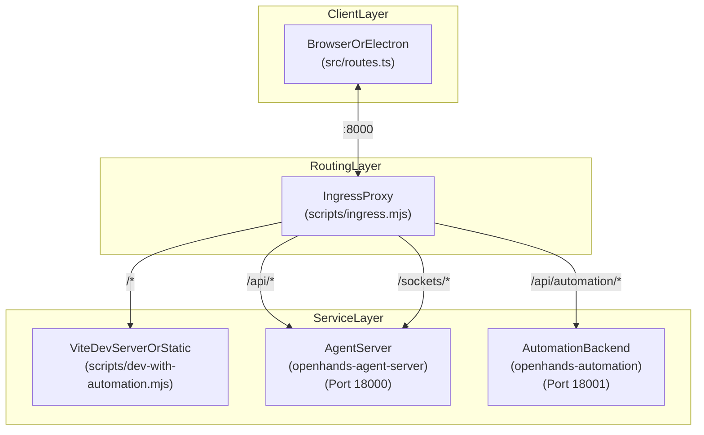

Sources: [scripts/dev-with-automation.mjs:9-22](), [config/defaults.json:15-21]()

### 1. Frontend (`agent-canvas`)
The React Single Page Application built with Vite and React Router [package.json:56,69](). It consumes `@openhands/typescript-client` to communicate with backends [package.json:27]().

### 2. Agent Server (`openhands-agent-server`)
A Python-based service responsible for managing agent sessions, conversation history, and tool execution [config/defaults.json:4,12]().

### 3. Automation Backend (`openhands-automation`)
A specialized service for running long-lived, event-driven workflows, webhooks, and scheduled triggers, sharing the session authentication model [scripts/dev-with-automation.mjs:38-45](), [config/defaults.json:6,17]().

Sources: [package.json:27,56,69](), [config/defaults.json:4,6,12,17](), [scripts/dev-with-automation.mjs:38-45]()

---

## Ingress Proxy and Routing Model

The `scripts/ingress.mjs` script acts as the single entry point, routing traffic across multiple underlying ports to provide a unified origin. This avoids CORS complexity during development and production self-hosting.

**Routing Rules:**
*   **`/api/automation/*`**: Routed to the Automation Backend [scripts/dev-with-automation.mjs:12]().
*   **`/api/*` & `/sockets`**: Routed to the Agent Server [scripts/dev-with-automation.mjs:13]().
*   **`/*`**: Default route for the Vite dev server or static file server [scripts/dev-with-automation.mjs:14]().

Additionally, the proxy injects runtime configuration (`window.__AGENT_CANVAS_RUNTIME_SERVICES`) into the HTML response via `buildRuntimeServicesInfo` [scripts/dev-safe.mjs:28](), [scripts/runtime-services-info.mjs:1-10]().

Sources: [scripts/ingress.mjs:1-50](), [scripts/dev-safe.mjs:28](), [scripts/dev-with-automation.mjs:9-15]()

---

## Runtime Modes

Agent Canvas supports multiple execution modes defined in package scripts:

| Mode | Command | Orchestrator Script | Description |
| :--- | :--- | :--- | :--- |
| **Dev (Full)** | `npm run dev` | `scripts/dev-with-automation.mjs` | Runs Vite, Agent Server (`uvx`), and Automation (`uvx`) behind ingress [package.json:76]() |
| **Dev (Minimal)** | `npm run dev:minimal` | `scripts/dev-safe.mjs` | Runs Vite and Agent Server only; skips automation [package.json:79]() |
| **Dev (Static)** | `npm run dev:static` | `scripts/dev-static.mjs` | Runs a production build of the frontend with live backends [package.json:77]() |
| **Production (Docker)** | `docker run ...` | `docker/entrypoint.sh` | Bundles all three services into a single container image [README.md:95-100](), [docker/entrypoint.sh:1-20]() |
| **Desktop** | `npm run desktop` | `electron/main.mjs` | Wraps the full stack in an Electron shell, bundling `uv` [package.json:111]() |

Sources: [package.json:76-79,111](), [README.md:95-100](), [docker/entrypoint.sh:1-20]()

---

## Data Flow: Natural Language to Code Entity

This sequence diagram illustrates how a user message flows from UI components down to the Agent Server API client.

**Diagram: Message Data Flow**

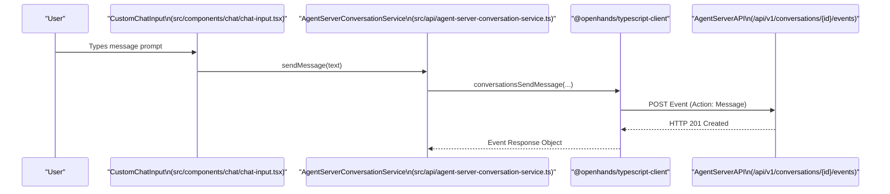

Sources: [package.json:27](), [AGENTS.md:9]()

---

## Authentication and Security Boundaries

Communication between the ingress proxy and backend services is secured using `LOCAL_BACKEND_API_KEY` (passed via the `X-Session-API-Key` header) [scripts/dev-with-automation.mjs:38-42]().

1.  **Key Generation**: Dev scripts generate a cryptographically secure 256-bit hex key via `generateRandomApiKey` [scripts/dev-safe.mjs:68-70]() and persist it to `~/.openhands/agent-canvas/api-key.txt` via `getOrCreatePersistedApiKey` [scripts/dev-safe.mjs:80-85,144-176]().
2.  **Injection**: The key is injected into the frontend via `VITE_SESSION_API_KEY` and provided to backend processes as an environment variable [scripts/dev-with-automation.mjs:39-41]().
3.  **Validation**: Ingress and backend endpoints validate this header on requests to guard filesystem and LLM credential access.

Sources: [scripts/dev-safe.mjs:68-85,144-176](), [scripts/dev-with-automation.mjs:38-45]()

---

# Page: Key Concepts

# Key Concepts

<details>
<summary>Relevant source files</summary>

The following files were used as context for generating this wiki page:

- [.release-please-manifest.json](.release-please-manifest.json)
- [AGENTS.md](AGENTS.md)
- [README.md](README.md)
- [README.windows.md](README.windows.md)
- [__tests__/api/agent-server-adapter.test.ts](__tests__/api/agent-server-adapter.test.ts)
- [__tests__/api/agent-server-conversation-service.test.ts](__tests__/api/agent-server-conversation-service.test.ts)
- [__tests__/api/use-create-conversation-metadata.test.ts](__tests__/api/use-create-conversation-metadata.test.ts)
- [__tests__/hooks/mutation/use-create-conversation.test.tsx](__tests__/hooks/mutation/use-create-conversation.test.tsx)
- [__tests__/hooks/mutation/use-switch-llm-profile-and-log.test.tsx](__tests__/hooks/mutation/use-switch-llm-profile-and-log.test.tsx)
- [__tests__/scripts/dev-safe.test.ts](__tests__/scripts/dev-safe.test.ts)
- [config/defaults.json](config/defaults.json)
- [helm/agent-canvas/Chart.yaml](helm/agent-canvas/Chart.yaml)
- [package-lock.json](package-lock.json)
- [package.json](package.json)
- [scripts/check-sdk-version-sync.mjs](scripts/check-sdk-version-sync.mjs)
- [scripts/dev-safe.mjs](scripts/dev-safe.mjs)
- [src/api/agent-server-adapter.ts](src/api/agent-server-adapter.ts)
- [src/api/conversation-metadata-store.ts](src/api/conversation-metadata-store.ts)
- [src/api/conversation-service/agent-server-conversation-service.api.ts](src/api/conversation-service/agent-server-conversation-service.api.ts)
- [src/api/conversation-service/agent-server-conversation-service.types.ts](src/api/conversation-service/agent-server-conversation-service.types.ts)
- [src/hooks/mutation/use-create-conversation.ts](src/hooks/mutation/use-create-conversation.ts)
- [src/hooks/mutation/use-switch-llm-profile-and-log.ts](src/hooks/mutation/use-switch-llm-profile-and-log.ts)
- [src/i18n/translation.json](src/i18n/translation.json)

</details>


This document defines the core terminology and technical concepts for the **Agent Canvas** codebase. It bridges the gap between high-level product features and the underlying React/TypeScript implementation.

---

## Backend Infrastructure & Ingress Proxy

Agent Canvas follows a "bring your own backend" model. It distinguishes between where the UI is served and where the agent logic executes.

### Backends (Local vs. Cloud)
A **Backend** is an instance of the `agent-server` (and optionally the `automation` backend). 
*   **Local Backend**: Typically runs on `localhost:18000` (managed via `config/defaults.json` [config/defaults.json:15-17]()). It is managed via the `BackendRegistry` and stored in `localStorage` [src/api/backend-registry/active-store.ts:1-25]().
*   **Cloud Backend**: A managed OpenHands environment. Authentication is handled via a **Device Authorization Grant** (OAuth 2.0).

### Ingress Proxy
The ingress routing model acts as the unified entry point (default port `8000` [config/defaults.json:15-18]()). It routes traffic based on path prefixes:
*   `/api/automation/*` → Automation Backend (port `18001` [config/defaults.json:15-17]()).
*   `/api/*` → Agent Server (port `18000` [config/defaults.json:15-17]()).
*   `/*` → Frontend (Vite dev server or static files).

### Session API Keys
To secure local backends without complex OAuth, Agent Canvas uses a **Session API Key**. This key is passed via request headers [src/api/backend-registry/auth.ts:1-18](). In development, it is generated or loaded via `getOrCreatePersistedApiKey` [scripts/dev-safe.mjs:119-146]() and persisted in `.openhands/agent-canvas/api-key.txt` [scripts/dev-safe.mjs:80-85]().

### Runtime Services Info
The `RuntimeServicesInfo` block is a JSON metadata object served by backends [src/api/agent-server-adapter.ts:176-182](). It informs the agent what URLs are reachable from *inside* its sandbox. The block is parsed by `parseRuntimeServicesInfo` [src/api/agent-server-adapter.ts:1-25]() and consumed by the agent's system prompt.

Sources: [config/defaults.json:15-46](), [src/api/backend-registry/active-store.ts:1-25](), [scripts/dev-safe.mjs:68-146](), [src/api/agent-server-adapter.ts:176-182]()

---

## Agent Architecture & Profiles

Agent Canvas supports multiple agent "kinds" and specialized configuration profiles.

### Agent Kinds
*   **OpenHands**: The native agent (e.g., `CodeActAgent`) running directly in the Python `agent-server` [src/api/agent-server-adapter.ts:1-50]().
*   **ACP (Agent Client Protocol)**: Third-party agents like Claude Code, Codex, or Gemini CLI. These run as subprocesses managed by the agent-server, identified via the `kind` discriminator in `DirectConversationInfo` [src/api/agent-server-adapter.ts:112-130]().

### Profiles (LLM and Agent)
*   **LLM Profile**: A named configuration containing a specific model, API key, and base URL managed via settings services [src/api/settings-service/settings-service.api.ts:1-30]().
*   **Agent Profile**: Combines an Agent Kind with specific LLM profiles and tool configurations [src/api/agent-server-adapter.ts:146-150]().

### MCP Servers
The **Model Context Protocol (MCP)** allows agents to connect to external tools and data sources. MCP configurations are managed in settings and utilized by the agent-server to extend model capabilities.

Sources: [src/api/agent-server-adapter.ts:1-150](), [src/api/settings-service/settings-service.api.ts:1-30]()

---

## Conversation Lifecycle & Workspaces

A **Conversation** tracks the state of an interaction between a user and an agent, encapsulated in the `AppConversation` type [src/api/conversation-service/agent-server-conversation-service.types.ts:1-40]().

### Workspaces
A **Workspace** defines the filesystem boundary for the agent. In local mode, this is derived from the project path configuration [README.md:92-98](). The `working_dir` is sent in the `workspace` block of conversation start requests [src/api/agent-server-adapter.ts:134-136]().

Sources: [src/api/conversation-service/agent-server-conversation-service.types.ts:1-40](), [src/api/agent-server-adapter.ts:134-136](), [README.md:92-98]()

---

## Extensions, Skills, and Automations

### Skills
**Skills** are reusable agent capabilities bundled from `@openhands/extensions` [src/api/agent-server-adapter.ts:1-15](). They are injected into agent context during conversation startup so the SDK can perform trigger matching.

### Automations
**Automations** are background workflows and scheduled tasks managed by the automation backend [package.json:75-77](). They integrate with webhook events, GitHub issues, and messaging services.

Sources: [src/api/agent-server-adapter.ts:1-15](), [package.json:75-77]()

---

## Bridge: Code Entity Space to Natural Language Space

These diagrams map product concepts to specific TypeScript classes and API structures, bridging natural language spaces to code entities.

### Diagram: UI Concepts to Frontend Entities
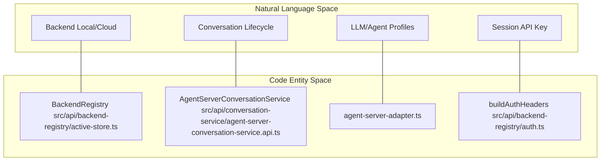
Sources: [src/api/backend-registry/active-store.ts:1-25](), [src/api/conversation-service/agent-server-conversation-service.api.ts:1-50](), [src/api/agent-server-adapter.ts:1-50]()

### Diagram: Request Payload Construction Flow
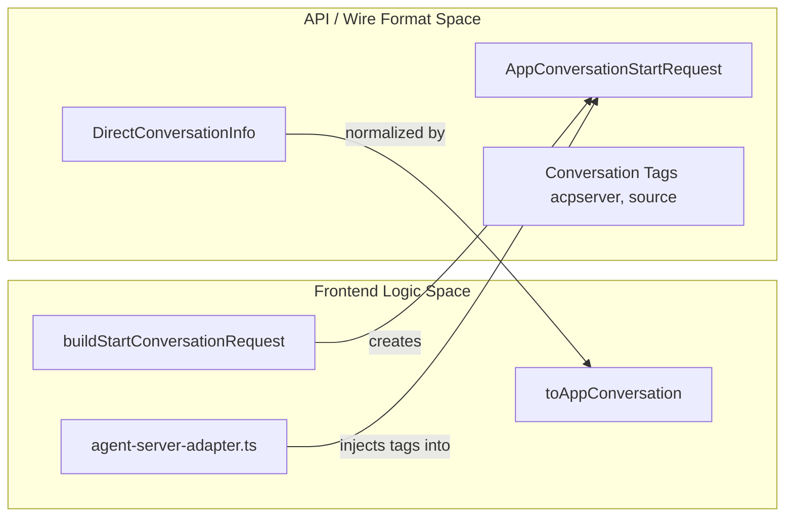
Sources: [src/api/agent-server-adapter.ts:54-150](), [__tests__/api/agent-server-adapter.test.ts:143-200]()

---

## Data Flow: Backend Selection and Health

The `ActiveBackendContext` provides connection details across the application, while `toAppConversation` normalizes raw backend data for the UI.

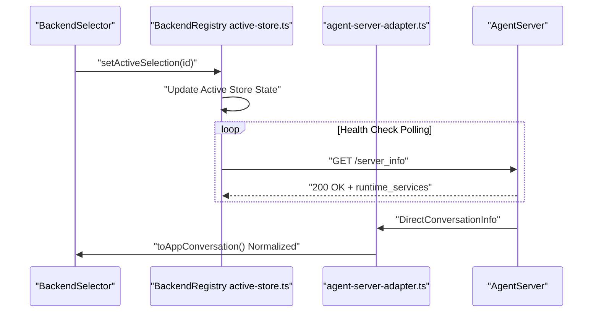
Sources: [src/api/backend-registry/active-store.ts:1-30](), [src/api/agent-server-adapter.ts:54-150](), [src/api/conversation-service/agent-server-conversation-service.api.ts:1-50]()

---

# Page: Packaging and Distribution

# Packaging and Distribution

<details>
<summary>Relevant source files</summary>

The following files were used as context for generating this wiki page:

- [.agents/skills/release.md](.agents/skills/release.md)
- [.github/release.yml](.github/release.yml)
- [.github/workflows/npm-publish.yml](.github/workflows/npm-publish.yml)
- [.github/workflows/pr.yml](.github/workflows/pr.yml)
- [.github/workflows/release-ready.yml](.github/workflows/release-ready.yml)
- [.github/workflows/release.yml](.github/workflows/release.yml)
- [__tests__/components/onboarding/onboarding-preview.test.ts](__tests__/components/onboarding/onboarding-preview.test.ts)
- [__tests__/components/shared/modals/modal-backdrop.test.tsx](__tests__/components/shared/modals/modal-backdrop.test.tsx)
- [__tests__/github-workflows/npm-publish.test.ts](__tests__/github-workflows/npm-publish.test.ts)
- [__tests__/hooks/use-telemetry.test.tsx](__tests__/hooks/use-telemetry.test.tsx)
- [release-please-config.json](release-please-config.json)
- [specs/canvas-extensions.md](specs/canvas-extensions.md)
- [src/api/agent-canvas-updates.test.ts](src/api/agent-canvas-updates.test.ts)
- [src/api/agent-canvas-updates.ts](src/api/agent-canvas-updates.ts)
- [src/api/canvas-extensions-service.test.ts](src/api/canvas-extensions-service.test.ts)
- [src/api/canvas-extensions-service.ts](src/api/canvas-extensions-service.ts)
- [src/components/features/analytics/telemetry-consent-banner.tsx](src/components/features/analytics/telemetry-consent-banner.tsx)
- [src/components/features/canvas-extensions/canvas-extension-card.tsx](src/components/features/canvas-extensions/canvas-extension-card.tsx)
- [src/components/features/canvas-extensions/canvas-extensions-runtime.test.tsx](src/components/features/canvas-extensions/canvas-extensions-runtime.test.tsx)
- [src/components/features/canvas-extensions/canvas-extensions-runtime.tsx](src/components/features/canvas-extensions/canvas-extensions-runtime.tsx)
- [src/components/features/onboarding/onboarding-preview.ts](src/components/features/onboarding/onboarding-preview.ts)
- [src/components/shared/modals/modal-backdrop.tsx](src/components/shared/modals/modal-backdrop.tsx)
- [src/fixtures/canvas-extensions/demo-page/extension.js](src/fixtures/canvas-extensions/demo-page/extension.js)
- [src/hooks/query/use-latest-agent-canvas-version.ts](src/hooks/query/use-latest-agent-canvas-version.ts)
- [src/hooks/use-telemetry.ts](src/hooks/use-telemetry.ts)
- [src/lib/index.ts](src/lib/index.ts)
- [src/types/canvas-extension.ts](src/types/canvas-extension.ts)
- [tests/e2e/mock-llm/canvas-extensions/mock-llm-canvas-extensions.spec.ts](tests/e2e/mock-llm/canvas-extensions/mock-llm-canvas-extensions.spec.ts)

</details>


## Purpose and Scope

Agent Canvas (`@openhands/agent-canvas`) is the React/TypeScript frontend and unified client for the OpenHands ecosystem. It is distributed as a multi-purpose package that functions as a standalone web application, a command-line tool, a reusable React component library, an Electron desktop application, and a containerized Kubernetes service. This document details the implementation of these distribution channels, the library entrypoint architecture (`src/lib/index.ts`), CLI orchestration, and the automated release pipeline.

Sources: [package.json:2-18](), [src/lib/index.ts:1-75](), [release-please-config.json:1-26]()

---

## Distribution Channels

Agent Canvas is packaged into primary formats to support diverse integration scenarios:

1. **NPM Package (`@openhands/agent-canvas`)**: The primary distribution artifact published to the npm registry, containing the pre-built frontend bundle, CLI binary, and library modules [package.json:2-18]().
2. **CLI Binary (`agent-canvas`)**: A Node-based executable script that orchestrates the local stack (frontend static server, `openhands-agent-server`, and automation backends) [bin/agent-canvas.mjs:1-12]().
3. **Library Entrypoints**: A modular entrypoint (`src/lib/index.ts`) allowing external React applications to consume core components, hooks, stores, and utilities [src/lib/index.ts:1-75]().
4. **Container & Helm Chart**: Multi-stage Docker images and a Helm chart (`helm/agent-canvas/`) for production Kubernetes deployments [helm/agent-canvas/Chart.yaml:1-28]().

Sources: [package.json:2-18](), [bin/agent-canvas.mjs:1-12](), [src/lib/index.ts:1-75](), [helm/agent-canvas/Chart.yaml:1-28]()

---

## The Agent Canvas CLI and Stack Orchestration

The CLI entrypoint provides an out-of-the-box local execution environment by serving pre-built static assets via a static server rather than requiring a Vite development server [bin/agent-canvas.mjs:10-12](). It leverages Python runtime tools like `uvx` to launch the backend `openhands-agent-server` and `openhands-automation` services automatically [bin/agent-canvas.mjs:5-9]().

### CLI Execution Flow

Title: "CLI Stack Orchestration and Process Lifecycle"
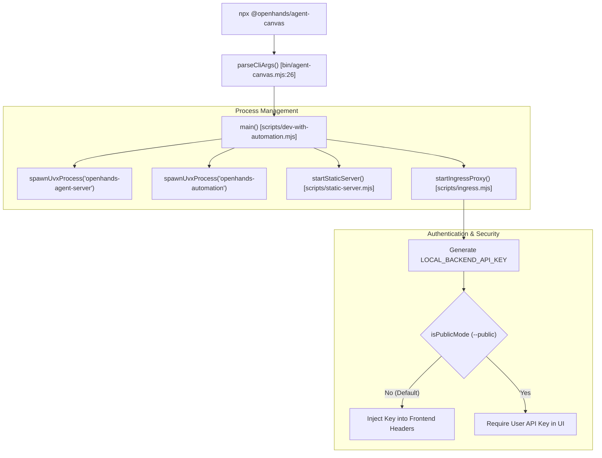
Sources: [bin/agent-canvas.mjs:5-12](), [bin/agent-canvas.mjs:26-53](), [bin/agent-canvas.mjs:68-75]()

### Authentication Modes
The CLI supports two operational security models governed by the `--public` flag [bin/agent-canvas.mjs:68-75]():
* **Local Mode (Default)**: The CLI automatically provisions a secure session token (`LOCAL_BACKEND_API_KEY`) and injects it into client-server communication headers [bin/agent-canvas.mjs:69-70]().
* **Public Mode (`--public`)**: The CLI omits automatic session token injection. Users connecting to the endpoint must manually authenticate or provide credentials through the UI [bin/agent-canvas.mjs:72-74]().

Sources: [bin/agent-canvas.mjs:68-75](), [bin/agent-canvas.mjs:104-105]()

---

## Library Entrypoints (`src/lib/index.ts`)

For consumers embedding Agent Canvas into custom React shells, the package exposes a clean API contract via `src/lib/index.ts`.

### Exported Modules Summary

| Subsystem | Exported Entities / Symbols | Source Reference |
| :--- | :--- | :--- |
| **Components** | Browser, Conversation, Files, Settings, Sidebar, Terminal components | [src/lib/index.ts:1-6]() |
| **Providers** | `AgentServerUIProviders`, `AgentServerUIRoot`, `CloudOrganizationBoundary` | [src/lib/index.ts:7-16]() |
| **Query Client** | `createAgentServerQueryClient`, `getDefaultQueryClient`, `queryClient` | [src/lib/index.ts:17-23]() |
| **Internationalization** | `AvailableLanguages`, `createAgentServerI18n`, `translationResources` | [src/lib/index.ts:24-33]() |
| **Theming & Styles** | `AGENT_SERVER_UI_DEFAULT_THEME`, `AGENT_SERVER_UI_SCOPE_ATTRIBUTE` | [src/lib/index.ts:34-42]() |
| **Canvas Extensions** | `CANVAS_EXTENSION_HOST_API_VERSION`, extension types | [src/lib/index.ts:43-59]() |
| **Telemetry** | `useTelemetry`, `configureTelemetry`, `trackEvent`, `trackInstall` | [src/lib/index.ts:60-75]() |

Sources: [src/lib/index.ts:1-75]()

---

## Helm Chart and Kubernetes Deployment

The Helm chart located at `helm/agent-canvas/` packages Agent Canvas for enterprise Kubernetes clusters. It deploys the application as a `StatefulSet` to ensure persistent storage for local conversation state, vector indexes, and user configuration files [helm/agent-canvas/Chart.yaml:1-28]().

* **Version Syncing**: The chart version and application version are synchronized automatically with `config/defaults.json` and `package.json` via release automation [release-please-config.json:11-25]().
* **Stateful Execution**: Persistent volume claims guarantee that session histories survive pod restarts or rescheduling.

Sources: [helm/agent-canvas/Chart.yaml:1-28](), [release-please-config.json:11-25]()

---

## Automated Release Pipeline and Publishing

Releases are fully automated using `release-please` and GitHub Actions workflows, implementing trunk-based development principles governed by Conventional Commits [release-please-config.json:1-26](), [.agents/skills/release.md:16-23]().

### Release Data Flow and Publishing Pipeline

Title: "Release Automation and Publishing Pipeline"
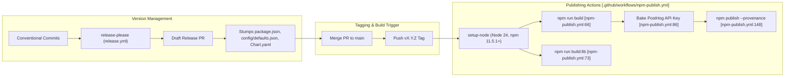
Sources: [.github/workflows/npm-publish.yml:1-148](), [release-please-config.json:1-26](), [.agents/skills/release.md:1-31]()

### Release Configuration Surfaces
Managed file targets are declared in `release-please-config.json`, ensuring consistency across version numbers:
* `package.json` and `package-lock.json`
* `config/defaults.json` (under `versions.agentCanvas`) [release-please-config.json:11-16]()
* `helm/agent-canvas/Chart.yaml` (via generic YAML updating) [release-please-config.json:18-21]()
* `README.md` and `README.windows.md` documentation pins [release-please-config.json:22-23]()

Sources: [release-please-config.json:1-26]()

---

## Telemetry and Analytics Distribution

Production packages bake telemetry configurations into built artifacts. During the npm publish workflow, PostHog production credentials are injected into default configurations (`config/defaults.json`) so CLI and standalone consumers report telemetry correctly under user consent [package.json:65-88]().

* **Consent Integration**: Users manage tracking permissions via the `TelemetryConsentBanner`, which persists state to backend settings tables [src/components/features/analytics/telemetry-consent-banner.tsx:64-70]().
* **PostHog Isolation**: The `telemetry.ts` service wraps PostHog initialization, guaranteeing that events adhere to user opt-in status [src/lib/index.ts:60-75]().

Sources: [package.json:65-88](), [src/components/features/analytics/telemetry-consent-banner.tsx:1-128](), [src/lib/index.ts:60-75]()

---

# Page: Getting Started

# Getting Started

<details>
<summary>Relevant source files</summary>

The following files were used as context for generating this wiki page:

- [.release-please-manifest.json](.release-please-manifest.json)
- [AGENTS.md](AGENTS.md)
- [README.md](README.md)
- [README.windows.md](README.windows.md)
- [__tests__/scripts/dev-safe.test.ts](__tests__/scripts/dev-safe.test.ts)
- [config/defaults.json](config/defaults.json)
- [helm/agent-canvas/Chart.yaml](helm/agent-canvas/Chart.yaml)
- [package-lock.json](package-lock.json)
- [package.json](package.json)
- [scripts/check-sdk-version-sync.mjs](scripts/check-sdk-version-sync.mjs)
- [scripts/dev-safe.mjs](scripts/dev-safe.mjs)

</details>


This guide walks through setting up and running **Agent Canvas** for the first time. It covers system prerequisites, installation paths, initial configuration, runtime modes, and agent onboarding. Agent Canvas serves as the React/TypeScript developer control center for OpenHands agents and automations [README.md:5-7]().

For detailed installation instructions across npm, Docker, Electron, and Helm, see [Installation](#2.1). For configuration files and authentication models, see [Configuration Basics](#2.2). For running scripts and runtime modes, see [Running Agent Canvas](#2.3). For configuring external ACP-compatible agents, see [ACP Agent Setup](#2.4).

Sources: [README.md:5-7](), [package.json:16-18](), [config/defaults.json:1-7]()

## System Prerequisites and Overview

Agent Canvas requires specific runtime environments depending on the chosen distribution method. Node.js `>=24` is required for running the npm package or building from source [package.json:19-21](), while the Python `uv` utility manages the underlying `agent-server` and automation backends [README.md:68](), [scripts/dev-safe.mjs:48-56](). For sandboxed container execution, Docker or Docker Desktop is required [README.md:84-86]().

The following diagram maps the high-level system components to their respective code entities and entrypoints:

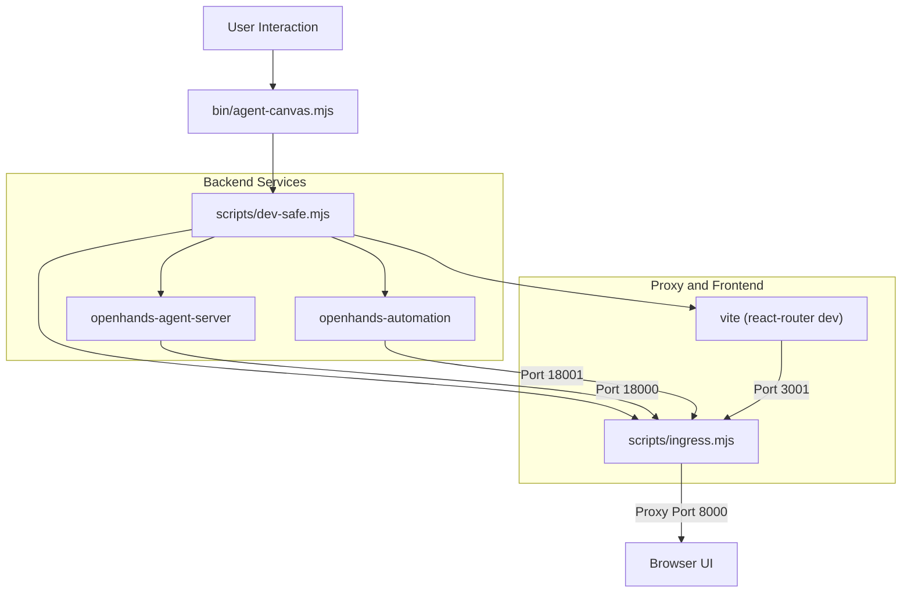
Sources: [README.md:68-80](), [package.json:16-18](), [scripts/dev-safe.mjs:32-56]()

## Installation Summary

Agent Canvas can be installed via multiple channels depending on whether you want a local bare-metal setup, a secure Docker container, a native desktop application, or a Kubernetes deployment [README.md:33-40](). 

- **npm Package**: Installs globally via `npm install -g @openhands/agent-canvas` and runs via the `agent-canvas` CLI binary [README.md:70-73]().
- **Docker Image**: Runs inside an isolated container using `ghcr.io/openhands/agent-canvas` with mounted projects directories [README.md:95-100]().
- **Electron Desktop App**: Provides a native desktop application wrapper built around the frontend and bundled binaries [package.json:111-112]().
- **Helm Chart**: Deploys the stack onto Kubernetes clusters using the `helm/agent-canvas` chart [helm/agent-canvas/Chart.yaml:3-6]().

For detailed instructions, see [Installation](#2.1).

Sources: [README.md:70-100](), [package.json:111-112](), [helm/agent-canvas/Chart.yaml:3-6]()

## Configuration Basics

The system relies on centralized configuration defaults and environment variables to manage security tokens, encryption keys, and service ports [config/defaults.json:1-46](), [scripts/dev-safe.mjs:32-106](). 

- **Version Synchronization**: The single source of truth for version pins (`agentServer`, `agentCanvas`, and `automation`) is maintained in `config/defaults.json` [config/defaults.json:3-7]().
- **Session API Keys**: Session authentication is handled via `LOCAL_BACKEND_API_KEY` or persisted automatically in `~/.openhands/agent-canvas/api-key.txt` [scripts/dev-safe.mjs:68-85]().
- **Encryption**: Sensitive settings and secrets are secured using `OH_SECRET_KEY`, stored in `~/.openhands/agent-canvas/secret-key.txt` [scripts/dev-safe.mjs:97-102]().

For comprehensive configuration options, build-time `VITE_*` variables, and authentication models, see [Configuration Basics](#2.2).

Sources: [config/defaults.json:1-46](), [scripts/dev-safe.mjs:32-106]()

## Running Agent Canvas

Runtime execution is governed by specific script targets defined in `package.json` [package.json:75-96]() and orchestrated by process managers [scripts/dev-safe.mjs:1-24](). 

The execution routing and process orchestration flow can be visualized as follows:

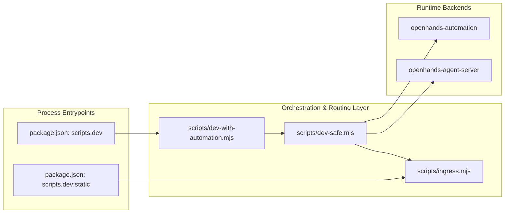

- **Runtime Modes**: Supports full development (`npm run dev`), minimal bare-metal (`npm run dev:minimal`), static distribution (`npm run dev:static`), and mock data mode (`npm run dev:mock`) [package.json:75-81]().
- **Port Management**: Default ports are allocated for the ingress proxy (`8000`), agent server (`18000`), and automation backend (`18001`) [config/defaults.json:15-18]().

For detailed script workflows and environment variables, see [Running Agent Canvas](#2.3).

Sources: [package.json:75-96](), [scripts/dev-safe.mjs:1-24](), [config/defaults.json:15-18]()

## ACP Agent Setup

Agent Canvas natively supports the open-source OpenHands agent but extends its architecture to any third-party coding agent that conforms to the **Agent-Client Protocol (ACP)** [README.md:37-46](). This includes integrations for tools such as Claude Code, Codex, Gemini CLI, Pi, and OpenCode [README.md:10]().

- **Protocol Integration**: Configures client tool mapping and authentication parameters through the agent server adapter layer [src/api/agent-server-adapter.ts]().
- **Authentication Modes**: Supports provider-specific API keys, environment injections, and onboarding workflows for external containerized ACP agents [README.md:10]().

For step-by-step onboarding, provider configuration, and Docker-based ACP examples, see [ACP Agent Setup](#2.4).

Sources: [README.md:10-46](), [src/api/agent-server-adapter.ts]()

---

# Page: Installation

# Installation

<details>
<summary>Relevant source files</summary>

The following files were used as context for generating this wiki page:

- [.github/workflows/desktop-linux.yml](.github/workflows/desktop-linux.yml)
- [.github/workflows/desktop-macos.yml](.github/workflows/desktop-macos.yml)
- [.github/workflows/desktop-windows.yml](.github/workflows/desktop-windows.yml)
- [.gitignore](.gitignore)
- [.release-please-manifest.json](.release-please-manifest.json)
- [AGENTS.md](AGENTS.md)
- [README.md](README.md)
- [README.windows.md](README.windows.md)
- [__tests__/electron/lib/bundled-runtime-dir.test.ts](__tests__/electron/lib/bundled-runtime-dir.test.ts)
- [__tests__/scripts/dev-safe.test.ts](__tests__/scripts/dev-safe.test.ts)
- [__tests__/scripts/download-arch-utils.test.ts](__tests__/scripts/download-arch-utils.test.ts)
- [__tests__/scripts/download-node.test.ts](__tests__/scripts/download-node.test.ts)
- [__tests__/scripts/download-uv.test.ts](__tests__/scripts/download-uv.test.ts)
- [__tests__/scripts/electron-builder-config.test.ts](__tests__/scripts/electron-builder-config.test.ts)
- [config/defaults.json](config/defaults.json)
- [electron-builder.config.mjs](electron-builder.config.mjs)
- [electron/loading.html](electron/loading.html)
- [electron/main.mjs](electron/main.mjs)
- [electron/package.json](electron/package.json)
- [electron/preload.cjs](electron/preload.cjs)
- [helm/agent-canvas/Chart.yaml](helm/agent-canvas/Chart.yaml)
- [package-lock.json](package-lock.json)
- [package.json](package.json)
- [scripts/brand-dev-electron.mjs](scripts/brand-dev-electron.mjs)
- [scripts/check-sdk-version-sync.mjs](scripts/check-sdk-version-sync.mjs)
- [scripts/dev-safe.mjs](scripts/dev-safe.mjs)
- [scripts/download-uv.mjs](scripts/download-uv.mjs)

</details>


## Purpose and Scope
This page covers the technical setup and installation methods for Agent Canvas across multiple deployment targets: global npm CLI, Docker sandboxed environments, Electron desktop applications, and Kubernetes clusters via Helm. It details the runtime requirements, including Node.js version constraints and Python `uv`/`uvx` package management dependencies.

---

## Prerequisites

*   **Node.js**: Version `24` or later is strictly required for running the frontend orchestration scripts and the local stack [package.json:19-21]().
*   **Python Package Manager (`uv`)**: The Python backend (`openhands-agent-server`) is managed via `uv`. Launch scripts utilize `uvx` to execute the server without requiring manual virtual environment configuration [README.md:68]().
*   **Docker**: Required for local or production containerized deployments to protect the host filesystem inside an isolated sandbox [README.md:84-88]().

Sources: [package.json:19-21](), [README.md:68-88]()

---

## Installation Methods

### Method 1: NPM (Global CLI)
The quickest local setup method installs Agent Canvas globally from the npm registry, exposing the `agent-canvas` binary.

```sh
npm install -g @openhands/agent-canvas
agent-canvas
```

**Implementation Details:**
The CLI binary entry point maps to `bin/agent-canvas.mjs` [package.json:16-18](). When executed, it bootstraps the multi-service local stack:
1.  **Ingress Proxy**: Routes incoming HTTP and WebSocket traffic [scripts/ingress.mjs]().
2.  **Agent Server**: Downloads and launches `openhands-agent-server` [config/defaults.json:32]() dynamically via `uvx`.
3.  **Automation Backend**: Starts the background worker service `openhands-automation` [config/defaults.json:33]().
4.  **Frontend**: Serves the built React application using `sirv-cli` [package.json:84]().

Sources: [package.json:16-18](), [package.json:84](), [README.md:70-80](), [config/defaults.json:31-36]()

### Method 2: Docker (Sandboxed)
For secure isolation, the unified Docker image bundles the frontend, ingress proxy, agent-server, and automation backend into a single container.

```sh
export PROJECTS_PATH="$HOME/projects"
mkdir -p "$PROJECTS_PATH" "$HOME/.openhands"

docker run -it --rm \
  -p 127.0.0.1:8000:8000 \
  -e AGENT_CANVAS_ALLOW_LAN_SESSION_KEY=true \
  -v "$HOME/.openhands:/home/openhands/.openhands" \
  -v "${PROJECTS_PATH}:/projects" \
  ghcr.io/openhands/agent-canvas:1.27.0
```

Windows PowerShell instructions are detailed separately in [README.windows.md:14-26]().

Title: Stack Component Routing Architecture
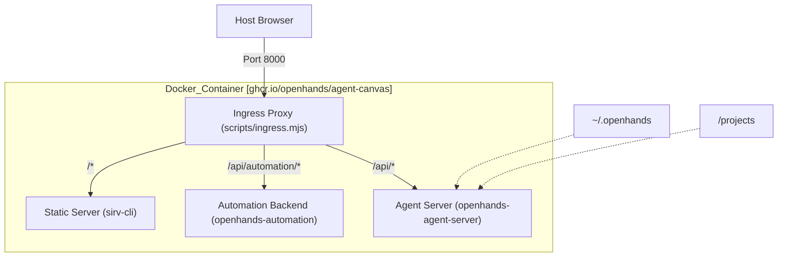
Sources: [README.md:89-101](), [config/defaults.json:11-21](), [README.windows.md:14-26]()

### Method 3: Electron Desktop App
Agent Canvas compiles into a native desktop wrapper for macOS and Windows.

**Build and Packaging Flow:**
1.  **Frontend Compile**: `npm run build:app` generates production static assets [package.json:106]().
2.  **Runtime Fetching**: `scripts/download-uv.mjs` and `scripts/download-node.mjs` pull platform-specific binaries into resources [package.json:114-115]().
3.  **Electron Builder**: `electron-builder` packages the application bundle using [electron-builder.config.mjs]() [package.json:112]().

The desktop shell executes [electron/main.mjs](), presenting [electron/loading.html]() while the local agent server process spins up.

Sources: [package.json:106-115](), [electron/main.mjs]()

### Method 4: Helm Chart (Kubernetes)
For multi-user or enterprise setups, the Helm chart located under `helm/agent-canvas/` deploys the stack to Kubernetes.

*   **StatefulSet**: Manages persistent storage claims for conversation histories and workspace volumes [helm/agent-canvas/Chart.yaml:1-6]().
*   **Ingress**: Exposes the unified proxy service to external networks.
*   **RBAC**: Grants scoped permissions if agents interact directly with the Kubernetes API.

Sources: [helm/agent-canvas/Chart.yaml:1-28]()

---

## Service Orchestration & Dependencies

### Version Matrix
The version pins and dependency specifications are centrally managed in `config/defaults.json`:

| Component | Default Version | Package Identifier |
|-----------|-----------------|--------------------|
| Agent Server | `1.54.0` | `openhands-agent-server` [config/defaults.json:4](), [config/defaults.json:32]() |
| Automation | `1.19.3` | `openhands-automation` [config/defaults.json:6](), [config/defaults.json:33]() |
| Agent Canvas | `1.27.0` | `@openhands/agent-canvas` [config/defaults.json:5]() |

Sources: [config/defaults.json:1-46]()

### Python Execution via `uvx`
The CLI orchestration scripts construct `uvx` execution commands to spin up the Python backend safely without polluting global Python environments.

Title: CLI Startup Sequence
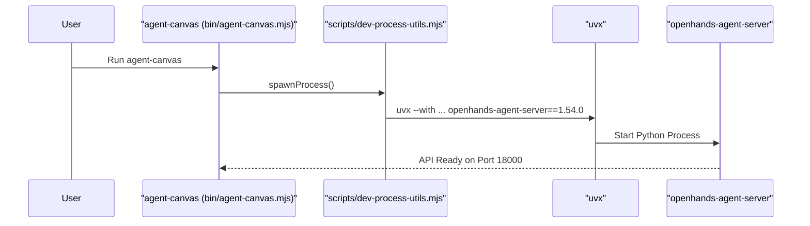
Sources: [scripts/dev-safe.mjs:1-1232](), [config/defaults.json:1-46]()

---

# Page: Configuration Basics

# Configuration Basics

<details>
<summary>Relevant source files</summary>

The following files were used as context for generating this wiki page:

- [.env.sample](.env.sample)
- [.release-please-manifest.json](.release-please-manifest.json)
- [AGENTS.md](AGENTS.md)
- [README.md](README.md)
- [README.windows.md](README.windows.md)
- [__tests__/api/agent-server-config.test.ts](__tests__/api/agent-server-config.test.ts)
- [__tests__/scripts/dev-safe.test.ts](__tests__/scripts/dev-safe.test.ts)
- [config/defaults.json](config/defaults.json)
- [helm/agent-canvas/Chart.yaml](helm/agent-canvas/Chart.yaml)
- [package-lock.json](package-lock.json)
- [package.json](package.json)
- [scripts/check-sdk-version-sync.mjs](scripts/check-sdk-version-sync.mjs)
- [scripts/dev-safe.mjs](scripts/dev-safe.mjs)
- [src/api/agent-server-config.ts](src/api/agent-server-config.ts)

</details>


This page documents the configuration system for Agent Canvas, covering environment variables, centralized defaults, build-time `VITE_*` variables, agent-server configuration parameters, and the `LOCAL_BACKEND_API_KEY` / public mode authentication model.

## Configuration Architecture

Agent Canvas employs a multi-layered configuration strategy spanning build-time compilation (Vite), orchestration scripts, and runtime environment parameters.

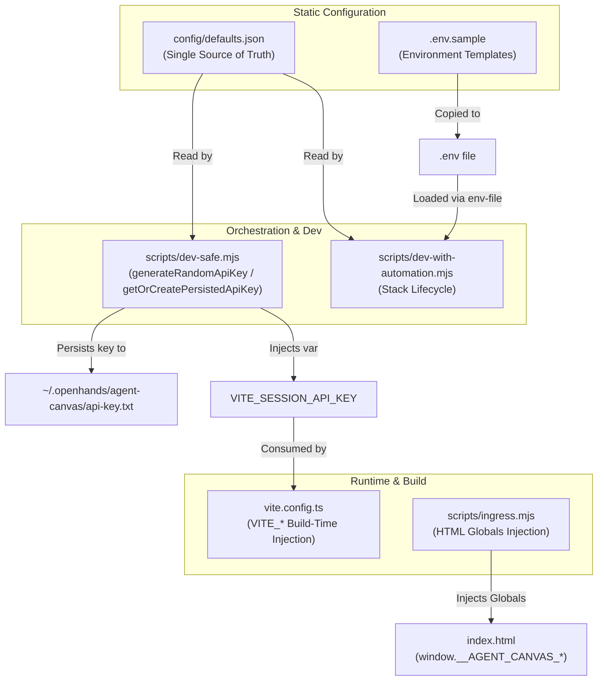

Sources: [config/defaults.json:1-46](), [scripts/dev-safe.mjs:31-103](), [.env.sample:1-46]()

## Centralized Defaults (`config/defaults.json`)

The `config/defaults.json` file acts as the single source of truth for version pins, port mappings, and state directory paths across npm, Docker, and Helm installations [config/defaults.json:1-46]().

| Category | Key | Value | Description |
| :--- | :--- | :--- | :--- |
| **Versions** | `agentServer` | `1.54.0` | Pinned version of the Python backend service [config/defaults.json:4-4]() |
| | `agentCanvas` | `1.27.0` | Pinned version of Agent Canvas frontend [config/defaults.json:5-5]() |
| | `automation` | `1.19.3` | Pinned version of the automation backend [config/defaults.json:6-6]() |
| **Ports** | `proxy` | `8000` | Ingress proxy port serving the unified stack [config/defaults.json:18-18]() |
| | `agentServer` | `18000` | Internal default port for `agent-server` [config/defaults.json:16-16]() |
| | `automation` | `18001` | Internal default port for the automation service [config/defaults.json:17-17]() |
| | `vscode` | `8001` | Internal port for the bundled code server [config/defaults.json:20-20]() |
| **Paths** | `stateSubdir` | `agent-canvas` | Subdirectory under `~/.openhands` for local state [config/defaults.json:23-23]() |
| | `vscodeBasePath`| `/vscode` | Path prefix for the embedded VS Code editor [config/defaults.json:29-29]() |

Sources: [config/defaults.json:1-46]()

## Environment Variables and `.env.sample`

Environment configurations are templated in `.env.sample` and loaded during development scripts using Node's built-in `--env-file-if-exists` option [package.json:76-79]().

### Backend and Proxy Connection
*   `VITE_BACKEND_HOST`: Host and port used by the Vite dev proxy (default: `"127.0.0.1:8000"`) [.env.sample:6-6]().
*   `VITE_BACKEND_BASE_URL`: Base URL used by browser-side direct requests [.env.sample:7-7]().
*   `VITE_FRONTEND_PORT`: Port to run the local frontend application (default: `"3001"`) [.env.sample:16-16]().
*   `VITE_USE_TLS`: Enables HTTPS/WSS for proxied backend connections [.env.sample:17-17]().
*   `VITE_INSECURE_SKIP_VERIFY`: Skips TLS certificate verification for proxied backend requests [.env.sample:18-18]().

### Build-Time Variables (`VITE_*`)
Variables prefixed with `VITE_` are baked into the frontend bundle at build time:
*   `VITE_SESSION_API_KEY`: Authentication key matched against the backend session key [.env.sample:11-11]().
*   `VITE_WORKING_DIR`: Base directory for per-conversation working directories [.env.sample:12-12]().
*   `VITE_ENABLE_BROWSER_TOOLS`: Controls whether the agent-server launches with the browser tool set enabled [.env.sample:13-13]().
*   `VITE_MOCK_API`: Enables API mocking via MSW [.env.sample:36-36]().

### Orchestration and Local SDK Settings
*   `OH_CANVAS_SAFE_BACKEND_PORT`: Port the spawned `agent-server` listens on in safe dev mode [.env.sample:39-39]().
*   `OH_AGENT_SERVER_LOCAL_PATH`: Absolute path to a local `software-agent-sdk` checkout for editable development [.env.sample:44-44]().
*   `OH_AGENT_SERVER_GIT_REF`: Specific git commit SHA or branch name for the agent server [.env.sample:45-45]().
*   `OH_AGENT_SERVER_VERSION`: Specific PyPI version of the agent server [.env.sample:46-46]().

Sources: [.env.sample:1-46](), [package.json:76-79]()

## Authentication Model: `LOCAL_BACKEND_API_KEY` & Public Mode

Agent Canvas secures communication between the frontend, ingress proxy, and backend agent servers using session API keys passed via headers or query tokens.

### Key Generation and Persistence
The orchestration layer manages session keys using utility functions defined in `scripts/dev-safe.mjs`:
*   `generateRandomApiKey()`: Generates a cryptographically secure 256-bit hex string (64 characters) via `crypto.randomBytes` [scripts/dev-safe.mjs:68-70]().
*   `getOrCreatePersistedApiKey()`: Reads or generates a fallback API key stored at `~/.openhands/agent-canvas/api-key.txt` with restricted file permissions (`0o600`) [scripts/dev-safe.mjs:80-176]().
*   `DEFAULT_SECRET_KEY_PATH`: Defines the path for `OH_SECRET_KEY` persistence under `~/.openhands/agent-canvas/secret-key.txt` to share encryption keys between local dev and Docker sandboxes [scripts/dev-safe.mjs:97-102]().

### Public Mode and LAN Access
When publishing ports on local network interfaces, `AGENT_CANVAS_ALLOW_LAN_SESSION_KEY=true` must be set alongside a securely configured `LOCAL_BACKEND_API_KEY` to prevent unauthorized cluster access [README.windows.md:32-32]().

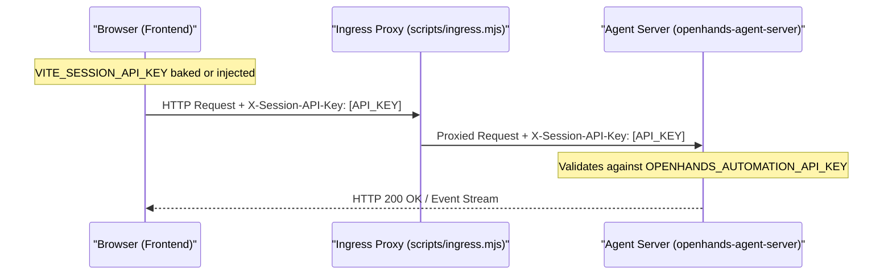

Sources: [scripts/dev-safe.mjs:68-102](), [README.windows.md:20-33]()

---

# Page: Running Agent Canvas

# Running Agent Canvas

<details>
<summary>Relevant source files</summary>

The following files were used as context for generating this wiki page:

- [.release-please-manifest.json](.release-please-manifest.json)
- [AGENTS.md](AGENTS.md)
- [README.md](README.md)
- [README.windows.md](README.windows.md)
- [__tests__/scripts/dev-safe.test.ts](__tests__/scripts/dev-safe.test.ts)
- [__tests__/scripts/dev-static.test.ts](__tests__/scripts/dev-static.test.ts)
- [__tests__/scripts/dev-with-automation.test.ts](__tests__/scripts/dev-with-automation.test.ts)
- [__tests__/scripts/ingress.test.ts](__tests__/scripts/ingress.test.ts)
- [__tests__/scripts/static-server.test.ts](__tests__/scripts/static-server.test.ts)
- [config/defaults.json](config/defaults.json)
- [docker/entrypoint.sh](docker/entrypoint.sh)
- [helm/agent-canvas/Chart.yaml](helm/agent-canvas/Chart.yaml)
- [package-lock.json](package-lock.json)
- [package.json](package.json)
- [scripts/check-sdk-version-sync.mjs](scripts/check-sdk-version-sync.mjs)
- [scripts/dev-safe.mjs](scripts/dev-safe.mjs)
- [scripts/dev-static.mjs](scripts/dev-static.mjs)
- [scripts/dev-with-automation.mjs](scripts/dev-with-automation.mjs)
- [scripts/ingress.mjs](scripts/ingress.mjs)
- [scripts/proxy-utils.mjs](scripts/proxy-utils.mjs)
- [scripts/runtime-services-info.mjs](scripts/runtime-services-info.mjs)
- [scripts/static-server.mjs](scripts/static-server.mjs)

</details>


This page documents all runtime modes and execution environments for Agent Canvas (`@openhands/agent-canvas`), covering local development (`dev`, `dev:minimal`, `dev:static`, `dev:mock`), desktop packaging (`desktop`), containerized deployments (`Docker`), port allocations, ingress proxy routing, session API keys, and UI access patterns.

## Runtime Modes Overview

Agent Canvas provides multiple execution modes tailored for different development workflows, resource constraints, and deployment topologies [README.md:59-62](). All local and production runtimes rely on an ingress proxy to consolidate services under a single port [scripts/dev-with-automation.mjs:9-15]().

| Runtime Mode | NPM Script / Command | Target Use Case | Orchestration Script / Binary |
|---|---|---|---|
| **Full Dev** | `npm run dev` | Local development with automation backend | `scripts/dev-with-automation.mjs` [package.json:76]() |
| **Minimal Dev** | `npm run dev:minimal` | Resource-constrained or agent-server-only work | `scripts/dev-safe.mjs` [package.json:79]() |
| **Static Dev** | `npm run dev:static` | Production build testing with live backend | `scripts/dev-static.mjs` [package.json:77]() |
| **Mock Dev** | `npm run dev:mock` | Frontend-only UI design with MSW | `package.json` [package.json:81]() |
| **Desktop** | `npm run desktop` | Standalone native execution | `electron electron` [package.json:111]() |
| **Docker** | `docker run ...` | Isolated self-hosted production deployment | `docker/entrypoint.sh` [README.md:95-101]() |

Sources: [package.json:76-81](), [package.json:111](), [README.md:59-62](), [scripts/dev-with-automation.mjs:9-15]()

---

## Development Stack Orchestration & Code Entities

The development runtimes are coordinated by Node.js orchestration scripts that perform port discovery [__tests__/scripts/dev-safe.test.ts:63-67](), cryptographic session key generation [scripts/dev-safe.mjs:68-70](), process tree supervision [scripts/dev-safe.mjs:21-24](), and environment injection [scripts/dev-with-automation.mjs:55-65]().

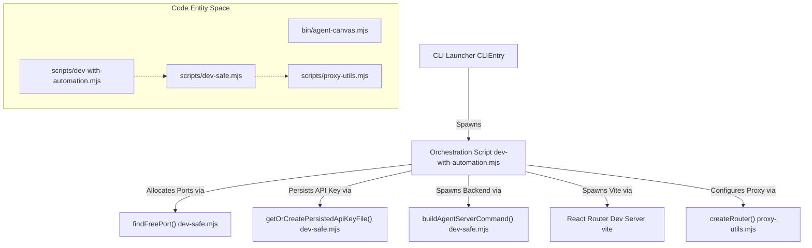

### Key Functions and Lifecycle Management
- **Port Discovery**: `findFreePort` and `findFreePorts` verify availability on preferred ports (defined in `config/defaults.json`), automatically falling back to OS-assigned ephemeral ports if collisions occur [__tests__/scripts/dev-safe.test.ts:63-98]().
- **Authentication Seeding**: `getOrCreatePersistedApiKeyFile` generates a 256-bit hex string stored in `~/.openhands/agent-canvas/api-key.txt` with `0o600` permissions, ensuring stable session tokens across `npm run dev` restarts [scripts/dev-safe.mjs:68-85]().
- **Process Supervision**: Shutdown hook registries monitor child process lifecycles, ensuring Python backends spawned via `uvx` or `uv run` are cleanly terminated when the Node.js parent exits [scripts/dev-safe.mjs:21-24](), [scripts/dev-with-automation.mjs:67-72]().

Sources: [scripts/dev-safe.mjs:21-85](), [__tests__/scripts/dev-safe.test.ts:63-98](), [scripts/dev-with-automation.mjs:67-72]()

---

## Ingress Proxy and Port Assignments

Agent Canvas centralizes ingress through a single port (default `8000`), routing requests to underlying services based on URL path prefixes [scripts/dev-with-automation.mjs:9-15]().

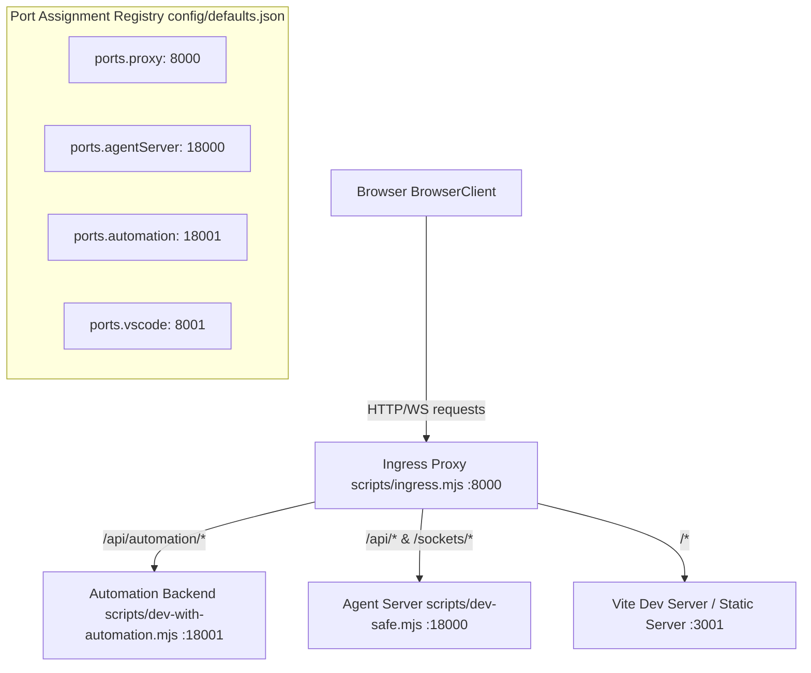

### Port Assignments (`config/defaults.json`)
The single source of truth for port definitions is located in `config/defaults.json`:

| Service Name | Default Port | Config Path Key | Description |
|---|---|---|---|
| **Ingress Proxy** | `8000` | `ports.proxy` [config/defaults.json:18]() | Unified entry point for UI, APIs, and WebSockets. |
| **Agent Server** | `18000` | `ports.agentServer` [config/defaults.json:16]() | Python backend managing agent execution and LLM interactions. |
| **Automation Backend** | `18001` | `ports.automation` [config/defaults.json:17]() | Python backend handling scheduled tasks and webhook triggers. |
| **VS Code Server** | `8001` (Internal) | `ports.vscode` [config/defaults.json:20]() | Embedded code editor served via path prefix `/vscode` [config/defaults.json:29](). |

Sources: [config/defaults.json:15-30](), [scripts/dev-with-automation.mjs:9-15]()

---

## Production Runtimes: Docker and Desktop

### Docker Container Stack
When running via Docker, `docker/entrypoint.sh` initializes the runtime environment:
- Reads or generates the encryption secret key (`OH_SECRET_KEY`) in the shared state directory [docker/entrypoint.sh:35-36]().
- Normalizes `VSCODE_BASE_PATH` and `AGENT_CANVAS_BASE_PATH` to prevent proxy routing collisions [docker/entrypoint.sh:97-120]().
- Launches the ingress proxy, agent-server, and automation backend using exported environment variables derived from `config/defaults.json` [docker/entrypoint.sh:62-71]().

### Electron Desktop App (`npm run desktop`)
The desktop build bundles Node.js and `uv` binaries to run the agent stack locally without external developer prerequisites [package.json:111-112](). Managed by `electron/main.mjs`, the application spawns the local agent server and static ingress server as child processes, attaching the React UI window directly to `http://localhost:8000` [electron/main.mjs:87-124]().

Sources: [package.json:111-112](), [docker/entrypoint.sh:35-120](), [README.md:95-101]()

---

# Page: ACP Agent Setup

# ACP Agent Setup

<details>
<summary>Relevant source files</summary>

The following files were used as context for generating this wiki page:

- [__tests__/api/acp-service/acp-service.api.test.ts](__tests__/api/acp-service/acp-service.api.test.ts)
- [__tests__/components/onboarding/choose-agent-step.test.tsx](__tests__/components/onboarding/choose-agent-step.test.tsx)
- [__tests__/components/onboarding/onboarding-progress-bar.test.tsx](__tests__/components/onboarding/onboarding-progress-bar.test.tsx)
- [__tests__/components/onboarding/setup-acp-secrets-step.test.tsx](__tests__/components/onboarding/setup-acp-secrets-step.test.tsx)
- [__tests__/components/onboarding/use-onboarding-completion.test.tsx](__tests__/components/onboarding/use-onboarding-completion.test.tsx)
- [__tests__/components/settings/acp-auth-status-banner.test.tsx](__tests__/components/settings/acp-auth-status-banner.test.tsx)
- [__tests__/components/settings/acp-credentials-section-cloud.test.tsx](__tests__/components/settings/acp-credentials-section-cloud.test.tsx)
- [__tests__/components/settings/acp-credentials-section.test.tsx](__tests__/components/settings/acp-credentials-section.test.tsx)
- [__tests__/constants/acp-providers.test.ts](__tests__/constants/acp-providers.test.ts)
- [__tests__/hooks/query/use-acp-auth-status.test.tsx](__tests__/hooks/query/use-acp-auth-status.test.tsx)
- [__tests__/utils/acp-auth-display.test.ts](__tests__/utils/acp-auth-display.test.ts)
- [docs/ACP_AGENTS.md](docs/ACP_AGENTS.md)
- [docs/README.md](docs/README.md)
- [src/api/acp-service/acp-service.api.ts](src/api/acp-service/acp-service.api.ts)
- [src/components/features/onboarding/onboarding-progress-bar.tsx](src/components/features/onboarding/onboarding-progress-bar.tsx)
- [src/components/features/onboarding/steps/choose-agent-step.tsx](src/components/features/onboarding/steps/choose-agent-step.tsx)
- [src/components/features/onboarding/steps/setup-acp-secrets-step.tsx](src/components/features/onboarding/steps/setup-acp-secrets-step.tsx)
- [src/components/features/settings/acp-auth-status-banner.tsx](src/components/features/settings/acp-auth-status-banner.tsx)
- [src/components/features/settings/acp-credentials-section.tsx](src/components/features/settings/acp-credentials-section.tsx)
- [src/constants/acp-providers.test.ts](src/constants/acp-providers.test.ts)
- [src/constants/acp-providers.ts](src/constants/acp-providers.ts)
- [src/hooks/use-acp-credential-form.ts](src/hooks/use-acp-credential-form.ts)
- [src/hooks/use-save-acp-secrets.ts](src/hooks/use-save-acp-secrets.ts)

</details>


The purpose of this page is to explain the Agent Client Protocol (ACP), supported providers, authentication modes, onboarding workflows for ACP agents, Docker-based deployments, and container examples.

The Agent Client Protocol (ACP) is a JSON-RPC based standard for communication between a client (Agent Canvas) and a coding agent [docs/ACP_AGENTS.md:10-15](). Unlike the default OpenHands agent, which is orchestrated directly by the Agent Server, ACP agents run as external subprocesses (e.g., Claude Code, Codex, Gemini CLI, Pi, or OpenCode) [docs/ACP_AGENTS.md:3-5](). The Agent Server spawns these processes and relays conversation turns between the frontend and the agent's stdio stream [docs/ACP_AGENTS.md:12-15]().

## System Architecture and Data Flow

In an ACP configuration, the Agent Server acts as a proxy, managing the lifecycle of the ACP subprocess and handling credential injection into the subprocess environment [docs/ACP_AGENTS.md:29-32]().

### ACP Communication Flow
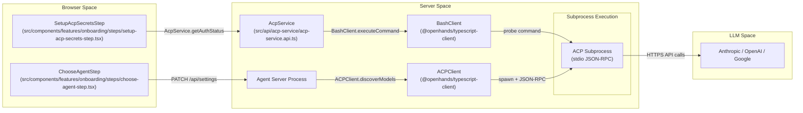
Sources: [docs/ACP_AGENTS.md:17-27](), [src/api/acp-service/acp-service.api.ts:110-134](), [src/components/features/onboarding/steps/choose-agent-step.tsx:103-146]()

## Supported Providers

Provider configurations are defined in the Python SDK registry (`openhands.sdk.settings.acp_providers`, mirrored into `@openhands/typescript-client`) and enriched with UI metadata in `src/constants/acp-providers.ts` [docs/ACP_AGENTS.md:35-39](). 

| Provider | Key | Default Command | Local Only |
| :--- | :--- | :--- | :--- |
| **Claude Code** | `claude-code` | `npx -y @agentclientprotocol/claude-agent-acp` | No |
| **Codex** | `codex` | `npx -y @agentclientprotocol/codex-acp` | No |
| **Gemini CLI** | `gemini-cli` | `npx -y @google/gemini-cli --acp` | No |
| **Pi** | `pi` | `npx -y --package=pi-acp --package=@earendil-works/pi-coding-agent pi-acp` | Yes |
| **OpenCode** | `opencode` | `npx -y opencode-ai acp` | Yes |

Pi and OpenCode are offered on **local** backends only; OpenHands Cloud runs only Claude Code, Codex, and Gemini CLI [docs/ACP_AGENTS.md:49-51]().

Sources: [src/constants/acp-providers.ts:133-155](), [docs/ACP_AGENTS.md:41-48]()

## Authentication Modes

ACP agents support two primary authentication paths. The Agent Server prioritizes existing sessions on the host machine over provided API keys [docs/ACP_AGENTS.md:60-66]().

1. **Subscription Login (Priority):** Reuses credentials from the provider's native CLI (e.g., `~/.claude/.credentials.json`, macOS Keychain, or `~/.codex/auth.json`) [docs/ACP_AGENTS.md:68-82](). When the Agent Server runs on the same machine, `AcpService.getAuthStatus` detects these automatically [src/api/acp-service/acp-service.api.ts:110-118]().
2. **API Key / Secrets:** Used when no host login is found (common in Docker/Cloud). Secrets are stored as global secrets in the Agent Server and exported as environment variables to the ACP subprocess [docs/ACP_AGENTS.md:72-74]().

### Credential Requirements per Provider
The frontend collects specific credentials required for containerized environments via `useAcpCredentialForm` [__tests__/constants/acp-providers.test.ts:88-132]().

| Provider | Primary Secret (Env Var) | Secondary / Container Secrets |
| :--- | :--- | :--- |
| **Claude Code** | `ANTHROPIC_API_KEY` | `CLAUDE_CODE_OAUTH_TOKEN`, `ANTHROPIC_BASE_URL` |
| **Codex** | `OPENAI_API_KEY` | `CODEX_AUTH_JSON`, `OPENAI_BASE_URL` |
| **Gemini CLI** | `GEMINI_API_KEY` | `GOOGLE_APPLICATION_CREDENTIALS_JSON`, `GOOGLE_CLOUD_PROJECT`, `GOOGLE_CLOUD_LOCATION` |
| **Pi** | `ANTHROPIC_API_KEY` | `PI_AUTH_JSON` |
| **OpenCode** | `OPENCODE_API_KEY` | `OPENCODE_AUTH_CONTENT` |

Sources: [src/constants/acp-providers.ts:129-155](), [__tests__/constants/acp-providers.test.ts:93-131]()

## Onboarding Flow

The onboarding modal guides users through ACP setup via a multi-step wizard [src/components/features/onboarding/steps/choose-agent-step.tsx:103-146]().

### ACP Onboarding State Machine
```mermaid
stateDiagram-v2
    [*] --> ChooseAgentStep: "User selects agent kind"
    
    state ChooseAgentStep {
        ChooseAgentStep --> SaveSettings: "buildAcpAgentSettingsDiff"
    }

    ChooseAgentStep --> SetupAcpSecretsStep: "If ACP provider chosen"
    
    state SetupAcpSecretsStep {
        direction TB
        Probe: "AcpService.getAuthStatus<br/>(src/api/acp-service/acp-service.api.ts)"
        Form: "useAcpCredentialForm<br/>(src/hooks/use-acp-credential-form.ts)"
        Gate: "backendRequiresAcpCredentials<br/>(src/components/features/onboarding/steps/setup-acp-secrets-step.tsx)"
        Probe --> Gate
        Form --> Gate
    }

    SetupAcpSecretsStep --> SayHelloStep: "Secrets saved via SecretsService"
    SayHelloStep --> [*]: "Conversation initialized"
```
Sources: [src/components/features/onboarding/steps/choose-agent-step.tsx:121-146](), [src/components/features/onboarding/steps/setup-acp-secrets-step.tsx:58-135](), [src/api/acp-service/acp-service.api.ts:110-118]()

### Key Components
* **`ChooseAgentStep`**: Renders agent options derived from the registry and persists selection using `buildAcpAgentSettingsDiff` [src/components/features/onboarding/steps/choose-agent-step.tsx:81-124]().
* **`SetupAcpSecretsStep`**: Uses `useAcpAuthStatus` to probe the backend for existing logins [src/components/features/onboarding/steps/setup-acp-secrets-step.tsx:68-71](). If `backendRequiresAcpCredentials` returns true, the "Next" button is blocked until credentials are provided [src/components/features/onboarding/steps/setup-acp-secrets-step.tsx:94-117]().
* **`useAcpCredentialForm`**: Manages credential input states and coordinates saving them to the `SecretsService` [src/components/features/onboarding/steps/setup-acp-secrets-step.tsx:73-84]().

## Docker-based ACP Agents

For containerized environments where host logins are unavailable, users must provide multiline file-content blobs (e.g., Service Account JSONs or `auth.json`) during onboarding [src/components/features/onboarding/steps/setup-acp-secrets-step.tsx:37-45]().

### Implementation Details
* **Credential Injection**: Multiline secrets are rendered as textareas and flagged as `multiline` in the registry configuration [__tests__/constants/acp-providers.test.ts:133-145]().
* **File Credentials**: Backends that cannot materialize file secrets warn the user that credentials might be orphaned [src/components/features/onboarding/steps/setup-acp-secrets-step.tsx:101-103]().
* **Docker Templates**: The `examples/acp-docker/` directory contains reference configurations and compose files for running ACP agents in isolated container environments [docs/README.md:1-12]().

Sources: [src/components/features/onboarding/steps/setup-acp-secrets-step.tsx:37-57](), [__tests__/constants/acp-providers.test.ts:133-146]()

## Configuration and Overrides

Advanced users can customize ACP behavior through settings and preferences:
* **Custom Commands**: Users can select custom parameters or scripts where supported [__tests__/constants/acp-providers.test.ts:23-28]().
* **Model Selection**: `resolveEffectiveAcpModel` determines the active model, prioritizing runtime fields from the SDK over user-configured settings [src/constants/acp-providers.ts:54-71]().
* **Vertex AI for Gemini**: Gemini CLI uses `ACP_VERTEX_SAFE_MODEL` by default to ensure compatibility with Vertex AI environments [__tests__/constants/acp-providers.test.ts:6-12]().
* **Conflict Warnings**: The UI warns users if conflicting credentials are set (e.g., both a subscription token and incompatible base URLs) [src/components/features/settings/acp-credentials-section.tsx:76-76]().

Sources: [src/constants/acp-providers.ts:54-71](), [src/components/features/settings/acp-credentials-section.tsx:19-78]()

---

# Page: Build and Deployment

# Build and Deployment

<details>
<summary>Relevant source files</summary>

The following files were used as context for generating this wiki page:

- [.github/workflows/ci.yml](.github/workflows/ci.yml)
- [.github/workflows/docker.yml](.github/workflows/docker.yml)
- [.github/workflows/mock-llm-docker-e2e.yml](.github/workflows/mock-llm-docker-e2e.yml)
- [.github/workflows/mock-llm-e2e.yml](.github/workflows/mock-llm-e2e.yml)
- [.github/workflows/sdk-version-sync.yml](.github/workflows/sdk-version-sync.yml)
- [__tests__/scripts/check-sdk-version-sync.test.ts](__tests__/scripts/check-sdk-version-sync.test.ts)
- [docker/Dockerfile](docker/Dockerfile)
- [playwright.mock-llm-docker.config.ts](playwright.mock-llm-docker.config.ts)
- [playwright.mock-llm.config.ts](playwright.mock-llm.config.ts)
- [scripts/docker-build.mjs](scripts/docker-build.mjs)
- [tests/e2e/mock-llm/automations/mock-llm-automation.spec.ts](tests/e2e/mock-llm/automations/mock-llm-automation.spec.ts)
- [tests/e2e/mock-llm/reporters/done-marker-reporter.ts](tests/e2e/mock-llm/reporters/done-marker-reporter.ts)
- [tests/e2e/mock-llm/scripts/render-mock-llm-report.mjs](tests/e2e/mock-llm/scripts/render-mock-llm-report.mjs)
- [tests/e2e/mock-llm/utils/mock-llm-helpers.ts](tests/e2e/mock-llm/utils/mock-llm-helpers.ts)

</details>


This page documents the build system, Docker image construction, CI/CD pipeline, and deployment strategies for **Agent Canvas** (`@openhands/agent-canvas`). It covers how the multi-service stack (frontend, agent-server, and automation) is unified into distributable formats including npm packages, Docker images, Electron desktop apps, and Helm charts.

For details on setting up a local development environment, see [Getting Started](#2). For details on the scripts that orchestrate the services, see [Stack Orchestration](#4).

## Overview

Agent Canvas uses a multi-layered build and packaging strategy to support diverse runtime environments. The system transitions from source code to artifacts through automated pipelines that handle linting, testing, and multi-arch compilation.

### Build Artifact Mapping
The following diagram bridges the natural language concepts of the system components to their concrete implementation code entities and distribution channels.

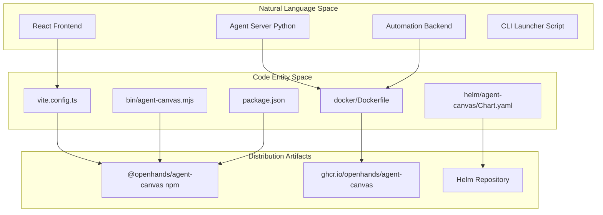

**Sources**: [package.json:2-18](), [docker/Dockerfile:1-20](), [vite.config.ts:1-20](), [helm/agent-canvas/Chart.yaml:1-16]()

## Docker Image Building

Agent Canvas is distributed as an all-in-one Docker image that bundles the three primary services: the **Frontend** (React SPA), the **Agent Server** (Python SDK), and the **Automation Backend**.

The `docker/Dockerfile` uses a multi-stage build process:
1.  **frontend-build**: Compiles the TypeScript React application using Node.js [docker/Dockerfile:28-49]().
2.  **config-gen**: Extracts version pins and default values from `config/defaults.json` into a shell-sourceable `defaults.env` file to minimize runtime dependencies [docker/Dockerfile:52-71]().
3.  **final**: Uses the upstream `AGENT_SERVER_IMAGE` as a base, installs the `openhands-automation` Python package via `pip`/`uv`, and copies the frontend artifacts [docker/Dockerfile:73-150]().

Local builds are simplified via `scripts/docker-build.mjs`, which reads defaults directly from `config/defaults.json` [scripts/docker-build.mjs:22-28]().

For details, see [Docker Image Building](#3.1).

**Sources**: [docker/Dockerfile:1-155](), [config/defaults.json:1-45](), [scripts/docker-build.mjs:1-78]()

## CI/CD Pipeline

The project uses GitHub Actions workflows defined in `.github/workflows/` to automate the software development lifecycle, ensuring code quality and dependable artifact distribution.

### Key Workflows
*   **CI (`ci.yml`)**: Triggered on every pull request and push to `main` or release branches, executing linting, unit tests, and application builds [package.json:71-78](), [.github/workflows/ci.yml:1-82]().
*   **Docker (`docker.yml`)**: Builds multi-arch (`linux/amd64` and `linux/arm64`) container images and pushes them to GHCR [.github/workflows/docker.yml:45-70]().
*   **npm Publish (`npm-publish.yml`)**: Publishes `@openhands/agent-canvas` to the npm registry with provenance [.github/workflows/npm-publish.yml:1-148]().
*   **Mock-LLM E2E (`mock-llm-e2e.yml`)**: Runs Playwright end-to-end tests against a Python mock LLM server (`tests/e2e/mock-llm/scripts/mock-llm-server.py`) to validate full stack integration [tests/e2e/mock-llm/utils/mock-llm-helpers.ts:11-15](), [.github/workflows/mock-llm-e2e.yml:1-115]().

For details, see [CI/CD Pipeline](#3.2).

**Sources**: [.github/workflows/ci.yml:1-82](), [.github/workflows/docker.yml:1-170](), [.github/workflows/mock-llm-e2e.yml:1-120]()

## Release Orchestration

Agent Canvas follows a trunk-based release process where `package.json` serves as the primary version source of truth.

### Release Pipeline Flow
```mermaid
sequenceDiagram
    participant Main as "GitHub_main_branch"
    participant CI as "ci.yml"
    participant Pub as "npm-publish.yml"
    participant Dkr as "docker.yml"
    
    Main->>CI: "Push Tag v1.16.0"
    CI->>CI: "npm run build:app"
    CI->>CI: "npm run build:lib"
    Main->>Pub: "Trigger on Tag"
    Pub->>Pub: "Verify version matches tag"
    Pub->>npm: "npm publish --provenance"
    Main->>Dkr: "Trigger on Tag"
    Dkr->>GHCR: "Push multi-arch manifest"
```

**Sources**: [package.json:3-3](), [.github/workflows/docker.yml:5-8]()

## Electron Desktop App

The Electron desktop application provides a native desktop experience for macOS and Windows by bundling the complete Agent Canvas service stack.

*   **Main Process**: `electron/main.mjs` manages lifecycle events, window creation, and backend process spawning.
*   **Configuration**: `electron-builder.config.mjs` dictates packaging rules for platform installers.
*   **Binaries**: Utilizes helper scripts to package required Node and Python `uv` runtimes locally.

For details, see [Electron Desktop App](#3.3).

**Sources**: [package.json:109-113]()

## Helm Chart and Kubernetes

For cloud-native deployments, the `helm/agent-canvas` chart packages Agent Canvas for Kubernetes clusters [helm/agent-canvas/Chart.yaml:1-16]().

*   **Architecture**: Deploys the unified container image as a `StatefulSet` with persistent volume claims for conversation and workspace state.
*   **Ingress**: Exposes the unified proxy port (`8000` by default) via configurable Ingress objects [docker/Dockerfile:11-16]().

For details, see [Helm Chart and Kubernetes Deployment](#3.4).

**Sources**: [helm/agent-canvas/Chart.yaml:1-28](), [docker/Dockerfile:11-16]()

## Self-Hosting

Agent Canvas supports self-hosting on private virtual machines or physical infrastructure using either Docker images or the `agent-canvas` CLI binary.

*   **Security**: Requires setting `LOCAL_BACKEND_API_KEY` for secured API endpoints [playwright.mock-llm.config.ts:42-46]().
*   **Networking**: Relies on the ingress proxy (`scripts/ingress.mjs`) to unify frontend routing and backend API endpoints under a single port.

For details, see [Self-Hosting Guide](#3.5).

**Sources**: [playwright.mock-llm.config.ts:42-46]()

---

# Page: Docker Image Building

# Docker Image Building

<details>
<summary>Relevant source files</summary>

The following files were used as context for generating this wiki page:

- [.github/workflows/ci.yml](.github/workflows/ci.yml)
- [.github/workflows/docker.yml](.github/workflows/docker.yml)
- [.github/workflows/mock-llm-docker-e2e.yml](.github/workflows/mock-llm-docker-e2e.yml)
- [.github/workflows/mock-llm-e2e.yml](.github/workflows/mock-llm-e2e.yml)
- [.github/workflows/sdk-version-sync.yml](.github/workflows/sdk-version-sync.yml)
- [__tests__/scripts/check-sdk-version-sync.test.ts](__tests__/scripts/check-sdk-version-sync.test.ts)
- [__tests__/scripts/dev-static.test.ts](__tests__/scripts/dev-static.test.ts)
- [__tests__/scripts/dev-with-automation.test.ts](__tests__/scripts/dev-with-automation.test.ts)
- [__tests__/scripts/ingress.test.ts](__tests__/scripts/ingress.test.ts)
- [__tests__/scripts/static-server.test.ts](__tests__/scripts/static-server.test.ts)
- [docker/Dockerfile](docker/Dockerfile)
- [docker/entrypoint.sh](docker/entrypoint.sh)
- [playwright.mock-llm-docker.config.ts](playwright.mock-llm-docker.config.ts)
- [playwright.mock-llm.config.ts](playwright.mock-llm.config.ts)
- [scripts/dev-static.mjs](scripts/dev-static.mjs)
- [scripts/dev-with-automation.mjs](scripts/dev-with-automation.mjs)
- [scripts/docker-build.mjs](scripts/docker-build.mjs)
- [scripts/ingress.mjs](scripts/ingress.mjs)
- [scripts/proxy-utils.mjs](scripts/proxy-utils.mjs)
- [scripts/runtime-services-info.mjs](scripts/runtime-services-info.mjs)
- [scripts/static-server.mjs](scripts/static-server.mjs)
- [tests/e2e/mock-llm/automations/mock-llm-automation.spec.ts](tests/e2e/mock-llm/automations/mock-llm-automation.spec.ts)
- [tests/e2e/mock-llm/reporters/done-marker-reporter.ts](tests/e2e/mock-llm/reporters/done-marker-reporter.ts)
- [tests/e2e/mock-llm/scripts/render-mock-llm-report.mjs](tests/e2e/mock-llm/scripts/render-mock-llm-report.mjs)
- [tests/e2e/mock-llm/utils/mock-llm-helpers.ts](tests/e2e/mock-llm/utils/mock-llm-helpers.ts)

</details>


This page documents the multi-stage Docker build process for the OpenHands Agent Canvas application image (`docker/Dockerfile`). It explains how the frontend, agent-server, and automation components are bundled into a single, production-ready container, along with the build orchestration (`docker-build.mjs`) and container entrypoint orchestration (`docker/entrypoint.sh`).

## Image Architecture

The OpenHands Docker image (`docker/Dockerfile`) uses a multi-stage build to bundle three primary services and an ingress proxy into a unified runtime environment.

### Service Stack and Data Flow

```mermaid
graph TB
    subgraph "Stage 1: frontend-build"
        FE_Base["node:24-slim"]
        FE_Deps["npm ci"]
        FE_Build["npm run build"]
        FE_Base --> FE_Deps --> FE_Build
    end

    subgraph "Stage 1b: config-gen"
        CG_Base["node:24-slim"]
        CG_Script["node -e (defaults.json to .env)"]
        CG_Base --> CG_Script
    end

    subgraph "Stage 2: final (from AGENT_SERVER_IMAGE)"
        Final_Base["AGENT_SERVER_IMAGE (upstream)"]
        Final_Auto["uv pip install openhands-automation"]
        Final_FE["COPY --from=frontend-build /opt/agent-canvas/frontend"]
        Final_Conf["COPY --from=config-gen /opt/agent-canvas/defaults.env"]
        Final_Proxy["COPY scripts/static-server.mjs"]
        Final_Entry["ENTRYPOINT entrypoint.sh"]

        Final_Base --> Final_Auto
        Final_Auto --> Final_FE
        Final_FE --> Final_Conf
        Final_Conf --> Final_Proxy
        Final_Proxy --> Final_Entry
    end

    FE_Build -- "Static Assets" --> Final_FE
    CG_Script -- "defaults.env" --> Final_Conf
```
Sources: [docker/Dockerfile:26-143]()

## Build Configuration

The build process is parameterized to allow versioning and customization without hardcoding values in the Dockerfile.

### Build Arguments
| Argument | Description | Source |
| :--- | :--- | :--- |
| `AGENT_SERVER_IMAGE` | The base image containing the Python SDK environment. | `config/defaults.json` |
| `AUTOMATION_VERSION` | Version of `openhands-automation` to install via pip. | `config/defaults.json` |
| `VITE_POSTHOG_API_KEY` | Public client key for frontend telemetry. | GitHub Vars / CI |
| `VITE_BASE_PATH` | URL subpath where Canvas is served (default: `/canvas`). | `config/defaults.json` |
| `AGENT_CANVAS_VERSION` | The version string for the image label. | `package.json` |

Sources: [docker/Dockerfile:23-24](), [docker/Dockerfile:73-80](), [.github/workflows/docker.yml:86-99]()

### Build Orchestration (`docker-build.mjs`)
While `docker build` can be called directly, the project provides `scripts/docker-build.mjs` to automate the extraction of versions from `config/defaults.json` and pass them as `--build-arg` flags.
Sources: [scripts/docker-build.mjs:1-50]()

## Stage Details

### 1. Frontend Build
The `frontend-build` stage compiles the React application into static assets.
- **Base Image:** `node:24-slim` [docker/Dockerfile:27]()
- **Operations:**
    - Installs dependencies using `npm ci` [docker/Dockerfile:33]().
    - Bakes `VITE_POSTHOG_API_KEY` and `VITE_BASE_PATH` into the bundle via environment variables [docker/Dockerfile:43-47]().
    - Generates the production build in `/build/build` [docker/Dockerfile:47]().
Sources: [docker/Dockerfile:27-47]()

### 2. Configuration Generation (`config-gen`)
To avoid requiring heavy JSON parsers like `jq` or `python` at container runtime, this stage converts `config/defaults.json` into a shell-sourceable `.env` file.
- **Output:** `/opt/agent-canvas/defaults.env` [docker/Dockerfile:67]().
- **Keys Mapped:** Includes `CONFIG_AGENT_SERVER_PORT`, `CONFIG_AUTOMATION_PORT`, `CONFIG_PROXY_PORT`, and telemetry settings [docker/Dockerfile:54-67]().
Sources: [docker/Dockerfile:51-68]()

### 3. Final Image Assembly
The final stage uses the `AGENT_SERVER_IMAGE` as a base, which already contains the `openhands-sdk` and its Python dependencies.
- **Automation Installation:** Installs `openhands-automation` using `uv pip install --system` [docker/Dockerfile:106]().
- **Static Server:** Copies `scripts/static-server.mjs` and its minimal runtime dependencies (`httpxy`, `sirv`, `@polka`) to serve as the ingress proxy [docker/Dockerfile:122-128]().
- **Persistence Setup:** Pre-creates directories for `conversations`, `bash_events`, and `automation` DBs under `/home/openhands/.openhands` with correct ownership [docker/Dockerfile:149-153]().
Sources: [docker/Dockerfile:71-155]()

## Runtime Configuration (`entrypoint.sh`)

The `entrypoint.sh` script orchestrates the startup of the multi-service stack.

### Entrypoint Logic Flow

```mermaid
graph TD
    Start["entrypoint.sh"] --> LoadEnv["Source defaults.env"]
    LoadEnv --> GenKeys["Generate & Persist API/Secret Keys"]
    GenKeys --> ExportEnv["Export Auth & Telemetry Vars"]
    ExportEnv --> StartServices["Start Parallel Services"]

    subgraph "Parallel Execution"
        S1["Agent Server (:18000)"]
        S2["Automation Backend (:18001)"]
        S3["Static Server / Proxy (:8000)"]
    end

    StartServices --> S1
    StartServices --> S2
    StartServices --> S3
```
Sources: [docker/entrypoint.sh:44-180]()

### Key Behaviors:
- **Key Generation:** If `LOCAL_BACKEND_API_KEY` or `OH_SECRET_KEY` are not provided, the script generates random hex strings and persists them to `/home/openhands/.openhands/agent-canvas/*.txt` to ensure security across restarts [docker/entrypoint.sh:73-103]().
- **Auth Synchronization:** The script ensures that both the Agent Server and Automation backend share the same `X-Session-API-Key` by exporting `OPENHANDS_AUTOMATION_API_KEY` and `OH_SESSION_API_KEYS_0` from the same effective key [docker/entrypoint.sh:108-115]().
- **Unified Ingress:** The `static-server.mjs` is started on the primary `PORT` (default 8000). It routes:
    - `/api/automation/*` to the Automation service [docker/entrypoint.sh:176]().
    - `/api/*` and `/sockets` to the Agent Server [docker/entrypoint.sh:177-179]().
    - All other requests to the static frontend [docker/entrypoint.sh:180]().
Sources: [docker/entrypoint.sh:1-180](), [scripts/static-server.mjs:21-28]()

## CI/CD Pipeline Integration

The `docker.yml` workflow automates the building and publishing of these images to the GitHub Container Registry (GHCR).

- **Multi-Arch Support:** Builds for both `linux/amd64` and `linux/arm64` using native runners [.github/workflows/docker.yml:53-63]().
- **Tagging Strategy:**
    - `sha-<short-sha>-<arch>` for every commit [.github/workflows/docker.yml:133]().
    - Branch names (e.g., `main-amd64`) [.github/workflows/docker.yml:141]().
    - SemVer tags (e.g., `1.2.3`, `1.2`, `1`, `latest`) for releases [.github/workflows/docker.yml:149-168]().
- **Manifest Merging:** A final `merge-manifests` job creates the multi-arch manifest, allowing users to `docker pull ghcr.io/openhands/agent-canvas:latest` regardless of their CPU architecture [.github/workflows/docker.yml:256-310]().

Sources: [.github/workflows/docker.yml:1-310]()

---

# Page: CI/CD Pipeline

# CI/CD Pipeline

<details>
<summary>Relevant source files</summary>

The following files were used as context for generating this wiki page:

- [.agents/skills/release.md](.agents/skills/release.md)
- [.github/release.yml](.github/release.yml)
- [.github/workflows/ci.yml](.github/workflows/ci.yml)
- [.github/workflows/docker.yml](.github/workflows/docker.yml)
- [.github/workflows/mock-llm-docker-e2e.yml](.github/workflows/mock-llm-docker-e2e.yml)
- [.github/workflows/mock-llm-e2e.yml](.github/workflows/mock-llm-e2e.yml)
- [.github/workflows/npm-publish.yml](.github/workflows/npm-publish.yml)
- [.github/workflows/pr.yml](.github/workflows/pr.yml)
- [.github/workflows/release-ready.yml](.github/workflows/release-ready.yml)
- [.github/workflows/release.yml](.github/workflows/release.yml)
- [.github/workflows/sdk-version-sync.yml](.github/workflows/sdk-version-sync.yml)
- [__tests__/github-workflows/npm-publish.test.ts](__tests__/github-workflows/npm-publish.test.ts)
- [__tests__/scripts/check-sdk-version-sync.test.ts](__tests__/scripts/check-sdk-version-sync.test.ts)
- [docker/Dockerfile](docker/Dockerfile)
- [playwright.mock-llm-docker.config.ts](playwright.mock-llm-docker.config.ts)
- [playwright.mock-llm.config.ts](playwright.mock-llm.config.ts)
- [release-please-config.json](release-please-config.json)
- [scripts/docker-build.mjs](scripts/docker-build.mjs)
- [src/api/agent-canvas-updates.test.ts](src/api/agent-canvas-updates.test.ts)
- [src/api/agent-canvas-updates.ts](src/api/agent-canvas-updates.ts)
- [src/hooks/query/use-latest-agent-canvas-version.ts](src/hooks/query/use-latest-agent-canvas-version.ts)
- [tests/e2e/mock-llm/automations/mock-llm-automation.spec.ts](tests/e2e/mock-llm/automations/mock-llm-automation.spec.ts)
- [tests/e2e/mock-llm/reporters/done-marker-reporter.ts](tests/e2e/mock-llm/reporters/done-marker-reporter.ts)
- [tests/e2e/mock-llm/scripts/render-mock-llm-report.mjs](tests/e2e/mock-llm/scripts/render-mock-llm-report.mjs)
- [tests/e2e/mock-llm/utils/mock-llm-helpers.ts](tests/e2e/mock-llm/utils/mock-llm-helpers.ts)

</details>


This page documents the continuous integration and continuous deployment (CI/CD) infrastructure for OpenHands. It covers GitHub Actions workflows (`ci`, `docker`, `npm-publish`, `mock-llm e2e`, `sdk-version-sync`, `pr-artifacts`), the tagging strategy, multi-arch manifest merging, and automated publishing pipelines.

## Overview and Scope

The OpenHands CI/CD pipeline automates code validation, testing, container packaging, and library distribution across the React frontend and Python backend components.

1.  **Workflows**: Automated orchestration via GitHub Actions (`.github/workflows/ci.yml`, `.github/workflows/docker.yml`, `.github/workflows/npm-publish.yml`, `.github/workflows/mock-llm-e2e.yml`, `.github/workflows/mock-llm-docker-e2e.yml`, `.github/workflows/sdk-version-sync.yml`, `.github/workflows/pr-artifacts.yml`) [.github/workflows/ci.yml:1-15](), [.github/workflows/docker.yml:1-25](), [.github/workflows/npm-publish.yml:1-13](), [.github/workflows/mock-llm-e2e.yml:1-7](), [.github/workflows/mock-llm-docker-e2e.yml:1-22]().
2.  **Testing**: Matrix testing on `ubuntu-24.04` and `windows-latest` via `.github/workflows/ci.yml`, alongside mock-LLM E2E suites running via Playwright (`playwright.mock-llm.config.ts`, `playwright.mock-llm-docker.config.ts`) [.github/workflows/ci.yml:37-46](), [playwright.mock-llm.config.ts:88-115](), [playwright.mock-llm-docker.config.ts:142-160]().
3.  **Docker Packaging**: Multi-arch builds (`linux/amd64`, `linux/arm64`) using native runners and manifest merging via `.github/workflows/docker.yml` [.github/workflows/docker.yml:45-64]().
4.  **Publishing**: OIDC trusted publishing to npm (`npm-publish.yml`) and container publishing to GHCR (`docker.yml`) [.github/workflows/npm-publish.yml:18-21](), [.github/workflows/docker.yml:31-34]().

Sources: [.github/workflows/ci.yml:1-46](), [.github/workflows/docker.yml:1-64](), [.github/workflows/npm-publish.yml:1-21](), [.github/workflows/mock-llm-e2e.yml:1-7](), [playwright.mock-llm.config.ts:88-115](), [playwright.mock-llm-docker.config.ts:142-160]()

## GitHub Actions Workflows

### Workflow Orchestration and Code Entity Mapping

The following diagram bridges natural language workflow names to their underlying GitHub Actions workflow files and execution scripts.

```mermaid
graph TD
    Trigger["Trigger Event (push, pull_request, workflow_dispatch)"] --> CI[.github/workflows/ci.yml]
    Trigger --> Docker[.github/workflows/docker.yml]
    Trigger --> NpmPub[.github/workflows/npm-publish.yml]
    Trigger --> MockE2E[.github/workflows/mock-llm-e2e.yml]
    Trigger --> MockDocker[.github/workflows/mock-llm-docker-e2e.yml]
    Trigger --> Sync[.github/workflows/sdk-version-sync.yml]

    CI --> Lint["npm run lint [.github/workflows/ci.yml:64-67]"]
    CI --> Test["npm test [.github/workflows/ci.yml:68-71]"]
    CI --> Build["npm run build [.github/workflows/ci.yml:72-74]"]

    Docker --> DockerBuildX["docker/setup-buildx-action [.github/workflows/docker.yml:76-78]"]
    Docker --> Dockerfile["docker/Dockerfile [.docker/Dockerfile:1-190]"]

    NpmPub --> TrustedPub["npm publish --provenance [.github/workflows/npm-publish.yml:147-148]"]

    MockE2E --> PlaywrightNpm["npm run test:e2e:mock-llm [.github/workflows/mock-llm-e2e.yml:129-130]"]
    MockDocker --> PlaywrightDocker["playwright.mock-llm-docker.config.ts [playwright.mock-llm-docker.config.ts:1-160]"]

    Sync --> SyncScript["scripts/check-sdk-version-sync.mjs"]
```

Sources: [.github/workflows/ci.yml:64-74](), [.github/workflows/docker.yml:76-78](), [.github/workflows/npm-publish.yml:147-148](), [.github/workflows/mock-llm-e2e.yml:129-130](), [.docker/Dockerfile:1-190](), [playwright.mock-llm-docker.config.ts:1-160]()

### CI Workflow (`ci.yml`)
The `.github/workflows/ci.yml` file defines the primary validation pipeline for pull requests and pushes to `main` [.github/workflows/ci.yml:1-10]().
*   **Concurrency**: Uses a conditional concurrency group that isolates push runs per commit (preventing cancellation of release-please checkpoints) while cancelling outdated PR runs [.github/workflows/ci.yml:16-23]().
*   **Matrix Testing**: Dynamically generates a test matrix via `prepare-test-matrix` covering `ubuntu-24.04` (full checks) and `windows-latest` (basic build checks) [.github/workflows/ci.yml:28-46]().
*   **Execution Steps**: Installs dependencies via `npm ci` using Node.js `24.15`, runs linter checks, executes Vitest unit tests, and compiles both the app bundle and library entrypoints [.github/workflows/ci.yml:52-78]().

Sources: [.github/workflows/ci.yml:1-78]()

### Mock-LLM E2E Workflows (`mock-llm-e2e.yml` and `mock-llm-docker-e2e.yml`)
End-to-end testing against agent-server and automation backends is driven by mock-LLM workflows:
*   **`mock-llm-e2e.yml`**: Spawns a Python mock LLM server (`tests/e2e/mock-llm/scripts/mock-llm-server.py`), pre-warms the `uvx` automation cache, and runs Playwright tests against the local build path (`bin/agent-canvas.mjs`) [.github/workflows/mock-llm-e2e.yml:80-130]().
*   **`mock-llm-docker-e2e.yml`**: Triggers automatically on `workflow_run` completion from the Docker build pipeline or via `workflow_dispatch`, pulling the pre-built GHCR image and executing E2E tests inside containerized environments (`playwright.mock-llm-docker.config.ts`) [.github/workflows/mock-llm-docker-e2e.yml:12-21](), [.github/workflows/mock-llm-docker-e2e.yml:104-110]().

Sources: [.github/workflows/mock-llm-e2e.yml:80-130](), [.github/workflows/mock-llm-docker-e2e.yml:12-21](), [.github/workflows/mock-llm-docker-e2e.yml:104-110]()

### SDK Version Synchronization (`sdk-version-sync.yml`)
The `.github/workflows/sdk-version-sync.yml` workflow ensures that package declarations and Python SDK version constraints in `config/defaults.json` remain synchronized across repository updates.

Sources: [.github/workflows/sdk-version-sync.yml:1-39]()

### PR Artifacts Management (`pr-artifacts.yml`)
The `.github/workflows/pr-artifacts.yml` workflow manages test reports and build outputs uploaded during pull request verification, applying retention limits (`LIVE_E2E_PR_ARTIFACT_KEEP_RUNS`) [.github/workflows/ci.yml:103]().

Sources: [.github/workflows/ci.yml:103]()

## Docker Build Pipeline and Tagging Strategy

The `.github/workflows/docker.yml` workflow handles multi-architecture image construction for `linux/amd64` (on `ubuntu-24.04`) and `linux/arm64` (on `ubuntu-24.04-arm`) [.github/workflows/docker.yml:45-64]().

### Tagging Strategy
The metadata preparation step (`prep` job) computes tags based on git refs, commit SHAs, and release tags [.github/workflows/docker.yml:101-172]().
*   **SHA Tags**: Always constructs architecture-suffixed short SHA tags (e.g., `ghcr.io/openhands/agent-canvas:sha-abc1234-amd64`) [.github/workflows/docker.yml:128-133]().
*   **Branch Tags**: Sanitizes branch names for Docker compatibility (e.g., `main`) [.github/workflows/docker.yml:136-142]().
*   **PR Tags**: Assigns `pr-<number>` tags for pull requests [.github/workflows/docker.yml:144-146]().
*   **Release Tags**: Parses `refs/tags/v*` triggers to publish semantic version tags, major/minor abbreviations (`major.minor`, `major`), and `latest` for stable releases [.github/workflows/docker.yml:148-170]().

Sources: [.github/workflows/docker.yml:45-172]()

### Multi-Arch Manifest Merging
To combine architecture-specific images into a unified multi-arch manifest:
1.  Individual runner jobs build and push `arch`-suffixed images (`amd64` and `arm64`) to GHCR [.github/workflows/docker.yml:45-64]().
2.  A subsequent manifest merge step executes Docker manifest commands or buildx multi-arch annotation tools to bind them under the primary unsuffixed tag.

Sources: [.github/workflows/docker.yml:45-64]()

### Dockerfile Architecture
The all-in-one container image (`docker/Dockerfile`) combines three services:
1.  **Frontend**: Static React build served via Node.js static scripts (`scripts/static-server.mjs`) [.docker/Dockerfile:27-48](), [.docker/Dockerfile:137-149]().
2.  **Agent Server**: Upstream Python SDK container (`ghcr.io/openhands/agent-server`) [.docker/Dockerfile:73-74]().
3.  **Automation Backend**: Installed via `uv pip` / `pip` from `openhands-automation` and `openhands-tools` matching `config/defaults.json` version pins [.docker/Dockerfile:123-128]().

Sources: [.docker/Dockerfile:1-150]()

## Release Strategy and Automated Versioning

Releases are trunk-based and managed by `release-please` via conventional commits (`feat`, `fix`, `chore`, etc.) [.agents/skills/release.md:16-25]().

*   **Version Surfaces**: `release-please-config.json` coordinates version bumps across `package.json`, `config/defaults.json` (`versions.agentCanvas`), and Helm chart metadata (`helm/agent-canvas/Chart.yaml`) [release-please-config.json:6-25]().
*   **Trusted Publishing (`npm-publish.yml`)**: Publishes `@openhands/agent-canvas` to the public npm registry using OIDC token exchange (`id-token: write`) with cryptographic provenance (`--provenance`) and dynamic `dist-tag` resolution (`latest`, `alpha`, `beta`, `rc`) [.github/workflows/npm-publish.yml:18-21](), [.github/workflows/npm-publish.yml:123-148]().

Sources: [.agents/skills/release.md:12-30](), [release-please-config.json:1-27](), [.github/workflows/npm-publish.yml:1-148]()

---

# Page: Electron Desktop App

# Electron Desktop App

<details>
<summary>Relevant source files</summary>

The following files were used as context for generating this wiki page:

- [.agents/skills/desktop-electron/SKILL.md](.agents/skills/desktop-electron/SKILL.md)
- [.agents/skills/desktop-electron/references/guide.md](.agents/skills/desktop-electron/references/guide.md)
- [.agents/skills/e2e-testing/SKILL.md](.agents/skills/e2e-testing/SKILL.md)
- [.agents/skills/frontend-api-contracts/SKILL.md](.agents/skills/frontend-api-contracts/SKILL.md)
- [.agents/skills/frontend-development/SKILL.md](.agents/skills/frontend-development/SKILL.md)
- [.agents/skills/local-stack-runtime/SKILL.md](.agents/skills/local-stack-runtime/SKILL.md)
- [.agents/skills/telemetry-analytics/SKILL.md](.agents/skills/telemetry-analytics/SKILL.md)
- [.github/workflows/desktop-linux.yml](.github/workflows/desktop-linux.yml)
- [.github/workflows/desktop-macos.yml](.github/workflows/desktop-macos.yml)
- [.github/workflows/desktop-windows.yml](.github/workflows/desktop-windows.yml)
- [.gitignore](.gitignore)
- [__tests__/electron/lib/bundled-runtime-dir.test.ts](__tests__/electron/lib/bundled-runtime-dir.test.ts)
- [__tests__/scripts/download-arch-utils.test.ts](__tests__/scripts/download-arch-utils.test.ts)
- [__tests__/scripts/download-node.test.ts](__tests__/scripts/download-node.test.ts)
- [__tests__/scripts/download-uv.test.ts](__tests__/scripts/download-uv.test.ts)
- [__tests__/scripts/electron-builder-config.test.ts](__tests__/scripts/electron-builder-config.test.ts)
- [docs/SELF_HOSTING.md](docs/SELF_HOSTING.md)
- [electron-builder.config.mjs](electron-builder.config.mjs)
- [electron/loading.html](electron/loading.html)
- [electron/main.mjs](electron/main.mjs)
- [electron/package.json](electron/package.json)
- [electron/preload.cjs](electron/preload.cjs)
- [scripts/brand-dev-electron.mjs](scripts/brand-dev-electron.mjs)
- [scripts/download-node.mjs](scripts/download-node.mjs)
- [scripts/download-uv.mjs](scripts/download-uv.mjs)

</details>


The Electron desktop application provides a native, single-window wrapper for the OpenHands Agent Canvas stack. It orchestrates the full three-service architecture—frontend, agent-server, and automation backend—within a local environment, managing process lifecycles, path resolution, bundled runtimes, and packaging configurations for both development and production modes [electron/main.mjs:1-39]().

## 1. Architecture and Process Lifecycle

The desktop app follows a launcher model where the Electron **Main Process** (`electron/main.mjs`) is responsible for spawning backend services, managing environment variables, and coordinating the startup sequence before rendering the main UI window [electron/main.mjs:1-39]().

### Startup Sequence and Two-Stage Wait
To prevent race conditions where the frontend attempts to communicate with an agent-server that is still downloading or cold-starting via `uvx`, the startup logic utilizes a robust two-stage wait procedure [.agents/skills/desktop-electron/references/guide.md:3-3]():
1. **Stage 1 (`waitForUrl`)**: Confirms that the ingress proxy service (orchestrated via `scripts/dev-with-automation.mjs`) is up and responding on its port [electron/main.mjs:324-345]().
2. **Stage 2 (`waitForAgentServer`)**: Hits `${ingress}/server_info` and accepts only `200` (or `401`, which verifies the proxy has successfully routed to a live agent-server instance) before allowing the `BrowserWindow` to load [.agents/skills/desktop-electron/references/guide.md:3-3]().

The following diagram maps the natural language architecture to precise code entities in the Electron main process and script modules:

**Desktop Architecture to Code Entities**
```mermaid
graph TD
    subgraph "Main Process Entry"
        Main["electron/main.mjs"]
    end

    subgraph "Launcher & Orchestrator"
        Orchestrator["scripts/dev-with-automation.mjs"]
        Ingress["scripts/ingress.mjs"]
        StaticServer["scripts/static-server.mjs"]
    end

    subgraph "Runtimes & Binaries"
        UvBin["bundled uv/uvx<br/>(resources/bin)"]
        NodeBin["bundled Node.js<br/>(resources/node)"]
    end

    subgraph "UI Views"
        Splash["electron/loading.html"]
        MainWindow["BrowserWindow (React UI)"]
    end

    Main -->|"injectBundledUv()"| UvBin
    Main -->|"injectBundledNode()"| NodeBin
    Main -->|"spawns stack"| Orchestrator
    Orchestrator -->|"spawns proxy"| Ingress
    Orchestrator -->|"spawns static"| StaticServer
    Main -->|"loads splash"| Splash
    Main -->|"two-stage wait / server_info"| MainWindow
```
Sources: [electron/main.mjs:1-39](), [electron/main.mjs:104-143](), [.agents/skills/desktop-electron/references/guide.md:3-3]()

Sources: [electron/main.mjs:1-39](), [electron/main.mjs:104-143](), [.agents/skills/desktop-electron/references/guide.md:3-3]()

---

## 2. Path Resolution and Bundling

Path resolution dynamically adapts depending on whether the app runs in development mode (`npm run desktop`) or inside a packaged `.app` / installer bundle [electron/main.mjs:63-74]().

| Entity | Development Path | Packaged Production Path |
| :--- | :--- | :--- |
| **Project Root (`projectRoot`)** | `<repo>/` (one level up from `electron/`) | `Contents/Resources/app/` (sibling of `main.mjs`) |
| **Frontend Build (`buildDir`)** | `<repo>/build` | `Resources/app/build` |
| **Backend Scripts (`scriptsDir`)** | `<repo>/scripts` | `Resources/app/scripts` |
| **Bundled Runtimes** | System `PATH` (`uvx`, `node`) | `Contents/Resources/bin/` and `Contents/Resources/node/` |

Sources: [electron/main.mjs:63-74](), [electron/main.mjs:100-143]()

### Bundled Binaries and Runtime Directories
* **`uv` / `uvx`**: Bundled via `scripts/download-uv.mjs` into `resources/bin/` (or arch-tagged directories for universal macOS builds) [electron/main.mjs:104-143](), [scripts/download-uv.mjs:3-16](). `injectBundledUv()` prepends this directory to `process.env.PATH` so that Python environment provisioning succeeds without host prerequisites [electron/main.mjs:104-143]().
* **Node.js**: A standalone Node distribution is bundled via `scripts/download-node.mjs` to ensure `npx` is available for stdio-based MCP servers (e.g., Slack, GitHub) which otherwise fail in GUI-launched macOS bundles due to restricted minimal default paths [electron/main.mjs:159-162](), [scripts/download-node.mjs:3-16]().
* **Multi-Arch Resolution**: `electron/lib/bundled-runtime-dir.mjs` resolves arch-tagged directories (`bin-arm64`, `bin-x64`) matching `process.arch` under universal builds, falling back to legacy flat directories [.agents/skills/desktop-electron/references/guide.md:9-9]().

Sources: [electron/main.mjs:104-162](), [scripts/download-uv.mjs:3-16](), [scripts/download-node.mjs:3-16](), [.agents/skills/desktop-electron/references/guide.md:9-9]()

---

## 3. Build and Packaging Configuration

Packaging is configured through `electron-builder.config.mjs` and managed by `electron-builder` [electron-builder.config.mjs:1-62]().

### The `afterPack` Optimization Hook
Because `electron-builder` automatically walks the workspace and hoists node modules (copying ~600MB of development dependencies like Vite and Monaco into `Resources/app/node_modules/`), a custom `afterPack` hook (`stripBundledNodeModules`) is executed [electron-builder.config.mjs:16-35](). 

This hook removes the bulky directory and restores only the minimal dependency closure defined in `RUNTIME_PACKAGES` (`sirv`, `httpxy`, `ws`), reducing the runtime application footprint down to ~7MB [electron-builder.config.mjs:31-34](), [electron-builder.config.mjs:88-88]().

**Packaging and Optimization Pipeline**
```mermaid
graph LR
    BuildSource["Static Assets /build"] --> EB["electron-builder"]
    UvDownload["scripts/download-uv.mjs"] --> EB
    NodeDownload["scripts/download-node.mjs"] --> EB
    
    EB --> Unpacked["Unpacked App (~600MB node_modules)"]
    Unpacked --> AfterPack["afterPack(): stripBundledNodeModules()"]
    AfterPack --> Restore["Restore RUNTIME_PACKAGES (sirv, httpxy, ws)"]
    Restore --> Final["Final Artifact (.dmg / .exe / .AppImage)"]
```
Sources: [electron-builder.config.mjs:30-88](), [electron-builder.config.mjs:121-145]()

Sources: [electron-builder.config.mjs:30-88](), [electron-builder.config.mjs:121-145]()

---

## 4. Loading Screen and Diagnostics

The loading window (`electron/loading.html`) provides immediate user feedback and diagnostic logging during startup [electron/loading.html:1-35]().

* **Status Updates**: The main process injects status updates into the loading view via `window.__setLoadingStatus()` [electron/main.mjs:628-634]().
* **Startup Console**: Backend stdout/stderr streams are captured and funneled through IPC channels to populate an interactive console log drawer in `electron/loading.html` [electron/loading.html:157-198]().
* **Error Handling**: If a timeout or fatal initialization failure occurs, the splash window displays diagnostic error banners and exposes a quit action [electron/loading.html:211-230]().

Sources: [electron/loading.html:1-230](), [electron/main.mjs:605-634]()

---

## 5. Desktop Build Workflows and CI/CD

Automated builds for desktop platforms are defined under GitHub Actions workflows:
* **macOS (`.github/workflows/desktop-macos.yml`)**: Builds native arm64 and Intel x64 DMGs on pull requests, and produces a unified universal binary (`ELECTRON_ARCH=universal`) upon release publication [.github/workflows/desktop-macos.yml:1-50]().
* **Windows (`.github/workflows/desktop-windows.yml`)**: Builds the Windows NSIS installer (`.exe`) via `windows-latest` runners [.github/workflows/desktop-windows.yml:1-40]().
* **Linux (`.github/workflows/desktop-linux.yml`)**: Produces both AppImage and `.deb` distribution packages on Ubuntu runners [.github/workflows/desktop-linux.yml:1-45]().

Sources: [.github/workflows/desktop-macos.yml:1-50](), [.github/workflows/desktop-windows.yml:1-40](), [.github/workflows/desktop-linux.yml:1-45]()

---

# Page: Helm Chart and Kubernetes Deployment

# Helm Chart and Kubernetes Deployment

<details>
<summary>Relevant source files</summary>

The following files were used as context for generating this wiki page:

- [.release-please-manifest.json](.release-please-manifest.json)
- [AGENTS.md](AGENTS.md)
- [README.md](README.md)
- [README.windows.md](README.windows.md)
- [__tests__/scripts/dev-safe.test.ts](__tests__/scripts/dev-safe.test.ts)
- [config/defaults.json](config/defaults.json)
- [helm/agent-canvas/Chart.yaml](helm/agent-canvas/Chart.yaml)
- [package-lock.json](package-lock.json)
- [package.json](package.json)
- [scripts/check-sdk-version-sync.mjs](scripts/check-sdk-version-sync.mjs)
- [scripts/dev-safe.mjs](scripts/dev-safe.mjs)

</details>


## Purpose and Scope

This page documents the deployment of Agent Canvas on Kubernetes using the provided Helm chart located in `helm/agent-canvas/`. Agent Canvas is packaged as an all-in-one container image (`ghcr.io/openhands/agent-canvas`) comprising the React frontend, the Python `agent-server`, and the automation backend [helm/agent-canvas/Chart.yaml:3-6](). The Helm chart facilitates deploying this stack as a `StatefulSet` to ensure stable network identifiers and persistent storage for agent workspaces, conversation history, and automation databases [helm/agent-canvas/Chart.yaml:3-6]().

For details on the container build process, see [Docker Image Building](3.1). For information on the multi-service orchestration logic, see [Stack Orchestration](4).

Sources: [helm/agent-canvas/Chart.yaml:1-6](), [config/defaults.json:1-7]()

## Helm Chart Architecture

The `agent-canvas` Helm chart is designed to turn a Kubernetes cluster into a shared, always-on Agent Canvas backend [helm/agent-canvas/Chart.yaml:3-6](). It is optimized for single-tenant or experimental cluster deployments [helm/agent-canvas/Chart.yaml:3-6]().

### Component Mapping

The following diagram illustrates how the logical services defined in the codebase map to Kubernetes resources deployed by the Helm chart.

```mermaid
graph TD
    subgraph "AgentCanvasStack"
        Frontend["FrontendReactSPA"]
        AgentServer["AgentServerPython"]
        Automation["AutomationBackend"]
        IngressProxy["IngressProxyScriptsIngressMjs"]
    end

    subgraph "KubernetesResources"
        K8sService["K8sServiceClusterIP"]
        K8sStatefulSet["K8sStatefulSetAgentCanvas"]
        K8sPVC["PersistentVolumeClaimSubPath"]
        K8sIngress["K8sIngressRoute"]
        K8sSA["ServiceAccountIdentity"]
    end

    Frontend -->|"ProxiedBy"| IngressProxy
    AgentServer -->|"ProxiedBy"| IngressProxy
    Automation -->|"ProxiedBy"| IngressProxy

    IngressProxy -.->|"ContainerEntrypoint"| K8sStatefulSet
    K8sStatefulSet -->|"MountsState"| K8sPVC
    K8sIngress -->|"RoutesTo"| K8sService
    K8sService -->|"TargetsPod"| K8sStatefulSet
    K8sStatefulSet -->|"BindsTo"| K8sSA
```

Sources: [helm/agent-canvas/Chart.yaml:1-6](), [config/defaults.json:15-30]()

### StatefulSet and Persistence
Agent Canvas requires persistent storage to maintain state across pod restarts and image upgrades. The Helm chart utilizes a `StatefulSet` and a single `PersistentVolumeClaim` (PVC) per pod [helm/agent-canvas/Chart.yaml:3-6]().

The chart mounts the PVC at well-known subdirectories of the user's HOME (`/home/openhands`) via `subPath` [config/defaults.json:22-30]():
*   **`~/.openhands`**: Stores agent-server settings, encrypted secrets, conversation history, the session API key, and the automation SQLite database [config/defaults.json:22-30]().
*   **`~/workspace`**: The default working directory for agent execution, including cloned repositories and worktrees [config/defaults.json:22-30]().

Sources: [helm/agent-canvas/Chart.yaml:1-6](), [config/defaults.json:22-30]()

## Configuration and Versions

The Helm chart versioning is synchronized with the application release cycle. The `appVersion` in `Chart.yaml` pins the specific container image tag published to GHCR, which is kept in sync by `release-please` [helm/agent-canvas/Chart.yaml:10-16]().

| Parameter | Default Value | Description |
|-----------|---------------|-------------|
| `appVersion` | `1.27.0` | The version of `ghcr.io/openhands/agent-canvas` image [helm/agent-canvas/Chart.yaml:16]() |
| `agentServer` | `1.54.0` | The internal version of the agent-server package [config/defaults.json:4]() |
| `automation` | `1.19.3` | The internal version of the automation package [config/defaults.json:6]() |
| `proxyPort` | `8000` | The primary port for the ingress proxy [config/defaults.json:18]() |

Sources: [helm/agent-canvas/Chart.yaml:9-17](), [config/defaults.json:3-23]()

## Ingress and Routing

The deployment relies on an internal Ingress Proxy (`scripts/ingress.mjs`) that handles path-based routing within the pod [config/defaults.json:18-21](). The Kubernetes `Ingress` resource should point to the service port (default `8000`) and handle WebSocket traffic on `/sockets` [config/defaults.json:18-21]().

### Path-Based Routing Logic
The proxy service within the container routes traffic as follows:
*   `/api/automation/*` → Automation Backend (Port 18001) [config/defaults.json:16-17]()
*   `/api/*` → Agent Server (Port 18000) [config/defaults.json:15-16]()
*   `/vscode` → Bundled Editor (Port 8001) [config/defaults.json:19-20]()
*   `/*` → Static Frontend Assets served under `canvasBasePath` [config/defaults.json:27-29]()

Sources: [config/defaults.json:15-30]()

## Security Considerations

### RBAC and Cluster Access
RBAC is disabled by default in the chart configuration [helm/agent-canvas/Chart.yaml:1-6](). If enabled, the chart creates `RoleBinding` resources referencing built-in cluster roles to allow agents to manage resources directly from the UI when necessary [helm/agent-canvas/Chart.yaml:1-6]().

### Authentication and Ingress
Agent Canvas operates as an unauthenticated single-tenant application at the container layer [helm/agent-canvas/Chart.yaml:3-6](). It is strongly recommended to place the deployment behind an authenticated ingress controller (such as OIDC or HTTP Basic Auth) before exposing it externally [helm/agent-canvas/Chart.yaml:3-6]().

Sources: [helm/agent-canvas/Chart.yaml:1-6]()

## Relationship to OpenHands Enterprise

The Helm chart provides a self-hosted, single-tenant setup where all agents share the same pod filesystem and PVC [helm/agent-canvas/Chart.yaml:3-6](). 

For multi-user requirements, **OpenHands Enterprise (OHE)** provides the productized upgrade path featuring:
*   **Authentication**: Native SSO/SAML/OIDC integration [helm/agent-canvas/Chart.yaml:3-6]().
*   **Multi-tenancy**: Isolated user spaces and organizational boundaries [helm/agent-canvas/Chart.yaml:3-6]().
*   **Isolated Sandboxes**: Dedicated ephemeral containers per agent run instead of shared pod file systems [helm/agent-canvas/Chart.yaml:3-6]().

Sources: [helm/agent-canvas/Chart.yaml:1-6]()

---

# Page: Self-Hosting Guide

# Self-Hosting Guide

<details>
<summary>Relevant source files</summary>

The following files were used as context for generating this wiki page:

- [.agents/skills/desktop-electron/SKILL.md](.agents/skills/desktop-electron/SKILL.md)
- [.agents/skills/desktop-electron/references/guide.md](.agents/skills/desktop-electron/references/guide.md)
- [.agents/skills/e2e-testing/SKILL.md](.agents/skills/e2e-testing/SKILL.md)
- [.agents/skills/frontend-api-contracts/SKILL.md](.agents/skills/frontend-api-contracts/SKILL.md)
- [.agents/skills/frontend-development/SKILL.md](.agents/skills/frontend-development/SKILL.md)
- [.agents/skills/local-stack-runtime/SKILL.md](.agents/skills/local-stack-runtime/SKILL.md)
- [.agents/skills/telemetry-analytics/SKILL.md](.agents/skills/telemetry-analytics/SKILL.md)
- [docs/SELF_HOSTING.md](docs/SELF_HOSTING.md)
- [scripts/download-node.mjs](scripts/download-node.mjs)

</details>


## Purpose and Scope

This guide documents the technical implementation and operational requirements for self-hosting **Agent Canvas** on a Virtual Machine (VM). Self-hosting allows users to expose the Agent Canvas stack—comprising the React frontend, Python Agent Server, and Automation backend—via a public URL while maintaining a secure security posture.

This document covers provisioning, machine hardening, the `--public` runtime mode, and the ingress proxy architecture. For details on Docker-based deployments, see [Docker Image Building](3.1). For external agent configuration, see [ACP Agent Setup](2.4). Reference documentation is also available in `docs/SELF_HOSTING.md`.

Sources: [docs/SELF_HOSTING.md:1-20]()

## Deployment Architecture

The self-hosting model relies on a single-host multi-service stack orchestrated by an ingress proxy. The `npx @openhands/agent-canvas --public` command manages the lifecycle of primary backends routed through path-based rules.

### System Data Flow

The following diagram illustrates request routing from a remote user through host networking layers to code entities:

**Self-Hosted Request Routing**

```mermaid
flowchart TD
    subgraph "PublicInternet"
        User(["🧑 Remote User"])
    end

    subgraph "VMHost"
        subgraph "SecurityLayer"
            FW["Cloud Firewall<br/>(Drop all except 22, 443)"]
            Nginx["Nginx Reverse Proxy<br/>(TLS Termination)"]
        end

        subgraph "AgentCanvasStack"
            Ingress["scripts/ingress.mjs<br/>(Port 8000)"]
            Static["scripts/static-server.mjs<br/>(Port 3001)"]
            AgentServer["openhands.sdk.server:app<br/>(Port 18000)"]
            Automation["openhands.automation.app:app<br/>(Port 18001)"]
        end
    end

    User -- "HTTPS (443)" --> FW
    FW --> Nginx
    Nginx -- "Proxy Pass" --> Ingress
    
    Ingress -- "/* (Frontend)" --> Static
    Ingress -- "/api/* (Agent API)" --> AgentServer
    Ingress -- "/api/automation/*" --> Automation
```

Sources: [docs/SELF_HOSTING.md:25-41](), [scripts/ingress.mjs:1-30](), [scripts/static-server.mjs:1-20]()

## Security Posture and Public Mode

When self-hosting, the application transitions from "Local Mode" (where keys are auto-injected) to **Public Mode**, enforcing UI-level authentication.

### LOCAL_BACKEND_API_KEY Implementation

The security model centers on a shared secret defined by the `LOCAL_BACKEND_API_KEY` environment variable [docs/SELF_HOSTING.md:123-125]().

1. **Key Generation**: A cryptographically random 256-bit key is generated via `openssl rand -base64 32` or stored locally [docs/SELF_HOSTING.md:123-125]().
2. **Authentication Header**: Every request to backends must carry the `X-Session-API-Key` header [docs/SELF_HOSTING.md:57-59]().
3. **Public Flag**: The `--public` flag instructs `scripts/static-server.mjs` to inject an `authRequired` indicator into `index.html`.
4. **UI Enforcement**: The frontend detects the `authRequired` state and requires users to manually provide the `LOCAL_BACKEND_API_KEY` before interacting with agents [docs/SELF_HOSTING.md:48-51]().

### Security Layers Table

| Layer | Implementation | Purpose |
| :--- | :--- | :--- |
| **Network Firewall** | Cloud Security Groups / UFW | Restrict inbound traffic to SSH (22) and HTTPS (443) only [docs/SELF_HOSTING.md:82-88](). |
| **Transport Security** | Nginx + Let's Encrypt | Provide TLS termination and domain-based routing [docs/SELF_HOSTING.md:18-30](). |
| **API Authentication** | `LOCAL_BACKEND_API_KEY` | Validate `X-Session-API-Key` at the Agent Server and Automation boundaries [docs/SELF_HOSTING.md:57-59](). |
| **Workspace Scoping** | Filesystem Permissions | Confine agent file operations to specific persistent directories [docs/SELF_HOSTING.md:7-11](). |

Sources: [docs/SELF_HOSTING.md:43-60](), [scripts/static-server.mjs:159-170]()

## Service Orchestration

Self-hosting leverages orchestration logic configured for production stability. The stack can be launched directly using Node.js or wrapped in a process manager like `tmux` or `systemd` [docs/SELF_HOSTING.md:135-170]().

### Component Interaction Diagram

This diagram maps service names to specific implementation files and classes.

**Code Entity Orchestration**

```mermaid
graph TB
    subgraph "Orchestrator"
        CLI["bin/agent-canvas.mjs"]
        Config["scripts/dev-safe.mjs<br/>buildSafeDevConfig()"]
    end

    subgraph "BackendServices"
        AS["Agent Server<br/>(uvx openhands-agent-server)"]
        AUTO["Automation Backend<br/>(uvx openhands-automation)"]
    end

    subgraph "FrontendDelivery"
        Proxy["scripts/ingress.mjs<br/>createProxyHandlers()"]
        Server["scripts/static-server.mjs<br/>startStaticServer()"]
    end

    CLI --> Config
    Config --> AS
    Config --> AUTO
    CLI --> Proxy
    Proxy --> Server
```

Sources: [docs/SELF_HOSTING.md:120-135](), [scripts/dev-safe.mjs:20-60](), [scripts/ingress.mjs:1-40]()

### Provisioning Steps

1. **Machine Preparation**: Install `uv` and `Node.js` on an always-on Linux or macOS host [docs/SELF_HOSTING.md:108-118]().
2. **Environment Setup**: Export `LOCAL_BACKEND_API_KEY` securely [docs/SELF_HOSTING.md:123-125]().
3. **Process Management**: Configure a `systemd` unit file at `/etc/systemd/system/agent-canvas.service` to ensure automatic restarts on failure [docs/SELF_HOSTING.md:145-162]().
4. **Version Pins**: Rely on `config/defaults.json` for pinned server and automation dependencies [config/defaults.json:3-10]().

Sources: [docs/SELF_HOSTING.md:100-170](), [config/defaults.json:1-15]()

---

# Page: Stack Orchestration

# Stack Orchestration

<details>
<summary>Relevant source files</summary>

The following files were used as context for generating this wiki page:

- [__tests__/scripts/dev-static.test.ts](__tests__/scripts/dev-static.test.ts)
- [__tests__/scripts/dev-with-automation.test.ts](__tests__/scripts/dev-with-automation.test.ts)
- [__tests__/scripts/ingress.test.ts](__tests__/scripts/ingress.test.ts)
- [__tests__/scripts/static-server.test.ts](__tests__/scripts/static-server.test.ts)
- [docker/entrypoint.sh](docker/entrypoint.sh)
- [scripts/dev-static.mjs](scripts/dev-static.mjs)
- [scripts/dev-with-automation.mjs](scripts/dev-with-automation.mjs)
- [scripts/ingress.mjs](scripts/ingress.mjs)
- [scripts/proxy-utils.mjs](scripts/proxy-utils.mjs)
- [scripts/runtime-services-info.mjs](scripts/runtime-services-info.mjs)
- [scripts/static-server.mjs](scripts/static-server.mjs)

</details>


The Agent Canvas stack is a multi-service architecture comprising the React frontend, a Python-based agent-server, and an automation backend. Orchestration is handled by a suite of Node.js scripts that manage process lifecycles, port discovery, and secure communication between services via an ingress proxy.

For detailed documentation on the individual orchestration scripts and process utilities, see [Dev Stack Scripts](#4.1).

## System Architecture

The stack uses a "sidecar" model where the frontend communicates with multiple backends through a centralized ingress proxy. This allows for path-based routing and seamless injection of runtime metadata.

### Stack Architecture and Routing Flow
```mermaid
graph TD
    subgraph IngressLayer ["Ingress Layer [:8000]"]
        Proxy["scripts/ingress.mjs<br/>(httpxy)"]
    end

    subgraph FrontendServices ["Frontend Services"]
        Vite["Vite Dev Server<br/>[:3001]"]
        Static["scripts/static-server.mjs<br/>(sirv)"]
    end

    subgraph BackendServices ["Backend Services"]
        AgentServer["Agent Server<br/>(uvx openhands-agent-server)<br/>[:18000]"]
        Automation["Automation Backend<br/>(uvx openhands-automation)<br/>[:18001]"]
    end

    Proxy -->|"/*"| Vite
    Proxy -->|"/api/automation/*"| Automation
    Proxy -->|"/api/*, /sockets"| AgentServer
```
**Sources**: [scripts/dev-with-automation.mjs:9-22](), [scripts/dev-safe.mjs:39-45](), [docker/entrypoint.sh:5-10]()

## Key Orchestration Components

| Component | Code Entity | Responsibility |
|-----------|-------------|----------------|
| **Dev Orchestrator** | `scripts/dev-with-automation.mjs` | Primary entry point for local development; spawns all services. |
| **Safe Launcher** | `scripts/dev-safe.mjs` | Handles port discovery and agent-server lifecycle via `uvx`. |
| **Ingress Proxy** | `scripts/ingress.mjs` | Routes traffic and injects `runtime_services` into `/server_info`. |
| **Process Manager** | `scripts/dev-process-utils.mjs` | Manages cross-platform process trees and graceful shutdowns. |
| **Static Server** | `scripts/static-server.mjs` | Serves production builds with runtime global injection. |
| **Runtime Info** | `scripts/runtime-services-info.mjs` | Generates the `runtime_services` JSON block for UI capability discovery. |

**Sources**: [scripts/dev-with-automation.mjs:47-72](), [scripts/dev-safe.mjs:19-28](), [scripts/static-server.mjs:37-43](), [scripts/dev-process-utils.mjs:1-10]()

## Service Connectivity and Security

Orchestration scripts ensure secure local communication by generating and synchronizing session keys. The `getOrCreatePersistedApiKey` function persists keys in `~/.openhands/agent-canvas/api-key.txt` to ensure stability across restarts.

### Session Key Synchronization Flow
```mermaid
sequenceDiagram
    participant Orchestrator as dev-with-automation.mjs
    participant Utils as dev-safe.mjs
    participant AgentServer as Agent Server
    participant Ingress as scripts/ingress.mjs

    Orchestrator->>Utils: getOrCreatePersistedApiKey(DEFAULT_API_KEY_PATH)
    Utils-->>Orchestrator: Session API Key (hex)
    Orchestrator->>AgentServer: Spawn with OPENHANDS_AUTOMATION_API_KEY
    Orchestrator->>Ingress: Start with --session-api-key
    Note over AgentServer,Ingress: Services share X-Session-API-Key auth
```
**Sources**: [scripts/dev-safe.mjs:72-89](), [scripts/dev-safe.mjs:148-180](), [scripts/dev-with-automation.mjs:38-45](), [scripts/dev-with-automation.mjs:197-205]()

### Port Management
The stack defaults to port `8000` for the ingress proxy, `18000` for the agent-server, and `18001` for automations. The `findFreePorts` utility in `dev-safe.mjs` (tested in `__tests__/scripts/dev-safe.test.ts`) prevents collisions by scanning for available ports if defaults are occupied.

**Sources**: [scripts/dev-safe.mjs:39-45](), [__tests__/scripts/dev-safe.test.ts:100-142]()

### Runtime Metadata Injection
The orchestration layer injects a `runtime_services` block into the frontend. This JSON block informs the UI which features (like automations or specific agent capabilities) are active in the current environment. 

In development, `scripts/dev-with-automation.mjs` builds this info using `buildRuntimeServicesInfo` and passes it to the ingress proxy. In production and Docker environments, `docker/entrypoint.sh` invokes the same logic to inject globals into `index.html`.

For details on how this is injected into HTML and API responses, see [Ingress Proxy and Static Server](#4.2).

**Sources**: [scripts/dev-safe.mjs:24-27](), [scripts/dev-with-automation.mjs:61-65](), [docker/entrypoint.sh:162-175]()

## Build and Environment Configuration

The orchestration scripts rely on `config/defaults.json` as the single source of truth for version pins and service names. During development, Vite handles frontend hot-reloading, while `uvx` ensures the Python backends align with the versions specified in the project manifest.

For details on Vite-specific proxying, dependency pre-bundling, and library entrypoint builds, see [Vite Build Configuration](#4.3).

**Sources**: [scripts/dev-safe.mjs:30-65](), [vite.config.ts:91-118]()

## Child Pages
- [Dev Stack Scripts](#4.1) — Detailed documentation of `dev-with-automation.mjs`, `dev-safe.mjs`, and process lifecycle management.
- [Ingress Proxy and Static Server](#4.2) — Technical details on `scripts/ingress.mjs` routing, `/server_info` interception, and production serving.
- [Vite Build Configuration](#4.3) — Documentation of `vite.config.ts` including WebSocket proxying and library build modes.

---

# Page: Dev Stack Scripts

# Dev Stack Scripts

<details>
<summary>Relevant source files</summary>

The following files were used as context for generating this wiki page:

- [.release-please-manifest.json](.release-please-manifest.json)
- [AGENTS.md](AGENTS.md)
- [README.md](README.md)
- [README.windows.md](README.windows.md)
- [__tests__/components/features/conversation/right-panel-toggle.test.tsx](__tests__/components/features/conversation/right-panel-toggle.test.tsx)
- [__tests__/scripts/dev-process-utils.test.ts](__tests__/scripts/dev-process-utils.test.ts)
- [__tests__/scripts/dev-safe.test.ts](__tests__/scripts/dev-safe.test.ts)
- [__tests__/scripts/dev-static.test.ts](__tests__/scripts/dev-static.test.ts)
- [__tests__/scripts/dev-with-automation.test.ts](__tests__/scripts/dev-with-automation.test.ts)
- [__tests__/scripts/ingress.test.ts](__tests__/scripts/ingress.test.ts)
- [__tests__/scripts/static-server.test.ts](__tests__/scripts/static-server.test.ts)
- [config/defaults.json](config/defaults.json)
- [docker/entrypoint.sh](docker/entrypoint.sh)
- [helm/agent-canvas/Chart.yaml](helm/agent-canvas/Chart.yaml)
- [package-lock.json](package-lock.json)
- [package.json](package.json)
- [scripts/check-sdk-version-sync.mjs](scripts/check-sdk-version-sync.mjs)
- [scripts/dev-process-utils.mjs](scripts/dev-process-utils.mjs)
- [scripts/dev-safe.mjs](scripts/dev-safe.mjs)
- [scripts/dev-static.mjs](scripts/dev-static.mjs)
- [scripts/dev-with-automation.mjs](scripts/dev-with-automation.mjs)
- [scripts/ingress.mjs](scripts/ingress.mjs)
- [scripts/proxy-utils.mjs](scripts/proxy-utils.mjs)
- [scripts/runtime-services-info.mjs](scripts/runtime-services-info.mjs)
- [scripts/static-server.mjs](scripts/static-server.mjs)
- [src/components/features/conversation/right-panel-toggle.tsx](src/components/features/conversation/right-panel-toggle.tsx)
- [tests/e2e/mock-llm/conversations/mock-llm-conversation.spec.ts](tests/e2e/mock-llm/conversations/mock-llm-conversation.spec.ts)
- [tests/e2e/mock-llm/settings/mock-llm-acp-agent.spec.ts](tests/e2e/mock-llm/settings/mock-llm-acp-agent.spec.ts)
- [tests/e2e/mock-llm/settings/mock-llm-profile-management.spec.ts](tests/e2e/mock-llm/settings/mock-llm-profile-management.spec.ts)

</details>


The Agent Canvas development stack is orchestrated by a set of Node.js scripts that manage the lifecycle of the frontend (`Vite`), the agent-server (`Python SDK`), the automation backend, and an ingress proxy. These scripts automate port discovery, dependency validation, and environment configuration to provide a seamless "one-command" development experience.

## Orchestration Overview

The development environment consists of three primary entry points:
1. **`dev-with-automation.mjs`**: The standard development script that launches the full stack, including the automation backend [scripts/dev-with-automation.mjs:4-7]().
2. **`dev-safe.mjs`**: A "minimal" version that skips the automation backend, focusing only on the frontend and agent-server [scripts/dev-safe.mjs:79]().
3. **`dev-static.mjs`**: Serves a production build of the frontend while still orchestrating the live backends [scripts/dev-static.mjs:1-5]().

### System Architecture and Code Mapping

The stack uses a path-based routing model managed by an ingress proxy to consolidate multiple services under a single origin (`localhost:8000`).

```mermaid
graph TD
    subgraph "NaturalLanguageSpace"
        Ingress["\"Ingress Proxy Service\""]
        Frontend["\"Vite Dev / Static Frontend\""]
        AgentBackend["\"Agent Server Backend\""]
        AutomationBackend["\"Automation Backend\""]
    end

    subgraph "CodeEntitySpace"
        ProxyScript["\"scripts/ingress.mjs\""]
        DevSafe["\"scripts/dev-safe.mjs\""]
        DevAuto["\"scripts/dev-with-automation.mjs\""]
        ProcessUtils["\"scripts/dev-process-utils.mjs\""]
    end

    Ingress --> ProxyScript
    Frontend --> DevSafe
    AgentBackend --> DevAuto
    AutomationBackend --> DevAuto
    DevAuto --> ProcessUtils
    DevSafe --> ProcessUtils
```
Sources: [scripts/dev-with-automation.mjs:4-22](), [scripts/dev-safe.mjs:78-80](), [scripts/dev-static.mjs:1-5]()

---

## Configuration and Port Discovery

The scripts rely on `config/defaults.json` as the single source of truth for version pins, default ports, and package names [scripts/dev-safe.mjs:31-38]().

### Key Functions and Data Flow
- **`buildSafeDevConfigAsync`**: Orchestrates the initial setup by finding free ports and generating session keys [__tests__/scripts/dev-safe.test.ts:202-205]().
- **`findFreePorts`**: Scans the host system to find available ports, preferring the defaults defined in `SHARED_DEFAULTS` [__tests__/scripts/dev-safe.test.ts:111-125]().
- **`assertPortsFree`**: Validates that required ports are not already occupied by lingering processes [scripts/dev-safe.mjs:56-65]().

| Service | Default Port | Config Key |
| :--- | :--- | :--- |
| Ingress Proxy | 8000 | `ports.proxy` |
| Agent Server | 18000 | `ports.agentServer` |
| Automation | 18001 | `ports.automation` |
| Vite Dev | 3001 | `DEFAULT_VITE_PORT` |

Sources: [scripts/dev-safe.mjs:31-47](), [config/defaults.json:15-21](), [__tests__/scripts/dev-safe.test.ts:110-125]()

---

## Session API Keys and Security Model

To ensure secure communication between the frontend, agent-server, and automation backends without manual credential entry during local development, the stack generates and persists session API keys.

### Key Management Functions
- **`getOrCreatePersistedApiKey`**: Ensures a stable `X-Session-API-Key` is generated and stored in `~/.openhands/agent-canvas/api-key.txt` [scripts/dev-safe.mjs:144-176]().
- **`DEFAULT_API_KEY_PATH`**: Points to `path.join(homedir(), ".openhands", "agent-canvas", "api-key.txt")` [scripts/dev-safe.mjs:80-85]().
- **`DEFAULT_SECRET_KEY_PATH`**: Points to `path.join(homedir(), ".openhands", "agent-canvas", "secret-key.txt")` for `OH_SECRET_KEY` encryption shared across dev and Docker modes [scripts/dev-safe.mjs:97-102]().

Sources: [scripts/dev-safe.mjs:68-102](), [scripts/dev-safe.mjs:144-176]()

---

## Process Lifecycle and Subprocess Management

Stack orchestration requires managing multiple long-running subprocesses safely. The logic in `scripts/dev-process-utils.mjs` provides robust handling for process trees.

### Process Management Flow

```mermaid
sequenceDiagram
    participant Main as "\"dev-with-automation.mjs\""
    participant Utils as "\"dev-process-utils.mjs\""
    participant Proc as "\"Subprocess (uvx/npm)\""

    Main->>Utils: "spawnService(name, command, args)"
    Utils->>Proc: "spawn(command, args, getProcessTreeSpawnOptions())"
    Note over Utils: "Track PID in ShutdownHookRegistry"
    
    loop Monitoring
        Main->>Utils: "isProcessRunning(pid)"
    end

    Main->>Utils: "signalProcessTree(pid, 'SIGTERM')"
    Utils->>Proc: "Kill entire process group"
```
Sources: [scripts/dev-process-utils.mjs:1-50](), [scripts/dev-with-automation.mjs:66-72]()

### Key Code Entities
- **`createShutdownHookRegistry`**: A registry that ensures all spawned backends are killed when the main Node process exits (e.g., via `Ctrl+C`) [scripts/dev-with-automation.mjs:67-72]().
- **`signalProcessTree`**: Sends signals to an entire process group, preventing orphaned Python processes when `uvx` is interrupted [scripts/dev-process-utils.mjs:22-23]().
- **`getProcessTreeSpawnOptions`**: Configures platform-specific spawn options (such as detached process groups on POSIX) to enable clean child process termination [scripts/dev-safe.mjs:21-24]().

Sources: [scripts/dev-process-utils.mjs:1-60](), [scripts/dev-safe.mjs:20-24](), [scripts/dev-with-automation.mjs:66-72]()

---

# Page: Ingress Proxy and Static Server

# Ingress Proxy and Static Server

<details>
<summary>Relevant source files</summary>

The following files were used as context for generating this wiki page:

- [__tests__/scripts/dev-static.test.ts](__tests__/scripts/dev-static.test.ts)
- [__tests__/scripts/dev-with-automation.test.ts](__tests__/scripts/dev-with-automation.test.ts)
- [__tests__/scripts/ingress.test.ts](__tests__/scripts/ingress.test.ts)
- [__tests__/scripts/static-server.test.ts](__tests__/scripts/static-server.test.ts)
- [docker/entrypoint.sh](docker/entrypoint.sh)
- [scripts/dev-static.mjs](scripts/dev-static.mjs)
- [scripts/dev-with-automation.mjs](scripts/dev-with-automation.mjs)
- [scripts/ingress.mjs](scripts/ingress.mjs)
- [scripts/proxy-utils.mjs](scripts/proxy-utils.mjs)
- [scripts/runtime-services-info.mjs](scripts/runtime-services-info.mjs)
- [scripts/static-server.mjs](scripts/static-server.mjs)

</details>


The Agent Canvas stack uses a path-based routing model to orchestrate traffic between the frontend and multiple backend services. This is implemented via two primary scripts: `scripts/ingress.mjs`, used in development to proxy multiple live services, and `scripts/static-server.mjs`, used in production and Docker environments to serve the pre-built frontend while proxying backend requests and injecting runtime window globals.

Sources: [scripts/ingress.mjs:1-38](), [scripts/static-server.mjs:1-28]()

## Routing Architecture

The system uses a single entry point (typically port `8000`) that routes traffic based on URL path prefixes using helper functions defined in `scripts/proxy-utils.mjs`. This allows the frontend to communicate with both the OpenHands Agent Server and the Automation Backend through the same origin, simplifying authentication and avoiding Cross-Origin Resource Sharing (CORS) complexities.

Title: Path-based Routing Architecture and Code Mapping
```mermaid
graph TD
    subgraph "Ingress_Layer"
        Proxy["ingressServer(req, res)<br/>scripts/ingress.mjs"]
        StaticProxy["staticServer(req, res)<br/>scripts/static-server.mjs"]
    end

    subgraph "Routing_Logic"
        Router["createRouter(routes)<br/>scripts/proxy-utils.mjs:22"]
        Matcher["matchesPathPrefix(url, prefix)<br/>scripts/proxy-utils.mjs:14"]
    end

    subgraph "Backends"
        Frontend["Vite / Static Files<br/>/*"]
        AgentServer["Agent Server<br/>/api/*, /sockets, /server_info"]
        Automation["Automation Backend<br/>/api/automation/*"]
        VSCode["OpenVSCode Server<br/>/vscode/*"]
    end

    Proxy --> Router
    StaticProxy --> Router
    Router --> Matcher
    Matcher --> Frontend
    Matcher --> AgentServer
    Matcher --> Automation
    Matcher --> VSCode
```
**Figure 1: Path-based Routing Architecture and Code Mapping**

The routing priority is determined by sorting route prefixes by length in descending order, ensuring that more specific routes take precedence [scripts/proxy-utils.mjs:22-25](). For example, `/api/automation` matches before `/api`.

Sources: [scripts/proxy-utils.mjs:14-35](), [scripts/ingress.mjs:174-195](), [scripts/static-server.mjs:15-28]()

## Ingress Proxy (`ingress.mjs`)

The `scripts/ingress.mjs` script is a standalone Node.js HTTP reverse proxy. It is used by the development launchers (`dev-with-automation.mjs`) to unify the multi-service development stack.

### Key Functions and Lifecycle
*   `parseArgs()`: Parses command-line options such as `--port`, `--host`, `--route`, `--default`, and `--runtime-services-info` [scripts/ingress.mjs:43-95]().
*   `buildConfig(args, env)`: Merges command-line configuration with environment variables (`INGRESS_PORT`, `INGRESS_ROUTES`, `INGRESS_DEFAULT`, `INGRESS_RUNTIME_SERVICES_INFO`) [scripts/ingress.mjs:146-168]().
*   `startIngress(config)`: Binds the HTTP server, initializes `createRouter` and `createProxyHandlers`, and registers WebSocket upgrade handlers [scripts/ingress.mjs:174-322]().

Sources: [scripts/ingress.mjs:43-168](), [scripts/ingress.mjs:174-322](), [scripts/proxy-utils.mjs:22-35]()

## Static Server (`static-server.mjs`)

In production or Docker environments, `scripts/static-server.mjs` replaces the Vite dev server. It serves pre-built assets from the designated directory (default `build/`) using `sirv` while maintaining identical proxy routing logic [scripts/static-server.mjs:4-36]().

### Single Page Application (SPA) Support
The server handles SPA navigation by falling back to `index.html` for requests that do not match a static file extension (e.g., `.js`, `.css`, `.png`) and are not caught by a backend proxy route [scripts/static-server.mjs:51-76]().

### HTML Injection of Window Globals
A critical capability of `static-server.mjs` is intercepting requests for `index.html` and injecting runtime configuration directly into window globals before rendering. This permits dynamic configuration of pre-built frontend bundles.

| Injected Global Property | CLI Flag / Source | Purpose |
| :--- | :--- | :--- |
| `window.__AGENT_CANVAS_SESSION_API_KEY__` | `--session-api-key` | Auto-authenticates the UI to the backend in local mode [scripts/static-server.mjs:137-139](). |
| `window.__AGENT_CANVAS_AUTH_REQUIRED__` | `--auth-required` | Forces the API key entry screen in public/multi-user mode [scripts/static-server.mjs:161-163](). |
| `window.__AGENT_CANVAS_RUNTIME_SERVICES_INFO__` | `--runtime-services-info` | Injects metadata about available sandbox services [scripts/static-server.mjs:140-142](). |
| `window.__AGENT_CANVAS_VSCODE_BASE_PATH__` | `--vscode-base-path` | Configures the path prefix for the embedded editor [scripts/static-server.mjs:149-158](). |

Sources: [scripts/static-server.mjs:30-46](), [scripts/static-server.mjs:88-196]()

## Runtime Services and `/server_info` Injection

Both ingress and static servers implement a mechanism to intercept and augment the Agent Server's `/server_info` response via `proxyServerInfoRequest` [scripts/proxy-utils.mjs:70-186]().

### Data Flow and Code Execution
When a client requests `/server_info`, the proxy fetches the response from the Agent Server, parses the JSON payload, and merges in a `runtime_services` block generated by `buildRuntimeServicesInfo` [scripts/runtime-services-info.mjs:60-149]().

Title: Server Info and Runtime Services Injection Flow
```mermaid
sequenceDiagram
    participant Browser as BrowserClient
    participant Proxy as proxyServerInfoRequest<br/>scripts/proxy-utils.mjs:70
    participant AS as AgentServer<br/>/server_info

    Browser->>Proxy: GET /server_info
    Proxy->>AS: GET /server_info
    AS-->>Proxy: HttpResponse (JSON body)
    Note over Proxy: JSON.parse(originalBody)<br/>Merge runtime_services
    Proxy-->>Browser: HttpResponse (Augmented JSON with runtime_services)
```
**Figure 2: Server Info and Runtime Services Injection Flow**

This `runtime_services` metadata block informs the agent about reachable internal URLs (such as the automation service and agent server API endpoints) without requiring runtime probing [scripts/runtime-services-info.mjs:1-22]().

Sources: [scripts/proxy-utils.mjs:70-186](), [scripts/runtime-services-info.mjs:60-149]()

## Docker Entrypoint Orchestration

In the official Docker image, `docker/entrypoint.sh` coordinates the startup of the multi-service stack using `static-server.mjs` as the outer ingress layer.

*   It generates and persists a session API key if not explicitly supplied [docker/entrypoint.sh:35-42]().
*   It invokes `static-server.mjs` with `--session-api-key`, `--route` mappings for the agent server and automation backend, and `--runtime-services-info` [docker/entrypoint.sh:3-56]().
*   It performs base path normalization to prevent path collisions between `AGENT_CANVAS_BASE_PATH` and `VSCODE_BASE_PATH` [docker/entrypoint.sh:98-115]().

Sources: [docker/entrypoint.sh:1-118]()

---

# Page: Vite Build Configuration

# Vite Build Configuration

<details>
<summary>Relevant source files</summary>

The following files were used as context for generating this wiki page:

- [.github/pr-assets/pr-17556-node-env-pilot-timings.png](.github/pr-assets/pr-17556-node-env-pilot-timings.png)
- [__tests__/components/onboarding/onboarding-preview.test.ts](__tests__/components/onboarding/onboarding-preview.test.ts)
- [__tests__/components/shared/modals/modal-backdrop.test.tsx](__tests__/components/shared/modals/modal-backdrop.test.tsx)
- [__tests__/hooks/use-telemetry.test.tsx](__tests__/hooks/use-telemetry.test.tsx)
- [__tests__/vite-config.test.ts](__tests__/vite-config.test.ts)
- [public/mockServiceWorker.js](public/mockServiceWorker.js)
- [specs/canvas-extensions.md](specs/canvas-extensions.md)
- [src/api/canvas-extensions-service.test.ts](src/api/canvas-extensions-service.test.ts)
- [src/api/canvas-extensions-service.ts](src/api/canvas-extensions-service.ts)
- [src/components/features/analytics/telemetry-consent-banner.tsx](src/components/features/analytics/telemetry-consent-banner.tsx)
- [src/components/features/canvas-extensions/canvas-extension-card.tsx](src/components/features/canvas-extensions/canvas-extension-card.tsx)
- [src/components/features/canvas-extensions/canvas-extensions-runtime.test.tsx](src/components/features/canvas-extensions/canvas-extensions-runtime.test.tsx)
- [src/components/features/canvas-extensions/canvas-extensions-runtime.tsx](src/components/features/canvas-extensions/canvas-extensions-runtime.tsx)
- [src/components/features/onboarding/onboarding-preview.ts](src/components/features/onboarding/onboarding-preview.ts)
- [src/components/shared/modals/modal-backdrop.tsx](src/components/shared/modals/modal-backdrop.tsx)
- [src/fixtures/canvas-extensions/demo-page/extension.js](src/fixtures/canvas-extensions/demo-page/extension.js)
- [src/hooks/use-telemetry.ts](src/hooks/use-telemetry.ts)
- [src/lib/index.ts](src/lib/index.ts)
- [src/stores/btw-store.ts](src/stores/btw-store.ts)
- [src/types/canvas-extension.ts](src/types/canvas-extension.ts)
- [tests/e2e/mock-llm/canvas-extensions/mock-llm-canvas-extensions.spec.ts](tests/e2e/mock-llm/canvas-extensions/mock-llm-canvas-extensions.spec.ts)
- [vite.config.ts](vite.config.ts)

</details>


This page documents the Vite build configuration (`vite.config.ts`) for Agent Canvas, detailing proxy settings for development, dependency pre-bundling strategies for browser compatibility,Rolldown-based code splitting for application builds, and library entrypoints for npm distribution.

---

## Proxy Configuration

The Vite development server acts as a reverse proxy routing requests to backend services. This is configured directly within `vite.config.ts` during local development when running `vite serve` [vite.config.ts:103-120]().

### Routing Model and Data Flow
The proxy intercepts HTTP API requests and WebSocket streams, forwarding them to the configured backend host (typically the ingress proxy or `agent-server`).

```mermaid
graph TD
    subgraph "Natural_Language_Space"
        UI["Agent Canvas UI"]
    end

    subgraph "Code_Entity_Space"
        VP["vite.config.ts (defineConfig)"]
        VA["Vite Dev Server (server.middlewares)"]
    end

    subgraph "Backend_Entity_Space"
        AS["agent-server (VITE_BACKEND_HOST)"]
    end

    UI -- "HTTP /api/*" --> VP
    UI -- "WS /sockets" --> VP
    UI -- "HTTP /" --> VA
    
    VP -- "target: PROTOCOL + VITE_BACKEND_HOST" --> AS
    VP -- "ws: true" --> AS
```
**Sources:** [vite.config.ts:103-120](), [__tests__/vite-config.test.ts:9-23]()

### Implementation Details
Environment variables are loaded via `loadEnv` to configure backend connection parameters:
- **`VITE_BACKEND_HOST`**: Defaults to `127.0.0.1:8000` [vite.config.ts:105]().
- **`VITE_USE_TLS` / `VITE_INSECURE_SKIP_VERIFY`**: Handles secure/insecure upstream connections [vite.config.ts:106-109]().
- **Runtime Services Injection**: Metadata defined by `VITE_RUNTIME_SERVICES_INFO` is merged into proxied `/server_info` responses [vite.config.ts:113-118]().

**Sources:** [vite.config.ts:103-120]()

---

## Dependency Pre-bundling Strategy

To prevent browser connection throttling and "504 Gateway Timeout" errors during initial loads (particularly in Safari), Vite's dependency optimization is explicitly tuned.

### Optimization Configuration
- **`optimizeDeps.include`**: Pre-bundles core framework and routing packages such as `react`, `react/jsx-runtime`, `react-dom/client`, and `react-router/dom` [__tests__/vite-config.test.ts:9-23]().
- **Module Resolution**: Relies on Vite's native `tsconfigPaths` integration for path aliases without requiring external plugins [__tests__/vite-config.test.ts:75-86]().

**Sources:** [__tests__/vite-config.test.ts:9-86]()

---

## Build Configurations

Agent Canvas supports two distinct build targets controlled by environment flags: **App Build** and **Library Build**.

### App Build (Rolldown & Code Splitting)
Production application builds leverage Rolldown output groups to segment vendor chunks and avoid circular dependency evaluation crashes (such as `TypeError: s is not a function` in HeroUI or markdown engines) [vite.config.ts:59-101]().

| Group Name | Chunk Matcher | Purpose |
|------------|---------------|---------|
| `vendor-styling` | `@heroui`, `tailwind-variants`, `tailwind-merge`, `clsx` | Keeps styling core initialization intact in a single chunk [vite.config.ts:72-74](). |
| `vendor-markdown` | `react-syntax-highlighter`, `refractor`, `unified`, `micromark`, etc. | Prevents interop shims from failing across route boundaries [vite.config.ts:87-89](). |
| `vendor` | General `node_modules` | Sliced with `maxSize` capped at `450KB` [vite.config.ts:91-96](). |

**Sources:** [vite.config.ts:59-101](), [__tests__/vite-config.test.ts:88-117]()

### Library Build (`build:lib`)
When `BUILD_LIB=true` is set, Vite switches to library mode to compile the `@openhands/agent-canvas` package [vite.config.ts:121]() [__tests__/vite-config.test.ts:119-148]().

- **Library Entrypoint**: Points to `src/index.ts` [vite.config.ts:18](), [src/lib/index.ts:1-75]().
- **External Dependencies**: Excludes React and React Router (`react`, `react-dom`, `react-router`) from the bundle [vite.config.ts:19-25](), [__tests__/vite-config.test.ts:129-131]().
- **Preserved Modules**: Generates both ES and CJS formats with `preserveModules: true` and `preserveModulesRoot: "src"` to support granular tree-shaking by consumers [__tests__/vite-config.test.ts:132-146]().

**Sources:** [vite.config.ts:18-25](), [src/lib/index.ts:1-75](), [__tests__/vite-config.test.ts:119-148]()

---

## Static Server and Ingress Proxy Integration

```mermaid
graph LR
    subgraph "Natural_Language_Space"
        Proxy["scripts/ingress.mjs"]
    end

    subgraph "Code_Entity_Space"
        RouteAuto["/api/automation/*"]
        RouteApi["/api/*"]
        RouteWs["/sockets"]
        RouteDefault["/* (Static UI)"]
    end

    subgraph "Backend_Entity_Space"
        AutoSrv["automation-backend (:18001)"]
        AgentSrv["agent-server (:18000)"]
        StaticSrv["static-server.mjs"]
    end

    Proxy -- "Forward" --> RouteAuto --> AutoSrv
    Proxy -- "Forward" --> RouteApi --> AgentSrv
    Proxy -- "Forward" --> RouteWs --> AgentSrv
    Proxy -- "Fallback" --> RouteDefault --> StaticSrv
```
**Sources:** [scripts/ingress.mjs:1-50](), [scripts/static-server.mjs:1-28]()

- **`scripts/static-server.mjs`**: Handles SPA routing fallbacks and injects runtime window globals (`window.__AGENT_CANVAS_SESSION_API_KEY__`, etc.) into compiled HTML assets [scripts/static-server.mjs:1-28]().
- **`scripts/ingress.mjs`**: Coordinates path-based routing between the automation backend, agent server, and static frontend server [scripts/ingress.mjs:1-50]().

**Sources:** [scripts/ingress.mjs:1-50](), [scripts/static-server.mjs:1-28]()

---

# Page: Backend Registry and Connection Management

# Backend Registry and Connection Management

<details>
<summary>Relevant source files</summary>

The following files were used as context for generating this wiki page:

- [.screenshots/progress-event-fix.png](.screenshots/progress-event-fix.png)
- [__tests__/api/backend-registry/active-store.test.ts](__tests__/api/backend-registry/active-store.test.ts)
- [__tests__/api/backend-registry/storage.test.ts](__tests__/api/backend-registry/storage.test.ts)
- [__tests__/api/backend-registry/url-selection.test.ts](__tests__/api/backend-registry/url-selection.test.ts)
- [__tests__/api/option-service.test.ts](__tests__/api/option-service.test.ts)
- [__tests__/api/to-app-conversation-session-key.test.ts](__tests__/api/to-app-conversation-session-key.test.ts)
- [__tests__/components/backends/add-backend-modal.test.tsx](__tests__/components/backends/add-backend-modal.test.tsx)
- [__tests__/components/backends/backend-form-modal.test.tsx](__tests__/components/backends/backend-form-modal.test.tsx)
- [__tests__/components/backends/manage-backends-modal.test.tsx](__tests__/components/backends/manage-backends-modal.test.tsx)
- [__tests__/contexts/active-backend-context.test.tsx](__tests__/contexts/active-backend-context.test.tsx)
- [__tests__/hooks/query/use-backends-health.test.tsx](__tests__/hooks/query/use-backends-health.test.tsx)
- [__tests__/hooks/use-backend-scoped-path.test.tsx](__tests__/hooks/use-backend-scoped-path.test.tsx)
- [__tests__/root.test.tsx](__tests__/root.test.tsx)
- [__tests__/vitest-setup-progress-event.test.ts](__tests__/vitest-setup-progress-event.test.ts)
- [specs/backend-management.md](specs/backend-management.md)
- [src/api/agent-server-compatibility.ts](src/api/agent-server-compatibility.ts)
- [src/api/backend-registry/active-store.ts](src/api/backend-registry/active-store.ts)
- [src/api/backend-registry/auth.ts](src/api/backend-registry/auth.ts)
- [src/api/backend-registry/default-backend.ts](src/api/backend-registry/default-backend.ts)
- [src/api/backend-registry/storage.ts](src/api/backend-registry/storage.ts)
- [src/api/backend-registry/types.ts](src/api/backend-registry/types.ts)
- [src/api/backend-registry/url-selection.ts](src/api/backend-registry/url-selection.ts)
- [src/api/option-service/option-service.api.ts](src/api/option-service/option-service.api.ts)
- [src/components/features/backends/backend-form-modal.tsx](src/components/features/backends/backend-form-modal.tsx)
- [src/components/features/backends/backend-row.tsx](src/components/features/backends/backend-row.tsx)
- [src/components/features/backends/backend-version.tsx](src/components/features/backends/backend-version.tsx)
- [src/components/features/backends/manage-backends-modal.tsx](src/components/features/backends/manage-backends-modal.tsx)
- [src/contexts/active-backend-context.tsx](src/contexts/active-backend-context.tsx)
- [src/hooks/query/use-backends-health.ts](src/hooks/query/use-backends-health.ts)
- [src/hooks/query/use-config.ts](src/hooks/query/use-config.ts)
- [src/root.tsx](src/root.tsx)
- [vitest.setup.ts](vitest.setup.ts)

</details>


The Backend Registry system manages the lifecycle of connections between the Agent Canvas frontend and multiple agent-server instances. It handles URL resolution, persistent storage of backend configurations, authentication header injection, and real-time health monitoring for both Local and Cloud environments.

For details on the core architecture and storage mechanisms, see [Backend Registry Architecture](#5.1).

## System Overview

The backend registry bridges the "Natural Language Space" of user-defined environments (e.g., "Local Dev", "Production Cloud") to the "Code Entity Space" of API clients and connection state.

### Backend Connection Flow

```mermaid
graph TD
    subgraph "Registry Persistence"
        Storage["storage.ts"]
        ActiveStore["active-store.ts"]
        HealthStorage["health-storage.ts"]
    end

    subgraph "Connection Management"
        Registry["ActiveBackendContext"]
        Health["useBackendsHealth"]
        Auth["auth.ts"]
    end

    subgraph "External Targets"
        LocalOH["LocalAgentServer<br/>(http://localhost:8001)"]
        CloudOH["OpenHandsCloud<br/>(https://app.all-hands.dev)"]
    end

    Storage --> Registry
    ActiveStore --> Registry
    Registry --> Health
    Registry --> Auth
    HealthStorage -.-> Health
    
    Health -- "probeBackendWithQuickRetry" --> LocalOH
    Health -- "probeBackendWithQuickRetry" --> CloudOH
    Auth -- "X-Session-API-Key" --> LocalOH
    Auth -- "Bearer / Cookie" --> CloudOH
```

**Sources:** [src/contexts/active-backend-context.tsx:1-40](), [src/hooks/query/use-backends-health.ts:150-173](), [src/api/backend-registry/health-storage.ts:1-15]()

### Core Entities and Symbols

The registry distinguishes between different `BackendKind` types and manages their unique authentication requirements and version compatibility.

```mermaid
classDiagram
    class Backend {
        +string id
        +string name
        +string host
        +string apiKey
        +BackendKind kind
        +string authMode
    }

    class BackendHealth {
        +boolean isConnected
        +number consecutiveFailures
        +string lastError
        +boolean disabled
    }

    class ActiveBackendContext {
        +Backend[] backends
        +ActiveBackendState active
        +setActive(id)
        +updateBackend(id, partial)
        +removeBackend(id)
    }

    class AgentServerCompatibility {
        +MINIMUM_COMPATIBLE_AGENT_SERVER_VERSION
        +validateLocalBackend(backend)
        +isAgentServerAuthError(error)
    }

    Backend -- BackendHealth : monitored by
    ActiveBackendContext *-- Backend : manages
    AgentServerCompatibility ..> Backend : validates
```

**Sources:** [src/api/backend-registry/types.ts:1-23](), [src/hooks/query/use-backends-health.ts:175-185](), [src/contexts/active-backend-context.tsx:15-35](), [src/api/agent-server-compatibility.ts:20-25]()

## Connection Subsystems

### Backend Registry Architecture
The registry uses persistence layers to manage known backends in `localStorage` [src/api/backend-registry/storage.ts:1-15](). The `ActiveBackendContext` provides a unified provider for the application to consume the currently selected backend, handling default backend initialization and managing `ActiveBackendState` which includes cloud organization scopes [src/api/backend-registry/types.ts:15-30]().
For details, see [Backend Registry Architecture](#5.1).

### Backend Health Monitoring
Connectivity is maintained via the `useBackendsHealth` hook, which performs polling at regular intervals to track state [src/hooks/query/use-backends-health.ts:28-36](). It utilizes a `probeBackendWithQuickRetry` strategy with retry limits to absorb transient network blips [src/hooks/query/use-backends-health.ts:160-173](). The system tracks consecutive failures and manages circuit breaking thresholds [src/api/backend-registry/health-storage.ts:1-15]().
For details, see [Backend Health Monitoring](#5.2).

### Backend UI and Authentication
The user interface for connection management includes the `BackendSelector` for switching environments and the `ManageBackendsModal` for CRUD operations [src/components/features/backends/manage-backends-modal.tsx:72-115](). Authentication for Cloud backends is handled via `DeviceFlowAuth`, implementing the OAuth 2.0 Device Authorization Grant [src/components/features/backends/device-flow-auth.tsx:1-25](). The `BackendFormModal` provides URL normalization, such as prepending schemes for local and remote hosts [src/components/features/backends/backend-form-modal.tsx:112-130]().
For details, see [Backend UI: Selector, Forms, and Auth](#5.3).

## Bootstrapping and Recovery

When the application starts, the `root.tsx` layout acts as a guard. If the active backend is unreachable, requires authentication, or is running an incompatible version, the app renders specialized recovery screens instead of the main dashboard [src/root.tsx:138-164]().

| Component | Trigger | Role |
| :--- | :--- | :--- |
| `OnboardingModal` | No backends configured | Guided first-run setup [src/root.tsx:78-85]() |
| `ManageBackendsModal` | Active backend offline | Recovery interface to switch/fix hosts [src/root.tsx:138-164]() |
| `ApiKeyEntryScreen` | HTTP 401 (Public Mode) | Prompt for `X-Session-API-Key` [src/root.tsx:74-76]() |
| `BackendFormModal` | Locked-to-Cloud first run | Direct Cloud login gate [src/root.tsx:182-195]() |

**Sources:** [src/root.tsx:65-95](), [src/api/agent-server-compatibility.ts:44-62](), [src/api/agent-server-compatibility.ts:75-87]()

---

# Page: Backend Registry Architecture

# Backend Registry Architecture

<details>
<summary>Relevant source files</summary>

The following files were used as context for generating this wiki page:

- [.screenshots/progress-event-fix.png](.screenshots/progress-event-fix.png)
- [__tests__/api/backend-registry/active-store.test.ts](__tests__/api/backend-registry/active-store.test.ts)
- [__tests__/api/backend-registry/storage.test.ts](__tests__/api/backend-registry/storage.test.ts)
- [__tests__/api/backend-registry/url-selection.test.ts](__tests__/api/backend-registry/url-selection.test.ts)
- [__tests__/api/to-app-conversation-session-key.test.ts](__tests__/api/to-app-conversation-session-key.test.ts)
- [__tests__/contexts/active-backend-context.test.tsx](__tests__/contexts/active-backend-context.test.tsx)
- [__tests__/hooks/use-backend-scoped-path.test.tsx](__tests__/hooks/use-backend-scoped-path.test.tsx)
- [__tests__/vitest-setup-progress-event.test.ts](__tests__/vitest-setup-progress-event.test.ts)
- [specs/backend-management.md](specs/backend-management.md)
- [src/api/backend-registry/active-store.ts](src/api/backend-registry/active-store.ts)
- [src/api/backend-registry/auth.ts](src/api/backend-registry/auth.ts)
- [src/api/backend-registry/default-backend.ts](src/api/backend-registry/default-backend.ts)
- [src/api/backend-registry/storage.ts](src/api/backend-registry/storage.ts)
- [src/api/backend-registry/types.ts](src/api/backend-registry/types.ts)
- [src/api/backend-registry/url-selection.ts](src/api/backend-registry/url-selection.ts)
- [src/contexts/active-backend-context.tsx](src/contexts/active-backend-context.tsx)
- [vitest.setup.ts](vitest.setup.ts)

</details>


The Backend Registry system (`src/api/backend-registry/`) manages the lifecycle, persistence, health-aware fallback, and connection configuration for multiple agent-server instances. It allows Agent Canvas to transparently switch between local development servers, cloud-hosted production instances, and managed tunnels while maintaining isolated state, authentication, and query caches per environment.

Sources: [src/api/backend-registry/active-store.ts:1-20](), [src/contexts/active-backend-context.tsx:1-40]()

---

## 1. Backend Types and Data Models

The registry models all endpoints as `Backend` objects, supporting two primary operational kinds: `local` (direct agent-server protocol or local port forwards) and `cloud` (multi-tenant SaaS infrastructure) [src/api/backend-registry/types.ts:1-23]().

| Field | Type | Description |
|-------|------|-------------|
| `id` | `string` | Unique identifier (e.g., UUID generated via `generateId()` or `SEEDED_DEFAULT_BACKEND_ID`) [src/api/backend-registry/types.ts:5](), [src/contexts/active-backend-context.tsx:44-52]() |
| `name` | `string` | Human-readable label displayed in `BackendSelector` [src/api/backend-registry/types.ts:6]() |
| `host` | `string` | Base URL of the target agent-server or cloud tenant origin [src/api/backend-registry/types.ts:7]() |
| `apiKey` | `string` | Session token or bearer credential for the backend [src/api/backend-registry/types.ts:8]() |
| `kind` | `"local" \| "cloud"` | Operational tier controlling API protocol capabilities and UI affordances [src/api/backend-registry/types.ts:9]() |
| `authMode` | `"api-key" \| "cookie"` | Mechanism used for request authorization (`api-key` header vs HTTP-only cookies) [src/api/backend-registry/types.ts:10]() |
| `connectionRevision` | `number` | Increments whenever host or credentials change, invalidating dependent React Query caches [src/api/backend-registry/types.ts:11-12]() |
| `marsSessionId` | `string` | Optional DigitalOcean MARS tunnel identifier for managed agent sessions [src/api/backend-registry/types.ts:13-19]() |

```mermaid
graph TD
    subgraph "Code Entity Space: types.ts"
        Backend["Backend Interface<br/>id, name, host, apiKey, kind, authMode"]
        BackendSelection["BackendSelection<br/>backendId, orgId"]
        ResolvedActiveBackend["ResolvedActiveBackend<br/>backend, orgId"]
    end

    subgraph "Operational Kinds"
        Local["kind: local<br/>(Agent Server Protocol)"]
        Cloud["kind: cloud<br/>(SaaS / Cookie or Bearer)"]
    end

    Backend --> Local
    Backend --> Cloud
    BackendSelection --> ResolvedActiveBackend
    Backend --> ResolvedActiveBackend
```

Sources: [src/api/backend-registry/types.ts:1-32]()

---

## 2. Storage and Automatic Seeding

Persistence is handled by `src/api/backend-registry/storage.ts`, which serializes the registered backend array to `localStorage` under `BACKENDS_STORAGE_KEY` (`openhands-backends`) and active selection state to `sessionStorage` under `ACTIVE_BACKEND_STORAGE_KEY` (`openhands-active-backend`) [src/api/backend-registry/storage.ts:13-14]().

### Seeding Strategies (`default-backend.ts`)
When storage is empty or uninitialized, the registry consults `src/api/backend-registry/default-backend.ts` to provision initial backends:
- **Default Local Seed**: If `VITE_BACKEND_BASE_URL` and `VITE_SESSION_API_KEY` are provided at build/runtime, `makeDefaultLocalBackend()` seeds a local backend with ID `default-local` (`SEEDED_DEFAULT_BACKEND_ID`) [src/api/backend-registry/storage.ts:122-128]().
- **Locked Cloud Seed**: If `window.__AGENT_CANVAS_LOCK_TO_CLOUD__` is set, `makeLockedCloudBackend()` forces the registry into a single cookie-auth cloud mode (`LOCKED_CLOUD_BACKEND_ID`), overriding local entries [src/api/backend-registry/storage.ts:108-116]().

**Storage and Seeding Architecture**

```mermaid
graph TD
    subgraph "Storage Layer"
        LocalStorage["window.localStorage<br/>openhands-backends"]
        SessionStorage["window.sessionStorage<br/>openhands-active-backend"]
    end

    subgraph "Module Space: storage.ts & default-backend.ts"
        ReadBackends["readStoredBackends()"]
        WriteBackends["writeStoredBackends()"]
        MakeDefault["makeDefaultLocalBackend()<br/>makeLockedCloudBackend()"]
    end

    LocalStorage <--> ReadBackends
    LocalStorage <--> WriteBackends
    MakeDefault --> ReadBackends
    SessionStorage --> ReadBackends
```

Sources: [src/api/backend-registry/storage.ts:13-14](), [src/api/backend-registry/storage.ts:104-149]()

---

## 3. Active Store and Resolution Logic (`active-store.ts`)

The `src/api/backend-registry/active-store.ts` module manages the synchronous in-memory `Snapshot` containing the registered backends, active selection, and resolved active backend [src/api/backend-registry/active-store.ts:18-22]().

### Fallback Selection on Removal
When an active backend is deleted or removed from the registry, `computeSnapshot()` invokes `pickFallbackBackend()` [src/api/backend-registry/active-store.ts:54-95](). This algorithm prioritizes **healthy local backends** (consulting the health store via `getBackendHealthEntry()`) over cloud or dead local backends, ensuring that the user does not land on an unreachable instance [src/api/backend-registry/active-store.ts:54-64]().

### Effective Local Backend
Services implementing the local agent-server protocol (such as conversation CRUD, MCP configuration, and secrets management) invoke `getEffectiveLocalBackend()` [src/api/backend-registry/active-store.ts:148-152](). This function returns the active backend *only* if its `kind` is `"local"` and it is not the `NO_BACKEND` sentinel, returning `null` when a cloud backend is active [src/api/backend-registry/active-store.ts:31-41](), [src/api/backend-registry/active-store.ts:148-152]().

**Selection Resolution Flow**

```mermaid
graph TD
    subgraph "active-store.ts"
        GetActive["getActiveBackend()"]
        Compute["computeSnapshot()"]
        PickFallback["pickFallbackBackend()"]
        EffLocal["getEffectiveLocalBackend()"]
    end

    subgraph "health-store.ts"
        HealthCheck["getBackendHealthEntry(id)"]
    end

    GetActive --> Compute
    Compute --> |"Selection Missing / Removed"| PickFallback
    PickFallback --> HealthCheck
    Compute --> EffLocal
```

Sources: [src/api/backend-registry/active-store.ts:31-95](), [src/api/backend-registry/active-store.ts:148-152]()

---

## 4. React Integration via `ActiveBackendContext`

The React component layer interacts with the store through `ActiveBackendProvider` and the `useActiveBackendContext` hook defined in `src/contexts/active-backend-context.tsx` [src/contexts/active-backend-context.tsx:32-42](). It uses `React.useSyncExternalStore` to subscribe to store mutations without triggering unnecessary React re-renders [src/contexts/active-backend-context.tsx:77-81]().

### Context Operations
- **`setActive(backendId, orgId)`**: Updates active storage, clears cached compatibility info via `clearCachedAgentServerInfo()`, and updates telemetry context [src/contexts/active-backend-context.tsx:83-122]().
- **`addBackend(backend)`**: Generates a unique UUID, appends the entry to registered backends, and automatically switches the active selection to the new backend (`BM-001`) [src/contexts/active-backend-context.tsx:44-52](), [src/contexts/active-backend-context.tsx:124-140]().
- **`updateBackend(id, patch)`**: Updates metadata and increments `connectionRevision` when hosts or API keys change, triggering health reprobing [src/contexts/active-backend-context.tsx:142-183]().
- **`removeBackend(id)`**: Deletes a backend entry and safely tears down associated MARS tunnel sessions if applicable [src/contexts/active-backend-context.tsx:185-201]().

Sources: [src/contexts/active-backend-context.tsx:72-205]()

---

## 5. URL Selection and Cross-Tab Context

To ensure links opened in new tabs (via middle-click or `Ctrl`/`Cmd`-click) resolve against the correct backend rather than falling back to `localStorage`'s last-used global, `src/api/backend-registry/url-selection.ts` injects query parameters [src/api/backend-registry/url-selection.ts:7-17]().

### Query Parameters
- `backend`: Pins the target `backend.id` [src/api/backend-registry/url-selection.ts:18]().
- `org`: Pins the active organization ID for cloud backends [src/api/backend-registry/url-selection.ts:19]().

Functions like `withBackendSelectionParams()` decorate outgoing paths, while `readBackendSelectionFromUrl()` inspects search parameters upon tab boot to seed `sessionStorage` [src/api/backend-registry/url-selection.ts:26-78]().

**URL Pinning and Navigation**

```mermaid
graph LR
    subgraph "url-selection.ts"
        WBSP["withBackendSelectionParams()"]
        RBS["readBackendSelectionFromUrl()"]
    end

    subgraph "active-store.ts"
        ReadInit["readInitialSelection()"]
    end

    WBSP -- "Appends ?backend=ID&org=ORG" --> Link["Navigation Link"]
    Link --> RBS
    RBS --> ReadInit
```

Sources: [src/api/backend-registry/url-selection.ts:26-78]()

---

## 6. Authentication Header Injection

The `src/api/backend-registry/auth.ts` module bridges backend records to HTTP client requests. Depending on the backend `kind` and `authMode`, it injects appropriate headers:
- For `local` or `api-key` authentication, it injects `X-Session-API-Key` using the backend's `apiKey`.
- For `cloud` or `cookie` authentication, authorization relies on cookies or `Authorization: Bearer` headers managed by proxy layers.

Sources: [src/api/backend-registry/auth.ts:1-18](), [src/api/backend-registry/types.ts:1-10]()

---

# Page: Backend Health Monitoring

# Backend Health Monitoring

<details>
<summary>Relevant source files</summary>

The following files were used as context for generating this wiki page:

- [__tests__/api/agent-server-compatibility-bundled-pin.test.ts](__tests__/api/agent-server-compatibility-bundled-pin.test.ts)
- [__tests__/api/option-service.test.ts](__tests__/api/option-service.test.ts)
- [__tests__/components/backends/add-backend-modal.test.tsx](__tests__/components/backends/add-backend-modal.test.tsx)
- [__tests__/components/backends/backend-form-modal.test.tsx](__tests__/components/backends/backend-form-modal.test.tsx)
- [__tests__/components/backends/manage-backends-modal.test.tsx](__tests__/components/backends/manage-backends-modal.test.tsx)
- [__tests__/hooks/query/use-backends-health.test.tsx](__tests__/hooks/query/use-backends-health.test.tsx)
- [__tests__/root.test.tsx](__tests__/root.test.tsx)
- [src/api/agent-server-compatibility-prerelease.test.ts](src/api/agent-server-compatibility-prerelease.test.ts)
- [src/api/agent-server-compatibility.test.ts](src/api/agent-server-compatibility.test.ts)
- [src/api/agent-server-compatibility.ts](src/api/agent-server-compatibility.ts)
- [src/api/option-service/option-service.api.ts](src/api/option-service/option-service.api.ts)
- [src/components/features/backends/backend-form-modal.tsx](src/components/features/backends/backend-form-modal.tsx)
- [src/components/features/backends/backend-row.tsx](src/components/features/backends/backend-row.tsx)
- [src/components/features/backends/backend-version.tsx](src/components/features/backends/backend-version.tsx)
- [src/components/features/backends/manage-backends-modal.tsx](src/components/features/backends/manage-backends-modal.tsx)
- [src/hooks/query/use-backends-health.ts](src/hooks/query/use-backends-health.ts)
- [src/hooks/query/use-config.ts](src/hooks/query/use-config.ts)
- [src/root.tsx](src/root.tsx)

</details>


This page documents the `useBackendsHealth` hook and the surrounding infrastructure used to monitor the connectivity and compatibility of agent-server instances. The system employs a polling strategy with transient error handling and circuit breaking to ensure the UI accurately reflects the state of all registered backends.

## Overview

Backend health monitoring is responsible for verifying that the frontend can communicate with its configured agent-servers. It tracks three primary states:
- **Connected**: The backend is reachable, authorized, and running a compatible version.
- **Disconnected**: The backend is reachable but has a configuration issue (e.g., invalid API key or version mismatch).
- **Unavailable**: The backend is network-unreachable or has exceeded the failure threshold.

Sources: [src/hooks/query/use-backends-health.ts:175-190](), [src/components/features/backends/backend-status-dot.tsx:1-15]()

## Implementation Details

### The `useBackendsHealth` Hook
The core logic resides in the `useBackendsHealth` hook, which manages a TanStack Query-based polling loop via `useQueries`. It accepts an array of `Backend` objects and returns a mapping of backend IDs to their current `BackendHealth` status.

- **Polling Interval**: Health checks are performed every 30 seconds for local backends (`REFRESH_INTERVAL_MS`), while cloud probes use a 5-minute interval (`CLOUD_REFRESH_INTERVAL_MS`) [src/hooks/query/use-backends-health.ts:31-35]().
- **Quick Retry Strategy**: When a probe fails, the system uses `probeBackendWithQuickRetry` to perform immediate, rapid retries (up to 2 times with a 300ms delay) to distinguish transient network blips from hard failures [src/hooks/query/use-backends-health.ts:126-127](), [src/hooks/query/use-backends-health.ts:160-173]().
- **Circuit Breaking**: The system tracks consecutive failures in `health-store.ts`. If a backend fails `MAX_CONSECUTIVE_FAILURES` (default 3) times, it is marked as disabled to prevent the UI from flickering during unstable connections [src/api/backend-registry/health-storage.ts:10-15](), [src/api/backend-registry/health-store.ts:1-25]().

Sources: [src/hooks/query/use-backends-health.ts:1-180](), [src/api/backend-registry/health-store.ts:1-25]()

### Health Probe Logic
The probe sequence differs by backend kind:
1. **Local agent-server**: Calls `validateLocalBackend`, which performs a timeout-guarded check against `/api/settings` (to validate the session API key) and `/server_info` (to validate version compatibility) [src/hooks/query/use-backends-health.ts:118](), [src/api/agent-server-compatibility.ts:1-40]().
2. **Cloud**: Calls `getCloudOrganizations` (cookie auth) or `getCurrentCloudApiKey` (API key auth) directly against the cloud host [src/hooks/query/use-backends-health.ts:98-102]().

```mermaid
sequenceDiagram
    participant "useBackendsHealth" as Hook
    participant "probeBackendWithQuickRetry" as Probe
    participant "Agent Server API" as API
    participant "health-store.ts" as Store

    Hook->>Probe: "Start Probe (Interval: 30s)"
    Probe->>API: "GET /server_info (via validateLocalBackend)"
    alt "Success"
        Probe->>API: "GET /api/settings (Auth Check)"
        API-->>Probe: "200 OK"
        Probe->>Store: "recordBackendSuccess()"
        Probe-->>Hook: "{ isConnected: true }"
    else "401 Unauthorized"
        Probe->>Store: "recordBackendSuccess() (Auth is reachable)"
        Probe-->>Hook: "{ isConnected: false, error: 'Invalid API key' }"
    else "Network Failure"
        Probe->>Probe: "Retry (2x, 300ms delay)"
        alt "All Retries Fail"
            Probe->>Store: "recordBackendFailure()"
            alt "Count >= 3"
                Probe-->>Hook: "{ isConnected: false, disabled: true }"
            end
        end
    end
```
Sources: [src/hooks/query/use-backends-health.ts:91-120](), [src/api/agent-server-compatibility.ts:1-40](), [src/api/backend-registry/health-store.ts:1-25]()

## UI Components

### BackendStatusDot
A low-profile indicator used in the sidebar and backend lists to show connectivity at a glance. It maps the `BackendHealth` state to specific visual states.

| `isConnected` | Dot State | Description |
| :--- | :--- | :--- |
| `true` | Connected | Green: Backend is reachable and compatible. |
| `false` | Disconnected | Amber: Reachable but configuration issue (Auth/Version). |
| `unavailable` | Unavailable | Red: Network unreachable or timed out. |
| `null` | Loading | Gray: Probe in progress. |

Sources: [src/components/features/backends/backend-status-dot.tsx:1-45](), [src/components/features/backends/backend-status-label.ts:1-40]()

### Backend Selector Integration
The backend UI components consume health data to annotate environment switchers and management modals. Cloud backends receive a single health verdict for the host, which is then applied across associated organization metadata [src/components/features/backends/manage-backends-modal.tsx:55-70]().

When a user switches backends, the router redirect helpers ensure the active session state and queries update cleanly [src/components/features/backends/manage-backends-modal.tsx:119-131]().

Sources: [src/components/features/backends/manage-backends-modal.tsx:55-146](), [src/hooks/query/use-backends-health.ts:175-210]()

## Data Flow: Code Entity Space

The following diagram bridges the natural language concepts of "Health Monitoring" to the specific classes and functions in the codebase.

```mermaid
graph TD
    Poll["30s Polling Loop"] --> UBH["useBackendsHealth"]
    Retry["Quick Retry Logic"] --> PBQR["probeBackendWithQuickRetry"]
    Circuit["Circuit Breaking"] --> HS["health-store.ts"]
    Status["Health Status State"] --> BSD["BackendStatusDot"]
    UBH --> PBQR
    PBQR --> ASC["validateLocalBackend"]
    ASC --> API["ServerClient.getServerInfo"]
    ASC --> SETTINGS["SettingsClient.getSettings"]
```
Sources: [src/hooks/query/use-backends-health.ts:1-180](), [src/api/backend-registry/health-store.ts:1-25](), [src/api/agent-server-compatibility.ts:1-40]()

## Error Handling and Recovery

### Recovery Mode
When the active backend becomes unreachable, the application root (`root.tsx`) intercepts the error and displays the `MissingAgentServerScreen` [src/root.tsx:138-164](). This forces the `ManageBackendsModal` into `recoveryMode`, where the user must either fix the connection or select a different backend to proceed.

- **Manual Re-probing**: Selecting a backend in the recovery modal calls `clearCachedAgentServerInfo()` and invalidates the `WEB_CLIENT_CONFIG` query to force an immediate health check [src/root.tsx:145-152]().
- **Version Mismatch**: If a backend is reachable but below the version floor defined by `MINIMUM_COMPATIBLE_AGENT_SERVER_VERSION`, the UI displays a specific error message guiding the user to upgrade [src/api/agent-server-compatibility.ts:20-25](), [__tests__/hooks/query/use-backends-health.test.tsx:102-120]().

Sources: [src/root.tsx:138-164](), [src/api/agent-server-compatibility.ts:20-105](), [src/components/features/backends/manage-backends-modal.tsx:30-40]()

---

# Page: Backend UI: Selector, Forms, and Auth

# Backend UI: Selector, Forms, and Auth

<details>
<summary>Relevant source files</summary>

The following files were used as context for generating this wiki page:

- [.github/pr-assets/pr-17571-test-results.svg](.github/pr-assets/pr-17571-test-results.svg)
- [__tests__/api/cloud/proxy.test.ts](__tests__/api/cloud/proxy.test.ts)
- [__tests__/api/option-service.test.ts](__tests__/api/option-service.test.ts)
- [__tests__/components/backends/add-backend-modal.test.tsx](__tests__/components/backends/add-backend-modal.test.tsx)
- [__tests__/components/backends/backend-form-modal.test.tsx](__tests__/components/backends/backend-form-modal.test.tsx)
- [__tests__/components/backends/backend-selector.test.tsx](__tests__/components/backends/backend-selector.test.tsx)
- [__tests__/components/backends/cloud-organization-startup.test.tsx](__tests__/components/backends/cloud-organization-startup.test.tsx)
- [__tests__/components/backends/manage-backends-modal.test.tsx](__tests__/components/backends/manage-backends-modal.test.tsx)
- [__tests__/components/features/sidebar/sidebar-cloud-settings.test.tsx](__tests__/components/features/sidebar/sidebar-cloud-settings.test.tsx)
- [__tests__/components/features/sidebar/sidebar.test.tsx](__tests__/components/features/sidebar/sidebar.test.tsx)
- [__tests__/hooks/query/use-backends-health.test.tsx](__tests__/hooks/query/use-backends-health.test.tsx)
- [__tests__/root.test.tsx](__tests__/root.test.tsx)
- [__tests__/routes/root-layout.test.tsx](__tests__/routes/root-layout.test.tsx)
- [__tests__/utils/desktop-shell.test.ts](__tests__/utils/desktop-shell.test.ts)
- [docs/DEVELOPMENT.md](docs/DEVELOPMENT.md)
- [electron/preload-main.cjs](electron/preload-main.cjs)
- [src/api/agent-server-compatibility.ts](src/api/agent-server-compatibility.ts)
- [src/api/cloud/client.ts](src/api/cloud/client.ts)
- [src/api/cloud/organization-suspension-store.ts](src/api/cloud/organization-suspension-store.ts)
- [src/api/cloud/proxy.ts](src/api/cloud/proxy.ts)
- [src/api/option-service/option-service.api.ts](src/api/option-service/option-service.api.ts)
- [src/components/features/backends/backend-form-modal.tsx](src/components/features/backends/backend-form-modal.tsx)
- [src/components/features/backends/backend-row.tsx](src/components/features/backends/backend-row.tsx)
- [src/components/features/backends/backend-selector.tsx](src/components/features/backends/backend-selector.tsx)
- [src/components/features/backends/backend-version.tsx](src/components/features/backends/backend-version.tsx)
- [src/components/features/backends/cloud-organization-boundary.tsx](src/components/features/backends/cloud-organization-boundary.tsx)
- [src/components/features/backends/manage-backends-modal.tsx](src/components/features/backends/manage-backends-modal.tsx)
- [src/components/features/sidebar/sidebar-nav-link.tsx](src/components/features/sidebar/sidebar-nav-link.tsx)
- [src/components/features/sidebar/sidebar-rail-body.tsx](src/components/features/sidebar/sidebar-rail-body.tsx)
- [src/components/features/sidebar/sidebar.tsx](src/components/features/sidebar/sidebar.tsx)
- [src/hooks/query/use-backends-health.ts](src/hooks/query/use-backends-health.ts)
- [src/hooks/query/use-config.ts](src/hooks/query/use-config.ts)
- [src/hooks/use-desktop-full-screen.ts](src/hooks/use-desktop-full-screen.ts)
- [src/root.tsx](src/root.tsx)
- [src/routes/root-layout.tsx](src/routes/root-layout.tsx)
- [src/utils/desktop-shell.ts](src/utils/desktop-shell.ts)

</details>


## Purpose and Scope

This document details the user interface components, validation logic, and state orchestration responsible for managing connections to OpenHands backend instances (`agent-server`). It covers the `BackendSelector` component and environment switch lifecycle [src/components/features/backends/backend-selector.tsx:142-150](), the `BackendFormModal` connection testing and URL normalization engine [src/components/features/backends/backend-form-modal.tsx:49-58](), the `ManageBackendsModal` registry CRUD operations [src/components/features/backends/manage-backends-modal.tsx:72-76](), OAuth 2.0 Device Flow authentication (`DeviceFlowAuth`) [src/components/features/backends/device-flow-auth.tsx](), and the `CloudOrganizationBoundary` scoping layer [src/routes/root-layout.tsx:116-122]().

---

## 1. BackendSelector and Environment Switching

The `BackendSelector` [src/components/features/backends/backend-selector.tsx:142-150]() serves as the primary navigation dropdown for switching between registered backend instances and organization workspaces. It is embedded within the sidebar component [src/components/features/sidebar/sidebar.tsx:50]() and supports both expanded and collapsed rail viewports.

### Dropdown Construction and Organization Scoping

The component aggregates local backends and cloud backends using `useActiveBackendContext()` [src/components/features/backends/backend-selector.tsx:152]() and `useAllCloudOrganizations()` [src/components/features/backends/backend-selector.tsx:153](). For cloud backends, it generates distinct entries per organization workspace, designating personal workspaces via `useCloudCurrentUserId()` [src/components/features/backends/backend-selector.tsx:96-100]().

- **Option Value Serialization**: Options encode both backend IDs and organization scopes using a delimiter (`::`) [src/components/features/backends/backend-selector.tsx:40-52]().
- **Health Indicators**: Each row is prefixed with a `BackendStatusDot` reflecting live health telemetry [src/components/features/backends/backend-selector.tsx:54-60]().

### Environment Switch Lifecycle

When a user selects an alternate backend or workspace, the system executes an asynchronous transition guard to prevent race conditions and layout jitter:

1. **Trigger**: Selecting an option invokes `triggerEnvironmentSwitch()` from the environment switch store [src/components/features/backends/backend-selector.tsx:24]().
2. **Overlay Activation**: This sets an attribute on `document.body`, mounting a full-screen transition overlay (`EnvironmentSwitchOverlay`) [src/routes/root-layout.tsx:34-36]().
3. **Delay and Mutation**: After a 300ms delay (`ENVIRONMENT_SWITCH_SETACTIVE_DELAY_MS`), `setActive(backendId, orgId)` updates the active state in `ActiveBackendContext` [src/components/features/backends/backend-selector.tsx:152]().
4. **Navigation Reset**: The application navigates to the base route (`/`) or preserves context according to policy, re-running health probes and bootstrap data queries [src/components/features/backends/backend-selector.tsx:157]().

**Diagram: Backend Selection to Code Entities**
```mermaid
graph TD
    subgraph NaturalLanguage["Natural Language Space"]
        UI["Backend Dropdown Selector"]
        Store["Environment Switch Trigger"]
        Context["Active Backend Provider"]
    end

    subgraph CodeSpace["Code Entity Space"]
        BS["BackendSelector<br/>(backend-selector.tsx)"]
        ETS["triggerEnvironmentSwitch<br/>(environment-switch-store.ts)"]
        ABC["useActiveBackendContext<br/>(active-backend-context.tsx)"]
        EOS["EnvironmentSwitchOverlay<br/>(environment-switch-overlay.tsx)"]
    end

    UI --> BS
    BS -- "onSelectOption" --> ETS
    ETS -- "activates overlay" --> EOS
    ETS -- "after 300ms delay" --> ABC
```
Sources: [src/components/features/backends/backend-selector.tsx:142-230](), [src/components/features/backends/environment-switch-store.ts:22-25](), [src/contexts/active-backend-context.tsx]()

---

## 2. BackendFormModal: URL Normalization and Validation

The `BackendFormModal` [src/components/features/backends/backend-form-modal.tsx:60-69]() provides the interface for adding new agent-server connections or editing existing parameters.

### URL Normalization

User-supplied host entries are parsed and sanitized via `normalizeHost()` [src/components/features/backends/backend-form-modal.tsx:112-129]():
- Strips trailing slashes and whitespace.
- Inspects the hostname for local loopback signatures or private network CIDRs (`isLocalAddress()`) [src/components/features/backends/backend-form-modal.tsx:89-110]() to automatically prepend `http://` for local nodes or `https://` for remote hosts.

### Host Validation

Before committing credentials or saving to the backend registry, inputs pass through `isValidHostUrl()` [src/components/features/backends/backend-form-modal.tsx:140-156](), which enforces:
1. Non-empty string after trimming.
2. Absence of whitespace characters.
3. Successful parse via the global `URL` constructor with `http:` or `https:` protocols.

### Connection Probing and Version Compatibility

Upon submission, the form tests connectivity by instantiating `ServerClient` and querying `getServerInfo()` [src/components/features/backends/backend-form-modal.tsx:45-47](). It validates compatibility against `MINIMUM_COMPATIBLE_AGENT_SERVER_VERSION` [src/api/agent-server-compatibility.ts:20-21](), throwing an `AgentServerUnsupportedVersionError` if the remote agent-server lags behind the frontend build constraints [src/api/agent-server-compatibility.ts:75-87]().

Sources: [src/components/features/backends/backend-form-modal.tsx:60-156](), [src/api/agent-server-compatibility.ts:1-40]()

---

## 3. ManageBackendsModal and CRUD Management

The `ManageBackendsModal` [src/components/features/backends/manage-backends-modal.tsx:72-76]() acts as the central hub for registry management, allowing users to inspect, edit, test, or remove registered backends.

### Component Architecture and State

- **Backend List**: Renders registered entries using `BackendRow` [src/components/features/backends/manage-backends-modal.tsx:24](), displaying their respective health statuses via `useBackendsHealth()` [src/components/features/backends/manage-backends-modal.tsx:80-82]().
- **Recovery Mode**: When activated in `MissingAgentServerScreen` (triggered when the active backend is unreachable during application bootstrap), close buttons and backdrop dismissals are disabled to mandate recovery [src/components/features/backends/manage-backends-modal.tsx:74-76](), [src/root.tsx:138-164]().

**Diagram: Backend Management Data Flow**
```mermaid
graph LR
    subgraph UI["UI Components"]
        MBM["ManageBackendsModal<br/>(manage-backends-modal.tsx)"]
        BR["BackendRow<br/>(backend-row.tsx)"]
        BFM["BackendFormModal<br/>(backend-form-modal.tsx)"]
    end

    subgraph StateAndHooks["Hooks & Context"]
        ABC["useActiveBackendContext<br/>(active-backend-context.tsx)"]
        UBH["useBackendsHealth<br/>(use-backends-health.ts)"]
    end

    MBM -- "renders list" --> BR
    MBM -- "opens" --> BFM
    MBM -- "queries health" --> UBH
    MBM -- "mutates registry" --> ABC
```
Sources: [src/components/features/backends/manage-backends-modal.tsx:72-185](), [src/hooks/query/use-backends-health.ts](), [src/root.tsx:138-164]()

---

## 4. DeviceFlowAuth and Cloud Authentication

For Cloud backends, OpenHands utilizes the OAuth 2.0 Device Authorization Grant workflow (`DeviceFlowAuth`), enabling secure authentication without handling raw user passwords in the browser client.

### Authentication Lifecycle

1. **Initialization**: The component invokes `startDeviceFlow(host)` to request a verification URI and user code [src/components/features/backends/device-flow-auth.tsx]() (mocked or executed via device flow API bindings).
2. **User Authorization**: Renders the user code and a button linking to the verification URI.
3. **Polling**: Automatically polls `pollForToken` at regular intervals until the authorization grant is completed or expired.
4. **Credential Storage**: Upon receiving an access token, the token is saved as the `apiKey` property of the target cloud backend record via `updateBackend()` [src/components/features/backends/manage-backends-modal.tsx:133-138]().

Sources: [src/components/features/backends/device-flow-auth.tsx](), [src/components/features/backends/manage-backends-modal.tsx:133-138]()

---

## 5. Cloud Organization Boundary and Root Layout Integration

Cloud deployments rely on organization scoping boundaries (`CloudOrganizationBoundary`) mounted at the root router level [src/routes/root-layout.tsx:116-122]() to ensure that API requests carry proper tenant headers (`X-Org-Id`) and organization membership stores are synchronized before rendering application subroutes.

Sources: [src/routes/root-layout.tsx:116-122](), [src/components/features/backends/cloud-organization-boundary.tsx]()

---

# Page: Settings System

# Settings System

<details>
<summary>Relevant source files</summary>

The following files were used as context for generating this wiki page:

- [__tests__/api/cloud/settings-service.test.ts](__tests__/api/cloud/settings-service.test.ts)
- [__tests__/api/settings-service.test.ts](__tests__/api/settings-service.test.ts)
- [__tests__/components/features/settings/mcp-settings/mcp-server-form.validation.test.tsx](__tests__/components/features/settings/mcp-settings/mcp-server-form.validation.test.tsx)
- [__tests__/components/features/settings/settings-layout.test.tsx](__tests__/components/features/settings/settings-layout.test.tsx)
- [__tests__/components/features/skills/extensions-mobile-hub.test.tsx](__tests__/components/features/skills/extensions-mobile-hub.test.tsx)
- [__tests__/components/features/skills/extensions-navigation.test.tsx](__tests__/components/features/skills/extensions-navigation.test.tsx)
- [__tests__/routes/mcp-page.test.tsx](__tests__/routes/mcp-page.test.tsx)
- [__tests__/routes/settings.test.tsx](__tests__/routes/settings.test.tsx)
- [__tests__/utils/mcp-config.test.ts](__tests__/utils/mcp-config.test.ts)
- [specs/llm-defaults.md](specs/llm-defaults.md)
- [src/api/cloud/settings-service.api.ts](src/api/cloud/settings-service.api.ts)
- [src/api/settings-service/settings-service.api.ts](src/api/settings-service/settings-service.api.ts)
- [src/components/features/automations/built-in-integration-choice-modal.tsx](src/components/features/automations/built-in-integration-choice-modal.tsx)
- [src/components/features/settings/settings-desktop-sidebar.tsx](src/components/features/settings/settings-desktop-sidebar.tsx)
- [src/components/features/settings/settings-layout.tsx](src/components/features/settings/settings-layout.tsx)
- [src/components/features/skills/extensions-navigation.tsx](src/components/features/skills/extensions-navigation.tsx)
- [src/components/shared/compact-section-navigation.tsx](src/components/shared/compact-section-navigation.tsx)
- [src/components/shared/modals/confirmation-modal.tsx](src/components/shared/modals/confirmation-modal.tsx)
- [src/hooks/query/use-native-git-integrations.ts](src/hooks/query/use-native-git-integrations.ts)
- [src/mocks/settings-handlers.ts](src/mocks/settings-handlers.ts)
- [src/routes/canvas-extensions.tsx](src/routes/canvas-extensions.tsx)
- [src/routes/mcp.tsx](src/routes/mcp.tsx)
- [src/routes/settings.tsx](src/routes/settings.tsx)
- [src/routes/skills-plugins.tsx](src/routes/skills-plugins.tsx)
- [src/routes/skills-settings.tsx](src/routes/skills-settings.tsx)
- [src/services/settings.ts](src/services/settings.ts)
- [src/types/mcp-server.ts](src/types/mcp-server.ts)
- [src/types/settings.ts](src/types/settings.ts)
- [src/utils/mcp-config.ts](src/utils/mcp-config.ts)
- [src/utils/mcp-installed-servers.ts](src/utils/mcp-installed-servers.ts)
- [src/utils/mcp-server-name.ts](src/utils/mcp-server-name.ts)
- [tests/e2e/mock-llm/mcp/mock-llm-mcp-github.spec.ts](tests/e2e/mock-llm/mcp/mock-llm-mcp-github.spec.ts)
- [tests/e2e/support/onboarding-helpers.ts](tests/e2e/support/onboarding-helpers.ts)

</details>


The Settings System manages the configuration of the OpenHands environment, ranging from user-facing application preferences and LLM profiles to technical agent-server parameters and Model Context Protocol (MCP) servers. It provides a unified interface for both local and cloud backends, ensuring that sensitive credentials (secrets) are handled securely through encryption and redaction.

## Settings Architecture

The system is centered around the `SettingsService`, which orchestrates data retrieval and persistence [src/api/settings-service/settings-service.api.ts:4-16](). It handles the complexity of merging incremental updates (PATCH) and manages a two-tier cache to distinguish between UI-safe (redacted) data and conversation-ready (encrypted) data [src/api/settings-service/settings-service.api.ts:187-203]().

*   **Normalization:** The frontend treats settings as a flat structure, while the backend may store them in nested blocks like `agent_settings`, `conversation_settings`, and `misc_settings` [src/api/settings-service/settings-service.api.ts:66-76]().
*   **App Preferences:** A subset of settings designated as `APP_PREFERENCE_FIELDS` (e.g., `language`, `git_user_name`, `disabled_skills`) are routed specifically into the `misc_settings.app_preferences` container [src/api/settings-service/settings-service.api.ts:33-49]().
*   **Security:** API calls use the `X-Expose-Secrets` header to control whether the backend returns redacted strings or encrypted tokens [src/api/settings-service/settings-service.api.ts:131-135]().

**Entity Mapping: Settings Data Flow**

```mermaid
graph LR
    subgraph "Frontend UI Space"
        UI["SettingsLayout /routes/settings.tsx"]
        Hook["useSettings() src/hooks/query/use-settings.ts"]
        Pref["AppPreferences APP_PREFERENCE_FIELDS"]
    end

    subgraph "Code Entity Space"
        SS["SettingsService src/api/settings-service/settings-service.api.ts"]
        Cache["settingsCache Map"]
        Patch["SettingsUpdateRequest"]
    end

    subgraph "Backend Space"
        AS["Agent Server /api/settings"]
        Misc["misc_settings_diff"]
    end

    UI --> Hook
    Hook --> SS
    SS --> Cache
    SS -- "PATCH" --> Patch
    Patch --> AS
    AS -- "AppPreferenceField" --> Misc
```
**Sources:** [src/api/settings-service/settings-service.api.ts:33-97](), [src/api/settings-service/settings-service.api.ts:187-203](), [src/routes/settings.tsx:33-53]()

For details, see [Settings Architecture](#6.1).

---

## LLM Profiles and Model Management

LLM Profiles are named configurations that bundle a specific model, API key, and base URL. This allows users to quickly switch between different model providers or configurations without re-entering credentials.

*   **Profiles Service:** Manages CRUD operations for profiles, saving configurations, and handling profile switching [src/api/settings-service/settings-service.api.ts:3-16]().
*   **Onboarding Defaults:** The system enforces a default model (`openai/gpt-5.6-sol`) during initial setup to ensure a functional baseline [src/services/settings.ts:6-6]().
*   **Free Models:** OpenHands provides several models and flags them in the UI to inform users when tokens or personal API keys are managed [src/services/settings.ts:36-59]().

**Sources:** [src/api/settings-service/settings-service.api.ts:3-16](), [src/services/settings.ts:6-59](), [src/mocks/settings-handlers.ts:94-110]()

For details, see [LLM Profiles and Model Management](#6.2).

---

## Agent Profiles and Settings

Agent Profiles define the "personality" and capability set of the AI, including the `agent_kind` (OpenHands vs. ACP), tool configurations, and sub-agent delegation.

*   **Agent Server Schema:** The UI for agent settings is driven by a schema returned by the server (`agent_settings_schema`), allowing for dynamic form generation for settings like `tool_concurrency_limit` [src/mocks/settings-handlers.ts:67-92]().
*   **Agent Kind:** Supports both `openhands` (default) and `acp` (external protocol) agent types, determining which configuration blocks (`llm` vs command/args) are active [src/types/settings.ts:113]().
*   **Settings Routing:** Manages agent settings through dedicated routes and layout components [src/routes/settings.tsx:111-137]().

**Sources:** [src/services/settings.ts:35-52](), [src/types/settings.ts:111-112](), [src/mocks/settings-handlers.ts:67-92]()

For details, see [Agent Profiles and Settings](#6.3).

---

## MCP Server Management

The Model Context Protocol (MCP) allows OpenHands to connect to external tools and data sources. The settings system manages the installation and configuration of these servers through a dedicated management interface and API.

*   **Configuration:** MCP settings are stored within the `agent_settings` block under `mcp_config` and managed via `/mcp` routes [src/routes/mcp.tsx:42-58]().
*   **Normalization:** The system uses utilities to parse and flatten MCP configurations (`parseMcpConfig`, `flattenMcpConfig`), ensuring stable identities for servers across transport types [src/routes/mcp.tsx:55-58]().
*   **Sparse Patches:** Updates to MCP servers use sparse patches (`useUpdateMcpServer`) to preserve existing redacted credentials while updating fields like command arguments or URLs [src/routes/mcp.tsx:44-95]().

**Sources:** [src/routes/mcp.tsx:42-95](), [src/api/settings-service/settings-service.api.ts:1-13](), [src/services/settings.ts:28-28]()

For details, see [MCP Server Management](#6.4).

---

## Secrets Management

Secrets are sensitive strings (API keys, tokens) that require special handling. The system uses a dedicated service to ensure these values are encrypted when sent to the backend and never displayed in plaintext in the UI.

*   **Expose Secrets Mode:** The `ExposeSecretsMode` type controls whether the backend returns redacted placeholders, cipher-encrypted values for round-tripping, or plaintext [src/api/settings-service/settings-service.api.ts:131-135]().
*   **Encrypted Payloads:** When starting a conversation, the system retrieves settings with encrypted secrets, allowing the frontend to securely pass credentials to the agent-server [src/api/settings-service/settings-service.api.ts:140-148]().

**Entity Mapping: Secret Resolution Lifecycle**

```mermaid
sequenceDiagram
    participant UI as SecretForm UI
    participant SS as SettingsService src/api/settings-service/settings-service.api.ts
    participant AS as Agent Server /api/settings
    participant Enc as Encryption Layer

    UI->>SS: saveSettings({ llm: { api_key: "sk-..." } })
    SS->>AS: PATCH /api/settings (Plaintext)
    Note over AS: Backend encrypts & stores
    
    SS->>AS: GET /api/settings (X-Expose-Secrets: encrypted)
    AS->>Enc: Fetch Ciphertext
    Enc-->>SS: "gAAAAA_mock_encrypted_..."
    
    SS->>UI: Provide Redacted "**********" for Display
```
**Sources:** [src/api/settings-service/settings-service.api.ts:131-148](), [src/api/settings-service/settings-service.api.ts:100-117](), [src/mocks/settings-handlers.ts:111-126]()

For details, see [Secrets Management](#6.5).

---

## Meta LLM Profiles and Routing

The Meta LLM Profile system enables advanced model routing and management per task, allowing users to configure multi-model setups where different tasks leverage distinct specialized profiles.

*   **Configuration:** Relies on profile editors and views (`title_llm_profile`) to assign fallback or task-specific models [src/services/settings.ts:34-34]().
*   **Router Execution:** Controls router execution behaviors via flags like `run_router_at_conversation_start`, determining whether incoming prompts pass through the model router before execution [src/services/settings.ts:24-24]().

**Sources:** [src/services/settings.ts:24-34](), [src/types/settings.ts:146-146]()

For details, see [Meta LLM Profiles and Routing](#6.6).

---

# Page: Settings Architecture

# Settings Architecture

<details>
<summary>Relevant source files</summary>

The following files were used as context for generating this wiki page:

- [__tests__/api/cloud/settings-service.test.ts](__tests__/api/cloud/settings-service.test.ts)
- [__tests__/api/settings-service.test.ts](__tests__/api/settings-service.test.ts)
- [__tests__/components/features/settings/mcp-settings/mcp-server-form.validation.test.tsx](__tests__/components/features/settings/mcp-settings/mcp-server-form.validation.test.tsx)
- [__tests__/components/features/settings/settings-layout.test.tsx](__tests__/components/features/settings/settings-layout.test.tsx)
- [__tests__/components/features/skills/extensions-mobile-hub.test.tsx](__tests__/components/features/skills/extensions-mobile-hub.test.tsx)
- [__tests__/components/features/skills/extensions-navigation.test.tsx](__tests__/components/features/skills/extensions-navigation.test.tsx)
- [__tests__/routes/extensions-hub.test.tsx](__tests__/routes/extensions-hub.test.tsx)
- [__tests__/routes/mcp-page.test.tsx](__tests__/routes/mcp-page.test.tsx)
- [__tests__/routes/settings.test.tsx](__tests__/routes/settings.test.tsx)
- [__tests__/utils/mcp-config.test.ts](__tests__/utils/mcp-config.test.ts)
- [specs/llm-defaults.md](specs/llm-defaults.md)
- [src/api/cloud/settings-service.api.ts](src/api/cloud/settings-service.api.ts)
- [src/api/settings-service/settings-service.api.ts](src/api/settings-service/settings-service.api.ts)
- [src/components/features/automations/built-in-integration-choice-modal.tsx](src/components/features/automations/built-in-integration-choice-modal.tsx)
- [src/components/features/manifest/manifest-subpage-layout.tsx](src/components/features/manifest/manifest-subpage-layout.tsx)
- [src/components/features/settings/settings-desktop-sidebar.tsx](src/components/features/settings/settings-desktop-sidebar.tsx)
- [src/components/features/settings/settings-layout.tsx](src/components/features/settings/settings-layout.tsx)
- [src/components/features/settings/settings-mobile-hub.tsx](src/components/features/settings/settings-mobile-hub.tsx)
- [src/components/features/skills/extensions-mobile-hub.tsx](src/components/features/skills/extensions-mobile-hub.tsx)
- [src/components/features/skills/extensions-navigation.tsx](src/components/features/skills/extensions-navigation.tsx)
- [src/components/shared/compact-section-navigation.tsx](src/components/shared/compact-section-navigation.tsx)
- [src/components/shared/modals/confirmation-modal.tsx](src/components/shared/modals/confirmation-modal.tsx)
- [src/hooks/query/use-native-git-integrations.ts](src/hooks/query/use-native-git-integrations.ts)
- [src/hooks/use-breakpoint.ts](src/hooks/use-breakpoint.ts)
- [src/mocks/settings-handlers.ts](src/mocks/settings-handlers.ts)
- [src/routes/canvas-extensions.tsx](src/routes/canvas-extensions.tsx)
- [src/routes/extensions-hub.tsx](src/routes/extensions-hub.tsx)
- [src/routes/mcp.tsx](src/routes/mcp.tsx)
- [src/routes/settings-index.tsx](src/routes/settings-index.tsx)
- [src/routes/settings.tsx](src/routes/settings.tsx)
- [src/routes/skills-plugins.tsx](src/routes/skills-plugins.tsx)
- [src/routes/skills-settings.tsx](src/routes/skills-settings.tsx)
- [src/services/settings.ts](src/services/settings.ts)
- [src/types/mcp-server.ts](src/types/mcp-server.ts)
- [src/types/settings.ts](src/types/settings.ts)
- [src/utils/mcp-config.ts](src/utils/mcp-config.ts)
- [src/utils/mcp-installed-servers.ts](src/utils/mcp-installed-servers.ts)
- [src/utils/mcp-server-name.ts](src/utils/mcp-server-name.ts)
- [tests/e2e/mock-llm/mcp/mock-llm-mcp-github.spec.ts](tests/e2e/mock-llm/mcp/mock-llm-mcp-github.spec.ts)
- [tests/e2e/support/onboarding-helpers.ts](tests/e2e/support/onboarding-helpers.ts)

</details>


## Purpose and Scope

The Settings Architecture provides a unified system for managing user preferences, LLM configurations, agent selection, integration tokens, and security settings across OpenHands. It abstracts the differences between local agent-server instances (using a nested structure with `misc_settings.app_preferences`) and cloud backends (using flat top-level keys). The architecture leverages `SettingsService` for incremental `PATCH` updates, a two-tier cache scoped by backend connection revisions and exposure modes, and robust route layouts.

---

## SettingsService API and Data Flow

The `SettingsService` static class (`[src/api/settings-service/settings-service.api.ts]()`) acts as the primary interface for fetching, caching, and updating user and system settings.

### Key Functions

*   **`getSettings()`**: Fetches user settings for UI display. By default, it requests redacted secrets via the `X-Expose-Secrets` header being omitted (`undefined`), returning masked values such as `"**********"` for sensitive fields (`[src/api/settings-service/settings-service.api.ts:118-134]()`).
*   **`getSettingsForConversation()`**: Fetches settings specifically for starting a conversation session. It specifies `ExposeSecretsMode = "encrypted"`, instructing the backend to return cipher-encrypted secrets that the frontend can safely forward without exposing them in plaintext (`[src/api/settings-service/settings-service.api.ts:130-148]()`).
*   **`saveSettings(diff)`**: Performs incremental updates by splitting incoming keys via `extractAppPreferences` and sending structured diffs (`agent_settings_diff`, `conversation_settings_diff`, and `misc_settings_diff`) to the backend via `PATCH /api/settings` (`[src/api/settings-service/settings-service.api.ts:89-125]()`).

```mermaid
graph TD
    subgraph "Natural Language Space"
        UI["UI Components & Onboarding"]
    end

    subgraph "Code Entity Space"
        SS["SettingsService"]
        GetSet["SettingsService.getSettings()"]
        GetConv["SettingsService.getSettingsForConversation()"]
        SaveSet["SettingsService.saveSettings()"]
        Cache["settingsCache (Map)"]
        Extract["extractAppPreferences()"]
    end

    subgraph "Backend Communication Space"
        LocalAPI["Local Agent Server (/api/settings)"]
        CloudAPI["Cloud API Proxy (/api/v1/settings)"]
    end

    UI -->|"Display Request"| GetSet
    UI -->|"Conversation Launch"| GetConv
    UI -->|"Settings Mutation"| SaveSet

    GetSet -->|"Check Cache"| Cache
    GetConv -->|"Check Cache (Encrypted)"| Cache
    SaveSet -->|"Split Payload"| Extract

    Extract -->|"PATCH agent_settings_diff / misc_settings_diff"| LocalAPI
    Extract -->|"PATCH flat keys"| CloudAPI
```

**Sources:**
*   [src/api/settings-service/settings-service.api.ts:79-148]()
*   [__tests__/api/settings-service.test.ts:77-148]()

---

## Two-Tier Cache and ExposeSecretsMode

To eliminate redundant HTTP roundtrips, `SettingsService` maintains an in-memory cache (`settingsCache`) with a 5-minute TTL (`[src/api/settings-service/settings-service.api.ts:170-188]`).

### Cache Scoping and Security Modes

Cache keys are constructed via `getSettingsCacheKey(backendId, connectionRevision, exposureMode)` (`[src/api/settings-service/settings-service.api.ts:189-200]()`), ensuring that:
1.  **Backend Isolation**: Switching between local and cloud backends never cross-contaminates cached settings (`[__tests__/api/settings-service.test.ts:169-192]()`).
2.  **Exposure Mode Separation**: Redacted UI settings are never conflated with encrypted conversation settings.

| Exposure Mode (`ExposeSecretsMode`) | Value Behavior | Primary Use Case |
| :--- | :--- | :--- |
| `undefined` | Returns masked secrets (`"**********"`) | General UI rendering, settings screens |
| `"encrypted"` | Returns cipher-encrypted credentials | Starting conversations (`getSettingsForConversation`) |
| `"plaintext"` | Returns raw secret values | Internal backend routines only |

**Sources:**
*   [src/api/settings-service/settings-service.api.ts:130-203]()
*   [__tests__/api/settings-service.test.ts:130-192]()

---

## Local vs. Cloud Normalization and AppPreferences

The frontend standardizes configuration around a flat `Settings` interface (`[src/types/settings.ts:113-169]()`), while underlying backends differ in structure.

### AppPreferences

Frontend-owned properties that the agent kernel does not interpret are grouped under `AppPreferences` (`[src/api/settings-service/settings-service.api.ts:33-49]()`). These include:
*   `language` (`[src/api/settings-service/settings-service.api.ts:34]()`)
*   `user_consents_to_analytics` (`[src/api/settings-service/settings-service.api.ts:35]()`)
*   `enable_sound_notifications` (`[src/api/settings-service/settings-service.api.ts:36]()`)
*   `git_user_name` and `git_user_email` (`[src/api/settings-service/settings-service.api.ts:37-38]()`)
*   `disabled_skills` and `enabled_skills` (`[src/api/settings-service/settings-service.api.ts:40-41]()`)
*   `workspace_file_discovery` (`[src/api/settings-service/settings-service.api.ts:43]()`)

On local backends, these fields reside inside `misc_settings.app_preferences` (`[src/api/settings-service/settings-service.api.ts:28-31]()`). Cloud backends accept them as top-level keys, with `SettingsService` automatically mapping shapes during fetch and save operations (`[src/api/cloud/settings-service.api.ts:71-123]()`).

**Sources:**
*   [src/api/settings-service/settings-service.api.ts:33-60]()
*   [src/types/settings.ts:113-169]()

---

## Settings Routes and Layouts

Settings screens are orchestrated by React Router under the `/settings` path hierarchy (`[src/routes/settings.tsx:33-53]()`).

### Route Loader and Feature Flag Guard

Before rendering, the `clientLoader` queries the web client configuration (`OptionService.getConfig`) to validate feature flags (`[src/routes/settings.tsx:37-43]()`). If a user attempts to access a restricted or hidden settings sub-route, `clientLoader` redirects them to the first available permitted path (`[src/routes/settings.tsx:45-50]`).

```mermaid
graph TD
    subgraph "Natural Language Space"
        UserReq["User Navigates to /settings/*"]
    end

    subgraph "Code Entity Space"
        Loader["clientLoader()"]
        OptService["OptionService.getConfig()"]
        CheckHidden["isSettingsPageHidden()"]
        Redirect["redirect(fallbackPath)"]
        Layout["SettingsScreen"]
    end

    UserReq --> Loader
    Loader --> OptService
    OptService --> CheckHidden
    CheckHidden -->|"Hidden"| Redirect
    CheckHidden -->|"Permitted"| Layout
```

### Settings Screen Layout

`SettingsScreen` (`[src/routes/settings.tsx:55-137]`) wraps child pages inside `SettingsLayout` (`[src/routes/settings.tsx:116]`), supplying a centralized header provider (`SettingsSectionHeaderProvider` at `[src/routes/settings.tsx:113]`) and handling responsive mobile drawer vs. desktop sidebar navigation.

**Sources:**
*   [src/routes/settings.tsx:33-137]()
*   [__tests__/routes/settings.test.tsx:62-138]()

---

# Page: LLM Profiles and Model Management

# LLM Profiles and Model Management

<details>
<summary>Relevant source files</summary>

The following files were used as context for generating this wiki page:

- [__tests__/api/cloud/provider-connections-service.test.ts](__tests__/api/cloud/provider-connections-service.test.ts)
- [__tests__/components/features/chat/components/chat-input-llm-profile-picker.test.tsx](__tests__/components/features/chat/components/chat-input-llm-profile-picker.test.tsx)
- [__tests__/components/features/chat/model-messages.test.tsx](__tests__/components/features/chat/model-messages.test.tsx)
- [__tests__/components/features/chat/uploaded-image-preview.test.tsx](__tests__/components/features/chat/uploaded-image-preview.test.tsx)
- [__tests__/components/features/settings/settings-dropdown-input.test.tsx](__tests__/components/features/settings/settings-dropdown-input.test.tsx)
- [__tests__/components/modals/settings/model-selector-openhands.test.tsx](__tests__/components/modals/settings/model-selector-openhands.test.tsx)
- [__tests__/components/settings/agent-profiles/agent-profiles-manager.test.tsx](__tests__/components/settings/agent-profiles/agent-profiles-manager.test.tsx)
- [__tests__/components/settings/llm-profiles/add-models-modal.test.tsx](__tests__/components/settings/llm-profiles/add-models-modal.test.tsx)
- [__tests__/components/settings/llm-profiles/delete-profile-modal.test.tsx](__tests__/components/settings/llm-profiles/delete-profile-modal.test.tsx)
- [__tests__/components/settings/llm-profiles/llm-profiles-manager.test.tsx](__tests__/components/settings/llm-profiles/llm-profiles-manager.test.tsx)
- [__tests__/components/settings/llm-profiles/profile-actions-menu.test.tsx](__tests__/components/settings/llm-profiles/profile-actions-menu.test.tsx)
- [__tests__/components/settings/llm-profiles/profile-row.test.tsx](__tests__/components/settings/llm-profiles/profile-row.test.tsx)
- [__tests__/components/settings/llm-profiles/profiles-body.test.tsx](__tests__/components/settings/llm-profiles/profiles-body.test.tsx)
- [__tests__/components/settings/llm-profiles/rename-profile-modal.test.tsx](__tests__/components/settings/llm-profiles/rename-profile-modal.test.tsx)
- [__tests__/hooks/chat/use-model-interceptor.test.tsx](__tests__/hooks/chat/use-model-interceptor.test.tsx)
- [__tests__/hooks/chat/use-slash-command.test.ts](__tests__/hooks/chat/use-slash-command.test.ts)
- [__tests__/hooks/mutation/use-switch-llm-profile.test.tsx](__tests__/hooks/mutation/use-switch-llm-profile.test.tsx)
- [__tests__/hooks/send-message.test.tsx](__tests__/hooks/send-message.test.tsx)
- [__tests__/hooks/use-model-catalog-warning.test.tsx](__tests__/hooks/use-model-catalog-warning.test.tsx)
- [__tests__/stores/btw-store.test.ts](__tests__/stores/btw-store.test.ts)
- [__tests__/stores/model-store.test.ts](__tests__/stores/model-store.test.ts)
- [__tests__/stores/pinned-conversations-store.test.ts](__tests__/stores/pinned-conversations-store.test.ts)
- [__tests__/utils/format-model-name.test.ts](__tests__/utils/format-model-name.test.ts)
- [hero.ts](hero.ts)
- [src/api/cloud/provider-connections-service.api.ts](src/api/cloud/provider-connections-service.api.ts)
- [src/api/provider-connections-service/provider-connections-service.api.ts](src/api/provider-connections-service/provider-connections-service.api.ts)
- [src/components/features/chat/uploaded-files.test.tsx](src/components/features/chat/uploaded-files.test.tsx)
- [src/components/features/conversation-panel/conversation-card/conversation-card-title.tsx](src/components/features/conversation-panel/conversation-card/conversation-card-title.tsx)
- [src/components/features/settings/agent-profiles/agent-profile-row.tsx](src/components/features/settings/agent-profiles/agent-profile-row.tsx)
- [src/components/features/settings/api-key-modal-base.tsx](src/components/features/settings/api-key-modal-base.tsx)
- [src/components/features/settings/llm-profiles/add-models-modal.tsx](src/components/features/settings/llm-profiles/add-models-modal.tsx)
- [src/components/features/settings/llm-profiles/delete-profile-modal.tsx](src/components/features/settings/llm-profiles/delete-profile-modal.tsx)
- [src/components/features/settings/llm-profiles/llm-profiles-manager.tsx](src/components/features/settings/llm-profiles/llm-profiles-manager.tsx)
- [src/components/features/settings/llm-profiles/profile-actions-menu.tsx](src/components/features/settings/llm-profiles/profile-actions-menu.tsx)
- [src/components/features/settings/llm-profiles/profile-row.tsx](src/components/features/settings/llm-profiles/profile-row.tsx)
- [src/components/features/settings/llm-profiles/profiles-body.tsx](src/components/features/settings/llm-profiles/profiles-body.tsx)
- [src/components/features/settings/llm-profiles/provider-connection-actions-menu.tsx](src/components/features/settings/llm-profiles/provider-connection-actions-menu.tsx)
- [src/components/features/settings/llm-profiles/provider-connection-modal.tsx](src/components/features/settings/llm-profiles/provider-connection-modal.tsx)
- [src/components/features/settings/llm-profiles/provider-connection-row.tsx](src/components/features/settings/llm-profiles/provider-connection-row.tsx)
- [src/components/features/settings/llm-profiles/provider-connections-manager.test.tsx](src/components/features/settings/llm-profiles/provider-connections-manager.test.tsx)
- [src/components/features/settings/llm-profiles/provider-connections-manager.tsx](src/components/features/settings/llm-profiles/provider-connections-manager.tsx)
- [src/components/features/settings/llm-profiles/rename-profile-modal.tsx](src/components/features/settings/llm-profiles/rename-profile-modal.tsx)
- [src/components/features/settings/settings-dropdown-input.tsx](src/components/features/settings/settings-dropdown-input.tsx)
- [src/components/shared/modals/settings/model-selector.tsx](src/components/shared/modals/settings/model-selector.tsx)
- [src/components/shared/model-catalog-warning.tsx](src/components/shared/model-catalog-warning.tsx)
- [src/hooks/chat/use-model-interceptor.ts](src/hooks/chat/use-model-interceptor.ts)
- [src/hooks/mutation/use-switch-llm-profile.ts](src/hooks/mutation/use-switch-llm-profile.ts)
- [src/hooks/query/use-provider-connections.ts](src/hooks/query/use-provider-connections.ts)
- [src/hooks/use-model-catalog-warning.ts](src/hooks/use-model-catalog-warning.ts)
- [src/utils/format-model-name.ts](src/utils/format-model-name.ts)
- [src/utils/sdk-http-error.ts](src/utils/sdk-http-error.ts)
- [tailwind.config.js](tailwind.config.js)
- [tests/e2e/mock-llm/settings/mock-llm-provider-connection-selector.spec.ts](tests/e2e/mock-llm/settings/mock-llm-provider-connection-selector.spec.ts)

</details>


This page documents the configuration system for Large Language Models (LLMs) in OpenHands. It covers LLM profiles (named configurations), the `ProfilesService` API, frontend management components (`LlmProfilesManager`, `ProfileRow`, `ProfileActionsMenu`), model selection and discovery (`ModelSelector`), and the mechanisms for in-conversation model switching via `useSwitchLlmProfile`.

Sources: [src/api/profiles-service/profiles-service.api.ts:5-50](), [src/components/features/settings/llm-profiles/llm-profiles-manager.tsx:31-70]()

---

## Overview

OpenHands uses a multi-layered configuration system to manage LLM interactions. While the backend defines the technical parameters, the frontend provides a robust management layer for **LLM Profiles**—named sets of configurations (model, API key, base URL, provider connections) that users can save, duplicate, rename, delete, and switch between.

The system supports standard providers (OpenAI, Anthropic, etc.) via LiteLLM proxies as well as DB-driven **Free Models** (e.g., `openhands/deepseek-v4-flash`) routed through the OpenHands proxy and flagged dynamically via `useFreeModels`.

Sources: [src/components/features/settings/llm-profiles/llm-profiles-manager.tsx:31-70](), [src/components/features/settings/llm-profiles/profile-row.tsx:32-49](), [src/utils/format-model-name.ts:16-51]()

---

## LLM Profiles Architecture

In the OpenHands architecture, LLM settings are managed through `ProfilesService` and rendered via `LlmProfilesManager` and `ProfileRow`.

### Data Flow: Profile Management

The `LlmProfilesManager` serves as the primary coordinator for profile CRUD operations, provider connections, and profile activation.

```mermaid
graph TD
    subgraph "Frontend Components"
        Manager["LlmProfilesManager"]
        Row["ProfileRow"]
        Menu["ProfileActionsMenu"]
        AddModal["AddModelsModal"]
    end
    
    subgraph "Hooks & Mutations"
        HookL["useLlmProfiles"]
        HookSave["useSaveLlmProfile"]
        HookAct["useActivateLlmProfile"]
        HookConn["useProviderConnections"]
    end
    
    subgraph "API Services"
        PS["ProfilesService"]
        PCS["ProviderConnectionsService"]
    end

    Manager --> Row
    Row --> Menu
    Menu -->|Activate| HookAct
    Menu -->|Duplicate/Edit| HookSave
    Manager --> HookL
    Manager --> HookConn
    HookSave --> PS
    HookAct --> PS
    HookConn --> PCS
    PS -->|"/api/v1/profiles"| Backend["Agent Server"]
```
Sources: [src/components/features/settings/llm-profiles/llm-profiles-manager.tsx:31-134](), [src/components/features/settings/llm-profiles/profile-row.tsx:32-118](), [src/components/features/settings/llm-profiles/profile-actions-menu.tsx:44-200]()

### Key Components & Services

| Component / Service | File Path & Role |
|---------------------|------------------|
| `LlmProfilesManager` | [src/components/features/settings/llm-profiles/llm-profiles-manager.tsx:31-218]() — Coordinates profile listing, activation, duplication, and provider connection integration. |
| `ProfileRow` | [src/components/features/settings/llm-profiles/profile-row.tsx:32-118]() — Renders an individual profile row with default badges, connection warnings, and trigger ellipsis menu. |
| `ProfileActionsMenu` | [src/components/features/settings/llm-profiles/profile-actions-menu.tsx:44-227]() — Portaled dropdown menu providing Edit, Rename, Duplicate, Set as default, and Delete actions. |
| `ProfilesService` | [src/api/profiles-service/profiles-service.api.ts:5-50]() — API client interfacing with agent-server profile endpoints (`/api/v1/profiles`). |

Sources: [src/components/features/settings/llm-profiles/llm-profiles-manager.tsx:31-218](), [src/components/features/settings/llm-profiles/profile-row.tsx:32-118](), [src/components/features/settings/llm-profiles/profile-actions-menu.tsx:44-227]()

---

## Model Discovery and Selection

The `ModelSelector` component provides a unified autocomplete interface for selecting LLM providers and models across settings and configuration dialogs.

### Verified vs. Unverified Models
The system categorizes providers and models into **Verified** and **Unverified** pools using `useSearchProviders` and `useProviderModels`. The `ModelSelector` groups items accordingly in `AutocompleteSection` elements.

### DB-Driven Free Models
Free models are determined dynamically via the backend model list carrying a `free` flag per item (accessed through `useProviderModels` and `useFreeModels`), rather than hardcoded client-side logic. The UI renders a "Free" badge and a specialized note (`FreeOpenHandsModelsNote`) for qualifying models.

```mermaid
graph LR
    subgraph "Model Discovery"
        SP["useSearchProviders"] --> Prov["Verified / Unverified Providers"]
        PM["useProviderModels"] --> Mod["Verified / Unverified Models"]
        Mod --> FreeCheck["free flag / freeModelNames"]
    end
    
    subgraph "UI Presentation"
        Prov --> Selector["ModelSelector"]
        Mod --> Selector
        FreeCheck --> Badge["Free Badge & Banner"]
        Selector --> Badge
    end
```
Sources: [src/components/shared/modals/settings/model-selector.tsx:36-121](), [src/utils/format-model-name.ts:16-61](), [__tests__/components/modals/settings/model-selector-openhands.test.tsx:23-60]()

---

## In-Conversation Model Switching

OpenHands supports switching LLM profiles mid-conversation without altering global personal settings.

### Slash Commands and Interceptor Flow
The `useSlashCommand` hook detects `/model` commands in the chat input, displaying a completion menu of saved LLM profiles. Selecting a profile triggers the model switch mutation.

```mermaid
sequenceDiagram
    participant User as "User (ChatInput)"
    participant Hook as "useSlashCommand"
    participant Mut as "useSwitchLlmProfile"
    participant API as "AgentServerConversationService"
    participant Store as "conversation-metadata-store"

    User->>Hook: Types "/model <profileName>"
    Hook->>Mut: mutateAsync({ conversationId, profileName })
    Mut->>API: switchProfile(conversationId, profileName)
    API-->>Mut: Success response
    Mut->>Store: stampActiveLlmProfile(conversationId, profileName)
    Mut-->>User: Renders model switch system message & invalidates queries
```
Sources: [src/hooks/mutation/use-switch-llm-profile.ts:50-97](), [__tests__/hooks/chat/use-slash-command.test.ts:181-220]()

### The `useSwitchLlmProfile` Mutation
Defined in `src/hooks/mutation/use-switch-llm-profile.ts`, this hook handles two distinct branches:
1. **Conversation Branch (`conversationId` is set)**: Calls `AgentServerConversationService.switchProfile`, records a switch message anchor via `recordModelSwitchMessage`, and stamps the active profile locally [src/hooks/mutation/use-switch-llm-profile.ts:70-84]().
2. **Global Branch (`conversationId` is null)**: Activates the profile globally, invalidates the `SettingsService` cache, and refreshes personal query keys [src/hooks/mutation/use-switch-llm-profile.ts:85-95]().

Sources: [src/hooks/mutation/use-switch-llm-profile.ts:50-97]()

---

## Profile Creation, Duplication, and Editing

### Duplication & CRUD Workflows
The `LlmProfilesManager` handles profile duplication by fetching the full profile configuration with encrypted secrets (`ProfilesService.getProfile(profile.name, "encrypted")`), generating a unique suffixed name (`{name}-copy`, `{name}-copy-1`), and persisting it via `useSaveLlmProfile` [src/components/features/settings/llm-profiles/llm-profiles-manager.tsx:100-125]().

```mermaid
graph TD
    Start["User Clicks Duplicate"] --> Fetch["ProfilesService.getProfile(name, 'encrypted')"]
    Fetch --> GenName["Generate Unique Name (e.g. -copy)"]
    GenName --> Save["useSaveLlmProfile.mutateAsync(...)"]
    Save --> Toast["displaySuccessToast & Query Invalidation"]
```
Sources: [src/components/features/settings/llm-profiles/llm-profiles-manager.tsx:100-133]()

### Provider Connections Integration
In local and org-scoped cloud modes, profiles can be associated with a `provider_connection_id`, allowing multiple profiles to share a single set of API credentials managed centrally via `ProviderConnectionsService` [src/components/features/settings/llm-profiles/llm-profiles-manager.tsx:43-84]().

Sources: [src/components/features/settings/llm-profiles/llm-profiles-manager.tsx:31-134](), [src/api/provider-connections-service/provider-connections-service.api.ts:1-30]()

---

# Page: Agent Profiles and Settings

# Agent Profiles and Settings

<details>
<summary>Relevant source files</summary>

The following files were used as context for generating this wiki page:

- [__tests__/api/agent-profiles-service/profile-field-support.test.ts](__tests__/api/agent-profiles-service/profile-field-support.test.ts)
- [__tests__/components/features/settings/sdk-settings/sdk-section-page.test.tsx](__tests__/components/features/settings/sdk-settings/sdk-section-page.test.tsx)
- [__tests__/components/features/settings/secrets-settings/secret-form.test.tsx](__tests__/components/features/settings/secrets-settings/secret-form.test.tsx)
- [__tests__/components/onboarding/setup-acp-secrets-step.test.tsx](__tests__/components/onboarding/setup-acp-secrets-step.test.tsx)
- [__tests__/components/settings/acp-auth-status-banner.test.tsx](__tests__/components/settings/acp-auth-status-banner.test.tsx)
- [__tests__/components/settings/acp-credentials-section-cloud.test.tsx](__tests__/components/settings/acp-credentials-section-cloud.test.tsx)
- [__tests__/components/settings/acp-credentials-section.test.tsx](__tests__/components/settings/acp-credentials-section.test.tsx)
- [__tests__/components/settings/agent-profiles/agent-profiles-local-view.test.tsx](__tests__/components/settings/agent-profiles/agent-profiles-local-view.test.tsx)
- [__tests__/constants/profile-scope.test.ts](__tests__/constants/profile-scope.test.ts)
- [__tests__/hooks/query/use-acp-auth-status.test.tsx](__tests__/hooks/query/use-acp-auth-status.test.tsx)
- [__tests__/routes/agent-settings.test.tsx](__tests__/routes/agent-settings.test.tsx)
- [__tests__/routes/build-agent-profile-fields.test.ts](__tests__/routes/build-agent-profile-fields.test.ts)
- [__tests__/routes/secrets-settings.test.tsx](__tests__/routes/secrets-settings.test.tsx)
- [__tests__/utils/acp-auth-display.test.ts](__tests__/utils/acp-auth-display.test.ts)
- [__tests__/utils/sdk-settings-schema.test.ts](__tests__/utils/sdk-settings-schema.test.ts)
- [src/api/agent-profiles-service/profile-field-support.ts](src/api/agent-profiles-service/profile-field-support.ts)
- [src/components/features/onboarding/steps/setup-acp-secrets-step.tsx](src/components/features/onboarding/steps/setup-acp-secrets-step.tsx)
- [src/components/features/settings/acp-auth-status-banner.tsx](src/components/features/settings/acp-auth-status-banner.tsx)
- [src/components/features/settings/acp-credentials-section.tsx](src/components/features/settings/acp-credentials-section.tsx)
- [src/components/features/settings/agent-profiles/agent-profiles-local-view.tsx](src/components/features/settings/agent-profiles/agent-profiles-local-view.tsx)
- [src/components/features/settings/sdk-settings/sdk-section-page.tsx](src/components/features/settings/sdk-settings/sdk-section-page.tsx)
- [src/constants/profile-scope.ts](src/constants/profile-scope.ts)
- [src/hooks/use-acp-credential-form.ts](src/hooks/use-acp-credential-form.ts)
- [src/hooks/use-save-acp-secrets.ts](src/hooks/use-save-acp-secrets.ts)
- [src/routes/agent-settings.tsx](src/routes/agent-settings.tsx)
- [src/utils/sdk-settings-schema.ts](src/utils/sdk-settings-schema.ts)

</details>


This page documents the agent configuration system in OpenHands, covering Agent Profiles, the Agent Client Protocol (ACP), credential forms, and the SDK-driven settings architecture implemented across `src/routes/agent-settings.tsx` [src/routes/agent-settings.tsx:1-58]() and `src/components/features/settings/sdk-settings/sdk-section-page.tsx` [src/components/features/settings/sdk-settings/sdk-section-page.tsx:1-206]().

---

## Agent Profiles and Kinds

OpenHands supports two primary agent architectures governed by the `agent_kind` setting: **OpenHands Native** (e.g., `CodeActAgent`) and **ACP Agents** (Agent Client Protocol). The configuration is managed via `AgentSettingsScreen` [src/routes/agent-settings.tsx:8]().

### OpenHands Native
Native agents run within the OpenHands runtime infrastructure and support fine-grained execution options:
- `tool_concurrency_limit`: Integer defining the maximum parallel tool execution count [src/routes/agent-settings.tsx:66]().
- `mcp_server_refs`: List of Model Context Protocol server references [src/routes/agent-settings.tsx:67]().
- `secret_refs`: Associated global secrets for execution [src/routes/agent-settings.tsx:68]().
- `tools`: Specialized profile tool specifications [src/routes/agent-settings.tsx:69]().
- `persona` / `system_message_suffix`: Custom prompt overrides [src/routes/agent-settings.tsx:70-71]().

### ACP Agents (Agent Client Protocol)
ACP allows OpenHands to host external agent CLIs (such as Claude Code, Codex, or Gemini CLI).
- **Presets & Commands**: Preset detection is handled by `detectPreset` [src/routes/agent-settings.tsx:89-100](), comparing command line tokens against registered providers in `ACP_PROVIDERS` [__tests__/routes/agent-settings.test.tsx:16-18]().
- **Payload Generation**: The pure function `buildAgentProfileFields` converts UI form state into variant-specific `AgentProfileFieldsDraft` payloads [src/routes/agent-settings.tsx:131-149]() and [src/routes/agent-settings.tsx:152-178]().

**Diagram: Agent Kind Resolution and UI Branching**

```mermaid
graph TD
    "AgentSettingsScreen"["AgentSettingsScreen"] --> "useAgentSettingsSchema"["useAgentSettingsSchema"]
    "AgentSettingsScreen" --> "AgentTypeSelector"["Agent Type Selector"]
    "AgentTypeSelector" -- "openhands" --> "OHBranch"["OpenHands UI Branch"]
    "AgentTypeSelector" -- "acp" --> "ACPBranch"["ACP UI Branch"]
    
    subgraph "OHBranch"
        "Concurrency"["SchemaField: tool_concurrency_limit"]
        "Tools"["ProfileScopeList: mcp_server_refs"]
        "Persona"["SettingsInput: persona"]
    end
    
    subgraph "ACPBranch"
        "PresetSelect"["SettingsDropdownInput: ACP Presets"]
        "CommandInput"["SettingsInput: acp_command"]
        "Credentials"["AcpCredentialsSection: Secrets"]
    end
```

Sources: [src/routes/agent-settings.tsx:46-178](), [__tests__/routes/agent-settings.test.tsx:83-118]()

---

## SDK-Driven Settings Architecture

Dynamic settings pages are powered by `SdkSectionPage`, which renders fields from backend schemas with automatic type coercion and validation [src/components/features/settings/sdk-settings/sdk-section-page.tsx:175-206]().

### Schema Field Rendering and Prominence Tiers
`SdkSectionPage` fetches metadata using `useAgentSettingsSchema` [src/components/features/settings/sdk-settings/sdk-section-page.tsx:8]() and filters fields based on prominence levels (`critical`, `major`, `minor`) [src/utils/sdk-settings-schema.ts:33-37]().
- **Coercion**: `coerceFieldValue` and `normalizeFieldValue` ensure values match their declared schema types (`string`, `integer`, `boolean`, `array`, `object`) before transmission [src/utils/sdk-settings-schema.ts:134-213]().
- **Dirty State Tracking**: The component tracks modifications and exposes an `SdkSectionSaveControl` interface for parent integration [src/components/features/settings/sdk-settings/sdk-section-page.tsx:150-173]().

**Diagram: SDK Settings Payload Construction and Code Mapping**

```mermaid
graph LR
    "SdkSectionPage"["SdkSectionPage"] --> "buildInitialSettingsFormValues"["buildInitialSettingsFormValues"]
    "SdkSectionPage" --> "coerceFieldValue"["coerceFieldValue"]
    "SdkSectionPage" --> "SdkSectionSaveControl"["SdkSectionSaveControl"]
    "SdkSectionSaveControl" --> "buildSdkSettingsPayload"["buildSdkSettingsPayload"]
    "buildSdkSettingsPayload" --> "SettingsService"["SettingsService.saveSettings"]
```

Sources: [src/components/features/settings/sdk-settings/sdk-section-page.tsx:133-206](), [src/utils/sdk-settings-schema.ts:1-221]()

---

## Agent Profile Management (Local)

Local backends support creating, editing, and deleting named agent profiles via `AgentProfilesLocalView` [src/components/features/settings/agent-profiles/agent-profiles-local-view.tsx:75]().

### CRUD Operations and Mapping
- **View Modes**: Manages `list`, `create`, and `edit` states [src/components/features/settings/agent-profiles/agent-profiles-local-view.tsx:36]().
- **Override Transformation**: `toAgentSettingsOverride` transforms a stored `AgentProfile` into form-compatible values, parsing shell command strings into token arrays for ACP agents [src/components/features/settings/agent-profiles/agent-profiles-local-view.tsx:43-67]().
- **Profile Persistence**: Saves mutations through `useSaveAgentProfile` and `useRenameAgentProfile` hooks [src/components/features/settings/agent-profiles/agent-profiles-local-view.tsx:78-79]().

Sources: [src/components/features/settings/agent-profiles/agent-profiles-local-view.tsx:1-163](), [__tests__/components/settings/agent-profiles/agent-profiles-local-view.test.tsx:1-201]()

---

## ACP Credentials and Authentication Forms

ACP providers often require secure tokens or configuration files. These are handled via `AcpCredentialsSection` [src/components/features/settings/acp-credentials-section.tsx:19]() and `SetupAcpSecretsStep` [src/components/features/onboarding/steps/setup-acp-secrets-step.tsx:58]().

### Credential Forms and Secret Persistence
- **Secret Mapping**: Fields map directly to global secrets in `SecretsService` (e.g., `ANTHROPIC_API_KEY`) [src/components/features/onboarding/steps/setup-acp-secrets-step.tsx:42-44]().
- **Authentication Probing**: `useAcpAuthStatus` checks subprocess authentication status to determine if credentials are required or if host login fallbacks are available [src/components/features/onboarding/steps/setup-acp-secrets-step.tsx:68-97]().
- **Deduplication**: Existing secrets display masked placeholders and are skipped during saves unless explicitly updated [__tests__/components/onboarding/setup-acp-secrets-step.test.tsx:110-131]().

Sources: [src/components/features/settings/acp-credentials-section.tsx:19-79](), [src/components/features/onboarding/steps/setup-acp-secrets-step.tsx:58-135](), [__tests__/components/onboarding/setup-acp-secrets-step.test.tsx:91-178]()

---

# Page: MCP Server Management

# MCP Server Management

<details>
<summary>Relevant source files</summary>

The following files were used as context for generating this wiki page:

- [__tests__/api/mcp-service/mcp-service.api.test.ts](__tests__/api/mcp-service/mcp-service.api.test.ts)
- [__tests__/components/features/mcp-page/custom-server-editor.test.tsx](__tests__/components/features/mcp-page/custom-server-editor.test.tsx)
- [__tests__/components/features/mcp-page/install-server-modal.test.tsx](__tests__/components/features/mcp-page/install-server-modal.test.tsx)
- [__tests__/components/features/mcp-page/mcp-server-health.test.tsx](__tests__/components/features/mcp-page/mcp-server-health.test.tsx)
- [__tests__/hooks/mutation/use-mcp-server-mutations-error-toast.test.ts](__tests__/hooks/mutation/use-mcp-server-mutations-error-toast.test.ts)
- [__tests__/hooks/mutation/use-update-mcp-server.test.ts](__tests__/hooks/mutation/use-update-mcp-server.test.ts)
- [__tests__/utils/mcp-test-error-message.test.ts](__tests__/utils/mcp-test-error-message.test.ts)
- [src/api/agent-server-adapter.test.ts](src/api/agent-server-adapter.test.ts)
- [src/api/mcp-service/mcp-redacted-credentials.test.ts](src/api/mcp-service/mcp-redacted-credentials.test.ts)
- [src/api/mcp-service/mcp-redacted-credentials.ts](src/api/mcp-service/mcp-redacted-credentials.ts)
- [src/api/mcp-service/mcp-service.api.test.ts](src/api/mcp-service/mcp-service.api.test.ts)
- [src/api/mcp-service/mcp-service.api.ts](src/api/mcp-service/mcp-service.api.ts)
- [src/components/features/conversation/conversation-overview-mcp-panel.tsx](src/components/features/conversation/conversation-overview-mcp-panel.tsx)
- [src/components/features/mcp-page/custom-server-editor.tsx](src/components/features/mcp-page/custom-server-editor.tsx)
- [src/components/features/mcp-page/install-server-modal.tsx](src/components/features/mcp-page/install-server-modal.tsx)
- [src/components/features/mcp-page/mcp-server-health.tsx](src/components/features/mcp-page/mcp-server-health.tsx)
- [src/hooks/mutation/use-add-mcp-server.ts](src/hooks/mutation/use-add-mcp-server.ts)
- [src/hooks/mutation/use-delete-mcp-server.ts](src/hooks/mutation/use-delete-mcp-server.ts)
- [src/hooks/mutation/use-save-settings.ts](src/hooks/mutation/use-save-settings.ts)
- [src/hooks/mutation/use-update-mcp-server.ts](src/hooks/mutation/use-update-mcp-server.ts)
- [src/hooks/query/query-keys.test.ts](src/hooks/query/query-keys.test.ts)
- [src/hooks/query/query-keys.ts](src/hooks/query/query-keys.ts)
- [src/utils/mcp-test-error-message.ts](src/utils/mcp-test-error-message.ts)

</details>


## Purpose and Scope

The MCP (Model Context Protocol) management system provides a comprehensive interface for discovering, installing, and configuring external tools and services. It bridges the gap between the frontend UI, the local `agent-server` runtime, and persistent storage. The system supports three transport layers: `stdio` (local processes), `sse` (Server-Sent Events), and `shttp` (stateless HTTP).

A key architectural constraint is that MCP connectivity probes are executed by the local `agent-server` rather than the browser, ensuring that environment variables and network contexts match the agent's runtime environment. The `agent_settings.mcp_config` configuration is forwarded to both built-in OpenHands agents and external ACP (Agent Client Protocol) subprocesses [src/components/features/mcp-page/install-server-modal.tsx:159-162](), [src/api/mcp-service/mcp-service.api.ts:198-205](), [src/hooks/mutation/use-add-mcp-server.ts:17-41]().

**Sources:** [src/components/features/mcp-page/install-server-modal.tsx:159-162](), [src/api/mcp-service/mcp-service.api.ts:198-205](), [src/hooks/mutation/use-add-mcp-server.ts:17-41]()

---

## Data Architecture and Utilities

### Canonical Configuration and Redaction
OpenHands uses a name-keyed map (`MCPConfig`) as the stable identity for servers. The frontend utilities normalize diverse backend shapes into this canonical form.

| Code Entity | Role | Source Pointer |
|:---|:---|:---|
| `MCPServerConfig` | Frontend UI-specific type including a unique `id` for tracking edits. | [src/components/features/mcp-page/install-server-modal.tsx:18-18]() |
| `parseMcpConfig` | Normalizes incoming API payloads into a consistent map of transport-specific definitions. | [src/hooks/mutation/use-add-mcp-server.ts:29-31]() |
| `toCanonicalMcpServer` | Converts a UI `MCPServerConfig` back into the SDK-standard format for persistence. | [src/hooks/mutation/use-add-mcp-server.ts:37-40]() |
| `substituteRedactedMcpCredentials` | Merges user input with stored secrets, ensuring `**********` is never persisted back. | [src/api/mcp-service/mcp-service.api.ts:61-63]() |
| `buildMcpServerPatch` | Generates a sparse diff that omits unchanged redacted fields but clears them if auth changes. | [src/hooks/mutation/use-update-mcp-server.ts:70-73]() |

**Sources:** [src/components/features/mcp-page/install-server-modal.tsx:18-18](), [src/hooks/mutation/use-add-mcp-server.ts:29-40](), [src/api/mcp-service/mcp-service.api.ts:61-63](), [src/hooks/mutation/use-update-mcp-server.ts:70-73]()

---

## UI Components: InstallServerModal, CustomServerEditor, and InstalledServerCard

### Marketplace Installation and Custom Editors
The management interface exposes two primary modal workflows for adding or modifying servers:

1. **`InstallServerModal`**: Used for marketplace and catalog entries. It constructs template-specific initial field states via `makeInitialState` [src/components/features/mcp-page/install-server-modal.tsx:124-153](), handles markdown link parsing in descriptions via `renderHelperText` [src/components/features/mcp-page/install-server-modal.tsx:47-72](), and executes pre-save connection tests before invoking `useAddMcpServer` [src/hooks/mutation/use-add-mcp-server.ts:17-54]().
2. **`CustomServerEditor`**: A wrapper around `MCPServerForm` that supports both creation (`server.id === ""`) and editing of arbitrary `stdio`, `sse`, or `shttp` servers [src/components/features/mcp-page/custom-server-editor.tsx:36-45](). It handles OAuth authentication flows via `McpService.authorizeOAuth` and seeds server health upon successful test verification [src/components/features/mcp-page/custom-server-editor.tsx:106-117]().
3. **`InstalledServerCard`**: Renders the health status dot, summary metrics, action buttons for manual polling (`testServer`), and triggers the edit modal or configuration deletion.

**Sources:** [src/components/features/mcp-page/install-server-modal.tsx:47-153](), [src/components/features/mcp-page/custom-server-editor.tsx:36-117](), [src/hooks/mutation/use-add-mcp-server.ts:17-54]()

---

## Form Validation and Field Management

The configuration forms enforce strict validation to prevent runtime agent failures:
- **Server Name Validation**: Names must be unique within the `mcp_config` map and conform to canonical naming rules via `toMcpServerName` [src/hooks/mutation/use-update-mcp-server.ts:59-67]().
- **Credential Optionality**: `isCredentialOptional` and `optionNeedsCredentialField` inspect transport connection options to determine if environment variables or API keys are required or optional [src/components/features/mcp-page/install-server-modal.tsx:93-113]().
- **Sparse Mutations**: `useAddMcpServer` and `useUpdateMcpServer` ensure that mutations apply sparse updates (`SettingsService.createMcpServer` and `SettingsService.patchMcpServer`), preserving sibling servers and safely triggering TanStack Query cache invalidations for personal settings [src/hooks/mutation/use-add-mcp-server.ts:42-53](), [src/hooks/mutation/use-update-mcp-server.ts:76-86]().

**Sources:** [src/components/features/mcp-page/install-server-modal.tsx:93-113](), [src/hooks/mutation/use-add-mcp-server.ts:42-53](), [src/hooks/mutation/use-update-mcp-server.ts:59-86]()

---

## Connectivity Testing, Health Checks, and McpService API

The `McpService` class coordinates communication with the local or remote agent-server MCP testing routes [src/api/mcp-service/mcp-service.api.ts:198-205]().

### Logic Flow: Install and Test Pipeline
```mermaid
sequenceDiagram
    participant UI as CustomServerEditor
    participant Svc as McpService
    participant AS as Agent-Server
    participant Store as SettingsService

    UI->>Svc: testServer(serverConfig)
    Svc->>Svc: substituteRedactedMcpCredentials(serverConfig)
    Svc->>AS: POST /api/mcp/test (AgentServerMCPTestRequest)
    AS-->>Svc: ExtendedMCPTestResponse
    Svc->>Svc: finalizeMcpTestResponse()
    Svc-->>UI: Test Verdict (ok / tools / error)
    alt Test Passes
        UI->>Store: useAddMcpServer() / useUpdateMcpServer()
        Store-->>UI: Mutation Success & Health Seeded
    end
```

### Health Monitoring Integration
The health store coordinates status badges (`unchecked`, `checking`, `healthy`, `failed`) across installed server cards:
- `seedMcpServerHealth` injects pre-save test results directly into the health store to prevent duplicate network probes right after installation [src/components/features/mcp-page/custom-server-editor.tsx:106-117]().
- `clearMcpServerHealth` invalidates old verdicts when a server configuration or identifier is updated [src/hooks/mutation/use-update-mcp-server.ts:77-81]().

**Sources:** [src/api/mcp-service/mcp-service.api.ts:198-205](), [src/components/features/mcp-page/custom-server-editor.tsx:106-117](), [src/hooks/mutation/use-update-mcp-server.ts:77-81]()

---

## Code Entity Mapping

```mermaid
graph TD
    subgraph "Natural Language Space"
        MarketplaceModal["Install Server Modal"]
        CustomEditor["Custom Server Editor"]
        HealthProbe["Server Health Polling"]
        OAuthFlow["OAuth Authorization"]
    end

    subgraph "Code Entity Space"
        MarketplaceModal --> InstallServerModal["InstallServerModal (install-server-modal.tsx)"]
        CustomEditor --> CustomServerEditor["CustomServerEditor (custom-server-editor.tsx)"]
        HealthProbe --> InstalledServerCard["InstalledServerCard (installed-server-card.tsx)"]
        OAuthFlow --> McpServiceAuth["McpService.authorizeOAuth()"]

        InstallServerModal --> AddMutation["useAddMcpServer()"]
        CustomEditor --> UpdateMutation["useUpdateMcpServer()"]
        
        AddMutation --> SettingsSvc["SettingsService (settings-service.api.ts)"]
        UpdateMutation --> PatchMcp["buildMcpServerPatch()"]
        
        CustomEditor --> McpTest["McpService.testServer()"]
        McpTest --> SubsituteCreds["substituteRedactedMcpCredentials()"]
    end
```

**Sources:** [src/components/features/mcp-page/install-server-modal.tsx:161-167](), [src/components/features/mcp-page/custom-server-editor.tsx:41-45](), [src/hooks/mutation/use-add-mcp-server.ts:17-41](), [src/hooks/mutation/use-update-mcp-server.ts:16-75](), [src/api/mcp-service/mcp-service.api.ts:61-63]()

---

# Page: Secrets Management

# Secrets Management

<details>
<summary>Relevant source files</summary>

The following files were used as context for generating this wiki page:

- [.agents/skills/frontend-development/references/guide.md](.agents/skills/frontend-development/references/guide.md)
- [__tests__/components/features/mcp-page/save-as-secret-toggle.test.tsx](__tests__/components/features/mcp-page/save-as-secret-toggle.test.tsx)
- [__tests__/components/features/settings/secrets-settings/secret-form-behavior.test.tsx](__tests__/components/features/settings/secrets-settings/secret-form-behavior.test.tsx)
- [__tests__/components/settings/llm-profiles/profile-name-input.test.tsx](__tests__/components/settings/llm-profiles/profile-name-input.test.tsx)
- [__tests__/hooks/mutation/use-save-fields-as-secrets.test.ts](__tests__/hooks/mutation/use-save-fields-as-secrets.test.ts)
- [__tests__/scripts/inline-styles-lint.test.ts](__tests__/scripts/inline-styles-lint.test.ts)
- [__tests__/scripts/raw-colors-lint.test.ts](__tests__/scripts/raw-colors-lint.test.ts)
- [__tests__/scripts/restyle-lint.test.ts](__tests__/scripts/restyle-lint.test.ts)
- [__tests__/scripts/static-classes-lint.test.ts](__tests__/scripts/static-classes-lint.test.ts)
- [eslint.config.js](eslint.config.js)
- [specs/mcp-secret-selection.md](specs/mcp-secret-selection.md)
- [src/components/features/home/shared/toggle-button.tsx](src/components/features/home/shared/toggle-button.tsx)
- [src/components/features/mcp-page/index.ts](src/components/features/mcp-page/index.ts)
- [src/components/features/mcp-page/save-as-secret-toggle.tsx](src/components/features/mcp-page/save-as-secret-toggle.tsx)
- [src/components/features/settings/brand-button.tsx](src/components/features/settings/brand-button.tsx)
- [src/components/features/settings/llm-profiles/index.ts](src/components/features/settings/llm-profiles/index.ts)
- [src/components/features/settings/llm-profiles/profile-name-input.tsx](src/components/features/settings/llm-profiles/profile-name-input.tsx)
- [src/components/features/settings/secrets-settings/secret-form.tsx](src/components/features/settings/secrets-settings/secret-form.tsx)
- [src/components/features/settings/settings-input.tsx](src/components/features/settings/settings-input.tsx)

</details>


## Purpose and Scope

The secrets management system in OpenHands handles the storage, validation, and retrieval of sensitive credentials, including Git provider tokens, Model Context Protocol (MCP) server environment variables, and custom user-defined secrets (e.g., API keys for external services). The system supports both **Local** (OpenHands Agent Server) and **Cloud** (OpenHands Cloud API) backends, providing a unified interface for the frontend to manage these sensitive values securely.

This document covers the `SecretsService` implementation, the `SecretForm` UI, mutation hooks like `useUpdateSecret`, the `SaveAsSecretToggle` component used during MCP server onboarding, and how secrets are referenced as `LookupSecrets` during conversation initialization.

Sources: [src/api/secrets-service.ts:3-10](), [src/components/features/settings/secrets-settings/secret-form.tsx:5-6](), [src/components/features/mcp-page/save-as-secret-toggle.tsx:13-17]()

## Architecture Overview

The system bridges the React frontend to backend storage through the `SecretsService` class and TanStack Query mutations. It detects the active backend type and routes requests accordingly.

### Secrets System Mapping

```mermaid
graph TD
    subgraph "NaturalLanguageSpace"
        UI_FORM["SecretForm"]
        UI_TOGGLE["SaveAsSecretToggle"]
        UI_SCREEN["SecretsSettingsScreen"]
    end

    subgraph "CodeEntitySpace"
        SF["SecretFormComponent"]
        SAST["SaveAsSecretToggleComponent"]
        RSS["SecretsSettingsRoute"]
        
        UUS["useUpdateSecretMutation"]
        UCS["useCreateSecretMutation"]
        
        SS["SecretsServiceClass"]
        SC["SettingsClientSDK"]
        CSA["cloudSecretsServiceApi"]
    end

    UI_FORM --> SF
    UI_TOGGLE --> SAST
    UI_SCREEN --> RSS

    SF --> UUS
    SF --> UCS
    SAST --> UUS
    
    UUS --> SS
    UCS --> SS
    
    SS --> SC
    SS --> CSA
```

Sources: [src/api/secrets-service.ts:3-15](), [src/components/features/settings/secrets-settings/secret-form.tsx:23-34](), [src/components/features/mcp-page/save-as-secret-toggle.tsx:13-17]()

### Secrets Data Flow

```mermaid
sequenceDiagram
    participant UI as SecretForm
    participant Hook as useUpdateSecret
    participant Svc as SecretsService
    participant Local as AgentServerLocal
    participant Cloud as CloudAPI

    UI->>Hook: mutate({ secretToEdit, name, value, description })
    Hook->>Svc: updateSecret(...)
    
    alt isLocalBackend
        Svc->>Local: getSecret(secretToEdit)
        Local-->>Svc: existingValue
        Svc->>Local: upsertSecret({ name, value: nextValue, description })
        opt nameChanged
            Svc->>Local: deleteSecret(oldName)
        end
    else isCloudBackend
        Svc->>Cloud: saveCloudSecret({ name, value, description, previousName })
    end
    
    Svc-->>Hook: void
    Hook-->>UI: onSuccess (InvalidateQueries)
```

Sources: [src/api/secrets-service.ts:90-121](), [src/components/features/settings/secrets-settings/secret-form.tsx:81-94](), [src/api/cloud/secrets-service.api.ts:88-108]()

## Secrets Service and Mutation Hooks

The `SecretsService` class provides static methods for CRUD operations on secrets, managing the differences between Local and Cloud storage formats.

### Key Functions and Hooks
*   **`getSecrets()`**: Fetches secret metadata (`CustomSecretWithoutValue`) while excluding actual secret values [src/api/secrets-service.ts:20-23]().
*   **`useCreateSecret` & `useUpdateSecret`**: TanStack Query mutation hooks that handle optimistic updates, error states, and cache invalidation for `secrets-search` and `secrets` query keys [__tests__/components/features/settings/secrets-settings/secret-form-behavior.test.tsx:28-34](), [src/components/features/settings/secrets-settings/secret-form.tsx:58-65]().
*   **`updateSecret(secretToEdit, name, description, value)`**: Handles complex updates. If a value is omitted during an edit, it fetches the existing value first to prevent accidental clearing [src/api/secrets-service.ts:107-116]().

Sources: [src/api/secrets-service.ts:26-121](), [src/components/features/settings/secrets-settings/secret-form.tsx:31-34]()

## Secret Form UI and Save-As-Secret Toggle

### Secret Form
The `SecretForm` component manages inputs for adding or editing custom secrets.
*   **Validation**: Enforces strict naming conventions using a regex pattern `^[a-zA-Z][a-zA-Z0-9_]{0,63}$` [src/components/features/settings/secrets-settings/secret-form.tsx:164]().
*   **Edit Mode**: Exposes an optional value field that starts blank; leaving it blank preserves the current secret value [src/components/features/settings/secrets-settings/secret-form.tsx:173]().

### Save-As-Secret Toggle
The `SaveAsSecretToggle` component allows users to instantly store environment variables or credentials specified during MCP server installation into the secure secrets vault [src/components/features/mcp-page/save-as-secret-toggle.tsx:13-71]().
*   **Accessibility**: Implements a visually hidden checkbox (`sr-only`) paired with a custom `ToggleSwitchVisual` track while maintaining keyboard accessibility and isolated help tooltips [__tests__/components/features/mcp-page/save-as-secret-toggle.test.tsx:68-80](), [src/components/features/mcp-page/save-as-secret-toggle.tsx:34-40]().

Sources: [src/components/features/settings/secrets-settings/secret-form.tsx:149-219](), [src/components/features/mcp-page/save-as-secret-toggle.tsx:13-71](), [specs/mcp-secret-selection.md:3-11]()

## Usage in Conversations

When an agent conversation initializes, secrets are referenced via `LookupSecrets` rather than passing raw plain-text values in the payload.

1.  **Reference Mapping**: The frontend identifies which custom secret names are required by the active agent profile or MCP workspace bindings.
2.  **Payload Bundling**: Secret identifiers are bundled into the conversation start request.
3.  **Secure Injection**: The backend runtime retrieves the secret values from the encrypted store and injects them into the agent container environment.

Sources: [src/api/secrets-service.ts:20-23](), [src/components/features/settings/secrets-settings/secret-form.tsx:81-94]()

---

# Page: Meta LLM Profiles and Routing

# Meta LLM Profiles and Routing

<details>
<summary>Relevant source files</summary>

The following files were used as context for generating this wiki page:

- [.github/pr-assets/pr-17782-router-templates.png](.github/pr-assets/pr-17782-router-templates.png)
- [.github/pr-assets/pr-17860-router-flash-prompt-before-after.png](.github/pr-assets/pr-17860-router-flash-prompt-before-after.png)
- [__tests__/components/settings/meta-llm-profiles/meta-llm-settings-view.test.tsx](__tests__/components/settings/meta-llm-profiles/meta-llm-settings-view.test.tsx)
- [__tests__/components/settings/meta-llm-profiles/meta-profile-editor.test.tsx](__tests__/components/settings/meta-llm-profiles/meta-profile-editor.test.tsx)
- [src/components/features/settings/meta-llm-profiles/default-meta-profile.ts](src/components/features/settings/meta-llm-profiles/default-meta-profile.ts)
- [src/components/features/settings/meta-llm-profiles/meta-llm-settings-view.tsx](src/components/features/settings/meta-llm-profiles/meta-llm-settings-view.tsx)
- [src/components/features/settings/meta-llm-profiles/meta-profile-editor.tsx](src/components/features/settings/meta-llm-profiles/meta-profile-editor.tsx)
- [src/components/features/settings/meta-llm-profiles/meta-profile-row.tsx](src/components/features/settings/meta-llm-profiles/meta-profile-row.tsx)

</details>


### Purpose and Scope
This document details the meta LLM profile system in Agent Canvas (`@openhands/agent-canvas`), which enables dynamic, task-based model selection via routers (meta-profiles). It covers the configuration architecture, UI views (`MetaLlmSettingsView`, `MetaProfileEditor`, `MetaProfileRow`), built-in router templates (`openhands-router-pro`, `openhands-router-flash`), and the execution lifecycle where router prompts evaluate tasks to select optimal models per invocation.

---

### 1. Meta LLM Profiles Architecture and Components
The meta LLM profile subsystem allows users to configure "meta-profiles" — profiles that use a classifier model and a structured prompt template with a model table to dynamically route conversation/task inputs to specific underlying LLM profiles.

Key components:
- `MetaLlmSettingsView` (`[src/components/features/settings/meta-llm-profiles/meta-llm-settings-view.tsx:55-453]()`): Main settings view rendering active and available meta-profiles, handling template selection, profile activation, editing, and connection provisioning.
- `MetaProfileRow` (`[src/components/features/settings/meta-llm-profiles/meta-profile-row.tsx:23-91]()`): Individual list item rendering a meta-profile's name, classification summary (`num_classes` or direct prompt), active status badge, and actions menu.
- `MetaProfileEditor` (`[src/components/features/settings/meta-llm-profiles/meta-profile-editor.tsx:77-375]()`): Form component for creating or editing meta-profile configurations, including classifier model selection, prompt templates, model tables, and provider connection mapping.
- `DeleteMetaProfileModal`: Confirmation modal for removing meta-profiles.

Sources:
- `[src/components/features/settings/meta-llm-profiles/meta-llm-settings-view.tsx]()`
- `[src/components/features/settings/meta-llm-profiles/meta-profile-row.tsx]()`
- `[src/components/features/settings/meta-llm-profiles/meta-profile-editor.tsx]()`

---

### 2. Built-in Router Templates and Default Profiles
The system provides built-in router templates (`DEFAULT_ROUTER_PRO_META_PROFILE_NAME` and `DEFAULT_ROUTER_FLASH_META_PROFILE_NAME`) defined in `[src/components/features/settings/meta-llm-profiles/default-meta-profile.ts]()`.

#### Router Pro vs Router Flash
- **Router Pro (`openhands-router-pro`)**: Uses `minimax-m3` as the default classifier (`[src/components/features/settings/meta-llm-profiles/default-meta-profile.ts:75-80]()`), paired with an exhaustive model evaluation table (`[src/components/features/settings/meta-llm-profiles/default-meta-profile.ts:6-16]()`) and structured instructions classifying tasks into categories (Bug Fix, Test Generation, Visual/UI, Greenfield, Research) across difficulty tiers (Easy, Standard, Hard, Exceptional).
- **Router Flash (`openhands-router-flash`)**: Optimized for lower cost and higher speed classification and task execution.

#### Table: Meta Profile Configuration Structure
| Field | Type | Description |
|---|---|---|
| `classifier_model` | `string` | The LLM profile name used to execute the router classification prompt. |
| `classes` | `string[]` | Optional predefined classification classes (empty for prompt-driven JSON output). |
| `prompt_template` | `string` | Must contain `{{ instance_text }}` and `{{ model_table }}` placeholders. |
| `model_table` | `string` | Markdown or text table of available target models with benchmark and cost metadata. |

Sources:
- `[src/components/features/settings/meta-llm-profiles/default-meta-profile.ts]()`

---

### 3. Task-Based Model Routing and Router Execution Flow
When a conversation or task starts, if a meta-profile is active, the router template evaluates the task prompt via the classifier model. The classifier returns a JSON payload specifying the target model and reasoning.

```mermaid
graph TD
    "TaskInput"["Task / Conversation Start"] --> "MetaProfilesService"["MetaProfilesService API"]
    "MetaProfilesService" --> "ClassifierModel"["Classifier Model Execution e.g. minimax-m3"]
    "ClassifierModel" --> "PromptTemplate"["Prompt Template Evaluation with instance_text & model_table"]
    "PromptTemplate" --> "JSONResponse"["JSON Output model, reason"]
    "JSONResponse" --> "TargetModel"["Target LLM Profile Selected for Task Execution"]

    classDef default stroke:#000,fill:#fff,color:#000;
```
*Figure 1: Meta Profile Router Execution Data Flow.*

Sources:
- `[src/components/features/settings/meta-llm-profiles/meta-llm-settings-view.tsx]()`
- `[src/components/features/settings/meta-llm-profiles/meta-profile-editor.tsx]()`

---

### 4. Natural Language Space to Code Entity Space Mapping
To bridge natural language routing policies with backend code entities, the following diagram maps conceptual routing rules to specific modules and functions in the OpenHands codebase.

```mermaid
graph TD
    "NLTaskSpace"["Natural Language Task Space: Task Prompts & Benchmarks SWE-bench, SWT-bench, GAIA"] --> "RouterPrompt"["Prompt Template & Model Table src/components/features/settings/meta-llm-profiles/default-meta-profile.ts"]
    "RouterPrompt" --> "EditorValidation"["Editor Validation src/components/features/settings/meta-llm-profiles/meta-profile-editor.tsx"]
    "EditorValidation" --> "SettingsView"["MetaLlmSettingsView Component src/components/features/settings/meta-llm-profiles/meta-llm-settings-view.tsx"]
    "SettingsView" --> "MetaProfilesAPI"["MetaProfilesService API src/api/meta-profiles-service/meta-profiles-service.api.ts"]
    "MetaProfilesAPI" --> "BackendRouting"["Agent Server Dynamic Model Interceptor & Execution"]

    classDef default stroke:#000,fill:#fff,color:#000;
```
*Figure 2: Bridging Natural Language Routing Configuration to Code Entities.*

Sources:
- `[src/components/features/settings/meta-llm-profiles/meta-llm-settings-view.tsx]()`
- `[src/components/features/settings/meta-llm-profiles/meta-profile-editor.tsx]()`
- `[src/components/features/settings/meta-llm-profiles/default-meta-profile.ts]()`

---

### 5. API Integration and State Management
Meta profiles interact with backend persistence through `MetaProfilesService` and custom React Query hooks:
- `useMetaProfiles`: Fetches available meta-profiles and active profile state.
- `useSaveMetaProfile`: Saves or updates a meta-profile configuration (`[__tests__/components/settings/meta-llm-profiles/meta-llm-settings-view.tsx:126-128]()`).
- `useActivateMetaProfile`: Switches the active meta-profile (`[__tests__/components/settings/meta-llm-profiles/meta-llm-settings-view.tsx:130-131]()`).
- `useDeleteMetaProfile`: Removes a meta-profile.

Sources:
- `[__tests__/components/settings/meta-llm-profiles/meta-llm-settings-view.tsx]()`
- `[src/components/features/settings/meta-llm-profiles/meta-llm-settings-view.tsx]()`

---

# Page: Conversation System

# Conversation System

<details>
<summary>Relevant source files</summary>

The following files were used as context for generating this wiki page:

- [__tests__/api/agent-server-adapter.test.ts](__tests__/api/agent-server-adapter.test.ts)
- [__tests__/api/agent-server-conversation-service.test.ts](__tests__/api/agent-server-conversation-service.test.ts)
- [__tests__/api/use-create-conversation-metadata.test.ts](__tests__/api/use-create-conversation-metadata.test.ts)
- [__tests__/hooks/mutation/use-create-conversation.test.tsx](__tests__/hooks/mutation/use-create-conversation.test.tsx)
- [__tests__/hooks/mutation/use-switch-llm-profile-and-log.test.tsx](__tests__/hooks/mutation/use-switch-llm-profile-and-log.test.tsx)
- [src/api/agent-server-adapter.ts](src/api/agent-server-adapter.ts)
- [src/api/conversation-metadata-store.ts](src/api/conversation-metadata-store.ts)
- [src/api/conversation-service/agent-server-conversation-service.api.ts](src/api/conversation-service/agent-server-conversation-service.api.ts)
- [src/api/conversation-service/agent-server-conversation-service.types.ts](src/api/conversation-service/agent-server-conversation-service.types.ts)
- [src/hooks/mutation/use-create-conversation.ts](src/hooks/mutation/use-create-conversation.ts)
- [src/hooks/mutation/use-switch-llm-profile-and-log.ts](src/hooks/mutation/use-switch-llm-profile-and-log.ts)
- [src/i18n/translation.json](src/i18n/translation.json)

</details>


The Conversation System manages the end-to-end lifecycle of agent interactions, encompassing state persistence, real-time event streaming via WebSockets, and the complex UI orchestration of the conversation panel and main view. It serves as the primary bridge between the user's intent and the Agent Server's execution via `AgentServerConversationService` [src/api/conversation-service/agent-server-conversation-service.api.ts:1-75]().

For details on specific subsystems, see the child pages:
- [Conversation Service and Lifecycle](#7.1) — Document `AgentServerConversationService`: `createConversation` pipeline, `sendMessage`, search, fork, switchProfile, `conversation-metadata-store`, child conversation launch, stop/pause mutations.
- [WebSocket and Event Streaming](#7.2) — Document `ConversationWebSocketContext`, `useWebSocket`, `useEventStore`, `streaming-delta-batcher`, status utilities, page-visibility reconnect, and event-service for older events.
- [Conversation Panel and List](#7.3) — Document the `ConversationPanel` sidebar: pagination, filtering, sorting, grouping, tags, pinned/archived conversations, `ConversationCard` and its context menu, preferences store.
- [Conversation Tabs and Main View](#7.4) — Document `ConversationTabs` (chat, files, commits, browser, terminal, planner, usage), tab content containers, context menu, `ConversationName` inline editing, mobile panel pages, right-panel toggle, `canvas-ui` service.
- [Conversation Modals: Skills, Hooks, and System Message](#7.5) — Document the conversation-panel modals: `skills-modal` and sections, `hooks-modal` and `hook-matcher-content`, `plugins-modal`, `system-message-modal`, and conversation workspace boundaries.

---

## System Architecture

The system operates across three primary layers: the **API Service Layer** (REST), the **Streaming Layer** (WebSockets), and the **State Management Layer** (Zustand/TanStack Query).

### Conversation Data Flow

```mermaid
graph TD
    subgraph "Frontend Code Space"
        UI_Components["UI_Components"]
        useEventStore["useEventStore"]
        AgentServerConversationService["AgentServerConversationService"]
        useCreateConversation["useCreateConversation"]
    end

    subgraph "Agent Server Code Space"
        AS_REST_API["ConversationClient (REST)"]
        AS_WS_Server["ConversationWebSocketContext"]
    end

    UI_Components -->|"mutate()"| useCreateConversation
    useCreateConversation -->|"createConversation()"| AgentServerConversationService
    AgentServerConversationService -->|"POST /api/conversations"| AS_REST_API
    AS_WS_Server -->|"StreamingDeltaEvent"| useEventStore
    useEventStore -->|"Reactive Updates"| UI_Components
    UI_Components -->|"sendMessage()"| AS_WS_Server
```

**Sources:**
- [src/api/conversation-service/agent-server-conversation-service.api.ts:1-75]()
- [src/hooks/mutation/use-create-conversation.ts:1-65]()
- [src/stores/use-event-store.ts:1-50]()

---

## Conversation Lifecycle and Service

The `AgentServerConversationService` manages the creation, searching, and modification of conversations. It normalizes data from the Agent Server into `AppConversation` objects, handling differences between Local and Cloud backends [src/api/conversation-service/agent-server-conversation-service.api.ts:413-520]().

### Key Service Components
- **`buildStartConversationRequest`**: Assembles the complex payload required to boot an agent, including LLM profiles, workspace paths, and bundled skills. It handles the discriminator between `OpenHands` and `ACP` agent types [src/api/agent-server-adapter.ts:448-650]().
- **`toAppConversation`**: Transforms raw `DirectConversationInfo` from the wire into the application's internal conversation model, resolving tags like `acpserver` for UI badges [src/api/agent-server-adapter.ts:285-390]().
- **Metadata Persistence**: The `conversation-metadata-store` tracks frontend-specific state like `selected_repository`, `git_provider`, and `workspace_mode` that are not stored on the server [src/api/conversation-metadata-store.ts:1-60]().
- **Creation Pipeline**: `useCreateConversation` handles the orchestration of fetching active agent profiles and resolving LLM settings before calling the service [src/hooks/mutation/use-create-conversation.ts:62-150]().

For details, see [Conversation Service and Lifecycle](#7.1).

**Sources:**
- [src/api/agent-server-adapter.ts:54-117]()
- [src/api/conversation-service/agent-server-conversation-service.api.ts:413-520]()
- [src/hooks/mutation/use-create-conversation.ts:80-140]()

---

## WebSocket and Event Streaming

Real-time interaction is powered by the `ConversationWebSocketContext`. It maintains two primary connections: a **Main Socket** for standard agent events and a **Planning Socket** for high-level task orchestration.

### Streaming Pipeline

```mermaid
graph LR
    subgraph "Streaming Code Space"
        WebSocket_Hook["useWebSocket"]
        StreamingDeltaBatcher["StreamingDeltaBatcher"]
        useEventStore["useEventStore"]
        ChatInterface["ChatInterface"]
    end

    WebSocket_Hook -->|"Raw Delta"| StreamingDeltaBatcher
    StreamingDeltaBatcher -->|"Coalesced Event"| useEventStore
    useEventStore -->|"Render"| ChatInterface
```

- **`useWebSocket`**: A robust hook managing connection state, heartbeats, and automatic reconnection logic. It constructs URLs using `buildWebSocketUrl` [src/hooks/use-websocket.ts:17-155]().
- **`StreamingDeltaBatcher`**: Coalesces high-frequency token streams into manageable UI updates (≤1 render per frame) to prevent browser lag [src/utils/streaming-delta-batcher.ts:1-40]().
- **`useEventStore`**: A Zustand store that accumulates `OpenHandsEvent` objects, performing de-duplication and chronological sorting [src/stores/use-event-store.ts:153-160]().
- **Event Synchronization**: The context uses `useConversationHistory` to load initial state via REST before switching to WebSocket streaming [src/contexts/conversation-websocket-context.tsx:179-210]().

For details, see [WebSocket and Event Streaming](#7.2).

**Sources:**
- [src/contexts/conversation-websocket-context.tsx:162-180]()
- [src/hooks/use-websocket.ts:56-118]()
- [src/api/agent-server-adapter.ts:850-900]()

---

## Conversation UI Components

The UI is split between navigation/management (Sidebar) and the active workspace (Main View).

### Conversation Panel (Sidebar)
The `ConversationPanel` handles the organizational aspects of the system:
- **Filtering & Grouping**: Conversations can be grouped chronologically or by workspace/repository using `ConversationPanelPreferencesStore`.
- **Search**: Integrated search across conversation titles and metadata via `searchConversations` [src/api/conversation-service/agent-server-conversation-service.api.ts:355-390]().

### Conversation Tabs and Main View
The main view provides a multi-tab environment for interacting with the agent:
- **`ConversationTabs`**: Switches between Chat, Files, Terminal, Browser, and Planner views.
- **Inline Editing**: Allows renaming conversations directly in the header, which triggers `updateConversationTitle` on the backend.
- **Context Management**: The `ActiveBackendContext` ensures the UI is pointing to the correct agent-server instance (Local vs Cloud) [src/api/agent-server-config.ts:167-175]().

### Modals and Workspace Boundaries
Modal dialogs support advanced configuration, including `skills-modal`, `hooks-modal`, `plugins-modal`, and `system-message-modal`. These define runtime boundaries and inject custom tools or scripts into individual conversation workspaces.

For details, see [Conversation Panel and List](#7.3), [Conversation Tabs and Main View](#7.4), and [Conversation Modals: Skills, Hooks, and System Message](#7.5).

**Sources:**
- [src/api/conversation-metadata-store.ts:57-80]()
- [src/api/agent-server-config.ts:209-225]()
- [src/api/agent-server-adapter.ts:159-202]()

---

# Page: Conversation Service and Lifecycle

# Conversation Service and Lifecycle

<details>
<summary>Relevant source files</summary>

The following files were used as context for generating this wiki page:

- [__tests__/api/agent-server-adapter.test.ts](__tests__/api/agent-server-adapter.test.ts)
- [__tests__/api/agent-server-conversation-service.test.ts](__tests__/api/agent-server-conversation-service.test.ts)
- [__tests__/api/cloud/conversation-create.test.ts](__tests__/api/cloud/conversation-create.test.ts)
- [__tests__/api/use-create-conversation-metadata.test.ts](__tests__/api/use-create-conversation-metadata.test.ts)
- [__tests__/hooks/mutation/pause-conversation-mutation-behavior.test.tsx](__tests__/hooks/mutation/pause-conversation-mutation-behavior.test.tsx)
- [__tests__/hooks/mutation/use-create-conversation.test.tsx](__tests__/hooks/mutation/use-create-conversation.test.tsx)
- [__tests__/hooks/mutation/use-switch-llm-profile-and-log.test.tsx](__tests__/hooks/mutation/use-switch-llm-profile-and-log.test.tsx)
- [__tests__/hooks/mutation/use-unified-stop-conversation.test.tsx](__tests__/hooks/mutation/use-unified-stop-conversation.test.tsx)
- [__tests__/hooks/query/use-conversation-skills.test.tsx](__tests__/hooks/query/use-conversation-skills.test.tsx)
- [__tests__/hooks/query/use-paginated-conversations.test.tsx](__tests__/hooks/query/use-paginated-conversations.test.tsx)
- [__tests__/hooks/query/use-user-conversation.test.tsx](__tests__/hooks/query/use-user-conversation.test.tsx)
- [__tests__/routes/conversation-backend-switch.test.tsx](__tests__/routes/conversation-backend-switch.test.tsx)
- [__tests__/services/child-conversation-launch.test.ts](__tests__/services/child-conversation-launch.test.ts)
- [src/api/agent-server-adapter.ts](src/api/agent-server-adapter.ts)
- [src/api/cloud/cloud-sandbox-resume-suppression.ts](src/api/cloud/cloud-sandbox-resume-suppression.ts)
- [src/api/cloud/proxy.test.ts](src/api/cloud/proxy.test.ts)
- [src/api/conversation-metadata-store.ts](src/api/conversation-metadata-store.ts)
- [src/api/conversation-service/agent-server-conversation-service.api.ts](src/api/conversation-service/agent-server-conversation-service.api.ts)
- [src/api/conversation-service/agent-server-conversation-service.types.ts](src/api/conversation-service/agent-server-conversation-service.types.ts)
- [src/hooks/mutation/use-cloud-sandbox-auto-resume.ts](src/hooks/mutation/use-cloud-sandbox-auto-resume.ts)
- [src/hooks/mutation/use-create-conversation.ts](src/hooks/mutation/use-create-conversation.ts)
- [src/hooks/mutation/use-new-conversation-command.ts](src/hooks/mutation/use-new-conversation-command.ts)
- [src/hooks/mutation/use-pause-conversation.ts](src/hooks/mutation/use-pause-conversation.ts)
- [src/hooks/mutation/use-switch-llm-profile-and-log.ts](src/hooks/mutation/use-switch-llm-profile-and-log.ts)
- [src/hooks/mutation/use-unified-stop-conversation.ts](src/hooks/mutation/use-unified-stop-conversation.ts)
- [src/hooks/query/use-paginated-conversations.ts](src/hooks/query/use-paginated-conversations.ts)
- [src/hooks/query/use-sub-conversations.ts](src/hooks/query/use-sub-conversations.ts)
- [src/hooks/query/use-user-conversation.ts](src/hooks/query/use-user-conversation.ts)
- [src/i18n/translation.json](src/i18n/translation.json)
- [src/query-client-config.ts](src/query-client-config.ts)
- [src/routes/conversation.tsx](src/routes/conversation.tsx)
- [src/services/child-conversation-launch.ts](src/services/child-conversation-launch.ts)

</details>


## Purpose and Scope

The **AgentServerConversationService** [`src/api/conversation-service/agent-server-conversation-service.api.ts:1-75`]() serves as the primary frontend orchestration layer for managing OpenHands conversations. It coordinates the complete conversation lifecycle—from initial creation via `useCreateConversation` [src/hooks/mutation/use-create-conversation.ts:74-120]() and payload building via `buildStartConversationRequest` [src/api/agent-server-adapter.ts:13-21]() to real-time messaging, searching, forking, profile switching, and local metadata persistence.

Sources: [src/api/conversation-service/agent-server-conversation-service.api.ts:1-75](), [src/hooks/mutation/use-create-conversation.ts:74-120](), [src/api/agent-server-adapter.ts:13-21]()

---

## Service Architecture & Core Entities

The conversation system bridges UI components with the `agent-server` through specialized abstraction layers, state stores, and adapter modules.

| Entity / Module | Role & Responsibilities |
| :--- | :--- |
| `AgentServerConversationService` [src/api/conversation-service/agent-server-conversation-service.api.ts:1-75]() | Core API client providing methods for conversation CRUD, forking, searching, and profile actions. |
| `agent-server-adapter.ts` [src/api/agent-server-adapter.ts:1-52]() | Assembles complex `AppConversationStartRequest` payloads and normalizes backend responses via `toAppConversation`. |
| `conversation-metadata-store.ts` [src/api/conversation-metadata-store.ts:1-67]() | Local browser persistence for UI-specific context (e.g., workspace modes, repository attachments). |
| `useCreateConversation` [src/hooks/mutation/use-create-conversation.ts:74-120]() | React mutation hook orchestrating agent profile discovery, settings injection, and telemetry. |
| `usePaginatedConversations` [src/hooks/query/use-paginated-conversations.ts:10-63]() | Infinite query hook managing conversation sidebar lists and periodic background polling. |

Sources: [src/api/conversation-service/agent-server-conversation-service.api.ts:1-75](), [src/api/agent-server-adapter.ts:1-52](), [src/api/conversation-metadata-store.ts:1-67](), [src/hooks/mutation/use-create-conversation.ts:74-120](), [src/hooks/query/use-paginated-conversations.ts:10-63]()

### Conversation Architecture Diagram

This diagram bridges the **Natural Language Space** (User Intent) to the **Code Entity Space** (Service Methods and Adapters).

```mermaid
graph TD
    UI["Chat UI / HomeLauncher"]
    Hook["useCreateConversation<br/>src/hooks/mutation/use-create-conversation.ts"]
    Service["AgentServerConversationService<br/>src/api/conversation-service/agent-server-conversation-service.api.ts"]
    Adapter["agent-server-adapter.ts<br/>buildStartConversationRequest()"]
    Metadata["conversation-metadata-store.ts<br/>setStoredConversationMetadata()"]
    Backend["Agent Server API<br/>POST /api/conversations"]

    UI -- "User query + repo spec" --> Hook
    Hook -- "Resolve AgentProfile" --> Service
    Service -- "Payload Assembly" --> Adapter
    Adapter -- "Inject Runtime Services" --> Service
    Service -- "Persist UI Metadata" --> Metadata
    Service -- "HTTP POST" --> Backend
```

Sources: [src/hooks/mutation/use-create-conversation.ts:101-156](), [src/api/conversation-service/agent-server-conversation-service.api.ts:1-75](), [src/api/agent-server-adapter.ts:13-21]()

---

## Conversation Creation Pipeline (`createConversation`)

The conversation creation pipeline is initiated by `useCreateConversation` [src/hooks/mutation/use-create-conversation.ts:74-120](), which performs pre-flight profile and settings checks before delegating to `AgentServerConversationService.createConversation` [src/api/conversation-service/agent-server-conversation-service.api.ts:1-75]().

### Pipeline Execution Flow

```mermaid
graph LR
    Start["useCreateConversation.mutate()"] --> Profiles["Query ensureQueryData<br/>AgentProfilesService.listProfiles"]
    Profiles --> Resolve["Resolve agentProfileId & LLM Profiles"]
    Resolve --> Build["buildStartConversationRequest()<br/>agent-server-adapter.ts"]
    Build --> Call["AgentServerConversationService.createConversation()"]
    Call --> Meta["setStoredConversationMetadata()<br/>conversation-metadata-store.ts"]
```

1. **Profile Resolution:** The hook ensures cached agent profiles are warm using `queryClient.ensureQueryData` against `AgentProfilesService.listProfiles` [src/hooks/mutation/use-create-conversation.ts:128-136]().
2. **Payload Construction:** Calls `buildStartConversationRequest` to bundle initial messages, repository parameters, plugins, and client tools into an `AppConversationStartRequest` [src/api/conversation-service/agent-server-conversation-service.types.ts:67-104]().
3. **Metadata Persistence:** Upon successful creation, repository bindings, working directories, and workspace modes are saved via `setStoredConversationMetadata` [__tests__/api/use-create-conversation-metadata.test.ts:160-166]().

Sources: [src/hooks/mutation/use-create-conversation.ts:74-156](), [src/api/conversation-service/agent-server-conversation-service.types.ts:67-104](), [__tests__/api/use-create-conversation-metadata.test.ts:160-166]()

---

## Messaging, Search, and Forking

Once initialized, conversations interact with the backend via REST endpoints and WebSockets managed by `AgentServerConversationService`.

- **Sending Messages (`sendMessage`):** Dispatches user or system messages containing text or image payloads (`SendMessageRequest`) [src/api/conversation-service/agent-server-conversation-service.types.ts:62-65]() to the active conversation session.
- **Searching Conversations (`searchConversations`):** Used by `usePaginatedConversations` to query paginated conversation lists with limits and page tokens [src/hooks/query/use-paginated-conversations.ts:32-35]().
- **Forking Conversations (`forkConversation`):** Clones an existing conversation state and history from a specific point using `ForkConversationRequest` payloads [src/api/conversation-service/agent-server-conversation-service.api.ts:4-7]().

Sources: [src/api/conversation-service/agent-server-conversation-service.types.ts:62-65](), [src/hooks/query/use-paginated-conversations.ts:32-35](), [src/api/conversation-service/agent-server-conversation-service.api.ts:4-7]()

---

## Profile Switching and Runtime Updates

Mid-conversation mutations allow changing agent configurations, models, or profiles dynamically.

- **Profile Switching (`switchProfile`):** Updates the active agent profile or underlying LLM configuration during an active session [src/api/conversation-service/agent-server-conversation-service.api.ts:28-28]().
- **Model Interception:** Hooks like `use-switch-acp-model` and model switch loggers record model transitions into the event stream for audit and UI consistency.

Sources: [src/api/conversation-service/agent-server-conversation-service.api.ts:28-28]()

---

## Conversation Metadata Store (`conversation-metadata-store.ts`)

While the backend agent server maintains execution state and event logs, the frontend uses `conversation-metadata-store.ts` to persist client-side UI configurations per conversation ID [src/api/conversation-metadata-store.ts:1-67]().

| Metadata Key | Type | Description |
| :--- | :--- | :--- |
| `selected_repository` | `string \| null` | The git repository name attached to the conversation [__tests__/api/use-create-conversation-metadata.test.ts:161-161](). |
| `selected_branch` | `string \| null` | The active target branch for git operations [__tests__/api/use-create-conversation-metadata.test.ts:162-162](). |
| `git_provider` | `Provider \| null` | The hosting provider (e.g. `github`, `gitlab`) [__tests__/api/use-create-conversation-metadata.test.ts:163-163](). |
| `selected_workspace` | `string \| null` | Local directory path for workspace isolation [__tests__/api/use-create-conversation-metadata.test.ts:185-185](). |
| `workspace_mode` | `WorkspaceMode` | Mode indicator (`local_repo`, `new_worktree`, `sandbox_only`) [__tests__/api/use-create-conversation-metadata.test.ts:165-165](). |

Sources: [src/api/conversation-metadata-store.ts:1-67](), [__tests__/api/use-create-conversation-metadata.test.ts:160-186]()

---

## Child Conversation Launch & Sub-Conversations

Conversations can spawn child tasks or sub-conversations (such as local planners or delegated sub-tasks).

- **Client Tools:** The adapter registers `LAUNCH_CHILD_CONVERSATION_CLIENT_TOOL` and `CANVAS_UI_CLIENT_TOOL` with the runtime, enabling agents to initiate child workflows [src/api/agent-server-adapter.ts:62-70]().
- **Server Tracking:** Child conversation links are tracked via `sub_conversation_ids` returned in `DirectConversationInfo` and `AppConversation` responses [src/api/agent-server-adapter.ts:158-158]().

Sources: [src/api/agent-server-adapter.ts:62-70](), [src/api/agent-server-adapter.ts:158-158]()

---

## Stop and Pause Mutations

Execution control is managed via unified mutation hooks that interact with the agent server to halt or suspend conversation loops.

- **Stop Mutations:** `use-unified-stop-conversation.ts` handles stopping active agent runs and cancelling execution tasks.
- **Pause Mutations:** `use-pause-conversation.ts` handles pausing cloud sandboxes and local execution states without terminating container lifecycles.

Sources: [src/hooks/mutation/use-unified-stop-conversation.ts](), [src/hooks/mutation/use-pause-conversation.ts]()

---

# Page: WebSocket and Event Streaming

# WebSocket and Event Streaming

<details>
<summary>Relevant source files</summary>

The following files were used as context for generating this wiki page:

- [__tests__/api/event-service.test.ts](__tests__/api/event-service.test.ts)
- [__tests__/build-websocket-url.test.ts](__tests__/build-websocket-url.test.ts)
- [__tests__/components/chat/chat-interface.test.tsx](__tests__/components/chat/chat-interface.test.tsx)
- [__tests__/components/chat/message-display-continuity.test.tsx](__tests__/components/chat/message-display-continuity.test.tsx)
- [__tests__/contexts/conversation-websocket-context.test.tsx](__tests__/contexts/conversation-websocket-context.test.tsx)
- [__tests__/contexts/conversation-websocket-provider.behavior.test.tsx](__tests__/contexts/conversation-websocket-provider.behavior.test.tsx)
- [__tests__/hooks/query/use-conversation-history.test.tsx](__tests__/hooks/query/use-conversation-history.test.tsx)
- [__tests__/hooks/query/use-has-git-commits.test.tsx](__tests__/hooks/query/use-has-git-commits.test.tsx)
- [__tests__/hooks/query/use-local-git-info.test.tsx](__tests__/hooks/query/use-local-git-info.test.tsx)
- [__tests__/hooks/use-load-older-events.test.tsx](__tests__/hooks/use-load-older-events.test.tsx)
- [__tests__/hooks/use-page-visibility-reconnect.test.ts](__tests__/hooks/use-page-visibility-reconnect.test.ts)
- [__tests__/hooks/use-websocket-regressions.test.ts](__tests__/hooks/use-websocket-regressions.test.ts)
- [__tests__/hooks/use-websocket.test.ts](__tests__/hooks/use-websocket.test.ts)
- [__tests__/stores/use-event-store.test.ts](__tests__/stores/use-event-store.test.ts)
- [__tests__/utils/status.test.ts](__tests__/utils/status.test.ts)
- [__tests__/utils/streaming-delta-batcher.test.ts](__tests__/utils/streaming-delta-batcher.test.ts)
- [__tests__/utils/websocket-url.test.ts](__tests__/utils/websocket-url.test.ts)
- [src/api/event-service/event-service.api.ts](src/api/event-service/event-service.api.ts)
- [src/api/event-service/event-service.types.ts](src/api/event-service/event-service.types.ts)
- [src/components/features/chat/chat-interface.tsx](src/components/features/chat/chat-interface.tsx)
- [src/components/features/conversation/transcript-export-modal.tsx](src/components/features/conversation/transcript-export-modal.tsx)
- [src/contexts/conversation-websocket-context.tsx](src/contexts/conversation-websocket-context.tsx)
- [src/hooks/query/use-conversation-history.ts](src/hooks/query/use-conversation-history.ts)
- [src/hooks/query/use-has-git-commits.ts](src/hooks/query/use-has-git-commits.ts)
- [src/hooks/query/use-local-git-info.ts](src/hooks/query/use-local-git-info.ts)
- [src/hooks/use-bash-command-runner.ts](src/hooks/use-bash-command-runner.ts)
- [src/hooks/use-load-older-events.ts](src/hooks/use-load-older-events.ts)
- [src/hooks/use-page-visibility-reconnect.ts](src/hooks/use-page-visibility-reconnect.ts)
- [src/hooks/use-unified-websocket-status.ts](src/hooks/use-unified-websocket-status.ts)
- [src/hooks/use-websocket.ts](src/hooks/use-websocket.ts)
- [src/stores/use-event-store.ts](src/stores/use-event-store.ts)
- [src/utils/status.ts](src/utils/status.ts)
- [src/utils/streaming-delta-batcher.ts](src/utils/streaming-delta-batcher.ts)
- [src/utils/transcript-export/__snapshots__/index.test.ts.snap](src/utils/transcript-export/__snapshots__/index.test.ts.snap)
- [src/utils/websocket-url.ts](src/utils/websocket-url.ts)

</details>


This wiki page documents the frontend WebSocket architecture and event streaming system in OpenHands. It covers `ConversationWebSocketContext`, the underlying `useWebSocket` hook, the Zustand-based `useEventStore` for state management, streaming delta batching, status utilities, page-visibility reconnection, and REST-backed older event loading via `EventService`.

---

## 1. WebSocket Infrastructure and Context

OpenHands uses WebSockets as the primary transport for real-time agent interactions. The `ConversationWebSocketProvider` manages both the main agent event stream and secondary socket streams (such as planning agent sockets) for a given conversation [src/contexts/conversation-websocket-context.tsx:98-114]().

The underlying `useWebSocket` hook manages the socket lifecycle, tracking connection states (`CONNECTING`, `OPEN`, `CLOSING`, `CLOSED`), parsing incoming frames, and executing reconnection routines [src/hooks/use-websocket.ts:3-150]().

```mermaid
graph TD
    subgraph "Context Layer"
        C["ConversationWebSocketContext"] -->|instantiates| W["useWebSocket"]
        C -->|routes frames| R["routeSessionFrame"]
    end

    subgraph "State & Stores"
        R -->|durable events| ES["useEventStore"]
        R -->|delta tokens| DB["StreamingDeltaBatcher"]
    end

    style C stroke-width:4px
    style W stroke-width:4px
    style ES stroke-width:4px
```

**Sources:** [src/contexts/conversation-websocket-context.tsx:98-180](), [src/hooks/use-websocket.ts:3-150]()

---

## 2. URL Construction and Page-Visibility Reconnect

### URL Construction

WebSocket URLs are dynamically generated using `buildWebSocketUrl`, which extracts the base host and path prefix from the conversation's endpoint URL and handles protocol upgrades (`ws:` or `wss:` depending on page security and target host configuration) [src/utils/websocket-url.ts:87-115]().

### Page-Visibility Reconnect

The `usePageVisibilityReconnect` hook monitors browser tab focus via the `visibilitychange` event. When a user returns to a backgrounded tab where the WebSocket connection dropped or stalled, the hook automatically triggers a reconnection sequence [src/hooks/use-page-visibility-reconnect.ts:1-50]().

```mermaid
sequenceDiagram
    participant UI as Browser Tab
    participant V as usePageVisibilityReconnect
    participant WS as useWebSocket

    UI->>V: visibilitychange -> visible
    V->>WS: reconnect()
    WS->>WS: Close stale socket & open new session
```

**Sources:** [src/utils/websocket-url.ts:87-115](), [src/hooks/use-page-visibility-reconnect.ts:1-50]()

---

## 3. Event Management Store (`useEventStore`)

The `useEventStore` Zustand store acts as the single source of truth for all conversation events accumulated in memory [src/stores/use-event-store.ts:1-50]().

*   **Deduplication**: Incoming events are filtered by their unique `id` against an `eventIds` `Set` to prevent duplicate renders [src/stores/use-event-store.ts:99-102]().
*   **Chronological Sorting**: Events are kept sorted by timestamp using comparison utilities [src/stores/use-event-store.ts:24-35]().
*   **UI Projection**: Action events are mapped to corresponding observation events via UI projection handlers to maintain a clean message transcript [src/stores/use-event-store.ts:127]().

**Sources:** [src/stores/use-event-store.ts:1-127]()

---

## 4. Streaming Deltas and Batching (`streaming-delta-batcher`)

High-frequency token streaming from LLM agent responses can saturate React's render pipeline. The `StreamingDeltaBatcher` coalesces incoming `delta` frames and flushes them to `useEventStore` synchronized with browser repaint cycles using `requestAnimationFrame` [src/utils/streaming-delta-batcher.ts:1-50](), [src/contexts/conversation-websocket-context.tsx:148-180]().

```mermaid
sequenceDiagram
    participant AS as AgentServer
    participant WS as useWebSocket
    participant B as StreamingDeltaBatcher
    participant S as useEventStore
    participant UI as React UI

    AS->>WS: SessionFrame (delta)
    WS->>B: enqueue(frame)
    Note over B: Coalesce until requestAnimationFrame
    B->>S: flush accumulated tokens
    S->>UI: Render batched text update
```

**Sources:** [src/utils/streaming-delta-batcher.ts:1-50](), [src/contexts/conversation-websocket-context.tsx:148-180]()

---

## 5. Status Utilities

Status helper functions (`getStatusColor`, `getStatusText`, and connection state matchers) translate raw backend execution states and WebSocket connection enums into displayable labels and badge styling for UI status indicators [src/utils/status.ts:1-40]().

**Sources:** [src/utils/status.ts:1-40]()

---

## 6. Historical Events and Lazy Loading (`EventService`)

When a conversation loads, initial history is fetched via REST. As users scroll up within the chat interface, older events are lazily fetched using `EventService.searchEvents` combined with the `useLoadOlderEvents` hook [src/api/event-service/event-service.api.ts:75-154](), [src/hooks/use-load-older-events.ts:44-165]().

```mermaid
sequenceDiagram
    participant UI as ChatInterface
    participant L as useLoadOlderEvents
    participant ES as EventService
    participant S as useEventStore

    UI->>L: loadOlder() triggered by scroll
    L->>ES: searchEvents(conversationId, timestampLt: oldestTimestamp)
    ES-->>L: EventSearchPage
    L->>S: addEvents(olderItems.reverse())
    S->>UI: Update rendered transcript
```

**Sources:** [src/api/event-service/event-service.api.ts:75-154](), [src/hooks/use-load-older-events.ts:44-165]()

---

# Page: Conversation Panel and List

# Conversation Panel and List

<details>
<summary>Relevant source files</summary>

The following files were used as context for generating this wiki page:

- [__tests__/components/features/conversation-panel/advanced-conversation-options-modal.test.tsx](__tests__/components/features/conversation-panel/advanced-conversation-options-modal.test.tsx)
- [__tests__/components/features/conversation-panel/conversation-active-tag-filters.test.tsx](__tests__/components/features/conversation-panel/conversation-active-tag-filters.test.tsx)
- [__tests__/components/features/conversation-panel/conversation-card.test.tsx](__tests__/components/features/conversation-panel/conversation-card.test.tsx)
- [__tests__/components/features/conversation-panel/conversation-layouts-menu.test.tsx](__tests__/components/features/conversation-panel/conversation-layouts-menu.test.tsx)
- [__tests__/components/features/conversation-panel/conversation-panel-list-helpers.test.ts](__tests__/components/features/conversation-panel/conversation-panel-list-helpers.test.ts)
- [__tests__/components/features/conversation-panel/conversation-tag-chips.test.tsx](__tests__/components/features/conversation-panel/conversation-tag-chips.test.tsx)
- [__tests__/components/features/conversation-panel/conversation-tag-display.test.ts](__tests__/components/features/conversation-panel/conversation-tag-display.test.ts)
- [__tests__/components/features/conversation-panel/edit-conversation-tags-modal.test.tsx](__tests__/components/features/conversation-panel/edit-conversation-tags-modal.test.tsx)
- [__tests__/hooks/mutation/use-update-conversation-tags.test.tsx](__tests__/hooks/mutation/use-update-conversation-tags.test.tsx)
- [__tests__/hooks/use-conversation-name-context-menu.test.tsx](__tests__/hooks/use-conversation-name-context-menu.test.tsx)
- [__tests__/hooks/use-download-conversation.test.ts](__tests__/hooks/use-download-conversation.test.ts)
- [__tests__/stores/conversation-panel-preferences-store.test.ts](__tests__/stores/conversation-panel-preferences-store.test.ts)
- [src/components/features/conversation-panel/compact-conversation-row.tsx](src/components/features/conversation-panel/compact-conversation-row.tsx)
- [src/components/features/conversation-panel/conversation-active-tag-filters.tsx](src/components/features/conversation-panel/conversation-active-tag-filters.tsx)
- [src/components/features/conversation-panel/conversation-card/conversation-card-actions.tsx](src/components/features/conversation-panel/conversation-card/conversation-card-actions.tsx)
- [src/components/features/conversation-panel/conversation-card/conversation-card-footer.tsx](src/components/features/conversation-panel/conversation-card/conversation-card-footer.tsx)
- [src/components/features/conversation-panel/conversation-card/conversation-card.tsx](src/components/features/conversation-panel/conversation-card/conversation-card.tsx)
- [src/components/features/conversation-panel/conversation-card/conversation-tag-chips.tsx](src/components/features/conversation-panel/conversation-card/conversation-tag-chips.tsx)
- [src/components/features/conversation-panel/conversation-card/conversation-tag-display.ts](src/components/features/conversation-panel/conversation-card/conversation-tag-display.ts)
- [src/components/features/conversation-panel/conversation-card/conversation-tag-icons.ts](src/components/features/conversation-panel/conversation-card/conversation-tag-icons.ts)
- [src/components/features/conversation-panel/conversation-layouts-menu.tsx](src/components/features/conversation-panel/conversation-layouts-menu.tsx)
- [src/components/features/conversation-panel/conversation-panel-list-helpers.ts](src/components/features/conversation-panel/conversation-panel-list-helpers.ts)
- [src/components/features/conversation-panel/conversation-panel.tsx](src/components/features/conversation-panel/conversation-panel.tsx)
- [src/hooks/use-conversation-name-context-menu.ts](src/hooks/use-conversation-name-context-menu.ts)
- [src/hooks/use-download-conversation.ts](src/hooks/use-download-conversation.ts)
- [src/stores/conversation-panel-preferences-store.ts](src/stores/conversation-panel-preferences-store.ts)

</details>


## Purpose and Scope

The Conversation Panel is the primary navigation sidebar for managing agent interactions within Agent Canvas. It provides a comprehensive interface for pagination, filtering, sorting, grouping, tagging, and handling pinned or archived conversations. This page documents the component architecture, data transformation logic, state persistence via the preferences store, the `ConversationCard` component, and its associated context menus and action handlers.

Sources: [src/components/features/conversation-panel/conversation-panel.tsx:79-85](), [src/stores/conversation-panel-preferences-store.ts:13-18]()

---

## Component Architecture and Layouts

The sidebar navigation is orchestrated by `ConversationPanel` [src/components/features/conversation-panel/conversation-panel.tsx:79-82](), which adapts its presentation based on whether the sidebar is fully expanded or collapsed into a compact icon-only rail (`compact` prop) [src/components/features/conversation-panel/conversation-panel.tsx:81](). 

When collapsed, conversations are rendered as `CompactConversationRow` components [src/components/features/conversation-panel/compact-conversation-row.tsx:41-60](), displaying an agent status dot `ConversationStatusDot` [src/components/features/conversation-panel/conversation-status-dot.tsx]() inside a HeroUI `Tooltip` [src/components/features/conversation-panel/compact-conversation-row.tsx:99-126]() that previews the card content on hover.

Title: "Conversation Panel Component Hierarchy to Code Entities"
```mermaid
graph TD
    CP["ConversationPanel<br/>(src/components/features/conversation-panel/conversation-panel.tsx)"]
    Store["useConversationPanelPreferencesStore<br/>(src/stores/conversation-panel-preferences-store.ts)"]
    Hook["usePaginatedConversations<br/>(src/hooks/query/use-paginated-conversations.ts)"]
    
    CP --> Store
    CP --> Hook
    
    CP -->|Expanded Mode| CC["ConversationCard<br/>(src/components/features/conversation-panel/conversation-card/conversation-card.tsx)"]
    CP -->|Compact Mode| CCR["CompactConversationRow<br/>(src/components/features/conversation-panel/compact-conversation-row.tsx)"]
    
    CC --> CCF["ConversationCardFooter<br/>(src/components/features/conversation-panel/conversation-card/conversation-card-footer.tsx)"]
    CC --> CCA["ConversationCardActions<br/>(src/components/features/conversation-panel/conversation-card/conversation-card-actions.tsx)"]
    CCR --> CCF
```

Sources: [src/components/features/conversation-panel/conversation-panel.tsx:79-135](), [src/components/features/conversation-panel/compact-conversation-row.tsx:41-60](), [src/stores/conversation-panel-preferences-store.ts:123-125]()

---

## Data Flow and List Transformation Helpers

The raw list of conversations fetched from the backend is transformed using pure utility functions defined in `conversation-panel-list-helpers.ts`. These functions handle pagination boundaries, timestamp cutoffs, tag filtering, sorting fields, and hierarchical grouping.

### Partitioning and Filtering
- **Cutoff Partitioning**: `partitionByCutoff` [src/components/features/conversation-panel/conversation-panel-list-helpers.ts:62-79]() splits conversations into `recent` and `older` buckets based on `olderConversationCutoff` thresholds (`1h`, `1d`, `7d`, `30d`) [src/components/features/conversation-panel/conversation-panel-list-helpers.ts:27-46]().
- **Automation Filtering**: `applyAutomationConversationFilter` [src/components/features/conversation-panel/conversation-panel-list-helpers.ts]() filters conversations based on `automationFilterMode` (`all`, `hide-automations`, `only-automations`) and selected automation name facets [src/stores/conversation-panel-preferences-store.ts:46-48]().
- **Tag Filtering**: `applyTagConversationFilter` [src/components/features/conversation-panel/conversation-panel-list-helpers.ts]() restricts the list to conversations matching selected tag facets.

### Sorting and Grouping
- **Sorting**: `sortConversationsByField` [src/components/features/conversation-panel/conversation-panel-list-helpers.ts]() sorts items by `created` or `updated` timestamps in descending order.
- **Grouping**: `groupConversations` [src/components/features/conversation-panel/conversation-panel-list-helpers.ts]() clusters conversations into folders based on `organizeMode` (`grouped` vs `chronological`), normalizing workspace paths and repository URLs (stripping trailing slashes and `.git` suffixes) [__tests__/components/features/conversation-panel/conversation-panel-list-helpers.test.ts:98-110]().

Title: "Conversation List Transformation Pipeline"
```mermaid
graph LR
    Raw["AppConversation[]<br/>(from AgentServerConversationService)"] --> Partition["partitionByCutoff<br/>(src/components/features/conversation-panel/conversation-panel-list-helpers.ts)"]
    Partition --> Filter["applyAutomationConversationFilter & applyTagConversationFilter"]
    Filter --> Sort["sortConversationsByField<br/>(created / updated)"]
    Sort --> Group["groupConversations<br/>(chronological or grouped workspace/repo)"]
    Group --> Render["ConversationGroupFolderList / ConversationCard"]
```

Sources: [src/components/features/conversation-panel/conversation-panel-list-helpers.ts:27-79](), [__tests__/components/features/conversation-panel/conversation-panel-list-helpers.test.ts:98-110]()

---

## The Conversation Card and Compact Rows

The `ConversationCard` [src/components/features/conversation-panel/conversation-card/conversation-card.tsx:73-105]() component renders individual conversation entries in the expanded panel.

### Metadata and Footer Components
- **`ConversationCardFooter`** [src/components/features/conversation-panel/conversation-card/conversation-card-footer.tsx:78-94](): Renders repository links, timestamps via `formatTimeDelta` [src/components/features/conversation-panel/conversation-card/conversation-card-footer.tsx:168](), and agent/model chips.
- **Agent & Model Chips**: Gated by the `showLlmProfiles` preference [src/stores/conversation-panel-preferences-store.ts:40](), OpenHands conversations display the native model name formatted via `formatNativeModelName` [src/components/features/conversation-panel/conversation-card/conversation-card-footer.tsx:134](), while ACP conversations show provider brand icons and resolved model labels via `labelForAcpModel` [src/components/features/conversation-panel/conversation-card/conversation-card-footer.tsx:119]().
- **Tag Chips**: Non-reserved metadata tags (e.g., `origin: slack`) are displayed as raised pill chips using `getDisplayConversationTags` [src/components/features/conversation-panel/conversation-card/conversation-card.tsx:111]().
- **Pinned & Archived State**: Managed via `usePinnedConversationsStore` [src/components/features/conversation-panel/conversation-panel.tsx:62]() and `useArchivedConversationsStore` [src/components/features/conversation-panel/conversation-panel.tsx:61](), allowing pin toggles and conditional archive filtering.

Sources: [src/components/features/conversation-panel/conversation-card/conversation-card.tsx:73-113](), [src/components/features/conversation-panel/conversation-card/conversation-card-footer.tsx:78-138]()

---

## Context Menu and Actions

Conversation cards and headers expose context menus managed by `useConversationNameContextMenu` [src/hooks/use-conversation-name-context-menu.ts:31-36]() and `ConversationCardActions` [src/components/features/conversation-panel/conversation-card/conversation-card-actions.tsx:28-42]().

### Actions and Mutations
- **Renaming**: Switches title mode between `view` and `edit` via `onChangeTitle` callbacks [src/components/features/conversation-panel/conversation-card/conversation-card.tsx:108-120]().
- **Execution Control**: Triggers conversation stopping/pausing via `useUnifiedPauseConversation` [src/hooks/use-conversation-name-context-menu.ts:42]().
- **Deletion**: Triggers deletion via `useDeleteConversation` [src/hooks/use-conversation-name-context-menu.ts:41](), navigating away if the active thread is removed [src/hooks/use-conversation-name-context-menu.ts:79-82]().
- **Export & VS Code**: Fetches VS Code deep links via `ConversationService.getVSCodeUrl` [src/components/features/conversation-panel/conversation-card/conversation-card.tsx:174]() or downloads logs via `useDownloadConversation` [src/hooks/use-download-conversation.ts]().
- **Sharing**: Builds public share URLs via `buildAgentCanvasUrl` [src/hooks/use-conversation-name-context-menu.ts:171-174]() and copies them to the clipboard [src/hooks/use-conversation-name-context-menu.ts:177-186]().

Sources: [src/hooks/use-conversation-name-context-menu.ts:31-186](), [src/components/features/conversation-panel/conversation-card/conversation-card-actions.tsx:28-143]()

---

## Preferences and Persistence Store

User display choices and layout narrowing filters are stored in `useConversationPanelPreferencesStore` [src/stores/conversation-panel-preferences-store.ts:123-125](), which persists state to `localStorage` using `zustand/persist` [src/stores/conversation-panel-preferences-store.ts:2-18]().

### Persisted State Properties
| State Field | Type | Default Value | Description |
| :--- | :--- | :--- | :--- |
| `showOlderConversations` | `boolean` | `true` | Toggles visibility of conversations older than the cutoff threshold. |
| `olderConversationCutoff` | `OlderConversationCutoff` | `"7d"` | Age threshold (`1h`, `1d`, `7d`, `30d`) for older items [src/components/features/conversation-panel/conversation-panel-list-helpers.ts:27-36](). |
| `showArchivedConversations` | `boolean` | `false` | Toggles visibility of archived threads. |
| `organizeMode` | `OrganizeMode` | `"chronological"` | Layout style (`chronological` or `grouped`) [src/components/features/conversation-panel/conversation-panel-list-helpers.ts:22](). |
| `conversationSort` | `ConversationSortField` | `"updated"` | Sorting key (`created` or `updated`) [src/components/features/conversation-panel/conversation-panel-list-helpers.ts:20](). |
| `threadScope` | `ThreadScope` | `"all"` | Scope filter (`all` or `relevant`) [src/components/features/conversation-panel/conversation-panel-list-helpers.ts:21](). |
| `automationFilterMode` | `AutomationFilterMode` | `"all"` | Automation filter mode [src/components/features/conversation-panel/conversation-panel-list-helpers.ts:23-26](). |
| `showRepoBranchMetadata` | `boolean` | `false` | Renders repository and branch metadata pills on cards. |
| `showLlmProfiles` | `boolean` | `false` | Renders the LLM model / ACP provider chip [src/stores/conversation-panel-preferences-store.ts:40](). |
| `showTagsMetadata` | `boolean` | `true` | Renders custom server tags on conversation cards. |

Sources: [src/stores/conversation-panel-preferences-store.ts:31-74](), [src/stores/conversation-panel-preferences-store.ts:113-121]()

---

# Page: Conversation Tabs and Main View

# Conversation Tabs and Main View

<details>
<summary>Relevant source files</summary>

The following files were used as context for generating this wiki page:

- [__tests__/components/automations/automation-setup-draft-service.test.ts](__tests__/components/automations/automation-setup-draft-service.test.ts)
- [__tests__/components/automations/automation-setup-panel.test.tsx](__tests__/components/automations/automation-setup-panel.test.tsx)
- [__tests__/components/chat/chat-add-file-button.test.tsx](__tests__/components/chat/chat-add-file-button.test.tsx)
- [__tests__/components/context-menu/tools-context-menu.test.tsx](__tests__/components/context-menu/tools-context-menu.test.tsx)
- [__tests__/components/features/conversation-panel/plugins-modal.test.tsx](__tests__/components/features/conversation-panel/plugins-modal.test.tsx)
- [__tests__/components/features/conversation/conversation-main.test.tsx](__tests__/components/features/conversation/conversation-main.test.tsx)
- [__tests__/components/features/conversation/conversation-mobile-panel-page.test.tsx](__tests__/components/features/conversation/conversation-mobile-panel-page.test.tsx)
- [__tests__/components/features/conversation/conversation-name-context-menu.test.tsx](__tests__/components/features/conversation/conversation-name-context-menu.test.tsx)
- [__tests__/components/features/conversation/conversation-name-with-status.integration.test.tsx](__tests__/components/features/conversation/conversation-name-with-status.integration.test.tsx)
- [__tests__/components/features/conversation/conversation-name-with-status.test.tsx](__tests__/components/features/conversation/conversation-name-with-status.test.tsx)
- [__tests__/components/features/conversation/conversation-name.test.tsx](__tests__/components/features/conversation/conversation-name.test.tsx)
- [__tests__/components/features/conversation/conversation-tab-content.test.tsx](__tests__/components/features/conversation/conversation-tab-content.test.tsx)
- [__tests__/components/features/conversation/conversation-tabs-context-menu.test.tsx](__tests__/components/features/conversation/conversation-tabs-context-menu.test.tsx)
- [__tests__/components/features/conversation/conversation-tabs.test.tsx](__tests__/components/features/conversation/conversation-tabs.test.tsx)
- [__tests__/components/features/settings/settings-nav-divider.test.tsx](__tests__/components/features/settings/settings-nav-divider.test.tsx)
- [__tests__/components/features/settings/settings-nav-header.test.tsx](__tests__/components/features/settings/settings-nav-header.test.tsx)
- [__tests__/hooks/use-conversation-panel-route.test.tsx](__tests__/hooks/use-conversation-panel-route.test.tsx)
- [__tests__/hooks/use-unified-vscode-url.test.tsx](__tests__/hooks/use-unified-vscode-url.test.tsx)
- [__tests__/scripts/docker-vscode-route-sync.test.ts](__tests__/scripts/docker-vscode-route-sync.test.ts)
- [__tests__/scripts/vscode-base-path-opt-in.test.ts](__tests__/scripts/vscode-base-path-opt-in.test.ts)
- [__tests__/services/canvas-ui.test.ts](__tests__/services/canvas-ui.test.ts)
- [__tests__/tools/automation-form-tool.test.ts](__tests__/tools/automation-form-tool.test.ts)
- [__tests__/utils/vscode-origin.test.ts](__tests__/utils/vscode-origin.test.ts)
- [src/api/automation-form-client-tool.ts](src/api/automation-form-client-tool.ts)
- [src/api/automation-form-session.ts](src/api/automation-form-session.ts)
- [src/api/automation-setup-types.ts](src/api/automation-setup-types.ts)
- [src/api/conversation-service/conversation-service.api.ts](src/api/conversation-service/conversation-service.api.ts)
- [src/components/features/automations/setup/automation-setup-draft-service.ts](src/components/features/automations/setup/automation-setup-draft-service.ts)
- [src/components/features/automations/setup/automation-setup-panel.tsx](src/components/features/automations/setup/automation-setup-panel.tsx)
- [src/components/features/chat/chat-add-file-button.tsx](src/components/features/chat/chat-add-file-button.tsx)
- [src/components/features/controls/tools-context-menu.tsx](src/components/features/controls/tools-context-menu.tsx)
- [src/components/features/conversation-panel/conversation-card/conversation-card-context-menu.tsx](src/components/features/conversation-panel/conversation-card/conversation-card-context-menu.tsx)
- [src/components/features/conversation/conversation-main/conversation-main.tsx](src/components/features/conversation/conversation-main/conversation-main.tsx)
- [src/components/features/conversation/conversation-main/conversation-mobile-panel-page.tsx](src/components/features/conversation/conversation-main/conversation-mobile-panel-page.tsx)
- [src/components/features/conversation/conversation-name-context-menu.tsx](src/components/features/conversation/conversation-name-context-menu.tsx)
- [src/components/features/conversation/conversation-name-with-status.tsx](src/components/features/conversation/conversation-name-with-status.tsx)
- [src/components/features/conversation/conversation-name.tsx](src/components/features/conversation/conversation-name.tsx)
- [src/components/features/conversation/conversation-tabs/conversation-planner-build-bar.tsx](src/components/features/conversation/conversation-tabs/conversation-planner-build-bar.tsx)
- [src/components/features/conversation/conversation-tabs/conversation-tab-content/conversation-tab-content.tsx](src/components/features/conversation/conversation-tabs/conversation-tab-content/conversation-tab-content.tsx)
- [src/components/features/conversation/conversation-tabs/conversation-tab-content/tab-container.tsx](src/components/features/conversation/conversation-tabs/conversation-tab-content/tab-container.tsx)
- [src/components/features/conversation/conversation-tabs/conversation-tab-nav.tsx](src/components/features/conversation/conversation-tabs/conversation-tab-nav.tsx)
- [src/components/features/conversation/conversation-tabs/conversation-tabs-context-menu.tsx](src/components/features/conversation/conversation-tabs/conversation-tabs-context-menu.tsx)
- [src/components/features/conversation/conversation-tabs/conversation-tabs.tsx](src/components/features/conversation/conversation-tabs/conversation-tabs.tsx)
- [src/hooks/query/use-unified-vscode-url.ts](src/hooks/query/use-unified-vscode-url.ts)
- [src/hooks/use-conversation-panel-route.ts](src/hooks/use-conversation-panel-route.ts)
- [src/routes/automation-setup-new.tsx](src/routes/automation-setup-new.tsx)
- [src/services/canvas-ui.ts](src/services/canvas-ui.ts)

</details>


## Purpose and Scope

This page documents the conversation main view and tabbed inspection system within the Agent Canvas frontend (`@openhands/agent-canvas`). It covers the layout architecture using resizable panels, mobile panel views, right-panel toggles, the tabbed interface for inspecting agent outputs (`files`, `commits`, `planner`, `terminal`, `browser`, `usage`, and `tasklist`), tab content containers, the `canvas-ui` service, tab context menus with pinning logic, and inline editing via `ConversationName`.

---

## Root Layout and Resizable Panels

The conversation main view is hosted within a flexible layout managed by `ConversationMain` [src/components/features/conversation/conversation-main/conversation-main.tsx:79-116]() inside `root-layout.tsx` [src/routes/root-layout.tsx:121-143](). It adapts dynamically to desktop split-pane configurations and mobile drawer views.

### Component Hierarchy and Right-Panel Toggle

1.  **Chat Panel (Left):** Always present, containing the chat interface wrapper and header controls [src/components/features/conversation/conversation-main/conversation-main.tsx:8-9]().
2.  **Tabs Panel (Right):** A side panel hosting `ConversationTabs` and `ConversationTabContent` [src/components/features/conversation/conversation-tabs/conversation-tab-content/conversation-tab-content.tsx:9]().
3.  **RightPanelToggle:** Controlled via the header toolbar in `ConversationNameWithStatus` to show or hide the tabs drawer [src/components/features/conversation/conversation-name-with-status.tsx:18]().

### Resizable Paneling Logic

The `useResizablePanels` hook manages the horizontal split between the chat container and the side panel [src/components/features/conversation/conversation-main/conversation-main.tsx:109-115]().

*   **Storage Key:** Panel widths are persisted in `localStorage` under `desktop-layout-panel-width` [src/components/features/conversation/conversation-main/conversation-main.tsx:114]().
*   **Constraints:** Defaults to a 50% split, bounded between a minimum width of 30% and a maximum of 80% for the left panel [src/components/features/conversation/conversation-main/conversation-main.tsx:111-113]().

Sources: [src/components/features/conversation/conversation-main/conversation-main.tsx:79-116](), [src/components/features/conversation/conversation-name-with-status.tsx:18](), [src/routes/root-layout.tsx:121-143]()

---

## Conversation Name and Inline Editing

The `ConversationName` component enables direct inspection and modification of active conversation titles [src/components/features/conversation/conversation-name.tsx:18-24]().

### Implementation Details

*   **View vs Edit Mode:** Maintained via the `titleMode` state (`"view"` or `"edit"`). Double-clicking the title switches the element to an inline `<input>` [src/components/features/conversation/conversation-name.tsx:24-71]().
*   **Persistence:** Triggered on input `blur` or when pressing the `Enter` key. If modified, it invokes `updateConversation` via `useUpdateConversation` and displays a success toast [src/components/features/conversation/conversation-name.tsx:73-92]().
*   **Server Status Context:** Integrated alongside `ConversationNameWithStatus`, which exposes execution status indicators, runtime start/stop triggers via `ServerStatusContextMenu`, and mobile navigation handlers [src/components/features/conversation/conversation-name-with-status.tsx:26-159]().

Sources: [src/components/features/conversation/conversation-name.tsx:18-102](), [src/components/features/conversation/conversation-name-with-status.tsx:26-159]()

---

## Conversation Tabs Interface

The `ConversationTabs` component provides a navigation header for switching between output inspection tabs [src/components/features/conversation/conversation-tabs/conversation-tabs.tsx:34-149]().

### Tab Configuration

| Tab Value | Role | Icon | Availability Condition |
| :--- | :--- | :--- | :--- |
| `files` | Workspace file tree and editor | `DocumentIcon` | Always (Default leftmost tab) |
| `commits` | Git diffs and commit history | `LuFileDiff` | Always |
| `tasklist` | Structured task tracking | `DoubleCheckIcon` | When `hasTaskList` is `true` [src/components/features/conversation/conversation-tabs/conversation-tabs.tsx:151-162]() |
| `planner` | Agent planning and strategy | `ListTodo` | Always (or cloud backends) |
| `terminal` | Interactive bash shell | `SquareChevronRight` | Always |
| `browser` | Web browsing visualization | `Globe` | Always |
| `usage` | LLM token and cost tracking | `Gauge` | Always |

Sources: [src/components/features/conversation/conversation-tabs/conversation-tabs.tsx:34-162]()

### Data Flow and State Persistence

Tab selections are synchronized with Zustand via `useConversationStore` and persisted to `localStorage` through `useConversationLocalStorageState` [src/components/features/conversation/conversation-tabs/conversation-tabs.tsx:42-48]().

```mermaid
graph TD
    subgraph "Natural Language Space"
        UserAction["User clicks 'Terminal' tab in ConversationTabs"]
        Reload["Browser reload restores active tab"]
    end

    subgraph "Code Entity Space"
        UI["ConversationTabs.tsx"]
        NavHook["useSelectConversationTab.ts"]
        Store["useConversationStore.ts"]
        Storage["useConversationLocalStorageState.ts"]
    end

    UserAction --> UI
    UI -->|"selectTab('terminal')"| NavHook
    NavHook -->|"setSelectedTab"| Store
    Store -->|"useEffect sync"| Storage
    Reload -.->|"persistedState.selectedTab"| Storage
    Storage -->|"initial load"| Store
```

Sources: [src/components/features/conversation/conversation-tabs/conversation-tabs.tsx:42-74](), [src/stores/conversation-store.ts]()

---

## Tab Content Containers and Canvas UI Service

Tab contents are rendered dynamically using `ConversationTabContent` and supporting tab containers [src/components/features/conversation/conversation-tabs/conversation-tab-content/conversation-tab-content.tsx:9]().

*   **Dynamic Container Routing:** `ConversationTabContent` evaluates the active `selectedTab` from `useConversationStore` and mounts the appropriate view (e.g., file viewer, terminal emulator, git diff list, or usage monitor) [src/components/features/conversation/conversation-tabs/conversation-tab-content/conversation-tab-content.tsx:9-61]().
*   **Canvas UI Service (`src/services/canvas-ui.ts`):** Acts as a coordination layer for canvas interactions, handling specialized UI bindings, layout state adjustments, and event broadcasts across tab boundaries.

Sources: [src/components/features/conversation/conversation-tabs/conversation-tab-content/conversation-tab-content.tsx:9-61](), [src/services/canvas-ui.ts]()

---

## Context Menu and Tab Pinning

The `ConversationTabsContextMenu` component provides options for pinning or unpinning tabs and navigating directly to hidden views [src/components/features/conversation/conversation-tabs/conversation-tabs-context-menu.tsx:42-106]().

*   **Viewport Clamping and Portals:** Uses `clampLeftToViewport` and React portals to prevent the menu from being clipped by the side drawer boundaries [src/components/features/conversation/conversation-tabs/conversation-tabs-context-menu.tsx:55-96]().
*   **Pinning Logic:** Pinned tabs remain permanently visible in the `ConversationTabs` bar. Unpinned tabs are hidden unless currently selected [src/components/features/conversation/conversation-tabs/conversation-tabs.tsx:167-170]().

```mermaid
sequenceDiagram
    participant User as User
    participant Menu as ConversationTabsContextMenu
    participant Store as useConversationLocalStorageState
    participant Zustand as useConversationStore

    User->>Menu: Click 'Pin/Unpin' on tab
    Menu->>Store: setUnpinnedTabs(newUnpinnedTabs)
    alt Active tab is now unpinned
        Menu->>Zustand: setSelectedTab(nextPinnedTab)
    end
```

Sources: [src/components/features/conversation/conversation-tabs/conversation-tabs-context-menu.tsx:42-175](), [src/components/features/conversation/conversation-tabs/conversation-tabs.tsx:167-170]()

---

# Page: Conversation Modals: Skills, Hooks, and System Message

# Conversation Modals: Skills, Hooks, and System Message

<details>
<summary>Relevant source files</summary>

The following files were used as context for generating this wiki page:

- [__tests__/api/agent-server-client-options.test.ts](__tests__/api/agent-server-client-options.test.ts)
- [__tests__/api/docker-conversation-boundaries.test.ts](__tests__/api/docker-conversation-boundaries.test.ts)
- [__tests__/api/hooks-service.test.ts](__tests__/api/hooks-service.test.ts)
- [__tests__/components/features/conversation-panel/conversation-lg-modals-viewport.test.tsx](__tests__/components/features/conversation-panel/conversation-lg-modals-viewport.test.tsx)
- [__tests__/components/features/conversation-panel/hooks-modal.test.tsx](__tests__/components/features/conversation-panel/hooks-modal.test.tsx)
- [__tests__/components/modals/skills/skill-modal.test.tsx](__tests__/components/modals/skills/skill-modal.test.tsx)
- [__tests__/utils/skill-scope.test.ts](__tests__/utils/skill-scope.test.ts)
- [src/api/conversation-workspace.ts](src/api/conversation-workspace.ts)
- [src/api/hooks-service.ts](src/api/hooks-service.ts)
- [src/components/features/chat/open-repository-modal.tsx](src/components/features/chat/open-repository-modal.tsx)
- [src/components/features/conversation-panel/hook-matcher-content.tsx](src/components/features/conversation-panel/hook-matcher-content.tsx)
- [src/components/features/conversation-panel/hooks-empty-state.tsx](src/components/features/conversation-panel/hooks-empty-state.tsx)
- [src/components/features/conversation-panel/hooks-modal-header.tsx](src/components/features/conversation-panel/hooks-modal-header.tsx)
- [src/components/features/conversation-panel/hooks-modal.tsx](src/components/features/conversation-panel/hooks-modal.tsx)
- [src/components/features/conversation-panel/plugins-modal.tsx](src/components/features/conversation-panel/plugins-modal.tsx)
- [src/components/features/conversation-panel/skill-item.tsx](src/components/features/conversation-panel/skill-item.tsx)
- [src/components/features/conversation-panel/skill-triggers.tsx](src/components/features/conversation-panel/skill-triggers.tsx)
- [src/components/features/conversation-panel/skills-modal-header.tsx](src/components/features/conversation-panel/skills-modal-header.tsx)
- [src/components/features/conversation-panel/skills-modal-section.tsx](src/components/features/conversation-panel/skills-modal-section.tsx)
- [src/components/features/conversation-panel/skills-modal.tsx](src/components/features/conversation-panel/skills-modal.tsx)
- [src/components/features/conversation-panel/system-message-modal.tsx](src/components/features/conversation-panel/system-message-modal.tsx)
- [src/components/features/conversation-panel/system-message-modal/system-message-header.tsx](src/components/features/conversation-panel/system-message-modal/system-message-header.tsx)
- [src/components/features/conversation-panel/system-message-modal/tool-parameters.tsx](src/components/features/conversation-panel/system-message-modal/tool-parameters.tsx)

</details>


## Purpose and Scope
This document details the conversation-panel modals within the Agent Canvas frontend (`@openhands/agent-canvas`). Specifically, it covers the implementation, data flows, and boundaries for the **Skills Modal**, **Hooks Modal**, **Plugins Modal**, **System Message Modal**, and **Conversation Workspace Boundaries**. These modals provide runtime visibility into active agent capabilities, loaded hooks, plugin snapshots, system prompts, and workspace isolation states during an active conversation session.

---

## 1. Skills Modal and Scopes
The **Skills Modal** surfaces the agent capabilities currently active or available within the context of a conversation workspace. It interacts with the conversation skills hook to scope the catalog and filters out disabled capabilities [src/components/features/conversation-panel/skills-modal.tsx:42-56]().

### Implementation & Data Flow
`SkillsModal` uses `useConversationSkills()` to fetch project, user, and public skills [src/components/features/conversation-panel/skills-modal.tsx:42-48](). The active workspace directory is resolved via `getAgentServerWorkingDir()` [src/components/features/conversation-panel/skills-modal.tsx:36] to group skills by scope (`project`, `personal`, `public`) via `groupSkillsByScope` [src/components/features/conversation-panel/skills-modal.tsx:58-61] following `SKILL_SCOPE_ORDER` [src/components/features/conversation-panel/skills-modal.tsx:95].

```mermaid
graph TD
  A["SkillsModal"] -->|"useConversationSkills()"| B["SkillsService.getSkills()"]
  A -->|"useSkillEnabledFilter()"| C["SettingsService.getSettings()"]
  A -->|"groupSkillsByScope()"| D["Skill Scopes"]
  D -->|"project"| E["Project Skills"]
  D -->|"personal"| F["Personal/User Skills"]
  D -->|"public"| G["Public/Catalog Skills"]
  
  style A fill:#fff,stroke:#000,stroke-width:1px
  style B fill:#fff,stroke:#000,stroke-width:1px
  style C fill:#fff,stroke:#000,stroke-width:1px
  style D fill:#fff,stroke:#000,stroke-width:1px
  style E fill:#fff,stroke:#000,stroke-width:1px
  style F fill:#fff,stroke:#000,stroke-width:1px
  style G fill:#fff,stroke:#000,stroke-width:1px
```
*Diagram 1: Skills Modal Data Flow Architecture*

Sources:
- `src/components/features/conversation-panel/skills-modal.tsx`
- `src/utils/skill-scope.ts`

---

## 2. Hooks Modal and Hook Matchers
The **Hooks Modal** provides insight into execution hooks configured for a workspace (`.openhands/hooks.json`), allowing users to inspect event triggers, matchers, timeouts, and asynchronous command executions [src/components/features/conversation-panel/hooks-modal.tsx:21-90]().

### Implementation & Data Flow
- **`HooksService.loadWorkspaceHooks()`**: Evaluates effective local backends, bypassing loading attempts on cloud backends or unseeded registries [src/api/hooks-service.ts:13-28]().
- **`HooksModal`**: Fetches active conversation hooks via `useConversationHooks()` [src/components/features/conversation-panel/hooks-modal.tsx:26-32]. It handles agent readiness states (`useAgentState()`) [src/components/features/conversation-panel/hooks-modal.tsx:22] and maps hook events to `HookEventItem` and `HookMatcherContent` components [src/components/features/conversation-panel/hook-matcher-content.tsx:14-76].

```mermaid
sequenceDiagram
  participant UI as "HooksModal"
  participant HookHook as "useConversationHooks()"
  participant Svc as "HooksService"
  participant Cli as "HooksClient"
  
  UI->>HookHook: "Trigger load"
  HookHook->>Svc: "loadWorkspaceHooks(projectDir)"
  Svc->>Svc: "getEffectiveLocalBackend()"
  alt Has Local Backend
    Svc->>Cli: "loadHooks({ project_dir })"
    Cli-->>Svc: "HookConfig response"
    Svc-->>HookHook: "hook_config or null"
  else Cloud or No Backend
    Svc-->>HookHook: "null (graceful fallback)"
  end
  HookHook-->>UI: "Render HookEventItem list"
```
*Diagram 2: Hooks Service Load Lifecycle*

Sources:
- `src/components/features/conversation-panel/hooks-modal.tsx`
- `src/components/features/conversation-panel/hook-matcher-content.tsx`
- `src/api/hooks-service.ts`

---

## 3. Plugins Modal
The **Plugins Modal** presents a display-only inventory of plugins loaded into the active conversation. 

### Implementation & Data Flow
Because the agent-server does not expose a live conversation's loaded plugins directly via a real-time endpoint, `PluginsModal` reads a client-side metadata snapshot captured at conversation creation via `useConversationPlugins()` [src/components/features/conversation-panel/plugins-modal.tsx:31-33]. It differentiates between local plugins and source-managed plugins using `isLocalPluginSource()` and `getPluginSourceLabel()` [src/components/features/conversation-panel/plugins-modal.tsx:71-75].

Sources:
- `src/components/features/conversation-panel/plugins-modal.tsx`

---

## 4. System Message Modal
The **System Message Modal** exposes the active agent’s system prompts, underlying tool definitions, parameters, and version metadata [src/components/features/conversation-panel/system-message-modal.tsx:19-79].

### Structure and Tabs
- **System Tab**: Displays the raw system prompt text instructions.
- **Tools Tab**: Enumerates available tools, descriptions, and parameter schemas via `ToolParameters`.

Sources:
- `src/components/features/conversation-panel/system-message-modal.tsx`
- `src/utils/system-message-adapter.ts`

---

## 5. Conversation Workspace Boundaries & Isolated Runtimes
Conversation workspaces enforce strict storage and security boundaries depending on whether the agent server runs in a containerized environment (`docker`) or a local directory [src/api/conversation-workspace.ts:18-66].

### Workspace Resolution and Docker Isolation
When `usesIsolatedWorkspace()` evaluates to `true` (via `ServerClient.getServerInfo()` yielding `conversation_runtime: "docker"`), the backend locks conversations into an isolated `/workspace` path [src/api/conversation-workspace.ts:18-66].

```mermaid
graph TD
  A["resolveNewConversationWorkspace()"] --> B["getConversationServerInfo()"]
  B --> C{"usesIsolatedWorkspace()?"}
  C -->|Yes| D["Enforce /workspace Boundary"]
  D --> E["Reject Host Folders / Repositories"]
  C -->|No| F["Resolve Local Working Dir"]
  F --> G["Resolve Hooks Project Dir"]
  
  style A fill:#fff,stroke:#000,stroke-width:1px
  style B fill:#fff,stroke:#000,stroke-width:1px
  style C fill:#fff,stroke:#000,stroke-width:1px
  style D fill:#fff,stroke:#000,stroke-width:1px
  style E fill:#fff,stroke:#000,stroke-width:1px
  style F fill:#fff,stroke:#000,stroke-width:1px
  style G fill:#fff,stroke:#000,stroke-width:1px
```
*Diagram 3: Workspace Resolution Boundary Logic*

Sources:
- `src/api/conversation-workspace.ts`
- `__tests__/api/docker-conversation-boundaries.test.ts`

---

# Page: Chat Interface

# Chat Interface

<details>
<summary>Relevant source files</summary>

The following files were used as context for generating this wiki page:

- [__tests__/api/event-service.test.ts](__tests__/api/event-service.test.ts)
- [__tests__/components/chat/chat-interface.test.tsx](__tests__/components/chat/chat-interface.test.tsx)
- [__tests__/hooks/query/use-conversation-history.test.tsx](__tests__/hooks/query/use-conversation-history.test.tsx)
- [__tests__/hooks/use-load-older-events.test.tsx](__tests__/hooks/use-load-older-events.test.tsx)
- [src/api/event-service/event-service.api.ts](src/api/event-service/event-service.api.ts)
- [src/api/event-service/event-service.types.ts](src/api/event-service/event-service.types.ts)
- [src/components/features/chat/chat-interface.tsx](src/components/features/chat/chat-interface.tsx)
- [src/components/features/conversation/transcript-export-modal.tsx](src/components/features/conversation/transcript-export-modal.tsx)
- [src/hooks/query/use-conversation-history.ts](src/hooks/query/use-conversation-history.ts)
- [src/hooks/use-load-older-events.ts](src/hooks/use-load-older-events.ts)
- [src/utils/transcript-export/__snapshots__/index.test.ts.snap](src/utils/transcript-export/__snapshots__/index.test.ts.snap)

</details>


## Purpose and Scope

The Chat Interface serves as the primary interaction hub between the user and the OpenHands agent runtime [src/components/features/chat/chat-interface.tsx:69-83](). It manages real-time message streams, handles user input (including file uploads, drafts, and commands), and renders complex agent states such as tool executions, reasoning steps, and error banners [src/components/features/chat/chat-interface.tsx:103-118]().

As a parent page, this document provides a high-level overview of the chat subsystems. For detailed technical specifications, refer to the child pages:
- [Chat Interface and Input](#8.1) — Documenting `ChatInterface`, `CustomChatInput`, `InteractiveChatBox`, and draft persistence [src/components/features/chat/chat-interface.tsx:69]().
- [Event Rendering and Message Display](#8.2) — Documenting the event normalization pipeline, `handleEventForUI`, and message list components [src/components/conversation-events/chat/messages.tsx:42]().
- [Chat Model Switching and Context Window](#8.3) — Documenting in-conversation model switching, profile pickers, and token context usage [src/hooks/use-load-older-events.ts:172-176]().
- [Git Control Bar and File Operations](#8.4) — Documenting `GitControlBar`, diff viewers, and file synchronization hooks [src/components/features/chat/chat-interface.tsx:70]().

**Sources:**
- [src/components/features/chat/chat-interface.tsx:69-118]()
- [src/components/conversation-events/chat/messages.tsx:42]()
- [src/hooks/use-load-older-events.ts:172-176]()

---

## Architecture Overview

The chat interface bridges the **Natural Language Space** (user prompts, agent thoughts, conversational responses) with the **Code Entity Space** (underlying agent server events, tool calls, REST queries via `EventService`, and WebSocket synchronization).

### Chat System Architecture
Title: Chat System Architecture and Component Mapping

```mermaid
graph TD
    subgraph "NaturalLanguageSpace"
        UserPrompt["User Prompt / Chat Input"]
        AgentThought["Agent Reasoning / Think Tags"]
        ChatDisplay["Message Stream & Markdown"]
    end

    subgraph "CodeEntitySpace"
        ChatInterface["ChatInterface<br/>(chat-interface.tsx)"]
        InteractiveChatBox["InteractiveChatBox<br/>(interactive-chat-box.tsx)"]
        EventService["EventService<br/>(event-service.api.ts)"]
        EventStore["useEventStore<br/>(use-event-store.ts)"]
        HistoryQuery["useConversationHistory<br/>(use-conversation-history.ts)"]
    end

    UserPrompt -- "Submits via" --> InteractiveChatBox
    InteractiveChatBox -- "Invokes" --> ChatInterface
    ChatInterface -- "Renders stream" --> ChatDisplay
    AgentThought -- "Normalized by" --> EventStore
    EventStore -- "Hydrated by" --> HistoryQuery
    HistoryQuery -- "Calls REST" --> EventService
```

**Sources:**
- [src/components/features/chat/chat-interface.tsx:69-83]()
- [src/api/event-service/event-service.api.ts:39-45]()
- [src/hooks/query/use-conversation-history.ts:37-40]()

---

## Sub-System Overviews

### 1. Chat Interface and Input
The input subsystem coordinates user interaction, supporting rich text prompts, file uploads with validation, draft persistence, and optimistic user message enqueuing [src/components/features/chat/chat-interface.tsx:110-118](). It provides send and stop mutation controls alongside docked composer targets [src/components/features/chat/chat-interface.tsx:58-83]().
- For details, see [Chat Interface and Input](#8.1).

**Sources:**
- [src/components/features/chat/chat-interface.tsx:58-118]()

### 2. Event Rendering and Message Display
The event display pipeline translates raw WebSocket streams and REST history pages into structured UI components [src/components/conversation-events/chat/messages.tsx:42](). It uses `handleEventForUI` to supersede streaming deltas, groups consecutive tool invocations, and renders markdown content alongside error banners [src/components/features/chat/chat-interface.tsx:38-42]().
- For details, see [Event Rendering and Message Display](#8.2).

**Sources:**
- [src/components/features/chat/chat-interface.tsx:38-42]()
- [src/components/conversation-events/chat/messages.tsx:42]()

### 3. Chat Model Switching and Context Window
Users can switch LLM profiles mid-conversation using slash commands or interceptors [src/hooks/use-load-older-events.ts:172-176](). This subsystem tracks active models, records model switch observations, and displays context window consumption metrics.
- For details, see [Chat Model Switching and Context Window](#8.3).

**Sources:**
- [src/hooks/use-load-older-events.ts:172-176]()

### 4. Git Control Bar and File Operations
Embedded directly above or within the chat experience, the git control and file subsystem exposes branch selection, push/pull actions, PR creation triggers, unified diff views, and auto-refresh hooks triggered during file edits [src/components/features/chat/chat-interface.tsx:70,84]().
- For details, see [Git Control Bar and File Operations](#8.4).

**Sources:**
- [src/components/features/chat/chat-interface.tsx:70-84]()

---

## Event Pipeline and Data Flow

### Event Pipeline Flow
Title: Event Pipeline Flow from Storage to UI Rendering

```mermaid
graph TD
    subgraph "CodeEntitySpace"
        RemoteEventsList["RemoteEventsList<br/>(remote-events-list.ts)"]
        EventServiceAPI["EventService<br/>(event-service.api.ts)"]
        ConversationHistory["useConversationHistory<br/>(use-conversation-history.ts)"]
        LoadOlderEvents["useLoadOlderEvents<br/>(use-load-older-events.ts)"]
    end

    subgraph "NaturalLanguageSpace"
        RenderableUI["Renderable Chat Stream"]
    end

    EventServiceAPI -- "Searches" --> RemoteEventsList
    ConversationHistory -- "Fetches tail" --> EventServiceAPI
    LoadOlderEvents -- "Paginates older" --> EventServiceAPI
    ConversationHistory -- "Seeds events" --> RenderableUI
    LoadOlderEvents -- "Appends older" --> RenderableUI
```

**Sources:**
- [src/api/event-service/event-service.api.ts:139-148]()
- [src/hooks/query/use-conversation-history.ts:73-81]()
- [src/hooks/use-load-older-events.ts:141-150]()

---

# Page: Chat Interface and Input

# Chat Interface and Input

<details>
<summary>Relevant source files</summary>

The following files were used as context for generating this wiki page:

- [__tests__/components/automations/create-instructions.test.tsx](__tests__/components/automations/create-instructions.test.tsx)
- [__tests__/components/features/chat/components/chat-input-actions.test.tsx](__tests__/components/features/chat/components/chat-input-actions.test.tsx)
- [__tests__/components/features/chat/pending-user-messages.test.tsx](__tests__/components/features/chat/pending-user-messages.test.tsx)
- [__tests__/components/features/chat/plan-preview.test.tsx](__tests__/components/features/chat/plan-preview.test.tsx)
- [__tests__/components/features/chat/remove-file-button.test.tsx](__tests__/components/features/chat/remove-file-button.test.tsx)
- [__tests__/components/features/conversation/agent-status.test.tsx](__tests__/components/features/conversation/agent-status.test.tsx)
- [__tests__/components/features/diff-viewer/file-diff-viewer.test.tsx](__tests__/components/features/diff-viewer/file-diff-viewer.test.tsx)
- [__tests__/components/features/skills/skill-card-pill-row.test.tsx](__tests__/components/features/skills/skill-card-pill-row.test.tsx)
- [__tests__/components/features/skills/skill-detail-modal.test.tsx](__tests__/components/features/skills/skill-detail-modal.test.tsx)
- [__tests__/components/onboarding/say-hello-step.test.tsx](__tests__/components/onboarding/say-hello-step.test.tsx)
- [__tests__/e2e/mock-llm-reporting.test.ts](__tests__/e2e/mock-llm-reporting.test.ts)
- [__tests__/hooks/query/use-task-polling.test.tsx](__tests__/hooks/query/use-task-polling.test.tsx)
- [__tests__/hooks/use-click-outside-element.test.tsx](__tests__/hooks/use-click-outside-element.test.tsx)
- [__tests__/hooks/use-handle-build-plan-click.test.ts](__tests__/hooks/use-handle-build-plan-click.test.ts)
- [__tests__/hooks/use-settings-nav-items.test.tsx](__tests__/hooks/use-settings-nav-items.test.tsx)
- [__tests__/routes/app-settings.test.tsx](__tests__/routes/app-settings.test.tsx)
- [__tests__/stores/conversation-store.test.ts](__tests__/stores/conversation-store.test.ts)
- [__tests__/stores/optimistic-user-message-store.test.ts](__tests__/stores/optimistic-user-message-store.test.ts)
- [src/components/features/automations/create-instructions.tsx](src/components/features/automations/create-instructions.tsx)
- [src/components/features/chat/chat-play-button.tsx](src/components/features/chat/chat-play-button.tsx)
- [src/components/features/chat/chat-send-button.tsx](src/components/features/chat/chat-send-button.tsx)
- [src/components/features/chat/chat-stop-button.tsx](src/components/features/chat/chat-stop-button.tsx)
- [src/components/features/chat/components/chat-input-actions.tsx](src/components/features/chat/components/chat-input-actions.tsx)
- [src/components/features/chat/components/chat-input-llm-profile-picker.tsx](src/components/features/chat/components/chat-input-llm-profile-picker.tsx)
- [src/components/features/chat/components/chat-input-model.tsx](src/components/features/chat/components/chat-input-model.tsx)
- [src/components/features/chat/components/chat-input-profile-picker.tsx](src/components/features/chat/components/chat-input-profile-picker.tsx)
- [src/components/features/chat/interactive-chat-box.tsx](src/components/features/chat/interactive-chat-box.tsx)
- [src/components/features/chat/remove-file-button.tsx](src/components/features/chat/remove-file-button.tsx)
- [src/components/features/chat/uploaded-file.tsx](src/components/features/chat/uploaded-file.tsx)
- [src/components/features/chat/uploaded-files.tsx](src/components/features/chat/uploaded-files.tsx)
- [src/components/features/chat/uploaded-image.tsx](src/components/features/chat/uploaded-image.tsx)
- [src/components/features/controls/agent-status.tsx](src/components/features/controls/agent-status.tsx)
- [src/components/features/controls/server-status-context-menu.tsx](src/components/features/controls/server-status-context-menu.tsx)
- [src/components/features/diff-viewer/file-diff-viewer.tsx](src/components/features/diff-viewer/file-diff-viewer.tsx)
- [src/components/features/home/llm-not-configured-banner.tsx](src/components/features/home/llm-not-configured-banner.tsx)
- [src/components/features/onboarding/steps/say-hello-step.tsx](src/components/features/onboarding/steps/say-hello-step.tsx)
- [src/components/features/skills/skill-card-pill-row.tsx](src/components/features/skills/skill-card-pill-row.tsx)
- [src/constants/settings-nav.tsx](src/constants/settings-nav.tsx)
- [src/hooks/chat/use-chat-input-logic.ts](src/hooks/chat/use-chat-input-logic.ts)
- [src/hooks/query/use-task-polling.ts](src/hooks/query/use-task-polling.ts)
- [src/hooks/use-click-outside-element.ts](src/hooks/use-click-outside-element.ts)
- [src/hooks/use-launch-skill-in-chat.ts](src/hooks/use-launch-skill-in-chat.ts)
- [src/hooks/use-settings-nav-items.ts](src/hooks/use-settings-nav-items.ts)
- [src/routes/app-settings.tsx](src/routes/app-settings.tsx)
- [src/stores/conversation-store.ts](src/stores/conversation-store.ts)
- [src/stores/optimistic-user-message-store.ts](src/stores/optimistic-user-message-store.ts)
- [src/utils/settings-utils.ts](src/utils/settings-utils.ts)
- [tests/e2e/automations-filters-popover.spec.ts](tests/e2e/automations-filters-popover.spec.ts)
- [tests/e2e/mock-llm/scripts/upsert-pr-comment.mjs](tests/e2e/mock-llm/scripts/upsert-pr-comment.mjs)

</details>


## Purpose and Scope

The Chat Interface serves as the primary interaction hub between the user and the OpenHands agent. It encapsulates the message history, input mechanisms, and real-time status indicators. This system is responsible for orchestrating user input (text, files, slash commands), managing optimistic UI updates for low-latency feedback, and handling complex agent states like confirmation requests for high-risk actions.

The interface bridges the **Natural Language Space** (user prompts) into the **Code Entity Space** by translating UI interactions into structured events sent via `ConversationWebSocket` or REST APIs.

**Sources**: [src/components/features/chat/components/chat-input-actions.tsx:48-71](), [src/hooks/chat/use-chat-input-logic.ts:17-120]()

## Component Architecture

The chat interface is composed of a container (`ChatInterface`) that manages layout and state coordination, and a specialized input system (`CustomChatInput`) that handles rich text entry.

### Chat Interface System Diagram
Title: Chat Interface and Input Component Hierarchy
```mermaid
graph TD
    subgraph "ChatInterface [chat-interface.tsx]"
        "Messages"["Messages (Event Rendering)"]
        "PendingMessages"["PendingUserMessages (Optimistic UI)"]
        "ChatInput"["CustomChatInput (Input Area)"]
        "Banners"["Status/Error Banners"]
    end

    subgraph "CustomChatInput [custom-chat-input.tsx]"
        "Grip"["ChatInputGrip (Resizable)"]
        "Container"["ChatInputContainer"]
        "Actions"["ChatInputActions [chat-input-actions.tsx]"]
        "HiddenFile"["HiddenFileInput"]
    end

    subgraph "ChatInputActions [chat-input-actions.tsx]"
        "FileBtn"["ChatAddFileButton"]
        "ProfilePicker"["ChatInputLlmProfilePicker"]
        "ModelPicker"["ChatInputModel [chat-input-model.tsx]"]
        "SendBtn"["ChatSendButton"]
    end

    "ChatInput" --> "Grip"
    "ChatInput" --> "Container"
    "Container" --> "Actions"
    "Actions" --> "FileBtn"
    "Actions" --> "ProfilePicker"
    "Actions" --> "ModelPicker"
```

| Component | Responsibility | Key Files |
|-----------|----------------|-----------|
| `ChatInterface` | Main container; manages scroll, agent state banners, and event filtering. | [src/components/features/chat/chat-interface.tsx]() |
| `CustomChatInput` | Orchestrates input logic, file handling, and resizing. | [src/components/features/chat/custom-chat-input.tsx]() |
| `ChatInputActions` | Renders the toolbar inside the input (file upload, model picker, agent status). | [src/components/features/chat/components/chat-input-actions.tsx]() |
| `InteractiveChatBox` | Wraps input with interceptors for specialized commands. | [src/components/features/chat/interactive-chat-box.tsx]() |
| `PendingUserMessages` | Displays messages sent but not yet acknowledged by the server. | [src/components/features/chat/pending-user-messages.tsx]() |

**Sources**: [src/components/features/chat/components/chat-input-actions.tsx:48-118](), [src/components/features/chat/components/chat-input-model.tsx:152-207]()

## Chat Input Logic and State

The input system uses custom hooks to separate concerns such as draft persistence, content validation, and event handling.

### Input Data Flow
Title: User Input to WebSocket Event Flow
```mermaid
sequenceDiagram
    participant U as User
    participant CCI as CustomChatInput
    participant UCIL as useChatInputLogic
    participant UCS as useChatSubmission
    participant OUMS as useOptimisticUserMessageStore
    participant WS as ConversationWebSocket

    U->>CCI: Types message / Pastes file
    CCI->>UCIL: saveDraft()
    U->>CCI: Press Enter / Click Send
    CCI->>UCS: handleSubmit()
    UCS->>OUMS: enqueuePendingMessage(payload)
    UCS->>WS: send(message)
    Note over OUMS: Message appears in ChatInterface with "sending" state
    WS-->>OUMS: consumeMatchingPendingMessage()
    OUMS->>OUMS: removePendingMessage(id)
```

### Key Logic Hooks
- `useChatInputLogic`: Manages the `contenteditable` reference, draft persistence via `useDraftPersistence`, and content checking. [src/hooks/chat/use-chat-input-logic.ts:17-120]()
- `useOptimisticUserMessageStore`: Tracks local pending messages (`sending` or `error`), providing automatic timeouts (`PENDING_MESSAGE_TIMEOUT_MS`) to flag failed sends. [src/stores/optimistic-user-message-store.ts:20-94]()

**Sources**: [src/hooks/chat/use-chat-input-logic.ts:17-120](), [src/stores/optimistic-user-message-store.ts:18-163]()

## Input Actions and Tooling

The `ChatInputActions` component [src/components/features/chat/components/chat-input-actions.tsx:61-71]() supplies contextual actions based on backend type and conversation state:
- **LLM Profile vs Model Picker**:
  - In OpenHands mode, uses `ChatInputLlmProfilePicker` [src/components/features/chat/components/chat-input-actions.tsx:9-11]() to select configuration profiles.
  - In ACP mode, uses `ChatInputModel` [src/components/features/chat/components/chat-input-model.tsx:152-207]() to directly switch model identifiers via `useSwitchAcpModel` [src/components/features/chat/components/chat-input-model.tsx:54-67]().
- **Send & Stop Buttons**: Coordinates submission state and execution halting using pause/resume mutation hooks (`useUnifiedPauseConversation` [src/components/features/chat/components/chat-input-actions.tsx:21](), `usePauseConversation` [src/components/features/chat/components/chat-input-actions.tsx:23]()).

**Sources**: [src/components/features/chat/components/chat-input-actions.tsx:61-100](), [src/components/features/chat/components/chat-input-model.tsx:152-207]()

## Optimistic/Pending User Messages and Storage

The optimistic message store guarantees responsive UI rendering before network round-trips complete.

- **Queue Management**: `enqueuePendingMessage` generates local identifiers (`generatePendingId`) [src/stores/optimistic-user-message-store.ts:108-109]() and registers a watchdog timer [src/stores/optimistic-user-message-store.ts:157-162]() that flips stuck messages to `error` state after `PENDING_MESSAGE_TIMEOUT_MS` [src/stores/optimistic-user-message-store.ts:18]().
- **Event Consumption**: `consumeMatchingPendingMessage` matches incoming server event history against pending items by content and conversation context [src/stores/optimistic-user-message-store.ts:79-83]().

**Sources**: [src/stores/optimistic-user-message-store.ts:20-163]()

---

# Page: Event Rendering and Message Display

# Event Rendering and Message Display

<details>
<summary>Relevant source files</summary>

The following files were used as context for generating this wiki page:

- [__tests__/components/chat-message.test.tsx](__tests__/components/chat-message.test.tsx)
- [__tests__/components/chat/error-message-banner.test.tsx](__tests__/components/chat/error-message-banner.test.tsx)
- [__tests__/components/conversation-events/chat/duplicate-streamed-message.test.tsx](__tests__/components/conversation-events/chat/duplicate-streamed-message.test.tsx)
- [__tests__/components/conversation-events/chat/event-content-helpers/should-render-event.test.ts](__tests__/components/conversation-events/chat/event-content-helpers/should-render-event.test.ts)
- [__tests__/components/conversation-events/chat/event-message-components/event-group.test.tsx](__tests__/components/conversation-events/chat/event-message-components/event-group.test.tsx)
- [__tests__/components/conversation-events/chat/event-message-plan-preview.test.tsx](__tests__/components/conversation-events/chat/event-message-plan-preview.test.tsx)
- [__tests__/components/conversation-events/chat/group-events.test.ts](__tests__/components/conversation-events/chat/group-events.test.ts)
- [__tests__/components/conversation-events/chat/messages-confirmation.test.tsx](__tests__/components/conversation-events/chat/messages-confirmation.test.tsx)
- [__tests__/components/conversation-events/chat/messages-markdown-render-stability.test.tsx](__tests__/components/conversation-events/chat/messages-markdown-render-stability.test.tsx)
- [__tests__/components/conversation-events/chat/messages-stable-event-props.test.tsx](__tests__/components/conversation-events/chat/messages-stable-event-props.test.tsx)
- [__tests__/components/features/chat/user-assistant-event-message.test.tsx](__tests__/components/features/chat/user-assistant-event-message.test.tsx)
- [__tests__/components/features/markdown/markdown-renderer.test.tsx](__tests__/components/features/markdown/markdown-renderer.test.tsx)
- [__tests__/components/shared/buttons/conversation-confirmation-buttons.test.tsx](__tests__/components/shared/buttons/conversation-confirmation-buttons.test.tsx)
- [__tests__/stores/error-message-store.test.ts](__tests__/stores/error-message-store.test.ts)
- [__tests__/utils/error-handler.test.ts](__tests__/utils/error-handler.test.ts)
- [__tests__/utils/format-event-timestamp.test.ts](__tests__/utils/format-event-timestamp.test.ts)
- [__tests__/utils/handle-event-for-ui.test.ts](__tests__/utils/handle-event-for-ui.test.ts)
- [src/components/conversation-events/chat/event-content-helpers/get-event-content.tsx](src/components/conversation-events/chat/event-content-helpers/get-event-content.tsx)
- [src/components/conversation-events/chat/event-content-helpers/get-observation-content.ts](src/components/conversation-events/chat/event-content-helpers/get-observation-content.ts)
- [src/components/conversation-events/chat/event-content-helpers/get-observation-result.ts](src/components/conversation-events/chat/event-content-helpers/get-observation-result.ts)
- [src/components/conversation-events/chat/event-content-helpers/should-render-event.ts](src/components/conversation-events/chat/event-content-helpers/should-render-event.ts)
- [src/components/conversation-events/chat/event-message-components/event-group.tsx](src/components/conversation-events/chat/event-message-components/event-group.tsx)
- [src/components/conversation-events/chat/event-message-components/finish-event-message.tsx](src/components/conversation-events/chat/event-message-components/finish-event-message.tsx)
- [src/components/conversation-events/chat/event-message-components/generic-event-message-wrapper.tsx](src/components/conversation-events/chat/event-message-components/generic-event-message-wrapper.tsx)
- [src/components/conversation-events/chat/event-message-components/thought-event-message.tsx](src/components/conversation-events/chat/event-message-components/thought-event-message.tsx)
- [src/components/conversation-events/chat/event-message-components/user-assistant-event-message.tsx](src/components/conversation-events/chat/event-message-components/user-assistant-event-message.tsx)
- [src/components/conversation-events/chat/event-message.tsx](src/components/conversation-events/chat/event-message.tsx)
- [src/components/conversation-events/chat/event-thought-helpers.ts](src/components/conversation-events/chat/event-thought-helpers.ts)
- [src/components/conversation-events/chat/group-events.ts](src/components/conversation-events/chat/group-events.ts)
- [src/components/conversation-events/chat/messages.tsx](src/components/conversation-events/chat/messages.tsx)
- [src/components/features/chat/chat-message.tsx](src/components/features/chat/chat-message.tsx)
- [src/components/features/chat/error-message-banner.tsx](src/components/features/chat/error-message-banner.tsx)
- [src/components/features/chat/generic-event-message.tsx](src/components/features/chat/generic-event-message.tsx)
- [src/components/features/chat/pending-stop-icon.tsx](src/components/features/chat/pending-stop-icon.tsx)
- [src/components/features/chat/pending-user-messages.tsx](src/components/features/chat/pending-user-messages.tsx)
- [src/components/features/chat/typing-indicator.tsx](src/components/features/chat/typing-indicator.tsx)
- [src/components/features/chat/user-message-body.tsx](src/components/features/chat/user-message-body.tsx)
- [src/components/features/markdown/markdown-renderer.tsx](src/components/features/markdown/markdown-renderer.tsx)
- [src/components/shared/action-tooltip.tsx](src/components/shared/action-tooltip.tsx)
- [src/components/shared/buttons/conversation-confirmation-buttons.tsx](src/components/shared/buttons/conversation-confirmation-buttons.tsx)
- [src/hooks/chat/record-model-switch-message.test.ts](src/hooks/chat/record-model-switch-message.test.ts)
- [src/hooks/chat/record-model-switch-message.ts](src/hooks/chat/record-model-switch-message.ts)
- [src/hooks/mutation/use-fork-conversation.ts](src/hooks/mutation/use-fork-conversation.ts)
- [src/icons/skills.svg](src/icons/skills.svg)
- [src/stores/error-message-store.ts](src/stores/error-message-store.ts)
- [src/stores/model-store.ts](src/stores/model-store.ts)
- [src/types/agent-server/core/base/action.ts](src/types/agent-server/core/base/action.ts)
- [src/types/agent-server/core/base/base.ts](src/types/agent-server/core/base/base.ts)
- [src/types/agent-server/core/base/observation.ts](src/types/agent-server/core/base/observation.ts)
- [src/types/agent-server/type-guards.ts](src/types/agent-server/type-guards.ts)
- [src/utils/error-handler.ts](src/utils/error-handler.ts)
- [src/utils/handle-event-for-ui.ts](src/utils/handle-event-for-ui.ts)
- [src/utils/transcript-export/index.test.ts](src/utils/transcript-export/index.test.ts)
- [src/utils/transcript-export/load-complete-events.ts](src/utils/transcript-export/load-complete-events.ts)
- [tests/e2e/conversation-markdown-render-performance.spec.ts](tests/e2e/conversation-markdown-render-performance.spec.ts)

</details>


## Purpose and Scope

This document describes the event rendering pipeline in the OpenHands frontend (`@openhands/agent-canvas`). It covers how raw events from the `agent-server` are normalized via `handleEventForUI` [src/utils/handle-event-for-ui.ts:1](), reconciled against streaming deltas (`openStreamingSlot` and `appendStreamingDeltas`) [src/utils/handle-event-for-ui.ts:96](), filtered through `shouldRenderEvent` [src/components/conversation-events/chat/event-content-helpers/should-render-event.ts:62](), and rendered into a component hierarchy managed by `Messages` [src/components/conversation-events/chat/messages.tsx:26](), `EventMessage` [src/components/conversation-events/chat/event-message.tsx:178](), and specialized message wrappers.

---

## 1. Event Processing Pipeline

The frontend transforms raw event streams from the agent backend into a renderable list of `UIEvent` objects (`UIEvent = OpenHandsEvent & { isFromPlanningAgent?: boolean; seq?: number }`) [src/utils/handle-event-for-ui.ts:20].

### Normalization and Streaming Deltas

When streaming deltas arrive via WebSockets, `openStreamingSlot` initializes a transient rendering slot anchored to specific sequence numbers or item IDs (`ItemStartedFrame`) [src/utils/handle-event-for-ui.ts:96]. Consecutive chunks are appended using `appendStreamingDeltas` [src/utils/handle-event-for-ui.ts:167], which tracks attempt numbers and reasoning blocks before a finalized `ActionEvent` or `ObservationEvent` replaces or supersedes the stream.

Title: "EventNormalizationPipeline"
```mermaid
graph TD
    "WebSocketEvent"["OpenHandsEvent"] --> "CheckType"{"Event Type?"}
    "CheckType" -->|"ObservationEvent"| "HandleObs"["handleEventForUI<br/>[src/utils/handle-event-for-ui.ts:150]()"]
    "CheckType" -->|"StreamingDeltaEvent"| "HandleDelta"["appendStreamingDeltas<br/>[src/utils/handle-event-for-ui.ts:167]()"]
    "CheckType" -->|"MessageEvent"| "HandleMsg"["handleEventForUI<br/>[src/utils/handle-event-for-ui.ts:1()]"]
    
    "HandleObs" --> "ReplaceAction"["Replace corresponding ActionEvent"]
    "HandleDelta" --> "OpenOrUpdateSlot"["openStreamingSlot / appendStreamingDeltas<br/>[src/utils/handle-event-for-ui.ts:96-167]()"]
    
    "ReplaceAction" --> "UIEventsList"["uiEvents Array"]
    "OpenOrUpdateSlot" --> "UIEventsList"
    "HandleMsg" --> "UIEventsList"
```

Sources: [src/utils/handle-event-for-ui.ts:20-206](), [__tests__/utils/handle-event-for-ui.test.ts:130-212]()

---

## 2. UI Component Architecture and Grouping

The top-level message container `Messages` processes the normalized UI events, leveraging `groupEvents` to collapse consecutive tool execution sequences and memoizing components to optimize rendering performance [src/components/conversation-events/chat/messages.tsx:26-78].

Title: "ComponentRenderingHierarchy"
```mermaid
graph TD
    "MessagesComp"["Messages<br/>[src/components/conversation-events/chat/messages.tsx:26]()"] --> "GroupEvents"["groupEvents<br/>[src/components/conversation-events/chat/group-events.ts]()"]
    "GroupEvents" --> "RenderedItems"["Rendered Items Map"]
    
    "RenderedItems" -->|"single"| "EventMsg"["EventMessage<br/>[src/components/conversation-events/chat/event-message.tsx:178]()"]
    "RenderedItems" -->|"thought"| "ThoughtMsg"["ThoughtEventMessage<br/>[src/components/conversation-events/chat/event-message-components/thought-event-message.tsx]()"]
    "RenderedItems" -->|"group"| "EventGroup"["EventGroup<br/>[src/components/conversation-events/chat/event-message-components/event-group.tsx]()"]
    
    "EventMsg" -->|"User/Assistant"| "UserAssistantMsg"["UserAssistantEventMessage<br/>[src/components/conversation-events/chat/event-message-components/user-assistant-event-message.tsx:29]()"]
    "EventMsg" -->|"Tool Observation"| "GenericWrapper"["GenericEventMessageWrapper<br/>[src/components/conversation-events/chat/event-message-components/generic-event-message-wrapper.tsx:69]()"]
    
    "GenericWrapper" --> "Visualizer"["resolveVisualizerBody<br/>[src/components/features/chat/tool-visualizers/dispatcher.ts]()"]
```

### Event Grouping and Memoization
- **`Messages` Component**: Avoids shallow prop churn across historical event items by computing `actionById` maps and `planPreviewEventIds` once per render pass [src/components/conversation-events/chat/messages.tsx:37-58].
- **`EventGroup`**: Folds runs of tool actions and observations into collapsible containers [src/components/conversation-events/chat/messages.tsx:133-147].
- **Thought Hoisting**: Agent thoughts attached to actions are hoisted into separate `ThoughtEventMessage` components so they appear cleanly in the timeline without duplication [src/components/conversation-events/chat/messages.tsx:73-78].

Sources: [src/components/conversation-events/chat/messages.tsx:26-162](), [src/components/conversation-events/chat/event-message.tsx:45-187]()

---

## 3. Message Display and Markdown Rendering

Chat bubbles are rendered via `ChatMessage` [src/components/features/chat/chat-message.tsx:36], which distinguishes between user and agent roles, supports copy-to-clipboard functionality, handles timestamps via `formatEventTimestamp` [src/components/features/chat/chat-message.tsx:56], and integrates truncation logic for long user inputs.

### User Message Truncation and Markdown
- **`UserMessageBody`**: Measures message height using `ResizeObserver` and applies line-clamping (`USER_MESSAGE_MAX_LINES = 5`) with a gradient fade and "View More" toggle when thresholds are exceeded [src/components/features/chat/user-message-body.tsx:8-114].
- **`MarkdownRenderer`**: Renders markdown content using custom components (`ChatCode`, `ChatAnchor`, `ChatStrong`) defined in `chatBubbleMarkdownComponents` [src/components/features/chat/user-message-body.tsx:12-19].

Sources: [src/components/features/chat/chat-message.tsx:36-162](), [src/components/features/chat/user-message-body.tsx:21-115](), [__tests__/components/chat-message.test.tsx:1-176]()

---

## 4. Event Filtering, Type Guards, and Wrappers

Not all server events are displayed directly in the chat feed. The filtering pipeline decides which events merit rendering.

### `shouldRenderEvent` Logic
The function `shouldRenderEvent` evaluates event types and suppresses internal machinery (such as goal loop re-prompts, raw user bash actions, or successful model-switch observations) [src/components/conversation-events/chat/event-content-helpers/should-render-event.ts:62-164].

- **Type Guards**: Functions like `isActionEvent`, `isObservationEvent`, `isMessageEvent`, `isAgentErrorEvent`, `isACPToolCallEvent`, and `isStreamingDeltaEvent` enforce type safety across agent-server event payloads [src/types/agent-server/type-guards.ts:73-158].
- **`GenericEventMessageWrapper`**: Wraps tool observations and `SkillReadyEvent` instances, determining success status via `getObservationResult` or `getACPToolCallResult` and dispatching specific visualizers [src/components/conversation-events/chat/event-message-components/generic-event-message-wrapper.tsx:69-140].

Sources: [src/components/conversation-events/chat/event-content-helpers/should-render-event.ts:62-164](), [src/types/agent-server/type-guards.ts:51-139](), [src/components/conversation-events/chat/event-message-components/generic-event-message-wrapper.tsx:69-140]()

---

# Page: Chat Model Switching and Context Window

# Chat Model Switching and Context Window

<details>
<summary>Relevant source files</summary>

The following files were used as context for generating this wiki page:

- [__tests__/components/features/chat/components/chat-input-llm-profile-picker.test.tsx](__tests__/components/features/chat/components/chat-input-llm-profile-picker.test.tsx)
- [__tests__/components/features/chat/components/chat-input-model.test.tsx](__tests__/components/features/chat/components/chat-input-model.test.tsx)
- [__tests__/components/features/chat/model-messages.test.tsx](__tests__/components/features/chat/model-messages.test.tsx)
- [__tests__/components/features/chat/uploaded-image-preview.test.tsx](__tests__/components/features/chat/uploaded-image-preview.test.tsx)
- [__tests__/components/features/settings/settings-dropdown-input.test.tsx](__tests__/components/features/settings/settings-dropdown-input.test.tsx)
- [__tests__/components/modals/settings/model-selector-openhands.test.tsx](__tests__/components/modals/settings/model-selector-openhands.test.tsx)
- [__tests__/hooks/chat/use-slash-command.test.ts](__tests__/hooks/chat/use-slash-command.test.ts)
- [__tests__/hooks/mutation/use-switch-acp-model.test.tsx](__tests__/hooks/mutation/use-switch-acp-model.test.tsx)
- [__tests__/hooks/send-message.test.tsx](__tests__/hooks/send-message.test.tsx)
- [__tests__/hooks/use-chat-input-model-state.test.tsx](__tests__/hooks/use-chat-input-model-state.test.tsx)
- [__tests__/utils/format-model-name.test.ts](__tests__/utils/format-model-name.test.ts)
- [hero.ts](hero.ts)
- [src/components/features/chat/uploaded-files.test.tsx](src/components/features/chat/uploaded-files.test.tsx)
- [src/components/features/settings/settings-dropdown-input.tsx](src/components/features/settings/settings-dropdown-input.tsx)
- [src/components/shared/modals/settings/model-selector.tsx](src/components/shared/modals/settings/model-selector.tsx)
- [src/hooks/mutation/use-switch-acp-model.ts](src/hooks/mutation/use-switch-acp-model.ts)
- [src/hooks/use-acp-model-context.ts](src/hooks/use-acp-model-context.ts)
- [src/hooks/use-chat-input-model-state.ts](src/hooks/use-chat-input-model-state.ts)
- [src/utils/format-model-name.ts](src/utils/format-model-name.ts)
- [tailwind.config.js](tailwind.config.js)

</details>


This page documents the technical implementation of in-conversation model switching, LLM profile pickers, and the visualization of LLM context window usage within the OpenHands chat interface and settings system.

## Overview and Architecture

OpenHands provides dynamic model switching during active conversations for both native OpenHands agents and Agent Client Protocol (ACP) agents. The frontend coordinates state through specialized hooks, mutations, and profile selection components.

Title: Model Switching Flow and Code Entities
```mermaid
flowchart TD
    subgraph "NaturalLanguageSpace"
        UserSelect["User selects model from dropdown or types /model"] --> TriggerAction["Trigger mutation or slash command"]
    end

    subgraph "CodeEntitySpace"
        TriggerAction --> HookState["useChatInputModelState"]
        TriggerAction --> SwitchMut["useSwitchAcpModel"]
        TriggerAction --> SlashHook["useSlashCommand"]
        SwitchMut --> ServCall["AgentServerConversationService.switchAcpModel"]
        ServCall --> AgentServerAPI["POST /switch_acp_model"]
    end

    AgentServerAPI --> DBStore[("ConversationMetadata")]
```
Sources: [src/hooks/use-chat-input-model-state.ts:38-158](), [src/hooks/mutation/use-switch-acp-model.ts:48-138](), [__tests__/hooks/chat/use-slash-command.test.ts:181-220]()

---

## In-Conversation Model State and Switching

Model switching allows users to change the LLM powering the agent without losing conversation history.

### Chat Input Model State
The `useChatInputModelState` hook (`[src/hooks/use-chat-input-model-state.ts:38-158]()`) coordinates active model identification:
* **ACP Context Detection**: Determines if the current view is an active ACP conversation or home ACP configuration using `useAcpModelContext` [src/hooks/use-chat-input-model-state.ts:51-57]().
* **Model Resolution**: Resolves model identifiers and checks active session models via `useAcpSessionModels` and `useAcpModelDiscovery` [src/hooks/use-chat-input-model-state.ts:71-82]().
* **Permission Gating**: Checks organizational permissions (`canManageOrgProfiles`) on cloud backends to restrict unauthorized modifications [src/hooks/use-chat-input-model-state.ts:126-127]().

### ACP Model Switching Mutation
The `useSwitchAcpModel` hook (`[src/hooks/mutation/use-switch-acp-model.ts:48-138]()`) handles live model switching for active sessions and persistence for home screen defaults:
* **Active Conversation**: Calls `AgentServerConversationService.switchAcpModel` to perform a live in-place switch via the backend session API [src/hooks/mutation/use-switch-acp-model.ts:53-61]().
* **Home Page Persist**: Resolves active agent profiles and saves model selections via `AgentProfilesService.saveProfile` or falls back to global settings diffs [src/hooks/mutation/use-switch-acp-model.ts:71-113]().
* **Query Invalidation**: Invalidates relevant conversation and settings query caches to update UI elements immediately [src/hooks/mutation/use-switch-acp-model.ts:114-131]().

Title: Chat Model and Context Window Component Architecture
```mermaid
classDiagram
    class ChatInputModelState {
        +boolean isAcpContext
        +string displayModel
        +string currentModelId
        +string selectedModelId
        +ACPModelOption[] availableAcpModels
    }

    class ModelSelector {
        +boolean isDisabled
        +string currentModel
        +onChange(provider, model)
    }

    class UseSwitchAcpModel {
        +mutate(conversationId, model)
    }

    ChatInputModelState -- useChatInputModelState : "returned by"
    ModelSelector -- ModelSelectorFile : "defined in src/components/shared/modals/settings/model-selector.tsx"
    UseSwitchAcpModel -- UseSwitchAcpModelFile : "defined in src/hooks/mutation/use-switch-acp-model.ts"
```
Sources: [src/hooks/use-chat-input-model-state.ts:23-36](), [src/components/shared/modals/settings/model-selector.tsx:24-34](), [src/hooks/mutation/use-switch-acp-model.ts:48-52]()

Sources: [src/hooks/use-chat-input-model-state.ts:38-158](), [src/hooks/mutation/use-switch-acp-model.ts:48-138]()

---

## LLM Profile Picker and Model Selection

The settings and chat interfaces provide pickers to configure providers and models.

### Model Selector Component
The `ModelSelector` component (`[src/components/shared/modals/settings/model-selector.tsx:36-113]`) renders verified and unverified model/provider autocomplete fields using HeroUI primitives:
* **Provider Search**: Integrates with `useSearchProviders` to populate verified provider lists [src/components/shared/modals/settings/model-selector.tsx:50-64]().
* **Model Discovery**: Queries model availability via `useProviderModels` and identifies free models dynamically using backend flags [src/components/shared/modals/settings/model-selector.tsx:51-84]().
* **Display Formatting**: Uses formatting utilities (`[src/utils/format-model-name.ts:45-61]()`) to format model names and attach free tier badges (`formatModelNameForDisplay`, `formatNativeModelName`).

Sources: [src/components/shared/modals/settings/model-selector.tsx:36-113](), [src/utils/format-model-name.ts:45-88]()

---

## Slash Commands for Model Selection

Users can switch models via chat input slash commands.
* **Command Interception**: `useSlashCommand` (`[__tests__/hooks/chat/use-slash-command.test.ts:181-220]()`) matches the `/model` prefix and filters stored LLM profiles for quick completion.
* **Dynamic Suggestions**: Suggests configured profiles (e.g. `/model haiku`) and appends free status indicators based on `useFreeModelsStore` state [__tests__/hooks/chat/use-slash-command.test.ts:201-216]().

Sources: [__tests__/hooks/chat/use-slash-command.test.ts:181-220]()

---

## Context Window Usage and Metering

The context window meter provides real-time feedback on token consumption relative to the model's maximum limit.

| Component / Utility | Role | Implementation Detail |
|---------------------|------|-----------------------|
| `useContextWindowUsage` | Data Hook | Tracks token usage metrics and compares them against the active LLM limit. |
| `ContextWindowRing` | Circular SVG Meter | Animates token saturation arcs using SVG stroke offsets. |
| `ContextWindowMeter` | Popover & Trigger | Manages popover state and provides context compaction triggers. |

### Context Compaction
When token usage approaches saturation limits, users can trigger context compaction actions that instruct the agent to summarize previous conversation turns, reducing overall token overhead.

Sources: [src/components/features/chat/components/context-window-ring.tsx:4-82](), [src/components/features/chat/components/context-window-meter.tsx:37-184]()

---

# Page: Git Control Bar and File Operations

# Git Control Bar and File Operations

<details>
<summary>Relevant source files</summary>

The following files were used as context for generating this wiki page:

- [__tests__/api/agent-server-conversation-service-condense.test.ts](__tests__/api/agent-server-conversation-service-condense.test.ts)
- [__tests__/api/agent-server-conversation-service-regressions.test.ts](__tests__/api/agent-server-conversation-service-regressions.test.ts)
- [__tests__/api/agent-server-git-service.test.ts](__tests__/api/agent-server-git-service.test.ts)
- [__tests__/api/bash-service.test.ts](__tests__/api/bash-service.test.ts)
- [__tests__/api/cloud/conversation-title.test.ts](__tests__/api/cloud/conversation-title.test.ts)
- [__tests__/api/runtime-service/agent-server-runtime-service.test.ts](__tests__/api/runtime-service/agent-server-runtime-service.test.ts)
- [__tests__/components/automations/detail/prompt-section.test.tsx](__tests__/components/automations/detail/prompt-section.test.tsx)
- [__tests__/components/features/chat/change-agent-context-menu.test.tsx](__tests__/components/features/chat/change-agent-context-menu.test.tsx)
- [__tests__/components/features/chat/git-control-bar-pull-button.test.tsx](__tests__/components/features/chat/git-control-bar-pull-button.test.tsx)
- [__tests__/components/features/chat/git-control-bar-repo-button.test.tsx](__tests__/components/features/chat/git-control-bar-repo-button.test.tsx)
- [__tests__/components/features/chat/git-control-bar.test.tsx](__tests__/components/features/chat/git-control-bar.test.tsx)
- [__tests__/components/features/files-tab/file-content-viewer.test.tsx](__tests__/components/features/files-tab/file-content-viewer.test.tsx)
- [__tests__/hooks/query/use-acp-model-discovery.test.tsx](__tests__/hooks/query/use-acp-model-discovery.test.tsx)
- [__tests__/hooks/query/use-acp-session-models.test.tsx](__tests__/hooks/query/use-acp-session-models.test.tsx)
- [__tests__/hooks/query/use-workspace-file-content.test.tsx](__tests__/hooks/query/use-workspace-file-content.test.tsx)
- [__tests__/hooks/query/use-workspace-files.test.tsx](__tests__/hooks/query/use-workspace-files.test.tsx)
- [__tests__/hooks/query/use-workspace-session.test.tsx](__tests__/hooks/query/use-workspace-session.test.tsx)
- [__tests__/hooks/use-auto-refresh-files-on-edit.test.tsx](__tests__/hooks/use-auto-refresh-files-on-edit.test.tsx)
- [__tests__/routes/files-tab.test.tsx](__tests__/routes/files-tab.test.tsx)
- [__tests__/stores/use-workspace-mutation-counter.test.ts](__tests__/stores/use-workspace-mutation-counter.test.ts)
- [__tests__/utils/azure-devops-remote-links.test.ts](__tests__/utils/azure-devops-remote-links.test.ts)
- [__tests__/utils/parse-git-remote-url.test.ts](__tests__/utils/parse-git-remote-url.test.ts)
- [src/api/bash-service/bash-service.api.ts](src/api/bash-service/bash-service.api.ts)
- [src/api/cloud/conversation-service.api.ts](src/api/cloud/conversation-service.api.ts)
- [src/api/event-service/event-service.api.test.ts](src/api/event-service/event-service.api.test.ts)
- [src/api/git-service/agent-server-git-service.api.ts](src/api/git-service/agent-server-git-service.api.ts)
- [src/api/runtime-service/agent-server-runtime-service.ts](src/api/runtime-service/agent-server-runtime-service.ts)
- [src/components/features/automations/git-sync/git-sync-overview-section.test.tsx](src/components/features/automations/git-sync/git-sync-overview-section.test.tsx)
- [src/components/features/automations/git-sync/git-sync-overview-section.tsx](src/components/features/automations/git-sync/git-sync-overview-section.tsx)
- [src/components/features/chat/git-control-bar-branch-button.tsx](src/components/features/chat/git-control-bar-branch-button.tsx)
- [src/components/features/chat/git-control-bar-pr-button.tsx](src/components/features/chat/git-control-bar-pr-button.tsx)
- [src/components/features/chat/git-control-bar-pull-button.tsx](src/components/features/chat/git-control-bar-pull-button.tsx)
- [src/components/features/chat/git-control-bar-push-button.tsx](src/components/features/chat/git-control-bar-push-button.tsx)
- [src/components/features/chat/git-control-bar-repo-button.tsx](src/components/features/chat/git-control-bar-repo-button.tsx)
- [src/components/features/chat/git-control-bar.tsx](src/components/features/chat/git-control-bar.tsx)
- [src/components/features/files-tab/file-content-viewer.tsx](src/components/features/files-tab/file-content-viewer.tsx)
- [src/context/scroll-context.tsx](src/context/scroll-context.tsx)
- [src/hooks/query/use-bash-command-logs.ts](src/hooks/query/use-bash-command-logs.ts)
- [src/hooks/query/use-workspace-file-content.ts](src/hooks/query/use-workspace-file-content.ts)
- [src/hooks/query/use-workspace-files.ts](src/hooks/query/use-workspace-files.ts)
- [src/hooks/query/use-workspace-session.ts](src/hooks/query/use-workspace-session.ts)
- [src/hooks/use-auto-refresh-files-on-edit.ts](src/hooks/use-auto-refresh-files-on-edit.ts)
- [src/routes/files-tab.tsx](src/routes/files-tab.tsx)
- [src/stores/files-tab-store.ts](src/stores/files-tab-store.ts)
- [src/stores/use-workspace-mutation-counter.ts](src/stores/use-workspace-mutation-counter.ts)
- [src/utils/parse-git-remote-url.ts](src/utils/parse-git-remote-url.ts)

</details>


## Purpose and Scope

This page documents the implementation of git-aware workspace management, repository controls, and file operations within the OpenHands agent canvas. It covers the `GitControlBar` component (handling repo, branch, push, pull, and PR interactions), workspace file discovery and content rendering in `FilesTab`, remote URL parsing utilities, workspace session authentication, diff and commit views, and the `useBashCommandLogs` telemetry and log-fetching pipeline.

---

## Git Control Bar

The `GitControlBar` provides a unified toolbar interface for managing the repository context of an active conversation. It surfaces the current repository, branch, and actions for pulling, pushing, and opening pull requests.

### Data Flow and Priority Resolution

The control bar resolves git metadata using a strict priority order to ensure the UI remains accurate across different conversation stages (e.g., cloning, branch switching, or local workspace attachment).

```mermaid
graph TD
    subgraph "Metadata Sources"
        A["AppConversation (Server)"]
        B["RepositoryTaskInfo (Polling)"]
        C["useLocalGitInfo (Bash Probe)"]
    end

    subgraph "Resolution Logic"
        P["Priority Resolver<br/>(git-control-bar.tsx)"]
    end

    A -- "1. Primary" --> P
    B -- "2. Fallback" --> P
    C -- "3. Local Fallback" --> P

    P --> UI["GitControlBar UI State"]
    UI --> RB["Repo Button"]
    UI --> BB["Branch Button"]
    UI --> AB["Git Action Buttons<br/>(Push/Pull/PR)"]
```

- **Primary:** Data returned from the `AppConversation` object via `useActiveConversation`.
- **Secondary:** Real-time updates from `useTaskPolling` tracking repository changes.
- **Tertiary:** For local backends, `useLocalGitInfo` shells out to the sandbox to detect git remotes when server metadata is absent.

**Sources:** `[src/components/features/chat/git-control-bar.tsx:72-88]`, `[src/hooks/query/use-local-git-info.ts:106-117]`

### Remote URL Parsing

When parsing git remote URLs (HTTPS, SSH, or `git@host:path` shorthand), OpenHands uses a utility function to extract the host, repository identifier (`owner/repo`), and best-effort provider (`github`, `gitlab`, `bitbucket`, `azure_devops`).

```typescript
export function parseGitRemoteUrl(remoteUrl: string | null | undefined): ParsedGitRemoteUrl | null
```

**Sources:** `[src/utils/parse-git-remote-url.ts:93-121]`, `[__tests__/utils/parse-git-remote-url.test.ts:1-180]`

---

## Local Git Probing (`useLocalGitInfo`)

For local backends without explicit repository metadata stored in the conversation record, the frontend probes the sandbox workspace directly.

```mermaid
sequenceDiagram
    participant H as useLocalGitInfo
    participant R as useBashCommandRunner
    participant S as Agent Server Bash API
    
    H->>R: Request Git Probe
    R->>S: execute(GIT_INFO_COMMAND, workingDir)
    Note over S: 1. git remote get-url origin<br/>2. git rev-parse --abbrev-ref HEAD<br/>3. (Optional) find nested .git
    S-->>R: stdout: "remote-url\nbranch"
    R-->>H: LocalGitInfo { repository, branch, provider }
```

**Sources:** `[src/hooks/query/use-local-git-info.ts:38-50]`, `[src/hooks/query/use-local-git-info.ts:145-150]`

---

## Files Tab and Workspace Operations

The `FilesTab` component manages file discovery, tree rendering, and file content viewing [src/routes/files-tab.tsx:44-122]().

### File Listing and Content Classification

File content fetching is handled by `useWorkspaceFileContent`, which reads individual files and classifies them into specific renderable kinds: `text`, `image`, `pdf`, or `binary` [src/hooks/query/use-workspace-file-content.ts:142-193]().

```mermaid
graph TD
    subgraph "Files Tab Architecture"
        FT["FilesTab Container"] --> FTW["FileTreeView"]
        FT --> FCV["FileContentViewer"]
        FCV --> Q["useWorkspaceFileContent"]
    end

    Q --> Kind{"Classify File Kind"}
    Kind -->|text| TextRender["HighlightedSourceView / Markdown"]
    Kind -->|image| ImgRender[""]
    Kind -->|pdf| PdfRender["<iframe src=staticUrl>"]
    Kind -->|binary| BinRender["UnpreviewableFallback"]
```

- **Cache Busting:** The `useWorkspaceMutationCounter` store increments on agent edits and manual refreshes. This counter is appended to file URLs via `withWorkspaceCacheBuster` to bypass browser caching [src/stores/use-workspace-mutation-counter.ts:1-20](), `[src/components/features/files-tab/file-content-viewer.tsx:72-112]()`.

**Sources:** `[src/routes/files-tab.tsx:44-122]`, `[src/hooks/query/use-workspace-file-content.ts:142-193]`, `[src/components/features/files-tab/file-content-viewer.tsx:72-168]`

---

## Workspace Session Management

To render rich workspace previews (such as local HTML/CSS apps) where relative assets must load successfully, OpenHands provisions an authenticated workspace session.

### Cookie-Based Authentication

On local backends, `useWorkspaceSession` exchanges the conversation's `X-Session-API-Key` for an `oh_workspace_session_key` cookie scoped to `/api/conversations` [src/hooks/query/use-workspace-session.ts:18-45]().

```mermaid
graph LR
    subgraph "Frontend"
        WS["useWorkspaceSession"]
        Iframe["<iframe> src=staticUrl"]
    end

    subgraph "Agent Server"
        Auth["/api/auth/workspace-session"]
        FS["Static Fileserver<br/>(/api/conversations/{id}/workspace/*)"]
    end

    WS -- "1. Exchange API Key" --> Auth
    Auth -- "2. Set-Cookie" --> WS
    Iframe -- "3. Authenticated GET" --> FS
```

**Sources:** `[src/hooks/query/use-workspace-session.ts:18-45]`, `[src/hooks/query/use-workspace-session.ts:69-87]`

---

## Diff Viewer, Commit List, and Git Hooks

Git diff operations and commit histories are displayed via dedicated tabs and hooks:
- **`useUnifiedGitDiff`**: Unified hook bridging local bash-based diffs and cloud API diff retrieval.
- **`useHasGitCommits`**: Validates whether the current repository contains a commit history.
- **`FileDiffViewer` & `CommitList`**: Render the repository change sets and commit metadata.

**Sources:** `[src/hooks/query/use-unified-git-diff.ts:1-50]`, `[src/hooks/query/use-has-git-commits.ts:1-30]`

---

## Bash Command Logs (`useBashCommandLogs`)

The `useBashCommandLogs` hook fetches execution logs for specific bash commands (frequently used in automation runs and agent diagnostics) [src/hooks/query/use-bash-command-logs.ts:142-164]().

### Sandbox State Handling

Before dispatching log retrieval requests, the hook performs preflight checks against the sandbox status to avoid doomed round-trips:

```mermaid
stateDiagram-v2
    [*] --> EvaluatingStatus
    EvaluatingStatus --> Missing: status == MISSING
    EvaluatingStatus --> Paused: status == PAUSED
    EvaluatingStatus --> Starting: status == STARTING
    EvaluatingStatus --> Errored: status == ERROR
    EvaluatingStatus --> FetchLogs: status == RUNNING / Healthy
    FetchLogs --> Unreachable: Network Error / 404 / 5xx
    FetchLogs --> Success: 200 OK
```

- **Sandbox Issues Handled:** `missing`, `paused`, `starting`, `errored`, and `unreachable` [src/hooks/query/use-bash-command-logs.ts:17-22]().
- **Transport:** Relies on `BashService.listOutputs` to page through `BashOutput` events filtered by `command_id__eq` [src/api/bash-service/bash-service.api.ts](), `[__tests__/api/bash-service.test.ts:92-124]()`.

**Sources:** `[src/hooks/query/use-bash-command-logs.ts:17-119]`, `[__tests__/api/bash-service.test.ts:92-124]`

---

## Key Components and Summary Table

| Entity | Role | File Path |
| :--- | :--- | :--- |
| `GitControlBar` | UI for repository, branch, and git actions. | `[src/components/features/chat/git-control-bar.tsx]()` |
| `FilesTab` | Main container for file browsing and viewing. | `[src/routes/files-tab.tsx]()` |
| `FileContentViewer` | Renderer selection for text, images, PDFs, and binaries. | `[src/components/features/files-tab/file-content-viewer.tsx]()` |
| `useLocalGitInfo` | Probes sandbox for git metadata via bash. | `[src/hooks/query/use-local-git-info.ts]()` |
| `useWorkspaceSession` | Mints workspace static session cookies. | `[src/hooks/query/use-workspace-session.ts]()` |
| `useBashCommandLogs` | Fetches and classifies bash command outputs. | `[src/hooks/query/use-bash-command-logs.ts]()` |
| `parseGitRemoteUrl` | Extracts host, repo, and provider from remote URLs. | `[src/utils/parse-git-remote-url.ts]()` |

**Sources:** `[src/components/features/chat/git-control-bar.tsx:34-111]`, `[src/routes/files-tab.tsx:44-122]`, `[src/components/features/files-tab/file-content-viewer.tsx:72-168]`, `[src/hooks/query/use-workspace-session.ts:18-45]`, `[src/hooks/query/use-bash-command-logs.ts:142-164]`, `[src/utils/parse-git-remote-url.ts:93-121]`

---

# Page: Automations System

# Automations System

<details>
<summary>Relevant source files</summary>

The following files were used as context for generating this wiki page:

- [__tests__/api/automation-service.test.ts](__tests__/api/automation-service.test.ts)
- [__tests__/hooks/query/use-automations-backend-switch.test.tsx](__tests__/hooks/query/use-automations-backend-switch.test.tsx)
- [__tests__/routes/automation-detail.test.tsx](__tests__/routes/automation-detail.test.tsx)
- [__tests__/routes/automations-list-behavior.test.tsx](__tests__/routes/automations-list-behavior.test.tsx)
- [__tests__/routes/automations-list.test.tsx](__tests__/routes/automations-list.test.tsx)
- [src/api/automation-service/automation-service.api.ts](src/api/automation-service/automation-service.api.ts)
- [src/hooks/query/use-automations.ts](src/hooks/query/use-automations.ts)
- [src/hooks/use-automation-permissions.ts](src/hooks/use-automation-permissions.ts)
- [src/routes/automation-detail.tsx](src/routes/automation-detail.tsx)
- [src/routes/automations-list.tsx](src/routes/automations-list.tsx)
- [src/types/automation.ts](src/types/automation.ts)

</details>


The Automations System provides a robust framework for creating, managing, and monitoring automated agent workflows. Unlike standard interactive conversations, automations are designed to be triggered by external events (webhooks) or schedules (cron), allowing agents to perform repetitive tasks like PR reviews, security scanning, or daily status reports autonomously.

## System Architecture

The automations feature is implemented as a sidecar service that interfaces with the OpenHands agent-server [src/api/automation-service/automation-service.api.ts:118-122](). It uses a manifest-driven approach where automation capabilities and UI forms are defined by an interface specification [src/routes/automations-list.tsx:104-109]().

### Automation Topology
```mermaid
graph TB
    subgraph "Frontend (Agent Canvas)"
        UI["AutomationsList<br/>src/routes/automations-list.tsx"]
        Service["AutomationService<br/>src/api/automation-service/automation-service.api.ts"]
        Store["useAutomations<br/>src/hooks/query/use-automations.ts"]
    end

    subgraph "Automation Sidecar (/api/automation)"
        API["Automation API Engine"]
        Scheduler["Cron/Event Scheduler"]
        GitSync["Git Sync Subsystem"]
    end

    subgraph "Agent Server (/api)"
        Sandbox["Agent Sandbox"]
        Bash["Bash Command Execution"]
        LLM["LLM Integration"]
    end

    UI --> Service
    Service --> API
    API --> Scheduler
    API --> GitSync
    Scheduler --> Sandbox
    Sandbox --> Bash
    Bash --> LLM
```

**Sources:**
- [src/api/automation-service/automation-service.api.ts:118-122]()
- [src/routes/automations-list.tsx:104-109]()
- [src/hooks/query/use-automations.ts:113-146]()

---

## Core Subsystems

### Automation Service and API
The `AutomationService` acts as the primary transport layer for automation management [src/api/automation-service/automation-service.api.ts:1-60](). It handles communication with both local sidecars and cloud-proxied backends via `callCloudProxy` [src/api/automation-service/automation-service.api.ts:53-53](). It manages multi-step creation flows, drafts listing via `useAutomationDrafts` [src/hooks/query/use-automations.ts:75-105](), and request header building with session keys [src/api/automation-service/automation-service.api.ts:124-135]().

For details, see [Automation Service and API](#9.1).

**Sources:**
- [src/api/automation-service/automation-service.api.ts:1-60]()
- [src/api/automation-service/automation-service.api.ts:124-135]()
- [src/hooks/query/use-automations.ts:75-105]()

### Automation Types and Manifests
Automations are defined by `AutomationSpec` and `Automation` entities [src/types/automation.ts:37-140](). The system uses interface manifests to dynamically generate setup dialogs and validate attributes like timeouts, execution states (`ACTIVE`, `INACTIVE`, `DRAFT`) [src/types/automation.ts:35-35](), and triggers (`AutomationTrigger`) [src/types/automation.ts:1-22]().

For details, see [Automation Types and Manifests](#9.2).

**Sources:**
- [src/types/automation.ts:1-35]()
- [src/types/automation.ts:37-140]()

### Automation UI: List, Detail, and Activity
The UI provides a comprehensive management interface via `AutomationsList` [src/routes/automations-list.tsx:104-109]() and `AutomationDetail` [src/routes/automation-detail.tsx:81-81](). Users can monitor execution history, check run statuses (`AutomationRunStatus`) [src/types/automation.ts:161-168](), toggle automation states using `useToggleAutomation` [src/hooks/query/use-automations.ts:156-174](), and evaluate user permissions via `useAutomationPermissions` [src/hooks/use-automation-permissions.ts:40-80]().

For details, see [Automation UI: List, Detail, and Activity](#9.3).

**Sources:**
- [src/routes/automations-list.tsx:104-109]()
- [src/routes/automation-detail.tsx:81-81]()
- [src/types/automation.ts:161-168]()
- [src/hooks/query/use-automations.ts:156-174]()
- [src/hooks/use-automation-permissions.ts:40-80]()

### Automation Git Sync
The Git Sync subsystem allows automations to be synchronized with remote repositories [src/api/automation-service/automation-service.api.ts:19-23](). It tracks git synchronization status, remote URLs, and updates configuration settings via dedicated service hooks.

For details, see [Automation Git Sync](#9.4).

**Sources:**
- [src/api/automation-service/automation-service.api.ts:19-23]()

---

## Telemetry and Monitoring

The automations system integrates with telemetry services to track user interactions, setup funnels, and sync consent across the automation sidecar [src/api/automation-service/automation-service.api.ts:2-8]().

### Telemetry Mapping
```mermaid
graph LR
    subgraph "Natural Language Space"
        Setup["Automation Setup Funnel"]
        Consent["User Privacy Consent"]
    end

    subgraph "Code Entity Space"
        TrackHook["useTracking<br/>src/hooks/use-tracking.ts"]
        SyncHook["useSyncAutomationTelemetryConsent<br/>src/hooks/use-sync-automation-telemetry-consent.ts"]
        ServiceAPI["AutomationService<br/>src/api/automation-service/automation-service.api.ts"]
        Headers["AGENT_CANVAS_CLIENT_HEADERS<br/>src/api/client-source.ts"]
    end

    Setup --> TrackHook
    Consent --> SyncHook
    SyncHook --> ServiceAPI
    ServiceAPI --> Headers
```

| Event Name / Action | Trigger Point | Code Location |
|---|---|---|
| `getTelemetryDistinctId` | Request header enrichment | [src/api/automation-service/automation-service.api.ts:127-135]() |
| `useAutomationDrafts` | Draft queries and error handling | [src/hooks/query/use-automations.ts:75-105]() |
| `useToggleAutomation` | Mutation and state invalidation | [src/hooks/query/use-automations.ts:156-174]() |

**Sources:**
- [src/api/automation-service/automation-service.api.ts:127-135]()
- [src/hooks/query/use-automations.ts:75-105]()
- [src/hooks/query/use-automations.ts:156-174]()

---

# Page: Automation Service and API

# Automation Service and API

<details>
<summary>Relevant source files</summary>

The following files were used as context for generating this wiki page:

- [.github/pr-assets/pr-16982-validation.png](.github/pr-assets/pr-16982-validation.png)
- [__tests__/api/automation-service.test.ts](__tests__/api/automation-service.test.ts)
- [__tests__/hooks/query/use-automation-sdk-version.test.tsx](__tests__/hooks/query/use-automation-sdk-version.test.tsx)
- [__tests__/hooks/query/use-automations-backend-switch.test.tsx](__tests__/hooks/query/use-automations-backend-switch.test.tsx)
- [__tests__/hooks/query/use-git-sync.test.tsx](__tests__/hooks/query/use-git-sync.test.tsx)
- [__tests__/hooks/use-sync-automation-telemetry-consent.test.ts](__tests__/hooks/use-sync-automation-telemetry-consent.test.ts)
- [__tests__/routes/automation-detail.test.tsx](__tests__/routes/automation-detail.test.tsx)
- [__tests__/routes/automation-git-sync.test.tsx](__tests__/routes/automation-git-sync.test.tsx)
- [__tests__/routes/automations-list-behavior.test.tsx](__tests__/routes/automations-list-behavior.test.tsx)
- [__tests__/routes/automations-list.test.tsx](__tests__/routes/automations-list.test.tsx)
- [src/api/automation-service/automation-service.api.test.ts](src/api/automation-service/automation-service.api.test.ts)
- [src/api/automation-service/automation-service.api.ts](src/api/automation-service/automation-service.api.ts)
- [src/components/features/automations/git-sync/git-sync-config-form.test.tsx](src/components/features/automations/git-sync/git-sync-config-form.test.tsx)
- [src/components/features/automations/git-sync/git-sync-config-form.tsx](src/components/features/automations/git-sync/git-sync-config-form.tsx)
- [src/hooks/query/use-automation-sdk-version.ts](src/hooks/query/use-automation-sdk-version.ts)
- [src/hooks/query/use-automations.ts](src/hooks/query/use-automations.ts)
- [src/hooks/query/use-git-sync.ts](src/hooks/query/use-git-sync.ts)
- [src/hooks/use-automation-permissions.ts](src/hooks/use-automation-permissions.ts)
- [src/hooks/use-sync-automation-telemetry-consent.ts](src/hooks/use-sync-automation-telemetry-consent.ts)
- [src/routes/automation-detail.tsx](src/routes/automation-detail.tsx)
- [src/routes/automation-git-sync.tsx](src/routes/automation-git-sync.tsx)
- [src/routes/automations-list.tsx](src/routes/automations-list.tsx)
- [src/types/automation.ts](src/types/automation.ts)

</details>


The Automation System provides a multi-service architecture for creating, managing, and monitoring automated agent workflows. It bridges the **Agent Canvas** frontend with the **Automation Sidecar** (a dedicated backend service) to handle repository-linked agent tasks, scheduled runs, event-based triggers, drafts, tarball uploads, and git synchronization.

## Automation Service Architecture

The `AutomationService` class [src/api/automation-service/automation-service.api.ts:225-225]() acts as the primary interface for all automation-related operations. It supports two transport mechanisms:

1. **Local Transport**: Communicates with the automation sidecar mounted by `scripts/dev-with-automation.mjs` behind the local agent-server. It uses a specialized `localAutomationAxios` instance that resolves the active local backend and session API key at runtime [src/api/automation-service/automation-service.api.ts:122-165]().
2. **Cloud Transport**: Routes requests through the `callCloudProxy` [src/api/cloud/proxy.ts:18-20]() to target remote OpenHands Cloud environments, injecting organization-level scoping via the `X-Org-Id` header.

### Data Flow and Service Boundaries

Diagram: Automation Service Transport and Code Routing Architecture
```mermaid
graph TD
    subgraph "NaturalLanguageSpace"
        UI["Automation UI Dashboard and Detail"]
    end

    subgraph "CodeEntitySpace"
        Hook["useAutomations and useAutomationDrafts (use-automations.ts)"]
        AS["AutomationService (automation-service.api.ts)"]
        LocalAxios["localAutomationAxios (axios instance)"]
        CloudProxy["callCloudProxy (proxy.ts)"]
    end

    subgraph "InfrastructureSpace"
        Ingress["Ingress Proxy scripts/ingress.mjs"]
        Sidecar["Automation Sidecar /api/automation"]
        Cloud["OpenHands Cloud Backend"]
    end

    UI --> Hook
    Hook --> AS
    AS -->|local transport| LocalAxios
    AS -->|cloud transport| CloudProxy
    LocalAxios -->|X-Session-API-Key| Ingress
    Ingress --> Sidecar
    CloudProxy -->|X-Org-Id| Cloud

    style AS stroke-width:2px
    style LocalAxios stroke-dasharray: 5 5
    style CloudProxy stroke-dasharray: 5 5
```
Sources: [src/api/automation-service/automation-service.api.ts:122-165](), [src/hooks/query/use-automations.ts:75-146]()

## Core API Operations

### Automation Lifecycle Management
The service provides standard CRUD operations for automations, interacting with the `/api/automation/v1` base path [src/api/automation-service/automation-service.api.ts:60-60]().

| Function | Endpoint | Description |
| :--- | :--- | :--- |
| `getAutomations` | `GET /v1` | Fetches a paginated list of automations with `limit`, `offset`, and optional `created_by` filters [src/api/automation-service/automation-service.api.ts:189-201](). |
| `getAutomation` | `GET /v1/{id}` | Retrieves detailed configuration for a specific automation. |
| `updateAutomation` | `PATCH /v1/{id}` | Updates automation fields (name, prompt, model, etc.). |
| `deleteAutomation` | `DELETE /v1/{id}` | Removes the automation record. |
| `toggleAutomation` | `PATCH /v1/{id}` | Enables or disables the automation [src/hooks/query/use-automations.ts:156-175](). |

Sources: [src/api/automation-service/automation-service.api.ts:60-60](), [src/hooks/query/use-automations.ts:113-146](), [src/hooks/query/use-automations.ts:156-175]()

### Multi-Step Import and Trigger Safety
`createAutomation` implements a safety mechanism to prevent new automations from triggering immediately upon import before they are fully configured.

1. **Trigger Generation**: The service generates a unique pending event trigger to keep the record inert during creation.
2. **Initial POST**: Calls the creation endpoint with the inert trigger and `enabled: false`.
3. **Final PATCH**: Updates the record with the real user-defined trigger and final enabled state.

Sources: [src/api/automation-service/automation-service.api.ts:225-225](), [src/types/automation.ts:1-22]()

## Draft Management and Validation

The automation service supports server-side drafts via specialized endpoints, allowing users to save work-in-progress automation configurations before final dispatch or materialization [src/hooks/query/use-automations.ts:75-105]().

Diagram: Automation Draft Lifecycle and Validation
```mermaid
graph TD
    subgraph "CodeEntitySpace"
        DraftHook["useAutomationDrafts (use-automations.ts)"]
        ListDrafts["AutomationService.listServerDrafts()"]
        DispatchDraft["AutomationService.dispatchServerDraft()"]
        DeleteDraft["AutomationService.deleteServerDraft()"]
    end

    subgraph "SidecarServer"
        Endpoint["/v1/preset/prompt or /v1/preset/plugin"]
        Validator["Draft Validation Engine"]
    end

    DraftHook --> ListDrafts
    ListDrafts --> Endpoint
    Endpoint --> Validator
    DispatchDraft --> Endpoint
    DeleteDraft --> Endpoint

    style DraftHook stroke-width:2px
    style Validator stroke-dasharray: 3 3
```
Sources: [src/hooks/query/use-automations.ts:75-105](), [src/hooks/query/use-automations.ts:177-194]()

*   **`listServerDrafts` / `useAutomationDrafts`**: Queries server-side drafts, returning empty arrays gracefully if capabilities lack draft support or return `404`/`405` SDK HTTP status errors [src/hooks/query/use-automations.ts:75-105]().
*   **`deleteServerDraft` / `useDeleteAutomationDraft`**: Removes a draft record [src/hooks/query/use-automations.ts:177-186]().
*   **`dispatchServerDraft` / `useDispatchAutomationDraft`**: Triggers a run or materialization from a saved draft [src/hooks/query/use-automations.ts:188-194]().

Sources: [src/hooks/query/use-automations.ts:75-105](), [src/hooks/query/use-automations.ts:177-194]()

## SDK Version Checks and Telemetry

### SDK Version Interrogation
`AutomationService.getSdkVersion()` queries the automation sidecar or cloud proxy for version compatibility. It normalizes version responses, handling string values or structured objects containing `sdk_version` or `version` keys [src/api/automation-service/automation-service.api.ts:111-184]().

### Consent Synchronization
*   **`syncTelemetryConsent`**: Propagates local telemetry consent preferences (`granted` or `denied`) to the automation sidecar via `POST /v1/telemetry/consent` along with the frontend PostHog distinct ID [src/api/automation-service/automation-service.api.ts:1-8]() (see unit test validation in `__tests__/api/automation-service.test.ts:142-206]()).
*   **Identity Reconciliation**: Uses `getTelemetryDistinctId` to guarantee session correlation between the browser and Python sidecar [src/api/automation-service/automation-service.api.ts:124-135]().

Sources: [src/api/automation-service/automation-service.api.ts:111-184](), [__tests__/api/automation-service.test.ts:142-206]()

## Tarball Upload and Git Sync Interface

### Tarball Upload
For automations packaged without a Git repository remote, `uploadAutomationTarball` transmits a `multipart/form-data` payload directly to the automation sidecar to unpack execution files [src/api/automation-service/automation-service.api.ts:25-27]().

### Git Sync Subsystem
The automation service interfaces with Git repositories to keep automation scripts and manifests synchronized.

*   **`getGitSyncStatus`**: Fetches repository revision state, commit hash, and drift detection.
*   **`updateGitSyncConfig`**: Modifies target git remote URLs, branches, and authentication bindings.
*   **`triggerGitSync`**: Forces an immediate synchronization pull from the remote repository.

Sources: [src/api/automation-service/automation-service.api.ts:19-23](), [src/types/git-sync.ts]()

## Capabilities Discovery

`AutomationService.getCapabilities()` interacts with `/v1/capabilities` to inspect backend feature flags (such as `automationDrafts`), supported trigger kinds (`cron`, `event`), event sources, and event types [__tests__/hooks/query/use-automations-backend-switch.test.tsx:136-144](). The `useAutomationDrafts` and dependent hooks condition their execution flows on whether `supportsAutomationDrafts(capabilities)` evaluates to true [src/hooks/query/use-automations.ts:75-105]().

Sources: [src/hooks/query/use-automations.ts:75-105](), [__tests__/hooks/query/use-automations-backend-switch.test.tsx:136-144]()

---

# Page: Automation Types and Manifests

# Automation Types and Manifests

<details>
<summary>Relevant source files</summary>

The following files were used as context for generating this wiki page:

- [__tests__/api/automation-handlers.test.ts](__tests__/api/automation-handlers.test.ts)
- [__tests__/components/automations/automation-card.test.tsx](__tests__/components/automations/automation-card.test.tsx)
- [__tests__/components/automations/automation-list-row.test.tsx](__tests__/components/automations/automation-list-row.test.tsx)
- [__tests__/components/automations/automation-setup-draft-service.test.ts](__tests__/components/automations/automation-setup-draft-service.test.ts)
- [__tests__/components/automations/automation-setup-panel.test.tsx](__tests__/components/automations/automation-setup-panel.test.tsx)
- [__tests__/components/automations/detail/edit-automation-modal.test.tsx](__tests__/components/automations/detail/edit-automation-modal.test.tsx)
- [__tests__/components/features/conversation/conversation-main.test.tsx](__tests__/components/features/conversation/conversation-main.test.tsx)
- [__tests__/components/manifest/manifest-setup-dialog.test.tsx](__tests__/components/manifest/manifest-setup-dialog.test.tsx)
- [__tests__/hooks/use-home-automation-actions.test.tsx](__tests__/hooks/use-home-automation-actions.test.tsx)
- [__tests__/manifests/automation-interface.test.ts](__tests__/manifests/automation-interface.test.ts)
- [__tests__/manifests/automation-setup.test.ts](__tests__/manifests/automation-setup.test.ts)
- [__tests__/manifests/manifest-bundle.test.ts](__tests__/manifests/manifest-bundle.test.ts)
- [__tests__/manifests/manifest-validation.test.ts](__tests__/manifests/manifest-validation.test.ts)
- [__tests__/routes/automations-dashboard.test.tsx](__tests__/routes/automations-dashboard.test.tsx)
- [__tests__/tools/automation-form-tool.test.ts](__tests__/tools/automation-form-tool.test.ts)
- [__tests__/utils/automation-schedule.test.ts](__tests__/utils/automation-schedule.test.ts)
- [__tests__/utils/automation-timeout.test.ts](__tests__/utils/automation-timeout.test.ts)
- [__tests__/utils/responder-deployment.test.ts](__tests__/utils/responder-deployment.test.ts)
- [src/api/automation-form-client-tool.ts](src/api/automation-form-client-tool.ts)
- [src/api/automation-form-session.ts](src/api/automation-form-session.ts)
- [src/api/automation-setup-types.ts](src/api/automation-setup-types.ts)
- [src/components/features/automations/agent-profile-selector.test.tsx](src/components/features/automations/agent-profile-selector.test.tsx)
- [src/components/features/automations/agent-profile-selector.tsx](src/components/features/automations/agent-profile-selector.tsx)
- [src/components/features/automations/automation-card.tsx](src/components/features/automations/automation-card.tsx)
- [src/components/features/automations/automation-list-row.tsx](src/components/features/automations/automation-list-row.tsx)
- [src/components/features/automations/detail/detail-header.tsx](src/components/features/automations/detail/detail-header.tsx)
- [src/components/features/automations/detail/edit-automation-modal.tsx](src/components/features/automations/detail/edit-automation-modal.tsx)
- [src/components/features/automations/setup/automation-setup-draft-service.ts](src/components/features/automations/setup/automation-setup-draft-service.ts)
- [src/components/features/automations/setup/automation-setup-panel.tsx](src/components/features/automations/setup/automation-setup-panel.tsx)
- [src/components/features/conversation/conversation-main/conversation-main.tsx](src/components/features/conversation/conversation-main/conversation-main.tsx)
- [src/components/features/manifest/manifest-setup-dialog.tsx](src/components/features/manifest/manifest-setup-dialog.tsx)
- [src/manifests/automation-interface.ts](src/manifests/automation-interface.ts)
- [src/manifests/automation-setup.test.ts](src/manifests/automation-setup.test.ts)
- [src/manifests/automation-setup.ts](src/manifests/automation-setup.ts)
- [src/manifests/manifest-local-validation.ts](src/manifests/manifest-local-validation.ts)
- [src/manifests/manifest-validation.ts](src/manifests/manifest-validation.ts)
- [src/manifests/types.ts](src/manifests/types.ts)
- [src/mocks/automation-handlers.ts](src/mocks/automation-handlers.ts)
- [src/mocks/automations.mock.ts](src/mocks/automations.mock.ts)
- [src/routes/automation-setup-new.tsx](src/routes/automation-setup-new.tsx)
- [src/utils/automation-schedule.ts](src/utils/automation-schedule.ts)
- [src/utils/automation-timeout.ts](src/utils/automation-timeout.ts)

</details>


The Automations subsystem in OpenHands orchestrates scheduled and event-driven background agent workflows. It uses a declarative, manifest-driven architecture where extension-authored configurations define UI components, validation policies, and execution payloads. The `@openhands/agent-canvas` frontend consumes these manifests to render dynamic setup dialogs, form validation wrappers, and management interfaces.

---

## 1. Automation Core Types and Data Models

The system enforces strict type boundaries between abstract templates, persisted automation records, and execution instances. These are defined primarily in `src/types/automation.ts`.

### Core Data Structures

| Type | Role | Key Fields | Source Code Pointer |
|:---|:---|:---|:---|
| `AutomationTrigger` | Dictates execution initiation (cron or webhook event). | `type` (cron/event), `schedule`, `source`, `on`, `filter` | `[src/types/automation.ts:1-22]()` |
| `Automation` | Persisted configuration and metadata record. | `id`, `name`, `trigger`, `enabled`, `prompt`, `repository`, `model`, `timeout` | `[src/types/automation.ts:24-53]()` |
| `AutomationSpec` | Template or draft representation used during creation. | Mirrors `Automation` without system-assigned identifiers (`id`, `created_at`) | `[src/types/automation.ts:55-58]()` |
| `AutomationRun` | Tracks a discrete execution run instance. | `id`, `status`, `conversation_id`, `bash_command_id`, `cost`, `error` | `[src/types/automation.ts:82-120]()` |

### Execution Status Phases
Automations transition through specific run phases managed by `AutomationRunStatus`: `PENDING`, `RUNNING`, `COMPLETED`, `FAILED`, `CANCELLED`, and `SKIPPED` `[src/types/automation.ts:73-80]()`.

Sources:
- `[src/types/automation.ts:1-120]()`

---

## 2. Manifest Architecture and Validation

OpenHands leverages two primary manifest contracts published by `@openhands/extensions` to decouple core application routing from automation features.

### Interface Manifest (`InterfaceManifest`)
Controls global automation management surfaces, routing permissions, page titles, and attribute constraints (`[src/manifests/automation-interface.ts:1-155]()`).
*   **Admission Control**: The host validates candidates using `admitInterfaceManifest` `[src/manifests/automation-interface.ts:65-82]()`. If validation fails, navigation routes are unmounted.
*   **Attribute Specs**: Declarative boundaries for fields like `timeout` or `prompt` (`[src/manifests/automation-interface.ts:201-212]()`).

### Setup Manifest (`SetupEntry`)
Defines installable automation templates/skills supporting `direct` (pre-defined prompt/bundle) or `assisted` (guided conversation) modes (`[src/manifests/types.ts:15-113]()`).

Title: Natural Language Space to Code Entity Mapping: Manifest Admission
```mermaid
graph TD
    subgraph "Natural Language / Manifest Space"
        IM["InterfaceManifest"]
        SE["SetupEntry Catalog"]
        SC["SetupChecker Rules"]
    end

    subgraph "Code Entity Space (TypeScript)"
        IM ---|"Validated by"| VIM["admitInterfaceManifest"]
        IM ---|"Exposes"| AIS["src/manifests/automation-interface.ts"]
        SE ---|"Registered in"| SR["SETUP_REGISTRY"]
        SC ---|"Enforces security"| SVC["SetupChecker"]
    end

    AIS -->|"Controls"| EAM["EditAutomationModal"]
    SR -->|"Drives"| MSD["SetupDialog"]
    SVC -->|"Rejects invalid"| MVAL["src/manifests/manifest-validation.ts"]
```

Sources:
- `[src/manifests/automation-interface.ts:1-155]()`
- `[src/manifests/types.ts:1-215]()`
- `[src/manifests/manifest-validation.ts:1-170]()`

---

## 3. Automation Setup Panel, Dialog, and Draft Service

The setup process is coordinated via `SetupDialog` (`[src/components/features/manifest/manifest-setup-dialog.tsx:101-115]()`) and `AutomationSetupPanel`, supporting server-backed automation drafts.

### Setup Workflow
1.  **Prerequisites**: Validates required platform integrations via `useSetupPrerequisites` (`[src/components/features/manifest/manifest-setup-dialog.tsx:106-106]()`).
2.  **Form & Field Validation**: Executes local field validation (`validateFormValues`) combined with debounced preflight checks via `AutomationService.validateDraft` (`[src/components/features/manifest/manifest-setup-dialog.tsx:144-148]()`, `[src/manifests/manifest-local-validation.ts:16-16]()`).
3.  **Action Dispatch**: Resolves creation payloads through `buildCreatePayload` before committing via `useSetupAction` (`[src/manifests/automation-setup.ts:8-8]()`, `[src/manifests/manifest-actions.ts]()`).

Title: Automation Creation and Preflight Sequence
```mermaid
sequenceDiagram
    participant U as "User"
    participant SD as "SetupDialog"
    participant MLV as "manifest-local-validation"
    participant AS as "AutomationService"
    participant API as "AutomationBackend"

    U->>SD: "Input Form Arguments"
    SD->>MLV: "validateFormValues(values, entry)"
    MLV-->>SD: "Local Validation Errors"
    SD->>AS: "validateDraft(payload)"
    AS->>API: "POST /v1/validate"
    API-->>SD: "DraftValidationError[]"
    U->>SD: "Click Create/Dispatch"
    SD->>AS: "createAutomation(payload)"
    AS->>API: "POST /v1/automations"
    API-->>SD: "Created Automation ID"
    SD->>U: "Navigate to Detail View"
```

Sources:
- `[src/components/features/manifest/manifest-setup-dialog.tsx:1-210]()`
- `[src/manifests/automation-setup.ts:1-115]()`
- `[src/manifests/manifest-local-validation.ts:1-50]()`

---

## 4. Agent Profile Selector and Schedule/Timeout Utilities

Automations rely on specialized helpers to manage LLM profiles, cron expressions, and execution limits.

*   **Agent Profile Selector**: `AutomationAgentProfileSelector` allows linking automations to specific agent behaviors and profiles (`[src/components/features/automations/agent-profile-selector.tsx:1-47]()`).
*   **Schedule Utilities**: `parseCronSchedule`, `buildCronSchedule`, and `validateCronSchedule` manage schedule presets (`daily`, `weekdays`, `weekly`, or custom cron strings) (`[src/utils/automation-schedule.ts:1-45]()`).
*   **Timeout Boundaries**: `validateAutomationTimeout` enforces deployment maximum constraints (`[src/utils/automation-timeout.ts:1-30]()`).

Title: Natural Language Space to Code Entity Mapping: Edit and Utility Seams
```mermaid
graph TD
    subgraph "Natural Language / User Interaction"
        ED["Edit Automation Modal"]
        SCH["Schedule Configuration"]
        TO["Timeout Enforcement"]
    end

    subgraph "Code Entity Space (TypeScript)"
        ED -->|"Renders selector"| APS["AutomationAgentProfileSelector"]
        ED -->|"Updates via"| UAUT["useUpdateAutomation"]
        SCH -->|"Parses cron"| PCS["parseCronSchedule"]
        SCH -->|"Validates cron"| VCS["validateCronSchedule"]
        TO -->|"Validates bound"| VAT["validateAutomationTimeout"]
    end

    APS -->|Interacts with| LPS["ProfilesService"]
    PCS -->|Reads format| ASC["src/utils/automation-schedule.ts"]
    VAT -->|Checks limits| CAP["useDeploymentCapabilities"]
```

Sources:
- `[src/components/features/automations/detail/edit-automation-modal.tsx:1-160]()`
- `[src/utils/automation-schedule.ts:1-50]()`
- `[src/utils/automation-timeout.ts:1-35]()`

---

## 5. Automation UI Components and Rendering

Automations are rendered using specialized card layouts, list rows, and detail headers.

*   **`AutomationCard`**: Displays featured summaries, trigger descriptions, run insights, and action buttons (`[src/components/features/automations/automation-card.tsx:59-137]()`).
*   **`AutomationListRow`**: Compact list view integrating health indicators (`AutomationHealthIndicator`) and hover cards (`HomeAutomationRunTooltip`) (`[src/components/features/automations/automation-list-row.tsx:55-145]()`).
*   **`DetailHeader`**: Manages toggling, manual triggers (`onRunNow`), and export options for individual automations (`[src/components/features/automations/detail/detail-header.tsx:33-130]()`).

Sources:
- `[src/components/features/automations/automation-card.tsx:1-173]()`
- `[src/components/features/automations/automation-list-row.tsx:1-167]()`
- `[src/components/features/automations/detail/detail-header.tsx:1-130]()`

---

# Page: Automation UI: List, Detail, and Activity

# Automation UI: List, Detail, and Activity

<details>
<summary>Relevant source files</summary>

The following files were used as context for generating this wiki page:

- [__tests__/api/cloud/organization-service.test.ts](__tests__/api/cloud/organization-service.test.ts)
- [__tests__/components/automations/automation-view-toggle.test.tsx](__tests__/components/automations/automation-view-toggle.test.tsx)
- [__tests__/components/automations/detail/activity-log-item.test.tsx](__tests__/components/automations/detail/activity-log-item.test.tsx)
- [__tests__/components/automations/detail/configuration-section.test.tsx](__tests__/components/automations/detail/configuration-section.test.tsx)
- [__tests__/components/automations/detail/run-logs-modal-script-run.test.tsx](__tests__/components/automations/detail/run-logs-modal-script-run.test.tsx)
- [__tests__/components/automations/detail/run-logs-modal.test.tsx](__tests__/components/automations/detail/run-logs-modal.test.tsx)
- [__tests__/components/automations/detail/run-status-badge.test.tsx](__tests__/components/automations/detail/run-status-badge.test.tsx)
- [__tests__/components/automations/detail/script-section.test.tsx](__tests__/components/automations/detail/script-section.test.tsx)
- [__tests__/components/automations/kebab-menu.test.tsx](__tests__/components/automations/kebab-menu.test.tsx)
- [__tests__/components/features/home/automation-run-health.test.ts](__tests__/components/features/home/automation-run-health.test.ts)
- [__tests__/components/features/home/build-pinned-automation-menu-items.test.ts](__tests__/components/features/home/build-pinned-automation-menu-items.test.ts)
- [__tests__/components/features/home/featured-automations-section.test.tsx](__tests__/components/features/home/featured-automations-section.test.tsx)
- [__tests__/hooks/query/use-bash-command-logs.test.tsx](__tests__/hooks/query/use-bash-command-logs.test.tsx)
- [__tests__/manifests/automation-insights.test.ts](__tests__/manifests/automation-insights.test.ts)
- [__tests__/manifests/interface-validation.test.ts](__tests__/manifests/interface-validation.test.ts)
- [__tests__/manifests/manifest-test-data.ts](__tests__/manifests/manifest-test-data.ts)
- [__tests__/utils/automation-run-display.test.ts](__tests__/utils/automation-run-display.test.ts)
- [__tests__/utils/base-path.test.ts](__tests__/utils/base-path.test.ts)
- [__tests__/utils/tar-unpack.test.ts](__tests__/utils/tar-unpack.test.ts)
- [src/api/cloud/organization-service.api.ts](src/api/cloud/organization-service.api.ts)
- [src/components/features/automations/automation-view-toggle.tsx](src/components/features/automations/automation-view-toggle.tsx)
- [src/components/features/automations/dashboard/automations-dashboard-controls.tsx](src/components/features/automations/dashboard/automations-dashboard-controls.tsx)
- [src/components/features/automations/dashboard/automations-filtered-empty-state.tsx](src/components/features/automations/dashboard/automations-filtered-empty-state.tsx)
- [src/components/features/automations/detail/activity-log-item.tsx](src/components/features/automations/detail/activity-log-item.tsx)
- [src/components/features/automations/detail/activity-log-section.tsx](src/components/features/automations/detail/activity-log-section.tsx)
- [src/components/features/automations/detail/configuration-section.tsx](src/components/features/automations/detail/configuration-section.tsx)
- [src/components/features/automations/detail/detail-skeleton.tsx](src/components/features/automations/detail/detail-skeleton.tsx)
- [src/components/features/automations/detail/run-logs-modal.tsx](src/components/features/automations/detail/run-logs-modal.tsx)
- [src/components/features/automations/detail/run-status-badge.tsx](src/components/features/automations/detail/run-status-badge.tsx)
- [src/components/features/automations/detail/script-section.tsx](src/components/features/automations/detail/script-section.tsx)
- [src/components/features/automations/kebab-menu-item-content.tsx](src/components/features/automations/kebab-menu-item-content.tsx)
- [src/components/features/automations/kebab-menu.tsx](src/components/features/automations/kebab-menu.tsx)
- [src/components/features/automations/toggle-switch.tsx](src/components/features/automations/toggle-switch.tsx)
- [src/components/features/automations/view-menu-item-content.tsx](src/components/features/automations/view-menu-item-content.tsx)
- [src/components/features/chat/chat-messages-skeleton.tsx](src/components/features/chat/chat-messages-skeleton.tsx)
- [src/components/features/conversation-panel/budget-progress-bar.tsx](src/components/features/conversation-panel/budget-progress-bar.tsx)
- [src/components/features/home/featured-automations/build-home-automation-menu-items.tsx](src/components/features/home/featured-automations/build-home-automation-menu-items.tsx)
- [src/components/features/home/featured-automations/build-pinned-automation-menu-items.tsx](src/components/features/home/featured-automations/build-pinned-automation-menu-items.tsx)
- [src/components/features/home/featured-automations/home-automation-activity.ts](src/components/features/home/featured-automations/home-automation-activity.ts)
- [src/components/features/home/featured-automations/pinned-automation-card.tsx](src/components/features/home/featured-automations/pinned-automation-card.tsx)
- [src/components/features/home/featured-automations/running-automations-list.tsx](src/components/features/home/featured-automations/running-automations-list.tsx)
- [src/hooks/query/use-automation-detail.ts](src/hooks/query/use-automation-detail.ts)
- [src/hooks/query/use-automation-run-summaries.ts](src/hooks/query/use-automation-run-summaries.ts)
- [src/hooks/query/use-cloud-org-member.ts](src/hooks/query/use-cloud-org-member.ts)
- [src/hooks/use-home-automation-actions.ts](src/hooks/use-home-automation-actions.ts)
- [src/manifests/automation-insights.ts](src/manifests/automation-insights.ts)
- [src/mocks/automation-runs.mock.ts](src/mocks/automation-runs.mock.ts)
- [src/utils/automation-export.test.ts](src/utils/automation-export.test.ts)
- [src/utils/automation-export.ts](src/utils/automation-export.ts)
- [src/utils/automation-preset-sources.ts](src/utils/automation-preset-sources.ts)
- [src/utils/automation-run-display.ts](src/utils/automation-run-display.ts)
- [src/utils/base-path.ts](src/utils/base-path.ts)

</details>


## Purpose and Scope

This document details the frontend implementation of the Automations management interface within OpenHands (`@openhands/agent-canvas`). It covers the routing, component architecture, and data flow for listing automations, viewing specific automation details, managing them through kebab menus, monitoring execution history through activity logs and run logs modals, rendering run status badges, and featuring automations on the home dashboard.

**Sources:** [src/routes/automations-list.tsx:87-98](), [src/routes/automation-detail.tsx:57-65]()

## Automations List View and Dashboard

The `AutomationsList` route ([src/routes/automations-list.tsx]()) serves as the primary dashboard for managing automated agent workflows. It supports two primary layout modes: a grid of `AutomationCard` components and a tabular `AutomationListRow` view.

### List Architecture and Filtering

```mermaid
graph TD
    subgraph "List Route [src/routes/automations-list.tsx]()"
        AL["AutomationsList Component"]
        UseA["useAutomations (Hook)"]
        UseH["useAutomationHealth (Hook)"]
        Filter["Filtering Logic [src/manifests/automation-insights.ts]()"]
    end

    subgraph "UI Components"
        AC["AutomationCard (Grid)"]
        AR["AutomationListRow (List)"]
        AG["AutomationGroup"]
        ADC["AutomationsDashboardControls"]
    end

    AL --> UseH
    UseH -->|isHealthy| UseA
    UseA -->|Raw Data| Filter
    Filter -->|Filtered Data| AG
    AG --> AC
    AG --> AR
    ADC -->|Set Search/Status/Sort| AL
```

**Key Implementation Details:**
- **Health Guard**: The page first checks the automation backend health via `useAutomationHealth` before attempting to fetch the list [src/routes/automations-list.tsx:125-138]().
- **View Persistence**: The user's preference for Grid vs. List view is persisted in `localStorage` using `readStoredAutomationViewMode` and `writeStoredAutomationViewMode` [src/routes/automations-list.tsx:106-108]().
- **Filtering and Search**: The `applyDashboardView` utility handles multi-dimensional filtering (status, trigger type, and text search) and sorting (last-run, name, created) [src/routes/automations-list.tsx:150-166](), [__tests__/manifests/automation-insights.test.ts:3-12]().
- **Run Summaries**: In dashboard mode, the list fetches execution summaries for each automation to display status indicators and last-run timestamps [src/routes/automations-list.tsx:140-142]().

**Sources:** [src/routes/automations-list.tsx:87-166](), [src/manifests/automation-insights.ts:54-58](), [__tests__/manifests/automation-insights.test.ts:3-12]()

## AutomationCard, ListRow, and Kebab Menus

Automations are represented across list and dashboard views using compact card containers (`AutomationCard`) or streamlined tabular rows (`AutomationListRow`), both integrated with action dropdowns via `KebabMenu` [src/components/features/automations/kebab-menu.tsx:24-143]().

### Kebab Menu Positioning and Architecture

```mermaid
graph TD
    subgraph "Kebab Component [src/components/features/automations/kebab-menu.tsx]()"
        KM["KebabMenu Component"]
        Trig["triggerRef (HTMLButtonElement)"]
        MenuRef["menuRef (Context Menu List)"]
        Portal["ReactDOM.createPortal"]
    end

    subgraph "Positioning Logic"
        Effect["useLayoutEffect / updatePosition"]
        Check["overflowsBelow check"]
        Flip["Flip above trigger if needed"]
    end

    KM --> Trig
    KM -->|Open State| Portal
    Portal --> MenuRef
    Trig -->|getBoundingClientRect| Effect
    MenuRef -->|getBoundingClientRect height| Effect
    Effect --> Check
    Check --> Flip
```

**Key Implementation Details:**
- **Portal Rendering**: `KebabMenu` renders items into a fixed portal positioned relative to the trigger button using `getBoundingClientRect()` to prevent clipping inside scrollable containers [src/components/features/automations/kebab-menu.tsx:31-67](), [src/components/features/automations/kebab-menu.tsx:135-140]().
- **Bounding & Viewport Collision**: It measures menu height dynamically, flipping upwards (`bottom` positioning) if `rect.bottom + gap + menuHeight > window.innerHeight` [src/components/features/automations/kebab-menu.tsx:38-55]().
- **Keyboard & Click-Outside Handling**: Listens to global `mousedown` and `Escape` key events to dismiss the menu securely [src/components/features/automations/kebab-menu.tsx:69-95]().

**Sources:** [src/components/features/automations/kebab-menu.tsx:24-143]()

## Detail Header and Configuration Section

The `AutomationDetail` route ([src/routes/automation-detail.tsx]()) hosts the main inspection header (`DetailHeader`) and the configuration panel (`ConfigurationSection`) [src/components/features/automations/detail/configuration-section.tsx:61-177]().

### Configuration Section Mapping

| Field | Icon / Component | Description |
|:---|:---|:---|
| **Repositories** | `GitBranchIcon`, `BranchBadge` | Lists configured remote repositories and target git references/branches [src/components/features/automations/detail/configuration-section.tsx:85-105]() |
| **Trigger Type** | `CheckCircleIcon` | Displays whether the automation runs via schedule (`cron`) or webhook/event source [src/components/features/automations/detail/configuration-section.tsx:107-112]() |
| **Schedule / Source** | `CalendarIcon` / `Zap` | Human-readable schedule string with timezone suffix or event provider name [src/components/features/automations/detail/configuration-section.tsx:114-130]() |
| **Event Filter** | `CodeTagIcon`, `FilterExpression` | Collapsible syntax block for filtering event payloads with expand/collapse toggle [src/components/features/automations/detail/configuration-section.tsx:33-59](), [src/components/features/automations/detail/configuration-section.tsx:141-148]() |
| **Runs As** | `UserIcon` | Resolved creator email or user ID identity executing the run [src/components/features/automations/detail/configuration-section.tsx:150-157]() |
| **Model Profile** | `SparkleIcon` | Active LLM profile or model override string [src/components/features/automations/detail/configuration-section.tsx:159-164]() |

**Sources:** [src/components/features/automations/detail/configuration-section.tsx:61-177](), [__tests__/components/automations/detail/configuration-section.test.tsx:52-191]()

## Activity Log and Execution Monitoring

The `ActivityLogSection` manages historical execution records, streaming runs, and formatting attributes such as LLM run cost and phase tracking [src/components/features/automations/detail/activity-log-section.tsx:30-181]().

### Run Status and Log Flow

```mermaid
graph LR
    subgraph "Activity Tracking [src/components/features/automations/detail/]"
        ALS["ActivityLogSection"]
        ALI["ActivityLogItem"]
        RLM["RunLogsModal"]
        RSB["RunStatusBadge"]
    end

    subgraph "API / Service Layer"
        UAR["useAutomationRuns (Hook)"]
        AS["AutomationService.getAutomationRuns"]
    end

    ALS --> UAR
    UAR --> AS
    ALS -->|Map| ALI
    ALI --> RSB
    ALI -->|On Click| RLM
    RLM -->|Fetch Logs via useBashCommandLogs| AS
```

**Key Features:**
- **Activity Log Section**: Supports pagination, deep-link run highlighting via `?run=`, and export utilities for JSON and CSV activity logs [src/components/features/automations/detail/activity-log-section.tsx:30-181]().
- **Activity Log Items**: Renders execution timestamps, fallback validation for pending runs lacking start times (`isInvalidTimestamp`), run cost formatting (`formatRunCost`), and conversation deep-links [src/components/features/automations/detail/activity-log-item.tsx:22-174]().

**Sources:** [src/components/features/automations/detail/activity-log-section.tsx:30-181](), [src/components/features/automations/detail/activity-log-item.tsx:22-189]()

## Run Logs Modal and Output Streaming

When an execution includes a `bash_command_id`, users can inspect raw execution output via `RunLogsModal` [src/components/features/automations/detail/run-logs-modal.tsx:38-54]().

### Run Logs Architecture

```mermaid
graph TD
    subgraph "Run Logs Modal [src/components/features/automations/detail/run-logs-modal.tsx]"
        Modal["RunLogsModal Component"]
        Hook["useBashCommandLogs (Hook)"]
        Stream["concatStream Utility"]
        Tabs["LogTab (stdout | stderr)"]
        Summary["RunInspectionSummary"]
    end

    subgraph "Data Handling"
        Outputs["BashOutput[] Array"]
        Sort["Sort by (timestamp, order)"]
        Join["Join string chunks"]
    end

    Modal --> Hook
    Hook -->|Fetch outputs| Outputs
    Outputs --> Sort
    Sort --> Join
    Join --> Tabs
    Modal --> Summary
```

**Key Implementation Details:**
- **Stream Concatenation**: `concatStream` sorts raw `BashOutput[]` items by timestamp and order index to ensure chronological stream integrity across paginated chunks [src/components/features/automations/detail/run-logs-modal.tsx:56-68]().
- **Sandbox Issue Handling**: Centralizes empty-state messaging for sandbox provisioning states (`missing`, `paused`, `starting`, `errored`, `unreachable`) using `SANDBOX_ISSUE_I18N` [src/components/features/automations/detail/run-logs-modal.tsx:28-34]().
- **Run Inspection Summary**: Displays run status badge, task outcome summaries, metadata blocks, and system error strings [src/components/features/automations/detail/run-logs-modal.tsx:102-163]().

**Sources:** [src/components/features/automations/detail/run-logs-modal.tsx:1-181](), [__tests__/components/automations/detail/run-logs-modal.test.tsx:58-234]()

## Run Status Badges

Run statuses are visualized consistently across dashboard widgets, detail headers, and activity logs via `RunStatusBadge` [src/components/features/automations/detail/run-status-badge.tsx]().

- **Status Mapping**: Translates `AutomationRunStatus` enum values (`PENDING`, `RUNNING`, `COMPLETED`, `FAILED`, `CANCELLED`, `SKIPPED`) into distinct styling variants.
- **Compact Mode**: Supports a compact chip layout (`compact` prop) used within table rows and inline status summaries.

**Sources:** [src/components/features/automations/detail/run-status-badge.tsx](), [src/types/automation.ts:1-35]()

## Home Featured Automations and Dashboard Widgets

Automations are surfaced on the home screen via `RunningAutomationsList` and pinned dashboard sections [src/components/features/home/featured-automations/running-automations-list.tsx:48-170]().

- **Activity Sparklines**: Displays recent run health history via `AutomationRunActivitySparkline` [src/components/features/home/featured-automations/running-automations-list.tsx:23]().
- **Interactive Tooltips**: Hovering over running items activates `HomeAutomationRunTooltip` to reveal real-time task progress and run metrics [src/components/features/home/featured-automations/running-automations-list.tsx:100-111]().
- **Action Bindings**: Wires quick actions (Run Now, View Details, Edit, Cancel Run, Turn Off, and Pin/Unpin) using `useHomeAutomationActions` [src/components/features/home/featured-automations/running-automations-list.tsx:61](), [src/hooks/use-home-automation-actions.ts:40-151]().

**Sources:** [src/components/features/home/featured-automations/running-automations-list.tsx:48-170](), [src/hooks/use-home-automation-actions.ts:40-151]()

---

# Page: Automation Git Sync

# Automation Git Sync

<details>
<summary>Relevant source files</summary>

The following files were used as context for generating this wiki page:

- [.github/pr-assets/pr-16982-validation.png](.github/pr-assets/pr-16982-validation.png)
- [__tests__/hooks/query/use-automation-sdk-version.test.tsx](__tests__/hooks/query/use-automation-sdk-version.test.tsx)
- [__tests__/hooks/query/use-git-sync.test.tsx](__tests__/hooks/query/use-git-sync.test.tsx)
- [__tests__/hooks/use-sync-automation-telemetry-consent.test.ts](__tests__/hooks/use-sync-automation-telemetry-consent.test.ts)
- [__tests__/routes/automation-git-sync.test.tsx](__tests__/routes/automation-git-sync.test.tsx)
- [__tests__/utils/azure-devops-remote-links.test.ts](__tests__/utils/azure-devops-remote-links.test.ts)
- [__tests__/utils/parse-git-remote-url.test.ts](__tests__/utils/parse-git-remote-url.test.ts)
- [src/api/automation-service/automation-service.api.test.ts](src/api/automation-service/automation-service.api.test.ts)
- [src/components/features/automations/git-sync/git-sync-config-form.test.tsx](src/components/features/automations/git-sync/git-sync-config-form.test.tsx)
- [src/components/features/automations/git-sync/git-sync-config-form.tsx](src/components/features/automations/git-sync/git-sync-config-form.tsx)
- [src/components/features/automations/git-sync/git-sync-overview-section.test.tsx](src/components/features/automations/git-sync/git-sync-overview-section.test.tsx)
- [src/components/features/automations/git-sync/git-sync-overview-section.tsx](src/components/features/automations/git-sync/git-sync-overview-section.tsx)
- [src/components/features/chat/git-control-bar-branch-button.tsx](src/components/features/chat/git-control-bar-branch-button.tsx)
- [src/hooks/query/use-automation-sdk-version.ts](src/hooks/query/use-automation-sdk-version.ts)
- [src/hooks/query/use-git-sync.ts](src/hooks/query/use-git-sync.ts)
- [src/hooks/use-sync-automation-telemetry-consent.ts](src/hooks/use-sync-automation-telemetry-consent.ts)
- [src/routes/automation-git-sync.tsx](src/routes/automation-git-sync.tsx)
- [src/utils/parse-git-remote-url.ts](src/utils/parse-git-remote-url.ts)

</details>


The Automation Git Sync subsystem provides the infrastructure for synchronizing automation definitions between the OpenHands backend and remote Git repositories. This allows users to manage their automated agent workflows using version control, facilitating collaborative development, configuration management, and automated deployments.

---

## Git Sync Overview

The Git Sync feature allows an automation backend to be linked to a specific repository, branch, and path. The system tracks synchronization status, including the last synced commit, timestamps, encryption states, and dirty local file counts.

### Implementation Details
Synchronization data is fetched and managed via `AutomationService` and consumed through dedicated UI components such as `GitSyncOverviewSection` and `GitSyncConfigForm`. The system processes various Git remote URL formats—including HTTPS, SSH, and SCP-style shorthands—to generate safe, clean web browse links while stripping sensitive credentials.

### Key Data Structures
- **`GitSyncStatus`**: Tracks synchronization state, including `enabled`, `repo_url`, `branch`, `path`, `encryption_enabled`, `last_synced_commit`, `last_synced_at`, `last_error`, `dirty_count`, and `sync_in_progress` [src/api/automation-service/automation-service.api:8-9](), [src/components/features/automations/git-sync/git-sync-overview-section.test.tsx:6-18]().
- **`ParsedGitRemoteUrl`**: An interface representing parsed components of a git remote URL: `url`, `host`, `repository` (`owner/repo`), and `provider` [src/utils/parse-git-remote-url.ts:3-16]().

### Natural Language to Code Entity Space: Git URL Parsing
This diagram illustrates how a natural language string representing a Git remote URL is transformed into structured data used by the sync subsystem.

```mermaid
graph TD
    subgraph "Natural Language Space"
        Input[""git@github.com:OpenHands/OpenHands.git""]
    end

    subgraph "Code Entity Space (parse-git-remote-url.ts)"
        parseGitRemoteUrl["parseGitRemoteUrl(remoteUrl)"]
        buildParsedGitRemoteUrl["buildParsedGitRemoteUrl(url, host, rawPath)"]
        stripGitSuffix["stripGitSuffix(path)"]
        detectProvider["detectProvider(host)"]
        
        ParsedGitRemoteUrl["interface ParsedGitRemoteUrl {
            url: string
            host: string
            repository: string
            provider: Provider
        }"]
    end

    Input --> parseGitRemoteUrl
    parseGitRemoteUrl --> buildParsedGitRemoteUrl
    buildParsedGitRemoteUrl --> stripGitSuffix
    buildParsedGitRemoteUrl --> detectProvider
    detectProvider --> ParsedGitRemoteUrl
```
Sources: [src/utils/parse-git-remote-url.ts:3-16](), [src/utils/parse-git-remote-url.ts:67-95]()

---

## Git Remote URL Utility

The `parse-git-remote-url` utility (`[src/utils/parse-git-remote-url.ts]()`) parses and normalizes Git URLs into structured metadata.

### Supported Formats & Normalization
- **HTTPS & HTTP**: `https://github.com/owner/repo.git` [src/utils/parse-git-remote-url.ts:93-110]()
- **SSH**: `ssh://git@github.com:owner/repo.git` [src/utils/parse-git-remote-url.ts:93-110]()
- **SCP Shorthand**: `git@github.com:owner/repo.git` [src/utils/parse-git-remote-url.ts:113-118]()
- **Azure DevOps**: Normalizes paths by removing `_git` segments and stripping `v3` prefixes from SSH URIs [src/utils/parse-git-remote-url.ts:50-65]()

### Provider Detection
The utility maps known hostnames to internal `Provider` enums:
- `github.com` → `github` [src/utils/parse-git-remote-url.ts:18-23]()
- `gitlab.com` → `gitlab` [src/utils/parse-git-remote-url.ts:18-23]()
- `bitbucket.org` → `bitbucket` [src/utils/parse-git-remote-url.ts:18-23]()
- `dev.azure.com` → `azure_devops` [src/utils/parse-git-remote-url.ts:18-23]()

Sources: [src/utils/parse-git-remote-url.ts:18-65](), [src/utils/parse-git-remote-url.ts:93-121]()

---

## Git Sync UI Components

### GitSyncOverviewSection
The `GitSyncOverviewSection` component renders the current status of Git synchronization [src/components/features/automations/git-sync/git-sync-overview-section.tsx:81-88](). It features:
- **Status Pills**: Indicate whether Git sync and payload encryption are enabled or disabled [src/components/features/automations/git-sync/git-sync-overview-section.tsx:100-117]().
- **Sync Now Action**: Triggers an immediate synchronization run via `onSyncNow` [src/components/features/automations/git-sync/git-sync-overview-section.tsx:119-137]().
- **Credential Stripping & Safe Links**: Uses `browseUrlFor` and `displayUrlFor` helpers to strip tokens or passwords from UI displays and anchor hrefs [src/components/features/automations/git-sync/git-sync-overview-section.tsx:32-70]().

Sources: [src/components/features/automations/git-sync/git-sync-overview-section.tsx:32-188](), [src/components/features/automations/git-sync/git-sync-overview-section.test.tsx:34-114]()

---

## Automation Git Sync Route & Polling Loop

The `AutomationGitSync` route (`[src/routes/automation-git-sync.tsx]()`) manages the full page view for Git synchronization configuration and monitoring.

### Polling Cadence and Activity States
The route manages background polling depending on whether a sync is actively running:
- **Active Polling (`POLL_INTERVAL_MS`)**: Set to `3,000ms` when a sync cycle is in progress [src/routes/automation-git-sync.tsx:27-32]().
- **Idle Polling (`IDLE_POLL_INTERVAL_MS`)**: Set to `15,000ms` during steady state [src/routes/automation-git-sync.tsx:27-32]().
- **Sync Activity State Machine**: Tracks `idle`, `running`, `succeeded`, and `failed` states by monitoring changes to `last_synced_at` and `last_error_at` timestamps [src/routes/automation-git-sync.tsx:34-50]().

### Natural Language to Code Entity Space: Automation Git Sync Route
This diagram bridges the frontend route state management with the underlying hooks and API services.

```mermaid
graph TD
    subgraph "Natural Language Space"
        UserAction[""User clicks 'Sync Now' or views Git Sync page""]
    end

    subgraph "Code Entity Space (automation-git-sync.tsx)"
        Route["AutomationGitSync()"]
        Permissions["useAutomationPermissions()"]
        Health["useAutomationHealth()"]
        Status["useGitSyncStatus()"]
        Trigger["useTriggerGitSync()"]
        
        Route --> Permissions
        Route --> Health
        Route --> Status
        Route --> Trigger
    end

    subgraph "API / Service Space"
        AutomationService["AutomationService.getGitSyncStatus()"]
        Status --> AutomationService
    end

    UserAction --> Route
```
Sources: [src/routes/automation-git-sync.tsx:52-117](), [src/hooks/query/use-git-sync.ts]()

### Error Handling & Unsupported Backends
- **Unsupported APIs**: If an automation backend predates the Git Sync API and returns a `404 Not Found`, the route renders `GitSyncUnsupportedState` rather than a generic error panel [src/routes/automation-git-sync.tsx:162-174]().
- **Permissions Check**: Enforces organization-level permissions via `useAutomationPermissions()` to ensure only authorized admins can view or manage sync settings [src/routes/automation-git-sync.tsx:58-60]().

Sources: [src/routes/automation-git-sync.tsx:52-190](), [__tests__/routes/automation-git-sync.test.tsx:134-176]()

---

## Key Functions and Classes

| Entity | Location | Role |
| :--- | :--- | :--- |
| `parseGitRemoteUrl` | `[src/utils/parse-git-remote-url.ts]()` | Parses and normalizes Git remote URLs into host, repository, and provider info. |
| `GitSyncOverviewSection` | `[src/components/features/automations/git-sync/git-sync-overview-section.tsx]()` | UI component showing sync status, repository links, and sync controls. |
| `GitSyncConfigForm` | `[src/components/features/automations/git-sync/git-sync-config-form.tsx]()` | Form for editing repository URL, branch, path, and credentials. |
| `AutomationGitSync` | `[src/routes/automation-git-sync.tsx]()` | Page route managing polling, activity state, permissions, and error boundaries. |
| `AutomationService` | `[src/api/automation-service/automation-service.api.ts]()` | API client handling `getGitSyncStatus`, `updateGitSyncConfig`, and `triggerGitSync`. |

Sources: [src/utils/parse-git-remote-url.ts:93-121](), [src/components/features/automations/git-sync/git-sync-overview-section.tsx:81-88](), [src/routes/automation-git-sync.tsx:52-60]()

---

# Page: Skills and Extensions

# Skills and Extensions

<details>
<summary>Relevant source files</summary>

The following files were used as context for generating this wiki page:

- [__tests__/components/features/settings/settings-layout.test.tsx](__tests__/components/features/settings/settings-layout.test.tsx)
- [__tests__/components/features/skills/extensions-mobile-hub.test.tsx](__tests__/components/features/skills/extensions-mobile-hub.test.tsx)
- [__tests__/components/features/skills/extensions-navigation.test.tsx](__tests__/components/features/skills/extensions-navigation.test.tsx)
- [__tests__/components/features/skills/get-skill-chat-launch-message.test.ts](__tests__/components/features/skills/get-skill-chat-launch-message.test.ts)
- [__tests__/i18n/translation-completeness.test.ts](__tests__/i18n/translation-completeness.test.ts)
- [__tests__/routes/mcp-page.test.tsx](__tests__/routes/mcp-page.test.tsx)
- [__tests__/routes/settings.test.tsx](__tests__/routes/settings.test.tsx)
- [__tests__/routes/skills-settings.test.tsx](__tests__/routes/skills-settings.test.tsx)
- [src/components/features/mcp-page/mcp-section-filter-dropdown.tsx](src/components/features/mcp-page/mcp-section-filter-dropdown.tsx)
- [src/components/features/settings/settings-desktop-sidebar.tsx](src/components/features/settings/settings-desktop-sidebar.tsx)
- [src/components/features/settings/settings-layout.tsx](src/components/features/settings/settings-layout.tsx)
- [src/components/features/skills/extensions-navigation.tsx](src/components/features/skills/extensions-navigation.tsx)
- [src/components/shared/compact-section-navigation.tsx](src/components/shared/compact-section-navigation.tsx)
- [src/components/shared/modals/confirmation-modal.tsx](src/components/shared/modals/confirmation-modal.tsx)
- [src/constants/skills-docs.ts](src/constants/skills-docs.ts)
- [src/routes/canvas-extensions.tsx](src/routes/canvas-extensions.tsx)
- [src/routes/mcp.tsx](src/routes/mcp.tsx)
- [src/routes/settings.tsx](src/routes/settings.tsx)
- [src/routes/skills-plugins.tsx](src/routes/skills-plugins.tsx)
- [src/routes/skills-settings.tsx](src/routes/skills-settings.tsx)
- [src/utils/sdk-settings-field-metadata.test.ts](src/utils/sdk-settings-field-metadata.test.ts)

</details>


## Purpose and Scope

The **Skills and Extensions** system provides the architecture for discovering, managing, and extending agent capabilities within OpenHands. It bridges the gap between core agent execution logic and external tools, specialized knowledge, specialized environments, and standardized protocol servers. 

The system is organized into four primary pillars:
- **Skills**: Fine-grained capabilities, knowledge files, and tool triggers managed via `SkillsSettingsScreen` [src/routes/skills-settings.tsx:42-130]().
- **Plugins**: Extension bundles combining scripts, skills, and dependencies managed via `SkillsPluginsScreen` [src/routes/skills-plugins.tsx:38-125]().
- **MCP Marketplace**: Standardized third-party tool integrations via the Model Context Protocol managed via `MCPPage` [src/routes/mcp.tsx:42-171]().
- **Canvas Extensions**: Local frontend and runtime extensions managed via `CanvasExtensionsScreen` [src/routes/canvas-extensions.tsx:41-126]().

Since this is a parent page, it provides a high-level architectural overview. For detailed implementation mechanics, refer to the child pages:
- [Skills System](#10.1)
- [Plugins System](#10.2)
- [MCP Marketplace](#10.3)
- [Canvas Extensions](#10.4)

Sources: [src/routes/skills-settings.tsx:42-130](), [src/routes/skills-plugins.tsx:38-125](), [src/routes/mcp.tsx:42-171](), [src/routes/canvas-extensions.tsx:41-126]()

---

## Extensions Navigation and Discovery

The `ExtensionsNavigation` component acts as the primary sidebar hub for navigating between extension domains on desktop layouts [src/components/features/skills/extensions-navigation.tsx:75-92](). It renders distinct navigation links (`EXTENSIONS_NAV_ITEMS`) for MCP Servers, Skills, Plugins, and Apps [src/components/features/skills/extensions-navigation.tsx:31-73]().

### Extension Availability by Backend

Backend type (`local` vs `cloud`) determines feature availability. For instance, cloud backends redirect the **Skills** link to an external cloud settings host and hide local-only **Plugins** and **Apps** [src/components/features/skills/extensions-navigation.tsx:19-21](), [src/components/features/skills/extensions-navigation.tsx:94-148]().

| Extension Type | Local Backend | Cloud Backend |
| :--- | :--- | :--- |
| **MCP Servers** | Available in-app (`/mcp`) [src/components/features/skills/extensions-navigation.tsx:31-37]() | Available in-app [__tests__/components/features/skills/extensions-navigation.test.tsx:182-192]() |
| **Skills** | In-app settings (`/skills`) [src/components/features/skills/extensions-navigation.tsx:38-43]() | External Cloud link (`/settings/skills`) [src/components/features/skills/extensions-navigation.tsx:125-147]() |
| **Plugins** | Full management (`/plugins`) [src/components/features/skills/extensions-navigation.tsx:44-66]() | **Hidden** [src/components/features/skills/extensions-navigation.test.tsx:167-180]() |
| **Apps (Canvas Extensions)** | Local management (`/apps`) [src/components/features/skills/extensions-navigation.tsx:67-73]() | **Hidden** [src/components/features/skills/extensions-navigation.test.tsx:167-180]() |

### Navigation Flow: Natural Language to Code Entity Space

```mermaid
graph TD
    subgraph "Natural Language Space"
        UserAction[""User clicks extension sidebar item""]
        CloudCheck[""Determine if active backend is cloud or local""]
    end

    subgraph "Code Entity Space"
        Nav["ExtensionsNavigation"]
        Links["ExtensionsNavigationLinks"]
        BackendContext["useActiveBackendContext()"]
        RouteMcp["MCPPage (/mcp)"]
        RouteSkills["SkillsSettingsScreen (/skills)"]
        RoutePlugins["SkillsPluginsScreen (/plugins)"]
        RouteApps["CanvasExtensionsScreen (/apps)"]
    end

    UserAction --> Nav
    Nav --> Links
    Links --> BackendContext
    BackendContext -->|isCloudBackend| CloudCheck
    CloudCheck -->|"/mcp"| RouteMcp
    CloudCheck -->|"/skills (external)"| RouteSkills
    BackendContext -->|isLocalBackend| RoutePlugins
    BackendContext -->|isLocalBackend| RouteApps
```

Sources: [src/components/features/skills/extensions-navigation.tsx:31-148](), [__tests__/components/features/skills/extensions-navigation.test.tsx:146-192]()

---

## Skills System Overview

The **Skills System** manages domain-specific instructions, markdown documentation, and prompt triggers for agents. The interface is hosted at `SkillsSettingsScreen` [src/routes/skills-settings.tsx:42-130]() and relies on `useSkills` [src/routes/skills-settings.tsx:46]() to fetch registered metadata.

Users can search, filter via facet groups (`buildSkillFacetGroups`), and toggle individual skills [src/routes/skills-settings.tsx:70-128](). Enabled/disabled state is tracked using `useSkillEnablement` [src/routes/skills-settings.tsx:47]().

For detailed information on skill configuration files, schema formatting, and chat invocation, see [Skills System](#10.1).

Sources: [src/routes/skills-settings.tsx:42-130]()

---

## Plugins System Overview

The **Plugins System** handles extension modules that bundle custom execution logic and dependencies. Managed via `SkillsPluginsScreen` [src/routes/skills-plugins.tsx:38-125](), it reconciles marketplace definitions with locally installed plugins [src/routes/skills-plugins.tsx:60-63]().

Key hooks power plugin mutation workflows:
- `useInstallPlugin` and `useUninstallPlugin` [src/routes/skills-plugins.tsx:49-51]() manage installation lifecycle.
- `useSetPluginEnabled` [src/routes/skills-plugins.tsx:23]() controls active status.
- `useRefreshPlugin` [src/routes/skills-plugins.tsx:25]() syncs updates.

For detailed information on plugin cards, detail modals, and view models, see [Plugins System](#10.2).

Sources: [src/routes/skills-plugins.tsx:20-53](), [src/routes/skills-plugins.tsx:60-125]()

---

## MCP Marketplace Overview

The Model Context Protocol (MCP) Marketplace (`MCPPage`) allows users to discover, configure, and install standardized tool servers (`MCPServerConfig`) [src/routes/mcp.tsx:42-171](). 

MCP configurations are stored in settings (`settings.mcp_config`) and are forwarded to agent subprocesses at session creation time [src/routes/mcp.tsx:55-58]().

### MCP Installation Flow: Natural Language to Code Entity Space

```mermaid
graph TD
    subgraph "Natural Language Space"
        UserSelect[""User clicks marketplace tile or adds custom server""]
        UserConfig[""Provide secret credentials & parameters""]
    end

    subgraph "Code Entity Space"
        Page["MCPPage"]
        Modal["InstallServerModal"]
        UpdateHook["useUpdateMcpServer()"]
        McpServiceApi["McpService.testServer()"]
        SettingsApi["SettingsService"]
    end

    UserSelect --> Page
    Page --> Modal
    Modal --> UserConfig
    UserConfig --> McpServiceApi
    McpServiceApi -->|Validation Success| UpdateHook
    UpdateHook --> SettingsApi
```

For detailed instructions on custom server editing, credential redaction, and marketplace utilities, see [MCP Marketplace](#10.3).

Sources: [src/routes/mcp.tsx:42-171](), [__tests__/routes/mcp-page.test.tsx:47-108]()

---

## Canvas Extensions Overview

The **Canvas Extensions** system enables frontend and runtime extensions within Agent Canvas (`CanvasExtensionsScreen`) [src/routes/canvas-extensions.tsx:41-126](). It allows installing, enabling, refreshing, and uninstalling custom extension modules when connected to a local backend (`backend.kind === "local"`) [src/routes/canvas-extensions.tsx:52-56]().

When extensions are unsupported or unavailable on cloud backends, `CanvasExtensionsUnsupportedError` is thrown [src/routes/canvas-extensions.tsx:136-150]().

For detailed information on extension runtimes, cards, and mutation hooks, see [Canvas Extensions](#10.4).

Sources: [src/routes/canvas-extensions.tsx:41-150]()

---

## Child Pages Reference

| Child Page | Description |
| :--- | :--- |
| [Skills System](#10.1) | Managing core agent behaviors, filtering, and preferences. |
| [Plugins System](#10.2) | Plugin installation, file viewing, and local discovery. |
| [MCP Marketplace](#10.3) | Standardized tool integration via Model Context Protocol. |
| [Canvas Extensions](#10.4) | Frontend and runtime extensions management. |

Sources: [src/components/features/skills/extensions-navigation.tsx:31-73]()

---

# Page: Skills System

# Skills System

<details>
<summary>Relevant source files</summary>

The following files were used as context for generating this wiki page:

- [__tests__/components/automations/create-instructions.test.tsx](__tests__/components/automations/create-instructions.test.tsx)
- [__tests__/components/features/conversation-panel/conversation-lg-modals-viewport.test.tsx](__tests__/components/features/conversation-panel/conversation-lg-modals-viewport.test.tsx)
- [__tests__/components/features/skills/get-skill-chat-launch-message.test.ts](__tests__/components/features/skills/get-skill-chat-launch-message.test.ts)
- [__tests__/components/features/skills/skill-card-pill-row.test.tsx](__tests__/components/features/skills/skill-card-pill-row.test.tsx)
- [__tests__/components/features/skills/skill-detail-modal.test.tsx](__tests__/components/features/skills/skill-detail-modal.test.tsx)
- [__tests__/components/modals/skills/skill-modal.test.tsx](__tests__/components/modals/skills/skill-modal.test.tsx)
- [__tests__/i18n/translation-completeness.test.ts](__tests__/i18n/translation-completeness.test.ts)
- [__tests__/routes/skills-settings.test.tsx](__tests__/routes/skills-settings.test.tsx)
- [__tests__/stores/conversation-store.test.ts](__tests__/stores/conversation-store.test.ts)
- [__tests__/utils/skill-scope.test.ts](__tests__/utils/skill-scope.test.ts)
- [src/components/features/automations/create-instructions.tsx](src/components/features/automations/create-instructions.tsx)
- [src/components/features/chat/interactive-chat-box.tsx](src/components/features/chat/interactive-chat-box.tsx)
- [src/components/features/chat/open-repository-modal.tsx](src/components/features/chat/open-repository-modal.tsx)
- [src/components/features/chat/uploaded-files.tsx](src/components/features/chat/uploaded-files.tsx)
- [src/components/features/conversation-panel/hooks-modal-header.tsx](src/components/features/conversation-panel/hooks-modal-header.tsx)
- [src/components/features/conversation-panel/hooks-modal.tsx](src/components/features/conversation-panel/hooks-modal.tsx)
- [src/components/features/conversation-panel/plugins-modal.tsx](src/components/features/conversation-panel/plugins-modal.tsx)
- [src/components/features/conversation-panel/skill-item.tsx](src/components/features/conversation-panel/skill-item.tsx)
- [src/components/features/conversation-panel/skill-triggers.tsx](src/components/features/conversation-panel/skill-triggers.tsx)
- [src/components/features/conversation-panel/skills-modal-header.tsx](src/components/features/conversation-panel/skills-modal-header.tsx)
- [src/components/features/conversation-panel/skills-modal-section.tsx](src/components/features/conversation-panel/skills-modal-section.tsx)
- [src/components/features/conversation-panel/skills-modal.tsx](src/components/features/conversation-panel/skills-modal.tsx)
- [src/components/features/conversation-panel/system-message-modal.tsx](src/components/features/conversation-panel/system-message-modal.tsx)
- [src/components/features/conversation-panel/system-message-modal/system-message-header.tsx](src/components/features/conversation-panel/system-message-modal/system-message-header.tsx)
- [src/components/features/mcp-page/mcp-section-filter-dropdown.tsx](src/components/features/mcp-page/mcp-section-filter-dropdown.tsx)
- [src/components/features/skills/skill-card-pill-row.tsx](src/components/features/skills/skill-card-pill-row.tsx)
- [src/constants/skills-docs.ts](src/constants/skills-docs.ts)
- [src/hooks/chat/use-chat-input-logic.ts](src/hooks/chat/use-chat-input-logic.ts)
- [src/hooks/use-launch-skill-in-chat.ts](src/hooks/use-launch-skill-in-chat.ts)
- [src/stores/conversation-store.ts](src/stores/conversation-store.ts)
- [src/utils/sdk-settings-field-metadata.test.ts](src/utils/sdk-settings-field-metadata.test.ts)

</details>


The Skills System provides a centralized mechanism for discovering, managing, and loading agent capabilities. Skills are reusable code snippets, instructions, or knowledge bases that extend agent capabilities through keyword or task-based triggers. The system coordinates between the frontend (Agent Canvas), the agent-server (executing inside sandboxes), and a bundled catalog of public skills.

## System Architecture

The architecture uses a multi-tiered discovery model where skills are aggregated from local files, remote organization repositories, and a build-time snapshot of public skills.

### Natural Language to Code Entity Space: Architecture

```mermaid
graph TB
    subgraph "Frontend Space (src)"
        UI["SkillsSettingsScreen<br/>(routes/skills-settings.tsx)"]
        Hook["useSkills hook<br/>(hooks/query/use-skills.ts)"]
        Service["SkillsService<br/>(api/skills-service.ts)"]
        Modal["SkillsModal<br/>(conversation-panel/skills-modal.tsx)"]
        
        UI --> Hook
        Modal --> Hook
        Hook --> Service
    end
    
    subgraph "Skill Sources"
        Public["Public Catalog<br/>(@openhands/extensions/skills)"]
        Local[".agents/skills/ in Workspace"]
        User["~/.openhands/cache/skills"]
        Cloud["Cloud Skills API"]
    end
    
    Service -->|"Build-time Import"| Public
    Service -->|"SkillsClient.getSkills()"| Local
    Service -->|"fetchCloudSkills()"| Cloud
    
    subgraph "Persistence"
        Pref["AppPreferences.disabled_skills"]
    end
    
    UI -->|"useSaveSettings()"| Pref
```

**Sources:** [src/api/skills-service.ts:1-67](), [src/routes/skills-settings.tsx:41-65](), [src/components/features/conversation-panel/skills-modal.tsx:30-48]()

## Skill Discovery and Loading

Skills are loaded from multiple scopes. When skills with the same name exist in multiple sources, the system categorizes them by scope to help users understand their origin.

### Skill Scopes and Priority

| Scope | Location | Description |
|-------|----------|-------------|
| **Public** | `@openhands/extensions` | Immutable build-time snapshot bundled with the frontend [src/api/skills-service.ts:26-34](). |
| **User/Personal** | `~/.openhands/cache/skills` | User-specific skills stored in the local home directory. |
| **Project/Repo** | `.agents/skills/` | Project-specific skills bundled within the active workspace [src/api/agent-server-config.ts:6-7](). |
| **Cloud** | Remote Backend | Managed skills provided by the OpenHands Cloud platform [src/api/skills-service.ts:38-40](). |

**Sources:** [src/api/skills-service.ts:12-64](), [src/components/features/conversation-panel/skills-modal.tsx:24-28]()

### Skills Service API

The `SkillsService` class acts as the primary orchestrator for skill retrieval. It differentiates between Cloud and Local backends:

- **Cloud Mode**: Directly calls `fetchCloudSkills()` to retrieve managed skills [src/api/skills-service.ts:38-40]().
- **Local Mode**: Combines the bundled `PUBLIC_SKILLS` catalog with local skills fetched from the agent-server via the `SkillsClient` from `@openhands/typescript-client` [src/api/skills-service.ts:46-63]().

**Sources:** [src/api/skills-service.ts:36-65]()

## UI Components and Data Flow

### Skills Settings Route
The `skills-settings` route provides a full-page management interface for discovering and enabling/disabling skills.

- **SkillCard**: Displays skill metadata including `description`, `source`, `triggers`, and `type` [__tests__/routes/skills-settings.test.tsx:151-170]().
- **SkillTypeBadge**: Visual indicator of the skill category (e.g., "knowledge") [__tests__/routes/skills-settings.test.tsx:167-170]().
- **SkillsToolbar**: Provides search and filter capabilities [src/components/features/skills/skills-toolbar.tsx:1-22]().
- **Search and URL Sync**: The route uses `useSearchParams` to sync the `q` parameter with the search input. It implements a debounced write to the URL to prevent excessive history entries [src/routes/skills-settings.tsx:88-109]().

**Sources:** [src/routes/skills-settings.tsx:39-165](), [src/components/features/skills/skills-toolbar.tsx:1-81]()

### Skills Modal
The `SkillsModal` is accessible from the conversation panel, allowing users to view skills currently active in their session.

- **SkillItem**: A collapsible list item showing the skill name and a toggle for details [src/components/features/conversation-panel/skills-modal.tsx:104-109]().
- **Filtering**: The modal uses `useSkillEnabledFilter` to only display skills that are not explicitly disabled in `AppPreferences` [src/components/features/conversation-panel/skills-modal.tsx:49-52]().
- **Grouping**: Uses `groupSkillsByScope` to organize the display into Project, Personal, and Public sections [src/components/features/conversation-panel/skills-modal.tsx:54-57]().

**Sources:** [src/components/features/conversation-panel/skills-modal.tsx:30-122]()

### Skill Launch in Chat
Skills can be launched directly into a conversation or pre-filled into the Home composer using action hooks and the conversation store.

- **useLaunchSkillInChat**: Pre-fills the chat input with skill execution commands (e.g., `/docker`, `/deno`) [__tests__/components/features/skills/skill-detail-modal.test.tsx:147-172]().
- **Message Dispatch**: Interacts with `useConversationStore` to queue message payloads targeting either active conversations or the home composer [src/hooks/chat/use-chat-input-logic.ts:43-50]().

**Sources:** [src/hooks/chat/use-chat-input-logic.ts:43-50](), [__tests__/components/features/skills/skill-detail-modal.test.tsx:147-172]()

### Extensions Navigation
The `ExtensionsNavigation` component provides the sidebar links for "MCP Servers", "Skills", and "Plugins". 

- **Cloud Handling**: On Cloud backends, "Plugins" and "Extensions" are hidden [src/components/features/skills/extensions-navigation.tsx:19-20](). The "Skills" link is transformed into an external `<a>` tag pointing to the Cloud dashboard [src/components/features/skills/extensions-navigation.tsx:112-135]().
- **Mobile Support**: The `ExtensionsMobileHub` provides a similar navigation structure optimized for mobile viewports [src/components/features/skills/extensions-mobile-hub.tsx:23-84]().

**Sources:** [src/components/features/skills/extensions-navigation.tsx:16-165](), [src/routes/extensions-hub.tsx:5-13]()

## Implementation Detail: NL to Code Entity Space

```mermaid
graph LR
    subgraph "Natural Language Concept"
        Trigger["'If project uses Deno...'"]
        Source["'Global' vs '/path/to/skill'"]
        Scope["'Project Skill'"]
    end

    subgraph "Code Entity"
        TriggersArr["SkillInfo.triggers: string[]"]
        SourceField["SkillInfo.source: string"]
        ScopeEnum["SkillScope: 'project' | 'personal' | 'public'"]
    end

    Trigger --- TriggersArr
    Source --- SourceField
    Scope --- ScopeEnum
```

**Sources:** [src/api/skills-service.ts:12-23](), [__tests__/routes/skills-settings.test.tsx:47-65]()

## Hooks and State Management

- **useSkills**: A TanStack Query hook that fetches the aggregate list of all available skills for the settings page.
- **useConversationSkills**: A specialized hook that scopes the skill catalog to the active conversation's workspace, ensuring the UI matches the agent's runtime capabilities [src/components/features/conversation-panel/skills-modal.tsx:38-44]().
- **useSkillEnablement / useSkillEnabledFilter**: Manages the `disabled_skills` and `enabled_skills` preference configurations derived from `AppPreferences` [src/components/features/conversation-panel/skills-modal.tsx:49-52]().
- **Search Sync**: The `SkillsSettingsScreen` uses a debounced effect to sync the search input with the `q` URL search parameter, allowing for shareable filtered views [src/routes/skills-settings.tsx:88-109]().

**Sources:** [src/routes/skills-settings.tsx:41-57](), [src/components/features/conversation-panel/skills-modal.tsx:38-52]()

---

# Page: Plugins System

# Plugins System

<details>
<summary>Relevant source files</summary>

The following files were used as context for generating this wiki page:

- [__tests__/components/automations/toggle-switch.test.tsx](__tests__/components/automations/toggle-switch.test.tsx)
- [__tests__/components/features/launch/plugin-launch-modal.test.tsx](__tests__/components/features/launch/plugin-launch-modal.test.tsx)
- [__tests__/components/features/plugins/build-plugins-view-model.test.ts](__tests__/components/features/plugins/build-plugins-view-model.test.ts)
- [__tests__/components/features/plugins/plugin-files-section.test.tsx](__tests__/components/features/plugins/plugin-files-section.test.tsx)
- [__tests__/components/features/plugins/plugins-toolbar.test.tsx](__tests__/components/features/plugins/plugins-toolbar.test.tsx)
- [__tests__/hooks/mutation/use-install-canvas-extension.test.ts](__tests__/hooks/mutation/use-install-canvas-extension.test.ts)
- [__tests__/hooks/mutation/use-plugin-mutations.test.ts](__tests__/hooks/mutation/use-plugin-mutations.test.ts)
- [__tests__/routes/canvas-extensions.test.tsx](__tests__/routes/canvas-extensions.test.tsx)
- [__tests__/routes/launch.test.tsx](__tests__/routes/launch.test.tsx)
- [__tests__/routes/plugins-page.test.tsx](__tests__/routes/plugins-page.test.tsx)
- [__tests__/utils/api-error-message.test.ts](__tests__/utils/api-error-message.test.ts)
- [docs/CANVAS_EXTENSIONS_TESTING.md](docs/CANVAS_EXTENSIONS_TESTING.md)
- [src/api/plugins-management-service.ts](src/api/plugins-management-service.ts)
- [src/api/plugins-service.test.ts](src/api/plugins-service.test.ts)
- [src/api/plugins-service.ts](src/api/plugins-service.ts)
- [src/components/features/launch/plugin-launch-modal.tsx](src/components/features/launch/plugin-launch-modal.tsx)
- [src/components/features/plugins/build-plugins-view-model.ts](src/components/features/plugins/build-plugins-view-model.ts)
- [src/components/features/plugins/plugin-card.tsx](src/components/features/plugins/plugin-card.tsx)
- [src/components/features/plugins/plugin-detail-modal.tsx](src/components/features/plugins/plugin-detail-modal.tsx)
- [src/components/features/plugins/plugin-files-section.tsx](src/components/features/plugins/plugin-files-section.tsx)
- [src/components/features/plugins/plugins-toolbar.tsx](src/components/features/plugins/plugins-toolbar.tsx)
- [src/hooks/mutation/use-install-plugin.ts](src/hooks/mutation/use-install-plugin.ts)
- [src/hooks/mutation/use-manage-canvas-extensions.ts](src/hooks/mutation/use-manage-canvas-extensions.ts)
- [src/hooks/mutation/use-refresh-plugin.ts](src/hooks/mutation/use-refresh-plugin.ts)
- [src/hooks/mutation/use-set-plugin-enabled.ts](src/hooks/mutation/use-set-plugin-enabled.ts)
- [src/hooks/mutation/use-uninstall-plugin.ts](src/hooks/mutation/use-uninstall-plugin.ts)
- [src/utils/api-error-message.ts](src/utils/api-error-message.ts)
- [src/utils/custom-toast-handlers.tsx](src/utils/custom-toast-handlers.tsx)

</details>


The Plugins System provides a mechanism for discovering, installing, and managing extensions that enhance agent capabilities. It reconciles a dynamic marketplace catalog with locally-installed plugins and ambient "local" plugins found in the user's environment.

---

## 1. Architecture and Data Flow

The frontend interacts with the plugin system through two primary service layers: `PluginsService` for read-only discovery and file inspection [src/api/plugins-service.ts:1-150](), and `PluginsManagementService` for lifecycle operations like installation and enabling/disabling [src/api/plugins-management-service.ts:1-136]().

### Plugin Reconciliation Model
The system uses `buildPluginsViewModel` to merge data from three distinct sources into a unified UI state [src/components/features/plugins/build-plugins-view-model.ts:51-130]().

| Source | Entity Type | Role | Code Reference |
| :--- | :--- | :--- | :--- |
| **Marketplace** | `MarketplacePlugin` | Remote catalog of available plugins | [src/api/plugins-service.ts:21-31]() |
| **Installed** | `InstalledPluginInfo` | Plugins explicitly installed to disk | [src/api/plugins-management-service.ts:13-25]() |
| **Local** | `LocalPlugin` | Ambient plugins discovered in workspace paths | [src/api/plugins-service.ts:41-48]() |

### Diagram: Plugin Reconciliation Architecture
The following diagram bridges natural language concepts of plugin discovery to their concrete code entities and service functions in the codebase.

```mermaid
graph TD
    subgraph "NaturalLanguageSpace"
        NL_Marketplace["Remote Marketplace Catalog"]
        NL_Installed["Locally Installed Plugins"]
        NL_Local["Ambient Local Plugins"]
    end

    subgraph "CodeEntitySpace"
        PC["PluginsService.getPluginsMarketplace()"]
        PMC["PluginsManagementService.listInstalledPlugins()"]
        LP["PluginsService.getLocalPlugins()"]
        VM["buildPluginsViewModel()"]
        PVM["PluginViewModel"]
    end

    NL_Marketplace --> PC
    NL_Installed --> PMC
    NL_Local --> LP
    PC --> VM
    PMC --> VM
    LP --> VM
    VM --> PVM
    
    PVM -- "installed=true" --> IC["PluginCard (Installed)"]
    PVM -- "installed=false, isLocal=false" --> AC["PluginCard (Available)"]
    PVM -- "isLocal=true" --> LC["PluginCard (Local)"]
```
**Sources:** [src/components/features/plugins/build-plugins-view-model.ts:51-130](), [src/api/plugins-service.ts:67-117](), [src/api/plugins-management-service.ts:13-25]()

---

## 2. Frontend Components and Routing

### SkillsPluginsScreen (`/settings/skills/plugins`)
The main route orchestrates the fetching of plugin data using TanStack Query hooks (`usePluginsMarketplace`, `usePlugins`, and `useLocalPlugins`) [__tests__/routes/plugins-page.test.tsx:5-10]().

- **PluginsToolbar**: Provides real-time free-text search input and status filtering (`all`, `installed`, `available`, `local`) [src/components/features/plugins/plugins-toolbar.tsx:14-97]().
- **PluginCard**: Renders individual plugin metadata, source paths, version pills, and action buttons (`CirclePlusCheckToggle` for installed plugins or `BrandButton` for marketplace installs) [src/components/features/plugins/plugin-card.tsx:25-132]().
- **PluginDetailModal**: Provides a comprehensive modal view displaying the plugin description, source metadata, bundled tools/skills, and an integrated file inspection section [src/components/features/plugins/plugin-detail-modal.tsx:26-141]().

**Sources:** [src/components/features/plugins/plugins-toolbar.tsx:1-98](), [src/components/features/plugins/plugin-card.tsx:1-133](), [src/components/features/plugins/plugin-detail-modal.tsx:1-181]()

---

## 3. API and Service Layer

### PluginsService
Handles read-only communication with the `PluginsClient` and `FileClient` from the `@openhands/typescript-client` [src/api/plugins-service.ts:1-66]().

- `getPluginsMarketplace()`: Fetches the dynamic catalog [src/api/plugins-service.ts:76-91]().
- `getLocalPlugins()`: Fetches ambient plugins found in user directories [src/api/plugins-service.ts:104-117]().
- `getPluginFileContent(basePath, relativePath)`: Downloads a specific file and evaluates binary safety via null-byte inspection heuristics [src/api/plugins-service.ts:56-65](), [src/api/plugins-service.ts:127-147]().

### PluginsManagementService
Drives mutation endpoints on the agent-server [src/api/plugins-management-service.ts:1-135]().

- `installPlugin(request)`: Installs a plugin from a git or local source [src/api/plugins-management-service.ts:92-101]().
- `setPluginEnabled(name, enabled)`: Toggles automatic loading into new conversations [src/api/plugins-management-service.ts:103-113]().
- `uninstallPlugin(name)`: Removes an installed plugin [src/api/plugins-management-service.ts:115-122]().
- `refreshPlugin(name)`: Triggers a re-pull or re-load of an installed plugin [src/api/plugins-management-service.ts:124-133]().

### Diagram: Plugin File Inspection Sequence
The sequence below maps natural language file inspection to code entities involved in downloading and rendering plugin files.

```mermaid
sequenceDiagram
    autonumber
    participant UI as "PluginDetailModal"
    participant Hook as "usePluginFileContent"
    participant Svc as "PluginsService"
    participant Client as "FileClient"
    participant Server as "AgentServer"

    Note over UI,Server: "Natural Language: Inspect Plugin Source Files"
    UI->>Hook: "Select file path (relativePath)"
    Hook->>Svc: "PluginsService.getPluginFileContent(basePath, relativePath)"
    Svc->>Client: "Client.downloadFile(fullPath)"
    Client->>Server: "GET /api/files/download"
    Server-->>Client: "ArrayBuffer response"
    Client-->>Svc: "ArrayBuffer"
    Svc->>Svc: "isLikelyBinary(buffer)"
    Svc-->>Hook: "Parsed text or binary info"
    Hook-->>UI: "Render file content"
```
**Sources:** [src/api/plugins-service.ts:127-147](), [src/hooks/query/use-plugin-file-content.ts:9-23](), [src/components/features/plugins/plugin-detail-modal.tsx:138-140]()

---

## 4. Plugin Mutation Hooks

State modifications are encapsulated in TanStack Query mutation hooks that handle cache invalidation and user toast feedback [src/hooks/mutation/use-install-plugin.ts:1-46](), [src/hooks/mutation/use-uninstall-plugin.ts]().

- **`useInstallPlugin`**: Invokes `PluginsManagementService.installPlugin`, invalidates installed and marketplace query keys, and handles `409 Conflict` errors by prompting the user to update or uninstall via the detail modal [src/hooks/mutation/use-install-plugin.ts:20-45]().
- **`useRefreshPlugin`**: Re-installs an app from its recorded source coordinates (`force=true`) [__tests__/hooks/mutation/use-install-canvas-extension.test.ts:54-72]().
- **`useSetPluginEnabled`**: Updates the enabled/disabled state of installed plugins [__tests__/routes/plugins-page.test.tsx:150-166]().
- **`useUninstallPlugin`**: Removes installed plugins and triggers query refetching [__tests__/routes/plugins-page.test.tsx:168-187]().

**Sources:** [src/hooks/mutation/use-install-plugin.ts:1-46](), [__tests__/hooks/mutation/use-plugin-mutations.test.ts:1-172]()

---

## 5. Plugin Launch Modal and Routing

Plugins can be launched directly into a new conversation session via the `/launch` route and `PluginLaunchModal` [__tests__/routes/launch.test.tsx:1-154]().

- **Query Parameter Parsing**: Decodes base64-encoded plugin specs (`?plugins=...`) or simple query parameters (`?plugin_source=...&plugin_ref=...`) [__tests__/routes/launch.test.tsx:63-146]().
- **Security Sanitization**: Sanitizes incoming launch messages to prevent XSS injection or malicious payload execution before initializing conversation creation [__tests__/routes/launch.test.tsx:156-190]().

**Sources:** [__tests__/routes/launch.test.tsx:1-190](), [src/utils/plugin-launch-url.ts:1-17]()

---

## 6. Constraints and Error Handling

- **Local Backend Constraint**: Most plugin management and file reading features require direct filesystem access, restricting them to local backend configurations [src/api/plugins-management-service.ts:71-75]().
- **De-duplication**: If a plugin is discovered as both local and installed, the managed installed entry takes precedence in `buildPluginsViewModel` [src/components/features/plugins/build-plugins-view-model.ts:98-101]().
- **Error Formatting**: API failures utilize `getApiErrorMessage` and `displayApiErrorToast` to extract FastAPI validation errors or server exception details cleanly without exposing raw transport text [src/utils/api-error-message.ts:70-113](), [src/utils/custom-toast-handlers.tsx:125-132]().

**Sources:** [src/utils/api-error-message.ts:70-113](), [src/utils/custom-toast-handlers.tsx:125-132](), [src/components/features/plugins/build-plugins-view-model.ts:51-130]()

---

# Page: MCP Marketplace

# MCP Marketplace

<details>
<summary>Relevant source files</summary>

The following files were used as context for generating this wiki page:

- [__tests__/components/automations/recommended-automations.test.tsx](__tests__/components/automations/recommended-automations.test.tsx)
- [__tests__/constants/extensions-catalogs.test.ts](__tests__/constants/extensions-catalogs.test.ts)
- [__tests__/utils/mcp-marketplace-utils.test.ts](__tests__/utils/mcp-marketplace-utils.test.ts)
- [src/components/features/automations/recommended-automations-launcher.tsx](src/components/features/automations/recommended-automations-launcher.tsx)
- [src/components/features/automations/recommended-automations-section.tsx](src/components/features/automations/recommended-automations-section.tsx)
- [src/components/features/mcp-logo-badge.tsx](src/components/features/mcp-logo-badge.tsx)
- [src/components/features/mcp-page/installed-server-card.tsx](src/components/features/mcp-page/installed-server-card.tsx)
- [src/components/features/mcp-page/installed-servers-section.tsx](src/components/features/mcp-page/installed-servers-section.tsx)
- [src/components/features/mcp-page/marketplace-card.tsx](src/components/features/mcp-page/marketplace-card.tsx)
- [src/components/features/mcp-page/marketplace-section.tsx](src/components/features/mcp-page/marketplace-section.tsx)
- [src/components/features/mcp-page/mcp-logo-stack-badge.tsx](src/components/features/mcp-page/mcp-logo-stack-badge.tsx)
- [src/utils/mcp-marketplace-utils.ts](src/utils/mcp-marketplace-utils.ts)

</details>


The MCP Marketplace provides a user interface for discovering, installing, and managing Model Context Protocol (MCP) servers and pre-built automations that leverage these servers. It serves as the primary extension catalog within Agent Canvas, allowing users to expand agent capabilities with tools like Slack, GitHub, Linear, and Tavily.

## Architecture and Data Flow

The marketplace is built on top of static catalogs defined in the `@openhands/extensions` package (`INTEGRATION_CATALOG` and `AUTOMATION_CATALOG`). It bridges these static definitions with the active runtime state (installed servers and secrets) managed by `SettingsService` and `McpService`.

### Marketplace Discovery and Code Mapping

The following diagram bridges natural language discovery concepts to the exact code entities implementing the MCP marketplace architecture.

Title: "MCP Marketplace Architecture & Code Mapping"
```mermaid
graph TD
    subgraph "Natural Language Space"
        N1["Extension Catalogs"]
        N2["Marketplace UI Grid"]
        N3["Automation Launcher"]
        N4["Server Matching & Validation"]
    end

    subgraph "Code Entity Space"
        IC["INTEGRATION_CATALOG \n @openhands/extensions/integrations"]
        AC["AUTOMATION_CATALOG \n @openhands/extensions/automations"]
        MS["MarketplaceSection \n src/components/features/mcp-page/marketplace-section.tsx"]
        MC["MarketplaceCard \n src/components/features/mcp-page/marketplace-card.tsx"]
        RAL["RecommendedAutomationsLauncher \n src/components/features/automations/recommended-automations-launcher.tsx"]
        UTILS["mcp-marketplace-utils.ts \n src/utils/mcp-marketplace-utils.ts"]
    end

    N1 --> IC
    N1 --> AC
    N2 --> MS
    N2 --> MC
    N3 --> RAL
    N4 --> UTILS

    IC --> MS
    AC --> RAL
    MS --> MC
    MC -.-> UTILS
    RAL -.-> UTILS
```
Sources: [src/components/features/mcp-page/marketplace-section.tsx:1-73](), [src/components/features/automations/recommended-automations-launcher.tsx:1-45](), [src/utils/mcp-marketplace-utils.ts:1-184]()

## Key Components

### Marketplace UI Components

*   **`MarketplaceSection`**: The top-level container for the MCP library. It handles filtering and sorting entries by popularity using `getMarketplaceEntriesByPopularity` [src/components/features/mcp-page/marketplace-section.tsx:32-35](), [src/utils/mcp-marketplace-utils.ts:9-10]().
*   **`MarketplaceCard`**: Renders an individual integration from the catalog. It displays the transport type (e.g., `STDIO`, `HTTP`, `SSE`) and provides an add toggle button [src/components/features/mcp-page/marketplace-card.tsx:24-36](), [src/components/features/mcp-page/marketplace-card.tsx:72-82]().
*   **`McpLogoBadge`**: A specialized component for rendering integration logos. It handles remote URLs from the catalog, falling back to bundled local icons (like Slack) or a default bot icon if the remote URL fails to load [src/components/features/mcp-page/mcp-logo-badge.tsx:32-79]().
*   **`McpLogoStackBadge`**: Used in automation cards to show multiple integrations at once. It supports different layouts: single logo, overlapping pair, or a 2x2 quadrant grid for 3-4 logos [src/components/features/mcp-page/mcp-logo-stack-badge.tsx:40-106]().
*   **`InstalledServerCard`**: Displays servers currently configured in `mcp_config`. It shows real-time health status via `McpServerHealthSection` and allows toggling the server's enabled state without deleting the configuration [src/components/features/mcp-page/installed-server-card.tsx:49-142]().
*   **`InstalledServersSection`**: Renders the list of installed MCP servers or empty state handlers when search queries yield no matches [src/components/features/mcp-page/installed-servers-section.tsx:27-85]().

Sources: [src/components/features/mcp-page/marketplace-section.tsx:1-73](), [src/components/features/mcp-page/marketplace-card.tsx:1-91](), [src/components/features/mcp-page/mcp-logo-badge.tsx:1-82](), [src/components/features/mcp-page/mcp-logo-stack-badge.tsx:1-106](), [src/components/features/mcp-page/installed-server-card.tsx:1-142](), [src/components/features/mcp-page/installed-servers-section.tsx:1-85]()

## Recommended Automations Launcher

The `RecommendedAutomationsLauncher` surfaces MCP-backed automations (e.g., GitHub PR monitors). It manages the complex state of ensuring all required MCP servers are installed before launching a conversation [src/components/features/automations/recommended-automations-launcher.tsx:86-162]().

*   **Dependency Resolution**: It uses `getRequiredEntries` to determine which catalog integrations are needed for a specific automation [src/components/features/automations/recommended-automations-launcher.tsx:64-68]().
*   **Install Queue**: If dependencies are missing, it populates an `installQueue` and presents the `InstallServerModal` to the user before proceeding [src/components/features/automations/recommended-automations-launcher.tsx:111-112](), [src/components/features/automations/recommended-automations-launcher.tsx:25-25]().
*   **Conversation Injection**: Once dependencies are met, it creates a new conversation and injects a specialized prompt to trigger the automation workflow [src/components/features/automations/recommended-automations-launcher.tsx:139-165]().

Sources: [src/components/features/automations/recommended-automations-launcher.tsx:1-173](), [src/components/features/automations/recommended-automations-section.tsx:1-100]()

## Implementation Utilities

The `src/utils/mcp-marketplace-utils.ts` file contains core logic for matching catalog entries against runtime configuration.

| Function | Purpose |
| :--- | :--- |
| `getMcpMarketplaceCatalog` | Filters the raw integration catalog for entries that support MCP [src/utils/mcp-marketplace-utils.ts:110-114](). |
| `findInstalledEntryMatch` | Checks if a specific catalog entry is already configured in the user's `MCPServerConfig` list [src/utils/mcp-marketplace-utils.ts:175-184](). |
| `urlsMatch` | A defensive URL comparison utility that ignores trailing slashes and query parameters when matching HTTP/SSE servers [src/utils/mcp-marketplace-utils.ts:145-159](). |
| `isMcpInstallableEntry` | Determines if a catalog entry has connection options compatible with the current backend [src/utils/mcp-marketplace-utils.ts:122-124](). |
| `getInstallableMcpConnectionOption` | Prefers local-compatible transports (like `stdio`) over provider-hosted OAuth for local backends [src/utils/mcp-marketplace-utils.ts:66-70](). |

Sources: [src/utils/mcp-marketplace-utils.ts:1-210]()

## Data Flow: Automation Launch Sequence

The following diagram bridges the automation launch requirements to code execution pathways within `RecommendedAutomationsLauncher` and `mcp-marketplace-utils.ts`.

Title: "Automation Launch & Dependency Resolution Sequence"
```mermaid
sequenceDiagram
    participant User as "User"
    participant RAL as "RecommendedAutomationsLauncher \n recommended-automations-launcher.tsx"
    participant UTILS as "mcp-marketplace-utils \n mcp-marketplace-utils.ts"
    participant API as "useCreateConversation \n use-create-conversation.ts"
    
    User->>RAL: "Click Automation Card"
    RAL->>UTILS: "getRequiredEntries(automation)"
    alt Missing Dependencies
        RAL->>User: "Show InstallServerModal"
        User->>RAL: "Complete Installation (SettingsService)"
    end
    RAL->>API: "mutate(prompt)"
    API-->>RAL: "conversation_id"
    RAL->>RAL: "navigate(/conversations/:id)"
```
Sources: [src/components/features/automations/recommended-automations-launcher.tsx:64-162](), [src/utils/mcp-marketplace-utils.ts:175-184]()

## Extensions Catalog Constants

The marketplace is driven by two primary catalogs imported from `@openhands/extensions`:

1.  **`INTEGRATION_CATALOG`**: Contains definitions for tools like Slack, GitHub, and Linear. It includes metadata like `logoUrl`, `docsUrl`, and `connectionOptions` (transport types and auth strategies) [__tests__/constants/extensions-catalogs.test.ts:3-11]().
2.  **`AUTOMATION_CATALOG`**: Contains pre-defined agent workflows. Each automation maps to one or more `integrationIds` from the integration catalog [__tests__/constants/extensions-catalogs.test.ts:2-15]().

Sources: [__tests__/constants/extensions-catalogs.test.ts:1-40](), [src/components/features/automations/recommended-automations-section.tsx:6-12]()

---

# Page: Canvas Extensions

# Canvas Extensions

<details>
<summary>Relevant source files</summary>

The following files were used as context for generating this wiki page:

- [__tests__/components/onboarding/onboarding-preview.test.ts](__tests__/components/onboarding/onboarding-preview.test.ts)
- [__tests__/components/shared/modals/modal-backdrop.test.tsx](__tests__/components/shared/modals/modal-backdrop.test.tsx)
- [__tests__/hooks/mutation/use-install-canvas-extension.test.ts](__tests__/hooks/mutation/use-install-canvas-extension.test.ts)
- [__tests__/hooks/mutation/use-plugin-mutations.test.ts](__tests__/hooks/mutation/use-plugin-mutations.test.ts)
- [__tests__/hooks/use-telemetry.test.tsx](__tests__/hooks/use-telemetry.test.tsx)
- [__tests__/utils/api-error-message.test.ts](__tests__/utils/api-error-message.test.ts)
- [specs/canvas-extensions.md](specs/canvas-extensions.md)
- [src/api/canvas-extensions-service.test.ts](src/api/canvas-extensions-service.test.ts)
- [src/api/canvas-extensions-service.ts](src/api/canvas-extensions-service.ts)
- [src/components/features/analytics/telemetry-consent-banner.tsx](src/components/features/analytics/telemetry-consent-banner.tsx)
- [src/components/features/canvas-extensions/canvas-extension-card.tsx](src/components/features/canvas-extensions/canvas-extension-card.tsx)
- [src/components/features/canvas-extensions/canvas-extensions-runtime.test.tsx](src/components/features/canvas-extensions/canvas-extensions-runtime.test.tsx)
- [src/components/features/canvas-extensions/canvas-extensions-runtime.tsx](src/components/features/canvas-extensions/canvas-extensions-runtime.tsx)
- [src/components/features/onboarding/onboarding-preview.ts](src/components/features/onboarding/onboarding-preview.ts)
- [src/components/shared/modals/modal-backdrop.tsx](src/components/shared/modals/modal-backdrop.tsx)
- [src/fixtures/canvas-extensions/demo-page/extension.js](src/fixtures/canvas-extensions/demo-page/extension.js)
- [src/hooks/mutation/use-install-plugin.ts](src/hooks/mutation/use-install-plugin.ts)
- [src/hooks/mutation/use-manage-canvas-extensions.ts](src/hooks/mutation/use-manage-canvas-extensions.ts)
- [src/hooks/mutation/use-refresh-plugin.ts](src/hooks/mutation/use-refresh-plugin.ts)
- [src/hooks/mutation/use-set-plugin-enabled.ts](src/hooks/mutation/use-set-plugin-enabled.ts)
- [src/hooks/mutation/use-uninstall-plugin.ts](src/hooks/mutation/use-uninstall-plugin.ts)
- [src/hooks/use-telemetry.ts](src/hooks/use-telemetry.ts)
- [src/lib/index.ts](src/lib/index.ts)
- [src/types/canvas-extension.ts](src/types/canvas-extension.ts)
- [src/utils/api-error-message.ts](src/utils/api-error-message.ts)
- [src/utils/custom-toast-handlers.tsx](src/utils/custom-toast-handlers.tsx)
- [tests/e2e/mock-llm/canvas-extensions/mock-llm-canvas-extensions.spec.ts](tests/e2e/mock-llm/canvas-extensions/mock-llm-canvas-extensions.spec.ts)

</details>


## Purpose and Scope

Canvas Extensions are installable packages that extend the Agent Canvas frontend itself by contributing custom UI elements, routed pages, conversation panels, and rendering logic. Unlike skills and plugins—which modify the behavior and tools available to the OpenHands agent—Canvas Extensions modify the host application interface. 

This document details the architectural implementation of the Canvas Extensions subsystem, including the API client layer (`CanvasExtensionsService`), the extension runtime environment (`canvas-extensions-runtime`), management mutation hooks, UI components like `CanvasExtensionCard`, and the manifest/fixtures specification.

Sources:
- `specs/canvas-extensions.md:1-20` [specs/canvas-extensions.md]()

---

## Architecture and Service Layer (`canvas-extensions-service`)

The active Agent Server owns and stores all installed extensions. The frontend communicates with the backend via `CanvasExtensionsService` (`[src/api/canvas-extensions-service.ts:1-217]()`), which interfaces with the `/api/canvas-extensions` endpoints.

```mermaid
graph TD
    sub5["UserAction"]
    sub4["CanvasExtensionCard"]
    sub3["useInstallCanvasExtension"]
    sub2["CanvasExtensionsService"]
    sub1["AgentServerBackend"]

    sub5 -->|ClickInstall| sub4
    sub4 -->|TriggerMutation| sub3
    sub3 -->|CallClient| sub2
    sub2 -->|HTTPRequest| sub1

    classDef default fill:#fff,stroke:#000,stroke-width:1px;
```
*Figure 1: Natural Language Space to Code Entity Space mapping for extension installation lifecycle.*

Sources:
- `src/api/canvas-extensions-service.ts:1-217` [src/api/canvas-extensions-service.ts]()

---

## Extension Runtime and Loading (`canvas-extensions-runtime`)

Extensions are loaded dynamically at runtime via ES module import. Because modules must carry the session API key and authenticate against the backend, the runtime fetches bundles as authenticated text and instantiates them via temporary Blob URLs (`[specs/canvas-extensions.md:106-131]()`).

```mermaid
graph TD
    FetchBundle["CanvasExtensionsClient.fetchBundle"] --> CreateBlob["URL.createObjectURL"]
    CreateBlob --> DynamicImport["import(blobUrl)"]
    DynamicImport --> CallActivate["module.activate(CanvasExtensionHost)"]
    CallActivate --> MountPages["host.registerPage(...)"]

    classDef default fill:#fff,stroke:#000,stroke-width:1px;
```
*Figure 2: Extension compilation and activation data flow inside `canvas-extensions-runtime`.*

Sources:
- `src/lib/index.ts:43-59` [src/lib/index.ts]()
- `specs/canvas-extensions.md:106-131` [specs/canvas-extensions.md]()

---

## UI Components: `CanvasExtensionCard`

The `CanvasExtensionCard` component (`[src/components/features/canvas-extensions/canvas-extension-card.tsx:1-142]()`) provides the administrative interface for individual extensions within the Customize > Apps view. It renders metadata, version information, contributor route counts, a toggle switch for hot enablement, and controls for refreshing or uninstalling the extension.

Sources:
- `src/components/features/canvas-extensions/canvas-extension-card.tsx:1-142` [src/components/features/canvas-extensions/canvas-extension-card.tsx]()

---

## Install and Manage Mutation Hooks

State modifications for extensions are handled by TanStack Query mutation hooks located in `[src/hooks/mutation/use-manage-canvas-extensions.ts:1-94]`. These hooks manage cache invalidation via query keys and handle API error propagation.

- `useInstallCanvasExtension`: Submits an installation payload (`InstallCanvasExtensionRequest`), handles `409 Conflict` errors when an extension is already present, and invalidates extension query caches (`[src/hooks/mutation/use-manage-canvas-extensions.ts:25-48]()`).
- `useRefreshCanvasExtension`: Re-installs an app from recorded source coordinates with `force: true` to preserve enabled state (`[src/hooks/mutation/use-manage-canvas-extensions.ts:54-72]()`).
- `useSetCanvasExtensionEnabled`: Toggles active runtime status for a given extension name (`[src/hooks/mutation/use-manage-canvas-extensions.ts:74-81]()`).
- `useUninstallCanvasExtension`: Removes the extension bundle and metadata from the backend (`[src/hooks/mutation/use-manage-canvas-extensions.ts:83-93]()`).

Sources:
- `src/hooks/mutation/use-manage-canvas-extensions.ts:1-94` [src/hooks/mutation/use-manage-canvas-extensions.ts]()

---

## Extension Fixtures and Demo Pages

The repository includes fixtures and test cases for validating extension behavior, such as the demo page extension (`[src/fixtures/canvas-extensions/demo-page/extension.js]()`). These mock extensions provide reference implementations for manifest definitions (`canvas-extension.json`), page contributions, and lifecycle cleanup hooks.

Sources:
- `specs/canvas-extensions.md:66-115` [specs/canvas-extensions.md]()

---

# Page: Frontend Application Architecture

# Frontend Application Architecture

<details>
<summary>Relevant source files</summary>

The following files were used as context for generating this wiki page:

- [__tests__/agent-server-ui-providers.test.tsx](__tests__/agent-server-ui-providers.test.tsx)
- [__tests__/agent-server-ui-style-scope.test.ts](__tests__/agent-server-ui-style-scope.test.ts)
- [__tests__/hooks/query/use-cloud-current-user-id.test.tsx](__tests__/hooks/query/use-cloud-current-user-id.test.tsx)
- [__tests__/routes/not-found.test.tsx](__tests__/routes/not-found.test.tsx)
- [global.d.ts](global.d.ts)
- [src/components/features/sidebar/sidebar-conversation-list.tsx](src/components/features/sidebar/sidebar-conversation-list.tsx)
- [src/components/providers/agent-server-ui-providers.tsx](src/components/providers/agent-server-ui-providers.tsx)
- [src/components/providers/agent-server-ui-root.tsx](src/components/providers/agent-server-ui-root.tsx)
- [src/components/providers/index.ts](src/components/providers/index.ts)
- [src/entry.client.tsx](src/entry.client.tsx)
- [src/routes.ts](src/routes.ts)
- [src/routes/not-found.tsx](src/routes/not-found.tsx)

</details>


The OpenHands frontend, known as **Agent Canvas**, is a React-based single-page application (SPA) built with **Vite** and **React Router 7**. It serves as the primary interface for interacting with AI agents, managing workspaces, and orchestrating automated workflows. The application is designed to be highly portable, functioning as a standalone web app, an Electron desktop application, or an embedded library via the `@openhands/agent-canvas` package.

For details on the backend services the frontend communicates with, see [Conversation System](#7).

Sources: [src/routes.ts:1-50](), [src/entry.client.tsx:1-53]()

---

## Architecture Overview

Agent Canvas acts as a thin client that translates user intent into actions executed by the **agent-server** and **automation backend**. It is responsible for UI rendering, event streaming visualization, and state management, but it does not execute agents or host LLM credentials directly.

### System Boundaries and Service Stack
The application operates within a three-service stack, often orchestrated via an **Ingress Proxy** that routes traffic based on path prefixes:
*   `/api/automation/*` → Automation Backend
*   `/api/*` → Agent Server (OpenHands or ACP)
*   `/*` → Frontend Static Assets

### Component Relationship Diagram
This diagram maps the high-level React entry points and providers to their primary infrastructure responsibilities.

```mermaid
graph TD
    subgraph "Client Entry & Providers [src/entry.client.tsx]"
        EC["entry.client.tsx"]
        PRV["AgentServerUIProviders [src/components/providers/agent-server-ui-providers.tsx]"]
        ROT["AgentServerUIRoot [src/components/providers/agent-server-ui-root.tsx]"]
    end

    subgraph "Routing & Layout [src/routes.ts]"
        RR["HydratedRouter"]
        RL["RootLayout [src/routes/root-layout.tsx]"]
    end

    EC --> PRV
    PRV --> ROT
    ROT --> RR
    RR --> RL
```

Sources: [src/entry.client.tsx:1-53](), [src/components/providers/agent-server-ui-providers.tsx:62-145](), [src/components/providers/agent-server-ui-root.tsx:21-59](), [src/routes.ts:1-50]()

---

## Application Structure and Routing

The application uses file-based routing defined via React Router 7 (`src/routes.ts`), mapping paths to components such as home views, conversation panels, settings pages, and automations. Client entry is initialized in `src/entry.client.tsx`, which wraps the application in `AgentServerUIProviders` to supply global query clients, internationalization instances, and active backend contexts.

For a comprehensive explanation of route structures, root guards in `root.tsx`, layouts, and entry-point providers, see [Application Structure and Routing](#11.1).

Sources: [src/routes.ts:1-50](), [src/entry.client.tsx:1-53](), [src/components/providers/agent-server-ui-providers.tsx:62-145]()

---

## State Management

Agent Canvas employs a dual-state strategy separating server-side data from client-side UI state. Server state is managed via TanStack Query with pre-fetching capabilities, while client-side UI states, panel preferences, error messages, and active conversation models are maintained through Zustand stores. Persistence patterns ensure layout choices and configurations survive session reloads.

For detailed documentation on Zustand stores, TanStack Query configuration, query keys, and persistence strategies, see [State Management](#11.2).

Sources: [src/components/providers/agent-server-ui-providers.tsx:62-145](), [__tests__/hooks/query/use-cloud-current-user-id.test.tsx:33-45]()

---

## Sidebar and Navigation

The navigation infrastructure accommodates both desktop rail views and mobile drawer layouts through components like `SidebarConversationList`. It integrates onboarding checklists, command menus, and dynamic settings navigation items that adapt to backend capabilities.

### Navigation Code Entity Mapping
This diagram bridges navigation concepts to the code entities responsible for rendering sidebar lists and routing.

```mermaid
graph LR
    subgraph "Navigation Components"
        SCL["SidebarConversationList [src/components/features/sidebar/sidebar-conversation-list.tsx]"]
        ABP["ActiveBackendProvider [src/contexts/active-backend-context.tsx]"]
        MSP["MarsSessionPanel"]
    end

    subgraph "Routing Integration"
        RT["routes.ts [src/routes.ts]"]
        NFR["NotFoundRoute [src/routes/not-found.tsx]"]
    end

    SCL --> ABP
    SCL --> MSP
    RT --> NFR
```

For full details on the sidebar structure, mobile drawers, onboarding checklists, and the `CommandMenu`, see [Sidebar and Navigation](#11.3).

Sources: [src/components/features/sidebar/sidebar-conversation-list.tsx:26-55](), [src/routes.ts:1-50](), [src/routes/not-found.tsx:11-33]()

---

## Internationalization

Internationalization is powered by `i18next`, supporting multi-language bundles, translation key types (`I18nKey`), and available language definitions. Continuous integration workflows enforce translation completeness via automated validation scripts.

For details on i18next integration, translation structure, and CI validation rules, see [Internationalization](#11.4).

Sources: [src/components/providers/agent-server-ui-providers.tsx:139-144](), [__tests__/agent-server-ui-providers.test.tsx:65-87]()

---

## Theming and Styling

Styling is built on Tailwind CSS alongside HeroUI integrations, configurable color themes in `src/themes`, and scoped styles via `agent-server-ui-style-scope` for embedded deployments. Global styles and variable overrides are anchored by `AgentServerUIRoot`.

### Theming Code Entity Mapping
This diagram links styling configurations and root elements to their supporting code files.

```mermaid
graph TD
    subgraph "Provider & Styling Scope"
        ASU["AgentServerUIProviders [src/components/providers/agent-server-ui-providers.tsx]"]
        ASR["AgentServerUIRoot [src/components/providers/agent-server-ui-root.tsx]"]
        STS["agent-server-ui-style-scope [src/styles/agent-server-ui-style-scope.ts]"]
    end

    subgraph "Theme Definitions"
        CT["COLOR_THEMES [src/themes/color-themes.ts]"]
        UCT["useColorTheme [src/hooks/use-color-theme.ts]"]
    end

    ASU --> ASR
    ASR --> UCT
    UCT --> CT
    ASR --> STS
```

For details on Tailwind configuration, theme colors, HeroUI integration, and styling lint rules, see [Theming and Styling](#11.5).

Sources: [src/components/providers/agent-server-ui-providers.tsx:124-136](), [src/components/providers/agent-server-ui-root.tsx:21-59](), [__tests__/agent-server-ui-style-scope.test.ts:1-52]()

---

# Page: Application Structure and Routing

# Application Structure and Routing

<details>
<summary>Relevant source files</summary>

The following files were used as context for generating this wiki page:

- [__tests__/agent-server-ui-providers.test.tsx](__tests__/agent-server-ui-providers.test.tsx)
- [__tests__/agent-server-ui-style-scope.test.ts](__tests__/agent-server-ui-style-scope.test.ts)
- [__tests__/api/option-service.test.ts](__tests__/api/option-service.test.ts)
- [__tests__/components/backends/add-backend-modal.test.tsx](__tests__/components/backends/add-backend-modal.test.tsx)
- [__tests__/components/backends/backend-form-modal.test.tsx](__tests__/components/backends/backend-form-modal.test.tsx)
- [__tests__/components/backends/manage-backends-modal.test.tsx](__tests__/components/backends/manage-backends-modal.test.tsx)
- [__tests__/hooks/query/use-backends-health.test.tsx](__tests__/hooks/query/use-backends-health.test.tsx)
- [__tests__/hooks/query/use-cloud-current-user-id.test.tsx](__tests__/hooks/query/use-cloud-current-user-id.test.tsx)
- [__tests__/root.test.tsx](__tests__/root.test.tsx)
- [__tests__/routes/extensions-hub.test.tsx](__tests__/routes/extensions-hub.test.tsx)
- [__tests__/routes/not-found.test.tsx](__tests__/routes/not-found.test.tsx)
- [global.d.ts](global.d.ts)
- [src/api/agent-server-compatibility.ts](src/api/agent-server-compatibility.ts)
- [src/api/option-service/option-service.api.ts](src/api/option-service/option-service.api.ts)
- [src/components/features/backends/backend-form-modal.tsx](src/components/features/backends/backend-form-modal.tsx)
- [src/components/features/backends/backend-row.tsx](src/components/features/backends/backend-row.tsx)
- [src/components/features/backends/backend-version.tsx](src/components/features/backends/backend-version.tsx)
- [src/components/features/backends/manage-backends-modal.tsx](src/components/features/backends/manage-backends-modal.tsx)
- [src/components/features/manifest/manifest-subpage-layout.tsx](src/components/features/manifest/manifest-subpage-layout.tsx)
- [src/components/features/settings/settings-mobile-hub.tsx](src/components/features/settings/settings-mobile-hub.tsx)
- [src/components/features/sidebar/sidebar-conversation-list.tsx](src/components/features/sidebar/sidebar-conversation-list.tsx)
- [src/components/features/skills/extensions-mobile-hub.tsx](src/components/features/skills/extensions-mobile-hub.tsx)
- [src/components/providers/agent-server-ui-providers.tsx](src/components/providers/agent-server-ui-providers.tsx)
- [src/components/providers/agent-server-ui-root.tsx](src/components/providers/agent-server-ui-root.tsx)
- [src/components/providers/index.ts](src/components/providers/index.ts)
- [src/entry.client.tsx](src/entry.client.tsx)
- [src/hooks/query/use-backends-health.ts](src/hooks/query/use-backends-health.ts)
- [src/hooks/query/use-config.ts](src/hooks/query/use-config.ts)
- [src/hooks/use-breakpoint.ts](src/hooks/use-breakpoint.ts)
- [src/root.tsx](src/root.tsx)
- [src/routes.ts](src/routes.ts)
- [src/routes/extensions-hub.tsx](src/routes/extensions-hub.tsx)
- [src/routes/not-found.tsx](src/routes/not-found.tsx)
- [src/routes/settings-index.tsx](src/routes/settings-index.tsx)

</details>


This page details the frontend application architecture of Agent Canvas, focusing on the React Router 7 route structure (`src/routes.ts`, `src/routes/`) [src/routes.ts:1-50](), the application root guard and hydration container in `src/root.tsx` [src/root.tsx:1-192](), the root layout orchestrator (`root-layout.tsx`), the global providers (`src/entry.client.tsx`, `agent-server-ui-providers`) [src/root.tsx:106-112](), and the settings navigation subsystem.

## 1. React Router Route Structure

Agent Canvas uses **React Router 7** to manage its single-page application route tree and build-time code splitting [src/routes.ts:1-50](). The routes are defined centrally in `src/routes.ts` using nested layouts and route groupings [src/routes.ts:1-50]().

### Route Map and Hierarchy

```mermaid
graph TD
    Root["React Router Route Config [src/routes.ts:1]"] --> RootLayout["RootLayout / MainApp [src/routes/root-layout.tsx:1]"]
    
    subgraph "Core App Routes"
        RootLayout --> HomeIndex["index route -> routes/index-home.tsx [src/routes.ts:10]"]
        RootLayout --> Conversations["conversations -> routes/home.tsx [src/routes.ts:11]"]
        RootLayout --> ConversationDetail["conversations/:conversationId -> routes/conversation.tsx [src/routes.ts:16]"]
        RootLayout --> Automations["automations -> routes/automations-list.tsx [src/routes.ts:37]"]
        RootLayout --> MCP["mcp -> routes/mcp.tsx [src/routes.ts:23]"]
    end

    subgraph "Settings Nested Routes"
        RootLayout --> Settings["settings -> routes/settings.tsx [src/routes.ts:24]"]
        Settings --> SettingsIndex["index -> routes/settings-index.tsx [src/routes.ts:25]"]
        Settings --> LlmSettings["llm -> routes/llm-settings.tsx [src/routes.ts:26]"]
        Settings --> AgentSettings["agent -> routes/agent-settings.tsx [src/routes.ts:28]"]
        Settings --> SecretsSettings["secrets -> routes/secrets-settings.tsx [src/routes.ts:34]"]
    end

    RootLayout --> Fallback["* -> routes/not-found.tsx [src/routes.ts:44]"]
    Root --> SharedConv["shared/conversations/:conversationId -> routes/shared-conversation.tsx [src/routes.ts:46]"]

    style Root fill:#f9f9f9,stroke:#333,stroke-width:2px
```

Sources: [src/routes.ts:1-50]()

## 2. App Root Guard and Lifecycle (`root.tsx`)

The root module `src/root.tsx` implements the HTML shell (`Layout`) and acts as the top-level error/bootstrap gatekeeper [src/root.tsx:94-118](). It governs backend health validation, public mode API key entry screens, and first-run onboarding states before allowing child routes to mount [src/root.tsx:165-192]().

### Root Guard State Machine

```mermaid
graph TD
    AppRoot["App Root Render [src/root.tsx:94]"] --> CheckBackend{"Backend Connected? [src/root.tsx:138]"}
    CheckBackend -- "No / Missing" --> MissingScreen["MissingAgentServerScreen / ManageBackendsModal [src/root.tsx:138-164]"]
    CheckBackend -- "Yes" --> CheckAuth{"Auth Required? [src/root.tsx:74]"}
    CheckAuth -- "401 / Missing Key" --> ApiKeyScreen["ApiKeyEntryScreen [src/root.tsx:74-76]"]
    CheckAuth -- "Valid" --> CheckOnboard{"First-Run Onboarding? [src/root.tsx:165]"}
    CheckOnboard -- "Required" --> OnboardingModal["FirstRunOnboardingScreen / OnboardingModal [src/root.tsx:165-192]"]
    CheckOnboard -- "Complete" --> OutletRender["Render React Router Outlet [src/root.tsx:6]"]
```

### Key Components in `root.tsx`
- **`Layout`**: Defines the document `<html>`, `<head>`, metadata, color theme bootstrap script injection, and the root wrapper `<AgentServerUIRoot>` [src/root.tsx:94-118]().
- **`MissingAgentServerScreen`**: Rendered when the active backend is unreachable or unconfigured, opening `ManageBackendsModal` in recovery mode [src/root.tsx:138-164]().
- **`ApiKeyEntryScreen`**: Loaded lazily when public mode requires an explicit user session API key [src/root.tsx:74-76]().
- **`FirstRunOnboardingScreen`**: Evaluates whether the user needs initial configuration or guided tour steps [src/root.tsx:165-192]().

Sources: [src/root.tsx:1-192](), [src/components/features/backends/manage-backends-modal.tsx:72-174]()

## 3. Root Layout and Lifecycle (`root-layout.tsx`)

The `RootLayout` component (mapped to `routes/root-layout.tsx`) wraps all authenticated primary routes, establishing global context synchronization, telemetry binding, and structural UI chrome.

### Implementation Details
1. **Configuration Gate**: Suspends rendering via `useConfig` until global application feature flags and runtime parameters are fetched [src/hooks/query/use-config.ts:1-24]().
2. **Telemetry Synchronization**: Triggers `useSyncTelemetryConsent` and `useTelemetryIdentity` to align analytics tracking state [src/services/telemetry.ts:1-100]().
3. **Active Profile Assurance**: Executes `useEnsureActiveProfile` to ensure a default model profile is selected [src/api/backend-registry/active-store.ts:1-50]().
4. **Shell Composition**: Renders the persistent desktop rail / mobile drawer (`Sidebar`), maintenance alert banners, and the primary `<Outlet />` container [src/routes.ts:1-50]().

Sources: [src/routes.ts:1-50](), [src/hooks/query/use-config.ts:1-24]()

## 4. Providers Architecture

Agent Canvas leverages a layered provider hierarchy initialized at entry points like `src/entry.client.tsx` and consolidated via `AgentServerUIRoot` [src/root.tsx:106-112]().

### Provider Dependency Stack

```mermaid
graph TD
    ClientEntry["src/entry.client.tsx"] --> ReactRouter["React Router HydrateRouter"]
    ReactRouter --> Root["src/root.tsx (Layout)"]
    Root --> ServerUIRoot["AgentServerUIRoot [agent-server-ui-root.tsx]"]
    
    subgraph "Provider Stack"
        ServerUIRoot --> Providers["AgentServerUIProviders [agent-server-ui-providers.tsx]"]
        Providers --> QueryClient["TanStack QueryClientProvider"]
        QueryClient --> ActiveBackend["ActiveBackendProvider [active-backend-context.tsx]"]
        ActiveBackend --> WebSocketCtx["ConversationWebSocketContext"]
        WebSocketCtx --> NavigationCtx["NavigationProvider [navigation-context.tsx]"]
    end

    NavigationCtx --> AppContent["Application Views & Outlets"]
```

### Provider Responsibilities
- **`AgentServerUIRoot`**: Injects styling scopes (`data-agent-server-ui`) and toast notification handlers [src/root.tsx:106-112]().
- **`ActiveBackendProvider`**: Manages multi-backend registry states, persistence in local storage, active backend selection, and health store synchronization [src/contexts/active-backend-context.tsx:1-100]().
- **`TanStack Query`**: Configures global caching, query invalidation, and polling intervals for server health checks (`useBackendsHealth`) [src/hooks/query/use-backends-health.ts:1-120]().

Sources: [src/root.tsx:94-118](), [src/hooks/query/use-backends-health.ts:1-120]()

## 5. Settings Navigation and Layout

The settings subsystem uses a parent layout (`routes/settings.tsx`) with nested child routes for LLM configuration, agent profiles, secrets, and application preferences [src/routes.ts:24-35]().

### Settings Entity and Navigation Structure

```mermaid
classDiagram
    class SettingsRoute {
        +clientLoader()
        +SettingsLayout
    }
    class SettingsDesktopSidebar {
        +useSettingsNavItems()
    }
    class SettingsMobileDrawer {
        +useSettingsNavItems()
    }
    class NavItemsConstants {
        +OSS_NAV_ITEMS
    }

    SettingsRoute --> SettingsDesktopSidebar : renders on desktop
    SettingsRoute --> SettingsMobileDrawer : renders on mobile
    SettingsDesktopSidebar --> NavItemsConstants : consumes definitions
    SettingsMobileDrawer --> NavItemsConstants : consumes definitions
```

### Navigation Rules and Access Control
- **Navigation Items**: Defined in configuration constants and filtered dynamically by `useSettingsNavItems` based on active feature flags and backend server capabilities.
- **Client Loader Redirects**: The `clientLoader` function in `src/routes/settings.tsx` checks feature flags (e.g., `hide_llm_settings`). If an unauthorized route is requested, it redirects the user to an allowed fallback subroute [src/routes/settings.tsx:1-106]().

Sources: [src/routes.ts:24-35](), [src/routes/settings.tsx:1-106]()

---

# Page: State Management

# State Management

<details>
<summary>Relevant source files</summary>

The following files were used as context for generating this wiki page:

- [__tests__/components/features/chat/pending-user-messages.test.tsx](__tests__/components/features/chat/pending-user-messages.test.tsx)
- [__tests__/components/features/chat/plan-preview.test.tsx](__tests__/components/features/chat/plan-preview.test.tsx)
- [__tests__/e2e/mock-llm-reporting.test.ts](__tests__/e2e/mock-llm-reporting.test.ts)
- [__tests__/hooks/mutation/use-mcp-server-mutations-error-toast.test.ts](__tests__/hooks/mutation/use-mcp-server-mutations-error-toast.test.ts)
- [__tests__/hooks/query/use-conversation-skills.test.tsx](__tests__/hooks/query/use-conversation-skills.test.tsx)
- [__tests__/hooks/query/use-paginated-conversations.test.tsx](__tests__/hooks/query/use-paginated-conversations.test.tsx)
- [__tests__/hooks/query/use-task-polling.test.tsx](__tests__/hooks/query/use-task-polling.test.tsx)
- [__tests__/hooks/query/use-user-conversation.test.tsx](__tests__/hooks/query/use-user-conversation.test.tsx)
- [__tests__/hooks/use-handle-build-plan-click.test.ts](__tests__/hooks/use-handle-build-plan-click.test.ts)
- [__tests__/stores/optimistic-user-message-store.test.ts](__tests__/stores/optimistic-user-message-store.test.ts)
- [src/api/cloud/proxy.test.ts](src/api/cloud/proxy.test.ts)
- [src/components/features/conversation/conversation-overview-mcp-panel.tsx](src/components/features/conversation/conversation-overview-mcp-panel.tsx)
- [src/hooks/mutation/use-add-mcp-server.ts](src/hooks/mutation/use-add-mcp-server.ts)
- [src/hooks/mutation/use-delete-mcp-server.ts](src/hooks/mutation/use-delete-mcp-server.ts)
- [src/hooks/mutation/use-save-settings.ts](src/hooks/mutation/use-save-settings.ts)
- [src/hooks/mutation/use-update-mcp-server.ts](src/hooks/mutation/use-update-mcp-server.ts)
- [src/hooks/query/query-keys.test.ts](src/hooks/query/query-keys.test.ts)
- [src/hooks/query/query-keys.ts](src/hooks/query/query-keys.ts)
- [src/hooks/query/use-paginated-conversations.ts](src/hooks/query/use-paginated-conversations.ts)
- [src/hooks/query/use-sub-conversations.ts](src/hooks/query/use-sub-conversations.ts)
- [src/hooks/query/use-task-polling.ts](src/hooks/query/use-task-polling.ts)
- [src/hooks/query/use-user-conversation.ts](src/hooks/query/use-user-conversation.ts)
- [src/query-client-config.ts](src/query-client-config.ts)
- [src/stores/optimistic-user-message-store.ts](src/stores/optimistic-user-message-store.ts)
- [tests/e2e/mock-llm/scripts/upsert-pr-comment.mjs](tests/e2e/mock-llm/scripts/upsert-pr-comment.mjs)

</details>


## Purpose and Scope

This document covers frontend state management in the OpenHands React application. It details the dual-state architecture utilizing **Zustand** for lightweight client-side global and UI state, **TanStack Query** for asynchronous server state synchronization, and custom persistence patterns targeting `localStorage` for cross-session continuity.

---

## State Management Architecture Overview

OpenHands employs a structured multi-tier state management architecture that separates concerns between browser-local client state, server-synchronized queries, and real-time event streams:

1.  **Client State (Zustand)**: Ephemeral and persistent UI state existing solely in the browser, including panel visibilities, active tabs, error banners, input drafts, and optimistic message queues.
2.  **Server State (TanStack Query)**: Data fetched from backend agent-servers and cloud APIs (settings, configurations, paginated conversations, plugins), governed by centralized query keys and jittered backoff policies [src/hooks/query/query-keys.ts:1-146](), [src/query-client-config.ts:32-92]().
3.  **Persistent UI State (LocalStorage)**: Specialized hooks and middleware synchronizing user preferences, pinned tabs, and unpinned states across page reloads [src/stores/conversation-store.ts:113-164]().

```mermaid
graph TB
    UI["React Components"]
    Zustand["Zustand Stores<br/>(Client State)"]
    TanStack["TanStack Query<br/>(Server State)"]
    Persistence["LocalStorage Sync<br/>(persist middleware / custom hooks)"]
    Backend["Backend API / WebSocket"]
    
    UI -->|"read/write"| Zustand
    UI -->|"useQuery/useMutation"| TanStack
    Zustand <-->|"persist()"| Persistence
    TanStack -->|"HTTP GET/POST"| Backend
    
    subgraph "Browser Memory"
        Zustand
        TanStack
    end
```

Sources: [src/hooks/query/query-keys.ts:1-146](), [src/stores/conversation-store.ts:113-200](), [src/query-client-config.ts:32-92]()

---

## Zustand Stores for Client State

OpenHands utilizes **Zustand** stores to manage granular, high-frequency UI updates without triggering React context re-renders across the entire tree.

### Key Zustand Stores

| Store | Purpose |
|-------|---------|
| `useConversationStore` | Manages active conversation UI state: right panel visibility, selected tabs, file/image upload queues, and draft messages [src/stores/conversation-store.ts:113-164](). |
| `useOptimisticUserMessageStore` | Manages optimistic user message queues (`sending`, `error`), watchdog timeouts, and content matching against incoming server echoes [src/stores/optimistic-user-message-store.ts:20-94](). |
| `useErrorMessageStore` | A global registry for error banners, allowing the UI to display and dismiss critical system errors. |
| `useBtwStore` | Manages "By The Way" (BTW) notification states and interaction tracking. |
| `useConversationPanelPreferencesStore` | Persists sidebar display preferences like `organizeMode` and `automationFilterMode`. |
| `useEventStore` | Manages live WebSocket event transcripts for active conversations. |

### Optimistic User Message Queue Mechanics
The `useOptimisticUserMessageStore` ensures instant UI feedback when users send messages. Messages are enqueued with a `sending` status and a watchdog timer (`PENDING_MESSAGE_TIMEOUT_MS`) that automatically flags timeouts [src/stores/optimistic-user-message-store.ts:18-163]().

```mermaid
sequenceDiagram
    participant User
    participant UI as ChatInterface
    participant Store as useOptimisticUserMessageStore
    participant WS as WebSocket / AgentServer

    User->>UI: Type message and click send
    UI->>Store: enqueuePendingMessage(payload)
    Store-->>UI: Return pending ID (status: "sending")
    UI->>WS: Transmit message action
    
    alt Successful Echo
        WS-->>Store: Echo UserMessageEvent
        Store->>Store: consumeMatchingPendingMessage()
        Store-->>UI: Remove from queue
    else Timeout or Error
        Store->>Store: Watchdog timeout / markError()
        Store-->>UI: Display retry action link
    end
```

Sources: [src/stores/optimistic-user-message-store.ts:20-163](), [src/stores/conversation-store.ts:113-164]()

---

## TanStack Query Configuration and Query Keys

**TanStack Query** manages all asynchronous server interactions. The global query client is configured with jittered exponential backoffs and specialized error/success caching interceptors [src/query-client-config.ts:32-92]().

### Centralized Query Keys
All query keys are centralized in `src/hooks/query/query-keys.ts` to guarantee type safety and prevent cache invalidation typos [src/hooks/query/query-keys.ts:1-146]().

```mermaid
graph TD
    QueryKeys["QUERY_KEYS / Specialized Objects"] --> WC["WEB_CLIENT_CONFIG<br/>['web-client-config']"]
    QueryKeys --> Settings["SETTINGS_QUERY_KEYS<br/>['settings', scope]"]
    QueryKeys --> LLM["LLM_PROFILES_QUERY_KEYS<br/>['llm-profiles']"]
    QueryKeys --> Conv["CONVERSATION_QUERY_KEYS<br/>['v1', 'sub-conversations']"]
    QueryKeys --> Plugins["PLUGINS_QUERY_KEYS<br/>['plugins-marketplace']"]

    classDef codeEntity fill:#f9f,stroke:#333,stroke-width:2px;
    class QueryKeys,WC,Settings,LLM,Conv,Plugins codeEntity;
```

### Query Client Configuration
The query client setup in `src/query-client-config.ts` handles 401 authentication invalidations, automatic toast error suppression via meta flags, and active backend health recording [src/query-client-config.ts:32-92]().

```typescript
// Example from src/query-client-config.ts showing queryCache success hooks
queryCache: new QueryCache({
  onSuccess: (_data, query) => {
    const backendId = query.meta?.backendId ?? query.options.meta?.backendId;
    if (typeof backendId === "string") {
      recordBackendSuccess(backendId);
    }
  },
  // ...
})
```

Sources: [src/hooks/query/query-keys.ts:1-146](), [src/query-client-config.ts:32-92](), [src/hooks/query/use-user-conversation.ts:23-84]()

---

## Persistence Patterns and LocalStorage Integration

OpenHands bridges React state with `localStorage` to preserve user workflows across page refreshes.

### Conversation-Specific and Global Persistence
- **Conversation State**: Stored per conversation using utility functions [src/utils/conversation-local-storage.ts:1-50]() to manage drafts, unpinned tabs, and sidebar metrics.
- **Optimistic Queue Isolation**: Filtered by active conversation IDs so messages enqueued in one thread never leak into another when switching tabs [src/stores/optimistic-user-message-store.ts:20-27]().
- **Query Caching Isolation**: Queries such as `useUserConversation` and `usePaginatedConversations` incorporate active backend IDs and organization scopes into their `queryKey` vectors, preventing cross-tenant data bleed during rapid workspace switches [src/hooks/query/use-user-conversation.ts:47-55](), [src/hooks/query/use-paginated-conversations.ts:18-30]().

Sources: [src/stores/optimistic-user-message-store.ts:20-94](), [src/hooks/query/use-user-conversation.ts:47-55](), [src/hooks/query/use-paginated-conversations.ts:18-30]()

---

## Event and Transcript State Management

Managing conversation event streams requires reconciling live WebSocket streams with historical persistence.

### Transcript Loading Logic
The complete transcript loading utility fetches historical events via cursor pagination, merging them with active event store items while de-duplicating by event ID [src/utils/transcript-export/load-complete-events.ts:33-162]().

```mermaid
graph TD
    Start["loadCompleteTranscriptEvents"] --> Fetch["Fetch Page (TIMESTAMP_DESC)"]
    Fetch --> CheckCursor{"Next Page ID?"}
    CheckCursor -- Yes --> Fetch
    CheckCursor -- No --> Merge["Merge with Live Store Events"]
    Merge --> DeDup["De-duplicate by ID"]
    DeDup --> Sort["Sort by Timestamp"]
    Sort --> Result["Complete Event List"]
```

Sources: [src/utils/transcript-export/load-complete-events.ts:33-162](), [src/stores/use-event-store.ts:1-100]()

---

# Page: Sidebar and Navigation

# Sidebar and Navigation

<details>
<summary>Relevant source files</summary>

The following files were used as context for generating this wiki page:

- [.github/pr-assets/pr-17571-test-results.svg](.github/pr-assets/pr-17571-test-results.svg)
- [__tests__/components/backends/backend-selector.test.tsx](__tests__/components/backends/backend-selector.test.tsx)
- [__tests__/components/features/command-menu/command-menu-items.test.tsx](__tests__/components/features/command-menu/command-menu-items.test.tsx)
- [__tests__/components/features/command-menu/command-menu.test.tsx](__tests__/components/features/command-menu/command-menu.test.tsx)
- [__tests__/components/features/conversation-panel/start-task-status-badge.test.tsx](__tests__/components/features/conversation-panel/start-task-status-badge.test.tsx)
- [__tests__/components/features/sidebar/sidebar-cloud-settings.test.tsx](__tests__/components/features/sidebar/sidebar-cloud-settings.test.tsx)
- [__tests__/components/features/sidebar/sidebar-onboarding-checklist.test.tsx](__tests__/components/features/sidebar/sidebar-onboarding-checklist.test.tsx)
- [__tests__/components/features/sidebar/sidebar.test.tsx](__tests__/components/features/sidebar/sidebar.test.tsx)
- [__tests__/hooks/mutation/use-add-mcp-server.test.ts](__tests__/hooks/mutation/use-add-mcp-server.test.ts)
- [__tests__/hooks/query/use-cloud-organizations.test.tsx](__tests__/hooks/query/use-cloud-organizations.test.tsx)
- [__tests__/routes/root-layout.test.tsx](__tests__/routes/root-layout.test.tsx)
- [__tests__/utils/browser-and-file-utilities.test.ts](__tests__/utils/browser-and-file-utilities.test.ts)
- [__tests__/utils/desktop-shell.test.ts](__tests__/utils/desktop-shell.test.ts)
- [__tests__/utils/git-and-task-utilities.test.ts](__tests__/utils/git-and-task-utilities.test.ts)
- [__tests__/utils/utils.test.ts](__tests__/utils/utils.test.ts)
- [electron/preload-main.cjs](electron/preload-main.cjs)
- [src/api/cloud/setup-state-service.api.ts](src/api/cloud/setup-state-service.api.ts)
- [src/api/cloud/types.ts](src/api/cloud/types.ts)
- [src/components/features/backends/backend-selector.tsx](src/components/features/backends/backend-selector.tsx)
- [src/components/features/command-menu/command-menu-items.tsx](src/components/features/command-menu/command-menu-items.tsx)
- [src/components/features/command-menu/command-menu-trigger.tsx](src/components/features/command-menu/command-menu-trigger.tsx)
- [src/components/features/command-menu/command-menu.tsx](src/components/features/command-menu/command-menu.tsx)
- [src/components/features/conversation-panel/start-task-card/start-task-status-badge.tsx](src/components/features/conversation-panel/start-task-card/start-task-status-badge.tsx)
- [src/components/features/setup-guide/super-admin-setup-guide.constants.ts](src/components/features/setup-guide/super-admin-setup-guide.constants.ts)
- [src/components/features/setup-guide/use-super-admin-setup-guide.ts](src/components/features/setup-guide/use-super-admin-setup-guide.ts)
- [src/components/features/sidebar/sidebar-nav-link.tsx](src/components/features/sidebar/sidebar-nav-link.tsx)
- [src/components/features/sidebar/sidebar-rail-body.tsx](src/components/features/sidebar/sidebar-rail-body.tsx)
- [src/components/features/sidebar/sidebar.tsx](src/components/features/sidebar/sidebar.tsx)
- [src/components/features/sidebar/use-sidebar-onboarding-checklist.ts](src/components/features/sidebar/use-sidebar-onboarding-checklist.ts)
- [src/hooks/chat/use-chat-input-events.ts](src/hooks/chat/use-chat-input-events.ts)
- [src/hooks/query/use-cloud-current-user-id.ts](src/hooks/query/use-cloud-current-user-id.ts)
- [src/hooks/query/use-cloud-organizations.ts](src/hooks/query/use-cloud-organizations.ts)
- [src/hooks/use-desktop-full-screen.ts](src/hooks/use-desktop-full-screen.ts)
- [src/routes/root-layout.tsx](src/routes/root-layout.tsx)
- [src/utils/desktop-shell.ts](src/utils/desktop-shell.ts)
- [src/utils/utils.ts](src/utils/utils.ts)

</details>


## Purpose and Scope

This document details the Sidebar and Navigation architecture of the OpenHands frontend. It covers the responsive `Sidebar` component (including the desktop collapsible rail and mobile drawer), `SidebarRailBody`, `SidebarNavLink`, `SidebarConversationList`, the onboarding checklist, desktop shell integration, and the keyboard-driven `CommandMenu`.

Sources: `[src/components/features/sidebar/sidebar.tsx:1-40]()`, `[src/routes/root-layout.tsx:1-71]()`

---

## Sidebar Component Architecture

The `Sidebar` component `[src/components/features/sidebar/sidebar.tsx:40-100]()` serves as the primary navigation hub. It adapts dynamically between a desktop collapsible rail and a mobile slide-over drawer.

### Responsive Layout and States
- **Desktop Rail**: A persistent vertical bar supporting a `collapsed` state managed by `useSidebarStore` `[src/components/features/sidebar/sidebar.tsx:52-53]()`.
- **Mobile Drawer**: A slide-over menu controlled via `useSidebarMobileNav` `[src/components/features/sidebar/sidebar.tsx:70-71]()` with a transition timer of `MOBILE_DRAWER_TRANSITION_MS` (`250ms`) `[src/components/features/sidebar/sidebar.tsx:38]()`.
- **Click-Outside & Escape Handling**: Dismisses popovers and mobile drawers using `useClickOutsideElement` `[src/components/features/sidebar/sidebar.tsx:74-76]()` and `useCloseOnEscape` `[src/components/features/sidebar/sidebar.tsx:100]`.
- **Modals Lifting**: Backend management modals (`AddBackendModal`, `ManageBackendsModal`) and `SettingsModal` are lifted into the sidebar scope `[src/components/features/sidebar/sidebar.tsx:18-36]()` so they survive collapsed-rail popover unmounting.

```mermaid
graph TD
    subgraph NaturalLanguageSpace["User Interaction Space"]
        DesktopRail["Desktop Collapsible Rail"]
        MobileDrawer["Mobile Slide-over Drawer"]
        BackendPopover["Backend Selector Popover"]
    end

    subgraph CodeEntitySpace["Code Entity Implementation"]
        SidebarComp["Sidebar (sidebar.tsx)"]
        SidebarStore["useSidebarStore"]
        MobileNavCtx["useSidebarMobileNav"]
        RailBody["SidebarRailBody (sidebar-rail-body.tsx)"]
        BackendSel["BackendSelector (backend-selector.tsx)"]
        AddModal["AddBackendModal"]
        ManageModal["ManageBackendsModal"]
    end

    DesktopRail --> SidebarComp
    MobileDrawer --> SidebarComp
    BackendPopover --> BackendSel
    
    SidebarComp --> SidebarStore
    SidebarComp --> MobileNavCtx
    SidebarComp --> RailBody
    RailBody --> BackendSel
    BackendSel --> AddModal
    BackendSel --> ManageModal
```
*Figure 1: Sidebar Architecture mapping user interaction modes to React components and state stores.*

Sources: `[src/components/features/sidebar/sidebar.tsx:18-76]()`, `[src/components/features/sidebar/sidebar-rail-body.tsx:76-128]()`

---

## Navigation and Active State Logic

Navigation links within the sidebar rail and mobile drawer are rendered using `SidebarNavLink` `[src/components/features/sidebar/sidebar-nav-link.tsx:57-163]()`.

### Active State Detection and Pinning
- **Strict vs Sub-route Matching**: `isPathActive` `[src/components/features/sidebar/sidebar-nav-link.tsx:16-26]()` evaluates whether a link is active based on exact matches (`end = true`) or sub-route prefix matching (`current.startsWith(\`${to}/\`)`).
- **Force Active**: The `forceActive` prop allows manual active state overrides, used for grouping extensions like `/mcp`, `/plugins`, and `/skills` under the `/customize` route `[src/components/features/sidebar/sidebar-nav-link.tsx:51]`, `[src/components/features/sidebar/sidebar.tsx:169-174]()`.
- **Route Pinning**: Users can pin specific landing routes via `usePinnedHomeRoute` (`[src/components/features/sidebar/sidebar-rail-body.tsx:100-112]()`), rendering a hover-reveal action button on `SidebarNavLink` `[src/components/features/sidebar/sidebar-nav-link.tsx:126-148]()`.
- **Collapsed Tooltips**: When the sidebar is collapsed, links wrap their icons in `StyledTooltip` components `[src/components/features/sidebar/sidebar-nav-link.tsx:153-161]()`.

```mermaid
graph TD
    subgraph NaturalLanguageSpace["Navigation & Routing Concept"]
        UserNavClick["User Clicks Navigation Item"]
        ActiveHighlight["Highlight Active Route"]
        RoutePinning["Pin/Unpin Home Route"]
    end

    subgraph CodeEntitySpace["Navigation Code Entities"]
        NavContext["NavigationContext (navigation-context.ts)"]
        NavLinkComp["SidebarNavLink (sidebar-nav-link.tsx)"]
        PathCheck["isPathActive()"]
        PinnedStore["usePinnedHomeRoute()"]
    end

    UserNavClick --> NavLinkComp
    NavLinkComp --> NavContext
    NavContext --> PathCheck
    PathCheck --> ActiveHighlight
    RoutePinning --> PinnedStore
```
*Figure 2: Navigation event flow linking user navigation actions to routing helpers and state hooks.*

Sources: `[src/components/features/sidebar/sidebar-nav-link.tsx:16-163]()`, `[src/components/features/sidebar/sidebar-rail-body.tsx:97-127]()`

---

## Onboarding Checklist

The onboarding checklist component provides guided steps for first-time users directly inside the sidebar rail `[src/components/features/sidebar/sidebar-onboarding-checklist.tsx]`.

### Checklist State and Completion Rules
The `useSidebarOnboardingChecklist` hook `[src/components/features/sidebar/use-sidebar-onboarding-checklist.ts:40-176]()` manages checklist item states by evaluating application settings, LLM profiles, and database records:
- **`configure-llm`**: Evaluated via `isConfigureLlmChecklistItemComplete` `[src/components/features/sidebar/sidebar-onboarding-checklist-llm-complete.ts]()`.
- **`connect-mcp`**: Checked via `hasConfiguredMcpServers` parsing `settings?.agent_settings?.mcp_config` `[src/components/features/sidebar/use-sidebar-onboarding-checklist.ts:36-38]()`.
- **`start-conversation`**: Evaluated by verifying paginated conversation counts `[src/components/features/sidebar/use-sidebar-onboarding-checklist.ts:85]()`.
- **`schedule-task`**: Evaluated via automation query totals `[src/components/features/sidebar/use-sidebar-onboarding-checklist.ts:86]()`.
- **`customize-agent` & `join-slack`**: Persistent local state trackers `[src/components/features/sidebar/use-sidebar-onboarding-checklist.ts:52-57]()`.

Sources: `[src/components/features/sidebar/use-sidebar-onboarding-checklist.ts:40-176]()`

---

## Command Menu and Quick Actions

The `CommandMenu` `[src/components/features/command-menu/command-menu.tsx:62-216]()` offers a modal command palette for quick navigation and feature execution.

### Key Behaviors
- **Shortcut Listener**: Registers a global window keydown listener capturing `Cmd+K` or `Ctrl+K` to toggle state via `useCommandMenuStore` `[src/components/features/command-menu/command-menu.tsx:73-86]()`.
- **Portal Rendering**: Rendered via `createPortal` `[src/components/features/command-menu/command-menu.tsx:199]()` with backdrop blur and trap focus management.
- **Fuzzy Search & Indexing**: `matchesQuery` filters command definitions across translated titles, descriptions, and keywords `[src/components/features/command-menu/command-menu.tsx:36-60]`.
- **Keyboard Navigation**: Handles `ArrowDown`, `ArrowUp`, and `Enter` key events to scroll results into view and invoke matched item actions `[src/components/features/command-menu/command-menu.tsx:168-191]()`.

Sources: `[src/components/features/command-menu/command-menu.tsx:62-192]()`

---

## Desktop Shell Integration

In desktop runtime modes (such as Electron on macOS), the application shell coordinates window frames with the sidebar layout `[src/routes/root-layout.tsx:56-81]()`.

- **`useShowTitleBarBand()`**: Checks `isMacDesktopShell()` and full-screen mode status `[src/routes/root-layout.tsx:56-60]()`.
- **`TitleBarDragRegion`**: Reserves a `28px` top band (`pt-7`) configured with `.app-region-drag` to let users drag the frameless macOS window while keeping traffic-light controls clear `[src/routes/root-layout.tsx:62-71]()`.

Sources: `[src/routes/root-layout.tsx:56-81]()`, `[src/utils/desktop-shell.ts:1-20]()`

---

# Page: Internationalization

# Internationalization

<details>
<summary>Relevant source files</summary>

The following files were used as context for generating this wiki page:

- [__tests__/api/agent-server-adapter.test.ts](__tests__/api/agent-server-adapter.test.ts)
- [__tests__/api/agent-server-conversation-service.test.ts](__tests__/api/agent-server-conversation-service.test.ts)
- [__tests__/api/use-create-conversation-metadata.test.ts](__tests__/api/use-create-conversation-metadata.test.ts)
- [__tests__/hooks/mutation/use-create-conversation.test.tsx](__tests__/hooks/mutation/use-create-conversation.test.tsx)
- [__tests__/hooks/mutation/use-switch-llm-profile-and-log.test.tsx](__tests__/hooks/mutation/use-switch-llm-profile-and-log.test.tsx)
- [scripts/check-translation-completeness.cjs](scripts/check-translation-completeness.cjs)
- [src/api/agent-server-adapter.ts](src/api/agent-server-adapter.ts)
- [src/api/conversation-metadata-store.ts](src/api/conversation-metadata-store.ts)
- [src/api/conversation-service/agent-server-conversation-service.api.ts](src/api/conversation-service/agent-server-conversation-service.api.ts)
- [src/api/conversation-service/agent-server-conversation-service.types.ts](src/api/conversation-service/agent-server-conversation-service.types.ts)
- [src/components/features/settings/agent-canvas-update-card.test.tsx](src/components/features/settings/agent-canvas-update-card.test.tsx)
- [src/components/features/settings/agent-canvas-update-card.tsx](src/components/features/settings/agent-canvas-update-card.tsx)
- [src/components/features/settings/agent-canvas-version-modal.tsx](src/components/features/settings/agent-canvas-version-modal.tsx)
- [src/components/features/settings/agent-canvas-version-tile.tsx](src/components/features/settings/agent-canvas-version-tile.tsx)
- [src/components/features/settings/settings-mobile-drawer.tsx](src/components/features/settings/settings-mobile-drawer.tsx)
- [src/hooks/mutation/use-create-conversation.ts](src/hooks/mutation/use-create-conversation.ts)
- [src/hooks/mutation/use-switch-llm-profile-and-log.ts](src/hooks/mutation/use-switch-llm-profile-and-log.ts)
- [src/i18n/translation.json](src/i18n/translation.json)
- [src/icons/docker.svg](src/icons/docker.svg)

</details>


This document explains the internationalization (i18n) architecture used in the OpenHands frontend application (`@openhands/agent-canvas`). It covers the `i18next` integration, the structure of `translation.json`, the auto-generated `I18nKey` type system, the `AvailableLanguages` registry, the `check-translation-completeness.cjs` CI validation script, and the library namespace isolation model.

---

## System Architecture

The i18n subsystem is built on top of `i18next` and `react-i18next`. Localization keys are centralized in a single JSON document [src/i18n/translation.json:1-120](), while TypeScript types (`I18nKey`) are generated to provide compile-time safety across component render trees.

Title: Internationalization Data Flow
```mermaid
graph TB
    subgraph "Translation Source"
        translation_json["src/i18n/translation.json"]
    end
    
    subgraph "Build-Time Code Generation"
        GenScript["Generation Script (Internal)"]
        declaration_ts["src/i18n/declaration.ts"]
    end
    
    subgraph "CI Validation"
        CheckScript["scripts/check-translation-completeness.cjs"]
        Allowlist["IDENTICAL_VALUE_ALLOWLIST"]
    end
    
    subgraph "React Component Layer"
        useTranslation_hook["useTranslation()"]
        BackendForm["src/components/features/backends/backend-form-modal.tsx"]
    end
    
    subgraph "State Management"
        ActiveBackendContext["ActiveBackendContext"]
        BackendRegistry["src/api/backend-registry/"]
    end
    
    subgraph "Runtime Translation Engine"
        I18nextInstance["i18next instance (src/i18n/index.ts)"]
        AvailableLanguages["AvailableLanguages (src/i18n/index.ts)"]
    end
    
    translation_json -->|"Parse keys"| GenScript
    GenScript -->|"Generate I18nKey enum"| declaration_ts
    
    translation_json -->|"Validate completeness"| CheckScript
    CheckScript -->|"Consults"| Allowlist
    AvailableLanguages -->|"Verify codes"| CheckScript
    
    declaration_ts -->|"import I18nKey"| BackendForm
    
    useTranslation_hook -->|"const { t }"| BackendForm
    
    ActiveBackendContext -->|"current backend kind"| BackendForm
    
    BackendForm -->|"t(I18nKey.BACKEND$CONNECTION_TEST_FAILED)"| I18nextInstance
    
    AvailableLanguages -->|"i18n.init()"| I18nextInstance
    translation_json -->|"i18next.init()"| I18nextInstance
    I18nextInstance -->|"Localized String"| BackendForm
```

Sources: [src/i18n/translation.json:1-18](), [src/i18n/declaration.ts:1-29](), [src/components/features/backends/backend-form-modal.tsx:1-40](), [scripts/check-translation-completeness.cjs:15-70](), [src/i18n/index.ts:1-25]()

---

## Core Components and Data Structure

### 1. Translation Configuration (`src/i18n/index.ts`)
The initialization module configures resource binding, locale resolution, and interpolation parameters for `i18next`.
- **AvailableLanguages:** An exported array defining the supported locales (e.g., `en`, `ja`, `zh-CN`, `es`, `fr`, etc.) along with their native display names [src/i18n/index.ts:6-22]().
- **Interpolation Protection:** `escapeValue` is set to `false` because React inherently guards against XSS injections. This configuration is essential for rendering format strings containing HTML-like interpolation tokens or inline command tags (e.g., `<cmd>{{name}}</cmd>`) [src/i18n/translation.json:53-69]().

### 2. Translation JSON Structure (`src/i18n/translation.json`)
Translations reside in a flat key-value dictionary where each entry is a dictionary mapping language codes to localized strings. This includes structured namespaces for file discovery configurations, error states, and modal dialogs [src/i18n/translation.json:1-120]().

### 3. CI Completeness Validation (`scripts/check-translation-completeness.cjs`)
To prevent incomplete localizations from entering production builds, the test and commit pipeline executes `check-translation-completeness.cjs` [scripts/check-translation-completeness.cjs:1-7]().
- **Completeness Verification:** Extracts active language codes from `src/i18n/index.ts` using regular expressions [scripts/check-translation-completeness.cjs:80-93]() and asserts that every key in `translation.json` possesses a matching translation [scripts/check-translation-completeness.cjs:97-117]().
- **Verbatim Detection:** Flags keys where all non-English language values are identical to the English string, which indicates an untranslated placeholder [scripts/check-translation-completeness.cjs:128-139]().
- **Allowlist Bypass:** `IDENTICAL_VALUE_ALLOWLIST` exempts brand names, technical identifiers, and symbols (such as `BRANDING$OPENHANDS` or `API$TAVILY_KEY_EXAMPLE`) that remain uniform across all supported tongues [scripts/check-translation-completeness.cjs:15-77]().

Sources: [src/i18n/index.ts:6-22](), [src/i18n/translation.json:1-120](), [scripts/check-translation-completeness.cjs:1-149]()

---

## I18nKey Type System

The `I18nKey` type definition guarantees type-safety when developers invoke translation lookups via `react-i18next`. Passing an invalid or mistyped string key triggers a TypeScript compilation error.

### Component Integration Pattern
React components import `useTranslation` and reference type-safe keys via the `I18nKey` enum:

```tsx
// Example pattern in mobile navigation and drawer components
const { t } = useTranslation("openhands");
const title = t(I18nKey.SETTINGS$TITLE);
```

### Key Naming Taxonomy
Keys follow a convention-based `CATEGORY$SUB_KEY` structure:
- `COMMON$*`: Shared user interface fragments (e.g., confirmations, pagination labels).
- `BACKEND$*`: Backend registry descriptors, health metrics, and authorization diagnostics [src/components/features/backends/backend-form-modal.tsx:31]().
- `ONBOARDING$*`: First-run setup wizards, ACP token prompts, and validation guides [src/i18n/translation.json:1-120]().
- `FILES$*`: File discovery workspace preferences, exclusion patterns, and symlink flags [src/i18n/translation.json:2-103]().

Sources: [src/components/features/settings/settings-mobile-drawer.tsx:32-54](), [src/i18n/translation.json:1-103](), [src/components/features/backends/backend-form-modal.tsx:1-40]()

---

## Library Namespace and Embedded Usage

When embedded in larger host frameworks, Agent Canvas isolates its localization resources using specific i18next namespaces (typically `openhands`) to avoid global key collisions.

### Backend Health and Localization Mapping
The i18n layer coordinates closely with `ActiveBackendContext` and backend health telemetry hooks to surface localized connection feedback directly in the UI [src/contexts/active-backend-context.tsx:1](), [src/hooks/query/use-backends-health.ts:1-10]().

Title: Mapping Backend Health Status to Localized Strings
```mermaid
graph LR
    subgraph "Code Entity Space"
        ActiveBackendContext["ActiveBackendContext"]
        useBackendsHealth["useBackendsHealth"]
        getBackendStatusLabel["getBackendStatusLabel"]
    end
    
    subgraph "Natural Language Space"
        Connected["BACKEND$STATUS_CONNECTED"]
        Disconnected["BACKEND$STATUS_DISCONNECTED"]
        AuthError["BACKEND$STATUS_DISCONNECTED_CHECK_API_KEY"]
    end
    
    useBackendsHealth -->|"health.isConnected"| getBackendStatusLabel
    ActiveBackendContext -->|"backend.kind"| getBackendStatusLabel
    getBackendStatusLabel -->|"returns"| Connected
    getBackendStatusLabel -->|"returns"| Disconnected
    getBackendStatusLabel -->|"returns"| AuthError
```

Sources: [src/contexts/active-backend-context.tsx:1-50](), [src/hooks/query/use-backends-health.ts:1-180](), [src/components/features/backends/backend-status-label.ts:1-50]()

---

## Summary of Key Entities

| Entity | Role | File Path |
|--------|------|-----------|
| `I18nKey` | Type-safe enum for translation keys | [src/i18n/declaration.ts:1-29]() |
| `AvailableLanguages` | List of supported UI locales and display metadata | [src/i18n/index.ts:6-22]() |
| `translation.json` | Centralized multi-language dictionary store | [src/i18n/translation.json:1-120]() |
| `check-translation-completeness.cjs` | CI validation script checking translation coverage | [scripts/check-translation-completeness.cjs:1-149]() |
| `useBackendsHealth` | Hook providing status telemetry for backend connectivity | [src/hooks/query/use-backends-health.ts:1-70]() |
| `SettingsMobileDrawer` | Component utilizing translation keys for mobile menus | [src/components/features/settings/settings-mobile-drawer.tsx:32-54]() |

Sources: [src/i18n/declaration.ts:1-29](), [src/i18n/index.ts:6-22](), [src/i18n/translation.json:1-120](), [scripts/check-translation-completeness.cjs:1-149](), [src/hooks/query/use-backends-health.ts:1-70](), [src/components/features/settings/settings-mobile-drawer.tsx:32-54]()

---

# Page: Theming and Styling

# Theming and Styling

<details>
<summary>Relevant source files</summary>

The following files were used as context for generating this wiki page:

- [.agents/skills/frontend-development/references/guide.md](.agents/skills/frontend-development/references/guide.md)
- [__tests__/components/features/mcp-page/save-as-secret-toggle.test.tsx](__tests__/components/features/mcp-page/save-as-secret-toggle.test.tsx)
- [__tests__/components/shared/buttons/back-nav-button.test.tsx](__tests__/components/shared/buttons/back-nav-button.test.tsx)
- [__tests__/hooks/mutation/use-save-fields-as-secrets.test.ts](__tests__/hooks/mutation/use-save-fields-as-secrets.test.ts)
- [__tests__/scripts/inline-styles-lint.test.ts](__tests__/scripts/inline-styles-lint.test.ts)
- [__tests__/scripts/raw-colors-lint.test.ts](__tests__/scripts/raw-colors-lint.test.ts)
- [__tests__/scripts/restyle-lint.test.ts](__tests__/scripts/restyle-lint.test.ts)
- [__tests__/scripts/static-classes-lint.test.ts](__tests__/scripts/static-classes-lint.test.ts)
- [__tests__/themes/color-themes.test.tsx](__tests__/themes/color-themes.test.tsx)
- [eslint.config.js](eslint.config.js)
- [specs/mcp-secret-selection.md](specs/mcp-secret-selection.md)
- [specs/mcp-settings.md](specs/mcp-settings.md)
- [src/components/features/chat/drag-over.tsx](src/components/features/chat/drag-over.tsx)
- [src/components/features/conversation/conversation-tabs/conversation-tab-content/conversation-tab-content-crossfade.tsx](src/components/features/conversation/conversation-tabs/conversation-tab-content/conversation-tab-content-crossfade.tsx)
- [src/components/features/conversation/conversation-tabs/conversation-tab-content/suspense-pending-fallback.tsx](src/components/features/conversation/conversation-tabs/conversation-tab-content/suspense-pending-fallback.tsx)
- [src/components/features/conversation/conversation-tabs/conversation-tab-content/tab-ready-notifier.tsx](src/components/features/conversation/conversation-tabs/conversation-tab-content/tab-ready-notifier.tsx)
- [src/components/features/home/repo-selection-form.tsx](src/components/features/home/repo-selection-form.tsx)
- [src/components/features/home/shared/toggle-button.tsx](src/components/features/home/shared/toggle-button.tsx)
- [src/components/features/mcp-page/index.ts](src/components/features/mcp-page/index.ts)
- [src/components/features/mcp-page/save-as-secret-toggle.tsx](src/components/features/mcp-page/save-as-secret-toggle.tsx)
- [src/components/features/settings/mcp-settings/mcp-server-form.tsx](src/components/features/settings/mcp-settings/mcp-server-form.tsx)
- [src/components/shared/buttons/back-nav-button-content.tsx](src/components/shared/buttons/back-nav-button-content.tsx)
- [src/styles/agent-server-ui-style-scope.ts](src/styles/agent-server-ui-style-scope.ts)
- [src/tailwind.css](src/tailwind.css)
- [src/themes/README.md](src/themes/README.md)
- [src/themes/color-theme/definitions/light-plus.ts](src/themes/color-theme/definitions/light-plus.ts)
- [src/themes/color-theme/definitions/solarized-light.ts](src/themes/color-theme/definitions/solarized-light.ts)
- [src/themes/color-themes.ts](src/themes/color-themes.ts)
- [src/utils/form-control-classes.ts](src/utils/form-control-classes.ts)

</details>


This page documents the multi-layered styling architecture of Agent Canvas (`@openhands/agent-canvas`), covering Tailwind CSS configuration, `src/tailwind.css`, runtime color themes in `src/themes`, HeroUI integration, style scoping via `src/styles/agent-server-ui-style-scope.ts`, styling lint rules, and shared styled components.

---

## Tailwind Configuration and `src/tailwind.css`

Agent Canvas utilizes Tailwind CSS v4, configured to integrate with HeroUI and provide a semantic design system backed by a custom "Cool Grey" neutral scale.

### Core Configuration Files
- **`tailwind.config.js`**: Defines base theme extensions and component layers [tailwind.config.js:1-55]().
- **`src/tailwind.css`**: The main stylesheet entry point. It imports Tailwind, the HeroUI plugin (`../hero.ts`), and defines an `@theme inline` block mapping CSS custom properties to Tailwind utility classes [src/tailwind.css:1-81](). It also sets up `:root` variables for the default dark mode theme [src/tailwind.css:83-161]().

### Semantic Aliases
Tailwind utilities map to semantic CSS variables ensuring consistent theming:
- `--color-primary`: Linked to `--oh-color-primary` [src/tailwind.css:13-13]().
- `--color-surface`: Linked to `--oh-surface` [src/tailwind.css:32-32]().
- `--color-foreground`: Linked to `--oh-foreground` [src/tailwind.css:37-37]().
- `--color-feedback-error` / `--color-feedback-success`: Mapped to readable theme text roles ensuring contrast compliance [src/tailwind.css:21-23]().

```mermaid
graph TD
    subgraph "Natural Language Space"
        ThemeSystem["Semantic Theme Tokens"]
        TailwindEngine["Tailwind CSS v4 Engine"]
    end

    subgraph "Code Entity Space"
        CSS["src/tailwind.css"]
        Config["tailwind.config.js"]
        HeroConfig["hero.ts"]
    end

    ThemeSystem --> CSS
    TailwindEngine --> CSS
    Config --> CSS
    HeroConfig --> CSS

    Sources: [tailwind.config.js:1-55](), [src/tailwind.css:1-81](), [hero.ts:1-65]()
```

Sources: [tailwind.config.js:1-55](), [src/tailwind.css:1-161](), [hero.ts:1-65]()

---

## Color Themes and Dynamic Injection (`src/themes/color-themes.ts`)

The application supports multiple color themes (such as `openhands-neutral`, `openhands-deepsea`, `light-plus`, `solarized-light`, and `openhands-neo`) managed through `src/themes/color-themes.ts`.

### Key Functions
- **`applyColorTheme(themeKey)`**: Applies a selected theme by injecting or updating a `<style id="oh-color-theme-override">` tag in `document.head`. 
- **Doubled Scope Selectors**: To ensure theme overrides win over base stylesheet rules (even when React re-inserts base stylesheets), `applyColorTheme` generates override rules with doubled scope selectors like `[data-agent-server-ui][data-agent-server-ui]` and `[data-theme][data-theme]` [__tests__/themes/color-themes.test.tsx:135-151]().
- **Style Tag Positioning**: On every theme application, the override style tag is re-appended to the end of `<head>` to maintain cascade precedence [__tests__/themes/color-themes.test.tsx:153-168]().

Sources: [src/themes/color-themes.ts:1-31](), [__tests__/themes/color-themes.test.tsx:1-200]()

---

## HeroUI Integration and Component Wrappers

Agent Canvas leverages HeroUI (formerly NextUI) for complex components like Autocomplete, Tooltips, and Modals. These are customized via `hero.ts` and wrapped in shared UI components.

### Custom Wrappers
1. **`SettingsDropdownInput`**: Wraps HeroUI `Autocomplete` and `AutocompleteItem`, applying standardized form control classes (`formControlSettingsFieldClassName`) [src/components/features/settings/settings-dropdown-input.tsx:1-106]().
2. **`StyledTooltip`**: A wrapper around HeroUI `Tooltip` enforcing specific visual styling and z-index layers [src/components/shared/buttons/styled-tooltip.tsx:1-56]().
3. **`ModelSelector`**: Uses `Autocomplete` and `AutocompleteSection` to categorize LLM providers and models [src/components/shared/modals/settings/model-selector.tsx:1-217]().

Sources: [src/components/features/settings/settings-dropdown-input.tsx:1-106](), [src/components/shared/buttons/styled-tooltip.tsx:1-56](), [src/components/shared/modals/settings/model-selector.tsx:1-217]()

---

## Style Scoping and Embedded Theming (`agent-server-ui-style-scope.ts`)

When Agent Canvas is embedded as a library (`@openhands/agent-canvas`), style isolation is enforced through `src/styles/agent-server-ui-style-scope.ts`.

- **`AGENT_SERVER_UI_SCOPE_ATTRIBUTE`**: Defines the root scoping attribute `data-agent-server-ui` [src/styles/agent-server-ui-style-scope.ts:1-2]().
- **`AGENT_SERVER_UI_DEFAULT_CSS_VARIABLES`**: Provides default fallback values for all `--oh-*` CSS variables without blocking element-level inline overrides [src/styles/agent-server-ui-style-scope.ts:18-96]().
- **`transformAgentServerUISelector`**: Utility function that rewrites CSS selectors to scope rules under the host container [src/styles/agent-server-ui-style-scope.ts:108-126]().

Sources: [src/styles/agent-server-ui-style-scope.ts:1-126]()

---

## Styling Lint Rules and Design Contracts

To prevent regressions in visual consistency, the project enforces strict custom ESLint rules defined in `eslint.config.js` and tested in `__tests__/scripts/`.

- **`shadcn/no-raw-colors`**: Flags raw Tailwind color classes (e.g., `text-red-500`) or unregistered tokens, forcing the use of semantic tokens like `text-danger` or `bg-surface` [__tests__/scripts/raw-colors-lint.test.ts:28-60]().
- **`shadcn/no-restyle`**: Protects primitive appearance contracts (e.g., preventing unauthorized overrides on `Divider`, `ToggleSwitch`, and combobox carets) while permitting layout and outer wrapper opacity adjustments [__tests__/scripts/restyle-lint.test.ts:65-120]().

```mermaid
graph TD
    subgraph "Natural Language Space"
        DesignContract["Design System Constraints"]
        CodeReview["Lint Validation"]
    end

    subgraph "Code Entity Space"
        ESLintConfig["eslint.config.js"]
        RawColorTest["__tests__/scripts/raw-colors-lint.test.ts"]
        RestyleTest["__tests__/scripts/restyle-lint.test.ts"]
    end

    DesignContract --> ESLintConfig
    CodeReview --> RawColorTest
    CodeReview --> RestyleTest

    Sources: [eslint.config.js:1-172](), [__tests__/scripts/raw-colors-lint.test.ts:1-60](), [__tests__/scripts/restyle-lint.test.ts:1-120]()
```

Sources: [eslint.config.js:1-172](), [__tests__/scripts/raw-colors-lint.test.ts:1-60](), [__tests__/scripts/restyle-lint.test.ts:1-120]()

---

## Shared Styled Components and Form Control Classes (`src/utils/form-control-classes.ts`)

Standardized styling constants in `src/utils/form-control-classes.ts` ensure form inputs, buttons, and dropdowns maintain identical metrics and interactive states across views.

- **`formControlHeightClassName`**: `h-9 min-h-9` (36px control height) [src/utils/form-control-classes.ts:3-4]().
- **`formControlRadiusClassName`**: `rounded-lg` [src/utils/form-control-classes.ts:6-6]().
- **`formControlFieldClassName`**: Composes height, radius, border, surface background, focus rings, and disabled states for native and HeroUI fields [src/utils/form-control-classes.ts:73-82]().
- **`formControlBackNavButtonClassName`**: Outlined navigation button style with tertiary hover fill [src/utils/form-control-classes.ts:141-149]().

Sources: [src/utils/form-control-classes.ts:1-149]()

---

# Page: Onboarding Flow

# Onboarding Flow

<details>
<summary>Relevant source files</summary>

The following files were used as context for generating this wiki page:

- [.agents/skills/frontend-api-contracts/references/guide.md](.agents/skills/frontend-api-contracts/references/guide.md)
- [__tests__/components/onboarding/onboarding-modal.test.tsx](__tests__/components/onboarding/onboarding-modal.test.tsx)
- [__tests__/components/onboarding/setup-llm-step.test.tsx](__tests__/components/onboarding/setup-llm-step.test.tsx)
- [__tests__/components/settings/llm-profiles/llm-settings-local-view.test.tsx](__tests__/components/settings/llm-profiles/llm-settings-local-view.test.tsx)
- [__tests__/routes/llm-settings.test.tsx](__tests__/routes/llm-settings.test.tsx)
- [src/components/features/onboarding/onboarding-modal.tsx](src/components/features/onboarding/onboarding-modal.tsx)
- [src/components/features/onboarding/steps/check-backend-step.tsx](src/components/features/onboarding/steps/check-backend-step.tsx)
- [src/components/features/onboarding/steps/setup-llm-step.tsx](src/components/features/onboarding/steps/setup-llm-step.tsx)
- [src/components/features/settings/llm-profiles/llm-profile-form.ts](src/components/features/settings/llm-profiles/llm-profile-form.ts)
- [src/components/features/settings/llm-profiles/llm-settings-local-view.tsx](src/components/features/settings/llm-profiles/llm-settings-local-view.tsx)
- [src/components/features/settings/llm-settings/openai-subscription-auth-card.tsx](src/components/features/settings/llm-settings/openai-subscription-auth-card.tsx)
- [src/constants/llm-provider-connection.ts](src/constants/llm-provider-connection.ts)
- [src/routes/home.tsx](src/routes/home.tsx)
- [src/routes/llm-settings.tsx](src/routes/llm-settings.tsx)
- [tests/e2e/mock-llm/onboarding/mock-llm-onboarding-happy-path.spec.ts](tests/e2e/mock-llm/onboarding/mock-llm-onboarding-happy-path.spec.ts)
- [tests/e2e/mock-llm/onboarding/mock-llm-onboarding-regressions.spec.ts](tests/e2e/mock-llm/onboarding/mock-llm-onboarding-regressions.spec.ts)

</details>


The purpose of this page is to document the first-run onboarding experience and home screen entry points for Agent Canvas, linking to child pages for the onboarding modal, home/workspace selection, and the setup guide tour.

For detailed information, refer to the child pages:
- [Onboarding Modal and Steps](#12.1)
- [Home Screen and Workspace Selection](#12.2)
- [Setup Guide Tour](#12.3)

---

## 12.1. Onboarding Modal and Steps

The onboarding flow is managed by `OnboardingHost` [src/components/features/onboarding/onboarding-host.tsx:39-72](), which evaluates backend health and existing settings to determine whether to render the `OnboardingModal` [src/components/features/onboarding/onboarding-modal.tsx:135-298](). The modal acts as a multi-step wizard tracking phases like `backend`, `agent`, `setup`, and `hello` [src/components/features/onboarding/onboarding-modal.tsx:40-52]().

Each step is housed within a sliding rail container where inactive steps are absolutely positioned and active steps drive the layout height [src/components/features/onboarding/onboarding-modal.tsx:83-104]().

```mermaid
graph TD
    subgraph "Natural Language / UI Space"
        User["First-Run User"]
        Wizard["OnboardingModal Wizard"]
    end

    subgraph "Code Entity Space"
        OH["OnboardingHost.tsx"]
        OM["OnboardingModal.tsx"]
        CBS["CheckBackendStep.tsx"]
        CAS["ChooseAgentStep.tsx"]
        SLS["SetupLlmStep.tsx"]
        SAS["SetupAcpSecretsStep.tsx"]
        SHS["SayHelloStep.tsx"]
    end

    User --> OH
    OH -- "evaluates health" --> OM
    OM --> CBS
    OM --> CAS
    OM --> SLS
    OM --> SAS
    OM --> SHS
```
**Onboarding Wizard Architecture**

Key steps include:
- `CheckBackendStep`: Validates connectivity via `useBackendsHealth` [src/components/features/onboarding/steps/check-backend-step.tsx:154-156]() and handles cloud token replacement in locked modes [src/components/features/onboarding/steps/check-backend-step.tsx:136-142]().
- `ChooseAgentStep`: Selects target agent kinds (`openhands` or ACP agents) [src/components/features/onboarding/steps/choose-agent-step.tsx:24-28]().
- `SetupLlmStep`: Configures language model profiles and default parameters like `ONBOARDING_DEFAULT_LLM_MODEL` [src/components/features/onboarding/steps/setup-llm-step.tsx:52-52]().
- `SetupAcpSecretsStep`: Prompts for required credentials if an ACP provider is chosen.
- `SayHelloStep`: Initializes the first conversation thread via `useCreateConversation` [src/components/features/onboarding/steps/say-hello-step.tsx:56-68]().

For details, see [Onboarding Modal and Steps](#12.1).

Sources: [src/components/features/onboarding/onboarding-host.tsx:39-72](), [src/components/features/onboarding/onboarding-modal.tsx:40-52](), [src/components/features/onboarding/onboarding-modal.tsx:83-104](), [src/components/features/onboarding/onboarding-modal.tsx:135-298](), [src/components/features/onboarding/steps/check-backend-step.tsx:136-142](), [src/components/features/onboarding/steps/check-backend-step.tsx:154-156](), [src/components/features/onboarding/steps/choose-agent-step.tsx:24-28](), [src/components/features/onboarding/steps/setup-llm-step.tsx:52-52](), [src/components/features/onboarding/steps/say-hello-step.tsx:56-68]().

---

## 12.2. Home Screen and Workspace Selection

Once onboarding completes or is bypassed, users land on the main entry interface. This view integrates workspace configuration forms, git repository selection menus, and initial chat launchers [src/routes/home.tsx]().

```mermaid
graph LR
    subgraph "Natural Language / UI Space"
        Dashboard["Home Screen Dashboard"]
        RepoPicker["Repository Selector"]
    end

    subgraph "Code Entity Space"
        HCL["HomeChatLauncher"]
        WSF["WorkspaceSelectionForm"]
        RSF["RepoSelectionForm"]
        URW["use-resolved-workspaces"]
        URD["use-repository-data"]
    end

    Dashboard --> HCL
    HCL --> WSF
    HCL --> RSF
    WSF -- "resolves paths" --> URW
    RSF -- "queries repo" --> URD
```
**Home Workspace and Repository Binding**

- `WorkspaceSelectionForm`: Manages local folder browser inputs and cloud workspace targets using `use-resolved-workspaces`.
- `RepoSelectionForm`: Handles git repository, branch, and provider selections via `use-repository-data`.
- Checklist persistence is controlled via local storage flags such as `SIDEBAR_ONBOARDING_CHECKLIST_DISMISSED_STORAGE_KEY` [__tests__/components/onboarding/onboarding-modal.test.tsx:17-17]().

For details, see [Home Screen and Workspace Selection](#12.2).

Sources: [src/routes/home.tsx](), [__tests__/components/onboarding/onboarding-modal.test.tsx:17-17]().

---

## 12.3. Setup Guide Tour

To assist new system administrators or enterprise users, Agent Canvas includes a super-admin setup guide and tour system. The tour engine highlights critical platform configuration controls, backend connection health endpoints, and cloud setup states.

- **Tour Engine & Types**: Coordinates step sequences, tooltips, and overlay themes.
- **Super-Admin Integration**: Governed by `use-super-admin-setup-guide` hooks to present relevant guides based on runtime capabilities.

For details, see [Setup Guide Tour](#12.3).

Sources: [src/components/features/onboarding/onboarding-host.tsx:39-72]()

---

# Page: Onboarding Modal and Steps

# Onboarding Modal and Steps

<details>
<summary>Relevant source files</summary>

The following files were used as context for generating this wiki page:

- [.agents/skills/frontend-api-contracts/references/guide.md](.agents/skills/frontend-api-contracts/references/guide.md)
- [__tests__/api/acp-service/acp-service.api.test.ts](__tests__/api/acp-service/acp-service.api.test.ts)
- [__tests__/components/onboarding/choose-agent-step.test.tsx](__tests__/components/onboarding/choose-agent-step.test.tsx)
- [__tests__/components/onboarding/onboarding-modal.test.tsx](__tests__/components/onboarding/onboarding-modal.test.tsx)
- [__tests__/components/onboarding/onboarding-progress-bar.test.tsx](__tests__/components/onboarding/onboarding-progress-bar.test.tsx)
- [__tests__/components/onboarding/setup-acp-secrets-step.test.tsx](__tests__/components/onboarding/setup-acp-secrets-step.test.tsx)
- [__tests__/components/onboarding/setup-llm-step.test.tsx](__tests__/components/onboarding/setup-llm-step.test.tsx)
- [__tests__/components/onboarding/use-onboarding-completion.test.tsx](__tests__/components/onboarding/use-onboarding-completion.test.tsx)
- [__tests__/components/settings/acp-auth-status-banner.test.tsx](__tests__/components/settings/acp-auth-status-banner.test.tsx)
- [__tests__/components/settings/acp-credentials-section-cloud.test.tsx](__tests__/components/settings/acp-credentials-section-cloud.test.tsx)
- [__tests__/components/settings/acp-credentials-section.test.tsx](__tests__/components/settings/acp-credentials-section.test.tsx)
- [__tests__/components/settings/llm-profiles/llm-settings-local-view.test.tsx](__tests__/components/settings/llm-profiles/llm-settings-local-view.test.tsx)
- [__tests__/constants/acp-providers.test.ts](__tests__/constants/acp-providers.test.ts)
- [__tests__/hooks/query/use-acp-auth-status.test.tsx](__tests__/hooks/query/use-acp-auth-status.test.tsx)
- [__tests__/routes/llm-settings.test.tsx](__tests__/routes/llm-settings.test.tsx)
- [__tests__/utils/acp-auth-display.test.ts](__tests__/utils/acp-auth-display.test.ts)
- [docs/ACP_AGENTS.md](docs/ACP_AGENTS.md)
- [docs/README.md](docs/README.md)
- [src/api/acp-service/acp-service.api.ts](src/api/acp-service/acp-service.api.ts)
- [src/components/features/onboarding/onboarding-modal.tsx](src/components/features/onboarding/onboarding-modal.tsx)
- [src/components/features/onboarding/onboarding-progress-bar.tsx](src/components/features/onboarding/onboarding-progress-bar.tsx)
- [src/components/features/onboarding/steps/check-backend-step.tsx](src/components/features/onboarding/steps/check-backend-step.tsx)
- [src/components/features/onboarding/steps/choose-agent-step.tsx](src/components/features/onboarding/steps/choose-agent-step.tsx)
- [src/components/features/onboarding/steps/setup-acp-secrets-step.tsx](src/components/features/onboarding/steps/setup-acp-secrets-step.tsx)
- [src/components/features/onboarding/steps/setup-llm-step.tsx](src/components/features/onboarding/steps/setup-llm-step.tsx)
- [src/components/features/settings/acp-auth-status-banner.tsx](src/components/features/settings/acp-auth-status-banner.tsx)
- [src/components/features/settings/acp-credentials-section.tsx](src/components/features/settings/acp-credentials-section.tsx)
- [src/components/features/settings/llm-profiles/llm-profile-form.ts](src/components/features/settings/llm-profiles/llm-profile-form.ts)
- [src/components/features/settings/llm-profiles/llm-settings-local-view.tsx](src/components/features/settings/llm-profiles/llm-settings-local-view.tsx)
- [src/components/features/settings/llm-settings/openai-subscription-auth-card.tsx](src/components/features/settings/llm-settings/openai-subscription-auth-card.tsx)
- [src/constants/acp-providers.test.ts](src/constants/acp-providers.test.ts)
- [src/constants/acp-providers.ts](src/constants/acp-providers.ts)
- [src/constants/llm-provider-connection.ts](src/constants/llm-provider-connection.ts)
- [src/hooks/use-acp-credential-form.ts](src/hooks/use-acp-credential-form.ts)
- [src/hooks/use-save-acp-secrets.ts](src/hooks/use-save-acp-secrets.ts)
- [src/routes/home.tsx](src/routes/home.tsx)
- [src/routes/llm-settings.tsx](src/routes/llm-settings.tsx)
- [tests/e2e/mock-llm/onboarding/mock-llm-onboarding-happy-path.spec.ts](tests/e2e/mock-llm/onboarding/mock-llm-onboarding-happy-path.spec.ts)
- [tests/e2e/mock-llm/onboarding/mock-llm-onboarding-regressions.spec.ts](tests/e2e/mock-llm/onboarding/mock-llm-onboarding-regressions.spec.ts)

</details>


This technical documentation page covers the first-run onboarding experience in OpenHands (`@openhands/agent-canvas`), focusing on the multi-step wizard orchestrator `OnboardingModal`, state management phases, progress visualization, and individual implementation steps: `CheckBackendStep`, `ChooseAgentStep`, `SetupLlmStep`, `SetupAcpSecretsStep`, and `SayHelloStep`.

## Architecture and Phase-Based Orchestration

The onboarding system uses a phase-based state machine rather than simple numeric indices to handle dynamic step skipping (e.g., when a backend is already healthy and reachable). The top-level orchestrator is `OnboardingModal` defined in `src/components/features/onboarding/onboarding-modal.tsx`, which manages `OnboardingPhase` transitions (`"backend" | "agent" | "setup" | "hello"`) [src/components/features/onboarding/onboarding-modal.tsx:40-52]().

### Natural Language to Code Entity Mapping: Onboarding Stack

| Natural Language Concept | Code Symbol / Entity | File Path |
|:---|:---|:---|
| Onboarding Orchestrator | `OnboardingModal` | [src/components/features/onboarding/onboarding-modal.tsx:135-139]() |
| Slide Viewport Rail | `Slide` | [src/components/features/onboarding/onboarding-modal.tsx:83-84]() |
| Progress Indicator | `OnboardingProgressBar` | [src/components/features/onboarding/onboarding-progress-bar.tsx:10-14]() |
| Backend Health Probe | `useBackendsHealth` | [src/hooks/query/use-backends-health.ts:1-15]() |
| Cloud Lock Guard | `getLockedCloudHost`, `isSameCloudHost` | [src/api/agent-server-config.ts:1-30]() |
| Connectivity Check Step | `CheckBackendStep` | [src/components/features/onboarding/steps/check-backend-step.tsx:26-26]() |
| Agent Selection Step | `ChooseAgentStep` | [src/components/features/onboarding/steps/choose-agent-step.tsx:41-41]() |
| LLM Profile Setup Step | `SetupLlmStep` | [src/components/features/onboarding/steps/setup-llm-step.tsx:43-43]() |
| ACP Secrets Collection | `SetupAcpSecretsStep` | [src/components/features/onboarding/steps/setup-acp-secrets-step.tsx:32-32]() |
| Final Conversation Launch | `SayHelloStep` | [src/components/features/onboarding/steps/say-hello-step.tsx:28-28]() |

### Onboarding Flow & Skip Logic

```mermaid
graph TD
    Start[""Start Onboarding OnboardingModal""] --> CheckHealth[""useBackendsHealth active backend""]
    CheckHealth --> CheckConn{"Connected?"}
    
    CheckConn -- "No" --> BackendStep[""CheckBackendStep backend phase""]
    CheckConn -- "Yes" --> LockedCloud{"getLockedCloudHost match?"}
    
    LockedCloud -- "Mismatch" --> BackendStep
    LockedCloud -- "Match / None" --> AgentStep[""ChooseAgentStep agent phase""]
    
    BackendStep --> AgentStep
    AgentStep --> LLMStep[""SetupLlmStep setup phase""]
    LLMStep --> HelloStep[""SayHelloStep hello phase""]

    subgraph "State Machine Layer"
        CheckHealth
        CheckConn
        LockedCloud
    end
```
**Sources:** [src/components/features/onboarding/onboarding-modal.tsx:149-173](), [src/api/agent-server-config.ts:1-50]()

---

## Key Components and Step Implementations

### OnboardingModal and Slide Rail
`OnboardingModal` renders a sliding viewport container where inactive slides are positioned absolutely (`inset-0`, `pointer-events-none`) and the active step dictates container dimensions [src/components/features/onboarding/onboarding-modal.tsx:83-104](). The horizontal slide offset is computed dynamically via `(index - currentStep) * 100%` [src/components/features/onboarding/onboarding-modal.tsx:78-85]().

### CheckBackendStep
Implemented in `src/components/features/onboarding/steps/check-backend-step.tsx`, this step evaluates active backend connectivity. When no backend is selected (`isNoBackend`), it presents backend registration options and invokes `useBackendsHealth` to poll endpoint availability [src/components/features/onboarding/onboarding-modal.tsx:151-154]().

### ChooseAgentStep
Implemented in `src/components/features/onboarding/steps/choose-agent-step.tsx`, this step allows users to pick between standard OpenHands execution agents and ACP (Agent Client Protocol) providers (e.g., Claude Code, Codex, Gemini CLI). Selecting an ACP provider dynamically injects `SetupAcpSecretsStep` into the active wizard sequence.

### SetupLlmStep
Implemented in `src/components/features/onboarding/steps/setup-llm-step.tsx`, this step embeds `LlmSettingsScreen` in an `embedded` profile configuration mode [src/routes/llm-settings.tsx:122-141]().
- **Default Model:** Pre-fills the form with `ONBOARDING_DEFAULT_LLM_MODEL` (`openai/gpt-5.6-sol`), matching `DEFAULT_SETTINGS.llm_model` [src/components/features/onboarding/steps/setup-llm-step.tsx:52-52]().
- **Profile Seeding:** `useOnboardingProfileSeed` reads active profiles or initializes a fresh profile configuration [src/components/features/onboarding/steps/setup-llm-step.tsx:106-165](). Saving coordinates through `useSaveLlmProfile` and `useApplyOnboardingAgentProfile` [src/components/features/onboarding/steps/setup-llm-step.tsx:17-19]().

### SetupAcpSecretsStep
Implemented in `src/components/features/onboarding/steps/setup-acp-secrets-step.tsx`, this step collects required containerized credentials and secrets (e.g., `ANTHROPIC_API_KEY`, `CODEX_AUTH_JSON`) using definitions supplied by `getAcpProviderSecrets` [src/constants/acp-providers.ts:1-12]() and persisted via `SecretsService` [src/api/secrets-service/index.ts:1-20]().

### SayHelloStep
Implemented in `src/components/features/onboarding/steps/say-hello-step.tsx`, this concluding step renders onboarding starter prompts and invokes `useCreateConversation` to initialize the user's first active session before closing the modal [src/components/features/onboarding/onboarding-modal.tsx:124-124]().

**Sources:** [src/components/features/onboarding/onboarding-modal.tsx:83-173](), [src/components/features/onboarding/steps/setup-llm-step.tsx:42-165](), [src/constants/acp-providers.ts:88-140]()

---

## Data Flow: Settings and Profile Persistence

When completing LLM configuration during onboarding, settings flow through specialized mutations interacting with profile services and API endpoints.

### Natural Language to Code Entity Mapping: Profile Persistence

```mermaid
graph LR
    subgraph "UI Component Layer"
        SetupLlmStep[""SetupLlmStep setup-llm-step.tsx""]
        LlmSettingsScreen[""LlmSettingsScreen llm-settings.tsx""]
    end
    
    subgraph "React Query Mutations"
        useSaveLlmProfile[""useSaveLlmProfile use-save-llm-profile.ts""]
        useApplyOnboardingAgentProfile[""useApplyOnboardingAgentProfile use-apply-onboarding-agent-profile.ts""]
    end
    
    subgraph "Backend Client API"
        ProfilesService[""ProfilesService profiles-service.api.ts""]
        AgentProfilesService[""AgentProfilesService agent-profiles-service.api.ts""]
    end
    
    SetupLlmStep --> LlmSettingsScreen
    LlmSettingsScreen -->|onSaveSuccess payload| useSaveLlmProfile
    useSaveLlmProfile --> ProfilesService
    SetupLlmStep -->|bindProfileRef| useApplyOnboardingAgentProfile
    useApplyOnboardingAgentProfile --> AgentProfilesService
```
**Sources:** [src/components/features/onboarding/steps/setup-llm-step.tsx:17-20](), [src/api/profiles-service/profiles-service.api.ts:1-35](), [src/api/agent-profiles-service/agent-profiles-service.api.ts:1-30]()

---

## Technical Implementation Details

### Analytics Tracking and Storage Keys
- **Telemetry:** Onboarding lifecycle milestones are tracked via `useTracking` bindings (`trackOnboardingStarted`, `trackOnboardingStepViewed`, `trackOnboardingCompleted`, `trackOnboardingSkipped`) [src/components/features/onboarding/onboarding-modal.tsx:143-148]().
- **Checklist Dismissal:** Sidebar onboarding checklists respect `SIDEBAR_ONBOARDING_CHECKLIST_DISMISSED_STORAGE_KEY` [__tests__/components/onboarding/onboarding-modal.test.tsx:17-17]().

### Testing Infrastructure
- **Component Tests:** `__tests__/components/onboarding/onboarding-modal.test.tsx` mocks `ServerClient`, `ProfilesClient`, and `AgentProfilesClient` to test step progression, backend auto-skipping, and default model propagation [__tests__/components/onboarding/onboarding-modal.test.tsx:42-81]().

**Sources:** [src/components/features/onboarding/onboarding-modal.tsx:143-148](), [__tests__/components/onboarding/onboarding-modal.test.tsx:40-120]()

---

# Page: Home Screen and Workspace Selection

# Home Screen and Workspace Selection

<details>
<summary>Relevant source files</summary>

The following files were used as context for generating this wiki page:

- [__tests__/api/agent-profiles-service.test.ts](__tests__/api/agent-profiles-service.test.ts)
- [__tests__/api/automation-setup-handoff-store.test.ts](__tests__/api/automation-setup-handoff-store.test.ts)
- [__tests__/api/git-provider-items-service.test.ts](__tests__/api/git-provider-items-service.test.ts)
- [__tests__/api/git-service.test.ts](__tests__/api/git-service.test.ts)
- [__tests__/api/workspaces-service.test.ts](__tests__/api/workspaces-service.test.ts)
- [__tests__/components/features/chat/components/chat-input-field.test.tsx](__tests__/components/features/chat/components/chat-input-field.test.tsx)
- [__tests__/components/features/conversation-panel/cloud-new-conversation-menu.test.tsx](__tests__/components/features/conversation-panel/cloud-new-conversation-menu.test.tsx)
- [__tests__/components/features/home/generic-dropdown-menu.test.tsx](__tests__/components/features/home/generic-dropdown-menu.test.tsx)
- [__tests__/components/features/home/home-chat-launcher-failed-launch.test.tsx](__tests__/components/features/home/home-chat-launcher-failed-launch.test.tsx)
- [__tests__/components/features/home/home-chat-launcher.test.tsx](__tests__/components/features/home/home-chat-launcher.test.tsx)
- [__tests__/components/features/home/use-url-search.test.tsx](__tests__/components/features/home/use-url-search.test.tsx)
- [__tests__/components/features/home/workspace-dropdown.test.tsx](__tests__/components/features/home/workspace-dropdown.test.tsx)
- [__tests__/components/features/home/workspace-selection-form.test.tsx](__tests__/components/features/home/workspace-selection-form.test.tsx)
- [__tests__/hooks/query/use-git-repositories.test.ts](__tests__/hooks/query/use-git-repositories.test.ts)
- [src/api/automation-setup-handoff-store.ts](src/api/automation-setup-handoff-store.ts)
- [src/api/git-provider-items-service.ts](src/api/git-provider-items-service.ts)
- [src/api/git-service/git-service.api.ts](src/api/git-service/git-service.api.ts)
- [src/api/workspaces-service/workspaces-service.api.ts](src/api/workspaces-service/workspaces-service.api.ts)
- [src/components/features/chat/components/chat-input-container.tsx](src/components/features/chat/components/chat-input-container.tsx)
- [src/components/features/chat/custom-chat-input.tsx](src/components/features/chat/custom-chat-input.tsx)
- [src/components/features/conversation-panel/cloud-new-conversation-menu.tsx](src/components/features/conversation-panel/cloud-new-conversation-menu.tsx)
- [src/components/features/conversation-panel/local-new-conversation-menu.tsx](src/components/features/conversation-panel/local-new-conversation-menu.tsx)
- [src/components/features/home/git-repo-dropdown/use-url-search.tsx](src/components/features/home/git-repo-dropdown/use-url-search.tsx)
- [src/components/features/home/home-chat-launcher.tsx](src/components/features/home/home-chat-launcher.tsx)
- [src/components/features/home/home-launcher-mode-toggle.tsx](src/components/features/home/home-launcher-mode-toggle.tsx)
- [src/components/features/home/shared/dropdown-item.tsx](src/components/features/home/shared/dropdown-item.tsx)
- [src/components/features/home/shared/generic-dropdown-menu.tsx](src/components/features/home/shared/generic-dropdown-menu.tsx)
- [src/components/features/home/workspace-dropdown/folder-browser-modal.tsx](src/components/features/home/workspace-dropdown/folder-browser-modal.tsx)
- [src/components/features/home/workspace-dropdown/manage-workspaces-modal.tsx](src/components/features/home/workspace-dropdown/manage-workspaces-modal.tsx)
- [src/components/features/home/workspace-dropdown/workspace-dropdown.tsx](src/components/features/home/workspace-dropdown/workspace-dropdown.tsx)
- [src/components/features/home/workspace-selection-form.tsx](src/components/features/home/workspace-selection-form.tsx)
- [src/hooks/query/use-app-installations.ts](src/hooks/query/use-app-installations.ts)
- [src/hooks/query/use-git-repositories.ts](src/hooks/query/use-git-repositories.ts)
- [src/hooks/query/use-local-workspaces.ts](src/hooks/query/use-local-workspaces.ts)
- [src/hooks/query/use-resolved-workspaces.ts](src/hooks/query/use-resolved-workspaces.ts)
- [src/hooks/query/use-search-subdirs.ts](src/hooks/query/use-search-subdirs.ts)

</details>


The Home Screen and Workspace Selection system provides the primary entry point for users to initialize agent sessions. It facilitates the selection of local filesystem directories or remote Git repositories, branch management, plugin configuration, and prompt drafting before a conversation begins.

## Purpose and Scope

This document details the architecture, state management, and data flow of the home route interface in OpenHands. It covers `HomeChatLauncher`, `WorkspaceSelectionForm`, `RepoSelectionForm`, the workspace dropdown, the folder browser modal, git integration hooks, and the conversation creation pipeline.

---

## 1. Overview and Architecture

The home route centers around `HomeChatLauncher` (`src/components/features/home/home-chat-launcher.tsx`), which serves as the orchestrator for starting new tasks [src/components/features/home/home-chat-launcher.tsx:52](). Depending on the active backend type (Local vs. Cloud), the launcher toggles between selection forms: `WorkspaceSelectionForm` for local directory browsing [src/components/features/home/workspace-selection-form.tsx:68]() and repository selection components for cloud workflows.

Title: "Home Screen Architecture and Flow"
```mermaid
graph TD
    subgraph "NaturalLanguageSpace"
        HCL["HomeChatLauncher"]
        WSF["WorkspaceSelectionForm"]
        FBM["FolderBrowserModal"]
    end

    subgraph "CodeEntitySpace"
        URW["useResolvedWorkspaces"]
        LWS["useLocalWorkspaces"]
        CC["useCreateConversation"]
        GS["GitService"]
    end

    HCL --> WSF
    WSF --> LWS
    WSF --> URW
    URW --> FBM
    HCL --> CC
    HCL --> GS
```
Sources: [src/components/features/home/home-chat-launcher.tsx:52-114](), [src/components/features/home/workspace-selection-form.tsx:68-105](), [src/hooks/query/use-resolved-workspaces.ts:52-88]()

---

## 2. Local Workspace Selection and Resolution

For local backends, workspaces are resolved dynamically via the `useResolvedWorkspaces` hook [src/hooks/query/use-resolved-workspaces.ts:52](). Workspaces are aggregated from three distinct sources:
1. **Explicitly Added**: Workspaces manually added by the user using `FolderBrowserModal` [src/components/features/home/workspace-dropdown/folder-browser-modal.tsx:125]().
2. **Parent-Derived**: Immediate subdirectories of saved workspace parent paths [src/hooks/query/use-resolved-workspaces.ts:44-45]().
3. **Implicit Parents**: Well-known directories such as `/projects` (included automatically in development mode via `INCLUDE_IMPLICIT_WORKSPACE_PARENTS`) [src/hooks/query/use-resolved-workspaces.ts:35-39]().

### Workspace Resolution Pipeline
The `useResolvedWorkspaces` hook executes the following logic:
- Fetches stored static workspaces and parent paths using `useLocalWorkspaces` [src/hooks/query/use-resolved-workspaces.ts:53-58]().
- Dispatches parallel directory searches using `useQueries` and `searchAllSubdirectories` [src/hooks/query/use-resolved-workspaces.ts:77-85]().
- Merges static workspaces and dynamic subdirectories, ensuring static (user-added) workspaces take precedence over dynamic matches on colliding paths [src/hooks/query/use-resolved-workspaces.ts:121-124]().

Title: "Workspace Resolution Data Flow"
```mermaid
graph TD
    subgraph "Workspace Resolution Pipeline"
        ULW["useLocalWorkspaces"] --> SP["storedParents"]
        IP["IMPLICIT_WORKSPACE_PARENTS"] --> MP["Merged Parents"]
        SP --> MP
        MP --> Q["useQueries (searchAllSubdirectories)"]
        Q --> M["Merged Workspace Map"]
        SW["Static Workspaces"] --> M
    end
```
Sources: [src/hooks/query/use-resolved-workspaces.ts:52-136]()

### Folder Browser Modal
The `FolderBrowserModal` component enables users to navigate the remote or local agent-server filesystem interactively [src/components/features/home/workspace-dropdown/folder-browser-modal.tsx:125](). It leverages `useSearchSubdirs` for directory listings and `useHomeDirectory` to determine the initial starting path [src/components/features/home/workspace-dropdown/folder-browser-modal.tsx:135-160]().

Sources: [src/hooks/query/use-resolved-workspaces.ts:52-136](), [src/components/features/home/workspace-dropdown/folder-browser-modal.tsx:125-180]()

---

## 3. Git Repository Selection and Dropdowns

When operating with cloud backends or repository-based workflows, repository selection is handled via `GitService` and dedicated React hooks.

| Component / Hook | Role | Data Source |
|------------------|------|-------------|
| `GitProviderDropdown` | Selects git provider (GitHub, GitLab) | `useUserProviders` |
| `GitRepoDropdown` | Searchable repository picker | `GitService.searchGitRepositories` [src/api/git-service/git-service.api.ts:61-86]() |
| `GitBranchDropdown` | Branch selector | `GitService.getRepositoryBranches` [src/api/git-service/git-service.api.ts:132-149]() |
| `useUrlSearch` | URL parser and repository finder | `GitService.searchGitRepositories` |

Sources: [src/api/git-service/git-service.api.ts:60-217](), [__tests__/hooks/query/use-git-repositories.test.ts:102-216]()

---

## 4. Conversation Initialization and Payload Construction

When a user submits a prompt in `HomeChatLauncher`, the `handleSubmit` method constructs the mutation payload for conversation creation [src/components/features/home/home-chat-launcher.tsx:119]().

### Submission Logic and Attachments
- **Payload Building**: Combines working directories (for local backends) or repository/branch metadata (for cloud backends) with optional plugin specs (`PluginSpec`) [src/components/features/home/home-chat-launcher.tsx:134-144]().
- **Attachment Handling**: If images or files are attached to the home launcher input, the system creates the conversation first, queues pending task attachments via `setPendingTaskAttachments`, and delivers the message via `sendMessageWithAttachments` [src/components/features/home/home-chat-launcher.tsx:129-160]().

Sources: [src/components/features/home/home-chat-launcher.tsx:119-170](), [src/components/features/chat/custom-chat-input.tsx:32-82]()

---

## 5. Navigation and Persistence

The system persists the user's selected local workspace path in `sessionStorage` under the key `HOME_SELECTED_WORKSPACE_PATH_KEY` (`oh:home-selected-workspace-path`) [src/components/features/home/workspace-selection-form.tsx:38](). When returning to the home screen, a `useEffect` hook in `WorkspaceSelectionForm` restores the previous workspace selection automatically if valid [src/components/features/home/workspace-selection-form.tsx:118-140]().

Navigation to the active session is managed via `useNavigation`, transitioning from the root route (`/`) to `/conversations/:id` upon successful creation [src/components/features/home/workspace-selection-form.tsx:171]().

Sources: [src/components/features/home/workspace-selection-form.tsx:38-140](), [__tests__/components/features/home/workspace-selection-form.test.tsx:161-197]()

---

# Page: Setup Guide Tour

# Setup Guide Tour

<details>
<summary>Relevant source files</summary>

The following files were used as context for generating this wiki page:

- [__tests__/components/features/setup-guide/setup-guide-tour.test.ts](__tests__/components/features/setup-guide/setup-guide-tour.test.ts)
- [__tests__/components/features/setup-guide/super-admin-setup-guide.test.tsx](__tests__/components/features/setup-guide/super-admin-setup-guide.test.tsx)
- [__tests__/components/features/setup-guide/tour-engine.test.ts](__tests__/components/features/setup-guide/tour-engine.test.ts)
- [__tests__/components/features/sidebar/sidebar-onboarding-checklist.test.tsx](__tests__/components/features/sidebar/sidebar-onboarding-checklist.test.tsx)
- [__tests__/hooks/mutation/use-add-mcp-server.test.ts](__tests__/hooks/mutation/use-add-mcp-server.test.ts)
- [__tests__/hooks/query/use-cloud-organizations.test.tsx](__tests__/hooks/query/use-cloud-organizations.test.tsx)
- [src/api/cloud/setup-state-service.api.ts](src/api/cloud/setup-state-service.api.ts)
- [src/api/cloud/types.ts](src/api/cloud/types.ts)
- [src/components/features/setup-guide/super-admin-setup-guide.constants.ts](src/components/features/setup-guide/super-admin-setup-guide.constants.ts)
- [src/components/features/setup-guide/super-admin-setup-guide.tsx](src/components/features/setup-guide/super-admin-setup-guide.tsx)
- [src/components/features/setup-guide/tour/setup-guide-tour.ts](src/components/features/setup-guide/tour/setup-guide-tour.ts)
- [src/components/features/setup-guide/tour/tour-engine.ts](src/components/features/setup-guide/tour/tour-engine.ts)
- [src/components/features/setup-guide/tour/tour-theme.css](src/components/features/setup-guide/tour/tour-theme.css)
- [src/components/features/setup-guide/tour/tour-types.ts](src/components/features/setup-guide/tour/tour-types.ts)
- [src/components/features/setup-guide/use-super-admin-setup-guide.ts](src/components/features/setup-guide/use-super-admin-setup-guide.ts)
- [src/components/features/sidebar/use-sidebar-onboarding-checklist.ts](src/components/features/sidebar/use-sidebar-onboarding-checklist.ts)
- [src/hooks/query/use-cloud-current-user-id.ts](src/hooks/query/use-cloud-current-user-id.ts)
- [src/hooks/query/use-cloud-organizations.ts](src/hooks/query/use-cloud-organizations.ts)

</details>


## Purpose and Scope
This document provides comprehensive technical documentation for the Super-Admin Setup Guide and interactive Tour Engine in Agent Canvas (`src/components/features/setup-guide/` [src/components/features/setup-guide/super-admin-setup-guide.tsx:1-79]()). It covers the underlying cloud setup-state architecture, the React hooks managing guide progression, tour specification data structures, the wrapper around `driver.js` (`src/components/features/setup-guide/tour/tour-engine.ts` [src/components/features/setup-guide/tour/tour-engine.ts:1-15]()), custom theming, and event-driven tour step completion lifecycles.

---

## 1. Cloud Setup-State Architecture and Hooks

The setup guide is driven by server-side state retrieved from an OpenHands Enterprise backend (`src/api/cloud/setup-state-service.api.ts`()). The hook `useSuperAdminSetupGuide` queries `GET /api/admin/setup-state` to determine the visibility of the guide, the assigned organization ID, and the completion status of individual onboarding tasks (`src/api/cloud/types.ts` [src/api/cloud/types.ts:66-85]()).

### Data Flow and State Definitions
The state payload consists of `CloudSetupState` which contains optional `guide_steps` for the primary Super Admin (`src/api/cloud/types.ts` [src/api/cloud/types.ts:81-85]()).

```mermaid
graph TD
    subcode["Code Entity Space"]
    API["setup-state-service.api.ts"]
    Hook["useSuperAdminSetupGuide"]
    Widget["SuperAdminSetupGuide"]
    
    subgraph NaturalLanguageSpace ["Natural Language Space"]
        CloudServer["Enterprise Cloud Backend"] -->|"GET /api/admin/setup-state"| API
        API -->|"CloudSetupState"| Hook
        Hook -->|"steps, completedCount, nextStep"| Widget
    end

    style API fill:#none,stroke:#333,stroke-width:2px
    style Hook fill:#none,stroke:#333,stroke-width:2px
    style Widget fill:#none,stroke:#333,stroke-width:2px
```

* **Sources:** `src/api/cloud/types.ts` [src/api/cloud/types.ts:66-85](), `__tests__/components/features/setup-guide/super-admin-setup-guide.test.tsx` [__tests__/components/features/setup-guide/super-admin-setup-guide.test.tsx:106-110]()

---

## 2. Super Admin Setup Guide Widget

The floating lower-right guide widget (`src/components/features/setup-guide/super-admin-setup-guide.tsx` [src/components/features/setup-guide/super-admin-setup-guide.tsx:77-79]()) renders the progress bar, completion counts, and links or triggers for each setup step.

### Step Navigation and Event Listeners
When a user completes an action, custom events (`SUPER_ADMIN_SETUP_STEP_EVENT`) trigger progression or automatic launching of the next step's tour (`src/components/features/setup-guide/super-admin-setup-guide.tsx` [src/components/features/setup-guide/super-admin-setup-guide.tsx:130-166]()).

```mermaid
graph TD
    subgraph CodeEntitySpace ["Code Entity Space"]
        EventDispatcher["super-admin-setup-step-event.ts"]
        GuideComponent["SuperAdminSetupGuide"]
        TourLauncher["startSetupGuideTour"]
    end

    subgraph NaturalLanguageSpace ["Natural Language Space"]
        UserAction["User completes setup action"] -->|"dispatches custom event"| EventDispatcher
        EventDispatcher -->|"SUPER_ADMIN_SETUP_STEP_EVENT"| GuideComponent
        GuideComponent -->|"fetches fresh setup state"| Refetch["refetch()"]
        GuideComponent -->|"starts next tour"| TourLauncher
    end

    style EventDispatcher fill:#none,stroke:#333,stroke-width:2px
    style GuideComponent fill:#none,stroke:#333,stroke-width:2px
    style TourLauncher fill:#none,stroke:#333,stroke-width:2px
```

* **Sources:** `src/components/features/setup-guide/super-admin-setup-guide.tsx` [src/components/features/setup-guide/super-admin-setup-guide.tsx:1-178]()

---

## 3. Tour Types and Specifications

Tours are defined statically via specifications (`src/components/features/setup-guide/tour/setup-guide-tour.ts` [src/components/features/setup-guide/tour/setup-guide-tour.ts:18-63]()) using types declared in `tour-types.ts` [src/components/features/setup-guide/tour/tour-types.ts:5-34]()).

### Key Interfaces
* `GuidedTourStop`: Defines individual spotlight popovers, targeting CSS selectors via `anchor`, specifying `route`, and setting completion hooks such as `waitForComplete` or `advanceOnClick` [src/components/features/setup-guide/tour/tour-types.ts:5-34]().
* `GuidedTour`: Groups an ordered collection of `GuidedTourStop` entries under a unique `id` [src/components/features/setup-guide/tour/tour-types.ts:36-39]().

```typescript
export interface GuidedTourStop {
  id: string;
  route?: string;
  anchor: string;
  title: string;
  body: string;
  side?: GuidedTourSide;
  advanceOnClick?: string;
  waitForComplete?: SuperAdminSetupStepId;
  interactive?: boolean;
  hideFooter?: boolean;
}
```

* **Sources:** `src/components/features/setup-guide/tour/tour-types.ts` [src/components/features/setup-guide/tour/tour-types.ts:1-46](), `src/components/features/setup-guide/tour/setup-guide-tour.ts` [src/components/features/setup-guide/tour/setup-guide-tour.ts:1-63]()

---

## 4. Tour Engine & driver.js Integration

The tour engine (`src/components/features/setup-guide/tour/tour-engine.ts` [src/components/features/setup-guide/tour/tour-engine.ts:1-15]()) wraps `driver.js` to manage multi-step spotlights across route transitions, asynchronous DOM element resolution, and event-driven step termination.

### Execution Lifecycle
1. **Initialization:** `startGuidedTour` clears existing drivers, verifies the target route, and resolves the first anchor element with a timeout (`src/components/features/setup-guide/tour/tour-engine.ts` [src/components/features/setup-guide/tour/tour-engine.ts:179-197]()).
2. **Waiting States:** If a stop relies on `waitForComplete`, the engine attaches listeners to `SUPER_ADMIN_SETUP_STEP_EVENT` to automatically advance or conclude the tour (`__tests__/components/features/setup-guide/tour-engine.test.ts` [__tests__/components/features/setup-guide/tour-engine.test.ts:86-101]()).
3. **Interactive Overlays:** Stops marked `interactive` allow click events to pass through background overlays while keeping the target element highlighted (`src/components/features/setup-guide/tour/tour-engine.ts` [src/components/features/setup-guide/tour/tour-engine.ts:71-76]()).

* **Sources:** `src/components/features/setup-guide/tour/tour-engine.ts` [src/components/features/setup-guide/tour/tour-engine.ts:1-222](), `__tests__/components/features/setup-guide/tour-engine.test.ts` [__tests__/components/features/setup-guide/tour-engine.test.ts:1-102]()

---

## 5. Tour Theming & CSS Scoping

Visual styling for the driver.js popovers and spotlight overlays is isolated in `tour-theme.css` [src/components/features/setup-guide/tour/tour-theme.css:1-1]() and imported directly by `tour-engine.ts` [src/components/features/setup-guide/tour/tour-engine.ts:1-10]()).

* **Body Classes:** Controls layout flags like `.oh-setup-tour-interactive` and `.oh-setup-tour-waiting` during asynchronous DOM element resolution (`src/components/features/setup-guide/tour/tour-engine.ts` [src/components/features/setup-guide/tour/tour-engine.ts:17-22]()).

* **Sources:** `src/components/features/setup-guide/tour/tour-theme.css` [src/components/features/setup-guide/tour/tour-theme.css:1-1](), `src/components/features/setup-guide/tour/tour-engine.ts` [src/components/features/setup-guide/tour/tour-engine.ts:1-22]()

---

# Page: Telemetry and Analytics

# Telemetry and Analytics

<details>
<summary>Relevant source files</summary>

The following files were used as context for generating this wiki page:

- [__tests__/components/features/conversation-panel/local-new-conversation-menu.test.tsx](__tests__/components/features/conversation-panel/local-new-conversation-menu.test.tsx)
- [__tests__/components/providers/telemetry-provider.test.tsx](__tests__/components/providers/telemetry-provider.test.tsx)
- [__tests__/hooks/mutation/use-new-conversation-command.test.tsx](__tests__/hooks/mutation/use-new-conversation-command.test.tsx)
- [__tests__/hooks/use-telemetry-identity.test.ts](__tests__/hooks/use-telemetry-identity.test.ts)
- [__tests__/hooks/use-tracking.test.ts](__tests__/hooks/use-tracking.test.ts)
- [__tests__/services/cloud-funnel-analytics.test.ts](__tests__/services/cloud-funnel-analytics.test.ts)
- [__tests__/services/telemetry-bootstrap.test.ts](__tests__/services/telemetry-bootstrap.test.ts)
- [__tests__/services/telemetry-delivery.test.ts](__tests__/services/telemetry-delivery.test.ts)
- [__tests__/services/telemetry.test.ts](__tests__/services/telemetry.test.ts)
- [src/components/providers/telemetry-provider.tsx](src/components/providers/telemetry-provider.tsx)
- [src/hooks/use-telemetry-identity.ts](src/hooks/use-telemetry-identity.ts)
- [src/hooks/use-tracking.ts](src/hooks/use-tracking.ts)
- [src/services/cloud-funnel-analytics.ts](src/services/cloud-funnel-analytics.ts)
- [src/services/telemetry-context.ts](src/services/telemetry-context.ts)
- [src/services/telemetry.ts](src/services/telemetry.ts)

</details>


## Purpose and Scope

This document describes the telemetry and analytics infrastructure for the `@openhands/agent-canvas` package. The system is designed to provide insights into library usage, feature adoption, and error rates while strictly adhering to user privacy and consent requirements.

The architecture centers around a **PostHog** integration that handles event delivery, identity reconciliation across different backend types (Local vs. Cloud), and consent management.

For implementation details, see:
- [Telemetry Service](#13.1) — Detailed documentation of the telemetry service (`src/services/telemetry.ts`), PostHog instance isolation, and backend context decoration.
- [Tracking Hooks and Identity](#13.2) — Documentation on React hooks for event tracking (`useTracking`), identity synchronization (`useTelemetryIdentity`), and cross-service consent propagation.

---

## System Architecture

The telemetry system bridges the frontend application with PostHog's ingestion infrastructure. It uses a reverse proxy (`z.openhands.dev`) by default to ensure reliable delivery through ad-blockers [src/services/telemetry.ts:76-77]().

### Telemetry Component Flow

```mermaid
graph TD
    subgraph "Natural Language Space"
        UserAction[""User Action (e.g. Start Chat)""]
        Consent[""User Consent Decision""]
    end

    subgraph "Code Entity Space (Agent Canvas Frontend)"
        TH[""useTracking Hook (src/hooks/use-tracking.ts)""]
        TS[""Telemetry Service (src/services/telemetry.ts)""]
        TID[""useTelemetryIdentity (src/hooks/use-telemetry-identity.ts)""]
        TC[""telemetry-context.ts utilities""]
    end

    subgraph "External Ingestion"
        PH[""PostHog JS Instance ('agent-canvas')""]
        PROXY[""Reverse Proxy (z.openhands.dev)""]
    end

    UserAction --> TH
    Consent --> TS
    TH --> TS
    TID --> TS
    TS -- "addCanvasEventProperties" --> TC
    TS -- "capture" --> PH
    PH --> PROXY
```

**Sources:** [src/services/telemetry.ts:64-77](), [src/hooks/use-tracking.ts:48-81](), [src/hooks/use-telemetry-identity.ts:54-65]()

---

## Consent and Privacy

OpenHands follows an "opt-in" philosophy for all behavioral tracking. Only an anonymous installation event is sent by default to track package reach.

### Consent Lifecycle
1.  **Installation**: A `canvas_install` event is sent immediately on first use, regardless of consent. This is anonymous and contains no PII [src/services/telemetry.ts:9-10]().
2.  **Consent Persistence**: Consent is stored in `localStorage` under `openhands-telemetry-consent` [src/services/telemetry.ts:54]().
3.  **Revocation**: When consent is denied, `posthog.opt_out_capturing()` is called. A pending revocation ID is tracked to allow synchronization with backends [src/services/telemetry.ts:57-58]().
4.  **Automation Sync**: For local backends, consent is propagated to the automation sidecar.

### Telemetry Configuration
| Property | Code Symbol / Default | Code Reference |
| :--- | :--- | :--- |
| **Instance Name** | `agent-canvas` | [src/services/telemetry.ts:64]() |
| **Default Host** | `https://z.openhands.dev` | [src/services/telemetry.ts:76]() |
| **Consent Key** | `openhands-telemetry-consent` | [src/services/telemetry.ts:54]() |
| **Package Name** | `@openhands/agent-canvas` | [src/services/telemetry.ts:164]() |

**Sources:** [src/services/telemetry.ts:35-64]()

---

## Identity Reconciliation

The system reconciles anonymous frontend sessions with authenticated backend identities, specifically for Cloud users, while maintaining isolation for local users.

```mermaid
sequenceDiagram
    participant FE as "useTelemetryIdentity (src/hooks/use-telemetry-identity.ts)"
    participant TS as "Telemetry Service (src/services/telemetry.ts)"
    participant PH as "PostHog Instance"

    FE->>FE: Check Active Backend
    
    alt is Cloud Backend
        FE->>TS: setTelemetryIdentity(userId, { email })
        TS->>PH: identify(userId, { email })
        Note over PH: Links anonymous ID to Cloud User
    else is Local Backend
        FE->>TS: setTelemetryIdentity(null)
        TS->>PH: reset(false)
        Note over PH: Clears user identity but keeps device ID
    end
```

**Sources:** [src/hooks/use-telemetry-identity.ts:54-86]()

---

## Event Tracking and Decoration

Events are decorated with rich metadata via a `before_send` interceptor before ingestion by PostHog.

### Automatic Context Injection
Every event captured automatically includes properties derived from `telemetry-context.ts`:
*   **Backend Context**: `backend_kind`, `agent_server_version`, and `automation_sdk_version` [src/services/telemetry-context.ts:15-21]().
*   **Cloud Context**: `cloud_user_id`, `cloud_user_email`, and `cloud_org_id` [src/services/telemetry-context.ts:9-13]().
*   **Package Info**: `package_name` and `package_version` from `package.json` [src/services/telemetry.ts:164-165]().

### High-Level Tracking Methods
The `useTracking` hook provides semantic wrappers for tracking:
*   `trackConversationCreated`: Logs `conversation_id`, `agent_type`, and workspace parameters [src/hooks/use-tracking.ts:87-123]().
*   `trackAutomationSetupCreated`: Monitors the automation creation funnel [src/hooks/use-tracking.ts:181-192]().
*   `trackLoginButtonClick`: Logs authentication clicks [src/hooks/use-tracking.ts:83-85]().

**Sources:** [src/hooks/use-tracking.ts:48-81](), [src/services/telemetry-context.ts:9-21]()

---

# Page: Telemetry Service

# Telemetry Service

<details>
<summary>Relevant source files</summary>

The following files were used as context for generating this wiki page:

- [__tests__/components/features/conversation-panel/local-new-conversation-menu.test.tsx](__tests__/components/features/conversation-panel/local-new-conversation-menu.test.tsx)
- [__tests__/components/providers/telemetry-provider.test.tsx](__tests__/components/providers/telemetry-provider.test.tsx)
- [__tests__/hooks/mutation/use-new-conversation-command.test.tsx](__tests__/hooks/mutation/use-new-conversation-command.test.tsx)
- [__tests__/hooks/use-telemetry-identity.test.ts](__tests__/hooks/use-telemetry-identity.test.ts)
- [__tests__/hooks/use-tracking.test.ts](__tests__/hooks/use-tracking.test.ts)
- [__tests__/services/cloud-funnel-analytics.test.ts](__tests__/services/cloud-funnel-analytics.test.ts)
- [__tests__/services/telemetry-bootstrap.test.ts](__tests__/services/telemetry-bootstrap.test.ts)
- [__tests__/services/telemetry-delivery.test.ts](__tests__/services/telemetry-delivery.test.ts)
- [__tests__/services/telemetry.test.ts](__tests__/services/telemetry.test.ts)
- [src/components/providers/telemetry-provider.tsx](src/components/providers/telemetry-provider.tsx)
- [src/hooks/use-telemetry-identity.ts](src/hooks/use-telemetry-identity.ts)
- [src/hooks/use-tracking.ts](src/hooks/use-tracking.ts)
- [src/services/cloud-funnel-analytics.ts](src/services/cloud-funnel-analytics.ts)
- [src/services/telemetry-context.ts](src/services/telemetry-context.ts)
- [src/services/telemetry.ts](src/services/telemetry.ts)

</details>


The Telemetry service provides anonymous usage tracking for the `@openhands/agent-canvas` package. It utilizes the PostHog SDK for reliable event delivery with built-in batching, retry logic, and offline support [src/services/telemetry.ts:1-7](). The service balances product telemetry needs with user privacy, enforcing a strict consent model and supporting complete opt-out mechanisms.

## Tracking Philosophy and Architecture

The service operates under a tiered tracking model:
1.  **Install Event (`canvas_install`)**: Sent immediately upon first use to track unique installations. This is anonymous and contains no PII [src/services/telemetry.ts:8-10]().
2.  **Session/Custom Events**: Only captured after a user explicitly grants consent via the consent banner [src/services/telemetry.ts:11-12]().
3.  **Ad Blocker Resilience**: Telemetry is routed through OpenHands' reverse proxy (`https://z.openhands.dev`) to avoid ad blockers, though library consumers can override this via `VITE_POSTHOG_HOST` [src/services/telemetry.ts:14-18]().
4.  **Hard Disables**: Telemetry can be entirely disabled via `VITE_DO_NOT_TRACK`, the browser's Do Not Track setting, or runtime injection of `window.__AGENT_CANVAS_DO_NOT_TRACK__ = true` by the static server [src/services/telemetry.ts:24-32](). Under any of these conditions, the PostHog client is never initialized.

### Named Instance Isolation
To prevent conflicts with other PostHog instances in host applications, the service initializes a named PostHog instance identified as `agent-canvas` [src/services/telemetry.ts:64](). This ensures persistence and configuration remain strictly isolated to the library's scope [src/services/telemetry.ts:122-133]().

Sources: [src/services/telemetry.ts:1-33](), [src/services/telemetry.ts:64-83]()

## Implementation Detail

### Core Data Flow

The following diagram illustrates the lifecycle of a telemetry event, from the UI invocation to final PostHog ingestion, including backend context decoration.

```mermaid
sequenceDiagram
    participant UI as "useTracking"
    participant Svc as "trackEvent"
    participant PH as "PostHogInstance"
    participant Interceptor as "before_send"
    participant Proxy as "PostHogProxy"

    UI->>Svc: "trackEvent(name, props)"
    Svc->>PH: "capture(name, props)"
    PH->>Interceptor: "before_send(event)"
    Note over Interceptor: "Decorates backend_kind, client_version, etc."
    Interceptor-->>PH: "Decorated Event Object"
    PH->>Proxy: "POST /batch/"
```

Sources: [src/services/telemetry.ts:151-192](), [src/__tests__/services/telemetry.test.ts:134-154]()

### System Entities Mapping

This diagram maps conceptual telemetry operations to their underlying code entities.

```mermaid
graph TD
    subgraph "NaturalLanguageSpace"
        Consent["UserConsentState"]
        Identity["UserIdentityCloud"]
        Context["BackendMetadata"]
        Revocation["OptOutSync"]
    end

    subgraph "CodeEntitySpace"
        S_Consent["setTelemetryConsent"]
        S_Identity["setTelemetryIdentity"]
        S_Context["setTelemetryBackendContext"]
        S_Revocation["clearPendingLocalTelemetryRevocation"]
        Store["localStorage"]
        Init["initializePostHogClient"]
    end

    Consent --> S_Consent
    S_Consent --> Store
    Identity --> S_Identity
    Context --> S_Context
    Revocation --> S_Revocation
    
    S_Context -.-> Init
    S_Identity -.-> Init
    Init -- "Initializes" --> PH["PostHogClient"]
```

Sources: [src/services/telemetry.ts:54-63](), [src/services/telemetry.ts:184-215](), [src/services/telemetry.ts:245-277]()

## Key Functions and Classes

The telemetry module exposes a functional API to manage configuration, identity, and consent:

| Function / Symbol | Purpose |
| :--- | :--- |
| `configureTelemetry` | Configures PostHog API keys, API hosts, and UI hosts at runtime [src/services/telemetry.ts:84-91]() |
| `setTelemetryConsent` | Persists user consent state (`granted`, `denied`) to `localStorage` [src/services/telemetry.ts:108-114]() |
| `trackInstall` | Captures the one-time anonymous `canvas_install` telemetry event [src/services/telemetry.ts:326-340]() |
| `initializePostHogClient` | Asynchronously initializes the named `agent-canvas` PostHog instance [src/services/telemetry.ts:184-215]() |
| `setTelemetryIdentity` | Links distinct user IDs and custom properties to the active telemetry session [src/services/telemetry.ts:149-160]() |

Sources: [src/services/telemetry.ts:84-340]()

## Context Decoration (`before_send`)

Every event captured by the `agent-canvas` PostHog instance passes through a `before_send` interceptor. This function automatically injects standard client and deployment metadata into every event payload:
*   `client_source`: Source client identifier [src/api/client-source.ts:1-5]()
*   `client_version`: Version string of the Agent Canvas client [src/api/client-source.ts:1-10]()
*   `backend_kind`: Active backend deployment kind (`local` or `remote`) [src/services/telemetry-context.ts:5-41]()
*   `agent_server_version`: Version of the connected agent server instance [src/services/telemetry-context.ts:15-21]()
*   `automation_sdk_version`: Version of the automation sidecar SDK [src/services/telemetry-context.ts:15-21]()

Sources: [src/services/telemetry.ts:151-192](), [src/services/telemetry-context.ts:43-67]()

## Consent Persistence and Revocation

### Local Persistence
Consent states are stored in `localStorage` under keys such as `openhands-telemetry-consent` [src/services/telemetry.ts:54](). 

### Pending Revocation Mechanism
When a user revokes consent, the service records a pending revocation key (`openhands-telemetry-consent-pending-local-revocation`) to ensure state synchronization with sidecar services (such as automation backends) even during intermittent connectivity issues [src/services/telemetry.ts:57-58](). Once acknowledged by the backend, the pending marker is cleared via `clearPendingLocalTelemetryRevocation` [src/__tests__/services/telemetry.test.ts:41]().

Sources: [src/services/telemetry.ts:54-61](), [src/__tests__/services/telemetry.test.ts:39-61]()

---

# Page: Tracking Hooks and Identity

# Tracking Hooks and Identity

<details>
<summary>Relevant source files</summary>

The following files were used as context for generating this wiki page:

- [.github/pr-assets/pr-16982-validation.png](.github/pr-assets/pr-16982-validation.png)
- [__tests__/components/analytics/telemetry-consent-banner.test.tsx](__tests__/components/analytics/telemetry-consent-banner.test.tsx)
- [__tests__/components/features/conversation-panel/local-new-conversation-menu.test.tsx](__tests__/components/features/conversation-panel/local-new-conversation-menu.test.tsx)
- [__tests__/components/modals/settings/model-selector.test.tsx](__tests__/components/modals/settings/model-selector.test.tsx)
- [__tests__/components/providers/telemetry-provider.test.tsx](__tests__/components/providers/telemetry-provider.test.tsx)
- [__tests__/hooks/mutation/use-new-conversation-command.test.tsx](__tests__/hooks/mutation/use-new-conversation-command.test.tsx)
- [__tests__/hooks/query/use-automation-sdk-version.test.tsx](__tests__/hooks/query/use-automation-sdk-version.test.tsx)
- [__tests__/hooks/query/use-free-models.test.tsx](__tests__/hooks/query/use-free-models.test.tsx)
- [__tests__/hooks/query/use-git-sync.test.tsx](__tests__/hooks/query/use-git-sync.test.tsx)
- [__tests__/hooks/use-sync-automation-telemetry-consent.test.ts](__tests__/hooks/use-sync-automation-telemetry-consent.test.ts)
- [__tests__/hooks/use-sync-telemetry-consent.test.ts](__tests__/hooks/use-sync-telemetry-consent.test.ts)
- [__tests__/hooks/use-telemetry-identity.test.ts](__tests__/hooks/use-telemetry-identity.test.ts)
- [__tests__/hooks/use-tracking.test.ts](__tests__/hooks/use-tracking.test.ts)
- [__tests__/routes/automation-git-sync.test.tsx](__tests__/routes/automation-git-sync.test.tsx)
- [__tests__/services/cloud-funnel-analytics.test.ts](__tests__/services/cloud-funnel-analytics.test.ts)
- [__tests__/services/telemetry-bootstrap.test.ts](__tests__/services/telemetry-bootstrap.test.ts)
- [__tests__/services/telemetry-delivery.test.ts](__tests__/services/telemetry-delivery.test.ts)
- [__tests__/services/telemetry.test.ts](__tests__/services/telemetry.test.ts)
- [src/api/automation-service/automation-service.api.test.ts](src/api/automation-service/automation-service.api.test.ts)
- [src/components/features/automations/git-sync/git-sync-config-form.test.tsx](src/components/features/automations/git-sync/git-sync-config-form.test.tsx)
- [src/components/features/automations/git-sync/git-sync-config-form.tsx](src/components/features/automations/git-sync/git-sync-config-form.tsx)
- [src/components/providers/telemetry-provider.tsx](src/components/providers/telemetry-provider.tsx)
- [src/hooks/query/use-automation-sdk-version.ts](src/hooks/query/use-automation-sdk-version.ts)
- [src/hooks/query/use-free-models.ts](src/hooks/query/use-free-models.ts)
- [src/hooks/query/use-git-sync.ts](src/hooks/query/use-git-sync.ts)
- [src/hooks/use-sync-automation-telemetry-consent.ts](src/hooks/use-sync-automation-telemetry-consent.ts)
- [src/hooks/use-sync-telemetry-consent.ts](src/hooks/use-sync-telemetry-consent.ts)
- [src/hooks/use-telemetry-identity.ts](src/hooks/use-telemetry-identity.ts)
- [src/hooks/use-tracking.ts](src/hooks/use-tracking.ts)
- [src/routes/automation-git-sync.tsx](src/routes/automation-git-sync.tsx)
- [src/services/cloud-funnel-analytics.ts](src/services/cloud-funnel-analytics.ts)
- [src/services/telemetry-context.ts](src/services/telemetry-context.ts)
- [src/services/telemetry.ts](src/services/telemetry.ts)
- [tests/e2e/mock-llm/backends/mock-llm-auth-modes.spec.ts](tests/e2e/mock-llm/backends/mock-llm-auth-modes.spec.ts)
- [tests/e2e/mock-llm/backends/mock-llm-cross-connect.spec.ts](tests/e2e/mock-llm/backends/mock-llm-cross-connect.spec.ts)

</details>


## Purpose and Scope

This document describes the telemetry and analytics infrastructure within the `@openhands/agent-canvas` package. It covers the `useTracking` hook for event capture, the `useTelemetryIdentity` hook for user reconciliation, the `useSyncTelemetryConsent` and `useSyncAutomationTelemetryConsent` hooks for consent propagation, the consent banner component, and cloud-funnel-analytics.

The system is built on **PostHog** for reliable event delivery with batching and retry logic. Telemetry is designed to be anonymous by default, requiring explicit user consent for session-level tracking, except for an initial anonymous install event `[src/services/telemetry.ts:8-13]()`.

## Architecture Overview

The tracking architecture bridges the React frontend with both the PostHog analytics service and backend or automation services.

```mermaid
graph TD
    subgraph "React Frontend"
        useTracking["useTracking Hook"]
        useTelemetryIdentity["useTelemetryIdentity Hook"]
        useSyncConsent["useSyncTelemetryConsent Hook"]
        useSyncAutomation["useSyncAutomationTelemetryConsent Hook"]
        telemetryService["Telemetry Service (telemetry.ts)"]
    end

    subgraph "Backend Services"
        agentServer["Agent Server / Settings API"]
        automationSidecar["Automation Sidecar"]
    end

    subgraph "External"
        PostHog["PostHog Service"]
    end

    useTracking -->|trackEvent| telemetryService
    useTelemetryIdentity -->|setTelemetryIdentity| telemetryService
    useSyncConsent -->|sync to settings API| agentServer
    useSyncAutomation -->|syncTelemetryConsent| automationSidecar
    telemetryService -->|before_send / identify| PostHog
    agentServer -.->|cached version| useTracking
```

**Sources:** `[src/services/telemetry.ts:1-32]`, `[src/hooks/use-tracking.ts:48-62]`, `[src/hooks/use-sync-automation-telemetry-consent.ts:10-38]`, `[src/hooks/use-sync-telemetry-consent.ts:1-35]()`

## Tracking Hook (`useTracking`)

The `useTracking` hook is the primary interface for components to report user actions. It automatically injects backend context (e.g., server versions and backend kind) into every event `[src/hooks/use-tracking.ts:48-62]()`.

### Automatic Property Injection
Every event captured through `track()` includes `commonProperties` like the `current_url` `[src/hooks/use-tracking.ts:69-71]()`. Additionally, a `before_send` interceptor in the telemetry service decorates all events with package metadata and backend versions `[src/services/telemetry.ts:151-165]()`.

### Key Tracking Functions

| Function | Event Name | Purpose |
| :--- | :--- | :--- |
| `trackConversationCreated` | `conversation_start_requested` | Tracks conversation initialization including repository, workspace mode, and entry point `[src/hooks/use-tracking.ts:87-123]()`. |
| `trackBackendAdded` | `backend_added` | Logs new backend connections, identifying the `connectionMethod` (manual, cloud_login, cloud_cookie) `[src/hooks/use-tracking.ts:257-275]()`. |
| `trackUserMessageSent` | `user_message_sent` | Monitors engagement via message count and length `[src/hooks/use-tracking.ts:223-234]()`. |
| `trackAutomationSetupCreated` | `automation_setup_created` | Part of the automation setup funnel tracking `[src/hooks/use-tracking.ts:181-192]()`. |
| `trackOnboardingLinkClicked` | `onboarding_link_clicked` | Tracks interactions with the sidebar onboarding checklist `[src/hooks/use-tracking.ts:285-303]()`. |

**Sources:** `[src/hooks/use-tracking.ts:48-324]`, `[src/services/telemetry-context.ts:33-56]`, `[src/services/telemetry.ts:139-150]()`

## Identity Management (`useTelemetryIdentity`)

The `useTelemetryIdentity` hook reconciles Cloud user IDs and emails with PostHog's identity system. It ensures that events are attributed to the correct user when switching between Cloud and Local backends.

### Identity Flow

```mermaid
sequenceDiagram
    participant Hook as "useTelemetryIdentity"
    participant Backend as "ActiveBackendContext"
    participant Query as "useCloudCurrentUserId"
    participant PH as "PostHog (via telemetry.ts)"

    Hook->>Backend: "Monitor backend.kind"
    alt "backend.kind == 'cloud'"
        Hook->>Query: "Fetch userId for backend.id"
        Query-->>Hook: "userId (resolved)"
        Hook->>PH: "setTelemetryIdentity(userId, { email })"
        Hook->>PH: "setTelemetryCloudContext({ userId, email, orgId })"
    else "backend.kind == 'local'"
        Hook->>PH: "setTelemetryCloudContext(null)"
    end
```

**Sources:** `[src/hooks/use-telemetry-identity.ts:54-110]`, `[src/services/telemetry.ts:219-245]()`

### Key Behaviors
- **Context Alignment**: If the active backend is not Cloud, the Cloud context is cleared to prevent cross-contamination of local usage data `[src/hooks/use-telemetry-identity.ts:71-74]()`.
- **Email Resolution**: The hook prioritizes the primary email from settings, falling back to `git_user_email` `[src/hooks/use-telemetry-identity.ts:63-64]()`.
- **Deduplication**: It uses `sessionStorage` to ensure that "Cloud Cookie Backend Added" events are only tracked once per browser session `[src/hooks/use-telemetry-identity.ts:87-99]()`.

## Consent Synchronization Hooks

### Telemetry Consent Sync (`useSyncTelemetryConsent`)
The `useSyncTelemetryConsent` hook synchronizes user consent settings between the client-side telemetry store and the backend preferences API. It reads the local consent status via `getTelemetryConsent()` and updates backend user preferences accordingly.

### Automation Sidecar Sync (`useSyncAutomationTelemetryConsent`)
The `useSyncAutomationTelemetryConsent` hook propagates the user's frontend consent decision to the automation sidecar via `AutomationService.syncTelemetryConsent`.

- **Trigger**: The hook syncs whenever the `backend.id`, `backend.host`, `backend.apiKey`, or `consent` state changes `[src/hooks/use-sync-automation-telemetry-consent.ts:38]()`.
- **Local Only**: Synchronization only occurs for `local` backends; Cloud consent is managed via the authentication layer `[src/hooks/use-sync-automation-telemetry-consent.ts:23-27]()`.
- **Implementation**: The service posts the `frontend_distinct_id` and `consent_granted` boolean to the `/api/automation/v1/telemetry/consent` endpoint `[src/api/automation-service/automation-service.api.test.ts:160-168]()`.

**Sources:** `[src/hooks/use-sync-telemetry-consent.ts:1-35]`, `[src/hooks/use-sync-automation-telemetry-consent.ts:10-39]`, `[src/api/automation-service/automation-service.api.test.ts:142-196]()`

## Consent Banner

The consent banner component surfaces telemetry collection choices to the user upon initial application load. It integrates directly with `setTelemetryConsent` to capture user preference, storing the decision locally and firing synchronization routines to propagate the choice to connected local sidecars and backend settings.

**Sources:** `[src/services/telemetry.ts:54-115]`, `[__tests__/components/analytics/telemetry-consent-banner.test.tsx:1-50]()`

## Cloud Funnel Analytics

The `cloud-funnel-analytics.ts` module provides specialized tracking for the Cloud onboarding and connection lifecycle.

- **Device Authorization**: Tracks the OAuth 2.0 Device Authorization Grant flow for Cloud backends.
- **Funnel Tracking**: Events like `trackCloudDeviceAuthorizationStarted` and `trackCloudDeviceAuthorizationSucceeded` are used to measure friction in the cloud connection process.

**Sources:** `[src/hooks/use-tracking.ts:277-283]`, `[src/services/telemetry-context.ts:58-66]`, `[src/services/cloud-funnel-analytics.ts:1-40]()`

---

# Page: API Layer and Service Adapters

# API Layer and Service Adapters

<details>
<summary>Relevant source files</summary>

The following files were used as context for generating this wiki page:

- [__tests__/api/agent-server-adapter.test.ts](__tests__/api/agent-server-adapter.test.ts)
- [__tests__/api/agent-server-conversation-service.test.ts](__tests__/api/agent-server-conversation-service.test.ts)
- [__tests__/api/mock-conversation-handlers.test.ts](__tests__/api/mock-conversation-handlers.test.ts)
- [__tests__/api/mock-workspaces-handlers.test.ts](__tests__/api/mock-workspaces-handlers.test.ts)
- [__tests__/api/use-create-conversation-metadata.test.ts](__tests__/api/use-create-conversation-metadata.test.ts)
- [__tests__/components/settings/agent-profiles/merge-agent-profile-save-input.test.ts](__tests__/components/settings/agent-profiles/merge-agent-profile-save-input.test.ts)
- [__tests__/hooks/mutation/use-create-conversation.test.tsx](__tests__/hooks/mutation/use-create-conversation.test.tsx)
- [__tests__/hooks/mutation/use-switch-llm-profile-and-log.test.tsx](__tests__/hooks/mutation/use-switch-llm-profile-and-log.test.tsx)
- [__tests__/utils/get-git-path.test.ts](__tests__/utils/get-git-path.test.ts)
- [src/api/README.md](src/api/README.md)
- [src/api/agent-server-adapter.ts](src/api/agent-server-adapter.ts)
- [src/api/conversation-metadata-store.ts](src/api/conversation-metadata-store.ts)
- [src/api/conversation-service/agent-server-conversation-service.api.ts](src/api/conversation-service/agent-server-conversation-service.api.ts)
- [src/api/conversation-service/agent-server-conversation-service.types.ts](src/api/conversation-service/agent-server-conversation-service.types.ts)
- [src/api/open-hands.types.ts](src/api/open-hands.types.ts)
- [src/hooks/mutation/use-create-conversation.ts](src/hooks/mutation/use-create-conversation.ts)
- [src/hooks/mutation/use-switch-llm-profile-and-log.ts](src/hooks/mutation/use-switch-llm-profile-and-log.ts)
- [src/hooks/query/use-unified-get-git-changes.ts](src/hooks/query/use-unified-get-git-changes.ts)
- [src/hooks/query/use-unified-git-diff.ts](src/hooks/query/use-unified-git-diff.ts)
- [src/i18n/translation.json](src/i18n/translation.json)
- [src/mocks/agent-profiles-handlers.ts](src/mocks/agent-profiles-handlers.ts)
- [src/mocks/conversation-handlers.ts](src/mocks/conversation-handlers.ts)
- [src/mocks/git-repository-handlers.ts](src/mocks/git-repository-handlers.ts)
- [src/mocks/handlers.ts](src/mocks/handlers.ts)
- [src/mocks/mcp-handlers.ts](src/mocks/mcp-handlers.ts)
- [src/mocks/workspaces-handlers.ts](src/mocks/workspaces-handlers.ts)
- [src/utils/get-git-path.ts](src/utils/get-git-path.ts)

</details>


## Purpose and Scope

The API Layer serves as the bridge between the React frontend and the backend services (Agent Server and Cloud API). It is responsible for normalizing data structures, managing authentication headers, and adapting frontend requests into the specific formats required by different backend versions and agent types (OpenHands vs. ACP) [src/api/agent-server-adapter.ts:1-60]().

This layer enforces a strict architectural constraint: **no direct `fetch` or `axios` calls to the agent-server are allowed** outside of these service adapters. All communication must flow through the typed clients provided by `@openhands/typescript-client` or the specialized adapters documented here.

This page provides a high-level overview of the service adapters. Detailed implementation details are located in the child pages:
- [Agent Server Adapter](#14.1) — Data normalization and conversation payload assembly.
- [Cloud API Proxy](#14.2) — Scoped routing and organization-aware cloud service implementations.
- [Config and Option Services](#14.3) — Feature flags, model discovery, and version compatibility.
- [Git Service API](#14.4) — Unified git operations across conversation and repository contexts.

---

## Service Architecture Overview

The API layer is organized into domain-specific services that consume the `@openhands/typescript-client`. It handles the transition from "Natural Language Space" (user queries and intents) to "Code Entity Space" (API payloads and WebSocket events).

### Diagram: Service Architecture & Data Flow

```mermaid
graph TD
    subgraph "Frontend UI Components"
        [useCreateConversation] --> [AgentServerConversationService]
        [useLlmProfiles] --> [ProfilesService]
    end

    subgraph "API Service Layer (Adapters)"
        [AgentServerConversationService] --> [AgentServerAdapter]
        [AgentServerAdapter] -- "buildStartConversationRequest" --> [ServerClient]
        [ProfilesService] --> [ProfilesClient]
        [AutomationService] --> [localAutomationAxios]
    end

    subgraph "Backend Services"
        [ServerClient] --> [AgentServer]
        [ProfilesClient] --> [AgentServer]
        [localAutomationAxios] --> [AutomationSidecar]
    end
```

**Sources**: [src/api/agent-server-adapter.ts:2-46](), [src/api/conversation-service/agent-server-conversation-service.api.ts:7-45](), [src/hooks/mutation/use-create-conversation.ts:2-17]()

### Diagram: Natural Language to Code Entity Translation

```mermaid
graph TD
    subgraph "NaturalLanguageSpace"
        [UserQueryAndTaskIntent] --> [CreateConversationVariables]
    end

    subgraph "CodeEntitySpace"
        [CreateConversationVariables] --> [buildStartConversationRequest]
        [buildStartConversationRequest] --> [AppConversationStartRequest]
        [AppConversationStartRequest] --> [ConversationClient]
    end
```

**Sources**: [src/api/agent-server-adapter.ts:12-45](), [src/api/conversation-service/agent-server-conversation-service.types.ts:67-104](), [src/hooks/mutation/use-create-conversation.ts:34-55]()

---

## Agent Server Adapter

The `agent-server-adapter.ts` is the primary transformation layer for conversation data [src/api/agent-server-adapter.ts:1-60](). It handles the complexity of supporting two distinct agent architectures:
1.  **OpenHands Agents**: Direct `litellm` integration using `CodeActAgent` [src/api/agent-server-adapter.ts:112-130]().
2.  **ACP Agents**: Agent Client Protocol CLI subprocesses (e.g., Claude Code, Gemini CLI) [src/api/agent-server-adapter.ts:114-126]().

Key responsibilities include:
*   **Payload Assembly**: `buildStartConversationRequest` merges settings, secrets, and client tools into the wire format [src/api/agent-server-adapter.ts:12-46]().
*   **System Prompt Enrichment**: `buildRuntimeServicesSystemSuffix` injects `<RUNTIME_SERVICES>` info so the agent knows its environment URLs [src/api/agent-server-adapter.ts:176-182]().
*   **Data Normalization**: `toAppConversation` converts raw server `DirectConversationInfo` into a unified `AppConversation` format [src/api/agent-server-adapter.ts:33-37]().

For details, see [Agent Server Adapter](#14.1).

**Sources**: [src/api/agent-server-adapter.ts:1-60](), [src/api/conversation-service/agent-server-conversation-service.types.ts:150-183]()

---

## Cloud API Proxy

When Agent Canvas is running in "Cloud" mode, it interacts with a multi-tenant backend. The Cloud API Proxy manages the specific requirements of this environment, such as organization scoping and authentication.

*   **Request Scoping**: `callCloudProxy` manages requests to the cloud backend, ensuring proper headers like `X-Org-Id` are present [src/api/conversation-service/agent-server-conversation-service.api.ts:27-27]().
*   **Service Redirection**: `AgentServerConversationService` redirects calls to cloud-specific implementations (e.g., `createCloudAppConversation`) when a cloud backend is active [src/api/conversation-service/agent-server-conversation-service.api.ts:30-39]().
*   **Automation Scoping**: Automation services use pinned headers to ensure organization isolation for automated workflows [src/api/conversation-service/agent-server-conversation-service.api.ts:27-39]().

For details, see [Cloud API Proxy](#14.2).

**Sources**: [src/api/conversation-service/agent-server-conversation-service.api.ts:27-39]()

---

## Config and Option Services

These services manage the application's configuration state and the discovery of available LLM capabilities [src/api/agent-server-adapter.ts:22-29]().

*   **Environment Configuration**: Config utilities resolve the backend base URL and session API keys from environment variables [src/api/agent-server-adapter.ts:27-28]().
*   **Compatibility**: Compatibility checks verify version floors and validate bundled skill pins to prevent runtime errors between frontend and agent-server [src/api/agent-server-adapter.ts:24-26]().
*   **Runtime Services**: `fetchBackendRuntimeServicesInfo` probes endpoints to discover available backend services [src/api/agent-server-adapter.ts:15-15]().

For details, see [Config and Option Services](#14.3).

**Sources**: [src/api/agent-server-adapter.ts:22-29]()

---

## Git Service API

The Git Service bridges repository operations (listing, branching) with the agent's workspace [src/api/conversation-service/agent-server-conversation-service.api.ts:10-13]().

*   **Unified Access**: Provides a single interface for git operations whether they are performed via the Agent Server's internal git handlers or via direct repository APIs [src/api/conversation-service/agent-server-conversation-service.api.ts:9-13]().
*   **Metadata Persistence**: `useCreateConversation` persists repository and branch selection in the `conversation-metadata-store` upon successful creation [src/hooks/mutation/use-create-conversation.ts:28-32]().

For details, see [Git Service API](#14.4).

**Sources**: [src/api/conversation-service/agent-server-conversation-service.api.ts:9-13](), [src/hooks/mutation/use-create-conversation.ts:28-32]()

---

## Summary of Core Entities

| Service / Adapter | File Path | Role |
| :--- | :--- | :--- |
| `AgentServerConversationService` | `agent-server-conversation-service.api.ts` | Main entry point for conversation CRUD and file reading [src/api/conversation-service/agent-server-conversation-service.api.ts:9-13]() |
| `AgentServerAdapter` | `agent-server-adapter.ts` | Wire-format transformation, normalization, and skill injection [src/api/agent-server-adapter.ts:1-60]() |
| `CreateConversationMutation` | `use-create-conversation.ts` | Orchestrates conversation initialization and workspace metadata binding [src/hooks/mutation/use-create-conversation.ts:74-106]() |
| `LLMSubscriptionService` | `llm-subscription-service.ts` | Manages vendor-specific subscription status and LLM auth [src/api/agent-server-adapter.ts:55-60]() |

**Sources**: [src/api/agent-server-adapter.ts:1-60](), [src/api/conversation-service/agent-server-conversation-service.api.ts:9-13](), [src/hooks/mutation/use-create-conversation.ts:74-106]()

---

# Page: Agent Server Adapter

# Agent Server Adapter

<details>
<summary>Relevant source files</summary>

The following files were used as context for generating this wiki page:

- [__tests__/api/agent-server-adapter.test.ts](__tests__/api/agent-server-adapter.test.ts)
- [__tests__/api/agent-server-conversation-service.test.ts](__tests__/api/agent-server-conversation-service.test.ts)
- [__tests__/api/use-create-conversation-metadata.test.ts](__tests__/api/use-create-conversation-metadata.test.ts)
- [__tests__/hooks/mutation/use-create-conversation.test.tsx](__tests__/hooks/mutation/use-create-conversation.test.tsx)
- [__tests__/hooks/mutation/use-switch-llm-profile-and-log.test.tsx](__tests__/hooks/mutation/use-switch-llm-profile-and-log.test.tsx)
- [__tests__/hooks/mutation/use-update-mcp-server.test.ts](__tests__/hooks/mutation/use-update-mcp-server.test.ts)
- [src/api/agent-server-adapter.test.ts](src/api/agent-server-adapter.test.ts)
- [src/api/agent-server-adapter.ts](src/api/agent-server-adapter.ts)
- [src/api/conversation-metadata-store.ts](src/api/conversation-metadata-store.ts)
- [src/api/conversation-service/agent-server-conversation-service.api.ts](src/api/conversation-service/agent-server-conversation-service.api.ts)
- [src/api/conversation-service/agent-server-conversation-service.types.ts](src/api/conversation-service/agent-server-conversation-service.types.ts)
- [src/api/mcp-service/mcp-redacted-credentials.test.ts](src/api/mcp-service/mcp-redacted-credentials.test.ts)
- [src/api/mcp-service/mcp-redacted-credentials.ts](src/api/mcp-service/mcp-redacted-credentials.ts)
- [src/hooks/mutation/use-create-conversation.ts](src/hooks/mutation/use-create-conversation.ts)
- [src/hooks/mutation/use-switch-llm-profile-and-log.ts](src/hooks/mutation/use-switch-llm-profile-and-log.ts)
- [src/i18n/translation.json](src/i18n/translation.json)

</details>


## Purpose and Scope

The **Agent Server Adapter** (`src/api/agent-server-adapter.ts`) functions as the core translation layer between the Agent Canvas React frontend and the OpenHands Agent Server API. It normalizes data structures, constructs complex conversation start payloads, and injects runtime service metadata into agent environments.

Key operational responsibilities encompass:
- Constructing `AppConversationStartRequest` payloads via `buildStartConversationRequest` for both OpenHands and ACP (Agent Client Protocol) agent backends [src/api/agent-server-adapter.ts:258-450]().
- Normalizing raw `DirectConversationInfo` objects from the backend into frontend-ready `AppConversation` representations through `toAppConversation` [src/api/agent-server-adapter.ts:81-159](), [src/api/agent-server-adapter.ts:474-566]().
- Injecting client-side tools (`canvas_ui_client_tool`, `launch_child_conversation`, automation form tools) and bundled skills (`SKILLS_CATALOG`) into agent execution contexts [src/api/agent-server-adapter.ts:12-79]().
- Detecting and propagating secret encryption statuses (`secrets_encrypted`) when API keys or MCP headers are encrypted [__tests__/api/agent-server-adapter.test.ts:64-128]().
- Enforcing architectural constraints against direct, untyped agent-server requests [__tests__/api/agent-server-adapter.test.ts:1-21]().

**Sources:** [src/api/agent-server-adapter.ts:1-111](), [src/api/agent-server-adapter.ts:258-450](), [__tests__/api/agent-server-adapter.test.ts:64-128]()

---

## Architectural Constraint: No Direct Calls

The codebase enforces a strict architectural rule: **no UI component or non-adapter service may make direct HTTP requests to the agent-server.** All interaction must transit through the typed `@openhands/typescript-client` or through `AgentServerConversationService`, which delegates payload building to the adapter [src/api/agent-server-adapter.ts:11-15](), [src/api/conversation-service/agent-server-conversation-service.api.ts:9-13]().

This constraint is programmatically verified by architectural tests and static analysis:
- **Vitest Rule**: `__tests__/api/agent-server-adapter.test.ts` and related test suites validate service boundaries and request payloads [__tests__/api/agent-server-adapter.test.ts:1-21]().
- **Typed Client Routing**: All operations utilize methods on `ServerClient`, `ConversationClient`, `FilesClient`, and `ProfilesClient` [src/api/conversation-service/agent-server-conversation-service.api.ts:9-13]().

### Data Flow and Code Entity Architecture

```mermaid
graph TD
    UI["React UI Components"]
    Hook["useCreateConversation Hook"]
    Service["AgentServerConversationService"]
    Adapter["agent-server-adapter.ts:buildStartConversationRequest"]
    SDK["@openhands/typescript-client:ConversationClient"]
    Backend["Agent Server API /api/conversations"]

    UI -->|"mutate()"| Hook
    Hook -->|"createConversation()"| Service
    Service -->|"buildStartConversationRequest()"| Adapter
    Adapter -->|"AppConversationStartRequest"| Service
    Service -->|"createConversation(payload)"| SDK
    SDK -->|"HTTP POST /api/conversations"| Backend
```

**Sources:** [src/api/conversation-service/agent-server-conversation-service.api.ts:9-13](), [src/hooks/mutation/use-create-conversation.ts:104-120](), [__tests__/api/agent-server-adapter.test.ts:143-151]()

---

## Conversation Start Payload Construction

The `buildStartConversationRequest` function constructs the request payload sent to the agent-server. It branches significantly depending on whether the target agent is a standard **OpenHands** agent or an external **ACP** agent [src/api/agent-server-adapter.ts:258-450]().

### Payload Branches and Features

| Feature | OpenHands Branch (`agent_kind: "openhands"`) | ACP Branch (`agent_kind: "acp"`) |
| :--- | :--- | :--- |
| **Agent Configuration** | Uses `agent_settings.agent` (e.g., `CodeActAgent`) and litellm configs [__tests__/api/agent-server-adapter.test.ts:161-204](). | Uses `acp_server` (e.g., `claude-code`, `codex`) and `acp_command` [__tests__/api/agent-server-adapter.test.ts:98-128](). |
| **Tool Set** | Injects terminal, file editor, and browser tool sets. | Restricts server tools; delegates execution to the ACP subprocess. |
| **Client Tools** | Registers `CANVAS_UI_CLIENT_TOOL` and `LAUNCH_CHILD_CONVERSATION_CLIENT_TOOL` [src/api/agent-server-adapter.ts:62-70](). | Registers client-handled tools via `client_tools` property [src/api/conversation-service/agent-server-conversation-service.types.ts:87]() |
| **Skill Injection** | Bundles `SKILLS_CATALOG` items into `agent_context.skills` [src/api/agent-server-adapter.ts:12-51](). | Bundles `SKILLS_CATALOG` into `agent_context.skills`. |
| **Secret Encryption** | Evaluates LLM keys and MCP headers for `gAAAAA` encryption prefixes [__tests__/api/agent-server-adapter.test.ts:64-128](). | Evaluates MCP headers and auth tokens for `gAAAAA` prefixes [__tests__/api/agent-server-adapter.test.ts:98-128](). |

**Sources:** [src/api/agent-server-adapter.ts:12-79](), [__tests__/api/agent-server-adapter.test.ts:64-128](), [src/api/conversation-service/agent-server-conversation-service.types.ts:67-104]()

---

## Data Normalization (`toAppConversation`)

The agent-server returns raw conversation structures typed as `DirectConversationInfo`. The adapter's `toAppConversation` function normalizes these records into the frontend's `AppConversation` model [src/api/agent-server-adapter.ts:81-159](), [src/api/conversation-service/agent-server-conversation-service.api.ts:149-193]().

### Normalization Logic
- **Agent Kind Mapping**: Translates SDK Pydantic discriminators (`ACPAgent` to `"acp"`, `Agent` to `"openhands"`) [src/api/agent-server-adapter.ts:112-130]().
- **Metrics Combination**: Merges high-level `metrics` and granular `stats` using `combineUsageMetrics` [src/api/agent-server-adapter.ts:38-111]().
- **ACP Server Extraction**: Pulls the ACP provider identity (e.g., `claude-code`) from `tags.acpserver` (`ACP_SERVER_TAG_KEY`) [src/api/agent-server-adapter.ts:138-145]().
- **Local Metadata Merging**: Combines wire data with client-side localStorage metadata (`getStoredConversationMetadata`) to recover workspace modes and plugin references [src/api/conversation-metadata-store.ts:89-100]().

### Entity Mapping Architecture

```mermaid
graph LR
    subgraph "Backend DirectConversationInfo"
        DCI_ID["id"]
        DCI_Agent["agent.kind"]
        DCI_Tags["tags['acpserver']"]
        DCI_Stats["stats"]
    end

    subgraph "Frontend AppConversation"
        AC_ID["id"]
        AC_Kind["agent_kind"]
        AC_Server["acp_server"]
        AC_Metrics["metrics"]
    end

    DCI_ID -->|"Direct Mapping"| AC_ID
    DCI_Agent -->|"ACPAgent -> 'acp'"| AC_Kind
    DCI_Tags -->|"Extract acpserver"| AC_Server
    DCI_Stats -->|"combineUsageMetrics()"| AC_Metrics
```

**Sources:** [src/api/agent-server-adapter.ts:81-159](), [src/api/conversation-service/agent-server-conversation-service.api.ts:149-193](), [src/api/conversation-metadata-store.ts:89-100]()

---

## Runtime Services Injection

To enable agents to interact with sidecar services without discovery probing, the adapter appends environment metadata to the agent's system message via `buildRuntimeServicesSystemSuffix` [src/api/agent-server-adapter.ts:176-182]().

### Runtime Services Data Structures
- `RuntimeServicesInfo`: Defines sandbox URLs, ingress proxy endpoints, and frontend integration targets [src/api/agent-server-adapter.ts:176-182]().
- **System Prompt Suffix**: Wraps runtime metadata in an XML-like `<RUNTIME_SERVICES>` block injected at conversation launch [src/api/agent-server-adapter.ts:636-670]().

**Sources:** [src/api/agent-server-adapter.ts:176-182](), [__tests__/api/agent-server-adapter.test.ts:12-21]()

---

## Key Functions Summary

| Function Name | Location | Primary Role |
| :--- | :--- | :--- |
| `buildStartConversationRequest` | `src/api/agent-server-adapter.ts` | Assembles `AppConversationStartRequest` payloads, applying tool injections, skill catalogues, and encryption markers [src/api/agent-server-adapter.ts:258-450]() |
| `toAppConversation` | `src/api/agent-server-adapter.ts` | Normalizes `DirectConversationInfo` into frontend `AppConversation` objects [src/api/agent-server-adapter.ts:474-566]() |
| `buildRuntimeServicesSystemSuffix` | `src/api/agent-server-adapter.ts` | Generates the `<RUNTIME_SERVICES>` XML suffix for agent system prompts [src/api/agent-server-adapter.ts:636-670]() |
| `fetchBackendRuntimeServicesInfo` | `src/api/agent-server-adapter.ts` | Queries and parses runtime service metadata from active backend servers [src/api/agent-server-adapter.ts:576-620]() |

**Sources:** [src/api/agent-server-adapter.ts:258-670]()

---

# Page: Cloud API Proxy

# Cloud API Proxy

<details>
<summary>Relevant source files</summary>

The following files were used as context for generating this wiki page:

- [__tests__/api/cloud/organization-service.test.ts](__tests__/api/cloud/organization-service.test.ts)
- [__tests__/api/cloud/proxy.test.ts](__tests__/api/cloud/proxy.test.ts)
- [__tests__/components/automations/detail/configuration-section.test.tsx](__tests__/components/automations/detail/configuration-section.test.tsx)
- [__tests__/components/backends/cloud-organization-startup.test.tsx](__tests__/components/backends/cloud-organization-startup.test.tsx)
- [__tests__/components/features/sidebar/sidebar-onboarding-checklist.test.tsx](__tests__/components/features/sidebar/sidebar-onboarding-checklist.test.tsx)
- [__tests__/hooks/mutation/use-add-mcp-server.test.ts](__tests__/hooks/mutation/use-add-mcp-server.test.ts)
- [__tests__/hooks/query/use-cloud-organizations.test.tsx](__tests__/hooks/query/use-cloud-organizations.test.tsx)
- [docs/DEVELOPMENT.md](docs/DEVELOPMENT.md)
- [src/api/cloud/client.ts](src/api/cloud/client.ts)
- [src/api/cloud/organization-service.api.ts](src/api/cloud/organization-service.api.ts)
- [src/api/cloud/organization-suspension-store.ts](src/api/cloud/organization-suspension-store.ts)
- [src/api/cloud/proxy.ts](src/api/cloud/proxy.ts)
- [src/api/cloud/setup-state-service.api.ts](src/api/cloud/setup-state-service.api.ts)
- [src/api/cloud/types.ts](src/api/cloud/types.ts)
- [src/components/features/automations/detail/configuration-section.tsx](src/components/features/automations/detail/configuration-section.tsx)
- [src/components/features/backends/cloud-organization-boundary.tsx](src/components/features/backends/cloud-organization-boundary.tsx)
- [src/components/features/setup-guide/super-admin-setup-guide.constants.ts](src/components/features/setup-guide/super-admin-setup-guide.constants.ts)
- [src/components/features/setup-guide/use-super-admin-setup-guide.ts](src/components/features/setup-guide/use-super-admin-setup-guide.ts)
- [src/components/features/sidebar/use-sidebar-onboarding-checklist.ts](src/components/features/sidebar/use-sidebar-onboarding-checklist.ts)
- [src/hooks/query/use-cloud-current-user-id.ts](src/hooks/query/use-cloud-current-user-id.ts)
- [src/hooks/query/use-cloud-org-member.ts](src/hooks/query/use-cloud-org-member.ts)
- [src/hooks/query/use-cloud-organizations.ts](src/hooks/query/use-cloud-organizations.ts)
- [src/utils/automation-export.test.ts](src/utils/automation-export.test.ts)
- [src/utils/automation-export.ts](src/utils/automation-export.ts)
- [src/utils/automation-preset-sources.ts](src/utils/automation-preset-sources.ts)

</details>


## Purpose and Scope

The Cloud API Proxy system provides a secure, unified interface for the OpenHands frontend to communicate with All Hands Cloud services. It abstracts the complexities of authentication (`bearer`, `session-api-key`, `none`, or `cookie`), organization-based scoping (`X-Org-Id`), and runtime-specific client routing (`hostOverride`) [src/api/cloud/proxy.ts:10-53](). 

The primary entry point is the `callCloudProxy` function defined in `src/api/cloud/proxy.ts`, which handles request transformation, client instantiation, and error interception for organization suspensions [src/api/cloud/proxy.ts:23-53]().

Sources: [src/api/cloud/proxy.ts:10-53]()

---

## Architecture and Request Flow

The Cloud API Proxy acts as a client-side bridge for all requests targeting cloud backends. When a request is dispatched, `callCloudProxy` resolves whether to create a standard client or a runtime-specific client, attaches organizational headers, and executes the HTTP request.

### Diagram: Natural Language to Code Entity Space for Cloud Request Pipeline
```mermaid
sequenceDiagram
    participant UI as "ReactComponent"
    participant Hook as "useAllCloudOrganizations"
    participant Proxy as "callCloudProxy"
    participant Client as "createCloudClient"
    participant Store as "organizationSuspensionStore"

    UI->>Proxy: "callCloudProxy(req)"
    Proxy->>Client: "createCloudClient(req.backend)"
    Proxy->>Proxy: "activeOrgForBackend(req.backend)"
    Proxy->>Client: "client.request()"
    Client-->>Proxy: "Response / Error"
    Proxy->>Store: "recordOrganizationSuspension(req.backend.id, orgId, error)"
```
Sources: [src/api/cloud/proxy.ts:23-53](), [src/hooks/query/use-cloud-organizations.ts:28-116](), [src/api/cloud/organization-suspension-store.ts]()

---

## Core Implementation: callCloudProxy

The core function `callCloudProxy` wraps the TypeScript SDK's request mechanisms [src/api/cloud/proxy.ts:23-53](). It accepts a `CloudProxyRequest` interface specifying the target `Backend`, HTTP `method`, `path`, optional `body`, custom `headers`, `timeoutSeconds`, `hostOverride`, `authMode`, `sessionApiKey`, and `responseType` [src/api/cloud/proxy.ts:10-21]().

If `req.hostOverride` is provided, it instantiates a runtime client via `createCloudClientForRuntime`; otherwise, it uses `createCloudClient` [src/api/cloud/proxy.ts:26-28](). Errors thrown during the request are automatically captured by `recordOrganizationSuspension` to track organization-level access suspensions [src/api/cloud/proxy.ts:50-50]().

Sources: [src/api/cloud/proxy.ts:10-53]()

---

## Organization Scoping and X-Org-Id Injection

Cloud operations are strictly bound to an organizational context using the `X-Org-Id` HTTP header. 

1. **Active Org Resolution**: `callCloudProxy` queries `activeOrgForBackend(req.backend)` to retrieve the current organization bound to the target backend [src/api/cloud/proxy.ts:31-31]().
2. **Header Attachment**: If an `orgId` is present, it injects `"X-Org-Id": orgId` into the request headers [src/api/cloud/proxy.ts:32-32](). When targeting an inactive backend (such as during multi-backend discovery fan-outs), `X-Org-Id` is omitted to prevent `403 Forbidden` errors resulting from API key mismatches [__tests__/api/cloud/proxy.test.ts:92-115]().

Sources: [src/api/cloud/proxy.ts:23-33](), [__tests__/api/cloud/proxy.test.ts:61-115]()

---

## Organization Service, Hooks, and Suspension Store

The frontend manages organization state, discovery, and suspension handling via dedicated hooks and storage utilities.

- **`useAllCloudOrganizations`**: Implemented in `src/hooks/query/use-cloud-organizations.ts`, this hook fetches organizations for every registered cloud backend in parallel using `@tanstack/react-query` `useQueries` [src/hooks/query/use-cloud-organizations.ts:28-32](). It filters out invisible workspaces (`is_visible !== false`) and scopes the returned items against the current API key's organizational binding [src/hooks/query/use-cloud-organizations.ts:53-65]().
- **`CloudOrganizationBoundary`**: A guard component (`src/components/features/backends/cloud-organization-boundary.tsx`) that verifies organizational selection validity before mounting child consumers [src/components/features/backends/cloud-organization-boundary.tsx:14-40](). If an organization suspension is detected via `subscribeOrganizationSuspension`, it renders `SuspendedOrganizationScreen` to prompt the user to switch active workspaces [src/components/features/backends/cloud-organization-boundary.tsx:25-48]() [src/components/features/backends/cloud-organization-boundary.tsx:113-154]().

### Diagram: Code Entity Mapping for Cloud Organization & Suspension Boundary
```mermaid
graph TB
    subgraph "Components"
        COB["CloudOrganizationBoundary<br/>(cloud-organization-boundary.tsx)"]
        SOS["SuspendedOrganizationScreen<br/>(cloud-organization-boundary.tsx)"]
    end

    subgraph "Hooks"
        UCO["useAllCloudOrganizations<br/>(use-cloud-organizations.ts)"]
    end

    subgraph "API Proxy & Store"
        CCP["callCloudProxy<br/>(proxy.ts)"]
        ROS["recordOrganizationSuspension<br/>(organization-suspension-store.ts)"]
        GCO["getCloudOrganizations<br/>(organization-service.api.ts)"]
    end

    COB -- "Reads suspension state" --> ROS
    COB -- "Renders" --> SOS
    COB -- "Calls" --> UCO
    UCO -- "Calls" --> GCO
    CCP -- "Catches error and records" --> ROS
```
Sources: [src/components/features/backends/cloud-organization-boundary.tsx:14-154](), [src/hooks/query/use-cloud-organizations.ts:28-116](), [src/api/cloud/proxy.ts:23-53](), [src/api/cloud/organization-suspension-store.ts]()

---

# Page: Config and Option Services

# Config and Option Services

<details>
<summary>Relevant source files</summary>

The following files were used as context for generating this wiki page:

- [.agents/skills/release.md](.agents/skills/release.md)
- [.github/release.yml](.github/release.yml)
- [.github/workflows/npm-publish.yml](.github/workflows/npm-publish.yml)
- [.github/workflows/pr.yml](.github/workflows/pr.yml)
- [.github/workflows/release-ready.yml](.github/workflows/release-ready.yml)
- [.github/workflows/release.yml](.github/workflows/release.yml)
- [__tests__/api/agent-server-compatibility-bundled-pin.test.ts](__tests__/api/agent-server-compatibility-bundled-pin.test.ts)
- [__tests__/api/config-service.test.ts](__tests__/api/config-service.test.ts)
- [__tests__/components/shared/modals/settings/settings-form.test.tsx](__tests__/components/shared/modals/settings/settings-form.test.tsx)
- [__tests__/github-workflows/npm-publish.test.ts](__tests__/github-workflows/npm-publish.test.ts)
- [__tests__/hooks/query/use-search-providers.test.tsx](__tests__/hooks/query/use-search-providers.test.tsx)
- [release-please-config.json](release-please-config.json)
- [src/api/agent-canvas-updates.test.ts](src/api/agent-canvas-updates.test.ts)
- [src/api/agent-canvas-updates.ts](src/api/agent-canvas-updates.ts)
- [src/api/agent-server-compatibility-prerelease.test.ts](src/api/agent-server-compatibility-prerelease.test.ts)
- [src/api/agent-server-compatibility.test.ts](src/api/agent-server-compatibility.test.ts)
- [src/api/config-service/config-service.api.ts](src/api/config-service/config-service.api.ts)
- [src/components/shared/modals/settings/settings-form.tsx](src/components/shared/modals/settings/settings-form.tsx)
- [src/hooks/query/use-latest-agent-canvas-version.ts](src/hooks/query/use-latest-agent-canvas-version.ts)
- [src/hooks/query/use-provider-models.ts](src/hooks/query/use-provider-models.ts)
- [src/hooks/query/use-search-providers.ts](src/hooks/query/use-search-providers.ts)
- [src/hooks/query/use-verified-models.ts](src/hooks/query/use-verified-models.ts)
- [tests/e2e/mock-llm/settings/mock-llm-cloud-providers-pagination.spec.ts](tests/e2e/mock-llm/settings/mock-llm-cloud-providers-pagination.spec.ts)

</details>


## Purpose and Scope

This page documents the frontend API services responsible for configuration, model discovery, and backend compatibility in Agent Canvas. These services bridge the React frontend to the OpenHands Agent Server and Cloud APIs, handling feature flags, LLM provider metadata, version validation, and update checks.

Key responsibilities include:
- **Config Service**: Managing feature flags via `use-config` hooks and searching for LLM models/providers across local and cloud backends [src/api/config-service/config-service.api.ts:58-193]().
- **Option Service**: Providing high-level access to server configuration and model lists with compatibility checks [src/api/option-service/option-service.api.ts:1-48]().
- **Compatibility Layer**: Ensuring the connected `agent-server` meets version requirements via version floors (`MINIMUM_COMPATIBLE_AGENT_SERVER_VERSION`) and advertising available toolsets [__tests__/api/agent-server-compatibility-bundled-pin.test.ts:29](), [src/api/agent-server-compatibility.ts:18-29]().
- **Update and Version Services**: Checking for newer Agent Canvas releases or updates [src/api/agent-canvas-updates.ts]().

Sources:
[src/api/config-service/config-service.api.ts:58-193]()
[src/api/option-service/option-service.api.ts:1-48]()
[src/api/agent-server-compatibility.ts:18-29]()
[src/api/agent-canvas-updates.ts]()

---

## Config and Model Discovery

The `ConfigService` handles the retrieval and filtering of LLM models and providers. It implements a dual-path logic depending on whether the active backend is a standard `local` Agent Server or the `cloud` API.

### Model and Provider Search
For `cloud` backends, the service delegates searching to the Cloud Proxy, calling `/api/v1/config/models/search` and `/api/v1/config/providers/search` [src/api/config-service/config-service.api.ts:71-86](). These endpoints return paginated results where "verified" status is already embedded.

For `local` backends, the service reconstructs the model list by:
1. Fetching raw models and providers from the Agent Server via `LLMMetadataClient` [src/api/config-service/config-service.api.ts:93-96]().
2. Fetching the "verified models" map [src/api/config-service/config-service.api.ts:89-92]().
3. Merging these sets and applying frontend-side filtering for queries and verification status [src/api/config-service/config-service.api.ts:120-127]().

### Key Hooks and Feature Flags
- `useSearchProviders`: Fetches all available LLM providers. It deliberately avoids pagination limits to prevent truncating providers like `openrouter` which appear late in alphabetical lists, and handles cursor pagination exhaustion on cloud backends [src/hooks/query/use-search-providers.ts:19-56]().
- `useVerifiedModels`: Caches the mapping of providers to their officially supported models via `fetchVerifiedModelsByProvider` [src/hooks/query/use-verified-models.ts:9-22]().
- `useConfig`: Consumes runtime configuration and feature flags from the web client config endpoints [src/hooks/query/use-config.ts]().

Sources:
[src/api/config-service/config-service.api.ts:65-192]()
[src/hooks/query/use-search-providers.ts:19-86]()
[src/hooks/query/use-verified-models.ts:9-22]()

---

## Option Service (`OptionService`)

The `OptionService` acts as a high-level wrapper for server-wide metadata. It is the primary consumer of the compatibility layer.

- `getConfig()`: Retrieves feature flags and general web-client configuration [src/api/option-service/option-service.api.ts](). It triggers a compatibility check on every call to ensure the backend is reachable and valid.
- `getModels()`: Returns a flattened list of all models, verified models, and verified providers supported by the current backend.

Sources:
[src/api/option-service/option-service.api.ts:1-48]()

---

## Agent Server Compatibility and Version Floors

Agent Canvas enforces a strict version floor to ensure the `agent-server` supports required features, API schemas, and tool definitions.

### Version Validation
The minimum required version is defined as `MINIMUM_COMPATIBLE_AGENT_SERVER_VERSION` [__tests__/api/agent-server-compatibility-bundled-pin.test.ts:29]().
When `loadAgentServerInfo` or `assertAgentServerVersionIsSupported` is called:
1. It probes `/server_info` on the active backend [src/api/agent-server-compatibility.ts]().
2. It evaluates version strings, throwing `AgentServerUnsupportedVersionError` if the backend is older than the floor [src/api/agent-server-compatibility.ts:81-93](), or `AgentServerUnknownVersionError` if the version cannot be parsed [src/api/agent-server-compatibility.ts:53-84]().

### Tool Gating and Capabilities
The server advertises its capabilities and usable tools. The frontend queries these properties to conditionally render UI components and features depending on the connected backend version.

Sources:
[__tests__/api/agent-server-compatibility-bundled-pin.test.ts:29-30]()
[src/api/agent-server-compatibility.ts:18-93]()

---

## Update and Version Services

Agent Canvas includes utility services to query current application versions, check for upgrades, and synchronize client states against release metadata (`src/api/agent-canvas-updates.ts`). These services support desktop and container environments by tracking deployed versions against published registry versions.

Sources:
[src/api/agent-canvas-updates.ts:1-37]()

---

## Data Flow: Model Discovery Architecture

Title: "Model Discovery Data Flow"

```mermaid
graph TD
    subgraph "FrontendReactSpace"
        Hook["useSearchProviders"]
        VerifiedHook["useVerifiedModels"]
        Comp["ModelSelector"]
    end

    subgraph "ConfigServiceNamespace"
        ConfigAPI["ConfigService.searchModels"]
        CloudProxy["callCloudProxy"]
        LocalClient["LLMMetadataClient"]
    end

    subgraph "BackendEndpoints"
        CloudEndpoint["/api/v1/config/models/search"]
        LocalEndpoint["/api/llm/models"]
        VerifiedEndpoint["/api/llm/models/verified"]
    end

    Hook --> VerifiedHook
    VerifiedHook --> ConfigAPI
    Hook --> ConfigAPI
    ConfigAPI --> Check{"backend.kind"}
    Check -- "cloud" --> CloudProxy
    Check -- "local" --> LocalClient
    
    CloudProxy --> CloudEndpoint
    LocalClient --> LocalEndpoint
    LocalClient --> VerifiedEndpoint
    
    CloudEndpoint --> Comp
    LocalEndpoint --> Comp
```

Sources:
[src/api/config-service/config-service.api.ts:65-192]()
[src/hooks/query/use-search-providers.ts:58-87]()
[src/hooks/query/use-verified-models.ts:9-22]()

---

## Compatibility and Version Gating Flow

Title: "Agent Server Compatibility Validation Flow"

```mermaid
graph LR
    subgraph "NaturalLanguageSpace"
        NL1["Is backend version supported?"]
        NL2["Is server reachable?"]
    end

    subgraph "CodeEntitySpace"
        LoadInfo["loadAgentServerInfo()"]
        AssertVer["assertAgentServerVersionIsSupported()"]
        MinVer["MINIMUM_COMPATIBLE_AGENT_SERVER_VERSION"]
        ErrUnsupported["AgentServerUnsupportedVersionError"]
        ErrUnknown["AgentServerUnknownVersionError"]
        ErrUnavailable["AgentServerUnavailableError"]
    end

    NL1 --> LoadInfo
    LoadInfo --> AssertVer
    AssertVer --> MinVer
    MinVer --> ErrUnsupported
    MinVer --> ErrUnknown
    NL2 --> ErrUnavailable
```

Sources:
[__tests__/api/agent-server-compatibility-bundled-pin.test.ts:28-30]()
[src/api/agent-server-compatibility.ts:18-93]()

---

# Page: Git Service API

# Git Service API

<details>
<summary>Relevant source files</summary>

The following files were used as context for generating this wiki page:

- [__tests__/api/agent-server-conversation-service-condense.test.ts](__tests__/api/agent-server-conversation-service-condense.test.ts)
- [__tests__/api/agent-server-conversation-service-regressions.test.ts](__tests__/api/agent-server-conversation-service-regressions.test.ts)
- [__tests__/api/agent-server-git-service.test.ts](__tests__/api/agent-server-git-service.test.ts)
- [__tests__/api/automation-setup-handoff-store.test.ts](__tests__/api/automation-setup-handoff-store.test.ts)
- [__tests__/api/bash-service.test.ts](__tests__/api/bash-service.test.ts)
- [__tests__/api/git-provider-items-service.test.ts](__tests__/api/git-provider-items-service.test.ts)
- [__tests__/api/git-service.test.ts](__tests__/api/git-service.test.ts)
- [__tests__/api/runtime-service/agent-server-runtime-service.test.ts](__tests__/api/runtime-service/agent-server-runtime-service.test.ts)
- [__tests__/build-websocket-url.test.ts](__tests__/build-websocket-url.test.ts)
- [__tests__/components/features/home/use-url-search.test.tsx](__tests__/components/features/home/use-url-search.test.tsx)
- [__tests__/hooks/query/use-acp-model-discovery.test.tsx](__tests__/hooks/query/use-acp-model-discovery.test.tsx)
- [__tests__/hooks/query/use-acp-session-models.test.tsx](__tests__/hooks/query/use-acp-session-models.test.tsx)
- [__tests__/hooks/query/use-has-git-commits.test.tsx](__tests__/hooks/query/use-has-git-commits.test.tsx)
- [__tests__/hooks/query/use-local-git-info.test.tsx](__tests__/hooks/query/use-local-git-info.test.tsx)
- [__tests__/hooks/use-auto-refresh-files-on-edit.test.tsx](__tests__/hooks/use-auto-refresh-files-on-edit.test.tsx)
- [__tests__/utils/websocket-url.test.ts](__tests__/utils/websocket-url.test.ts)
- [src/api/automation-setup-handoff-store.ts](src/api/automation-setup-handoff-store.ts)
- [src/api/bash-service/bash-service.api.ts](src/api/bash-service/bash-service.api.ts)
- [src/api/event-service/event-service.api.test.ts](src/api/event-service/event-service.api.test.ts)
- [src/api/git-provider-items-service.ts](src/api/git-provider-items-service.ts)
- [src/api/git-service/agent-server-git-service.api.ts](src/api/git-service/agent-server-git-service.api.ts)
- [src/api/git-service/git-service.api.ts](src/api/git-service/git-service.api.ts)
- [src/api/runtime-service/agent-server-runtime-service.ts](src/api/runtime-service/agent-server-runtime-service.ts)
- [src/components/features/home/git-repo-dropdown/use-url-search.tsx](src/components/features/home/git-repo-dropdown/use-url-search.tsx)
- [src/hooks/query/use-bash-command-logs.ts](src/hooks/query/use-bash-command-logs.ts)
- [src/hooks/query/use-has-git-commits.ts](src/hooks/query/use-has-git-commits.ts)
- [src/hooks/query/use-local-git-info.ts](src/hooks/query/use-local-git-info.ts)
- [src/hooks/use-auto-refresh-files-on-edit.ts](src/hooks/use-auto-refresh-files-on-edit.ts)
- [src/hooks/use-bash-command-runner.ts](src/hooks/use-bash-command-runner.ts)
- [src/utils/websocket-url.ts](src/utils/websocket-url.ts)

</details>


The Git Service API layer provides the interface for repository exploration, branch management, user installations, and in-conversation git operations (diffs, changes, and commits). It bridges the frontend application to both the **Cloud API** (for global repository discovery and provider integrations) and the **Agent Server** (for runtime workspace git status and local execution via the SDK).

---

## 1. Architecture and Data Flow

The system separates **Global Git Operations** (repository discovery and installation listings used during onboarding and home screen setup) from **Conversation Git Operations** (interacting with an agent's active workspace runtime).

```mermaid
graph TD
    subgraph "Frontend UI Layer"
        HomeView["HomeChatLauncher<br/>(Repo Selection)"]
        ChatView["ConversationPanel<br/>(Git Tabs / Control Bar)"]
    end

    subgraph "Service Layer Entity Space"
        GitSvc["GitService<br/>(git-service.api.ts)"]
        AgentGitSvc["AgentServerGitService<br/>(agent-server-git-service.api.ts)"]
        ProviderSvc["GitProviderItemsService<br/>(git-provider-items-service.ts)"]
        RemoteWS["RemoteWorkspace SDK<br/>(@openhands/typescript-client)"]
    end

    subgraph "Backend Infrastructure Space"
        CloudAPI["Cloud API Proxy<br/>(/api/v1/app-conversations/.../git)"]
        AgentRuntime["Agent Runtime Server<br/>(127.0.0.1:18000 / *.prod-runtime)"]
    end

    HomeView --> GitSvc
    HomeView --> ProviderSvc
    ChatView --> AgentGitSvc
    
    GitSvc -->|"isCloudActive()"| CloudAPI
    ProviderSvc -->|"Cloud Proxy Calls"| CloudAPI
    AgentGitSvc -->|"active.kind === 'cloud'"| CloudAPI
    AgentGitSvc -->|"active.kind === 'local'"| RemoteWS
    RemoteWS --> AgentRuntime
```

Sources: [src/api/git-service/git-service.api.ts:60-86](), [src/api/git-service/agent-server-git-service.api.ts:100-130](), [src/api/git-provider-items-service.ts:1-40]()

---

## 2. GitService (Global Operations)

`GitService` handles repository discovery, branch listings, and user installation metadata across supported git providers [src/api/git-service/git-service.api.ts:60-86](). It validates provider values to prevent malformed requests and branches logic based on whether the active backend is configured for local or cloud transport [src/api/git-service/git-service.api.ts:25-86]().

### Key Static Methods
- `searchGitRepositories`: Queries repositories by search string and provider via cloud service or direct `GitClient` on local agent servers [src/api/git-service/git-service.api.ts:61-86]().
- `retrieveUserGitRepositories`: Fetches paginated user repository installations [src/api/git-service/git-service.api.ts:88-110]().
- `getRepositoryBranches`: Retrieves available branches for a given repository [src/api/git-service/git-service.api.ts:132-149]().
- `getUserInstallations`: Lists provider application installations [src/api/git-service/git-service.api.ts:170-183]().

Sources: [src/api/git-service/git-service.api.ts:60-184](), [__tests__/api/git-service.test.ts:96-111]()

---

## 3. AgentServerGitService (Conversation Operations)

`AgentServerGitService` manages git operations scoped to an active agent conversation or sandbox runtime [src/api/git-service/agent-server-git-service.api.ts:33-45](). 

### Implementation Details
- **Path Normalization**: Cloud runtimes require absolute paths (`/workspace/...`), whereas local servers handle relative workspace paths. `toAbsoluteRuntimePath` automatically prepends leading slashes [src/api/git-service/agent-server-git-service.api.ts:54-56]().
- **Cloud vs Local Routing**: In cloud mode, changes and diffs are requested via dedicated app-conversation proxy endpoints (`/api/v1/app-conversations/{id}/git/...`), while commit and runtime operations communicate directly with the container runtime using the session API key [src/api/git-service/agent-server-git-service.api.ts:109-116]().
- **Endpoint Fallback**: `getGitCommits` catches 404 responses (`isEndpointMissingError`), returning `null` when interacting with older agent-server versions that predate the commit endpoint [src/api/git-service/agent-server-git-service.api.ts:93-98](), [src/api/git-service/agent-server-git-service.api.ts:165-192]().

Sources: [src/api/git-service/agent-server-git-service.api.ts:33-192](), [__tests__/api/agent-server-git-service.test.ts:43-114]()

---

## 4. Git Provider Items Service

The `GitProviderItemsService` (`src/api/git-provider-items-service.ts`) coordinates pagination, state caching, and item normalization when rendering dropdown selectors for git organizations, installations, repositories, and branches in the home setup and workspace configuration views.

Sources: [src/api/git-provider-items-service.ts:1-50](), [__tests__/api/git-provider-items-service.test.ts:1-40]()

---

## 5. Unified Git Hooks and Local Git Info

The frontend relies on React hooks powered by TanStack Query to keep UI components updated with the workspace git status.

### `useLocalGitInfo`
The `useLocalGitInfo` hook probes local backends via a single consolidated bash script execution (`GIT_INFO_COMMAND`) to read remote origin URLs and active branch names [src/hooks/query/use-local-git-info.ts:38-95]().

```mermaid
sequenceDiagram
    participant Hook as useLocalGitInfo
    participant Runner as useBashCommandRunner
    participant Agent as Agent Server Runtime

    Hook->>Runner: runCommand(GIT_INFO_COMMAND, workingDir, 10)
    Runner->>Agent: POST /api/bash/execute_bash_command
    Agent-->>Runner: stdout: "<remote-url>\n<branch>"
    Runner-->>Hook: CommandResult (exit_code: 0)
    Note over Hook: parseGitRemoteUrl(remoteUrl)
    Hook->>Hook: Returns LocalGitInfo { repository, branch, provider }
```

Sources: [src/hooks/query/use-local-git-info.ts:38-75](), [src/hooks/query/use-local-git-info.ts:96-161]()

---

## 6. Auto-Refresh on Edit Architecture

To ensure the file viewer and git status tabs reflect agent modifications without requiring manual reloads, the `useAutoRefreshFilesOnEdit` hook listens to event stream updates and invalidates relevant queries [src/hooks/use-auto-refresh-files-on-edit.ts:1-100]().

```mermaid
sequenceDiagram
    participant ES as useEventStore
    participant Hook as useAutoRefreshFilesOnEdit
    participant QC as QueryClient
    participant WMC as useWorkspaceMutationCounter

    ES->>Hook: New Observation Event (File Mutation)
    Note over Hook: isFileMutationObservation() check
    Hook->>QC: invalidateQueries(["workspace-files", "file_changes", "unified-git-changes"])
    Hook->>WMC: bumpMutationCounter()
    Note over WMC: Triggers downstream file/image preview cache busting
```

Sources: [src/hooks/use-auto-refresh-files-on-edit.ts:40-120]()

---

## 7. Git Repository Mocks and Testing Infrastructure

Automated tests utilize dedicated MSW handlers and unit test suites to simulate git operations and repository browsing.

- **Mock Handlers**: `git-repository-handlers.ts` provides predefined test fixtures for git changes (added, modified, deleted files) and branch queries.
- **Test Suites**: `__tests__/api/git-service.test.ts` and `__tests__/api/agent-server-git-service.test.ts` validate fallback behavior, invalid provider error guards, and correct parameter passing to the typescript client.

Sources: [src/mocks/git-repository-handlers.ts:1-60](), [__tests__/api/git-service.test.ts:1-120](), [__tests__/api/agent-server-git-service.test.ts:1-114]()

---

# Page: Testing Infrastructure

# Testing Infrastructure

<details>
<summary>Relevant source files</summary>

The following files were used as context for generating this wiki page:

- [.github/workflows/ci.yml](.github/workflows/ci.yml)
- [.github/workflows/docker.yml](.github/workflows/docker.yml)
- [.github/workflows/mock-llm-docker-e2e.yml](.github/workflows/mock-llm-docker-e2e.yml)
- [.github/workflows/mock-llm-e2e.yml](.github/workflows/mock-llm-e2e.yml)
- [.github/workflows/sdk-version-sync.yml](.github/workflows/sdk-version-sync.yml)
- [.screenshots/progress-event-fix.png](.screenshots/progress-event-fix.png)
- [__tests__/api/backend-registry/active-store.test.ts](__tests__/api/backend-registry/active-store.test.ts)
- [__tests__/api/backend-registry/storage.test.ts](__tests__/api/backend-registry/storage.test.ts)
- [__tests__/api/backend-registry/url-selection.test.ts](__tests__/api/backend-registry/url-selection.test.ts)
- [__tests__/api/to-app-conversation-session-key.test.ts](__tests__/api/to-app-conversation-session-key.test.ts)
- [__tests__/contexts/active-backend-context.test.tsx](__tests__/contexts/active-backend-context.test.tsx)
- [__tests__/hooks/use-backend-scoped-path.test.tsx](__tests__/hooks/use-backend-scoped-path.test.tsx)
- [__tests__/scripts/check-sdk-version-sync.test.ts](__tests__/scripts/check-sdk-version-sync.test.ts)
- [__tests__/vitest-setup-progress-event.test.ts](__tests__/vitest-setup-progress-event.test.ts)
- [docker/Dockerfile](docker/Dockerfile)
- [playwright.mock-llm-docker.config.ts](playwright.mock-llm-docker.config.ts)
- [playwright.mock-llm.config.ts](playwright.mock-llm.config.ts)
- [scripts/docker-build.mjs](scripts/docker-build.mjs)
- [specs/backend-management.md](specs/backend-management.md)
- [src/api/backend-registry/active-store.ts](src/api/backend-registry/active-store.ts)
- [src/api/backend-registry/auth.ts](src/api/backend-registry/auth.ts)
- [src/api/backend-registry/default-backend.ts](src/api/backend-registry/default-backend.ts)
- [src/api/backend-registry/storage.ts](src/api/backend-registry/storage.ts)
- [src/api/backend-registry/types.ts](src/api/backend-registry/types.ts)
- [src/api/backend-registry/url-selection.ts](src/api/backend-registry/url-selection.ts)
- [src/contexts/active-backend-context.tsx](src/contexts/active-backend-context.tsx)
- [tests/e2e/mock-llm/automations/mock-llm-automation.spec.ts](tests/e2e/mock-llm/automations/mock-llm-automation.spec.ts)
- [tests/e2e/mock-llm/reporters/done-marker-reporter.ts](tests/e2e/mock-llm/reporters/done-marker-reporter.ts)
- [tests/e2e/mock-llm/scripts/render-mock-llm-report.mjs](tests/e2e/mock-llm/scripts/render-mock-llm-report.mjs)
- [tests/e2e/mock-llm/utils/mock-llm-helpers.ts](tests/e2e/mock-llm/utils/mock-llm-helpers.ts)
- [vitest.setup.ts](vitest.setup.ts)

</details>


This document outlines the testing strategy, mock infrastructure, and End-to-End (E2E) setup for Agent Canvas. The infrastructure is designed to provide high confidence in both individual components and full-stack integration without requiring expensive LLM credentials for routine verification.

For detailed information on specific testing tiers, see the following child pages:
- [Unit and Component Testing](#15.1) — Document Vitest setup, MSW mock handlers (settings, conversation, automation, git, mcp, workspaces, agent-profiles), test-utils, the no-direct-agent-server-calls architectural test, and lint-rule tests.
- [E2E Testing with Mock LLM](#15.2) — Document the mock-LLM E2E framework: playwright configs, mock-llm-server.py, helpers, DoneMarkerReporter, test specs, live/live-acp suites, and PR report rendering.
- [Development Workflow](#15.3) — Document day-to-day development: local setup, agent-server version selection env vars, PR governance (templates, check_pr_description.py, issue readiness), code quality tooling, and release checklists.
- [Agent Skills and Verification Harness](#15.4) — Document the .agents/skills directory: domain guides (frontend-development, frontend-api-contracts, local-stack-runtime, desktop-electron, telemetry-analytics, e2e-testing, release), and the verify-openhands skill with its feature map and control-openhands.mjs / browser-daemon.mjs browser automation scripts.

## Testing Strategy Overview

Agent Canvas employs a multi-layered testing approach to ensure stability across its React frontend and the underlying agent-server/automation backends.

```mermaid
graph TD
    subgraph "Verification Layers"
        [UT/"Unit Tests (Vitest)"] --> [CT/"Component Tests (React Testing Library)"]
        [CT/"Component Tests (React Testing Library)"] --> [E2E/"E2E Tests (Playwright + Mock LLM)"]
    end

    subgraph "Infrastructure"
        [MSW/"MSW Handlers"] -.-> |"Mocks API"| [UT/"Unit Tests (Vitest)"]
        [ML/"Mock LLM Server"] -.-> |"Mocks Inference"| [E2E/"E2E Tests (Playwright + Mock LLM)"]
    end

    [E2E/"E2E Tests (Playwright + Mock LLM)"] -- "Reports" --> [DR/"DoneMarkerReporter"]
```

**Sources:** [playwright.mock-llm.config.ts:1-19](), [vitest.setup.ts:153-157]()

## Mock Infrastructure

The codebase provides two primary mock systems to facilitate isolated testing.

### API Mocking (MSW)
For unit and component tests, Agent Canvas uses **Mock Service Worker (MSW)** to intercept network requests at the service layer. This allows testing UI states (loading, error, success) without a running backend. The `server` instance is initialized in `vitest.setup.ts` [vitest.setup.ts:3-3]() and reset after each test [vitest.setup.ts:1-5]().

### Mock LLM Server
For E2E tests, a dedicated Python-based **Mock LLM Server** is used [playwright.mock-llm.config.ts:118-125](). It leverages `openhands-sdk` to simulate agent behavior without calling real LLM providers. In CI, this server is installed into a dedicated virtual environment (`.mock-llm-venv`) to avoid dependency conflicts [.github/workflows/mock-llm-e2e.yml:76-79]().

**Sources:** [vitest.setup.ts:3-5](), [.github/workflows/mock-llm-e2e.yml:73-79]()

## E2E Test Setup

The E2E suite uses Playwright to orchestrate a full-stack environment. The configuration launches multiple processes to simulate a production environment:

1.  **Mock LLM Server**: Scripted inference backend [playwright.mock-llm.config.ts:118-125]().
2.  **Agent Canvas Stack**: The production `bin/agent-canvas.mjs` entrypoint, which bundles the frontend, agent-server, and automation backend [playwright.mock-llm.config.ts:127-160]().
3.  **Public Mode Server**: A secondary instance running on `MOCK_LLM_PUBLIC_MODE_PORT` to test authentication-required scenarios [playwright.mock-llm.config.ts:39-40]().

### System Entity Map: E2E Environment

```mermaid
graph LR
    subgraph "Playwright Test Runner"
        [TH/"mock-llm-helpers.ts"]
        [SPEC/"*.spec.ts"]
    end

    subgraph "System Under Test (Docker or Local)"
        [ING/"Ingress Proxy (Port 18300)"]
        [AS/"Agent Server (uvx/pip)"]
        [AUTO/"Automation Backend (uvx/pip)"]
    end

    [SPEC/"*.spec.ts"] -- "Browser Actions" --> [ING/"Ingress Proxy (Port 18300)"]
    [ING/"Ingress Proxy (Port 18300)"] -- "/api/*" --> [AS/"Agent Server (uvx/pip)"]
    [ING/"Ingress Proxy (Port 18300)"] -- "/api/automation/*" --> [AUTO/"Automation Backend (uvx/pip)"]
    [AS/"Agent Server (uvx/pip)"] -- "Inference" --> [ML/"Mock LLM Server (Port 9999)"]
    [TH/"mock-llm-helpers.ts"] -- "Setup Trajectory" --> [ML/"Mock LLM Server (Port 9999)"]
```

**Sources:** [playwright.mock-llm.config.ts:28-40](), [playwright.mock-llm-docker.config.ts:44-54]()

## CI/CD Integration

The testing infrastructure is integrated into GitHub Actions via several specialized workflows:

| Workflow | Purpose | Key Files |
| :--- | :--- | :--- |
| **CI** | Lints, unit tests, and builds the app/library. | [.github/workflows/ci.yml:1-82]() |
| **Mock-LLM E2E** | Runs E2E specs against the `bin/agent-canvas.mjs` stack. | [.github/workflows/mock-llm-e2e.yml:1-60]() |
| **Mock-LLM Docker E2E** | Validates the all-in-one Docker image using the same specs. | [.github/workflows/mock-llm-docker-e2e.yml:1-82]() |
| **Docker** | Builds multi-arch images (amd64/arm64) for GHCR. | [.github/workflows/docker.yml:45-63]() |

### Test Lifecycle and Cleanup
To ensure test isolation, the infrastructure performs aggressive cleanup:
*   **Vitest**: Drains pending MSW callbacks and microtasks in `afterEach` and `afterAll` to prevent `ReferenceError: ProgressEvent is not defined` [vitest.setup.ts:63-137]().
*   **E2E**: The `STATE_DIR` (`.tmp/mock-llm-state`) and `AUTOMATION_DB_DIR` are recursively removed before the stack starts [playwright.mock-llm.config.ts:48-53](), [playwright.mock-llm.config.ts:139-142]().
*   **PR Artifacts**: A dedicated workflow removes temporary artifacts after completion [.github/workflows/ci.yml:83-104]().

**Sources:** [vitest.setup.ts:63-137](), [playwright.mock-llm.config.ts:48-53](), [.github/workflows/ci.yml:83-104]()

---

# Page: Unit and Component Testing

# Unit and Component Testing

<details>
<summary>Relevant source files</summary>

The following files were used as context for generating this wiki page:

- [.agents/skills/frontend-development/references/guide.md](.agents/skills/frontend-development/references/guide.md)
- [.agents/skills/local-stack-runtime/references/guide.md](.agents/skills/local-stack-runtime/references/guide.md)
- [.screenshots/progress-event-fix.png](.screenshots/progress-event-fix.png)
- [__tests__/api/backend-registry/active-store.test.ts](__tests__/api/backend-registry/active-store.test.ts)
- [__tests__/api/backend-registry/storage.test.ts](__tests__/api/backend-registry/storage.test.ts)
- [__tests__/api/backend-registry/url-selection.test.ts](__tests__/api/backend-registry/url-selection.test.ts)
- [__tests__/api/mock-auth-http-contracts.test.ts](__tests__/api/mock-auth-http-contracts.test.ts)
- [__tests__/api/mock-conversation-handlers.test.ts](__tests__/api/mock-conversation-handlers.test.ts)
- [__tests__/api/mock-profile-lifecycle.test.ts](__tests__/api/mock-profile-lifecycle.test.ts)
- [__tests__/api/mock-secrets-api.test.ts](__tests__/api/mock-secrets-api.test.ts)
- [__tests__/api/mock-settings-catalog.test.ts](__tests__/api/mock-settings-catalog.test.ts)
- [__tests__/api/mock-settings-persistence.test.ts](__tests__/api/mock-settings-persistence.test.ts)
- [__tests__/api/mock-workspaces-handlers.test.ts](__tests__/api/mock-workspaces-handlers.test.ts)
- [__tests__/api/to-app-conversation-session-key.test.ts](__tests__/api/to-app-conversation-session-key.test.ts)
- [__tests__/components/features/mcp-page/save-as-secret-toggle.test.tsx](__tests__/components/features/mcp-page/save-as-secret-toggle.test.tsx)
- [__tests__/components/settings/agent-profiles/merge-agent-profile-save-input.test.ts](__tests__/components/settings/agent-profiles/merge-agent-profile-save-input.test.ts)
- [__tests__/contexts/active-backend-context.test.tsx](__tests__/contexts/active-backend-context.test.tsx)
- [__tests__/hooks/mutation/use-save-fields-as-secrets.test.ts](__tests__/hooks/mutation/use-save-fields-as-secrets.test.ts)
- [__tests__/hooks/use-backend-scoped-path.test.tsx](__tests__/hooks/use-backend-scoped-path.test.tsx)
- [__tests__/scripts/inline-styles-lint.test.ts](__tests__/scripts/inline-styles-lint.test.ts)
- [__tests__/scripts/raw-colors-lint.test.ts](__tests__/scripts/raw-colors-lint.test.ts)
- [__tests__/scripts/restyle-lint.test.ts](__tests__/scripts/restyle-lint.test.ts)
- [__tests__/scripts/static-classes-lint.test.ts](__tests__/scripts/static-classes-lint.test.ts)
- [__tests__/utils/get-git-path.test.ts](__tests__/utils/get-git-path.test.ts)
- [__tests__/vitest-setup-progress-event.test.ts](__tests__/vitest-setup-progress-event.test.ts)
- [eslint.config.js](eslint.config.js)
- [specs/backend-management.md](specs/backend-management.md)
- [specs/mcp-secret-selection.md](specs/mcp-secret-selection.md)
- [src/api/README.md](src/api/README.md)
- [src/api/backend-registry/active-store.ts](src/api/backend-registry/active-store.ts)
- [src/api/backend-registry/auth.ts](src/api/backend-registry/auth.ts)
- [src/api/backend-registry/default-backend.ts](src/api/backend-registry/default-backend.ts)
- [src/api/backend-registry/storage.ts](src/api/backend-registry/storage.ts)
- [src/api/backend-registry/types.ts](src/api/backend-registry/types.ts)
- [src/api/backend-registry/url-selection.ts](src/api/backend-registry/url-selection.ts)
- [src/api/open-hands.types.ts](src/api/open-hands.types.ts)
- [src/components/features/home/shared/toggle-button.tsx](src/components/features/home/shared/toggle-button.tsx)
- [src/components/features/mcp-page/index.ts](src/components/features/mcp-page/index.ts)
- [src/components/features/mcp-page/save-as-secret-toggle.tsx](src/components/features/mcp-page/save-as-secret-toggle.tsx)
- [src/contexts/active-backend-context.tsx](src/contexts/active-backend-context.tsx)
- [src/hooks/query/use-unified-get-git-changes.ts](src/hooks/query/use-unified-get-git-changes.ts)
- [src/hooks/query/use-unified-git-diff.ts](src/hooks/query/use-unified-git-diff.ts)
- [src/mocks/agent-profiles-handlers.ts](src/mocks/agent-profiles-handlers.ts)
- [src/mocks/conversation-handlers.ts](src/mocks/conversation-handlers.ts)
- [src/mocks/git-repository-handlers.ts](src/mocks/git-repository-handlers.ts)
- [src/mocks/handlers.ts](src/mocks/handlers.ts)
- [src/mocks/mcp-handlers.ts](src/mocks/mcp-handlers.ts)
- [src/mocks/workspaces-handlers.ts](src/mocks/workspaces-handlers.ts)
- [src/utils/get-git-path.ts](src/utils/get-git-path.ts)
- [vitest.setup.ts](vitest.setup.ts)

</details>


This page documents the unit and component testing infrastructure for Agent Canvas, detailing the Vitest configuration, global stubs, Mock Service Worker (MSW) handlers across domains, test utilities, architectural tests enforcing no direct agent server calls, and custom lint-rule tests.

## Overview and Scope

The testing strategy for Agent Canvas is built around unit tests, component tests, and architectural validations. Execution relies on **Vitest** for running tests in a simulated DOM environment, **React Testing Library** for component interactions, and **MSW** for network-level API interception [vitest.setup.ts:1-4](). 

Sources: [vitest.setup.ts:1-4]()

---

## Vitest Setup and Global Stubs

The test runner environment is initialized in `vitest.setup.ts`, which configures jsdom, global polyfills, React Testing Library cleanups, and MSW request lifecycle management.

### Global Stubs and Mocks
- **LocalStorage**: Node.js 25+ built-in `localStorage` requires `--localstorage-file`. It is stubbed with an in-memory implementation to support Zustand persistence across tests [vitest.setup.ts:27-51]().
- **Browser APIs**: `HTMLCanvasElement.getContext`, `HTMLElement.scrollTo`, `requestAnimationFrame`, `cancelAnimationFrame`, and `ResizeObserver` are mocked to prevent runtime errors during DOM rendering [vitest.setup.ts:11-18](), [vitest.setup.ts:53-61](), [vitest.setup.ts:158-164]().
- **XHR Globals Fallback**: To prevent `ReferenceError` during MSW teardown when late-settling intercepted XHR requests (such as PostHog analytics) evaluate `ProgressEvent` or `XMLHttpRequestUpload` against a destroyed jsdom global, custom fallback classes are injected into `globalThis`'s prototype chain [vitest.setup.ts:63-137]().
- **i18n Mock**: `react-i18next` is stubbed to return the translation key directly, allowing test assertions to target stable enum keys rather than translated strings [vitest.setup.ts:166-173]().

### Lifecycle Hooks
- **beforeAll / beforeEach**: Stubs environment variables such as `VITE_SESSION_API_KEY` [vitest.setup.ts:9-10]() and resets modules or MSW handlers [__tests__/api/mock-conversation-handlers.test.ts:65-82]().
- **afterEach**: Invokes React Testing Library's `cleanup()` [vitest.setup.ts:2-2]() and clears mock states.
- **afterAll**: Tracks in-flight MSW requests using event listeners (`request:start` and `request:end`) and runs a drain loop to ensure all asynchronous responses settle before test workers terminate [vitest.setup.ts:144-156]().

```mermaid
graph TD
    A[VitestWorker] --> B[vitest.setup.ts]
    B --> C["jsdom Environment"]
    B --> D["Global Stubs (localStorage, requestAnimationFrame)"]
    B --> E["XHR Prototypes (MockProgressEvent)"]
    B --> F["MSW Server Lifecycle hooks"]
    F --> G["request:start / request:end tracking"]
    G --> H["Drain Loop & afterAll teardown"]
```
*Figure 1: Vitest setup lifecycle and global stub hierarchy.*

Sources: [vitest.setup.ts:1-173](), [__tests__/api/mock-conversation-handlers.test.ts:65-82]()

---

## MSW Mock Infrastructure

Agent Canvas relies on Mock Service Worker (MSW) to intercept HTTP and WebSocket requests during tests. Handlers are decoupled by functional domain under `src/mocks/`.

### Domain Mock Handlers
- **Settings Handlers**: Intercepts `/api/settings` and `/api/v1/web-client/config`, simulating deep merge behavior for PATCH requests [__tests__/api/mock-conversation-handlers.test.ts:70-79]().
- **Conversation Handlers**: Intercepts conversation CRUD operations (`/api/conversations`), search queries, and event streaming endpoints [__tests__/api/mock-conversation-handlers.test.ts:67-81](), [src/mocks/conversation-handlers.ts:1-189](). It includes pre-seeded fixtures like `TABLE_DEMO_CONVERSATION_ID` and pagination fixtures [src/mocks/conversation-handlers.ts:9-23]().
- **Automation Handlers**: Mocks automation run lists, manifests, and tarball uploads.
- **Git Repository Handlers**: Mocks git changes (`/api/git/changes`), repository listings, and branch switches [__tests__/api/mock-conversation-handlers.test.ts:73-78](), [__tests__/api/mock-conversation-handlers.test.ts:102-120]().
- **MCP Server Handlers**: Mocks Model Context Protocol server registries, credential validation, and health checks.
- **Workspaces & Agent Profiles Handlers**: Mocks workspace file discovery routes and LLM/agent profile CRUD operations.

```mermaid
graph TD
    subgraph NaturalLanguageSpace ["Test Interaction & Service Layer"]
    A[AgentServerConversationService] -->|fetch request| B(Network Boundary)
    C[AgentServerGitService] -->|fetch request| B
    end

    subgraph CodeEntitySpace ["MSW Interception Layer"]
    B --> D[src/mocks/node.ts]
    D --> E[CONVERSATION_HANDLERS]
    D --> F[GIT_REPOSITORY_HANDLERS]
    D --> G[SETTINGS_HANDLERS]
    E --> H[src/mocks/conversation-handlers.ts]
    F --> I[src/mocks/git-repository-handlers.ts]
    G --> J[src/mocks/settings-handlers.ts]
    end

    H -->|Mock Response| A
    I -->|Mock Git Changes| C
```
*Figure 2: Bridging test service calls to MSW mock handler modules.*

Sources: [__tests__/api/mock-conversation-handlers.test.ts:65-82](), [src/mocks/conversation-handlers.ts:1-189]()

---

## Test-Utils and State Management in Tests

Testing stateful hooks (such as Zustand stores and React Contexts) requires isolated state resets between test runs.

### Active Store and Backend Registry Testing
The backend registry (`src/api/backend-registry/`) manages local and cloud backend connections. Tests in `__tests__/api/backend-registry/active-store.test.ts` verify:
- **No-Backend Sentinel**: Falling back to `NO_BACKEND` (`no-backend`) when storage and environment variables are empty [__tests__/api/backend-registry/active-store.test.ts:76-85]().
- **Default Local Seeding**: Seeding the registry when `VITE_BACKEND_BASE_URL` and `VITE_SESSION_API_KEY` are present [__tests__/api/backend-registry/active-store.test.ts:87-96]().
- **Health Fallbacks**: Skipping unhealthy local backends (determined via `health-store.ts`) in favor of healthy alternatives [__tests__/api/backend-registry/active-store.test.ts:123-130]().

Sources: [__tests__/api/backend-registry/active-store.test.ts:1-195](), [src/api/backend-registry/active-store.ts:1-201]()

---

## Architectural Test: No Direct Agent Server Calls

To maintain structural integrity, Agent Canvas enforces a strict architectural rule: **Components and services must not call the agent-server directly using raw `fetch` or `axios` for `/api/...` endpoints.** All requests must route through typed `@openhands/typescript-client` clients or `AgentServerClient`.

### ESLint Enforcement Rule
The custom ESLint rule `local/no-direct-agent-server-fetch` (defined in `eslint.config.js`) inspects JavaScript/TypeScript ASTs for raw `fetch()` calls targeting static or template strings containing `/api/` [eslint.config.js:57-94]():

```js
// eslint.config.js snippet concept
function createNoDirectAgentServerFetchRule() {
  return {
    create(context) {
      return {
        CallExpression(node) {
          const callee = node.callee;
          if (callee.type === "Identifier" || callee.name !== "fetch") return;
          const url = resolveStaticUrl(node.arguments[0]);
          if (url !== null && url.includes("/api/")) {
            context.report({ node, messageId: "noRawFetch" });
          }
        }
      };
    }
  };
}
```

Sources: [eslint.config.js:51-94]()

---

## Lint-Rule Tests

Custom ESLint rules are accompanied by dedicated unit tests using `eslint`'s programmatic API in Vitest.

### Raw Colors Lint Test (`__tests__/scripts/raw-colors-lint.test.ts`)
Verifies that the `shadcn/no-raw-colors` rule flags unregistered hardcoded Tailwind color classes (e.g., `text-red-500`) while allowing approved semantic tokens (`bg-surface`, `text-foreground`) and permitted SVG attributes [__tests__/scripts/raw-colors-lint.test.ts:1-60]().

### Appearance and Restyle Lint Test (`__tests__/scripts/restyle-lint.test.ts`)
Verifies that `shadcn/no-restyle` prevents unauthorized overrides of primitive UI components (such as `Divider`, `ToggleSwitch`, and `ComboboxCaret`) while allowing layout and positioning utilities [__tests__/scripts/restyle-lint.test.ts:1-120]().

```mermaid
graph TD
    A[Vitest Test Runner] --> B["__tests__/scripts/raw-colors-lint.test.ts"]
    A --> C["__tests__/scripts/restyle-lint.test.ts"]
    B --> D["ESLint Engine (eslint.config.js)"]
    C --> D
    D --> E["shadcn/no-raw-colors Rule"]
    D --> F["shadcn/no-restyle Rule"]
    E --> G[Detects unapproved raw color classes]
    F --> H[Detects unauthorized primitive restyling]
```
*Figure 3: Lint-rule validation test architecture.*

Sources: [__tests__/scripts/raw-colors-lint.test.ts:1-60](), [__tests__/scripts/restyle-lint.test.ts:1-120](), [eslint.config.js:51-171]()

---

# Page: E2E Testing with Mock LLM

# E2E Testing with Mock LLM

<details>
<summary>Relevant source files</summary>

The following files were used as context for generating this wiki page:

- [.agents/skills/e2e-testing/references/guide.md](.agents/skills/e2e-testing/references/guide.md)
- [.github/workflows/ci.yml](.github/workflows/ci.yml)
- [.github/workflows/docker.yml](.github/workflows/docker.yml)
- [.github/workflows/mock-llm-docker-e2e.yml](.github/workflows/mock-llm-docker-e2e.yml)
- [.github/workflows/mock-llm-e2e.yml](.github/workflows/mock-llm-e2e.yml)
- [.github/workflows/sdk-version-sync.yml](.github/workflows/sdk-version-sync.yml)
- [__tests__/components/features/conversation/right-panel-toggle.test.tsx](__tests__/components/features/conversation/right-panel-toggle.test.tsx)
- [__tests__/e2e/mock-llm-skill-paths.test.ts](__tests__/e2e/mock-llm-skill-paths.test.ts)
- [__tests__/scripts/check-sdk-version-sync.test.ts](__tests__/scripts/check-sdk-version-sync.test.ts)
- [__tests__/scripts/dev-process-utils.test.ts](__tests__/scripts/dev-process-utils.test.ts)
- [docker/Dockerfile](docker/Dockerfile)
- [playwright.live.config.ts](playwright.live.config.ts)
- [playwright.mock-llm-docker.config.ts](playwright.mock-llm-docker.config.ts)
- [playwright.mock-llm.config.ts](playwright.mock-llm.config.ts)
- [scripts/dev-process-utils.mjs](scripts/dev-process-utils.mjs)
- [scripts/docker-build.mjs](scripts/docker-build.mjs)
- [src/components/features/conversation/right-panel-toggle.tsx](src/components/features/conversation/right-panel-toggle.tsx)
- [tests/e2e/live/utils/agent-server-conversation.ts](tests/e2e/live/utils/agent-server-conversation.ts)
- [tests/e2e/mock-llm/automations/mock-llm-automation.spec.ts](tests/e2e/mock-llm/automations/mock-llm-automation.spec.ts)
- [tests/e2e/mock-llm/conversations/mock-llm-conversation.spec.ts](tests/e2e/mock-llm/conversations/mock-llm-conversation.spec.ts)
- [tests/e2e/mock-llm/reporters/done-marker-reporter.ts](tests/e2e/mock-llm/reporters/done-marker-reporter.ts)
- [tests/e2e/mock-llm/scripts/mock-llm-server.py](tests/e2e/mock-llm/scripts/mock-llm-server.py)
- [tests/e2e/mock-llm/scripts/render-mock-llm-report.mjs](tests/e2e/mock-llm/scripts/render-mock-llm-report.mjs)
- [tests/e2e/mock-llm/scripts/test_mock_llm_server.py](tests/e2e/mock-llm/scripts/test_mock_llm_server.py)
- [tests/e2e/mock-llm/settings/mock-llm-acp-agent.spec.ts](tests/e2e/mock-llm/settings/mock-llm-acp-agent.spec.ts)
- [tests/e2e/mock-llm/settings/mock-llm-model-switch.spec.ts](tests/e2e/mock-llm/settings/mock-llm-model-switch.spec.ts)
- [tests/e2e/mock-llm/settings/mock-llm-profile-management.spec.ts](tests/e2e/mock-llm/settings/mock-llm-profile-management.spec.ts)
- [tests/e2e/mock-llm/skills/mock-llm-skills.spec.ts](tests/e2e/mock-llm/skills/mock-llm-skills.spec.ts)
- [tests/e2e/mock-llm/utils/mock-llm-helpers.ts](tests/e2e/mock-llm/utils/mock-llm-helpers.ts)
- [tests/e2e/mock-llm/utils/skill-test-helpers.ts](tests/e2e/mock-llm/utils/skill-test-helpers.ts)

</details>


## Purpose and Scope
This page documents the mock-LLM end-to-end (E2E) testing framework used in OpenHands to validate the Agent Canvas frontend, Python `agent-server`, automation backend, and ingress proxy. By substituting real LLM providers with a local Python server implementing the OpenHands `TestLLM` interface (`[tests/e2e/mock-llm/scripts/mock-llm-server.py:1-32]()`), the framework executes deterministic, zero-cost integration and regression tests across both local npm builds (`[playwright.mock-llm.config.ts:1-125]()`) and Docker container deployments (`[playwright.mock-llm-docker.config.ts:1-146]()`).

Sources: `[playwright.mock-llm.config.ts:1-19]`, `[tests/e2e/mock-llm/scripts/mock-llm-server.py:1-32]`, `[playwright.mock-llm-docker.config.ts:1-30]()`

## Architecture and System Data Flow

The mock-LLM E2E architecture coordinates multiple processes through Playwright's `webServer` configuration. The test runner initiates the Python mock LLM server alongside either the local npm stack (`[bin/agent-canvas.mjs]`) or a pre-built Docker container (`[ghcr.io/openhands/agent-canvas]`), routing browser traffic and agent API calls through a unified ingress proxy.

```mermaid
graph TD
    subgraph "NaturalLanguageSpace:TestExecution"
        PlaywrightConfig["playwright.mock-llm.config.ts"]
        TestSpecs["tests/e2e/mock-llm/**/*.spec.ts"]
        Helpers["mock-llm-helpers.ts"]
    end

    subgraph "CodeEntitySpace:OrchestrationProcesses"
        MockServerPython["mock-llm-server.py"]
        CanvasStackScript["bin/agent-canvas.mjs"]
    end

    subgraph "CodeEntitySpace:ServiceStack"
        IngressProxy["scripts/ingress.mjs"]
        AgentServer["openhands.sdk / agent-server"]
        AutomationBackend["openhands-automation"]
        StaticFrontend["static-server.mjs"]
    end

    PlaywrightConfig -->|"webServer: spawns"| MockServerPython
    PlaywrightConfig -->|"webServer: spawns"| CanvasStackScript
    TestSpecs -->|"uses helper functions"| Helpers
    CanvasStackScript -->|"starts"| IngressProxy
    IngressProxy -->|"proxy /api/*"| AgentServer
    IngressProxy -->|"proxy /api/automation/*"| AutomationBackend
    IngressProxy -->|"proxy /*"| StaticFrontend
    AgentServer -->|"inference requests"| MockServerPython
    Helpers -->|"admin/trajectory API"| MockServerPython
    TestSpecs -->|"browser interactions"| StaticFrontend
```

Sources: `[playwright.mock-llm.config.ts:88-166]`, `[tests/e2e/mock-llm/utils/mock-llm-helpers.ts:28-56]`, `[tests/e2e/mock-llm/scripts/mock-llm-server.py:1-102]()`

## Mock LLM Server and Trajectory Engine

The mock LLM server (`[tests/e2e/mock-llm/scripts/mock-llm-server.py:1-491]`) mimics an OpenAI-compatible completion endpoint by leveraging the `TestLLM` class from `openhands.sdk.testing` (`[tests/e2e/mock-llm/scripts/mock-llm-server.py:31-31]()`). It manages scripted conversation trajectories, handles profile pre-flight pings (`[tests/e2e/mock-llm/scripts/mock-llm-server.py:36-39]()`), and provides admin APIs for runtime trajectory registration and resetting.

```mermaid
graph TD
    subgraph "NaturalLanguageSpace:CompletionHandling"
        IncomingRequest["POST /v1/chat/completions"]
        PreflightCheck["_is_preflight_ping()"]
        TrajectoryStep["TestLLM.next_response()"]
    end

    subgraph "CodeEntitySpace:ServerClasses"
        HandlerClass["MockLLMHandler"]
        ServerClass["HTTPServer"]
        TestLLMInstance["TestLLM.from_messages()"]
    end

    subgraph "CodeEntitySpace:AdminAPIEndpoints"
        ResetEndpoint["/admin/reset"]
        RegisterEndpoint["/admin/trajectory/register"]
        ActivateEndpoint["/admin/trajectory/activate"]
        RequestsEndpoint["/admin/requests"]
    end

    HandlerClass -->|"routes request"| IncomingRequest
    IncomingRequest -->|"checks message text"| PreflightCheck
    PreflightCheck -->|"returns ping ack"| IncomingRequest
    IncomingRequest -->|"consumes turn"| TrajectoryStep
    TrajectoryStep -->|"returns Message or Exception"| TestLLMInstance
    HandlerClass -->|"manages state"| ResetEndpoint
    HandlerClass -->|"registers named turns"| RegisterEndpoint
    HandlerClass -->|"switches active sequence"| ActivateEndpoint
    HandlerClass -->|"logs payloads"| RequestsEndpoint
```

Sources: `[tests/e2e/mock-llm/scripts/mock-llm-server.py:1-173]()`

## Playwright Configurations

The testing framework provides two distinct Playwright configuration targets depending on whether tests validate the npm executable or the container image:

| Configuration File | Target Runtime | Orchestration Mechanism | Key Environment Variables |
| :--- | :--- | :--- | :--- |
| `[playwright.mock-llm.config.ts:1-199]()` | Local npm build (`bin/agent-canvas.mjs`) | Spawns `mock-llm-server.py` and `bin/agent-canvas.mjs` via `webServer` | `MOCK_LLM_PORT`, `MOCK_LLM_BACKEND_URL`, `OH_CANVAS_SAFE_STATE_DIR` |
| `[playwright.mock-llm-docker.config.ts:1-237]()` | Docker Container Image (`ghcr.io/openhands/agent-canvas`) | Spawns `mock-llm-server.py` and runs Docker container with volume mounts | `MOCK_LLM_DOCKER_IMAGE`, `MOCK_LLM_AGENT_URL`, `MOCK_LLM_DOCKER_MODE` |

Sources: `[playwright.mock-llm.config.ts:1-166]`, `[playwright.mock-llm-docker.config.ts:1-146]()`

## Test Helpers and State Seeding

The helper module `[tests/e2e/mock-llm/utils/mock-llm-helpers.ts:1-1033]` supplies utility functions for browser initialization, authentication header injection, and trajectory manipulation:

*   `[tests/e2e/mock-llm/utils/mock-llm-helpers.ts:96-119]()`: Seeds browser `localStorage` with telemetry consent opt-outs, onboarding completion flags (`openhands-onboarded`), and a pre-configured local backend registry entry.
*   `[tests/e2e/mock-llm/utils/mock-llm-helpers.ts:122-133]()`: Intercepts API requests using `page.route` to automatically inject the `X-Session-API-Key` header (`[tests/e2e/mock-llm/utils/mock-llm-helpers.ts:127-130]()`).
*   `[tests/e2e/mock-llm/utils/mock-llm-helpers.ts:73-94]()`: Performs a direct `PATCH /api/settings` call to configure analytics preferences before UI tests render.
*   Constants like `BASH_TOKEN` (`[tests/e2e/mock-llm/utils/mock-llm-helpers.ts:12-12]()`) and `REPLY_TOKEN` (`[tests/e2e/mock-llm/utils/mock-llm-helpers.ts:13-13]()`) match the scripted behavior expected by the mock server.

Sources: `[tests/e2e/mock-llm/utils/mock-llm-helpers.ts:1-133]()`

## CI Workflows and Execution Suites

Mock-LLM E2E tests run across multiple automated GitHub Actions pipelines:

1.  **Mock-LLM E2E (`[ .github/workflows/mock-llm-e2e.yml:1-213 ]()`)**: Installs dependencies, sets up a Python virtual environment for the mock LLM server using `uv` (`[.github/workflows/mock-llm-e2e.yml:76-79]()`), pre-caches the automation package (`[.github/workflows/mock-llm-e2e.yml:80-89]()`), and runs tests against the npm build path (`[.github/workflows/mock-llm-e2e.yml:115-129]()`).
2.  **Mock-LLM Docker E2E (`[ .github/workflows/mock-llm-docker-e2e.yml:1-291 ]()`)**: Pulls the built GHCR container image and executes the test suite against the packaged multi-service image (`[.github/workflows/mock-llm-docker-e2e.yml:104-110]()`).
3.  **Live E2E (`[ .github/workflows/ci.yml:83-105 ]()`)**: Executes live LLM-backed integration suites against `https://llm-proxy.app.all-hands.dev` for protected main-branch builds (`[.github/workflows/ci.yml:97-98]()`).

Sources: `[.github/workflows/mock-llm-e2e.yml:1-129]`, `[.github/workflows/mock-llm-docker-e2e.yml:1-110]`, `[.github/workflows/ci.yml:83-105]()`

## Test Specifications and Feature Coverage

The test suite covers full feature workflows under `tests/e2e/mock-llm/`:
*   **Automations (`[ tests/e2e/mock-llm/automations/mock-llm-automation.spec.ts:1-759 ]()`)**: Exercises cron automation creation, API run dispatch, polling for `COMPLETED` run status via `[tests/e2e/mock-llm/automations/mock-llm-automation.spec.ts:181-192]()`, and verification of associated conversation links through the UI.
*   **Profile Management (`[ tests/e2e/mock-llm/settings/mock-llm-profile-management.spec.ts:1-522 ]()`)**: Verifies active profile deletion reconciliation (`[tests/e2e/mock-llm/settings/mock-llm-profile-management.spec.ts:79-108]()`), same-model profile identity stamping, and hidden `base_url` preservation when switching between Basic and Advanced profile views.

Sources: `[tests/e2e/mock-llm/automations/mock-llm-automation.spec.ts:1-192]`, `[tests/e2e/mock-llm/settings/mock-llm-profile-management.spec.ts:1-108]()`

## Reporting and PR Renderers

Post-test reporting is managed by custom reporting infrastructure:
*   `[tests/e2e/mock-llm/reporters/done-marker-reporter.ts]()`: A custom Playwright reporter that outputs a `.tests-done` marker file upon suite completion, allowing shell runner scripts in CI to distinguish between active execution and webServer teardown hangs (`[.github/workflows/mock-llm-e2e.yml:135-137]()`).
*   `[tests/e2e/mock-llm/scripts/render-mock-llm-report.mjs]()`: Parses Playwright JSON outputs to generate markdown summaries containing test categorization, execution timing, and workflow artifact links.

Sources: `[tests/e2e/mock-llm/reporters/done-marker-reporter.ts:1-30]`, `[.github/workflows/mock-llm-e2e.yml:135-148]()`

## Summary of E2E Commands

| Purpose | Command / Script Pointer | Description |
| :--- | :--- | :--- |
| Run mock-LLM suite (npm) | `npx playwright test --config=playwright.mock-llm.config.ts` | Executes tests against local npm binary stack. |
| Run mock-LLM suite (Docker) | `npx playwright test --config=playwright.mock-llm-docker.config.ts` | Executes tests against packaged Docker container. |
| Run Mock LLM Python unit tests | `.mock-llm-venv/bin/python3 -m pytest tests/e2e/mock-llm/scripts -q` | Validates the mock server's internal mechanisms. |
| Run Live E2E tests | `npm run test:e2e:live` | Executes live LLM integration tests with real credentials. |

Sources: `[playwright.mock-llm.config.ts:88-102]`, `[playwright.mock-llm-docker.config.ts:142-146]`, `[.github/workflows/mock-llm-e2e.yml:90-92]()`

---

# Page: Development Workflow

# Development Workflow

<details>
<summary>Relevant source files</summary>

The following files were used as context for generating this wiki page:

- [.agents/skills/custom-codereview-guide.md](.agents/skills/custom-codereview-guide.md)
- [.agents/skills/frontend-development/references/guide.md](.agents/skills/frontend-development/references/guide.md)
- [.agents/skills/pr-design-doc/SKILL.md](.agents/skills/pr-design-doc/SKILL.md)
- [.agents/skills/pr-design-doc/references/html-craft.md](.agents/skills/pr-design-doc/references/html-craft.md)
- [.dockerignore](.dockerignore)
- [.github/ISSUE_TEMPLATE/bug_report.yml](.github/ISSUE_TEMPLATE/bug_report.yml)
- [.github/ISSUE_TEMPLATE/feature_request.yml](.github/ISSUE_TEMPLATE/feature_request.yml)
- [.github/dependabot.yml](.github/dependabot.yml)
- [.github/pull_request_template.md](.github/pull_request_template.md)
- [.github/scripts/check_pr_description.py](.github/scripts/check_pr_description.py)
- [.github/scripts/markdown_sections.py](.github/scripts/markdown_sections.py)
- [.github/scripts/tests/__init__.py](.github/scripts/tests/__init__.py)
- [.github/scripts/tests/test_markdown_sections.py](.github/scripts/tests/test_markdown_sections.py)
- [.github/scripts/tests/test_pr_description.py](.github/scripts/tests/test_pr_description.py)
- [.github/workflows/ci-script-tests.yml](.github/workflows/ci-script-tests.yml)
- [.github/workflows/issue-readiness-check.yml](.github/workflows/issue-readiness-check.yml)
- [.github/workflows/pr-artifacts.yml](.github/workflows/pr-artifacts.yml)
- [.github/workflows/pr-description-check.yml](.github/workflows/pr-description-check.yml)
- [__tests__/api/cloud/proxy.test.ts](__tests__/api/cloud/proxy.test.ts)
- [__tests__/components/backends/cloud-organization-startup.test.tsx](__tests__/components/backends/cloud-organization-startup.test.tsx)
- [__tests__/components/features/mcp-page/save-as-secret-toggle.test.tsx](__tests__/components/features/mcp-page/save-as-secret-toggle.test.tsx)
- [__tests__/hooks/mutation/use-save-fields-as-secrets.test.ts](__tests__/hooks/mutation/use-save-fields-as-secrets.test.ts)
- [__tests__/scripts/inline-styles-lint.test.ts](__tests__/scripts/inline-styles-lint.test.ts)
- [__tests__/scripts/raw-colors-lint.test.ts](__tests__/scripts/raw-colors-lint.test.ts)
- [__tests__/scripts/restyle-lint.test.ts](__tests__/scripts/restyle-lint.test.ts)
- [__tests__/scripts/static-classes-lint.test.ts](__tests__/scripts/static-classes-lint.test.ts)
- [docs/DEVELOPMENT.md](docs/DEVELOPMENT.md)
- [eslint.config.js](eslint.config.js)
- [specs/mcp-secret-selection.md](specs/mcp-secret-selection.md)
- [src/api/cloud/client.ts](src/api/cloud/client.ts)
- [src/api/cloud/organization-suspension-store.ts](src/api/cloud/organization-suspension-store.ts)
- [src/api/cloud/proxy.ts](src/api/cloud/proxy.ts)
- [src/components/features/backends/cloud-organization-boundary.tsx](src/components/features/backends/cloud-organization-boundary.tsx)
- [src/components/features/home/shared/toggle-button.tsx](src/components/features/home/shared/toggle-button.tsx)
- [src/components/features/mcp-page/index.ts](src/components/features/mcp-page/index.ts)
- [src/components/features/mcp-page/save-as-secret-toggle.tsx](src/components/features/mcp-page/save-as-secret-toggle.tsx)

</details>


This document describes the day-to-day development workflow for Agent Canvas. It covers local stack orchestration, agent-server version selection environment variables, pull request governance, issue readiness policies, code quality tooling, and release verification checklists.

## Recommended Local Setup

The primary development workflow uses `npm run dev` to launch the full multi-service stack without requiring Docker. This orchestrates the frontend, the agent-server, and the automation backend through a single command.

### Full Stack Orchestration

The dev stack uses `scripts/dev-with-automation.mjs` and `scripts/dev-safe.mjs` to manage the lifecycle of several local processes. It coordinates `uvx` execution of Python backends alongside the Vite dev server [docs/DEVELOPMENT.md:25-29]().

1.  **Ingress Proxy**: A Node.js proxy (`scripts/ingress.mjs`) that routes traffic based on path prefixes:
    *   `/api/automation/*` → Automation Backend (Port 18001)
    *   `/api/*` and `/sockets` → Agent Server (Port 18000)
    *   `/*` → Frontend (Vite dev server on Port 3001)
2.  **Agent Server**: Started via `uvx` or from a local path to ensure a clean, isolated Python environment [docs/DEVELOPMENT.md:56-65]().
3.  **Automation Backend**: Orchestrated alongside the server, using the same session API key for unified authentication [docs/DEVELOPMENT.md:27-29]().
4.  **Vite Dev Server**: Provides hot module replacement (HMR) for the React/TypeScript frontend [docs/DEVELOPMENT.md:27-29]().

Alternative runtime modes are supported for partial or constrained environments:
*   `npm run dev:minimal` runs only the agent-server and Vite without the automation service or ingress proxy, accessible at `http://localhost:3001/` [docs/DEVELOPMENT.md:79-88]().
*   `npm run dev:static` serves a static production frontend build behind the proxy [docs/DEVELOPMENT.md:41-45]().
*   CLI flags allow running isolated partial stacks via `agent-canvas --frontend-only` or `agent-canvas --backend-only` [docs/DEVELOPMENT.md:47-54]().

### Local Stack Architecture

```mermaid
graph TD
    subgraph "Local Dev Stack (npm run dev)"
        Proxy["ingress.mjs (Port 8000)"]
        Vite["Vite Dev Server (Port 3001)"]
        AS["Agent Server (Port 18000)"]
        Auto["Automation Backend (Port 18001)"]
    end

    Browser["Web Browser"] -->|":8000"| Proxy
    Proxy -->|"/api/*"| AS
    Proxy -->|"/api/automation/*"| Auto
    Proxy -->|"/*"| Vite

    subgraph "Code Entity Space"
        ProxyCode["scripts/ingress.mjs"]
        ASCode["openhands-agent-server (via uvx)"]
        DevSafe["scripts/dev-safe.mjs"]
        DevWithAuto["scripts/dev-with-automation.mjs"]
    end

    Proxy -.-> ProxyCode
    AS -.-> ASCode
    DevWithAuto -->|"Uses"| DevSafe
    DevWithAuto -->|"Orchestrates"| Proxy
```

**Authentication Persistence:** To keep the dev environment stable, a cryptographically secure API key is generated and stored in `~/.openhands/agent-canvas/api-key.txt`. This key is automatically injected into the frontend as `VITE_SESSION_API_KEY` and used by the backends via the `X-Session-API-Key` header [docs/DEVELOPMENT.md:56-65]().

Sources: [docs/DEVELOPMENT.md:25-88](), [scripts/dev-safe.mjs:30-89]()

## Agent Server Version Selection

Developers can control which version of the `software-agent-sdk` (agent-server) the local environment uses by setting environment variables before running `npm run dev` [docs/DEVELOPMENT.md:67-78]().

| Variable | Description | Precedence |
| :--- | :--- | :--- |
| `OH_AGENT_SERVER_LOCAL_PATH` | Absolute path to a local SDK checkout. Rebuilds from source and installs as editable. | 1 (Highest) |
| `OH_AGENT_SERVER_GIT_REF` | Uses a specific branch or commit hash from GitHub. | 2 |
| `OH_AGENT_SERVER_VERSION` | Uses a specific version released to PyPI. | 3 |

**Implementation:** The agent server command builder in `scripts/dev-safe.mjs` evaluates these variables to construct the appropriate `uv` or `uvx` invocation [docs/DEVELOPMENT.md:67-78]().

Sources: [docs/DEVELOPMENT.md:67-78](), [scripts/dev-safe.mjs:47-55]()

## PR Governance, Issue Readiness, and Description Validation

The project enforces strict pull request governance, issue traceability, and testing evidence requirements [.github/pull_request_template.md:1-83]().

### Pull Request Template
Every PR must adhere to `.github/pull_request_template.md`, which separates human-verified testing notes from automated agent execution evidence [.github/pull_request_template.md:3-19]():
*   **HUMAN Section**: A brief statement from human contributors about manual testing. AI agents are strictly forbidden from editing this section [.github/pull_request_template.md:3-6]().
*   **AGENT Section**: AI/LLM agents must provide end-to-end execution evidence, logs, reproduction notes, and preview links for any temporary design docs placed under `.pr/` [.github/pull_request_template.md:9-19]().
*   **Linked Issue & Type**: PRs must reference an issue using keywords like `Fixes #123` [.github/pull_request_template.md:30-35](), and check the appropriate type (`Bug fix`, `Feature`, `Refactor`, etc.) [.github/pull_request_template.md:73-80]().

### Automated PR Validation Script
The CI pipeline executes `.github/scripts/check_pr_description.py` via GitHub Actions [.github/workflows/pr-description-check.yml:46-49]() to validate PR descriptions before code review:
1.  **Required Sections**: Verifies the presence of `Why`, `Summary`, and `How to Test` headings [.github/scripts/check_pr_description.py:38-39]().
2.  **Frontend Change Detection**: If files under `src/`, `__tests__/`, or `public/` (or configuration files like `tailwind.config.*` or `vite.config.*`) are touched, the PR description must include visual evidence (screenshots or video recordings) [.github/scripts/check_pr_description.py:49-81]().
3.  **Issue Readiness & Type Matching**: Validates that at least one referenced issue carries the `ready-for-dev` label via GitHub API lookup, and that the checked PR type (`Bug fix` vs `Feature`) aligns with the issue labels (`bug` vs `enhancement`) [.github/scripts/check_pr_description.py:11-17]().

### Issue Readiness Label Policy
The `ready-for-dev` label policy is enforced automatically by `.github/workflows/issue-readiness-check.yml`, which strips the label if applied by a user lacking write, maintain, or admin permissions [.github/workflows/issue-readiness-check.yml:36-43]().

### PR Governance and Validation Pipeline

```mermaid
flowchart LR
    subgraph "Natural Language Space"
        Issue["GitHub Issue<br/>'ready-for-dev' + 'bug'/'enhancement'"]
        PRDesc["PR Description<br/>(HUMAN section + Video/Screenshots)"]
    end

    subgraph "Code Entity Space"
        CheckScript["check_pr_description.py"]
        ReadinessWorkflow[".github/workflows/issue-readiness-check.yml"]
        Template[".github/pull_request_template.md"]
    end

    Issue --> ReadinessWorkflow
    PRDesc --> CheckScript
    Template --> PRDesc
    CheckScript -->|"Validates API Labels"| Issue
```

Sources: [.github/pull_request_template.md:1-83](), [.github/scripts/check_pr_description.py:1-183](), [.github/workflows/issue-readiness-check.yml:1-43](), [.github/workflows/pr-description-check.yml:1-49]()

## Code Quality Standards and Architectural Enforcement

### Linting and Architectural Constraints
*   **ESLint & Custom Rules**: The codebase uses ESLint with flat configuration (`eslint.config.js`). It includes a custom architectural lint rule `createNoDirectAgentServerFetchRule()` which forbids raw `fetch` calls targeting agent-server `/api/...` paths, forcing all API interactions through typed `@openhands/typescript-client` interfaces [eslint.config.js:57-94]().
*   **Repository Boundaries**: The frontend UI is strictly separated from backend logic. Agent behavior and server contracts belong in `software-agent-sdk`, browser typed clients belong in `typescript-client`, automation scheduling belongs in `automation`, and UI integration belongs in `OpenHands/OpenHands` [docs/DEVELOPMENT.md:31-38]().
*   **Dependabot**: Automated dependency updates are grouped by feature ecosystem (e.g., `tailwind`, `tanstack`, `react`, `eslint`, `testing`) with a 7-day cooldown policy to ensure stability [.github/dependabot.yml:24-90]().

Sources: [eslint.config.js:57-94](), [docs/DEVELOPMENT.md:31-40](), [.github/dependabot.yml:24-90]()

## Release Verification Checklist

Before releasing or merging major changes, contributors must complete the verification checklist:
1.  **Build Verification**: Run `npm run build` and `npm run build:lib` to ensure application and library bundles compile cleanly [docs/DEVELOPMENT.md:41-45]().
2.  **Static Stack Test**: Run `npm run dev:static` to verify production-mode routing behind the ingress proxy [docs/DEVELOPMENT.md:41-45]().
3.  **SDK Version Sync**: Ensure `config/defaults.json` version pins match intended SDK and automation releases [docs/DEVELOPMENT.md:106-114]().
4.  **E2E Testing**: Execute Playwright test suites against `mock-llm-server.py` to validate end-to-end conversation flows.

Sources: [docs/DEVELOPMENT.md:41-45](), [docs/DEVELOPMENT.md:106-114]()

---

# Page: Agent Skills and Verification Harness

# Agent Skills and Verification Harness

<details>
<summary>Relevant source files</summary>

The following files were used as context for generating this wiki page:

- [.agents/skills/desktop-electron/SKILL.md](.agents/skills/desktop-electron/SKILL.md)
- [.agents/skills/desktop-electron/references/guide.md](.agents/skills/desktop-electron/references/guide.md)
- [.agents/skills/e2e-testing/SKILL.md](.agents/skills/e2e-testing/SKILL.md)
- [.agents/skills/frontend-api-contracts/SKILL.md](.agents/skills/frontend-api-contracts/SKILL.md)
- [.agents/skills/frontend-development/SKILL.md](.agents/skills/frontend-development/SKILL.md)
- [.agents/skills/local-stack-runtime/SKILL.md](.agents/skills/local-stack-runtime/SKILL.md)
- [.agents/skills/telemetry-analytics/SKILL.md](.agents/skills/telemetry-analytics/SKILL.md)
- [.agents/skills/verify-openhands/SKILL.md](.agents/skills/verify-openhands/SKILL.md)
- [.agents/skills/verify-openhands/references/adaptation.md](.agents/skills/verify-openhands/references/adaptation.md)
- [.agents/skills/verify-openhands/references/daily.md](.agents/skills/verify-openhands/references/daily.md)
- [.agents/skills/verify-openhands/references/feature-map/F01-first-run-and-sign-in.md](.agents/skills/verify-openhands/references/feature-map/F01-first-run-and-sign-in.md)
- [.agents/skills/verify-openhands/references/feature-map/F02-app-shell.md](.agents/skills/verify-openhands/references/feature-map/F02-app-shell.md)
- [.agents/skills/verify-openhands/references/feature-map/F03-home.md](.agents/skills/verify-openhands/references/feature-map/F03-home.md)
- [.agents/skills/verify-openhands/references/feature-map/F04-conversation-list.md](.agents/skills/verify-openhands/references/feature-map/F04-conversation-list.md)
- [.agents/skills/verify-openhands/references/feature-map/F05-composer.md](.agents/skills/verify-openhands/references/feature-map/F05-composer.md)
- [.agents/skills/verify-openhands/references/feature-map/F06-agent-activity.md](.agents/skills/verify-openhands/references/feature-map/F06-agent-activity.md)
- [.agents/skills/verify-openhands/references/feature-map/F07-conversation-page.md](.agents/skills/verify-openhands/references/feature-map/F07-conversation-page.md)
- [.agents/skills/verify-openhands/references/feature-map/F08-workspace-files-and-changes.md](.agents/skills/verify-openhands/references/feature-map/F08-workspace-files-and-changes.md)
- [.agents/skills/verify-openhands/references/feature-map/F10-llm-profiles.md](.agents/skills/verify-openhands/references/feature-map/F10-llm-profiles.md)
- [.agents/skills/verify-openhands/references/feature-map/F11-provider-connections.md](.agents/skills/verify-openhands/references/feature-map/F11-provider-connections.md)
- [.agents/skills/verify-openhands/references/feature-map/F13-agent-profiles.md](.agents/skills/verify-openhands/references/feature-map/F13-agent-profiles.md)
- [.agents/skills/verify-openhands/references/feature-map/F16-application-settings.md](.agents/skills/verify-openhands/references/feature-map/F16-application-settings.md)
- [.agents/skills/verify-openhands/references/feature-map/F17-mcp-servers.md](.agents/skills/verify-openhands/references/feature-map/F17-mcp-servers.md)
- [.agents/skills/verify-openhands/references/feature-map/F18-skills.md](.agents/skills/verify-openhands/references/feature-map/F18-skills.md)
- [.agents/skills/verify-openhands/references/feature-map/F19-plugins.md](.agents/skills/verify-openhands/references/feature-map/F19-plugins.md)
- [.agents/skills/verify-openhands/references/feature-map/F20-canvas-apps.md](.agents/skills/verify-openhands/references/feature-map/F20-canvas-apps.md)
- [.agents/skills/verify-openhands/references/feature-map/F21-automations-dashboard.md](.agents/skills/verify-openhands/references/feature-map/F21-automations-dashboard.md)
- [.agents/skills/verify-openhands/references/feature-map/F22-automation-creation.md](.agents/skills/verify-openhands/references/feature-map/F22-automation-creation.md)
- [.agents/skills/verify-openhands/references/feature-map/F23-automation-detail.md](.agents/skills/verify-openhands/references/feature-map/F23-automation-detail.md)
- [.agents/skills/verify-openhands/references/feature-map/F24-git-sync.md](.agents/skills/verify-openhands/references/feature-map/F24-git-sync.md)
- [.agents/skills/verify-openhands/references/feature-map/F25-backends-and-cloud.md](.agents/skills/verify-openhands/references/feature-map/F25-backends-and-cloud.md)
- [.agents/skills/verify-openhands/references/feature-map/F26-runtime-variants.md](.agents/skills/verify-openhands/references/feature-map/F26-runtime-variants.md)
- [.agents/skills/verify-openhands/references/feature-map/F27-workspace-tools.md](.agents/skills/verify-openhands/references/feature-map/F27-workspace-tools.md)
- [.agents/skills/verify-openhands/references/feature-map/README.md](.agents/skills/verify-openhands/references/feature-map/README.md)
- [.agents/skills/verify-openhands/references/maintenance.md](.agents/skills/verify-openhands/references/maintenance.md)
- [.agents/skills/verify-openhands/references/mapping.md](.agents/skills/verify-openhands/references/mapping.md)
- [.agents/skills/verify-openhands/scripts/browser-daemon.mjs](.agents/skills/verify-openhands/scripts/browser-daemon.mjs)
- [.agents/skills/verify-openhands/scripts/control-openhands.mjs](.agents/skills/verify-openhands/scripts/control-openhands.mjs)
- [.agents/skills/verify-openhands/scripts/control-openhands.test.mjs](.agents/skills/verify-openhands/scripts/control-openhands.test.mjs)
- [docs/SELF_HOSTING.md](docs/SELF_HOSTING.md)
- [scripts/download-node.mjs](scripts/download-node.mjs)

</details>


This wiki page documents the architecture, directory layout, and implementation of the `.agents/skills` repository workspace within OpenHands. Specifically, it covers the collection of domain guides (`frontend-development`, `frontend-api-contracts`, `local-stack-runtime`, `desktop-electron`, `telemetry-analytics`, `e2e-testing`, `release`) and details the `verify-openhands` verification skill, featuring its feature map, exit code taxonomy, and browser automation harness (`control-openhands.mjs` and `browser-daemon.mjs`).

---

## 1. Domain Guides Architecture

The `.agents/skills` directory contains specialized domain knowledge guides and operational harnesses used by both human developers and autonomous agents to interact with, test, and maintain the OpenHands codebase.

Each domain guide defines constraints, architectural boundaries, and recipes for specific subsystems:
- **`frontend-development`**: Guides React/TypeScript component authoring, state management via Zustand and TanStack Query, routing rules, and styling conventions under Tailwind CSS [.agents/skills/verify-openhands/SKILL.md:1-119]().
- **`frontend-api-contracts`**: Documents the structural requirements for communicating with backend services, serialization boundaries, and type safety constraints.
- **`local-stack-runtime`**: Details the multi-service local stack orchestration scripts (`dev-with-automation.mjs`, `dev-safe.mjs`) and ingress routing proxies [.agents/skills/verify-openhands/references/feature-map/F26-runtime-variants.md:1-45]().
- **`desktop-electron`**: Covers Electron desktop app bundling, main process entry points (`electron/main.mjs`), and bundled binaries.
- **`telemetry-analytics`**: Specifies PostHog integration, instance isolation, and telemetry consent persistence [.agents/skills/verify-openhands/references/feature-map/F01-first-run-and-sign-in.md:1-44]().
- **`e2e-testing`**: Documents Vitest, Playwright configurations, and MSW mock handlers [.agents/skills/verify-openhands/scripts/control-openhands.test.mjs:1-214]().
- **`release`**: Outlines version synchronization, Docker multi-arch image builds, and npm publishing pipelines.

```mermaid
graph TD
  A[".agents/skills"] --> B["verify-openhands"]
  A --> C["frontend-development"]
  A --> D["frontend-api-contracts"]
  A --> E["local-stack-runtime"]
  A --> F["desktop-electron"]
  A --> G["telemetry-analytics"]
  A --> H["e2e-testing"]
  A --> I["release"]

  style A fill:none,stroke:#000,stroke-width:2px
  style B fill:none,stroke:#000,stroke-width:2px
  style C fill:none,stroke:#000,stroke-width:2px
  style D fill:none,stroke:#000,stroke-width:2px
  style E fill:none,stroke:#000,stroke-width:2px
  style F fill:none,stroke:#000,stroke-width:2px
  style G fill:none,stroke:#000,stroke-width:2px
  style H fill:none,stroke:#000,stroke-width:2px
  style I fill:none,stroke:#000,stroke-width:2px
```
*Figure 1: Domain Guides and Skill Hierarchy*

**Sources:** [.agents/skills/verify-openhands/SKILL.md:1-119](), [.agents/skills/verify-openhands/references/feature-map/F26-runtime-variants.md:1-45]()

---

## 2. The `verify-openhands` Skill Architecture

The `verify-openhands` skill (`.agents/skills/verify-openhands/SKILL.md`) provides an end-to-end verification harness designed to prove user-facing behavior in real, isolated Agent Canvas instances rather than relying solely on headless unit tests [.agents/skills/verify-openhands/SKILL.md:16-30]().

### Core Components
1. **The Lever (`control-openhands`)**: A Node.js CLI script that launches an isolated checkout stack (Agent Server, automation backend, static frontend, and ingress proxy), managing process lifecycles and maintaining browser state across commands [.agents/skills/verify-openhands/SKILL.md:21-25]().
2. **The Feature Map**: Maintained markdown documents under `.agents/skills/verify-openhands/references/feature-map/` that map feature IDs (e.g., `F01`, `F05`, `F17`) to exact verification commands, preconditions, and observable results [.agents/skills/verify-openhands/references/feature-map/README.md:1-103]().
3. **Evidence Ledger**: Screenshots, ARIA snapshots, and pass/fail/blocked ledgers stored in run-specific directories [.agents/skills/verify-openhands/SKILL.md:26-30]().

```mermaid
graph TD
  sub-natural["Natural Language Space"]
  sub-code["Code Entity Space"]

  sub-natural -->|"/verify-openhands trigger"| A["SKILL.md"]
  A -->|Invokes CLI| B["control-openhands.mjs"]
  B -->|Drives Browser| C["browser-daemon.mjs"]
  C -->|Playswright Actions| D["Agent Canvas UI"]
  
  sub-code --> B
  sub-code --> C

  style sub-natural fill:none,stroke:#000,stroke-width:1px
  style sub-code fill:none,stroke:#000,stroke-width:1px
  style A fill:none,stroke:#000,stroke-width:2px
  style B fill:none,stroke:#000,stroke-width:2px
  style C fill:none,stroke:#000,stroke-width:2px
  style D fill:none,stroke:#000,stroke-width:2px
```
*Figure 2: Bridging Natural Language Space to Code Entity Space for Verification*

**Sources:** [.agents/skills/verify-openhands/SKILL.md:16-30](), [.agents/skills/verify-openhands/scripts/control-openhands.mjs:1-76]()

---

## 3. Control Harness (`control-openhands.mjs`)

The `control-openhands` CLI (`.agents/skills/verify-openhands/scripts/control-openhands.mjs`) is implemented as an executable Node.js script. It parses arguments, manages isolated run directories under `OH_VERIFY_HOME`, and delegates browser commands [.agents/skills/verify-openhands/scripts/control-openhands.mjs:1-127]().

### Execution Flow and Exit Codes
Every command outputs a single JSON object to `stdout` and exits with one of the following standard codes:
- `0`: Success [.agents/skills/verify-openhands/scripts/control-openhands.mjs:65-67]().
- `1`: Action or assertion failure [.agents/skills/verify-openhands/scripts/control-openhands.mjs:65-67]().
- `2`: Bad usage / parsing error [.agents/skills/verify-openhands/scripts/control-openhands.mjs:65-67]().
- `3`: Environment or doctor failure [.agents/skills/verify-openhands/scripts/control-openhands.mjs:65-67]().

```mermaid
sequenceDiagram
  participant User as "User / Agent"
  participant CLI as "control-openhands.mjs"
  participant RunDir as "Run Directory (OH_VERIFY_RUN)"
  participant Daemon as "browser-daemon.mjs"

  User->>CLI: "control-openhands launch --new"
  CLI->>RunDir: "Create isolated HOME, session-key, ports"
  CLI->>Daemon: "Spawn browser automation daemon"
  CLI-->>User: "Output run JSON & exit 0"

  User->>CLI: "control-openhands browser click testid=submit-button"
  CLI->>RunDir: "Load run context & session key"
  CLI->>Daemon: "Send IPC / Playwright command"
  Daemon-->>CLI: "Execution result"
  CLI-->>User: "JSON output & exit status"
```
*Figure 3: Control Harness Execution Sequence*

### Key Implementation Functions
- `parseArgs(argv)`: Parses positional arguments and flags, supporting repeatable flags like `--artifact` [.agents/skills/verify-openhands/scripts/control-openhands.mjs:86-117]().
- `resolveRunDir(flags)`: Resolves active verification directories, ensuring safety checks when multiple runs are active concurrently [.agents/skills/verify-openhands/scripts/control-openhands.mjs:146-176]().
- `liveRuns()`: Scans `OH_VERIFY_HOME` for active runs by inspecting `run.json` and checking process group liveness (`groupAlive`) [.agents/skills/verify-openhands/scripts/control-openhands.mjs:131-144]().

**Sources:** [.agents/skills/verify-openhands/scripts/control-openhands.mjs:1-184]()

---

## 4. Browser Automation & Daemon (`browser-daemon.mjs`)

Browser control is executed via a persistent automation daemon (`browser-daemon.mjs`) interacting with Playwright. It resolves custom locator syntax and handles complex UI interactions.

### Locator Syntax and Selectors
The harness supports a powerful selector chaining syntax using `>>` [reference/feature-map/README.md:34-36]():
- `testid=...`: Resolves to `page.getByTestId(...)` [reference/feature-map/README.md:34-36]()
- `role=...`: Resolves to `page.getByRole(...)` with options for exact matches, names, and states [control-openhands.test.mjs:111-136]()
- `text=...`: Resolves to `page.getByText(...)` [control-openhands.test.mjs:148-161]()
- Chaining with `>>`: Combines locators hierarchically (e.g., `testid=add-secret-form >> testid=submit-button`) [control-openhands.test.mjs:100-109]()

```mermaid
graph TD
  sub-natural["Natural Language Space"]
  sub-code["Code Entity Space"]

  sub-natural -->|"User specifies selector string"| A["testid=add-secret-form >> testid=submit-button"]
  A -->|Parsed by| B["buildLocator()"]
  B -->|Generates Playwright chain| C["recorder() / page.getByTestId()"]
  C -->|Executes on DOM| D["DOM Element"]

  sub-code --> B
  sub-code --> C

  style sub-natural fill:none,stroke:#000,stroke-width:1px
  style sub-code fill:none,stroke:#000,stroke-width:1px
  style A fill:none,stroke:#000,stroke-width:2px
  style B fill:none,stroke:#000,stroke-width:2px
  style C fill:none,stroke:#000,stroke-width:2px
  style D fill:none,stroke:#000,stroke-width:2px
```
*Figure 4: Selector Translation from Natural Language to Playwright Code Entities*

**Sources:** [.agents/skills/verify-openhands/references/feature-map/README.md:34-36](), [.agents/skills/verify-openhands/scripts/control-openhands.test.mjs:100-161]()

---

## 5. Testing & Verification Workflow

Verification scripts and unit tests for the harness itself are validated via Vitest (`control-openhands.test.mjs`) without requiring a live browser instance [.agents/skills/verify-openhands/scripts/control-openhands.test.mjs:1-4]().

### Test Suite Structure
The test suite validates selector parsing, environment configuration, credential redaction, and CLI usage validation:
- `scoped testid chain builds nested locators`: Ensures `buildLocator` correctly constructs Playwright locator calls [.agents/skills/verify-openhands/scripts/control-openhands.test.mjs:100-110]().
- `role selectors carry name, exactness and state options`: Validates robust parsing of accessibility roles and attributes [control-openhands.test.mjs:111-136]().
- `keys are refused on argv before any request is made`: Security test preventing sensitive keys from being exposed via command-line arguments [control-openhands.test.mjs:190-210]().

| Test Case | Target Function / Module | Exit / Result Criteria |
| :--- | :--- | :--- |
| Selector Chain Parsing | `buildLocator()` | Returns expected nested locator path array |
| Role Attribute Parsing | `parseRole()` | Extracts correct role name, exactness, and state options |
| CLI Help & Usage | `parseArgs()` / `usage()` | Exits with status `2` and provides descriptive hints |
| Key Security Enforcement | CLI Validation | Refuses raw API keys on `argv`, exits with status `2` |

**Sources:** [.agents/skills/verify-openhands/scripts/control-openhands.test.mjs:1-214]()

---

# Page: Glossary

# Glossary

<details>
<summary>Relevant source files</summary>

The following files were used as context for generating this wiki page:

- [.release-please-manifest.json](.release-please-manifest.json)
- [AGENTS.md](AGENTS.md)
- [README.md](README.md)
- [README.windows.md](README.windows.md)
- [__tests__/api/agent-server-adapter.test.ts](__tests__/api/agent-server-adapter.test.ts)
- [__tests__/api/agent-server-conversation-service.test.ts](__tests__/api/agent-server-conversation-service.test.ts)
- [__tests__/api/cloud/settings-service.test.ts](__tests__/api/cloud/settings-service.test.ts)
- [__tests__/api/settings-service.test.ts](__tests__/api/settings-service.test.ts)
- [__tests__/api/use-create-conversation-metadata.test.ts](__tests__/api/use-create-conversation-metadata.test.ts)
- [__tests__/components/features/settings/mcp-settings/mcp-server-form.validation.test.tsx](__tests__/components/features/settings/mcp-settings/mcp-server-form.validation.test.tsx)
- [__tests__/hooks/mutation/use-create-conversation.test.tsx](__tests__/hooks/mutation/use-create-conversation.test.tsx)
- [__tests__/hooks/mutation/use-switch-llm-profile-and-log.test.tsx](__tests__/hooks/mutation/use-switch-llm-profile-and-log.test.tsx)
- [__tests__/scripts/dev-safe.test.ts](__tests__/scripts/dev-safe.test.ts)
- [__tests__/utils/mcp-config.test.ts](__tests__/utils/mcp-config.test.ts)
- [config/defaults.json](config/defaults.json)
- [helm/agent-canvas/Chart.yaml](helm/agent-canvas/Chart.yaml)
- [package-lock.json](package-lock.json)
- [package.json](package.json)
- [scripts/check-sdk-version-sync.mjs](scripts/check-sdk-version-sync.mjs)
- [scripts/dev-safe.mjs](scripts/dev-safe.mjs)
- [specs/llm-defaults.md](specs/llm-defaults.md)
- [src/api/agent-server-adapter.ts](src/api/agent-server-adapter.ts)
- [src/api/cloud/settings-service.api.ts](src/api/cloud/settings-service.api.ts)
- [src/api/conversation-metadata-store.ts](src/api/conversation-metadata-store.ts)
- [src/api/conversation-service/agent-server-conversation-service.api.ts](src/api/conversation-service/agent-server-conversation-service.api.ts)
- [src/api/conversation-service/agent-server-conversation-service.types.ts](src/api/conversation-service/agent-server-conversation-service.types.ts)
- [src/api/settings-service/settings-service.api.ts](src/api/settings-service/settings-service.api.ts)
- [src/components/features/automations/built-in-integration-choice-modal.tsx](src/components/features/automations/built-in-integration-choice-modal.tsx)
- [src/hooks/mutation/use-create-conversation.ts](src/hooks/mutation/use-create-conversation.ts)
- [src/hooks/mutation/use-switch-llm-profile-and-log.ts](src/hooks/mutation/use-switch-llm-profile-and-log.ts)
- [src/hooks/query/use-native-git-integrations.ts](src/hooks/query/use-native-git-integrations.ts)
- [src/i18n/translation.json](src/i18n/translation.json)
- [src/mocks/settings-handlers.ts](src/mocks/settings-handlers.ts)
- [src/services/settings.ts](src/services/settings.ts)
- [src/types/mcp-server.ts](src/types/mcp-server.ts)
- [src/types/settings.ts](src/types/settings.ts)
- [src/utils/mcp-config.ts](src/utils/mcp-config.ts)
- [src/utils/mcp-installed-servers.ts](src/utils/mcp-installed-servers.ts)
- [src/utils/mcp-server-name.ts](src/utils/mcp-server-name.ts)
- [tests/e2e/mock-llm/mcp/mock-llm-mcp-github.spec.ts](tests/e2e/mock-llm/mcp/mock-llm-mcp-github.spec.ts)
- [tests/e2e/support/onboarding-helpers.ts](tests/e2e/support/onboarding-helpers.ts)

</details>


This glossary defines codebase-specific terms, jargon, and abbreviations used throughout the Agent Canvas project. It is intended for onboarding engineers to bridge the gap between high-level concepts and their technical implementations within the React frontend and its associated orchestration scripts.

## System Architecture Concepts

Agent Canvas is a multi-service stack comprising the React frontend, an agent-server, and an automation backend.

| Term | Definition | Code Pointer |
| :--- | :--- | :--- |
| **Agent Canvas** | The React/TypeScript frontend application. | [package.json:2-4]() |
| **Agent Server** | The Python-based backend providing the REST/WebSocket API for agent execution. | [config/defaults.json:3-7]() |
| **Automation Backend** | Service managing scheduled tasks, webhooks, and long-running agent workflows. | [config/defaults.json:3-7]() |
| **Ingress Proxy** | A Node.js proxy that routes traffic between the frontend and various backends. | [scripts/dev-safe.mjs:31-40]() |
| **Runtime Services Info** | A JSON block describing reachable backend URLs injected into the agent's prompt. | [src/api/agent-server-adapter.ts:176-185]() |

### Implementation Mapping: Stack Orchestration
This diagram shows how the dev scripts associate system components with their corresponding processes and ports.

**Diagram: "Stack Orchestration Mapping"**
```mermaid
graph TD
    subgraph "Natural_Language_Space"
        "Dev_Stack"["Dev Stack"]
        "Proxy"["Ingress Proxy"]
        "Server"["Agent Server"]
    end

    subgraph "Code_Entity_Space"
        "Dev_Stack" --> "Dev_Safe"["scripts/dev-safe.mjs"]
        "Dev_Stack" --> "Dev_Automation"["scripts/dev-with-automation.mjs"]
        "Proxy" --> "Proxy_Port"["config/defaults.json"]
        "Server" --> "Server_Port"["config/defaults.json"]
    end
```
**Sources:** [scripts/dev-safe.mjs:31-48](), [config/defaults.json:15-21]()

---

## Agent and Protocol Concepts

Concepts related to how AI agents are defined and the protocols they use to communicate.

*   **ACP (Agent Client Protocol):** A standardized protocol for interacting with AI agents like Claude Code or Gemini CLI. [src/api/agent-server-adapter.ts:1-10]()
*   **Agent Kind:** A discriminator identifying the agent type (e.g., `CodeActAgent` for OpenHands vs. `ACPAgent` for ACP providers). [src/api/agent-server-adapter.ts:112-130]()
*   **MCP (Model Context Protocol):** Used for connecting agents to external tools and data sources. [src/types/mcp-server.ts:1-10]()
*   **LLM Profile:** A named configuration containing a specific model, API key, and base URL. [src/services/settings.ts:1-20]()

### Implementation Mapping: Agent Logic
The following diagram maps agent concepts to specific adapter logic and settings structures.

**Diagram: "Agent Logic Mapping"**
```mermaid
graph TD
    subgraph "Natural_Language_Space"
        "Agent_Type"["Agent Kind"]
        "ACP_Config"["ACP Settings"]
        "Start_Request"["Conversation Start"]
    end

    subgraph "Code_Entity_Space"
        "Agent_Type" --> "AgentKind_Enum"["src/types/settings.ts"]
        "ACP_Config" --> "ACP_Providers"["src/constants/acp-providers.ts"]
        "Start_Request" --> "Build_Req_Fn"["src/api/agent-server-adapter.ts:buildStartConversationRequest"]
        "Build_Req_Fn" --> "Client_Tools"["src/api/canvas-ui-client-tool.ts"]
    end
```
**Sources:** [src/api/agent-server-adapter.ts:112-150](), [src/types/settings.ts:1-15](), [src/api/canvas-ui-client-tool.ts:1-20]()

---

## Backend and Connectivity

Terminology for managing connections to different agent-server instances.

*   **Local Backend:** An agent-server running on the user's machine (typically via `uvx`). [src/api/backend-registry/active-store.ts:1-15]()
*   **Cloud Backend:** An agent-server managed by OpenHands Cloud, requiring OAuth/Device Flow. [src/api/backend-registry/auth.ts:1-15]()
*   **Backend Registry:** The frontend system that persists and manages multiple backend connections. [src/api/backend-registry/active-store.ts:1-10]()
*   **Session API Key:** A temporary, auto-generated key used for authenticating the frontend to the local stack. [scripts/dev-safe.mjs:64-85]()

| Term | Implementation | Role |
| :--- | :--- | :--- |
| **Backend Health** | `useBackendsHealth` | Hook that polls backend status and manages circuit breaking. |
| **Active Store** | `src/api/backend-registry/active-store.ts` | Zustand store for the currently selected backend. |
| **Auth Headers** | `buildAuthHeaders` | Injects `Authorization` or `X-Session-Api-Key` into requests. [src/api/backend-registry/auth.ts:1-18]() |

**Sources:** [scripts/dev-safe.mjs:64-85](), [src/api/backend-registry/active-store.ts:1-20](), [src/api/backend-registry/auth.ts:1-18]()

---

## Conversation Lifecycle

The lifecycle of a user's interaction with an agent.

*   **Conversation Metadata Store:** A local storage mechanism for persisting frontend-only UI state (like tab selection). [src/api/conversation-metadata-store.ts:1-25]()
*   **Event Store:** A Zustand store that accumulates streaming events from the WebSocket. [src/api/agent-server-adapter.ts:1-10]()
*   **Streaming Delta:** An efficient event format where the agent sends partial updates (deltas) instead of full messages. [src/api/agent-server-adapter.ts:100-115]()
*   **Workspace:** The directory context where the agent executes commands. [src/api/agent-server-config.ts:1-25]()

**Sources:** [src/api/agent-server-adapter.ts:100-115](), [src/api/conversation-metadata-store.ts:1-25](), [src/api/agent-server-config.ts:1-25]()

---

## Abbreviations

*   **ACP:** Agent Client Protocol. [src/api/agent-server-adapter.ts:1-10]()
*   **MCP:** Model Context Protocol. [src/types/mcp-server.ts:1-10]()
*   **LLM:** Large Language Model. [src/api/agent-server-adapter.ts:120-135]()
*   **GHCR:** GitHub Container Registry (where images are hosted). [config/defaults.json:10-15]()
*   **MSW:** Mock Service Worker (used for testing). [__tests__/api/agent-server-adapter.test.ts:1-20]()
*   **UV / UVX:** Python package and tool runner used for backend orchestration. [scripts/dev-safe.mjs:64-75]()

**Sources:** [src/api/agent-server-adapter.ts:1-135](), [config/defaults.json:10-15](), [scripts/dev-safe.mjs:64-75]()