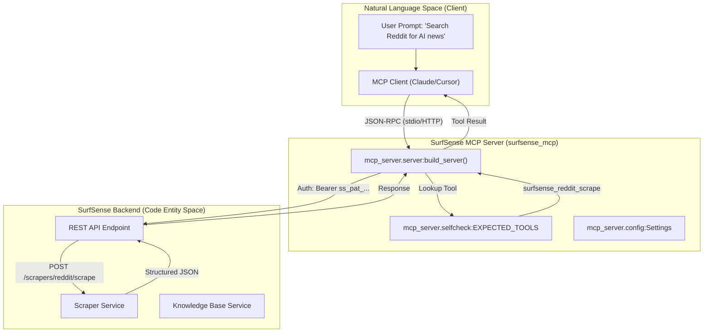

<!-- source: DeepWiki mcp.deepwiki.com · repo MODSetter/SurfSense · page 13.3 MCP Server · fetched 2026-10-29 -->

# MCP Server

<details>
<summary>Relevant source files</summary>

The following files were used as context for generating this wiki page:

- [README.es.md](README.es.md)
- [README.hi.md](README.hi.md)
- [README.md](README.md)
- [README.pt-BR.md](README.pt-BR.md)
- [README.zh-CN.md](README.zh-CN.md)
- [surfsense_backend/app/agents/chat/multi_agent_chat/subagents/builtins/tiktok/__init__.py](surfsense_backend/app/agents/chat/multi_agent_chat/subagents/builtins/tiktok/__init__.py)
- [surfsense_backend/app/agents/chat/multi_agent_chat/subagents/builtins/tiktok/agent.py](surfsense_backend/app/agents/chat/multi_agent_chat/subagents/builtins/tiktok/agent.py)
- [surfsense_backend/app/agents/chat/multi_agent_chat/subagents/builtins/tiktok/description.md](surfsense_backend/app/agents/chat/multi_agent_chat/subagents/builtins/tiktok/description.md)
- [surfsense_backend/app/agents/chat/multi_agent_chat/subagents/builtins/tiktok/system_prompt.md](surfsense_backend/app/agents/chat/multi_agent_chat/subagents/builtins/tiktok/system_prompt.md)
- [surfsense_backend/app/agents/chat/multi_agent_chat/subagents/builtins/tiktok/tools/__init__.py](surfsense_backend/app/agents/chat/multi_agent_chat/subagents/builtins/tiktok/tools/__init__.py)
- [surfsense_mcp/README.md](surfsense_mcp/README.md)
- [surfsense_mcp/mcp_server/features/scrapers/__init__.py](surfsense_mcp/mcp_server/features/scrapers/__init__.py)
- [surfsense_mcp/mcp_server/features/scrapers/platforms/amazon.py](surfsense_mcp/mcp_server/features/scrapers/platforms/amazon.py)
- [surfsense_mcp/mcp_server/features/scrapers/platforms/instagram.py](surfsense_mcp/mcp_server/features/scrapers/platforms/instagram.py)
- [surfsense_mcp/mcp_server/features/scrapers/platforms/tiktok.py](surfsense_mcp/mcp_server/features/scrapers/platforms/tiktok.py)
- [surfsense_mcp/mcp_server/features/scrapers/platforms/walmart.py](surfsense_mcp/mcp_server/features/scrapers/platforms/walmart.py)
- [surfsense_mcp/mcp_server/selfcheck.py](surfsense_mcp/mcp_server/selfcheck.py)
- [surfsense_mcp/mcp_server/server.py](surfsense_mcp/mcp_server/server.py)
- [surfsense_web/changelog/content/2026-07-05.mdx](surfsense_web/changelog/content/2026-07-05.mdx)
- [surfsense_web/components/assistant-ui/connector-popup/connect-forms/components/mcp-connect-form.tsx](surfsense_web/components/assistant-ui/connector-popup/connect-forms/components/mcp-connect-form.tsx)
- [surfsense_web/components/assistant-ui/connector-popup/connector-configs/components/mcp-config.tsx](surfsense_web/components/assistant-ui/connector-popup/connector-configs/components/mcp-config.tsx)
- [surfsense_web/components/assistant-ui/connector-popup/utils/mcp-config-validator.ts](surfsense_web/components/assistant-ui/connector-popup/utils/mcp-config-validator.ts)
- [surfsense_web/content/docs/connectors/index.mdx](surfsense_web/content/docs/connectors/index.mdx)
- [surfsense_web/content/docs/connectors/native/amazon.mdx](surfsense_web/content/docs/connectors/native/amazon.mdx)
- [surfsense_web/content/docs/connectors/native/indeed.mdx](surfsense_web/content/docs/connectors/native/indeed.mdx)
- [surfsense_web/content/docs/connectors/native/index.mdx](surfsense_web/content/docs/connectors/native/index.mdx)
- [surfsense_web/content/docs/connectors/native/instagram.mdx](surfsense_web/content/docs/connectors/native/instagram.mdx)
- [surfsense_web/content/docs/connectors/native/meta.json](surfsense_web/content/docs/connectors/native/meta.json)
- [surfsense_web/content/docs/connectors/native/tiktok.mdx](surfsense_web/content/docs/connectors/native/tiktok.mdx)
- [surfsense_web/content/docs/connectors/native/walmart.mdx](surfsense_web/content/docs/connectors/native/walmart.mdx)
- [surfsense_web/content/docs/how-to/mcp-server.mdx](surfsense_web/content/docs/how-to/mcp-server.mdx)
- [surfsense_web/lib/playground/catalog.ts](surfsense_web/lib/playground/catalog.ts)
- [surfsense_web/lib/playground/platform-icons.tsx](surfsense_web/lib/playground/platform-icons.tsx)
- [surfsense_web/public/announcements/competitive-intelligence.png](surfsense_web/public/announcements/competitive-intelligence.png)
- [surfsense_web/public/connectors/instagram.svg](surfsense_web/public/connectors/instagram.svg)
- [surfsense_web/public/connectors/walmart.svg](surfsense_web/public/connectors/walmart.svg)

</details>


The SurfSense MCP Server is a standalone Python package (`surfsense_mcp`) that implements the [Model Context Protocol](https://modelcontextprotocol.io). It exposes SurfSense's internal research tools—including live web scrapers and knowledge base management—directly to LLM clients such as Claude Desktop, Cursor, and Claude Code [README.md:91-104](). By acting as a bridge, it allows agents to perform real-time research on the open web and interact with indexed documents using native tool-calling capabilities [surfsense_web/content/docs/how-to/mcp-server.mdx:9-10]().

## System Architecture and Data Flow

The MCP server is a "thin layer" that translates MCP JSON-RPC requests into REST API calls against the SurfSense backend. It can connect to either the SurfSense Cloud (`api.surfsense.com`) or a self-hosted instance [surfsense_web/content/docs/how-to/mcp-server.mdx:54-57]().

### MCP Integration Flow

The following diagram illustrates how a "Natural Language Space" request from a user is transformed into "Code Entity Space" operations via the MCP Server.

**Title: MCP Request Lifecycle**

Sources: [surfsense_mcp/mcp_server/server.py:1-60](), [surfsense_mcp/mcp_server/selfcheck.py:16-45](), [surfsense_web/content/docs/how-to/mcp-server.mdx:54-60]()

## Tool Registry

The server exposes 28 native, typed tools categorized into three functional groups [surfsense_web/content/docs/how-to/mcp-server.mdx:10-12](). These tools are registered via a modular registrar system [surfsense_mcp/mcp_server/features/scrapers/__init__.py:30-42]().

### 1. Workspace Context Tools
Because SurfSense is multi-tenant, the agent must select a `SearchSpace` (Workspace) to provide context for subsequent calls [surfsense_web/content/docs/how-to/mcp-server.mdx:10-11]().
- `surfsense_list_workspaces`: Lists accessible workspaces for the provided API Key [surfsense_mcp/mcp_server/selfcheck.py:18-18]().
- `surfsense_select_workspace`: Sets the default workspace ID for the session [surfsense_mcp/mcp_server/selfcheck.py:19-19]().

### 2. Live Scraper Tools
These tools map directly to the SurfSense Scraper APIs, returning structured JSON from public platforms [README.md:53-64]().

| Tool Name | Platform | Description |
|-----------|----------|-------------|
| `surfsense_reddit_scrape` | Reddit | Posts and comments without official API limits [surfsense_mcp/mcp_server/selfcheck.py:23-23](). |
| `surfsense_youtube_scrape` | YouTube | Video metadata and transcripts [surfsense_mcp/mcp_server/selfcheck.py:24-24](). |
| `surfsense_tiktok_scrape` | TikTok | Videos, hashtags, and profiles [surfsense_mcp/mcp_server/selfcheck.py:26-26](). |
| `surfsense_google_maps_scrape`| Maps | Places, ratings, and reviews [surfsense_mcp/mcp_server/selfcheck.py:30-30](). |
| `surfsense_web_crawl` | Web | Structured content from any URL [surfsense_mcp/mcp_server/selfcheck.py:21-21](). |
| `surfsense_amazon_scrape` | Amazon | Public product data, prices, and ratings [surfsense_mcp/mcp_server/selfcheck.py:32-32](). |
| `surfsense_indeed_scrape` | Indeed | Public job postings with full descriptions [surfsense_mcp/mcp_server/selfcheck.py:35-35](). |

### 3. Knowledge Base Tools
Allows the agent to manage the RAG (Retrieval-Augmented Generation) index [surfsense_mcp/mcp_server/selfcheck.py:38-46]().
- `surfsense_search_knowledge_base`: Semantic search across indexed documents.
- `surfsense_add_document` / `surfsense_upload_file`: Ingesting new data.
- `surfsense_list_documents` / `surfsense_get_document`: Retrieval and metadata inspection.
- `surfsense_update_document` / `surfsense_delete_document`: Index maintenance.

Sources: [surfsense_mcp/mcp_server/selfcheck.py:16-46](), [surfsense_mcp/mcp_server/features/scrapers/__init__.py:1-49](), [surfsense_web/lib/playground/catalog.ts:40-122]()

## Implementation Details

### Configuration and Environment
The server uses a `Settings` class to manage its connection to the backend. It requires two primary variables [surfsense_mcp/mcp_server/selfcheck.py:51-59]():
- `SURFSENSE_BASE_URL`: The target backend (e.g., `https://api.surfsense.com`).
- `SURFSENSE_API_KEY`: A Personal Access Token (`ss_pat_...`) generated in the SurfSense UI [surfsense_web/content/docs/how-to/mcp-server.mdx:14-19]().

### Tool Validation (Self-Check)
The `surfsense_mcp.mcp_server.selfcheck` module provides an offline smoke test. It verifies that every tool in `EXPECTED_TOOLS` is registered with a valid name, a description of at least 40 characters (to ensure LLM routing quality), and a well-formed JSON schema [surfsense_mcp/mcp_server/selfcheck.py:1-48]().

**Title: Internal Tool Validation Logic**
```mermaid
classDiagram
    class Settings {
        +base_url: str
        +api_key: str
        +timeout: float
    }
    class ServerBuilder {
        +build_server(settings)
    }
    class SelfCheck {
        +EXPECTED_TOOLS: set
        +run() list[str]
        +_collect_tools() dict
    }
    
    SelfCheck ..> ServerBuilder : "invokes"
    ServerBuilder ..> Settings : "configures with"
    SelfCheck --> "mcp.list_tools()" : "inspects manifest"
```
Sources: [surfsense_mcp/mcp_server/selfcheck.py:50-88](), [surfsense_mcp/mcp_server/server.py:1-60]()

## Deployment Options

### Hosted (Remote HTTP)
The server is hosted by SurfSense at `https://mcp.surfsense.com/mcp`. Clients connect via the `streamable-http` or `sse` transport, passing the API key in the `Authorization` header [surfsense_web/content/docs/how-to/mcp-server.mdx:21-34]().

### Self-Hosted (stdio)
For local development or use with a self-hosted backend, the server is run via `uv` [surfsense_web/content/docs/how-to/mcp-server.mdx:45-52]():
```bash
uv run --directory surfsense_mcp python -m mcp_server
```
This mode uses `stdio` as the transport layer, allowing local clients (like Claude Desktop) to spawn the server process directly [surfsense_web/content/docs/how-to/mcp-server.mdx:59-60]().

### UI Configuration
Users can add custom MCP servers to SurfSense via the **Connector Popup**. The `MCPConnectForm` supports both `stdio` (local process) and `streamable-http` (remote server) configurations [surfsense_web/components/assistant-ui/connector-popup/connect-forms/components/mcp-connect-form.tsx:26-53]().

Sources: [surfsense_web/content/docs/how-to/mcp-server.mdx:21-60](), [surfsense_web/components/assistant-ui/connector-popup/connect-forms/components/mcp-connect-form.tsx:18-135](), [README.md:91-104]()

---

