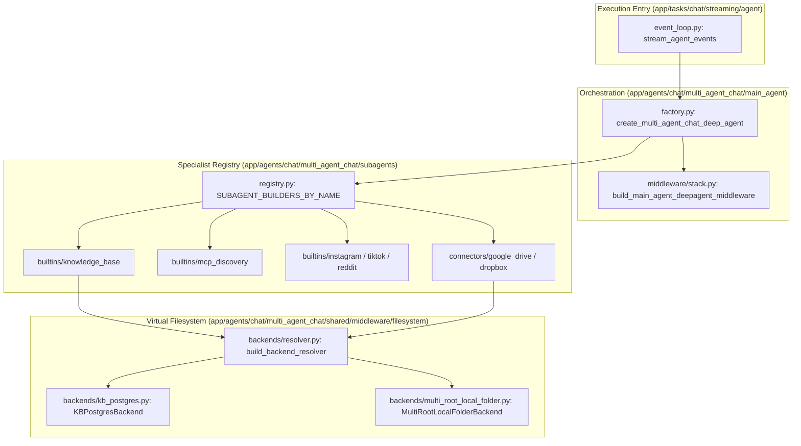
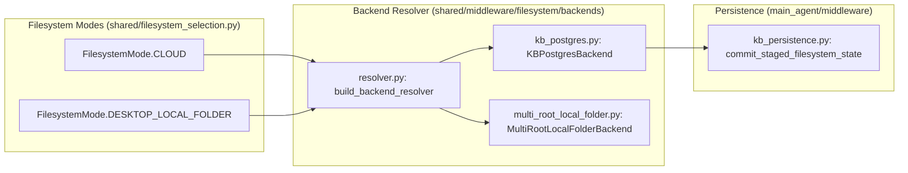

<!-- source: DeepWiki mcp.deepwiki.com · repo MODSetter/SurfSense · page 6 AI Agent System · fetched 2026-10-29 -->

# AI Agent System

Relevant source files

The following files were used as context for generating this wiki page:

- [surfsense_backend/app/agents/chat/multi_agent_chat/constants.py](surfsense_backend/app/agents/chat/multi_agent_chat/constants.py)
- [surfsense_backend/app/agents/chat/multi_agent_chat/main_agent/graph/compile_graph_sync.py](surfsense_backend/app/agents/chat/multi_agent_chat/main_agent/graph/compile_graph_sync.py)
- [surfsense_backend/app/agents/chat/multi_agent_chat/main_agent/middleware/stack.py](surfsense_backend/app/agents/chat/multi_agent_chat/main_agent/middleware/stack.py)
- [surfsense_backend/app/agents/chat/multi_agent_chat/main_agent/runtime/agent_cache.py](surfsense_backend/app/agents/chat/multi_agent_chat/main_agent/runtime/agent_cache.py)
- [surfsense_backend/app/agents/chat/multi_agent_chat/main_agent/runtime/factory.py](surfsense_backend/app/agents/chat/multi_agent_chat/main_agent/runtime/factory.py)
- [surfsense_backend/app/agents/chat/multi_agent_chat/shared/middleware/filesystem/backends/resolver.py](surfsense_backend/app/agents/chat/multi_agent_chat/shared/middleware/filesystem/backends/resolver.py)
- [surfsense_backend/app/agents/chat/multi_agent_chat/shared/middleware/filesystem/index.py](surfsense_backend/app/agents/chat/multi_agent_chat/shared/middleware/filesystem/index.py)
- [surfsense_backend/app/agents/chat/multi_agent_chat/shared/middleware/filesystem/middleware/middleware.py](surfsense_backend/app/agents/chat/multi_agent_chat/shared/middleware/filesystem/middleware/middleware.py)
- [surfsense_backend/app/agents/chat/multi_agent_chat/shared/middleware/filesystem/tools/read_file/description.py](surfsense_backend/app/agents/chat/multi_agent_chat/shared/middleware/filesystem/tools/read_file/description.py)
- [surfsense_backend/app/agents/chat/multi_agent_chat/shared/middleware/filesystem/tools/read_file/index.py](surfsense_backend/app/agents/chat/multi_agent_chat/shared/middleware/filesystem/tools/read_file/index.py)
- [surfsense_backend/app/agents/chat/multi_agent_chat/subagents/builtins/knowledge_base/middleware_stack.py](surfsense_backend/app/agents/chat/multi_agent_chat/subagents/builtins/knowledge_base/middleware_stack.py)
- [surfsense_backend/app/agents/chat/multi_agent_chat/subagents/registry.py](surfsense_backend/app/agents/chat/multi_agent_chat/subagents/registry.py)
- [surfsense_backend/app/agents/chat/multi_agent_chat/subagents/shared/subagent_builder.py](surfsense_backend/app/agents/chat/multi_agent_chat/subagents/shared/subagent_builder.py)
- [surfsense_backend/app/tasks/chat/streaming/agent/event_loop.py](surfsense_backend/app/tasks/chat/streaming/agent/event_loop.py)
- [surfsense_backend/tests/integration/agents/multi_agent_chat/test_agent_turn.py](surfsense_backend/tests/integration/agents/multi_agent_chat/test_agent_turn.py)
- [surfsense_backend/tests/unit/agents/multi_agent_chat/test_prompt_resources.py](surfsense_backend/tests/unit/agents/multi_agent_chat/test_prompt_resources.py)
- [surfsense_backend/tests/unit/agents/multi_agent_chat/test_subagent_composition.py](surfsense_backend/tests/unit/agents/multi_agent_chat/test_subagent_composition.py)
- [surfsense_backend/tests/unit/agents/test_import_all.py](surfsense_backend/tests/unit/agents/test_import_all.py)
- [surfsense_backend/tests/unit/middleware/test_filesystem_backends.py](surfsense_backend/tests/unit/middleware/test_filesystem_backends.py)

The AI Agent System is the core intelligence layer of SurfSense, implementing a stateful conversational AI framework built on **LangGraph** and **LangChain**. This system, referred to as the **Deep Agent**, enables natural language interactions with a workspace's knowledge base through multi-agent orchestration, tool-based reasoning, hybrid search, and transparent source attribution via citations.

**Scope**: This page provides a high-level overview of the Deep Agent framework, its subagent registry, and its integration into the streaming chat flow.
- For technical details on the LangGraph state machine and middleware, see [Agent Architecture](#6.1).
- For a catalog of available capabilities, see [Built-in Tools](#6.2).
- For details on the underlying retrieval algorithms, see [Search and Retrieval](#6.3).
- For the citation marker system, see [Citations and Source Attribution](#6.4).
- For the human-approval workflow, see [Human-in-the-Loop (HITL)](#6.5).

---

## System Overview

The AI Agent System orchestrates a "Main Agent" that delegates specialized tasks to various "Subagents" based on the user's query and the workspace's available connectors.

| Component | Purpose | Implementation |
|-----------|---------|----------------|
| **Main Agent** | Supervisor and router | `create_multi_agent_chat_deep_agent` [surfsense_backend/app/agents/chat/multi_agent_chat/main_agent/runtime/factory.py:59-77]() |
| **Subagent Registry** | Specialist roster | `SUBAGENT_BUILDERS_BY_NAME` [surfsense_backend/app/agents/chat/multi_agent_chat/subagents/registry.py:91-109]() |
| **Middleware Stack** | Cross-cutting concerns (Auth, FS, HITL) | `build_main_agent_deepagent_middleware` [surfsense_backend/app/agents/chat/multi_agent_chat/main_agent/middleware/stack.py:101-121]() |
| **Filesystem Backend** | Virtual FS abstraction (Cloud/Local) | `build_backend_resolver` [surfsense_backend/app/agents/chat/multi_agent_chat/shared/middleware/filesystem/backends/resolver.py:31-35]() |
| **Event Loop** | Turn-based execution and SSE streaming | `stream_agent_events` [surfsense_backend/app/tasks/chat/streaming/agent/event_loop.py:38-55]() |

**Key Characteristics**:
- **Stateful Persistence**: Uses LangGraph checkpointers to persist conversation state, allowing for turn-based resumption and complex multi-step reasoning [surfsense_backend/app/tasks/chat/streaming/agent/event_loop.py:79-84]().
- **Connector-Gated Capabilities**: Subagents are dynamically included in the agent's roster based on which connectors (e.g., Slack, Google Drive) are active in the workspace [surfsense_backend/app/agents/chat/multi_agent_chat/constants.py:31-61]().
- **Unified Tool Interface**: Most third-party integrations (Notion, Jira, etc.) are consolidated under a single `mcp_discovery` subagent using the Model Context Protocol [surfsense_backend/app/agents/chat/multi_agent_chat/constants.py:9-26]().
- **Filesystem Virtualization**: The agent interacts with a virtual filesystem that maps to either a Cloud DB (`KBPostgresBackend`) or local folders (`MultiRootLocalFolderBackend`) [surfsense_backend/app/agents/chat/multi_agent_chat/shared/middleware/filesystem/backends/resolver.py:31-68]().

**Sources**: [surfsense_backend/app/agents/chat/multi_agent_chat/main_agent/runtime/factory.py:59-150](), [surfsense_backend/app/agents/chat/multi_agent_chat/subagents/registry.py:91-109](), [surfsense_backend/app/agents/chat/multi_agent_chat/main_agent/middleware/stack.py:1-15]()

---

## Agent Architecture and Data Flow

The system bridges natural language user intent to specific code entities via a hierarchical routing structure.

### From Request to Reasoning

**Architecture Explanation**:
1. **Event Loop**: The `stream_agent_events` function drives the LangGraph `astream_events` loop, yielding SSE updates to the frontend and handling post-turn state commits [surfsense_backend/app/tasks/chat/streaming/agent/event_loop.py:56-75]().
2. **Main Agent Factory**: `create_multi_agent_chat_deep_agent` assembles the agent by discovering available connectors, loading MCP tools, and configuring the system prompt [surfsense_backend/app/agents/chat/multi_agent_chat/main_agent/runtime/factory.py:59-167]().
3. **Subagent Registry**: A central map `SUBAGENT_BUILDERS_BY_NAME` defines the available specialists. Each specialist is a standalone LangGraph agent with its own middleware stack [surfsense_backend/app/agents/chat/multi_agent_chat/subagents/registry.py:91-109]().
4. **Middleware Stack**: A sophisticated chain of middleware handles concerns like `SurfSenseCheckpointedSubAgentMiddleware` (for HITL), `SurfSenseFilesystemMiddleware` (for file IO), and `PermissionMiddleware` [surfsense_backend/app/agents/chat/multi_agent_chat/main_agent/middleware/stack.py:81-96]().

**Sources**: [surfsense_backend/app/agents/chat/multi_agent_chat/main_agent/runtime/factory.py:59-150](), [surfsense_backend/app/agents/chat/multi_agent_chat/main_agent/middleware/stack.py:1-121](), [surfsense_backend/app/tasks/chat/streaming/agent/event_loop.py:38-175]()

---

## Specialist Subagent Registry

SurfSense uses a "Specialist" pattern where the supervisor (Main Agent) delegates tasks to sub-agents with narrow scopes.

| Subagent Name | Responsibility | Required Connector(s) |
|---------------|----------------|----------------------|
| `knowledge_base` | RAG over internal documents and file management | None (Built-in) [surfsense_backend/app/agents/chat/multi_agent_chat/constants.py:34]() |
| `mcp_discovery` | Unified route for Slack, Jira, Notion, Gmail, etc. | `SLACK_CONNECTOR`, `NOTION_CONNECTOR`, etc. [surfsense_backend/app/agents/chat/multi_agent_chat/constants.py:44-57]() |
| `web_crawler` | General web scraping and search | None (Built-in) [surfsense_backend/app/agents/chat/multi_agent_chat/constants.py:35]() |
| `google_drive` | Native file connector for Google Drive | `GOOGLE_DRIVE_FILE` [surfsense_backend/app/agents/chat/multi_agent_chat/constants.py:59]() |
| `deliverables` | Generation of podcasts, reports, and videos | None (Built-in) [surfsense_backend/app/agents/chat/multi_agent_chat/constants.py:33]() |

### Subagent Composition
Subagents are dynamically excluded if their required connector tokens are missing from the workspace [surfsense_backend/app/agents/chat/multi_agent_chat/subagents/registry.py:133-149](). Every subagent (except the KB itself) is injected with the `ask_knowledge_base` tool, allowing specialists to query the central knowledge base [surfsense_backend/app/agents/chat/multi_agent_chat/subagents/registry.py:166-176]().

For more details, see [Agent Architecture](#6.1) and [Built-in Tools](#6.2).

**Sources**: [surfsense_backend/app/agents/chat/multi_agent_chat/subagents/registry.py:91-109](), [surfsense_backend/app/agents/chat/multi_agent_chat/constants.py:31-61](), [surfsense_backend/app/agents/chat/multi_agent_chat/subagents/builtins/knowledge_base/middleware_stack.py:57-80]()

---

## Filesystem and Persistence

The agent system uses a virtual filesystem to provide a unified interface for document management.

### Filesystem Backend Resolution

**Persistence Logic**:
- **Staging**: File writes (e.g., `write_file`) are staged in the agent state (`dirty_paths`, `staged_dirs`) during the turn [surfsense_backend/app/tasks/chat/streaming/agent/event_loop.py:97-102]().
- **Commit**: At the end of a turn, the `KnowledgeBasePersistenceMiddleware` (or a safety-net in the event loop) commits these changes to the database or local disk [surfsense_backend/app/tasks/chat/streaming/agent/event_loop.py:105-112]().
- **Retrieval**: The `read_file` tool first checks the state cache, then lazily loads from the KB backend if necessary [surfsense_backend/app/agents/chat/multi_agent_chat/shared/middleware/filesystem/tools/read_file/index.py:58-69]().

For more details on the retrieval workflow, see [Search and Retrieval](#6.3).

**Sources**: [surfsense_backend/app/agents/chat/multi_agent_chat/shared/middleware/filesystem/backends/resolver.py:31-68](), [surfsense_backend/app/tasks/chat/streaming/agent/event_loop.py:86-120](), [surfsense_backend/app/agents/chat/multi_agent_chat/shared/middleware/filesystem/tools/read_file/index.py:37-83]()

---

## Caching and Optimization

To reduce latency and costs, SurfSense implements several layers of caching:
- **Compiled Agent Cache**: The multi-agent LangGraph is cached based on a signature of tools, connectors, flags, and system prompts, allowing cross-thread reuse [surfsense_backend/app/agents/chat/multi_agent_chat/main_agent/runtime/agent_cache.py:38-126]().
- **LLM Prompt Caching**: Uses LiteLLM to apply provider-specific prompt caching (e.g., Anthropic) for long system prompts and tool definitions [surfsense_backend/app/agents/chat/multi_agent_chat/main_agent/runtime/factory.py:86]().
- **Lazy Compilation**: Subagent graphs (like the read-only KB) are only compiled on their first use within a turn to improve TTFT (Time To First Token) [surfsense_backend/app/agents/chat/multi_agent_chat/main_agent/middleware/stack.py:145-172]().

**Sources**: [surfsense_backend/app/agents/chat/multi_agent_chat/main_agent/runtime/agent_cache.py:101-126](), [surfsense_backend/app/agents/chat/multi_agent_chat/main_agent/middleware/stack.py:145-172]()

---

