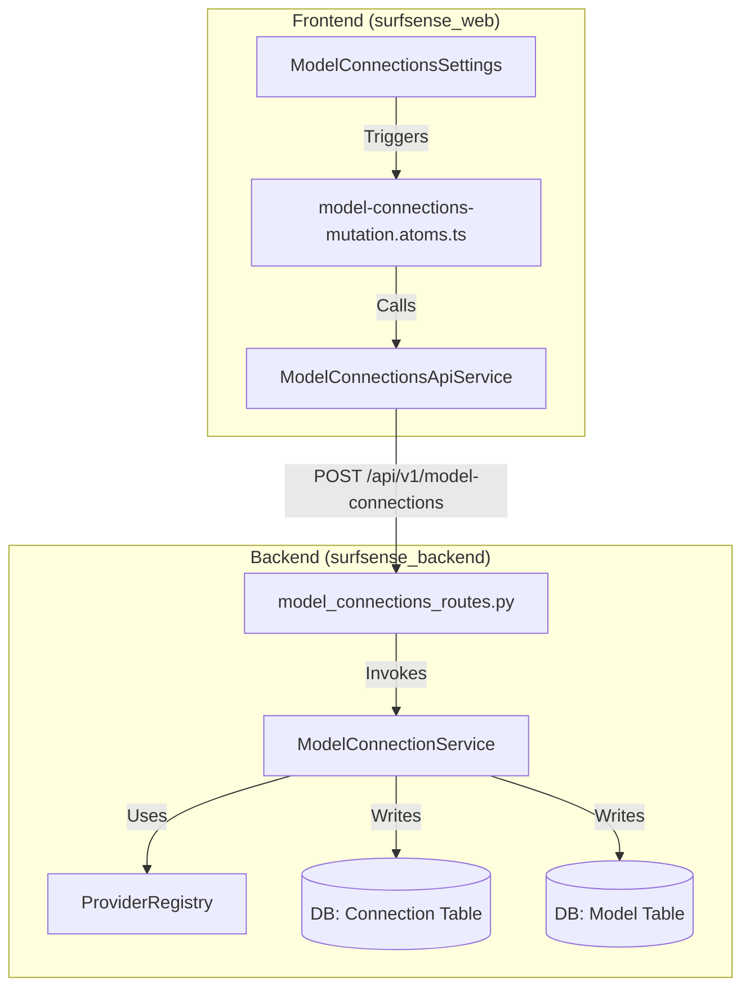
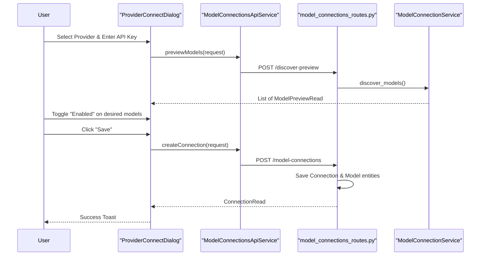

<!-- source: DeepWiki mcp.deepwiki.com · repo MODSetter/SurfSense · page 9.1 LLM Configuration Management · fetched 2026-10-29 -->

# LLM Configuration Management

Relevant source files

The following files were used as context for generating this wiki page:

- [surfsense_backend/alembic/versions/160_add_model_connections.py](surfsense_backend/alembic/versions/160_add_model_connections.py)
- [surfsense_backend/app/routes/model_connections_routes.py](surfsense_backend/app/routes/model_connections_routes.py)
- [surfsense_backend/app/schemas/__init__.py](surfsense_backend/app/schemas/__init__.py)
- [surfsense_backend/app/schemas/model_connections.py](surfsense_backend/app/schemas/model_connections.py)
- [surfsense_backend/app/services/model_connection_service.py](surfsense_backend/app/services/model_connection_service.py)
- [surfsense_backend/app/services/model_resolver.py](surfsense_backend/app/services/model_resolver.py)
- [surfsense_backend/app/services/provider_registry.py](surfsense_backend/app/services/provider_registry.py)
- [surfsense_backend/tests/unit/services/test_model_connections.py](surfsense_backend/tests/unit/services/test_model_connections.py)
- [surfsense_web/atoms/model-connections/model-connections-mutation.atoms.ts](surfsense_web/atoms/model-connections/model-connections-mutation.atoms.ts)
- [surfsense_web/atoms/model-connections/model-connections-query.atoms.ts](surfsense_web/atoms/model-connections/model-connections-query.atoms.ts)
- [surfsense_web/components/icons/providers/github.svg](surfsense_web/components/icons/providers/github.svg)
- [surfsense_web/components/icons/providers/index.ts](surfsense_web/components/icons/providers/index.ts)
- [surfsense_web/components/settings/model-connections-settings.tsx](surfsense_web/components/settings/model-connections-settings.tsx)
- [surfsense_web/components/settings/model-connections/azure-connect-form.tsx](surfsense_web/components/settings/model-connections/azure-connect-form.tsx)
- [surfsense_web/components/settings/model-connections/bedrock-connect-form.tsx](surfsense_web/components/settings/model-connections/bedrock-connect-form.tsx)
- [surfsense_web/components/settings/model-connections/connect-fields.tsx](surfsense_web/components/settings/model-connections/connect-fields.tsx)
- [surfsense_web/components/settings/model-connections/connection-card.tsx](surfsense_web/components/settings/model-connections/connection-card.tsx)
- [surfsense_web/components/settings/model-connections/connection-settings-dialog.tsx](surfsense_web/components/settings/model-connections/connection-settings-dialog.tsx)
- [surfsense_web/components/settings/model-connections/default-connect-form.tsx](surfsense_web/components/settings/model-connections/default-connect-form.tsx)
- [surfsense_web/components/settings/model-connections/model-provider-connections-panel.tsx](surfsense_web/components/settings/model-connections/model-provider-connections-panel.tsx)
- [surfsense_web/components/settings/model-connections/model-utils.ts](surfsense_web/components/settings/model-connections/model-utils.ts)
- [surfsense_web/components/settings/model-connections/models-selection-panel.tsx](surfsense_web/components/settings/model-connections/models-selection-panel.tsx)
- [surfsense_web/components/settings/model-connections/provider-connect-dialog.tsx](surfsense_web/components/settings/model-connections/provider-connect-dialog.tsx)
- [surfsense_web/components/settings/model-connections/provider-metadata.tsx](surfsense_web/components/settings/model-connections/provider-metadata.tsx)
- [surfsense_web/components/settings/model-connections/vertex-connect-form.tsx](surfsense_web/components/settings/model-connections/vertex-connect-form.tsx)
- [surfsense_web/contracts/types/model-connections.types.ts](surfsense_web/contracts/types/model-connections.types.ts)
- [surfsense_web/lib/apis/model-connections-api.service.ts](surfsense_web/lib/apis/model-connections-api.service.ts)
- [surfsense_web/lib/provider-icons.tsx](surfsense_web/lib/provider-icons.tsx)
- [surfsense_web/lib/query-client/cache-keys.ts](surfsense_web/lib/query-client/cache-keys.ts)

## Purpose and Scope

This page documents the system for managing Large Language Model (LLM) configurations in SurfSense. The system enables users and administrators to connect to over 100+ models from 28+ providers (OpenAI, Anthropic, Groq, local Ollama, etc.) through a unified interface. These configurations are managed via the `ModelConnectionsApiService` and associated backend services, facilitating API key storage, model discovery, and role-based assignment (e.g., Chat vs. Vision models).

**Key Capabilities:**
- **Provider Discovery**: Automatic fetching of available models from provider endpoints [surfsense_backend/app/services/model_connection_service.py:23]().
- **Credential Management**: Secure storage of API keys and base URLs [surfsense_backend/app/schemas/model_connections.py:34-35]().
- **Scoping**: Support for Global (system-wide) and SearchSpace-specific connections [surfsense_contracts/types/model-connections.types.ts:3]().
- **Capability Probing**: Automatic detection of model features like tool-calling, vision, and image generation [surfsense_backend/app/services/model_connection_service.py:1]().

---

## Data Model and Entities

The LLM configuration system is built around two primary entities: **Connections** and **Models**.

### Connection Entity
A `Connection` represents the authentication and transport layer for a specific provider.

| Field | Type | Description |
|-------|------|-------------|
| `provider` | String | Provider identifier (e.g., "OPENAI", "ANTHROPIC", "OLLAMA") [surfsense_backend/app/schemas/model_connections.py:74]() |
| `api_key` | String | Encrypted API key for the provider [surfsense_backend/app/schemas/model_connections.py:76]() |
| `base_url` | String | Custom endpoint URL (required for local/private providers) [surfsense_backend/app/schemas/model_connections.py:75]() |
| `scope` | Enum | `GLOBAL`, `SEARCH_SPACE`, or `USER` [surfsense_web/contracts/types/model-connections.types.ts:3]() |
| `enabled` | Boolean | Global toggle for the connection [surfsense_backend/app/schemas/model_connections.py:80]() |

### Model Entity
A `Model` represents a specific LLM available through a connection. Models can be discovered automatically or added manually.

| Field | Type | Description |
|-------|------|-------------|
| `model_id` | String | The technical ID used in API calls (e.g., "gpt-4o") [surfsense_backend/app/schemas/model_connections.py:13]() |
| `capabilities` | JSON | Booleans for `supports_chat`, `supports_vision`, `supports_tools`, etc. [surfsense_backend/app/schemas/model_connections.py:16-20]() |
| `source` | Enum | `DISCOVERED` (via API) or `MANUAL` (user-entered) [surfsense_backend/app/schemas/model_connections.py:15]() |

**Sources:** [surfsense_backend/app/schemas/model_connections.py:10-82](), [surfsense_web/contracts/types/model-connections.types.ts:1-135]()

---

## Component Architecture and Data Flow

The configuration management interface is driven by [Jotai](https://jotai.org) atoms for state and [TanStack Query](https://tanstack.com/query) for server synchronization.

### System Interaction Diagram

This diagram bridges the frontend UI components to the backend service logic and database entities.

**Sources:** [surfsense_web/components/settings/model-connections-settings.tsx:5-10](), [surfsense_web/atoms/model-connections/model-connections-mutation.atoms.ts:62-80](), [surfsense_backend/app/routes/model_connections_routes.py:39-47](), [surfsense_backend/app/services/model_connection_service.py:1-19]()

---

## Implementation Details

### Model Discovery and Verification
When a user adds a connection, the `ModelConnectionService` attempts to verify the credentials and discover available models.

1. **Verification**: The service calls `verify_connection`. For OpenAI-compatible providers, it hits the `/models` endpoint [surfsense_backend/app/services/model_connection_service.py:152-153](). For Ollama, it checks `/api/version` [surfsense_backend/app/services/model_connection_service.py:150-151]().
2. **Discovery**: The `discover_models` function fetches the full model list. It uses specific normalizers for providers like OpenRouter or Requesty to clean up metadata [surfsense_backend/app/services/model_connection_service.py:15-18]().
3. **Capability Probing**: The system derives capabilities (e.g., vision support) by checking the model ID against known patterns or provider-specific metadata [surfsense_backend/app/routes/model_connections_routes.py:111-117]().

### Connection Scoping
SurfSense handles configurations at different hierarchy levels:
- **Global**: Stored with `scope="GLOBAL"`. These are available system-wide [surfsense_web/lib/apis/model-connections-api.service.ts:35-37]().
- **SearchSpace**: Created within a specific workspace. Only members of that workspace can use these credentials [surfsense_web/lib/apis/model-connections-api.service.ts:51-56]().

**Sources:** [surfsense_backend/app/services/model_connection_service.py:144-187](), [surfsense_backend/app/routes/model_connections_routes.py:145-165](), [surfsense_web/lib/apis/model-connections-api.service.ts:35-56]()

---

## User Interface: Model Configuration

The configuration UI is split into two primary areas: **Model Roles** and **Provider Connections**.

### 1. Model Roles Assignment
Users assign specific models to functional roles within a SearchSpace. This is managed in the `ModelConnectionsSettings` component [surfsense_web/components/settings/model-connections-settings.tsx:53]().

| Role | Description |
|------|-------------|
| **Chat Model** | Primary model for chat responses and agent tasks [surfsense_web/components/settings/model-connections-settings.tsx:92-95](). |
| **Vision Model** | Used to understand images in uploads and documents [surfsense_web/components/settings/model-connections-settings.tsx:111-115](). |
| **Image Generation** | Powers text-to-image generation tools [surfsense_web/components/settings/model-connections-settings.tsx:130-131](). |

### 2. Provider Configuration Forms
The system uses a dynamic form system. The `DefaultConnectForm` handles standard API-key based providers [surfsense_web/components/settings/model-connections/default-connect-form.tsx:33]().

**Special Handling for Local Models:**
For local providers like **Ollama** or **LM Studio**, the system provides a hint to use `host.docker.internal` instead of `localhost` if SurfSense is running inside a Docker container [surfsense_web/components/settings/model-connections/default-connect-form.tsx:7-10]().

**Sources:** [surfsense_web/components/settings/model-connections-settings.tsx:81-153](), [surfsense_web/components/settings/model-connections/default-connect-form.tsx:1-71]()

---

## Configuration Workflow

The following diagram illustrates the lifecycle of creating a new LLM connection using frontend components and backend services.

**Sources:** [surfsense_web/lib/apis/model-connections-api.service.ts:100-119](), [surfsense_web/atoms/model-connections/model-connections-mutation.atoms.ts:62-80](), [surfsense_backend/app/routes/model_connections_routes.py:22-37]()

---

## Supported Providers and Icons

SurfSense includes a comprehensive `getProviderIcon` utility that maps provider strings to their respective brand icons [surfsense_web/lib/provider-icons.tsx:48-138]().

**Commonly Used Providers:**
- **Native**: OpenAI, Anthropic, Google Gemini [surfsense_web/lib/provider-icons.tsx:61-112]().
- **Inference Gates**: OpenRouter, Groq, Together AI [surfsense_web/lib/provider-icons.tsx:95-126]().
- **Local**: Ollama, LM Studio [surfsense_web/lib/provider-icons.tsx:98-110]().
- **Specialty**: DeepSeek, Perplexity, Cerebras [surfsense_web/lib/provider-icons.tsx:72-116]().

**Sources:** [surfsense_web/lib/provider-icons.tsx:1-139](), [surfsense_web/contracts/types/model-connections.types.ts:116-126]()

---

