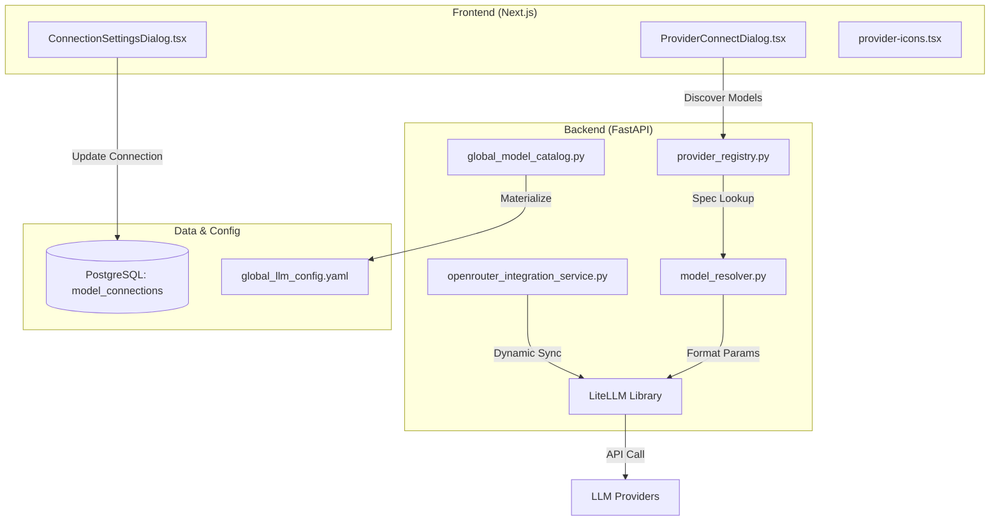
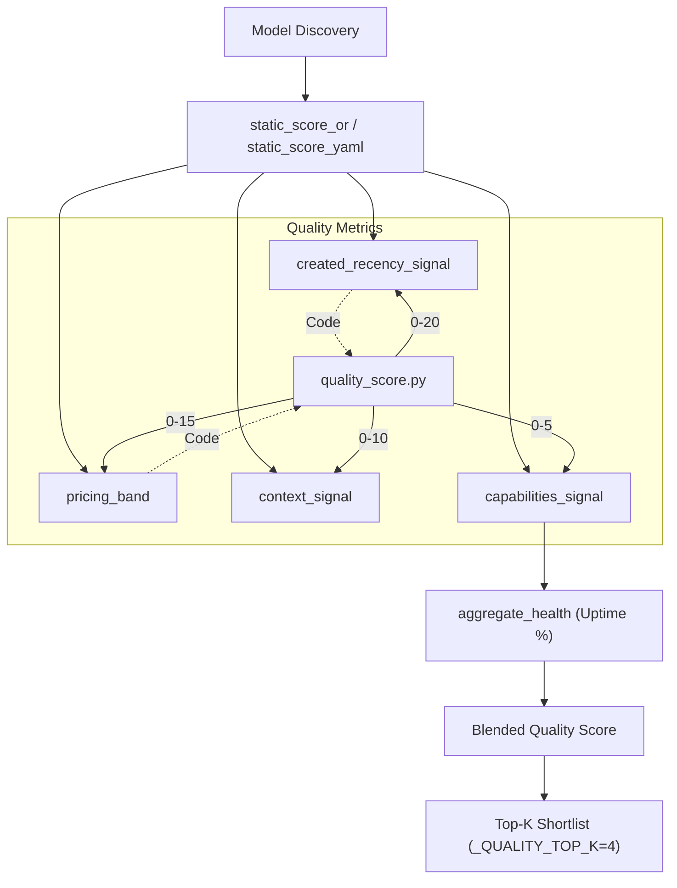

<!-- source: DeepWiki mcp.deepwiki.com · repo MODSetter/SurfSense · page 9.3 LLM Provider Support · fetched 2026-10-29 -->

# LLM Provider Support

Relevant source files

The following files were used as context for generating this wiki page:

- [docs/chinese-llm-setup.md](docs/chinese-llm-setup.md)
- [surfsense_backend/app/config/global_llm_config.example.yaml](surfsense_backend/app/config/global_llm_config.example.yaml)
- [surfsense_backend/app/services/global_model_catalog.py](surfsense_backend/app/services/global_model_catalog.py)
- [surfsense_backend/app/services/model_resolver.py](surfsense_backend/app/services/model_resolver.py)
- [surfsense_backend/app/services/openrouter_integration_service.py](surfsense_backend/app/services/openrouter_integration_service.py)
- [surfsense_backend/app/services/pricing_registration.py](surfsense_backend/app/services/pricing_registration.py)
- [surfsense_backend/app/services/provider_capabilities.py](surfsense_backend/app/services/provider_capabilities.py)
- [surfsense_backend/app/services/provider_registry.py](surfsense_backend/app/services/provider_registry.py)
- [surfsense_backend/app/services/quality_score.py](surfsense_backend/app/services/quality_score.py)
- [surfsense_backend/tests/unit/services/test_model_connections.py](surfsense_backend/tests/unit/services/test_model_connections.py)
- [surfsense_backend/tests/unit/services/test_openrouter_integration_service.py](surfsense_backend/tests/unit/services/test_openrouter_integration_service.py)
- [surfsense_backend/tests/unit/services/test_pricing_registration.py](surfsense_backend/tests/unit/services/test_pricing_registration.py)
- [surfsense_backend/tests/unit/services/test_quality_score.py](surfsense_backend/tests/unit/services/test_quality_score.py)
- [surfsense_web/components/icons/providers/github.svg](surfsense_web/components/icons/providers/github.svg)
- [surfsense_web/components/icons/providers/index.ts](surfsense_web/components/icons/providers/index.ts)
- [surfsense_web/components/settings/model-connections/azure-connect-form.tsx](surfsense_web/components/settings/model-connections/azure-connect-form.tsx)
- [surfsense_web/components/settings/model-connections/bedrock-connect-form.tsx](surfsense_web/components/settings/model-connections/bedrock-connect-form.tsx)
- [surfsense_web/components/settings/model-connections/connect-fields.tsx](surfsense_web/components/settings/model-connections/connect-fields.tsx)
- [surfsense_web/components/settings/model-connections/connection-card.tsx](surfsense_web/components/settings/model-connections/connection-card.tsx)
- [surfsense_web/components/settings/model-connections/connection-settings-dialog.tsx](surfsense_web/components/settings/model-connections/connection-settings-dialog.tsx)
- [surfsense_web/components/settings/model-connections/default-connect-form.tsx](surfsense_web/components/settings/model-connections/default-connect-form.tsx)
- [surfsense_web/components/settings/model-connections/model-provider-connections-panel.tsx](surfsense_web/components/settings/model-connections/model-provider-connections-panel.tsx)
- [surfsense_web/components/settings/model-connections/model-utils.ts](surfsense_web/components/settings/model-connections/model-utils.ts)
- [surfsense_web/components/settings/model-connections/models-selection-panel.tsx](surfsense_web/components/settings/model-connections/models-selection-panel.tsx)
- [surfsense_web/components/settings/model-connections/provider-connect-dialog.tsx](surfsense_web/components/settings/model-connections/provider-connect-dialog.tsx)
- [surfsense_web/components/settings/model-connections/provider-metadata.tsx](surfsense_web/components/settings/model-connections/provider-metadata.tsx)
- [surfsense_web/components/settings/model-connections/vertex-connect-form.tsx](surfsense_web/components/settings/model-connections/vertex-connect-form.tsx)
- [surfsense_web/lib/provider-icons.tsx](surfsense_web/lib/provider-icons.tsx)
- [surfsense_web/lib/query-client/query-client.provider.check.tsx](surfsense_web/lib/query-client/query-client.provider.check.tsx)
- [surfsense_web/lib/query-client/query-client.provider.tsx](surfsense_web/lib/query-client/query-client.provider.tsx)

This document provides a technical reference for the LLM provider ecosystem in SurfSense. The system utilizes [LiteLLM](https://docs.litellm.ai) as a unified abstraction layer, supporting over 28 providers and hundreds of models, ranging from frontier platforms (OpenAI, Anthropic) to specialized fast-inference hardware (Groq, Cerebras) and local deployments (Ollama, LM Studio).

## Provider Architecture

SurfSense manages LLM providers through a hybrid configuration system. System-wide defaults are defined in a `global_llm_config.yaml` file, while user-provided "Bring Your Own Key" (BYOK) configurations are persisted in the PostgreSQL database via the `ModelConnections` service.

### System Interaction Diagram
This diagram bridges the frontend configuration UI to the backend execution services.

**Sources:** [surfsense_backend/app/services/provider_registry.py:45-127](), [surfsense_backend/app/services/model_resolver.py:1-50](), [surfsense_web/components/settings/model-connections/connection-settings-dialog.tsx:115-158](), [surfsense_backend/app/services/global_model_catalog.py:1-30]()

## Supported Provider Categories

### 1. Major Platforms & Native Providers
These providers are integrated with specific authentication styles and discovery mechanisms.

| Provider | Transport | Auth Style | Discovery Kind |
| :--- | :--- | :--- | :--- |
| **OpenAI** | NATIVE | Bearer | `openai_models` |
| **Anthropic** | NATIVE | X-API-Key | `anthropic_models` |
| **Azure OpenAI**| NATIVE | Native | `static` |
| **Vertex AI** | NATIVE | Native | `static` |
| **Amazon Bedrock**| NATIVE | Native | `bedrock_models` |

**Sources:** [surfsense_backend/app/services/provider_registry.py:46-72](), [surfsense_web/lib/provider-icons.tsx:61-71]()

### 2. Fast Inference & Specialized Providers
SurfSense supports high-performance inference providers, often utilized for real-time agent interactions.
*   **Groq / Cerebras / SambaNova:** Supported via LiteLLM prefixes for low-latency LPU/WSE inference [surfsense_web/lib/provider-icons.tsx:72-123]().
*   **DeepSeek:** Native support for Chinese high-performance models including `deepseek-chat` and `deepseek-coder` [docs/chinese-llm-setup.md:34-73]().
*   **Chinese LLMs:** Specialized configurations for Alibaba Qwen, Moonshot (Kimi), Zhipu AI (GLM), and MiniMax [docs/chinese-llm-setup.md:9-18]().

### 3. Aggregators (Dynamic Discovery)
The system includes specialized services to handle providers that aggregate hundreds of models.
*   **OpenRouter:** Uses `openrouter_integration_service.py` to dynamically fetch models from `https://openrouter.ai/api/v1/models` [surfsense_backend/app/services/openrouter_integration_service.py:39-46](). It derives stable IDs for these models using a deterministic hashing function `_stable_config_id` to ensure thread consistency across catalog refreshes [surfsense_backend/app/services/openrouter_integration_service.py:54-70]().

## Quality Scoring and Auto-Selection

SurfSense implements a sophisticated scoring algorithm to rank models for its "Auto" mode.

### Scoring Logic Flow
This diagram maps the scoring code entities to the selection logic.

**Sources:** [surfsense_backend/app/services/quality_score.py:8-21](), [surfsense_backend/app/services/quality_score.py:123-207](), [surfsense_backend/app/services/quality_score.py:32-42]()

## Custom & Local Endpoints

SurfSense provides extensive support for local and custom inference servers, allowing users to keep data within their own infrastructure.

*   **Ollama:** Configured with a default base URL of `http://host.docker.internal:11434` for Docker-to-Host communication [surfsense_backend/app/services/provider_registry.py:118-126]().
*   **LM Studio:** Pre-configured for local testing on port 1234 [surfsense_web/components/settings/model-connections/default-connect-form.tsx:8-10]().
*   **OpenAI Compatible:** Supports any API following the OpenAI spec. Users can choose between standard `/v1` appending or "Raw" mode where the URL is used exactly as entered [surfsense_web/components/settings/model-connections/default-connect-form.tsx:11-16]().

## Implementation Details

### Model Resolving
The `model_resolver.py` is responsible for translating SurfSense internal configuration into LiteLLM-compatible parameters.
*   **Anthropic Versioning:** Automatically strips trailing `/v1` from base URLs to prevent double-versioning in LiteLLM (e.g., `v1/v1/messages`) [surfsense_backend/tests/unit/services/test_model_connections.py:5-19]().
*   **Local Keys:** Supplies dummy API keys (e.g., `"not-needed"`) for local providers like LM Studio that require a non-empty key field but do not validate it [surfsense_backend/tests/unit/services/test_model_connections.py:67-80]().

### UI Components
*   **ModelsSelectionPanel:** Provides a filtered interface for enabling/disabling specific models within a connection, supporting filters for "Chat", "Vision", and "Tools" capabilities [surfsense_web/components/settings/model-connections/models-selection-panel.tsx:89-115]().
*   **Provider Icons:** A centralized registry mapping provider slugs to SVG icons [surfsense_web/lib/provider-icons.tsx:48-138]().

**Sources:** [surfsense_backend/app/services/model_resolver.py:1-50](), [surfsense_web/components/settings/model-connections/models-selection-panel.tsx:150-172](), [surfsense_web/lib/provider-icons.tsx:1-40]()

---

