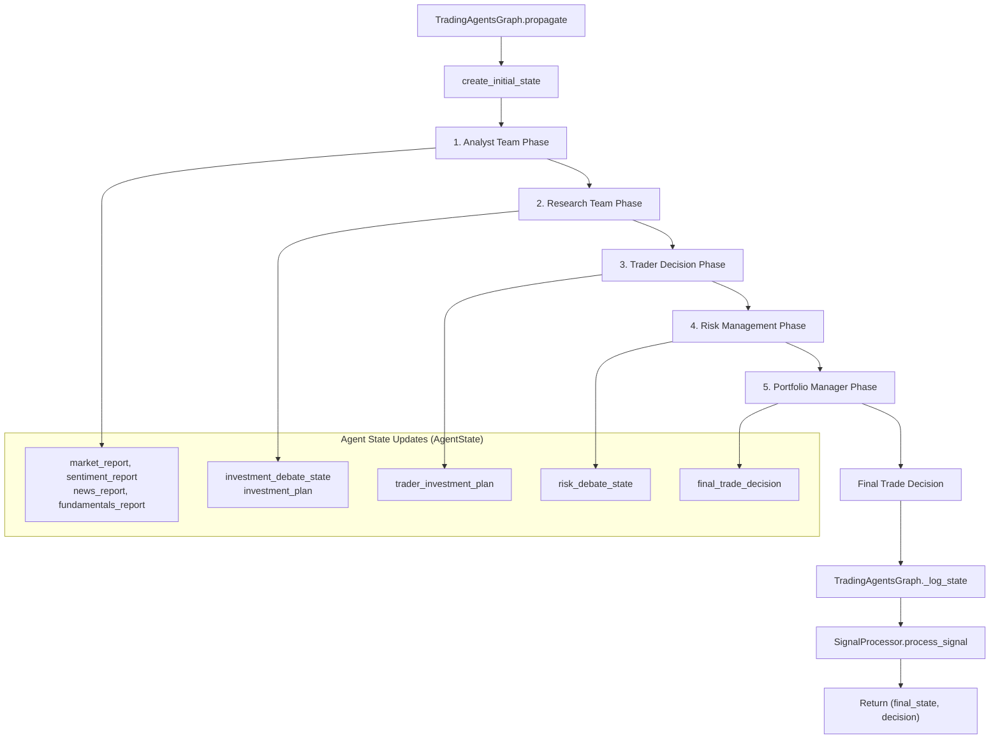
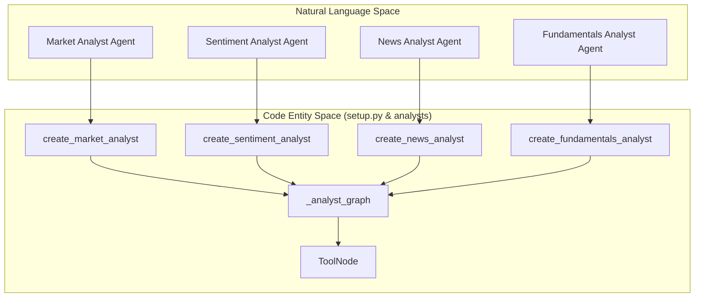
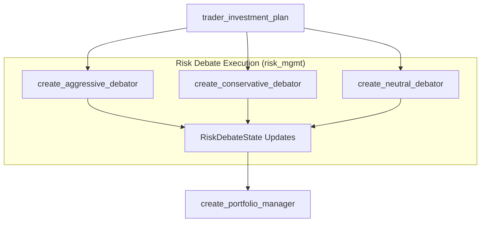

<!-- source: DeepWiki mcp.deepwiki.com · repo TauricResearch/TradingAgents · page 1.3 Trading Decision Pipeline · fetched 2026-10-29 -->

# Trading Decision Pipeline

Relevant source files

The following files were used as context for generating this wiki page:

- [tests/test_graph_end_to_end.py](tests/test_graph_end_to_end.py)
- [tradingagents/agents/__init__.py](tradingagents/agents/__init__.py)
- [tradingagents/agents/risk_mgmt/aggressive_debator.py](tradingagents/agents/risk_mgmt/aggressive_debator.py)
- [tradingagents/agents/risk_mgmt/conservative_debator.py](tradingagents/agents/risk_mgmt/conservative_debator.py)
- [tradingagents/agents/risk_mgmt/neutral_debator.py](tradingagents/agents/risk_mgmt/neutral_debator.py)
- [tradingagents/graph/setup.py](tradingagents/graph/setup.py)

## Purpose and Scope

This document explains the sequential execution flow of the TradingAgents system, transforming raw market data through multi-agent analysis, research debate, trader synthesis, risk assessment, and final portfolio approval. The pipeline is implemented using LangGraph state management [tradingagents/graph/setup.py:142-142]() and a dual-model strategy (Deep vs. Quick thinking).

Sources: [tradingagents/graph/setup.py:142-142]()

---

## Pipeline Overview

The trading decision pipeline executes sequentially, updating a shared `AgentState` TypedDict [tradingagents/agents/state.py:12-12]() that carries forward accumulated reports, debate histories, and decisions across phases.

### System Execution Flow

Sources: [tradingagents/graph/setup.py:142-161](), [tradingagents/agents/state.py:12-12]()

---

## Phase 1: Analyst Team Data Collection

Analyst agents execute concurrently to gather multi-faceted market data via specialized tools. Each analyst is wrapped in a private sub-graph using `_analyst_graph` [tradingagents/graph/setup.py:53-90]() to isolate message histories and bound tool execution rounds to `max_tool_rounds`.

### Analyst-to-Code Entity Mapping

Sources: [tradingagents/graph/setup.py:53-90](), [tradingagents/graph/setup.py:125-130]()

---

## Phase 2: Research Team Debate

Once analyst reports are filed, the research phase runs a structured debate governed by `DEBATE_PATH_MAP` [tradingagents/graph/setup.py:35-39]().

1. **Iterative Debate**: `create_bull_researcher` and `create_bear_researcher` [tradingagents/agents/__init__.py:7-8]() argue opposing theses over bounded rounds.
2. **State Tracking**: Arguments are maintained in `InvestDebateState` [tradingagents/agents/state.py:12-12]().
3. **Synthesis**: The `create_research_manager` [tradingagents/agents/__init__.py:6]() node reviews the debate to synthesize a structured `investment_plan`.

Sources: [tradingagents/graph/setup.py:35-39](), [tradingagents/agents/__init__.py:6-12]()

---

## Phase 3: Trader Decision Synthesis

The `create_trader` node [tradingagents/agents/__init__.py:13]() takes the aggregated analyst reports and the research `investment_plan` to formulate the initial trading proposal (`trader_investment_plan`). This proposal grounds entries, exits, and position sizing in technical indicators and fundamental context.

Sources: [tradingagents/agents/__init__.py:13]()

---

## Phase 4: Risk Management Assessment

The risk phase subjects the trader's plan to structured challenge under `RISK_ANALYSIS_PATH_MAP` [tradingagents/graph/setup.py:40-45]().

### Risk Debate Flow and Code Entities

The risk debate updates `RiskDebateState` [tradingagents/agents/state.py:12-12]() through exchanges between:
* `create_aggressive_debator` [tradingagents/agents/risk_mgmt/aggressive_debator.py:10-68]()
* `create_conservative_debator` [tradingagents/agents/risk_mgmt/conservative_debator.py:10-70]()
* `create_neutral_debator` [tradingagents/agents/risk_mgmt/neutral_debator.py:10-68]()

Sources: [tradingagents/graph/setup.py:40-45](), [tradingagents/agents/state.py:12-12](), [tradingagents/agents/risk_mgmt/aggressive_debator.py:10-68](), [tradingagents/agents/risk_mgmt/conservative_debator.py:10-70](), [tradingagents/agents/risk_mgmt/neutral_debator.py:10-68]()

---

## Phase 5: Final Decision and Portfolio Approval

The `create_portfolio_manager` node [tradingagents/agents/__init__.py:5]() evaluates the `trader_investment_plan` against the `risk_debate_state` to formulate the final risk-adjusted `final_trade_decision`. 

Sources: [tradingagents/agents/__init__.py:5]()

---

## State Management and Data Flow

All pipeline phases operate on a shared `AgentState` schema [tradingagents/agents/state.py:12-12](), ensuring complete traceability from raw inputs to final trade signals.

Sources: [tradingagents/agents/state.py:12-12]()

---

