# Page: Overview

# Overview

<details>
<summary>Relevant source files</summary>

The following files were used as context for generating this wiki page:

- [.agents/skills/adk-setup/SKILL.md](.agents/skills/adk-setup/SKILL.md)
- [.github/.release-please-manifest-v1.json](.github/.release-please-manifest-v1.json)
- [.github/.release-please-manifest.json](.github/.release-please-manifest.json)
- [.github/pull_request_template.md](.github/pull_request_template.md)
- [.github/release-please-config-v1.json](.github/release-please-config-v1.json)
- [.github/release-please-config.json](.github/release-please-config.json)
- [.gitignore](.gitignore)
- [AGENTS.md](AGENTS.md)
- [CHANGELOG.md](CHANGELOG.md)
- [CONTRIBUTING.md](CONTRIBUTING.md)
- [README.md](README.md)
- [assets/adk-web-dev-ui-function-call.png](assets/adk-web-dev-ui-function-call.png)
- [assets/adk-web-dev-ui.png](assets/adk-web-dev-ui.png)
- [contributing/README.md](contributing/README.md)
- [contributing/adk_project_overview_and_architecture.md](contributing/adk_project_overview_and_architecture.md)
- [scripts/update_constraints.sh](scripts/update_constraints.sh)
- [src/google/adk/__init__.py](src/google/adk/__init__.py)
- [src/google/adk/agents/__init__.py](src/google/adk/agents/__init__.py)
- [src/google/adk/cli/__init__.py](src/google/adk/cli/__init__.py)
- [src/google/adk/cli/browser/styles-4R3GDHUZ.css](src/google/adk/cli/browser/styles-4R3GDHUZ.css)
- [src/google/adk/dependencies/__init__.py](src/google/adk/dependencies/__init__.py)
- [src/google/adk/dependencies/rouge_scorer.py](src/google/adk/dependencies/rouge_scorer.py)
- [src/google/adk/dependencies/vertexai.py](src/google/adk/dependencies/vertexai.py)
- [src/google/adk/integrations/bigquery/search_tool.py](src/google/adk/integrations/bigquery/search_tool.py)
- [src/google/adk/utils/_lazy.py](src/google/adk/utils/_lazy.py)
- [src/google/adk/version.py](src/google/adk/version.py)
- [src/google/adk/workflow/__init__.py](src/google/adk/workflow/__init__.py)
- [tests/unittests/conftest.py](tests/unittests/conftest.py)
- [tests/unittests/dependencies/test_vertexai.py](tests/unittests/dependencies/test_vertexai.py)
- [tests/unittests/isolated_import_utils.py](tests/unittests/isolated_import_utils.py)
- [tests/unittests/test_import_loading.py](tests/unittests/test_import_loading.py)
- [tests/unittests/test_optional_dependencies.py](tests/unittests/test_optional_dependencies.py)
- [tests/unittests/test_release_dependencies.py](tests/unittests/test_release_dependencies.py)
- [tests/unittests/utils/test_lazy.py](tests/unittests/utils/test_lazy.py)
- [tox.ini](tox.ini)

</details>


This page provides a high-level introduction to the Agent Development Kit (ADK) Python repository, its architecture, and core concepts. ADK is designed to make AI agent development feel like software development, emphasizing flexibility, testability, and modularity.

**Purpose and Scope**: This overview introduces the ADK Python framework, its purpose as a code-first system for building AI agents, and its high-level architecture at version `2.12.0` [src/google/adk/version.py:16-16](). It covers core components, repository layout, system architecture, data flows, and highlights major features such as tool output interception via `after_tool_callback`, human-in-the-loop workflow node confirmation via `require_confirmation`, performance enhancements in long sessions, and custom service account deployments [README.md:1-36](), [CHANGELOG.md:8-14]().

Sources: [README.md:1-36](), [CHANGELOG.md:8-14](), [src/google/adk/version.py:16-16]()

---

## What is ADK?

Agent Development Kit (ADK) is an open-source, code-first Python framework designed for building, evaluating, and deploying sophisticated AI agents. It applies software development principles to AI agent creation, enabling developers to construct agentic systems ranging from simple single-agent applications to complex, graph-structured multi-agent orchestrations. Although optimized for use with Gemini models, ADK is model-agnostic, deployment-agnostic, and compatible with other frameworks and models [README.md:1-16](), [README.md:32-36]().

**Design Philosophy**:

- **Code-first development:** All agent definitions, instructions, tools, and workflows are specified directly in Python code. This approach promotes standard software best practices such as versioning, unit testing, and IDE support [README.md:56-58]().
- **Modularity and composition:** Complex AI applications are composed of multiple specialized agents and workflows, enabling flexible orchestration and reuse [README.md:49-51]().
- **Deployment-agnostic:** The core agent logic is decoupled from deployment environments. ADK supports local runs via CLI, web UI, FastAPI servers, Cloud Run, and managed platforms like Vertex AI Agent Engine [README.md:64-65]().
- **Workflow-driven architecture:** ADK 2.0 introduces a graph-based deterministic execution engine for composing non-linear agent workflows with features such as routing, fan-out/fan-in, loops, retry policies, state management, human-in-the-loop (HITL) support, and nested workflows [README.md:40-43]().

Sources: [README.md:1-65]()

---

## Repository Structure

The ADK Python repository is organized to clearly separate core functionality, tools, integrations, workflows, and tests.

Title: "Repository Directory Layout"
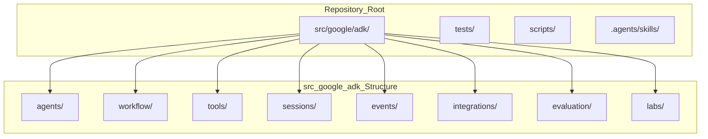

Sources: [README.md:1-107](), [src/google/adk/version.py:1-16]()

| Directory/File | Purpose | Code/Doc Pointer |
|---|---|---|
| `src/google/adk/agents/` | Agent implementations including `ManagedAgent`, `LlmAgent` | [AGENTS.md:7-10]() |
| `src/google/adk/workflow/` | Graph-based workflow core (`Workflow`, Nodes, `Runner`) | [README.md:40-43]() |
| `src/google/adk/tools/` | Tool framework and custom tools | [CHANGELOG.md:11-12]() |
| `src/google/adk/integrations/` | Integrations including BigQuery, Dataplex | [tests/unittests/test_import_loading.py:195-197]() |
| `src/google/adk/version.py` | Current framework version (`2.12.0`) | [src/google/adk/version.py:16-16]() |

Sources: [README.md:1-107](), [CHANGELOG.md:8-14](), [src/google/adk/version.py:1-16]()

---

## System Architecture

This diagram aligns ADK's conceptual layers — from developer-facing constructs to lower-level execution and tooling — with their concrete code entities, bridging high-level intent to implementation files.

Title: "System Architecture and Component Relationships"
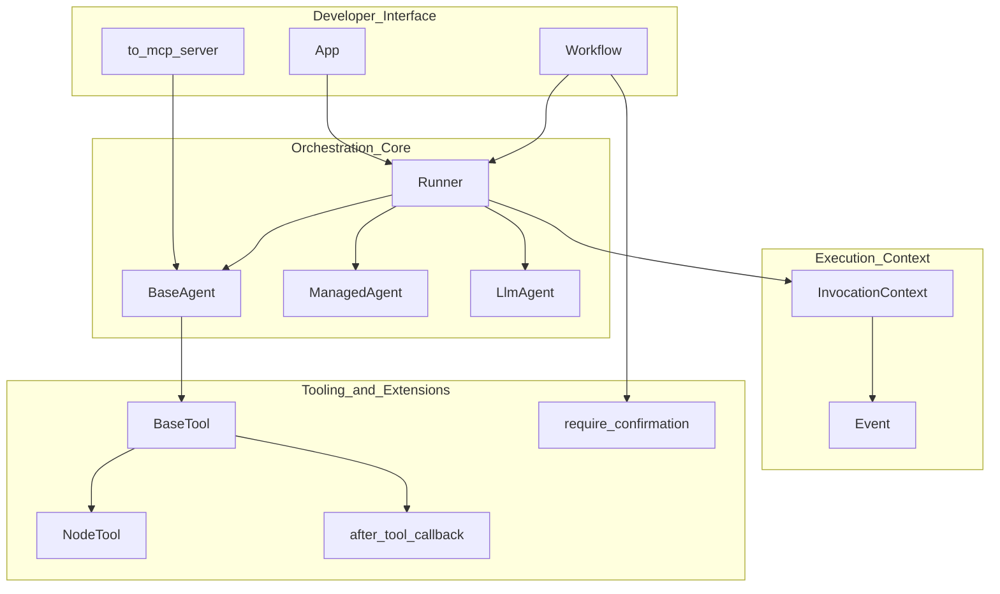

**Key Architectural Updates in v2.12.0**:

- **Performance Enhancements**: Cut time to first model request by 40% in long sessions [CHANGELOG.md:10-10]().
- **Tool Output Interception**: Intercept and filter tool outputs via `after_tool_callback` [CHANGELOG.md:11-11]().
- **Workflow Node Confirmation**: Require human confirmation before executing workflow nodes via `require_confirmation` [CHANGELOG.md:12-12]().
- **Custom Service Accounts**: Deploy agents to Agent Engine using dedicated custom service accounts [CHANGELOG.md:13-13]().
- **Python 3.15 Support**: Install and run ADK on Python 3.15 [CHANGELOG.md:14-14]().

Sources: [CHANGELOG.md:8-14](), [src/google/adk/version.py:1-16]()

---

## Core Components

### Runner and Execution Engine

The `Runner` class is the stateless core orchestrator managing agent execution lifecycles, LLM invocations, workflows, and tool calls. It orchestrates asynchronous operations across sessions, state, and events using the `InvocationContext` object that bundles session state, active tools, agent states, and event histories for deterministic execution flows [AGENTS.md:8-14]().

### Agents and Workflows

- **Agent**: The base abstraction encapsulating an AI agent’s identity, instructions, and tool capabilities. Implemented primarily via `BaseAgent` and subclasses to define agent behavior [AGENTS.md:7-10]().
- **LlmAgent**: Specializes in large language model-backed agents, supporting model configuration, tool integration, output schema enforcement, and multi-mode behaviors.
- **ManagedAgent**: Facilitates agents operating remotely over supported protocols, supporting callback integrations and MCP sessions.
- **Workflow**: Represents a graph-based execution engine coordinating agents, functions, and tools with support for loops, retries, conditional routing, and human-in-the-loop interaction [AGENTS.md:12-14]().

### Tools and Integrations

- **BaseTool and NodeTool**: Extendable abstractions providing diverse capabilities and encapsulating workflow nodes as callable tools [README.md:52-55]().
- **Tool Output Screening**: `after_tool_callback` enables custom interception logic prior to feeding data back to the model [CHANGELOG.md:11-11]().
- **Workflow Approval Gates**: `require_confirmation` integrated into `@node` and `FunctionNode` for explicit human authorization [CHANGELOG.md:50-50]().

Sources: [AGENTS.md:7-14](), [CHANGELOG.md:8-14](), [README.md:52-55]()

---

## Bridging Natural Language Space to Code Entity Space

The following diagrams illustrate mappings from user-facing natural language concepts to the underlying code constructs responsible for these features.

Title: "Core Agent and Runner Code Mapping"
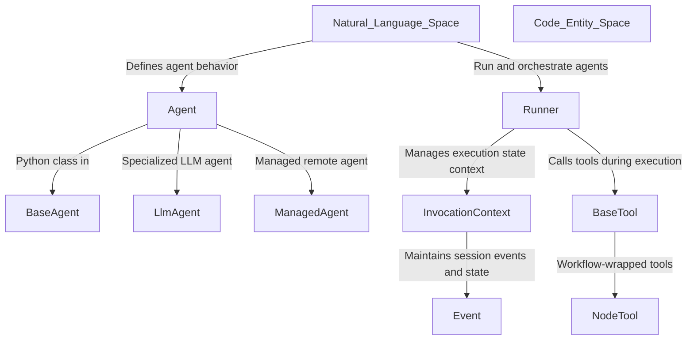

Sources: [AGENTS.md:7-14]()

Title: "Workflow and Tool Enhancements Code Mapping"
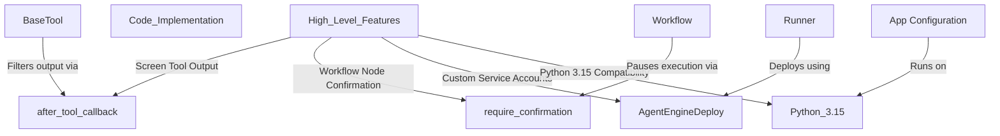

Sources: [CHANGELOG.md:8-14](), [src/google/adk/version.py:16-16]()

---

## Data Flow in ADK Agent Execution

The typical data flow shows how user input is processed through the Runner, agents, model invocation, tools, event system, and persistence layers:

Title: "ADK Agent Execution Data Flow"
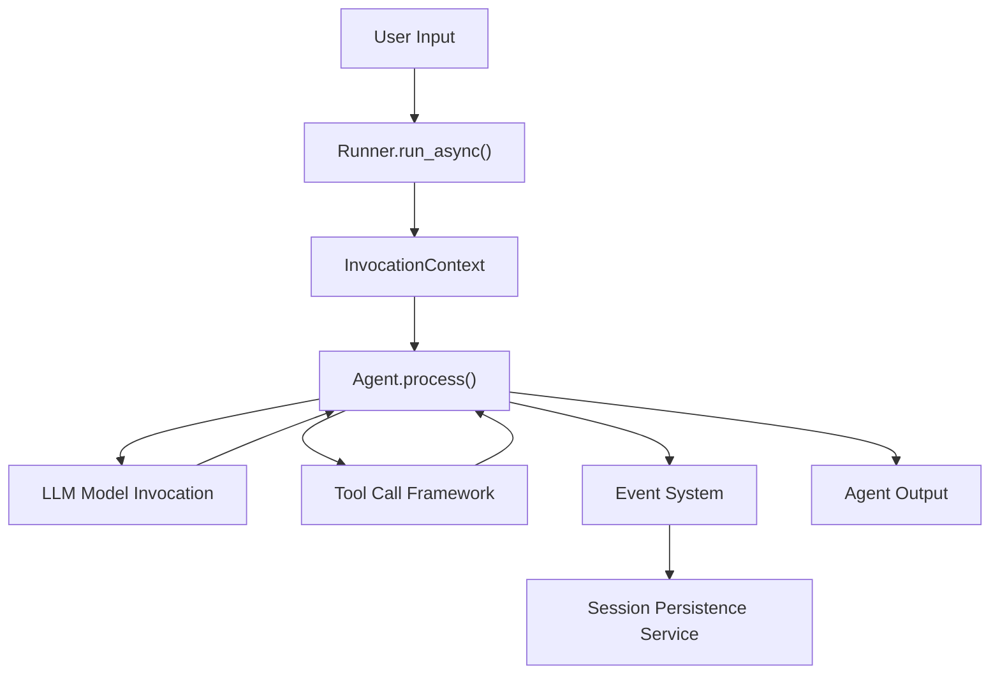

- User inputs trigger the Runner's asynchronous execution.
- `InvocationContext` maintains session state, memory, and events across agent invocations [AGENTS.md:14-14]().
- The `Agent` processes input, optionally calling the LLM model to generate responses.
- Agents can invoke tools wrapped as `BaseTool` or `NodeTool`, passing results through interception hooks like `after_tool_callback` [CHANGELOG.md:11-11]().
- All interactions (agent outputs, tool invocations, and state changes) are recorded as events.
- Session state and events are persisted through supported session services.
- The final outputs are returned to the user or passed to the next workflow node.

Sources: [AGENTS.md:8-14](), [CHANGELOG.md:8-14](), [src/google/adk/version.py:16-16]()

---

## Next Steps

- Explore [Getting Started](#) for installation and first-agent creation tutorials.
- Review [Core Concepts](#) for detailed understanding of Agents, Runner, Tools, and Sessions.
- Study [Workflow Engine](#) documentation to master graph-based orchestrations.
- Check out [LLM Integration](#) for model providers and configuration options.

Sources: [README.md:1-172](), [CHANGELOG.md:8-14]()

---

# Page: Getting Started

# Getting Started

<details>
<summary>Relevant source files</summary>

The following files were used as context for generating this wiki page:

- [.agents/skills/adk-setup/SKILL.md](.agents/skills/adk-setup/SKILL.md)
- [.github/pull_request_template.md](.github/pull_request_template.md)
- [.gitignore](.gitignore)
- [AGENTS.md](AGENTS.md)
- [CONTRIBUTING.md](CONTRIBUTING.md)
- [README.md](README.md)
- [assets/adk-web-dev-ui-function-call.png](assets/adk-web-dev-ui-function-call.png)
- [assets/adk-web-dev-ui.png](assets/adk-web-dev-ui.png)
- [contributing/README.md](contributing/README.md)
- [contributing/adk_project_overview_and_architecture.md](contributing/adk_project_overview_and_architecture.md)
- [scripts/update_constraints.sh](scripts/update_constraints.sh)
- [tests/unittests/conftest.py](tests/unittests/conftest.py)
- [tox.ini](tox.ini)

</details>


This page serves as a parent overview for setting up the Agent Development Kit (ADK), installing dependencies, creating your first agent or graph workflow, and understanding core concepts. As a parent page, it provides a high-level summary and links to detailed child pages.

## Purpose and Scope

The Getting Started section guides users through the initial setup, dependency selection, agent scaffolding, and local execution of ADK applications.

For full installation instructions, optional dependency extras, and Python version constraints, see [Installation](#2.1). For a walkthrough of creating and running your first agent, see [Quick Start Guide](#2.2). For foundational definitions of Agents, Runners, Tools, Sessions, Memory, Events, and Workflows, see [Core Concepts](#2.3).

Sources: [README.md:72-89](), [.agents/skills/adk-setup/SKILL.md:23-60]()

## Installation Overview

ADK requires Python 3.11 or higher [README.md:77-77](). You can install the stable release via `pip` or use companion constraints files for precise dependency tracking [README.md:72-89](). Optional extensions and ecosystem integrations are supported via optional dependency extras [README.md:91-95]().

For detailed installation commands, python version constraints, and optional feature flags, see [Installation](#2.1).

Sources: [README.md:72-95](), [scripts/update_constraints.sh:49-50]()

## Quick Start Overview

ADK supports building agents via code (`Agent`, `LlmAgent`) or graph-based workflows (`Workflow`) using Python or YAML configurations [README.md:111-146](). You can scaffold agent directories and run them locally via interactive REPLs (`adk run`) or the development web UI (`adk web`) [README.md:148-156]().

Diagram: CLI Commands to Code Entities
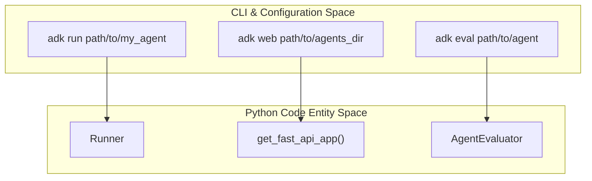
Sources: [README.md:148-171](), [contributing/adk_project_overview_and_architecture.md:74-78]()

For step-by-step instructions on creating, testing, and running your first agent, see [Quick Start Guide](#2.2).

Sources: [README.md:109-172]()

## Core Concepts Overview

ADK architectures are built around a set of decoupled subsystems that handle agent identity, execution control, state persistence, and tool execution.

Diagram: Agent Structure to Code Entities
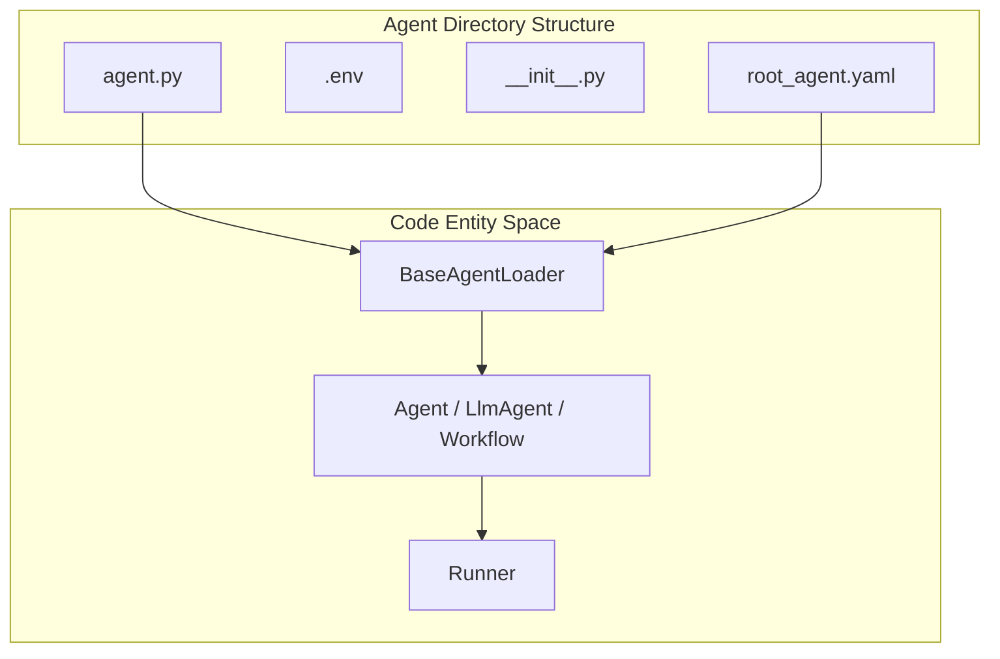
Sources: [AGENTS.md:7-15](), [contributing/adk_project_overview_and_architecture.md:32-44]()

For a comprehensive explanation of fundamental concepts including Agents, Runner, Tools, Sessions, Memory, Events, and Workflows, see [Core Concepts](#2.3).

Sources: [AGENTS.md:7-15]()

---

## Child Pages

- [Installation](#2.1) — Step-by-step instructions for package installation, optional dependency extras, and Python version constraints.
- [Quick Start Guide](#2.2) — Walkthrough of scaffolding and running agents.
- [Core Concepts](#2.3) — Fundamental overview of Agents, Runners, Tools, Sessions, Memory, Events, and Workflows.

---

# Page: Installation

# Installation

<details>
<summary>Relevant source files</summary>

The following files were used as context for generating this wiki page:

- [constraints-3.11.txt](constraints-3.11.txt)
- [constraints-3.12.txt](constraints-3.12.txt)
- [constraints-3.13.txt](constraints-3.13.txt)
- [constraints-3.14.txt](constraints-3.14.txt)
- [constraints-3.15.txt](constraints-3.15.txt)
- [pyproject.toml](pyproject.toml)
- [src/google/adk/__init__.py](src/google/adk/__init__.py)
- [src/google/adk/agents/__init__.py](src/google/adk/agents/__init__.py)
- [src/google/adk/cli/__init__.py](src/google/adk/cli/__init__.py)
- [src/google/adk/dependencies/__init__.py](src/google/adk/dependencies/__init__.py)
- [src/google/adk/dependencies/rouge_scorer.py](src/google/adk/dependencies/rouge_scorer.py)
- [src/google/adk/dependencies/vertexai.py](src/google/adk/dependencies/vertexai.py)
- [src/google/adk/integrations/bigquery/search_tool.py](src/google/adk/integrations/bigquery/search_tool.py)
- [src/google/adk/tools/openapi_tool/openapi_spec_parser/tool_auth_handler.py](src/google/adk/tools/openapi_tool/openapi_spec_parser/tool_auth_handler.py)
- [src/google/adk/utils/_lazy.py](src/google/adk/utils/_lazy.py)
- [src/google/adk/workflow/__init__.py](src/google/adk/workflow/__init__.py)
- [tests/unittests/dependencies/test_vertexai.py](tests/unittests/dependencies/test_vertexai.py)
- [tests/unittests/isolated_import_utils.py](tests/unittests/isolated_import_utils.py)
- [tests/unittests/test_import_loading.py](tests/unittests/test_import_loading.py)
- [tests/unittests/test_optional_dependencies.py](tests/unittests/test_optional_dependencies.py)
- [tests/unittests/test_release_dependencies.py](tests/unittests/test_release_dependencies.py)
- [tests/unittests/tools/openapi_tool/openapi_spec_parser/test_tool_auth_handler.py](tests/unittests/tools/openapi_tool/openapi_spec_parser/test_tool_auth_handler.py)
- [tests/unittests/utils/test_lazy.py](tests/unittests/utils/test_lazy.py)

</details>


## Purpose and Scope

This page details the installation process for the ADK Python package via `pip`, mandatory core dependencies, optional feature extras (such as `gcp`, `eval`, `a2a`, `livekit`, `mongodb`, `e2b`, `bigquery-analytics`), and version-specific constraints files. The ADK package (`google-adk`) serves as a code-first framework for building, orchestrating, and deploying AI agents and workflows [pyproject.toml:7-15]().

Sources:
- [pyproject.toml:7-15]()

---

## Prerequisites

### Python Version Requirements

- The ADK codebase requires **Python >= 3.11**, with active validation supporting Python 3.11, 3.12, 3.13, 3.14, and 3.15 [pyproject.toml:15-27]().
- Dependency constraint files are maintained for each minor version (`constraints-3.11.txt` through `constraints-3.15.txt`) to guarantee reproducible builds and deterministic resolution [constraints-3.11.txt:1-10](), [constraints-3.12.txt:1-10](), [constraints-3.13.txt:1-10](), [constraints-3.14.txt:1-10](), [constraints-3.15.txt:1-10]().

| Python Version | Support Status |
|----------------|----------------|
| 3.11           | Recommended / Supported |
| 3.12           | Supported      |
| 3.13           | Supported      |
| 3.14           | Supported      |
| 3.15           | Supported      |

Sources:
- [pyproject.toml:15-27]()
- [constraints-3.11.txt:1-10]()
- [constraints-3.12.txt:1-10]()
- [constraints-3.13.txt:1-10]()
- [constraints-3.14.txt:1-10]()
- [constraints-3.15.txt:1-10]()

### System and Build Requirements

- **Build Backend**: `flit_core` (>=3.8,<4) is specified as the PEP 517 build backend [pyproject.toml:1-5]().
- **Core Dependencies**: Essential libraries loaded at runtime include `fastapi`, `pydantic>=2.12,<3`, `google-genai>=2.30,<3`, `click`, `httpx`, and `opentelemetry-api` [pyproject.toml:33-58]().

Sources:
- [pyproject.toml:1-57]()

---

## Core Installation and Optional Extras

### Core Installation

To install the minimal core package without optional feature integrations:

```bash
pip install google-adk
```

This installs core requirements like Pydantic, FastAPI, and the Google GenAI SDK, while deferring heavy or specialized provider libraries [pyproject.toml:33-58](), [tests/unittests/test_release_dependencies.py:15-38]().

Sources:
- [pyproject.toml:33-58]()
- [tests/unittests/test_release_dependencies.py:15-38]()

### Optional Dependency Extras

ADK defines modular extras in `pyproject.toml` to support specific subsystems without inflating the baseline footprint. The `all` extra aggregates runtime feature requirements (excluding testing, benchmark, and docs tools) [pyproject.toml:69-155]().

| Extra Name          | Target Subsystem / Feature          | Representative Dependencies                     |
|---------------------|-----------------------------------|------------------------------------------------|
| `a2a`               | Agent-to-Agent protocol           | `a2a-sdk[http-server]>=0.3.4,<2`                |
| `agent-identity`    | GCP Agent Identity & IAM Connectors| `google-cloud-agentidentitycredentials`        |
| `antigravity`       | Google Antigravity SDK integration| `google-antigravity>=0.1.7,<0.2`                |
| `bigquery-analytics`| BigQuery Agent Analytics Plugin   | `google-cloud-bigquery`, `pyarrow>=14`          |
| `daytona`           | Daytona remote sandbox            | `daytona>=0.191`                               |
| `db`                | Relational Database session stores| `sqlalchemy>=2,<3`, `sqlalchemy-spanner`       |
| `e2b`               | E2B remote sandbox environment    | `e2b>=2,<3`                                    |
| `eval`              | Evaluation framework & judges     | `gepa>=0.1`, `pandas`, `rouge-score`, `jinja2`  |
| `livekit`           | LiveKit voice & telephony runner  | `livekit>=1,<2`, `livekit-api`                 |
| `mongodb`           | MongoDB integration               | `pymongo>=4.9,<5`                               |
| `all`               | Complete runtime feature set      | Union of all runtime extras [pyproject.toml:69-155]() |

Example installing multiple optional extras:

```bash
pip install "google-adk[agent-identity,eval,livekit,db,mongodb]"
```

Sources:
- [pyproject.toml:59-155]()
- [tests/unittests/test_release_dependencies.py:150-174]()

### Constraints Files per Python Version

To ensure version locking in production environments or CI pipelines, pre-compiled constraint files are provided for each Python release [constraints-3.11.txt:1-10](), [constraints-3.12.txt:1-10](), [constraints-3.13.txt:1-10](), [constraints-3.14.txt:1-10](), [constraints-3.15.txt:1-10]().

```bash
pip install google-adk[all] -c constraints-3.11.txt
```

Sources:
- [constraints-3.11.txt:1-10]()
- [constraints-3.12.txt:1-10]()
- [constraints-3.13.txt:1-10]()
- [constraints-3.14.txt:1-10]()
- [constraints-3.15.txt:1-10]()

---

## Lazy Loading and Import Architecture

ADK utilizes deferred package importing and lazy member loading via `__getattr__` and accessor modules (such as `google.adk.utils._lazy`) to minimize start-up latency and prevent mandatory third-party imports when specific integrations are uninstalled [tests/unittests/test_import_loading.py:37-48](), [tests/unittests/test_optional_dependencies.py:15-30](). Optional dependencies are verified dynamically via helper utilities when instantiated [tests/unittests/test_optional_dependencies.py:107-152]().

Sources:
- [tests/unittests/test_import_loading.py:37-48]()
- [tests/unittests/test_optional_dependencies.py:15-152]()

---

## Installation Architecture and Data Flow

### Diagram: Natural Language Space to Code Entity Map for Installation

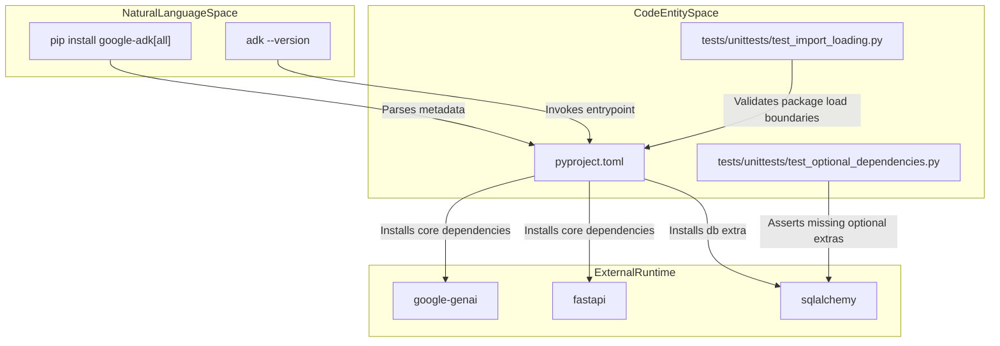

Sources:
- [pyproject.toml:7-58]()
- [tests/unittests/test_import_loading.py:37-48]()
- [tests/unittests/test_optional_dependencies.py:133-152]()

### Diagram: Dependency Resolution and Optional Loading Sequence

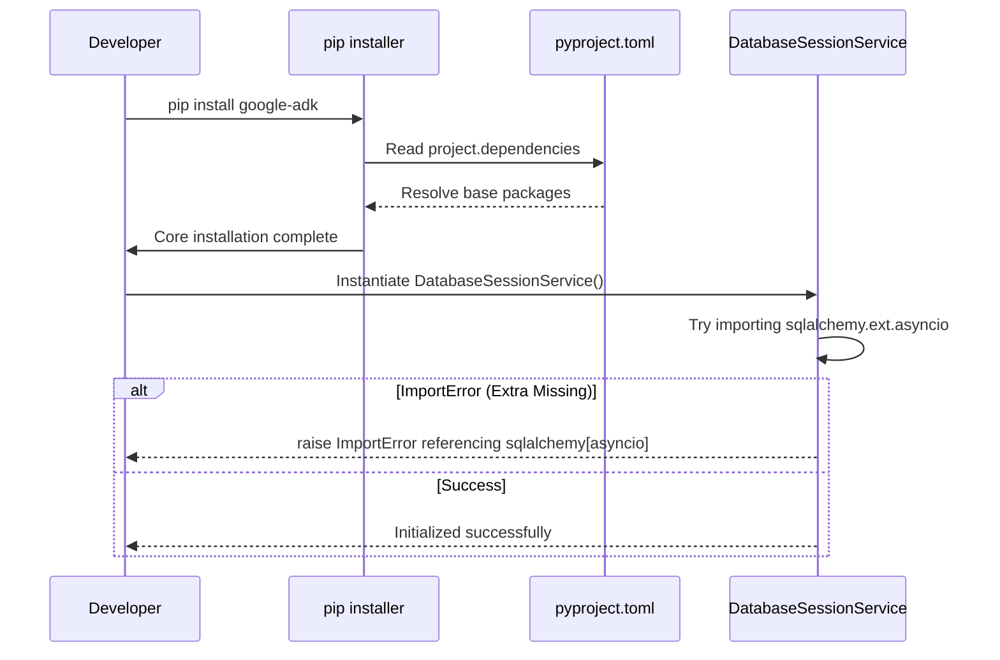

Sources:
- [pyproject.toml:33-58]()
- [tests/unittests/test_optional_dependencies.py:133-174]()

---

## Verification of Installation

1. **Verify CLI Installation**:
   ```bash
   adk --version
   ```
   This confirms the command-line interface entrypoint is correctly registered [tests/unittests/test_import_loading.py:181-191]().

2. **Configure Provider Credentials**:
   - For Google GenAI / Gemini models:
     ```bash
     export GOOGLE_API_KEY="your_api_key"
     ```
   - For GCP integrations:
     ```bash
     gcloud auth application-default login
     ```

Sources:
- [tests/unittests/test_import_loading.py:181-191]()

---

## Troubleshooting

| Symptom | Root Cause | Resolution |
|---|---|---|
| `ImportError` or missing driver when initializing database session service | Optional feature dependency not installed via extras | Install the required extra, e.g., `pip install "google-adk[db]"` [tests/unittests/test_optional_dependencies.py:133-174]() |
| `adk: command not found` | Virtual environment not active or binary path missing | Activate your venv or ensure bin path is in `$PATH` |
| KeyError or unpickling error on startup | Incompatible checkpoint or third-party dependency version | Enforce matching versions using `constraints-<version>.txt` [constraints-3.11.txt:1-10]() |

Sources:
- [tests/unittests/test_optional_dependencies.py:133-174]()
- [constraints-3.11.txt:1-10]()

---

## Next Steps

1. Proceed to the [Quick Start Guide (2.2)] for building your first agent using `adk create` and `adk run`.
2. Review [Core Concepts (2.3)] to understand Agents, Runners, and Sessions.

---

# Page: Quick Start Guide

# Quick Start Guide

<details>
<summary>Relevant source files</summary>

The following files were used as context for generating this wiki page:

- [src/google/adk/cli/_telemetry/_constants.py](src/google/adk/cli/_telemetry/_constants.py)
- [src/google/adk/cli/_telemetry/_metrics_collector.py](src/google/adk/cli/_telemetry/_metrics_collector.py)
- [src/google/adk/cli/_telemetry/_metrics_reporter.py](src/google/adk/cli/_telemetry/_metrics_reporter.py)
- [src/google/adk/cli/cli.py](src/google/adk/cli/cli.py)
- [src/google/adk/cli/cli_create.py](src/google/adk/cli/cli_create.py)
- [src/google/adk/cli/service_registry.py](src/google/adk/cli/service_registry.py)
- [src/google/adk/cli/utils/_onboarding.py](src/google/adk/cli/utils/_onboarding.py)
- [src/google/adk/cli/utils/dot_adk_folder.py](src/google/adk/cli/utils/dot_adk_folder.py)
- [src/google/adk/cli/utils/gcp_utils.py](src/google/adk/cli/utils/gcp_utils.py)
- [src/google/adk/cli/utils/local_storage.py](src/google/adk/cli/utils/local_storage.py)
- [src/google/adk/cli/utils/service_factory.py](src/google/adk/cli/utils/service_factory.py)
- [tests/unittests/cli/_telemetry/test_metrics_collector.py](tests/unittests/cli/_telemetry/test_metrics_collector.py)
- [tests/unittests/cli/_telemetry/test_metrics_reporter.py](tests/unittests/cli/_telemetry/test_metrics_reporter.py)
- [tests/unittests/cli/conformance/test_generate_markdown_utils.py](tests/unittests/cli/conformance/test_generate_markdown_utils.py)
- [tests/unittests/cli/test_cli_utf8_encoding.py](tests/unittests/cli/test_cli_utf8_encoding.py)
- [tests/unittests/cli/test_service_registry.py](tests/unittests/cli/test_service_registry.py)
- [tests/unittests/cli/utils/test_cli.py](tests/unittests/cli/utils/test_cli.py)
- [tests/unittests/cli/utils/test_cli_create.py](tests/unittests/cli/utils/test_cli_create.py)
- [tests/unittests/cli/utils/test_dot_adk_folder.py](tests/unittests/cli/utils/test_dot_adk_folder.py)
- [tests/unittests/cli/utils/test_gcp_utils.py](tests/unittests/cli/utils/test_gcp_utils.py)
- [tests/unittests/cli/utils/test_local_storage.py](tests/unittests/cli/utils/test_local_storage.py)
- [tests/unittests/cli/utils/test_service_factory.py](tests/unittests/cli/utils/test_service_factory.py)
- [tests/unittests/streaming/test_multi_agent_streaming.py](tests/unittests/streaming/test_multi_agent_streaming.py)

</details>


**Purpose and Scope**: This guide walks you through creating and running your first ADK (Agent Development Kit) agent using the command-line interface (`adk create` and `adk run`). You will learn the basic workflow for agent development, from project creation to interactive testing and understanding the internal loading and execution mechanisms. For installation instructions, see [Installation](2.1). For deeper conceptual understanding, see [Core Concepts](2.3).

Sources: 
[src/google/adk/cli/cli_create.py:1-219](), [src/google/adk/cli/cli.py:1-187]()

---

## Creating Your First Agent

The `adk create` CLI command scaffolds a new agent project with a pre-configured template. This functionality is implemented in the module `cli_create.py`, where the main entrypoint function is `run_cmd()` which handles validation, user prompts, and file generation [src/google/adk/cli/cli_create.py:203-219]().

Run this simple command to create an agent folder:

```bash
adk create my_first_agent
```

### Detailed Workflow of `adk create`

When you execute this command, the flow is:

1. **Agent Name Validation**  
   The agent name is validated with `validate_app_name()` from `apps.app` to ensure it conforms to rules for Python package names and ADK agent identifiers [src/google/adk/cli/cli_create.py:22-22]().

2. **Model Selection Prompt**  
   The CLI prompts you to select an LLM model for the root agent, with default options like `"gemini-3.5-flash"` and `"gemini-3.8-flash"`. You may also specify another model by choosing the "Other" option [src/google/adk/cli/cli_create.py:168-185]().

3. **Agent Type Selection Prompt**  
   Choose between:
   - YAML config-based agent (experimental, specified in `root_agent.yaml`), or
   - Code-based agent (standard Python code with `agent.py`).
   
   This choice affects the generated files and the agent loading approach [src/google/adk/cli/cli_create.py:187-201]().

4. **User Onboarding for Credentials**  
   Interactive helpers gather needed credentials such as Google API keys or Vertex AI project and region identifiers. These values populate the `.env` file for runtime environment configuration [src/google/adk/cli/cli_create.py:131-144]().

5. **File Generation**  
   - Creates an agent folder matching the agent name.
   - Generates a `.env` file containing backend API key or project credentials and mode flags.
   - Ensures `.gitignore` contains entries to exclude `.env` and `.adk/` folders to protect secrets and runtime files.
   - Writes either:
     - A code-based implementation (`agent.py` and `__init__.py`) defining a root `Agent` object, or
     - A YAML config-based structure (`root_agent.yaml`) conforming to the `AgentConfig` schema [src/google/adk/cli/cli_create.py:114-166]().

### Generated Directory Structure Example for Code Mode

```plaintext
my_first_agent/
├── __init__.py      # Marks Python package, imports `agent.py`
├── agent.py         # Defines `root_agent` instance as LlmAgent-based Agent
├── .env             # Environment variables holding secrets/config
└── .gitignore       # Ignores `.env` and `.adk/` from version control
```

### Generated Directory Structure Example for YAML Config Mode

```plaintext
my_first_agent/
├── __init__.py      # Empty file marking Python package (no imports)
├── root_agent.yaml  # YAML configuration for the agent model and instruction
├── .env             # Environment variables for secrets/config
└── .gitignore       # Ignores `.env` and local storage from VCS
```

### Difference Between Code and Config Agents

| Type           | Files                    | Description                                   |
|----------------|--------------------------|-----------------------------------------------|
| Code           | `agent.py`, `__init__.py` | Defines root agent instance by Python code using `Agent` (`LlmAgent` subclass) |
| YAML Config    | `root_agent.yaml`        | Declares agent setup in YAML syntax using `AgentConfig` schema |

Sources:  
[src/google/adk/cli/cli_create.py:25-46](), [src/google/adk/cli/cli_create.py:114-166](), [src/google/adk/cli/cli_create.py:168-201](), [src/google/adk/cli/cli_create.py:203-219]()

---

## Understanding the Generated Agent

The generated `agent.py` (code mode) contains a root `Agent` instance which is an `LlmAgent` configured with properties such as the model to use, name, description, and agent instructions [src/google/adk/cli/cli_create.py:29-38]().

### Agent Properties Explained

- **`name`**: String identifier for this agent instance [src/google/adk/cli/cli_create.py:34-34]().
- **`model`**: LLM model string name used to drive generation (e.g., `"gemini-3.5-flash"`) [src/google/adk/cli/cli_create.py:33-33]().
- **`description`**: Optional textual description of agent purpose [src/google/adk/cli/cli_create.py:35-35]().
- **`instruction`**: System prompt or instruction to guide the agent's behavior [src/google/adk/cli/cli_create.py:36-36]().

These parameters feed into the `LlmAgent` constructor, which uses them to configure prompt templates, model setup, and tool integration at runtime.

### `.env` Environment File

This file stores critical credentials and configuration such as:

- `GOOGLE_API_KEY`: API key for Google AI services when using non-enterprise mode [src/google/adk/cli/cli_create.py:137-138]().
- `GOOGLE_CLOUD_PROJECT` and `GOOGLE_CLOUD_LOCATION`: For Vertex AI enterprise backend [src/google/adk/cli/cli_create.py:139-142]().
- `GOOGLE_GENAI_USE_ENTERPRISE`: Flag set to `"1"` for enterprise/Vertex AI mode or `"0"` otherwise [src/google/adk/cli/cli_create.py:133-136]().

It is essential for runtime authentication to cloud AI services.

### `.gitignore` Management

`adk create` ensures `.env` and `.adk/` are gitignored to prevent secrets and local runtime data from being checked into version control. It appends entries if necessary without duplications and respects existing content [src/google/adk/cli/cli_create.py:85-112]().

Sources:  
[src/google/adk/cli/cli_create.py:29-38](), [src/google/adk/cli/cli_create.py:85-112](), [src/google/adk/cli/cli_create.py:131-144]()

---

## CLI Workflow Diagram: From Command to Agent Execution

Title: CLI Workflow Mapping

```mermaid
graph TB
    subgraph NaturalLanguageSpace
        CreateCmd["\"adk create my_agent\""]
        RunCmd["\"adk run my_agent\""]
        DeployCmd["\"adk deploy cloud_run my_agent\""]
    end

    subgraph CodeEntitySpace
        CLI_Create["\"cli_create.run_cmd()\""]
        CLI_Run["\"cli.cli_run()\""]
        Runner["\"Runner\""]
        AgentLoader["\"AgentLoader\""]
        AgentModule["\"my_agent.agent\""]
        RootAgent["\"root_agent\""]
    end

    CreateCmd --> CLI_Create
    RunCmd --> CLI_Run
    DeployCmd --> CLI_Run
    
    CLI_Run --> AgentLoader
    AgentLoader --> AgentModule
    AgentModule --> RootAgent
    CLI_Run --> Runner

    style CLI_Create stroke-dasharray: 5 5
    style CLI_Run stroke-dasharray: 5 5
```

- `adk create` invokes `cli_create.run_cmd()` to scaffold project files [src/google/adk/cli/cli_create.py:203-219]().
- `adk run` calls `cli.cli_run()`, which uses `AgentLoader` to dynamically import the agent Python module to get `root_agent` [src/google/adk/cli/cli.py:52-52]().
- The `Runner` executes the root agent by orchestrating the runtime lifecycle and generating output events [src/google/adk/cli/cli.py:43-43]().

Sources:  
[src/google/adk/cli/cli_create.py:203-219](), [src/google/adk/cli/cli.py:52-52](), [src/google/adk/cli/cli.py:43-43]()

---

## Running Your Agent

### Interactive CLI Mode

Run the agent interactively from the terminal:

```bash
adk run my_first_agent
```

This performs the following:

1. Dynamically import the agent Python module (or YAML config).
2. Locate the exported symbol `root_agent` and verify it is an instance of `BaseAgent` [src/google/adk/cli/cli.py:32-32]().
3. Wrap it inside an `App` if not already one, for runtime orchestration context [src/google/adk/cli/cli.py:65-70]().
4. Instantiate a `Runner` and execute the root agent asynchronously [src/google/adk/cli/cli.py:83-89]().

The `Runner` yields an asynchronous event stream, which the CLI listens to and outputs the agent's assistant responses in real time [src/google/adk/cli/cli.py:100-109]().

### Running from Input Files

Alternatively, use `run_input_file()` to run queries from a JSON file holding serialized session state and list of user queries [src/google/adk/cli/cli.py:72-81](). This function:

- Loads the input queries and state [src/google/adk/cli/cli.py:90-92]().
- Creates a fresh session with initial state [src/google/adk/cli/cli.py:94-96]().
- Executes queries sequentially printing assistant responses [src/google/adk/cli/cli.py:97-109]().

### Human-in-the-Loop (HITL) Support

The CLI supports human-in-the-loop function calls that require interactive confirmation or additional inputs asynchronously. It detects pending function calls in agent events and prompts the user accordingly [src/google/adk/cli/cli.py:116-136]().

Sources:  
[src/google/adk/cli/cli.py:32-32](), [src/google/adk/cli/cli.py:65-109](), [src/google/adk/cli/cli.py:116-136]()

---

## CLI Agent Loading Sequence Diagram

Title: CLI Agent Loading Sequence

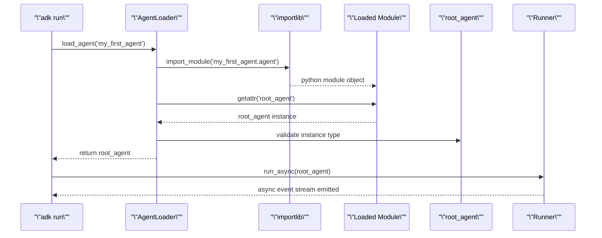

- The agent folder is loaded as a Python module dynamically via `AgentLoader`.
- The `root_agent` symbol is extracted, which must be an agent instance.
- The `Runner` orchestrates agent execution and event generation printed by CLI [src/google/adk/cli/cli.py:83-109]().

Sources:  
[src/google/adk/cli/cli.py:52-52](), [src/google/adk/cli/cli.py:83-109]()

---

## Canonical Project Structure and File Roles

| Filename          | Role                                                    | Notes                              |
|-------------------|---------------------------------------------------------|-----------------------------------|
| `agent.py`        | Root agent source code file (code mode only)           | Defines `root_agent` LlmAgent instance |
| `__init__.py`     | Python package marker                                   | Usually imports `agent.py`         |
| `.env`            | Environment variables (credentials and config)         | Holds secrets like API keys        |
| `.gitignore`      | VCS ignore file for secrets and runtime data            | Includes `.env` and `.adk/`        |
| `root_agent.yaml` | YAML agent configuration (config mode only)            | Must conform to `AgentConfig.json` |

### File Generation Logic Recap

- `.env` files store Google API keys, project IDs, and mode flags [src/google/adk/cli/cli_create.py:131-143]().
- `.gitignore` prevents committing sensitive and runtime files accidentally [src/google/adk/cli/cli_create.py:85-112]().
- `agent.py` and `__init__.py` set up the root agent code [src/google/adk/cli/cli_create.py:25-38]().
- Alternatively, `root_agent.yaml` defines the declarative configuration [src/google/adk/cli/cli_create.py:40-46]().

Sources:  
[src/google/adk/cli/cli_create.py:25-166]()

---

## Service Configuration for Local Persistence

When running locally, `adk run` automatically configures backend services for session and artifact persistence using service factories:

- **Session Service**:  
  By default, a per-agent SQLite database is created inside `.adk/session.db` using `PerAgentDatabaseSessionService`, providing isolated persistent state per agent folder [src/google/adk/cli/utils/local_storage.py:134-169]().

- **Artifact Service**:  
  Uses a file artifact service stored under `.adk/artifacts/` within the agent project by default (`PerAgentFileArtifactService`) [src/google/adk/cli/utils/local_storage.py:101-132]().

- **Configuration Behavior**:  
  - Users may override default persistence backends by specifying URI options for session or artifact services [src/google/adk/cli/utils/service_factory.py:197-204]().
  - Environment variables control fallback or forcing of local storage, e.g., `ADK_DISABLE_LOCAL_STORAGE`, `ADK_FORCE_LOCAL_STORAGE` [src/google/adk/cli/utils/service_factory.py:36-42]().
  - In cloud environments (Cloud Run, Kubernetes), in-memory ephemeral services are preferred by default [src/google/adk/cli/utils/service_factory.py:138-143]().

This ensures convenient development with durable local persistence by default, while allowing configurable backends for production deployments.

Sources:  
[src/google/adk/cli/utils/service_factory.py:36-204](), [src/google/adk/cli/utils/local_storage.py:101-169]()

---

## Summary

This Quick Start Guide covered:

- Creating an agent project with `adk create` (code or config mode) [src/google/adk/cli/cli_create.py:187-201]().
- Understanding generated files and their roles [src/google/adk/cli/cli_create.py:114-166]().
- Internal CLI workflow for loading and running the agent [src/google/adk/cli/cli.py:52-109]().
- Executing the agent interactively or from input files [src/google/adk/cli/cli.py:72-109]().
- Configuration of local backend services for sessions and artifacts [src/google/adk/cli/utils/service_factory.py:179-204]().

Sources:  
[src/google/adk/cli/cli_create.py:114-201](), [src/google/adk/cli/cli.py:52-109](), [src/google/adk/cli/utils/service_factory.py:179-204]()

---

# Page: Core Concepts

# Core Concepts

<details>
<summary>Relevant source files</summary>

The following files were used as context for generating this wiki page:

- [docs/guides/README.md](docs/guides/README.md)
- [docs/guides/apps/app/index.md](docs/guides/apps/app/index.md)
- [docs/guides/apps/events_compaction/index.md](docs/guides/apps/events_compaction/index.md)
- [docs/guides/apps/resumability/index.md](docs/guides/apps/resumability/index.md)
- [docs/guides/artifacts/artifact_service/index.md](docs/guides/artifacts/artifact_service/index.md)
- [docs/guides/events/event/index.md](docs/guides/events/event/index.md)
- [docs/guides/events/event_actions/index.md](docs/guides/events/event_actions/index.md)
- [docs/guides/events/request_input/index.md](docs/guides/events/request_input/index.md)
- [docs/guides/runners/runner/index.md](docs/guides/runners/runner/index.md)
- [docs/guides/runners/runner/live.md](docs/guides/runners/runner/live.md)
- [docs/guides/runners/runner/rewind.md](docs/guides/runners/runner/rewind.md)
- [scripts/generate_agent_config_schema.py](scripts/generate_agent_config_schema.py)
- [src/google/adk/agents/_agent_router.py](src/google/adk/agents/_agent_router.py)
- [src/google/adk/agents/agent_config.py](src/google/adk/agents/agent_config.py)
- [src/google/adk/agents/base_agent.py](src/google/adk/agents/base_agent.py)
- [src/google/adk/agents/base_agent_config.py](src/google/adk/agents/base_agent_config.py)
- [src/google/adk/agents/common_configs.py](src/google/adk/agents/common_configs.py)
- [src/google/adk/agents/config_agent_utils.py](src/google/adk/agents/config_agent_utils.py)
- [src/google/adk/agents/config_schemas/AgentConfig.json](src/google/adk/agents/config_schemas/AgentConfig.json)
- [src/google/adk/agents/llm_agent.py](src/google/adk/agents/llm_agent.py)
- [src/google/adk/agents/llm_agent_config.py](src/google/adk/agents/llm_agent_config.py)
- [src/google/adk/agents/loop_agent.py](src/google/adk/agents/loop_agent.py)
- [src/google/adk/agents/loop_agent_config.py](src/google/adk/agents/loop_agent_config.py)
- [src/google/adk/agents/parallel_agent.py](src/google/adk/agents/parallel_agent.py)
- [src/google/adk/agents/parallel_agent_config.py](src/google/adk/agents/parallel_agent_config.py)
- [src/google/adk/agents/sequential_agent.py](src/google/adk/agents/sequential_agent.py)
- [src/google/adk/agents/sequential_agent_config.py](src/google/adk/agents/sequential_agent_config.py)
- [src/google/adk/events/_abort_events.py](src/google/adk/events/_abort_events.py)
- [src/google/adk/runners.py](src/google/adk/runners.py)
- [src/google/adk/tools/exit_loop_tool.py](src/google/adk/tools/exit_loop_tool.py)
- [src/google/adk/workflow/_node_runner_utils.py](src/google/adk/workflow/_node_runner_utils.py)
- [src/google/adk/workflow/utils/_transfer_utils.py](src/google/adk/workflow/utils/_transfer_utils.py)
- [tests/unittests/agents/test_agent_config.py](tests/unittests/agents/test_agent_config.py)
- [tests/unittests/agents/test_agent_router.py](tests/unittests/agents/test_agent_router.py)
- [tests/unittests/agents/test_base_agent.py](tests/unittests/agents/test_base_agent.py)
- [tests/unittests/agents/test_llm_agent_fields.py](tests/unittests/agents/test_llm_agent_fields.py)
- [tests/unittests/agents/test_llm_agent_interruptions.py](tests/unittests/agents/test_llm_agent_interruptions.py)
- [tests/unittests/agents/test_loop_agent.py](tests/unittests/agents/test_loop_agent.py)
- [tests/unittests/agents/test_parallel_agent.py](tests/unittests/agents/test_parallel_agent.py)
- [tests/unittests/agents/test_resumable_llm_agent.py](tests/unittests/agents/test_resumable_llm_agent.py)
- [tests/unittests/agents/test_sequential_agent.py](tests/unittests/agents/test_sequential_agent.py)
- [tests/unittests/events/test_abort_events.py](tests/unittests/events/test_abort_events.py)
- [tests/unittests/runners/test_pause_invocation.py](tests/unittests/runners/test_pause_invocation.py)
- [tests/unittests/test_runners.py](tests/unittests/test_runners.py)
- [tests/unittests/workflow/test_agent_transfer.py](tests/unittests/workflow/test_agent_transfer.py)
- [tests/unittests/workflow/test_node_runner_utils.py](tests/unittests/workflow/test_node_runner_utils.py)
- [tests/unittests/workflow/test_workflow_agent_as_node.py](tests/unittests/workflow/test_workflow_agent_as_node.py)
- [tests/unittests/workflow/test_workflow_function_tool_as_node.py](tests/unittests/workflow/test_workflow_function_tool_as_node.py)
- [tests/unittests/workflow/test_workflow_live.py](tests/unittests/workflow/test_workflow_live.py)
- [tests/unittests/workflow/test_workflow_rewind.py](tests/unittests/workflow/test_workflow_rewind.py)
- [tests/unittests/workflow/test_workflow_schema.py](tests/unittests/workflow/test_workflow_schema.py)
- [tests/unittests/workflow/utils/test_transfer_utils.py](tests/unittests/workflow/utils/test_transfer_utils.py)

</details>


This page explains the fundamental concepts and abstractions forming the foundation of the Agent Development Kit (ADK). Mastery of these concepts is essential for building, orchestrating, and deploying AI agents using the ADK Python framework.

ADK’s architecture centers around these primary concepts:
- **Agents**: Autonomous computational units that process input and produce output.
- **Runner**: The stateless orchestration engine managing agent execution.
- **Tools**: Extensible functionalities callable by agents to interact with external systems.
- **Sessions**: Persistent conversational state management.
- **Memory**: Long-term semantic storage used across sessions.
- **Events**: Units representing messages, actions, and system state changes.
- **Workflows**: Graph-based orchestration of agents and nodes enabling complex execution.

Sources: [src/google/adk/agents/base_agent.py:131-137](), [src/google/adk/runners.py:61-63](), [src/google/adk/agents/invocation_context.py:127-134]()

---

## Agents

Agents are self-contained entities that perform reasoning or actions in response to input. They are at the heart of ADK's agentic automation. Every agent is a subclass of the abstract `BaseAgent` class [src/google/adk/agents/base_agent.py:131-137]() and also a `BaseNode` in the workflow engine [src/google/adk/agents/base_agent.py:52-52]().

### Agent Types and Hierarchy

ADK provides specialized agent types supporting different orchestration and execution patterns:

Title: "Agent Inheritance Hierarchy"
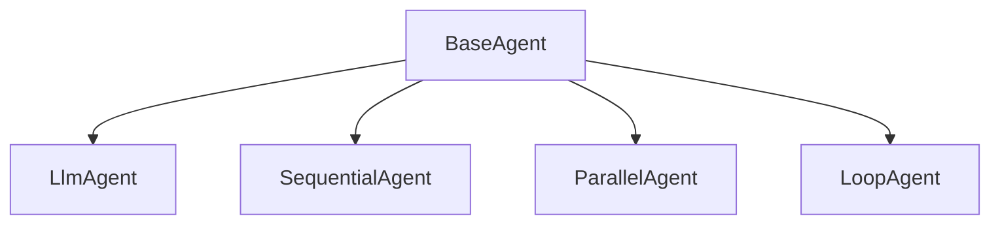
Sources: [src/google/adk/agents/base_agent.py:131-137](), [src/google/adk/agents/llm_agent.py:65-65](), [src/google/adk/agents/sequential_agent.py:93-94](), [src/google/adk/agents/parallel_agent.py:176-177]()

- **`BaseAgent`**: Abstract common base with methods `_run_async_impl()` and `_run_live_impl()` that subclasses override [src/google/adk/agents/base_agent.py:131-137]().
- **`LlmAgent`**: Uses LLM models to process instructions and optionally calls tools [src/google/adk/agents/llm_agent.py:65-65]().
- **`SequentialAgent`**, **`ParallelAgent`**, **`LoopAgent`**: Orchestrators running multiple sub-agents in different patterns [src/google/adk/agents/sequential_agent.py:93-94](), [src/google/adk/agents/parallel_agent.py:176-177](). These are deprecated in favor of ADK 2.0 Workflows but remain supported.

### Agent Composition and Naming

Agents form a hierarchical tree with parent/child relationships defined through the `sub_agents` attribute [src/google/adk/agents/base_agent.py:184-186](). Each agent must have a unique Python identifier-compatible `name` within its tree and **cannot be named `"user"`** (reserved for end users) [src/google/adk/agents/base_agent.py:162-164](). 

Agents have a `description` that LLMs use to help decide when to delegate control [src/google/adk/agents/base_agent.py:166-171](). The `parent_agent` attribute is set automatically when agents are added as sub_agents [src/google/adk/agents/base_agent.py:173-183]().

### Callbacks on Agents

Agents support lifecycle callbacks:

| Callback Name | Description | Behavior |
|---|---|---|
| `before_agent_callback` | Invoked before the agent runs; can bypass agent execution by returning content | Accepts a single or list of callbacks. When a callback returns content, agent run is skipped and content is returned early [src/google/adk/agents/base_agent.py:187-204]() |
| `after_agent_callback` | Invoked after the agent run completes; can append extra content to the response | When a callback returns content, it is appended as an additional response event [src/google/adk/agents/base_agent.py:205-207]() |

Callbacks can be synchronous or asynchronous, and are executed sequentially until a truthy result is returned [src/google/adk/agents/base_agent.py:48-50]().

Sources: [src/google/adk/agents/base_agent.py:131-210]()

---

## Runner

The `Runner` is ADK’s stateless orchestration engine coordinating agent runs, managing sessions, and controlling event flows. It constructs an `InvocationContext` for each invocation that encapsulates state, session information, and services [src/google/adk/agents/invocation_context.py:127-134]().

### Runner Architecture

Title: "Runner and Invocation Flow"
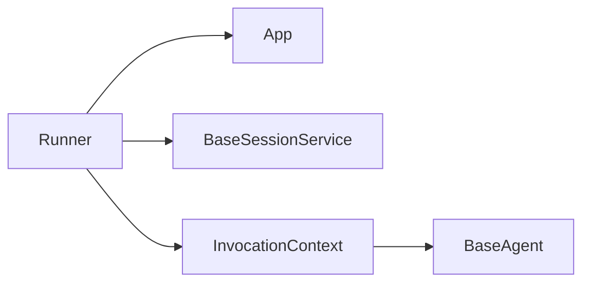
Sources: [src/google/adk/runners.py:61-63](), [src/google/adk/agents/invocation_context.py:127-134]()

- The `Runner` uses provided services (`BaseSessionService`, `BaseArtifactService`, `BaseMemoryService`) and `PluginManager` to manage execution lifecycles [src/google/adk/runners.py:59-63]().
- It calls the `agent.run_async(context)` method to drive agent computation.
- Supports multiple run modes: text-based (`run_async`), live audio/video streaming (`run_live`), and rewind/restore (`rewind_async`).

### Key Runner Methods

| Method | Description | Location |
|---|---|---|
| `run_async()` | Executes an agent run textually, yielding events asynchronously | [src/google/adk/runners.py:51-53]() |
| `run_live()` | Supports real-time live streaming input/output interactions | [src/google/adk/runners.py:51-53]() |
| `rewind_async()` | Rolls back to a previous event in session history | [src/google/adk/runners.py:51-53]() |

Sources: [src/google/adk/runners.py:51-73]()

---

## Sessions

A **session** represents a persistent conversation or interaction context identified by `app_name`, `user_id`, and a unique `session id` [src/google/adk/sessions/session.py:1-1]().

### State Scoping and Hierarchy

Agent and application state is tracked hierarchically using prefixes:

| Prefix | Scope | Persistence | Use Case |
|---|---|---|---|
| `app:` | All users in app | Persistent | Global app-level config |
| `user:`| All user sessions | Persistent | User preferences or settings |
| (none) | One session only | Persistent | Current conversation context |
| `temp:`| Current invocation | Not persisted | Temporary, ephemeral data |

State deltas are applied as changes in `Event.actions.state_delta` allowing precise incremental updates without rewriting whole state [src/google/adk/events/event_actions.py:1-1]().

Sources: [src/google/adk/events/event_actions.py:1-1]()

---

## Events

An **event** is the fundamental record of communication and actions within the system. This includes user messages, agent responses, function call invocations, and system state changes.

### Event Model

The core event class is `Event`, which includes fields to track authorship, invocation context, actions, output, and node metadata [src/google/adk/events/event.py:1-1]().

Title: "Event Structure"
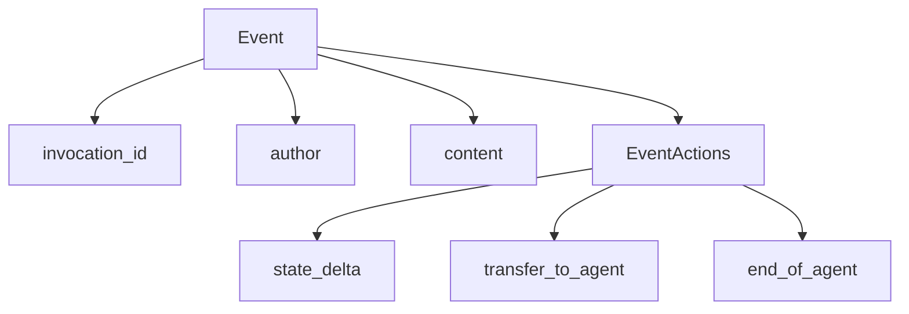
Sources: [src/google/adk/events/event.py:1-1](), [src/google/adk/events/event_actions.py:1-1]()

- `invocation_id` groups events for a single invocation transaction [src/google/adk/events/event.py:1-1]().
- `author` identifies who emitted the event (`user` or an agent name) [src/google/adk/events/event.py:1-1]().
- `actions` include flags and state delta updates [src/google/adk/events/event.py:1-1]().

---

## Tools

**Tools** are the interfaces through which agents interact with external systems or execute custom logic. They can be Python callables, objects implementing the `BaseTool` interface, or full toolsets deriving from `BaseToolset` [src/google/adk/agents/llm_agent.py:153-153]().

### Tool Types in LlmAgent

`LlmAgent` accepts tools as a union of these forms:
- Simple callables (e.g., Python functions)
- Instances of `BaseTool`
- Toolsets (collections of tools) via `BaseToolset`
- Node wrappers (`NodeTool`) wrapping workflow nodes or subgraphs [src/google/adk/agents/llm_agent.py:156-166]()

### Workflow Nodes as Tools via NodeTool

Workflows and graph nodes can be wrapped as callable tools using the `NodeTool` wrapper. This allows an LlmAgent to invoke a workflow node as if it were a simple tool, integrating complex graph logic under the tool call framework [src/google/adk/agents/llm_agent.py:156-166]().

Sources: [src/google/adk/agents/llm_agent.py:151-166]()

---

## Invocation Context and Context Object

Upon agent execution, an `InvocationContext` instance is created by the `Runner` which provides the execution environment and access to session state, services, plugins, and run configuration [src/google/adk/agents/invocation_context.py:127-134]().

Additionally, ADK provides a higher-level `Context` object encapsulating session state, local event actions, state deltas, workflow node path, run id, and scheduler references [src/google/adk/agents/base_agent.py:55-55]().

Sources: [src/google/adk/agents/invocation_context.py:127-134](), [src/google/adk/agents/base_agent.py:55-55]()

---

## Workflows

The ADK 2.0 workflow engine manages non-linear, conditional, and cyclical orchestration via a directed graph of nodes. Agents themselves are nodes, allowing complex subgraphs of agent calls, tools, and processing logic.

### Workflow Integration with Agents

Workflows are defined as subclasses of `BaseNode` with edges specifying routing and branching logic [src/google/adk/workflow/_base_node.py:72-72]().

Agents like `LlmAgent` or `NodeTool` can be embedded as nodes within workflows for hierarchical execution. The workflow scheduler manages node triggering, retries, and resumption [src/google/adk/agents/base_agent.py:131-137]().

Sources: [src/google/adk/agents/base_agent.py:131-137](), [src/google/adk/workflow/_base_node.py:72-72]()

---

# Summary Diagram: From Natural Language to Code Entities

Title: "Natural Language to Code Entities Mapping (Part 1)"
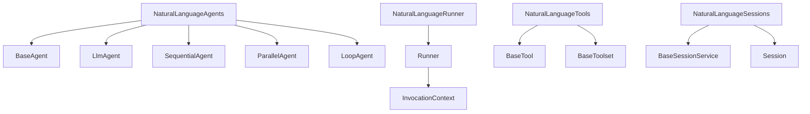
Sources: [src/google/adk/agents/base_agent.py:131-137](), [src/google/adk/runners.py:51-73](), [src/google/adk/agents/llm_agent.py:65-65](), [src/google/adk/sessions/session.py:1-1]()

Title: "Natural Language to Code Entities Mapping (Part 2)"
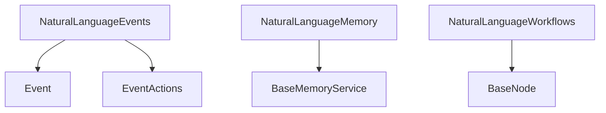
Sources: [src/google/adk/events/event.py:1-1](), [src/google/adk/events/event_actions.py:1-1](), [src/google/adk/runners.py:59-63](), [src/google/adk/workflow/_base_node.py:72-72]()

---

# Summary Diagram: LlmAgent Internal Flow and Tool Integration

Title: "LlmAgent Execution and Tool Flow"
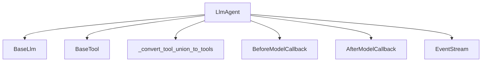
Sources: [src/google/adk/agents/llm_agent.py:65-176]()

- `LlmAgent` instantiates or receives an LLM model (`BaseLlm` subclass) [src/google/adk/agents/llm_agent.py:65-65]().
- Tools can be provided as Python functions, `BaseTool`, or toolsets; internally unified as a list of `BaseTool` instances by `_convert_tool_union_to_tools()` [src/google/adk/agents/llm_agent.py:171-176]().
- Before/after model and tool callbacks allow custom logic injection [src/google/adk/agents/llm_agent.py:93-141]().

---

# Detailed Conceptual Summary

| Concept | Implementation | Key Methods/Attributes | Notes |
|---|---|---|---|
| **Agents** | `BaseAgent` and subclasses | `run_async()`, `_run_async_impl()`, `sub_agents`, `name`, `description`, callbacks | Agents are hierarchical nodes; deprecated agents replaced by workflows [src/google/adk/agents/base_agent.py:131-210]() |
| **Runner** | `Runner` | `run_async()`, `run_live()`, `rewind_async()` | Stateless executor coordinating sessions, agents, plugins, and events [src/google/adk/runners.py:51-73]() |
| **Tools** | `BaseTool`, `BaseToolset` and `NodeTool` | Tool callables or objects; tools exposed to LLM | Tools wrap external capabilities; Nodes can be tools [src/google/adk/agents/llm_agent.py:151-166]() |
| **Sessions** | `BaseSessionService` implementations; `Session` | Hierarchical state (`app:`, `user:`, etc.), event history | Persistent conversation state with state deltas stored via events [src/google/adk/sessions/session.py:1-1]() |
| **Memory** | `BaseMemoryService` | Semantic storage accessible across sessions | For enhanced context, episodic memory, retrievers [src/google/adk/runners.py:59-63]() |
| **Events** | `Event` | `id`, `invocation_id`, `author`, `actions`, `node_info` | Data flow unit representing content, actions, state changes [src/google/adk/events/event.py:1-1]() |
| **Workflows** | `BaseNode`, `Graph` | Graph-based execution of nodes and agents | Supports recursive, dynamic, and conditional orchestration [src/google/adk/workflow/_base_node.py:72-72]() |

Sources: [src/google/adk/agents/base_agent.py:131-210](), [src/google/adk/runners.py:51-73](), [src/google/adk/agents/llm_agent.py:151-166](), [src/google/adk/sessions/session.py:1-1](), [src/google/adk/events/event.py:1-1]()

---

# Page: Agent System

# Agent System

<details>
<summary>Relevant source files</summary>

The following files were used as context for generating this wiki page:

- [scripts/generate_agent_config_schema.py](scripts/generate_agent_config_schema.py)
- [src/google/adk/agents/agent_config.py](src/google/adk/agents/agent_config.py)
- [src/google/adk/agents/base_agent.py](src/google/adk/agents/base_agent.py)
- [src/google/adk/agents/base_agent_config.py](src/google/adk/agents/base_agent_config.py)
- [src/google/adk/agents/common_configs.py](src/google/adk/agents/common_configs.py)
- [src/google/adk/agents/config_agent_utils.py](src/google/adk/agents/config_agent_utils.py)
- [src/google/adk/agents/config_schemas/AgentConfig.json](src/google/adk/agents/config_schemas/AgentConfig.json)
- [src/google/adk/agents/llm_agent.py](src/google/adk/agents/llm_agent.py)
- [src/google/adk/agents/llm_agent_config.py](src/google/adk/agents/llm_agent_config.py)
- [src/google/adk/agents/loop_agent.py](src/google/adk/agents/loop_agent.py)
- [src/google/adk/agents/loop_agent_config.py](src/google/adk/agents/loop_agent_config.py)
- [src/google/adk/agents/parallel_agent.py](src/google/adk/agents/parallel_agent.py)
- [src/google/adk/agents/parallel_agent_config.py](src/google/adk/agents/parallel_agent_config.py)
- [src/google/adk/agents/sequential_agent.py](src/google/adk/agents/sequential_agent.py)
- [src/google/adk/agents/sequential_agent_config.py](src/google/adk/agents/sequential_agent_config.py)
- [src/google/adk/tools/exit_loop_tool.py](src/google/adk/tools/exit_loop_tool.py)
- [tests/unittests/agents/test_agent_config.py](tests/unittests/agents/test_agent_config.py)
- [tests/unittests/agents/test_base_agent.py](tests/unittests/agents/test_base_agent.py)
- [tests/unittests/agents/test_llm_agent_fields.py](tests/unittests/agents/test_llm_agent_fields.py)
- [tests/unittests/agents/test_loop_agent.py](tests/unittests/agents/test_loop_agent.py)
- [tests/unittests/agents/test_parallel_agent.py](tests/unittests/agents/test_parallel_agent.py)
- [tests/unittests/agents/test_sequential_agent.py](tests/unittests/agents/test_sequential_agent.py)
- [tests/unittests/runners/test_pause_invocation.py](tests/unittests/runners/test_pause_invocation.py)

</details>


## Purpose and Scope

The Agent System forms the core framework for developing and orchestrating AI agents within the ADK Python codebase. It provides a structured yet extensible hierarchy of agent classes that can be configured, composed, and executed to process complex user interactions and workflows.

This page delivers a high-level overview of the agent architecture, including key agent types, configuration approaches, execution lifecycle, multi-agent orchestration patterns, callback infrastructure, and agent state management. It acts as a navigational hub linking to detailed child pages for each topic.

For full implementation specifics, visit the child pages:
- [Agent Types and Hierarchy](#3.1) — Document BaseAgent, LlmAgent, LoopAgent, SequentialAgent, ParallelAgent, LangGraphAgent, ManagedAgent.
- [LlmAgent Configuration](#3.2) — Configuring LlmAgent: model, instruction, tools, generate_content_config, output_schema, mode, transfer flags.
- [Agent Configuration Files](#3.3) — Defining agents in YAML, AgentConfig discriminator, CodeConfig, module blocklist security, loading graph workflows from YAML.
- [Agent Execution Lifecycle](#3.4) — run_async, _run_async_impl, before/after callbacks, state management during execution.
- [Multi-Agent Orchestration](#3.5) — Sub-agents, agent transfer, agent routing, task-mode delegation, legacy Sequential/Parallel/Loop patterns.
- [Callbacks and Hooks](#3.6) — before/after agent, model and tool callbacks, error callbacks, callback pipeline utilities, plugin equivalents.
- [Instructions and Prompts](#3.7) — instruction, static_instruction, global_instruction, InstructionProvider, McpInstructionProvider, state injection.
- [Agent State and Context](#3.8) — Agent state management, resumable invocations, agent_states, ReadonlyContext/CallbackContext/ToolContext.

Sources: [src/google/adk/agents/base_agent.py:131-186]()

---

## Agent Class Hierarchy

At the foundation, all agents inherit from `BaseAgent`, itself a subclass of the workflow `BaseNode`. This layer provides essential properties such as the agent’s `name`, `description`, and management of `sub_agents` [src/google/adk/agents/base_agent.py:131-186](). It also defines key callbacks and the abstract asynchronous `_run_async_impl` method for executing agent logic.

Specialized agent types extend this base to support different interaction styles and orchestration strategies:
- `LlmAgent` connects to language models, encapsulating model invocation, instructions, and toolsets [src/google/adk/agents/llm_agent.py:1-67]().
- `SequentialAgent`, `ParallelAgent`, `LoopAgent` provide orchestration shells to run sub-agents in sequence, in parallel, or loops, respectively [src/google/adk/agents/sequential_agent.py:93-100](), [src/google/adk/agents/parallel_agent.py:176-177](), [src/google/adk/agents/loop_agent.py:63-72](). These are deprecated in favor of the Workflow engine.

### Natural Language Space to Code Entity Space: Agent Hierarchy
Title: "Agent Class Hierarchy and Code Mapping"
```mermaid
graph TB
    BaseNode[""BaseNode<br/>(workflow/_base_node.py)""]
    BaseAgent[""BaseAgent<br/>(agents/base_agent.py)""]
    LlmAgent[""LlmAgent<br/>(agents/llm_agent.py)""]
    SequentialAgent[""SequentialAgent<br/>(agents/sequential_agent.py)""]
    ParallelAgent[""ParallelAgent<br/>(agents/parallel_agent.py)""]
    LoopAgent[""LoopAgent<br/>(agents/loop_agent.py)""]
    
    BaseNode --> BaseAgent
    BaseAgent --> LlmAgent
    BaseAgent --> SequentialAgent
    BaseAgent --> ParallelAgent
    BaseAgent --> LoopAgent
    
    BaseAgent -.->|"name: str<br/>description: str<br/>sub_agents: list[BaseAgent]"| BaseAgentFields[""Core Fields""]
    BaseAgent -.->|"_run_async_impl()<br/>before_agent_callback<br/>after_agent_callback"| BaseAgentMethods[""Core Methods""]
```

**Agent Types Summary**

| Agent Type       | Class          | Purpose                                  | Key Configuration                                                        |
|------------------|----------------|------------------------------------------|-------------------------------------------------------------------------|
| Base Agent       | `BaseAgent`    | Abstract foundation for all agents       | `name`, `description`, `sub_agents`, callbacks                          |
| LLM Agent        | `LlmAgent`     | Interfaces with language models          | `model`, `instruction`, `tools`, `output_schema`                        |
| Sequential Agent | `SequentialAgent` | Runs sub-agents one by one (Deprecated) | `sub_agents` defines execution order                                    |
| Parallel Agent   | `ParallelAgent` | Runs sub-agents in parallel (Deprecated) | `sub_agents`, isolated async branches                                   |
| Loop Agent       | `LoopAgent`    | Loops sub-agents until exit condition (Deprecated) | `max_iterations`, escalation handling                                   |

For details, see [Agent Types and Hierarchy](#3.1).
Sources: [src/google/adk/agents/base_agent.py:131-207](), [src/google/adk/agents/sequential_agent.py:93-100](), [src/google/adk/agents/parallel_agent.py:176-177](), [src/google/adk/agents/loop_agent.py:63-72]()

---

## Agent Creation and Configuration

Agents can be instantiated programmatically or loaded declaratively from YAML configuration files. The `AgentConfig` class serves as a discriminator, allowing the framework to identify and load the correct agent type from a YAML definition. For example, an `LlmAgent` configuration is handled by `LlmAgentConfig` [src/google/adk/agents/llm_agent_config.py:37-55]().

The `config_agent_utils.py` module provides core logic for resolving agent classes and dependencies, enforcing security policies such as module blocklists via `CodeConfig` during configuration loading [src/google/adk/agents/config_agent_utils.py:197-213]().

### Natural Language Space to Code Entity Space: YAML Configuration Loading
Title: "YAML Configuration Loading Pipeline"
```mermaid
graph LR
    AgentConfigSchema[""AgentConfig JSON Schema<br/>(agents/config_schemas/AgentConfig.json)""]
    AgentConfigClass[""AgentConfig Model<br/>(agents/agent_config.py)""]
    ConfigUtils[""config_agent_utils.py<br/>(agents/config_agent_utils.py)""]
    
    AgentConfigSchema --> AgentConfigClass
    AgentConfigClass --> ConfigUtils
    
    ConfigUtils -->|"_resolve_tools()"| Tools[""BaseTool / BaseToolset<br/>(tools/base_tool.py)""]
    ConfigUtils -->|"_resolve_agent_class()"| AgentClasses[""Agent Classes""]
    
    ConfigUtils -.->|"from_config()"| LlmAgent[""LlmAgent instance""]
```

For details, see [Agent Configuration Files](#3.3) and [LlmAgent Configuration](#3.2).
Sources: [src/google/adk/agents/config_agent_utils.py:197-213](), [src/google/adk/agents/llm_agent_config.py:37-75]()

---

## Agent Execution Model

Agent instances implement asynchronous methods `run_async()` and optionally `_run_live_impl()` for streaming scenarios. These methods coordinate the agent's lifecycle within an `InvocationContext`, which tracks session state, event branches, plugins, and resumability flags [src/google/adk/agents/base_agent.py:131-207]() [tests/unittests/agents/test_base_agent.py:132-155]().

The typical execution flow for an `LlmAgent` involves applying before-agent callbacks, invoking the LLM flow, handling function/tool calls, emitting events, and running after-agent callbacks [src/google/adk/agents/llm_agent.py:1-67]().

### Agent Execution Flow Sequence
Title: "Agent Asynchronous Execution Sequence"
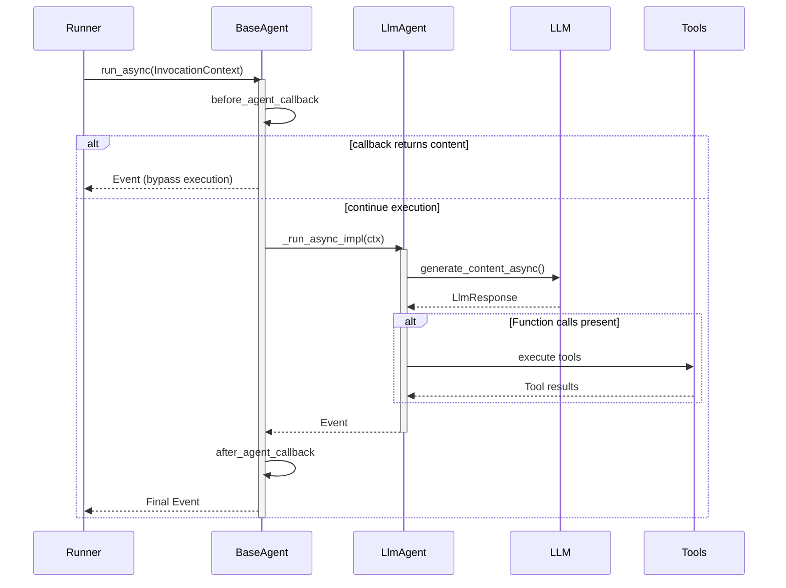

For a detailed explanation of lifecycle callbacks and state handling, consult [Agent Execution Lifecycle](#3.4).
Sources: [src/google/adk/agents/base_agent.py:131-207](), [tests/unittests/agents/test_base_agent.py:132-155]()

---

## Multi-Agent Composition and Orchestration

The framework supports hierarchical composition by allowing agents to contain sub-agents (`sub_agents`). This enables complex interaction patterns and task delegation [src/google/adk/agents/base_agent.py:184-186]().

Legacy orchestration agent types govern sub-agent coordination:
- `SequentialAgent`: Runs each sub-agent in series [src/google/adk/agents/sequential_agent.py:109-148]().
- `ParallelAgent`: Runs sub-agents concurrently on isolated branches [src/google/adk/agents/parallel_agent.py:92-151]().
- `LoopAgent`: Runs sub-agents in repeated loops until an exit condition or maximum iterations [src/google/adk/agents/loop_agent.py:89-144]().

These orchestrators maintain internal state via `BaseAgentState` to support resumable runs [src/google/adk/agents/base_agent.py:82-88](). These agent types are deprecated in favor of the ADK 2.0 Workflow engine.

For details, see [Multi-Agent Orchestration](#3.5).
Sources: [src/google/adk/agents/base_agent.py:82-186](), [src/google/adk/agents/sequential_agent.py:109-148](), [src/google/adk/agents/parallel_agent.py:92-151](), [src/google/adk/agents/loop_agent.py:89-144]()

---

## Callback System

The Agent System provides rich extensibility through callbacks at different lifecycle points:
- **Before Agent Callback (`before_agent_callback`):** Invoked before the agent’s main execution [src/google/adk/agents/base_agent.py:187-204]().
- **After Agent Callback (`after_agent_callback`):** Invoked after the agent completes [src/google/adk/agents/base_agent.py:205-210]().
- **Model Callbacks (`before_model_callback`, `after_model_callback`, `on_model_error_callback`):** Specific to `LlmAgent` [src/google/adk/agents/llm_agent.py:93-122]().
- **Tool Callbacks (`before_tool_callback`, `after_tool_callback`, `on_tool_error_callback`):** Hooks around tool execution [src/google/adk/agents/llm_agent.py:123-151]().

For details, see [Callbacks and Hooks](#3.6).
Sources: [src/google/adk/agents/base_agent.py:187-210](), [src/google/adk/agents/llm_agent.py:93-151]()

---

## Instructions and Prompts

Agents relying on language models utilize instructions to guide model behavior:
- **Static Instructions (`static_instruction`):** Sent verbatim at system message position, enabling context caching [src/google/adk/agents/llm_agent_config.py:97-106]().
- **Dynamic Instructions (`instruction`):** Constructed at runtime with placeholder support via `InstructionProvider` [src/google/adk/agents/llm_agent_config.py:88-96]().

For details, see [Instructions and Prompts](#3.7).
Sources: [src/google/adk/agents/llm_agent_config.py:88-106]()

---

## Agent State and Context Management

To support resumable executions, multi-agent workflows, and session histories, agents maintain internal state modeled by subclasses of `BaseAgentState` [src/google/adk/agents/base_agent.py:82-88](). This state is tracked within `InvocationContext`, while `ReadonlyContext` and `CallbackContext` offer restricted views for specific operations [src/google/adk/agents/base_agent.py:68-70]().

For details, see [Agent State and Context](#3.8).
Sources: [src/google/adk/agents/base_agent.py:68-88]()

---

# Page: Agent Types and Hierarchy

# Agent Types and Hierarchy

<details>
<summary>Relevant source files</summary>

The following files were used as context for generating this wiki page:

- [contributing/samples/managed_agent/basic/README.md](contributing/samples/managed_agent/basic/README.md)
- [contributing/samples/managed_agent/basic/__init__.py](contributing/samples/managed_agent/basic/__init__.py)
- [contributing/samples/managed_agent/basic/agent.py](contributing/samples/managed_agent/basic/agent.py)
- [contributing/samples/managed_agent/code_execution/README.md](contributing/samples/managed_agent/code_execution/README.md)
- [contributing/samples/managed_agent/code_execution/__init__.py](contributing/samples/managed_agent/code_execution/__init__.py)
- [contributing/samples/managed_agent/code_execution/agent.py](contributing/samples/managed_agent/code_execution/agent.py)
- [scripts/generate_agent_config_schema.py](scripts/generate_agent_config_schema.py)
- [src/google/adk/agents/_managed_agent.py](src/google/adk/agents/_managed_agent.py)
- [src/google/adk/agents/active_streaming_tool.py](src/google/adk/agents/active_streaming_tool.py)
- [src/google/adk/agents/agent_config.py](src/google/adk/agents/agent_config.py)
- [src/google/adk/agents/base_agent.py](src/google/adk/agents/base_agent.py)
- [src/google/adk/agents/base_agent_config.py](src/google/adk/agents/base_agent_config.py)
- [src/google/adk/agents/common_configs.py](src/google/adk/agents/common_configs.py)
- [src/google/adk/agents/config_agent_utils.py](src/google/adk/agents/config_agent_utils.py)
- [src/google/adk/agents/config_schemas/AgentConfig.json](src/google/adk/agents/config_schemas/AgentConfig.json)
- [src/google/adk/agents/langgraph_agent.py](src/google/adk/agents/langgraph_agent.py)
- [src/google/adk/agents/llm_agent.py](src/google/adk/agents/llm_agent.py)
- [src/google/adk/agents/llm_agent_config.py](src/google/adk/agents/llm_agent_config.py)
- [src/google/adk/agents/loop_agent.py](src/google/adk/agents/loop_agent.py)
- [src/google/adk/agents/loop_agent_config.py](src/google/adk/agents/loop_agent_config.py)
- [src/google/adk/agents/parallel_agent.py](src/google/adk/agents/parallel_agent.py)
- [src/google/adk/agents/parallel_agent_config.py](src/google/adk/agents/parallel_agent_config.py)
- [src/google/adk/agents/sequential_agent.py](src/google/adk/agents/sequential_agent.py)
- [src/google/adk/agents/sequential_agent_config.py](src/google/adk/agents/sequential_agent_config.py)
- [src/google/adk/agents/transcription_entry.py](src/google/adk/agents/transcription_entry.py)
- [src/google/adk/live/_active_streaming_tool.py](src/google/adk/live/_active_streaming_tool.py)
- [src/google/adk/live/_transcription_entry.py](src/google/adk/live/_transcription_entry.py)
- [src/google/adk/tools/exit_loop_tool.py](src/google/adk/tools/exit_loop_tool.py)
- [tests/integration/test_managed_agent.py](tests/integration/test_managed_agent.py)
- [tests/unittests/agents/test_agent_config.py](tests/unittests/agents/test_agent_config.py)
- [tests/unittests/agents/test_base_agent.py](tests/unittests/agents/test_base_agent.py)
- [tests/unittests/agents/test_langgraph_agent.py](tests/unittests/agents/test_langgraph_agent.py)
- [tests/unittests/agents/test_llm_agent_fields.py](tests/unittests/agents/test_llm_agent_fields.py)
- [tests/unittests/agents/test_loop_agent.py](tests/unittests/agents/test_loop_agent.py)
- [tests/unittests/agents/test_managed_agent.py](tests/unittests/agents/test_managed_agent.py)
- [tests/unittests/agents/test_parallel_agent.py](tests/unittests/agents/test_parallel_agent.py)
- [tests/unittests/agents/test_sequential_agent.py](tests/unittests/agents/test_sequential_agent.py)
- [tests/unittests/flows/llm_flows/test_tool_telemetry.py](tests/unittests/flows/llm_flows/test_tool_telemetry.py)
- [tests/unittests/live/test_active_streaming_tool.py](tests/unittests/live/test_active_streaming_tool.py)
- [tests/unittests/live/test_audio_transcriber.py](tests/unittests/live/test_audio_transcriber.py)
- [tests/unittests/live/test_transcription_entry.py](tests/unittests/live/test_transcription_entry.py)
- [tests/unittests/runners/test_pause_invocation.py](tests/unittests/runners/test_pause_invocation.py)

</details>


## Purpose and Scope

This document describes the agent type system in the ADK Python repository (`https://github.com/google/adk-python`). It covers the key agent classes, their relationship in the class hierarchy, and their distinctive behaviors. This page serves as a technical reference for how agents are implemented, their data flow, and how they compose complex agent behaviors.

The types documented include `BaseAgent`, `LlmAgent`, `LoopAgent`, `SequentialAgent`, `ParallelAgent` (deprecated in favor of `Workflow`), `LangGraphAgent`, and `ManagedAgent`. Their relationships and main usage patterns are detailed.

For specifics on agent configurations, lifecycle, orchestration strategies, and execution details, refer to the linked child pages.

Sources:
[src/google/adk/agents/base_agent.py:134-210]()
[src/google/adk/agents/llm_agent.py:64-90]()

---

## Agent Class Hierarchy

All agents extend `BaseAgent` which itself extends `BaseNode` from the workflow subsystem, providing a unified interface.

```mermaid
classDiagram
    class BaseNode {
        <<Abstract>>
    }

    class BaseAgent {
        <<Abstract>>
        +str name
        +str description
        +Optional~BaseAgent~ parent_agent
        +list~BaseAgent~ sub_agents
        +Optional~BeforeAgentCallback~ before_agent_callback
        +Optional~AfterAgentCallback~ after_agent_callback
        +run_async(parent_context) AsyncGenerator~Event~
        +run_live(parent_context) AsyncGenerator~Event~
        #_run_async_impl(ctx) AsyncGenerator~Event~*
        #_run_live_impl(ctx) AsyncGenerator~Event~*
        +clone(update) SelfAgent
        +find_agent(name) Optional~BaseAgent~
        +find_sub_agent(name) Optional~BaseAgent~
        +root_agent BaseAgent
        +ClassVar~Type~BaseAgentConfig~~ config_type
    }

    class LlmAgent {
        +Union~str, BaseLlm~ model
        +Union~str, InstructionProvider~ instruction
        +Union~str, InstructionProvider~ global_instruction
        +Optional~ContentUnion~ static_instruction
        +list~ToolUnion~ tools
        +Optional~GenerateContentConfig~ generate_content_config
        +bool disallow_transfer_to_parent
        +bool disallow_transfer_to_peers
        +Literal include_contents
        +Optional~type~BaseModel~~ input_schema
        +Optional~SchemaType~ output_schema
        +Optional~str~ output_key
        -_llm_flow BaseLlmFlow
        +ClassVar~str~ DEFAULT_MODEL
        +set_default_model(model) None
    }

    class ManagedAgent {
        +google.genai.Client api_client
        +str agent_id
        +Optional~CreateAgentInteractionEnvironmentParam~ environment
        +Optional~Literal~single_turn~~ mode
        +list~Union~Tool, BaseTool, RemoteMcpServer~~ tools
        #_run_async_impl(ctx)
    }

    class LoopAgent {
        +Optional~int~ max_iterations
        #_run_async_impl(ctx)
    }

    class SequentialAgent {
        #_run_async_impl(ctx)
        #_run_live_impl(ctx)
    }

    class ParallelAgent {
        #_run_async_impl(ctx)
    }

    class LangGraphAgent {
        +Graph graph
        +str entry_point
        +Optional~str~ output_point
        +Optional~dict~str, Any~~ node_kwargs
        #_run_async_impl(ctx)
    }

    BaseNode <|-- BaseAgent
    BaseAgent <|-- LlmAgent
    BaseAgent <|-- ManagedAgent
    BaseAgent <|-- LoopAgent
    BaseAgent <|-- SequentialAgent
    BaseAgent <|-- ParallelAgent
    BaseAgent <|-- LangGraphAgent
    BaseAgent "1" --> "*" BaseAgent : sub_agents
```

This hierarchy exemplifies the architectural layering where `BaseAgent` establishes the core interface, `LlmAgent` handles LLM-powered execution with tool support, `ManagedAgent` integrates with the external Managed Agents API, legacy orchestrators (`LoopAgent`, `SequentialAgent`, `ParallelAgent`) provide specific execution loops, and `LangGraphAgent` integrates graph-based workflows.

Sources:
[src/google/adk/agents/base_agent.py:134-188]()
[src/google/adk/agents/loop_agent.py:66-89]()
[src/google/adk/agents/sequential_agent.py:96-105]()
[src/google/adk/agents/parallel_agent.py:172-176]()

---

## BaseAgent - The Abstract Base

`BaseAgent` is the foundational abstract class from which all agents derive, extending `BaseNode` from the workflow engine.

### Implementation Highlights

- **Core Attributes**:
  - `name`: Unique Python identifier for the agent [src/google/adk/agents/base_agent.py:162-167]().
  - `description`: Short description about the agent's capability [src/google/adk/agents/base_agent.py:169-174]().
  - `parent_agent` and `sub_agents`: Implement hierarchical agent composition [src/google/adk/agents/base_agent.py:176-188]().
- **Callbacks**:
  - `before_agent_callback` and `after_agent_callback` insert pre/post logic around agent execution [src/google/adk/agents/base_agent.py:190-209](). Both support sync and async functions with early return signaling.
- **Execution Lifecycle**:
  - Defines abstract methods `_run_async_impl(ctx)` and `_run_live_impl(ctx)` implemented by subclasses.
  - Public methods `run_async()` and `run_live()` wrap the implementation with callback invocation and telemetry.
- **Agent State Management**:
  - Supports resumption and persistence using `_load_agent_state()` and `_create_agent_state_event()`.

### Agent Validation

`BaseAgent` validates agent names:
- Must be a valid Python identifier.
- Cannot be `"user"` (reserved for user inputs) [tests/unittests/agents/test_base_agent.py:180-184]().

Sources:
[src/google/adk/agents/base_agent.py:134-210]()
[tests/unittests/agents/test_base_agent.py:175-189]()

---

## LlmAgent - LLM-Based Agent

`LlmAgent` is the primary agent type for handling LLM interactions, integrating model configurations, instruction templates, and toolsets.

### Model Handling

- The `model` attribute accepts a string model name or a `BaseLlm` instance.
- Class methods allow configuring global defaults for all `LlmAgent` instances.

### Instruction Fields

- `instruction`: Dynamic instruction prompt (string or async callable).
- `static_instruction`: Optional static content sent as prefix for context caching.
- `global_instruction`: Injected into all LLM calls as global behavior guidance.

### LLM Flow Management

`LlmAgent` uses an internal flow (`_llm_flow`) to manage conversation turns:
- Defaults to `AutoFlow` for multi-turn conversations with transfer support.
- Switches to `SingleFlow` when no transfer and no sub-agents are present.

### Tool Integration

`tools` accepts Python callables, `BaseTool`, or `BaseToolset` instances [src/google/adk/agents/llm_agent.py:152]().

Sources:
[src/google/adk/agents/llm_agent.py:64-90]()
[tests/unittests/agents/test_llm_agent_fields.py:71-151]()

---

## ManagedAgent - Managed Agents API Integration

`ManagedAgent` integrates with Google's Managed Agents API (Interactions API) for server-driven AI agents.

### Key Features

- Connects via `google.genai.Client` to stream interactions.
- Maintains stateful dialogue across calls without resending full history.
- Supports server-side tools (ADK built-in tools and remote MCP servers).
- Supports a `single_turn` mode for inline execution within a parent `LlmAgent`.

### Data Flow Diagram

```mermaid
sequenceDiagram
    participant ManagedAgent as "ManagedAgent"
    participant InteractionsAPI as "InteractionsAPI"
    participant RemoteMCP as "RemoteMcpServer"

    ManagedAgent->>InteractionsAPI: "create interaction"
    InteractionsAPI-->>ManagedAgent: "InteractionStartedEvent"
    InteractionsAPI-->>ManagedAgent: "ThoughtStep events"
    InteractionsAPI->>RemoteMCP: "Execute Tool"
    RemoteMCP-->>InteractionsAPI: "Tool Execution Result"
    InteractionsAPI-->>ManagedAgent: "ModelOutputStep"
    InteractionsAPI-->>ManagedAgent: "InteractionCompleteEvent"
```

Sources:
[src/google/adk/agents/_managed_agent.py]()

---

## LoopAgent - Iterative Agent Loop (Deprecated)

`LoopAgent` executes sub-agents repeatedly in a loop until conditions are met.

**Deprecated**: Replaced by `Workflow` [src/google/adk/agents/loop_agent.py:62-65]().

### Execution Behavior

- Runs sub-agents sequentially [src/google/adk/agents/loop_agent.py:107-108]().
- Enforces `max_iterations` to prevent infinite loops [src/google/adk/agents/loop_agent.py:84-89]().
- Exits early if any sub-agent escalates [src/google/adk/agents/loop_agent.py:125-126]().
- Tracks state via `LoopAgentState` [src/google/adk/agents/loop_agent.py:52-60]().

Sources:
[src/google/adk/agents/loop_agent.py:51-173]()

---

## SequentialAgent - Ordered Sub-Agent Execution (Deprecated)

`SequentialAgent` runs sub-agents strictly in sequence.

**Deprecated**: Replaced by `Workflow` [src/google/adk/agents/sequential_agent.py:91-95]().

### Execution Details

- Tracks active sub-agent position using `SequentialAgentState` [src/google/adk/agents/sequential_agent.py:84-88]().
- Supports resumability across invocations [src/google/adk/agents/sequential_agent.py:124-125]().
- Implements live mode with an injected `task_completed()` tool [src/google/adk/agents/sequential_agent.py:197-200]().

Sources:
[src/google/adk/agents/sequential_agent.py:83-200]()

---

## ParallelAgent - Concurrent Agent Execution (Deprecated)

`ParallelAgent` runs sub-agents concurrently across isolated execution branches.

**Deprecated**: Replaced by `Workflow`.

### Key Implementation Details

- **Branch Isolation**: Each sub-agent runs on a suffixed branch `{parent_agent}.{sub_agent}` [src/google/adk/agents/parallel_agent.py:54-65]().
- **Event Merging**: Uses `asyncio.TaskGroup` on Python 3.11+ [src/google/adk/agents/parallel_agent.py:93-166]() or manual task cancellation for Python 3.10 and below [src/google/adk/agents/parallel_agent.py:169-170]().
- **Early Exit**: Handles sub-agent escalations to cancel remaining tasks [src/google/adk/agents/parallel_agent.py:68-82]().

### Branching Diagram

```mermaid
graph TD
    ParallelAgent["ParallelAgent"]
    SubAgent1["SubAgent1"]
    SubAgent2["SubAgent2"]
    ParallelAgent --> SubAgent1
    ParallelAgent --> SubAgent2
```

Sources:
[src/google/adk/agents/parallel_agent.py:50-170]()

---

## LangGraphAgent - LangGraph Integration

`LangGraphAgent` wraps compiled LangGraph workflows to run as executable ADK agents inside agent trees.

Sources:
[src/google/adk/agents/langgraph_agent.py]()

---

## Agent Configuration and Loading

Agent configuration and YAML loading relies on Pydantic models with discriminator support.

### Discriminator Pattern

- The `agent_class` field in agent config YAML determines the concrete agent class [tests/unittests/agents/test_agent_config.py:60-175]().
- Sub-agent references use `AgentRefConfig` to link external YAML configurations or code references [src/google/adk/agents/common_configs.py]().

Sources:
[src/google/adk/agents/config_agent_utils.py:18-48]()
[src/google/adk/agents/agent_config.py]()
[tests/unittests/agents/test_agent_config.py:60-175]()

---

## Summary Diagram Bridging Natural Language and Code

This diagram maps natural language agent concepts directly to their underlying Python implementation files and classes.

```mermaid
flowchart TD
    NL_Base["BaseAgent Concept"] --> Code_Base["BaseAgent\nsrc/google/adk/agents/base_agent.py"]
    NL_Llm["LlmAgent Concept"] --> Code_Llm["LlmAgent\nsrc/google/adk/agents/llm_agent.py"]
    NL_Managed["ManagedAgent Concept"] --> Code_Managed["ManagedAgent\nsrc/google/adk/agents/_managed_agent.py"]
    NL_Parallel["ParallelAgent Concept"] --> Code_Parallel["ParallelAgent\nsrc/google/adk/agents/parallel_agent.py"]
    NL_Sequential["SequentialAgent Concept"] --> Code_Sequential["SequentialAgent\nsrc/google/adk/agents/sequential_agent.py"]
    NL_Loop["LoopAgent Concept"] --> Code_Loop["LoopAgent\nsrc/google/adk/agents/loop_agent.py"]
    NL_LangGraph["LangGraphAgent Concept"] --> Code_LangGraph["LangGraphAgent\nsrc/google/adk/agents/langgraph_agent.py"]
```

Sources:
[src/google/adk/agents/base_agent.py:134-140]()
[src/google/adk/agents/llm_agent.py:64-70]()
[src/google/adk/agents/parallel_agent.py:172-176]()
[src/google/adk/agents/sequential_agent.py:96-102]()
[src/google/adk/agents/loop_agent.py:66-72]()

---

## References

- `BaseAgent` class: [src/google/adk/agents/base_agent.py:134-210]()
- `LlmAgent` class: [src/google/adk/agents/llm_agent.py:64-90]()
- `ManagedAgent` class: [src/google/adk/agents/_managed_agent.py]()
- `LoopAgent`: [src/google/adk/agents/loop_agent.py:51-173]()
- `SequentialAgent`: [src/google/adk/agents/sequential_agent.py:83-200]()
- `ParallelAgent`: [src/google/adk/agents/parallel_agent.py:50-170]()
- `LangGraphAgent`: [src/google/adk/agents/langgraph_agent.py]()

---

# Page: LlmAgent Configuration

# LlmAgent Configuration

<details>
<summary>Relevant source files</summary>

The following files were used as context for generating this wiki page:

- [scripts/generate_agent_config_schema.py](scripts/generate_agent_config_schema.py)
- [src/google/adk/agents/agent_config.py](src/google/adk/agents/agent_config.py)
- [src/google/adk/agents/base_agent.py](src/google/adk/agents/base_agent.py)
- [src/google/adk/agents/base_agent_config.py](src/google/adk/agents/base_agent_config.py)
- [src/google/adk/agents/common_configs.py](src/google/adk/agents/common_configs.py)
- [src/google/adk/agents/config_agent_utils.py](src/google/adk/agents/config_agent_utils.py)
- [src/google/adk/agents/config_schemas/AgentConfig.json](src/google/adk/agents/config_schemas/AgentConfig.json)
- [src/google/adk/agents/llm_agent.py](src/google/adk/agents/llm_agent.py)
- [src/google/adk/agents/llm_agent_config.py](src/google/adk/agents/llm_agent_config.py)
- [src/google/adk/agents/loop_agent.py](src/google/adk/agents/loop_agent.py)
- [src/google/adk/agents/loop_agent_config.py](src/google/adk/agents/loop_agent_config.py)
- [src/google/adk/agents/parallel_agent.py](src/google/adk/agents/parallel_agent.py)
- [src/google/adk/agents/parallel_agent_config.py](src/google/adk/agents/parallel_agent_config.py)
- [src/google/adk/agents/sequential_agent.py](src/google/adk/agents/sequential_agent.py)
- [src/google/adk/agents/sequential_agent_config.py](src/google/adk/agents/sequential_agent_config.py)
- [src/google/adk/tools/exit_loop_tool.py](src/google/adk/tools/exit_loop_tool.py)
- [tests/unittests/agents/test_agent_config.py](tests/unittests/agents/test_agent_config.py)
- [tests/unittests/agents/test_base_agent.py](tests/unittests/agents/test_base_agent.py)
- [tests/unittests/agents/test_llm_agent_fields.py](tests/unittests/agents/test_llm_agent_fields.py)
- [tests/unittests/agents/test_loop_agent.py](tests/unittests/agents/test_loop_agent.py)
- [tests/unittests/agents/test_parallel_agent.py](tests/unittests/agents/test_parallel_agent.py)
- [tests/unittests/agents/test_sequential_agent.py](tests/unittests/agents/test_sequential_agent.py)
- [tests/unittests/runners/test_pause_invocation.py](tests/unittests/runners/test_pause_invocation.py)

</details>


## Purpose and Scope

This page provides a comprehensive technical guide on configuring `LlmAgent`, the primary agent type in ADK Python designed for building AI agents powered by large language models `[src/google/adk/agents/llm_agent.py:111-112]()`. It covers detailed aspects of setting the LLM model, instructions, integrated tools, content generation parameters, structured output schema, operational modes, and agent transfer flags.

The documentation includes explanations of how these configurations are implemented, how they interoperate during the agent runtime, and key functions/classes involved in managing this configuration. Mermaid diagrams illustrate both the architecture of configuration resolution and how natural language constructs map onto code entities.

Sources: `[src/google/adk/agents/llm_agent.py:111-112]()`, `[src/google/adk/agents/base_agent.py:110-117]()`

---

## Configuration Architecture

The `LlmAgent` inherits from `BaseAgent` and uses `LlmAgentConfig` for its configuration schema `[src/google/adk/agents/llm_agent.py:65-85]()`. Configuration can be specified in Python using Pydantic models or loaded from YAML files that validate against the `AgentConfig` discriminator pattern and dynamically resolve to `LlmAgentConfig` when applicable `[src/google/adk/agents/agent_config.py:27-29]()`.

```mermaid
graph TB
    BaseModel["pydantic.BaseModel"]
    BaseAgent["BaseAgent"]
    LlmAgent["LlmAgent"]
    BaseAgentConfig["BaseAgentConfig"]
    LlmAgentConfig["LlmAgentConfig"]
    AgentConfig["AgentConfig"]
    
    BaseModel --> BaseAgent
    BaseModel --> BaseAgentConfig
    BaseAgent --> LlmAgent
    BaseAgentConfig --> LlmAgentConfig
    
    LlmAgent -. "config_type" .-> LlmAgentConfig
    AgentConfig -- "root" --> LlmAgentConfig
    
    subgraph Python_API
        BaseAgent
        LlmAgent
    end
    
    subgraph YAML_Schema
        AgentConfig
        BaseAgentConfig
        LlmAgentConfig
    end
```

Sources: `[src/google/adk/agents/llm_agent.py:65-85]()`, `[src/google/adk/agents/base_agent.py:110-117]()`, `[src/google/adk/agents/agent_config.py:27-29]()`

---

## Model Configuration

The `model` configuration is foundational. It determines the LLM backend the agent will leverage for its natural language generation tasks `[src/google/adk/agents/llm_agent_config.py:56-66]()`.

### Model Resolution

`LlmAgent` uses a cascading resolution approach for its `canonical_model` property, resolving a concrete `BaseLlm` instance according to the following order:

- If `model` is directly set on the agent, use it `[tests/unittests/agents/test_llm_agent_fields.py:83-86]()`.
- Else, inherit `model` from the parent agent if available `[tests/unittests/agents/test_llm_agent_fields.py:152-158]()`.
- Otherwise, use the agent's class-level default model or fall back to system defaults `[tests/unittests/agents/test_llm_agent_fields.py:63-80]()`.

```mermaid
graph TB
    AgentModel["LlmAgent.model"]
    ParentModel["Parent Agent Model"]
    DefaultModel["LlmAgent._default_model"]
    SystemDefault["LlmAgent.DEFAULT_MODEL"]
    
    AgentModel -->|"if_set"| UseAgent["Use agent.model"]
    AgentModel -->|"if_empty"| CheckParent["Check parent_agent"]
    CheckParent -->|"has_LlmAgent_parent"| ParentModel
    CheckParent -->|"no_LlmAgent_parent"| DefaultModel
    ParentModel --> UseAgent
    DefaultModel -->|"if_customized"| UseAgent
    DefaultModel -->|"if_not_customized"| SystemDefault
    SystemDefault --> UseAgent
    
    UseAgent --> CanonicalModel["canonical_model property"]
```

The `model` field accepts string model names or concrete instances of `BaseLlm` `[tests/unittests/agents/test_llm_agent_fields.py:83-150]()`. Additionally, `model_code` in the YAML config can specify code construction references such as instantiating `LiteLlm` `[src/google/adk/agents/llm_agent_config.py:68-75]()`.

Sources: `[src/google/adk/agents/llm_agent_config.py:56-75]()`, `[tests/unittests/agents/test_llm_agent_fields.py:63-158]()`

---

## Instruction Configuration

Instructions supply the textual or programmatic guidance provided to the LLM during generation `[src/google/adk/agents/llm_agent_config.py:88-107]()`. `LlmAgent` supports both static and dynamic instructions.

### Instruction Resolution Flow

- `static_instruction` (optional) is inserted first as a system-level instruction with **no placeholder resolution** `[src/google/adk/agents/llm_agent_config.py:97-107]()`. This ensures consistent static context useful for caching.
- If `static_instruction` is set, `instruction` is treated as user content and comes **after** static instruction, with full placeholder/state resolution `[src/google/adk/agents/llm_agent_config.py:88-107]()`.
- Without `static_instruction`, `instruction` is treated as a system instruction with placeholder resolution `[src/google/adk/agents/llm_agent_config.py:88-107]()`.

```mermaid
graph TB
    subgraph Instruction_Processing_Flow
        StaticInstr["static_instruction"]
        Instr["instruction"]
        
        StaticInstr -->|"if_set"| StaticPos["Position 0 - System Instruction"]
        StaticInstr -->|"if_set"| InstrUser["instruction - User Content"]
        StaticInstr -->|"if_NOT_set"| InstrSys["instruction - System Instruction"]
    end
    
    subgraph Placeholder_Resolution
        InstrUser --> Resolve["Resolve variable from state"]
        InstrSys --> Resolve
    end
```

### Dynamic State Injection in Instructions

Instructions can embed state variables using `{variable_name}` placeholders, automatically resolved at runtime from the agent's context state `[src/google/adk/agents/llm_agent.py:61-68]()`.

- Supports nested state references and scope prefixes (`app:`, `user:`, `temp:`) `[src/google/adk/agents/base_agent.py:110-150]()`.
- Artifacts can be referenced and loaded dynamically from the artifact service `[src/google/adk/agents/llm_agent.py:61-68]()`.

Sources: `[src/google/adk/agents/llm_agent.py:61-68]()`, `[src/google/adk/agents/llm_agent_config.py:88-107]()`, `[src/google/adk/agents/base_agent.py:110-150]()`

---

## Tools Configuration

`LlmAgent` integrates tools that extend its capabilities for external functionalities like search, API calls, or custom operations `[src/google/adk/agents/llm_agent.py:151-166]()`.

### Tools Field and Resolution

The `tools` configuration accepts a heterogeneous list of `ToolUnion` types: Python callables, `BaseTool` instances, `BaseToolset` instances, or `BaseNode` instances `[src/google/adk/agents/llm_agent.py:151-166]()`.

```mermaid
graph TB
    ToolsField["LlmAgent.tools"]
    
    ToolsField --> Callable["Python Callable"]
    ToolsField --> BaseTool["BaseTool Instance"]
    ToolsField --> BaseToolset["BaseToolset Instance"]
    ToolsField --> BaseNode["Workflow Node / BaseNode"]
    
    Callable -->|"_convert_tool_union_to_tools"| FunctionTool["FunctionTool"]
    BaseTool -->|"direct"| ResolvedTools["Resolved Tools"]
    BaseToolset -->|"get_tools_with_prefix"| ExpandedTools["Expanded Tool List"]
    BaseNode -->|"_wrap_base_node_as_tool"| NodeTool["NodeTool"]
    
    FunctionTool --> ResolvedTools
    ExpandedTools --> ResolvedTools
    NodeTool --> ResolvedTools
```

Sources: `[src/google/adk/agents/llm_agent.py:151-193]()`, `[src/google/adk/tools/function_tool.py:1-20]()`

---

## Output Schema and Session State Persistence

The `LlmAgent` supports structured output and input validation through configuration fields such as `input_schema`, `output_schema`, and `output_key` `[src/google/adk/agents/llm_agent_config.py:118-128]()`. These fields govern serialization into session states and interaction type constraints.

- `input_schema`: An optional `CodeConfig` that defines the expected input schema for the agent `[src/google/adk/agents/llm_agent_config.py:118-120]()`.
- `output_schema`: An optional `CodeConfig` that defines the expected output schema for the agent. This is crucial for structured output generation `[src/google/adk/agents/llm_agent_config.py:122-124]()`.
- `output_key`: An optional string that specifies a key to extract a specific part of the output if the LLM generates a complex response `[src/google/adk/agents/llm_agent_config.py:126-128]()`.

These schema configurations are typically provided as `CodeConfig` objects in YAML, allowing dynamic loading of Pydantic models or other schema definitions from Python code `[src/google/adk/agents/llm_agent_config.py:118-128]()`.

Sources: `[src/google/adk/agents/llm_agent_config.py:118-128]()`, `[src/google/adk/agents/common_configs.py:1-30]()`

---

## GenerateContentConfig and Callbacks

`LlmAgent` supports rich callback hooks for customizing the LLM interaction lifecycle, including `before_model_callback`, `after_model_callback`, `on_model_error_callback`, `before_tool_callback`, `after_tool_callback`, and `on_tool_error_callback` `[src/google/adk/agents/llm_agent.py:91-149]()`.

### Callbacks

Callbacks provide interception points for custom logic during the agent's execution. They can be synchronous or asynchronous and can modify the request or response, or handle errors `[src/google/adk/agents/llm_agent.py:91-149]()`.

- `before_model_callback`: Executed before the LLM call `[src/google/adk/agents/llm_agent.py:91-99]()`.
- `after_model_callback`: Executed after the LLM call `[src/google/adk/agents/llm_agent.py:101-109]()`.
- `on_model_error_callback`: Executed if an error occurs during the LLM call `[src/google/adk/agents/llm_agent.py:111-119]()`.
- `before_tool_callback`: Executed before a tool is invoked `[src/google/adk/agents/llm_agent.py:121-129]()`.
- `after_tool_callback`: Executed after a tool is invoked `[src/google/adk/agents/llm_agent.py:131-139]()`.
- `on_tool_error_callback`: Executed if an error occurs during tool invocation `[src/google/adk/agents/llm_agent.py:141-149]()`.

Sources: `[src/google/adk/agents/llm_agent.py:91-149]()`, `[src/google/adk/agents/llm_agent_config.py:191-213]()`

---

## Mode and Transfer Flags

`LlmAgent` supports flags to control agent transfer behavior `[src/google/adk/agents/llm_agent_config.py:109-116]()`.

### Transfer Flags

These flags control whether the `LlmAgent` can transfer control to its parent or peer agents `[src/google/adk/agents/llm_agent_config.py:109-116]()`.

- `disallow_transfer_to_parent`: A boolean flag that, when set to `True`, prevents the agent from transferring control back to its parent agent `[src/google/adk/agents/llm_agent_config.py:109-112]()`.
- `disallow_transfer_to_peers`: A boolean flag that, when set to `True`, prevents the agent from transferring control to its sibling agents `[src/google/adk/agents/llm_agent_config.py:114-116]()`.

Sources: `[src/google/adk/agents/llm_agent_config.py:109-116]()`

---

## Bridging Natural Language to Code Entities

### 1. Model Configuration Mapping

```mermaid
graph TB
    NLModelInput["User config: model string or LlmAgent.model"]
    ModelString["String model name"]
    ModelInstance["BaseLlm instance"]
    ParentAgentModel["Parent agent canonical_model"]
    LlmAgentDefault["LlmAgent._default_model"]
    ModelRegistry["LLMRegistry.new_llm()"]
    
    NLModelInput -->|if str| ModelString
    NLModelInput -->|if BaseLlm| ModelInstance
    ModelString --> ModelRegistry
    ModelRegistry --> ModelInstance
    ParentAgentModel -->|if agent.model None| NLModelInput
    LlmAgentDefault -->|fallback if no parent| NLModelInput
```

Sources: `[src/google/adk/agents/llm_agent.py:45-48]()`, `[src/google/adk/models/registry.py:1-30]()`, `[tests/unittests/agents/test_llm_agent_fields.py:63-80]()`

### 2. Tools Configuration Mapping

```mermaid
graph TB
    NLTools["User tools list"]
    ToolsField["LlmAgent.tools field"]
    _convert_tool_union["_convert_tool_union_to_tools()"]
    ResolvedTools["List of BaseTool instances"]
    
    NLTools --> ToolsField
    ToolsField --> _convert_tool_union
    _convert_tool_union --> ResolvedTools
    
    subgraph SpecialCases
        GoogleSearch["GoogleSearchTool"]
        VertexSearch["VertexAiSearchTool"]
        GoogleWrapper["GoogleSearchAgentTool Wrapper"]
        DiscoveryWrapper["DiscoveryEngineSearchTool Wrapper"]
    end
    
    ResolvedTools -->|if multiple & special tool| GoogleWrapper
    ResolvedTools -->|if multiple & VertexAi| DiscoveryWrapper
```

Sources: `[src/google/adk/agents/llm_agent.py:169-193]()`, `[src/google/adk/tools/base_tool.py:1-40]()`

---

# Page: Agent Configuration Files

# Agent Configuration Files

<details>
<summary>Relevant source files</summary>

The following files were used as context for generating this wiki page:

- [.agents/skills/adk-agent-builder/references/routing-and-conditions.md](.agents/skills/adk-agent-builder/references/routing-and-conditions.md)
- [docs/guides/labs/classifiers/classifier_node/index.md](docs/guides/labs/classifiers/classifier_node/index.md)
- [scripts/generate_agent_config_schema.py](scripts/generate_agent_config_schema.py)
- [src/google/adk/agents/agent_config.py](src/google/adk/agents/agent_config.py)
- [src/google/adk/agents/base_agent.py](src/google/adk/agents/base_agent.py)
- [src/google/adk/agents/base_agent_config.py](src/google/adk/agents/base_agent_config.py)
- [src/google/adk/agents/common_configs.py](src/google/adk/agents/common_configs.py)
- [src/google/adk/agents/config_agent_utils.py](src/google/adk/agents/config_agent_utils.py)
- [src/google/adk/agents/config_schemas/AgentConfig.json](src/google/adk/agents/config_schemas/AgentConfig.json)
- [src/google/adk/agents/llm_agent.py](src/google/adk/agents/llm_agent.py)
- [src/google/adk/agents/llm_agent_config.py](src/google/adk/agents/llm_agent_config.py)
- [src/google/adk/agents/loop_agent.py](src/google/adk/agents/loop_agent.py)
- [src/google/adk/agents/loop_agent_config.py](src/google/adk/agents/loop_agent_config.py)
- [src/google/adk/agents/parallel_agent.py](src/google/adk/agents/parallel_agent.py)
- [src/google/adk/agents/parallel_agent_config.py](src/google/adk/agents/parallel_agent_config.py)
- [src/google/adk/agents/sequential_agent.py](src/google/adk/agents/sequential_agent.py)
- [src/google/adk/agents/sequential_agent_config.py](src/google/adk/agents/sequential_agent_config.py)
- [src/google/adk/cli/conformance/__init__.py](src/google/adk/cli/conformance/__init__.py)
- [src/google/adk/cli/conformance/adk_web_server_client.py](src/google/adk/cli/conformance/adk_web_server_client.py)
- [src/google/adk/labs/classifiers/__init__.py](src/google/adk/labs/classifiers/__init__.py)
- [src/google/adk/labs/classifiers/_classifier_node.py](src/google/adk/labs/classifiers/_classifier_node.py)
- [src/google/adk/labs/classifiers/_llm_classifier.py](src/google/adk/labs/classifiers/_llm_classifier.py)
- [src/google/adk/tools/exit_loop_tool.py](src/google/adk/tools/exit_loop_tool.py)
- [src/google/adk/utils/yaml_utils.py](src/google/adk/utils/yaml_utils.py)
- [src/google/adk/workflow/_graph.py](src/google/adk/workflow/_graph.py)
- [src/google/adk/workflow/utils/_graph_parser.py](src/google/adk/workflow/utils/_graph_parser.py)
- [src/google/adk/workflow/utils/_graph_validation.py](src/google/adk/workflow/utils/_graph_validation.py)
- [tests/unittests/agents/test_agent_config.py](tests/unittests/agents/test_agent_config.py)
- [tests/unittests/agents/test_base_agent.py](tests/unittests/agents/test_base_agent.py)
- [tests/unittests/agents/test_llm_agent_fields.py](tests/unittests/agents/test_llm_agent_fields.py)
- [tests/unittests/agents/test_loop_agent.py](tests/unittests/agents/test_loop_agent.py)
- [tests/unittests/agents/test_parallel_agent.py](tests/unittests/agents/test_parallel_agent.py)
- [tests/unittests/agents/test_sequential_agent.py](tests/unittests/agents/test_sequential_agent.py)
- [tests/unittests/cli/conformance/__init__.py](tests/unittests/cli/conformance/__init__.py)
- [tests/unittests/cli/conformance/test_adk_web_server_client.py](tests/unittests/cli/conformance/test_adk_web_server_client.py)
- [tests/unittests/labs/classifiers/test_classifier_node.py](tests/unittests/labs/classifiers/test_classifier_node.py)
- [tests/unittests/labs/classifiers/test_llm_classifier.py](tests/unittests/labs/classifiers/test_llm_classifier.py)
- [tests/unittests/runners/test_pause_invocation.py](tests/unittests/runners/test_pause_invocation.py)
- [tests/unittests/utils/test_yaml_utils.py](tests/unittests/utils/test_yaml_utils.py)
- [tests/unittests/workflow/test_graph.py](tests/unittests/workflow/test_graph.py)
- [tests/unittests/workflow/utils/test_graph_parser.py](tests/unittests/workflow/utils/test_graph_parser.py)
- [tests/unittests/workflow/utils/test_graph_validation.py](tests/unittests/workflow/utils/test_graph_validation.py)

</details>


This page documents the YAML-based agent configuration system in ADK, which enables declarative agent definition as an alternative to programmatic Python code. Configuration files provide a structured way to define agents, their properties, tools, callbacks, sub-agent relationships, and graph workflows using YAML syntax.

For information about agent runtime configuration and generation settings, see [LlmAgent Configuration](#3.2). For guidance on agent types and their behavior, see [Agent Types and Hierarchy](#3.1).

**Note**: This is an experimental feature marked with `FeatureName.AGENT_CONFIG`.

Sources: [src/google/adk/agents/config_agent_utils.py:36-38](), [src/google/adk/agents/base_agent_config.py:28-42](), [src/google/adk/agents/llm_agent_config.py:32-46]()

---

## Configuration Schema Overview

The agent configuration system employs a **discriminated union** pattern to support loading various agent types from YAML. The root model `AgentConfig` dynamically resolves to one of several agent-specific config subclasses based on the `agent_class` field. This design facilitates type-safe and extensible configuration validation while supporting multiple agent classes under a unified interface.

### Core Configuration Classes

| Configuration Class | Purpose | Corresponding Agent Type |
|:--------------------|:---------------------------------------------|:---------------------------------|
| `BaseAgentConfig` | Base configuration containing common fields | Generic/custom agents |
| `LlmAgentConfig` | Configuration with LLM model, tools, etc. | `LlmAgent` |
| `LoopAgentConfig` | Configuration for looping agents | `LoopAgent` (deprecated) |
| `SequentialAgentConfig` | Configuration for sequential execution | `SequentialAgent` (deprecated) |
| `ParallelAgentConfig` | Parallel execution configuration | `ParallelAgent` (deprecated) |
| `AgentRefConfig` | Reference to other agents (as config or code)| Used in `sub_agents` |
| `CodeConfig` | Reference to Python code entities | Tools, callbacks, schemas |

This setup allows a YAML file to define an entire agent hierarchy by nesting `AgentRefConfig`s, which either point to YAML config paths or Python code references.

### Agent Configuration Discriminator Pattern

The `agent_class` field controls the discriminator among agent config subclasses. If unspecified, it defaults to `LlmAgentConfig` for backward compatibility.

Title: "Agent Config Discriminator Architecture"
```mermaid
graph TB
    YAML["YAML_Config_File"]
    AgentConfig["AgentConfig_RootModel"]
    Union["ConfigsUnion_Annotated_Union"]
    Discrim["agent_config_discriminator"]

    LlmCfg["LlmAgentConfig"]
    LoopCfg["LoopAgentConfig"]
    SeqCfg["SequentialAgentConfig"]
    ParCfg["ParallelAgentConfig"]
    BaseCfg["BaseAgentConfig"]

    YAML --> AgentConfig
    AgentConfig --> Union
    Union --> Discrim
    Discrim -- "agent_class_LlmAgent" --> LlmCfg
    Discrim -- "agent_class_LoopAgent" --> LoopCfg
    Discrim -- "agent_class_SequentialAgent" --> SeqCfg
    Discrim -- "agent_class_ParallelAgent" --> ParCfg
    Discrim -- "Other_or_None" --> BaseCfg
```

Sources: [src/google/adk/agents/config_agent_utils.py:51-66](), [src/google/adk/agents/llm_agent_config.py:37-75]()

---

## Loading Agents from Configuration

The main function to load agents from YAML config files is `from_config(path)` [src/google/adk/agents/config_agent_utils.py:1011-1012](). This call chain involves:

1. Loading and parsing YAML.
2. Validating the data against the root `AgentConfig` Pydantic model.
3. Resolving the concrete Python agent type from the `agent_class` string.
4. Instantiating the corresponding agent class via `from_config()` constructor methods.

### Agent Instantiation Sequence (Natural Language Space to Code Entity Space)

This diagram maps Natural Language YAML config elements to concrete Python code entities during instantiation:

Title: "Agent Instantiation Sequence Flow"
```mermaid
sequenceDiagram
    participant App as "ApplicationCode"
    participant Utils as "config_agent_utils.py"
    participant Root as "AgentConfig_Pydantic"
    participant Registry as "resolve_fully_qualified_name"
    participant Agent as "LlmAgent"

    App->>Utils: "from_config(agent.yaml)"
    Utils->>Utils: "_load_config_from_path()"
    Utils->>Root: "model_validate(data)"
    Root-->>Utils: "agent_config_instance"
    Utils->>Utils: "_resolve_agent_class(agent_config.agent_class)"
    Utils->>Registry: "resolve_fully_qualified_name()"
    Registry-->>Utils: "AgentType_Class"
    Utils->>Agent: "AgentClass.from_config(agent_config, abs_path)"
    Agent-->>App: "BaseAgent_Instance"
```

### Key Functions Explained

- **`_resolve_agent_class(agent_class: str) -> Type[BaseAgent]`** [src/google/adk/agents/config_agent_utils.py:229-250]()
  Resolves a string of the form `"LlmAgent"` or fully qualified `"google.adk.agents.LlmAgent"` to the corresponding Python class. Defaults module to `google.adk.agents` if no dot present.

- **`resolve_fully_qualified_name(name: str) -> Any`** [src/google/adk/agents/config_agent_utils.py:251-290]()
  Dynamically imports a module and retrieves the named Python object. Enforces a module blocklist for security.

- **`resolve_agent_reference(ref_config: AgentRefConfig, ...) -> BaseAgent`** [src/google/adk/agents/config_agent_utils.py:291-340]()
  Resolves a nested agent reference either from a YAML `config_path` or from a Python-coded agent using `code`.

Sources: [src/google/adk/agents/config_agent_utils.py:229-340]()

---

## Security and Safety Measures

Loading agents from YAML allows declarative configuration but introduces possible security risks from arbitrary code execution or path traversal. The ADK enforces several safeguards:

### Module Blocklist

To prevent dangerous code execution via `CodeConfig` references, the system blocks imports of sensitive modules such as:

- OS and execution modules: `os`, `posix`, `nt`, `subprocess`, `sys`, `shutil`, `signal`, `multiprocessing`, `threading`.
- Dynamic code execution: `builtins`, `importlib`, `code`, `compileall`, `runpy`, `ctypes`.
- Networking and sockets: `socket`, `_socket`, `http`, `urllib`, `ftplib`, `smtplib`, `asyncio`, `xmlrpc`.
- Filesystem and persistence: `tempfile`, `pathlib`, `shelve`, `pickle`, `marshal`.
- Interactive and side-effect modules: `webbrowser`, `antigravity`, `pty`, `pdb`.

Attempting to resolve symbols from these modules raises `ValueError` [src/google/adk/agents/config_agent_utils.py:251-290]().

### Path Traversal Prevention

When resolving relative `config_path`s for sub-agents or tools, the loader calculates an absolute path relative to the referencing YAML file location, ensures the resulting path is within a valid directory subtree, and rejects paths attempting to use `../` or absolute outside path traversal [src/google/adk/agents/config_agent_utils.py:1011-1012]().

Sources: [src/google/adk/agents/config_agent_utils.py:251-290]()

---

## Common Configuration Fields and Reference Types

All agent configs support a shared set of base properties defined in `BaseAgentConfig` [src/google/adk/agents/base_agent_config.py:42-83]().

### BaseAgentConfig Fields

| Field | Type | Description |
|:------|:-----|:------------|
| `agent_class` | `str` | Agent type name discriminator (e.g., "LlmAgent"). Defaults to "LlmAgent" if omitted. |
| `name` | `str` | Unique agent name, must be Python identifier and not `"user"`. |
| `description` | `str` | Short description of agent capabilities, used for model delegation prompting. |
| `sub_agents` | `List[AgentRefConfig]` | List of child agents for hierarchical orchestration. |

### CodeConfig & AgentRefConfig

- **`CodeConfig`**: Used to reference a Python object such as a tool, a Pydantic schema model, or a callback function/method by its fully qualified name [src/google/adk/agents/common_configs.py:25-50]().
- **`AgentRefConfig`**: Used primarily in `sub_agents` lists, pointing either to another YAML config file (`config_path`) or referring directly to a Python-coded agent instance (`code`) [src/google/adk/agents/common_configs.py:51-107]().

Sources: [src/google/adk/agents/base_agent_config.py:42-83](), [src/google/adk/agents/common_configs.py:25-107]()

---

## LlmAgent Configuration

The primary config type is `LlmAgentConfig`, which defines an LLM-driven agent [src/google/adk/agents/llm_agent_config.py:37-218]().

- **Model Selection**: Mutually exclusive `model` string name or `model_code` pointing to a configured `BaseLlm` instance [src/google/adk/agents/llm_agent_config.py:56-86]().
- **Instruction Handling**: `instruction` (dynamic) and `static_instruction` (cached base prompt content) [src/google/adk/agents/llm_agent_config.py:88-107]().
- **Tools and Callbacks**: Tools configured via lists of `ToolConfig` objects, and callbacks referenced via lists of `CodeConfig`s [src/google/adk/agents/llm_agent_config.py:134-218]().

Sources: [src/google/adk/agents/llm_agent_config.py:37-218]()

---

## Loading ADK 2.0 Workflow Graphs from YAML

ADK 2.0 introduces a graph-based workflow engine for non-linear agent orchestration. The agent config system supports loading these graph workflows authored directly in YAML, parsing nodes and edges into workflow graph execution objects.

The `_AgentConfigMapper` class is responsible for dynamically mapping YAML data to Agent and Workflow class fields [src/google/adk/agents/config_agent_utils.py:198-212](). It handles the resolution of various types, including tools, sub-agents, and workflow-specific elements like edges. The `_AgentConfigMapper` also caches resolved nodes to maintain object identity for shared sub-graphs and `START` nodes [src/google/adk/agents/config_agent_utils.py:198-212]().

The `_AgentConfigMapper`'s `map` method is the entry point for converting a Pydantic config model into a Python object [src/google/adk/agents/config_agent_utils.py:950-1010](). For workflow graphs, it specifically handles `nodes` and `edges` fields, converting them into `BaseNode` and `Edge` objects respectively.

Title: "Workflow YAML Parsing Architecture"
```mermaid
graph TD
    YAML_Workflow_Config["YAML_Workflow_Config"]
    AgentConfig_Pydantic["AgentConfig_Pydantic"]
    AgentConfigMapper["_AgentConfigMapper"]
    Workflow_Object["Workflow_Python_Object"]
    BaseNode_Objects["BaseNode_Objects"]
    Edge_Objects["Edge_Objects"]

    YAML_Workflow_Config --> AgentConfig_Pydantic
    AgentConfig_Pydantic --> AgentConfigMapper
    AgentConfigMapper -- "Resolves nodes field" --> BaseNode_Objects
    AgentConfigMapper -- "Resolves edges field" --> Edge_Objects
    AgentConfigMapper --> Workflow_Object
```

Sources: [src/google/adk/agents/config_agent_utils.py:198-212](), [src/google/adk/agents/config_agent_utils.py:950-1010]()

---

## Summary Diagram: From Natural Language Configuration to Code Entity Space

Title: "Natural Language Space to Code Entity Space Mapping"
```mermaid
graph TD
  NLYAML["YAML_Agent_Config_File"]
  AgentConfigPydantic["AgentConfig_Pydantic_Model"]
  AgentClassResolve["_resolve_agent_class"]
  PythonAgentClass["LlmAgent_Class_Entity"]
  PythonAgentInstance["LlmAgent_Instance"]
  CodeConfigResolve["resolve_fully_qualified_name"]
  CodeEntity["Python_Code_Entity_Tool_Callback_Schema"]

  NLYAML --> AgentConfigPydantic
  AgentConfigPydantic --> AgentClassResolve
  AgentClassResolve --> PythonAgentClass
  PythonAgentClass --> PythonAgentInstance

  AgentConfigPydantic -.-> CodeConfigResolve
  CodeConfigResolve --> CodeEntity
```

- `AgentConfig` acts as the core schema object bridging the YAML DSL to runtime code entities [src/google/adk/agents/agent_config.py:27-33]().
- `CodeConfig` references inside `AgentConfig` map directly to specific Python functions, classes, and modules [src/google/adk/agents/common_configs.py:25-50]().

Sources: [src/google/adk/agents/config_agent_utils.py:15-213](), [src/google/adk/agents/common_configs.py:25-50]()

---

## Deprecation Notice

Several agent config classes (`SequentialAgentConfig`, `ParallelAgentConfig`, `LoopAgentConfig`) and the legacy YAML agent loading mechanism are marked as **deprecated** in favor of `Workflow` graph YAMLs.

Sources: [src/google/adk/agents/base_agent.py:108-147](), [src/google/adk/agents/sequential_agent.py:89-100](), [src/google/adk/agents/loop_agent.py:62-66]()

---

# Page: Agent Execution Lifecycle

# Agent Execution Lifecycle

<details>
<summary>Relevant source files</summary>

The following files were used as context for generating this wiki page:

- [scripts/generate_agent_config_schema.py](scripts/generate_agent_config_schema.py)
- [src/google/adk/agents/_agent_router.py](src/google/adk/agents/_agent_router.py)
- [src/google/adk/agents/agent_config.py](src/google/adk/agents/agent_config.py)
- [src/google/adk/agents/base_agent.py](src/google/adk/agents/base_agent.py)
- [src/google/adk/agents/base_agent_config.py](src/google/adk/agents/base_agent_config.py)
- [src/google/adk/agents/common_configs.py](src/google/adk/agents/common_configs.py)
- [src/google/adk/agents/config_agent_utils.py](src/google/adk/agents/config_agent_utils.py)
- [src/google/adk/agents/config_schemas/AgentConfig.json](src/google/adk/agents/config_schemas/AgentConfig.json)
- [src/google/adk/agents/llm_agent.py](src/google/adk/agents/llm_agent.py)
- [src/google/adk/agents/llm_agent_config.py](src/google/adk/agents/llm_agent_config.py)
- [src/google/adk/agents/loop_agent.py](src/google/adk/agents/loop_agent.py)
- [src/google/adk/agents/loop_agent_config.py](src/google/adk/agents/loop_agent_config.py)
- [src/google/adk/agents/parallel_agent.py](src/google/adk/agents/parallel_agent.py)
- [src/google/adk/agents/parallel_agent_config.py](src/google/adk/agents/parallel_agent_config.py)
- [src/google/adk/agents/sequential_agent.py](src/google/adk/agents/sequential_agent.py)
- [src/google/adk/agents/sequential_agent_config.py](src/google/adk/agents/sequential_agent_config.py)
- [src/google/adk/events/_abort_events.py](src/google/adk/events/_abort_events.py)
- [src/google/adk/runners.py](src/google/adk/runners.py)
- [src/google/adk/tools/exit_loop_tool.py](src/google/adk/tools/exit_loop_tool.py)
- [src/google/adk/workflow/_node_runner_utils.py](src/google/adk/workflow/_node_runner_utils.py)
- [src/google/adk/workflow/utils/_transfer_utils.py](src/google/adk/workflow/utils/_transfer_utils.py)
- [tests/unittests/agents/test_agent_config.py](tests/unittests/agents/test_agent_config.py)
- [tests/unittests/agents/test_agent_router.py](tests/unittests/agents/test_agent_router.py)
- [tests/unittests/agents/test_base_agent.py](tests/unittests/agents/test_base_agent.py)
- [tests/unittests/agents/test_llm_agent_fields.py](tests/unittests/agents/test_llm_agent_fields.py)
- [tests/unittests/agents/test_llm_agent_interruptions.py](tests/unittests/agents/test_llm_agent_interruptions.py)
- [tests/unittests/agents/test_loop_agent.py](tests/unittests/agents/test_loop_agent.py)
- [tests/unittests/agents/test_parallel_agent.py](tests/unittests/agents/test_parallel_agent.py)
- [tests/unittests/agents/test_resumable_llm_agent.py](tests/unittests/agents/test_resumable_llm_agent.py)
- [tests/unittests/agents/test_sequential_agent.py](tests/unittests/agents/test_sequential_agent.py)
- [tests/unittests/events/test_abort_events.py](tests/unittests/events/test_abort_events.py)
- [tests/unittests/runners/test_pause_invocation.py](tests/unittests/runners/test_pause_invocation.py)
- [tests/unittests/test_runners.py](tests/unittests/test_runners.py)
- [tests/unittests/workflow/test_agent_transfer.py](tests/unittests/workflow/test_agent_transfer.py)
- [tests/unittests/workflow/test_node_runner_utils.py](tests/unittests/workflow/test_node_runner_utils.py)
- [tests/unittests/workflow/test_workflow_agent_as_node.py](tests/unittests/workflow/test_workflow_agent_as_node.py)
- [tests/unittests/workflow/test_workflow_function_tool_as_node.py](tests/unittests/workflow/test_workflow_function_tool_as_node.py)
- [tests/unittests/workflow/test_workflow_live.py](tests/unittests/workflow/test_workflow_live.py)
- [tests/unittests/workflow/test_workflow_rewind.py](tests/unittests/workflow/test_workflow_rewind.py)
- [tests/unittests/workflow/test_workflow_schema.py](tests/unittests/workflow/test_workflow_schema.py)
- [tests/unittests/workflow/utils/test_transfer_utils.py](tests/unittests/workflow/utils/test_transfer_utils.py)

</details>


## Purpose and Scope

This page details the execution lifecycle of agents within the Agent Development Kit (ADK) Python framework. It focuses on how agents are invoked asynchronously via `run_async()` in `src/google/adk/runners.py` and `src/google/adk/agents/base_agent.py`, the inner implementation `_run_async_impl()`, callback invocation (`before_agent_callback`, `after_agent_callback`), and state management during execution via `InvocationContext`.

For additional context, see related pages on agent types [3.1 Agent Types and Hierarchy](), invocation context [4.2 Invocation Context](), and runner orchestration [4.1 Runner]().

Sources: [src/google/adk/runners.py:1-186](), [src/google/adk/agents/base_agent.py:1-210]()

---

## Execution Flow Overview

Invocation is coordinated by the `Runner` engine (`src/google/adk/runners.py`), which instantiates an `InvocationContext` and invokes `run_async()` on the root `BaseAgent` (`src/google/adk/agents/base_agent.py`). Each agent inherits from `BaseAgent`, using a `@final` wrapper around `run_async()` to enforce telemetry, callbacks, and resumable state handling before delegating core logic to `_run_async_impl()`.

### Interaction Sequence from User to Core Agent Logic

```mermaid
sequenceDiagram
    participant User as "User"
    participant Runner as "google.adk.runners.Runner"
    participant SessionService as "google.adk.sessions.InMemorySessionService"
    participant AgentWrapper as "google.adk.agents.BaseAgent.run_async()"
    participant AgentImpl as "google.adk.agents.BaseAgent._run_async_impl()"
    participant PluginManager as "google.adk.plugins.PluginManager"

    User->>Runner: "run_async(user_id, session_id, new_message)"
    Runner->>SessionService: "get_or_create_session()"
    Runner->>Runner: "create InvocationContext"
    Runner->>PluginManager: "run_before_run_callback()"
    Runner->>AgentWrapper: "run_async(ctx)"
    AgentWrapper->>PluginManager: "invoke before_agent_callback()"
    AgentWrapper->>AgentImpl: "await _run_async_impl(ctx)"
    AgentImpl-->>AgentWrapper: "yield Event(s)"
    AgentWrapper->>PluginManager: "run_on_event_callback(event)"
    AgentWrapper-->>Runner: "yield Event(s)"
    Runner->>SessionService: "append_event()"
    Runner-->>User: "yield Event(s)"
    AgentWrapper->>PluginManager: "invoke after_agent_callback()"
    Runner->>PluginManager: "run_after_run_callback()"
```

Sources: [src/google/adk/runners.py:1-186](), [src/google/adk/agents/base_agent.py:1-210](), [src/google/adk/agents/invocation_context.py:1-100]()

---

## The Agent Execution Wrapper (`run_async` and `_run_async_impl`)

### `BaseAgent.run_async`

The `run_async` method in `BaseAgent` (`src/google/adk/agents/base_agent.py`) is marked `@final` to enforce consistent execution semantics across all agent types (`LlmAgent`, `SequentialAgent`, `LoopAgent`, `ParallelAgent`, and graph-based `Workflow` nodes). Its lifecycle responsibilities include:

1. **Telemetry Instrumentation:** Attaches tracing contexts (`record_agent_invocation`) to capture execution duration and span attributes.
2. **Before-Agent Callbacks:** Evaluates `before_agent_callback` hooks. If any callback returns a truthy `types.Content` object, execution of `_run_async_impl` is bypassed and the content is returned immediately as an event.
3. **Core Execution:** Awaits the generator `_run_async_impl(ctx)`, intercepting each yielded `Event` to process on-event plugins and callbacks.
4. **After-Agent Callbacks:** Evaluates `after_agent_callback` hooks upon completion of core execution, optionally appending extra response events.
5. **Resumability Tracking:** If `ctx.is_resumable` is active, appends an agent state marker indicating completion (`end_of_agent=True`).

### `_run_async_impl` Subclass Implementations

Subclasses implement private asynchronous generators for specific execution models:
- **`LlmAgent`** (`src/google/adk/agents/llm_agent.py`): Manages multi-turn LLM generation loops, request preprocessing, model calls, and tool execution.
- **`SequentialAgent`** (`src/google/adk/agents/sequential_agent.py:109-147`): Iterates sequentially over `sub_agents`, supporting index persistence via `SequentialAgentState`.
- **`LoopAgent`** (`src/google/adk/agents/loop_agent.py:89-144`): Repeats sub-agent execution until iteration limits or exit signals occur.
- **`ParallelAgent`** (`src/google/adk/agents/parallel_agent.py:92-166`): Runs sub-agents concurrently across isolated branch contexts using `asyncio.TaskGroup`.

Sources: [src/google/adk/agents/base_agent.py:1-210](), [src/google/adk/agents/sequential_agent.py:109-147](), [src/google/adk/agents/parallel_agent.py:92-166]()

---

## Callbacks in the Execution Lifecycle

The agent execution lifecycle provides hook points for intercepting and modifying behavior at both the agent level and component level.

### Agent-Level Callbacks

- **`before_agent_callback`**: Defined in `BaseAgent` (`src/google/adk/agents/base_agent.py`). Accepts `CallbackContext` and can short-circuit execution by returning a `types.Content`.
- **`after_agent_callback`**: Defined in `BaseAgent` (`src/google/adk/agents/base_agent.py`). Accepts `CallbackContext` and can append supplementary response content.

### Model and Tool Callbacks (`LlmAgent`)

`LlmAgent` supports fine-grained hooks during execution:

| Callback Type | Target Stage | Signature | Purpose |
|:--------------|:-------------|:----------|:--------|
| `BeforeModelCallback` | Before `BaseLlm.generate_content_async` | `(CallbackContext, LlmRequest) -> Optional[LlmResponse]` | Inspect or modify request parameters or mock responses. |
| `AfterModelCallback` | After LLM response received | `(CallbackContext, LlmResponse) -> Optional[LlmResponse]` | Post-process LLM outputs or inject content. |
| `BeforeToolCallback` | Before tool execution | `(BaseTool, dict, ToolContext) -> Optional[dict]` | Validate/modify tool arguments or skip invocation. |
| `AfterToolCallback` | After tool returns result | `(BaseTool, dict, ToolContext, dict) -> Optional[dict]` | Transform tool execution results. |

Sources: [src/google/adk/agents/base_agent.py:1-210](), [src/google/adk/agents/llm_agent.py:92-149]()

---

## State Management During Execution

ADK supports resumable invocations via `InvocationContext` (`src/google/adk/agents/invocation_context.py`), preserving state across interruptions.

### Agent State Classes

- **`BaseAgentState`** (`src/google/adk/agents/base_agent.py:82-88`): Pydantic base model for agent-specific state with `extra='forbid'`.
- **`SequentialAgentState`** (`src/google/adk/agents/sequential_agent.py:81-86`): Tracks `current_sub_agent` index for resumption.
- **`LoopAgentState`** (`src/google/adk/agents/loop_agent.py:49-57`): Tracks iteration count and active sub-agent state.

### State Operations

- **Loading State:** `_load_agent_state(ctx, state_type)` retrieves persisted Pydantic state models from `ctx.agent_states` using the agent's `name`.
- **Saving State:** `ctx.set_agent_state(self.name, state=...)` updates the state dictionary in the session/context.

Sources: [src/google/adk/agents/base_agent.py:82-210](), [src/google/adk/agents/sequential_agent.py:81-86](), [src/google/adk/agents/loop_agent.py:49-57]()

---

## State Persistence and Branching in Parallel Execution

When executing parallel branches via `ParallelAgent` (`src/google/adk/agents/parallel_agent.py`), each sub-agent runs within an isolated branch context generated by `_create_branch_ctx_for_sub_agent` (`src/google/adk/agents/parallel_agent.py:54-65`).

### Parallel Branching and Event Merging

```mermaid
graph TD
    ParallelAgent["google.adk.agents.ParallelAgent._run_async_impl()"]
    Branch1["google.adk.agents.parallel_agent._create_branch_ctx_for_sub_agent()"]
    Branch2["google.adk.agents.parallel_agent._create_branch_ctx_for_sub_agent()"]
    SubAgent1["BaseAgent.run_async(B1_ctx)"]
    SubAgent2["BaseAgent.run_async(B2_ctx)"]
    TaskGroup["google.adk.agents.parallel_agent._merge_agent_run()"]
    EventStream["AsyncGenerator[Event, None]"]

    ParallelAgent -->|branching| Branch1 & Branch2
    Branch1 --> SubAgent1
    Branch2 --> SubAgent2
    SubAgent1 --> TaskGroup
    SubAgent2 --> TaskGroup
    TaskGroup --> EventStream
```

Sources: [src/google/adk/agents/parallel_agent.py:54-166](), [src/google/adk/agents/base_agent.py:1-210]()

---

## Summary

The agent execution lifecycle in ADK Python provides:
- Enforced lifecycle semantics through `@final` wrappers in `BaseAgent.run_async()`.
- Flexible interception via before/after agent callbacks and LLM/tool callbacks.
- Resumable session state management through `InvocationContext` and Pydantic state schemas.
- Concurrent sub-agent execution with branch isolation and event stream merging in `ParallelAgent`.

Sources: [src/google/adk/agents/base_agent.py:1-210](), [src/google/adk/agents/parallel_agent.py:54-166](), [src/google/adk/runners.py:1-186]()

---

# Page: Multi-Agent Orchestration

# Multi-Agent Orchestration

<details>
<summary>Relevant source files</summary>

The following files were used as context for generating this wiki page:

- [contributing/samples/a2a/a2a_human_in_loop/README.md](contributing/samples/a2a/a2a_human_in_loop/README.md)
- [src/google/adk/agents/_agent_router.py](src/google/adk/agents/_agent_router.py)
- [src/google/adk/code_executors/__init__.py](src/google/adk/code_executors/__init__.py)
- [src/google/adk/code_executors/agent_engine_sandbox_code_executor.py](src/google/adk/code_executors/agent_engine_sandbox_code_executor.py)
- [src/google/adk/code_executors/code_execution_utils.py](src/google/adk/code_executors/code_execution_utils.py)
- [src/google/adk/events/_abort_events.py](src/google/adk/events/_abort_events.py)
- [src/google/adk/events/event_actions.py](src/google/adk/events/event_actions.py)
- [src/google/adk/events/ui_widget.py](src/google/adk/events/ui_widget.py)
- [src/google/adk/flows/llm_flows/_code_execution.py](src/google/adk/flows/llm_flows/_code_execution.py)
- [src/google/adk/flows/llm_flows/_nl_planning.py](src/google/adk/flows/llm_flows/_nl_planning.py)
- [src/google/adk/flows/llm_flows/agent_transfer.py](src/google/adk/flows/llm_flows/agent_transfer.py)
- [src/google/adk/flows/llm_flows/auto_flow.py](src/google/adk/flows/llm_flows/auto_flow.py)
- [src/google/adk/flows/llm_flows/extensions/__init__.py](src/google/adk/flows/llm_flows/extensions/__init__.py)
- [src/google/adk/flows/llm_flows/instructions.py](src/google/adk/flows/llm_flows/instructions.py)
- [src/google/adk/memory/vertex_ai_memory_bank_service.py](src/google/adk/memory/vertex_ai_memory_bank_service.py)
- [src/google/adk/runners.py](src/google/adk/runners.py)
- [src/google/adk/tools/transfer_to_agent_tool.py](src/google/adk/tools/transfer_to_agent_tool.py)
- [src/google/adk/workflow/_node_runner_utils.py](src/google/adk/workflow/_node_runner_utils.py)
- [src/google/adk/workflow/utils/_transfer_utils.py](src/google/adk/workflow/utils/_transfer_utils.py)
- [tests/unittests/agents/test_agent_router.py](tests/unittests/agents/test_agent_router.py)
- [tests/unittests/agents/test_llm_agent_interruptions.py](tests/unittests/agents/test_llm_agent_interruptions.py)
- [tests/unittests/agents/test_resumable_llm_agent.py](tests/unittests/agents/test_resumable_llm_agent.py)
- [tests/unittests/code_executors/test_agent_engine_sandbox_code_executor.py](tests/unittests/code_executors/test_agent_engine_sandbox_code_executor.py)
- [tests/unittests/code_executors/test_code_execution_utils.py](tests/unittests/code_executors/test_code_execution_utils.py)
- [tests/unittests/events/test_abort_events.py](tests/unittests/events/test_abort_events.py)
- [tests/unittests/events/test_event_actions.py](tests/unittests/events/test_event_actions.py)
- [tests/unittests/memory/test_vertex_ai_memory_bank_service.py](tests/unittests/memory/test_vertex_ai_memory_bank_service.py)
- [tests/unittests/test_runners.py](tests/unittests/test_runners.py)
- [tests/unittests/tools/test_transfer_to_agent_tool.py](tests/unittests/tools/test_transfer_to_agent_tool.py)
- [tests/unittests/workflow/test_agent_transfer.py](tests/unittests/workflow/test_agent_transfer.py)
- [tests/unittests/workflow/test_node_runner_utils.py](tests/unittests/workflow/test_node_runner_utils.py)
- [tests/unittests/workflow/test_workflow_agent_as_node.py](tests/unittests/workflow/test_workflow_agent_as_node.py)
- [tests/unittests/workflow/test_workflow_function_tool_as_node.py](tests/unittests/workflow/test_workflow_function_tool_as_node.py)
- [tests/unittests/workflow/test_workflow_live.py](tests/unittests/workflow/test_workflow_live.py)
- [tests/unittests/workflow/test_workflow_rewind.py](tests/unittests/workflow/test_workflow_rewind.py)
- [tests/unittests/workflow/test_workflow_schema.py](tests/unittests/workflow/test_workflow_schema.py)
- [tests/unittests/workflow/utils/test_transfer_utils.py](tests/unittests/workflow/utils/test_transfer_utils.py)

</details>


## Purpose and Scope

This page details the ADK Python framework's capabilities for orchestrating multi-agent systems. It covers parent-child agent hierarchical delegation, agent transfers, dynamic routing via `_AgentTransferLlmRequestProcessor` [src/google/adk/flows/llm_flows/agent_transfer.py:15-20](), task-mode task delegation via `AgentTool` [src/google/adk/tools/agent_tool.py](), active task scoping via `_find_active_task_scope` [src/google/adk/runners.py:92-127](), and legacy orchestration patterns (`SequentialAgent`, `ParallelAgent`, `LoopAgent`) defined in `src/google/adk/agents/base_agent.py`.

Sources: `src/google/adk/flows/llm_flows/agent_transfer.py:15-20`, `src/google/adk/tools/agent_tool.py`, `src/google/adk/runners.py:92-127`, `src/google/adk/agents/base_agent.py`

---

## Agent Composition and Transfer

### Parent-Child Agent Tree

Agents are organized in a parent-child tree structure where parent agents hold references to sub-agents via the `sub_agents` list attribute [src/google/adk/agents/base_agent.py](). Each `BaseAgent` instance maintains a reference to its parent via `parent_agent` [src/google/adk/agents/base_agent.py](). Unique identifier rules enforce distinct, valid Python identifiers for all agent names within the hierarchy.

Sources: `src/google/adk/agents/base_agent.py`

### Agent Transfer and Routing

Agent transfer allows an agent to hand off execution control to another agent (e.g., specialized sub-agents or parent/peers) during a turn [src/google/adk/flows/llm_flows/agent_transfer.py:15-20](). 

- **Transfer Requests**: Initiated by setting `transfer_to_agent` and `transfer_reason` fields in `EventActions` [src/google/adk/events/event_actions.py:122-126]().
- **TransferToAgentTool**: Programmatically driven via tool call declarations where valid agent names are restricted by enum constraints [src/google/adk/tools/transfer_to_agent_tool.py]() to prevent hallucination.
- **Router Integration**: `_AgentTransferLlmRequestProcessor` (re-exported via `src/google/adk/flows/llm_flows/agent_transfer.py` [src/google/adk/flows/llm_flows/agent_transfer.py:15-20]()) coordinates routing instruction additions and injects transfer tools into runtime LLM requests.

Title: Agent Tree and Transfer Code Entity Mapping (Natural Language to Code Entity Space)
```mermaid
flowchart TD
  Root["BaseAgent root_agent"] -->|sub_agents| Sub1["LlmAgent sub_agent1"]
  Root -->|sub_agents| Sub2["LlmAgent sub_agent2"]
  Sub1 -.->|triggers| TransferTool["TransferToAgentTool"]
  TransferTool -.->|processed by| RequestProcessor["_AgentTransferLlmRequestProcessor"]
  RequestProcessor -.->|mutates| Actions["EventActions transfer_to_agent"]

  click Root href "src/google/adk/agents/base_agent.py()" "See BaseAgent"
  click Sub1 href "src/google/adk/agents/llm_agent.py()" "See LlmAgent"
  click TransferTool href "src/google/adk/tools/transfer_to_agent_tool.py()" "See TransferToAgentTool"
  click RequestProcessor href "src/google/adk/flows/llm_flows/agent_transfer.py:15-20" "See _AgentTransferLlmRequestProcessor"
  click Actions href "src/google/adk/events/event_actions.py:122-126" "See EventActions"
```
Sources: `src/google/adk/agents/base_agent.py`, `src/google/adk/tools/transfer_to_agent_tool.py`, `src/google/adk/flows/llm_flows/agent_transfer.py:15-20`, `src/google/adk/events/event_actions.py:122-126`

---

## Task-Mode Delegation

Task-mode delegation allows an agent to invoke sub-agents or workers with explicit task parameters and isolated scopes.

- **Task-Mode Setup**: Agents operating with specific modes leverage task delegation where input and output structures are explicitly typed [src/google/adk/utils/_agent_mode.py]().
- **AgentTool**: Wraps an agent as a tool [src/google/adk/tools/agent_tool.py](), converting input schemas into tool parameter declarations and mapping execution results back into the parent's conversation thread through `_find_active_task_scope` [src/google/adk/runners.py:92-127]().

Title: Task Delegation Code Entity Sequence (Natural Language to Code Entity Space)
```mermaid
sequenceDiagram
  participant Parent as "LlmAgent parent"
  participant Tool as "AgentTool"
  participant Runner as "Runner.run_async"
  participant Target as "BaseAgent sub_agent"

  Parent->>Tool: "execute(tool_context, **kwargs)"
  Tool->>Runner: "runner.run_async()"
  Runner->>Target: "_run_async_impl()"
  Target-->>Runner: "yield Event"
  Runner-->>Tool: "aggregated events/results"
  Tool-->>Parent: "FunctionResponse"

  click Parent href "src/google/adk/agents/llm_agent.py()" "See LlmAgent"
  click Tool href "src/google/adk/tools/agent_tool.py()" "See AgentTool"
  click Runner href "src/google/adk/runners.py()" "See Runner"
  click Target href "src/google/adk/agents/base_agent.py()" "See BaseAgent"
```
Sources: `src/google/adk/runners.py:92-127`, `src/google/adk/tools/agent_tool.py`, `src/google/adk/agents/base_agent.py`

---

## Legacy Orchestration Patterns

ADK supports legacy control flow agents for sequential, parallel, and looped execution patterns defined on `BaseAgent` sub-classes [src/google/adk/agents/base_agent.py]().

### SequentialAgent

Executes sub-agents one after another in order of appearance in the `sub_agents` collection [src/google/adk/agents/base_agent.py]().

Title: SequentialAgent Execution Flow
```mermaid
sequenceDiagram
  participant RunnerCtx as "InvocationContext"
  participant SeqAgent as "SequentialAgent"
  participant Sub1 as "sub_agents[0]"
  participant Sub2 as "sub_agents[1]"

  RunnerCtx->>SeqAgent: "run_async(ctx)"
  SeqAgent->>SeqAgent: "Read state current_sub_agent"
  SeqAgent->>Sub1: "run_async(ctx)"
  Sub1-->>SeqAgent: "yield events"
  SeqAgent->>SeqAgent: "Advance state"
  SeqAgent->>Sub2: "run_async(ctx)"
  Sub2-->>SeqAgent: "yield events"
  SeqAgent->>SeqAgent: "Mark end_of_agent = True"
  SeqAgent-->>RunnerCtx: "completion"

  click RunnerCtx href "src/google/adk/agents/invocation_context.py()" "See InvocationContext"
  click SeqAgent href "src/google/adk/agents/base_agent.py()" "See SequentialAgent implementation"
```
Sources: `src/google/adk/agents/base_agent.py`

### ParallelAgent

Executes all sub-agents concurrently across isolated branch paths using Python's `asyncio.TaskGroup` [src/google/adk/agents/base_agent.py]().

Title: ParallelAgent Concurrency Flow
```mermaid
graph LR
  Context["InvocationContext"] --> Parallel["ParallelAgent._run_async_impl"]
  
  subgraph Branches
    Parallel --> BranchA["sub_agent_1"]
    Parallel --> BranchB["sub_agent_2"]
  end

  subgraph Aggregation
    BranchA --> Queue["asyncio.Queue"]
    BranchB --> Queue
    Queue --> Parallel
  end

  click Context href "src/google/adk/agents/invocation_context.py()" "See InvocationContext"
  click Parallel href "src/google/adk/agents/base_agent.py()" "See ParallelAgent"
```
Sources: `src/google/adk/agents/base_agent.py`

### LoopAgent

Executes sub-agents iteratively in a cycle until a maximum iteration limit is reached or an `escalate` action is returned by a sub-agent event [src/google/adk/agents/base_agent.py]().

Title: LoopAgent State Transition
```mermaid
stateDiagram-v2
  [*] --> StartLoop
  StartLoop --> CheckMax: "times_looped < max_iterations"
  CheckMax --> RunSubAgents: Yes
  CheckMax --> [*]: No
  RunSubAgents --> CheckEscalate: "Event emitted"
  CheckEscalate --> ResetState: "escalate == false"
  CheckEscalate --> [*]: "escalate == true"
  ResetState --> StartLoop
```
Sources: `src/google/adk/agents/base_agent.py`

---

## Agent Routing Engine

The internal `_agent_router` module provides dynamic routing primitives to locate and validate target execution branches [src/google/adk/agents/_agent_router.py:15-16]().

- `find_agent_to_run`: Searches the agent tree based on active transfer rules and conversation history to select the appropriate sub-agent [src/google/adk/agents/_agent_router.py:147-190]().
- `is_transferable_across_agent_tree`: Validates whether an agent can transfer up to its parent hierarchy [src/google/adk/agents/_agent_router.py:111-131]().

Sources: `src/google/adk/agents/_agent_router.py:15-16`, `src/google/adk/agents/_agent_router.py:111-190`

---

## Summary of Key Classes and Functions

| Class / Function | Role & Implementation Purpose | Source Code Reference |
| :--- | :--- | :--- |
| `AgentTool` | Wraps an agent as an executable tool for parent LLMs, mapping inputs/outputs. | [src/google/adk/tools/agent_tool.py]() |
| `TransferToAgentTool` | Specialized tool restricting agent transfer targets via enum schemas. | [src/google/adk/tools/transfer_to_agent_tool.py]() |
| `_AgentTransferLlmRequestProcessor` | Injects transfer instructions and tool declarations into outgoing LLM requests. | [src/google/adk/flows/llm_flows/agent_transfer.py:15-20]() |
| `find_agent_to_run` | Selects the active agent to run based on session history and transfer state. | [src/google/adk/agents/_agent_router.py:147-190]() |
| `_find_active_task_scope` | Resolves active paused task agents from session event history. | [src/google/adk/runners.py:92-127]() |

Sources: `src/google/adk/tools/agent_tool.py`, `src/google/adk/tools/transfer_to_agent_tool.py`, `src/google/adk/flows/llm_flows/agent_transfer.py:15-20`, `src/google/adk/agents/_agent_router.py:147-190`, `src/google/adk/runners.py:92-127`

---

# Page: Callbacks and Hooks

# Callbacks and Hooks

<details>
<summary>Relevant source files</summary>

The following files were used as context for generating this wiki page:

- [docs/guides/agents/invocation_context/index.md](docs/guides/agents/invocation_context/index.md)
- [src/google/adk/agents/callback_context.py](src/google/adk/agents/callback_context.py)
- [src/google/adk/flows/llm_flows/functions.py](src/google/adk/flows/llm_flows/functions.py)
- [src/google/adk/live/_active_background_tool.py](src/google/adk/live/_active_background_tool.py)
- [src/google/adk/tools/tool_context.py](src/google/adk/tools/tool_context.py)
- [src/google/adk/utils/_callback_pipeline.py](src/google/adk/utils/_callback_pipeline.py)
- [tests/unittests/agents/test_callback_context.py](tests/unittests/agents/test_callback_context.py)
- [tests/unittests/flows/llm_flows/test_async_tool_callbacks.py](tests/unittests/flows/llm_flows/test_async_tool_callbacks.py)
- [tests/unittests/flows/llm_flows/test_live_tool_callbacks.py](tests/unittests/flows/llm_flows/test_live_tool_callbacks.py)
- [tests/unittests/flows/llm_flows/test_model_callbacks.py](tests/unittests/flows/llm_flows/test_model_callbacks.py)
- [tests/unittests/flows/llm_flows/test_tool_callbacks.py](tests/unittests/flows/llm_flows/test_tool_callbacks.py)
- [tests/unittests/live/test_active_background_tool.py](tests/unittests/live/test_active_background_tool.py)
- [tests/unittests/utils/test_callback_pipeline.py](tests/unittests/utils/test_callback_pipeline.py)

</details>


## Purpose and Scope

This page documents the callback and hook system in the ADK Python repository (`https://github.com/google/adk-python`). The scope covers agent lifecycle callbacks, model interaction hooks, tool execution intercepts, error callbacks, callback pipeline execution utilities, and their equivalents in the global plugin system.

Sources: [src/google/adk/agents/base_agent.py:149-176](), [src/google/adk/plugins/base_plugin.py:41-193]()

---

## Overview

ADK provides three levels of callback hooks:

1. **Model Callbacks**: Intercept LLM requests and responses (before, after, and on error) [src/google/adk/agents/llm_agent.py:73-101]().
2. **Tool Callbacks**: Intercept tool executions (before, after, and on error) [src/google/adk/agents/llm_agent.py:103-131]().
3. **Agent Callbacks**: Intercept agent lifecycle events (`before_agent_callback`, `after_agent_callback`) [src/google/adk/agents/base_agent.py:149-176]().

Callbacks can inspect/modify requests, transform responses, handle errors with fallbacks, or implement cross-cutting concerns. If a callback returns a non-`None` value, it short-circuits the default execution flow.

Sources: [src/google/adk/agents/base_agent.py:149-176](), [src/google/adk/agents/llm_agent.py:73-131]()

---

## Callback Architecture

The diagram below illustrates how callbacks are integrated into the execution flow within the ADK `Runner` and `BaseAgent`.

### Agent Execution Flow and Hooks

```mermaid
graph TB
    subgraph "RunnerExecution"
        AgentStart["BaseAgent.run_async"]
        BeforeAgent["before_agent_callback"]
        
        subgraph "AgentInternalImplementation"
            ModelRequest["LlmRequest Construction"]
            BeforeModel["before_model_callback"]
            LLMCall["BaseLlm.generate_content_async"]
            AfterModel["after_model_callback"]
            OnModelError["on_model_error_callback"]
            
            ToolRequest["Tool Call Detection"]
            BeforeTool["before_tool_callback"]
            ToolExec["Tool Execution"]
            AfterTool["after_tool_callback"]
            OnToolError["on_tool_error_callback"]
        end
        
        AfterAgent["after_agent_callback"]
        AgentEnd["Agent End"]
    end
    
    AgentStart --> BeforeAgent
    BeforeAgent -->|"None"| ModelRequest
    BeforeAgent -->|"types.Content"| AgentEnd
    
    ModelRequest --> BeforeModel
    BeforeModel -->|"None"| LLMCall
    BeforeModel -->|"LlmResponse"| ToolRequest
    
    LLMCall -->|"Success"| AfterModel
    LLMCall -->|"Error"| OnModelError
    
    AfterModel --> ToolRequest
    OnModelError --> ToolRequest
    
    ToolRequest --> BeforeTool
    BeforeTool -->|"None"| ToolExec
    BeforeTool -->|"dict"| AfterTool
    
    ToolExec -->|"Success"| AfterTool
    ToolExec -->|"Error"| OnToolError
    
    AfterTool --> AfterAgent
    OnToolError --> AfterAgent
    AfterAgent --> AgentEnd
```

Sources: [src/google/adk/agents/base_agent.py:149-176](), [src/google/adk/agents/llm_agent.py:198-215]()

---

## Model Callbacks

Model callbacks intercept interactions with the LLM provider. They receive a `CallbackContext` encapsulating invocation state and agent session data [src/google/adk/agents/llm_agent.py:73-101]().

### Callback Types and Signatures

| Callback Type | Trigger | Parameters | Return Type | Effect if Non-None |
|---|---|---|---|---|
| `before_model_callback` | Before LLM call | `CallbackContext`, `LlmRequest` | `Optional[LlmResponse]` | Skip LLM call, use returned response |
| `after_model_callback` | After LLM call | `CallbackContext`, `LlmResponse` | `Optional[LlmResponse]` | Replace actual response |
| `on_model_error_callback` | On LLM error | `CallbackContext`, `LlmRequest`, `Exception` | `Optional[LlmResponse]` | Suppress error, use returned response |

Sources: [src/google/adk/agents/llm_agent.py:73-101](), [tests/unittests/flows/llm_flows/test_model_callbacks.py]()

---

## Tool Callbacks

Tool callbacks intercept tool execution, receiving a `ToolContext` and operating on argument dictionaries and tool responses [src/google/adk/agents/llm_agent.py:103-131]().

### Callback Types and Signatures

| Callback Type | Trigger | Parameters | Return Type | Effect if Non-None |
|---|---|---|---|---|
| `before_tool_callback` | Before tool exec | `BaseTool`, `dict[str, Any]`, `ToolContext` | `Optional[dict[str, Any]]` | Skip tool execution; use returned dict |
| `after_tool_callback` | After tool exec | `BaseTool`, `dict[str, Any]`, `ToolContext`, `dict[str, Any]` | `Optional[dict[str, Any]]` | Replace actual tool response |
| `on_tool_error_callback` | On tool error | `BaseTool`, `dict[str, Any]`, `ToolContext`, `Exception` | `Optional[dict[str, Any]]` | Suppress error; use returned dict |

Sources: [src/google/adk/agents/llm_agent.py:103-131](), [tests/unittests/flows/llm_flows/test_tool_callbacks.py]()

---

## Agent Callbacks

Agent callbacks trigger before and after top-level agent invocations [src/google/adk/agents/base_agent.py:149-176]().

### Callback Types and Effects

| Hook | Trigger | Context | Effect if Return Value is Non-None |
|---|---|---|---|
| `before_agent_callback` | Before agent logic | `CallbackContext` | Returning `types.Content` short-circuits agent processing |
| `after_agent_callback` | After agent logic | `CallbackContext` | Returning `types.Content` appends content to history |

Sources: [src/google/adk/agents/base_agent.py:149-176]()

---

## Plugin Error Callbacks

Specialized error callbacks notify plugins when exceptions occur during execution [src/google/adk/plugins/base_plugin.py:41-90]():

| Hook | Trigger | Parameters |
|---|---|---|
| `on_agent_error_callback` | Agent execution failure | `InvocationContext`, `Exception` |
| `on_run_error_callback` | Runner execution failure | `InvocationContext`, `Exception` |

Sources: [src/google/adk/plugins/base_plugin.py:41-90]()

---

## Callback Pipeline Utilities

ADK includes helper utilities in `src/google/adk/utils/_callback_pipeline.py` to normalize and chain callbacks. Key functions include:
- `_normalize_callbacks()`: Normalizes callbacks into lists [src/google/adk/utils/_callback_pipeline.py:105-114]().
- `_run_callbacks()`: Sequentially executes callbacks with stop conditions like `_stop_on_non_none` [src/google/adk/utils/_callback_pipeline.py:81-103]().

Sources: [src/google/adk/utils/_callback_pipeline.py:1-123](), [tests/unittests/utils/test_callback_pipeline.py]()

---

## Context Objects

### Context Class Hierarchy

```mermaid
classDiagram
    class InvocationContext {
        <<external>>
    }
    class ReadonlyContext {
        +InvocationContext _invocation_context
        +Optional[types.Content] user_content
        +str invocation_id
        +str agent_name
        +MappingProxyType state
        +Session session
        +str user_id
    }
    class Context {
        +EventActions _event_actions
        +State _state
    }
    class ToolContext {
        +LiveRequestQueue live_request_queue
    }
    class CallbackContext {
        <<TypeAlias>>
    }

    InvocationContext <|-- ReadonlyContext
    ReadonlyContext <|-- Context
    Context <|-- ToolContext
    Context ..> CallbackContext : Alias
```

Sources: [src/google/adk/agents/readonly_context.py:31-81](), [src/google/adk/agents/callback_context.py:21-22]()

---

## Plugin System Integration

Plugins provide global cross-cutting behaviors managed by `PluginManager` [src/google/adk/plugins/plugin_manager.py:60-199](). They execute before agent callbacks and support early exit short-circuiting.

Sources: [src/google/adk/plugins/plugin_manager.py:60-199](), [src/google/adk/plugins/base_plugin.py:41-193]()

---

## Example Plugin: LoggingPlugin

`LoggingPlugin` demonstrates intercepting user messages, agent runs, events, LLM requests/responses, and errors [src/google/adk/plugins/logging_plugin.py:20-187]().

Sources: [src/google/adk/plugins/logging_plugin.py:20-187]()

---

## Configuration via YAML

Callbacks can be configured declaratively using fully qualified Python identifiers [src/google/adk/agents/config_agent_utils.py:143-224]().

Sources: [src/google/adk/agents/config_agent_utils.py:143-224](), [src/google/adk/agents/llm_agent_config.py:187-210]()

---

# Natural Language to Code Entity Mapping

### Diagram 1: Callback Domain Concepts to ADK Code Entities

```mermaid
graph LR
    NLModel[""NaturalLanguageModelCallbacks""]
    NLTool[""NaturalLanguageToolCallbacks""]
    NLAgent[""NaturalLanguageAgentCallbacks""]
    NLPluginErrors[""NaturalLanguagePluginErrorCallbacks""]

    CodeModel[""CodeEntities: LlmAgent.before_model_callback(), after_model_callback(), on_model_error_callback()""]
    CodeTool[""CodeEntities: LlmAgent.before_tool_callback(), after_tool_callback(), on_tool_error_callback()""]
    CodeAgent[""CodeEntities: BaseAgent.before_agent_callback(), after_agent_callback()""]
    CodePlugins[""CodeEntities: BasePlugin.on_agent_error_callback(), on_run_error_callback()""]

    NLModel --> CodeModel
    NLTool --> CodeTool
    NLAgent --> CodeAgent
    NLPluginErrors --> CodePlugins
```

Sources: [src/google/adk/agents/base_agent.py:149-176](), [src/google/adk/agents/llm_agent.py:73-131](), [src/google/adk/plugins/base_plugin.py:41-90]()

---

### Diagram 2: Callback Pipeline and Execution Mapping

```mermaid
graph TD
    NLRunner[""NaturalLanguageRunnerPipeline""]
    NLUtils[""NaturalLanguagePipelineUtilities""]

    CodeRunner[""CodeEntities: Runner.run_async(), _run_async_impl()""]
    CodeUtils[""CodeEntities: _run_callbacks(), _normalize_callbacks(), _invoke_callback()""]

    NLRunner --> CodeRunner
    NLUtils --> CodeUtils
```

Sources: [src/google/adk/utils/_callback_pipeline.py:51-114](), [src/google/adk/runners/runner.py:1-100]()

---

# References

- `src/google/adk/agents/base_agent.py:149-176`  
- `src/google/adk/agents/llm_agent.py:73-131`  
- `src/google/adk/agents/readonly_context.py:31-81`  
- `src/google/adk/agents/callback_context.py:21-23`  
- `src/google/adk/plugins/base_plugin.py:41-193`  
- `src/google/adk/plugins/plugin_manager.py:60-199`  
- `src/google/adk/plugins/logging_plugin.py:20-187`  
- `src/google/adk/agents/config_agent_utils.py:143-224`  
- `src/google/adk/agents/llm_agent_config.py:187-210`  
- `src/google/adk/utils/_callback_pipeline.py:1-124`  
- `tests/unittests/flows/llm_flows/test_tool_callbacks.py`  
- `tests/unittests/flows/llm_flows/test_async_tool_callbacks.py`  
- `tests/unittests/flows/llm_flows/test_live_tool_callbacks.py`

---

# Page: Instructions and Prompts

# Instructions and Prompts

<details>
<summary>Relevant source files</summary>

The following files were used as context for generating this wiki page:

- [.agents/skills/adk-agent-builder/references/callbacks-and-plugins.md](.agents/skills/adk-agent-builder/references/callbacks-and-plugins.md)
- [.agents/skills/adk-agent-builder/references/getting-started.md](.agents/skills/adk-agent-builder/references/getting-started.md)
- [.agents/skills/adk-agent-builder/references/human-in-the-loop.md](.agents/skills/adk-agent-builder/references/human-in-the-loop.md)
- [.agents/skills/adk-agent-builder/references/llm-agent-nodes.md](.agents/skills/adk-agent-builder/references/llm-agent-nodes.md)
- [.agents/skills/adk-agent-builder/references/multi-agent.md](.agents/skills/adk-agent-builder/references/multi-agent.md)
- [.agents/skills/adk-agent-builder/references/task-mode.md](.agents/skills/adk-agent-builder/references/task-mode.md)
- [.agents/skills/adk-sample-creator/SKILL.md](.agents/skills/adk-sample-creator/SKILL.md)
- [.github/ISSUE_TEMPLATE/bug_report.md](.github/ISSUE_TEMPLATE/bug_report.md)
- [.github/ISSUE_TEMPLATE/feature_request.md](.github/ISSUE_TEMPLATE/feature_request.md)
- [LICENSE](LICENSE)
- [contributing/samples/multi_agent/single_turn_sub_agent/README.md](contributing/samples/multi_agent/single_turn_sub_agent/README.md)
- [contributing/samples/multi_agent/task_sub_agent/README.md](contributing/samples/multi_agent/task_sub_agent/README.md)
- [docs/guides/agents/llm_agent/single_turn.md](docs/guides/agents/llm_agent/single_turn.md)
- [docs/guides/utils/instructions_utils/index.md](docs/guides/utils/instructions_utils/index.md)
- [docs/guides/workflow/join_node/index.md](docs/guides/workflow/join_node/index.md)
- [docs/guides/workflow/parallel_worker/index.md](docs/guides/workflow/parallel_worker/index.md)
- [src/google/adk/agents/readonly_context.py](src/google/adk/agents/readonly_context.py)
- [src/google/adk/cli/browser/assets/audio-processor.js](src/google/adk/cli/browser/assets/audio-processor.js)
- [src/google/adk/cli/plugins/replay_plugin.py](src/google/adk/cli/plugins/replay_plugin.py)
- [src/google/adk/flows/llm_flows/prompt/_instructions_utils.py](src/google/adk/flows/llm_flows/prompt/_instructions_utils.py)
- [src/google/adk/plugins/base_plugin.py](src/google/adk/plugins/base_plugin.py)
- [src/google/adk/plugins/debug_logging_plugin.py](src/google/adk/plugins/debug_logging_plugin.py)
- [src/google/adk/plugins/global_instruction_plugin.py](src/google/adk/plugins/global_instruction_plugin.py)
- [src/google/adk/plugins/logging_plugin.py](src/google/adk/plugins/logging_plugin.py)
- [src/google/adk/plugins/plugin_manager.py](src/google/adk/plugins/plugin_manager.py)
- [src/google/adk/utils/__init__.py](src/google/adk/utils/__init__.py)
- [src/google/adk/utils/instructions_utils.py](src/google/adk/utils/instructions_utils.py)
- [src/google/adk/workflow/_join_node.py](src/google/adk/workflow/_join_node.py)
- [tests/unittests/agents/test_readonly_context.py](tests/unittests/agents/test_readonly_context.py)
- [tests/unittests/flows/llm_flows/prompt/test_instructions_utils.py](tests/unittests/flows/llm_flows/prompt/test_instructions_utils.py)
- [tests/unittests/plugins/test_base_plugin.py](tests/unittests/plugins/test_base_plugin.py)
- [tests/unittests/plugins/test_debug_logging_plugin.py](tests/unittests/plugins/test_debug_logging_plugin.py)
- [tests/unittests/plugins/test_global_instruction_plugin.py](tests/unittests/plugins/test_global_instruction_plugin.py)
- [tests/unittests/plugins/test_logging_plugin.py](tests/unittests/plugins/test_logging_plugin.py)
- [tests/unittests/plugins/test_notification_error_callbacks.py](tests/unittests/plugins/test_notification_error_callbacks.py)
- [tests/unittests/plugins/test_plugin_manager.py](tests/unittests/plugins/test_plugin_manager.py)
- [tests/unittests/workflow/test_join_node.py](tests/unittests/workflow/test_join_node.py)

</details>


This page documents the instruction and prompt system in ADK, which controls how agents receive their behavioral directives and how those directives are formatted for LLM requests. This includes dynamic instructions with state injection, static instructions for context caching, `InstructionProvider` callables, `McpInstructionProvider` integration, and nested state injection in templates.

For information about configuring `LlmAgent` fields in general, see [Agent System/LlmAgent Configuration](). For details on the execution lifecycle, see [Agent System/Agent Execution Lifecycle]().

---

## Overview

The ADK instruction system provides three primary mechanisms for defining agent behavior:

| Field | Type | Purpose | State Injection | Positioning |
|:---|:---|:---|:---|:---|
| `instruction` | `str \| InstructionProvider` | Dynamic behavioral directives | Yes (for strings) | System instruction or user content |
| `static_instruction` | `types.ContentUnion` | Static content for caching | No | System instruction (position 0) |
| `global_instruction` | `str \| InstructionProvider` | Tree-wide directives (deprecated) | Yes (for strings) | System instruction (prepended) |

Instructions are processed by the LLM flow engine during request construction and can include placeholders for session state variables, dynamic content generation via callables, and rich media content for multimodal interactions.

Sources: [src/google/adk/utils/instructions_utils.py:1-35](), [src/google/adk/flows/llm_flows/prompt/_instructions_utils.py:1-202]()

---

## Instruction Fields

### Field Definitions

The `LlmAgent` class utilizes instruction-related fields defined in its configuration:

- **`instruction`**: The primary behavioral directive for the agent. Can be a string with `{placeholder}` variables or a callable `InstructionProvider` that generates instructions dynamically. When `static_instruction` is not set, this goes to the LLM's system instruction. When `static_instruction` is set, this becomes user content after the static portion.
  [src/google/adk/flows/llm_flows/prompt/_instructions_utils.py:1-202]()

- **`static_instruction`**: Literal content sent without processing, primarily for context caching optimization. Supports `types.ContentUnion` including strings, `types.Content`, `types.Part`, `PIL.Image.Image`, and lists. Always placed at position 0 in system instructions.
  [src/google/adk/flows/llm_flows/prompt/_instructions_utils.py:1-202]()

- **`global_instruction`**: Deprecated field for instructions that apply to all agents in the agent tree. Only the root agent's `global_instruction` takes effect (superseded by plugins like `GlobalInstructionPlugin`).
  [src/google/adk/flows/llm_flows/prompt/_instructions_utils.py:1-202]()

Sources: [src/google/adk/flows/llm_flows/prompt/_instructions_utils.py:1-202]()

### InstructionProvider Pattern

The `InstructionProvider` is a type alias defined in `_instructions_utils.py` representing a callable that takes a `ReadonlyContext` and returns a string or an awaitable string:

```python
InstructionProvider: TypeAlias = Callable[
    [ReadonlyContext], Union[str, Awaitable[str]]
]
```

Sources: [src/google/adk/utils/instructions_utils.py:1-35](), [src/google/adk/flows/llm_flows/prompt/_instructions_utils.py:39-43]()

---

## Dynamic Instructions and State Injection

### String Instructions with State Injection

String instructions can contain placeholders using brace syntax `{variable_name}`. These placeholders are resolved at runtime via `inject_session_state()` in `src/google/adk/flows/llm_flows/prompt/_instructions_utils.py` [src/google/adk/flows/llm_flows/prompt/_instructions_utils.py:57-120]().

Supported state namespaces and retrieval patterns:
- **Unprefixed**: Session-scoped state (e.g., `{customerId}`) [src/google/adk/flows/llm_flows/prompt/_instructions_utils.py:182-186]()
- **Prefixed**: `app:`, `user:`, `temp:` for application, user, or temporary invocation states respectively.
- **Artifacts**: `{artifact.filename}` populates using artifact content loaded asynchronously via `InvocationContext.artifact_service` [src/google/adk/flows/llm_flows/prompt/_instructions_utils.py:157-178]().

Optional placeholders can use a trailing `?` suffix to prevent errors if missing; these are replaced with empty strings [src/google/adk/flows/llm_flows/prompt/_instructions_utils.py:153-156]().

### Jinja2 Templating Support

In addition to the default regex-based engine (`_render_with_regex`), `inject_session_state()` supports Jinja2-based rendering when `use_jinja2=True` is specified. Session state variables are available directly by name, and artifacts can be loaded via the async `artifact(filename)` helper [src/google/adk/flows/llm_flows/prompt/_instructions_utils.py:88-92]().

Sources: [src/google/adk/utils/instructions_utils.py:1-35](), [src/google/adk/flows/llm_flows/prompt/_instructions_utils.py:57-120]()

---

## McpInstructionProvider

The `McpInstructionProvider` class subclasses `InstructionProvider` to fetch agent prompts dynamically from a Model Context Protocol (MCP) server using `MCPSessionManager`.

Title: McpInstructionProvider Data Flow
```mermaid
graph TD
    subgraph "Natural Language Space"
        PromptDefinition["MCP Prompt Definition"]
        ContextState["Context State (user_id, session_id)"]
        ConcatenatedText["Concatenated Text Response"]
    end

    subgraph "Code Entity Space"
        McpInstructionProvider["McpInstructionProvider"]
        ReadonlyContext["ReadonlyContext"]
        MCPSessionManager["MCPSessionManager.create_session()"]
        ServerSession["ServerSession.get_prompt()"]
        McpTypesContentBlock["mcp_types.ContentBlock"]
    end

    McpInstructionProvider -->|"Invoked with"| ReadonlyContext
    McpInstructionProvider -->|"Uses"| MCPSessionManager
    MCPSessionManager -->|"Creates/Retrieves"| ServerSession
    ServerSession -->|"Fetches"| PromptDefinition
    ServerSession -->|"Extracts arguments from"| ContextState
    ServerSession -->|"Returns list of"| McpTypesContentBlock
    McpInstructionProvider -->|"Concatenates text from"| McpTypesContentBlock
    McpInstructionProvider -->|"Returns"| ConcatenatedText
```

When invoked with a `ReadonlyContext`, it creates an MCP session, inspects the prompt definition arguments against `context.state`, retrieves the prompt, and concatenates text message blocks to form the instruction string.

Sources: [src/google/adk/utils/instructions_utils.py:1-35](), [src/google/adk/flows/llm_flows/prompt/_instructions_utils.py:1-202]()

---

## Static Instructions and Context Caching

Static instructions (`static_instruction`) are sent without state injection or modification, primarily to optimize context caching for large system personas or documents [src/google/adk/flows/llm_flows/prompt/_instructions_utils.py:128-132]().

Title: Instruction Processing and Positioning Architecture
```mermaid
graph TD
    subgraph "Natural Language Space"
        GlobalDirective["Global Behavioral Directive"]
        StaticPersona["Static Persona / Document"]
        DynamicPrompt["Dynamic Instruction Template"]
    end

    subgraph "Code Entity Space"
        RequestProcessor["_InstructionsLlmRequestProcessor.run_async()"]
        BuildInstructions["_build_instructions()"]
        GlobalInstruction["global_instruction"]
        StaticInstruction["static_instruction"]
        ProcessAgentInstruction["_process_agent_instruction()"]
    end

    GlobalDirective -->|"Configured in"| GlobalInstruction
    StaticPersona -->|"Configured in"| StaticInstruction
    DynamicPrompt -->|"Configured in"| ProcessAgentInstruction

    RequestProcessor -->|Calls| BuildInstructions
    BuildInstructions -->|Prepends| GlobalInstruction
    BuildInstructions -->|Sets Position 0| StaticInstruction
    BuildInstructions -->|Appends as User Content| ProcessAgentInstruction
```

When a `static_instruction` is present alongside a dynamic `instruction`, the dynamic instruction is prefixed and wrapped via `_label_dynamic_instruction()` and appended as a `user` role content item to avoid mutating the byte-stable static prefix [src/google/adk/flows/llm_flows/prompt/_instructions_utils.py:1-202]().

Sources: [src/google/adk/utils/instructions_utils.py:1-35](), [src/google/adk/flows/llm_flows/prompt/_instructions_utils.py:1-202]()

---

## Instruction Processing Flow

Instruction processing is orchestrated by `_InstructionsLlmRequestProcessor` in `src/google/adk/flows/llm_flows/prompt/_instructions_utils.py`, which implements the `BaseLlmRequestProcessor` interface [src/google/adk/flows/llm_flows/prompt/_instructions_utils.py:1-202]().

Summary of step execution in `_build_instructions()`:
1. Prepends deprecated `global_instruction` from the root agent if present [src/google/adk/flows/llm_flows/prompt/_instructions_utils.py:1-202]().
2. Appends `static_instruction` to system instructions using transformer utilities [src/google/adk/flows/llm_flows/prompt/_instructions_utils.py:1-202]().
3. Processes dynamic `instruction` via `_process_agent_instruction()` with state injection unless `bypass_state_injection` is set [src/google/adk/flows/llm_flows/prompt/_instructions_utils.py:1-202]().

Sources: [src/google/adk/utils/instructions_utils.py:1-35](), [src/google/adk/flows/llm_flows/prompt/_instructions_utils.py:1-202]()

---

# Page: Agent State and Context

# Agent State and Context

<details>
<summary>Relevant source files</summary>

The following files were used as context for generating this wiki page:

- [contributing/samples/tools/function_tools/README.md](contributing/samples/tools/function_tools/README.md)
- [contributing/samples/tools/function_tools/agent.py](contributing/samples/tools/function_tools/agent.py)
- [docs/guides/agents/llm_agent/index.md](docs/guides/agents/llm_agent/index.md)
- [docs/guides/tools/function_tool/index.md](docs/guides/tools/function_tool/index.md)
- [docs/guides/tools/node_tool/index.md](docs/guides/tools/node_tool/index.md)
- [src/google/adk/agents/callback_context.py](src/google/adk/agents/callback_context.py)
- [src/google/adk/agents/context.py](src/google/adk/agents/context.py)
- [src/google/adk/agents/invocation_context.py](src/google/adk/agents/invocation_context.py)
- [src/google/adk/events/_branch_path.py](src/google/adk/events/_branch_path.py)
- [src/google/adk/events/_node_path_builder.py](src/google/adk/events/_node_path_builder.py)
- [src/google/adk/flows/llm_flows/context/_contents.py](src/google/adk/flows/llm_flows/context/_contents.py)
- [src/google/adk/tools/_node_tool.py](src/google/adk/tools/_node_tool.py)
- [src/google/adk/tools/tool_context.py](src/google/adk/tools/tool_context.py)
- [src/google/adk/utils/agent_info.py](src/google/adk/utils/agent_info.py)
- [src/google/adk/workflow/_llm_agent_wrapper.py](src/google/adk/workflow/_llm_agent_wrapper.py)
- [tests/unittests/_invariants.py](tests/unittests/_invariants.py)
- [tests/unittests/agents/test_callback_context.py](tests/unittests/agents/test_callback_context.py)
- [tests/unittests/agents/test_context.py](tests/unittests/agents/test_context.py)
- [tests/unittests/agents/test_invocation_context.py](tests/unittests/agents/test_invocation_context.py)
- [tests/unittests/events/test_branch_path.py](tests/unittests/events/test_branch_path.py)
- [tests/unittests/events/test_node_path_builder.py](tests/unittests/events/test_node_path_builder.py)
- [tests/unittests/flows/llm_flows/context/test_contents.py](tests/unittests/flows/llm_flows/context/test_contents.py)
- [tests/unittests/flows/llm_flows/context/test_contents_branch.py](tests/unittests/flows/llm_flows/context/test_contents_branch.py)
- [tests/unittests/flows/llm_flows/test_context_shims.py](tests/unittests/flows/llm_flows/test_context_shims.py)
- [tests/unittests/runners/test_runner_node.py](tests/unittests/runners/test_runner_node.py)
- [tests/unittests/test_invariants.py](tests/unittests/test_invariants.py)
- [tests/unittests/utils/test_agent_info.py](tests/unittests/utils/test_agent_info.py)
- [tests/unittests/workflow/test_dynamic_node_executor.py](tests/unittests/workflow/test_dynamic_node_executor.py)
- [tests/unittests/workflow/test_llm_agent_as_node.py](tests/unittests/workflow/test_llm_agent_as_node.py)
- [tests/unittests/workflow/test_node_tool.py](tests/unittests/workflow/test_node_tool.py)
- [tests/unittests/workflow/test_task_api_e2e.py](tests/unittests/workflow/test_task_api_e2e.py)
- [tests/unittests/workflow/test_workflow_llm_agent_interruptions.py](tests/unittests/workflow/test_workflow_llm_agent_interruptions.py)
- [tests/unittests/workflow/testing_utils.py](tests/unittests/workflow/testing_utils.py)

</details>


This page details how agents access and modify state during execution, how the `InvocationContext` object carries execution metadata throughout the agent lifecycle, and how resumable invocations are managed using `agent_states`, `DynamicNodeScheduler`, and context hierarchy classes (`ReadonlyContext`, `Context`, `CallbackContext`, `ToolContext`).

---

## Overview of State and Context

The Agent Development Kit (ADK) manages state and context using three foundational mechanisms:
- **Session State**: A key-value dictionary stored in `Session` representing persistent state accessible to agents and tools, supporting scoped prefixes (`app:`, `user:`, `temp:`) [src/google/adk/sessions/state.py:72-150]().
- **Agent State & Resumability**: Agent-specific state tracking designed to support resumability for orchestrators and workflow nodes via `DynamicNodeState`, `_LoopState`, and `DynamicNodeScheduler` [src/google/adk/workflow/_workflow.py:69-127](), [src/google/adk/workflow/_dynamic_node_scheduler.py:60-130]().
- **InvocationContext**: The central context object flowing through every agent invocation, encapsulating session metadata, active agents, state tracking, and platform services [src/google/adk/agents/context.py:114-160](), [src/google/adk/agents/invocation_context.py:127-179]().

Sources: [src/google/adk/sessions/state.py:72-150](), [src/google/adk/workflow/_workflow.py:69-127](), [src/google/adk/workflow/_dynamic_node_scheduler.py:60-130](), [src/google/adk/agents/context.py:114-160](), [src/google/adk/agents/invocation_context.py:127-179]()

---

## InvocationContext and Context Hierarchy

The execution architecture relies on a hierarchy of context classes wrapping the underlying invocation and session data.

| Class | Purpose | Code Location |
| :--- | :--- | :--- |
| `ReadonlyContext` | Read-only view of invocation data for safe inspection | [src/google/adk/agents/readonly_context.py:1-40]() |
| `Context` | Core mutable context within an agent or node run, including `State` and `EventActions` | [src/google/adk/agents/context.py:114-160]() |
| `CallbackContext` | Alias/subclass used during lifecycle hooks and callbacks (maps to `Context`) | [src/google/adk/agents/callback_context.py:15-22]() |
| `ToolContext` | Context provided to tool functions for invocation and storage access | [src/google/adk/tools/tool_context.py:1-30]() |

```mermaid
classDiagram
    class "ReadonlyContext" {
        +"types.Content" user_content
        +str invocation_id
        +str agent_name
        +"MappingProxyType" state
        +"Session" session
        +str user_id
    }

    class "Context" {
        +"State" _state
        +"EventActions" _event_actions
        +str node_path
        +str run_id
        +Any output
        +run_node()
        +request_confirmation()
        +abort()
    }

    class "CallbackContext" {
    }

    class "ToolContext" {
        +"ToolConfirmation" tool_confirmation
        +request_confirmation()
    }

    "ReadonlyContext" <|-- "Context" : "inherits"
    "Context" <|-- "CallbackContext" : "alias"
    "Context" <|-- "ToolContext" : "inherits_or_wraps"
```
Sources: [src/google/adk/agents/readonly_context.py:1-40](), [src/google/adk/agents/context.py:114-196](), [src/google/adk/agents/callback_context.py:15-22](), [src/google/adk/tools/tool_context.py:1-30]()

---

## Session State Scopes and Accessors

Session state is scoped into distinct namespaces via key prefixes managed by the `State` class (`src/google/adk/sessions/state.py`) [src/google/adk/sessions/state.py:72-150]():

| Prefix | Scope | Persistence | Description |
| :--- | :--- | :--- | :--- |
| `app:` | Application | Cross-user / cross-session | Shared application-wide state |
| `user:` | User | Cross-session per user | User-specific state across conversations |
| *(none)* | Session | Single session | Conversation-specific persistent state |
| `temp:` | Temporary | Single invocation | Transient state cleared at the end of the current execution turn |

Mutations to `Context.state` undergo schema validation when a Pydantic `state_schema` is defined on the node [src/google/adk/sessions/state.py:39-70]():

```python
# Accessing and mutating state within a tool or agent
def sample_tool(ctx: ToolContext):
    user_pref = ctx.state.get("user:preference")
    ctx.state["last_active"] = timestamp
    ctx.state["temp:transient_flag"] = True
```
Sources: [src/google/adk/sessions/state.py:39-150]()

---

## Agent State Tracking and Resumability

For multi-turn operations and complex graph workflows, the execution engine tracks node states and dynamic runs via `DynamicNodeState` and `_LoopState` [src/google/adk/workflow/_workflow.py:69-127](), [src/google/adk/workflow/_dynamic_node_scheduler.py:60-130]().

- **`DynamicNodeState`**: Manages active dynamic node runs (`runs`), execution run counters (`run_counters`), and accumulated unresolved `interrupt_ids` [src/google/adk/workflow/_dynamic_node_scheduler.py:84-130]().
- **`_LoopState`**: Extends `DynamicNodeState` with static graph node statuses (`nodes`), recovered executions from event scans (`recovered_executions`), and sequence barriers for deterministic replay [src/google/adk/workflow/_workflow.py:69-127]().

```mermaid
classDiagram
    class "DynamicNodeState" {
        +dict runs
        +dict run_counters
        +set interrupt_ids
        +"ReplayManager" replay_manager
    }

    class "_LoopState" {
        +dict nodes
        +dict recovered_executions
        +bool error_shut_down
        +dict node_outputs
    }

    "DynamicNodeState" <|-- "_LoopState" : "extends"
```
Sources: [src/google/adk/workflow/_workflow.py:69-127](), [src/google/adk/workflow/_dynamic_node_scheduler.py:60-130]()

---

## Context Propagation and Node Pathing

In workflow executions, nested nodes and sub-agents rely on node path derivation to maintain correct event scoping and state isolation [src/google/adk/agents/context.py:55-111]().

- `_derive_node_path` constructs unique hierarchical paths (e.g., `parent_node@1/child_node@2`) using parent contexts and node identifiers [src/google/adk/agents/context.py:64-111]().
- `Context` initializes its internal `_node_path`, `_run_id`, and scoped `State` view based on these derived hierarchies [src/google/adk/agents/context.py:160-184]().

```mermaid
sequenceDiagram
    participant Workflow as "Workflow(_run_impl)"
    participant Scheduler as "DynamicNodeScheduler(__call__)"
    participant Ctx as "Context(__init__)"
    participant PathBuilder as "_derive_node_path"

    Workflow->>Scheduler: "invoke child node"
    Scheduler->>Ctx: "instantiate Context"
    Ctx->>PathBuilder: "_derive_node_path(node.name, run_id, node_path, parent_path)"
    PathBuilder-->>Ctx: "derived_node_path, derived_run_id"
    Ctx-->>Scheduler: "initialized Context with scoped state & node path"
```
Sources: [src/google/adk/agents/context.py:55-111](), [src/google/adk/agents/context.py:160-184]()

---

## Workflow Replay and Interception

When resuming an interrupted session or rewinding execution, `ReplayManager` and `check_interception` inspect prior session events to fast-forward completed nodes without re-running them [src/google/adk/workflow/utils/_replay_manager.py:45-100](), [src/google/adk/workflow/utils/_replay_interceptor.py:57-174]().

- **`ReplayManager`**: Indexes session events by parent and transitive ancestor paths, maintaining sequence barriers for deterministic replay [src/google/adk/workflow/utils/_replay_manager.py:45-100]().
- **`check_interception`**: Evaluates whether a node should execute natively, fast-forward from cached outputs, or remain waiting on unresolved interrupts [src/google/adk/workflow/utils/_replay_interceptor.py:57-174]().

```mermaid
flowchart TD
    Session["SessionEvents"] --> ReplayMgr["ReplayManager._ensure_index()"]
    ReplayMgr --> Scan["_rehydrate_from_events()"]
    Scan --> Intercept["check_interception()"]
    Intercept -->|Completed| FastForward["ReturnCachedOutputOrRoute"]
    Intercept -->|Waiting| Resume["PreserveInterruptsOrWait"]
    Intercept -->|FreshOrRerun| Native["ExecuteViaNodeRunner"]
```
Sources: [src/google/adk/workflow/utils/_replay_manager.py:45-100](), [src/google/adk/workflow/utils/_replay_interceptor.py:57-174]()

---

# Natural Language to Code Entity Mapping

### State Management and Context Architecture

```mermaid
flowchart TD
    Start["UserInvocation"] --> Runner["Runner.run_async()"]
    Runner --> IC["InvocationContext (src/google/adk/agents/invocation_context.py)"]
    IC --> Ctx["Context (src/google/adk/agents/context.py)"]
    Ctx --> State["State (src/google/adk/sessions/state.py)"]
    Ctx --> Scheduler["DynamicNodeScheduler (src/google/adk/workflow/_dynamic_node_scheduler.py)"]
    Scheduler --> Replay["ReplayManager (src/google/adk/workflow/utils/_replay_manager.py)"]
```
Sources: [src/google/adk/agents/invocation_context.py:1-50](), [src/google/adk/agents/context.py:114-160](), [src/google/adk/sessions/state.py:72-110](), [src/google/adk/workflow/_dynamic_node_scheduler.py:132-152](), [src/google/adk/workflow/utils/_replay_manager.py:45-60]()

### Context and State Entity Hierarchy

```mermaid
classDiagram
    class "InvocationContext" {
        +str invocation_id
        +"Session" session
        +dict agent_states
    }

    class "Context" {
        +"State" _state
        +"EventActions" _event_actions
        +str node_path
    }

    class "ReadonlyContext" {
        +"State" state
    }

    class "ToolContext" {
    }

    class "CallbackContext" {
    }

    "ReadonlyContext" <|-- "Context" : "inherits"
    "Context" <|-- "ToolContext" : "inherits"
    "Context" <|-- "CallbackContext" : "alias"
    "InvocationContext" -- "ReadonlyContext" : "wraps"
```
Sources: [src/google/adk/agents/context.py:26-114](), [src/google/adk/agents/callback_context.py:15-22](), [src/google/adk/tools/tool_context.py:1-30](), [src/google/adk/agents/invocation_context.py:127-179]()

---

# Page: Execution and Orchestration

# Execution and Orchestration

<details>
<summary>Relevant source files</summary>

The following files were used as context for generating this wiki page:

- [src/google/adk/agents/_agent_router.py](src/google/adk/agents/_agent_router.py)
- [src/google/adk/events/_abort_events.py](src/google/adk/events/_abort_events.py)
- [src/google/adk/runners.py](src/google/adk/runners.py)
- [src/google/adk/workflow/_node_runner_utils.py](src/google/adk/workflow/_node_runner_utils.py)
- [src/google/adk/workflow/utils/_transfer_utils.py](src/google/adk/workflow/utils/_transfer_utils.py)
- [tests/unittests/agents/test_agent_router.py](tests/unittests/agents/test_agent_router.py)
- [tests/unittests/agents/test_llm_agent_interruptions.py](tests/unittests/agents/test_llm_agent_interruptions.py)
- [tests/unittests/agents/test_resumable_llm_agent.py](tests/unittests/agents/test_resumable_llm_agent.py)
- [tests/unittests/events/test_abort_events.py](tests/unittests/events/test_abort_events.py)
- [tests/unittests/test_runners.py](tests/unittests/test_runners.py)
- [tests/unittests/workflow/test_agent_transfer.py](tests/unittests/workflow/test_agent_transfer.py)
- [tests/unittests/workflow/test_node_runner_utils.py](tests/unittests/workflow/test_node_runner_utils.py)
- [tests/unittests/workflow/test_workflow_agent_as_node.py](tests/unittests/workflow/test_workflow_agent_as_node.py)
- [tests/unittests/workflow/test_workflow_function_tool_as_node.py](tests/unittests/workflow/test_workflow_function_tool_as_node.py)
- [tests/unittests/workflow/test_workflow_live.py](tests/unittests/workflow/test_workflow_live.py)
- [tests/unittests/workflow/test_workflow_rewind.py](tests/unittests/workflow/test_workflow_rewind.py)
- [tests/unittests/workflow/test_workflow_schema.py](tests/unittests/workflow/test_workflow_schema.py)
- [tests/unittests/workflow/utils/test_transfer_utils.py](tests/unittests/workflow/utils/test_transfer_utils.py)

</details>


This page provides a high-level overview of the ADK core execution engine and orchestration subsystems, covering how agent invocations are orchestrated, events are generated and streamed, and how the system coordinates between agents, models, tools, and persistence services. The `Runner` class serves as the central orchestrator managing the complete lifecycle of agent execution.

**Scope**: This is a parent page. For detailed technical information, refer to the child pages:
- [Runner](#4.1)
- [Invocation Context](#4.2)
- [Plugin System](#4.3)
- [LLM Flow Orchestration](#4.4)
- [App Configuration](#4.5)

---

## 4.1 Runner

The `Runner` class (`[src/google/adk/runners.py:179-230]()`) acts as the stateless orchestration engine responsible for driving agent executions within sessions. It coordinates session retrieval, invocation context creation, plugin lifecycle hooks, and event streaming. The runner supports standard asynchronous runs via `run_async()` (`[src/google/adk/runners.py:451-525]()`), real-time bidirectional streaming via `run_live()` (`[src/google/adk/runners.py:924-950]()`), and historical session restoration via `rewind_async()`. It can also execute standalone `BaseNode` instances from the workflow engine via `run_node_async` (`[src/google/adk/workflow/_node_runner_utils.py:51-64]()`).

For comprehensive details on session management, node execution, and runner methods, see [Runner](#4.1).

**Runner System Architecture**
```mermaid
graph TB
    subgraph "google.adk.runners"
        RunnerClass["Runner"]
        PluginMgr["PluginManager"]
    end
    
    subgraph "google.adk.sessions"
        SessionSvc["BaseSessionService"]
    end
    
    subgraph "google.adk.artifacts"
        ArtifactSvc["BaseArtifactService"]
    end
    
    subgraph "google.adk.memory"
        MemorySvc["BaseMemoryService"]
    end
    
    subgraph "Execution Methods"
        RunAsync["run_async"]
        RunLive["run_live"]
        Rewind["rewind_async"]
        RunNodeAsync["run_node_async"]
    end
    
    RunnerClass --> SessionSvc
    RunnerClass --> ArtifactSvc
    RunnerClass --> MemorySvc
    RunnerClass --> PluginMgr
    RunnerClass --> RunAsync
    RunnerClass --> RunLive
    RunnerClass --> Rewind
    RunnerClass --> RunNodeAsync
```
Sources: [src/google/adk/runners.py:179-230](), [src/google/adk/runners.py:451-525](), [src/google/adk/runners.py:924-950](), [src/google/adk/workflow/_node_runner_utils.py:51-64]()

---

## 4.2 Invocation Context

The `InvocationContext` (`[src/google/adk/agents/invocation_context.py:127-180]()`) encapsulates the data and state for a single agent invocation. It holds references to active services (`session_service`, `artifact_service`, `memory_service`, `credential_service`), run configuration (`RunConfig`), agent states, active tools, and branch/event routing rules. It manages LLM call limit enforcement and cross-thread abort signaling via `_AbortState` (`[src/google/adk/agents/invocation_context.py:97-126]()`). The context is created by the `Runner` via `_new_invocation_context` (`[src/google/adk/runners.py:113-118]()`).

For details on context structures, service bindings, and branch routing, see [Invocation Context](#4.2).

Sources: [src/google/adk/agents/invocation_context.py:97-180](), [src/google/adk/runners.py:113-118]()

---

## 4.3 Plugin System

The ADK plugin architecture provides extension points around agent execution through the `BasePlugin` interface (`[src/google/adk/plugins/base_plugin.py]()`) and `PluginManager` (`[src/google/adk/plugins/plugin_manager.py]()`). Plugins intercept user messages via `on_user_message_callback` (`[tests/unittests/test_runners.py:183-190]()`), observe or mutate generated events via `on_event_callback` (`[tests/unittests/test_runners.py:191-199]()`), handle run errors via `on_run_error_callback`, and perform setup or teardown tasks via `before_run_callback` and `after_run_callback`. Built-in plugins include analytics collectors, context filters, multimodal tool result handlers, retry logic, tracing, and guardrails like the Model Armor plugin. The callback pipeline utility helps manage the execution of multiple callbacks (`[src/google/adk/utils/_callback_pipeline.py]()`).

For complete documentation on plugin callbacks and built-in plugins, see [Plugin System](#4.3).

Sources: [src/google/adk/runners.py:487-540](), [src/google/adk/plugins/plugin_manager.py:1-50](), [tests/unittests/test_runners.py:171-199](), [src/google/adk/utils/_callback_pipeline.py:1-100]()

---

## 4.4 LLM Flow Orchestration

Model interaction logic is organized through the `BaseLlmFlow` hierarchy (`[src/google/adk/flows/llm_flows/base_llm_flow.py]()`). Implementations such as `SingleFlow` and `AutoFlow` manage the request-response lifecycle, chaining pre-processors and post-processors for instructions, authentication, compaction, and tool execution. They handle parallel function calls, batch tool execution, and streaming aggregations. Tool callbacks like `before_tool_callback` and `after_tool_callback` can intercept and modify tool execution. Similarly, model callbacks allow interception of LLM requests and responses. The function call postprocessor handles executing function calls and emitting related events.

For details on request processors, flow loops, and batch tool execution, see [LLM Flow Orchestration](#4.4).

**Flow Processing Pipeline**
```mermaid
graph LR
    subgraph "Request Processing"
        Basic["basic.request_processor"]
        Auth["auth_preprocessor"]
        Instr["instructions.request_processor"]
        Compaction["compaction.request_processor"]
        Contents["contents.request_processor"]
    end
    
    subgraph "Model Call"
        BeforeModelCb["before_model_callback"]
        Model["BaseLlm.generate_content_async"]
        AfterModelCb["after_model_callback"]
        OnModelErrorCb["on_model_error_callback"]
    end
    
    subgraph "Tool Execution"
        BeforeToolCb["before_tool_callback"]
        ToolCall["handle_function_calls_async"]
        AfterToolCb["after_tool_callback"]
        OnToolErrorCb["on_tool_error_callback"]
    end

    subgraph "Response Processing"
        NLPlan["_nl_planning.response_processor"]
        CodeExec["_code_execution.response_processor"]
        FunctionCallPostprocessor["postprocess_handle_function_calls_async"]
    end
    
    Basic --> Auth --> Instr --> Compaction --> Contents
    Contents --> BeforeModelCb
    BeforeModelCb --> Model
    Model --> AfterModelCb
    AfterModelCb --> OnModelErrorCb
    OnModelErrorCb --> ToolCall
    ToolCall --> BeforeToolCb
    BeforeToolCb --> ToolCall
    ToolCall --> AfterToolCb
    AfterToolCb --> OnToolErrorCb
    OnToolErrorCb --> NLPlan --> CodeExec --> FunctionCallPostprocessor
```
Sources: [src/google/adk/flows/llm_flows/base_llm_flow.py]()

---

## 4.5 App Configuration

The `App` class (`[src/google/adk/apps/app.py:85-100]()`) serves as the top-level container binding the root agent, plugins, context cache configuration (`ContextCacheConfig`), resumability settings (`ResumabilityConfig`), and event compaction policies (`EventsCompactionConfig`). It standardizes service initialization and runner creation across applications. The `Runner` is initialized with an `App` instance or its components (`[src/google/adk/runners.py:179-230]()`).

For configuration schemas, sliding window compaction, and service factory registries, see [App Configuration](#4.5).

Sources: [src/google/adk/runners.py:179-230](), [src/google/adk/apps/app.py:85-100]()

---

## Big Picture: Natural Language to Code Entity Space

The following diagram maps high-level user interactions and agent execution steps directly to their underlying code entities and methods within the execution framework.

**From User Request to Runner and LLM Flow Execution**
```mermaid
graph LR
    UserInput["User input message"] -->|new_message| RunnerRun["Runner.run_async()"]
    RunnerRun -->|fetches session| SessionSvc["BaseSessionService"]
    RunnerRun -->|instantiates| InvContext["InvocationContext"]
    InvContext -->|notifies| PluginMgr["PluginManager.run_on_user_message_callback()"]
    InvContext -->|invokes| AgentRun["BaseAgent._run_async_impl()"]
    AgentRun -->|delegates to| LlmFlow["SingleFlow / AutoFlow"]
    LlmFlow -->|calls model| BaseLlm["BaseLlm.generate_content_async()"]
    BaseLlm -->|yields events| LlmFlow
    LlmFlow -->|returns events| AgentRun
    AgentRun -->|streams events| RunnerRun
    RunnerRun -->|persists events| SessionSvc
```
Sources: [src/google/adk/runners.py](), [src/google/adk/agents/invocation_context.py](), [src/google/adk/plugins/plugin_manager.py](), [src/google/adk/flows/llm_flows/base_llm_flow.py]()

---

## Child Pages

For detailed documentation on individual components of execution and orchestration, please refer to the following child pages:

- [Runner](#4.1) — Runner as stateless orchestration engine, `run_async`, `run_live`, `rewind_async`, session management, and node execution.
- [Invocation Context](#4.2) — Structure and services of `InvocationContext`, including run config, agent state tracking, tools, and routing.
- [Plugin System](#4.3) — `BasePlugin` interface, plugin callback methods, `PluginManager` orchestration, and built-in plugins like analytics, context filters, retry, and guardrails.
- [LLM Flow Orchestration](#4.4) — Details on `BaseLlmFlow` implementations, request/response processors, tool call handling, and batch processing.
- [App Configuration](#4.5) — Overview of the `App` class configuration, plugin loading, context cache, resumability, event compaction, and service factories.

Sources: [src/google/adk/runners.py:1-230](), [src/google/adk/agents/invocation_context.py:20-80](), [src/google/adk/plugins/plugin_manager.py:10-50]()

---

# Page: Runner

# Runner

<details>
<summary>Relevant source files</summary>

The following files were used as context for generating this wiki page:

- [src/google/adk/agents/_agent_router.py](src/google/adk/agents/_agent_router.py)
- [src/google/adk/cli/utils/envs.py](src/google/adk/cli/utils/envs.py)
- [src/google/adk/events/_abort_events.py](src/google/adk/events/_abort_events.py)
- [src/google/adk/live/_runner_utils.py](src/google/adk/live/_runner_utils.py)
- [src/google/adk/live/live_request_queue.py](src/google/adk/live/live_request_queue.py)
- [src/google/adk/runners.py](src/google/adk/runners.py)
- [src/google/adk/utils/_gcp_metadata.py](src/google/adk/utils/_gcp_metadata.py)
- [src/google/adk/workflow/_node_runner_utils.py](src/google/adk/workflow/_node_runner_utils.py)
- [src/google/adk/workflow/utils/_transfer_utils.py](src/google/adk/workflow/utils/_transfer_utils.py)
- [tests/unittests/agents/test_agent_router.py](tests/unittests/agents/test_agent_router.py)
- [tests/unittests/agents/test_llm_agent_interruptions.py](tests/unittests/agents/test_llm_agent_interruptions.py)
- [tests/unittests/agents/test_resumable_llm_agent.py](tests/unittests/agents/test_resumable_llm_agent.py)
- [tests/unittests/cli/utils/test_envs.py](tests/unittests/cli/utils/test_envs.py)
- [tests/unittests/events/test_abort_events.py](tests/unittests/events/test_abort_events.py)
- [tests/unittests/live/test__runner_utils.py](tests/unittests/live/test__runner_utils.py)
- [tests/unittests/live/test_live_request_queue.py](tests/unittests/live/test_live_request_queue.py)
- [tests/unittests/test_runners.py](tests/unittests/test_runners.py)
- [tests/unittests/utils/test_gcp_metadata.py](tests/unittests/utils/test_gcp_metadata.py)
- [tests/unittests/workflow/test_agent_transfer.py](tests/unittests/workflow/test_agent_transfer.py)
- [tests/unittests/workflow/test_node_runner_utils.py](tests/unittests/workflow/test_node_runner_utils.py)
- [tests/unittests/workflow/test_workflow_agent_as_node.py](tests/unittests/workflow/test_workflow_agent_as_node.py)
- [tests/unittests/workflow/test_workflow_function_tool_as_node.py](tests/unittests/workflow/test_workflow_function_tool_as_node.py)
- [tests/unittests/workflow/test_workflow_live.py](tests/unittests/workflow/test_workflow_live.py)
- [tests/unittests/workflow/test_workflow_rewind.py](tests/unittests/workflow/test_workflow_rewind.py)
- [tests/unittests/workflow/test_workflow_schema.py](tests/unittests/workflow/test_workflow_schema.py)
- [tests/unittests/workflow/utils/test_transfer_utils.py](tests/unittests/workflow/utils/test_transfer_utils.py)

</details>


The `Runner` class serves as the central stateless orchestration engine for agent execution within the ADK Python framework [src/google/adk/runners.py:163](). It provides the capability to run AI agents and workflow nodes, manage session lifecycles, interact with persistence backends (`BaseSessionService`, `BaseArtifactService`, `BaseMemoryService`, `BaseCredentialService`), coordinate plugin callbacks (`PluginManager`), and stream events back to callers via `run_async()` [src/google/adk/runners.py:493](), `run_live()` [src/google/adk/runners.py:981](), and `rewind_async()` [src/google/adk/runners.py:623]().

---

## 1. Overview and Responsibilities

The `Runner` performs the following key functions:
- **Invocation orchestration** of the root `BaseAgent` or workflow `BaseNode`, managing execution flow from input to output [src/google/adk/runners.py:493]().
- **Session management** via `_get_or_create_session()`, retrieving or auto-creating session records and appending events [src/google/adk/runners.py:395]().
- **Plugin lifecycle integration** through `PluginManager`, invoking hooks like `on_user_message_callback`, `on_event`, and `after_run` [src/google/adk/runners.py:560]().
- **Event streaming** using asynchronous generators returning `AsyncGenerator[Event, None]` [src/google/adk/runners.py:493]().
- **Live mode support** for bidirectional real-time audio/video streaming via `LiveRequestQueue` [src/google/adk/runners.py:981]().
- **Session rewind** for time-travel debugging via `rewind_async()` [src/google/adk/runners.py:623]().
- **Agent resolution** via `_agent_router.find_agent_to_run()` to determine which agent owns the next conversation turn [src/google/adk/agents/_agent_router.py:146]().

### Core Public Methods

| Method | Description | Code Location |
|---|---|---|
| `Runner.run_async()` | Main async generator running an invocation and yielding `Event` objects | [src/google/adk/runners.py:493-621]() |
| `Runner.run_live()` | Async generator for bidirectional live media streaming | [src/google/adk/runners.py:981-1158]() |
| `Runner.run()` | Synchronous wrapper using a background thread and queue | [src/google/adk/runners.py:428-491]() |
| `Runner.rewind_async()` | Rewinds session state and artifacts to a prior point | [src/google/adk/runners.py:623-668]() |
| `run_node_async()` | Utility function executing workflow nodes under runner control | [src/google/adk/workflow/_node_runner_utils.py:50-63]() |

Sources: [src/google/adk/runners.py:163-188](), [src/google/adk/runners.py:428-621](), [src/google/adk/runners.py:623-668](), [src/google/adk/runners.py:981-1158](), [src/google/adk/workflow/_node_runner_utils.py:50-63]()

---

## 2. Initialization and Configuration

`Runner` instances can be created either by passing an `App` object (recommended) or explicitly supplying an `agent` (or `node`), an `app_name`, and necessary service backends [src/google/adk/runners.py:190-353]().

### Diagram: Runner Initialization & Code Mapping
This diagram bridges natural language initialization concepts to code entities in `src/google/adk/runners.py` [src/google/adk/runners.py:190-353]().

```mermaid
flowchart TB
    subgraph NaturalLanguageSpace["Initialization Concept Space"]
        AppInit["Initialize via App Configuration"]
        ManualInit["Manual Parameter Injection"]
    end

    subgraph CodeEntitySpace["Code Entity Space"]
        App["App.__init__()"]
        RunnerInit["Runner.__init__(app, app_name, agent, session_service, ...)"]
        InferOrigin["Runner._infer_agent_origin()"]
        CheckApp["Runner._validate_new_message()"]
    end

    AppInit --> App --> RunnerInit
    ManualInit --> RunnerInit
    RunnerInit --> InferOrigin
    InferOrigin --> CheckApp
```

Sources: [src/google/adk/runners.py:190-353]()

---

## 3. Service Dependencies and Composition

The `Runner` composes several backend services to maintain session state, artifacts, memory, and credentials, as well as driving plugin hooks.

### Diagram: Runner Service Composition
Maps service dependencies defined in `src/google/adk/runners.py` [src/google/adk/runners.py:182-194]().

```mermaid
graph LR
    subgraph RunnerClass["google.adk.runners.Runner"]
        R["Runner"]
    end

    subgraph SessionBackend["Session Service"]
        S["session_service<br/>(BaseSessionService)"]
    end

    subgraph ArtifactBackend["Artifact Service"]
        A["artifact_service<br/>(BaseArtifactService)"]
    end

    subgraph MemoryBackend["Memory Service"]
        M["memory_service<br/>(BaseMemoryService)"]
    end

    subgraph CredentialBackend["Credential Service"]
        C["credential_service<br/>(BaseCredentialService)"]
    end

    subgraph Plugins["Plugin System"]
        P["plugin_manager<br/>(PluginManager)"]
    end

    R --> S
    R -.-> A
    R -.-> M
    R -.-> C
    R --> P
```

Sources: [src/google/adk/runners.py:182-194]()

---

## 4. Execution Methods

### `run_async()`

`Runner.run_async()` handles the primary asynchronous invocation flow. It initializes the `InvocationContext`, invokes plugin `before_run` and `on_user_message_callback` hooks, executes the target agent or node, dispatches generated events through `PluginManager`, and performs post-invocation compaction [src/google/adk/runners.py:493-621]().

```mermaid
sequenceDiagram
    participant Caller
    participant Runner as Runner.run_async()
    participant SessionSvc as BaseSessionService
    participant Agent as BaseAgent / BaseNode
    participant PluginMgr as PluginManager

    Caller->>Runner: run_async(user_id, session_id, new_message)
    Runner->>SessionSvc: _get_or_create_session()
    SessionSvc-->>Runner: Session
    Runner->>Runner: _new_invocation_context()
    Runner->>PluginMgr: run_on_user_message_callback()
    
    loop Agent Execution Loop
        Runner->>Agent: _run_async_impl(invocation_context)
        Agent-->>Runner: yield Event
        Runner->>SessionSvc: append_event(event)
        Runner->>PluginMgr: run_on_event_callback(event)
        Runner-->>Caller: yield event
    end

    Runner->>PluginMgr: run_after_run_callback()
```

Sources: [src/google/adk/runners.py:493-621]()

### `run()`

`Runner.run()` provides a synchronous interface by wrapping `run_async()` inside a dedicated thread using `create_thread()` and transferring emitted events across a thread-safe `queue.Queue` [src/google/adk/runners.py:428-491]().

Sources: [src/google/adk/runners.py:428-491]()

### `run_live()`

`Runner.run_live()` enables real-time bidirectional audio/video streaming sessions. It consumes a `LiveRequestQueue` and buffers asynchronous tool and model events while maintaining strict message order [src/google/adk/runners.py:981-1158]().

Sources: [src/google/adk/runners.py:981-1158]()

### Node Running (`run_node_async`)

Workflow nodes and individual agent steps can be invoked directly through `run_node_async()` in `_node_runner_utils.py`, which resolves session state, sets up branch paths, attaches abort signals (`asyncio.Event`), and executes node implementations [src/google/adk/workflow/_node_runner_utils.py:50-125]().

Sources: [src/google/adk/workflow/_node_runner_utils.py:50-125]()

---

## 5. Session Management & Agent Resolution

### Agent Resolution (`find_agent_to_run`)

When an invocation starts without an explicit agent designation, `_agent_router.find_agent_to_run()` scans session history to find the active agent or resume target [src/google/adk/agents/_agent_router.py:146-191]().

- Checks for trailing `FunctionResponse` parts and resolves the agent that generated the matching `FunctionCall` [src/google/adk/agents/_agent_router.py:182-190]().
- Falls back to scanning backward for the latest non-user event author [src/google/adk/agents/_agent_router.py:186-189]().
- Validates whether the agent is transferable across the hierarchy using `_agent_router.is_transferable_across_agent_tree()` [src/google/adk/agents/_agent_router.py:110-130]().

### Diagram: Session Routing & Agent Resolution Mapping
This diagram bridges natural language routing and task scope concepts to code entities in `_agent_router.py` and `runners.py` [src/google/adk/agents/_agent_router.py:146-191]().

```mermaid
flowchart TB
    subgraph NaturalLanguageSpace["Routing & Task Scope Concept Space"]
        FindActiveAgent["Determine Which Agent Responds to User Turn"]
        LocateTask["Find Paused Task or Delegated Agent Scope"]
    end

    subgraph CodeEntitySpace["Code Entity Space"]
        Router["_agent_router.find_agent_to_run()"]
        TaskScope["_find_active_task_scope()"]
        RouteSession["_session_for_routing()"]
        TreeCheck["_agent_router.is_transferable_across_agent_tree()"]
    end

    FindActiveAgent --> Router
    LocateTask --> TaskScope
    Router --> RouteSession
    Router --> TreeCheck
```

Sources: [src/google/adk/agents/_agent_router.py:110-191](), [src/google/adk/runners.py:92-162]()

### Active Task Scope Detection (`_find_active_task_scope`)

`_find_active_task_scope()` inspects session events backward to locate an active paused task agent (either via function call delegation or workflow task nodes) that is awaiting a user response, avoiding incorrect routing [src/google/adk/runners.py:92-156]().

Sources: [src/google/adk/runners.py:92-156]()

---

## 6. Advanced Features

### Session Rewind (`rewind_async`)

`Runner.rewind_async()` implements time-travel debugging by rolling back session events to a specified target event ID or invocation point [src/google/adk/runners.py:623-668](). It computes state deltas, truncates subsequent events, and restores associated artifact versions via `BaseArtifactService` [src/google/adk/runners.py:623-668]().

Sources: [src/google/adk/runners.py:623-668]()

---

## 7. Code Entity Reference

| Entity | Location | Description |
|---|---|---|
| `Runner` | [src/google/adk/runners.py:163]() | Stateless orchestration engine class |
| `Runner.run_async()` | [src/google/adk/runners.py:493]() | Asynchronous event generator for invocations |
| `Runner.run()` | [src/google/adk/runners.py:428]() | Synchronous blocking runner interface |
| `Runner.run_live()` | [src/google/adk/runners.py:981]() | Live bidirectional streaming runner |
| `Runner.rewind_async()` | [src/google/adk/runners.py:623]() | Time-travel session rewind method |
| `_agent_router.find_agent_to_run()` | [src/google/adk/agents/_agent_router.py:146]() | Resolves active agent from session history |
| `run_node_async()` | [src/google/adk/workflow/_node_runner_utils.py:50]() | Executes workflow nodes and agent steps |
| `InvocationContext` | [src/google/adk/agents/invocation_context.py:127]() | Encapsulates invocation state, services, and configs |

Sources: [src/google/adk/runners.py:163](), [src/google/adk/runners.py:428](), [src/google/adk/runners.py:493](), [src/google/adk/runners.py:623](), [src/google/adk/runners.py:981](), [src/google/adk/agents/_agent_router.py:146](), [src/google/adk/workflow/_node_runner_utils.py:50](), [src/google/adk/agents/invocation_context.py:127]()

---

# Page: Invocation Context

# Invocation Context

<details>
<summary>Relevant source files</summary>

The following files were used as context for generating this wiki page:

- [src/google/adk/agents/invocation_context.py](src/google/adk/agents/invocation_context.py)
- [src/google/adk/agents/live_request_queue.py](src/google/adk/agents/live_request_queue.py)
- [src/google/adk/agents/run_config.py](src/google/adk/agents/run_config.py)
- [src/google/adk/events/_branch_path.py](src/google/adk/events/_branch_path.py)
- [src/google/adk/events/_node_path_builder.py](src/google/adk/events/_node_path_builder.py)
- [src/google/adk/flows/llm_flows/basic.py](src/google/adk/flows/llm_flows/basic.py)
- [src/google/adk/flows/llm_flows/contents.py](src/google/adk/flows/llm_flows/contents.py)
- [src/google/adk/flows/llm_flows/context/_contents.py](src/google/adk/flows/llm_flows/context/_contents.py)
- [src/google/adk/models/_service_tier.py](src/google/adk/models/_service_tier.py)
- [src/google/adk/models/base_llm_connection.py](src/google/adk/models/base_llm_connection.py)
- [src/google/adk/models/gemini_llm_connection.py](src/google/adk/models/gemini_llm_connection.py)
- [src/google/adk/models/llm_response.py](src/google/adk/models/llm_response.py)
- [src/google/adk/utils/streaming_utils.py](src/google/adk/utils/streaming_utils.py)
- [src/google/adk/workflow/_llm_agent_wrapper.py](src/google/adk/workflow/_llm_agent_wrapper.py)
- [tests/integration/test_vertex_ai_search_grounding_streaming.py](tests/integration/test_vertex_ai_search_grounding_streaming.py)
- [tests/unittests/_invariants.py](tests/unittests/_invariants.py)
- [tests/unittests/agents/test_invocation_context.py](tests/unittests/agents/test_invocation_context.py)
- [tests/unittests/agents/test_live_request_queue.py](tests/unittests/agents/test_live_request_queue.py)
- [tests/unittests/agents/test_llm_agent_include_contents.py](tests/unittests/agents/test_llm_agent_include_contents.py)
- [tests/unittests/agents/test_run_config.py](tests/unittests/agents/test_run_config.py)
- [tests/unittests/events/test_branch_path.py](tests/unittests/events/test_branch_path.py)
- [tests/unittests/events/test_node_path_builder.py](tests/unittests/events/test_node_path_builder.py)
- [tests/unittests/flows/llm_flows/context/test_contents.py](tests/unittests/flows/llm_flows/context/test_contents.py)
- [tests/unittests/flows/llm_flows/context/test_contents_branch.py](tests/unittests/flows/llm_flows/context/test_contents_branch.py)
- [tests/unittests/flows/llm_flows/context/test_interactions.py](tests/unittests/flows/llm_flows/context/test_interactions.py)
- [tests/unittests/flows/llm_flows/test_basic_processor.py](tests/unittests/flows/llm_flows/test_basic_processor.py)
- [tests/unittests/flows/llm_flows/test_context_shims.py](tests/unittests/flows/llm_flows/test_context_shims.py)
- [tests/unittests/flows/llm_flows/test_progressive_sse_streaming.py](tests/unittests/flows/llm_flows/test_progressive_sse_streaming.py)
- [tests/unittests/models/test_fallback_model.py](tests/unittests/models/test_fallback_model.py)
- [tests/unittests/models/test_gemini_llm_connection.py](tests/unittests/models/test_gemini_llm_connection.py)
- [tests/unittests/models/test_llm_response.py](tests/unittests/models/test_llm_response.py)
- [tests/unittests/streaming/test_live_streaming_configs.py](tests/unittests/streaming/test_live_streaming_configs.py)
- [tests/unittests/test_invariants.py](tests/unittests/test_invariants.py)
- [tests/unittests/utils/test_streaming_utils.py](tests/unittests/utils/test_streaming_utils.py)
- [tests/unittests/workflow/test_llm_agent_as_node.py](tests/unittests/workflow/test_llm_agent_as_node.py)
- [tests/unittests/workflow/test_task_api_e2e.py](tests/unittests/workflow/test_task_api_e2e.py)
- [tests/unittests/workflow/test_workflow_llm_agent_interruptions.py](tests/unittests/workflow/test_workflow_llm_agent_interruptions.py)
- [tests/unittests/workflow/testing_utils.py](tests/unittests/workflow/testing_utils.py)

</details>


The `InvocationContext` class is the central runtime state container for a single agent invocation. It provides agents with access to services, session data, and runtime configuration, while managing the execution lifecycle, cost controls, and state tracking for resumable workflows.

For information about the Runner that creates invocation contexts, see [Runner](4.1). For details on agent execution lifecycle, see [Agent Execution Lifecycle](3.4). For session state management concepts, see [State Hierarchy](8.2).

## Purpose and Scope

An **invocation** represents the complete execution flow from a user message to a final response, which may involve multiple agent calls and LLM steps [src/google/adk/agents/invocation_context.py:127-165](). The `InvocationContext` class encapsulates all runtime information needed during execution:

-   **Services**: Access to `BaseSessionService`, `BaseArtifactService`, `BaseMemoryService`, and `BaseCredentialService` [src/google/adk/agents/invocation_context.py:173-176]().
-   **Identity and Scope**: Tracking of `invocation_id`, `session`, `user_content`, and `isolation_scope` for filtering session events [src/google/adk/agents/invocation_context.py:179-184]().
-   **Resumability and State**: `agent_states` dictionary for progress tracking and completion status dictionaries.
-   **Branching**: A `branch` field (e.g., `agent_1.agent_2`) to isolate conversation history for sub-agents using `_BranchPath` [src/google/adk/events/_branch_path.py:20-29]().
-   **Live Streaming and Routing**: Management of live request queues, active streaming tools (`ActiveStreamingTool`), and branch/event routing [src/google/adk/agents/invocation_context.py:43-46]().

Sources: [src/google/adk/agents/invocation_context.py:127-184](), [src/google/adk/events/_branch_path.py:20-29]()

## Structure Overview

The `InvocationContext` is implemented as a Pydantic `BaseModel` with `extra="forbid"`, ensuring strict schema validation during execution [src/google/adk/agents/invocation_context.py:167-170]().

### Code Entity Space to Natural Language Space

The following table maps internal code classes and fields to their functional roles within an invocation.

| Code Entity | Natural Language Role |
| :--- | :--- |
| `InvocationContext` | The central runtime data container for a single agent invocation [src/google/adk/agents/invocation_context.py:127-133](). |
| `Session` | The session container holding persistent history and events [src/google/adk/sessions/session.py:65]() (referenced at [src/google/adk/agents/invocation_context.py:50]()). |
| `RunConfig` | Defines runtime behavior limits like `max_llm_calls` and streaming options [src/google/adk/agents/run_config.py:84](). |
| `_InvocationCostManager` | Tracks LLM calls and enforces limits against `RunConfig.max_llm_calls` [src/google/adk/agents/invocation_context.py:67-94](). |
| `_AbortState` | Shared mutable state container for invocation abort signals across async tasks [src/google/adk/agents/invocation_context.py:97-124](). |
| `agent_states` | Tracks internal state dictionary per agent instance during execution. |

Diagram: InvocationContext Class Relationships

```mermaid
classDiagram
    class InvocationContext {
        +BaseSessionService session_service
        +BaseArtifactService artifact_service
        +BaseMemoryService memory_service
        +BaseCredentialService credential_service
        +str invocation_id
        +str branch
        +str isolation_scope
        +BaseAgent agent
        +Session session
        +dict agent_states
        +RunConfig run_config
        +abort()
    }
    
    class Session {
        +str id
        +str user_id
        +list events
        +dict state
    }
    
    class BaseAgent {
        +str name
        +run_async(ctx)
    }

    class RunConfig {
        +int max_llm_calls
        +StreamingMode streaming_mode
    }

    class _InvocationCostManager {
        +int _number_of_llm_calls
        +increment_and_enforce_llm_calls_limit(run_config)
    }

    class _AbortState {
        +asyncio.Event signal
        +bool aborted
    }
    
    InvocationContext --> Session : "tracks"
    InvocationContext --> BaseAgent : "executes"
    InvocationContext --> RunConfig : "configures"
    InvocationContext --> _InvocationCostManager : "manages cost"
    InvocationContext --> _AbortState : "shares abort state"
```

Sources: [src/google/adk/agents/invocation_context.py:50-184](), [src/google/adk/sessions/session.py:65](), [src/google/adk/agents/run_config.py:84]()

## Core Services and Configuration (`run_config`)

The context provides unified access to infrastructure services and runtime configuration parameters.

### Services
-   **`session_service`**: Mandatory service implementation for persisting session events and metadata [src/google/adk/agents/invocation_context.py:174]().
-   **`artifact_service`**: Optional service for managing file-based binary artifacts [src/google/adk/agents/invocation_context.py:173]().
-   **`memory_service`**: Optional service for long-term memory lookup and retrieval [src/google/adk/agents/invocation_context.py:175]().
-   **`credential_service`**: Optional service for resolving tool and API credentials [src/google/adk/agents/invocation_context.py:176]().

### Runtime Configuration (`run_config`)
The `run_config` attribute holds an instance of `RunConfig` which governs execution-wide policies such as streaming modes, thread pool settings, and call limitations (`max_llm_calls`) [src/google/adk/agents/invocation_context.py:58]().

Sources: [src/google/adk/agents/invocation_context.py:58-176]()

## State Tracking: `agent_states`, Active Tools, and Isolation

State management within `InvocationContext` is partitioned across multiple dictionaries and scope attributes:

-   **`agent_states`**: Maps individual agent identifiers to their state models (`BaseAgentState`), allowing agents to preserve state across multi-turn exchanges.
-   **Active Tools**: Manages streaming tools and real-time execution elements via `ActiveStreamingTool` references [src/google/adk/agents/invocation_context.py:43]().
-   **`isolation_scope`**: Restricts session event visibility to match specific agent scopes (such as task-mode sub-agents or tool delegations).

Sources: [src/google/adk/agents/invocation_context.py:43-56]()

## Execution Control and Cancellation (`_AbortState`)

### Cost Limits
The `InvocationContext` uses an internal `_InvocationCostManager` instance to track LLM invocations [src/google/adk/agents/invocation_context.py:67-94](). The method `increment_and_enforce_llm_calls_limit(run_config)` updates the counter and raises an `LlmCallsLimitExceededError` if `run_config.max_llm_calls` is exceeded [src/google/adk/agents/invocation_context.py:78-94]().

### Cancellation and Abort Signaling
The `_AbortState` class coordinates cancellation signals across cloned context instances [src/google/adk/agents/invocation_context.py:97-124](). Because Pydantic `model_copy()` shallow-copies private attributes, derived contexts share the same `_AbortState` reference, ensuring cancellation propagates across tasks [src/google/adk/agents/invocation_context.py:97-111](). The `abort()` method on `InvocationContext` sets the `is_aborted` flag and trips the internal `asyncio.Event` signal, which can be awaited by coroutines to react to cancellation [tests/unittests/agents/test_invocation_context.py:142-156](). This mechanism supports both immediate cancellation within the same event loop tick and cross-thread wake-up for tasks awaiting the signal [tests/unittests/agents/test_invocation_context.py:158-195]().

Sources: [src/google/adk/agents/invocation_context.py:67-124](), [tests/unittests/agents/test_invocation_context.py:142-195]()

## Branch and Event Routing

Events generated during an invocation carry branch path information formatted as dot-separated segments (e.g., `agent_1.agent_2`) [src/google/adk/events/_branch_path.py:20-29](). The `_BranchPath` utility parses and queries hierarchical execution paths [src/google/adk/events/_branch_path.py:31-41](). The `_get_events` method within `InvocationContext` allows filtering events based on the current invocation ID and branch, enabling agents to access relevant conversation history [tests/unittests/agents/test_invocation_context.py:82-104]().

The runner utilizes `_agent_router.find_agent_to_run` to determine which agent should handle the next user message in multi-agent scenarios or when resuming a session [src/google/adk/agents/_agent_router.py:146-150](). This function examines session history, looking for the last active, transferable agent or a function call that requires a response [src/google/adk/agents/_agent_router.py:151-191]().

Diagram: Branch and Event Routing Entity Space

```mermaid
graph TD
    subgraph CodeEntitySpace["Code Entity Space"]
        IC[InvocationContext]
        BP[_BranchPath]
        EV[Event]
        SS[Session]
        GET_EVENTS["_get_events()"]
        FAR["_agent_router.find_agent_to_run()"]
        RN[Runner]
    end

    subgraph NaturalLanguageSpace["Natural Language Space"]
        NB[Sub-Agent Isolation Branch]
        GE[Filtered Session History]
        NA[Next Active Agent]
    end

    IC -->|uses branch string| BP
    BP -->|classifies sub-branch| NB
    IC -->|retrieves filtered events via| GET_EVENTS
    GET_EVENTS -->|filters events from| SS
    EV -->|stored in| SS
    SS -->|provides history for| GE
    RN -->|calls| FAR
    FAR -->|analyzes| SS
    FAR -->|determines| NA
```

Sources: [src/google/adk/events/_branch_path.py:20-41](), [tests/unittests/agents/test_invocation_context.py:82-104](), [src/google/adk/agents/_agent_router.py:146-191]()

## Data Flow and Request Construction

During execution steps, the invocation context coordinates with request processors to build model inputs and handle tool payloads [src/google/adk/flows/llm_flows/context/_contents.py:116-124]().

Diagram: Request Construction and Flow Architecture

```mermaid
sequenceDiagram
    participant IC as "InvocationContext"
    participant BR as "_ContentLlmRequestProcessor"
    participant LR as "LlmRequest"
    participant OS as "BaseLlmRequestProcessor"

    Note over IC, OS: Request preparation per invocation step
    IC->>BR: "run_async(invocation_context, llm_request)"
    activate BR
    BR->>LR: "populate contents and history"
    deactivate BR
    BR->>OS: "next processor in pipeline"
    activate OS
    OS->>LR: "configure tools and request parameters"
    deactivate OS
```

Sources: [src/google/adk/flows/llm_flows/context/_contents.py:116-124]()

---

# Page: Plugin System

# Plugin System

<details>
<summary>Relevant source files</summary>

The following files were used as context for generating this wiki page:

- [src/google/adk/agents/readonly_context.py](src/google/adk/agents/readonly_context.py)
- [src/google/adk/cli/plugins/replay_plugin.py](src/google/adk/cli/plugins/replay_plugin.py)
- [src/google/adk/plugins/auto_tracing_helpers.py](src/google/adk/plugins/auto_tracing_helpers.py)
- [src/google/adk/plugins/auto_tracing_plugin.py](src/google/adk/plugins/auto_tracing_plugin.py)
- [src/google/adk/plugins/base_plugin.py](src/google/adk/plugins/base_plugin.py)
- [src/google/adk/plugins/context_filter_plugin.py](src/google/adk/plugins/context_filter_plugin.py)
- [src/google/adk/plugins/debug_logging_plugin.py](src/google/adk/plugins/debug_logging_plugin.py)
- [src/google/adk/plugins/global_instruction_plugin.py](src/google/adk/plugins/global_instruction_plugin.py)
- [src/google/adk/plugins/logging_plugin.py](src/google/adk/plugins/logging_plugin.py)
- [src/google/adk/plugins/plugin_manager.py](src/google/adk/plugins/plugin_manager.py)
- [src/google/adk/plugins/save_files_as_artifacts_plugin.py](src/google/adk/plugins/save_files_as_artifacts_plugin.py)
- [tests/unittests/agents/test_readonly_context.py](tests/unittests/agents/test_readonly_context.py)
- [tests/unittests/plugins/test_auto_tracing_plugin.py](tests/unittests/plugins/test_auto_tracing_plugin.py)
- [tests/unittests/plugins/test_base_plugin.py](tests/unittests/plugins/test_base_plugin.py)
- [tests/unittests/plugins/test_context_filtering_plugin.py](tests/unittests/plugins/test_context_filtering_plugin.py)
- [tests/unittests/plugins/test_debug_logging_plugin.py](tests/unittests/plugins/test_debug_logging_plugin.py)
- [tests/unittests/plugins/test_global_instruction_plugin.py](tests/unittests/plugins/test_global_instruction_plugin.py)
- [tests/unittests/plugins/test_logging_plugin.py](tests/unittests/plugins/test_logging_plugin.py)
- [tests/unittests/plugins/test_notification_error_callbacks.py](tests/unittests/plugins/test_notification_error_callbacks.py)
- [tests/unittests/plugins/test_plugin_manager.py](tests/unittests/plugins/test_plugin_manager.py)
- [tests/unittests/plugins/test_save_files_as_artifacts.py](tests/unittests/plugins/test_save_files_as_artifacts.py)

</details>


The plugin system provides structured extension points throughout the agent execution lifecycle (`[src/google/adk/plugins/base_plugin.py:41-49]()`), allowing developers to intercept and modify behavior at key stages without altering core ADK code. Plugins can modify user messages, observe events, intercept tool calls, handle LLM requests/responses, and perform global setup or cleanup tasks (`[src/google/adk/plugins/base_plugin.py:44-49]()`).

While agent callbacks apply to a specific agent instance, plugins apply globally to all agents managed by the runner (`[src/google/adk/plugins/base_plugin.py:44-49]`, `[src/google/adk/plugins/base_plugin.py:56-62]()`).

Sources: `[src/google/adk/plugins/base_plugin.py:41-53]()`, `[src/google/adk/plugins/plugin_manager.py:61-66]()`

---

## Architecture Overview

The plugin system is coordinated by the `PluginManager` class (`[src/google/adk/plugins/plugin_manager.py:61-66]()`), which maintains a registry of `BasePlugin` instances (`[src/google/adk/plugins/base_plugin.py:41-53]()`). Plugins are registered at the application or runner level and intercept execution paths sequentially (`[src/google/adk/plugins/plugin_manager.py:61-66]()`, `[src/google/adk/plugins/plugin_manager.py:68-72]()`).

### Natural Language to Code Entity Space (Core Components)

The following diagram maps high-level plugin concepts to their specific implementations in the codebase.

**Plugin System Entity Mapping**
```mermaid
graph TB
    subgraph "Natural Language Space"
        GlobalInterceptor["Global Interceptor"]
        CallbackRegistry["Callback Registry"]
        LifecycleHook["Lifecycle Hook"]
        ShortCircuit["Short-Circuit Logic"]
        ErrorNotification["Error Notification"]
    end

    subgraph "Code Entity Space"
        BasePlugin["BasePlugin<br/>(src/google/adk/plugins/base_plugin.py)"]
        PluginManager["PluginManager<br/>(src/google/adk/plugins/plugin_manager.py)"]
        InvocationContext["InvocationContext<br/>(src/google/adk/agents/invocation_context.py)"]
        CallbackContext["CallbackContext<br/>(src/google/adk/agents/callback_context.py)"]
        ErrorCallbacks["on_agent_error_callback<br/>on_run_error_callback"]
    end

    GlobalInterceptor --- BasePlugin
    CallbackRegistry --- PluginManager
    LifecycleHook --- BasePlugin
    ShortCircuit --- PluginManager
    ErrorNotification --- ErrorCallbacks
```
Sources: `[src/google/adk/plugins/base_plugin.py:41-53]()`, `[src/google/adk/plugins/plugin_manager.py:60-73]()`, `[src/google/adk/plugins/base_plugin.py:252-270]()`

---

## Plugin Manager and Execution Flow

The `PluginManager` class manages plugin registration, name uniqueness checks (`[src/google/adk/plugins/plugin_manager.py:109-122]()`), and hook execution (`[src/google/adk/plugins/plugin_manager.py:134-239]()`).

### Early Exit / Short-Circuiting
The core execution logic implements an early exit strategy: if any plugin callback returns a non-`None` value, execution of subsequent plugins for that specific hook is halted, and the returned value is propagated up the call stack (`[src/google/adk/plugins/plugin_manager.py:68-72]()`). Plugins take precedence over agent-specific callbacks (`[src/google/adk/plugins/base_plugin.py:58-62]()`).

**Plugin Execution Flow**
```mermaid
sequenceDiagram
    participant Runner as "Runner / LLM Flow"
    participant PM as "PluginManager"
    participant P1 as "Plugin A"
    participant P2 as "Plugin B"

    Runner->>PM: "_run_callbacks(hook_name, **kwargs)"
    PM->>P1: "await hook_name(**kwargs)"
    P1-->>PM: "return result (non-None)"
    Note over PM, P2: "Plugin B is skipped due to short-circuit"
    PM-->>Runner: "return result"
```
Sources: `[src/google/adk/plugins/base_plugin.py:56-62]()`, `[src/google/adk/plugins/plugin_manager.py:68-72]()`

---

## Plugin Lifecycle Hooks

Plugins can implement a wide variety of optional hooks defined in `BasePlugin` (`[src/google/adk/plugins/base_plugin.py:41-193]()`).

### Run-Level Callbacks
*   **`on_user_message_callback`**: Executed when a user message is received before an invocation starts (`[src/google/adk/plugins/base_plugin.py:114-134]()`).
*   **`before_run_callback`**: Executed before the runner runs, ideal for global setup (`[src/google/adk/plugins/base_plugin.py:136-153]()`).
*   **`on_event_callback`**: Executed when the runner produces an event, ideal for event modification (`[src/google/adk/plugins/base_plugin.py:155-172]()`).
*   **`after_run_callback`**: Executed after a run has completed (`[src/google/adk/plugins/base_plugin.py:174-188]()`).
*   **`close`**: Executed when the runner is closed for cleanup (`[src/google/adk/plugins/base_plugin.py:190-193]()`).

Sources: `[src/google/adk/plugins/base_plugin.py:114-193]()`, `[src/google/adk/plugins/plugin_manager.py:134-239]()`

---

## Execution Contexts and Data Structures

### Natural to Code Entity Space (Execution Contexts)

The following diagram maps context abstraction concepts to their corresponding Python classes in the codebase.

**Context Entity Mapping**
```mermaid
graph TB
    subgraph "Natural Language Space"
        ReadonlyInspection["Read-Only Session Inspection"]
        CallbackSandbox["Callback Environment Execution"]
        ToolRuntimeScope["Tool Execution Scope"]
    end

    subgraph "Code Entity Space"
        ReadonlyContext["ReadonlyContext<br/>(src/google/adk/agents/readonly_context.py)"]
        CallbackContext["CallbackContext<br/>(src/google/adk/agents/callback_context.py)"]
        ToolContext["ToolContext<br/>(src/google/adk/tools/tool_context.py)"]
        InvocationContext["InvocationContext<br/>(src/google/adk/agents/invocation_context.py)"]
    end

    ReadonlyInspection --- ReadonlyContext
    CallbackSandbox --- CallbackContext
    ToolRuntimeScope --- ToolContext
    InvocationContext --> ReadonlyContext
    InvocationContext --> CallbackContext
    InvocationContext --> ToolContext
```
Sources: `[src/google/adk/agents/readonly_context.py:31-89]()`, `[src/google/adk/plugins/base_plugin.py:15-35]()`

### ReadonlyContext Reference
`ReadonlyContext` provides a read-only view of session state, invocation configuration, and user metadata for inspection during callbacks (`[src/google/adk/agents/readonly_context.py:31-77]()`).

| Property | Description | Source |
| :--- | :--- | :--- |
| `user_content` | The content that started the invocation | `[src/google/adk/agents/readonly_context.py:39-42]()` |
| `state` | A `MappingProxyType` view of session state | `[src/google/adk/agents/readonly_context.py:57-59]()` |
| `run_config` | The run configuration for the invocation | `[src/google/adk/agents/readonly_context.py:72-74]()` |
| `invocation_id` | Unique string identifier for the invocation | `[src/google/adk/agents/readonly_context.py:45-48]()` |

Sources: `[src/google/adk/agents/readonly_context.py:31-79]()`, `[src/google/adk/plugins/base_plugin.py:15-30]()`

---

## Built-In Plugins

ADK provides several built-in plugins for logging, artifact management, debugging, and testing.

### LoggingPlugin
`LoggingPlugin` prints critical execution events (user messages, agent transitions, tool calls, LLM requests/responses) to the console for terminal-based debugging (`[src/google/adk/plugins/logging_plugin.py:46-77]()`).

Sources: `[src/google/adk/plugins/logging_plugin.py:46-77]()`

### SaveFilesAsArtifactsPlugin
`SaveFilesAsArtifactsPlugin` intercepts `inline_data` blobs within user messages, saves them via `ArtifactService`, and replaces them with a text placeholder (`[Uploaded Artifact: "filename"]`) (`[src/google/adk/plugins/save_files_as_artifacts_plugin.py:41-54]()`).

**Artifact Saving Logic**
```mermaid
graph LR
    UserMsg["User Message (types.Content)"]
    Plugin["SaveFilesAsArtifactsPlugin"]
    ArtifactService["ArtifactService"]
    NewMsg["Modified Message (types.Content)"]

    UserMsg -- "contains inline_data" --> Plugin
    Plugin -- "save_artifact(part)" --> ArtifactService
    ArtifactService -- "returns version" --> Plugin
    Plugin -- "replaces inline_data with placeholder and file_data" --> NewMsg
```
Sources: `[src/google/adk/plugins/save_files_as_artifacts_plugin.py:41-174]()`, `[tests/unittests/plugins/test_save_files_as_artifacts.py:60-92]()`

### DebugLoggingPlugin
`DebugLoggingPlugin` captures complete interaction data—including session state and LLM payloads—to an output YAML file with sensitive credential redaction (`[src/google/adk/plugins/debug_logging_plugin.py:16-156]()`).

Sources: `[src/google/adk/plugins/debug_logging_plugin.py:16-156]()`

### ReplayPlugin
`ReplayPlugin` supports ADK conformance testing by loading interaction recordings and replaying recorded tool responses instead of executing live tools (`[src/google/adk/cli/plugins/replay_plugin.py:68-132]()`).

Sources: `[src/google/adk/cli/plugins/replay_plugin.py:68-145]()`

---

# Page: LLM Flow Orchestration

# LLM Flow Orchestration

<details>
<summary>Relevant source files</summary>

The following files were used as context for generating this wiki page:

- [.agents/skills/adk-debug/references/failure-modes.md](.agents/skills/adk-debug/references/failure-modes.md)
- [docs/guides/plugins/reflect_retry_model_plugin/index.md](docs/guides/plugins/reflect_retry_model_plugin/index.md)
- [src/google/adk/flows/llm_flows/base_llm_flow.py](src/google/adk/flows/llm_flows/base_llm_flow.py)
- [src/google/adk/flows/llm_flows/core/_function_call_postprocessor.py](src/google/adk/flows/llm_flows/core/_function_call_postprocessor.py)
- [src/google/adk/flows/llm_flows/core/_resume.py](src/google/adk/flows/llm_flows/core/_resume.py)
- [src/google/adk/flows/llm_flows/extensions/_agent_transfer.py](src/google/adk/flows/llm_flows/extensions/_agent_transfer.py)
- [src/google/adk/flows/llm_flows/prompt/_identity.py](src/google/adk/flows/llm_flows/prompt/_identity.py)
- [src/google/adk/flows/llm_flows/prompt/_schema.py](src/google/adk/flows/llm_flows/prompt/_schema.py)
- [src/google/adk/flows/llm_flows/single_flow.py](src/google/adk/flows/llm_flows/single_flow.py)
- [src/google/adk/flows/llm_flows/tools/_batch_executor.py](src/google/adk/flows/llm_flows/tools/_batch_executor.py)
- [src/google/adk/flows/llm_flows/tools/_caller.py](src/google/adk/flows/llm_flows/tools/_caller.py)
- [src/google/adk/flows/llm_flows/tools/_confirmation.py](src/google/adk/flows/llm_flows/tools/_confirmation.py)
- [src/google/adk/flows/llm_flows/tools/_error_handler.py](src/google/adk/flows/llm_flows/tools/_error_handler.py)
- [src/google/adk/flows/llm_flows/tools/_live_caller.py](src/google/adk/flows/llm_flows/tools/_live_caller.py)
- [src/google/adk/flows/llm_flows/tools/_thread_pool.py](src/google/adk/flows/llm_flows/tools/_thread_pool.py)
- [src/google/adk/live/_cascade_live_connection.py](src/google/adk/live/_cascade_live_connection.py)
- [src/google/adk/live/_flow_utils.py](src/google/adk/live/_flow_utils.py)
- [src/google/adk/live/_live_llm_flow.py](src/google/adk/live/_live_llm_flow.py)
- [src/google/adk/plugins/_reflect_retry_model_plugin.py](src/google/adk/plugins/_reflect_retry_model_plugin.py)
- [src/google/adk/plugins/_reflect_retry_utils.py](src/google/adk/plugins/_reflect_retry_utils.py)
- [src/google/adk/plugins/reflect_retry_tool_plugin.py](src/google/adk/plugins/reflect_retry_tool_plugin.py)
- [src/google/adk/utils/_sync_runner.py](src/google/adk/utils/_sync_runner.py)
- [tests/unittests/auth/test_toolset_auth.py](tests/unittests/auth/test_toolset_auth.py)
- [tests/unittests/flows/llm_flows/core/test_function_call_postprocessor.py](tests/unittests/flows/llm_flows/core/test_function_call_postprocessor.py)
- [tests/unittests/flows/llm_flows/core/test_resume.py](tests/unittests/flows/llm_flows/core/test_resume.py)
- [tests/unittests/flows/llm_flows/prompt/test_schema.py](tests/unittests/flows/llm_flows/prompt/test_schema.py)
- [tests/unittests/flows/llm_flows/test_base_llm_flow.py](tests/unittests/flows/llm_flows/test_base_llm_flow.py)
- [tests/unittests/flows/llm_flows/test_base_llm_flow_realtime.py](tests/unittests/flows/llm_flows/test_base_llm_flow_realtime.py)
- [tests/unittests/flows/llm_flows/test_live_model_callbacks.py](tests/unittests/flows/llm_flows/test_live_model_callbacks.py)
- [tests/unittests/flows/llm_flows/tools/test_batch_executor.py](tests/unittests/flows/llm_flows/tools/test_batch_executor.py)
- [tests/unittests/flows/llm_flows/tools/test_caller.py](tests/unittests/flows/llm_flows/tools/test_caller.py)
- [tests/unittests/flows/llm_flows/tools/test_confirmation.py](tests/unittests/flows/llm_flows/tools/test_confirmation.py)
- [tests/unittests/flows/llm_flows/tools/test_functions_parallel.py](tests/unittests/flows/llm_flows/tools/test_functions_parallel.py)
- [tests/unittests/flows/llm_flows/tools/test_functions_parallel_error.py](tests/unittests/flows/llm_flows/tools/test_functions_parallel_error.py)
- [tests/unittests/flows/llm_flows/tools/test_functions_simple.py](tests/unittests/flows/llm_flows/tools/test_functions_simple.py)
- [tests/unittests/flows/llm_flows/tools/test_functions_thread_pool.py](tests/unittests/flows/llm_flows/tools/test_functions_thread_pool.py)
- [tests/unittests/flows/llm_flows/tools/test_live_caller.py](tests/unittests/flows/llm_flows/tools/test_live_caller.py)
- [tests/unittests/live/test_cascade_live_connection.py](tests/unittests/live/test_cascade_live_connection.py)
- [tests/unittests/live/test_live_llm_flow.py](tests/unittests/live/test_live_llm_flow.py)
- [tests/unittests/plugins/test_reflect_retry_model_plugin.py](tests/unittests/plugins/test_reflect_retry_model_plugin.py)
- [tests/unittests/plugins/test_reflect_retry_tool_plugin.py](tests/unittests/plugins/test_reflect_retry_tool_plugin.py)
- [tests/unittests/runners/__init__.py](tests/unittests/runners/__init__.py)
- [tests/unittests/runners/test_resume_invocation.py](tests/unittests/runners/test_resume_invocation.py)
- [tests/unittests/runners/test_run_tool_confirmation.py](tests/unittests/runners/test_run_tool_confirmation.py)
- [tests/unittests/streaming/test_live_tool_shutdown.py](tests/unittests/streaming/test_live_tool_shutdown.py)
- [tests/unittests/streaming/test_streaming.py](tests/unittests/streaming/test_streaming.py)
- [tests/unittests/utils/test_sync_runner.py](tests/unittests/utils/test_sync_runner.py)

</details>


## Purpose and Scope

LLM Flow Orchestration manages the interaction loop between agents and language models in the ADK Python framework. It handles the complete request/response cycle, including conversation history construction, request and response processors, preprocessing/postprocessing hooks, tool resolution and batch tool execution, authentication flows, compaction, streaming responses, and specialized flow types like `SingleFlow` and `AutoFlow`. This subsystem sits between the agent framework ([Agent System](#3)) and the model abstraction layer ([LLM Integration](#6)), coordinating multiple model calls, tool invocations, and state management within a single agent invocation.

For information about agent execution and runner orchestration, see [Agent Execution Lifecycle](#3.4) and [Runner](#4.1). For details on individual tool execution and toolsets, see [Tool Framework](#7.1).

Sources: `[src/google/adk/flows/llm_flows/base_llm_flow.py:94-158]`, `[src/google/adk/flows/llm_flows/single_flow.py:1-104]()`

## Architecture Overview

The flow orchestration engine is built around the `BaseLlmFlow` abstract base class `[src/google/adk/flows/llm_flows/base_llm_flow.py:94-109]`, with concrete specializations like `SingleFlow` `[src/google/adk/flows/llm_flows/single_flow.py:94-104]()` and `AutoFlow`. Flows coordinate a pipeline of request processors (`BaseLlmRequestProcessor`) and response processors (`BaseLlmResponseProcessor`) to transform agent state, conversation history, and user inputs into structured `LlmRequest` instances, invoke language models, and process incoming responses or function calls.

### System Mapping: Flow Logic to Code Entities

The following diagram bridges natural language orchestration concepts to specific classes and functions in the codebase.

```mermaid
graph TB
    subgraph "Natural Language Space"
        FlowEngine[""Flow Orchestration Engine""]
        ReqPipeline[""Request Processor Pipeline""]
        RespPipeline[""Response Processing & Finalization""]
        ToolDispatch[""Tool Calling & Batch Dispatch""]
    end

    subgraph "Code Entity Space"
        BaseLlmFlow["BaseLlmFlow (base_llm_flow.py)"]
        SingleFlow["SingleFlow (single_flow.py)"]
        AutoFlow["AutoFlow"]
        
        BasicProc["basic.request_processor"]
        InstructionProc["_instructions.request_processor"]
        CompactionProc["_compaction.request_processor"]
        AuthProc["_toolset_auth.request_processor"]
        
        LlmReq["LlmRequest"]
        LlmResp["LlmResponse"]
        Finalizer["finalize_model_response_event"]
        
        Caller["_caller.py"]
        BatchExec["_batch_executor.py"]
    end

    FlowEngine --> BaseLlmFlow
    BaseLlmFlow --> SingleFlow
    BaseLlmFlow --> AutoFlow

    ReqPipeline --> BasicProc
    BasicProc --> InstructionProc
    InstructionProc --> CompactionProc
    CompactionProc --> AuthProc
    AuthProc --> LlmReq

    LlmReq --> LlmResp
    LlmResp --> Finalizer
    Finalizer --> Caller
    Caller --> BatchExec
```

Sources: `[src/google/adk/flows/llm_flows/base_llm_flow.py:94-158]`, `[src/google/adk/flows/llm_flows/single_flow.py:41-104]`, `[src/google/adk/flows/llm_flows/tools/_caller.py:1-188]()`

## BaseLlmFlow Class and Core Structure

The `BaseLlmFlow` class provides the foundation for executing agent model interactions. It maintains lists of request and response processors and manages execution state across multi-turn asynchronous runs and real-time live streaming sessions.

### Key Components

| Component | Type | Description |
|-----------|------|-------------|
| `request_processors` | `list[BaseLlmRequestProcessor]` | Pipeline components that mutate or build the outgoing `LlmRequest` `[src/google/adk/flows/llm_flows/base_llm_flow.py:110-110]()` |
| `tool_request_processors` | `list[BaseLlmRequestProcessor]` | Processors that run after `request_processors` to resolve agent toolsets and tools `[src/google/adk/flows/llm_flows/base_llm_flow.py:118-122]()` |
| `response_processors` | `list[BaseLlmResponseProcessor]` | Pipeline components that handle model responses or intermediate events `[src/google/adk/flows/llm_flows/base_llm_flow.py:124-124]()` |
| `_preprocess_async()` | Method | Orchestrates the request processor pipeline `[src/google/adk/flows/llm_flows/base_llm_flow.py:126-136]()` |
| `_postprocess_async()` | Method | Orchestrates the response processor pipeline `[src/google/adk/flows/llm_flows/base_llm_flow.py:138-158]()` |

Sources: `[src/google/adk/flows/llm_flows/base_llm_flow.py:92-158]()`

### System Mapping: Execution Lifecycle to Code Entities

```mermaid
graph TB
    subgraph "Natural Language Space"
        PreProc[""Preprocessing & Tool Resolution""]
        ModelExec[""LLM Model Invocation""]
        PostProc[""Response Postprocessing""]
        ToolExec[""Tool Execution & Batching""]
    end

    subgraph "Code Entity Space"
        PreProcessAsync["BaseLlmFlow._preprocess_async"]
        ToolProcess["_agent_tools.process_agent_tools"]
        CallLlm["call_llm_async (core/_model_call.py)"]
        PostProcessAsync["BaseLlmFlow._postprocess_async"]
        FinalizeEvent["finalize_model_response_event"]
        CallerAsync["_caller.py / _batch_executor.py"]
    end

    PreProc --> PreProcessAsync
    PreProcessAsync --> ToolProcess
    ToolProcess --> CallLlm
    CallLlm --> PostProcessAsync
    PostProcessAsync --> FinalizeEvent
    FinalizeEvent --> CallerAsync
```

Sources: `[src/google/adk/flows/llm_flows/base_llm_flow.py:92-158]`, `[src/google/adk/flows/llm_flows/tools/_caller.py:1-190]`, `[src/google/adk/flows/llm_flows/tools/_batch_executor.py:1-170]()`

### Flow Execution Sequence

```mermaid
sequenceDiagram
    participant Agent as "LlmAgent"
    participant Flow as "BaseLlmFlow"
    participant ReqProc as "request_processors"
    participant ToolReqProc as "tool_request_processors"
    participant LLM as "BaseLlm"
    participant RespProc as "response_processors"
    participant Caller as "_caller.py / _batch_executor.py"
    
    Agent->>Flow: "run_async(InvocationContext)"
    
    loop Turn Iteration
        Flow->>ReqProc: "_preprocess_async()"
        ReqProc->>ToolReqProc: "Execute tool/auth processors"
        
        Flow->>LLM: "call_llm_async(LlmRequest)"
        LLM-->>Flow: "LlmResponse"
        
        Flow->>RespProc: "_postprocess_async()"
        RespProc->>RespProc: "finalize_model_response_event()"
        
        alt Has Function Calls
            RespProc->>Caller: "Dispatch tool calls"
            Caller-->>RespProc: "Function response events"
        end
        
        RespProc-->>Agent: "Yield Event(s)"
    end
```

Sources: `[src/google/adk/flows/llm_flows/base_llm_flow.py:92-158]`, `[src/google/adk/flows/llm_flows/tools/_caller.py:1-190]()`

## Execution Modes

### Asynchronous Mode

The asynchronous execution mode processes discrete request/response turns. Each step invokes preprocessing hooks, executes the model call, handles before/after model callbacks, and processes function calls or tool outputs iteratively until completion or interruption.

Sources: `[src/google/adk/flows/llm_flows/base_llm_flow.py:92-158]()`

### Live Streaming Mode

The live streaming mode manages bidirectional real-time sessions using `LiveRequestQueue` `[src/google/adk/live/_live_llm_flow.py:101-103]()`. It spawns concurrent read/write background tasks to stream audio, video, and text modalities. Background tool tasks started during live sessions are tracked and cleanly shut down via `stop_background_tool_tasks` upon session termination or agent handoff `[src/google/adk/live/_flow_utils.py:53-53]()`. The `send_to_model` function in `_live_llm_flow.py` handles sending various types of live requests to the LLM connection `[src/google/adk/live/_live_llm_flow.py:91-164]()`.

Sources: `[src/google/adk/live/_live_llm_flow.py:62-174]`, `[src/google/adk/live/_flow_utils.py:39-54]()`

## Request and Response Processors Pipeline

Request and response processors allow modular extension of the LLM interaction loop.

- **Request Processors (`BaseLlmRequestProcessor`)**: Each processor in the pipeline runs sequentially during preprocessing to append conversation turns, inject system instructions, apply context caching, handle compaction, or configure output schemas `[src/google/adk/flows/llm_flows/base_llm_flow.py:110-122]()`.
- **Response Processors (`BaseLlmResponseProcessor`)**: Processors that examine model outputs or intermediate chunks before final event generation. These are stored in the `response_processors` list `[src/google/adk/flows/llm_flows/base_llm_flow.py:124-124]()`.

Sources: `[src/google/adk/flows/llm_flows/base_llm_flow.py:110-124]`, `[src/google/adk/flows/llm_flows/single_flow.py:41-92]()`

## Preprocessing, Tool Resolution, and Authentication

Before dispatching an `LlmRequest` to the underlying model, preprocessing resolves agent tools and toolset authentication. The `_toolset_auth.request_processor` is part of the `tool_request_processors` list `[src/google/adk/flows/llm_flows/base_llm_flow.py:118-119]()`.

1. Iterates over agent tool unions (`agent.tools`).
2. Inspects toolsets for authentication configuration.
3. Retrieves credentials via `CredentialManager`.
4. If credentials are missing, generates an authorization request event and pauses the flow for human authorization.

Sources: `[src/google/adk/flows/llm_flows/base_llm_flow.py:118-121]()`

## Content Construction and Compaction Integration

Conversation history is assembled by content processors (`_contents.request_processor`). They respect `agent.include_contents` settings and correctly pair function calls with async function responses across providers `[src/google/adk/flows/llm_flows/single_flow.py:64-64]()`.

Compaction processors (`_compaction.request_processor`) and `LlmEventSummarizer` integrate into the request pipeline to compress lengthy conversation histories into summary events when token or turn thresholds are exceeded `[src/google/adk/flows/llm_flows/single_flow.py:60-60]()`.

Sources: `[src/google/adk/flows/llm_flows/single_flow.py:60-64]()`

## Interactions API Integration

For stateful cloud-backed sessions utilizing the Google Interactions API, the `_interactions.request_processor` is used `[src/google/adk/flows/llm_flows/single_flow.py:63-63]()`. Conversation turns are chained server-side using `previous_interaction_id` rather than sending full historical event arrays on every request.

Sources: `[src/google/adk/flows/llm_flows/single_flow.py:63-63]()`

## SingleFlow and AutoFlow Implementations

`SingleFlow` configures the standard execution pipeline for standalone `LlmAgent` instances without sub-agents `[src/google/adk/flows/llm_flows/single_flow.py:94-100]()`.

The standard request processor sequence in `SingleFlow` includes:
1. `basic.request_processor` `[src/google/adk/flows/llm_flows/single_flow.py:53-53]()`
2. `auth_preprocessor.request_processor` `[src/google/adk/flows/llm_flows/single_flow.py:54-54]()`
3. `request_confirmation.request_processor` `[src/google/adk/flows/llm_flows/single_flow.py:55-55]()`
4. `_instructions.request_processor` `[src/google/adk/flows/llm_flows/single_flow.py:56-56]()`
5. `_identity.request_processor` `[src/google/adk/flows/llm_flows/single_flow.py:57-57]()`
6. `_compaction.request_processor` `[src/google/adk/flows/llm_flows/single_flow.py:60-60]()`
7. `_interactions.request_processor` `[src/google/adk/flows/llm_flows/single_flow.py:63-63]()`
8. `_contents.request_processor` `[src/google/adk/flows/llm_flows/single_flow.py:64-64]()`
9. `_cache.request_processor` `[src/google/adk/flows/llm_flows/single_flow.py:67-67]()`
10. `_planning.request_processor` `[src/google/adk/flows/llm_flows/single_flow.py:71-71]()`
11. `_code_execution.request_processor` `[src/google/adk/flows/llm_flows/single_flow.py:74-74]()`
12. `_output_schema_processor.request_processor` `[src/google/adk/flows/llm_flows/single_flow.py:78-78]()`

`AutoFlow` extends flow orchestration to support dynamic agent routing and multi-agent hierarchies automatically.

Sources: `[src/google/adk/flows/llm_flows/single_flow.py:42-104]()`

## Tool Callers and Batch Tool Execution

When models return function or tool calls, the flow engine delegates execution to tool callers (`src/google/adk/flows/llm_flows/tools/_caller.py`) and batch tool executors (`src/google/adk/flows/llm_flows/tools/_batch_executor.py`).

- **Tool Callers (`_caller.py`)**: Handles single tool preparation, invocation, execution, thread pool dispatch for blocking synchronous tools, and response event construction `[src/google/adk/flows/llm_flows/tools/_caller.py:114-190]()`.
- **Batch Tool Execution (`_batch_executor.py`)**: Manages concurrent execution of multiple tool calls requested by the model in a single turn, optimizing latency while maintaining safe execution boundaries and tool context isolation `[src/google/adk/flows/llm_flows/tools/_batch_executor.py:62-169]()`.

Sources: `[src/google/adk/flows/llm_flows/tools/_caller.py:1-190]`, `[src/google/adk/flows/llm_flows/tools/_batch_executor.py:1-170]()`

## Callback Integration and Event Finalization

Flow execution invokes before-model and after-model callbacks (`handle_before_model_callback`, `handle_after_model_callback`) `[src/google/adk/flows/llm_flows/base_llm_flow.py:41-42]()` to allow inspection, modification, or short-circuiting of model requests and responses. Completed model responses are finalized into immutable `Event` records via `finalize_model_response_event` before being dispatched to tools or returned to the Runner `[src/google/adk/flows/llm_flows/base_llm_flow.py:40-40]()`.

Sources: `[src/google/adk/flows/llm_flows/base_llm_flow.py:40-43]()`

---

# Page: App Configuration

# App Configuration

<details>
<summary>Relevant source files</summary>

The following files were used as context for generating this wiki page:

- [src/google/adk/apps/__init__.py](src/google/adk/apps/__init__.py)
- [src/google/adk/apps/app.py](src/google/adk/apps/app.py)
- [src/google/adk/cli/cli.py](src/google/adk/cli/cli.py)
- [src/google/adk/cli/service_registry.py](src/google/adk/cli/service_registry.py)
- [src/google/adk/cli/utils/_nested_agent_loader.py](src/google/adk/cli/utils/_nested_agent_loader.py)
- [src/google/adk/cli/utils/agent_loader.py](src/google/adk/cli/utils/agent_loader.py)
- [src/google/adk/cli/utils/base_agent_loader.py](src/google/adk/cli/utils/base_agent_loader.py)
- [src/google/adk/cli/utils/dot_adk_folder.py](src/google/adk/cli/utils/dot_adk_folder.py)
- [src/google/adk/cli/utils/local_storage.py](src/google/adk/cli/utils/local_storage.py)
- [src/google/adk/cli/utils/service_factory.py](src/google/adk/cli/utils/service_factory.py)
- [tests/unittests/apps/__init__.py](tests/unittests/apps/__init__.py)
- [tests/unittests/apps/test_apps.py](tests/unittests/apps/test_apps.py)
- [tests/unittests/cli/test_service_registry.py](tests/unittests/cli/test_service_registry.py)
- [tests/unittests/cli/utils/test_agent_loader.py](tests/unittests/cli/utils/test_agent_loader.py)
- [tests/unittests/cli/utils/test_cli.py](tests/unittests/cli/utils/test_cli.py)
- [tests/unittests/cli/utils/test_dot_adk_folder.py](tests/unittests/cli/utils/test_dot_adk_folder.py)
- [tests/unittests/cli/utils/test_local_storage.py](tests/unittests/cli/utils/test_local_storage.py)
- [tests/unittests/cli/utils/test_nested_agent_loader.py](tests/unittests/cli/utils/test_nested_agent_loader.py)
- [tests/unittests/cli/utils/test_service_factory.py](tests/unittests/cli/utils/test_service_factory.py)
- [tests/unittests/streaming/test_multi_agent_streaming.py](tests/unittests/streaming/test_multi_agent_streaming.py)

</details>


## Purpose and Scope

This document details the `App` class (`class App`) defined in `src/google/adk/apps/app.py`, which serves as the top-level container for agentic applications in ADK. The `App` instance encapsulates a root agent or node (`root_agent`), global application plugins (`plugins`), and configurations for event compaction (`events_compaction_config`), context caching (`context_cache_config`), and resumability (`resumability_config`).

Additionally, this document covers the `ServiceRegistry` (`class ServiceRegistry`) and service factory utilities located in `src/google/adk/cli/service_registry.py` and `src/google/adk/cli/utils/service_factory.py`, which manage pluggable storage backends for sessions, artifacts, and memory.

Sources: [src/google/adk/apps/app.py:53-100](), [src/google/adk/cli/service_registry.py:95-178](), [src/google/adk/cli/utils/service_factory.py:179-206]()

---

## App Class Overview and Fields

An `App` object represents an LLM-backed agentic application. It requires a unique application identifier (`name`) and exactly one execution entry point (`root_agent`) [src/google/adk/apps/app.py:69-78]().

### App Entity Relationship

Title: "AppConfigurationEntitySpace"
```mermaid
graph TB
    App["App"]
    Name["name: str"]
    RootAgent["root_agent: Optional[SerializeAsAny[InstanceOf[BaseNode]]]"]
    Plugins["plugins: list[BasePlugin]"]
    EventsCompaction["events_compaction_config: Optional[EventsCompactionConfig]"]
    ContextCache["context_cache_config: Optional[ContextCacheConfig]"]
    Resumability["resumability_config: Optional[ResumabilityConfig]"]

    App --> Name
    App --> RootAgent
    App --> Plugins
    App --> EventsCompaction
    App --> ContextCache
    App --> Resumability
```
Sources: [src/google/adk/apps/app.py:53-100]()

### Field Specifications

| Field | Type | Description |
|-------|------|-------------|
| `name` | `str` | Identifier validated via `validate_app_name()` [src/google/adk/apps/app.py:42-51](). Must start with a letter and contain only letters, digits, underscores, and hyphens (cannot be `"user"`). |
| `root_agent` | `Optional[SerializeAsAny[InstanceOf[BaseNode]]]` | Entry point for execution, accepting any `BaseNode` instance including `BaseAgent` [src/google/adk/apps/app.py:74-78](). |
| `plugins` | `list[BasePlugin]` | Global plugin instances applied across the application lifecycle [src/google/adk/apps/app.py:80-82](). |
| `events_compaction_config` | `Optional[EventsCompactionConfig]` | Controls sliding window and token-threshold session compaction [src/google/adk/apps/app.py:83-85](). |
| `context_cache_config` | `Optional[ContextCacheConfig]` | Global LLM context caching configuration [src/google/adk/apps/app.py:86-88](). |
| `resumability_config` | `Optional[ResumabilityConfig]` | Configures pause/resume behavior for long-running executions [src/google/adk/apps/app.py:89-94](). |

Sources: [src/google/adk/apps/app.py:39-100]()

---

## Plugins

The `plugins` field in the `App` class accepts a list of `BasePlugin` instances [src/google/adk/apps/app.py:80-82](). These plugins provide shared capabilities and services across the application. The `google.adk.plugins` module defines the `BasePlugin` interface and several built-in plugin implementations [src/google/adk/apps/app.py:27-27]().

### Plugin System Overview

Title: "PluginSystemOverview"
```mermaid
graph TD
    AppConfig["App Configuration"] --> PluginsList["plugins: list[BasePlugin]"]
    PluginsList --> PluginManager["PluginManager"]
    PluginManager --> BasePlugin["BasePlugin (Interface)"]
    BasePlugin --> DebugLoggingPlugin["DebugLoggingPlugin"]
    BasePlugin --> LoggingPlugin["LoggingPlugin"]
    BasePlugin --> ReflectAndRetryModelPlugin["ReflectAndRetryModelPlugin"]
    BasePlugin --> ReflectAndRetryToolPlugin["ReflectAndRetryToolPlugin"]
```
Sources: [src/google/adk/apps/app.py:80-82]()

---

## Context Cache Configuration

The `context_cache_config` field allows global configuration for LLM context caching within the application [src/google/adk/apps/app.py:86-88](). This configuration is an instance of `ContextCacheConfig` [src/google/adk/apps/app.py:26-26](). If not provided, context caching is not enabled at the application level.

### `ContextCacheConfig` Fields

| Field | Type | Description | Default |
|---|---|---|---|
| `cache_intervals` | `int` | Number of intervals to cache. | 10 |
| `ttl_seconds` | `int` | Time-to-live for cache entries in seconds. | 1800 (30 minutes) |
| `min_tokens` | `int` | Minimum number of tokens required for caching. | 0 |

Sources: [src/google/adk/apps/app.py:86-88]()

---

## Resumability Configuration

The `resumability_config` field in the `App` class allows configuring resumability for the entire application [src/google/adk/apps/app.py:89-94](). This configuration is an instance of `ResumabilityConfig` [src/google/adk/apps/app.py:30-30](). If configured, it applies to all agents within the app [src/google/adk/apps/app.py:92-93](). By default, resumability is disabled if no `ResumabilityConfig` is provided.

### `ResumabilityConfig` Fields

| Field | Type | Description | Default |
|---|---|---|---|
| `is_resumable` | `bool` | Whether the application supports resumable invocations. | `False` |

Sources: [src/google/adk/apps/app.py:89-94]()

---

## Events Compaction Configuration

The `events_compaction_config` field allows configuring event compaction for the application [src/google/adk/apps/app.py:83-85](). This configuration is an instance of `EventsCompactionConfig` [src/google/adk/apps/app.py:29-29](). Event compaction helps manage the size of session histories by summarizing older events.

### Compaction Execution Flow

Title: "CompactionExecutionFlow"
```mermaid
graph TD
    Runner["Runner.run_async()"] --> CheckCompaction["_run_compaction_for_sliding_window()"]
    CheckCompaction --> TokenCount["_latest_prompt_token_count()"]
    TokenCount --> ExceedsThreshold{"Exceeds token_threshold?"}
    ExceedsThreshold -- Yes --> Summarizer["LlmEventSummarizer.maybe_summarize_events()"]
    Summarizer --> SummarizeCall["BaseLlm.generate_content_async()"]
    SummarizeCall --> AppendCompaction["Append EventCompaction Event"]
```
Sources: [src/google/adk/apps/app.py:83-85]()

The `LlmEventSummarizer` formats historical events and invokes an underlying `BaseLlm` instance to generate a summarized compaction structure.

---

## Service Registry and Service Factories

ADK uses `ServiceRegistry` (`class ServiceRegistry`) in `src/google/adk/cli/service_registry.py` to register and instantiate pluggable storage backends for sessions, artifacts, and memory based on URI schemes [src/google/adk/cli/service_registry.py:95-178]().

### Service Architecture Mapping

Title: "ServiceRegistryAndFactoryMapping"
```mermaid
graph LR
    URI["URIString"] --> Registry["ServiceRegistry"]
    
    subgraph "CodeEntitySpace"
        Registry --> SF["register_session_service() / create_session_service()"]
        Registry --> AF["register_artifact_service() / create_artifact_service()"]
        Registry --> MF["register_memory_service() / create_memory_service()"]
        
        SF --> SqliteSessionService["SqliteSessionService"]
        SF --> DatabaseSessionService["DatabaseSessionService"]
        SF --> VertexAiSessionService["VertexAiSessionService"]
        AF --> FileArtifactService["FileArtifactService"]
        AF --> GcsArtifactService["GcsArtifactService"]
        MF --> InMemoryMemoryService["InMemoryMemoryService"]
        MF --> VertexAiRagMemoryService["VertexAiRagMemoryService"]
        MF --> VertexAiMemoryBankService["VertexAiMemoryBankService"]
        MF --> SqliteMemoryService["SqliteMemoryService"]
    end
```
Sources: [src/google/adk/cli/service_registry.py:95-165]()

### Service Registration

Custom services can be registered in two ways:

1.  **YAML Configuration**: By creating a `services.yaml` or `services.yml` file in the agent directory. This is suitable for services instantiable with `MyService(uri="...", **kwargs)`.
    ```yaml
    services:
      - scheme: mysession
        type: session
        class: my_package.my_module.MyCustomSessionService
    ```
2.  **Python Registration**: By creating a `services.py` file in the agent directory. This allows for more complex initialization logic using factory functions.
    ```python
    from google.adk.cli.service_registry import get_service_registry
    from my_package.my_module import MyCustomSessionService

    def my_session_factory(uri: str, **kwargs):
        # custom logic
        return MyCustomSessionService(...)

    get_service_registry().register_session_service("mysession", my_session_factory)
    ```
If both `services.yaml` and `services.py` are present, services from both are loaded, with `services.py` definitions overriding YAML definitions for the same scheme [src/google/adk/cli/service_registry.py:22-61]().

The `get_service_registry()` function provides a singleton instance of `ServiceRegistry`, initializing it and registering built-in services if it's the first call [src/google/adk/cli/service_registry.py:179-185]().

Sources: [src/google/adk/cli/service_registry.py:22-61](), [src/google/adk/cli/service_registry.py:179-185]()

### Service Creation

The `ServiceRegistry` provides methods to create service instances based on a URI:
*   `create_session_service(uri: str, **kwargs: Any)`: Creates a `BaseSessionService` instance [src/google/adk/cli/service_registry.py:134-142]().
*   `create_artifact_service(uri: str, **kwargs: Any)`: Creates a `BaseArtifactService` instance [src/google/adk/cli/service_registry.py:144-152]().
*   `create_memory_service(uri: str, **kwargs: Any)`: Creates a `BaseMemoryService` instance [src/google/adk/cli/service_registry.py:154-162]().

These methods parse the scheme from the provided URI and use the corresponding registered factory to create the service [src/google/adk/cli/service_registry.py:138-164]().

The `create_session_service_from_options()` function in `src/google/adk/cli/utils/service_factory.py` is responsible for creating a session service based on CLI/web options. It first attempts to use the `ServiceRegistry` with a provided `session_service_uri`. If the registry does not support the URI scheme, it falls back to `DatabaseSessionService` [src/google/adk/cli/utils/service_factory.py:179-206](). Similarly, helper functions handle artifact and memory service creation options [src/google/adk/cli/utils/service_factory.py:290-310]().

Local storage for services is managed by `_resolve_use_local_storage()`, which determines whether to use local `.adk` storage based on environment variables (`ADK_DISABLE_LOCAL_STORAGE`, `ADK_FORCE_LOCAL_STORAGE`), runtime environment (Cloud Run, Kubernetes), and directory writability [src/google/adk/cli/utils/service_factory.py:113-152](). If local storage is disabled or unavailable, in-memory services are used as a fallback [src/google/adk/cli/utils/service_factory.py:155-177]().

Sources: [src/google/adk/cli/service_registry.py:134-162](), [src/google/adk/cli/utils/service_factory.py:113-206]()

---

# Page: Workflow Engine

# Workflow Engine

<details>
<summary>Relevant source files</summary>

The following files were used as context for generating this wiki page:

- [src/google/adk/utils/_schema_utils.py](src/google/adk/utils/_schema_utils.py)
- [src/google/adk/workflow/_function_node.py](src/google/adk/workflow/_function_node.py)
- [src/google/adk/workflow/_node.py](src/google/adk/workflow/_node.py)
- [src/google/adk/workflow/_parallel_worker.py](src/google/adk/workflow/_parallel_worker.py)
- [src/google/adk/workflow/utils/_workflow_graph_utils.py](src/google/adk/workflow/utils/_workflow_graph_utils.py)
- [tests/unittests/utils/test_schema_utils.py](tests/unittests/utils/test_schema_utils.py)
- [tests/unittests/workflow/test_function_node.py](tests/unittests/workflow/test_function_node.py)
- [tests/unittests/workflow/test_workflow.py](tests/unittests/workflow/test_workflow.py)
- [tests/unittests/workflow/test_workflow_node.py](tests/unittests/workflow/test_workflow_node.py)
- [tests/unittests/workflow/test_workflow_parallel_worker.py](tests/unittests/workflow/test_workflow_parallel_worker.py)
- [tests/unittests/workflow/utils/test_workflow_graph_utils.py](tests/unittests/workflow/utils/test_workflow_graph_utils.py)

</details>


The ADK 2.0 Workflow Engine introduces a graph-based execution model designed for complex, non-linear agent orchestration. While traditional agents often follow linear or simple hierarchical patterns, the Workflow Engine enables developers to build sophisticated systems involving conditional routing, parallel execution, cycles (loops), dynamic task scheduling, and direct YAML graph authoring.

The engine is model-agnostic and integrates directly with the runner to manage state, events, and persistence across complex multi-agent flows [src/google/adk/workflow/_node.py:189-195]().

### High-Level Architecture

The workflow system bridges the gap between discrete Python functions, LLM agents, and a structured execution graph. The following diagram illustrates how core workflow entities map to the codebase.

**Workflow Entity Mapping**
```mermaid
graph TD
    subgraph "Natural Language Space"
        A["User Goal"] --> B["Task Delegation"]
        B --> C["Conditional Logic"]
        C --> D["Parallel Processing"]
        D --> Z["Workflow-as-Tool"]
    end

    subgraph "Code Entity Space"
        E["BaseNode (src/google/adk/workflow/_node.py)"] -- "specializes into" --> F["FunctionNode (src/google/adk/workflow/_function_node.py)"]
        E -- "specializes into" --> G["_ParallelWorker (src/google/adk/workflow/_parallel_worker.py)"]
        H["node (src/google/adk/workflow/_node.py)"] -- "wraps in" --> G
        I["build_node (src/google/adk/workflow/utils/_workflow_graph_utils.py)"] -- "converts NodeLike to" --> E
    end
```
Sources: [src/google/adk/workflow/_node.py:86-195](), [src/google/adk/workflow/_parallel_worker.py:67-78](), [src/google/adk/workflow/utils/_workflow_graph_utils.py:45-84]()

---

### Workflow Core Concepts
The foundation of the engine is the node abstraction (`BaseNode`), `@node` decorator, and workflow container models that allow workflows to be nested hierarchically [src/google/adk/workflow/_node.py:189-195](). The engine uses robust state management and runner integration to coordinate execution.

For details, see [Workflow Core Concepts](#5.1).
Sources: [src/google/adk/workflow/_node.py:189-195]()

### Node Types
Nodes are the functional units of a workflow. The ADK provides several specialized node implementations and wrappers to handle function execution, agent encapsulation, parallel workers, and tool invocation [src/google/adk/workflow/_parallel_worker.py:67-78](), [src/google/adk/workflow/utils/_workflow_graph_utils.py:45-84]().

For details, see [Node Types](#5.2).
Sources: [src/google/adk/workflow/_parallel_worker.py:67-78](), [src/google/adk/workflow/utils/_workflow_graph_utils.py:45-84]()

### Graph Definition and Routing
Graphs are compiled from edge definitions and validated during initialization [src/google/adk/workflow/utils/_workflow_graph_utils.py:45-84](). The engine supports entry points, routing values, conditional branching, and graph parsers.

**Routing and Graph Definition Mapping**
```mermaid
graph TD
    subgraph "Natural Language Space"
        NL_START["Entry Point"] --> NL_COND["Conditional Split"]
        NL_COND --> NL_PATH1["Path A"]
        NL_COND --> NL_PATH2["Path B"]
        NL_PATH1 --> NL_JOIN["Merge / Fan-in"]
        NL_PATH2 --> NL_JOIN
    end

    subgraph "Code Entity Space"
        START_NODE["START (src/google/adk/workflow/_base_node.py)"] --> EDGE["build_node (src/google/adk/workflow/utils/_workflow_graph_utils.py)"]
        EDGE --> NODE_A["BaseNode (Path A)"]
        EDGE --> NODE_B["BaseNode (Path B)"]
        NODE_A --> WORKER["_ParallelWorker (src/google/adk/workflow/_parallel_worker.py)"]
        NODE_B --> WORKER
    end
```
Sources: [src/google/adk/workflow/utils/_workflow_graph_utils.py:45-84](), [src/google/adk/workflow/_parallel_worker.py:67-78]()

For details, see [Graph Definition and Routing](#5.3).
Sources: [src/google/adk/workflow/utils/_workflow_graph_utils.py:45-84]()

### Dynamic Nodes and Scheduling
Beyond static graphs, the engine supports runtime scheduling via `ctx.run_node()` and parallel workers that fan out execution across lists of items [src/google/adk/workflow/_parallel_worker.py:113-162](). The `_ParallelWorker` handles concurrent task creation, result aggregation, and error/interrupt propagation [src/google/adk/workflow/_parallel_worker.py:131-193]().

For details, see [Dynamic Nodes and Scheduling](#5.4).
Sources: [src/google/adk/workflow/_parallel_worker.py:113-193]()

### Retry, Timeout, and Resilience
To ensure production-grade reliability, the engine handles error states, retry configurations, timeouts, and recovery flags [src/google/adk/workflow/_node.py:86-98](). Nodes can specify custom retry policies and timeouts during definition or via the `@node` decorator [src/google/adk/workflow/_node.py:86-98]().

For details, see [Retry, Timeout, and Resilience](#5.5).
Sources: [src/google/adk/workflow/_node.py:86-98]()

### Workflow Execution Infrastructure
The engine features a robust execution infrastructure utilizing node runners, state tracking, triggers, and replay mechanisms to handle session rehydration and state persistence [src/google/adk/workflow/_parallel_worker.py:67-78]().

For details, see [Workflow Execution Infrastructure](#5.6).
Sources: [src/google/adk/workflow/_parallel_worker.py:67-78]()

### Workflow HITL and Agent Transfer
Workflows support Human-in-the-Loop (HITL) patterns, tool confirmations, and authentication interrupts via integration with request input events and resume utilities [src/google/adk/workflow/_function_node.py:38-59]().

For details, see [Workflow HITL and Agent Transfer](#5.7).
Sources: [src/google/adk/workflow/_function_node.py:38-59]()

---

# Page: Workflow Core Concepts

# Workflow Core Concepts

<details>
<summary>Relevant source files</summary>

The following files were used as context for generating this wiki page:

- [.agents/skills/adk-architecture/references/architecture-node-runner.md](.agents/skills/adk-architecture/references/architecture-node-runner.md)
- [docs/guides/workflow/dynamic_nodes/index.md](docs/guides/workflow/dynamic_nodes/index.md)
- [docs/guides/workflow/function_node/index.md](docs/guides/workflow/function_node/index.md)
- [docs/guides/workflow/graph/index.md](docs/guides/workflow/graph/index.md)
- [docs/guides/workflow/retry_config/index.md](docs/guides/workflow/retry_config/index.md)
- [docs/guides/workflow/workflow/index.md](docs/guides/workflow/workflow/index.md)
- [src/google/adk/utils/_schema_utils.py](src/google/adk/utils/_schema_utils.py)
- [src/google/adk/workflow/_base_node.py](src/google/adk/workflow/_base_node.py)
- [src/google/adk/workflow/_function_node.py](src/google/adk/workflow/_function_node.py)
- [src/google/adk/workflow/_node.py](src/google/adk/workflow/_node.py)
- [src/google/adk/workflow/_node_runner.py](src/google/adk/workflow/_node_runner.py)
- [src/google/adk/workflow/_parallel_worker.py](src/google/adk/workflow/_parallel_worker.py)
- [src/google/adk/workflow/utils/_workflow_graph_utils.py](src/google/adk/workflow/utils/_workflow_graph_utils.py)
- [tests/unittests/utils/test_schema_utils.py](tests/unittests/utils/test_schema_utils.py)
- [tests/unittests/workflow/test_dynamic_use_as_output.py](tests/unittests/workflow/test_dynamic_use_as_output.py)
- [tests/unittests/workflow/test_function_node.py](tests/unittests/workflow/test_function_node.py)
- [tests/unittests/workflow/test_node_runner_ctx.py](tests/unittests/workflow/test_node_runner_ctx.py)
- [tests/unittests/workflow/test_node_runner_failure.py](tests/unittests/workflow/test_node_runner_failure.py)
- [tests/unittests/workflow/test_workflow.py](tests/unittests/workflow/test_workflow.py)
- [tests/unittests/workflow/test_workflow_dynamic_nodes.py](tests/unittests/workflow/test_workflow_dynamic_nodes.py)
- [tests/unittests/workflow/test_workflow_node.py](tests/unittests/workflow/test_workflow_node.py)
- [tests/unittests/workflow/test_workflow_parallel_worker.py](tests/unittests/workflow/test_workflow_parallel_worker.py)
- [tests/unittests/workflow/test_workflow_routes.py](tests/unittests/workflow/test_workflow_routes.py)
- [tests/unittests/workflow/utils/test_workflow_graph_utils.py](tests/unittests/workflow/utils/test_workflow_graph_utils.py)

</details>


The Workflow engine in ADK 2.0 introduces a graph-based execution model for orchestrating non-linear, conditional, and cyclical agent and task workflows. This document covers the foundational architecture of the `Workflow` class, `BaseNode` [src/google/adk/workflow/_base_node.py:46-48](), `@node` decorator, graph execution mechanics, `Runner` integration, and validation rules enforcing graph-first execution semantics.

Sources: [src/google/adk/workflow/_workflow.py:15-19](), [src/google/adk/workflow/_base_node.py:46-50]()

---

## Graph-Based Execution Model

Workflows are modeled as directed graphs where nodes represent discrete units of work (such as functions, LLM agents, tools, or sub-workflows) and edges define transition paths, branching logic, and dependencies.

### Key Workflow Entities

| Entity | Description | File Reference |
| :--- | :--- | :--- |
| `Workflow` | The top-level graph container managing execution state, scheduling, and lifecycle loops via `_run_impl()`. | [src/google/adk/workflow/_workflow.py:136-143]() |
| `BaseNode` | Abstract base class defining the execution interface for all graph-compatible components. | [src/google/adk/workflow/_base_node.py:46-50]() |
| `DynamicNodeScheduler` | Manages dynamic node execution via `ctx.run_node()`, handling caching, resumption, and deduplication. | [src/google/adk/workflow/_dynamic_node_scheduler.py:142-161]() |

Title: Natural Language to Code Entity Mapping (Graph Architecture)
```mermaid
graph TD
    NL_Workflow["OrchestrateMultiStepProcess"]
    NL_Node["ExecuteSpecificStepOrFunction"]
    NL_Dynamic["ScheduleTaskDynamicallyAtRuntime"]

    CE_Workflow["Workflow"]
    CE_BaseNode["BaseNode"]
    CE_Scheduler["DynamicNodeScheduler"]

    NL_Workflow -.-> CE_Workflow
    NL_Node -.-> CE_BaseNode
    NL_Dynamic -.-> CE_Scheduler

    CE_Workflow -- "inherits from" --> CE_BaseNode
    CE_Workflow -- "uses" --> CE_Scheduler
```

Sources: [src/google/adk/workflow/_workflow.py:136-143](), [src/google/adk/workflow/_base_node.py:46-50](), [src/google/adk/workflow/_dynamic_node_scheduler.py:142-161]()

---

## The BaseNode and @node Decorator

All execution components within a workflow graph must inherit from `BaseNode`. Python functions can be transformed into executable graph nodes using the `@node` decorator.

### Core Properties of BaseNode
*   **Validation**: Pydantic-backed validation for input and output schemas using `_validate_input_data()` and `_validate_output_data()` [src/google/adk/workflow/_base_node.py:157-163]().
*   **Resilience**: Configurable retry mechanisms via `RetryConfig` and execution `timeout` bounds [src/google/adk/workflow/_base_node.py:91-118]().
*   **Resumption Control**: `rerun_on_resume` determines whether interrupted nodes re-execute from scratch or fast-forward using cached states upon session resumption [src/google/adk/workflow/_base_node.py:69-78]().
*   **Name Validation**: Node names are strictly validated as valid Python identifiers during initialization [src/google/adk/workflow/_base_node.py:55-64]().

Title: Natural Language to Code Entity Mapping (Execution Controls)
```mermaid
graph TD
    NL_Retry["RetryOnFailureWithBackoff"]
    NL_Schema["ValidateInputsAndOutputs"]
    NL_Resume["ResumeFromLastCheckpoint"]

    CE_BaseNode["BaseNode"]
    CE_Workflow["Workflow"]
    CE_ResumeFlag["rerun_on_resume"]

    NL_Retry -.-> CE_BaseNode
    NL_Schema -.-> CE_BaseNode
    NL_Resume -.-> CE_ResumeFlag

    CE_Workflow -- "contains" --> CE_BaseNode
```

Sources: [src/google/adk/workflow/_workflow.py:136-171](), [src/google/adk/workflow/_base_node.py:46-170]()

---

## Workflow Integration with Runner

The `Runner` acts as the stateless orchestration engine supporting both `BaseAgent` and `BaseNode` (including `Workflow` graphs) as root execution targets.

### Invocation Lifecycle
When executing a workflow, the runtime coordinates through several structured phases managed by `NodeRunner` and `Workflow._run_impl()`:
1.  **Rehydration**: Historical events are scanned and reconstructed into node states using `ReplayManager._ensure_index()` [src/google/adk/workflow/utils/_replay_manager.py:53-70]().
2.  **Execution Loop**: The workflow evaluates triggers, schedules ready nodes through node runners, and monitors concurrency limits (`max_concurrency`) [src/google/adk/workflow/_workflow.py:152-171]().
3.  **Interception**: `check_interception()` inspects whether a node should execute natively or replay cached outputs and routes based on `_ChildScanState` [src/google/adk/workflow/utils/_replay_interceptor.py:57-62]().
4.  **Context Propagation**: Child execution contexts maintain isolated `node_path` and `run_id` namespaces [src/google/adk/agents/context.py]()

Title: Runner and Workflow Interaction
```mermaid
sequenceDiagram
    participant R as "Runner"
    participant W as "Workflow"
    participant RM as "ReplayManager"
    participant RI as "ReplayInterceptor"
    participant NR as "NodeRunner"
    participant N as "BaseNode"

    R->>W: run_async(root_node=Workflow)
    W->>RM: _ensure_index(ctx)
    RM-->>W: events
    W->>RI: check_interception(node, recovered_state)
    alt "Cached Result Found"
        RI-->>W: InterceptionResult(should_run=False)
    else "Fresh Execution"
        RI-->>W: InterceptionResult(should_run=True)
        W->>NR: run(node_input)
        NR->>N: _run_impl(ctx, node_input)
        N-->>NR: yield Event / Output
        NR-->>W: child Context
    end
    W-->>R: Final Result
```

Sources: [src/google/adk/workflow/_workflow.py:136-171](), [src/google/adk/workflow/utils/_replay_manager.py:53-70](), [src/google/adk/workflow/utils/_replay_interceptor.py:57-62]()

---

# Page: Node Types

# Node Types

<details>
<summary>Relevant source files</summary>

The following files were used as context for generating this wiki page:

- [.agents/skills/adk-sample-creator/SKILL.md](.agents/skills/adk-sample-creator/SKILL.md)
- [contributing/samples/multi_agent/single_turn_sub_agent/README.md](contributing/samples/multi_agent/single_turn_sub_agent/README.md)
- [contributing/samples/multi_agent/task_sub_agent/README.md](contributing/samples/multi_agent/task_sub_agent/README.md)
- [contributing/samples/tools/function_tools/README.md](contributing/samples/tools/function_tools/README.md)
- [contributing/samples/tools/function_tools/agent.py](contributing/samples/tools/function_tools/agent.py)
- [docs/guides/agents/llm_agent/index.md](docs/guides/agents/llm_agent/index.md)
- [docs/guides/agents/llm_agent/single_turn.md](docs/guides/agents/llm_agent/single_turn.md)
- [docs/guides/tools/function_tool/index.md](docs/guides/tools/function_tool/index.md)
- [docs/guides/tools/node_tool/index.md](docs/guides/tools/node_tool/index.md)
- [docs/guides/workflow/join_node/index.md](docs/guides/workflow/join_node/index.md)
- [docs/guides/workflow/parallel_worker/index.md](docs/guides/workflow/parallel_worker/index.md)
- [src/google/adk/agents/context.py](src/google/adk/agents/context.py)
- [src/google/adk/tools/_node_tool.py](src/google/adk/tools/_node_tool.py)
- [src/google/adk/utils/__init__.py](src/google/adk/utils/__init__.py)
- [src/google/adk/utils/_schema_utils.py](src/google/adk/utils/_schema_utils.py)
- [src/google/adk/utils/agent_info.py](src/google/adk/utils/agent_info.py)
- [src/google/adk/utils/instructions_utils.py](src/google/adk/utils/instructions_utils.py)
- [src/google/adk/workflow/_function_node.py](src/google/adk/workflow/_function_node.py)
- [src/google/adk/workflow/_join_node.py](src/google/adk/workflow/_join_node.py)
- [src/google/adk/workflow/_node.py](src/google/adk/workflow/_node.py)
- [src/google/adk/workflow/_parallel_worker.py](src/google/adk/workflow/_parallel_worker.py)
- [src/google/adk/workflow/utils/_workflow_graph_utils.py](src/google/adk/workflow/utils/_workflow_graph_utils.py)
- [tests/unittests/agents/test_context.py](tests/unittests/agents/test_context.py)
- [tests/unittests/runners/test_runner_node.py](tests/unittests/runners/test_runner_node.py)
- [tests/unittests/utils/test_agent_info.py](tests/unittests/utils/test_agent_info.py)
- [tests/unittests/utils/test_schema_utils.py](tests/unittests/utils/test_schema_utils.py)
- [tests/unittests/workflow/test_dynamic_node_executor.py](tests/unittests/workflow/test_dynamic_node_executor.py)
- [tests/unittests/workflow/test_function_node.py](tests/unittests/workflow/test_function_node.py)
- [tests/unittests/workflow/test_join_node.py](tests/unittests/workflow/test_join_node.py)
- [tests/unittests/workflow/test_node_tool.py](tests/unittests/workflow/test_node_tool.py)
- [tests/unittests/workflow/test_workflow.py](tests/unittests/workflow/test_workflow.py)
- [tests/unittests/workflow/test_workflow_node.py](tests/unittests/workflow/test_workflow_node.py)
- [tests/unittests/workflow/test_workflow_parallel_worker.py](tests/unittests/workflow/test_workflow_parallel_worker.py)
- [tests/unittests/workflow/utils/test_workflow_graph_utils.py](tests/unittests/workflow/utils/test_workflow_graph_utils.py)

</details>


The ADK workflow engine represents execution logic as a graph of interconnected nodes. Every node in the graph must inherit from `BaseNode` [src/google/adk/workflow/_base_node.py:39-40](). This architecture supports specialized node types ranging from simple Python function wrappers to complex multi-agent orchestrators and "Workflow-as-Tool" integrations with strict input schema validation and Human-in-the-Loop (HITL) resumption.

## Core Node Class Hierarchy

The following diagram illustrates the relationship between the base classes and the concrete node implementations available in the SDK.

### Node Type Class Diagram
```mermaid
classDiagram
    class BaseNode {
        <<abstract>>
        +name: str
        +description: str
        +retry_config: RetryConfig
        +run(ctx: Context)
    }
    class FunctionNode {
        +func: Callable
        +parameter_binding: str
    }
    class BaseAgent {
        <<abstract>>
        +sub_agents: list
    }
    class LlmAgent {
        +instruction: str
        +model: BaseLlm
        +mode: str
    }
    class JoinNode {
        +join_type: JoinType
    }
    class _ParallelWorker {
        +max_parallel_workers: int
        +_node: BaseNode
    }
    class _LlmAgentWrapper {
        +agent: LlmAgent
    }
    class _ToolNode {
        +tool: BaseTool
    }
    class Node {
        +parallel_worker: bool
    }
    class NodeTool {
        +node: BaseNode
        +is_long_running: bool
    }

    BaseNode <|-- FunctionNode
    BaseNode <|-- BaseAgent
    BaseNode <|-- JoinNode
    BaseNode <|-- _ParallelWorker
    BaseNode <|-- _LlmAgentWrapper
    BaseNode <|-- _ToolNode
    BaseNode <|-- Node
    BaseAgent <|-- LlmAgent
    BaseTool <|-- NodeTool
```
Sources: [src/google/adk/workflow/_base_node.py:39-40](), [src/google/adk/agents/base_agent.py:93-93](), [src/google/adk/agents/llm_agent.py:198-198](), [src/google/adk/workflow/_parallel_worker.py:35-41](), [src/google/adk/workflow/_node.py:180-180](), [src/google/adk/tools/_node_tool.py:29-30](), [src/google/adk/workflow/_llm_agent_wrapper.py:34-34]()

---

## FunctionNode and the @node Decorator

The standard mechanism for defining custom execution logic is wrapping a Python callable via `FunctionNode` or the `@node` decorator [src/google/adk/workflow/_function_node.py:35-36]().

### FunctionNode
`FunctionNode` wraps standard Python functions or coroutines [src/google/adk/workflow/_function_node.py:99-99](). It supports two parameter binding strategies governed by `parameter_binding` [src/google/adk/workflow/_function_node.py:121-127]():
*   **`'state'` (default):** Binds parameters from `ctx.state` [src/google/adk/workflow/_function_node.py:123-123]().
*   **`'node_input'`:** Binds parameters from the incoming `node_input` dictionary and infers `input_schema` and `output_schema` from the function signature [src/google/adk/workflow/_function_node.py:124-127]().

Type coercions are automatically applied via `TypeAdapter` [src/google/adk/workflow/_function_node.py:101-101]():
*   `dict` to Pydantic `BaseModel` when the annotation is a Pydantic model [src/google/adk/workflow/_function_node.py:103-103]().
*   `types.Content` to `str` when the annotation expects `str` [src/google/adk/workflow/_function_node.py:106-107]().

### @node Decorator
The `@node` decorator serves as a factory helper that transforms plain Python functions into `FunctionNode` instances [src/google/adk/workflow/_node.py:91-128](). It allows declarative configuration of parameters such as `name`, `rerun_on_resume`, and `retry_config` directly on the function [src/google/adk/workflow/_node.py:109-113]().

Sources: [src/google/adk/workflow/_function_node.py:35-177](), [src/google/adk/workflow/_node.py:91-128]()

---

## JoinNode (Fan-in Synchronization)

`JoinNode` synchronizes multiple incoming execution paths in a graph topology. It acts as an execution barrier enforcing synchronization semantics before allowing downstream nodes to execute:
*   **Wait For All:** Blocks until every upstream node pointing to the join node completes [src/google/adk/workflow/_join_node.py:40-40]().
*   **Wait For Any:** Triggers execution immediately upon completion of the first incoming upstream node [src/google/adk/workflow/_join_node.py:40-40]().

The `wait_for_output` property controls whether intermediate states are gathered or deferred [src/google/adk/workflow/_join_node.py:40-40]().

Sources: [src/google/adk/workflow/_join_node.py:40-40]()

---

## _ParallelWorker (Fan-out)

The `_ParallelWorker` executes a wrapped node concurrently across an input collection [src/google/adk/workflow/_parallel_worker.py:36-41]().

### Parallel Execution Flow
```mermaid
graph TD
    subgraph NaturalLanguageSpace
    Task[""Process all documents in parallel""]
    end

    subgraph CodeEntitySpace
    InputList["list[Any]"] --> PW["_ParallelWorker"]
    PW -- "ctx.run_node(use_sub_branch=True)" --> Sub1["Worker@1"]
    PW -- "ctx.run_node(use_sub_branch=True)" --> Sub2["Worker@2"]
    PW -- "ctx.run_node(use_sub_branch=True)" --> SubN["Worker@N"]
    Sub1 --> Agg["ResultAggregator"]
    Sub2 --> Agg
    SubN --> Agg
    Agg --> FinalOutput["list[Results]"]
    end

    Task -.-> PW
```
Sources: [src/google/adk/workflow/_parallel_worker.py:35-135]()

### Key Behaviors:
*   **Concurrency Control:** Configurable via `max_parallel_workers` to limit active task execution [src/google/adk/workflow/_parallel_worker.py:95-98]().
*   **Ordering:** Gathers output lists maintaining original input sequencing [src/google/adk/workflow/_parallel_worker.py:89-135]().
*   **Fail-Fast Semantics:** If any parallel branch raises an exception, pending tasks are cancelled and the exception is propagated [src/google/adk/workflow/_parallel_worker.py:121-129]().

Sources: [src/google/adk/workflow/_parallel_worker.py:35-135]()

---

## _LlmAgentWrapper (LlmAgent as a Workflow Node)

ADK integrates agent logic into graph workflows by treating `BaseAgent` as a subclass of `BaseNode` [src/google/adk/agents/base_agent.py:93-93]().

### _LlmAgentWrapper and build_node
When an `LlmAgent` is referenced inside a workflow, `build_node` wraps it via `_LlmAgentWrapper` [src/google/adk/workflow/utils/_workflow_graph_utils.py:116-149]().
*   **Mode Handling:** Standalone agents default to `single_turn`, while sub-agents default to `chat` [src/google/adk/workflow/utils/_workflow_graph_utils.py:126-131]().
*   **Task Mode Synchronization:** For `task` mode agents, the engine sets `wait_for_output = True` [src/google/adk/workflow/utils/_workflow_graph_utils.py:136-137]().
*   **Validation:** Inputs are validated against strict schemas using `validate_schema` [src/google/adk/workflow/_llm_agent_wrapper.py:33-33]().

### Agent-to-Node Mapping
```mermaid
graph LR
    subgraph AgentDefinition
    AgentObj["LlmAgent(mode='task')"]
    FinishTool["_FinishTaskTool"]
    end

    subgraph WorkflowNodeInfrastructure
    Wrapper["_LlmAgentWrapper"]
    Dispatcher["_dispatch_task_fc"]
    Synthesizer["_synthesize_task_fr_event"]
    end

    AgentObj -- "uses" --> FinishTool
    Wrapper -- "extracts output from" --> FinishTool
    Dispatcher -- "calls ctx.run_node for" --> AgentObj
    Synthesizer -- "wraps output in" --> Event["Event(author='user')"]
```
Sources: [src/google/adk/agents/base_agent.py:93-93](), [src/google/adk/workflow/_llm_agent_wrapper.py:34-210](), [src/google/adk/workflow/utils/_workflow_graph_utils.py:116-149]()

### Key Capabilities:
*   **Input Conversion:** Converts workflow input parameters into `types.Content` structures consumable by the underlying LLM [src/google/adk/workflow/_llm_agent_wrapper.py:35-35]().
*   **Task Delegation:** Tracks pending sub-task states across workflow resumption cycles via `_find_unresolved_task_delegations` [src/google/adk/workflow/_llm_agent_wrapper.py:161-166]().
*   **Task Completion:** Monitors `finish_task` function calls to finalize agent node execution states [src/google/adk/workflow/_llm_agent_wrapper.py:45-56]().

Sources: [src/google/adk/agents/base_agent.py:93-93](), [src/google/adk/workflow/_llm_agent_wrapper.py:34-210](), [src/google/adk/workflow/utils/_workflow_graph_utils.py:116-149]()

---

## Specialized Node Types

### _ToolNode
`_ToolNode` wraps any ADK `BaseTool` implementation so it can be invoked directly as a standalone node within a workflow graph [src/google/adk/workflow/_tool_node.py:69-70](). This enables deterministic execution of tool logic outside an agent reasoning loop [src/google/adk/workflow/_tool_node.py:93-101]().

### NodeTool
`NodeTool` wraps a `BaseNode` or an entire `Workflow` graph, exposing it as an LLM-callable tool via automatic schema inference [src/google/adk/tools/_node_tool.py:38-39]().
*   **Schema Alignment:** Dynamically derives function calling parameters from the node's schema definitions [src/google/adk/tools/_node_tool.py:69-74]().
*   **HITL Resumption:** Supports deep Human-in-the-Loop interruptions. If the underlying workflow suspends on `RequestInput`, `NodeTool` propagates the interruption upstream, pausing the execution runner until user resumption messages arrive [src/google/adk/tools/_node_tool.py:155-157]().

### Tool Wrapping Architecture
```mermaid
graph TD
    subgraph NaturalLanguageSpace
    Prompt[""Agent decides to call workflow tool""]
    end

    subgraph CodeEntitySpace
    Model["LlmAgent"] -->|Generates Tool Call| NT["NodeTool"]
    NT -->|Validates Input Schema| Wf["Workflow / BaseNode"]
    Wf -->|Isolated Sub-Branch execution| SubBranch["Run('{tool_name}@{call_id}')"]
    SubBranch -->|RequestInput Interrupt| HITL["User Interruption / Pause"]
    HITL -->|Resume Signal| Wf
    end

    Prompt -.-> Model
```
Sources: [src/google/adk/workflow/_base_node.py:75-112](), [src/google/adk/tools/_node_tool.py:38-157]()

### Node Class for Subclassing
The base `Node` class provides a foundation for custom subclassing, supporting integrated configuration like `parallel_worker` via Pydantic model fields [src/google/adk/workflow/_node.py:180-188]().

### Resilience and Validation
All node types inherit enterprise resilience capabilities from `BaseNode`:
*   **Validation:** Utilizes Pydantic `TypeAdapter` against `input_schema` and `output_schema` [src/google/adk/workflow/_base_node.py:93-112]().
*   **Retry and Timeout:** Implements exponential backoff via `RetryConfig` [src/google/adk/workflow/_base_node.py:75-80]() and strict execution duration enforcement via `timeout` fields [src/google/adk/workflow/_base_node.py:83-88]().

Sources: [src/google/adk/workflow/_base_node.py:75-112](), [src/google/adk/workflow/_node.py:180-202](), [src/google/adk/workflow/_tool_node.py:69-187](), [src/google/adk/tools/_node_tool.py:38-157]()

---

# Page: Graph Definition and Routing

# Graph Definition and Routing

<details>
<summary>Relevant source files</summary>

The following files were used as context for generating this wiki page:

- [.agents/skills/adk-agent-builder/references/routing-and-conditions.md](.agents/skills/adk-agent-builder/references/routing-and-conditions.md)
- [docs/guides/labs/classifiers/classifier_node/index.md](docs/guides/labs/classifiers/classifier_node/index.md)
- [src/google/adk/labs/classifiers/__init__.py](src/google/adk/labs/classifiers/__init__.py)
- [src/google/adk/labs/classifiers/_classifier_node.py](src/google/adk/labs/classifiers/_classifier_node.py)
- [src/google/adk/labs/classifiers/_llm_classifier.py](src/google/adk/labs/classifiers/_llm_classifier.py)
- [src/google/adk/workflow/_graph.py](src/google/adk/workflow/_graph.py)
- [src/google/adk/workflow/utils/_graph_parser.py](src/google/adk/workflow/utils/_graph_parser.py)
- [src/google/adk/workflow/utils/_graph_validation.py](src/google/adk/workflow/utils/_graph_validation.py)
- [tests/unittests/labs/classifiers/test_classifier_node.py](tests/unittests/labs/classifiers/test_classifier_node.py)
- [tests/unittests/labs/classifiers/test_llm_classifier.py](tests/unittests/labs/classifiers/test_llm_classifier.py)
- [tests/unittests/workflow/test_graph.py](tests/unittests/workflow/test_graph.py)
- [tests/unittests/workflow/utils/test_graph_parser.py](tests/unittests/workflow/utils/test_graph_parser.py)
- [tests/unittests/workflow/utils/test_graph_validation.py](tests/unittests/workflow/utils/test_graph_validation.py)

</details>


This page details the mechanisms for defining non-linear execution patterns within the ADK 2.0 Workflow engine. It covers the construction of execution graphs using core classes (`Graph`, `Edge`, `RouteValue`, `RoutingMap`), special sentinels (`START`, `DEFAULT_ROUTE`), conditional routing and fan-out semantics, graph validation rules, and the YAML graph parser.

Sources: [src/google/adk/workflow/_graph.py:1-194](), [src/google/adk/workflow/utils/_graph_validation.py:1-198]()

---

## Graph Architecture and Core Entities

The ADK Workflow engine utilizes a directed graph structure where nodes represent units of work (Agents, Tools, or Functions) and edges represent the flow of control and data.

### Core Entities

| Class / Symbol | Purpose |
| :--- | :--- |
| `Graph` | The container for the entire workflow structure, holding nodes and their connections [src/google/adk/workflow/_graph.py:96-108](). |
| `Edge` | Defines a directed connection between two nodes, optionally associated with a specific route [src/google/adk/workflow/_graph.py:59-78](). |
| `RouteValue` | Type alias for valid routing values: `bool | int | str` [src/google/adk/workflow/_graph.py:38-39](). |
| `RoutingMap` | A dictionary mapping `RouteValue` keys to destination nodes or tuples of nodes for fan-out [src/google/adk/workflow/_graph.py:46-56](). |
| `START` | A sentinel value used to indicate the entry point of the graph [src/google/adk/workflow/_base_node.py:25]() (referenced in [src/google/adk/workflow/_graph.py:41-43]()). |
| `DEFAULT_ROUTE` | A fallback route (`__DEFAULT__`) used when no specific named route matches [src/google/adk/workflow/_graph.py:91](). |
| `NodeLike` | Type alias for objects that can be converted to nodes: `BaseNode`, `BaseTool`, `Callable`, or `"START"` [src/google/adk/workflow/_graph.py:41-43](). |

### Code-to-System Mapping: Graph Structure

Title: "Graph Entity Mapping"
```mermaid
graph TD
    subgraph "Natural-Language-Space"
        Entry["GraphEntryPoint"]
        Connection["DirectedConnection"]
        Fallback["DefaultPath"]
        Decision["ConditionalBranch"]
        FanOut["ParallelTrigger"]
    end

    subgraph "Code-Entity-Space"
        START["START sentinel"]
        EdgeClass["Edge class"]
        DEFAULT_ROUTE["DEFAULT_ROUTE constant"]
        RouteValue["RouteValue (str/int/bool)"]
        RoutingMap["RoutingMap (dict)"]
    end

    Entry -.-> START
    Connection -.-> EdgeClass
    Fallback -.-> DEFAULT_ROUTE
    Decision -.-> RouteValue
    FanOut -.-> RoutingMap
```
Sources: [src/google/adk/workflow/_graph.py:38-91](), [src/google/adk/workflow/_base_node.py:20-30]()

---

## Defining the Graph and Parsing

Graphs are defined by providing a list of `Edge` objects or `EdgeItem` chains to the `Graph` or `Workflow` class [src/google/adk/workflow/_graph.py:116-121](). The parsing system translates edge items, tuples, and YAML declarations into formal `Edge` instances via `parse_edge_items` [src/google/adk/workflow/utils/_graph_parser.py:197-209]().

### Node Coercion and Wrapping
The `build_node` utility automatically wraps various types into `BaseNode` implementations [src/google/adk/workflow/utils/_graph_parser.py:103-124]():
*   **Functions**: Wrapped in `FunctionNode`.
*   **Tools**: Wrapped in `_ToolNode` (or unwrapped if a `NodeTool`).
*   **Agents**: `LlmAgent` instances are cloned and configured.

### YAML Graph Authoring
ADK 2.0 supports authoring graph workflows directly in YAML configuration files. The YAML parser parses edge descriptions and routing maps into `EdgeItem` chains, which are then passed to `Graph.from_edge_items()` [src/google/adk/workflow/_graph.py:116-121]() to materialize the execution graph.

Sources: [src/google/adk/workflow/_graph.py:116-121](), [src/google/adk/workflow/utils/_graph_parser.py:103-124](), [src/google/adk/workflow/utils/_graph_parser.py:197-209]()

---

## Conditional Routing and Fan-Out

Routing is determined by the `get_next_pending_nodes` method, which matches emitted routes against defined edges [src/google/adk/workflow/_graph.py:138-188]().

*   **RoutingMap**: Allows defining multiple routes in a single dictionary. If the destination value is a `tuple` of nodes, it triggers a **fan-out**, where all nodes in the tuple are scheduled simultaneously [src/google/adk/workflow/_graph.py:46-56]().
*   **DEFAULT_ROUTE**: If a node returns a value that doesn't match any specific route, the engine follows the edge marked with `DEFAULT_ROUTE` (`__DEFAULT__`) [src/google/adk/workflow/_graph.py:145-179]().
*   **Unconditional Edges**: Edges with no route tag (`route=None`) are always triggered when the source node completes [src/google/adk/workflow/_graph.py:151-154]().

Title: "Routing and Fan-Out Logic"
```mermaid
graph LR
    subgraph "Execution-Flow"
        S["START"] --> NodeA["NodeA"]
        NodeA -- "route_1" --> NodeB["NodeB"]
        NodeA -- "route_2" --> NodeC["NodeC"]
        NodeA -- "route_2" --> NodeD["NodeD"]
        NodeA -- "__DEFAULT__" --> NodeE["NodeE"]
    end

    subgraph "Implementation-Entities"
        direction TB
        GraphObj["Graph(edges=[...])"]
        EdgeObj["Edge(from_node, to_node, route)"]
        RMap["RoutingMap: {'route_2': (NodeC, NodeD)}"]
        DR["DEFAULT_ROUTE"]
    end

    NodeA -.-> RMap
    NodeA -.-> DR
    S -.-> EdgeObj
    RMap -.-> EdgeObj
```
Sources: [src/google/adk/workflow/_graph.py:46-188]()

---

## Graph Validation

The `validate_graph` utility performs rigorous integrity checks to ensure the workflow graph is executable and free of structural errors [src/google/adk/workflow/utils/_graph_validation.py:30-198]().

1.  **START Presence**: Ensures the `START` sentinel exists in the node set [src/google/adk/workflow/utils/_graph_validation.py:84-90]().
2.  **Reachability**: Performs a breadth-first search (BFS) from `START` to verify that every node is reachable and that `START` has no incoming edges [src/google/adk/workflow/utils/_graph_validation.py:93-120]().
3.  **Cycle Detection**: Detects unconditional cycles (infinite loops consisting entirely of edges with `route=None`) via depth-first search [src/google/adk/workflow/utils/_graph_validation.py:30-64]().
4.  **Unique Names**: Validates that all node names are unique to prevent state tracking collisions [src/google/adk/workflow/utils/_graph_validation.py:66-81]().
5.  **Route Integrity**: Ensures a node has correct route definitions and that `DEFAULT_ROUTE` is not combined with other routes in a list [src/google/adk/workflow/utils/_graph_validation.py:165-175]().
6.  **Schema Validation**: Validates static schema compatibility between a source node's `output_schema` and a destination node's `input_schema` [src/google/adk/workflow/utils/_graph_validation.py:177-190]().
7.  **Chat Agent Wiring**: Validates that `LlmAgent` nodes configured in chat mode satisfy appropriate incoming edge constraints [src/google/adk/workflow/utils/_graph_validation.py:192-198]().

Sources: [src/google/adk/workflow/utils/_graph_validation.py:30-198](), [src/google/adk/workflow/_graph.py:190-194]()

---

## Code Entity Association

This diagram bridges the conceptual graph definition to the internal utility functions that handle parsing, building, and validation.

Title: "Graph Definition Utilities"
```mermaid
graph TD
    subgraph "Developer-API"
        WorkflowDef["Workflow(edges=[...])"]
        NodeDec["@node(parallel_worker=True)"]
        YamlParser["YamlGraphParser"]
    end

    subgraph "Parsing-and-Building"
        parse_edge_items["_graph_parser.parse_edge_items"]
        build_node["_workflow_graph_utils.build_node"]
        GraphFromEdges["Graph.from_edge_items"]
    end

    subgraph "Validation-Engine"
        validate_graph["_graph_validation.validate_graph"]
        detect_cycles["_graph_validation._detect_unconditional_cycles"]
    end

    YamlParser --> parse_edge_items
    WorkflowDef --> GraphFromEdges
    GraphFromEdges --> parse_edge_items
    parse_edge_items --> build_node
    WorkflowDef --> validate_graph
    validate_graph --> detect_cycles
    NodeDec --> build_node
```
Sources: [src/google/adk/workflow/_graph.py:116-121](), [src/google/adk/workflow/utils/_graph_parser.py:103-124](), [src/google/adk/workflow/utils/_graph_validation.py:30-198]()

---

# Page: Dynamic Nodes and Scheduling

# Dynamic Nodes and Scheduling

<details>
<summary>Relevant source files</summary>

The following files were used as context for generating this wiki page:

- [src/google/adk/events/_isolation_scope.py](src/google/adk/events/_isolation_scope.py)
- [src/google/adk/workflow/_dynamic_node_scheduler.py](src/google/adk/workflow/_dynamic_node_scheduler.py)
- [src/google/adk/workflow/_workflow.py](src/google/adk/workflow/_workflow.py)
- [src/google/adk/workflow/utils/_rehydration_utils.py](src/google/adk/workflow/utils/_rehydration_utils.py)
- [src/google/adk/workflow/utils/_replay_interceptor.py](src/google/adk/workflow/utils/_replay_interceptor.py)
- [src/google/adk/workflow/utils/_replay_manager.py](src/google/adk/workflow/utils/_replay_manager.py)
- [tests/unittests/workflow/test_dynamic_node_scheduler.py](tests/unittests/workflow/test_dynamic_node_scheduler.py)
- [tests/unittests/workflow/test_workflow_hitl.py](tests/unittests/workflow/test_workflow_hitl.py)
- [tests/unittests/workflow/utils/test_rehydration_utils.py](tests/unittests/workflow/utils/test_rehydration_utils.py)
- [tests/unittests/workflow/utils/test_replay_interceptor.py](tests/unittests/workflow/utils/test_replay_interceptor.py)
- [tests/unittests/workflow/utils/test_replay_manager.py](tests/unittests/workflow/utils/test_replay_manager.py)

</details>


This page covers the mechanisms for runtime node scheduling within the ADK 2.0 Workflow engine. Unlike static graph definitions where edges are fixed at design time, dynamic scheduling allows a node to programmatically dispatch other nodes during execution. This is primarily facilitated via `ctx.run_node()`, the `DynamicNodeScheduler`, the dynamic node execution engine, and replay interceptors [src/google/adk/workflow/_dynamic_node_scheduler.py:15-20]().

## Dynamic Node Execution Overview

Dynamic scheduling allows workflows to adapt to runtime data. For example, a supervisor node might analyze a user request and decide to schedule multiple specialized worker nodes that were not explicitly linked in the initial graph topology.

The `InvocationContext` (via the `Context` wrapper) provides the `run_node` method as the primary interface [src/google/adk/workflow/_dynamic_node_scheduler.py:17-20](). When a node invokes `ctx.run_node()`, it delegates to the active scheduler or execution routine [src/google/adk/workflow/_dynamic_node_scheduler.py:17-20]().

### Core Components

| Component | Description | File Pointer |
| :--- | :--- | :--- |
| `ctx.run_node()` | The runtime method used by a node to schedule another node. | [src/google/adk/workflow/_dynamic_node_scheduler.py:17-20]() |
| `DynamicNodeScheduler` | Service that manages the lifecycle (dedup, resume, execution) of dynamic nodes. | [src/google/adk/workflow/_dynamic_node_scheduler.py:15-20]() |
| `DynamicNodeState` | Base class for tracking dynamic node runs, tasks, and interrupts. | [src/google/adk/workflow/_dynamic_node_scheduler.py:91-130]() |
| `DynamicNodeRun` | Data class combining `NodeState`, cached output, and the active `asyncio.Task`. | [src/google/adk/workflow/_dynamic_node_scheduler.py:62-89]() |
| `check_interception` | Determines whether a node should be run natively or fast-forwarded from cached event history. | [src/google/adk/workflow/utils/_replay_interceptor.py:57-179]() |
| `ReplayManager` | Unified orchestrator for event rehydration, interception, and sequence barriers. | [src/google/adk/workflow/utils/_replay_manager.py:36-48]() |

Sources: [src/google/adk/workflow/_dynamic_node_scheduler.py:15-130](), [src/google/adk/workflow/utils/_replay_interceptor.py:57-179](), [src/google/adk/workflow/utils/_replay_manager.py:36-48]()

## The `ctx.run_node()` Protocol and Scheduler

The dynamic node invocation protocol is established via `DynamicNodeScheduler` and its state tracking utilities [src/google/adk/workflow/_dynamic_node_scheduler.py:15-20](). It supports deduplication of cached outputs, lazy event scanning for resumption, and fresh execution of nodes [src/google/adk/workflow/_dynamic_node_scheduler.py:17-20]().

### Sequence Diagram: Dynamic Dispatch & Execution Flow
This diagram illustrates the flow from a node calling `ctx.run_node()` to the scheduler and the dynamic node executor.

```mermaid
sequenceDiagram
    participant BaseNode as "BaseNode"
    participant Context as "Context"
    participant DynamicNodeScheduler as "DynamicNodeScheduler"
    participant check_interception as "check_interception"
    participant NodeRunner as "NodeRunner"
    
    BaseNode->>Context: "run_node(node, input, ...)"
    Context->>DynamicNodeScheduler: "__call__(ctx, node, ...)"
    Note over DynamicNodeScheduler: "Validates rerun_on_resume & output delegation"
    DynamicNodeScheduler->>check_interception: "check_interception(recovered_state)"
    check_interception-->>DynamicNodeScheduler: "InterceptionResult"
    
    alt "InterceptionResult.should_run is False"
        DynamicNodeScheduler-->>Context: "Return Context with cached output"
    else "InterceptionResult.should_run is True"
        Note over DynamicNodeScheduler: "Phase 2: Fresh Execution"
        DynamicNodeScheduler->>NodeRunner: "Execute node natively"
        NodeRunner-->>DynamicNodeScheduler: "yield Event / Output"
        DynamicNodeScheduler-->>Context: "Return Child Context"
    end
```

Sources: [src/google/adk/workflow/_dynamic_node_scheduler.py:15-20](), [src/google/adk/workflow/utils/_replay_interceptor.py:57-179]()

## Dynamic Node Executor and Orchestration Modes

The dynamic node executor coordinates execution across different context structures and loop states, such as `_LoopState` within `Workflow` [src/google/adk/workflow/_workflow.py:71-137](). The scheduler manages lifecycle tasks including deduplication, resumption, sequential run ID allocation via `DynamicNodeState.next_run_id()`, and graph-aware state tracking [src/google/adk/workflow/_dynamic_node_scheduler.py:91-130]().

### Code Mapping: Dynamic Execution Architecture

This diagram maps high-level scheduling concepts to their specific code entities in the codebase.

```mermaid
graph TD
    subgraph NaturalLanguageSpace
        A["DynamicNodeInvocation"]
        B["WorkflowModeExecution"]
        C["SequentialRunIDAllocation"]
        D["LoopStateManagement"]
    end

    subgraph CodeEntitySpace
        A1["DynamicNodeScheduler"]
        B1["Workflow._run_impl"]
        C1["DynamicNodeState.next_run_id"]
        D1["_LoopState"]
    end

    A --> A1
    A1 --> B1
    A1 --> C1
    B1 --> D1
```

Sources: [src/google/adk/workflow/_dynamic_node_scheduler.py:91-130](), [src/google/adk/workflow/_workflow.py:71-137]()

## Deduplication, Rehydration, and Interception

When resuming an interrupted session or evaluating a previously visited dynamic node, the `DynamicNodeScheduler` performs lazy rehydration by scanning session event history [src/google/adk/workflow/_dynamic_node_scheduler.py:17-20](). This process is managed by `ReplayManager._ensure_index()` which ensures event indexes are up-to-date [src/google/adk/workflow/utils/_replay_manager.py:54-90]().

### Replay Interception Logic
The `check_interception` function evaluates the historical state (`_ChildScanState`) and returns an `InterceptionResult` covering several cases [src/google/adk/workflow/utils/_replay_interceptor.py:34-179]():

1.  **Same-Turn Completed / Waiting:** Bypasses execution if the dynamic node already completed or blocked in the current turn [src/google/adk/workflow/utils/_replay_interceptor.py:74-94]().
2.  **Cross-Turn Unresolved Interrupts:** If interrupts remain unresolved, the node either remains waiting or reruns natively with `resume_inputs` if `rerun_on_resume` is enabled [src/google/adk/workflow/utils/_replay_interceptor.py:113-122]().
3.  **Cross-Turn Failure:** If a prior turn failed, execution is re-attempted rather than replayed as a no-op [src/google/adk/workflow/utils/_replay_interceptor.py:123-129]().
4.  **Cross-Turn Successful Completion (Fast-Forward):** Bypasses execution entirely, returning cached outputs and routes [src/google/adk/workflow/utils/_replay_interceptor.py:130-139]().

### Code Mapping: State and Rehydration Subsystems

```mermaid
graph TD
    subgraph NaturalLanguageSpace
        NL1["EventHistoryRehydration"]
        NL2["ReplayInterceptionDecision"]
        NL3["InterruptTrackingState"]
    end

    subgraph CodeEntitySpace
        CE1["ReplayManager._ensure_index"]
        CE2["check_interception"]
        CE3["DynamicNodeState.interrupt_ids"]
    end

    NL1 --> CE1
    NL2 --> CE2
    NL3 --> CE3
```

Sources: [src/google/adk/workflow/_dynamic_node_scheduler.py:91-130](), [src/google/adk/workflow/utils/_replay_interceptor.py:34-179](), [src/google/adk/workflow/utils/_replay_manager.py:54-90]()

## Resumption from Interrupts & Error Propagation

When a dynamic node encounters an interrupt (e.g., waiting for tool confirmation or long-running input), the execution layer catches interruptions and bubble-ups [src/google/adk/workflow/_dynamic_node_scheduler.py:108-120]().

-   **Interrupt Propagation:** Child interrupt IDs are bubbled up to the parent container's `interrupt_ids` collection so that node runners correctly mark parent nodes as `WAITING` [src/google/adk/workflow/_dynamic_node_scheduler.py:108-120]().
-   **Error Propagation:** Unhandled dynamic node failures raise `DynamicNodeFailError`, capturing the failing node path and exception details [src/google/adk/workflow/_errors.py:40-40]().
-   **Idempotency Requirement:** Because resumed failed or interrupted nodes re-run when waking up from session state, node bodies must be designed to be idempotent [src/google/adk/workflow/utils/_replay_interceptor.py:113-129]().

Sources: [src/google/adk/workflow/_dynamic_node_scheduler.py:108-120](), [src/google/adk/workflow/_errors.py:40-40](), [src/google/adk/workflow/utils/_replay_interceptor.py:113-129]()

---

# Page: Retry, Timeout, and Resilience

# Retry, Timeout, and Resilience

<details>
<summary>Relevant source files</summary>

The following files were used as context for generating this wiki page:

- [.agents/skills/adk-architecture/references/architecture-node-runner.md](.agents/skills/adk-architecture/references/architecture-node-runner.md)
- [docs/guides/workflow/dynamic_nodes/index.md](docs/guides/workflow/dynamic_nodes/index.md)
- [docs/guides/workflow/function_node/index.md](docs/guides/workflow/function_node/index.md)
- [docs/guides/workflow/graph/index.md](docs/guides/workflow/graph/index.md)
- [docs/guides/workflow/retry_config/index.md](docs/guides/workflow/retry_config/index.md)
- [docs/guides/workflow/workflow/index.md](docs/guides/workflow/workflow/index.md)
- [src/google/adk/workflow/_base_node.py](src/google/adk/workflow/_base_node.py)
- [src/google/adk/workflow/_node_runner.py](src/google/adk/workflow/_node_runner.py)
- [tests/unittests/workflow/test_dynamic_use_as_output.py](tests/unittests/workflow/test_dynamic_use_as_output.py)
- [tests/unittests/workflow/test_node_runner_ctx.py](tests/unittests/workflow/test_node_runner_ctx.py)
- [tests/unittests/workflow/test_node_runner_failure.py](tests/unittests/workflow/test_node_runner_failure.py)
- [tests/unittests/workflow/test_workflow_bytes.py](tests/unittests/workflow/test_workflow_bytes.py)
- [tests/unittests/workflow/test_workflow_dynamic_nodes.py](tests/unittests/workflow/test_workflow_dynamic_nodes.py)
- [tests/unittests/workflow/test_workflow_failures.py](tests/unittests/workflow/test_workflow_failures.py)
- [tests/unittests/workflow/test_workflow_nested.py](tests/unittests/workflow/test_workflow_nested.py)
- [tests/unittests/workflow/test_workflow_node_timeout.py](tests/unittests/workflow/test_workflow_node_timeout.py)
- [tests/unittests/workflow/test_workflow_routes.py](tests/unittests/workflow/test_workflow_routes.py)
- [tests/unittests/workflow/workflow_testing_utils.py](tests/unittests/workflow/workflow_testing_utils.py)

</details>


This page details the resilience mechanisms within the ADK 2.0 Workflow engine. It covers node-level retry strategies with exponential backoff and jitter, nested workflow retry behavior, timeout controls, `NodeTimeoutError`, cancellation handling, and session resumption requirements where failed nodes re-run, requiring node bodies to be strictly idempotent.

## Overview

In complex multi-agent workflows, individual execution nodes (such as LLM generation steps, tool invocations, or custom Python functions) may fail due to transient network conditions, rate limits, or downstream infrastructure instability. ADK provides a robust architecture to manage these failures through `RetryConfig`, timeout controls, and structured error handling integrated directly into `BaseNode` and coordinated by `NodeRunner` `[src/google/adk/workflow/_base_node.py:91-118]()`, `[src/google/adk/workflow/_node_runner.py:83-186]()`.

### Resilience Entity Mapping
The following diagram bridges natural language resilience concepts to concrete code entities in the codebase.

**Resilience Entity Mapping**
```mermaid
graph TD
    subgraph "NaturalLanguageSpace"
        R["RetryStrategy"]
        T["TimeoutControl"]
        E["ErrorHandling"]
    end

    subgraph "CodeEntitySpace"
        RC["RetryConfig src/google/adk/workflow/_retry_config.py"]
        BN["BaseNode src/google/adk/workflow/_base_node.py"]
        NR["NodeRunner src/google/adk/workflow/_node_runner.py"]
        NTE["NodeTimeoutError src/google/adk/workflow/_errors.py"]
    end

    R --> RC
    R --> NR
    T --> BN
    T --> NTE
    E --> NR
```
Sources: `[src/google/adk/workflow/_base_node.py:91-118]()`, `[src/google/adk/workflow/_node_runner.py:83-186]()`

---

## Retry Configuration and Exponential Backoff

Node-level retries are governed by `RetryConfig`, a Pydantic model attachable to any `BaseNode` via the `retry_config` field `[src/google/adk/workflow/_base_node.py:91-107]()`.

### RetryConfig Attributes
| Attribute | Type | Default | Description |
| :--- | :--- | :--- | :--- |
| `max_attempts` | `int \| None` | `5` | Maximum number of attempts, including the original request. Explicit `0` or `1` disables retries. |
| `initial_delay` | `float \| None` | `1.0` | Initial delay before the first retry, in seconds. |
| `max_delay` | `float \| None` | `60.0` | Maximum delay between retries, in seconds. |
| `backoff_factor` | `float \| None` | `2.0` | Multiplier by which delay increases after each failed attempt. |
| `jitter` | `float \| None` | `1.0` | Randomness factor for delay distribution. Set to `0.0` for deterministic delays. |
| `exceptions` | `list[str \| type[BaseException]] \| None` | `None` | Target exceptions or class name strings to retry on. `None` matches all exceptions `[docs/guides/workflow/retry_config/index.md:61]()`. |

Sources: `[src/google/adk/workflow/_base_node.py:91-107]()`, `[docs/guides/workflow/retry_config/index.md:52-62]()`

### Delay Calculation and Jitter Math
When a node fails, ADK computes the backoff duration `[docs/guides/workflow/retry_config/index.md:44-45]()`. To prevent the "thundering herd" phenomenon without clumping overshooting retries at `max_delay`, ADK caps the base delay *before* applying jitter `[docs/guides/workflow/retry_config/index.md:45]()`. The formula for the base delay is:

$$\text{delay} = \text{initial\_delay} \times \text{backoff\_factor}^{\text{attempt\_count} - 1}$$

If `jitter > 0.0`, the delay is capped at $\frac{\text{max\_delay}}{1 + \text{jitter}}$, a uniform random offset in $[-\text{jitter} \times \text{delay}, +\text{jitter} \times \text{delay}]$ is added, and the final result is clamped to be non-negative and capped at `max_delay` `[docs/guides/workflow/retry_config/index.md:45]()`.

Sources: `[docs/guides/workflow/retry_config/index.md:38-47]()`

---

## Nested Workflow Retry and Propagation

Because a `Workflow` inherits from `BaseNode`, it can itself be assigned a `RetryConfig` `[docs/guides/workflow/retry_config/index.md:83-85]()`. When any node inside a nested workflow fails, that failure propagates to the workflow boundary `[src/google/adk/workflow/_node_runner.py:170-176]()`. If the nested `Workflow` has a `retry_config`, the entire sub-workflow is re-run `[docs/guides/workflow/retry_config/index.md:83-85]()`. Children within the sub-workflow that previously completed successfully and yielded state changes or outputs are replayed rather than re-executed from scratch `[src/google/adk/workflow/_base_node.py:97-105]()`.

### Workflow Retry Execution Flow
```mermaid
graph TD
    subgraph "WorkflowExecutionSpace"
        NR["NodeRunner.run src/google/adk/workflow/_node_runner.py"]
        WF["Workflow BaseNode src/google/adk/workflow/_workflow.py"]
        RETRY["RetryPolicyAttempt _attempt_retry src/google/adk/workflow/_node_runner.py"]
    end

    NR --> WF
    WF -- "Internal Node Failure" --> RETRY
    RETRY -- "Retry Allowed" --> WF
    RETRY -- "Attempts Exhausted" --> FAIL["Set ctx._error and Return"]
```
Sources: `[src/google/adk/workflow/_node_runner.py:143-186]()`, `[src/google/adk/workflow/_base_node.py:91-107]()`

---

## Timeouts and Cancellation

Nodes support a `timeout` property specifying a maximum execution duration in seconds `[src/google/adk/workflow/_base_node.py:109-118]()`.

*   If a node exceeds its configured `timeout`, execution is cancelled, raising a `NodeTimeoutError` `[src/google/adk/workflow/_base_node.py:109-118]()`.
*   Timeouts integrate directly with `retry_config`: a timed-out node can be retried automatically if `NodeTimeoutError` (or a base exception category) is included in its retry policy exceptions list `[src/google/adk/workflow/_base_node.py:109-118]()`.

Sources: `[src/google/adk/workflow/_base_node.py:109-118]()`, `[.agents/skills/adk-architecture/references/architecture-node-runner.md:72-75]()`

---

## Resumption, Re-run, and Idempotency

Workflow execution state is persistent and resumable. However, session resumption and error recovery introduce specific execution guarantees for node bodies.

*   **Re-run on Resume:** Resumed failed nodes re-run from scratch rather than resuming midway through an uncompleted generator frame `[src/google/adk/workflow/_base_node.py:69-78]()`. The `rerun_on_resume` property on `BaseNode` controls this behavior `[src/google/adk/workflow/_base_node.py:69-78]()`.
*   **Idempotency Requirement:** Because failed nodes and resumed nodes re-run, **node bodies must be idempotent** (safe to execute multiple times with identical inputs without duplicating external side effects or mutating state incorrectly) `[src/google/adk/workflow/_base_node.py:69-78]()`. This is particularly important for tool execution and sub-workflows where partial state changes are replayed.

Sources: `[src/google/adk/workflow/_base_node.py:69-78]()`, `[.agents/skills/adk-architecture/references/architecture-node-runner.md:76-80]()`

---

# Page: Workflow Execution Infrastructure

# Workflow Execution Infrastructure

<details>
<summary>Relevant source files</summary>

The following files were used as context for generating this wiki page:

- [.agents/skills/adk-architecture/references/architecture-node-runner.md](.agents/skills/adk-architecture/references/architecture-node-runner.md)
- [docs/guides/workflow/dynamic_nodes/index.md](docs/guides/workflow/dynamic_nodes/index.md)
- [docs/guides/workflow/function_node/index.md](docs/guides/workflow/function_node/index.md)
- [docs/guides/workflow/graph/index.md](docs/guides/workflow/graph/index.md)
- [docs/guides/workflow/retry_config/index.md](docs/guides/workflow/retry_config/index.md)
- [docs/guides/workflow/workflow/index.md](docs/guides/workflow/workflow/index.md)
- [src/google/adk/events/_isolation_scope.py](src/google/adk/events/_isolation_scope.py)
- [src/google/adk/workflow/_base_node.py](src/google/adk/workflow/_base_node.py)
- [src/google/adk/workflow/_dynamic_node_scheduler.py](src/google/adk/workflow/_dynamic_node_scheduler.py)
- [src/google/adk/workflow/_node_runner.py](src/google/adk/workflow/_node_runner.py)
- [src/google/adk/workflow/_workflow.py](src/google/adk/workflow/_workflow.py)
- [src/google/adk/workflow/utils/_rehydration_utils.py](src/google/adk/workflow/utils/_rehydration_utils.py)
- [src/google/adk/workflow/utils/_replay_interceptor.py](src/google/adk/workflow/utils/_replay_interceptor.py)
- [src/google/adk/workflow/utils/_replay_manager.py](src/google/adk/workflow/utils/_replay_manager.py)
- [tests/unittests/workflow/test_dynamic_node_scheduler.py](tests/unittests/workflow/test_dynamic_node_scheduler.py)
- [tests/unittests/workflow/test_dynamic_use_as_output.py](tests/unittests/workflow/test_dynamic_use_as_output.py)
- [tests/unittests/workflow/test_node_runner_ctx.py](tests/unittests/workflow/test_node_runner_ctx.py)
- [tests/unittests/workflow/test_node_runner_failure.py](tests/unittests/workflow/test_node_runner_failure.py)
- [tests/unittests/workflow/test_workflow_dynamic_nodes.py](tests/unittests/workflow/test_workflow_dynamic_nodes.py)
- [tests/unittests/workflow/test_workflow_hitl.py](tests/unittests/workflow/test_workflow_hitl.py)
- [tests/unittests/workflow/test_workflow_routes.py](tests/unittests/workflow/test_workflow_routes.py)
- [tests/unittests/workflow/utils/test_rehydration_utils.py](tests/unittests/workflow/utils/test_rehydration_utils.py)
- [tests/unittests/workflow/utils/test_replay_interceptor.py](tests/unittests/workflow/utils/test_replay_interceptor.py)
- [tests/unittests/workflow/utils/test_replay_manager.py](tests/unittests/workflow/utils/test_replay_manager.py)

</details>


The purpose of this section is to document the low-level machinery and control structures required to execute graph-based agent workflows (`Workflow`) within the Google ADK Python framework. It details node lifecycle management, state maintenance across execution turns, session rehydration, and replay interception for interrupted or resumed sessions.

Sources: [src/google/adk/workflow/_node_runner.py:15-22]()

## Core Infrastructure Components

The execution engine relies on several fundamental classes to manage node lifecycles, states, and execution triggering.

### NodeRunner (`NodeRunner`)
The `NodeRunner` is the per-node execution driver defined in `src/google/adk/workflow/_node_runner.py` [src/google/adk/workflow/_node_runner.py:83-89](). It converts an asynchronous generator like `BaseNode.run()` into an awaitable unit of work that returns a child `Context` containing outputs, routing values, and unresolved interrupt IDs [src/google/adk/workflow/_node_runner.py:15-22](), [src/google/adk/workflow/_node_runner.py:143-153]().

Key responsibilities of `NodeRunner`:
*   **Child Context Initialization**: Instantiates a child `Context` that isolates the node path, run identifier, and isolation scope [src/google/adk/workflow/_node_runner.py:156-158]().
*   **Telemetry Integration**: Wraps node execution in OpenTelemetry node spans using `node_tracing.start_as_current_node_span` [src/google/adk/workflow/_node_runner.py:165-168]().
*   **Retry Handling**: Automatically intercepts exceptions, evaluates retry policies through `_attempt_retry`, and applies exponential backoff or local retries [src/google/adk/workflow/_node_runner.py:174-186]().
*   **Event Dispatches**: Enqueues intermediate events and final outputs to the underlying `InvocationContext`.

Sources: [src/google/adk/workflow/_node_runner.py:15-22](), [src/google/adk/workflow/_node_runner.py:83-89](), [src/google/adk/workflow/_node_runner.py:143-153](), [src/google/adk/workflow/_node_runner.py:156-158](), [src/google/adk/workflow/_node_runner.py:165-168](), [src/google/adk/workflow/_node_runner.py:174-186]()

### NodeState and NodeStatus
Execution progress and health across graph nodes are tracked using status enumerations and state containers.
*   **`NodeStatus`**: An enumeration defining phase states such as `PENDING`, `RUNNING`, `WAITING`, `COMPLETED`, `FAILED`, and `CANCELLED`.
*   **`NodeState`**: A structured container tracking status, run IDs, timestamps, and active interrupts for static and dynamic graph nodes (see also `_LoopState` references in `src/google/adk/workflow/_workflow.py:87-88`()).

Sources: [src/google/adk/workflow/_workflow.py:87-88]()

### Trigger Model (`Trigger`)
The `Trigger` class manages the dispatch mechanism for graph execution. It buffers incoming events and coordinates successors by holding target node names and payload tokens (see also `_LoopState` trigger buffers in `src/google/adk/workflow/_workflow.py:124-126`()).

Sources: [src/google/adk/workflow/_workflow.py:124-126]()

### Natural Language Space to Code Entity Space: Execution Mapping

The following diagram maps high-level execution concepts to their concrete code entities in the codebase.

Title: "Execution Infrastructure Entity Mapping"
```mermaid
graph TD
    subgraph "Execution Concepts"
        ConceptRunner[""Per-Node Executor""]
        ConceptState[""State Container""]
        ConceptStatus[""Lifecycle Phase""]
        ConceptTrigger[""Execution Dispatch""]
    end

    subgraph "Code Entities"
        CodeRunner[""NodeRunner (src/google/adk/workflow/_node_runner.py)""]
        CodeState[""NodeState (src/google/adk/workflow/_node_state.py)""]
        CodeStatus[""NodeStatus (src/google/adk/workflow/_node_status.py)""]
        CodeTrigger[""Trigger (src/google/adk/workflow/_trigger.py)""]
    end

    ConceptRunner --> CodeRunner
    ConceptState --> CodeState
    ConceptStatus --> CodeStatus
    ConceptTrigger --> CodeTrigger
```
Sources: [src/google/adk/workflow/_node_runner.py:83-89](), [src/google/adk/workflow/_workflow.py:87-126]()

---

## Session Resumption, ReplayManager, and Replay Sequence Barrier

ADK Workflows support stateful session resumption (Human-in-the-Loop, long-running tools, multi-turn conversations) by rehydrating graph states from historical session events.

### ReplayManager (`ReplayManager`)
The `ReplayManager` class coordinates event indexing, rehydration scanning, and sequence barriers [src/google/adk/workflow/utils/_replay_manager.py:36-37]().
*   **`_ensure_index`**: Lazily indexes session events, verifying prefix integrity across compaction or rewinds [src/google/adk/workflow/utils/_replay_manager.py:54-70]().
*   **`_build_event_index`**: Reconstructs recovered child states and builds execution order bounds across parent paths [src/google/adk/workflow/utils/_replay_manager.py:112-119]().

Sources: [src/google/adk/workflow/utils/_replay_manager.py:36-37](), [src/google/adk/workflow/utils/_replay_manager.py:54-70](), [src/google/adk/workflow/utils/_replay_manager.py:112-119]()

### Replay Sequence Barrier (`ReplaySequenceBarrier`)
The `ReplaySequenceBarrier` ensures deterministic ordering of replayed events across concurrent or branching workflow steps (referenced in `_LoopState.replay_manager` [src/google/adk/workflow/_workflow.py:122-123]()).

Sources: [src/google/adk/workflow/_workflow.py:122-123]()

### Replay Interceptor (`_ReplayInterceptor`)
The `check_interception` function evaluates whether a node should execute natively or fast-forward from cached history [src/google/adk/workflow/utils/_replay_interceptor.py:57-62](). It yields an `InterceptionResult` covering several distinct cases:
*   **Fast-Forward**: If a node completed successfully in a prior turn, execution is bypassed, returning cached `output` and `route` [src/google/adk/workflow/utils/_replay_interceptor.py:135-138]().
*   **Rerun on Resume**: If `rerun_on_resume` is enabled and user responses or progress were made, the node is re-run natively with `resume_inputs` [src/google/adk/workflow/utils/_replay_interceptor.py:117-119]().
*   **Waiting**: If unresolved interrupts remain, the node remains in `WAITING` status [src/google/adk/workflow/utils/_replay_interceptor.py:120-121]().

Sources: [src/google/adk/workflow/utils/_replay_interceptor.py:57-62](), [src/google/adk/workflow/utils/_replay_interceptor.py:117-121](), [src/google/adk/workflow/utils/_replay_interceptor.py:135-138]()

### Rehydration Utilities (`_RehydrationUtils`)
Helper functions located in `src/google/adk/workflow/utils/_rehydration_utils.py` [src/google/adk/workflow/utils/_rehydration_utils.py:15]() process event logs during resumption:
*   **`_ChildScanState`**: Accumulates state for child nodes during history scanning [src/google/adk/workflow/utils/_rehydration_utils.py:48-54]().
*   **`_process_rehydrated_output`**: Validates rehydrated content against node schemas, falling back to unvalidated JSON if schema drift occurs [src/google/adk/workflow/utils/_rehydration_utils.py:144-151]().
*   **`_unwrap_response`**: Unwraps function response structures (such as `{"result": ...}`) and parses JSON strings safely [src/google/adk/workflow/utils/_rehydration_utils.py:105-113]().

Sources: [src/google/adk/workflow/utils/_rehydration_utils.py:15](), [src/google/adk/workflow/utils/_rehydration_utils.py:48-54](), [src/google/adk/workflow/utils/_rehydration_utils.py:105-113](), [src/google/adk/workflow/utils/_rehydration_utils.py:144-151]()

### Natural Language Space to Code Entity Space: Rehydration Mapping

Title: "Resumption and Rehydration Infrastructure Mapping"
```mermaid
graph TD
    subgraph "Resumption Concepts"
        ConceptManager[""Event Indexing & Replay Manager""]
        ConceptBarrier[""Sequence Order Enforcement""]
        ConceptInterceptor[""Interception & Fast-Forward Logic""]
        ConceptUtils[""State Scan & Schema Validation""]
    end

    subgraph "Code Entities"
        CodeManager[""ReplayManager (src/google/adk/workflow/utils/_replay_manager.py)""]
        CodeBarrier[""ReplaySequenceBarrier (src/google/adk/workflow/utils/_replay_sequence_barrier.py)""]
        CodeInterceptor[""check_interception (src/google/adk/workflow/utils/_replay_interceptor.py)""]
        CodeUtils[""(_ChildScanState / _reconstruct_node_states) (src/google/adk/workflow/utils/_rehydration_utils.py)""]
    end

    ConceptManager --> CodeManager
    ConceptBarrier --> CodeBarrier
    ConceptInterceptor --> CodeInterceptor
    ConceptUtils --> CodeUtils
```
Sources: [src/google/adk/workflow/utils/_rehydration_utils.py:48-54]()

---

# Page: Workflow HITL and Agent Transfer

# Workflow HITL and Agent Transfer

<details>
<summary>Relevant source files</summary>

The following files were used as context for generating this wiki page:

- [src/google/adk/agents/_agent_router.py](src/google/adk/agents/_agent_router.py)
- [src/google/adk/auth/_auth_resume.py](src/google/adk/auth/_auth_resume.py)
- [src/google/adk/auth/auth_credential.py](src/google/adk/auth/auth_credential.py)
- [src/google/adk/auth/auth_handler.py](src/google/adk/auth/auth_handler.py)
- [src/google/adk/auth/auth_preprocessor.py](src/google/adk/auth/auth_preprocessor.py)
- [src/google/adk/auth/exchanger/oauth2_credential_exchanger.py](src/google/adk/auth/exchanger/oauth2_credential_exchanger.py)
- [src/google/adk/auth/oauth2_credential_util.py](src/google/adk/auth/oauth2_credential_util.py)
- [src/google/adk/auth/refresher/oauth2_credential_refresher.py](src/google/adk/auth/refresher/oauth2_credential_refresher.py)
- [src/google/adk/events/_abort_events.py](src/google/adk/events/_abort_events.py)
- [src/google/adk/runners.py](src/google/adk/runners.py)
- [src/google/adk/workflow/_node_runner_utils.py](src/google/adk/workflow/_node_runner_utils.py)
- [src/google/adk/workflow/_tool_node.py](src/google/adk/workflow/_tool_node.py)
- [src/google/adk/workflow/utils/_transfer_utils.py](src/google/adk/workflow/utils/_transfer_utils.py)
- [src/google/adk/workflow/utils/_workflow_hitl_utils.py](src/google/adk/workflow/utils/_workflow_hitl_utils.py)
- [tests/unittests/agents/test_agent_router.py](tests/unittests/agents/test_agent_router.py)
- [tests/unittests/agents/test_llm_agent_interruptions.py](tests/unittests/agents/test_llm_agent_interruptions.py)
- [tests/unittests/agents/test_resumable_llm_agent.py](tests/unittests/agents/test_resumable_llm_agent.py)
- [tests/unittests/auth/exchanger/test_oauth2_credential_exchanger.py](tests/unittests/auth/exchanger/test_oauth2_credential_exchanger.py)
- [tests/unittests/auth/refresher/test_oauth2_credential_refresher.py](tests/unittests/auth/refresher/test_oauth2_credential_refresher.py)
- [tests/unittests/auth/test_auth_credential.py](tests/unittests/auth/test_auth_credential.py)
- [tests/unittests/auth/test_auth_handler.py](tests/unittests/auth/test_auth_handler.py)
- [tests/unittests/auth/test_auth_preprocessor.py](tests/unittests/auth/test_auth_preprocessor.py)
- [tests/unittests/auth/test_auth_resume.py](tests/unittests/auth/test_auth_resume.py)
- [tests/unittests/auth/test_oauth2_credential_util.py](tests/unittests/auth/test_oauth2_credential_util.py)
- [tests/unittests/events/test_abort_events.py](tests/unittests/events/test_abort_events.py)
- [tests/unittests/test_runners.py](tests/unittests/test_runners.py)
- [tests/unittests/workflow/test_agent_transfer.py](tests/unittests/workflow/test_agent_transfer.py)
- [tests/unittests/workflow/test_node_runner_utils.py](tests/unittests/workflow/test_node_runner_utils.py)
- [tests/unittests/workflow/test_tool_node.py](tests/unittests/workflow/test_tool_node.py)
- [tests/unittests/workflow/test_workflow_agent_as_node.py](tests/unittests/workflow/test_workflow_agent_as_node.py)
- [tests/unittests/workflow/test_workflow_function_tool_as_node.py](tests/unittests/workflow/test_workflow_function_tool_as_node.py)
- [tests/unittests/workflow/test_workflow_live.py](tests/unittests/workflow/test_workflow_live.py)
- [tests/unittests/workflow/test_workflow_rewind.py](tests/unittests/workflow/test_workflow_rewind.py)
- [tests/unittests/workflow/test_workflow_schema.py](tests/unittests/workflow/test_workflow_schema.py)
- [tests/unittests/workflow/utils/test_transfer_utils.py](tests/unittests/workflow/utils/test_transfer_utils.py)
- [tests/unittests/workflow/utils/test_workflow_hitl_utils.py](tests/unittests/workflow/utils/test_workflow_hitl_utils.py)

</details>


## Purpose and Scope

The workflow Human-in-the-Loop (HITL) and agent transfer subsystems provide mechanisms to pause workflow execution when human input or external authorization is required, securely manage end-user credentials (EUC), and transition control between distinct agent nodes or workflows. This page details the internal classes, event models, data flows, and rehydration utilities that make stateful resumption and multi-agent coordination possible.

Sources: [src/google/adk/workflow/utils/_workflow_hitl_utils.py:15-16]()

---

## Human-in-the-Loop (HITL) Lifecycle

ADK workflows support HITL via a Request-Interrupt-Resume lifecycle. This is primarily driven by the `RequestInput` event model and internal rehydration utilities that manage session state across turns.

### RequestInput Event Model
The `RequestInput` model signals that a workflow or node requires external information before it can proceed. This is typically emitted as a `function_call` event with the name `adk_request_input`.

*   **Implementation**: Defined in `src/google/adk/events/request_input.py`.
*   **Function Name**: `REQUEST_INPUT_FUNCTION_CALL_NAME = 'adk_request_input'` [src/google/adk/workflow/utils/_workflow_hitl_utils.py:32]().
*   **Structure**: Includes a message for the user, an optional payload, and a `response_schema` to validate the user's reply.

Sources: [src/google/adk/workflow/utils/_workflow_hitl_utils.py:28-35]()

### Interrupt and Resume Flow
When a node requires input, it yields a `RequestInput` event. The orchestration engine detects this and pauses execution.

1.  **Interrupt**: A node or `_ToolNode` checks preconditions, handles user confirmation via `apply_confirmation_resume` [src/google/adk/workflow/utils/_workflow_hitl_utils.py:76-82](), and yields `RequestInput` when approval is needed [src/google/adk/workflow/_tool_node.py:154-156]().
2.  **Event Generation**: `create_request_input_event` converts the `RequestInput` object into a model-role `Event` containing a `function_call` [src/google/adk/workflow/utils/_workflow_hitl_utils.py:105-127]().
3.  **Persistence**: The interruption is recorded in the session history, with `long_running_tool_ids` tracking active interrupts [src/google/adk/workflow/utils/_workflow_hitl_utils.py:126]().
4.  **Resume**: The user provides input via a `function_response` part, created using `create_request_input_response`, which matches the original `interrupt_id` [src/google/adk/workflow/utils/_workflow_hitl_utils.py:130-150]().
5.  **Rehydration**: Upon restart, rehydration utilities scan history to match `function_response` events to their `function_call` counterparts.

Sources: [src/google/adk/workflow/utils/_workflow_hitl_utils.py:76-150](), [src/google/adk/workflow/_tool_node.py:154-156]()

### Data Flow: HITL Rehydration
The following diagram illustrates how the system bridges stored events and the resumed execution context using core code entities.

Title: "Workflow Rehydration and HITL Mapping"
```mermaid
graph TD
    subgraph "SessionHistory"
        E1["Event: function_call adk_request_input"]
        E2["Event: function_response user_data"]
    end

    subgraph "WorkflowEngine"
        RM["ReplayManager"]
        RHU["_RehydrationUtils"]
        CSS["_ChildScanState"]
        RI["_ReplayInterceptor"]
        NR["_ToolNode / FunctionNode"]
    end

    E1 --> RM
    E2 --> RM
    RM -- "uses" --> RHU
    RHU -- "populates" --> CSS
    CSS -- "provides resolved_responses" --> RI
    RI -- "InterceptionResult" --> NR
    NR -- "injects into" --> Node["BaseNode._run_impl(ctx)"]
```
Sources: [src/google/adk/workflow/utils/_workflow_hitl_utils.py:105-150](), [src/google/adk/workflow/_tool_node.py:93-101]()

---

## Credential Requests and End-User Credentials (EUC)

End-User Credentials (EUC) represent a specialized form of HITL where a tool requires authentication (e.g., OAuth2 or API keys) to proceed.

*   **Authentication Config**: Defined via `AuthConfig` which holds the auth scheme, raw credentials, and exchanged credentials [src/google/adk/workflow/_tool_node.py:50-59]().
*   **Request Generation**: `create_auth_request_event` builds an `adk_request_credential` function call event [src/google/adk/workflow/utils/_workflow_hitl_utils.py:177-193]().
*   **ToolNode Integration**: The `_ToolNode` class checks for auth-pending responses (`_AuthPending`) from tool execution and, if found, generates an authentication request event using `create_auth_request_event` [src/google/adk/workflow/_tool_node.py:157-161]().

Title: "Credential Exchange and Auth Flow"
```mermaid
graph LR
    subgraph "ToolExecution"
        TC["BaseTool.run_async"]
        TN["_ToolNode._run_impl"]
    end

    subgraph "AuthSubsystem"
        AP["_AuthPending"]
        CAE["create_auth_request_event"]
        RQE["RequestInput Event"]
    end

    TC -- "auth required" --> AP
    TN -- "detects _AuthPending" --> CAE
    CAE -- "returns auth-request Event" --> RQE
```
Sources: [src/google/adk/workflow/_tool_node.py:50-161](), [src/google/adk/workflow/utils/_workflow_hitl_utils.py:177-193]()

---

## Nested HITL Pauses and Agent Transfer

Nested workflows and multi-agent systems require hierarchical handling of interrupt states and active task scopes.

*   **Active Task Scopes**: `_find_active_task_scope` walks session events backward to locate paused task agent scopes or workflow nodes awaiting user replies [src/google/adk/runners.py:92-156]().
*   **Agent Resolution**: `_resolve_resumed_agent` and `find_agent_to_run` manage the resolution of agent hierarchies when processing incoming user messages or function responses [src/google/adk/agents/_agent_router.py:46-92]().
*   **Task-Mode Delegation**: Handled through task-mode agent structures and tools like `_finish_task_tool` [src/google/adk/runners.py:43-45](), allowing sub-agents to report completion or errors back to parent coordinators.

Title: "Nested HITL and Agent Transfer Flow"
```mermaid
graph TD
    subgraph "SessionAndRouting"
        SES["Session"]
        FAT["_find_active_task_scope"]
        RAR["_resolve_resumed_agent"]
    end

    subgraph "AgentOrchestration"
        FAR["find_agent_to_run"]
        BA["BaseAgent"]
        RNR["Runner.run_async"]
    end

    SES --> FAT
    FAT -- "active isolation scope" --> RAR
    RAR --> FAR
    FAR -- "determines agent" --> BA
    BA --> RNR
```
Sources: [src/google/adk/runners.py:92-156](), [src/google/adk/agents/_agent_router.py:46-92](), [src/google/adk/agents/_agent_router.py:146-191]()

---

## Key Utilities and Summary Table

| Function/Class | File Path | Role |
| :--- | :--- | :--- |
| `RequestInput` | `src/google/adk/events/request_input.py` | Data model for HITL requests. |
| `_ToolNode` | `src/google/adk/workflow/_tool_node.py` | Workflow node wrapping ADK tools, handling confirmation gates and `_AuthPending` states [src/google/adk/workflow/_tool_node.py:69-161](). |
| `_workflow_hitl_utils.py` | `src/google/adk/workflow/utils/_workflow_hitl_utils.py` | Contains utility functions for creating HITL/Auth events and processing responses [src/google/adk/workflow/utils/_workflow_hitl_utils.py:40-193](). |
| `_find_active_task_scope` | `src/google/adk/runners.py` | Scans session history backwards to locate active paused task scopes [src/google/adk/runners.py:92-156](). |
| `_resolve_resumed_agent` | `src/google/adk/agents/_agent_router.py` | Resolves the specific agent in the hierarchy owning a resumption event [src/google/adk/agents/_agent_router.py:46-92](). |

Sources: [src/google/adk/workflow/_tool_node.py:69-161](), [src/google/adk/workflow/utils/_workflow_hitl_utils.py:40-193](), [src/google/adk/runners.py:92-156](), [src/google/adk/agents/_agent_router.py:46-92]()

---

# Page: LLM Integration

# LLM Integration

<details>
<summary>Relevant source files</summary>

The following files were used as context for generating this wiki page:

- [src/google/adk/models/anthropic_llm.py](src/google/adk/models/anthropic_llm.py)
- [src/google/adk/models/apigee_llm.py](src/google/adk/models/apigee_llm.py)
- [src/google/adk/models/google_llm.py](src/google/adk/models/google_llm.py)
- [src/google/adk/models/lite_llm.py](src/google/adk/models/lite_llm.py)
- [tests/unittests/models/test_anthropic_llm.py](tests/unittests/models/test_anthropic_llm.py)
- [tests/unittests/models/test_apigee_llm.py](tests/unittests/models/test_apigee_llm.py)
- [tests/unittests/models/test_completions_http_client.py](tests/unittests/models/test_completions_http_client.py)
- [tests/unittests/models/test_google_llm.py](tests/unittests/models/test_google_llm.py)
- [tests/unittests/models/test_lite_llm_gemma_tool_role.py](tests/unittests/models/test_lite_llm_gemma_tool_role.py)
- [tests/unittests/models/test_litellm.py](tests/unittests/models/test_litellm.py)

</details>


## Purpose and Scope

The LLM Integration subsystem provides a unified abstraction layer for interacting with multiple Large Language Model providers within the ADK framework. This enables agents to work seamlessly across different backends—including Gemini, Anthropic Claude, LiteLLM-backed providers, Apigee proxies, Gemma/Ollama, experimental OpenAI/Azure Responses API in `labs/openai`, and `AntigravityAgent` in `labs/antigravity`—without requiring modifications to agent logic [src/google/adk/models/google_llm.py:99-125]().

This page serves as a high-level parent overview linking to child pages detailing specific providers, interfaces, and processing pipelines.

**Sources:** [src/google/adk/models/google_llm.py:99-125](), [src/google/adk/models/anthropic_llm.py:15-16](), [src/google/adk/models/lite_llm.py:15-16]()

---

## Architecture Overview

The integration layer relies on `BaseLlm` as the abstract interface implemented by each provider wrapper. The `LLMRegistry` handles model name matching and routing, while request/response structures (`LlmRequest` and `LlmResponse`) normalize payloads across APIs.

### LLM Provider Class Hierarchy

```mermaid
classDiagram
    class BaseLlm {
        <<abstract>>
        +generate_content_async(LlmRequest, bool) AsyncGenerator~LlmResponse~
        +supported_models() list~str~
    }
    
    class Gemini {
        +model: str
        +base_url: Optional~str~
        +use_interactions_api: bool
    }
    
    class LiteLlm {
        +model: str
        +api_base: Optional~str~
    }
    
    class AnthropicLlm {
        +model: str
    }
    
    class Claude {
        +model: str
    }

    class ApigeeLlm {
        +model: str
        +proxy_url: str
    }

    class FallbackModel {
        +primary: BaseLlm
        +fallbacks: list~BaseLlm~
    }
    
    BaseLlm <|-- Gemini
    BaseLlm <|-- LiteLlm
    BaseLlm <|-- AnthropicLlm
    AnthropicLlm <|-- Claude
    Gemini <|-- ApigeeLlm
    BaseLlm <|-- FallbackModel
```

**Sources:** [src/google/adk/models/google_llm.py:99-125](), [src/google/adk/models/lite_llm.py:70-75](), [src/google/adk/models/anthropic_llm.py:66-66](), [src/google/adk/models/apigee_llm.py:94-94]()

### Provider Routing and Selection (Natural Language to Code Entity Space)

```mermaid
graph TB
    subgraph "Natural Language Space"
        UserReq["User Prompt / Intent"]
    end

    subgraph "Code Entity Space"
        Agent["LlmAgent (llm_agent.py)"] -- "creates" --> Request["LlmRequest (llm_request.py)"]
        Request -- "model string" --> Registry["LLMRegistry (registry.py)"]
        
        Registry -->| "gemini-*" | Google["Gemini (google_llm.py)"]
        Registry -->| "claude-*" | Anthropic["Claude (anthropic_llm.py)"]
        Registry -->| "openai/*" | LiteLLM["LiteLlm (lite_llm.py)"]
        Registry -->| "apigee/*" | Apigee["ApigeeLlm (apigee_llm.py)"]
        Registry -->| "fallback/*" | Fallback["FallbackModel (_fallback_model.py)"]
    end

    UserReq -.-> Agent
```

**Sources:** [src/google/adk/models/google_llm.py:99-125](), [src/google/adk/models/anthropic_llm.py:66-66](), [src/google/adk/models/lite_llm.py:70-75](), [src/google/adk/models/apigee_llm.py:94-94]()

### Request Execution Flow (Natural Language to Code Entity Space)

```mermaid
graph TB
    subgraph "Natural Language Space"
        UserPrompt["Streaming / Conversational Prompt"]
    end

    subgraph "Code Entity Space"
        ModelInstance["BaseLlm Subclass (google_llm.py / lite_llm.py)"] -- "calls generate_content_async" --> StreamGen["AsyncGenerator ~LlmResponse~"]
        StreamGen -- "aggregates chunks" --> Aggregator["StreamingResponseAggregator (streaming_utils.py)"]
        Aggregator -- "yields final" --> Response["LlmResponse (llm_response.py)"]
    end

    UserPrompt -.-> ModelInstance
```

**Sources:** [src/google/adk/models/google_llm.py:52-55](), [src/google/adk/models/lite_llm.py:66-69](), [src/google/adk/utils/streaming_utils.py:48-48]()

---

## 6.1. Model Providers

For deep-dive configuration, supported models, and quirks for each backend, see [Model Providers](#6.1).

### Supported Providers Summary

| Provider | Class | Default Model | Key Features |
|----------|-------|---------------|--------------|
| Gemini API / Vertex AI | `Gemini` | `gemini-2.5-flash` | Interactions API, Context Caching, Thinking Config, Live API [src/google/adk/models/google_llm.py:99-188]() |
| OpenAI / Azure / Others | `LiteLlm` | `gpt-4o` | LiteLLM Proxy, Dynamic Headers, Reasoning Replay [src/google/adk/models/lite_llm.py:70-75]() |
| Anthropic Direct | `AnthropicLlm` | `claude-3-5-sonnet-v2-20241022` | Reasoning Effort, PDF Support, Thinking Blocks [src/google/adk/models/anthropic_llm.py:66-66]() |
| Vertex AI Claude | `Claude` | `claude-3-5-sonnet-v2@20241022` | Managed Vertex AI routing [src/google/adk/models/anthropic_llm.py:66-66]() |
| Apigee Proxy | `ApigeeLlm` | Model dependent | Custom Routing, API Type selection [src/google/adk/models/apigee_llm.py:94-114]() |

**Sources:** [src/google/adk/models/google_llm.py:132-132](), [src/google/adk/models/lite_llm.py:70-70](), [src/google/adk/models/anthropic_llm.py:66-66](), [src/google/adk/models/apigee_llm.py:94-114]()

---

## 6.2. BaseLlm Interface

The `BaseLlm` abstract class defines the contract for all model integrations. Key operations include `generate_content_async()`, `supported_models()`, and model name matching utilities.

For details, see [BaseLlm Interface](#6.2).

**Sources:** [src/google/adk/models/google_llm.py:52-52](), [src/google/adk/models/lite_llm.py:66-66](), [src/google/adk/models/anthropic_llm.py:58-58]()

---

## 6.3. Request and Response Processing

ADK standardizes inputs and outputs across providers using `LlmRequest` and `LlmResponse` containers. This includes automatic content conversion, contents processing, tool-call rearranging, and type mapping.

For details, see [Request and Response Processing](#6.3).

**Sources:** [src/google/adk/models/lite_llm.py:68-69]()

---

## 6.4. Streaming and Response Handling

Streaming is supported across backends via Server-Sent Events (SSE) and bidirectional (BIDI) streams. The `StreamingResponseAggregator` processes partial events and progressive streams.

For details, see [Streaming and Response Handling](#6.4).

**Sources:** [src/google/adk/utils/streaming_utils.py:48-48]()

---

## 6.5. Live Streaming and Real-time Interactions

For real-time voice and multimodal interactions, Gemini's Live API via `GeminiLlmConnection` handles `LiveRequestQueue`, audio/video streaming, VAD events, and session replay on reconnect.

For details, see [Live Streaming and Real-time Interactions](#6.5).

**Sources:** [src/google/adk/models/google_llm.py:54-54]()

---

## 6.6. Function Call Handling

Function calling converts ADK `BaseTool` declarations into provider-specific schemas. It handles automatic function calling, argument parsing, and function response handling.

For details, see [Function Call Handling](#6.6).

**Sources:** [src/google/adk/models/lite_llm.py:75-78](), [src/google/adk/models/anthropic_llm.py:84-86]()

---

## 6.7. Context Caching

Context caching optimizes token usage and latency for large prompts using `ContextCacheConfig` and `GeminiContextCacheManager` with support for `static_instruction` caching and server-reported expiry.

For details, see [Context Caching](#6.7).

**Sources:** [tests/unittests/models/test_google_llm.py:25-25](), [tests/unittests/models/test_anthropic_llm.py:29-29](), [tests/unittests/models/test_litellm.py:30-30]()

---

## 6.8. Structured Output and Response Schemas

Structured outputs are enforced via `output_schema` and `response_format`, leveraging Pydantic integration and provider-specific schema converters.

For details, see [Structured Output and Response Schemas](#6.8).

**Sources:** [src/google/adk/models/lite_llm.py:110-110]()

---

## 6.9. Provider-Specific Features

Unique capabilities—such as Gemini's `thinking_config`, Anthropic's PDF/effort configuration and thinking blocks, and ApigeeLlm routing—are exposed via specialized configuration classes.

For details, see [Provider-Specific Features](#6.9).

**Sources:** [src/google/adk/models/google_llm.py:170-188](), [src/google/adk/models/anthropic_llm.py:147-176](), [src/google/adk/models/apigee_llm.py:101-114]()

---

## 6.10. Model Failover with FallbackModel

`FallbackModel` wraps a primary LLM with an ordered list of backup models. It automatically fails over on error codes or empty content to improve agent uptime.

For details, see [Model Failover with FallbackModel](#6.10).

**Sources:** [src/google/adk/models/google_llm.py:49-49]()

---

# Page: Model Providers

# Model Providers

<details>
<summary>Relevant source files</summary>

The following files were used as context for generating this wiki page:

- [contributing/samples/integrations/antigravity_agent/.gitignore](contributing/samples/integrations/antigravity_agent/.gitignore)
- [contributing/samples/integrations/antigravity_agent/README.md](contributing/samples/integrations/antigravity_agent/README.md)
- [contributing/samples/integrations/antigravity_agent/agent.py](contributing/samples/integrations/antigravity_agent/agent.py)
- [contributing/samples/integrations/bigquery/README.md](contributing/samples/integrations/bigquery/README.md)
- [contributing/samples/integrations/bigtable/README.md](contributing/samples/integrations/bigtable/README.md)
- [contributing/samples/integrations/files_retrieval_agent/README.md](contributing/samples/integrations/files_retrieval_agent/README.md)
- [contributing/samples/integrations/gepa/README.md](contributing/samples/integrations/gepa/README.md)
- [contributing/samples/integrations/gepa/gepa_tau_bench.ipynb](contributing/samples/integrations/gepa/gepa_tau_bench.ipynb)
- [contributing/samples/integrations/gepa/voter_agent/gepa.ipynb](contributing/samples/integrations/gepa/voter_agent/gepa.ipynb)
- [contributing/samples/integrations/oauth2_client_credentials/README.md](contributing/samples/integrations/oauth2_client_credentials/README.md)
- [contributing/samples/integrations/spanner/README.md](contributing/samples/integrations/spanner/README.md)
- [contributing/samples/mcp/mcp_server_side_sampling/README.md](contributing/samples/mcp/mcp_server_side_sampling/README.md)
- [contributing/samples/models/hello_world_nvidia/README.md](contributing/samples/models/hello_world_nvidia/README.md)
- [contributing/samples/models/hello_world_nvidia/__init__.py](contributing/samples/models/hello_world_nvidia/__init__.py)
- [contributing/samples/models/hello_world_nvidia/agent.py](contributing/samples/models/hello_world_nvidia/agent.py)
- [contributing/samples/models/hello_world_nvidia/main.py](contributing/samples/models/hello_world_nvidia/main.py)
- [src/google/adk/cli/utils/graph_serialization.py](src/google/adk/cli/utils/graph_serialization.py)
- [src/google/adk/labs/antigravity/README.md](src/google/adk/labs/antigravity/README.md)
- [src/google/adk/labs/antigravity/__init__.py](src/google/adk/labs/antigravity/__init__.py)
- [src/google/adk/labs/antigravity/_antigravity_agent.py](src/google/adk/labs/antigravity/_antigravity_agent.py)
- [src/google/adk/labs/antigravity/_event_converter.py](src/google/adk/labs/antigravity/_event_converter.py)
- [src/google/adk/labs/antigravity/_tool_result_capture.py](src/google/adk/labs/antigravity/_tool_result_capture.py)
- [src/google/adk/models/__init__.py](src/google/adk/models/__init__.py)
- [src/google/adk/models/anthropic_llm.py](src/google/adk/models/anthropic_llm.py)
- [src/google/adk/models/apigee_llm.py](src/google/adk/models/apigee_llm.py)
- [src/google/adk/models/gemma_llm.py](src/google/adk/models/gemma_llm.py)
- [src/google/adk/models/google_llm.py](src/google/adk/models/google_llm.py)
- [src/google/adk/models/lite_llm.py](src/google/adk/models/lite_llm.py)
- [src/google/adk/models/registry.py](src/google/adk/models/registry.py)
- [tests/unittests/cli/utils/test_graph_serialization.py](tests/unittests/cli/utils/test_graph_serialization.py)
- [tests/unittests/labs/antigravity/test_antigravity_agent.py](tests/unittests/labs/antigravity/test_antigravity_agent.py)
- [tests/unittests/labs/antigravity/test_event_converter.py](tests/unittests/labs/antigravity/test_event_converter.py)
- [tests/unittests/labs/antigravity/test_tool_result_capture.py](tests/unittests/labs/antigravity/test_tool_result_capture.py)
- [tests/unittests/models/test_anthropic_llm.py](tests/unittests/models/test_anthropic_llm.py)
- [tests/unittests/models/test_apigee_llm.py](tests/unittests/models/test_apigee_llm.py)
- [tests/unittests/models/test_completions_http_client.py](tests/unittests/models/test_completions_http_client.py)
- [tests/unittests/models/test_gemma_llm.py](tests/unittests/models/test_gemma_llm.py)
- [tests/unittests/models/test_google_llm.py](tests/unittests/models/test_google_llm.py)
- [tests/unittests/models/test_lite_llm_gemma_tool_role.py](tests/unittests/models/test_lite_llm_gemma_tool_role.py)
- [tests/unittests/models/test_litellm.py](tests/unittests/models/test_litellm.py)
- [tests/unittests/models/test_models.py](tests/unittests/models/test_models.py)

</details>


This page documents the model provider integration layer in ADK Python, detailing how `BaseLlm` implementations translate requests and responses between ADK's internal types (`google.genai.types`) and external provider APIs. For details on the abstract `BaseLlm` interface, see [BaseLlm Interface](#6.2). For request/response conversion mechanics, see [Request and Response Processing](#6.3).

Sources: [src/google/adk/models/base_llm.py:1-35](), [src/google/adk/models/__init__.py:15-30]()

## Purpose and Scope

The model provider subsystem serves as the translation and execution layer connecting ADK agents (`LlmAgent`, `AntigravityAgent`, etc.) to foundational language models across multiple vendors. By abstracting provider-specific APIs behind the uniform `BaseLlm` interface [src/google/adk/models/base_llm.py:27-31](), ADK enables transparent model failover, context caching, tool calling, and streaming across Gemini, Anthropic Claude, LiteLLM-backed endpoints, Apigee gateways, Gemma/Ollama, experimental OpenAI/Azure Responses APIs, and Antigravity SDK agents.

Sources: [src/google/adk/models/base_llm.py:27-31](), [src/google/adk/models/__init__.py:15-30]()

## Supported Providers Matrix

| Provider Class | Supported Model Patterns | API Backend / SDK | Description |
|---------------|-------------------------|-------------------|-------------|
| `Gemini` | `gemini-*`, `gemma-4.*`, `model-optimizer-*` | Gemini API / Vertex AI (`google.genai`) | Google native models and Gemini Enterprise endpoints [src/google/adk/models/google_llm.py:132-140]() |
| `Gemma` | `gemma-.*` | Gemini API / Emulated | Gemma 3 emulation with function-calling workarounds [src/google/adk/models/__init__.py:71-72]() |
| `Gemma3Ollama` | `ollama/gemma3.*` | Ollama Local Engine | Local Gemma 3 hosting via Ollama [src/google/adk/models/__init__.py:79-79]() |
| `AnthropicLlm` | `claude-3-.*`, `claude-.*-4.*` | Anthropic API (`AsyncAnthropic`) | Direct Anthropic Claude integration [src/google/adk/models/anthropic_llm.py:40-41]() |
| `Claude` | `claude-3-.*`, `claude-.*-4.*` | Vertex AI (`AsyncAnthropicVertex`) | Vertex AI-hosted Claude models [src/google/adk/models/anthropic_llm.py:40-41]() |
| `LiteLlm` | `openai/.*`, `azure/.*`, `groq/.*`, `deepseek/.*`, etc. | LiteLLM Proxy (`litellm.acompletion`) | Multi-provider fallback and proxy routing [src/google/adk/models/lite_llm.py:72-73]() |
| `ApigeeLlm` | `apigee/.*` | Apigee Gateway (`genai.Client` with custom base URL) | Enterprise routing and gateway proxying [src/google/adk/models/apigee_llm.py:95-101]() |
| `OpenAILlm` | `gpt-.*`, `o\d+-.*` | OpenAI Native (`google.adk.integrations.openai`) | Experimental native OpenAI integration [src/google/adk/models/__init__.py:80-83]() |
| `AntigravityAgent` | N/A | Antigravity SDK (`google.antigravity`) | Google Antigravity agent runner wrapped as a `BaseAgent` [src/google/adk/labs/antigravity/_antigravity_agent.py:148-162]() |

Sources: [src/google/adk/models/google_llm.py:132-140](), [src/google/adk/models/anthropic_llm.py:40-41](), [src/google/adk/models/lite_llm.py:72-73](), [src/google/adk/models/apigee_llm.py:95-101](), [src/google/adk/labs/antigravity/_antigravity_agent.py:148-162]()

## Provider Selection and LLMRegistry Resolution

Model strings passed to agents are resolved dynamically to concrete `BaseLlm` subclasses via the `LLMRegistry` pattern matching dictionary.

Title: Natural Language Space to Code Entity Space - LLMRegistry Resolution
```mermaid
graph TB
    subgraph "NaturalLanguageSpace"
        ModelGemini["User requests 'gemini-2.5-flash'"]
        ModelClaude["User requests 'claude-3-5-sonnet'"]
        ModelLite["User requests 'openai/gpt-4o'"]
        ModelApigee["User requests 'apigee/gemini-2.5-flash'"]
    end

    subgraph "CodeEntitySpace"
        Registry["LLMRegistry.resolve()"]
        LazyMap["_LAZY_PROVIDERS mapping"]
        GeminiClass["Gemini"]
        ClaudeClass["Claude"]
        LiteLlmClass["LiteLlm"]
        ApigeeClass["ApigeeLlm"]
    end

    ModelGemini --> Registry
    ModelClaude --> Registry
    ModelLite --> Registry
    ModelApigee --> Registry

    Registry --> LazyMap
    LazyMap -->|"r'gemini-.*'"| GeminiClass
    LazyMap -->|"r'claude-.*'"| ClaudeClass
    LazyMap -->|"r'openai/.*'"| LiteLlmClass
    LazyMap -->|"r'apigee/.*'"| ApigeeClass
```
Sources: [src/google/adk/models/__init__.py:58-124]()

## Execution Flow Across Providers

Title: Natural Language Space to Code Entity Space - Execution Routing
```mermaid
graph TB
    subgraph "ExecutionInvocationSpace"
        AgentRun["LlmAgent._run_async_impl()"]
        BaseCall["BaseLlm.generate_content_async()"]
    end

    subgraph "CodeEntityProviders"
        GeminiExec["Gemini.generate_content_async()"]
        AnthropicExec["AnthropicLlm.generate_content_async()"]
        LiteLlmExec["LiteLlm.generate_content_async()"]
        ApigeeExec["ApigeeLlm.generate_content_async()"]
        AntigravityExec["AntigravityAgent._run_async_impl()"]
    end

    AgentRun --> BaseCall
    BaseCall --> GeminiExec
    BaseCall --> AnthropicExec
    BaseCall --> LiteLlmExec
    BaseCall --> ApigeeExec
    AgentRun --> AntigravityExec
```
Sources: [src/google/adk/models/base_llm.py:27-31](), [src/google/adk/models/google_llm.py:99-130](), [src/google/adk/models/anthropic_llm.py:40-62](), [src/google/adk/models/lite_llm.py:66-70](), [src/google/adk/labs/antigravity/_antigravity_agent.py:148-162]()

## Detailed Provider Implementation & Configuration

### Gemini, Gemma, and Gemma3Ollama
- **Gemini (`Gemini`)**: Managed via `google_llm.py`. Supports native features including `thinking_config`, context caching, and the stateful Interactions API (`use_interactions_api=True`) [src/google/adk/models/google_llm.py:132-188]().
- **Gemma (`Gemma`)**: Handles Gemma 3 emulation, translating system instructions and tool declarations into structured prompts suitable for models without native tool execution [src/google/adk/models/__init__.py:71-72](). Gemma 4+ models resolve directly to `Gemini` [src/google/adk/models/__init__.py:61-64]().
- **Gemma3Ollama (`Gemma3Ollama`)**: Integrates local Gemma 3 instances running via Ollama [src/google/adk/models/__init__.py:79-79]().

Sources: [src/google/adk/models/google_llm.py:132-188](), [src/google/adk/models/__init__.py:58-79]()

### Anthropic Claude (`AnthropicLlm` and `Claude`)
Implemented in `anthropic_llm.py`. Connects either directly via `AsyncAnthropic` or through Vertex AI via `AsyncAnthropicVertex` [src/google/adk/models/anthropic_llm.py:40-41](). Handles `genai.ThinkingConfig` to Anthropic thinking parameter mapping, reasoning effort configuration, and document block conversions [src/google/adk/models/anthropic_llm.py:156-185]().

Sources: [src/google/adk/models/anthropic_llm.py:40-185]()

### LiteLLM-backed Providers (`LiteLlm`)
Implemented in `lite_llm.py`. Integrates multi-provider endpoints (OpenAI, Azure, Groq, DeepSeek, Mistral, Cohere, etc.) through `litellm.acompletion` [src/google/adk/models/lite_llm.py:72-73](). Features robust response parsing, tool argument JSON repair (`_parse_tool_call_arguments`), and finish reason mapping (`_FINISH_REASON_MAPPING`) [src/google/adk/models/lite_llm.py:129-210]().

Sources: [src/google/adk/models/lite_llm.py:72-210]()

### Apigee Proxy (`ApigeeLlm`)
Implemented in `apigee_llm.py`. Inherits from `Gemini` and routes client requests through an Apigee gateway proxy URL (`proxy_url`), overriding base URLs and injecting custom enterprise headers (`custom_headers`) while maintaining support for both `GENAI` and `CHAT_COMPLETIONS` API types [src/google/adk/models/apigee_llm.py:95-147]().

Sources: [src/google/adk/models/apigee_llm.py:95-147]()

### Experimental OpenAI (`labs/openai`)
Located in `src/google/adk/integrations/openai/`. Provides experimental native OpenAI integration (`OpenAILlm`) and stateful Responses API wrappers (`OpenAIResponsesLlm`) for advanced reasoning models (`o1`, `o3`, `gpt-4o`) [src/google/adk/models/__init__.py:80-83]().

Sources: [src/google/adk/models/__init__.py:80-83]()

### AntigravityAgent (`labs/antigravity`)
Implemented in `_antigravity_agent.py`. Wraps a pre-configured `google.antigravity.Agent` as a native ADK `BaseAgent` node [src/google/adk/labs/antigravity/_antigravity_agent.py:15-26](). It delegates conversation turns to the Antigravity SDK runner and translates execution steps into ADK session events [src/google/adk/labs/antigravity/_antigravity_agent.py:15-26]().

The `AntigravityAgent` can operate in two modes:
- **Root Agent**: When `mode` is `None`, it acts as a standalone root ADK agent, managing its own conversation state.
- **Sub-Agent**: When `mode='single_turn'`, it can be used as a sub-agent, where each call is an independent conversation without forwarding session history [src/google/adk/labs/antigravity/_antigravity_agent.py:168-186]().

ADK `sub_agents` can be bridged onto the Antigravity SDK config as client-side tools, requiring a non-empty `description` for each child [src/google/adk/labs/antigravity/_antigravity_agent.py:148-162]().

Sources: [src/google/adk/labs/antigravity/_antigravity_agent.py:15-186]()

## Provider Class Hierarchy

Title: BaseLlm Class Inheritance Hierarchy
```mermaid
classDiagram
    class BaseLlm {
        +model: str
        +supported_models() list~str~
        +generate_content_async() AsyncGenerator
    }
    class Gemini {
        +use_interactions_api: bool
        +api_client: Client
        +generate_content_async()
    }
    class Gemma {
        +generate_content_async()
    }
    class Gemma3Ollama {
        +generate_content_async()
    }
    class AnthropicLlm {
        +generate_content_async()
    }
    class Claude {
        +generate_content_async()
    }
    class LiteLlm {
        +generate_content_async()
    }
    class ApigeeLlm {
        +generate_content_async()
    }

    BaseLlm <|-- Gemini
    BaseLlm <|-- AnthropicLlm
    BaseLlm <|-- LiteLlm
    Gemini <|-- Gemma
    Gemini <|-- Gemma3Ollama
    Gemini <|-- ApigeeLlm
    AnthropicLlm <|-- Claude
```
Sources: [src/google/adk/models/base_llm.py:27-31](), [src/google/adk/models/google_llm.py:99-130](), [src/google/adk/models/anthropic_llm.py:40-62](), [src/google/adk/models/lite_llm.py:66-70](), [src/google/adk/models/apigee_llm.py:95-147]()

---

# Page: BaseLlm Interface

# BaseLlm Interface

<details>
<summary>Relevant source files</summary>

The following files were used as context for generating this wiki page:

- [.agents/skills/adk-agent-builder/references/function-nodes.md](.agents/skills/adk-agent-builder/references/function-nodes.md)
- [contributing/samples/integrations/bigquery/README.md](contributing/samples/integrations/bigquery/README.md)
- [contributing/samples/integrations/bigtable/README.md](contributing/samples/integrations/bigtable/README.md)
- [contributing/samples/integrations/files_retrieval_agent/README.md](contributing/samples/integrations/files_retrieval_agent/README.md)
- [contributing/samples/integrations/gepa/README.md](contributing/samples/integrations/gepa/README.md)
- [contributing/samples/integrations/gepa/gepa_tau_bench.ipynb](contributing/samples/integrations/gepa/gepa_tau_bench.ipynb)
- [contributing/samples/integrations/gepa/voter_agent/gepa.ipynb](contributing/samples/integrations/gepa/voter_agent/gepa.ipynb)
- [contributing/samples/integrations/oauth2_client_credentials/README.md](contributing/samples/integrations/oauth2_client_credentials/README.md)
- [contributing/samples/integrations/spanner/README.md](contributing/samples/integrations/spanner/README.md)
- [contributing/samples/mcp/mcp_server_side_sampling/README.md](contributing/samples/mcp/mcp_server_side_sampling/README.md)
- [contributing/samples/models/hello_world_nvidia/README.md](contributing/samples/models/hello_world_nvidia/README.md)
- [contributing/samples/models/hello_world_nvidia/__init__.py](contributing/samples/models/hello_world_nvidia/__init__.py)
- [contributing/samples/models/hello_world_nvidia/agent.py](contributing/samples/models/hello_world_nvidia/agent.py)
- [contributing/samples/models/hello_world_nvidia/main.py](contributing/samples/models/hello_world_nvidia/main.py)
- [docs/guides/models/llm_registry/index.md](docs/guides/models/llm_registry/index.md)
- [docs/guides/workflow/base_node/index.md](docs/guides/workflow/base_node/index.md)
- [docs/guides/workflow/node/index.md](docs/guides/workflow/node/index.md)
- [src/google/adk/code_executors/built_in_code_executor.py](src/google/adk/code_executors/built_in_code_executor.py)
- [src/google/adk/events/event.py](src/google/adk/events/event.py)
- [src/google/adk/models/__init__.py](src/google/adk/models/__init__.py)
- [src/google/adk/models/base_llm.py](src/google/adk/models/base_llm.py)
- [src/google/adk/models/gemma_llm.py](src/google/adk/models/gemma_llm.py)
- [src/google/adk/models/registry.py](src/google/adk/models/registry.py)
- [src/google/adk/sessions/session.py](src/google/adk/sessions/session.py)
- [src/google/adk/sessions/state.py](src/google/adk/sessions/state.py)
- [src/google/adk/tools/enterprise_search_tool.py](src/google/adk/tools/enterprise_search_tool.py)
- [src/google/adk/tools/google_maps_grounding_tool.py](src/google/adk/tools/google_maps_grounding_tool.py)
- [src/google/adk/tools/google_search_tool.py](src/google/adk/tools/google_search_tool.py)
- [src/google/adk/tools/retrieval/vertex_ai_rag_retrieval.py](src/google/adk/tools/retrieval/vertex_ai_rag_retrieval.py)
- [src/google/adk/tools/url_context_tool.py](src/google/adk/tools/url_context_tool.py)
- [src/google/adk/tools/vertex_ai_search_tool.py](src/google/adk/tools/vertex_ai_search_tool.py)
- [src/google/adk/utils/model_name_utils.py](src/google/adk/utils/model_name_utils.py)
- [tests/unittests/code_executors/test_built_in_code_executor.py](tests/unittests/code_executors/test_built_in_code_executor.py)
- [tests/unittests/events/test_event.py](tests/unittests/events/test_event.py)
- [tests/unittests/models/test_gemma_llm.py](tests/unittests/models/test_gemma_llm.py)
- [tests/unittests/models/test_models.py](tests/unittests/models/test_models.py)
- [tests/unittests/sessions/test_state.py](tests/unittests/sessions/test_state.py)
- [tests/unittests/tools/retrieval/test_vertex_ai_rag_retrieval.py](tests/unittests/tools/retrieval/test_vertex_ai_rag_retrieval.py)
- [tests/unittests/tools/test_google_search_tool.py](tests/unittests/tools/test_google_search_tool.py)
- [tests/unittests/tools/test_url_context_tool.py](tests/unittests/tools/test_url_context_tool.py)
- [tests/unittests/tools/test_vertex_ai_search_tool.py](tests/unittests/tools/test_vertex_ai_search_tool.py)
- [tests/unittests/utils/test_model_name_utils.py](tests/unittests/utils/test_model_name_utils.py)
- [tests/unittests/workflow/test_state_schema.py](tests/unittests/workflow/test_state_schema.py)

</details>


The `BaseLlm` interface defines the abstract contract for integrating Large Language Model (LLM) providers into ADK. It provides a unified API for invoking models, streaming responses, and establishing live connections, while allowing provider-specific implementations to handle the complexities of different LLM backends (Gemini, OpenAI, Anthropic, Gemma, etc.).

Sources:
- [src/google/adk/models/base_llm.py:36-47]()

## Interface Contract

The `BaseLlm` abstract class establishes the core contract that all LLM provider implementations must satisfy. It is a Pydantic `BaseModel` that defines the interface for model invocation, capabilities, and configuration [src/google/adk/models/base_llm.py:36-43]().

Title: "BaseLlm Class Hierarchy"
```mermaid
classDiagram
    class BaseLlm {
        <<abstract>>
        +str model
        +generate_content_async(llm_request, stream) AsyncGenerator~LlmResponse~
        +supported_models() list~str~
        #_legacy_output_schema_and_tools() bool
    }
    
    class Gemini {
        +str model
        +bool use_interactions_api
        +generate_content_async(...)
        +supported_models()
    }
    
    class AnthropicLlm {
        +str model
        +generate_content_async(...)
        +supported_models()
    }

    class LiteLlm {
        +str model
        +generate_content_async(...)
        +supported_models()
    }

    class Gemma {
        +str model
        +generate_content_async(...)
        +supported_models()
    }
    
    BaseLlm <|-- Gemini
    BaseLlm <|-- AnthropicLlm
    BaseLlm <|-- LiteLlm
    Gemini <|-- ApigeeLlm
    Gemini <|-- Gemma
```

Sources:
- [src/google/adk/models/base_llm.py:36-47]()
- [src/google/adk/models/google_llm.py:89-116]()
- [src/google/adk/models/anthropic_llm.py:214-230]()
- [src/google/adk/models/lite_llm.py:350-362]()
- [src/google/adk/models/apigee_llm.py:66-71]()
- [src/google/adk/models/gemma_llm.py:166-194]()

## Core Methods

### generate_content_async

The primary method for invoking LLMs. Returns an async generator that yields `LlmResponse` objects, supporting both streaming and non-streaming modes [src/google/adk/models/base_llm.py:137-139]().

**Method Signature:**
```python
@abstractmethod
async def generate_content_async(
    self, 
    llm_request: LlmRequest, 
    stream: bool = False
) -> AsyncGenerator[LlmResponse, None]
```

**Implementation Details:**
- **Gemini**: Handles context caching via `GeminiContextCacheManager` and manages the `google.genai` client lifecycle [src/google/adk/models/google_llm.py:185-216](). It also supports the Interactions API for stateful conversations when `use_interactions_api` is enabled [src/google/adk/models/google_llm.py:129-145]().
- **Anthropic**: Maps `LlmRequest` to Anthropic's message parameters, including specialized logic for `thinking` and `effort` parameters for Claude models via `AnthropicGenerateContentConfig` [src/google/adk/models/anthropic_llm.py:143-163]().
- **LiteLlm**: Provides a bridge to the LiteLLM library, allowing access to 100+ model providers (OpenAI, Azure, DeepSeek, etc.) through a unified schema mapping [src/google/adk/models/lite_llm.py:586-620]().
- **Gemma**: Specialized implementation for Gemma 3 models. Since Gemma 3 lacks native function calling, this class uses `GemmaFunctionCallingMixin` to inject tool definitions into prompts and parse function calls from text responses [src/google/adk/models/gemma_llm.py:41-52]().
- **ApigeeLlm**: Proxies requests through an Apigee gateway, supporting both `GENAI` (Gemini-style) and `CHAT_COMPLETIONS` (OpenAI-style) API types [src/google/adk/models/apigee_llm.py:199-215]().

Sources:
- [src/google/adk/models/base_llm.py:137-175]()
- [src/google/adk/models/google_llm.py:185-245]()
- [src/google/adk/models/anthropic_llm.py:302-364]()
- [src/google/adk/models/lite_llm.py:586-630]()
- [src/google/adk/models/gemma_llm.py:41-155]()

### supported_models

A class method that returns regex patterns matching the model names this provider supports. Used by the `LLMRegistry` to route requests to the correct implementation [src/google/adk/models/base_llm.py:131-134]().

Sources:
- [src/google/adk/models/base_llm.py:131-134]()
- [src/google/adk/models/google_llm.py:164-183]()
- [src/google/adk/models/anthropic_llm.py:286-295]()

## Model Name Matching Utilities

ADK includes dedicated utilities in `src/google/adk/utils/model_name_utils.py` to parse, normalize, and inspect model names across different provider formats (simple names, GCP resource paths, provider-prefixed IDs) [src/google/adk/utils/model_name_utils.py:49-108]().

**Key Functions:**
- `extract_model_name(model_string: str) -> str`: Parses path-based resource names (e.g., `projects/.../models/gemini-2.5-flash`), `models/` prefixes, and provider prefixes (`gemini/...`, `apigee/...`) down to the core model identifier [src/google/adk/utils/model_name_utils.py:49-91]().
- `is_gemini_model(model_string: Optional[str]) -> bool`: Validates whether a given model string maps to a Gemini model family using regex pattern matching on the extracted model name [src/google/adk/utils/model_name_utils.py:94-107]().
- `is_gemini_model_id_check_disabled() -> bool`: Checks the environment variable `ADK_DISABLE_GEMINI_MODEL_ID_CHECK` to allow bypassing strict Gemini ID validation in specialized environments [src/google/adk/utils/model_name_utils.py:35-41](). This is used by built-in tools like `GoogleSearchTool` [src/google/adk/tools/google_search_tool.py:71](), `VertexAiSearchTool` [src/google/adk/tools/vertex_ai_search_tool.py:152](), and `VertexAiRagRetrieval` [src/google/adk/tools/retrieval/vertex_ai_rag_retrieval.py:152]() to determine if they can be applied to the current LLM request.

Sources:
- [src/google/adk/utils/model_name_utils.py:35-107]()
- [tests/unittests/utils/test_model_name_utils.py:28-114]()
- [src/google/adk/tools/google_search_tool.py:71]()
- [src/google/adk/tools/vertex_ai_search_tool.py:152]()
- [src/google/adk/tools/retrieval/vertex_ai_rag_retrieval.py:152]()

## LLM Registry and Model Resolution

The `LLMRegistry` manages the mapping between model name strings and their corresponding `BaseLlm` implementations. It supports lazy loading of providers to minimize initialization overhead [src/google/adk/models/__init__.py:58-123]().

### Registration and Resolution Flow

The registry uses regex patterns to match model strings to provider classes. Lazy registration allows ADK to register patterns and module paths without importing the actual provider classes until needed [src/google/adk/models/__init__.py:58-123]().

Title: "Model Resolution Bridge"
```mermaid
graph TB
    subgraph "NaturalLanguageSpace"
        GeminiID["gemini-2.0-flash"]
        ClaudeID["claude-3-7-sonnet"]
        ApigeeID["apigee/gemini-2.5-pro"]
        LiteLLMID["openai/gpt-4o"]
        GemmaID["gemma-3-27b-it"]
    end

    subgraph "LLMRegistryLogic"
        Registry["LLMRegistry.resolve"]
        LazyMap["_LAZY_PROVIDERS"]
        
        GeminiID --> Registry
        ClaudeID --> Registry
        ApigeeID --> Registry
        LiteLLMID --> Registry
        GemmaID --> Registry
        Registry --> LazyMap
    end

    subgraph "CodeEntitySpace"
        GeminiClass["Gemini (src/google/adk/models/google_llm.py)"]
        ClaudeClass["Claude (src/google/adk/models/anthropic_llm.py)"]
        ApigeeClass["ApigeeLlm (src/google/adk/models/apigee_llm.py)"]
        LiteClass["LiteLlm (src/google/adk/models/lite_llm.py)"]
        GemmaClass["Gemma (src/google/adk/models/gemma_llm.py)"]
        
        LazyMap -- "regex r'gemini-.*'" --> GeminiClass
        LazyMap -- "regex r'claude-.*'" --> ClaudeClass
        LazyMap -- "regex r'apigee/.*'" --> ApigeeClass
        LazyMap -- "regex r'openai/.*'" --> LiteClass
        LazyMap -- "regex r'gemma-.*'" --> GemmaClass
    end
```

Sources:
- [src/google/adk/models/registry.py:36-182]()
- [src/google/adk/models/__init__.py:58-123]()

**Key Registry Functions:**
- `LLMRegistry.new_llm(model)`: High-level factory that resolves the class and instantiates it with the provided model string and configuration [src/google/adk/models/registry.py:66-83]().
- `LLMRegistry.resolve(model)`: Searches registered patterns for a match, prioritizing specific providers. It uses an `lru_cache` for performance [src/google/adk/models/registry.py:146-186](). If a model is not found, it provides helpful error messages, suggesting `pip install` commands for optional dependencies like `anthropic` or `openai` [src/google/adk/models/registry.py:193-208]().

Sources:
- [src/google/adk/models/registry.py:66-212]()
- [src/google/adk/models/__init__.py:58-123]()
- [tests/unittests/models/test_models.py:137-180]()

## Data Flow: Request to Response

The interaction between the `LlmRequest` and the `BaseLlm` interface forms the core execution pipeline.

Title: "Request Execution Data Flow"
```mermaid
graph LR
    subgraph "NaturalLanguageSpace"
        UserPrompt["What time is it?"]
        ModelOutput["It is 10:00 AM."]
    end

    subgraph "CodeEntitySpace"
        Req["LlmRequest"]
        LLM["BaseLlm.generate_content_async"]
        Resp["LlmResponse"]
        Tools["BaseTool"]
        Evt["Event"]
        
        UserPrompt --> Req
        Req -- "config.tools" --> LLM
        LLM -- "yields" --> Resp
        Resp --> ModelOutput
        Resp -- "LlmResponse.to_event()" --> Evt
        Req -.-> Tools
    end
    
    subgraph "InternalProcessing"
        Aggregator["StreamingResponseAggregator"]
        
        LLM -.-> Aggregator
    end
```

Sources:
- [src/google/adk/models/llm_request.py:51-112]()
- [src/google/adk/models/llm_response.py:27-40]()
- [src/google/adk/events/event.py:87-118]()
- [src/google/adk/models/google_llm.py:185-216]()

**Key Components:**
- **LlmRequest**: Encapsulates model name, contents, tools, and configuration [src/google/adk/models/llm_request.py:51-112]().
- **LlmResponse**: A unified response format convertible into an `Event` via `LlmResponse.to_event()` [src/google/adk/models/llm_response.py:27-40]() [src/google/adk/events/event.py:87-118]().
- **StreamingResponseAggregator**: Collects partial streaming chunks into a final complete response.

Sources:
- [src/google/adk/models/llm_request.py:51-112]()
- [src/google/adk/models/llm_response.py:27-40]()
- [src/google/adk/events/event.py:87-118]()
- [src/google/adk/models/google_llm.py:185-216]()

## Model Configuration and Features

| Feature | Provider Support | Code Reference |
| :--- | :--- | :--- |
| **Context Caching** | Gemini | `GeminiContextCacheManager` [src/google/adk/models/google_llm.py:203-216]() |
| **Thinking/Reasoning** | Gemini, Anthropic, LiteLLM | `thinking_config`, `effort` [src/google/adk/models/anthropic_llm.py:143-163]() |
| **Interactions API** | Gemini | `use_interactions_api` [src/google/adk/models/google_llm.py:129-145]() |
| **Tool Calling** | All (Native or Mixin) | `GemmaFunctionCallingMixin` [src/google/adk/models/gemma_llm.py:41-52]() |

Sources:
- [src/google/adk/models/google_llm.py:129-216]()
- [src/google/adk/models/anthropic_llm.py:143-163]()
- [src/google/adk/models/gemma_llm.py:41-52]()

---

# Page: Request and Response Processing

# Request and Response Processing

<details>
<summary>Relevant source files</summary>

The following files were used as context for generating this wiki page:

- [docs/guides/examples/example/index.md](docs/guides/examples/example/index.md)
- [src/google/adk/agents/live_request_queue.py](src/google/adk/agents/live_request_queue.py)
- [src/google/adk/agents/run_config.py](src/google/adk/agents/run_config.py)
- [src/google/adk/examples/example_util.py](src/google/adk/examples/example_util.py)
- [src/google/adk/examples/vertex_ai_example_store.py](src/google/adk/examples/vertex_ai_example_store.py)
- [src/google/adk/flows/llm_flows/basic.py](src/google/adk/flows/llm_flows/basic.py)
- [src/google/adk/flows/llm_flows/contents.py](src/google/adk/flows/llm_flows/contents.py)
- [src/google/adk/models/_service_tier.py](src/google/adk/models/_service_tier.py)
- [src/google/adk/models/base_llm_connection.py](src/google/adk/models/base_llm_connection.py)
- [src/google/adk/models/gemini_llm_connection.py](src/google/adk/models/gemini_llm_connection.py)
- [src/google/adk/models/llm_request.py](src/google/adk/models/llm_request.py)
- [src/google/adk/models/llm_response.py](src/google/adk/models/llm_response.py)
- [src/google/adk/tools/agent_tool.py](src/google/adk/tools/agent_tool.py)
- [src/google/adk/tools/base_tool.py](src/google/adk/tools/base_tool.py)
- [src/google/adk/tools/example_tool.py](src/google/adk/tools/example_tool.py)
- [src/google/adk/tools/google_search_agent_tool.py](src/google/adk/tools/google_search_agent_tool.py)
- [src/google/adk/tools/long_running_tool.py](src/google/adk/tools/long_running_tool.py)
- [src/google/adk/utils/_dependency.py](src/google/adk/utils/_dependency.py)
- [src/google/adk/utils/content_utils.py](src/google/adk/utils/content_utils.py)
- [src/google/adk/utils/streaming_utils.py](src/google/adk/utils/streaming_utils.py)
- [tests/integration/test_vertex_ai_search_grounding_streaming.py](tests/integration/test_vertex_ai_search_grounding_streaming.py)
- [tests/unittests/agents/test_live_request_queue.py](tests/unittests/agents/test_live_request_queue.py)
- [tests/unittests/agents/test_llm_agent_include_contents.py](tests/unittests/agents/test_llm_agent_include_contents.py)
- [tests/unittests/agents/test_run_config.py](tests/unittests/agents/test_run_config.py)
- [tests/unittests/examples/__init__.py](tests/unittests/examples/__init__.py)
- [tests/unittests/examples/test_example_util.py](tests/unittests/examples/test_example_util.py)
- [tests/unittests/examples/test_vertex_ai_example_store.py](tests/unittests/examples/test_vertex_ai_example_store.py)
- [tests/unittests/flows/llm_flows/context/test_interactions.py](tests/unittests/flows/llm_flows/context/test_interactions.py)
- [tests/unittests/flows/llm_flows/test_basic_processor.py](tests/unittests/flows/llm_flows/test_basic_processor.py)
- [tests/unittests/flows/llm_flows/test_progressive_sse_streaming.py](tests/unittests/flows/llm_flows/test_progressive_sse_streaming.py)
- [tests/unittests/models/test_fallback_model.py](tests/unittests/models/test_fallback_model.py)
- [tests/unittests/models/test_gemini_llm_connection.py](tests/unittests/models/test_gemini_llm_connection.py)
- [tests/unittests/models/test_llm_request.py](tests/unittests/models/test_llm_request.py)
- [tests/unittests/models/test_llm_response.py](tests/unittests/models/test_llm_response.py)
- [tests/unittests/streaming/test_live_streaming_configs.py](tests/unittests/streaming/test_live_streaming_configs.py)
- [tests/unittests/tools/test_agent_tool.py](tests/unittests/tools/test_agent_tool.py)
- [tests/unittests/tools/test_base_tool.py](tests/unittests/tools/test_base_tool.py)
- [tests/unittests/tools/test_example_tool.py](tests/unittests/tools/test_example_tool.py)
- [tests/unittests/tools/test_google_search_agent_tool.py](tests/unittests/tools/test_google_search_agent_tool.py)
- [tests/unittests/tools/test_long_running_tool.py](tests/unittests/tools/test_long_running_tool.py)
- [tests/unittests/utils/test_content_utils.py](tests/unittests/utils/test_content_utils.py)
- [tests/unittests/utils/test_dependency.py](tests/unittests/utils/test_dependency.py)
- [tests/unittests/utils/test_streaming_utils.py](tests/unittests/utils/test_streaming_utils.py)

</details>


This page documents the request and response processing layer that translates between ADK's canonical types (`LlmRequest` and `LlmResponse`) and provider-specific wire formats [src/google/adk/models/llm_request.py:52-105](). This layer enables ADK to support multiple LLM providers uniformly while handling complex context construction, instruction injection, tool-call rearranging, structured output wrapping, and streaming aggregation.

**Scope**: Covers `LlmRequest` structure, `LlmResponse` fields, the `_ContentLlmRequestProcessor` content conversion pipeline [src/google/adk/flows/llm_flows/contents.py:29-29](), history management, tool-call rearranging utilities (`drop_orphaned_function_calls`, `_drop_orphaned_function_responses`) [src/google/adk/flows/llm_flows/contents.py:49-52](), basic request building via `_build_basic_request()` [src/google/adk/flows/llm_flows/basic.py:92-104](), and streaming aggregation via `StreamingResponseAggregator` [src/google/adk/utils/streaming_utils.py:170-176]().

Sources: [src/google/adk/models/llm_request.py:52-110](), [src/google/adk/flows/llm_flows/contents.py:15-53](), [src/google/adk/flows/llm_flows/basic.py:92-104](), [src/google/adk/utils/streaming_utils.py:170-176]()

---

## Overview and Canonical Data Structures

ADK relies on canonical request and response representations built on top of `google.genai.types` (`Content`, `Part`, `GenerateContentConfig`) [src/google/adk/models/llm_request.py:21-25](). Providers translate these canonical structures into their respective API payloads.

### LlmRequest
`LlmRequest` encapsulates all parameters required for an LLM invocation.

| Field | Type | Description |
|-------|------|-------------|
| `model` | `str \| None` | Target model name/identifier [src/google/adk/models/llm_request.py:69-70]() |
| `contents` | `list[types.Content]` | Conversation history and current turn inputs [src/google/adk/models/llm_request.py:72-73]() |
| `config` | `types.GenerateContentConfig` | Generation configuration parameters [src/google/adk/models/llm_request.py:75-77]() |
| `live_connect_config` | `types.LiveConnectConfig` | Configuration settings for real-time live sessions [src/google/adk/models/llm_request.py:78-80]() |
| `tools_dict` | `dict[str, BaseTool]` | Mapped dictionary of tool instances available to the request [src/google/adk/models/llm_request.py:85-86]() |
| `cache_config` | `ContextCacheConfig \| None` | Context caching configuration rules [src/google/adk/models/llm_request.py:88-89]() |
| `cache_metadata` | `CacheMetadata \| None` | Metadata from previous turns for cache tracking [src/google/adk/models/llm_request.py:91-92]() |
| `previous_interaction_id` | `str \| None` | ID chaining state across stateful interactions API turns [src/google/adk/models/llm_request.py:97-103]() |
| `service_tier` | `ServiceTier \| str \| None` | Serving tier configuration [src/google/adk/models/llm_request.py:105-110]() |

Sources: [src/google/adk/models/llm_request.py:52-110]()

### LlmResponse
`LlmResponse` standardizes model outputs across backends, capturing text, tool calls, metadata, and streaming states.

| Field | Type | Description |
|-------|------|-------------|
| `content` | `types.Content \| None` | Generative content emitted by the model [src/google/adk/models/llm_response.py:62-67]() |
| `grounding_metadata` | `types.GroundingMetadata \| None` | Grounding and search metadata [src/google/adk/models/llm_response.py:69-70]() |
| `partial` | `bool \| None` | Incomplete fragment flag for streaming modes [src/google/adk/models/llm_response.py:72-83]() |
| `turn_complete` | `bool \| None` | Indicates turn completion status [src/google/adk/models/llm_response.py:85-89]() |
| `finish_reason` | `types.FinishReason \| None` | Reason for completion or termination [src/google/adk/models/llm_response.py:117-118]() |
| `error_code` | `str \| None` | Error code if invocation failed [src/google/adk/models/llm_response.py:120-121]() |
| `error_message` | `str \| None` | Error description if invocation failed [src/google/adk/models/llm_response.py:123-124]() |
| `cache_metadata` | `CacheMetadata \| None` | Context caching metrics and metadata [src/google/adk/models/llm_response.py:168-173]() |

Sources: [src/google/adk/models/llm_response.py:29-174]()

---

## Request Processing Pipeline

The request processing pipeline converts session history, system instructions, and registered tools into structured `LlmRequest` items via processors such as `_ContentLlmRequestProcessor` [src/google/adk/flows/llm_flows/contents.py:29-29]() and `_build_basic_request()` [src/google/adk/flows/llm_flows/basic.py:92-104]().

### Data Flow & Request Space Mapping

Title: "Request Processing Pipeline Data Flow"
```mermaid
graph TD
    subgraph "NaturalLanguageSpace"
        UserQuery["UserPromptText"]
        AgentInstr["AgentInstructions"]
    end

    subgraph "CodeEntitySpace"
        LlmReq["LlmRequest"]
        BasicReq["_build_basic_request()"]
        ContProc["_ContentLlmRequestProcessor"]
        History["_get_contents()"]
    end

    UserQuery -->|"populates"| LlmReq
    AgentInstr -->|"append_instructions()"| LlmReq
    LlmReq --> BasicReq
    BasicReq --> ContProc
    ContProc --> History
    History --> ProviderModel["BaseLlm.generate_content_async()"]
```
Sources: [src/google/adk/models/llm_request.py:72-110](), [src/google/adk/flows/llm_flows/contents.py:29-31](), [src/google/adk/flows/llm_flows/basic.py:92-104]()

### History Selection and Content Filtering
The `_ContentLlmRequestProcessor` filters session event logs to build context [src/google/adk/flows/llm_flows/contents.py:29-29](). It pulls conversation history via `_get_contents()` or isolated turn messages via `_get_current_turn_contents()` [src/google/adk/flows/llm_flows/contents.py:31-32](). Request-scoped fields are copied safely using `_copy_request_scoped_fields()` in basic flows to prevent cross-invocation mutation [src/google/adk/flows/llm_flows/basic.py:63-90]().

Sources: [src/google/adk/flows/llm_flows/contents.py:23-46](), [src/google/adk/flows/llm_flows/basic.py:63-90]()

---

## Tool-Call Rearranging and History Management

Different model providers enforce strict structural rules regarding tool calls and function responses in conversation histories.

### Tool-Call Rearranging
ADK provides utilities in `_rearranger` to correct disordered or orphaned records:
- `drop_orphaned_function_calls`: Removes function calls that lack matching execution responses [src/google/adk/flows/llm_flows/contents.py:52-52]().
- `_drop_orphaned_function_responses`: Cleans out unpaired responses [src/google/adk/flows/llm_flows/contents.py:49-49]().
- `_rearrange_events_for_latest_function_response` / `_rearrange_events_for_async_function_responses_in_history`: Reorders execution events to align with asynchronous completion semantics [src/google/adk/flows/llm_flows/contents.py:50-51]().

Sources: [src/google/adk/flows/llm_flows/contents.py:49-52]()

---

## Streaming Response Aggregation and Type Mapping

ADK normalizes raw streaming chunks and wire responses into uniform `LlmResponse` instances using `StreamingResponseAggregator` [src/google/adk/utils/streaming_utils.py:170-176]().

### Streaming Aggregation Space Mapping

Title: "Streaming Aggregation Space Mapping"
```mermaid
graph TD
    subgraph "NaturalLanguageSpace"
        RawStreamChunk["ModelStreamChunks"]
        ThoughtChunk["ModelThoughtParts"]
    end

    subgraph "CodeEntitySpace"
        Aggregator["StreamingResponseAggregator"]
        ProcessResp["process_response()"]
        ActiveCall["_ActiveFunctionCall"]
        NormResponse["LlmResponse"]
    end

    RawStreamChunk -->|"streamed"| Aggregator
    ThoughtChunk -->|"buffered"| Aggregator
    Aggregator --> ProcessResp
    ProcessResp --> ActiveCall
    ActiveCall --> NormResponse
    NormResponse --> EventRecord["Event Stream Persistence"]
```
Sources: [src/google/adk/utils/streaming_utils.py:170-210](), [src/google/adk/models/llm_response.py:29-73]()

### Response Mapping and Normalization
The aggregator handles progressive SSE streaming, buffering consecutive text and thought segments while retaining thought signatures required by reasoning models [src/google/adk/utils/streaming_utils.py:187-210](). It tracks active function calls across chunks to construct fully populated tool execution requests before passing them to the agent execution engine [src/google/adk/utils/streaming_utils.py:194-196]().

Sources: [src/google/adk/utils/streaming_utils.py:170-210]()

---

# Page: Streaming and Response Handling

# Streaming and Response Handling

<details>
<summary>Relevant source files</summary>

The following files were used as context for generating this wiki page:

- [src/google/adk/agents/live_request_queue.py](src/google/adk/agents/live_request_queue.py)
- [src/google/adk/agents/run_config.py](src/google/adk/agents/run_config.py)
- [src/google/adk/flows/llm_flows/basic.py](src/google/adk/flows/llm_flows/basic.py)
- [src/google/adk/flows/llm_flows/contents.py](src/google/adk/flows/llm_flows/contents.py)
- [src/google/adk/models/_service_tier.py](src/google/adk/models/_service_tier.py)
- [src/google/adk/models/base_llm_connection.py](src/google/adk/models/base_llm_connection.py)
- [src/google/adk/models/gemini_llm_connection.py](src/google/adk/models/gemini_llm_connection.py)
- [src/google/adk/models/llm_response.py](src/google/adk/models/llm_response.py)
- [src/google/adk/utils/streaming_utils.py](src/google/adk/utils/streaming_utils.py)
- [tests/integration/test_vertex_ai_search_grounding_streaming.py](tests/integration/test_vertex_ai_search_grounding_streaming.py)
- [tests/unittests/agents/test_live_request_queue.py](tests/unittests/agents/test_live_request_queue.py)
- [tests/unittests/agents/test_llm_agent_include_contents.py](tests/unittests/agents/test_llm_agent_include_contents.py)
- [tests/unittests/agents/test_run_config.py](tests/unittests/agents/test_run_config.py)
- [tests/unittests/flows/llm_flows/context/test_interactions.py](tests/unittests/flows/llm_flows/context/test_interactions.py)
- [tests/unittests/flows/llm_flows/test_basic_processor.py](tests/unittests/flows/llm_flows/test_basic_processor.py)
- [tests/unittests/flows/llm_flows/test_progressive_sse_streaming.py](tests/unittests/flows/llm_flows/test_progressive_sse_streaming.py)
- [tests/unittests/models/test_fallback_model.py](tests/unittests/models/test_fallback_model.py)
- [tests/unittests/models/test_gemini_llm_connection.py](tests/unittests/models/test_gemini_llm_connection.py)
- [tests/unittests/models/test_llm_response.py](tests/unittests/models/test_llm_response.py)
- [tests/unittests/streaming/test_live_streaming_configs.py](tests/unittests/streaming/test_live_streaming_configs.py)
- [tests/unittests/utils/test_streaming_utils.py](tests/unittests/utils/test_streaming_utils.py)

</details>


This page documents how the ADK handles streaming and non-streaming responses from LLM providers, including response aggregation, partial event processing, progressive SSE streaming, and specialized handling for live multimodal interactions via connection managers and `StreamingResponseAggregator`.

Sources: `[src/google/adk/models/llm_response.py:29-184]`, `[src/google/adk/utils/streaming_utils.py:170-208]`

## Streaming Architecture Overview

All LLM providers in ADK implement an async generator pattern for streaming responses through `BaseLlm.generate_content_async`. The `stream` parameter determines whether responses are yielded incrementally or returned as a single aggregated response.

### Streaming Modes
The `StreamingMode` enum defines different streaming behaviors for how the agent returns events as model responses:
- **`NONE`**: Non-streaming mode (default). Returns one single content in a turn with no intermediate partial events.
- **`SSE`**: Server-Sent Events mode. Progressively yields events as the LLM generates responses, including partial text chunks for typewriter effects and partial function call chunks.
- **`BIDI`**: Bidirectional streaming mode used for real-time interactions via `Runner.run_live()`.

Sources: `[src/google/adk/agents/run_config.py:153-154]`

### Progressive SSE Streaming Flow
When progressive SSE streaming is active, `StreamingResponseAggregator` preserves original part ordering and handles streaming of function call arguments across chunks.

Title: ADK Streaming Data Flow (`BaseLlm` to `StreamingResponseAggregator`)
```mermaid
sequenceDiagram
    participant Agent as "LlmAgent"
    participant BaseLlm as "BaseLlm"
    participant Provider as "Gemini / LiteLlm / AnthropicLlm"
    participant Aggregator as "StreamingResponseAggregator"
    
    Agent->>BaseLlm: "generate_content_async(llm_request, stream=True)"
    BaseLlm->>Provider: "Start streaming request"
    
    loop "For each chunk"
        Provider-->>BaseLlm: "Streaming chunk delta"
        BaseLlm->>Aggregator: "process_response(chunk)"
        
        alt "Text content"
            Aggregator-->>BaseLlm: "Partial LlmResponse partial=True"
            BaseLlm-->>Agent: "yield partial response"
        else "Function call chunk"
            Aggregator->>Aggregator: "Accumulate partial_args"
        else "Finish reason received"
            Aggregator->>Aggregator: "Mark stream complete"
        end
    end
    
    Aggregator->>Aggregator: "close()"
    Aggregator-->>BaseLlm: "Final LlmResponse partial=False"
    BaseLlm-->>Agent: "yield final aggregated response"
```
Sources: `[src/google/adk/utils/streaming_utils.py:170-208]`, `[src/google/adk/agents/run_config.py:145-147]`

## LlmResponse Structure

The `LlmResponse` class represents both partial streaming fragments and complete responses from LLM providers `[src/google/adk/models/llm_response.py:29-50]`.

| Field | Type | Description |
|-------|------|-------------|
| `content` | `types.Content` | The generative content of the response `[src/google/adk/models/llm_response.py:62-67]` |
| `usage_metadata` | `types.GenerateContentResponseUsageMetadata` | Token counts and usage metrics `[src/google/adk/models/llm_response.py:139-140]` |
| `partial` | `bool` | Marks this response as an incomplete fragment of a larger response. Only used in streaming mode `[src/google/adk/models/llm_response.py:72-83]` |
| `turn_complete` | `bool` | Indicates whether the response from the model is complete. Only used for streaming mode `[src/google/adk/models/llm_response.py:85-89]` |
| `interaction_status` | `types.InteractionStatus` | Activity status of the live session (`IN_PROGRESS` vs `IDLE`) `[src/google/adk/models/llm_response.py:97-115]` |
| `finish_reason` | `types.FinishReason` | The finish reason of the response `[src/google/adk/models/llm_response.py:117-118]` |
| `avg_logprobs` | `float` | Average log probability of the generated tokens `[src/google/adk/models/llm_response.py:162-163]` |
| `logprobs_result` | `types.LogprobsResult` | Detailed log probabilities for chosen and top candidate tokens `[src/google/adk/models/llm_response.py:165-166]` |
| `input_transcription` | `types.Transcription` | Audio transcription of user input `[src/google/adk/models/llm_response.py:156-157]` |
| `output_transcription`| `types.Transcription` | Audio transcription of model output `[src/google/adk/models/llm_response.py:159-160]` |
| `grounding_metadata` | `types.GroundingMetadata` | The grounding metadata of the response `[src/google/adk/models/llm_response.py:69-70]` |
| `citation_metadata` | `types.CitationMetadata` | Citation metadata for the response `[src/google/adk/models/llm_response.py:175-178]` |

Sources: `[src/google/adk/models/llm_response.py:29-184]`

## Response Aggregation and Code Entity Mapping

### StreamingResponseAggregator Internals
The `StreamingResponseAggregator` class processes streaming chunks and manages aggregation `[src/google/adk/utils/streaming_utils.py:170-187]`. It aggregates content from partial responses and generates `LlmResponse` objects for individual (partial) model responses, as well as for aggregated content.

**Core Aggregation Mechanics:**
1. **Text Accumulation**: Regular text and thought content chunks are buffered into `_text` and `_thought_text` lists `[src/google/adk/utils/streaming_utils.py:178-179]`.
2. **Part Sequencing**: Preserves strict ordering in `_parts_sequence` for progressive SSE streaming `[src/google/adk/utils/streaming_utils.py:187-188]`.
3. **Buffer Flushing**: `_flush_text_buffer_to_sequence` merges consecutive text or thought parts while retaining thought signatures `[src/google/adk/utils/streaming_utils.py:197-210]`.
4. **Function Call Argument Streaming**: Accumulates incremental argument chunks via `_active_function_call` `[src/google/adk/utils/streaming_utils.py:194-195]`. The `_ActiveFunctionCall` class tracks the name, arguments, argument chunks, ID, thought signature, and sequence index of an in-flight streaming function call `[src/google/adk/utils/streaming_utils.py:158-168]`.
5. **JSON Path Utilities**: Helper functions like `_parse_json_path`, `_get_value_by_json_path`, and `_set_value_by_json_path` navigate and modify nested JSON structures for streaming function call arguments `[src/google/adk/utils/streaming_utils.py:60-156]`.

Title: Code Entity Space for Streaming Infrastructure (`StreamingResponseAggregator` and `GeminiLlmConnection`)
```mermaid
classDiagram
    class StreamingResponseAggregator {
        -_text: list[str]
        -_thought_text: list[str]
        -_parts_sequence: list[Optional[types.Part]]
        -_active_function_call: Optional[_ActiveFunctionCall]
        +process_response(response) AsyncGenerator
        +_flush_text_buffer_to_sequence() void
        +close() LlmResponse
    }

    class _ActiveFunctionCall {
        +name: Optional[str]
        +args: dict[str, Any]
        +arg_chunks: dict[str, list[str]]
        +id: Optional[str]
        +thought_signature: Optional[bytes]
    }

    class GeminiLlmConnection {
        -_gemini_session: live.AsyncSession
        +send_history(history) void
        +send_content(content) void
        +_send_content(content, partial) void
        +send_realtime(input) void
    }

    class LlmResponse {
        +content: Optional[types.Content]
        +partial: Optional[bool]
        +turn_complete: Optional[bool]
        +interaction_status: Optional[types.InteractionStatus]
        +avg_logprobs: Optional[float]
    }

    StreamingResponseAggregator --> _ActiveFunctionCall : "tracks"
    StreamingResponseAggregator ..> LlmResponse : "yields / produces"
    GeminiLlmConnection --> LlmResponse : "connects via session"
```
Sources: `[src/google/adk/utils/streaming_utils.py:60-210]`, `[src/google/adk/models/gemini_llm_connection.py:44-183]`

## Real-time and Multimodal Handling

For live streaming (BIDI), `LiveRequestQueue` handles bidirectional interaction with the underlying model. The `GeminiLlmConnection` class manages asynchronous sessions with the Gemini Live API, implementing `send_history`, `send_content`, and `send_realtime` to support audio, video, and text streams `[src/google/adk/models/gemini_llm_connection.py:44-183]`.

### Live Request Processing Flow
- `send_content`: Sends `types.Content` to the model, supporting partial updates via `_send_content(content, partial=True)` `[src/google/adk/models/gemini_llm_connection.py:120-170]`.
- `send_realtime`: Sends binary `types.Blob` data (audio/video chunks) to the active session `[src/google/adk/models/gemini_llm_connection.py:171-183]`.
- `send_history`: Replays historical conversation turns to establish context upon session initialization or agent transfer `[src/google/adk/models/gemini_llm_connection.py:65-119]`.

Title: Natural Language Space to Code Entity Space (`Runner` to `GeminiLlmConnection`)
```mermaid
graph TD
    subgraph "NaturalLanguageSpace"
        User["User Voice/Text Input"]
        LiveAgent["Live Multimodal Agent"]
    end

    subgraph "CodeEntitySpace"
        Runner["Runner.run_live()"]
        Connection["GeminiLlmConnection"]
        Session["live.AsyncSession"]
        Aggregator["StreamingResponseAggregator"]
        Response["LlmResponse"]
    end

    User -->| "stream input audio/text" | Runner
    Runner -->| "delegates to" | Connection
    Connection -->| "send_realtime / send_content" | Session
    Session -->| "yields chunks" | Aggregator
    Aggregator -->| "aggregate / partial" | Response
    Response -->| "yield transcriptions/content" | Runner
```
Sources: `[src/google/adk/models/gemini_llm_connection.py:44-183]`, `[src/google/adk/utils/streaming_utils.py:170-210]`

## Grounding and Metadata Preservation

`StreamingResponseAggregator` aggregates grounding, citation, and usage metadata across streaming fragments to ensure they appear on the final non-partial `LlmResponse` `[src/google/adk/utils/streaming_utils.py:170-186]`. Additionally, `LlmResponse` parsing extracts `avg_logprobs` and `logprobs_result` directly from provider candidates `[src/google/adk/models/llm_response.py:162-166]`. This ensures that even with streaming, the final aggregated response contains complete metadata.

Sources: `[src/google/adk/utils/streaming_utils.py:170-186]`, `[src/google/adk/models/llm_response.py:162-166]`

---

# Page: Live Streaming and Real-time Interactions

# Live Streaming and Real-time Interactions

<details>
<summary>Relevant source files</summary>

The following files were used as context for generating this wiki page:

- [src/google/adk/cli/utils/envs.py](src/google/adk/cli/utils/envs.py)
- [src/google/adk/flows/llm_flows/audio_cache_manager.py](src/google/adk/flows/llm_flows/audio_cache_manager.py)
- [src/google/adk/flows/llm_flows/audio_transcriber.py](src/google/adk/flows/llm_flows/audio_transcriber.py)
- [src/google/adk/flows/llm_flows/base_llm_flow.py](src/google/adk/flows/llm_flows/base_llm_flow.py)
- [src/google/adk/flows/llm_flows/single_flow.py](src/google/adk/flows/llm_flows/single_flow.py)
- [src/google/adk/flows/llm_flows/tools/_live_caller.py](src/google/adk/flows/llm_flows/tools/_live_caller.py)
- [src/google/adk/flows/llm_flows/transcription_manager.py](src/google/adk/flows/llm_flows/transcription_manager.py)
- [src/google/adk/live/_audio_transcriber.py](src/google/adk/live/_audio_transcriber.py)
- [src/google/adk/live/_cascade_live_connection.py](src/google/adk/live/_cascade_live_connection.py)
- [src/google/adk/live/_flow_utils.py](src/google/adk/live/_flow_utils.py)
- [src/google/adk/live/_live_llm_flow.py](src/google/adk/live/_live_llm_flow.py)
- [src/google/adk/live/_runner_utils.py](src/google/adk/live/_runner_utils.py)
- [src/google/adk/live/_transcription_manager.py](src/google/adk/live/_transcription_manager.py)
- [src/google/adk/live/live_request_queue.py](src/google/adk/live/live_request_queue.py)
- [src/google/adk/utils/_gcp_metadata.py](src/google/adk/utils/_gcp_metadata.py)
- [tests/unittests/auth/test_toolset_auth.py](tests/unittests/auth/test_toolset_auth.py)
- [tests/unittests/cli/utils/test_envs.py](tests/unittests/cli/utils/test_envs.py)
- [tests/unittests/flows/llm_flows/test_audio_cache_manager.py](tests/unittests/flows/llm_flows/test_audio_cache_manager.py)
- [tests/unittests/flows/llm_flows/test_audio_transcriber.py](tests/unittests/flows/llm_flows/test_audio_transcriber.py)
- [tests/unittests/flows/llm_flows/test_base_llm_flow.py](tests/unittests/flows/llm_flows/test_base_llm_flow.py)
- [tests/unittests/flows/llm_flows/test_base_llm_flow_realtime.py](tests/unittests/flows/llm_flows/test_base_llm_flow_realtime.py)
- [tests/unittests/flows/llm_flows/test_live_model_callbacks.py](tests/unittests/flows/llm_flows/test_live_model_callbacks.py)
- [tests/unittests/flows/llm_flows/test_transcription_manager.py](tests/unittests/flows/llm_flows/test_transcription_manager.py)
- [tests/unittests/flows/llm_flows/tools/test_live_caller.py](tests/unittests/flows/llm_flows/tools/test_live_caller.py)
- [tests/unittests/live/test__runner_utils.py](tests/unittests/live/test__runner_utils.py)
- [tests/unittests/live/test_cascade_live_connection.py](tests/unittests/live/test_cascade_live_connection.py)
- [tests/unittests/live/test_live_llm_flow.py](tests/unittests/live/test_live_llm_flow.py)
- [tests/unittests/live/test_live_request_queue.py](tests/unittests/live/test_live_request_queue.py)
- [tests/unittests/streaming/test_live_tool_shutdown.py](tests/unittests/streaming/test_live_tool_shutdown.py)
- [tests/unittests/streaming/test_streaming.py](tests/unittests/streaming/test_streaming.py)
- [tests/unittests/streaming/test_streaming_audio_storage.py](tests/unittests/streaming/test_streaming_audio_storage.py)
- [tests/unittests/utils/test_gcp_metadata.py](tests/unittests/utils/test_gcp_metadata.py)

</details>


This document describes the ADK's Live API integration for real-time bidirectional streaming with LLM models. The Live API enables continuous audio/video input, real-time transcription, and streaming responses while maintaining the ability to execute function calls, handle Voice Activity Detection (VAD) events, and support session replay on reconnect.

Sources: `[src/google/adk/flows/llm_flows/base_llm_flow.py:92-131](), [src/google/adk/live/_live_llm_flow.py:15-59]()`

## Overview

The ADK provides live streaming capabilities primarily through the Gemini model's Live API via `GeminiLlmConnection` [src/google/adk/models/gemini_llm_connection.py:44-70](). This enables real-time interactions where audio/video input streams continuously to the model while receiving streaming text, audio, and transcription responses concurrently. Live streaming maintains a persistent bidirectional connection using `live.AsyncSession` [src/google/adk/models/gemini_llm_connection.py:47-53]().

**Key Characteristics:**
- **Persistent Connection**: WebSocket-based connection abstracted in the connection layer via `BaseLlmConnection` [src/google/adk/models/base_llm_connection.py:1-40]().
- **Real-time Media**: Processing via `types.Blob` and `LiveRequest` for audio/video chunks [src/google/adk/agents/live_request_queue.py:15-25]().
- **Transcription**: Real-time input and output transcription tracking via `TranscriptionManager` [src/google/adk/live/_transcription_manager.py:1-35]() (with backward compatibility in [src/google/adk/flows/llm_flows/audio_transcriber.py:1-33]() and [src/google/adk/flows/llm_flows/transcription_manager.py:1-34]()).
- **Audio Caching**: Automatic persistence of live audio streams to artifact storage using `RealtimeCacheManager` (formerly `AudioCacheManager`) [src/google/adk/live/_audio_cache_manager.py:1-37]().
- **Cascade Live Connection**: Multi-modal STT/TTS cascading connections for intermediate audio processing [src/google/adk/live/_cascade_live_connection.py:1-50]().
- **Session Replay on Reconnect**: Automatic resynchronization and state recovery when WebSocket connections drop or reconnect, managed by `_ReconnectMode` and `_ReconnectSentinel` [src/google/adk/live/_flow_utils.py:1-60]().
- **VAD Events**: Voice Activity Detection (VAD) activity signals managed through `LiveRequestQueue` and model connection layers [src/google/adk/agents/run_config.py:158-163]().
- **Non-blocking Tools**: Background tool tasks executed concurrently without halting the real-time stream via active tool registries [src/google/adk/flows/llm_flows/base_llm_flow.py:128-135]().

Sources: `[src/google/adk/models/gemini_llm_connection.py:44-70](), [src/google/adk/models/base_llm_connection.py:1-40](), [src/google/adk/agents/live_request_queue.py:15-25](), [src/google/adk/live/_transcription_manager.py:1-35](), [src/google/adk/flows/llm_flows/audio_transcriber.py:1-33](), [src/google/adk/flows/llm_flows/transcription_manager.py:1-34](), [src/google/adk/live/_audio_cache_manager.py:1-37](), [src/google/adk/live/_cascade_live_connection.py:1-50](), [src/google/adk/live/_flow_utils.py:1-60](), [src/google/adk/agents/run_config.py:158-163](), [src/google/adk/flows/llm_flows/base_llm_flow.py:128-135]()`

## Architecture and Natural Language to Code Entity Mapping

The following diagram bridges the Natural Language concepts of live streaming to the specific Code Entities in the ADK repository.

### System Architecture to Code Entity Mapping

```mermaid
graph TB
    subgraph "NaturalLanguageSpace"
        StreamingRequest["Live Streaming Request"]
        RealTimeQueue["Live Request Queue"]
        MediaStream["Audio/Video Stream"]
        CascadeConn["Cascade Live Connection (STT/TTS)"]
        AudioPersistence["Audio Persistence"]
        STT["Speech-to-Text Transcription"]
        Reconnect["Session Replay on Reconnect"]
        VAD["Voice Activity Detection"]
        NonBlocking["Non-blocking Tools"]
    end

    subgraph "CodeEntitySpace"
        LRQEntity["LiveRequestQueue<br/>(google/adk/agents/live_request_queue.py)"]
        ConnectionEntity["GeminiLlmConnection<br/>(google/adk/models/gemini_llm_connection.py)"]
        CascadeEntity["CascadeLiveConnection<br/>(google/adk/live/_cascade_live_connection.py)"]
        AudioCacheEntity["RealtimeCacheManager<br/>(google/adk/live/_realtime_cache_manager.py)"]
        TranscriberEntity["TranscriptionManager<br/>(google/adk/live/_transcription_manager.py)"]
        LiveFlowEntity["BaseLlmFlow<br/>(google/adk/flows/llm_flows/base_llm_flow.py)"]
        ResponseModel["LlmResponse<br/>(google/adk/models/llm_response.py)"]
        ToolTasks["RunConfig<br/>(google/adk/agents/run_config.py)"]
    end

    StreamingRequest --> ConnectionEntity
    RealTimeQueue --> LRQEntity
    MediaStream --> ConnectionEntity
    CascadeConn --> CascadeEntity
    AudioPersistence --> AudioCacheEntity
    STT --> TranscriberEntity
    Reconnect --> LiveFlowEntity
    VAD --> LiveFlowEntity
    NonBlocking --> ToolTasks
    
    ConnectionEntity -->|"yields"| ResponseModel
    LRQEntity -->|"provides input to"| ConnectionEntity
```

**Component Responsibilities:**

| Component | Purpose | Key Methods / Attributes |
|-----------|---------|-------------|
| `LiveRequestQueue` | Thread-safe queue for incoming user media, text, and VAD signals. | `get()`, `send()`, `close()` `[src/google/adk/agents/live_request_queue.py:15-25](), [src/google/adk/live/live_request_queue.py:1-25]()` |
| `GeminiLlmConnection` | Manages the bidirectional session with the Gemini Live API. | `send_realtime()`, `send_content()`, `send_history()` `[src/google/adk/models/gemini_llm_connection.py:65-174]()` |
| `CascadeLiveConnection` | Orchestrates cascaded speech-to-text and text-to-speech pipelines. | `send_realtime()`, `receive()` `[src/google/adk/live/_cascade_live_connection.py:20-80]()` |
| `RealtimeCacheManager` | Handles buffering and flushing live audio to artifact storage. | `cache_blob()`, `flush_caches()` `[src/google/adk/live/_audio_cache_manager.py:1-37](), [src/google/adk/live/_realtime_cache_manager.py:1-50]()` |
| `TranscriptionManager` | Manages real-time input and output transcription state for the session. | `handle_input_transcription()`, `handle_output_transcription()` `[src/google/adk/live/_transcription_manager.py:1-35]()` |
| `BaseLlmFlow` | Coordinates bidirectional loop, reconnection modes, and background tool tasks. | `_request_processor_lists()` `[src/google/adk/flows/llm_flows/base_llm_flow.py:130-135]()` |

Sources: `[src/google/adk/agents/live_request_queue.py:15-25](), [src/google/adk/models/gemini_llm_connection.py:65-174](), [src/google/adk/live/_cascade_live_connection.py:20-80](), [src/google/adk/live/_audio_cache_manager.py:1-37](), [src/google/adk/live/_transcription_manager.py:1-35](), [src/google/adk/flows/llm_flows/base_llm_flow.py:130-135]()`

## Live Connection Lifecycle and Session Resumption

The live interaction lifecycle establishes a persistent session and manages concurrent send/receive loops. When network disconnects occur, ADK supports reconnection modes (`RESUME` vs `RESTART`) using internal sentinel handlers [src/google/adk/live/_flow_utils.py:1-60]().

```mermaid
sequenceDiagram
    participant App as "Application / Runner"
    participant Flow as "BaseLlmFlow"
    participant Conn as "GeminiLlmConnection"
    participant Session as "google.genai.live.AsyncSession"
    
    App->>Flow: "run_live(invocation_context)"
    Flow->>Conn: "connect(llm_request)"
    Conn->>Session: "initialize session"
    
    par Send Loop
        loop "Real-time Input"
            Flow->>Conn: "send_realtime(blob / activity)"
        end
    and Receive Loop
        loop "Model Messages"
            Session-->>Conn: "receive()"
            Conn-->>Flow: "LlmResponse"
            alt "Connection Closed / Drop"
                Conn-->>Flow: "ConnectionClosed"
                Flow->>Conn: "reconnect / resume session"
            end
        end
    end
```

**Connection, Reconnection & Resumption Details:**
- **Initialization**: The flow establishes an asynchronous connection using `GeminiLlmConnection` [src/google/adk/models/gemini_llm_connection.py:44-70]().
- **Session Resumption**: Handles `LiveServerSessionResumptionUpdate` payloads to issue new session handles and maintain continuous dialog state across disconnects [tests/unittests/live/test_live_llm_flow.py:90-111]().
- **History Replay**: Previous session history is transmitted via `send_history()` to establish context upon connection or agent transfer [src/google/adk/models/gemini_llm_connection.py:65-119]().
- **Reconnect Handling**: Internal sentinels (`_ReconnectSentinel`) manage silent reconnection requests within the flow pipeline [src/google/adk/live/_flow_utils.py:1-60]().

Sources: `[src/google/adk/models/gemini_llm_connection.py:44-119](), [src/google/adk/live/_flow_utils.py:1-60](), [src/google/adk/live/_runner_utils.py:183-198](), [tests/unittests/live/test_live_llm_flow.py:90-111]()`

## LiveRequestQueue and Audio/Video Streaming

The `LiveRequestQueue` acts as the thread-safe ingestion buffer for media blobs, text contents, and activity signals [src/google/adk/agents/live_request_queue.py:15-25]().

```mermaid
graph LR
    UserAudio["User Audio/Video (types.Blob)"] --> Queue["LiveRequestQueue"]
    UserText["Turn Text Content"] --> Queue
    VADSignal["ActivityStart / ActivityEnd"] --> Queue
    Queue --> SenderTask["send_to_model Task"]
    SenderTask --> ModelConn["GeminiLlmConnection"]
```

- **Streaming Media**: Audio and video chunks are transmitted via `send_realtime()` on the underlying `GeminiLlmConnection` model connection [src/google/adk/models/gemini_llm_connection.py:169-181]().
- **Blob Handling**: Large binary objects like audio PCM or image data are sent without logging heavy debug payloads [src/google/adk/models/gemini_llm_connection.py:175-181]().
- **Queue Consumption**: Handled via `send_to_model` in [src/google/adk/live/_live_llm_flow.py:91-148](), which duplicates items to active background tools and relays them to the LLM connection.

Sources: `[src/google/adk/agents/live_request_queue.py:15-25](), [src/google/adk/models/gemini_llm_connection.py:169-181](), [src/google/adk/live/_live_llm_flow.py:91-148]()`

## Audio Cache and Transcription Managers

Real-time audio streams and transcriptions are managed via dedicated background handlers to ensure historical persistence and UI synchronization.

- **Audio Caching**: `RealtimeCacheManager` buffers live input and output audio chunks into `RealtimeCacheEntry` records within the invocation context [src/google/adk/live/_audio_cache_manager.py:1-37](), [src/google/adk/live/_realtime_cache_manager.py:1-50](). Upon turn completion or session teardown, cached buffers are flushed to artifact storage [src/google/adk/live/_realtime_cache_manager.py:51-120]().
- **Transcription Management**: `TranscriptionManager` captures input and output streaming transcripts from the model connection and commits corresponding transcription events [src/google/adk/live/_transcription_manager.py:1-35]().

Sources: `[src/google/adk/live/_audio_cache_manager.py:1-37](), [src/google/adk/live/_realtime_cache_manager.py:1-120](), [src/google/adk/live/_transcription_manager.py:1-35]()`

## Voice Activity Detection (VAD) Events

Voice Activity Detection (VAD) governs how the model detects when a user starts and stops speaking during live streaming sessions.

- **Configuration**: Explicit VAD signals and configuration settings are established through `RunConfig` fields such as `explicit_vad_signal`, `realtime_input_config`, and `input_audio_transcription` [src/google/adk/agents/run_config.py:145-165]().
- **Activity Signals**: System state interprets `types.ActivityStart` and `types.ActivityEnd` events to mark speech boundaries during real-time interactions [src/google/adk/models/gemini_llm_connection.py:65-174](), with tests verifying proper voice activity emission in [tests/unittests/live/test_live_llm_flow.py:108-132]().

Sources: `[src/google/adk/agents/run_config.py:145-165](), [src/google/adk/models/gemini_llm_connection.py:65-174](), [tests/unittests/live/test_live_llm_flow.py:108-132]()`

## Non-blocking Tools and Live Execution

During live sessions, tool executions can run asynchronously to prevent blocking the real-time interaction stream.

- **Thread Pool Configuration**: Tool execution parameters can be controlled via `ToolThreadPoolConfig` inside `RunConfig` to manage concurrency limits for synchronous function tools [src/google/adk/agents/run_config.py:55-74]().
- **Task Cleanup**: Background tasks associated with streaming tools or agent handoffs are safely cancelled and drained upon completion or connection teardown via `stop_background_tool_tasks` [src/google/adk/live/_flow_utils.py:1-60](), [tests/unittests/streaming/test_live_tool_shutdown.py:1-199]().

Sources: `[src/google/adk/agents/run_config.py:55-74](), [src/google/adk/live/_flow_utils.py:1-60](), [tests/unittests/streaming/test_live_tool_shutdown.py:1-199]()`

---

# Page: Function Call Handling

# Function Call Handling

<details>
<summary>Relevant source files</summary>

The following files were used as context for generating this wiki page:

- [docs/guides/agents/invocation_context/index.md](docs/guides/agents/invocation_context/index.md)
- [src/google/adk/flows/llm_flows/functions.py](src/google/adk/flows/llm_flows/functions.py)
- [src/google/adk/live/_active_background_tool.py](src/google/adk/live/_active_background_tool.py)
- [src/google/adk/tools/_automatic_function_calling_util.py](src/google/adk/tools/_automatic_function_calling_util.py)
- [src/google/adk/tools/_function_parameter_parse_util.py](src/google/adk/tools/_function_parameter_parse_util.py)
- [src/google/adk/tools/_function_tool_declarations.py](src/google/adk/tools/_function_tool_declarations.py)
- [src/google/adk/tools/_gemini_schema_util.py](src/google/adk/tools/_gemini_schema_util.py)
- [src/google/adk/tools/function_tool.py](src/google/adk/tools/function_tool.py)
- [src/google/adk/tools/set_model_response_tool.py](src/google/adk/tools/set_model_response_tool.py)
- [src/google/adk/utils/_callable_utils.py](src/google/adk/utils/_callable_utils.py)
- [src/google/adk/utils/_callback_pipeline.py](src/google/adk/utils/_callback_pipeline.py)
- [src/google/adk/utils/context_utils.py](src/google/adk/utils/context_utils.py)
- [tests/unittests/flows/llm_flows/test_async_tool_callbacks.py](tests/unittests/flows/llm_flows/test_async_tool_callbacks.py)
- [tests/unittests/flows/llm_flows/test_live_tool_callbacks.py](tests/unittests/flows/llm_flows/test_live_tool_callbacks.py)
- [tests/unittests/flows/llm_flows/test_model_callbacks.py](tests/unittests/flows/llm_flows/test_model_callbacks.py)
- [tests/unittests/flows/llm_flows/test_tool_callbacks.py](tests/unittests/flows/llm_flows/test_tool_callbacks.py)
- [tests/unittests/live/test_active_background_tool.py](tests/unittests/live/test_active_background_tool.py)
- [tests/unittests/tools/test_build_function_declaration.py](tests/unittests/tools/test_build_function_declaration.py)
- [tests/unittests/tools/test_from_function_with_options.py](tests/unittests/tools/test_from_function_with_options.py)
- [tests/unittests/tools/test_function_tool.py](tests/unittests/tools/test_function_tool.py)
- [tests/unittests/tools/test_function_tool_declarations.py](tests/unittests/tools/test_function_tool_declarations.py)
- [tests/unittests/tools/test_function_tool_with_import_annotations.py](tests/unittests/tools/test_function_tool_with_import_annotations.py)
- [tests/unittests/tools/test_gemini_schema_util.py](tests/unittests/tools/test_gemini_schema_util.py)
- [tests/unittests/tools/test_set_model_response_tool.py](tests/unittests/tools/test_set_model_response_tool.py)
- [tests/unittests/utils/test_callable_utils.py](tests/unittests/utils/test_callable_utils.py)
- [tests/unittests/utils/test_callback_pipeline.py](tests/unittests/utils/test_callback_pipeline.py)
- [tests/unittests/utils/test_context_utils.py](tests/unittests/utils/test_context_utils.py)

</details>


## Purpose and Scope
This page details function call handling in ADK, covering tool declaration building, Gemini schema utilities, automatic function calling, function parameter parsing, and function response handling. It manages the complete lifecycle of tool invocations from LLM responses through execution and back to the model.

Sources: [src/google/adk/tools/_automatic_function_calling_util.py:1-46](), [src/google/adk/tools/_function_parameter_parse_util.py:1-36]()

---

## Function Declaration Building and Caching
ADK converts Python functions and Pydantic models into LLM-compatible function declarations and schemas using automatic function calling utilities and Gemini schema helpers.

- **`FunctionTool._get_declaration()`**: Wraps user-defined Python callables and delegates to `_build_declaration_cached()` [src/google/adk/tools/function_tool.py:53-149](). Caching avoids expensive Pydantic `create_model` and JSON schema generation on every LLM interaction [src/google/adk/tools/function_tool.py:53-73]().
- **`_automatic_function_calling_util.py`**: Inspects Python callables, extracts signatures via `_get_fields_dict()`, and builds `types.FunctionDeclaration` objects using Pydantic [src/google/adk/tools/_automatic_function_calling_util.py:69-103]().

```mermaid
graph TB
    subgraph "NaturalLanguageSpace"
        PythonCallable["Callable[..., Any]<br/>(inspect.signature)"]
        UserDocstring["CallableDocstring<br/>(doc)"]
    end

    subgraph "CodeEntitySpace"
        GetFields["_get_fields_dict()"]
        CreateModel["pydantic.create_model()"]
        BuildDeclCached["_build_declaration_cached()"]
        GetDecl["FunctionTool._get_declaration()"]
        FuncDecl["types.FunctionDeclaration"]
    end

    PythonCallable --> GetFields
    UserDocstring --> GetDecl
    GetFields --> CreateModel
    CreateModel --> BuildDeclCached
    BuildDeclCached --> GetDecl
    GetDecl --> FuncDecl
```

**Diagram: Natural Language Space to Code Entity Space - Function Declaration Building**

Sources: [src/google/adk/tools/function_tool.py:53-149](), [src/google/adk/tools/_automatic_function_calling_util.py:69-103]()

---

## Parameter Parsing and Gemini Schema Utilities
ADK processes parameter annotations and normalizes schemas to meet the requirements of different LLM providers (`GoogleLLMVariant`).

- **`_function_parameter_parse_util.py`**: Handles parameter parsing, deferred annotations via `_handle_params_as_deferred_annotations()`, and tuple schema normalization (`_normalize_tuple_schema_for_genai_schema()`) [src/google/adk/tools/_function_parameter_parse_util.py:54-139](). JSON schemas for parameters are generated via `_generate_json_schema_for_parameter()` using `pydantic.TypeAdapter` [src/google/adk/tools/_function_parameter_parse_util.py:186-207]().
- **`_gemini_schema_util.py`**: Provides OpenAPI-to-Gemini schema conversion (`_to_gemini_schema`), reference resolution (`_dereference_schema()`), and type sanitization (`_sanitize_schema_type()`) [src/google/adk/tools/_gemini_schema_util.py:81-194](). It also includes helper utilities like `_to_snake_case()` for property naming [src/google/adk/tools/_gemini_schema_util.py:39-78]().

```mermaid
graph TB
    subgraph "NaturalLanguageSpace"
        TypeAnnotation["TypeAnnotation<br/>(inspect.Parameter)"]
        OpenApiSchema["OpenAPISchemaDict<br/>(dict)"]
    end

    subgraph "CodeEntitySpace"
        TypeAdapter["pydantic.TypeAdapter"]
        GenJsonSchema["_generate_json_schema_for_parameter()"]
        NormalizeTuple["_normalize_tuple_schema_for_genai_schema()"]
        DereferenceSchema["_dereference_schema()"]
        SanitizeSchema["_sanitize_schema_type()"]
        GeminiSchema["types.Schema"]
    end

    TypeAnnotation --> TypeAdapter
    TypeAdapter --> GenJsonSchema
    GenJsonSchema --> NormalizeTuple
    NormalizeTuple --> GeminiSchema
    OpenApiSchema --> DereferenceSchema
    DereferenceSchema --> SanitizeSchema
    SanitizeSchema --> GeminiSchema
```

**Diagram: Natural Language Space to Code Entity Space - Schema Sanitization and Dereferencing**

Sources: [src/google/adk/tools/_function_parameter_parse_util.py:54-207](), [src/google/adk/tools/_gemini_schema_util.py:39-194]()

---

## Automatic Function Calling and Execution Dispatch
ADK automatically executes tool calls returned by the model by mapping arguments, handling context injection, and dispatching execution safely.

- **Parameter Preprocessing & Validation**: `FunctionTool._preprocess_args()` and `_preprocess_args_with_validation()` validate and coerce primitive types, enums, and nested Pydantic models from raw LLM tool arguments [src/google/adk/tools/function_tool.py:151-189]().
- **Thread Pool Isolation**: Synchronous tools are dispatched to dedicated thread pools via `_get_tool_thread_pool()` to prevent blocking the asynchronous event loop [src/google/adk/flows/llm_flows/functions.py:71-75]().

```mermaid
graph TD
    subgraph "ExecutionLogic"
        IsSync["_is_sync_tool()"]
        RunThread["_get_tool_thread_pool()"]
        CallAsync["_call_tool_async()"]
    end

    subgraph "CodeEntitySpace"
        FunctionTool["FunctionTool"]
        Preprocess["_preprocess_args_with_validation()"]
        ToolContext["ToolContext"]
        ThreadPool["_TOOL_THREAD_POOLS"]
    end

    FunctionTool --> Preprocess
    Preprocess --> IsSync
    IsSync -->|"True"| RunThread
    IsSync -->|"False"| CallAsync
    RunThread --> ThreadPool
    CallAsync --> ToolContext
```

**Diagram: Tool Execution Dispatch Path**

Sources: [src/google/adk/tools/function_tool.py:151-189](), [src/google/adk/flows/llm_flows/functions.py:71-75]()

---

## Function Response Handling
Once a tool finishes execution, ADK normalizes its return value and constructs a response event for the model.

- **Result Normalization**: `_normalize_tool_result()` ensures that tool return values (whether dictionaries, primitives, or objects) conform to the structured payloads expected by callbacks and event builders [src/google/adk/flows/llm_flows/functions.py:40]().
- **Batch and Parallel Execution**: Modules in `_batch_executor.py` (exposed via the backward-compatibility shim `functions.py`) handle parallel tool execution, gathering results, and merging function response events [src/google/adk/flows/llm_flows/functions.py:20-26]().

Sources: [src/google/adk/flows/llm_flows/functions.py:20-40]()

---

# Page: Context Caching

# Context Caching

<details>
<summary>Relevant source files</summary>

The following files were used as context for generating this wiki page:

- [src/google/adk/agents/context_cache_config.py](src/google/adk/agents/context_cache_config.py)
- [src/google/adk/flows/llm_flows/compaction.py](src/google/adk/flows/llm_flows/compaction.py)
- [src/google/adk/flows/llm_flows/context_cache_processor.py](src/google/adk/flows/llm_flows/context_cache_processor.py)
- [src/google/adk/models/cache_metadata.py](src/google/adk/models/cache_metadata.py)
- [src/google/adk/models/gemini_context_cache_manager.py](src/google/adk/models/gemini_context_cache_manager.py)
- [src/google/adk/utils/cache_performance_analyzer.py](src/google/adk/utils/cache_performance_analyzer.py)
- [tests/unittests/agents/test_context_cache_config.py](tests/unittests/agents/test_context_cache_config.py)
- [tests/unittests/agents/test_gemini_context_cache_manager.py](tests/unittests/agents/test_gemini_context_cache_manager.py)
- [tests/unittests/models/test_cache_metadata.py](tests/unittests/models/test_cache_metadata.py)
- [tests/unittests/utils/test_cache_performance_analyzer.py](tests/unittests/utils/test_cache_performance_analyzer.py)

</details>


## Purpose and Scope

Context caching reduces costs and latency by caching portions of prompts that are reused across multiple requests. This document covers:
- The implementation of explicit context caching via `ContextCacheConfig` [src/google/adk/agents/context_cache_config.py:27-82]().
- The role of `static_instruction` in caching optimization.
- Lifecycle management through `GeminiContextCacheManager` [src/google/adk/models/gemini_context_cache_manager.py:84-115]().
- Cache metadata tracking via `CacheMetadata` [src/google/adk/models/cache_metadata.py:25-99]() and performance analysis utilities via `CachePerformanceAnalyzer` [src/google/adk/utils/cache_performance_analyzer.py:34-102]().
- Configuration for cache creation timeout control and Gemini cache floors [src/google/adk/agents/context_cache_config.py:84-94](), [src/google/adk/models/gemini_context_cache_manager.py:41-55]().

For information about general LLM provider integration, see page 6.1. For details about request/response processing, see page 6.3.

Sources: [src/google/adk/agents/context_cache_config.py:27-94](), [src/google/adk/models/gemini_context_cache_manager.py:41-115](), [src/google/adk/models/cache_metadata.py:25-99](), [src/google/adk/utils/cache_performance_analyzer.py:34-102]()

---

## Overview

Context caching allows the system to persist static content (instructions, tools, and early conversation history) so it doesn't need to be re-processed by the model on every turn. ADK supports two caching strategies:

### Implicit Cache
Automatic caching performed by model providers (e.g., Gemini's internal optimizations or Anthropic's prompt caching) without explicit ADK configuration.

### Explicit Cache
User-controlled caching managed by ADK. This is primarily implemented for Gemini models using `GeminiContextCacheManager` [src/google/adk/models/gemini_context_cache_manager.py:84-115](). Explicit caching provides control over:
- **Cache Intervals**: How many invocations a cache should last before being refreshed [src/google/adk/agents/context_cache_config.py:53-61]().
- **TTL (Time-to-Live)**: Expiration duration in seconds [src/google/adk/agents/context_cache_config.py:63-68]().
- **Minimum Token Thresholds**: Ensuring caching is only used when cost-effective [src/google/adk/agents/context_cache_config.py:69-82]().
- **HTTP Options**: Timeout control for cache creation calls via `create_http_options` [src/google/adk/agents/context_cache_config.py:84-94]().

The `App` class allows for a global `context_cache_config` that applies to all LLM agents in the application. This configuration is propagated via the `Runner` to the `InvocationContext`.

Sources: [src/google/adk/agents/context_cache_config.py:53-94](), [src/google/adk/models/gemini_context_cache_manager.py:84-115](), [src/google/adk/models/cache_metadata.py:25-99]()

---

## Static Instructions and Caching

The `static_instruction` field on `LlmAgent` is a key optimization for context caching. It separates truly static prompt content from dynamic instructions that might contain session-specific variables.

### The static_instruction Field
When `static_instruction` is provided, ADK treats it as the primary cacheable prefix. Unlike the standard `instruction` field, it is sent literally without variable substitution.

| Configuration | `instruction` behavior | `system_instruction` content | User content prefix |
|---------------|-----------------------|-----------------------------|---------------------|
| `static_instruction=None` | Sent as system instruction | `instruction` value | (none) |
| `static_instruction` set | Sent as first user message | `static_instruction` value | `instruction` value |

This ensures that the `system_instruction` (which is always at the start of the prompt) remains identical across calls, maximizing cache hits.

Sources: [src/google/adk/agents/context_cache_config.py:27-82]()

---

## Instruction Processing Flow

The following diagram bridges natural language space to code entity space by mapping how agent instruction entities are resolved into the `LlmRequest` used for caching.

**Diagram: Instruction Resolution and Caching Logic**

```mermaid
graph TB
    subgraph "NaturalLanguageSpace"
        NS_SI["StaticInstruction"]
        NS_INS["DynamicInstruction"]
    end

    subgraph "CodeEntitySpace"
        subgraph "LlmAgentEntity"
            SI["static_instruction"]
            INS["instruction"]
        end
        
        subgraph "FlowLogic"
            START["_build_instructions"]
            CHK{{"is_static_instruction_set"}}
        end
        
        subgraph "LlmRequestEntity"
            SYS["system_instruction"]
            USR["contents"]
        end
    end
    
    NS_SI --> SI
    NS_INS --> INS
    SI --> START
    INS --> START
    START --> CHK
    
    CHK -- "Yes" --> SYS_SI["system_instruction = static_instruction"]
    CHK -- "Yes" --> USR_INS["Prepend instruction to contents"]
    CHK -- "No" --> SYS_INS["system_instruction = instruction"]
    
    SYS_SI --> SYS
    USR_INS --> USR
    SYS_INS --> SYS
```

Sources: [src/google/adk/agents/context_cache_config.py:27-82](), [src/google/adk/models/gemini_context_cache_manager.py:84-115]()

---

## Gemini Context Cache Manager

The `GeminiContextCacheManager` [src/google/adk/models/gemini_context_cache_manager.py:84-115]() manages the lifecycle of cached content on the Gemini API.

### Key Functions
- `handle_context_caching(llm_request)`: Validates existing cache metadata or triggers new cache creation [src/google/adk/models/gemini_context_cache_manager.py:100-115]().
- `_is_cache_valid(llm_request)`: Checks if the cache exists and hasn't expired [src/google/adk/models/gemini_context_cache_manager.py:125-125]().
- `_generate_cache_fingerprint(llm_request, contents_count)`: Creates a hash of the system instruction, tools, and a prefix of message contents [src/google/adk/models/gemini_context_cache_manager.py:153-155]().

### Continuous User Batch Strategy
To ensure the model always receives the most recent user intent, the manager identifies the last continuous batch of user messages and caches everything *prior* to that batch. This prevents the "tail" of the conversation from being locked in a cache, allowing for dynamic responses.

The following diagram bridges natural language prompt/session concepts to the cache manager code entities and GenAI client operations.

**Diagram: Cache Manager Data Flow and Code Mapping**

```mermaid
graph LR
    subgraph "NaturalLanguageSpace"
        NL_CONV["ConversationHistoryAndInstructions"]
    end

    subgraph "CodeEntitySpace"
        subgraph "GeminiContextCacheManager"
            HCC["handle_context_caching"]
            FINGER["_generate_cache_fingerprint"]
            VALID["_is_cache_valid"]
            APPLY["_apply_cache_to_request"]
        end
        
        subgraph "GenAIClient"
            CREATE["aio.caches.create"]
            DELETE["aio.caches.delete"]
        end
        
        NL_CONV --> REQ["LlmRequest"]
        REQ --> HCC
        HCC --> FINGER
        FINGER --> VALID
        VALID -- "Invalid" --> DELETE
        VALID -- "Valid" --> APPLY
        VALID -- "Missing" --> CREATE
        CREATE --> APPLY
        APPLY --> REQ_MOD["ModifiedLlmRequest"]
    end
```

Sources: [src/google/adk/models/gemini_context_cache_manager.py:84-182]()

---

## Context Cache Request Processor

The `ContextCacheRequestProcessor` [src/google/adk/flows/llm_flows/context_cache_processor.py:24]() bridges the session history and the LLM request within the execution flow. This module is primarily for backward compatibility, with the core logic having moved to `google.adk.flows.llm_flows.context._cache` [src/google/adk/flows/llm_flows/context_cache_processor.py:17-18]().

### Metadata Retrieval
It uses `_find_cache_info_from_events` (now within `google.adk.flows.llm_flows.context._cache`) to scan the `Session` for existing cache state:
1. **Latest Cache**: Retrieves `CacheMetadata` from the most recent event for the agent.
2. **Invocation Tracking**: If the metadata belongs to a previous invocation and has an active cache name, it increments `invocations_used`.
3. **Token Context**: Retrieves the `prompt_token_count` from the last response to help the manager determine if the model-specific minimum has been met.

Sources: [src/google/adk/flows/llm_flows/context_cache_processor.py:17-29]()

---

## Cache Metadata and Performance

### CacheMetadata Class
The `CacheMetadata` [src/google/adk/models/cache_metadata.py:25-54]() is an immutable Pydantic model storing:
- `cache_name`: The full resource name (e.g., `projects/.../cachedContents/...`). It is `None` when in a "fingerprint-only" state [src/google/adk/models/cache_metadata.py:60-65]().
- `fingerprint`: Hash of the instruction, tools, and cached contents [src/google/adk/models/cache_metadata.py:72-74]().
- `expire_soon`: Boolean property indicating if the cache expires within 120 seconds [src/google/adk/models/cache_metadata.py:110-117]().
- `contents_count`: Number of contents cached (if active) or total contents in request (if fingerprint-only) [src/google/adk/models/cache_metadata.py:85-91]().

### Performance Analyzer
`CachePerformanceAnalyzer` [src/google/adk/utils/cache_performance_analyzer.py:34-38]() calculates metrics from session history via `analyze_agent_cache_performance` [src/google/adk/utils/cache_performance_analyzer.py:76-102]():
- **Cache Hit Ratio**: `total_cached_tokens / total_prompt_tokens` [src/google/adk/utils/cache_performance_analyzer.py:135-139]().
- **Utilization Ratio**: Percentage of requests using a cache hit [src/google/adk/utils/cache_performance_analyzer.py:141-145]().
- **Average Invocations**: How many turns a single cache instance typically survives [src/google/adk/utils/cache_performance_analyzer.py:151-165]().

Sources: [src/google/adk/models/cache_metadata.py:25-117](), [src/google/adk/utils/cache_performance_analyzer.py:34-178]()

---

## Optimization Strategies

### Token Thresholds
Explicit caching requires reaching a model-specific minimum token count. These thresholds are:
- **Gemini 2.5**: 2,048 tokens [src/google/adk/models/gemini_context_cache_manager.py:41-41]().
- **Gemini 3**: 4,096 tokens [src/google/adk/models/gemini_context_cache_manager.py:42-42]().

If a request is below this, the manager returns "fingerprint-only" metadata. This allows the system to track content stability without incurring the overhead of creating a remote cache until the threshold is reached.

### Fingerprint Stability
To avoid thrashing, the manager uses the `fingerprint` to ensure content is stable. If a cache expires but the content fingerprint remains the same, a new cache is created immediately.

### Cache Creation Timeout
The `ContextCacheConfig` includes the `create_http_options` field [src/google/adk/agents/context_cache_config.py:84-94](). This allows developers to specify a timeout (via `google.genai.types.HttpOptions`) specifically for the cache creation call. If the cache creation exceeds this timeout, the manager logs a failure and the LLM request proceeds without caching, ensuring transient network issues do not block agent execution.

Sources: [src/google/adk/models/gemini_context_cache_manager.py:41-43](), [src/google/adk/agents/context_cache_config.py:84-94]()

---

# Page: Structured Output and Response Schemas

# Structured Output and Response Schemas

<details>
<summary>Relevant source files</summary>

The following files were used as context for generating this wiki page:

- [src/google/adk/flows/llm_flows/core/_function_call_postprocessor.py](src/google/adk/flows/llm_flows/core/_function_call_postprocessor.py)
- [src/google/adk/flows/llm_flows/core/_resume.py](src/google/adk/flows/llm_flows/core/_resume.py)
- [src/google/adk/flows/llm_flows/extensions/_agent_transfer.py](src/google/adk/flows/llm_flows/extensions/_agent_transfer.py)
- [src/google/adk/flows/llm_flows/prompt/_identity.py](src/google/adk/flows/llm_flows/prompt/_identity.py)
- [src/google/adk/flows/llm_flows/prompt/_schema.py](src/google/adk/flows/llm_flows/prompt/_schema.py)
- [src/google/adk/flows/llm_flows/tools/_batch_executor.py](src/google/adk/flows/llm_flows/tools/_batch_executor.py)
- [src/google/adk/tools/_automatic_function_calling_util.py](src/google/adk/tools/_automatic_function_calling_util.py)
- [src/google/adk/tools/_function_parameter_parse_util.py](src/google/adk/tools/_function_parameter_parse_util.py)
- [src/google/adk/tools/_function_tool_declarations.py](src/google/adk/tools/_function_tool_declarations.py)
- [src/google/adk/tools/_gemini_schema_util.py](src/google/adk/tools/_gemini_schema_util.py)
- [src/google/adk/tools/function_tool.py](src/google/adk/tools/function_tool.py)
- [src/google/adk/tools/set_model_response_tool.py](src/google/adk/tools/set_model_response_tool.py)
- [src/google/adk/utils/_callable_utils.py](src/google/adk/utils/_callable_utils.py)
- [src/google/adk/utils/context_utils.py](src/google/adk/utils/context_utils.py)
- [tests/unittests/flows/llm_flows/core/test_function_call_postprocessor.py](tests/unittests/flows/llm_flows/core/test_function_call_postprocessor.py)
- [tests/unittests/flows/llm_flows/core/test_resume.py](tests/unittests/flows/llm_flows/core/test_resume.py)
- [tests/unittests/flows/llm_flows/prompt/test_schema.py](tests/unittests/flows/llm_flows/prompt/test_schema.py)
- [tests/unittests/flows/llm_flows/tools/test_batch_executor.py](tests/unittests/flows/llm_flows/tools/test_batch_executor.py)
- [tests/unittests/flows/llm_flows/tools/test_functions_parallel.py](tests/unittests/flows/llm_flows/tools/test_functions_parallel.py)
- [tests/unittests/flows/llm_flows/tools/test_functions_parallel_error.py](tests/unittests/flows/llm_flows/tools/test_functions_parallel_error.py)
- [tests/unittests/flows/llm_flows/tools/test_functions_simple.py](tests/unittests/flows/llm_flows/tools/test_functions_simple.py)
- [tests/unittests/runners/test_resume_invocation.py](tests/unittests/runners/test_resume_invocation.py)
- [tests/unittests/tools/test_build_function_declaration.py](tests/unittests/tools/test_build_function_declaration.py)
- [tests/unittests/tools/test_from_function_with_options.py](tests/unittests/tools/test_from_function_with_options.py)
- [tests/unittests/tools/test_function_tool.py](tests/unittests/tools/test_function_tool.py)
- [tests/unittests/tools/test_function_tool_declarations.py](tests/unittests/tools/test_function_tool_declarations.py)
- [tests/unittests/tools/test_function_tool_with_import_annotations.py](tests/unittests/tools/test_function_tool_with_import_annotations.py)
- [tests/unittests/tools/test_gemini_schema_util.py](tests/unittests/tools/test_gemini_schema_util.py)
- [tests/unittests/tools/test_set_model_response_tool.py](tests/unittests/tools/test_set_model_response_tool.py)
- [tests/unittests/utils/test_callable_utils.py](tests/unittests/utils/test_callable_utils.py)
- [tests/unittests/utils/test_context_utils.py](tests/unittests/utils/test_context_utils.py)

</details>


This page covers how to configure agents to return responses in structured, predictable JSON formats using the `output_schema` field, how Pydantic integration works under the hood, how the output schema processor handles models with and without native multi-modal capabilities, and how schemas are converted across providers. For general `LlmAgent` configuration options, see [LlmAgent Configuration](). For broader request/response processing concepts, see [Request and Response Processing]().

---

## Overview

Structured output constrains the LLM to generate responses matching a predefined schema, ensuring predictable, parseable JSON output. This is useful for data extraction, form filling, API responses, and strict type safety using Pydantic models.

Historically, some models could not simultaneously use `output_schema` and `tools`. ADK provides a robust mechanism to handle this by leveraging native provider support or injecting a specialized tool-based workaround called `SetModelResponseTool`.

Sources: [src/google/adk/flows/llm_flows/prompt/_schema.py:34-55]()

---

## Configuration and Pydantic Integration

Configure structured output by setting the `output_schema` field on `LlmAgent`. ADK explicitly supports combining `output_schema` with tools and sub-agents.

```python
from pydantic import BaseModel, Field
from google.adk.agents import LlmAgent

class PersonSchema(BaseModel):
    name: str = Field(description="A person's name")
    age: int = Field(description="A person's age")
    city: str = Field(description="The city they live in")

agent = LlmAgent(
    name="info_extractor",
    model="gemini-2.5-flash",
    output_schema=PersonSchema,
    tools=[my_search_tool]
)
```

ADK leverages Pydantic for schema definition and validation. When an `output_schema` is provided as a `BaseModel` or container type, ADK converts it into the provider's expected format using Pydantic's JSON schema and `TypeAdapter` utilities.

Sources: [src/google/adk/tools/set_model_response_tool.py:129-153](), [tests/unittests/tools/test_set_model_response_tool.py:34-40]()

---

## Implementation and Data Flow

The conversion of a high-level `output_schema` into a provider-specific configuration occurs during the LLM flow via specialized request processors such as `_OutputSchemaRequestProcessor`.

### Schema Processing Strategy Selection

The `LlmCapabilities` class defines whether a model can natively handle both structured output and tool use simultaneously. This capability is checked by `_OutputSchemaRequestProcessor` to decide between native handling or dynamic tool injection.

Title: Schema Processing Strategy Selection
```mermaid
graph TB
    subgraph "NaturalLanguageSpace"
        UserReq["UserDefinedPydanticSchema"]
    end

    subgraph "CodeEntitySpace"
        Agent["LlmAgent"]
        OutProc["_OutputSchemaRequestProcessor"]
        NativeCheck{"agent.canonical_model.capabilities.output_schema_and_tools"}
        SetTool["SetModelResponseTool"]
        NativeSchema["llm_request.set_output_schema()"]
        
        Agent --> OutProc
        OutProc --> NativeCheck
        NativeCheck -- "True or No Tools" --> NativeSchema
        NativeCheck -- "False (With Tools)" --> SetTool
    end

    UserReq -.-> Agent
```

Sources: [src/google/adk/flows/llm_flows/prompt/_schema.py:34-70]()

---

## Tool-Based Workaround: SetModelResponseTool

When a model lacks native support for combining `output_schema` with `tools`, ADK injects `SetModelResponseTool`. This tool dynamically constructs a function signature matching the target `output_schema`.

### Workaround Execution Flow
1. **Detection**: `_OutputSchemaRequestProcessor` detects that the model cannot pair output schemas with tools.
2. **Tool Injection**: `SetModelResponseTool` is appended to the request's tools, along with a system instruction instructing the model to use `set_model_response` for its final answer.
3. **Invocation & Validation**: When the model calls `set_model_response`, arguments are validated against the Pydantic schema.
4. **Extraction**: `get_structured_model_response()` intercepts the function response and extracts the validated result into model events.

Title: SetModelResponseTool Invocation and Extraction
```mermaid
graph TD
    subgraph "NaturalLanguageSpace"
        ModelOutput["ModelFunctionCall<br/>(set_model_response)"]
    end

    subgraph "CodeEntitySpace"
        SRT["SetModelResponseTool"]
        BuildDecl["build_function_declaration"]
        Proc["get_structured_model_response"]
        EventCreate["create_final_model_response_event"]
        
        SRT --> BuildDecl
        SRT --> Proc
        Proc --> EventCreate
    end

    ModelOutput -.-> SRT
```

Sources: [src/google/adk/tools/set_model_response_tool.py:119-178](), [src/google/adk/flows/llm_flows/prompt/_schema.py:34-122](), [src/google/adk/tools/_automatic_function_calling_util.py:160-171]()

---

## Provider Schema Conversion and Sanitization

ADK handles schema normalization and translation to bridge differences across LLM providers via utilities located in `_gemini_schema_util.py` and `_function_parameter_parse_util.py`:
- **Schema Sanitization**: `_sanitize_schema_type` and `_sanitize_schema_formats_for_gemini` ensure that JSON Schema definitions comply with Gemini and Vertex AI requirements (e.g., handling null types, converting lists of types, stripping unsupported keywords).
- **Reference Dereferencing**: `_dereference_schema` resolves `$ref` pointers and `$defs` / `definitions` blocks in incoming tool or schema specifications.
- **Tuple & Parameter Normalization**: `_normalize_tuple_schema_for_genai_schema` converts Pydantic-emitted tuple structures (`prefixItems`) into structures compatible with `types.Schema`.

Sources: [src/google/adk/tools/_gemini_schema_util.py:80-183](), [src/google/adk/tools/_function_parameter_parse_util.py:98-139]()

---

## Response Handling and Validation

Responses returned via `SetModelResponseTool` or native outputs are validated using Pydantic type adapters. If invalid data is provided by the model, a `ValidationError` is raised. Validated dictionaries are stored in tool context actions (`tool_context.actions.set_model_response`) and formatted into standard model response events using `create_final_model_response_event()`.

Additionally, rehydration and resumption utilities process stored outputs to ensure type consistency between fresh runs and rehydrated runs, logging warnings and falling back to unvalidated JSON parsing if schema validation fails during resumption.

Sources: [src/google/adk/tools/set_model_response_tool.py:30-33](), [src/google/adk/flows/llm_flows/prompt/_schema.py:74-122]()

---

# Page: Provider-Specific Features

# Provider-Specific Features

<details>
<summary>Relevant source files</summary>

The following files were used as context for generating this wiki page:

- [src/google/adk/flows/llm_flows/context/_fencing.py](src/google/adk/flows/llm_flows/context/_fencing.py)
- [src/google/adk/integrations/openai/_openai_llm.py](src/google/adk/integrations/openai/_openai_llm.py)
- [src/google/adk/integrations/openai/_openai_responses_llm.py](src/google/adk/integrations/openai/_openai_responses_llm.py)
- [src/google/adk/models/anthropic_llm.py](src/google/adk/models/anthropic_llm.py)
- [src/google/adk/models/apigee_llm.py](src/google/adk/models/apigee_llm.py)
- [src/google/adk/models/google_llm.py](src/google/adk/models/google_llm.py)
- [src/google/adk/models/interactions_utils.py](src/google/adk/models/interactions_utils.py)
- [src/google/adk/models/lite_llm.py](src/google/adk/models/lite_llm.py)
- [src/google/adk/telemetry/_gcp_resource.py](src/google/adk/telemetry/_gcp_resource.py)
- [src/google/adk/telemetry/google_cloud.py](src/google/adk/telemetry/google_cloud.py)
- [src/google/adk/telemetry/setup.py](src/google/adk/telemetry/setup.py)
- [tests/unittests/integrations/openai/test_openai_responses_llm.py](tests/unittests/integrations/openai/test_openai_responses_llm.py)
- [tests/unittests/models/test_anthropic_llm.py](tests/unittests/models/test_anthropic_llm.py)
- [tests/unittests/models/test_apigee_llm.py](tests/unittests/models/test_apigee_llm.py)
- [tests/unittests/models/test_completions_http_client.py](tests/unittests/models/test_completions_http_client.py)
- [tests/unittests/models/test_google_llm.py](tests/unittests/models/test_google_llm.py)
- [tests/unittests/models/test_interactions_utils.py](tests/unittests/models/test_interactions_utils.py)
- [tests/unittests/models/test_lite_llm_gemma_tool_role.py](tests/unittests/models/test_lite_llm_gemma_tool_role.py)
- [tests/unittests/models/test_litellm.py](tests/unittests/models/test_litellm.py)
- [tests/unittests/telemetry/test_gcp_resource.py](tests/unittests/telemetry/test_gcp_resource.py)
- [tests/unittests/telemetry/test_google_cloud.py](tests/unittests/telemetry/test_google_cloud.py)
- [tests/unittests/telemetry/test_setup.py](tests/unittests/telemetry/test_setup.py)

</details>


This page documents unique capabilities, configuration flags, and data flows specific to individual LLM providers supported by the ADK framework. For general LLM integration concepts, see [Model Providers](6.1) and [BaseLlm Interface](6.2). For context caching specifically, see [Context Caching](6.7).

## Purpose and Scope

While ADK provides a unified `BaseLlm` abstraction layer, underlying model providers (`Gemini`, `Claude`, `AnthropicLlm`, `LiteLLM`, `ApigeeLlm`) expose distinct architectural features such as advanced reasoning blocks, PDF document ingestion, stateful conversational interactions APIs, strict schema validations, custom routing proxies, and model-specific tool role adjustments. This page details the exact implementation details, functions, and data transformations used to integrate these provider-specific quirks into the ADK runtime.

Sources: [src/google/adk/models/google_llm.py:99-188](), [src/google/adk/models/anthropic_llm.py:156-190](), [src/google/adk/models/apigee_llm.py:95-179]()

---

## 1. Gemini-Specific Features

Gemini models integrate directly via the `Gemini` class [src/google/adk/models/google_llm.py:99-125](), supporting context caching, speech configurations, retry options, and stateful conversation processing through the Interactions API.

### Context Caching and Thinking Config
Gemini supports automatic context caching through `GeminiContextCacheManager` when `cache_config` is specified on an `LlmRequest`. Additionally, native thinking parameters (`thinking_config`) configured via `types.GenerateContentConfig` dictate budget and model reasoning allocation.

Sources: [src/google/adk/models/google_llm.py:132-197](), [tests/unittests/models/test_google_llm.py:114-127]()

### Interactions API Integration and Streaming
The Interactions API (`use_interactions_api=True` on `Gemini`) allows stateful conversation chaining using `previous_interaction_id` instead of transmitting full chronological history [src/google/adk/models/google_llm.py:172-188](). Streaming events are handled via `interactions_utils.py` helpers [src/google/adk/models/interactions_utils.py:15-29]().

Title: Interactions API Entity Mapping
```mermaid
graph LR
    subgraph "NaturalLanguageSpace"
        UserContinuesConversation["User continues conversation"]
        StatefulTurnTracking["Stateful turn tracking across turns"]
    end
    subgraph "CodeEntitySpace"
        GeminiClient["Gemini(use_interactions_api=True)"]
        InteractionsUtils["interactions_utils.py"]
        InteractionsAPI["client.aio.interactions.create()"]
        
        GeminiClient -- "invokes" --> InteractionsAPI
        InteractionsAPI -- "streams SSE events via" --> InteractionsUtils
        InteractionsUtils -- "extracts interaction_id" --> GeminiClient
        UserContinuesConversation -- "mapped to" --> InteractionsAPI
    end
```
Sources: [src/google/adk/models/google_llm.py:172-188](), [src/google/adk/models/interactions_utils.py:15-29](), [tests/unittests/models/test_interactions_utils.py:69-117]()

---

## 2. Anthropic and Claude Features

Anthropic models (`AnthropicLlm` and `Claude`) support advanced reasoning configurations, effort controls, first-class PDF parsing, and native cached token extraction [src/google/adk/models/anthropic_llm.py:156-190]().

### Thinking Config and Effort Mapping
Anthropic thinking parameters are constructed via `_build_anthropic_thinking_param()` [src/google/adk/models/anthropic_llm.py:156-190](). Negative thinking budgets (e.g., `-1`) activate adaptive thinking (`thinking.type: "adaptive"`), whereas positive budgets enforce manual token caps (`thinking.type: "enabled"`). Newer models (e.g., Claude Opus 4.7+) require adaptive or disabled modes.

Title: Anthropic Thinking and PDF Parsing Entity Mapping
```mermaid
graph LR
    subgraph "NaturalLanguageSpace"
        AdaptiveReasoningDepth["Adaptive reasoning depth control"]
        DocumentIngestion["PDF document visual ingestion"]
    end
    subgraph "CodeEntitySpace"
        ClaudeModel["Claude / AnthropicLlm"]
        ThinkingParamBuilder["_build_anthropic_thinking_param()"]
        PartConverter["part_to_message_block()"]
        AnthropicClient["AsyncAnthropicVertex"]
        
        ClaudeModel -- "maps config via" --> ThinkingParamBuilder
        ClaudeModel -- "converts inline_data via" --> PartConverter
        ThinkingParamBuilder -- "passes parameters to" --> AnthropicClient
        PartConverter -- "generates DocumentBlockParam" --> AnthropicClient
        AdaptiveReasoningDepth -- "mapped by" --> ThinkingParamBuilder
        DocumentIngestion -- "mapped by" --> PartConverter
    end
```
Sources: [src/google/adk/models/anthropic_llm.py:156-190](), [tests/unittests/models/test_anthropic_llm.py:142-155]()

### PDF Document Support and Cached Token Reporting
The ADK parses `inline_data` parts with `application/pdf` MIME types into Anthropic's `DocumentBlockParam` format. Furthermore, `AnthropicLlm` extracts `cache_read_input_tokens` and `cache_creation_input_tokens` from Anthropic `Usage` responses to populate ADK `UsageMetadata`, tracking cache performance across turns.

Sources: [src/google/adk/models/anthropic_llm.py:79-94](), [tests/unittests/models/test_anthropic_llm.py:76-84]()

---

## 3. LiteLLM Provider-Specific Features and Quirks

`LiteLlm` wraps non-native models via LiteLLM proxies, providing specialized handling for reasoning outputs, schema validation, token caches, and custom model tool roles.

### Reasoning, Strict Schemas, and Argument Repair
- **Reasoning Extraction**: Extracts reasoning contents from provider-specific payload fields like `reasoning_content` or deepseek tool call payloads [src/google/adk/models/lite_llm.py:41-43]().
- **Strict Schema Enforcement**: `_enforce_strict_openai_schema` modifies nested JSON schemas to comply with OpenAI strict mode requirements (`additionalProperties: false`) [src/google/adk/models/lite_llm.py:38-38]().
- **Argument Repair**: `_parse_tool_call_arguments` handles unquoted object keys or Python dict literals returned during tool calls by certain providers [src/google/adk/models/lite_llm.py:196-215]().

### Gemma Model Tool Role Handling
Gemma 4 models (hosted via Ollama or vLLM) expect `role='tool_responses'` for tool result messages to match their specific chat template expectations, avoiding infinite tool-calling loops associated with the standard OpenAI `role='tool'` [tests/unittests/models/test_lite_llm_gemma_tool_role.py:15-20](). `_content_to_message_param` dynamically adjusts the message role based on whether the model name matches a Gemma pattern [tests/unittests/models/test_lite_llm_gemma_tool_role.py:91-115]().

Sources: [src/google/adk/models/lite_llm.py:196-215](), [tests/unittests/models/test_lite_llm_gemma_tool_role.py:15-115]()

---

## 4. ApigeeLlm Routing and API Types

`ApigeeLlm` routes requests through Apigee enterprise proxies, supporting both `GENAI` and `CHAT_COMPLETIONS` API styles [src/google/adk/models/apigee_llm.py:95-179]().

Title: ApigeeLlm Request Routing Architecture
```mermaid
graph TD
    LlmRequest["LlmRequest"]
    ApigeeModel["ApigeeLlm.generate_content_async()"]
    CheckApiType{"ApigeeLlm._api_type?"}
    ChatCompClient["CompletionsHTTPClient.generate_content_async()"]
    GenaiSuper["Gemini.generate_content_async()"]
    ProxyEndpoint["Apigee Proxy URL Endpoint"]

    LlmRequest --> ApigeeModel
    ApigeeModel --> CheckApiType
    CheckApiType -- "CHAT_COMPLETIONS" --> ChatCompClient
    CheckApiType -- "GENAI" --> GenaiSuper
    ChatCompClient --> ProxyEndpoint
    GenaiSuper --> ProxyEndpoint
```
Sources: [src/google/adk/models/apigee_llm.py:95-179](), [tests/unittests/models/test_apigee_llm.py:64-113]()

---

# Page: Model Failover with FallbackModel

# Model Failover with FallbackModel

<details>
<summary>Relevant source files</summary>

The following files were used as context for generating this wiki page:

- [contributing/samples/integrations/bigquery/README.md](contributing/samples/integrations/bigquery/README.md)
- [contributing/samples/integrations/bigtable/README.md](contributing/samples/integrations/bigtable/README.md)
- [contributing/samples/integrations/files_retrieval_agent/README.md](contributing/samples/integrations/files_retrieval_agent/README.md)
- [contributing/samples/integrations/gepa/README.md](contributing/samples/integrations/gepa/README.md)
- [contributing/samples/integrations/gepa/gepa_tau_bench.ipynb](contributing/samples/integrations/gepa/gepa_tau_bench.ipynb)
- [contributing/samples/integrations/gepa/voter_agent/gepa.ipynb](contributing/samples/integrations/gepa/voter_agent/gepa.ipynb)
- [contributing/samples/integrations/oauth2_client_credentials/README.md](contributing/samples/integrations/oauth2_client_credentials/README.md)
- [contributing/samples/integrations/spanner/README.md](contributing/samples/integrations/spanner/README.md)
- [contributing/samples/mcp/mcp_server_side_sampling/README.md](contributing/samples/mcp/mcp_server_side_sampling/README.md)
- [contributing/samples/models/hello_world_nvidia/README.md](contributing/samples/models/hello_world_nvidia/README.md)
- [contributing/samples/models/hello_world_nvidia/__init__.py](contributing/samples/models/hello_world_nvidia/__init__.py)
- [contributing/samples/models/hello_world_nvidia/agent.py](contributing/samples/models/hello_world_nvidia/agent.py)
- [contributing/samples/models/hello_world_nvidia/main.py](contributing/samples/models/hello_world_nvidia/main.py)
- [src/google/adk/agents/live_request_queue.py](src/google/adk/agents/live_request_queue.py)
- [src/google/adk/agents/run_config.py](src/google/adk/agents/run_config.py)
- [src/google/adk/flows/llm_flows/basic.py](src/google/adk/flows/llm_flows/basic.py)
- [src/google/adk/flows/llm_flows/contents.py](src/google/adk/flows/llm_flows/contents.py)
- [src/google/adk/models/__init__.py](src/google/adk/models/__init__.py)
- [src/google/adk/models/_service_tier.py](src/google/adk/models/_service_tier.py)
- [src/google/adk/models/base_llm_connection.py](src/google/adk/models/base_llm_connection.py)
- [src/google/adk/models/gemini_llm_connection.py](src/google/adk/models/gemini_llm_connection.py)
- [src/google/adk/models/gemma_llm.py](src/google/adk/models/gemma_llm.py)
- [src/google/adk/models/llm_response.py](src/google/adk/models/llm_response.py)
- [src/google/adk/models/registry.py](src/google/adk/models/registry.py)
- [src/google/adk/utils/streaming_utils.py](src/google/adk/utils/streaming_utils.py)
- [tests/integration/test_vertex_ai_search_grounding_streaming.py](tests/integration/test_vertex_ai_search_grounding_streaming.py)
- [tests/unittests/agents/test_live_request_queue.py](tests/unittests/agents/test_live_request_queue.py)
- [tests/unittests/agents/test_llm_agent_include_contents.py](tests/unittests/agents/test_llm_agent_include_contents.py)
- [tests/unittests/agents/test_run_config.py](tests/unittests/agents/test_run_config.py)
- [tests/unittests/flows/llm_flows/context/test_interactions.py](tests/unittests/flows/llm_flows/context/test_interactions.py)
- [tests/unittests/flows/llm_flows/test_basic_processor.py](tests/unittests/flows/llm_flows/test_basic_processor.py)
- [tests/unittests/flows/llm_flows/test_progressive_sse_streaming.py](tests/unittests/flows/llm_flows/test_progressive_sse_streaming.py)
- [tests/unittests/models/test_fallback_model.py](tests/unittests/models/test_fallback_model.py)
- [tests/unittests/models/test_gemini_llm_connection.py](tests/unittests/models/test_gemini_llm_connection.py)
- [tests/unittests/models/test_gemma_llm.py](tests/unittests/models/test_gemma_llm.py)
- [tests/unittests/models/test_llm_response.py](tests/unittests/models/test_llm_response.py)
- [tests/unittests/models/test_models.py](tests/unittests/models/test_models.py)
- [tests/unittests/streaming/test_live_streaming_configs.py](tests/unittests/streaming/test_live_streaming_configs.py)
- [tests/unittests/utils/test_streaming_utils.py](tests/unittests/utils/test_streaming_utils.py)

</details>


## Purpose and Scope
Introduced to provide automatic model failover and resilience for ADK agents, the `FallbackModel` (`[src/google/adk/models/__init__.py:34-34]`, `[src/google/adk/models/__init__.py:128-128]()`) wraps a primary model implementation (such as `Gemini`, `Claude`, or `LiteLlm`) with an ordered sequence of backup model instances. When generation requests (`generate_content_async`) are executed, `FallbackModel` intercepts qualifying provider errors (e.g., rate limits, quota exhaustion, timeouts) or empty content outputs, and transparently retries execution with subsequent backup models. This page details its configuration, error classification logic, streaming behavior, sample usage patterns, and underlying architecture.

Sources: `[src/google/adk/models/__init__.py:34-34]`, `[src/google/adk/models/__init__.py:128-128]()`

## Configuration and Initialization
`FallbackModel` inherits from the abstract base class `BaseLlm` (`[src/google/adk/models/base_llm.py:1-50]()`) and accepts a list or sequence of models. Any concrete `BaseLlm` implementation can be composed within the failover chain.

```python
from google.adk.models import Gemini, LiteLlm
from google.adk.models import FallbackModel

# Configure a resilient model wrapping primary Gemini with backup models
resilient_model = FallbackModel(
    models=[
        Gemini(model="gemini-2.5-pro"),
        Gemini(model="gemini-2.5-flash"),
        LiteLlm(model="openai/gpt-4o"),
    ]
)
```
The `FallbackModel`'s own `model` attribute defaults to the model name of its primary model (`[tests/unittests/models/test_fallback_model.py:102-107]()`). Setting the `model` attribute directly on `FallbackModel` is rejected (`[tests/unittests/models/test_fallback_model.py:119-121]()`).

Sources: `[src/google/adk/models/__init__.py:34-34]`, `[src/google/adk/models/__init__.py:128-128]`, `[src/google/adk/models/base_llm.py:1-50]`, `[tests/unittests/models/test_fallback_model.py:102-107]`, `[tests/unittests/models/test_fallback_model.py:119-121]()`

## Error Classification and Failover Logic
When `FallbackModel.generate_content_async()` is invoked, it delegates the request execution to the primary model. If the primary model raises an exception classified as recoverable (such as rate limit errors like status code 429 or server errors like status code 503), or if the resulting response contains no text or tool calls, `FallbackModel` catches the failure and proceeds to the next model in the `models` fallback list.

If a backup model succeeds, its response is returned to the runner as if it came from the primary model. If all models in the chain fail, the final exception is raised to the caller.

The `FallbackModel` specifically handles `google.genai.errors.ClientError` and similar exceptions with status codes indicating retriable conditions (`[tests/unittests/models/test_fallback_model.py:159-169]()`). Non-retriable errors, such as 400 Bad Request, are propagated immediately without attempting failover (`[tests/unittests/models/test_fallback_model.py:187-198]()`). Other exceptions without a status code are also propagated (`[tests/unittests/models/test_fallback_model.py:201-208]()`).

Sources: `[src/google/adk/models/base_llm.py:1-50]`, `[tests/unittests/models/test_fallback_model.py:159-169]`, `[tests/unittests/models/test_fallback_model.py:187-198]`, `[tests/unittests/models/test_fallback_model.py:201-208]()`

## Streaming Behavior
Streaming requests (`stream=True`) handled by `FallbackModel` coordinate across model boundaries. If a failure occurs before any chunks have been yielded to the consumer, failover proceeds to the next backup model seamlessly (`[tests/unittests/models/test_fallback_model.py:211-221]()`). If an error occurs mid-stream after chunks have already been emitted, failover behavior depends on the stream accumulator state and model capabilities.

Sources: `[src/google/adk/models/base_llm.py:1-50]`, `[tests/unittests/models/test_fallback_model.py:211-221]()`

## Samples and Unit Tests
The ADK unit tests and samples demonstrate combining native and third-party models with `FallbackModel` (`[tests/unittests/models/test_fallback_model.py:102-132]()`). This integration allows developers to blend native provider integrations with multi-provider endpoints under a unified agent interface, ensuring high availability across distinct cloud APIs (`[src/google/adk/models/__init__.py:84-104]()`).

Sources: `[src/google/adk/models/__init__.py:84-104]`, `[tests/unittests/models/test_fallback_model.py:102-132]()`

## Architecture and Data Flow

### Diagram 1: FallbackModel Execution and Routing Flow
```mermaid
graph TD
    "AgentInvocationRequest" --> "FallbackModel.generate_content_async()"
    "FallbackModel.generate_content_async()" --> "PrimaryModel.generate_content_async()"
    "PrimaryModel.generate_content_async()" -- "Success / Valid Response" --> "ReturnLlmResponse"
    "PrimaryModel.generate_content_async()" -- "Error or Empty Content" --> "IterateBackupModels"
    "IterateBackupModels" --> "FallbackModel.generate_content_async()"
    "FallbackModel.generate_content_async()" -- "Success" --> "ReturnLlmResponse"
    "FallbackModel.generate_content_async()" -- "All Fallbacks Exhausted" --> "RaiseFinalException"

    style "AgentInvocationRequest" fill:#fff,stroke:#000,stroke-width:1px
    style "FallbackModel.generate_content_async()" fill:#fff,stroke:#000,stroke-width:1px
    style "PrimaryModel.generate_content_async()" fill:#fff,stroke:#000,stroke-width:1px
    style "ReturnLlmResponse" fill:#fff,stroke:#000,stroke-width:1px
    style "IterateBackupModels" fill:#fff,stroke:#000,stroke-width:1px
    style "RaiseFinalException" fill:#fff,stroke:#000,stroke-width:1px
```
Sources: `[src/google/adk/models/base_llm.py:1-50]`, `[src/google/adk/models/google_llm.py:49-52]()`

### Diagram 2: Model Abstraction Class Hierarchy
```mermaid
classDiagram
    class BaseLlm {
        <<abstract>>
        +generate_content_async(request) LlmResponse
        +supported_models() List[str]
    }
    class Gemini {
        +model: str
        +generate_content_async()
    }
    class LiteLlm {
        +model: str
        +generate_content_async()
    }
    class FallbackModel {
        +models: List[BaseLlm]
        +generate_content_async()
    }
    BaseLlm <|-- Gemini
    BaseLlm <|-- LiteLlm
    BaseLlm <|-- FallbackModel
    FallbackModel --> BaseLlm : "models"

    style BaseLlm fill:#fff,stroke:#000,stroke-width:1px
    style Gemini fill:#fff,stroke:#000,stroke-width:1px
    style LiteLlm fill:#fff,stroke:#000,stroke-width:1px
    style FallbackModel fill:#fff,stroke:#000,stroke-width:1px
```
Sources: `[src/google/adk/models/base_llm.py:1-50]`, `[src/google/adk/models/__init__.py:34-34]`

---

# Page: Tools and Extensions

# Tools and Extensions

<details>
<summary>Relevant source files</summary>

The following files were used as context for generating this wiki page:

- [src/google/adk/tools/__init__.py](src/google/adk/tools/__init__.py)
- [src/google/adk/tools/discovery_engine_search_tool.py](src/google/adk/tools/discovery_engine_search_tool.py)
- [tests/unittests/tools/test_discovery_engine_search_tool.py](tests/unittests/tools/test_discovery_engine_search_tool.py)

</details>


This page provides a high-level overview of the ADK tool framework and extension subsystems, enabling agents to interact with external APIs, databases, execution environments, and user interfaces. With support for advanced capabilities like the skill and environment toolsets, MCP SDK 2.x compatibility, and enhanced data connectors, the tool framework normalizes diverse capabilities into a unified execution pipeline [src/google/adk/tools/__init__.py:51-135]().

For details on model-specific function calling, see [Function Call Handling](#6.6). For tool usage in agent contexts and callbacks, see [Callbacks and Hooks](#3.6).

---

## Tool Framework Overview

The ADK tool framework provides core abstractions like `BaseTool` and `BaseToolset` to normalize diverse tool sources—ranging from simple Python functions to Model Context Protocol (MCP) servers and cloud services—into a common execution interface [src/google/adk/tools/__init__.py:55-113]().

### Tool Entity Mapping

The following diagram maps high-level tool concepts in natural language space to their concrete implementation classes within the codebase.

**Tool Entity Mapping**
```mermaid
graph TB
    subgraph "Code Entity Space"
        BaseTool["class BaseTool(ABC)<br/>[src/google/adk/tools/base_tool.py]"]
        BaseToolset["class BaseToolset(ABC)<br/>[src/google/adk/tools/base_toolset.py]"]
        FunctionTool["class FunctionTool(BaseTool)<br/>[src/google/adk/tools/function_tool.py]"]
        NodeTool["class NodeTool(BaseTool)<br/>[src/google/adk/tools/_node_tool.py]"]
        McpToolset["class McpToolset(BaseToolset)<br/>[src/google/adk/tools/mcp_tool/mcp_toolset.py]"]
        DiscoveryEngineSearchTool["class DiscoveryEngineSearchTool(FunctionTool)<br/>[src/google/adk/tools/discovery_engine_search_tool.py]"]
        ModelConsultTool["class ModelConsultTool(BaseTool)<br/>[src/google/adk/tools/model_consult/_model_consult_tool.py]"]
    end

    subgraph "Natural Language Space"
        Callable["Python Callable<br/>def my_tool(x: int)"]
        Workflow["Workflow-as-Tool<br/>Node / Graph Execution"]
        MCPServer["MCP Server Connection"]
        ToolCollection["Collection of Tools"]
        VertexSearch["Discovery Engine Search"]
        ModelConsultation["Agent-to-Advisor Consultation"]
    end
    
    Callable --> FunctionTool
    Workflow --> NodeTool
    MCPServer --> McpToolset
    ToolCollection --> BaseToolset
    VertexSearch --> DiscoveryEngineSearchTool
    ModelConsultation --> ModelConsultTool
    
    BaseTool --> FunctionTool
    BaseTool --> NodeTool
    BaseTool --> DiscoveryEngineSearchTool
    BaseTool --> ModelConsultTool
    BaseToolset --> McpToolset
```

Sources: [src/google/adk/tools/base_tool.py:51-121](), [src/google/adk/tools/discovery_engine_search_tool.py:132-183]()

### Extension Toolset Mapping

The following diagram maps additional specialized extension toolsets from natural language descriptions to their corresponding code entities.

**Extension Toolset Mapping**
```mermaid
graph TB
    subgraph "Code Entity Space"
        APIHubToolset["class APIHubToolset<br/>[src/google/adk/tools/apihub_tool/apihub_toolset.py]"]
        AuthToolArguments["class AuthToolArguments<br/>[src/google/adk/auth/auth_tool.py]"]
        ApiRegistry["class ApiRegistry<br/>[src/google/adk/tools/api_registry.py]"]
        VertexAiSearchTool["class VertexAiSearchTool<br/>[src/google/adk/tools/vertex_ai_search_tool.py]"]
    end

    subgraph "Natural Language Space"
        APIHubIntegration["API Hub Toolset Integration"]
        AuthenticationArguments["Tool Authentication Arguments"]
        RegistryManagement["API Registry Management"]
        VertexSearchEngine["Vertex AI Search Tool"]
    end

    APIHubIntegration --> APIHubToolset
    AuthenticationArguments --> AuthToolArguments
    RegistryManagement --> ApiRegistry
    VertexSearchEngine --> VertexAiSearchTool
```

Sources: [src/google/adk/tools/__init__.py:55-113](), [src/google/adk/tools/discovery_engine_search_tool.py:132-183]()

---

## Tool Execution Pipeline

Tools execute through a managed pipeline that handles argument validation, context injection, and asynchronous execution. The `BaseTool.run_async` method serves as the primary execution entry point [src/google/adk/tools/base_tool.py:136-153]().

**Tool Execution Flow**
```mermaid
sequenceDiagram
    participant Agent as LlmAgent
    participant Tool as BaseTool
    participant Context as ToolContext

    Agent->>Tool: run_async(args, tool_context)
    Tool->>Context: Access session/state via find_context_parameter()
    Tool-->>Agent: Return execution result
```

Sources: [src/google/adk/tools/base_tool.py:136-170]()

---

## Subsystem Overviews and Child Pages

The tool and extension ecosystem spans several modular subsystems. Below is a high-level summary linking to each dedicated child page.

### Tool Framework
The core abstractions `BaseToolset`, `BaseTool`, tool filtering, and prefix application allow granular control over tool exposure. This subsystem also covers `AgentTool`, `NodeTool`, and long-running tool execution wrappers [src/google/adk/tools/__init__.py:55-56]().
For details, see [Tool Framework](#7.1).

### Python Function Tools
`FunctionTool` wraps standard Python functions, automatically mapping docstrings and type annotations to JSON schemas. It integrates argument mapping, `ExampleTool`, `LongRunningFunctionTool`, user choice utilities, and response scheduling alongside LangChain and CrewAI wrappers [src/google/adk/tools/__init__.py:72-73]().
For details, see [Python Function Tools](#7.2).

### MCP (Model Context Protocol) Tools
`McpToolset` and `MCPSessionManager` handle connection types (stdio, SSE, streamable HTTP), session pooling, idle eviction, and MCP resources with SDK 2.x compatibility. It also includes `to_mcp_server` for exposing ADK agents over MCP [src/google/adk/tools/__init__.py:110-111]().
For details, see [MCP (Model Context Protocol) Tools](#7.3).

### Data and Database Tools
Provides query, metadata, search, and data-insights tools via `tools/bigquery` and `integrations/bigquery`, alongside Dataplex search, `DataAgentToolset`, and Spanner, Bigtable, and PubSub toolsets. This includes `DiscoveryEngineSearchTool` for Vertex AI Search [src/google/adk/tools/__init__.py:58-65]().
For details, see [Data and Database Tools](#7.4).

### OpenAPI and REST Tools
Enables dynamic tool generation from API specs via `OpenAPIToolset`, `RestApiTool`, operation parsers, credential exchangers, `APIHubToolset`, `ApplicationIntegrationToolset`, and the API Registry [src/google/adk/tools/__init__.py:57-58]().
For details, see [OpenAPI and REST Tools](#7.5).

### Built-In Tools
Covers Google Search, `VertexAiSearchTool`, `DiscoveryEngineSearchTool`, `url_context`, enterprise search, `google_maps_grounding`, memory/artifact loading utilities, GCS storage toolsets, Computer Use, and Toolbox. This also includes `ModelConsultTool` for agent-to-advisor consultations [src/google/adk/tools/__init__.py:29-45](), [src/google/adk/tools/__init__.py:91-94]().
For details, see [Built-in Tools](#7.6).

### Tool Authentication
Manages credentials, auth configuration, and token exchange via `AuthConfig`, `CredentialManager`, `AuthProviderRegistry`, OAuth2, API keys, GCP agent identity IAM connectors, and mTLS utilities [src/google/adk/tools/__init__.py:56-57]().
For details, see [Tool Authentication](#7.7).

### Tool Confirmation (HITL)
Supports Human-in-the-Loop workflows using `require_confirmation`, `ToolConfirmation`, confirmation events, and the `request_input` flow processor [src/google/adk/tools/__init__.py:96-97]().
For details, see [Tool Confirmation (HITL)](#7.8).

### Skills and Environment Toolsets
Includes `SkillToolset` and the skills subsystem (registry, models, prompt assembly), GCP skill integration, the feature registry gating experimental capabilities, `BashTool`, and environment toolsets with local and remote execution capabilities.
For details, see [Skills and Environment Toolsets](#7.9).

Sources: [src/google/adk/tools/__init__.py:29-45](), [src/google/adk/tools/__init__.py:56-58](), [src/google/adk/tools/__init__.py:72-73](), [src/google/adk/tools/__init__.py:91-94](), [src/google/adk/tools/__init__.py:96-97](), [src/google/adk/tools/__init__.py:110-111](), [src/google/adk/tools/discovery_engine_search_tool.py:132-183]()

---

# Page: Tool Framework

# Tool Framework

<details>
<summary>Relevant source files</summary>

The following files were used as context for generating this wiki page:

- [contributing/samples/integrations/authn-adk-all-in-one/adk_agents/agent_openapi_tools/agent.py](contributing/samples/integrations/authn-adk-all-in-one/adk_agents/agent_openapi_tools/agent.py)
- [src/google/adk/models/llm_request.py](src/google/adk/models/llm_request.py)
- [src/google/adk/tools/__init__.py](src/google/adk/tools/__init__.py)
- [src/google/adk/tools/_url_validator.py](src/google/adk/tools/_url_validator.py)
- [src/google/adk/tools/agent_tool.py](src/google/adk/tools/agent_tool.py)
- [src/google/adk/tools/apihub_tool/apihub_toolset.py](src/google/adk/tools/apihub_tool/apihub_toolset.py)
- [src/google/adk/tools/base_tool.py](src/google/adk/tools/base_tool.py)
- [src/google/adk/tools/base_toolset.py](src/google/adk/tools/base_toolset.py)
- [src/google/adk/tools/discovery_engine_search_tool.py](src/google/adk/tools/discovery_engine_search_tool.py)
- [src/google/adk/tools/google_search_agent_tool.py](src/google/adk/tools/google_search_agent_tool.py)
- [src/google/adk/tools/load_web_page.py](src/google/adk/tools/load_web_page.py)
- [src/google/adk/tools/long_running_tool.py](src/google/adk/tools/long_running_tool.py)
- [src/google/adk/tools/openapi_tool/auth/credential_exchangers/base_credential_exchanger.py](src/google/adk/tools/openapi_tool/auth/credential_exchangers/base_credential_exchanger.py)
- [src/google/adk/tools/openapi_tool/common/common.py](src/google/adk/tools/openapi_tool/common/common.py)
- [src/google/adk/tools/openapi_tool/openapi_spec_parser/__init__.py](src/google/adk/tools/openapi_tool/openapi_spec_parser/__init__.py)
- [src/google/adk/tools/openapi_tool/openapi_spec_parser/openapi_spec_parser.py](src/google/adk/tools/openapi_tool/openapi_spec_parser/openapi_spec_parser.py)
- [src/google/adk/tools/openapi_tool/openapi_spec_parser/openapi_toolset.py](src/google/adk/tools/openapi_tool/openapi_spec_parser/openapi_toolset.py)
- [src/google/adk/tools/openapi_tool/openapi_spec_parser/operation_parser.py](src/google/adk/tools/openapi_tool/openapi_spec_parser/operation_parser.py)
- [src/google/adk/tools/openapi_tool/openapi_spec_parser/rest_api_tool.py](src/google/adk/tools/openapi_tool/openapi_spec_parser/rest_api_tool.py)
- [tests/unittests/models/test_llm_request.py](tests/unittests/models/test_llm_request.py)
- [tests/unittests/tools/openapi_tool/common/test_common.py](tests/unittests/tools/openapi_tool/common/test_common.py)
- [tests/unittests/tools/openapi_tool/openapi_spec_parser/test_openapi_spec_parser.py](tests/unittests/tools/openapi_tool/openapi_spec_parser/test_openapi_spec_parser.py)
- [tests/unittests/tools/openapi_tool/openapi_spec_parser/test_openapi_toolset.py](tests/unittests/tools/openapi_tool/openapi_spec_parser/test_openapi_toolset.py)
- [tests/unittests/tools/openapi_tool/openapi_spec_parser/test_operation_parser.py](tests/unittests/tools/openapi_tool/openapi_spec_parser/test_operation_parser.py)
- [tests/unittests/tools/openapi_tool/openapi_spec_parser/test_rest_api_tool.py](tests/unittests/tools/openapi_tool/openapi_spec_parser/test_rest_api_tool.py)
- [tests/unittests/tools/test_agent_tool.py](tests/unittests/tools/test_agent_tool.py)
- [tests/unittests/tools/test_base_tool.py](tests/unittests/tools/test_base_tool.py)
- [tests/unittests/tools/test_base_toolset.py](tests/unittests/tools/test_base_toolset.py)
- [tests/unittests/tools/test_discovery_engine_search_tool.py](tests/unittests/tools/test_discovery_engine_search_tool.py)
- [tests/unittests/tools/test_google_search_agent_tool.py](tests/unittests/tools/test_google_search_agent_tool.py)
- [tests/unittests/tools/test_load_web_page.py](tests/unittests/tools/test_load_web_page.py)
- [tests/unittests/tools/test_long_running_tool.py](tests/unittests/tools/test_long_running_tool.py)
- [tests/unittests/tools/test_url_validator.py](tests/unittests/tools/test_url_validator.py)

</details>


## Purpose and Scope

The tool framework provides the foundational architecture for extending agent capabilities through external functions, APIs, and services. This page covers the core abstractions—`BaseToolset`, `BaseTool`, and `BaseAuthenticatedTool`—that define how tools are discovered, filtered, configured, and integrated into agent execution [src/google/adk/tools/base_toolset.py:66-89](), [src/google/adk/tools/base_tool.py:57-114](), [src/google/adk/auth/auth_tool.py](). It also details key specializations including `AgentTool`, `NodeTool` (Workflow-as-Tool), long-running tools (`is_long_running` and `_defers_response`), and `response_scheduling` for Live API tools [src/google/adk/tools/base_tool.py:65-124](), [src/google/adk/tools/agent_tool.py:110-137]().

Sources: [src/google/adk/tools/base_toolset.py:66-89](), [src/google/adk/tools/base_tool.py:57-124](), [src/google/adk/tools/agent_tool.py:110-137](), [src/google/adk/auth/auth_tool.py]()

---

## Architecture Overview

The tool framework follows a two-tier hierarchy: toolsets contain collections of tools (`BaseToolset`), and individual tools implement executable functionality (`BaseTool`). Agents reference toolsets and tools, which are processed during LLM flow execution to generate function declarations and handle function calls via `LlmRequest` [src/google/adk/tools/base_toolset.py:91-120](), [src/google/adk/tools/base_tool.py:132-164]().

### Diagram: Tool Framework Component Mapping (Bridging Natural Language Space to Code Entity Space)
```mermaid
graph TB
    subgraph "NaturalLanguageAndAgentConcepts"
        AgentConcept["AI Agent Tool Assignment"]
        ToolsetConcept["External Tool Collections"]
        ExecutableTool["Model-Callable Function"]
    end

    subgraph "CodeEntitySpace"
        AgentClass["LlmAgent"] -->|tools| ToolsetUnion["BaseToolset or BaseTool"]
        ToolsetUnion -->|BaseToolset subclass| ConcreteToolset["OpenAPIToolset / McpToolset"]
        ConcreteToolset -->|get_tools| BaseToolClass["BaseTool"]
        BaseToolClass -->|subclass| AuthTool["BaseAuthenticatedTool"]
        BaseToolClass -->|subclass| NodeToolRef["NodeTool"]
        BaseToolClass -->|subclass| AgentToolRef["AgentTool"]
        BaseToolClass -->|subclass| FunctionToolRef["FunctionTool"]
        BaseToolClass -->|process_llm_request| LlmReq["LlmRequest"]
    end

    AgentConcept -.-> AgentClass
    ToolsetConcept -.-> ConcreteToolset
    ExecutableTool -.-> BaseToolClass
```
Sources: [src/google/adk/tools/base_toolset.py:66-120](), [src/google/adk/tools/base_tool.py:57-181](), [src/google/adk/models/llm_request.py:51-85](), [src/google/adk/tools/agent_tool.py:110-137]()

---

## BaseToolset and Tool Filtering

`BaseToolset` defines the interface for tool collections. Toolsets are responsible for providing a list of tools based on context, optionally filtering them, prefixing names, and managing lifecycle resources [src/google/adk/tools/base_toolset.py:66-89]().

### Core Interface

**Key Methods:**

| Method | Return Type | Purpose |
|--------|-------------|---------|
| `get_tools(readonly_context)` | `list[BaseTool]` | Returns tools available in the given context (abstract) [src/google/adk/tools/base_toolset.py:91-120](). |
| `get_tools_with_prefix(readonly_context)` | `list[BaseTool]` | Returns tools with optional name prefixing applied and cached per invocation (final) [src/google/adk/tools/base_toolset.py:121-190](). |
| `close()` | `None` | Cleanup network connections and background tasks [src/google/adk/tools/base_toolset.py:191-196](). |

**Constructor Parameters:**

| Parameter | Type | Default | Description |
|-----------|------|---------|-------------|
| `tool_filter` | `Union[ToolPredicate, List[str]]` | `None` | Filter to select subset of tools [src/google/adk/tools/base_toolset.py:72-85](). |
| `tool_name_prefix` | `str` | `None` | Prefix to prepend to all tool names [src/google/adk/tools/base_toolset.py:72-85](). |

Sources: [src/google/adk/tools/base_toolset.py:66-196]()

### Tool Discovery and Filtering

The `get_tools()` method is called during agent execution to resolve active tools. Toolsets filter tools via the `tool_filter` attribute. If it's a `ToolPredicate` (a `Protocol` defining a `__call__`), it is evaluated against each tool with the current `ReadonlyContext` [src/google/adk/tools/base_toolset.py:43-61](), [src/google/adk/tools/base_toolset.py:72-85](). If it's a list of strings, it acts as an allowlist for tool names.

### Tool Name Prefixing

Tool name prefixing prevents naming conflicts when multiple toolsets are combined. The `tool_name_prefix` parameter enables automatic prefixing via `get_tools_with_prefix()` [src/google/adk/tools/base_toolset.py:121-136](). This method checks an invocation-level cache (`_cached_invocation_id`), creates shallow copies of tools using `copy.copy(tool)`, and updates both the `name` attribute and the internal `_get_declaration` closure so that the prefix is reflected in the model's function declarations [src/google/adk/tools/base_toolset.py:137-190]().

### Diagram: Toolset Prefixing and Caching Flow (Bridging Natural Language Space to Code Entity Space)
```mermaid
graph TD
    subgraph "NaturalLanguageAndLifecycleConcepts"
        ReqCache["Check Invocation Cache"]
        ApplyPrefix["Apply Namespace Prefix"]
    end

    subgraph "CodeEntitySpace"
        Start["BaseToolset.get_tools_with_prefix"] --> CheckCache{"Cache hit for readonly_context.invocation_id?"}
        CheckCache -- "Yes" --> ReturnCached["Return _cached_prefixed_tools"]
        CheckCache -- "No" --> CallGetTools["Call get_tools(readonly_context)"]
        CallGetTools --> CheckPrefix{"tool_name_prefix set?"}
        CheckPrefix -- "No" --> CacheRaw["Cache and return raw tools"]
        CheckPrefix -- "Yes" --> CopyLoop["Iterate tools and shallow copy: copy.copy(tool)"]
        CopyLoop --> UpdateName["Prepend prefix to tool.name and update _get_declaration closure"]
        UpdateName --> StoreCache["Store in _cached_prefixed_tools and return"]
    end

    ReqCache -.-> CheckCache
    ApplyPrefix -.-> UpdateName
```
Sources: [src/google/adk/tools/base_toolset.py:121-190]()

---

## BaseTool and Specialized Implementations

`BaseTool` is the fundamental unit of functionality, defining how a tool describes itself to an LLM and how it executes [src/google/adk/tools/base_tool.py:57-64]().

### BaseTool Interface and Attributes
- `name`: Unique string identifier for the tool [src/google/adk/tools/base_tool.py:60-61]().
- `description`: Instructions for the LLM on when and how to use the tool [src/google/adk/tools/base_tool.py:62-63]().
- `is_long_running`: Boolean flag marking if the tool returns a resource ID immediately and finishes asynchronously [src/google/adk/tools/base_tool.py:65-67]().
- `_defers_response`: Internal flag. When `True`, automatic `FunctionResponse` generation is skipped if `run_async` returns a falsy value (e.g., `None`), deferring response emission to an external orchestrator or webhook [src/google/adk/tools/base_tool.py:69-88]().
- `custom_metadata`: Optional JSON-serializable dictionary for storing tool manifests and metadata [src/google/adk/tools/base_tool.py:90-97]().
- `behavior`: Controls whether the tool is blocking or non-blocking (Live API only) [src/google/adk/tools/base_tool.py:99-107]().
- `response_scheduling`: Controls when the model reacts to tool responses in Live API sessions (`SILENT`, `WHEN_IDLE`, `INTERRUPT`) [src/google/adk/tools/base_tool.py:109-124]().
- `_get_declaration()`: Returns the `FunctionDeclaration` schema for the LLM [src/google/adk/tools/base_tool.py:144-157]().
- `run_async(args, tool_context)`: The asynchronous execution handler invoked when the model calls the tool [src/google/adk/tools/base_tool.py:159-176]().
- `process_llm_request(tool_context, llm_request)`: Adds the tool to the outgoing request via `llm_request.append_tools([self])` [src/google/adk/tools/base_tool.py:178-188]().

Sources: [src/google/adk/tools/base_tool.py:57-188]()

### Specialized Tool Classes

| Class | Purpose | Key File |
|-------|---------|----------|
| `AgentTool` | Wraps a `BaseAgent` as an executable tool. Extracts input/output schemas from the wrapped agent and runs it inside a nested runner context [src/google/adk/tools/agent_tool.py:110-137](). | `src/google/adk/tools/agent_tool.py` |
| `NodeTool` | Wraps a `BaseNode` or `Workflow` as an LLM-callable tool with automatic `FunctionNode` parameter inference. | `src/google/adk/workflow/_node_tool.py` |
| `BaseAuthenticatedTool` | Base class handling credential retrieval before execution via `ToolAuthHandler`. | `src/google/adk/auth/auth_tool.py` |
| `FunctionTool` | Automatically inspects Python callables to generate tool declarations. Supports Pydantic models and tuple parameters. | `src/google/adk/tools/function_tool.py` |
| `RestApiTool` | Interacts with REST APIs based on OpenAPI operations [src/google/adk/tools/openapi_tool/openapi_spec_parser/rest_api_tool.py:177-182](). | `src/google/adk/tools/openapi_tool/openapi_spec_parser/rest_api_tool.py` |
| `OpenAPIToolset` | Parses OpenAPI spec into a list of `RestApiTool` instances [src/google/adk/tools/openapi_tool/openapi_spec_parser/openapi_toolset.py:47-66](). | `src/google/adk/tools/openapi_tool/openapi_spec_parser/openapi_toolset.py` |

Sources: [src/google/adk/tools/agent_tool.py:110-137](), [src/google/adk/tools/base_tool.py:57-188](), [src/google/adk/tools/openapi_tool/openapi_spec_parser/rest_api_tool.py:177-182](), [src/google/adk/tools/openapi_tool/openapi_spec_parser/openapi_toolset.py:47-66]()

---

## Tool Integration and Data Flow

When an agent prepares a request to an LLM, active tools are gathered, prefixed, and registered into an `LlmRequest` instance.

### Diagram: Tool Execution and Request Processing Sequence
```mermaid
sequenceDiagram
    participant TS as BaseToolset
    participant T as BaseTool
    participant REQ as LlmRequest
    participant TC as ToolContext
    
    TS->>TS: get_tools_with_prefix(readonly_context)
    loop For each Tool
        TS->>T: process_llm_request(tool_context, llm_request)
        T->>REQ: append_tools([self])
        Note right of REQ: REQ.tools_dict[tool.name] = tool<br/>Extract FunctionDeclaration into config.tools
    end
    
    Note over REQ: Model generates types.FunctionCall
    
    REQ->>T: run_async(args, tool_context)
    T->>TC: Access session state / artifacts
    T-->>REQ: Return execution result
```
Sources: [src/google/adk/tools/base_toolset.py:121-190](), [src/google/adk/tools/base_tool.py:159-176](), [src/google/adk/models/llm_request.py:52-85]()

### LLM Request Population
The `LlmRequest` model manages a `tools_dict` dictionary mapping tool names to `BaseTool` instances [src/google/adk/models/llm_request.py:84-85](). When `append_tools()` is invoked, it retrieves the `FunctionDeclaration` via `_get_declaration()` and consolidates declarations into the underlying `types.GenerateContentConfig.tools` collection, avoiding duplicate entries while populating `tools_dict` [src/google/adk/models/llm_request.py:34-49](), [src/google/adk/models/llm_request.py:84-85]().

Sources: [src/google/adk/models/llm_request.py:34-85]()

---

## Summary of Key Classes

| Class | File Path | Role |
|-------|-----------|------|
| `BaseToolset` | `src/google/adk/tools/base_toolset.py` | Container interface for grouping, filtering, and prefixing tools. |
| `BaseTool` | `src/google/adk/tools/base_tool.py` | Abstract base class for all executable tool units. |
| `AgentTool` | `src/google/adk/tools/agent_tool.py` | Wraps an agent as a tool, executing it within a nested invocation runner [src/google/adk/tools/agent_tool.py:110-137](). |
| `NodeTool` | `src/google/adk/workflow/_node_tool.py` | Wraps a `BaseNode` or `Workflow` as an LLM-callable tool. |
| `BaseAuthenticatedTool` | `src/google/adk/auth/auth_tool.py` | Manages OAuth2/API key credentials before tool execution. |
| `FunctionTool` | `src/google/adk/tools/function_tool.py` | Automatically inspects Python callables to generate tool declarations. |
| `LlmRequest` | `src/google/adk/models/llm_request.py` | Holds outgoing model requests, tool mappings (`tools_dict`), and configurations. |
| `OpenAPIToolset` | `src/google/adk/tools/openapi_tool/openapi_spec_parser/openapi_toolset.py` | Parses OpenAPI specs into `RestApiTool` collections [src/google/adk/tools/openapi_tool/openapi_spec_parser/openapi_toolset.py:47-66](). |
| `RestApiTool` | `src/google/adk/tools/openapi_tool/openapi_spec_parser/rest_api_tool.py` | Executes HTTP requests against REST API endpoints [src/google/adk/tools/openapi_tool/openapi_spec_parser/rest_api_tool.py:177-182](). |

Sources: [src/google/adk/tools/base_toolset.py:66](), [src/google/adk/tools/base_tool.py:57](), [src/google/adk/tools/agent_tool.py:110](), [src/google/adk/auth/auth_tool.py](), [src/google/adk/models/llm_request.py:52](), [src/google/adk/tools/openapi_tool/openapi_spec_parser/openapi_toolset.py:47](), [src/google/adk/tools/openapi_tool/openapi_spec_parser/rest_api_tool.py:177]()

---

# Page: Python Function Tools

# Python Function Tools

<details>
<summary>Relevant source files</summary>

The following files were used as context for generating this wiki page:

- [docs/guides/examples/example/index.md](docs/guides/examples/example/index.md)
- [src/google/adk/examples/example_util.py](src/google/adk/examples/example_util.py)
- [src/google/adk/examples/vertex_ai_example_store.py](src/google/adk/examples/vertex_ai_example_store.py)
- [src/google/adk/integrations/crewai/__init__.py](src/google/adk/integrations/crewai/__init__.py)
- [src/google/adk/integrations/crewai/crewai_tool.py](src/google/adk/integrations/crewai/crewai_tool.py)
- [src/google/adk/integrations/langchain/__init__.py](src/google/adk/integrations/langchain/__init__.py)
- [src/google/adk/integrations/langchain/langchain_tool.py](src/google/adk/integrations/langchain/langchain_tool.py)
- [src/google/adk/labs/__init__.py](src/google/adk/labs/__init__.py)
- [src/google/adk/tools/_automatic_function_calling_util.py](src/google/adk/tools/_automatic_function_calling_util.py)
- [src/google/adk/tools/_function_parameter_parse_util.py](src/google/adk/tools/_function_parameter_parse_util.py)
- [src/google/adk/tools/_function_tool_declarations.py](src/google/adk/tools/_function_tool_declarations.py)
- [src/google/adk/tools/_gemini_schema_util.py](src/google/adk/tools/_gemini_schema_util.py)
- [src/google/adk/tools/crewai_tool.py](src/google/adk/tools/crewai_tool.py)
- [src/google/adk/tools/example_tool.py](src/google/adk/tools/example_tool.py)
- [src/google/adk/tools/function_tool.py](src/google/adk/tools/function_tool.py)
- [src/google/adk/tools/langchain_tool.py](src/google/adk/tools/langchain_tool.py)
- [src/google/adk/tools/set_model_response_tool.py](src/google/adk/tools/set_model_response_tool.py)
- [src/google/adk/utils/_callable_utils.py](src/google/adk/utils/_callable_utils.py)
- [src/google/adk/utils/_dependency.py](src/google/adk/utils/_dependency.py)
- [src/google/adk/utils/content_utils.py](src/google/adk/utils/content_utils.py)
- [src/google/adk/utils/context_utils.py](src/google/adk/utils/context_utils.py)
- [tests/unittests/examples/__init__.py](tests/unittests/examples/__init__.py)
- [tests/unittests/examples/test_example_util.py](tests/unittests/examples/test_example_util.py)
- [tests/unittests/examples/test_vertex_ai_example_store.py](tests/unittests/examples/test_vertex_ai_example_store.py)
- [tests/unittests/integrations/crewai/test_crewai_tool.py](tests/unittests/integrations/crewai/test_crewai_tool.py)
- [tests/unittests/integrations/langchain/test_langchain_tool.py](tests/unittests/integrations/langchain/test_langchain_tool.py)
- [tests/unittests/tools/test_build_function_declaration.py](tests/unittests/tools/test_build_function_declaration.py)
- [tests/unittests/tools/test_example_tool.py](tests/unittests/tools/test_example_tool.py)
- [tests/unittests/tools/test_from_function_with_options.py](tests/unittests/tools/test_from_function_with_options.py)
- [tests/unittests/tools/test_function_tool.py](tests/unittests/tools/test_function_tool.py)
- [tests/unittests/tools/test_function_tool_declarations.py](tests/unittests/tools/test_function_tool_declarations.py)
- [tests/unittests/tools/test_function_tool_with_import_annotations.py](tests/unittests/tools/test_function_tool_with_import_annotations.py)
- [tests/unittests/tools/test_gemini_schema_util.py](tests/unittests/tools/test_gemini_schema_util.py)
- [tests/unittests/tools/test_set_model_response_tool.py](tests/unittests/tools/test_set_model_response_tool.py)
- [tests/unittests/utils/test_callable_utils.py](tests/unittests/utils/test_callable_utils.py)
- [tests/unittests/utils/test_content_utils.py](tests/unittests/utils/test_content_utils.py)
- [tests/unittests/utils/test_context_utils.py](tests/unittests/utils/test_context_utils.py)
- [tests/unittests/utils/test_dependency.py](tests/unittests/utils/test_dependency.py)

</details>


## Purpose and Scope

This document covers the **FunctionTool** system, which enables ordinary Python functions to be used as agent tools through automatic schema generation, type mapping, argument preprocessing, and execution wrapping. Python Function Tools convert function signatures, docstrings, and type hints into tool declarations that LLM agents can understand and invoke.

This page also details specialized tools for few-shot prompting (`ExampleTool`), long-running asynchronous tasks (`LongRunningFunctionTool`), mid-generation model consultation (`ModelConsultTool`), and proactive human-in-the-loop (HITL) interactions (`get_user_choice`, `request_input`, response scheduling). Additionally, it covers third-party integration wrappers for LangChain (`LangchainTool`) and CrewAI (`CrewaiTool`).

For information about:
- The base tool interface and framework, see [Tool Framework](7.1)()
- MCP tool integration, see [MCP (Model Context Protocol) Tools](7.3)()
- Tool authentication, see [Tool Authentication](7.7)()
- Human-in-the-loop confirmation, see [Tool Confirmation (HITL)](7.8)()

Sources: `[src/google/adk/tools/function_tool.py:79-158]`, `[src/google/adk/tools/langchain_tool.py:17-32]()`

---

## Overview

Python Function Tools allow developers to expose Python functions directly to agents without manually defining tool schemas. The system automatically:
- Extracts function signatures and converts them to `types.FunctionDeclaration` via `_automatic_function_calling_util.py` and `_function_tool_declarations.py` `[src/google/adk/tools/function_tool.py:70-76]`, `[src/google/adk/tools/_function_tool_declarations.py:15-23]()`.
- Caches expensive schema builds using `_build_declaration_cached` with feature flags like `JSON_SCHEMA_FOR_FUNC_DECL` `[src/google/adk/tools/function_tool.py:55-76]()`.
- Maps Python type hints to schema types `[src/google/adk/tools/_automatic_function_calling_util.py:47-64]()`.
- Handles both synchronous and asynchronous functions using `CallableSpec` and execution utilities `[src/google/adk/utils/_callable_utils.py]()`.
- Provides `ToolContext` injection for accessing session state and execution services `[src/google/adk/tools/function_tool.py:182-190]()`.
- Validates arguments against signatures when argument validation features are enabled `[src/google/adk/tools/function_tool.py:160-204]()`.

Sources: `[src/google/adk/tools/function_tool.py:55-204]`, `[src/google/adk/tools/_automatic_function_calling_util.py:47-64]`, `[src/google/adk/tools/_function_tool_declarations.py:15-23]()`

---

## FunctionTool Architecture

### Conceptual Structure: Bridging Natural Language Space to Code Entity Space

```mermaid
graph TB
    subgraph "NaturalLanguageSpace"
        LLMReq["LLMToolCallRequest"]
        ToolDecl["types.FunctionDeclaration"]
    end
    
    subgraph "CodeEntitySpace"
        PyFunc["CallableFunc"]
        FT["FunctionTool"]
        AFCU["_build_declaration_cached"]
        FTD["_function_tool_declarations.get_callable_name"]
        TCX["ToolContext"]
    end
    
    LLMReq -- "invokes" --> FT
    FT -- "wraps" --> PyFunc
    FT -- "calls" --> AFCU
    AFCU -- "inspects signature" --> PyFunc
    FT -- "gets name via" --> FTD
    AFCU -- "returns" --> ToolDecl
    FT -- "injects" --> TCX
```

**Diagram: Mapping LLM tool invocations to Python code entities via `FunctionTool`.**

Sources: `[src/google/adk/tools/function_tool.py:55-204]`, `[src/google/adk/tools/_function_tool_declarations.py:33-56]()`

The `FunctionTool` class wraps a Python callable and implements the `BaseTool` interface `[src/google/adk/tools/function_tool.py:160-187]()`. It:
1. **Metadata Extraction**: Inspects the function name via `_function_tool_declarations.get_callable_name(func)` and extracts the docstring using `CallableSpec` `[src/google/adk/tools/function_tool.py:182-186]()`.
2. **Declaration Generation**: Uses `_build_declaration_cached` to cache schemas generated by `build_function_declaration` `[src/google/adk/tools/function_tool.py:55-76]()`.
3. **Argument Preprocessing**: Preprocesses LLM-provided arguments, converting JSON dicts to Pydantic models and validating types if requested `[src/google/adk/tools/function_tool.py:160-204]()`.
4. **Execution**: Handles context parameter filtering and async/sync invocation `[src/google/adk/tools/function_tool.py:182-204]()`.

Sources: `[src/google/adk/tools/function_tool.py:55-204]`, `[src/google/adk/tools/_function_tool_declarations.py:33-56]()`

---

## Automatic Schema Generation

The conversion of Python signatures to JSON schemas is handled by `_automatic_function_calling_util.py` and `_function_tool_declarations.py`.

### Type Mapping Table

| Python Type / Annotation | LLM Schema Type (`types.Type`) | File Reference |
| :--- | :--- | :--- |
| `str`, `string` | `STRING` | `[src/google/adk/tools/_automatic_function_calling_util.py:47-49]()` |
| `int`, `integer` | `INTEGER` | `[src/google/adk/tools/_automatic_function_calling_util.py:49-53]()` |
| `float`, `number` | `NUMBER` | `[src/google/adk/tools/_automatic_function_calling_util.py:50-54]()` |
| `bool`, `boolean` | `BOOLEAN` | `[src/google/adk/tools/_automatic_function_calling_util.py:51-55]()` |
| `list`, `array`, `tuple` | `ARRAY` | `[src/google/adk/tools/_automatic_function_calling_util.py:56-58]()` |
| `dict`, `object`, `Dict` | `OBJECT` | `[src/google/adk/tools/_automatic_function_calling_util.py:59-60]()` |
| `Any` | `TYPE_UNSPECIFIED` | `[src/google/adk/tools/_automatic_function_calling_util.py:63-63]()` |

Sources: `[src/google/adk/tools/_automatic_function_calling_util.py:47-64]()`

### Pydantic and Complex Type Integration
If a parameter is annotated with a Pydantic `BaseModel`, `_function_tool_declarations` builds a nested object schema using Pydantic's underlying generation routines `[src/google/adk/tools/_function_tool_declarations.py:15-48]()`. During tool execution, argument validation automatically checks incoming JSON dictionaries against Pydantic models `[src/google/adk/tools/function_tool.py:160-204]()`.

Sources: `[src/google/adk/tools/_automatic_function_calling_util.py:47-64]`, `[src/google/adk/tools/_function_tool_declarations.py:15-48]`, `[src/google/adk/tools/function_tool.py:160-204]()`

---

## Context Injection

Function tools can access the execution context by including a parameter annotated with `ToolContext` (or falling back to the name `tool_context`) `[src/google/adk/tools/function_tool.py:182-190]()`.

```python
from google.adk.tools.tool_context import ToolContext

def my_tool(query: str, tool_context: ToolContext):
    user_id = tool_context.invocation_context.session.state.get("user_id")
    return f"Processed {query} for {user_id}"
```

### Detection Logic
The system uses `CallableSpec` and context utils to locate the context argument:
1. It looks for parameters annotated with `Context`, `ToolContext`, or `CallbackContext`.
2. It handles `Optional[Context]` and string-based forward references.
3. If no annotation matches, `FunctionTool` checks for the parameter named `tool_context` and excludes it from the LLM schema declaration (`_ignore_params`) `[src/google/adk/tools/function_tool.py:189-190]()`.

Sources: `[src/google/adk/tools/function_tool.py:182-191]`, `[src/google/adk/utils/context_utils.py]()`

---

## Tool Execution Flow

### Data Flow: From Code Entity Space to LLM Interaction

```mermaid
sequenceDiagram
    participant LLM as "LLMModel"
    participant FT as "FunctionTool"
    participant Pre as "_invoke_callable"
    participant PF as "CallableFunc"
    
    LLM->>FT: "run_async(args, tool_context)"
    FT->>Pre: "_invoke_callable(func, args)"
    Note over Pre: "Binds keyword/positional arguments & injects tool_context"
    
    alt "Execution Error"
        Pre-->>FT: "Exception raised"
        FT-->>LLM: "Return error response"
    else "Execution Success"
        Pre-->>FT: "result"
        FT->>PF: "Invoke target callable"
        PF-->>FT: "Return execution result"
        FT-->>LLM: "Return result to model"
    end
```

**Diagram: Detailed invocation workflow linking `FunctionTool` to execution and invocation utilities.**

Sources: `[src/google/adk/tools/function_tool.py:160-204]`, `[src/google/adk/utils/_sync_runner.py]()`

---

## Specialized Function Tools

### ExampleTool (Few-shot Prompting)
`ExampleTool` provides few-shot examples to the LLM, letting developers define expected tool call sequences and outputs to guide agent behavior.

### LongRunningFunctionTool (Async HITL)
For operations requiring extended execution or external authorization, long-running tool helpers integrate with task suspension, A2A conversion, and execution tracking `[src/google/adk/tools/base_tool.py]()`.

### ModelConsultTool (Mid-Generation Escalation)
`ModelConsultTool` allows a fast executor agent model to consult a stronger advisor model mid-task, reading session history and returning a plan or course correction.

### Clarification and Confirmation Tools
ADK provides built-in mechanisms for proactive user interaction:
- **`get_user_choice`**: Prompts users to select from predefined options.
- **`request_input` / tool confirmation**: Allows the LLM to pause execution, request missing inputs, or confirm high-impact actions via confirmation events `[src/google/adk/tools/function_tool.py:171-181]()`.

Sources: `[src/google/adk/tools/function_tool.py:171-181]`, `[src/google/adk/tools/base_tool.py]()`

---

## Integration Wrappers

ADK provides integration wrappers for third-party agent ecosystems with compatibility shims and warnings:
- **CrewAI**: `CrewaiTool` (located in `google.adk.integrations.crewai`) wraps CrewAI tools for ADK compatibility `[src/google/adk/integrations/crewai/crewai_tool.py]()`.
- **LangChain**: `LangchainTool` (located in `google.adk.integrations.langchain`) wraps LangChain `BaseTool` or structured tools, preserving execution semantics and schema declarations `[src/google/adk/integrations/langchain/langchain_tool.py]()`.

Sources: `[src/google/adk/integrations/crewai/crewai_tool.py]`, `[src/google/adk/integrations/langchain/langchain_tool.py]`, `[src/google/adk/tools/langchain_tool.py:17-32]()`

---

## Summary of Key Classes and Functions

| Entity | Role | File Reference |
| :--- | :--- | :--- |
| `FunctionTool` | Primary class wrapping Python callables into ADK tools. | `[src/google/adk/tools/function_tool.py:160]()` |
| `build_function_declaration` | Utility to generate `types.FunctionDeclaration` from a function. | `[src/google/adk/tools/_automatic_function_calling_util.py:71]()` |
| `CallableSpec` | Introspection and signature specification for callables. | `[src/google/adk/utils/_callable_utils.py]()` |
| `LangchainTool` | Wrapper for LangChain ecosystem tools. | `[src/google/adk/integrations/langchain/langchain_tool.py]()` |
| `CrewaiTool` | Wrapper for CrewAI ecosystem tools. | `[src/google/adk/integrations/crewai/crewai_tool.py]()` |

Sources: `[src/google/adk/tools/function_tool.py]`, `[src/google/adk/utils/_callable_utils.py]`, `[src/google/adk/integrations/langchain/langchain_tool.py]`, `[src/google/adk/integrations/crewai/crewai_tool.py]()`

---

# Page: MCP (Model Context Protocol) Tools

# MCP (Model Context Protocol) Tools

<details>
<summary>Relevant source files</summary>

The following files were used as context for generating this wiki page:

- [src/google/adk/dependencies/_mcp.py](src/google/adk/dependencies/_mcp.py)
- [src/google/adk/tools/load_mcp_resource_tool.py](src/google/adk/tools/load_mcp_resource_tool.py)
- [src/google/adk/tools/mcp_tool/__init__.py](src/google/adk/tools/mcp_tool/__init__.py)
- [src/google/adk/tools/mcp_tool/mcp_session_manager.py](src/google/adk/tools/mcp_tool/mcp_session_manager.py)
- [src/google/adk/tools/mcp_tool/mcp_tool.py](src/google/adk/tools/mcp_tool/mcp_tool.py)
- [src/google/adk/tools/mcp_tool/mcp_toolset.py](src/google/adk/tools/mcp_tool/mcp_toolset.py)
- [src/google/adk/tools/mcp_tool/session_context.py](src/google/adk/tools/mcp_tool/session_context.py)
- [tests/unittests/tools/mcp_tool/test_dependencies_mcp.py](tests/unittests/tools/mcp_tool/test_dependencies_mcp.py)
- [tests/unittests/tools/mcp_tool/test_mcp_session_manager.py](tests/unittests/tools/mcp_tool/test_mcp_session_manager.py)
- [tests/unittests/tools/mcp_tool/test_mcp_tool.py](tests/unittests/tools/mcp_tool/test_mcp_tool.py)
- [tests/unittests/tools/mcp_tool/test_mcp_toolset.py](tests/unittests/tools/mcp_tool/test_mcp_toolset.py)
- [tests/unittests/tools/mcp_tool/test_session_context.py](tests/unittests/tools/mcp_tool/test_session_context.py)

</details>


## Purpose and Scope

This page documents ADK's integration with the Model Context Protocol (MCP), enabling agents to connect to external tool providers and resource servers. The MCP integration allows ADK agents to discover and execute tools, read resources from any MCP-compliant server, and expose ADK agents as native MCP servers using `to_mcp_server`.

The subsystem handles local processes (`stdio`), remote connections (`SSE`), streamable HTTP transports, connection pooling with idle eviction, and seamless compatibility across MCP SDK 1.x and 2.x.

Sources: `[src/google/adk/tools/mcp_tool/mcp_toolset.py:120-148]()`, `[src/google/adk/tools/mcp_tool/mcp_session_manager.py:110-128]()`

## Architecture Overview

### Client-Side Architecture: Natural Language to Code Entities

The following diagram bridges the conceptual agent tool integration layer to the precise Python classes and file modules that implement MCP client capabilities in ADK.

Client-Side Architecture Diagram
```mermaid
graph TB
    subgraph "NaturalLanguageSpace"
        Agent[""LlmAgent or ManagedAgent""]
        ToolRegistry[""Agent Tool Collection""]
    end

    subgraph "CodeEntitySpaceToolset"
        McpToolset[""McpToolset<br/>src/google/adk/tools/mcp_tool/mcp_toolset.py""]
        McpTool[""MCPTool<br/>src/google/adk/tools/mcp_tool/mcp_tool.py""]
    end

    subgraph "CodeEntitySpaceSession"
        MCPSessionManager[""MCPSessionManager<br/>src/google/adk/tools/mcp_tool/mcp_session_manager.py""]
        SessionContext[""SessionContext<br/>src/google/adk/tools/mcp_tool/session_context.py""]
        ClientSession[""ClientSession<br/>google.adk.dependencies._mcp""]
    end

    Agent -->|"Declares tools"| ToolRegistry
    ToolRegistry -->|"Initializes"| McpToolset
    McpToolset -->|"Retrieves tools list"| McpTool
    McpToolset -->|"Manages sessions via"| MCPSessionManager
    MCPSessionManager -->|"Spawns task via"| SessionContext
    SessionContext -->|"Wraps"| ClientSession
```

Sources: `[src/google/adk/tools/mcp_tool/mcp_toolset.py:120-143]()`, `[src/google/adk/tools/mcp_tool/mcp_tool.py:38-44]()`, `[src/google/adk/tools/mcp_tool/mcp_session_manager.py:136-160]()`, `[src/google/adk/tools/mcp_tool/session_context.py:164-184]()`

### Server-Side Architecture: Exposing ADK Agents as MCP Servers

Server-Side Architecture Diagram
```mermaid
graph TB
    subgraph "ExternalClientSpace"
        MCPClient[""External MCP Host / Client""]
        ExternalProtocol[""JSON-RPC over Transport""]
    end

    subgraph "CodeEntitySpaceServer"
        FastMCP[""FastMCP Instance<br/>src/google/adk/dependencies/_mcp.py""]
        ToMcpServer[""to_mcp_server()<br/>src/google/adk/tools/mcp_tool/__init__.py""]
    end

    subgraph "CodeEntitySpaceADKExecution"
        Runner[""Runner engine""]
        Agent[""BaseAgent / LlmAgent""]
    end

    MCPClient -->|"Calls tool"| ExternalProtocol
    ExternalProtocol -->|"Dispatches to"| FastMCP
    FastMCP -->|"Invokes wrapper"| ToMcpServer
    ToMcpServer -->|"Drives execution"| Runner
    Runner -->|"Runs"| Agent
```

Sources: `[src/google/adk/tools/mcp_tool/__init__.py:18-40]()`, `[src/google/adk/dependencies/_mcp.py:44-76]()`

## Core Components and Implementation

### McpToolset

`McpToolset` inherits from `BaseToolset` and serves as the primary bridge between ADK agents and MCP servers `[src/google/adk/tools/mcp_tool/mcp_toolset.py:120-148]()`. It manages connection parameters (`StdioConnectionParams`, `SseConnectionParams`, `StreamableHTTPConnectionParams`), tool filtering predicates or lists, caching of tool lists with a TTL (`_MAX_TOOL_LIST_CACHE_ENTRIES`), and dynamic header injection via `header_provider` `[src/google/adk/tools/mcp_tool/mcp_toolset.py:150-180]()`.

Sources: `[src/google/adk/tools/mcp_tool/mcp_toolset.py:120-180]()`

### MCPTool

`MCPTool` wraps individual tools retrieved from an MCP server (`mcp.types.Tool`) into ADK-compatible `BaseAuthenticatedTool` objects `[src/google/adk/tools/mcp_tool/mcp_tool.py:38-44]()`. It handles argument verification, schema mapping via `_to_gemini_schema`, progress reporting via `ProgressCallbackFactory`, and response error detection `[src/google/adk/tools/mcp_tool/mcp_tool.py:63-73]()`.

Sources: `[src/google/adk/tools/mcp_tool/mcp_tool.py:38-73]()`

### MCPSessionManager

`MCPSessionManager` coordinates connection establishment, pooling, and lifecycle management for MCP client sessions `[src/google/adk/tools/mcp_tool/mcp_session_manager.py:136-245]()`. It handles authentication headers, mTLS options via `AsyncAuthorizedSession`, and HTTP transport debugging/instrumentation `[src/google/adk/tools/mcp_tool/mcp_session_manager.py:44-129]()`.

Sources: `[src/google/adk/tools/mcp_tool/mcp_session_manager.py:44-245]()`

### SessionContext

Because AnyIO's `TaskGroup` and `CancelScope` require task boundaries to align, `SessionContext` spawns a dedicated background asyncio task to manage the entire lifetime of an MCP client connection (bringing up the async context, calling `initialize()`, and handling graceful teardown) `[src/google/adk/tools/mcp_tool/session_context.py:164-198]()`.

Sources: `[src/google/adk/tools/mcp_tool/session_context.py:164-198]()`

## Connection Types and Session Management

ADK supports three primary connection protocols:

| Connection Type | Parameter Class | Transport Mechanism |
| :--- | :--- | :--- |
| **Stdio** | `StdioConnectionParams` | Local subprocess execution via `stdio_client` (e.g., `npx`, `python`) `[src/google/adk/tools/mcp_tool/mcp_session_manager.py:89-90]()` |
| **SSE** | `SseConnectionParams` | Remote or local Server-Sent Events via `sse_client` `[src/google/adk/tools/mcp_tool/mcp_session_manager.py:88-88]()` |
| **Streamable HTTP** | `StreamableHTTPConnectionParams` | Modern HTTP stream transport via `streamable_http_client` `[src/google/adk/tools/mcp_tool/mcp_session_manager.py:91-91]()` |

Sources: `[src/google/adk/tools/mcp_tool/mcp_session_manager.py:88-91]()`

### Session Pooling and Idle Eviction

`MCPSessionManager` maintains a pool of active client sessions. Unused sessions are subject to idle eviction:
- **Idle TTL:** Sessions unused for longer than `_SESSION_IDLE_TTL_SECONDS` (900 seconds / 15 minutes) are closed during the next pool sweep `[src/google/adk/tools/mcp_tool/mcp_session_manager.py:110-118]()`.
- **In-Flight Protection:** A session with an ongoing call or active use count is held out of the eviction sweep regardless of duration `[src/google/adk/tools/mcp_tool/mcp_session_manager.py:114-116]()`.
- **Pin Warnings:** If a session remains pinned for longer than `_SESSION_USE_PIN_WARN_SECONDS`, a warning log is emitted to surface potential resource leaks `[src/google/adk/tools/mcp_tool/mcp_session_manager.py:119-123]()`.

Sources: `[src/google/adk/tools/mcp_tool/mcp_session_manager.py:110-123]()`

## MCP SDK 2.x Compatibility

ADK provides robust compatibility layers for interacting across different MCP Python SDK major versions (1.x vs 2.x):
- **Field Name Normalization:** MCP SDK 1.x uses camelCase for wire attributes (e.g., `inputSchema`, `isError`), while SDK 2.x adopts snake_case (`input_schema`, `is_error`). Attributes are checked dynamically to ensure compatibility `[src/google/adk/dependencies/_mcp.py:60-76]()`.
- **Model Dumping (`_dump_mcp_model`):** Handles serialization differences by checking `IS_MCP_SDK_V2`, applying alias conversions, and safely restoring `_meta` property keys through `_restore_meta_keys` `[src/google/adk/tools/mcp_tool/mcp_tool.py:150-176]()`.
- **Timeouts (`_read_timeout`):** Translates float seconds into `timedelta` objects for SDK 1.x while passing raw floats directly for SDK 2.x `[src/google/adk/tools/mcp_tool/session_context.py:114-134]()`.

Sources: `[src/google/adk/dependencies/_mcp.py:60-76]()`, `[src/google/adk/tools/mcp_tool/mcp_tool.py:150-176]()`, `[src/google/adk/tools/mcp_tool/session_context.py:114-134]()`

## MCP Resources

When `use_mcp_resources=True` is set on `McpToolset`, the toolset integrates MCP resource capabilities. This includes listing available resources and utilizing the `LoadMcpResourceTool` `[src/google/adk/tools/load_mcp_resource_tool.py:39-48]()` to fetch contents (Text or Blob resource contents) into the agent's runtime context.

The `LoadMcpResourceTool` is a `BaseTool` that, when called, lists available resources from the MCP server and appends dynamic instructions to the LLM request, guiding the agent to use `load_mcp_resource` to access them. It also handles the conversion of MCP content blocks (text, blob) into ADK `types.Part` objects for inclusion in the LLM request `[src/google/adk/tools/load_mcp_resource_tool.py:96-179]()`.

Sources: `[src/google/adk/tools/load_mcp_resource_tool.py:39-48]`, `[src/google/adk/tools/load_mcp_resource_tool.py:96-179]()`

## Exposing ADK Agents over MCP (`to_mcp_server`)

ADK agents can be exposed as standard MCP servers using the `to_mcp_server` function exported in the package initialization module `[src/google/adk/tools/mcp_tool/__init__.py:18-40]()`.

- **Single Tool Exposure:** Wraps the target agent into a FastMCP server tool whose name corresponds to the configuration or agent identifier.
- **Session Reuse per Connection:** Maintains dedicated ADK sessions per client connection, preserving conversation history across multiple remote tool invocations.
- **Progress Reporting:** Intermediate text events emitted during agent execution are automatically reported back to the MCP host as progress notifications.

Sources: `[src/google/adk/tools/mcp_tool/__init__.py:18-40]()`

---

# Page: Data and Database Tools

# Data and Database Tools

<details>
<summary>Relevant source files</summary>

The following files were used as context for generating this wiki page:

- [contributing/samples/integrations/data_agent/README.md](contributing/samples/integrations/data_agent/README.md)
- [contributing/samples/integrations/data_agent/agent.py](contributing/samples/integrations/data_agent/agent.py)
- [docs/guides/integrations/mongodb/mongodb_toolset/index.md](docs/guides/integrations/mongodb/mongodb_toolset/index.md)
- [src/google/adk/integrations/bigquery/data_insights_tool.py](src/google/adk/integrations/bigquery/data_insights_tool.py)
- [src/google/adk/integrations/mongodb/README.md](src/google/adk/integrations/mongodb/README.md)
- [src/google/adk/integrations/mongodb/_client.py](src/google/adk/integrations/mongodb/_client.py)
- [src/google/adk/integrations/mongodb/_mongodb_toolset.py](src/google/adk/integrations/mongodb/_mongodb_toolset.py)
- [src/google/adk/integrations/mongodb/_search_tool.py](src/google/adk/integrations/mongodb/_search_tool.py)
- [src/google/adk/integrations/mongodb/_settings.py](src/google/adk/integrations/mongodb/_settings.py)
- [src/google/adk/tools/_gda_stream_util.py](src/google/adk/tools/_gda_stream_util.py)
- [src/google/adk/tools/bigquery/__init__.py](src/google/adk/tools/bigquery/__init__.py)
- [src/google/adk/tools/bigquery/bigquery_credentials.py](src/google/adk/tools/bigquery/bigquery_credentials.py)
- [src/google/adk/tools/bigquery/bigquery_toolset.py](src/google/adk/tools/bigquery/bigquery_toolset.py)
- [src/google/adk/tools/bigquery/client.py](src/google/adk/tools/bigquery/client.py)
- [src/google/adk/tools/bigquery/config.py](src/google/adk/tools/bigquery/config.py)
- [src/google/adk/tools/bigquery/data_insights_tool.py](src/google/adk/tools/bigquery/data_insights_tool.py)
- [src/google/adk/tools/bigquery/metadata_tool.py](src/google/adk/tools/bigquery/metadata_tool.py)
- [src/google/adk/tools/bigquery/query_tool.py](src/google/adk/tools/bigquery/query_tool.py)
- [src/google/adk/tools/bigquery/search_tool.py](src/google/adk/tools/bigquery/search_tool.py)
- [src/google/adk/tools/bigtable/__init__.py](src/google/adk/tools/bigtable/__init__.py)
- [src/google/adk/tools/bigtable/bigtable_toolset.py](src/google/adk/tools/bigtable/bigtable_toolset.py)
- [src/google/adk/tools/bigtable/client.py](src/google/adk/tools/bigtable/client.py)
- [src/google/adk/tools/bigtable/metadata_tool.py](src/google/adk/tools/bigtable/metadata_tool.py)
- [src/google/adk/tools/bigtable/query_tool.py](src/google/adk/tools/bigtable/query_tool.py)
- [src/google/adk/tools/data_agent/__init__.py](src/google/adk/tools/data_agent/__init__.py)
- [src/google/adk/tools/data_agent/config.py](src/google/adk/tools/data_agent/config.py)
- [src/google/adk/tools/data_agent/data_agent_tool.py](src/google/adk/tools/data_agent/data_agent_tool.py)
- [src/google/adk/tools/data_agent/data_agent_toolset.py](src/google/adk/tools/data_agent/data_agent_toolset.py)
- [src/google/adk/tools/spanner/admin_tool.py](src/google/adk/tools/spanner/admin_tool.py)
- [src/google/adk/tools/spanner/admin_toolset.py](src/google/adk/tools/spanner/admin_toolset.py)
- [src/google/adk/tools/spanner/client.py](src/google/adk/tools/spanner/client.py)
- [src/google/adk/tools/spanner/metadata_tool.py](src/google/adk/tools/spanner/metadata_tool.py)
- [src/google/adk/tools/spanner/query_tool.py](src/google/adk/tools/spanner/query_tool.py)
- [src/google/adk/tools/spanner/search_tool.py](src/google/adk/tools/spanner/search_tool.py)
- [src/google/adk/tools/spanner/settings.py](src/google/adk/tools/spanner/settings.py)
- [src/google/adk/tools/spanner/spanner_toolset.py](src/google/adk/tools/spanner/spanner_toolset.py)
- [src/google/adk/tools/spanner/utils.py](src/google/adk/tools/spanner/utils.py)
- [tests/unittests/integrations/bigquery/test_bigquery_data_insights_tool.py](tests/unittests/integrations/bigquery/test_bigquery_data_insights_tool.py)
- [tests/unittests/integrations/mongodb/test_mongodb_toolset.py](tests/unittests/integrations/mongodb/test_mongodb_toolset.py)
- [tests/unittests/integrations/mongodb/test_search_tool.py](tests/unittests/integrations/mongodb/test_search_tool.py)
- [tests/unittests/tools/bigtable/__init__](tests/unittests/tools/bigtable/__init__)
- [tests/unittests/tools/bigtable/test_bigtable_credentials.py](tests/unittests/tools/bigtable/test_bigtable_credentials.py)
- [tests/unittests/tools/bigtable/test_bigtable_metadata_tool.py](tests/unittests/tools/bigtable/test_bigtable_metadata_tool.py)
- [tests/unittests/tools/bigtable/test_bigtable_query_tool.py](tests/unittests/tools/bigtable/test_bigtable_query_tool.py)
- [tests/unittests/tools/bigtable/test_bigtable_toolset.py](tests/unittests/tools/bigtable/test_bigtable_toolset.py)
- [tests/unittests/tools/bigtable/test_client.py](tests/unittests/tools/bigtable/test_client.py)
- [tests/unittests/tools/data_agent/test_data_agent_tool.py](tests/unittests/tools/data_agent/test_data_agent_tool.py)
- [tests/unittests/tools/data_agent/test_data_agent_toolset.py](tests/unittests/tools/data_agent/test_data_agent_toolset.py)
- [tests/unittests/tools/spanner/test_admin_tool.py](tests/unittests/tools/spanner/test_admin_tool.py)
- [tests/unittests/tools/spanner/test_metadata_tool.py](tests/unittests/tools/spanner/test_metadata_tool.py)
- [tests/unittests/tools/spanner/test_search_tool.py](tests/unittests/tools/spanner/test_search_tool.py)
- [tests/unittests/tools/spanner/test_spanner_client.py](tests/unittests/tools/spanner/test_spanner_client.py)
- [tests/unittests/tools/spanner/test_spanner_query_tool.py](tests/unittests/tools/spanner/test_spanner_query_tool.py)
- [tests/unittests/tools/spanner/test_spanner_tool_settings.py](tests/unittests/tools/spanner/test_spanner_tool_settings.py)
- [tests/unittests/tools/spanner/test_spanner_toolset.py](tests/unittests/tools/spanner/test_spanner_toolset.py)
- [tests/unittests/tools/spanner/test_utils.py](tests/unittests/tools/spanner/test_utils.py)
- [tests/unittests/tools/test__gda_stream_util.py](tests/unittests/tools/test__gda_stream_util.py)

</details>


This page documents the data and database toolsets in ADK Python, covering the BigQuery toolset (`tools/bigquery` and `integrations/bigquery`), Dataplex search, `DataAgentToolset`, as well as the Google Cloud Spanner, Bigtable, PubSub, and MongoDB toolsets. These toolsets equip LLM agents with secure, robust capabilities to query data warehouses, search metadata catalogs, interact with managed data agents, and perform operations on transactional, messaging, NoSQL, and vector storage backends.

For general tool framework concepts, see [7.1 Tool Framework](). For authentication mechanisms, see [7.7 Tool Authentication](). For BigQuery event logging and analytics, see [12.8 BigQuery Analytics Plugin]().

## Overview and Purpose

The data toolsets provide `BaseToolset` implementations that expose cloud database and data analytics operations as callable tools for LLM agents. These tools are hand-crafted to ensure they are LLM-friendly, feature built-in safety guardrails (such as preventing unauthorized data mutations and SQL injection protection), and provide high-level data abstractions.

Key capabilities include:
- **BigQuery & Data Insights**: SQL execution, BigQuery ML queries, metadata exploration, catalog search via Dataplex, and natural language data insights `[src/google/adk/integrations/bigquery/query_tool.py:19-26]()`, `[src/google/adk/integrations/bigquery/data_insights_tool.py:19-26]()`.
- **Data Agent Orchestration**: High-level `DataAgentToolset` for automated data discovery and conversational analysis via the Gemini Data Analytics (GDA) API `[src/google/adk/tools/data_agent/data_agent_tool.py:14-1389]()`, `[src/google/adk/tools/data_agent/data_agent_toolset.py:1-20]()`.
- **Spanner Toolset**: Read-only SQL query execution, metadata catalog exploration, and vector similarity search (kNN/ANN) with Spanner or Vertex AI embedding models `[src/google/adk/tools/spanner/utils.py:50-81]()`, `[src/google/adk/tools/spanner/search_tool.py:91-120]()`, `[src/google/adk/tools/spanner/settings.py:130-180]()`.
- **Bigtable Toolset**: NoSQL query and metadata tools for Google Cloud Bigtable `[src/google/adk/tools/bigtable/bigtable_toolset.py:1-20]()`.
- **PubSub Toolset**: Messaging integration for publishing and reading messages via Cloud Pub/Sub `[src/google/adk/tools/pubsub/client.py:1-20]()`.
- **MongoDB Toolset**: Vector and hybrid search over MongoDB collections, embedding query text on the fly `[pyproject.toml:128-128]()`.

Sources: `[pyproject.toml:68-139]`, `[src/google/adk/integrations/bigquery/query_tool.py:19-26]`, `[src/google/adk/integrations/bigquery/data_insights_tool.py:19-26]`, `[src/google/adk/tools/data_agent/data_agent_tool.py:14-1390]`, `[src/google/adk/tools/data_agent/data_agent_toolset.py:1-20]`, `[src/google/adk/tools/spanner/utils.py:50-81]`, `[src/google/adk/tools/spanner/search_tool.py:91-120]`, `[src/google/adk/tools/spanner/settings.py:130-180]`, `[src/google/adk/tools/bigtable/bigtable_toolset.py:1-20]`, `[src/google/adk/tools/pubsub/client.py:1-20]`, `[pyproject.toml:128-128]()`

---

## BigQuery and Data Agent Architecture

The BigQuery toolset modules have been migrated to the `google.adk.integrations.bigquery` namespace for stable, long-term maintenance, with legacy paths in `google.adk.tools.bigquery` preserved as deprecated forwarding wrappers `[src/google/adk/tools/bigquery/query_tool.py:17-26]()`.

### Diagram: BigQuery & Data Agent Execution Flow
```mermaid
graph TD
    subgraph NaturalLanguageSpace["NaturalLanguageSpace"]
        UserReq[""Analyze customer churn data""]
        Agent["LlmAgent"]
    end
    
    subgraph CodeEntitySpace["CodeEntitySpace"]
        BQToolset["BigQueryToolset<br/>(bigquery_toolset.py)"]
        DataAgentToolset["DataAgentToolset<br/>(data_agent_toolset.py)"]
        ExecSQL["execute_sql<br/>(integrations/bigquery/query_tool.py)"]
        Insights["ask_data_insights<br/>(integrations/bigquery/data_insights_tool.py)"]
        AskAgent["ask_data_agent<br/>(data_agent_tool.py)"]
    end
    
    subgraph GoogleCloudServices["GoogleCloudServices"]
        BQAPI["BigQuery API"]
        DPAPI["Dataplex Catalog API"]
        GDAAPI["Gemini Data Analytics API"]
    end
    
    UserReq --> Agent
    Agent --> BQToolset
    Agent --> DataAgentToolset
    BQToolset --> ExecSQL
    BQToolset --> Insights
    DataAgentToolset --> AskAgent
    
    ExecSQL --> BQAPI
    Insights --> GDAAPI
    AskAgent --> GDAAPI
```
Sources: `[src/google/adk/tools/bigquery/bigquery_toolset.py:19-26]`, `[src/google/adk/tools/bigquery/query_tool.py:17-26]`, `[src/google/adk/integrations/bigquery/data_insights_tool.py:19-26]`, `[src/google/adk/tools/data_agent/data_agent_tool.py:14-1389]()`

---

## BigQuery and Data Insights Tools

The BigQuery and Data Agent integrations expose several specialized tools:

| Tool Name | Module | Description |
|-----------|--------|-------------|
| `execute_sql` | `integrations/bigquery/query_tool.py` | Runs SQL and BigQuery ML queries with safety checks `[src/google/adk/integrations/bigquery/query_tool.py:19-26]()` |
| `ask_data_insights` | `integrations/bigquery/data_insights_tool.py` | Natural language data analysis via the GDA API `[src/google/adk/integrations/bigquery/data_insights_tool.py:19-26]()` |
| `search_catalog` | `bigquery/search_tool.py` | Metadata discovery using Dataplex Catalog `[src/google/adk/tools/bigquery/search_tool.py:19-26]()` |
| `ask_data_agent` | `data_agent_tool.py` | Conversational interface for managed GDA data agents `[src/google/adk/tools/data_agent/data_agent_tool.py:211-218]()` |
| `list_accessible_data_agents` | `data_agent_tool.py` | Lists accessible data agents in a GCP project `[src/google/adk/tools/data_agent/data_agent_tool.py:28-42]()` |
| `get_data_agent_info` | `data_agent_tool.py` | Retrieves metadata about a specific data agent `[src/google/adk/tools/data_agent/data_agent_tool.py:160-175]()` |

Sources: `[src/google/adk/integrations/bigquery/query_tool.py:19-26]`, `[src/google/adk/integrations/bigquery/data_insights_tool.py:19-26]`, `[src/google/adk/tools/bigquery/search_tool.py:19-26]`, `[src/google/adk/tools/data_agent/data_agent_tool.py:28-218]()`

---

## Spanner Toolset

The Spanner toolset (`src/google/adk/tools/spanner/`) enables agents to execute read-only queries, inspect metadata, and conduct vector similarity searches (both exact kNN and approximate ANN) across Spanner tables.

### Key Components and Settings
- **`execute_sql`**: Executes read-only GoogleSQL queries against Spanner databases, supporting parameter replacement (`params`, `params_types`) and row truncation limits `[src/google/adk/tools/spanner/utils.py:50-81]()`, `[src/google/adk/tools/spanner/utils.py:101-130]()`.
- **`SpannerVectorStoreSettings`**: Configures project, instance, database, table name, embedding columns, vector length, and nearest neighbor algorithms (`EXACT_NEAREST_NEIGHBORS` or `APPROXIMATE_NEAREST_NEIGHBORS`) `[src/google/adk/tools/spanner/settings.py:130-180]()`.
- **SQL Sanitization**: Employs rigorous regex validators (`_SAFE_IDENTIFIER_RE`, `_SAFE_FILTER_RE`) to ensure table names, column lists, and additional filters are safe against SQL injection `[src/google/adk/tools/spanner/search_tool.py:43-83]()`, `[src/google/adk/tools/spanner/search_tool.py:117-146]()`.

### Diagram: Spanner Vector Similarity Search Flow
```mermaid
graph TD
    subgraph NaturalLanguageSpace["NaturalLanguageSpace"]
        UserQuery[""Find similar documents about vector search""]
        SpannerAgent["LlmAgent"]
    end
    
    subgraph CodeEntitySpace["CodeEntitySpace"]
        Toolset["SpannerToolset<br/>(spanner_toolset.py)"]
        SimilarityTool["similarity_search<br/>(search_tool.py)"]
        EmbedUtil["embed_contents_async<br/>(utils.py)"]
        SqlUtil["execute_sql<br/>(utils.py)"]
    end
    
    subgraph GoogleCloudServices["GoogleCloudServices"]
        VertexAI["Vertex AI Embedding API"]
        SpannerDB["Google Cloud Spanner DB"]
    end
    
    UserQuery --> SpannerAgent
    SpannerAgent --> Toolset
    Toolset --> SimilarityTool
    SimilarityTool --> EmbedUtil
    EmbedUtil --> VertexAI
    SimilarityTool --> SqlUtil
    SqlUtil --> SpannerDB
```
Sources: `[src/google/adk/tools/spanner/search_tool.py:91-120]`, `[src/google/adk/tools/spanner/utils.py:50-192]`, `[src/google/adk/tools/spanner/settings.py:130-180]()`

---

## Bigtable, PubSub, and MongoDB Toolsets

### Bigtable Toolset
Located in `src/google/adk/tools/bigtable/`, the Bigtable toolset provides tools for interacting with Google Cloud Bigtable NoSQL databases:
- **`query_tool.py`**: Executes GoogleSQL queries against Bigtable tables, handling execution results and error management `[src/google/adk/tools/bigtable/query_tool.py:1-20]()`.
- **`metadata_tool.py`**: Inspects tables, column families, and cluster layouts `[src/google/adk/tools/bigtable/metadata_tool.py:1-20]()`.
- **`bigtable_toolset.py`**: Aggregates Bigtable capabilities into a unified toolset `[src/google/adk/tools/bigtable/bigtable_toolset.py:1-20]()`.

### PubSub Toolset
Located in `src/google/adk/tools/pubsub/`, the PubSub toolset provides asynchronous messaging capabilities:
- **`client.py`**: Manages Google Cloud Pub/Sub publisher and subscriber clients `[src/google/adk/tools/pubsub/client.py:1-20]()`.

### MongoDB Toolset
The MongoDB toolset (`MongoDbToolset`) supports vector and hybrid search over MongoDB collections, embedding query text on the fly during search executions `[pyproject.toml:128-128]()`.

Sources: `[src/google/adk/tools/bigtable/bigtable_toolset.py:1-20]`, `[src/google/adk/tools/bigtable/query_tool.py:1-20]`, `[src/google/adk/tools/bigtable/metadata_tool.py:1-20]`, `[src/google/adk/tools/pubsub/client.py:1-20]`, `[pyproject.toml:128-128]()`

---
**Related Pages:**
- [7.1 Tool Framework]()
- [7.7 Tool Authentication]()
- [12.8 BigQuery Analytics Plugin]()

---

# Page: OpenAPI and REST Tools

# OpenAPI and REST Tools

<details>
<summary>Relevant source files</summary>

The following files were used as context for generating this wiki page:

- [contributing/samples/integrations/authn-adk-all-in-one/adk_agents/agent_openapi_tools/agent.py](contributing/samples/integrations/authn-adk-all-in-one/adk_agents/agent_openapi_tools/agent.py)
- [src/google/adk/tools/_url_validator.py](src/google/adk/tools/_url_validator.py)
- [src/google/adk/tools/apihub_tool/apihub_toolset.py](src/google/adk/tools/apihub_tool/apihub_toolset.py)
- [src/google/adk/tools/apihub_tool/clients/apihub_client.py](src/google/adk/tools/apihub_tool/clients/apihub_client.py)
- [src/google/adk/tools/application_integration_tool/__init__.py](src/google/adk/tools/application_integration_tool/__init__.py)
- [src/google/adk/tools/application_integration_tool/application_integration_toolset.py](src/google/adk/tools/application_integration_tool/application_integration_toolset.py)
- [src/google/adk/tools/application_integration_tool/clients/connections_client.py](src/google/adk/tools/application_integration_tool/clients/connections_client.py)
- [src/google/adk/tools/application_integration_tool/clients/integration_client.py](src/google/adk/tools/application_integration_tool/clients/integration_client.py)
- [src/google/adk/tools/application_integration_tool/integration_connector_tool.py](src/google/adk/tools/application_integration_tool/integration_connector_tool.py)
- [src/google/adk/tools/base_toolset.py](src/google/adk/tools/base_toolset.py)
- [src/google/adk/tools/load_web_page.py](src/google/adk/tools/load_web_page.py)
- [src/google/adk/tools/openapi_tool/auth/credential_exchangers/base_credential_exchanger.py](src/google/adk/tools/openapi_tool/auth/credential_exchangers/base_credential_exchanger.py)
- [src/google/adk/tools/openapi_tool/common/common.py](src/google/adk/tools/openapi_tool/common/common.py)
- [src/google/adk/tools/openapi_tool/openapi_spec_parser/__init__.py](src/google/adk/tools/openapi_tool/openapi_spec_parser/__init__.py)
- [src/google/adk/tools/openapi_tool/openapi_spec_parser/openapi_spec_parser.py](src/google/adk/tools/openapi_tool/openapi_spec_parser/openapi_spec_parser.py)
- [src/google/adk/tools/openapi_tool/openapi_spec_parser/openapi_toolset.py](src/google/adk/tools/openapi_tool/openapi_spec_parser/openapi_toolset.py)
- [src/google/adk/tools/openapi_tool/openapi_spec_parser/operation_parser.py](src/google/adk/tools/openapi_tool/openapi_spec_parser/operation_parser.py)
- [src/google/adk/tools/openapi_tool/openapi_spec_parser/rest_api_tool.py](src/google/adk/tools/openapi_tool/openapi_spec_parser/rest_api_tool.py)
- [tests/unittests/cli/test_cli_feature_options.py](tests/unittests/cli/test_cli_feature_options.py)
- [tests/unittests/cli/test_cli_tools_click_option_mismatch.py](tests/unittests/cli/test_cli_tools_click_option_mismatch.py)
- [tests/unittests/tools/apihub_tool/clients/test_apihub_client.py](tests/unittests/tools/apihub_tool/clients/test_apihub_client.py)
- [tests/unittests/tools/application_integration_tool/clients/test_connections_client.py](tests/unittests/tools/application_integration_tool/clients/test_connections_client.py)
- [tests/unittests/tools/application_integration_tool/clients/test_integration_client.py](tests/unittests/tools/application_integration_tool/clients/test_integration_client.py)
- [tests/unittests/tools/application_integration_tool/test_application_integration_toolset.py](tests/unittests/tools/application_integration_tool/test_application_integration_toolset.py)
- [tests/unittests/tools/application_integration_tool/test_integration_connector_tool.py](tests/unittests/tools/application_integration_tool/test_integration_connector_tool.py)
- [tests/unittests/tools/openapi_tool/common/test_common.py](tests/unittests/tools/openapi_tool/common/test_common.py)
- [tests/unittests/tools/openapi_tool/openapi_spec_parser/test_openapi_spec_parser.py](tests/unittests/tools/openapi_tool/openapi_spec_parser/test_openapi_spec_parser.py)
- [tests/unittests/tools/openapi_tool/openapi_spec_parser/test_openapi_toolset.py](tests/unittests/tools/openapi_tool/openapi_spec_parser/test_openapi_toolset.py)
- [tests/unittests/tools/openapi_tool/openapi_spec_parser/test_operation_parser.py](tests/unittests/tools/openapi_tool/openapi_spec_parser/test_operation_parser.py)
- [tests/unittests/tools/openapi_tool/openapi_spec_parser/test_rest_api_tool.py](tests/unittests/tools/openapi_tool/openapi_spec_parser/test_rest_api_tool.py)
- [tests/unittests/tools/test_base_toolset.py](tests/unittests/tools/test_base_toolset.py)
- [tests/unittests/tools/test_load_web_page.py](tests/unittests/tools/test_load_web_page.py)
- [tests/unittests/tools/test_url_validator.py](tests/unittests/tools/test_url_validator.py)

</details>


This page documents the OpenAPI and REST tool integration in the ADK framework. It covers architectural design, specification parsing, parameter normalization, HTTP execution, credential handling, and specialized toolsets such as `OpenAPIToolset`, `RestApiTool`, `ApplicationIntegrationToolset`, and cloud connector clients.

---

## Overview and Architecture

The ADK REST tool subsystem bridges external RESTful services and LLM agents by converting OpenAPI specifications into executable tool definitions. The core components include:
1. **`OpenAPIToolset`**: Ingests OpenAPI specifications (JSON/YAML) and instantiates collections of `RestApiTool` objects [src/google/adk/tools/openapi_tool/openapi_spec_parser/openapi_toolset.py:47-66]().
2. **`RestApiTool`**: Represents a single API operation, handling parameter serialization, path safety validation, authentication headers, and asynchronous HTTP execution [src/google/adk/tools/openapi_tool/openapi_spec_parser/rest_api_tool.py:177-185]().
3. **`OperationParser`**: Extracts paths, query parameters, request bodies, and response schemas from OpenAPI operations to generate Gemini-compatible function signatures [src/google/adk/tools/openapi_tool/openapi_spec_parser/operation_parser.py:61-102]().
4. **`ApplicationIntegrationToolset`**: Dynamically generates tools from Google Cloud Application Integration flows and Integration Connector resources [src/google/adk/tools/application_integration_tool/application_integration_toolset.py:47-82]().

Sources: [src/google/adk/tools/openapi_tool/openapi_spec_parser/openapi_toolset.py:47-66](), [src/google/adk/tools/openapi_tool/openapi_spec_parser/rest_api_tool.py:177-185](), [src/google/adk/tools/openapi_tool/openapi_spec_parser/operation_parser.py:61-102](), [src/google/adk/tools/application_integration_tool/application_integration_toolset.py:47-82]()

---

## Class Hierarchy and Code Entities

### OpenAPI Tool Class Diagram

```mermaid
classDiagram
    class "BaseToolset" {
        <<abstract>>
        +get_tools(readonly_context) List~BaseTool~
        +get_tools_with_prefix(readonly_context) List~BaseTool~
    }
    
    class "OpenAPIToolset" {
        -spec_dict: Dict
        -_tools: List~RestApiTool~
        -preserve_property_names: bool
        +get_tools() List~RestApiTool~
        +get_tool(name) RestApiTool
    }
    
    class "RestApiTool" {
        +name: str
        +endpoint: OperationEndpoint
        +operation: Operation
        -_operation_parser: OperationParser
        +run_async(args, tool_context)
    }

    class "ApplicationIntegrationToolset" {
        +project: str
        +location: str
        +get_tools() List~BaseTool~
    }

    class "IntegrationConnectorTool" {
        -_rest_api_tool: RestApiTool
        -_connection_name: str
        +run_async(args, tool_context)
    }
    
    class "OperationParser" {
        -params: List~ApiParameter~
        -return_value: Optional~ApiParameter~
        +get_parameters() List~ApiParameter~
        +get_json_schema() Dict
    }

    class "ApiParameter" {
        +original_name: str
        +py_name: str
        +param_location: str
    }
    
    "BaseToolset" <|-- "OpenAPIToolset"
    "BaseToolset" <|-- "ApplicationIntegrationToolset"
    "OpenAPIToolset" "1" *-- "many" "RestApiTool" : "contains"
    "ApplicationIntegrationToolset" "1" *-- "many" "IntegrationConnectorTool" : "generates"
    "IntegrationConnectorTool" "1" *-- "1" "RestApiTool" : "wraps"
    "RestApiTool" "1" *-- "1" "OperationParser" : "uses_for_parsing"
    "OperationParser" "1" *-- "many" "ApiParameter" : "extracts"
```
Sources: [src/google/adk/tools/base_toolset.py:66-94](), [src/google/adk/tools/openapi_tool/openapi_spec_parser/openapi_toolset.py:47-85](), [src/google/adk/tools/openapi_tool/openapi_spec_parser/rest_api_tool.py:177-185](), [src/google/adk/tools/openapi_tool/openapi_spec_parser/operation_parser.py:61-102](), [src/google/adk/tools/application_integration_tool/application_integration_toolset.py:47-135](), [src/google/adk/tools/application_integration_tool/integration_connector_tool.py:39-122]()

---

## Natural Language Space to Code Entity Space Mappings

### Diagram 1: OpenAPI Spec to Function Declaration Mapping

```mermaid
flowchart TD
    RawSpec["OpenAPISpecificationJSON"] --> SpecParser["OpenApiSpecParser"]
    SpecParser --> OpObj["OperationObject"]
    
    subgraph CodeEntitySpace ["Code Entity Space"]
        OpObj --> OpParser["OperationParser(operation)"]
        OpParser -->|"_get_py_name()"| ToolName["RestApiTool.name"]
        OpParser -->|"get_json_schema()"| ToolParams["FunctionDeclaration.parameters_json_schema"]
        OpParser -->|"get_pydoc_string()"| ToolDesc["FunctionDeclaration.description"]
        ToolName --> RestTool["RestApiTool.from_parsed_operation()"]
        ToolParams --> RestTool
        ToolDesc --> RestTool
    end
    
    RestTool --> RunCall["RestApiTool.run_async()"]
```
Sources: [src/google/adk/tools/openapi_tool/openapi_spec_parser/openapi_spec_parser.py:68-102](), [src/google/adk/tools/openapi_tool/openapi_spec_parser/operation_parser.py:61-119](), [src/google/adk/tools/openapi_tool/openapi_spec_parser/rest_api_tool.py:177-185]()

### Diagram 2: Cloud Integration and Connectors Mapping

```mermaid
flowchart TD
    CloudIntegration["GCP Application Integration / Connector"] --> Toolset["ApplicationIntegrationToolset"]
    
    subgraph CodeEntitySpace ["Code Entity Space"]
        Toolset -->|"initializes"| IntClient["IntegrationClient"]
        Toolset -->|"initializes"| ConnClient["ConnectionsClient"]
        IntClient -->|"fetches spec"| OpenApiToolset["OpenAPIToolset"]
        ConnClient -->|"fetches schema"| OpenApiToolset
        OpenApiToolset -->|"generates"| RestTool["RestApiTool"]
        RestTool -->|"wrapped by"| ConnectorTool["IntegrationConnectorTool"]
    end
    
    ConnectorTool --> Exec["IntegrationConnectorTool.run_async()"]
```
Sources: [src/google/adk/tools/application_integration_tool/application_integration_toolset.py:47-171](), [src/google/adk/tools/application_integration_tool/clients/connections_client.py:57-117](), [src/google/adk/tools/application_integration_tool/integration_connector_tool.py:39-160]()

---

## OpenAPIToolset and API Spec Parsing

`OpenAPIToolset` inherits from `BaseToolset` and parses OpenAPI dictionaries or strings into a list of `RestApiTool` instances [src/google/adk/tools/openapi_tool/openapi_spec_parser/openapi_toolset.py:47-85]().

### Configuration Parameters
*   `spec_dict` / `spec_str`: The source specification data in JSON or YAML format [src/google/adk/tools/openapi_tool/openapi_spec_parser/openapi_toolset.py:68-73]().
*   `auth_scheme` / `auth_credential`: Global authentication credentials applied across all generated tools [src/google/adk/tools/openapi_tool/openapi_spec_parser/openapi_toolset.py:74-76]().
*   `ssl_verify`: Supports boolean flags, CA bundle paths, or custom `ssl.SSLContext` instances for enterprise TLS-intercepting proxies [src/google/adk/tools/openapi_tool/openapi_spec_parser/openapi_toolset.py:79-130]().
*   `httpx_client_factory`: A zero-argument callable returning a fresh `httpx.AsyncClient` per request, unlocking proxies, HTTP/2, and custom transport signers [src/google/adk/tools/openapi_tool/openapi_spec_parser/openapi_toolset.py:83-144]().
*   `preserve_property_names`: When set to `True`, preserves camelCase or original casing instead of translating property names to `snake_case` [src/google/adk/tools/openapi_tool/openapi_spec_parser/openapi_toolset.py:84-151]().

Sources: [src/google/adk/tools/openapi_tool/openapi_spec_parser/openapi_toolset.py:47-151]()

---

## OperationParser and Parameter Normalization

`OperationParser` processes OpenAPI operations to extract schemas, parameters, and return types [src/google/adk/tools/openapi_tool/openapi_spec_parser/operation_parser.py:61-102]().

### Normalization Logic
1.  **Parameter Iteration**: Validates path, query, header, and cookie parameters against concrete `Schema` instances [src/google/adk/tools/openapi_tool/openapi_spec_parser/operation_parser.py:127-160](). Path parameters are strictly marked as required [src/google/adk/tools/openapi_tool/openapi_spec_parser/operation_parser.py:145-149]().
2.  **Request Body Expansion**: Expands JSON object request bodies into individual tool parameters, handling nested objects and array schemas [src/google/adk/tools/openapi_tool/openapi_spec_parser/operation_parser.py:172-185]().
3.  **Keyword Sanitization**: Automatically renames Python reserved words (e.g., `class`, `for`, `in`) via `rename_python_keywords` [src/google/adk/tools/openapi_tool/common/common.py:37-38]().

Sources: [src/google/adk/tools/openapi_tool/openapi_spec_parser/operation_parser.py:61-185](), [src/google/adk/tools/openapi_tool/common/common.py:37-38]()

---

## RestApiTool Execution and Authentication

`RestApiTool` executes the concrete HTTP calls corresponding to parsed operations [src/google/adk/tools/openapi_tool/openapi_spec_parser/rest_api_tool.py:177-185]().

### Security and Path Protection
*   **Path Segment Traversal Prevention**: `_encode_path_param()` percent-encodes path parameters while rejecting RFC 3986 dot-segments (`.` or `..`) to prevent path traversal attacks [src/google/adk/tools/openapi_tool/openapi_spec_parser/rest_api_tool.py:143-174]().
*   **Parameter Serialization**: `_to_param_string()` serializes header, cookie, and path parameters into string representations compliant with `httpx` requirements [src/google/adk/tools/openapi_tool/openapi_spec_parser/rest_api_tool.py:91-117]().
*   **Timeouts**: Default request timeouts enforce connection and pool constraints (`10s`) alongside generous read and write budgets (`600s`) [src/google/adk/tools/openapi_tool/openapi_spec_parser/rest_api_tool.py:135-140]().

Sources: [src/google/adk/tools/openapi_tool/openapi_spec_parser/rest_api_tool.py:91-185]()

---

## ApplicationIntegrationToolset and Cloud Connectors

`ApplicationIntegrationToolset` integrates Google Cloud Application Integration and Integration Connectors by synthesizing OpenAPI toolsets dynamically [src/google/adk/tools/application_integration_tool/application_integration_toolset.py:47-82]().

### Supporting Clients
*   **`IntegrationClient`**: Interfaces with the Application Integration API to fetch integration definitions and trigger configurations [src/google/adk/tools/application_integration_tool/clients/integration_client.py:54-105]().
*   **`ConnectionsClient`**: Interacts with the Google Cloud Connectors API (`connectors.googleapis.com`) to retrieve connection metadata, service names, hosts, and entity/action JSON schemas [src/google/adk/tools/application_integration_tool/clients/connections_client.py:57-190]().
*   **`IntegrationConnectorTool`**: Wraps a `RestApiTool` to inject connection-specific headers, entity parameters, and dynamic credential handling [src/google/adk/tools/application_integration_tool/integration_connector_tool.py:39-160]().

Sources: [src/google/adk/tools/application_integration_tool/application_integration_toolset.py:47-171](), [src/google/adk/tools/application_integration_tool/clients/connections_client.py:57-190](), [src/google/adk/tools/application_integration_tool/integration_connector_tool.py:39-160]()

---

# Page: Built-in Tools

# Built-in Tools

<details>
<summary>Relevant source files</summary>

The following files were used as context for generating this wiki page:

- [contributing/samples/multimodal/computer_use/playwright.py](contributing/samples/multimodal/computer_use/playwright.py)
- [src/google/adk/code_executors/built_in_code_executor.py](src/google/adk/code_executors/built_in_code_executor.py)
- [src/google/adk/tools/computer_use/base_computer.py](src/google/adk/tools/computer_use/base_computer.py)
- [src/google/adk/tools/computer_use/computer_use_tool.py](src/google/adk/tools/computer_use/computer_use_tool.py)
- [src/google/adk/tools/computer_use/computer_use_toolset.py](src/google/adk/tools/computer_use/computer_use_toolset.py)
- [src/google/adk/tools/data_agent/credentials.py](src/google/adk/tools/data_agent/credentials.py)
- [src/google/adk/tools/enterprise_search_tool.py](src/google/adk/tools/enterprise_search_tool.py)
- [src/google/adk/tools/environment/__init__.py](src/google/adk/tools/environment/__init__.py)
- [src/google/adk/tools/environment/_constants.py](src/google/adk/tools/environment/_constants.py)
- [src/google/adk/tools/environment/_environment_toolset.py](src/google/adk/tools/environment/_environment_toolset.py)
- [src/google/adk/tools/environment/_tools.py](src/google/adk/tools/environment/_tools.py)
- [src/google/adk/tools/google_api_tool/__init__.py](src/google/adk/tools/google_api_tool/__init__.py)
- [src/google/adk/tools/google_api_tool/google_api_tool.py](src/google/adk/tools/google_api_tool/google_api_tool.py)
- [src/google/adk/tools/google_api_tool/google_api_toolset.py](src/google/adk/tools/google_api_tool/google_api_toolset.py)
- [src/google/adk/tools/google_api_tool/google_api_toolsets.py](src/google/adk/tools/google_api_tool/google_api_toolsets.py)
- [src/google/adk/tools/google_api_tool/googleapi_to_openapi_converter.py](src/google/adk/tools/google_api_tool/googleapi_to_openapi_converter.py)
- [src/google/adk/tools/google_maps_grounding_tool.py](src/google/adk/tools/google_maps_grounding_tool.py)
- [src/google/adk/tools/google_search_tool.py](src/google/adk/tools/google_search_tool.py)
- [src/google/adk/tools/load_artifacts_tool.py](src/google/adk/tools/load_artifacts_tool.py)
- [src/google/adk/tools/load_memory_tool.py](src/google/adk/tools/load_memory_tool.py)
- [src/google/adk/tools/retrieval/__init__.py](src/google/adk/tools/retrieval/__init__.py)
- [src/google/adk/tools/retrieval/base_retrieval_tool.py](src/google/adk/tools/retrieval/base_retrieval_tool.py)
- [src/google/adk/tools/retrieval/files_retrieval.py](src/google/adk/tools/retrieval/files_retrieval.py)
- [src/google/adk/tools/retrieval/llama_index_retrieval.py](src/google/adk/tools/retrieval/llama_index_retrieval.py)
- [src/google/adk/tools/retrieval/vertex_ai_rag_retrieval.py](src/google/adk/tools/retrieval/vertex_ai_rag_retrieval.py)
- [src/google/adk/tools/url_context_tool.py](src/google/adk/tools/url_context_tool.py)
- [src/google/adk/tools/vertex_ai_search_tool.py](src/google/adk/tools/vertex_ai_search_tool.py)
- [src/google/adk/utils/model_name_utils.py](src/google/adk/utils/model_name_utils.py)
- [tests/unittests/code_executors/test_built_in_code_executor.py](tests/unittests/code_executors/test_built_in_code_executor.py)
- [tests/unittests/tools/computer_use/test_base_computer.py](tests/unittests/tools/computer_use/test_base_computer.py)
- [tests/unittests/tools/computer_use/test_computer_use_tool.py](tests/unittests/tools/computer_use/test_computer_use_tool.py)
- [tests/unittests/tools/computer_use/test_computer_use_toolset.py](tests/unittests/tools/computer_use/test_computer_use_toolset.py)
- [tests/unittests/tools/google_api_tool/test_docs_batchupdate.py](tests/unittests/tools/google_api_tool/test_docs_batchupdate.py)
- [tests/unittests/tools/google_api_tool/test_google_api_tool.py](tests/unittests/tools/google_api_tool/test_google_api_tool.py)
- [tests/unittests/tools/google_api_tool/test_google_api_toolset.py](tests/unittests/tools/google_api_tool/test_google_api_toolset.py)
- [tests/unittests/tools/google_api_tool/test_googleapi_to_openapi_converter.py](tests/unittests/tools/google_api_tool/test_googleapi_to_openapi_converter.py)
- [tests/unittests/tools/retrieval/test_base_retrieval_tool.py](tests/unittests/tools/retrieval/test_base_retrieval_tool.py)
- [tests/unittests/tools/retrieval/test_files_retrieval.py](tests/unittests/tools/retrieval/test_files_retrieval.py)
- [tests/unittests/tools/retrieval/test_llama_index_retrieval.py](tests/unittests/tools/retrieval/test_llama_index_retrieval.py)
- [tests/unittests/tools/retrieval/test_vertex_ai_rag_retrieval.py](tests/unittests/tools/retrieval/test_vertex_ai_rag_retrieval.py)
- [tests/unittests/tools/test_environment_toolset.py](tests/unittests/tools/test_environment_toolset.py)
- [tests/unittests/tools/test_google_search_tool.py](tests/unittests/tools/test_google_search_tool.py)
- [tests/unittests/tools/test_load_artifacts_tool.py](tests/unittests/tools/test_load_artifacts_tool.py)
- [tests/unittests/tools/test_load_mcp_resource_tool.py](tests/unittests/tools/test_load_mcp_resource_tool.py)
- [tests/unittests/tools/test_load_memory_tool.py](tests/unittests/tools/test_load_memory_tool.py)
- [tests/unittests/tools/test_url_context_tool.py](tests/unittests/tools/test_url_context_tool.py)
- [tests/unittests/tools/test_vertex_ai_search_tool.py](tests/unittests/tools/test_vertex_ai_search_tool.py)
- [tests/unittests/utils/test_model_name_utils.py](tests/unittests/utils/test_model_name_utils.py)

</details>


## Purpose and Scope

This page documents the core built-in tools, model grounding tools, retrieval systems, and toolsets provided by the ADK framework. These components empower agents to perform web grounding, enterprise search via Vertex AI and Discovery Engine, location grounding via Google Maps, artifact and memory management, Google API and GCS storage interactions, and complex desktop automation via Computer Use and Toolboxes.

Built-in tools are distinct from:
- **Custom Python function tools** — covered in [7.2 Python Function Tools]()
- **OpenAPI and REST tools** — covered in [7.5 OpenAPI and REST Tools]()

For the underlying tool abstraction architecture, see [7.1 Tool Framework]().

Sources: [src/google/adk/tools/google_search_tool.py:32-88](), [src/google/adk/tools/vertex_ai_search_tool.py:36-189]()

---

## Model Built-in Grounding Tools

ADK provides wrappers for Gemini model built-in grounding and search capabilities. These tools operate internally within the model or configure the `GenerateContentConfig` directly without requiring local code execution.

### Google Search Tool
The `GoogleSearchTool` configures Gemini models to retrieve search results from Google Search [src/google/adk/tools/google_search_tool.py:32-37]().
*   **Implementation**: Overrides `process_llm_request` to append `types.Tool(google_search=types.GoogleSearch())` to `llm_request.config.tools` [src/google/adk/tools/google_search_tool.py:61-81]().
*   **Model Validation**: Enforces that the target model is a Gemini model via `is_gemini_model()` unless model checks are disabled or it is a managed agent [src/google/adk/tools/google_search_tool.py:71-78](), [src/google/adk/utils/model_name_utils.py:94-108]().

**Google Search Data Flow**
```mermaid
graph TD
    subgraph "Natural_Language_Space"
        UserQuery[""What is the latest news on...""]
        LLM["LlmAgent"]
    end

    subgraph "Code_Entity_Space"
        GST[("GoogleSearchTool")]
        Req["LlmRequest"]
    end

    subgraph "Model_Space"
        Gemini["Gemini Model Internal Search"]
    end

    UserQuery --> LLM
    LLM -->|"process_llm_request"| GST
    GST -->|"append types.GoogleSearch()"| Req
    Req --> Gemini
```
Sources: [src/google/adk/tools/google_search_tool.py:32-88](), [src/google/adk/utils/model_name_utils.py:94-108]()

### Vertex AI Search and Discovery Engine Tools
*   **`VertexAiSearchTool`**: Integrates Vertex AI Search data stores or search engines for grounded RAG [src/google/adk/tools/vertex_ai_search_tool.py:36-61](). Requires either `data_store_id` or `search_engine_id` [src/google/adk/tools/vertex_ai_search_tool.py:96-101](). Subclasses can override `_build_vertex_ai_search_config` to supply dynamic filters based on runtime context [src/google/adk/tools/vertex_ai_search_tool.py:43-61](). Appends `types.Retrieval(vertex_ai_search=...)` into the generation config.
*   **`DiscoveryEngineSearchTool`**: Bridges discovery engine specifications for enterprise unstructured and structured search pipelines.

Sources: [src/google/adk/tools/vertex_ai_search_tool.py:36-189]()

### URL Context, Enterprise Search, and Google Maps Grounding
*   **`UrlContextTool`**: Automatically invoked by Gemini models to retrieve and digest content from URLs mentioned in prompts or context [src/google/adk/tools/url_context_tool.py:32-37]().
*   **`EnterpriseWebSearchTool`**: Provides web grounding tailored for Enterprise compliance guidelines [src/google/adk/tools/enterprise_search_tool.py:31-39]().
*   **`GoogleMapsGroundingTool`**: Configures location-based grounding through Google Maps API parameters.

Sources: [src/google/adk/tools/url_context_tool.py:32-67](), [src/google/adk/tools/enterprise_search_tool.py:31-70](), [src/google/adk/tools/google_maps_grounding_tool.py:31-60]()

---

## Retrieval, Artifact, and Memory Tools

### Load Artifacts Tool
The `LoadArtifactsTool` (`load_artifacts`) fetches session or user-scoped artifacts [src/google/adk/tools/load_artifacts_tool.py:1-41]().
*   **Parsing**: Automatically inspects MIME types, falling back to text conversion for CSV, JSON, and XML [src/google/adk/tools/load_artifacts_tool.py:60-71](). It parses spreadsheets (XLSX) into markdown tables (capped at 100 rows) and extracts raw text from DOCX binaries using safe zip extraction and regex parsing [src/google/adk/tools/load_artifacts_tool.py:114-201]().

Sources: [src/google/adk/tools/load_artifacts_tool.py:1-204]()

### Retrieval and Memory Tools
*   **Retrieval Tools**: `FilesRetrieval` and `VertexAiRagRetrieval` modules encapsulate document grounding and vector database lookups [src/google/adk/tools/retrieval/vertex_ai_rag_retrieval.py:31-36]().
    *   `FilesRetrieval`: A tool for retrieving files from the artifact service.
    *   `VertexAiRagRetrieval`: A tool for retrieving information from Vertex AI RAG [src/google/adk/tools/retrieval/vertex_ai_rag_retrieval.py:78-102]().
*   **Memory Tools**: `LoadMemoryTool` and `PreloadMemoryTool` inject historical memory records and retrieved snippets into agent contexts dynamically.
    *   `LoadMemoryTool`: A tool that loads the memory for the current user [src/google/adk/tools/load_memory_tool.py:33-38]().
    *   `PreloadMemoryTool`: A tool that preloads the memory for the current user, automatically executed for each LLM request [src/google/adk/tools/preload_memory_tool.py:33-39]().

Sources: [src/google/adk/tools/retrieval/files_retrieval.py:1-50](), [src/google/adk/tools/retrieval/vertex_ai_rag_retrieval.py:1-118](), [src/google/adk/tools/load_memory_tool.py:1-50](), [src/google/adk/tools/preload_memory_tool.py:1-99]()

---

## Google API and Cloud Storage Toolsets

### Google API Toolset
The `GoogleApiToolset` enables dynamic interaction with Google APIs by discovering REST specifications and converting them into OpenAPI v3 schemas [src/google/adk/tools/google_api_tool/google_api_toolset.py:39-102]().
*   **Discovery Conversion**: Uses `GoogleApiToOpenApiConverter` to fetch Google API discovery documents and translate resources, methods, and schemas into executable OpenAPI tool definitions [src/google/adk/tools/google_api_tool/googleapi_to_openapi_converter.py:37-158]().
*   **Authentication & mTLS**: Supports OAuth2 client credentials, service accounts, OpenID Connect, and mutual TLS (mTLS) client certificates [src/google/adk/tools/google_api_tool/google_api_toolset.py:46-99]().

**Google API Conversion Flow**
```mermaid
graph TD
    subgraph "Natural_Language_Space"
        Prompt[""List my calendar events""]
        Agent["LlmAgent"]
    end

    subgraph "Code_Entity_Space"
        GAT[("GoogleApiToolset")]
        Converter[("GoogleApiToOpenApiConverter")]
        OAT[("OpenAPIToolset")]
        Tools["GoogleApiTool"]
    end

    Prompt --> Agent
    Agent -->|"get_tools()"| GAT
    GAT -->|"fetch spec"| Converter
    Converter -->|"OpenAPI v3 Dict"| OAT
    OAT --> Tools
```
Sources: [src/google/adk/tools/google_api_tool/google_api_toolset.py:39-175](), [src/google/adk/tools/google_api_tool/googleapi_to_openapi_converter.py:37-158]()

### GCS Storage Toolset
The GCS storage toolset (`src/google/adk/integrations/gcs/storage_toolset.py` and `storage_tool.py`) provides agents with bucket and object management capabilities, letting models read, write, list, and delete files stored in Google Cloud Storage.

Sources: [docs/guides/integrations/gcs/gcs_toolset/index.md]()

---

## Computer Use Toolset and Toolbox

### Computer Use Toolset
The `ComputerUseToolset` exposes desktop or browser environment capabilities (such as screen interaction, clicking, typing, and navigation) as model-callable tools via a `BaseComputer` implementation [src/google/adk/tools/computer_use/computer_use_toolset.py:55-70]().
*   **State Binding**: Wraps computer methods to automatically bind session state from `ToolContext` before execution [src/google/adk/tools/computer_use/computer_use_toolset.py:131-176]().
*   **URL Safety Validation**: Intercepts `navigate` calls to validate target URLs against private network access rules and blocklists, preventing server-side request forgery (SSRF) [src/google/adk/tools/computer_use/computer_use_toolset.py:178-188]().

Sources: [src/google/adk/tools/computer_use/computer_use_toolset.py:55-188]()

### Toolbox
The Toolbox integration aggregates multiple modular toolsets into a unified interface, allowing agents to hot-swap or dynamically select specialized tool groupings during runtime.

Sources: [src/google/adk/tools/computer_use/computer_use_toolset.py:55-188]()

---

## Tool Summary Table

| Tool / Toolset | Primary Class / Module | Purpose | Key Integration |
|:---|:---|:---|:---|
| **Google Search** | `GoogleSearchTool` | Model built-in Google Search grounding | `types.GoogleSearch` |
| **Vertex AI Search** | `VertexAiSearchTool` | Enterprise RAG via Vertex AI Search datastores | `types.VertexAISearch` |
| **Discovery Engine** | `DiscoveryEngineSearchTool` | Enterprise unstructured/structured search | `types.DiscoveryEngine` |
| **URL Context** | `UrlContextTool` | Grounding against URLs in prompts | `types.UrlContext` |
| **Google Maps** | `GoogleMapsGroundingTool` | Location-based grounding | Maps API parameters |
| **Artifact Loader** | `LoadArtifactsTool` | Load & parse artifacts (DOCX, XLSX, CSV) | `ArtifactService` |
| **Memory Tools** | `LoadMemoryTool`, `PreloadMemoryTool` | Memory bank and context snippet injection | Memory Services |
| **Google API Toolset** | `GoogleApiToolset` | Dynamic Google API invocation via Discovery | `GoogleApiToOpenApiConverter` |
| **GCS Storage** | `StorageToolset` | Google Cloud Storage bucket & object management | GCS Client SDK |
| **Computer Use** | `ComputerUseToolset` | Desktop/browser automation | `BaseComputer` |

Sources: [src/google/adk/tools/google_search_tool.py:32](), [src/google/adk/tools/vertex_ai_search_tool.py:36](), [src/google/adk/tools/url_context_tool.py:32](), [src/google/adk/tools/load_artifacts_tool.py:38](), [src/google/adk/tools/google_api_tool/google_api_toolset.py:39](), [src/google/adk/tools/computer_use/computer_use_toolset.py:55](), [src/google/adk/tools/enterprise_search_tool.py:31](), [src/google/adk/tools/google_maps_grounding_tool.py:31](), [src/google/adk/tools/load_memory_tool.py:33](), [src/google/adk/tools/preload_memory_tool.py:33]()

---

# Page: Tool Authentication

# Tool Authentication

<details>
<summary>Relevant source files</summary>

The following files were used as context for generating this wiki page:

- [constraints-3.11.txt](constraints-3.11.txt)
- [constraints-3.12.txt](constraints-3.12.txt)
- [constraints-3.13.txt](constraints-3.13.txt)
- [constraints-3.14.txt](constraints-3.14.txt)
- [constraints-3.15.txt](constraints-3.15.txt)
- [docs/guides/auth/tool_auth/index.md](docs/guides/auth/tool_auth/index.md)
- [pyproject.toml](pyproject.toml)
- [src/google/adk/auth/__init__.py](src/google/adk/auth/__init__.py)
- [src/google/adk/auth/_auth_resume.py](src/google/adk/auth/_auth_resume.py)
- [src/google/adk/auth/auth_credential.py](src/google/adk/auth/auth_credential.py)
- [src/google/adk/auth/auth_handler.py](src/google/adk/auth/auth_handler.py)
- [src/google/adk/auth/auth_preprocessor.py](src/google/adk/auth/auth_preprocessor.py)
- [src/google/adk/auth/auth_provider_registry.py](src/google/adk/auth/auth_provider_registry.py)
- [src/google/adk/auth/auth_schemes.py](src/google/adk/auth/auth_schemes.py)
- [src/google/adk/auth/auth_tool.py](src/google/adk/auth/auth_tool.py)
- [src/google/adk/auth/base_auth_provider.py](src/google/adk/auth/base_auth_provider.py)
- [src/google/adk/auth/credential_manager.py](src/google/adk/auth/credential_manager.py)
- [src/google/adk/auth/exchanger/credential_exchanger_registry.py](src/google/adk/auth/exchanger/credential_exchanger_registry.py)
- [src/google/adk/auth/exchanger/oauth2_credential_exchanger.py](src/google/adk/auth/exchanger/oauth2_credential_exchanger.py)
- [src/google/adk/auth/oauth2_credential_util.py](src/google/adk/auth/oauth2_credential_util.py)
- [src/google/adk/auth/oauth2_discovery.py](src/google/adk/auth/oauth2_discovery.py)
- [src/google/adk/auth/refresher/credential_refresher_registry.py](src/google/adk/auth/refresher/credential_refresher_registry.py)
- [src/google/adk/auth/refresher/oauth2_credential_refresher.py](src/google/adk/auth/refresher/oauth2_credential_refresher.py)
- [src/google/adk/integrations/agent_identity/README.md](src/google/adk/integrations/agent_identity/README.md)
- [src/google/adk/integrations/agent_identity/__init__.py](src/google/adk/integrations/agent_identity/__init__.py)
- [src/google/adk/integrations/agent_identity/_agent_identity_credentials_provider.py](src/google/adk/integrations/agent_identity/_agent_identity_credentials_provider.py)
- [src/google/adk/integrations/agent_identity/_iam_connector_credentials_provider.py](src/google/adk/integrations/agent_identity/_iam_connector_credentials_provider.py)
- [src/google/adk/integrations/agent_identity/gcp_auth_provider.py](src/google/adk/integrations/agent_identity/gcp_auth_provider.py)
- [src/google/adk/integrations/agent_identity/gcp_auth_provider_scheme.py](src/google/adk/integrations/agent_identity/gcp_auth_provider_scheme.py)
- [src/google/adk/tools/openapi_tool/openapi_spec_parser/tool_auth_handler.py](src/google/adk/tools/openapi_tool/openapi_spec_parser/tool_auth_handler.py)
- [src/google/adk/utils/_mtls_utils.py](src/google/adk/utils/_mtls_utils.py)
- [src/google/adk/workflow/_tool_node.py](src/google/adk/workflow/_tool_node.py)
- [src/google/adk/workflow/utils/_workflow_hitl_utils.py](src/google/adk/workflow/utils/_workflow_hitl_utils.py)
- [tests/integration/integrations/agent_identity/test_2lo_flow.py](tests/integration/integrations/agent_identity/test_2lo_flow.py)
- [tests/integration/integrations/agent_identity/test_3lo_flow.py](tests/integration/integrations/agent_identity/test_3lo_flow.py)
- [tests/integration/integrations/agent_identity/test_agent_identity_2lo_flow.py](tests/integration/integrations/agent_identity/test_agent_identity_2lo_flow.py)
- [tests/integration/integrations/agent_identity/test_agent_identity_3lo_flow.py](tests/integration/integrations/agent_identity/test_agent_identity_3lo_flow.py)
- [tests/unittests/auth/exchanger/test_credential_exchanger_registry.py](tests/unittests/auth/exchanger/test_credential_exchanger_registry.py)
- [tests/unittests/auth/exchanger/test_oauth2_credential_exchanger.py](tests/unittests/auth/exchanger/test_oauth2_credential_exchanger.py)
- [tests/unittests/auth/refresher/test_credential_refresher_registry.py](tests/unittests/auth/refresher/test_credential_refresher_registry.py)
- [tests/unittests/auth/refresher/test_oauth2_credential_refresher.py](tests/unittests/auth/refresher/test_oauth2_credential_refresher.py)
- [tests/unittests/auth/test_auth_config.py](tests/unittests/auth/test_auth_config.py)
- [tests/unittests/auth/test_auth_credential.py](tests/unittests/auth/test_auth_credential.py)
- [tests/unittests/auth/test_auth_handler.py](tests/unittests/auth/test_auth_handler.py)
- [tests/unittests/auth/test_auth_preprocessor.py](tests/unittests/auth/test_auth_preprocessor.py)
- [tests/unittests/auth/test_auth_provider_registry.py](tests/unittests/auth/test_auth_provider_registry.py)
- [tests/unittests/auth/test_auth_resume.py](tests/unittests/auth/test_auth_resume.py)
- [tests/unittests/auth/test_credential_manager.py](tests/unittests/auth/test_credential_manager.py)
- [tests/unittests/auth/test_oauth2_credential_util.py](tests/unittests/auth/test_oauth2_credential_util.py)
- [tests/unittests/auth/test_oauth2_discovery.py](tests/unittests/auth/test_oauth2_discovery.py)
- [tests/unittests/integrations/agent_identity/test_agent_identity_credentials_provider.py](tests/unittests/integrations/agent_identity/test_agent_identity_credentials_provider.py)
- [tests/unittests/integrations/agent_identity/test_gcp_auth_provider.py](tests/unittests/integrations/agent_identity/test_gcp_auth_provider.py)
- [tests/unittests/integrations/agent_identity/test_iam_connector_credentials_provider.py](tests/unittests/integrations/agent_identity/test_iam_connector_credentials_provider.py)
- [tests/unittests/tools/openapi_tool/openapi_spec_parser/test_tool_auth_handler.py](tests/unittests/tools/openapi_tool/openapi_spec_parser/test_tool_auth_handler.py)
- [tests/unittests/utils/test_mtls_utils.py](tests/unittests/utils/test_mtls_utils.py)
- [tests/unittests/workflow/test_tool_node.py](tests/unittests/workflow/test_tool_node.py)
- [tests/unittests/workflow/utils/test_workflow_hitl_utils.py](tests/unittests/workflow/utils/test_workflow_hitl_utils.py)

</details>


Tool authentication enables ADK agents to securely access protected external APIs, user data stores, and cloud services. This page covers the core authentication architecture, including `AuthConfig`, `CredentialManager`, `AuthProviderRegistry`, credential exchangers and refreshers, OAuth2 and API key auth, GCP agent identity and IAM connectors, and mTLS.

---

## Purpose and Scope

The ADK provides a robust authentication framework that isolates credential negotiation, storage, and lifecycle management from agent tool execution. This subsystem handles token exchanges, credential rehydration, token refreshing, secret redaction, and enterprise integrations like GCP agent identity and mTLS-bound endpoints.

Sources: [src/google/adk/auth/credential_manager.py:90-126](), [src/google/adk/auth/auth_handler.py:135-152]()

---

## Core Authentication Architecture

The core framework relies on three primary components: `AuthConfig` for defining requirements, `CredentialManager` for orchestrating lifecycles, and `AuthProviderRegistry` for custom provider lookups [src/google/adk/auth/credential_manager.py:90-150](), [src/google/adk/auth/auth_tool.py:1-60]().

- **`AuthConfig`**: Encapsulates an authentication scheme (`auth_scheme`), a raw credential template (`raw_auth_credential`), an exchanged credential (`exchanged_auth_credential`), and a unique lookup identifier (`credential_key`).
- **`CredentialManager`**: Implements the core state machine for loading, rehydrating, requesting, and exchanging credentials, utilizing event-loop-local locking via `_get_credential_lock()` to ensure thread-safe and concurrent request handling [src/google/adk/auth/credential_manager.py:136-154]().
- **`AuthProviderRegistry`**: Manages custom authentication providers mapped against specific auth scheme classes [src/google/adk/auth/auth_provider_registry.py:1-40]().

### Natural Language to Code Entity Mapping

The following diagram bridges the conceptual requirement of authenticating a tool call to the exact classes responsible for fulfilling it in the codebase.

```mermaid
graph TD
    subgraph "Natural Language Space"
        Req[""Authenticate tool with OAuth2 / GCP Identity""]
    end

    subgraph "Code Entity Space"
        Req --> AC["AuthConfig [src/google/adk/auth/auth_tool.py]"]
        AC --> CM["CredentialManager [src/google/adk/auth/credential_manager.py]"]
        CM --> APR["AuthProviderRegistry [src/google/adk/auth/auth_provider_registry.py]"]
        CM --> CER["CredentialExchangerRegistry [src/google/adk/auth/exchanger/credential_exchanger_registry.py]"]
        CM --> CFR["CredentialRefresherRegistry [src/google/adk/auth/refresher/credential_refresher_registry.py]"]
    end

    subgraph "Execution Adapters"
        CER --> OEC["OAuth2CredentialExchanger [src/google/adk/auth/exchanger/oauth2_credential_exchanger.py]"]
        APR --> GAP["GcpAuthProvider [src/google/adk/integrations/agent_identity/gcp_auth_provider.py]"]
    end
```

Sources: [src/google/adk/auth/auth_tool.py:1-60](), [src/google/adk/auth/credential_manager.py:90-181](), [src/google/adk/auth/auth_provider_registry.py:1-40](), [src/google/adk/integrations/agent_identity/gcp_auth_provider.py:1-60]()

---

## Credential Exchangers and Refreshers

`CredentialManager` delegates token conversion and extension to pluggable registries:
- **`CredentialExchangerRegistry`**: Maps `AuthCredentialTypes` (such as `OAUTH2`, `OPEN_ID_CONNECT`, or `SERVICE_ACCOUNT`) to concrete exchangers like `OAuth2CredentialExchanger` and `ServiceAccountCredentialExchanger` [src/google/adk/auth/credential_manager.py:178-180]().
- **`CredentialRefresherRegistry`**: Registers token refresh handlers such as `OAuth2CredentialRefresher` to renew expired access tokens using stored refresh tokens [src/google/adk/auth/credential_manager.py:42-43]().

### Credential Preparation Sequence

```mermaid
sequenceDiagram
    participant Agent as "LlmAgent / Tool"
    participant CM as "CredentialManager [credential_manager.py]"
    participant Registry as "AuthProviderRegistry [auth_provider_registry.py]"
    participant Exchanger as "OAuth2CredentialExchanger [oauth2_credential_exchanger.py]"

    Agent->>CM: "get_auth_credential(context)"
    CM->>Registry: "get_provider(auth_scheme)"
    alt Custom Provider Exists
        Registry-->>CM: "BaseAuthProvider instance"
        CM->>Registry: "get_auth_credential(auth_config)"
    else Standard OAuth2 / OIDC Flow
        CM->>Exchanger: "exchange(auth_credential, auth_scheme)"
        Exchanger-->>CM: "ExchangeResult(credential, exchanged=True)"
    end
    CM-->>Agent: "AuthCredential"
```

Sources: [src/google/adk/auth/credential_manager.py:90-181](), [src/google/adk/auth/exchanger/oauth2_credential_exchanger.py:1-80]()

---

## OAuth2 and API Key Authentication

ADK provides hardened data models for credentials via Pydantic classes inheriting from `BaseModelWithConfig`, which prevents sensitive attributes (like client secrets, tokens, and passwords) from leaking into logs or LLM error strings via custom `__repr_args__` overrides [src/google/adk/auth/auth_credential.py:79-106]().

- **`OAuth2Auth`**: Captures `client_id`, `client_secret`, `access_token`, `refresh_token`, `auth_uri`, PKCE parameters (`code_verifier`, `code_challenge_method`), and token endpoint authentication methods [src/google/adk/auth/auth_credential.py:140-175]().
- **Client Secret Isolation**: To prevent exposing developer client secrets to the client browser or storing them in plaintext session state, `AuthHandler` and related utility functions strip client secrets before transit (`_credential_without_client_secret`) and re-attach them securely on the server side during token exchange (`_with_configured_client`) [src/google/adk/auth/auth_handler.py:101-133](), [src/google/adk/auth/oauth2_credential_util.py:1-50]().

Sources: [src/google/adk/auth/auth_credential.py:79-175](), [src/google/adk/auth/auth_handler.py:101-133](), [src/google/adk/auth/oauth2_credential_util.py:1-50]()

---

## GCP Agent Identity and IAM Connectors

For Google Cloud environments, ADK integrates specialized identity providers located under `src/google/adk/integrations/agent_identity/` [src/google/adk/integrations/agent_identity/gcp_auth_provider.py:1-50]().

- **`GcpAuthProvider`**: Supports schemes conforming to GCP authentication requirements.
- **IAM Connectors vs Agent Identity**: Inspects the scheme resource name. If it matches an IAM connector resource path, it delegates credential retrieval to `_IamConnectorCredentialsProvider`; otherwise, it uses `_AgentIdentityCredentialsProvider` [src/google/adk/integrations/agent_identity/gcp_auth_provider.py:1-60]().

Sources: [src/google/adk/integrations/agent_identity/gcp_auth_provider.py:1-60]()

---

## mTLS Utilities and Secure Transport

When making token requests to Google APIs where client certificates are required (such as Context-Aware Access), ADK configures `authlib`'s `OAuth2Session` using mutual TLS (mTLS) utilities [src/google/adk/auth/oauth2_credential_util.py:1-100]().

- **`create_oauth2_session`**: Instantiates an `OAuth2Session` with appropriate timeouts and security settings.
- **mTLS Binding**: Validates if the token endpoint requires mutual TLS and whether effective client certificates are enabled via `_mtls_utils.use_client_cert_effective()`, updating both the session configuration and the endpoint URL accordingly [src/google/adk/utils/_mtls_utils.py:1-40]().

Sources: [src/google/adk/auth/oauth2_credential_util.py:1-100](), [src/google/adk/utils/_mtls_utils.py:1-40]()

---

# Page: Tool Confirmation (HITL)

# Tool Confirmation (HITL)

<details>
<summary>Relevant source files</summary>

The following files were used as context for generating this wiki page:

- [.agents/skills/adk-debug/references/failure-modes.md](.agents/skills/adk-debug/references/failure-modes.md)
- [docs/guides/plugins/reflect_retry_model_plugin/index.md](docs/guides/plugins/reflect_retry_model_plugin/index.md)
- [src/google/adk/a2a/converters/request_converter.py](src/google/adk/a2a/converters/request_converter.py)
- [src/google/adk/a2a/converters/utils.py](src/google/adk/a2a/converters/utils.py)
- [src/google/adk/flows/llm_flows/request_confirmation.py](src/google/adk/flows/llm_flows/request_confirmation.py)
- [src/google/adk/flows/llm_flows/tools/_caller.py](src/google/adk/flows/llm_flows/tools/_caller.py)
- [src/google/adk/flows/llm_flows/tools/_confirmation.py](src/google/adk/flows/llm_flows/tools/_confirmation.py)
- [src/google/adk/flows/llm_flows/tools/_error_handler.py](src/google/adk/flows/llm_flows/tools/_error_handler.py)
- [src/google/adk/flows/llm_flows/tools/_thread_pool.py](src/google/adk/flows/llm_flows/tools/_thread_pool.py)
- [src/google/adk/plugins/_reflect_retry_model_plugin.py](src/google/adk/plugins/_reflect_retry_model_plugin.py)
- [src/google/adk/plugins/_reflect_retry_utils.py](src/google/adk/plugins/_reflect_retry_utils.py)
- [src/google/adk/plugins/reflect_retry_tool_plugin.py](src/google/adk/plugins/reflect_retry_tool_plugin.py)
- [src/google/adk/tools/authenticated_function_tool.py](src/google/adk/tools/authenticated_function_tool.py)
- [src/google/adk/tools/base_authenticated_tool.py](src/google/adk/tools/base_authenticated_tool.py)
- [src/google/adk/tools/tool_configs.py](src/google/adk/tools/tool_configs.py)
- [src/google/adk/tools/tool_confirmation.py](src/google/adk/tools/tool_confirmation.py)
- [src/google/adk/utils/_sync_runner.py](src/google/adk/utils/_sync_runner.py)
- [tests/unittests/a2a/converters/test_request_converter.py](tests/unittests/a2a/converters/test_request_converter.py)
- [tests/unittests/a2a/converters/test_utils.py](tests/unittests/a2a/converters/test_utils.py)
- [tests/unittests/flows/llm_flows/tools/test_caller.py](tests/unittests/flows/llm_flows/tools/test_caller.py)
- [tests/unittests/flows/llm_flows/tools/test_confirmation.py](tests/unittests/flows/llm_flows/tools/test_confirmation.py)
- [tests/unittests/flows/llm_flows/tools/test_functions_thread_pool.py](tests/unittests/flows/llm_flows/tools/test_functions_thread_pool.py)
- [tests/unittests/plugins/test_reflect_retry_model_plugin.py](tests/unittests/plugins/test_reflect_retry_model_plugin.py)
- [tests/unittests/plugins/test_reflect_retry_tool_plugin.py](tests/unittests/plugins/test_reflect_retry_tool_plugin.py)
- [tests/unittests/runners/__init__.py](tests/unittests/runners/__init__.py)
- [tests/unittests/runners/test_run_tool_confirmation.py](tests/unittests/runners/test_run_tool_confirmation.py)
- [tests/unittests/tools/test_authenticated_function_tool.py](tests/unittests/tools/test_authenticated_function_tool.py)
- [tests/unittests/tools/test_base_authenticated_tool.py](tests/unittests/tools/test_base_authenticated_tool.py)
- [tests/unittests/utils/test_sync_runner.py](tests/unittests/utils/test_sync_runner.py)

</details>


## Purpose and Scope

This page documents the tool confirmation mechanism, which enables **Human-in-the-Loop (HITL)** patterns for tool execution. Tool confirmation allows agents to request explicit user approval before executing sensitive or irreversible tool operations.

The ADK implements this through the `require_confirmation` property on tools and a specialized event flow that pauses execution until a user provides a `ToolConfirmation` payload. This is tightly integrated with the `InvocationContext`, `ToolContext`, and session resumability features.

Sources: `[src/google/adk/tools/tool_confirmation.py:29-30]()`, `[src/google/adk/flows/llm_flows/tools/_confirmation.py:29-30]()`, `[src/google/adk/tools/function_tool.py:53-63]()`, `[src/google/adk/flows/llm_flows/request_confirmation.py:15-28]()`

## Overview

Tool confirmation provides a safety mechanism where tools can request user approval before execution. This is critical for operations that:
- Modify external state (e.g., deleting files, making purchases, sending emails).
- Access sensitive data.
- Trigger costly operations.
- Require contextual user judgment.

In ADK, confirmation can be triggered automatically by tool configuration or manually within the tool's implementation. The system uses specialized function call names to signal these HITL requirements to the client:
*   `REQUEST_CONFIRMATION_FUNCTION_CALL_NAME`: Used for general approval of tool execution `[src/google/adk/flows/llm_flows/tools/_confirmation.py:32-32]()`.
*   `REQUEST_INPUT_FUNCTION_CALL_NAME`: Used for proactive LLM clarification.

Sources: `[src/google/adk/flows/llm_flows/tools/_confirmation.py:25-33]()`, `[src/google/adk/tools/tool_confirmation.py:29-46]()`, `[src/google/adk/tools/function_tool.py:89-90]()`

## Tool Confirmation Architecture

The following diagram bridges the **Natural Language Space** (User Intent) to the **Code Entity Space** (Classes and Functions) for the HITL flow.

### HITL Component Mapping
```mermaid
graph TB
    subgraph "NaturalLanguageSpace"
        User["UserInputOrApproval"]
        Intent["ExecuteSensitiveToolIntent"]
    end
    
    subgraph "CodeEntitySpaceOrchestration"
        InvCtx["InvocationContext"]
        LlmAgent["LlmAgent"]
        FuncFlow["_caller.py:_execute_single_prepared_call"]
        ReqProc["_RequestConfirmationLlmRequestProcessor"]
    end
    
    subgraph "CodeEntitySpaceTooling"
        BaseTool["BaseTool"]
        FuncTool["FunctionTool"]
        ToolCtx["ToolContext"]
    end

    subgraph "CodeEntitySpaceDataModels"
        ConfModel["ToolConfirmation"]
        FC_Conf["REQUEST_CONFIRMATION_FUNCTION_CALL_NAME"]
        EventModel["Event"]
    end
    
    User -- "Provides approval via" --> ConfModel
    Intent -- "Processed by" --> LlmAgent
    LlmAgent -- "Invokes via" --> FuncFlow
    FuncFlow -- "Manages" --> ToolCtx
    BaseTool -- "Uses" --> ToolCtx
    ToolCtx -- "Triggers" --> FC_Conf
    ReqProc -- "Resolves Confirmation via" --> EventModel
    ReqProc -- "Re-executes" --> FuncFlow
```

Sources: `[src/google/adk/flows/llm_flows/tools/_confirmation.py:25-33]()`, `[src/google/adk/flows/llm_flows/tools/_confirmation.py:1-100]()`, `[src/google/adk/tools/tool_confirmation.py:29-30]()`, `[src/google/adk/tools/function_tool.py:42-54]()`, `[src/google/adk/flows/llm_flows/tools/_caller.py:1-188]()`

## Tool Confirmation Process

The tool confirmation process follows a multi-turn flow where the agent pauses and yields control back to the caller. The system tracks these pending requests and uses the function calling logic in `_caller.py` and the request processor in `_confirmation.py` (re-exported via `request_confirmation.py`) to resume execution once the user responds.

### HITL Execution Sequence
```mermaid
sequenceDiagram
    participant Agent as "LlmAgent"
    participant Flow as "_caller.py:_execute_single_prepared_call"
    participant Proc as "_confirmation.py"
    participant Tool as "BaseTool / FunctionTool"
    participant User as "Human User"
    
    Agent->>Flow: "Invoke tool calls"
    Flow->>Tool: "run_async(args, tool_context)"
    Note over Tool: "Check require_confirmation"
    Tool->>Flow: "Return ToolConfirmation request"
    Flow-->>User: "Event with REQUEST_CONFIRMATION_FUNCTION_CALL_NAME"
    
    User->>Proc: "Resume with FunctionResponse (confirmed=True)"
    Proc->>Proc: "_resolve_confirmation_targets()"
    Proc->>Flow: "handle_function_call_list_async(re-execution)"
    Flow->>Tool: "run_async(args, tool_context)"
    Note over Tool: "ToolConfirmation payload is now available"
    Tool->>Tool: "Execute logic"
    Tool-->>Agent: "Return tool result"
```

Sources: `[src/google/adk/flows/llm_flows/tools/_caller.py:1-188]()`, `[src/google/adk/flows/llm_flows/request_confirmation.py:15-28]()`, `[src/google/adk/flows/llm_flows/tools/_confirmation.py:1-100]()`, `[src/google/adk/tools/function_tool.py:53-63]()`

## Key Components

### ToolConfirmation (Data Model)
The `ToolConfirmation` object wraps the user's decision and any associated data.
*   **confirmed**: A boolean indicating approval or rejection `[src/google/adk/tools/tool_confirmation.py:41-42]()`.
*   **payload**: An optional custom data payload needed from the user to continue the flow `[src/google/adk/tools/tool_confirmation.py:43-45]()`.
*   **hint**: Text explaining why the input is needed `[src/google/adk/tools/tool_confirmation.py:39-40]()`.

Sources: `[src/google/adk/tools/tool_confirmation.py:29-46]()`

### Function Tool HITL Configuration
The `FunctionTool` allows specifying confirmation requirements during initialization.
*   **require_confirmation**: Can be a boolean or a callable that inspects function arguments to decide if confirmation is needed at runtime `[src/google/adk/tools/function_tool.py:53-63]()`.
*   **_context_param_name**: Automatically detects if the tool function expects a `ToolContext` to access confirmation actions or state `[src/google/adk/tools/function_tool.py:87-88]()`.

Sources: `[src/google/adk/tools/function_tool.py:49-90]()`, `[src/google/adk/utils/context_utils.py:34-40]()`

### Request Confirmation Processor
The `_RequestConfirmationLlmRequestProcessor` (implemented in `src/google/adk/flows/llm_flows/tools/_confirmation.py` and re-exported by `request_confirmation.py`) is responsible for scanning the session history to find and resolve pending confirmations.
*   **_resolve_confirmation_targets**: Maps user-provided confirmation responses back to the original function calls that requested them `[src/google/adk/flows/llm_flows/request_confirmation.py:27-28]()`.
*   **Deduplication**: The processor removes tools that have already been confirmed to prevent double-execution `[tests/unittests/flows/llm_flows/tools/test_confirmation.py:117-117]()`.
*   **Re-execution**: It triggers `handle_function_call_list_async` for the tools that have received user approval `[tests/unittests/flows/llm_flows/tools/test_confirmation.py:207-208]()`.

Sources: `[src/google/adk/flows/llm_flows/request_confirmation.py:15-28]()`, `[src/google/adk/flows/llm_flows/tools/_confirmation.py:1-150]()`, `[tests/unittests/flows/llm_flows/tools/test_confirmation.py:117-117]()`, `[tests/unittests/flows/llm_flows/tools/test_confirmation.py:207-208]()`

## Data Flow Summary

| Component | Role | File Reference |
| :--- | :--- | :--- |
| `_execute_single_prepared_call` | Orchestrates tool execution and handles HITL interrupts. | `[src/google/adk/flows/llm_flows/tools/_caller.py:111-115]()` |
| `ToolConfirmation` | Pydantic model representing the HITL approval and optional payload. | `[src/google/adk/tools/tool_confirmation.py:29]()` |
| `_RequestConfirmationLlmRequestProcessor` | Logic for resuming execution after a confirmation response is received. | `[src/google/adk/flows/llm_flows/request_confirmation.py:26]()` |
| `FunctionTool` | Supports `require_confirmation` boolean or callable for dynamic HITL. | `[src/google/adk/tools/function_tool.py:42]()` |
| `REQUEST_CONFIRMATION_FUNCTION_CALL_NAME` | Internal tool name used to signal approval requests to clients. | `[src/google/adk/flows/llm_flows/tools/_confirmation.py:32]()` |

Sources: `[src/google/adk/flows/llm_flows/tools/_confirmation.py:25-33]()`, `[src/google/adk/tools/tool_confirmation.py:29-30]()`, `[src/google/adk/flows/llm_flows/request_confirmation.py:15-28]()`, `[src/google/adk/tools/function_tool.py:42-63]()`, `[src/google/adk/flows/llm_flows/tools/_caller.py:111-115]()`

---

# Page: Skills and Environment Toolsets

# Skills and Environment Toolsets

<details>
<summary>Relevant source files</summary>

The following files were used as context for generating this wiki page:

- [contributing/samples/multimodal/computer_use/playwright.py](contributing/samples/multimodal/computer_use/playwright.py)
- [docs/guides/skills/skill/index.md](docs/guides/skills/skill/index.md)
- [src/google/adk/features/_feature_registry.py](src/google/adk/features/_feature_registry.py)
- [src/google/adk/integrations/api_registry/__init__.py](src/google/adk/integrations/api_registry/__init__.py)
- [src/google/adk/integrations/api_registry/api_registry.py](src/google/adk/integrations/api_registry/api_registry.py)
- [src/google/adk/integrations/skill_registry/gcp_skill_registry.py](src/google/adk/integrations/skill_registry/gcp_skill_registry.py)
- [src/google/adk/skills/__init__.py](src/google/adk/skills/__init__.py)
- [src/google/adk/skills/_utils.py](src/google/adk/skills/_utils.py)
- [src/google/adk/skills/models.py](src/google/adk/skills/models.py)
- [src/google/adk/skills/prompt.py](src/google/adk/skills/prompt.py)
- [src/google/adk/skills/skill_registry.py](src/google/adk/skills/skill_registry.py)
- [src/google/adk/tools/api_registry.py](src/google/adk/tools/api_registry.py)
- [src/google/adk/tools/bash_tool.py](src/google/adk/tools/bash_tool.py)
- [src/google/adk/tools/computer_use/base_computer.py](src/google/adk/tools/computer_use/base_computer.py)
- [src/google/adk/tools/computer_use/computer_use_tool.py](src/google/adk/tools/computer_use/computer_use_tool.py)
- [src/google/adk/tools/computer_use/computer_use_toolset.py](src/google/adk/tools/computer_use/computer_use_toolset.py)
- [src/google/adk/tools/environment/__init__.py](src/google/adk/tools/environment/__init__.py)
- [src/google/adk/tools/environment/_constants.py](src/google/adk/tools/environment/_constants.py)
- [src/google/adk/tools/environment/_environment_toolset.py](src/google/adk/tools/environment/_environment_toolset.py)
- [src/google/adk/tools/environment/_tools.py](src/google/adk/tools/environment/_tools.py)
- [src/google/adk/tools/skill_toolset.py](src/google/adk/tools/skill_toolset.py)
- [tests/unittests/integrations/api_registry/__init__.py](tests/unittests/integrations/api_registry/__init__.py)
- [tests/unittests/integrations/api_registry/test_api_registry.py](tests/unittests/integrations/api_registry/test_api_registry.py)
- [tests/unittests/integrations/skill_registry/test_gcp_skill_registry.py](tests/unittests/integrations/skill_registry/test_gcp_skill_registry.py)
- [tests/unittests/skills/test__utils.py](tests/unittests/skills/test__utils.py)
- [tests/unittests/skills/test_models.py](tests/unittests/skills/test_models.py)
- [tests/unittests/skills/test_prompt.py](tests/unittests/skills/test_prompt.py)
- [tests/unittests/tools/computer_use/test_base_computer.py](tests/unittests/tools/computer_use/test_base_computer.py)
- [tests/unittests/tools/computer_use/test_computer_use_tool.py](tests/unittests/tools/computer_use/test_computer_use_tool.py)
- [tests/unittests/tools/computer_use/test_computer_use_toolset.py](tests/unittests/tools/computer_use/test_computer_use_toolset.py)
- [tests/unittests/tools/test_bash_tool.py](tests/unittests/tools/test_bash_tool.py)
- [tests/unittests/tools/test_environment_toolset.py](tests/unittests/tools/test_environment_toolset.py)
- [tests/unittests/tools/test_skill_path_traversal.py](tests/unittests/tools/test_skill_path_traversal.py)
- [tests/unittests/tools/test_skill_toolset.py](tests/unittests/tools/test_skill_toolset.py)

</details>


## Purpose and Scope
This section details the Agent Development Kit (ADK) Python subsystem responsible for modular agent capabilities ("Skills") and sandbox execution environments ("Environment Toolsets"). It covers the `SkillToolset` implementation, skill storage and loading utilities, remote GCP Skill Registry integration, feature gating via `FeatureRegistry` and the `@experimental` decorator, and safe execution wrappers including `ExecuteBashTool` and the environment toolset spanning local and remote environments.

---

## 1. The Skills Subsystem and `SkillToolset`
The skills subsystem allows agents to dynamically discover, read, and execute specialized capabilities bundled in structured directories or archives. At the center is `SkillToolset`, which exposes tools like `list_skills`, `search_skills`, `load_skill`, `unload_skill`, `load_skill_resource`, and `run_skill_script` [src/google/adk/tools/skill_toolset.py:88-93]().

```mermaid
graph TD
    subgraph "Natural_Language_Space"
        NL["Agent Skill Requests"]
    end
    subgraph "Code_Entity_Space"
        ST["SkillToolset\n(src/google/adk/tools/skill_toolset.py)"]
        SR["SkillRegistry\n(src/google/adk/skills/skill_registry.py)"]
        SK["Skill & Frontmatter\n(src/google/adk/skills/models.py)"]
        UT["Skill Utilities\n(src/google/adk/skills/_utils.py)"]
        
        NL --> ST
        ST --> SR
        SR --> UT
        UT --> SK
    end
```
Sources:
- `src/google/adk/tools/skill_toolset.py:17-192`
- `src/google/adk/skills/skill_registry.py`

`SkillToolset` supports advanced lifecycle configurations via `SkillLifecycleConfig` and `SkillLifecycleMode` (such as `PERSISTENT`, `BOUNDED`, and `EPHEMERAL`), controlling how long a skill remains active per agent turn or session [src/google/adk/tools/skill_toolset.py:125-153](). State helpers like `_read_activated_skills` and `_write_activated_skills` track state mutations within the session [src/google/adk/tools/skill_toolset.py:104-120]().

Sources:
- `src/google/adk/tools/skill_toolset.py:17-192`

---

## 2. Skill Storage, Parsing, and Utilities
Skills follow the Agent Skills convention. The underlying utilities in `src/google/adk/skills/_utils.py` handle directory loading, resource extraction, and markdown parsing [src/google/adk/skills/_utils.py:15-216]().

Key functions include:
- `_validate_relative_resource_path`: Validates and normalizes relative resource paths preventing directory traversal [src/google/adk/skills/_utils.py:54-83]().
- `_load_dir`: Recursively loads files into UTF-8 text strings or binary `bytes` maps [src/google/adk/skills/_utils.py:86-112]().
- `_build_scripts`: Wraps script sources in `Script` models [src/google/adk/skills/_utils.py:115-136]().
- `_parse_skill_md_content` and `_parse_skill_md`: Parse YAML frontmatter and markdown body from `SKILL.md` [src/google/adk/skills/_utils.py:139-203]().
- Zip security bounds (`_MAX_ZIP_ENTRIES = 2000`, `_MAX_ZIP_UNCOMPRESSED_BYTES = 32 * 1024 * 1024`) protect against malicious skill archives [src/google/adk/skills/_utils.py:37-38]().

Sources:
- `src/google/adk/skills/_utils.py:15-226`

---

## 3. GCP Skill Registry Integration
Remote skills are managed through `GCPSkillRegistry`, which connects to Google Cloud Agent Registry endpoints (`agentregistry.googleapis.com`) to search, fetch metadata, and download skill archives (`.zip`) dynamically [src/google/adk/integrations/skill_registry/gcp_skill_registry.py:70-127](). The client validates downloaded frontmatter properties, handles secure token exchange via `google.auth`, and materializes revisions in-memory or inside workspace execution environments.

The `GCPSkillRegistry` class initializes with `project_id`, `location`, and optional `credentials` [src/google/adk/integrations/skill_registry/gcp_skill_registry.py:73-79](). It constructs the base URL for the Agent Registry API, potentially using mTLS if configured [src/google/adk/integrations/skill_registry/gcp_skill_registry.py:90-127](). The `_get_headers` method handles credential refreshing and adds authorization headers [src/google/adk/integrations/skill_registry/gcp_skill_registry.py:136-161](). Requests are made via `_make_request` using `httpx.AsyncClient` [src/google/adk/integrations/skill_registry/gcp_skill_registry.py:163-183]().

Sources:
- `src/google/adk/integrations/skill_registry/gcp_skill_registry.py`
- `tests/unittests/integrations/skill_registry/test_gcp_skill_registry.py`

---

## 4. Feature Registry and Gating
Experimental capabilities, toolsets, and integration modules are controlled via `FeatureRegistry` and `FeatureName` enums [src/google/adk/features/_feature_registry.py:26-78](). Each feature is mapped to a `FeatureConfig` tracking its lifecycle stage (`FeatureStage`) and default activation state [src/google/adk/features/_feature_registry.py:80-107]().

Decorators such as `@experimental` intercept class instantiation or function execution, evaluating environment variables to emit warnings or block execution of unreleased components [src/google/adk/utils/feature_decorator.py:72-211]().

```mermaid
graph TD
    subgraph "Natural_Language_Space"
        US["Feature Activation Request"]
    end
    subgraph "Code_Entity_Space"
        FR["FeatureRegistry\n(src/google/adk/features/_feature_registry.py)"]
        FN["FeatureName Enum\n(SKILL_TOOLSET, LOCAL_ENVIRONMENT, etc.)"]
        ED["@experimental Decorator\n(src/google/adk/utils/feature_decorator.py)"]
        
        US --> FR
        FR --> FN
        ED --> FR
    end
```
Sources:
- `src/google/adk/features/_feature_registry.py:1-187`
- `src/google/adk/utils/feature_decorator.py:1-212`

---

## 5. Bash Tool Execution (`ExecuteBashTool`)
`ExecuteBashTool` runs shell commands inside a configured workspace while enforcing safety policies defined in `BashToolPolicy` [src/google/adk/tools/bash_tool.py:62-174]().

Key mechanisms include:
- **Command Validation**: Checks command strings against allowed prefixes and blocked operators (e.g., `|`, `;`, `&&`) via `_validate_command` [src/google/adk/tools/bash_tool.py:99-131]().
- **Resource Constraints**: Applies limits on memory, file size, and child processes via the `resource` module (`_set_resource_limits`) [src/google/adk/tools/bash_tool.py:134-157]().
- **Process Management**: Uses `asyncio.create_subprocess_shell` for execution and `_kill_process_group` for termination [src/google/adk/tools/bash_tool.py:159-170]().
- **Tool Integration**: Inherits from `BaseTool` and declares tool schema for execution parameters [src/google/adk/tools/bash_tool.py:172-211]().

Sources:
- `src/google/adk/tools/bash_tool.py:1-218`
- `tests/unittests/tools/test_bash_tool.py`

---

## 6. Environment Toolset and Execution
The environment subsystem unifies file management and command execution across local and remote infrastructure via `BaseEnvironment` and `LocalEnvironment` [src/google/adk/environment/_local_environment.py:30-74]().

```mermaid
graph TD
    subgraph "Natural_Language_Space"
        ENV_REQ["Agent File/Execute Request"]
    end
    subgraph "Code_Entity_Space"
        ET["EnvironmentToolset\n(src/google/adk/tools/environment/_environment_toolset.py)"]
        BE["BaseEnvironment\n(src/google/adk/environment/_base_environment.py)"]
        LE["LocalEnvironment\n(src/google/adk/environment/_local_environment.py)"]
        EX["asyncio.create_subprocess_shell\n(Process Execution)"]
        
        ENV_REQ --> ET
        ET --> BE
        BE --> LE
        LE --> EX
    end
```
Sources:
- `src/google/adk/environment/_local_environment.py:1-203`

`LocalEnvironment` manages temporary directories, initializes subprocess sessions with isolated process groups (`start_new_session=True`), and handles graceful termination with timeout enforcement (`_kill_command`) [src/google/adk/environment/_local_environment.py:103-200](). The environment toolset exposes specific primitives for agents to read, write, edit files, and execute scripts securely.

Sources:
- `src/google/adk/environment/_local_environment.py:1-203`

---

# Page: Persistence and State

# Persistence and State

<details>
<summary>Relevant source files</summary>

The following files were used as context for generating this wiki page:

- [src/google/adk/sessions/_session_util.py](src/google/adk/sessions/_session_util.py)
- [src/google/adk/sessions/base_session_service.py](src/google/adk/sessions/base_session_service.py)
- [src/google/adk/sessions/database_session_service.py](src/google/adk/sessions/database_session_service.py)
- [src/google/adk/sessions/in_memory_session_service.py](src/google/adk/sessions/in_memory_session_service.py)
- [src/google/adk/sessions/sqlite_session_service.py](src/google/adk/sessions/sqlite_session_service.py)
- [src/google/adk/sessions/vertex_ai_session_service.py](src/google/adk/sessions/vertex_ai_session_service.py)
- [tests/unittests/sessions/test_session_service.py](tests/unittests/sessions/test_session_service.py)
- [tests/unittests/sessions/test_session_util.py](tests/unittests/sessions/test_session_util.py)
- [tests/unittests/sessions/test_v0_storage_event.py](tests/unittests/sessions/test_v0_storage_event.py)
- [tests/unittests/sessions/test_vertex_ai_session_service.py](tests/unittests/sessions/test_vertex_ai_session_service.py)

</details>


## Purpose and Scope

This document provides a high-level overview of ADK's persistence and state management subsystems, which manage conversational sessions, application and user state, event history, artifacts, memory, and database services. ADK supports multiple storage backends ranging from ephemeral in-memory stores for local testing to robust relational and cloud-native databases for production.

As a parent page, this section introduces major storage concepts and links to detailed child pages. For specific technical depth, see the child pages:
- [Session Management](#8.1) — Session CRUD, `BaseSessionService`, and implementations (`InMemorySessionService`, `SqliteSessionService`, `DatabaseSessionService`, `VertexAiSessionService`, `FirestoreSessionService`, `RedisSessionService`), TTL/expiration, and conformance tests.
- [State Hierarchy](#8.2) — Scoping semantics (`app:`, `user:`, session-level, and `temp:` prefixes) and merging rules across backends.
- [Event System and History](#8.3) — `Event` and `EventActions` structure, chronological history, deduplication, branch/sub-branch routing, and `request_input` events.
- [Artifact Storage](#8.4) — `BaseArtifactService`, file/GCS/in-memory implementations, `ForwardingArtifactService`, versioning, and atomic publishing.
- [Memory Services](#8.5) — `BaseMemoryService`, in-memory, Vertex AI Memory Bank, Vertex AI RAG memory, and Firestore-backed memory providers.
- [Database Session Service](#8.6) — `DatabaseSessionService` internals: SQLAlchemy engines, v0/v1 schemas, locking, DB support, restricted unpickling.

Sources: [src/google/adk/sessions/base_session_service.py:30-197](), [src/google/adk/sessions/database_session_service.py:48-115]()

---

## 8.1 Session Management

Session management in ADK centers around the `BaseSessionService` abstract base class [src/google/adk/sessions/base_session_service.py:63-67](), which defines standard asynchronous operations for creating, retrieving, listing, deleting sessions, and appending events. Implementations cater to various deployment topologies, offering configuration through `GetSessionConfig` for bounding recent event retrieval or filtering by timestamps [src/google/adk/sessions/base_session_service.py:30-45]().

ADK provides multiple backends including `InMemorySessionService` [src/google/adk/sessions/in_memory_session_service.py:74-79](), `SqliteSessionService` [src/google/adk/sessions/sqlite_session_service.py:184-189](), `DatabaseSessionService` [src/google/adk/sessions/database_session_service.py:100-110](), and `VertexAiSessionService` [src/google/adk/sessions/vertex_ai_session_service.py:144-148](), alongside Firestore and Redis-based storage. These backends undergo conformance testing to guarantee uniform behavior across CRUD actions and error handling (`AlreadyExistsError`, `SessionNotFoundError`, `StaleSessionError`) [tests/unittests/sessions/test_session_service.py:56-59]().

For detailed implementation details, see [Session Management](#8.1).

Sources: [src/google/adk/sessions/base_session_service.py:30-125](), [src/google/adk/sessions/in_memory_session_service.py:74-88](), [src/google/adk/sessions/sqlite_session_service.py:184-203](), [src/google/adk/sessions/database_session_service.py:100-115](), [src/google/adk/sessions/vertex_ai_session_service.py:144-182](), [tests/unittests/sessions/test_session_service.py:56-59]()

---

## 8.2 State Hierarchy

ADK implements a four-tier hierarchical state model managed via explicit key prefixes defined in the `State` class. State keys are partitioned into application-wide (`app:`), user-wide (`user:`), session-local (unprefixed), and ephemeral (`temp:`) scopes.

The `_session_util.extract_state_delta` utility processes state dictionaries to separate app, user, and session deltas before persistence [src/google/adk/sessions/_session_util.py:51-68](). Ephemeral `temp:` state is maintained solely in memory during active tool or agent execution and stripped prior to writing database events [src/google/adk/sessions/base_session_service.py:173-180]().

Title: State Scope Mapping to Code Entities
```mermaid
graph TB
    subgraph Natural_Language_Space
        NL_App["App Scope: Shared across all users/sessions"]
        NL_User["User Scope: Shared across user sessions"]
        NL_Session["Session Scope: Local conversation state"]
        NL_Temp["Temp Scope: Ephemeral invocation-only state"]
    end

    subgraph Code_Entity_Space
        CE_AppPref["State.APP_PREFIX('app:')"]
        CE_UserPref["State.USER_PREFIX('user:')"]
        CE_TempPref["State.TEMP_PREFIX('temp:')"]
        CE_Extract["_session_util.extract_state_delta()"]
        CE_TrimTemp["_trim_temp_delta_state()"]
    end

    subgraph Storage_Persistence
        SP_App["StorageAppState: App-level table or collection"]
        SP_User["StorageUserState: User-level table or collection"]
        SP_Session["StorageSession.state: Session-level JSON dict"]
        SP_Temp["Memory-Only: Dropped by _trim_temp_delta_state"]
    end

    NL_App --> CE_AppPref
    NL_User --> CE_UserPref
    NL_Session --> CE_Extract
    NL_Temp --> CE_TempPref

    CE_Extract --> SP_App
    CE_Extract --> SP_User
    CE_Extract --> SP_Session
    CE_TrimTemp --> SP_Temp
```

For detailed scoping rules, see [State Hierarchy](#8.2).

Sources: [src/google/adk/sessions/_session_util.py:51-68](), [src/google/adk/sessions/base_session_service.py:166-180]()

---

## 8.3 Event System and History

The event system tracks chronological interactions via the `Event` class. Each event encapsulates message content, metadata, author identifiers, and `EventActions` (such as state deltas or agent transfers) [src/google/adk/sessions/vertex_ai_session_service.py:55-72]().

Session services maintain chronological event logs supporting deduplication, branch/sub-branch routing for nested tool executions, and UI widget integrations. When input is requested mid-workflow, `request_input` events pause execution until resumed.

For detailed event structures and routing logic, see [Event System and History](#8.3).

Sources: [src/google/adk/sessions/base_session_service.py:166-186](), [src/google/adk/sessions/vertex_ai_session_service.py:55-72]()

---

## 8.4 Artifact Storage

The artifact service subsystem handles versioned binary and file storage produced during agent runs. Through `BaseArtifactService`, ADK supports in-memory, local filesystem, and Google Cloud Storage (GCS) backends.

The `ForwardingArtifactService` proxies requests while supporting artifact versioning, metadata tracking, and atomic publishing patterns to guarantee consistent asset availability.

For comprehensive artifact workflows, see [Artifact Storage](#8.4).

Sources: [src/google/adk/sessions/base_session_service.py:63-67]()

---

## 8.5 Memory Services

Memory services provide long-term knowledge retention and retrieval for agents via `BaseMemoryService`. Supported implementations include in-memory stores, Vertex AI Memory Bank, Vertex AI RAG memory, and Firestore-backed memory providers.

Agents leverage tools such as `load_memory` and `preload_memory` to dynamically inject relevant historical context into prompts during execution.

For details on memory backends and tools, see [Memory Services](#8.5).

Sources: [src/google/adk/sessions/base_session_service.py:63-67]()

---

## 8.6 Database Session Service

`DatabaseSessionService` provides robust relational persistence using SQLAlchemy asynchronous engines [src/google/adk/sessions/database_session_service.py:48-52](). It supports v0 and v1 relational schemas [src/google/adk/sessions/database_session_service.py:67-77](), utilizing microsecond-accurate time tracking and row-level locking to prevent race conditions during concurrent modifications.

To maintain security when loading state across distributed or persistent boundaries, pickled columns employ restricted unpickling alongside JSON serialization. PostgreSQL, MySQL, MariaDB, MSSQL, and SQLite are fully supported [src/google/adk/sessions/database_session_service.py:88-105]().

Title: Database Session Service Architecture and Schema Mapping
```mermaid
graph TB
    subgraph Code_Entity_Space
        CE_Service["DatabaseSessionService(_engine: AsyncEngine)"]
        CE_StorageV0["StorageSessionV0 (Legacy Schema)"]
        CE_StorageV1["StorageSessionV1 (Current Schema)"]
        CE_Pickle["_restricted_pickle"]
        CE_SchemaCheck["_schema_check_utils"]
    end

    subgraph SQL_Database_Tables
        DB_Meta["adk_internal_metadata"]
        DB_SessionsV0["sessions_v0"]
        DB_EventsV0["events_v0"]
        DB_StatesV0["app_states_v0/user_states_v0"]
        DB_SessionsV1["sessions_v1"]
        DB_EventsV1["events_v1"]
        DB_StatesV1["app_states_v1/user_states_v1"]
    end

    CE_Service --> CE_StorageV0
    CE_Service --> CE_StorageV1
    CE_Service --> CE_Pickle
    CE_Service --> CE_SchemaCheck
    CE_StorageV0 --> DB_SessionsV0
    CE_StorageV0 --> DB_EventsV0
    CE_StorageV0 --> DB_StatesV0
    CE_StorageV1 --> DB_SessionsV1
    CE_StorageV1 --> DB_EventsV1
    CE_StorageV1 --> DB_StatesV1
    CE_SchemaCheck --> DB_Meta
```

For detailed schema structures and migration guides, see [Database Session Service](#8.6).

Sources: [src/google/adk/sessions/database_session_service.py:48-52](), [src/google/adk/sessions/database_session_service.py:67-77](), [src/google/adk/sessions/database_session_service.py:88-105]()

---

# Page: Session Management

# Session Management

<details>
<summary>Relevant source files</summary>

The following files were used as context for generating this wiki page:

- [docs/guides/sessions/session/index.md](docs/guides/sessions/session/index.md)
- [docs/guides/sessions/state/index.md](docs/guides/sessions/state/index.md)
- [src/google/adk/errors/already_exists_error.py](src/google/adk/errors/already_exists_error.py)
- [src/google/adk/integrations/firestore/__init__.py](src/google/adk/integrations/firestore/__init__.py)
- [src/google/adk/integrations/firestore/_stop_words.py](src/google/adk/integrations/firestore/_stop_words.py)
- [src/google/adk/integrations/firestore/firestore_memory_service.py](src/google/adk/integrations/firestore/firestore_memory_service.py)
- [src/google/adk/integrations/firestore/firestore_session_service.py](src/google/adk/integrations/firestore/firestore_session_service.py)
- [src/google/adk/integrations/redis/_redis_session_service.py](src/google/adk/integrations/redis/_redis_session_service.py)
- [src/google/adk/sessions/_session_util.py](src/google/adk/sessions/_session_util.py)
- [src/google/adk/sessions/base_session_service.py](src/google/adk/sessions/base_session_service.py)
- [src/google/adk/sessions/database_session_service.py](src/google/adk/sessions/database_session_service.py)
- [src/google/adk/sessions/in_memory_session_service.py](src/google/adk/sessions/in_memory_session_service.py)
- [src/google/adk/sessions/sqlite_session_service.py](src/google/adk/sessions/sqlite_session_service.py)
- [src/google/adk/sessions/vertex_ai_session_service.py](src/google/adk/sessions/vertex_ai_session_service.py)
- [tests/unittests/integrations/__init__.py](tests/unittests/integrations/__init__.py)
- [tests/unittests/integrations/firestore/test_firestore_memory_service.py](tests/unittests/integrations/firestore/test_firestore_memory_service.py)
- [tests/unittests/integrations/firestore/test_firestore_session_service.py](tests/unittests/integrations/firestore/test_firestore_session_service.py)
- [tests/unittests/integrations/redis/_fake_redis.py](tests/unittests/integrations/redis/_fake_redis.py)
- [tests/unittests/integrations/redis/test_redis_session_service.py](tests/unittests/integrations/redis/test_redis_session_service.py)
- [tests/unittests/sessions/_conformance.py](tests/unittests/sessions/_conformance.py)
- [tests/unittests/sessions/test_session_service.py](tests/unittests/sessions/test_session_service.py)
- [tests/unittests/sessions/test_session_util.py](tests/unittests/sessions/test_session_util.py)
- [tests/unittests/sessions/test_v0_storage_event.py](tests/unittests/sessions/test_v0_storage_event.py)
- [tests/unittests/sessions/test_vertex_ai_session_service.py](tests/unittests/sessions/test_vertex_ai_session_service.py)

</details>


Session Management provides persistence and retrieval of conversational state and event history for ADK agents [src/google/adk/sessions/base_session_service.py:63-67](). This system enables stateful multi-turn conversations by storing session metadata, hierarchical state (`app:`, `user:`, session-level, and `temp:`), and complete event logs [src/google/adk/sessions/base_session_service.py:166-181](). The session service abstraction supports multiple storage backends including relational databases (`DatabaseSessionService`) [src/google/adk/sessions/database_session_service.py:143-164](), embedded SQLite (`SqliteSessionService`) [src/google/adk/sessions/sqlite_session_service.py:49-112](), Vertex AI Agent Engine (`VertexAiSessionService`) [src/google/adk/sessions/vertex_ai_session_service.py:144-156](), Google Cloud Firestore (`FirestoreSessionService`) [src/google/adk/integrations/firestore/firestore_session_service.py:80-101](), Redis (`RedisSessionService`) [src/google/adk/integrations/redis/_redis_session_service.py:58-63](), and in-memory storage (`InMemorySessionService`) [src/google/adk/sessions/in_memory_session_service.py:74-79]() for local development and testing.

Sources: [src/google/adk/sessions/base_session_service.py:63-67](), [src/google/adk/sessions/in_memory_session_service.py:74-79](), [src/google/adk/sessions/database_session_service.py:143-164](), [src/google/adk/sessions/sqlite_session_service.py:49-112](), [src/google/adk/sessions/vertex_ai_session_service.py:144-156](), [src/google/adk/integrations/firestore/firestore_session_service.py:80-101](), [src/google/adk/integrations/redis/_redis_session_service.py:58-63]()

## Core Components

### Session Model

A `Session` represents a single conversational thread containing a unique ID, user identifier, state dictionary, and event history, scoped to an application.

Diagram: Session Data Model and Code Entities
```mermaid
classDiagram
    class Session["Session"] {
        +str id
        +str app_name
        +str user_id
        +dict state
        +list~Event~ events
        +float last_update_time
        -str _storage_update_marker
    }
    
    class Event["Event"] {
        +str id
        +str invocation_id
        +str author
        +Content content
        +EventActions actions
        +float timestamp
        +bool partial
    }
    
    class EventActions["EventActions"] {
        +dict state_delta
        +str transfer_to_agent
    }
    
    Session "1" --> "*" Event : "contains"
    Event --> EventActions : "has"
```
Sources: [src/google/adk/sessions/session.py:28-55](), [src/google/adk/events/event.py:27-61](), [src/google/adk/events/event_actions.py:25-42]()

### State Hierarchy

State within a session follows a tiered hierarchy with prefix-based scoping managed via `State` constants and helper utilities in `_session_util.py` [src/google/adk/sessions/state.py:23-27](), [src/google/adk/sessions/_session_util.py:51-68]().

| Prefix | Scope | Shared Across | Persistence |
|--------|-------|---------------|-------------|
| `app:` | Application-level | All users and sessions within the app | Persistent [src/google/adk/sessions/database_session_service.py:68-78]() |
| `user:` | User-level | All sessions for the same user | Persistent [src/google/adk/sessions/database_session_service.py:72-80]() |
| (none) | Session-level | Only the current session | Persistent [src/google/adk/sessions/database_session_service.py:71-77]() |
| `temp:` | Temporary | Only the current session | **Not persisted** [src/google/adk/sessions/base_session_service.py:175-180]() |

Diagram: State Scoping and Extraction Logic (Natural Language to Code Space)
```mermaid
graph TB
    subgraph NaturalLanguageSpace["Natural Language Space"]
        AppScope["Application State Scope"]
        UserStateScope["User State Scope"]
        TempStateScope["Temporary Execution Scope"]
    end

    subgraph CodeEntitySpace["Code Entity Space"]
        ExtractUtil["_session_util.extract_state_delta()"]
        AppPrefix["State.APP_PREFIX ('app:')"]
        UserPrefix["State.USER_PREFIX ('user:')"]
        TempPrefix["State.TEMP_PREFIX ('temp:')"]
        AppTable["StorageAppState Table"]
        UserTable["StorageUserState Table"]
        MemoryOnly["Session.state (In-Memory Only)"]
    end

    AppScope --> AppPrefix
    UserStateScope --> UserPrefix
    TempStateScope --> TempPrefix
    
    AppPrefix --> ExtractUtil
    UserPrefix --> ExtractUtil
    TempPrefix --> ExtractUtil
    
    ExtractUtil --> AppTable
    ExtractUtil --> UserTable
    TempPrefix --> MemoryOnly
```
Sources: [src/google/adk/sessions/state.py:23-27](), [src/google/adk/sessions/_session_util.py:51-68](), [src/google/adk/sessions/base_session_service.py:166-181]()

## Session Service Architecture

The `BaseSessionService` abstract class defines the core interface for all session service implementations [src/google/adk/sessions/base_session_service.py:63-67](). Concrete classes implement backend-specific storage and serialization.

Diagram: Session Service Implementation Registry (Natural Language to Code Space)
```mermaid
graph TB
    subgraph NaturalLanguageSpace["System Architecture"]
        AbstractService["Base Session Service Interface"]
        MemoryBackend["In-Memory Development Backend"]
        SqlAlchemyBackend["Relational Database Backend"]
        SqliteBackend["Embedded SQLite Backend"]
        VertexBackend["Vertex AI Cloud Backend"]
        FirestoreBackend["Cloud Firestore Backend"]
        RedisBackend["Redis Distributed Backend"]
    end

    subgraph CodeEntitySpace["Code Symbols and Classes"]
        Base["BaseSessionService"]
        InMemory["InMemorySessionService"]
        Database["DatabaseSessionService"]
        Sqlite["SqliteSessionService"]
        Vertex["VertexAiSessionService"]
        Firestore["FirestoreSessionService"]
        Redis["RedisSessionService"]
    end

    AbstractService --> Base
    MemoryBackend --> InMemory
    SqlAlchemyBackend --> Database
    SqliteBackend --> Sqlite
    VertexBackend --> Vertex
    FirestoreBackend --> Firestore
    RedisBackend --> Redis

    Base --> InMemory
    Base --> Database
    Base --> Sqlite
    Base --> Vertex
    Base --> Firestore
    Base --> Redis
```
Sources: [src/google/adk/sessions/base_session_service.py:63-124](), [src/google/adk/sessions/database_session_service.py:143-164](), [src/google/adk/sessions/vertex_ai_session_service.py:144-156](), [src/google/adk/sessions/in_memory_session_service.py:74-79](), [src/google/adk/sessions/sqlite_session_service.py:173-180](), [src/google/adk/integrations/firestore/firestore_session_service.py:80-101](), [src/google/adk/integrations/redis/_redis_session_service.py:58-63]()

### BaseSessionService Interface

The interface exposes CRUD methods, event appending, and user state lookups:

| Method | Purpose | Returns | Code Reference |
|--------|---------|---------|----------------|
| `create_session()` | Create a new session with optional initial state | `Session` | [src/google/adk/sessions/base_session_service.py:70-89]() |
| `get_session()` | Retrieve an existing session by ID using `GetSessionConfig` | `Optional[Session]` | [src/google/adk/sessions/base_session_service.py:91-100]() |
| `list_sessions()` | List sessions for an app and optional user | `ListSessionsResponse` | [src/google/adk/sessions/base_session_service.py:103-118]() |
| `delete_session()` | Delete a session by ID | `None` | [src/google/adk/sessions/base_session_service.py:121-124]() |
| `append_event()` | Apply state deltas and append events to session | `Event` | [src/google/adk/sessions/base_session_service.py:166-181]() |
| `get_user_state()` | Read user-scoped state independently of session ID | `dict[str, Any]` | [src/google/adk/sessions/base_session_service.py:126-164]() |

Sources: [src/google/adk/sessions/base_session_service.py:63-165]()

## Key Implementations Detail

### DatabaseSessionService
`DatabaseSessionService` provides persistence via SQLAlchemy across `postgresql`, `mysql`, `mariadb`, `sqlite`, and `spanner` [src/google/adk/sessions/database_session_service.py:50-106](). It leverages versioned schemas (V0 using pickle and V1 using `DynamicJSON`) and uses `_storage_update_marker` to detect stale updates, raising `StaleSessionError` on concurrent overwrites [src/google/adk/database_session_service.py:60-78](). It also enables `pool_pre_ping` by default for database connections and disables `pool_reset_on_return` for `StaticPool` to prevent issues with shared connections [tests/unittests/sessions/test_session_service.py:108-182]().
Sources: [src/google/adk/sessions/database_session_service.py:35-106](), [tests/unittests/sessions/test_session_service.py:108-182]()

### VertexAiSessionService
Connects to the Vertex AI Agent Engine Session Service via the Google GenAI SDK [src/google/adk/sessions/vertex_ai_session_service.py:144-148](). It translates session operations, supports `ttl` and `expire_time` configuration, and strips `part_metadata` from event parts when writing to ensure API compatibility [src/google/adk/sessions/vertex_ai_session_service.py:128-142](). It also includes utilities like `_extract_short_session_id` and `_validate_session_id` for resource name parsing [src/google/adk/sessions/vertex_ai_session_service.py:77-109]().
Sources: [src/google/adk/sessions/vertex_ai_session_service.py:77-142](), [src/google/adk/sessions/vertex_ai_session_service.py:144-148]()

### SqliteSessionService
Uses `aiosqlite` for asynchronous SQLite persistence [src/google/adk/sessions/sqlite_session_service.py:31-47](). It maintains native table schemas (`app_states`, `user_states`, `sessions`, `events`) and enforces cascading deletes via foreign keys on SQLite connections [src/google/adk/sessions/sqlite_session_service.py:99-147](). It also includes JSON merging logic (`_MERGE_STATE_SQL`) to handle state updates efficiently [src/google/adk/sessions/sqlite_session_service.py:72-97]().
Sources: [src/google/adk/sessions/sqlite_session_service.py:31-147]()

### FirestoreSessionService
Uses Google Cloud Firestore with a hierarchical subcollection structure (`adk-session/<app>/users/<user>/sessions/<session>/events/<event>`) [src/google/adk/integrations/firestore/firestore_session_service.py:80-101](). It relies on process-level `_session_locks` via `_with_session_lock` to serialize event appends within the same process [src/google/adk/integrations/firestore/firestore_session_service.py:125-158](). It also provides static methods for merging app, user, and session states [src/google/adk/integrations/firestore/firestore_session_service.py:159-171]().
Sources: [src/google/adk/integrations/firestore/firestore_session_service.py:80-171]()

### RedisSessionService
Leverages Redis for distributed caching, rapid session state serialization, and scale-out multi-instance session management [src/google/adk/integrations/redis/_redis_session_service.py:58-63](). It uses a configurable key prefix (`RedisSessionServiceConfig`) and supports TTL for sessions [src/google/adk/integrations/redis/_redis_session_service.py:76-116](). It also provides static methods for merging states and extracting session-only state [src/google/adk/integrations/redis/_redis_session_service.py:118-140]().
Sources: [src/google/adk/integrations/redis/_redis_session_service.py:58-140]()

Sources: [src/google/adk/sessions/database_session_service.py:35-106](), [src/google/adk/sessions/vertex_ai_session_service.py:77-148](), [src/google/adk/sessions/sqlite_session_service.py:31-147](), [src/google/adk/integrations/firestore/firestore_session_service.py:80-171](), [src/google/adk/integrations/redis/_redis_session_service.py:58-140]()

## Session Lifecycle and Data Flow

### Event Appending Logic

When an event is appended via `append_event`, temporary state (`temp:`) is applied to the in-memory session state for downstream agents within the same invocation, but trimmed from the persisted event delta.

Diagram: Event Appending Execution Flow
```mermaid
sequenceDiagram
    participant Agent as Agent
    participant BaseSessionService as BaseSessionService
    participant ConcreteService as ConcreteService
    
    Agent->>BaseSessionService: append_event(session, event)
    alt event.partial is True
        BaseSessionService-->>Agent: return event (No Storage)
    else event is complete
        BaseSessionService->>BaseSessionService: _apply_temp_state(session, event)
        BaseSessionService->>BaseSessionService: _trim_temp_delta_state(event)
        BaseSessionService->>BaseSessionService: _update_session_state(session, event)
        BaseSessionService->>ConcreteService: Persist session, states, and event
        ConcreteService-->>BaseSessionService: Success
        BaseSessionService->>BaseSessionService: session.events.append(event)
        BaseSessionService-->>Agent: return event
    end
```
Sources: [src/google/adk/sessions/base_session_service.py:166-186]()

### State Merging during Retrieval

When `get_session()` executes, the service merges app-level, user-level, and session-level records into a unified `Session.state` dictionary. The `_session_util.extract_state_delta` function is crucial for separating these state scopes during creation and update operations [src/google/adk/sessions/_session_util.py:51-68]().
Sources: [src/google/adk/sessions/database_session_service.py:179-190](), [src/google/adk/sessions/in_memory_session_service.py:184-201](), [src/google/adk/sessions/_session_util.py:51-68]()

## Conformance Tests

ADK executes a standardized test suite defined in `tests/unittests/sessions/_conformance.py` across all concrete session services [src/google/adk/tests/unittests/sessions/_conformance.py:15-31](). These tests ensure that `InMemorySessionService`, `DatabaseSessionService`, `SqliteSessionService`, `FirestoreSessionService`, and `RedisSessionService` correctly implement CRUD operations, concurrency locking, state scoping rules, and error contracts (such as `StaleSessionError` and `SessionNotFoundError`) [src/google/adk/tests/unittests/sessions/_conformance.py:135-145](). The `test_recorded_divergences_name_a_contract_test` function ensures that any recorded divergences for a backend correspond to an actual test function that takes the shared contract fixture [tests/unittests/sessions/test_session_service.py:92-106]().

Sources: [tests/unittests/sessions/test_session_service.py:92-106](), [tests/unittests/sessions/_conformance.py:15-158]()

## Implementation Comparison

| Feature | InMemorySessionService | DatabaseSessionService | SqliteSessionService | VertexAiSessionService | FirestoreSessionService | RedisSessionService |
|---------|------------------------|------------------------|----------------------|------------------------|-------------------------|---------------------|
| **Storage** | Python `dict` [src/google/adk/sessions/in_memory_session_service.py:84-88]() | SQL Tables (v0/v1) [src/google/adk/sessions/database_session_service.py:68-78]() | SQLite Tables [src/google/adk/sessions/sqlite_session_service.py:99-147]() | Vertex AI Managed [src/google/adk/sessions/vertex_ai_session_service.py:144-148]() | Cloud Firestore [src/google/adk/integrations/firestore/firestore_session_service.py:80-101]() | Redis Key-Value [src/google/adk/integrations/redis/_redis_session_service.py:58-63]() |
| **Concurrency** | None | Row-level locking / Markers | File locking | API Managed | Process-level Locks [src/google/adk/integrations/firestore/firestore_session_service.py:125-130]() | Redis Distributed Locks |
| **Schema** | Dynamic | SQLAlchemy Models [src/google/adk/sessions/database_session_service.py:68-78]() | Fixed SQL Strings [src/google/adk/sessions/sqlite_session_service.py:99-147]() | Managed | Document-based | Redis Objects |
| **TTL Support** | No | Yes (via Dialect) | No | **Yes** | No | Yes (Native Redis TTL) [src/google/adk/integrations/redis/_redis_session_service.py:189-190]() |
| **Engine Reuse**| N/A | **Yes** | No | N/A | N/A | N/A |

Sources: [src/google/adk/sessions/in_memory_session_service.py:84-88](), [src/google/adk/sessions/database_session_service.py:68-78](), [src/google/adk/sessions/sqlite_session_service.py:99-147](), [src/google/adk/sessions/vertex_ai_session_service.py:144-148](), [src/google/adk/integrations/firestore/firestore_session_service.py:80-130](), [src/google/adk/integrations/redis/_redis_session_service.py:58-190]()

---

# Page: State Hierarchy

# State Hierarchy

<details>
<summary>Relevant source files</summary>

The following files were used as context for generating this wiki page:

- [.agents/skills/adk-agent-builder/references/function-nodes.md](.agents/skills/adk-agent-builder/references/function-nodes.md)
- [docs/guides/models/llm_registry/index.md](docs/guides/models/llm_registry/index.md)
- [docs/guides/workflow/base_node/index.md](docs/guides/workflow/base_node/index.md)
- [docs/guides/workflow/node/index.md](docs/guides/workflow/node/index.md)
- [src/google/adk/events/event.py](src/google/adk/events/event.py)
- [src/google/adk/models/base_llm.py](src/google/adk/models/base_llm.py)
- [src/google/adk/sessions/_session_util.py](src/google/adk/sessions/_session_util.py)
- [src/google/adk/sessions/base_session_service.py](src/google/adk/sessions/base_session_service.py)
- [src/google/adk/sessions/database_session_service.py](src/google/adk/sessions/database_session_service.py)
- [src/google/adk/sessions/in_memory_session_service.py](src/google/adk/sessions/in_memory_session_service.py)
- [src/google/adk/sessions/session.py](src/google/adk/sessions/session.py)
- [src/google/adk/sessions/sqlite_session_service.py](src/google/adk/sessions/sqlite_session_service.py)
- [src/google/adk/sessions/state.py](src/google/adk/sessions/state.py)
- [src/google/adk/sessions/vertex_ai_session_service.py](src/google/adk/sessions/vertex_ai_session_service.py)
- [tests/unittests/events/test_event.py](tests/unittests/events/test_event.py)
- [tests/unittests/sessions/test_session_service.py](tests/unittests/sessions/test_session_service.py)
- [tests/unittests/sessions/test_session_util.py](tests/unittests/sessions/test_session_util.py)
- [tests/unittests/sessions/test_state.py](tests/unittests/sessions/test_state.py)
- [tests/unittests/sessions/test_v0_storage_event.py](tests/unittests/sessions/test_v0_storage_event.py)
- [tests/unittests/sessions/test_vertex_ai_session_service.py](tests/unittests/sessions/test_vertex_ai_session_service.py)
- [tests/unittests/workflow/test_state_schema.py](tests/unittests/workflow/test_state_schema.py)

</details>


## Purpose and Scope

This page documents the **four-level state hierarchy** in ADK sessions: `app`, `user`, `session`, and `temp` scopes. Each scope defines distinct persistence characteristics, sharing semantics, and validation rules managed via the `State` class [src/google/adk/sessions/state.py:86-120]() and backend session services.

For session service abstractions, see `BaseSessionService` [src/google/adk/sessions/base_session_service.py:63-125](). For state schema validation and prefix definitions, see `State` [src/google/adk/sessions/state.py:86-120]().

Sources:
- [src/google/adk/sessions/base_session_service.py:63-125]()
- [src/google/adk/sessions/state.py:86-120]()

---

## State Scopes Overview

ADK organizes state into four distinct scopes, each identified by a prefix managed through the `State` class [src/google/adk/sessions/state.py:96-98]().

| Scope | Prefix Constant | Persistence | Sharing Scope | Code Representation / Backend Storage |
|-------|-----------------|-------------|---------------|---------------------------------------|
| **App** | `State.APP_PREFIX` (`"app:"`) [src/google/adk/sessions/state.py:96]() | Persistent | All users, all sessions | `StorageAppStateV1` [src/google/adk/sessions/database_session_service.py:74](), `app_states` table [src/google/adk/sessions/sqlite_session_service.py:99-105]() |
| **User** | `State.USER_PREFIX` (`"user:"`) [src/google/adk/sessions/state.py:97]() | Persistent | All sessions for the same user | `StorageUserStateV1` [src/google/adk/sessions/database_session_service.py:78](), `user_states` table [src/google/adk/sessions/sqlite_session_service.py:107-115]() |
| **Session** | *(none)* | Persistent | Single session only | `StorageSessionV1` [src/google/adk/sessions/database_session_service.py:77](), `sessions` table [src/google/adk/sessions/sqlite_session_service.py:117-127]() |
| **Temp** | `State.TEMP_PREFIX` (`"temp:"`) [src/google/adk/sessions/state.py:98]() | **Not persisted** | Current invocation only | Ephemeral in-memory state via `BaseSessionService._apply_temp_state` [src/google/adk/sessions/base_session_service.py:195-197]() |

Sources:
- [src/google/adk/sessions/state.py:96-98]()
- [src/google/adk/sessions/database_session_service.py:74-78]()
- [src/google/adk/sessions/sqlite_session_service.py:99-127]()
- [src/google/adk/sessions/base_session_service.py:195-197]()

---

## State Scope Prefixes and Delta Extraction

State deltas passed through `EventActions` are processed and partitioned by scope using `extract_state_delta()` in `_session_util.py` [src/google/adk/sessions/_session_util.py:51-68]().

Title: "Natural Language Space to Code Entity Space: State Scope Extraction"
```mermaid
flowchart TD
    StateDeltaInput["UserStateDeltaDict"] --> ExtractFunc["extract_state_delta(state)"]
    
    ExtractFunc --> CheckPrefix{"key.startswith()"}
    
    CheckPrefix -->|"State.APP_PREFIX"| AppDelta["deltas['app']<br/>removeprefix('app:')"]
    CheckPrefix -->|"State.USER_PREFIX"| UserDelta["deltas['user']<br/>removeprefix('user:')"]
    CheckPrefix -->|"State.TEMP_PREFIX"| TempExcluded["Excluded from Delta<br/>(Handled by _apply_temp_state)"]
    CheckPrefix -->|"No Prefix"| SessDelta["deltas['session']<br/>Retained as Session State"]
    
    AppDelta --> ReturnDict["Return partitioned deltas dict"]
    UserDelta --> ReturnDict
    SessDelta --> ReturnDict
```
Sources:
- [src/google/adk/sessions/_session_util.py:51-68]()
- [src/google/adk/sessions/state.py:96-98]()

### State Validation (`State` and `StateSchemaError`)

When a Pydantic `state_schema` is supplied, `_validate_state_entry()` ensures mutations conform to expected types. Keys prefixed with `app:`, `user:`, or `temp:`, as well as ADK internal owner prefixes (`<owner>:<key>`), bypass strict schema checks [src/google/adk/sessions/state.py:43-56]().

Sources:
- [src/google/adk/sessions/state.py:43-56]()

---

## State Persistence Architecture Across Backends

Different state scopes are persisted via distinct storage models and tables across `DatabaseSessionService`, `SqliteSessionService`, and `InMemorySessionService`.

Title: "Natural Language Space to Code Entity Space: Backend Persistence Mapping"
```mermaid
erDiagram
    BaseSessionService ||--o{ DatabaseSessionService : "implements"
    BaseSessionService ||--o{ SqliteSessionService : "implements"
    BaseSessionService ||--o{ InMemorySessionService : "implements"

    DatabaseSessionService ||--o{ StorageAppStateV1 : "manages app state"
    DatabaseSessionService ||--o{ StorageUserStateV1 : "manages user state"
    DatabaseSessionService ||--o{ StorageSessionV1 : "manages session state"

    SqliteSessionService ||--o{ app_states : "sql app table"
    SqliteSessionService ||--o{ user_states : "sql user table"
    SqliteSessionService ||--o{ sessions : "sql sessions table"

    StorageAppStateV1 {
        string app_name PK
        json state
    }
    StorageUserStateV1 {
        string app_name PK
        string user_id PK
        json state
    }
    StorageSessionV1 {
        string id PK
        json state
    }
    app_states {
        string app_name PK
        json state
    }
    user_states {
        string app_name PK
        string user_id PK
        json state
    }
    sessions {
        string id PK
        json state
    }
```
Sources:
- [src/google/adk/sessions/database_session_service.py:73-78]()
- [src/google/adk/sessions/sqlite_session_service.py:99-127]()
- [src/google/adk/sessions/base_session_service.py:63-67]()

---

## State Merging on Retrieval

When loading a session via `get_session()`, persistent storage backends combine app-level, user-level, and session-level state into a unified `Session.state` dictionary. Helper methods such as `_merge_state` prefix app and user keys accordingly [src/google/adk/sessions/in_memory_session_service.py:162]().

Title: "State Retrieval and Merging Semantics"
```mermaid
flowchart LR
    AppStore["StorageAppState / app_states"] --> MergeFunc["_merge_state()"]
    UserStore["StorageUserState / user_states"] --> MergeFunc
    SessStore["StorageSession.state / sessions table"] --> MergeFunc
    
    MergeFunc --> AddAppPrefix["Prepend 'app:'"]
    MergeFunc --> AddUserPrefix["Prepend 'user:'"]
    MergeFunc --> KeepSess["Keep bare keys"]
    
    AddAppPrefix --> CombinedState["Session.state"]
    AddUserPrefix --> CombinedState
    KeepSess --> CombinedState
```
Sources:
- [src/google/adk/sessions/in_memory_session_service.py:162]()
- [src/google/adk/sessions/sqlite_session_service.py:72-97]()

---

## Temporary State Scope and Invocation Lifecycle

The `temp:` scope is ephemeral and restricted to the active invocation. It is managed directly in `BaseSessionService` [src/google/adk/sessions/base_session_service.py:166-181]():

1.  **Application**: `_apply_temp_state()` injects `temp:` keys into the in-memory session state during `append_event()` so downstream agents in the same run can read intermediate outputs [src/google/adk/sessions/base_session_service.py:175-178]().
2.  **Trimming**: `_trim_temp_delta_state()` strips `temp:` keys from event state deltas prior to storage commit, preventing persistence [src/google/adk/sessions/base_session_service.py:179]().

Sources:
- [src/google/adk/sessions/base_session_service.py:166-181]()

---

# Page: Event System and History

# Event System and History

<details>
<summary>Relevant source files</summary>

The following files were used as context for generating this wiki page:

- [.agents/skills/adk-agent-builder/references/function-nodes.md](.agents/skills/adk-agent-builder/references/function-nodes.md)
- [contributing/samples/a2a/a2a_human_in_loop/README.md](contributing/samples/a2a/a2a_human_in_loop/README.md)
- [docs/guides/models/llm_registry/index.md](docs/guides/models/llm_registry/index.md)
- [docs/guides/workflow/base_node/index.md](docs/guides/workflow/base_node/index.md)
- [docs/guides/workflow/node/index.md](docs/guides/workflow/node/index.md)
- [src/google/adk/agents/invocation_context.py](src/google/adk/agents/invocation_context.py)
- [src/google/adk/events/_branch_path.py](src/google/adk/events/_branch_path.py)
- [src/google/adk/events/_node_path_builder.py](src/google/adk/events/_node_path_builder.py)
- [src/google/adk/events/event.py](src/google/adk/events/event.py)
- [src/google/adk/events/event_actions.py](src/google/adk/events/event_actions.py)
- [src/google/adk/events/ui_widget.py](src/google/adk/events/ui_widget.py)
- [src/google/adk/flows/llm_flows/context/_contents.py](src/google/adk/flows/llm_flows/context/_contents.py)
- [src/google/adk/models/base_llm.py](src/google/adk/models/base_llm.py)
- [src/google/adk/sessions/session.py](src/google/adk/sessions/session.py)
- [src/google/adk/sessions/state.py](src/google/adk/sessions/state.py)
- [src/google/adk/tools/transfer_to_agent_tool.py](src/google/adk/tools/transfer_to_agent_tool.py)
- [src/google/adk/workflow/_llm_agent_wrapper.py](src/google/adk/workflow/_llm_agent_wrapper.py)
- [tests/unittests/_invariants.py](tests/unittests/_invariants.py)
- [tests/unittests/agents/test_invocation_context.py](tests/unittests/agents/test_invocation_context.py)
- [tests/unittests/events/test_branch_path.py](tests/unittests/events/test_branch_path.py)
- [tests/unittests/events/test_event.py](tests/unittests/events/test_event.py)
- [tests/unittests/events/test_event_actions.py](tests/unittests/events/test_event_actions.py)
- [tests/unittests/events/test_node_path_builder.py](tests/unittests/events/test_node_path_builder.py)
- [tests/unittests/flows/llm_flows/context/test_contents.py](tests/unittests/flows/llm_flows/context/test_contents.py)
- [tests/unittests/flows/llm_flows/context/test_contents_branch.py](tests/unittests/flows/llm_flows/context/test_contents_branch.py)
- [tests/unittests/flows/llm_flows/test_context_shims.py](tests/unittests/flows/llm_flows/test_context_shims.py)
- [tests/unittests/sessions/test_state.py](tests/unittests/sessions/test_state.py)
- [tests/unittests/test_invariants.py](tests/unittests/test_invariants.py)
- [tests/unittests/tools/test_transfer_to_agent_tool.py](tests/unittests/tools/test_transfer_to_agent_tool.py)
- [tests/unittests/workflow/test_llm_agent_as_node.py](tests/unittests/workflow/test_llm_agent_as_node.py)
- [tests/unittests/workflow/test_state_schema.py](tests/unittests/workflow/test_state_schema.py)
- [tests/unittests/workflow/test_task_api_e2e.py](tests/unittests/workflow/test_task_api_e2e.py)
- [tests/unittests/workflow/test_workflow_llm_agent_interruptions.py](tests/unittests/workflow/test_workflow_llm_agent_interruptions.py)
- [tests/unittests/workflow/testing_utils.py](tests/unittests/workflow/testing_utils.py)

</details>


The Event system manages communication and state changes in ADK, capturing interactions between users, agents, and tools within a session. The scope of this subsystem includes:
- Structured representation of session interactions via `Event` [src/google/adk/events/event.py:87-92]() and `EventActions` [src/google/adk/events/event_actions.py:78-80]().
- Carrying state mutations (`state_delta`) and artifact version updates (`artifact_delta`) [src/google/adk/events/event_actions.py:94-120]().
- Chronological history tracking and persistence through session stores [src/google/adk/sessions/session.py:29-76]().
- Streaming partial events and final responses for unidirectional and bidirectional execution.
- Branch and sub-branch routing for nested sub-agents and tool isolation via `_NodePathBuilder` [src/google/adk/events/event.py:31-31]() and `_BranchPath` [src/google/adk/events/_branch_path.py:20-29]().
- Deduplication and branch-aware event context building.
- UI widget rendering metadata via `UiWidget` [src/google/adk/events/event_actions.py:35-35]().
- Human-in-the-loop interaction handling via `RequestInput` events [tests/unittests/events/test_event.py:25-25]().
- Serialization safety mechanisms using fallback sanitization for non-JSON objects [src/google/adk/events/event_actions.py:45-55]().

Sources: [src/google/adk/events/event.py:87-155](), [src/google/adk/events/event_actions.py:45-183](), [src/google/adk/events/_branch_path.py:20-29](), [src/google/adk/events/ui_widget.py:25-35](), [src/google/adk/sessions/session.py:29-76]()

## Event Structure

An `Event` inherits from `LlmResponse` [src/google/adk/events/event.py:87-87]() and encapsulates conversation state, metadata, and agent actions.

Title: "Event and EventActions Hierarchy"
```mermaid
graph TB
    subgraph CodeEntitySpace["Code_Entity_Space"]
        EventClass["Event"]
        EventActionsClass["EventActions"]
        NodeInfoClass["NodeInfo"]
        UiWidgetClass["UiWidget"]
    end

    subgraph Identity["Identity_Fields"]
        IdField["id: str"]
        InvocationIdField["invocation_id: str"]
        AuthorField["author: str"]
        TimestampField["timestamp: float"]
    end

    subgraph Actions["EventActions_Fields"]
        StateDelta["state_delta: dict"]
        ArtifactDelta["artifact_delta: dict"]
        TransferAgent["transfer_to_agent: str"]
        AgentState["agent_state: dict"]
        RequestedAuthConfigs["requested_auth_configs: dict"]
        RequestedToolConfirmations["requested_tool_confirmations: dict"]
        Compaction["compaction: EventCompaction"]
        EndOfAgent["end_of_agent: bool"]
    end

    subgraph Metadata["Metadata_Fields"]
        BranchField["branch: str"]
        IsolationScope["isolation_scope: str"]
        NodeInfoField["node_info: NodeInfo"]
        LongRunningTools["long_running_tool_ids: set"]
    end

    EventClass --> Identity
    EventClass --> EventActionsClass
    EventClass --> Metadata
    EventActionsClass --> Actions
    NodeInfoClass --> NodeInfoField
    EventActionsClass --> UiWidgetClass
```
Sources: [src/google/adk/events/event.py:35-155](), [src/google/adk/events/event_actions.py:78-183]()

### Key Event Fields and Metadata

| Category | Field Name | Type | Description |
|----------|------------|------|-------------|
| **Identity** | `id` | `str` | Unique identifier assigned by the session service [src/google/adk/events/event.py:151-152](). |
| | `invocation_id` | `str` | Groups events generated during a single user query or invocation [src/google/adk/events/event.py:105-106](). |
| | `author` | `str` | Identifies the author as `'user'` or an agent name [src/google/adk/events/event.py:107-109](). |
| | `timestamp` | `float` | Creation timestamp in seconds [src/google/adk/events/event.py:153-154](). |
| **Actions** | `actions.state_delta` | `dict[str, Any]` | Dictionary of state updates to merge into session state [src/google/adk/events/event_actions.py:94-96](). |
| | `actions.artifact_delta` | `dict[str, int]` | Mapping of artifact filename to updated version number [src/google/adk/events/event_actions.py:118-120](). |
| | `actions.transfer_to_agent` | `Optional[str]` | Target agent name when executing a handoff or transfer [src/google/adk/events/event_actions.py:122-123](). This field is set by the `transfer_to_agent` function, typically called by a `TransferToAgentTool` [src/google/adk/tools/transfer_to_agent_tool.py:64-65](). |
| | `actions.transfer_reason` | `Optional[str]` | The reason for transferring to the target agent [src/google/adk/events/event_actions.py:125-126](). |
| | `actions.escalate` | `Optional[bool]` | Indicates if the agent is escalating to a higher-level agent [src/google/adk/events/event_actions.py:128-129](). |
| | `actions.requested_auth_configs` | `dict[str, AuthConfig]` | Authentication configurations requested by tool responses [src/google/adk/events/event_actions.py:131-141](). |
| | `actions.requested_tool_confirmations` | `dict[str, ToolConfirmation]` | A dictionary of tool confirmations requested by this event, keyed by function call ID [src/google/adk/events/event_actions.py:155-159](). |
| | `actions.compaction` | `Optional[EventCompaction]` | The compaction of the events [src/google/adk/events/event_actions.py:161-162](). |
| | `actions.end_of_agent` | `Optional[bool]` | If true, the current agent has finished its current run [src/google/adk/events/event_actions.py:164-167](). |
| | `actions.agent_state` | `Optional[dict]` | Checkpoint state used for workflow resumption [src/google/adk/events/event_actions.py:169-172](). |
| **Metadata** | `branch` | `Optional[str]` | Hierarchical branch tag (e.g., `agent_1.agent_2`) for conversation scoping [src/google/adk/events/event.py:125-133](). |
| | `isolation_scope` | `Optional[str]` | Internal scope tag for logical isolation (e.g., Task API) [src/google/adk/events/event.py:134-147](). |
| | `node_info` | `NodeInfo` | Workflow node metadata including path and run IDs [src/google/adk/events/event.py:35-85](). |
| | `long_running_tool_ids` | `set[str]` | Set of IDs of long-running function calls [src/google/adk/events/event.py:119-123](). |

Sources: [src/google/adk/events/event.py:35-154](), [src/google/adk/events/event_actions.py:78-172](), [src/google/adk/tools/transfer_to_agent_tool.py:64-65]()

## Event Lifecycle and Data Flow

Events bridge natural language interactions with structured execution data structures.

Title: "Natural Language to Code Entity Space"
```mermaid
graph TD
    subgraph NaturalLanguageSpace["Natural_Language_Space"]
        UserPrompt["User_Query_or_Prompt"]
        ModelText["LLM_Text_or_Tool_Output"]
    end

    subgraph CodeEntitySpace["Code_Entity_Space"]
        LlmRespClass["LlmResponse"]
        EventClassModel["Event"]
        EventActionsModel["EventActions"]
        SessionStore["Session_Service"]
    end

    UserPrompt -->|"Processed_into"| LlmRespClass
    ModelText -->|"Wrapped_into"| LlmRespClass
    LlmRespClass -->|"Instantiates"| EventClassModel
    EventClassModel -->|"Contains"| EventActionsModel
    EventClassModel -->|"Appended_to"| SessionStore
```
Sources: [src/google/adk/events/event.py:87-113](), [src/google/adk/events/event_actions.py:78-86]()

## Branch and Sub-Branch Routing

The event system supports hierarchical dynamic execution branches through node paths via `_NodePathBuilder` [src/google/adk/events/event.py:31-31]() and `_BranchPath` [src/google/adk/events/_branch_path.py:20-29]().

Title: "Branch Routing to Code Entity Space"
```mermaid
graph TD
    subgraph NaturalLanguageSpace["Natural_Language_Space"]
        SubAgentPrompt["Sub_Agent_Prompt"]
        UserInstruction["User_Direction"]
    end

    subgraph CodeEntitySpace["Code_Entity_Space"]
        EventClassModel["Event"]
        BranchPathClass["_BranchPath"]
        BranchFieldProp["branch: str"]
        NodeInfoFieldProp["node_info: NodeInfo"]
    end

    UserInstruction -->|"Defines"| BranchFieldProp
    SubAgentPrompt -->|"Targeted_by"| BranchPathClass
    BranchFieldProp -->|"Stored_in"| EventClassModel
    NodeInfoFieldProp -->|"Stored_in"| EventClassModel
```
Sources: [src/google/adk/events/event.py:31-133](), [src/google/adk/events/_branch_path.py:20-45]()

- **Branches:** The `branch` field in `Event` [src/google/adk/events/event.py:125-133]() is a dot-separated string (e.g., `agent_1.agent_2.agent_3`) indicating the hierarchical relationship of agents. This is used to isolate sub-agent conversations, preventing peer agents from seeing each other's history.
- **Node Paths:** The `node_info.path` field in `Event` [src/google/adk/events/event.py:45-49]() provides the path of the node in the workflow (e.g., "A/B" for node B under workflow A). The `_NodePathBuilder` [src/google/adk/events/event.py:31-31]() and `_BranchPath` [src/google/adk/events/_branch_path.py:20-29]() classes are used to parse and construct these paths, providing access to `run_id` [src/google/adk/events/event.py:68-71](), `parent_run_id` [src/google/adk/events/event.py:73-79](), and helper methods such as `is_tool_branch` [src/google/adk/events/_branch_path.py:147-150]() and `create_sub_branch` [src/google/adk/events/_branch_path.py:180-186]().

Sources: [src/google/adk/events/event.py:31-79](), [src/google/adk/events/event.py:125-133](), [src/google/adk/events/_branch_path.py:20-194]()

## Event Deduplication and History Filtering

When sessions accumulate events across multiple turns and parallel workflows, history builders filter and deduplicate events based on branch context, invocation IDs, and isolation scopes.
- `_BranchPath` logic evaluates ancestral relationships (`is_descendant_of` [src/google/adk/events/_branch_path.py:89-94]()) to determine which historical events are visible to a given sub-agent or branch.
- Orphaned function calls and responses are cleaned up using rearrangers to maintain valid conversation structures for non-Gemini LLM providers (e.g. Anthropic, LiteLLM) that pair tool calls strictly by identifier [src/google/adk/flows/llm_flows/context/_contents.py:122-142]().

Sources: [src/google/adk/events/_branch_path.py:89-98](), [src/google/adk/flows/llm_flows/context/_contents.py:122-142]()

## UI Widgets and Interactive Elements

Events can carry rendering metadata for interactive UI widgets via `UiWidget` attached to `Event.actions`.

- **Providers:** Identified by the `provider` string (e.g., `'mcp'` for Model Context Protocol UI iframe bridges) [src/google/adk/events/event_actions.py:35-35]().
- **Payloads:** Contains provider-specific parameters such as `resource_uri`, `tool`, and `tool_args` for rich client rendering [src/google/adk/events/event_actions.py:35-35]().

Sources: [src/google/adk/events/event_actions.py:35-35]()

## Request Input Events and Human-in-the-Loop

`RequestInput` events [tests/unittests/events/test_event.py:25-25]() represent execution pauses where agent workflows wait for human input, credentials, or tool confirmations. These events pause execution until resumed via synthetic user events or explicit API actions.

Sources: [tests/unittests/events/test_event.py:25-25]()

## Chronological History and State Deltas

Sessions maintain an ordered chronological list of `Event` objects representing the conversation history. The `Session` class [src/google/adk/sessions/session.py:29-76]() stores these events in its `events` field [src/google/adk/sessions/session.py:59-66]().

### Serialization and Fallback Sanitization
To ensure persistence safety when complex state objects (such as callables) are passed via `state_delta` or `agent_state`, `EventActions` utilizes wrap serializers [src/google/adk/events/event_actions.py:97-100](). If standard Pydantic serialization fails, the `_make_json_serializable` utility invokes `pydantic_core.to_jsonable_python(..., serialize_unknown=True)` [src/google/adk/events/event_actions.py:45-55](), replacing unserializable callables with their string representations. This mechanism is tested in `TestStateDeltaSerialization` [tests/unittests/events/test_event_actions.py:66-123]() and `TestAgentStateSerialization` [tests/unittests/events/test_event_actions.py:125-150]().

Sources: [src/google/adk/events/event_actions.py:45-183](), [src/google/adk/sessions/session.py:29-76](), [tests/unittests/events/test_event_actions.py:66-150]()

## Event System Flow

Title: "LLM to Session Event Flow"
```mermaid
sequenceDiagram
    participant AgentNode as "Agent_Node"
    participant LlmModel as "BaseLlm"
    participant EventModel as "Event"
    participant SessionObj as "Session"

    AgentNode->>LlmModel: "generate_content_async(stream=True)"
    LlmModel-->>AgentNode: "LlmResponse(partial=True)"
    AgentNode->>EventModel: "Event(content, partial=True)"
    
    LlmModel-->>AgentNode: "LlmResponse(partial=False)"
    AgentNode->>EventModel: "Event(content, partial=False)"
    AgentNode->>SessionObj: "append_event(session, event)"
    SessionObj->>SessionObj: "Merge_state_delta_into_state"
    SessionObj->>SessionObj: "Append_event_to_events_list"
```
Sources: [src/google/adk/events/event.py:87-154](), [src/google/adk/events/event_actions.py:78-172](), [src/google/adk/models/base_llm.py:132-134]()

---

# Page: Artifact Storage

# Artifact Storage

<details>
<summary>Relevant source files</summary>

The following files were used as context for generating this wiki page:

- [src/google/adk/artifacts/artifact_util.py](src/google/adk/artifacts/artifact_util.py)
- [src/google/adk/artifacts/base_artifact_service.py](src/google/adk/artifacts/base_artifact_service.py)
- [src/google/adk/artifacts/file_artifact_service.py](src/google/adk/artifacts/file_artifact_service.py)
- [src/google/adk/artifacts/gcs_artifact_service.py](src/google/adk/artifacts/gcs_artifact_service.py)
- [src/google/adk/artifacts/in_memory_artifact_service.py](src/google/adk/artifacts/in_memory_artifact_service.py)
- [src/google/adk/errors/input_validation_error.py](src/google/adk/errors/input_validation_error.py)
- [src/google/adk/sessions/_rewind_utils.py](src/google/adk/sessions/_rewind_utils.py)
- [src/google/adk/tools/_forwarding_artifact_service.py](src/google/adk/tools/_forwarding_artifact_service.py)
- [tests/unittests/artifacts/test_artifact_service.py](tests/unittests/artifacts/test_artifact_service.py)
- [tests/unittests/artifacts/test_artifact_util.py](tests/unittests/artifacts/test_artifact_util.py)
- [tests/unittests/runners/test_runner_rewind.py](tests/unittests/runners/test_runner_rewind.py)
- [tests/unittests/sessions/test_rewind_utils.py](tests/unittests/sessions/test_rewind_utils.py)
- [tests/unittests/tools/test_forwarding_artifact_service.py](tests/unittests/tools/test_forwarding_artifact_service.py)

</details>


## Purpose and Scope

Artifact storage provides persistent file management for ADK sessions. Artifacts are binary or text files (images, audio, documents, etc.) that tools and agents save or load during execution. The system handles versioning, metadata, atomic publishing semantics, and multiple storage backends including local files (`FileArtifactService`), Google Cloud Storage (`GcsArtifactService`), and in-memory storage (`InMemoryArtifactService`) for testing [src/google/adk/artifacts/base_artifact_service.py:101-123]().

This page covers the `BaseArtifactService` abstract interface, concrete storage implementations, the `ForwardingArtifactService` proxy, versioning semantics, custom metadata handling, and atomic write publishing.

Sources: [src/google/adk/artifacts/base_artifact_service.py:101-123]()

## The ArtifactService Interface

The `BaseArtifactService` is an abstract base class (`ABC`) defining the contract for artifact persistence [src/google/adk/artifacts/base_artifact_service.py:87-88](). All operations are scoped by application name (`app_name`), user ID (`user_id`), and optionally session ID (`session_id`).

### Core Operations

| Method | Key Parameters | Return Type | Purpose |
|--------|----------------|-------------|---------|
| `save_artifact` | `app_name`, `user_id`, `filename`, `artifact`, `session_id`, `custom_metadata` | `int` | Saves an artifact part and returns the monotonically increasing version/revision ID [src/google/adk/artifacts/base_artifact_service.py:91-123](). |
| `load_artifact` | `app_name`, `user_id`, `filename`, `session_id`, `version` | `Optional[types.Part]` | Retrieves an artifact part. If `version` is `None`, the latest version is returned [src/google/adk/artifacts/base_artifact_service.py:126-150](). |
| `list_artifact_keys` | `app_name`, `user_id`, `session_id` | `list[str]` | Lists all artifact filenames available within the scope [src/google/adk/artifacts/base_artifact_service.py:153-176](). |
| `delete_artifact` | `app_name`, `user_id`, `filename`, `session_id` | `None` | Removes an artifact and all stored versions [src/google/adk/artifacts/base_artifact_service.py:179-195](). |
| `list_versions` | `app_name`, `user_id`, `filename`, `session_id` | `list[int]` | Returns all version numbers associated with a specific artifact [src/google/adk/artifacts/base_artifact_service.py:198-209](). |
| `list_artifact_versions` | `app_name`, `user_id`, `filename`, `session_id` | `list[ArtifactVersion]` | Returns all `ArtifactVersion` metadata objects for a specific artifact [src/google/adk/artifacts/base_artifact_service.py:212-225](). |
| `get_artifact_version` | `app_name`, `user_id`, `filename`, `session_id`, `version` | `Optional[ArtifactVersion]` | Retrieves the `ArtifactVersion` metadata for a specific version of an artifact [src/google/adk/artifacts/base_artifact_service.py:228-241](). |

### Artifact Normalization with `ensure_part`
The service uses `ensure_part()` to normalize inputs before persistence [src/google/adk/artifacts/base_artifact_service.py:67-84](). It accepts either a `google.genai.types.Part` object or a dictionary (supporting both camelCase and snake_case keys) and validates them using Pydantic `types.Part.model_validate()` [src/google/adk/artifacts/base_artifact_service.py:72-84]().

Sources: [src/google/adk/artifacts/base_artifact_service.py:33-241]()

## Storage Implementations

ADK ships with three concrete implementations of `BaseArtifactService`.

### Implementation Hierarchy

Title: "Artifact Service Class Hierarchy"
```mermaid
graph TD
    subgraph "Interface"
        Base["BaseArtifactService"]
    end
    
    subgraph "Concrete Services"
        File["FileArtifactService"]
        GCS["GcsArtifactService"]
        Mem["InMemoryArtifactService"]
    end

    Base --> File
    Base --> GCS
    Base --> Mem

    subgraph "Data Entities"
        Part["types.Part"]
        Meta["ArtifactVersion"]
    end

    File -.-> Meta
    GCS -.-> Meta
    Mem -.-> Meta
```
*Figure 1: Class hierarchy of artifact services in `src/google/adk/artifacts/`.*

Sources: [src/google/adk/artifacts/base_artifact_service.py:33-88](), [src/google/adk/artifacts/file_artifact_service.py:38-42](), [src/google/adk/artifacts/gcs_artifact_service.py:124-139](), [src/google/adk/artifacts/in_memory_artifact_service.py:51-56]()

### 1. Local File Storage (`FileArtifactService`)
`FileArtifactService` stores artifacts on the local filesystem under structured directories [src/google/adk/artifacts/file_artifact_service.py:38-40]().
*   **Path Resolution & Security:** Filenames and path segments are validated and resolved via `_resolve_scoped_artifact_path` to prevent path traversal attacks (`..`, drive-qualified paths, absolute roots) [src/google/adk/artifacts/file_artifact_service.py:192-194](). The `artifact_util.validate_path_segment` function is used to ensure path segments are safe [src/google/adk/artifacts/artifact_util.py:214-220]().
*   **Versioning Layout:** Each artifact version stores its payload and a `metadata.json` document in version subdirectories [src/google/adk/artifacts/file_artifact_service.py:127-135]().

Sources: [src/google/adk/artifacts/file_artifact_service.py:38-194](), [src/google/adk/artifacts/artifact_util.py:214-220]()

### 2. Google Cloud Storage (`GcsArtifactService`)
`GcsArtifactService` uses Google Cloud Storage buckets for durable, distributed persistence [src/google/adk/artifacts/gcs_artifact_service.py:15-22]().
*   **Blob Naming Strategy:**
    *   User-scoped: `{app_name}/{user_id}/user/{filename}/{version}` [src/google/adk/artifacts/gcs_artifact_service.py:18-19]()
    *   Session-scoped: `{app_name}/{user_id}/{session_id}/{filename}/{version}` [src/google/adk/artifacts/gcs_artifact_service.py:20-21]()
*   **Metadata & Flags:** Custom metadata is stored directly in GCS blob metadata, using keys like `adkDisplayName`, `adkIsText`, `adkFileUri`, and `adkFileMimeType` [src/google/adk/artifacts/gcs_artifact_service.py:47-50](). Internal metadata keys are filtered out when returning custom metadata to the user [src/google/adk/artifacts/gcs_artifact_service.py:64-74]().

Sources: [src/google/adk/artifacts/gcs_artifact_service.py:15-22](), [src/google/adk/artifacts/gcs_artifact_service.py:47-50](), [src/google/adk/artifacts/gcs_artifact_service.py:64-74]()

### 3. InMemory Storage (`InMemoryArtifactService`)
`InMemoryArtifactService` maintains an in-memory dictionary mapping paths to lists of `_ArtifactEntry` items [src/google/adk/artifacts/in_memory_artifact_service.py:38-57](). It is designed strictly for unit tests and local development rather than multi-threaded production deployments [src/google/adk/artifacts/in_memory_artifact_service.py:51-56]().

Sources: [src/google/adk/artifacts/in_memory_artifact_service.py:38-57]()

## Forwarding Artifact Service

When agents or tools execute within a runner context, tool methods that need artifact operations do not instantiate storage clients directly. Instead, they interact via `ForwardingArtifactService`, which delegates artifact calls to the parent `ToolContext` and `InvocationContext` [src/google/adk/tools/_forwarding_artifact_service.py:32-37]().

Title: "Forwarding Artifact Service Data Flow"
```mermaid
graph TD
    subgraph "NaturalLanguageSpace"
        AgentPrompt["LLMToolExecutionRequest"]
    end

    subgraph "CodeEntitySpace"
        FAS["ForwardingArtifactService"]
        TC["ToolContext"]
        IC["InvocationContext"]
        AS["BaseArtifactService"]
    end

    AgentPrompt -->|"invokes tool"| FAS
    FAS -->|"save_artifact / load_artifact"| TC
    TC -->|"Delegates persistence"| IC
    IC -->|"Delegates persistence"| AS
```
*Figure 2: Data flow bridging agent-level tool calls to the underlying artifact service via `ForwardingArtifactService`.*

Sources: [src/google/adk/tools/_forwarding_artifact_service.py:32-154]()

## Artifact Versioning, Metadata, and Atomic Publishing

### Versioning Semantics
Artifacts are append-only. Each call to `save_artifact` generates a monotonically increasing integer version starting at `0` [src/google/adk/artifacts/base_artifact_service.py:121-122]().

### Metadata Model
The `ArtifactVersion` Pydantic model encapsulates metadata for each saved revision [src/google/adk/artifacts/base_artifact_service.py:33-35]():
*   `version`: Integer version identifier [src/google/adk/artifacts/base_artifact_service.py:41-45]()
*   `canonical_uri`: Unique reference URI (e.g., `artifact://...` or `memory://...`) [src/google/adk/artifacts/base_artifact_service.py:46-48]()
*   `custom_metadata`: User-supplied dictionary of key-value attributes [src/google/adk/artifacts/base_artifact_service.py:49-52]()
*   `create_time`: Unix timestamp when the version was created [src/google/adk/artifacts/base_artifact_service.py:53-58]()
*   `mime_type`: Content MIME type [src/google/adk/artifacts/base_artifact_service.py:59-64]()

### Atomic Publishing & Concurrency Control
To ensure consistency across concurrent agent turns or distributed workers, artifact services utilize atomic publishing primitives:
*   **GCS Generation Preconditions:** `GcsArtifactService` supports conditional writes using generation match parameters (such as `if_generation_match=0` for creation checks) to prevent race conditions when initializing files [tests/unittests/artifacts/test_artifact_service.py:89-111]().
*   **Filesystem Locking & Atomic Writes:** `FileArtifactService` employs atomic file replacement patterns (writing to temporary files and renaming) and robust read guards (`_read_bytes_if_present`) to handle concurrent readers and writers safely without partial state observations [src/google/adk/artifacts/file_artifact_service.py:60-79]().

Sources: [src/google/adk/artifacts/base_artifact_service.py:33-65](), [src/google/adk/artifacts/file_artifact_service.py:60-79](), [tests/unittests/artifacts/test_artifact_service.py:89-111]()

## URI Parsing and Scoping Rules

The `artifact_util` module manages `artifact://` URIs, parsing canonical references and validating scopes [src/google/adk/artifacts/artifact_util.py:14-56]().

*   **URI Structure:** `artifact://apps/{app_name}/users/{user_id}/sessions/{session_id}/artifacts/{filename}/versions/{version}` for session-scoped artifacts [src/google/adk/artifacts/artifact_util.py:56-58]() and `artifact://apps/{app_name}/users/{user_id}/artifacts/{filename}/versions/{version}` for user-scoped artifacts [src/google/adk/artifacts/artifact_util.py:59-61]().
*   **Scope Validation:** `validate_artifact_reference_scope` ensures that artifact references cannot escape the application, user, or session boundaries of the caller [src/google/adk/artifacts/artifact_util.py:176-192]().
*   **User Namespace Prefix:** Filenames prefixed with `user:` are stored at the user level rather than the session level, making them accessible across all sessions belonging to the same user [src/google/adk/artifacts/in_memory_artifact_service.py:92-94]().

### Session Rewind and Artifact Restoration

When a session is rewound via `rewind_session` in `src/google/adk/sessions/_rewind_utils.py`, artifact states are recalculated using `compute_artifact_delta_for_rewind` [src/google/adk/sessions/_rewind_utils.py:84-90](). If an artifact did not exist at the rewind point, a rewind tombstone part is saved [src/google/adk/artifacts/artifact_util.py:140-160](), [src/google/adk/sessions/_rewind_utils.py:121-125](); otherwise, the correct historical version is loaded and re-saved as the latest version [src/google/adk/sessions/_rewind_utils.py:126-153]().

Title: "Rewind and Artifact Delta Computation Flow"
```mermaid
graph TD
    subgraph "NaturalLanguageSpace"
        UserRewind["UserSessionRewindRequest"]
    end

    subgraph "CodeEntitySpace"
        RewindUtil["rewind_session"]
        ComputeDelta["compute_artifact_delta_for_rewind"]
        BaseArtifactSvc["BaseArtifactService"]
        Tombstone["_new_rewind_tombstone"]
    end

    UserRewind -->|"calls rewind"| RewindUtil
    RewindUtil -->|"invokes computation"| ComputeDelta
    ComputeDelta -->|"loads historical version"| BaseArtifactSvc
    ComputeDelta -->|"creates tombstone if missing"| Tombstone
    ComputeDelta -->|"saves new version delta"| BaseArtifactSvc
```
*Figure 3: Mapping session rewind requests to artifact delta recalculation and version restoration.*

Sources: [src/google/adk/artifacts/artifact_util.py:140-160](), [src/google/adk/sessions/_rewind_utils.py:84-154]()

---

# Page: Memory Services

# Memory Services

<details>
<summary>Relevant source files</summary>

The following files were used as context for generating this wiki page:

- [docs/guides/memory/memory_service/index.md](docs/guides/memory/memory_service/index.md)
- [src/google/adk/code_executors/__init__.py](src/google/adk/code_executors/__init__.py)
- [src/google/adk/code_executors/agent_engine_sandbox_code_executor.py](src/google/adk/code_executors/agent_engine_sandbox_code_executor.py)
- [src/google/adk/code_executors/code_execution_utils.py](src/google/adk/code_executors/code_execution_utils.py)
- [src/google/adk/errors/already_exists_error.py](src/google/adk/errors/already_exists_error.py)
- [src/google/adk/flows/llm_flows/_code_execution.py](src/google/adk/flows/llm_flows/_code_execution.py)
- [src/google/adk/flows/llm_flows/_nl_planning.py](src/google/adk/flows/llm_flows/_nl_planning.py)
- [src/google/adk/flows/llm_flows/agent_transfer.py](src/google/adk/flows/llm_flows/agent_transfer.py)
- [src/google/adk/flows/llm_flows/auto_flow.py](src/google/adk/flows/llm_flows/auto_flow.py)
- [src/google/adk/flows/llm_flows/extensions/__init__.py](src/google/adk/flows/llm_flows/extensions/__init__.py)
- [src/google/adk/flows/llm_flows/instructions.py](src/google/adk/flows/llm_flows/instructions.py)
- [src/google/adk/integrations/firestore/__init__.py](src/google/adk/integrations/firestore/__init__.py)
- [src/google/adk/integrations/firestore/_stop_words.py](src/google/adk/integrations/firestore/_stop_words.py)
- [src/google/adk/integrations/firestore/firestore_memory_service.py](src/google/adk/integrations/firestore/firestore_memory_service.py)
- [src/google/adk/integrations/firestore/firestore_session_service.py](src/google/adk/integrations/firestore/firestore_session_service.py)
- [src/google/adk/memory/_utils.py](src/google/adk/memory/_utils.py)
- [src/google/adk/memory/base_memory_service.py](src/google/adk/memory/base_memory_service.py)
- [src/google/adk/memory/in_memory_memory_service.py](src/google/adk/memory/in_memory_memory_service.py)
- [src/google/adk/memory/vertex_ai_memory_bank_service.py](src/google/adk/memory/vertex_ai_memory_bank_service.py)
- [src/google/adk/memory/vertex_ai_rag_memory_service.py](src/google/adk/memory/vertex_ai_rag_memory_service.py)
- [src/google/adk/tools/_memory_entry_utils.py](src/google/adk/tools/_memory_entry_utils.py)
- [src/google/adk/tools/preload_memory_tool.py](src/google/adk/tools/preload_memory_tool.py)
- [tests/unittests/code_executors/test_agent_engine_sandbox_code_executor.py](tests/unittests/code_executors/test_agent_engine_sandbox_code_executor.py)
- [tests/unittests/code_executors/test_code_execution_utils.py](tests/unittests/code_executors/test_code_execution_utils.py)
- [tests/unittests/integrations/firestore/test_firestore_memory_service.py](tests/unittests/integrations/firestore/test_firestore_memory_service.py)
- [tests/unittests/integrations/firestore/test_firestore_session_service.py](tests/unittests/integrations/firestore/test_firestore_session_service.py)
- [tests/unittests/memory/test_in_memory_memory_service.py](tests/unittests/memory/test_in_memory_memory_service.py)
- [tests/unittests/memory/test_vertex_ai_memory_bank_service.py](tests/unittests/memory/test_vertex_ai_memory_bank_service.py)
- [tests/unittests/memory/test_vertex_ai_rag_memory_service.py](tests/unittests/memory/test_vertex_ai_rag_memory_service.py)
- [tests/unittests/tools/test_preload_memory_tool.py](tests/unittests/tools/test_preload_memory_tool.py)

</details>


Memory Services provide long-term context retention across multiple sessions in ADK agents. Unlike session event history (see `[src/google/adk/memory/base_memory_service.py:27-49]())` which stores chronological conversation events within a single session, memory services extract and persist important information that should be recalled across different conversations and time periods.

---

## Purpose and Scope

This section documents the memory service subsystem in ADK Python, which manages cross-session persistence, semantic retrieval, and ingestion of conversational history. It covers the abstract base interface `BaseMemoryService`, concrete implementations including `InMemoryMemoryService`, `VertexAiMemoryBankService`, `VertexAiRagMemoryService`, and `FirestoreMemoryService`, as well as automated integration utilities like `PreloadMemoryTool`.

Sources: `[src/google/adk/memory/base_memory_service.py:27-49]()`, `[src/google/adk/memory/vertex_ai_memory_bank_service.py:181-202]()`

---

## Overview

Memory Services serve as a persistent knowledge store that agents can query and update across multiple invocations and sessions. The system is built around the `BaseMemoryService` abstract base class `[src/google/adk/memory/base_memory_service.py:27-49]()`, which defines the interface for ingesting conversation history and retrieving relevant memories via semantic or keyword search.

### Key Capabilities
*   **Session Ingestion**: Adding entire `Session` objects to memory via `add_session_to_memory` `[src/google/adk/memory/in_memory_memory_service.py:99-112]()`.
*   **Incremental Updates**: Adding specific `Event` sequences to memory via `add_events_to_memory` `[src/google/adk/memory/in_memory_memory_service.py:114-142]()`.
*   **Semantic Retrieval**: Searching for memories relevant to a natural language query via `search_memory` `[src/google/adk/memory/in_memory_memory_service.py:144-190]()`.

Sources: `[src/google/adk/memory/base_memory_service.py:27-49]()`, `[src/google/adk/memory/in_memory_memory_service.py:99-190]()`

---

## Architecture and Data Flow

The Memory Service is accessible through execution contexts such as `CallbackContext` and `ToolContext`, allowing agents and tools to interact with long-term storage during execution.

### Memory Service Class Hierarchy

Diagram: Memory Service Class Hierarchy
```mermaid
classDiagram
    class BaseMemoryService {
        <<abstract>>
        +add_session_to_memory(session)
        +add_events_to_memory(app_name, user_id, events)
        +search_memory(app_name, user_id, query)* SearchMemoryResponse
    }
    class VertexAiMemoryBankService {
        -agent_engine_id: str
        +add_session_to_memory(session)
        +add_events_to_memory(app_name, user_id, events)
        +search_memory(app_name, user_id, query)
    }
    class VertexAiRagMemoryService {
        -vertex_rag_store: VertexRagStore
        +add_session_to_memory(session)
        +search_memory(app_name, user_id, query)
    }
    class FirestoreMemoryService {
        -client: AsyncClient
        +add_session_to_memory(session)
        +search_memory(app_name, user_id, query)
    }
    class InMemoryMemoryService {
        -lock: Lock
        -session_events: dict
        +add_session_to_memory(session)
        +add_events_to_memory(app_name, user_id, events)
        +search_memory(app_name, user_id, query)
    }

    BaseMemoryService <|-- VertexAiMemoryBankService
    BaseMemoryService <|-- VertexAiRagMemoryService
    BaseMemoryService <|-- FirestoreMemoryService
    BaseMemoryService <|-- InMemoryMemoryService
```

Sources: `[src/google/adk/memory/vertex_ai_memory_bank_service.py:181-182]()`, `[src/google/adk/memory/vertex_ai_rag_memory_service.py:169-171]()`, `[src/google/adk/memory/in_memory_memory_service.py:76-84]()`

### Context Integration Flow

Diagram: Context Integration Flow
```mermaid
graph TD
    subgraph "Natural_Language_Space"
        UserQuery[""What did I tell you about my cat last week?""]
        AgentLogic[""Agent needs historical context""]
    end

    subgraph "Code_Entity_Space"
        Ctx[""google.adk.agents.callback_context.CallbackContext""]
        MemService[""google.adk.memory.vertex_ai_memory_bank_service.VertexAiMemoryBankService""]
        VertexAPI[""Vertex AI Agent Engine API""]
    end

    UserQuery --> AgentLogic
    AgentLogic -->|ctx.search_memory| Ctx
    Ctx -->|delegate| MemService
    MemService -->|memories.retrieve| VertexAPI
    VertexAPI -->|SearchMemoryResponse| MemService
    MemService -->|List[MemoryEntry]| Ctx
```

Sources: `[src/google/adk/memory/vertex_ai_memory_bank_service.py:181-202]()`

---

## Vertex AI Memory Bank Service

The `VertexAiMemoryBankService` is the production-grade implementation that leverages Google Cloud's Agent Engine Memory Bank `[src/google/adk/memory/vertex_ai_memory_bank_service.py:181-182]()`.

### Implementation Details
*   **Initialization**: Requires an `agent_engine_id` and supports "Express Mode" via API keys `[src/google/adk/memory/vertex_ai_memory_bank_service.py:184-192]()`.
*   **Memory Consolidation**: Uses the `memories.generate` or `memories.ingest_events` API to automatically summarize and consolidate session events. It maintains strong references to fire-and-forget background tasks via `_background_tasks` `[src/google/adk/memory/vertex_ai_memory_bank_service.py:52-54]()` to prevent garbage collection.
*   **Retrieval**: Implements `search_memory` using underlying memory retrieval APIs with support for metadata filtering and dynamic configuration keys `[src/google/adk/memory/vertex_ai_memory_bank_service.py:138-179]()`.

### Configuration Logic
The service dynamically determines supported API features (like `metadata` or `revision_labels`) by inspecting the installed Vertex AI SDK's model fields at runtime via `_get_generate_memories_config_keys` `[src/google/adk/memory/vertex_ai_memory_bank_service.py:138-157]()` and `_get_create_memory_config_keys` `[src/google/adk/memory/vertex_ai_memory_bank_service.py:159-179]()`.

Sources: `[src/google/adk/memory/vertex_ai_memory_bank_service.py:44-202]()`, `[tests/unittests/memory/test_vertex_ai_memory_bank_service.py:169-226]()`

---

## Vertex AI RAG Memory Service

The `VertexAiRagMemoryService` uses Vertex AI Retrieval-Augmented Generation (RAG) for storage and retrieval `[src/google/adk/memory/vertex_ai_rag_memory_service.py:169-171]()`.

*   **Session Ingestion**: Converts session events into structured formats and uploads them as temporary files to a RAG corpus `[src/google/adk/memory/vertex_ai_rag_memory_service.py:104-166]()`.
*   **Metadata Encoding**: Encodes `app_name`, `user_id`, and `session_id` into the `display_name` of the uploaded file using URL-safe Base64 encoding via `_build_source_display_name` `[src/google/adk/memory/vertex_ai_rag_memory_service.py:70-78]()`.
*   **Retrieval**: Uses client retrieval methods to search the corpus `[src/google/adk/memory/vertex_ai_rag_memory_service.py:104-166]()` while scoping retrieval to tenant files via `_scoped_rag_resources` `[src/google/adk/memory/vertex_ai_rag_memory_service.py:104-166]().

Sources: `[src/google/adk/memory/vertex_ai_rag_memory_service.py:44-166]()`, `[tests/unittests/memory/test_vertex_ai_rag_memory_service.py:1-50]()`

---

## Firestore Memory Service

The `FirestoreMemoryService` uses Google Cloud Firestore for persisting and indexing structured memory records across tenants.

*   **Indexing**: Records are stored with keywords, authors, and timestamps to enable efficient document-based querying.
*   **Storage Structure**: Memories are persisted in structured collections mapping application and user hierarchies.

Sources: `[src/google/adk/integrations/firestore/firestore_memory_service.py:1-50]()`

---

## In-Memory Memory Service

For prototyping and testing, `InMemoryMemoryService` `[src/google/adk/memory/in_memory_memory_service.py:76-84]()` provides a local, non-persistent memory store.

*   **Matching Logic**: Extracts searchable tokens via `_extract_searchable_words` `[src/google/adk/memory/in_memory_memory_service.py:55-73]()` and scores memories based on token overlap with the query.
*   **Concurrency**: Uses a reentrant thread lock `_lock` `[src/google/adk/memory/in_memory_memory_service.py:87-87]()` to ensure thread-safety during concurrent updates and queries.
*   **Storage**: Maintains internal dictionaries mapping user and session keys to event lists.

Sources: `[src/google/adk/memory/in_memory_memory_service.py:76-190]()`, `[tests/unittests/memory/test_in_memory_memory_service.py:113-143]()`

---

## Memory vs. Session Storage

| Feature | Session Storage (Event History) | Memory Service (Long-term) |
| :--- | :--- | :--- |
| **Persistence** | Duration of a single conversation | Persistent across many sessions |
| **Data Format** | Raw `Event` objects (chronological) | Consolidated `MemoryEntry` items |
| **Search Method** | Chronological index | Semantic Search / Keyword Filtering |
| **Primary Use** | Short-term context (chat history) | User preferences, historical facts |
| **Implementation** | `DatabaseSessionService` | `VertexAiMemoryBankService` `[src/google/adk/memory/vertex_ai_memory_bank_service.py:181-182]()` |

Sources: `[src/google/adk/memory/base_memory_service.py:27-49]()`

---

## Usage in Agents and Tools

Agents access memory through the context object (aliased as `ToolContext` or `CallbackContext`).

### Pre-built Memory Tools
ADK provides built-in tools for interacting with memory:
*   **`load_memory`**: A tool that invokes search methods to fetch past conversations based on model-provided queries.
*   **`preload_memory`**: Implemented via `PreloadMemoryTool` `[src/google/adk/tools/preload_memory_tool.py:34-42]()`, this tool intercepts LLM requests (`process_llm_request` `[src/google/adk/tools/preload_memory_tool.py:49-54]()`), extracts user input text, queries memory via `tool_context.search_memory` `[src/google/adk/tools/preload_memory_tool.py:62-62]()`, and injects relevant past conversational context into instructions.

### Memory Tool Invocation Flow

Diagram: Memory Tool Invocation Flow
```mermaid
graph TD
    subgraph "Natural_Language_Space"
        UserIntent[""User asks about past events""]
        LLMQuery[""LLM generates search query""]
    end

    subgraph "Code_Entity_Space"
        Agent[""google.adk.agents.llm_agent.LlmAgent""]
        Tool[""google.adk.tools.preload_memory_tool.PreloadMemoryTool""]
        TCtx[""google.adk.agents.callback_context.CallbackContext""]
        MS[""google.adk.memory.base_memory_service.BaseMemoryService""]
    end

    UserIntent --> Agent
    Agent -->|calls| Tool
    Tool -->|process_llm_request| TCtx
    TCtx -->|search_memory| MS
    MS -->|SearchMemoryResponse| Tool
```

Sources: `[src/google/adk/tools/preload_memory_tool.py:34-99]()`, `[src/google/adk/memory/base_memory_service.py:27-49]()`

---

# Page: Database Session Service

# Database Session Service

<details>
<summary>Relevant source files</summary>

The following files were used as context for generating this wiki page:

- [src/google/adk/sessions/_restricted_pickle.py](src/google/adk/sessions/_restricted_pickle.py)
- [src/google/adk/sessions/_session_util.py](src/google/adk/sessions/_session_util.py)
- [src/google/adk/sessions/base_session_service.py](src/google/adk/sessions/base_session_service.py)
- [src/google/adk/sessions/database_session_service.py](src/google/adk/sessions/database_session_service.py)
- [src/google/adk/sessions/in_memory_session_service.py](src/google/adk/sessions/in_memory_session_service.py)
- [src/google/adk/sessions/migration/_schema_check_utils.py](src/google/adk/sessions/migration/_schema_check_utils.py)
- [src/google/adk/sessions/migration/migrate_from_sqlalchemy_pickle.py](src/google/adk/sessions/migration/migrate_from_sqlalchemy_pickle.py)
- [src/google/adk/sessions/migration/migrate_from_sqlalchemy_sqlite.py](src/google/adk/sessions/migration/migrate_from_sqlalchemy_sqlite.py)
- [src/google/adk/sessions/migration/migration_runner.py](src/google/adk/sessions/migration/migration_runner.py)
- [src/google/adk/sessions/schemas/shared.py](src/google/adk/sessions/schemas/shared.py)
- [src/google/adk/sessions/schemas/v0.py](src/google/adk/sessions/schemas/v0.py)
- [src/google/adk/sessions/schemas/v1.py](src/google/adk/sessions/schemas/v1.py)
- [src/google/adk/sessions/sqlite_session_service.py](src/google/adk/sessions/sqlite_session_service.py)
- [src/google/adk/sessions/vertex_ai_session_service.py](src/google/adk/sessions/vertex_ai_session_service.py)
- [tests/unittests/sessions/migration/test_database_schema.py](tests/unittests/sessions/migration/test_database_schema.py)
- [tests/unittests/sessions/migration/test_migration.py](tests/unittests/sessions/migration/test_migration.py)
- [tests/unittests/sessions/test_dynamic_pickle_type.py](tests/unittests/sessions/test_dynamic_pickle_type.py)
- [tests/unittests/sessions/test_schemas_shared.py](tests/unittests/sessions/test_schemas_shared.py)
- [tests/unittests/sessions/test_session_service.py](tests/unittests/sessions/test_session_service.py)
- [tests/unittests/sessions/test_session_util.py](tests/unittests/sessions/test_session_util.py)
- [tests/unittests/sessions/test_v0_storage_event.py](tests/unittests/sessions/test_v0_storage_event.py)
- [tests/unittests/sessions/test_vertex_ai_session_service.py](tests/unittests/sessions/test_vertex_ai_session_service.py)

</details>


The Database Session Service (`DatabaseSessionService`) provides a production-related SQL database backend for persistent session storage within the ADK framework. It implements the `BaseSessionService` interface and supports PostgreSQL, MySQL, MariaDB, SQLite, and Google Cloud Spanner databases via SQLAlchemy's asynchronous ORM (`sqlalchemy.ext.asyncio`). This subsystem is engineered for multi-process deployments requiring session state persistence across application restarts and safe concurrent access across distributed workers.

Sources: `[src/google/adk/sessions/database_session_service.py:1-64]()`, `[src/google/adk/sessions/base_session_service.py:63-67]()`

---

## Architecture Overview and SQLAlchemy Integration

`DatabaseSessionService` initializes or accepts an SQLAlchemy `AsyncEngine`, manages asynchronous session factories (`async_sessionmaker`), and maps relational tables to ORM entities across versioned schemas (`v0` and `v1`).

### Code Entity Space: Engine Initialization and Dialect Mapping
The following diagram illustrates how `DatabaseSessionService` inspects connection URLs, determines dialect-specific behaviors, and instantiates the asynchronous engine and session factory.

Title: DatabaseSessionService Initialization Architecture
```mermaid
graph TB
    subgraph "InitializationSpace"
        Init["DatabaseSessionService.__init__"]
        MakeUrl["make_url(db_url)"]
        DialectCheck["dialect.name"]
    end
    
    subgraph "EngineAndFactoryEntities"
        CreateEngine["create_async_engine"]
        AsyncEngine["AsyncEngine"]
        AsyncSessionFactory["async_sessionmaker"]
    end
    
    subgraph "ConnectionAndDialectTraits"
        NaiveCheck["_uses_naive_datetime"]
        AsyncDriver["_ASYNC_DRIVER_BY_BACKEND"]
        PrePing["pool_pre_ping = True"]
    end
    
    Init --> MakeUrl
    MakeUrl --> DialectCheck
    DialectCheck --> AsyncDriver
    AsyncDriver --> CreateEngine
    CreateEngine --> AsyncEngine
    AsyncEngine --> AsyncSessionFactory
    
    DialectCheck --> NaiveCheck
    DialectCheck --> PrePing
```

Sources: `[src/google/adk/sessions/database_session_service.py:39-53]()`, `[src/google/adk/sessions/database_session_service.py:83-122]()`, `[tests/unittests/sessions/test_session_service.py:102-122]()`

---

## Database Support and Dialect Adaptations

The service handles database-specific quirks through explicit dialect detection and parameter tuning:

| Database Backend | Dialect Name | Asynchronous Driver | Timezone / Datetime Handling | Connection Pooling |
|------------------|--------------|---------------------|------------------------------|--------------------|
| **PostgreSQL** | `postgresql` | `asyncpg` | Strips tzinfo (`_NAIVE_DATETIME_DIALECTS`) `[src/google/adk/sessions/database_session_service.py:101]()` | `pool_pre_ping=True` `[tests/unittests/sessions/test_session_service.py:102-122]()` |
| **MySQL** | `mysql` | `aiomysql` | Strips tzinfo `[src/google/adk/sessions/database_session_service.py:102]()` | `pool_pre_ping=True` `[tests/unittests/sessions/test_session_service.py:102-122]()` |
| **MariaDB** | `mariadb` | `asyncmy` | Strips tzinfo `[src/google/adk/sessions/database_session_service.py:100]()` | `pool_pre_ping=True` `[tests/unittests/sessions/test_session_service.py:102-122]()` |
| **SQLite** | `sqlite` | `aiosqlite` | Strips tzinfo `[src/google/adk/sessions/database_session_service.py:99]()` | `StaticPool` for `:memory:` `[tests/unittests/sessions/test_session_service.py:124-149]()` |
| **Cloud Spanner** | `spanner+spanner` | `spanner_dbapi` | Preserves timezone-aware TIMESTAMPs `[src/google/adk/sessions/database_session_service.py:98]()` | Dialect-managed pooling |

Sources: `[src/google/adk/sessions/database_session_service.py:83-114]()`, `[tests/unittests/sessions/test_session_service.py:102-177]()`

---

## Schema Versioning: v0 and v1 Schemas

Database schema evolution is managed via versioned schema bundles (`v0` and `v1`). The service inspects internal metadata tables during startup to determine which ORM models to bind.

### Schema Comparison

| Schema Version | Target ADK Versions | Event Actions Serialization | State Representation | Migration Utility |
|----------------|---------------------|-----------------------------|----------------------|-------------------|
| **v0** | v1.19.0 — v1.21.0 | `PickleType` with restricted unpickler (`DynamicPickleType`) `[src/google/adk/sessions/schemas/v0.py:103-104]()` | `DynamicJSON` `[src/google/adk/sessions/schemas/v0.py:163-164]()` | `migrate_from_sqlalchemy_pickle.py` `[src/google/adk/sessions/migration/migrate_from_sqlalchemy_pickle.py:14-48]()` |
| **v1** (Latest) | v1.22.0+ | `DynamicJSON` (JSON-serialized `EventActions`) `[src/google/adk/sessions/schemas/v1.py:15-23]()` | `DynamicJSON` `[src/google/adk/sessions/schemas/v1.py:89-90]()` | `migration_runner.py` `[src/google/adk/sessions/migration/migration_runner.py:1-40]()` |

Sources: `[src/google/adk/sessions/schemas/v0.py:14-24]()`, `[src/google/adk/sessions/schemas/v1.py:15-30]()`, `[src/google/adk/sessions/migration/migrate_from_sqlalchemy_pickle.py:14-48]()`

---

## PreciseTimestamp and Type Decorators

Timestamp columns utilize `PreciseTimestamp` (defined in `schemas/shared.py`), which ensures high-precision microsecond storage across database dialects. Furthermore, session type decorators implement `cache_ok = True` to prevent SQLAlchemy statement caching warnings.

For v0 schemas utilizing binary pickling, `DynamicPickleType` enforces restricted unpickling on all database results.

Sources: `[src/google/adk/sessions/schemas/v0.py:97-107]()`, `[tests/unittests/sessions/test_session_service.py:178-183]()`

---

## Row-Level Locking and Concurrency Control

To prevent race conditions during concurrent event appends (`append_event`), `DatabaseSessionService` enforces a dual-layer concurrency mechanism:

1. **In-Process Locks:** A per-session `asyncio.Lock` mapped by `_SessionLockKey` (`tuple[str, str, str]` representing `app_name`, `user_id`, `session_id`) serializes coroutines within the same Python process `[src/google/adk/sessions/database_session_service.py:115-116]()`.
2. **Row-Level Database Locking:** For database backends supporting row-level locks, state selection queries invoke `.with_for_update()` inside `_select_required_state()` `[src/google/adk/sessions/database_session_service.py:184-190]()`.

### Code Entity Space: Concurrency Control and Locking Flow
The following diagram details the code entities responsible for row-level locking and stale session detection during database transactions.

Title: Concurrency Control and Locking Flow
```mermaid
graph TB
    subgraph "ServiceEntry"
        AppendEvent["DatabaseSessionService.append_event"]
        LockGuard["_with_session_lock"]
        LockKey["_SessionLockKey"]
    end
    
    subgraph "DatabaseTransactionSpace"
        SessionFactory["DatabaseSessionFactory"]
        SelectState["_select_required_state"]
        QueryStmt["select(state_model)"]
        ForUpdate["with_for_update"]
    end
    
    subgraph "StaleDetection"
        CheckMarker["VerifyStorageUpdateMarker"]
        StaleRaise["StaleSessionError"]
    end
    
    AppendEvent --> LockGuard
    LockGuard --> LockKey
    LockKey --> SessionFactory
    SessionFactory --> SelectState
    SelectState --> QueryStmt
    QueryStmt --> ForUpdate
    ForUpdate --> CheckMarker
    CheckMarker -- "Mismatch" --> StaleRaise
```

Sources: `[src/google/adk/sessions/database_session_service.py:49-52]()`, `[src/google/adk/sessions/database_session_service.py:115-123]()`, `[src/google/adk/sessions/database_session_service.py:184-191]()`

---

## Restricted Unpickling Security

In legacy `v0` schemas where objects or `EventActions` may be stored via SQLAlchemy's `PickleType`, `DatabaseSessionService` and migration utilities avoid unsafe global unpickling. 

- `DynamicPickleType` routes unpickling through `_restricted_pickle` (`src/google/adk/sessions/_restricted_pickle.py`) `[src/google/adk/sessions/schemas/v0.py:103-104]()`.
- Migration scripts (`migrate_from_sqlalchemy_pickle.py`) invoke `_restricted_pickle_loads()` by default, restricting deserialization strictly to permitted ADK classes and data primitives `[src/google/adk/sessions/migration/migrate_from_sqlalchemy_pickle.py:42-49]()`.

Sources: `[src/google/adk/sessions/schemas/v0.py:97-138]()`, `[src/google/adk/sessions/migration/migrate_from_sqlalchemy_pickle.py:42-49]()`

---

## State Hierarchy and Storage Scoping

Session data is decoupled into application-level (`app_states`), user-level (`user_states`), and session-level (`sessions`) tables. 

State keys prefixed with `app:` map to application storage, `user:` maps to user storage, and unprefixed keys map to session storage. Temporary state (`temp:`) is retained exclusively in memory during an invocation and is filtered out prior to database persistence `[src/google/adk/sessions/base_session_service.py:175-180]()`, `[src/google/adk/sessions/_session_util.py:51-68]()`.

Sources: `[src/google/adk/sessions/_session_util.py:51-68]()`, `[src/google/adk/sessions/base_session_service.py:175-180]()`

---

# Page: User Interfaces

# User Interfaces

<details>
<summary>Relevant source files</summary>

The following files were used as context for generating this wiki page:

- [src/google/adk/cli/_dev_deploy.py](src/google/adk/cli/_dev_deploy.py)
- [src/google/adk/cli/adk_web_server.py](src/google/adk/cli/adk_web_server.py)
- [src/google/adk/cli/api_server.py](src/google/adk/cli/api_server.py)
- [src/google/adk/cli/cli_deploy.py](src/google/adk/cli/cli_deploy.py)
- [src/google/adk/cli/cli_tools_click.py](src/google/adk/cli/cli_tools_click.py)
- [src/google/adk/cli/dev_server.py](src/google/adk/cli/dev_server.py)
- [src/google/adk/cli/fast_api.py](src/google/adk/cli/fast_api.py)
- [tests/unittests/cli/test_adk_web_server_run_live.py](tests/unittests/cli/test_adk_web_server_run_live.py)
- [tests/unittests/cli/test_adk_web_server_tests.py](tests/unittests/cli/test_adk_web_server_tests.py)
- [tests/unittests/cli/test_dev_deploy.py](tests/unittests/cli/test_dev_deploy.py)
- [tests/unittests/cli/test_dns_rebinding_protection.py](tests/unittests/cli/test_dns_rebinding_protection.py)
- [tests/unittests/cli/test_fast_api.py](tests/unittests/cli/test_fast_api.py)
- [tests/unittests/cli/test_local_client_check.py](tests/unittests/cli/test_local_client_check.py)
- [tests/unittests/cli/utils/test_cli_deploy.py](tests/unittests/cli/utils/test_cli_deploy.py)
- [tests/unittests/cli/utils/test_cli_deploy_ignore.py](tests/unittests/cli/utils/test_cli_deploy_ignore.py)
- [tests/unittests/cli/utils/test_cli_deploy_to_cloud_run.py](tests/unittests/cli/utils/test_cli_deploy_to_cloud_run.py)
- [tests/unittests/cli/utils/test_cli_tools_click.py](tests/unittests/cli/utils/test_cli_tools_click.py)

</details>


## Purpose and Scope

The ADK framework provides three primary user interfaces for interacting with agents: a **Command Line Interface (CLI)** for local development, testing, and deployment; a **Development Web UI** for browser-based interactive testing and agent graph visualization; and a **FastAPI Server** (`api_server`) for programmatic REST API access and cloud deployment. All three interfaces share the same core execution engine and service layer, ensuring consistent behavior across different interaction modes.

This is a parent page providing a high-level architectural overview of the ADK user interfaces. For deep implementation details, feature flags, endpoint schemas, and service configuration options, please refer to the child pages:
- [Command Line Interface](#9.1) — adk CLI commands: create, run, deploy, eval, optimize, conformance, telemetry, test; CLI telemetry group and feature flags.
- [Development Web UI](#9.2) — adk web command, DevServer, bundled browser assets, agent graph visualization, agent hot reload, agent builder assistant.
- [FastAPI Server](#9.3) — adk api_server, get_fast_api_app, ApiServer vs DevServer, Gemini Enterprise reasoning-engine endpoints, DNS-rebinding protection, agent loaders.
- [API Endpoints Reference](#9.4) — REST API documentation: /apps/.../sessions, artifacts, /builder/*, /debug/trace, /trigger/pubsub, /trigger/eventarc, and the conformance web server client.
- [Service URIs and Configuration](#9.5) — session_service_uri, artifact_service_uri, memory_service_uri, use_local_storage, service factory/registry, .adk folder.

Sources: [src/google/adk/cli/cli_tools_click.py:37-47](), [src/google/adk/cli/dev_server.py:15-21](), [src/google/adk/cli/fast_api.py:95-130]()

---

## Command Line Interface

The ADK CLI is implemented using the `click` framework and provides commands for agent creation, local execution, evaluation, telemetry configuration, and deployment [src/google/adk/cli/cli_tools_click.py:37-47](). The CLI routes commands to appropriate modules such as `cli_create`, `cli_eval`, and `cli_deploy`. It also includes decorators for common options like logging (`_logging_options`) and feature flags (`feature_options`) [src/google/adk/cli/cli_tools_click.py:88-201]().

### CLI Command Hierarchy

Title: "ADK CLI Command Hierarchy to Code Modules"
```mermaid
graph TB
    subgraph Natural_Language_Space["Natural Language Space"]
        AdkCLI["adk cli"]
        CreateCmd["adk create"]
        RunCmd["adk run"]
        WebCmd["adk web"]
        ApiServerCmd["adk api_server"]
        EvalCmd["adk eval"]
        DeployCmd["adk deploy"]
        OptimizeCmd["adk optimize"]
        ConformanceCmd["adk conformance"]
        TelemetryCmd["adk telemetry"]
        TestCmd["adk test"]
    end

    subgraph Code_Entity_Space["Code Entity Space"]
        Main["main (src/google/adk/cli/cli_tools_click.py)"]
        CliCreate["cli_create.run_cmd"]
        CliRun["cli_run.callback"]
        CliWeb["cli_web.callback"]
        CliApiServer["cli_api_server.callback"]
        CliEval["cli_eval.callback"]
        CliDeploy["cli_deploy.run"]
        CliOptimize["cli_optimize.callback"]
        CliConformance["cli_conformance.callback"]
        CliTelemetry["cli_telemetry.callback"]
        CliTest["cli_test.callback"]
    end

    AdkCLI --> Main
    Main --> CreateCmd
    Main --> RunCmd
    Main --> WebCmd
    Main --> ApiServerCmd
    Main --> EvalCmd
    Main --> DeployCmd
    Main --> OptimizeCmd
    Main --> ConformanceCmd
    Main --> TelemetryCmd
    Main --> TestCmd

    CreateCmd --> CliCreate
    RunCmd --> CliRun
    WebCmd --> CliWeb
    ApiServerCmd --> CliApiServer
    EvalCmd --> CliEval
    DeployCmd --> CliDeploy
    OptimizeCmd --> CliOptimize
    ConformanceCmd --> CliConformance
    TelemetryCmd --> CliTelemetry
    TestCmd --> CliTest
```
Sources: [src/google/adk/cli/cli_tools_click.py:37-47](), [src/google/adk/cli/cli_tools_click.py:88-201](), [tests/unittests/cli/utils/test_cli_tools_click.py:201-210]()

For complete details on commands, feature flags, and telemetry configuration, see [Command Line Interface](#9.1).

---

## Development Web UI

The development web UI provides a browser-based interface for interacting with chat sessions, visualizing agent execution graphs, and running the agent builder assistant. It is launched using the `adk web` command, which initializes a `DevServer` instance extending `ApiServer` [src/google/adk/cli/dev_server.py:15-21](). The `DevServer` adds development-specific endpoints for evaluation, debugging, graph visualization, and test management [src/google/adk/cli/dev_server.py:17-18](). The `AdkWebServer` class is a deprecated wrapper around `DevServer` for backward compatibility [src/google/adk/cli/adk_web_server.py:29-36]().

### Web UI Component Architecture

Title: "Web UI to Backend Runner Architecture"
```mermaid
graph TD
    subgraph Natural_Language_Space["Natural Language Space"]
        BrowserUI["Browser Interface (A2UI)"]
        BuilderAssistant["Agent Builder Assistant"]
        AgentGraphViz["Agent Graph Visualization"]
        EvalManagement["Evaluation Management"]
        DebugTools["Debugging Tools"]
    end

    subgraph Code_Entity_Space["Code Entity Space"]
        FastAPIApp["FastAPI App (src/google/adk/cli/fast_api.py)"]
        DevServer["DevServer (src/google/adk/cli/dev_server.py)"]
        ApiServer["ApiServer (src/google/adk/cli/api_server.py)"]
        AgentLoader["BaseAgentLoader (src/google/adk/cli/utils/base_agent_loader.py)"]
        Runner["Runner (src/google/adk/runners/runner.py)"]
        EvalService["BaseEvalService (src/google/adk/evaluation/base_eval_service.py)"]
        AgentGraph["agent_graph (src/google/adk/cli/agent_graph.py)"]
    end

    BrowserUI --> FastAPIApp
    BuilderAssistant --> FastAPIApp
    AgentGraphViz --> FastAPIApp
    EvalManagement --> FastAPIApp
    DebugTools --> FastAPIApp

    FastAPIApp --> DevServer
    DevServer -- "Extends" --> ApiServer
    DevServer -- "Loads agents" --> AgentLoader
    DevServer -- "Executes agents" --> Runner
    DevServer -- "Manages evaluations" --> EvalService
    DevServer -- "Generates graph" --> AgentGraph
```
Sources: [src/google/adk/cli/adk_web_server.py:29-36](), [src/google/adk/cli/fast_api.py:95-130](), [src/google/adk/cli/dev_server.py:15-21](), [src/google/adk/cli/dev_server.py:63-63]()

For details on bundled browser assets, hot reload, and graph visualization, see [Development Web UI](#9.2).

---

## FastAPI Server and API Endpoints

The FastAPI server (`get_fast_api_app` in `fast_api.py`) powers both programmatic access and the web UI backend [src/google/adk/cli/fast_api.py:95-130](). It handles session CRUD endpoints, artifact management, builder uploads, debugging traces, and event triggers (`/trigger/pubsub`, `/trigger/eventarc`) [src/google/adk/cli/fast_api.py:121-126](). The `ApiServer` class provides the core production-ready endpoints [src/google/adk/cli/api_server.py:15-17]().

The server enforces security checks such as DNS-rebinding protection via loopback binding checks [src/google/adk/cli/api_server.py:181-193]() and module blocklists for uploaded configurations [src/google/adk/cli/dev_server.py:204-209](). It also supports OpenTelemetry for tracing and metrics [src/google/adk/cli/fast_api.py:38-41]().

For detailed endpoint documentation, see [FastAPI Server](#9.3) and [API Endpoints Reference](#9.4).

Sources: [src/google/adk/cli/fast_api.py:95-167](), [src/google/adk/cli/api_server.py:15-17](), [src/google/adk/cli/api_server.py:181-193](), [src/google/adk/cli/fast_api.py:38-41](), [src/google/adk/cli/dev_server.py:204-209]()

---

## Service URIs and Configuration

ADK interfaces configure backend services through uniform URIs and factory functions managed in the `.adk` environment. The `get_fast_api_app` function, used by both `adk web` and `adk api_server`, takes parameters to configure these services:
- `session_service_uri`: Defines the backend for session persistence (e.g., `memory://`, `sqlite://`, `postgresql://`, `mysql://`, or `agentengine://`) [src/google/adk/cli/fast_api.py:99-100]().
- `artifact_service_uri`: Specifies the URI for the artifact service [src/google/adk/cli/fast_api.py:101-101]().
- `memory_service_uri`: Configures the URI for the memory service [src/google/adk/cli/fast_api.py:102-102]().
- `use_local_storage`: A boolean flag to determine whether to use local storage for session and artifacts [src/google/adk/cli/fast_api.py:103-103]().

These URIs are processed by service factory functions to instantiate the appropriate service implementations [src/google/adk/cli/fast_api.py:59-63]().

For configuration options and factory wiring, see [Service URIs and Configuration](#9.5).

Sources: [src/google/adk/cli/fast_api.py:59-63](), [src/google/adk/cli/fast_api.py:95-155]()

---

# Page: Command Line Interface

# Command Line Interface

<details>
<summary>Relevant source files</summary>

The following files were used as context for generating this wiki page:

- [src/google/adk/cli/_dev_deploy.py](src/google/adk/cli/_dev_deploy.py)
- [src/google/adk/cli/_telemetry/_constants.py](src/google/adk/cli/_telemetry/_constants.py)
- [src/google/adk/cli/_telemetry/_metrics_collector.py](src/google/adk/cli/_telemetry/_metrics_collector.py)
- [src/google/adk/cli/_telemetry/_metrics_reporter.py](src/google/adk/cli/_telemetry/_metrics_reporter.py)
- [src/google/adk/cli/adk_web_server.py](src/google/adk/cli/adk_web_server.py)
- [src/google/adk/cli/api_server.py](src/google/adk/cli/api_server.py)
- [src/google/adk/cli/cli.py](src/google/adk/cli/cli.py)
- [src/google/adk/cli/cli_create.py](src/google/adk/cli/cli_create.py)
- [src/google/adk/cli/cli_deploy.py](src/google/adk/cli/cli_deploy.py)
- [src/google/adk/cli/cli_tools_click.py](src/google/adk/cli/cli_tools_click.py)
- [src/google/adk/cli/dev_server.py](src/google/adk/cli/dev_server.py)
- [src/google/adk/cli/fast_api.py](src/google/adk/cli/fast_api.py)
- [src/google/adk/cli/service_registry.py](src/google/adk/cli/service_registry.py)
- [src/google/adk/cli/utils/_onboarding.py](src/google/adk/cli/utils/_onboarding.py)
- [src/google/adk/cli/utils/dot_adk_folder.py](src/google/adk/cli/utils/dot_adk_folder.py)
- [src/google/adk/cli/utils/gcp_utils.py](src/google/adk/cli/utils/gcp_utils.py)
- [src/google/adk/cli/utils/local_storage.py](src/google/adk/cli/utils/local_storage.py)
- [src/google/adk/cli/utils/service_factory.py](src/google/adk/cli/utils/service_factory.py)
- [tests/unittests/cli/_telemetry/test_metrics_collector.py](tests/unittests/cli/_telemetry/test_metrics_collector.py)
- [tests/unittests/cli/_telemetry/test_metrics_reporter.py](tests/unittests/cli/_telemetry/test_metrics_reporter.py)
- [tests/unittests/cli/conformance/test_generate_markdown_utils.py](tests/unittests/cli/conformance/test_generate_markdown_utils.py)
- [tests/unittests/cli/test_adk_web_server_run_live.py](tests/unittests/cli/test_adk_web_server_run_live.py)
- [tests/unittests/cli/test_adk_web_server_tests.py](tests/unittests/cli/test_adk_web_server_tests.py)
- [tests/unittests/cli/test_cli_utf8_encoding.py](tests/unittests/cli/test_cli_utf8_encoding.py)
- [tests/unittests/cli/test_dev_deploy.py](tests/unittests/cli/test_dev_deploy.py)
- [tests/unittests/cli/test_dns_rebinding_protection.py](tests/unittests/cli/test_dns_rebinding_protection.py)
- [tests/unittests/cli/test_fast_api.py](tests/unittests/cli/test_fast_api.py)
- [tests/unittests/cli/test_local_client_check.py](tests/unittests/cli/test_local_client_check.py)
- [tests/unittests/cli/test_service_registry.py](tests/unittests/cli/test_service_registry.py)
- [tests/unittests/cli/utils/test_cli.py](tests/unittests/cli/utils/test_cli.py)
- [tests/unittests/cli/utils/test_cli_create.py](tests/unittests/cli/utils/test_cli_create.py)
- [tests/unittests/cli/utils/test_cli_deploy.py](tests/unittests/cli/utils/test_cli_deploy.py)
- [tests/unittests/cli/utils/test_cli_deploy_ignore.py](tests/unittests/cli/utils/test_cli_deploy_ignore.py)
- [tests/unittests/cli/utils/test_cli_deploy_to_cloud_run.py](tests/unittests/cli/utils/test_cli_deploy_to_cloud_run.py)
- [tests/unittests/cli/utils/test_cli_tools_click.py](tests/unittests/cli/utils/test_cli_tools_click.py)
- [tests/unittests/cli/utils/test_dot_adk_folder.py](tests/unittests/cli/utils/test_dot_adk_folder.py)
- [tests/unittests/cli/utils/test_gcp_utils.py](tests/unittests/cli/utils/test_gcp_utils.py)
- [tests/unittests/cli/utils/test_local_storage.py](tests/unittests/cli/utils/test_local_storage.py)
- [tests/unittests/cli/utils/test_service_factory.py](tests/unittests/cli/utils/test_service_factory.py)
- [tests/unittests/streaming/test_multi_agent_streaming.py](tests/unittests/streaming/test_multi_agent_streaming.py)

</details>


## Purpose and Scope

The ADK Command Line Interface (CLI) provides a comprehensive set of tools for developing, testing, evaluating, deploying, and interacting with AI agents. All CLI functionality is accessed through the `adk` command, which is installed as a script entry point defined in `pyproject.toml` and implemented via the `main` entry point in `cli_tools_click.py` [src/google/adk/cli/cli_tools_click.py:204-208]().

Sources: [src/google/adk/cli/cli_tools_click.py:204-208]()

---

## CLI Entry Point and Architecture

The CLI is implemented using the [Click](https://click.platform.readthedocs.io) framework. The `main` function in `cli_tools_click.py` serves as the root command group. The CLI utilizes a custom error-handling approach to display full help text when required arguments are missing, providing better context for users [src/google/adk/cli/cli_tools_click.py:203-221]().

### Command Hierarchy and Code Entities

This diagram bridges natural language command names to the corresponding Python functions and modules handling their execution.

Title: "CLI Command Hierarchy to Code Entity Mapping"

```mermaid
graph TB
    subgraph NaturalLanguageSpace
        cmd_root["adk_command"]
        cmd_run["adk_run"]
        cmd_create["adk_create"]
        cmd_eval["adk_eval"]
        cmd_web["adk_web"]
        cmd_api["adk_api_server"]
        cmd_deploy["adk_deploy"]
        cmd_conf["adk_conformance"]
        cmd_optimize["adk_optimize"]
        cmd_telemetry["adk_telemetry"]
        cmd_test["adk_test"]
    end

    subgraph CodeEntitySpace
        main_entry["cli_tools_click.main()"]
        run_fn["cli_tools_click.cli_run()"]
        create_fn["cli_create.run_cmd()"]
        eval_fn["cli_eval.cli_eval()"]
        web_fn["adk_web_server.DevServer"]
        api_fn["fast_api.get_fast_api_app()"]
        deploy_mod["cli_deploy.run()"]
        conf_mod["cli_conformance"]
        optimize_mod["cli_optimize"]
        telemetry_mod["cli_telemetry"]
        test_mod["cli_test"]
    end

    cmd_root --> main_entry
    cmd_run --> run_fn
    cmd_create --> create_fn
    cmd_eval --> eval_fn
    cmd_web --> web_fn
    cmd_api --> api_fn
    cmd_deploy --> deploy_mod
    cmd_conf --> conf_mod
    cmd_optimize --> optimize_mod
    cmd_telemetry --> telemetry_mod
    cmd_test --> test_mod
```

Sources: [src/google/adk/cli/cli_tools_click.py:203-221](), [src/google/adk/cli/adk_web_server.py:33-36](), [src/google/adk/cli/fast_api.py:107-134]()

---

## Core Commands

### adk run

The `run` command provides an interactive terminal interface for testing agents locally. It supports multi-turn conversations and human-in-the-loop (HITL) interactions. It can also execute predefined queries from a JSON file using run input file arguments [src/google/adk/cli/cli.py:73-110]().

**Key Execution Logic:**
- **Interactive Mode:** Managed by interactive loops to accept user input and stream responses from the `Runner` [src/google/adk/cli/cli.py:98-110]().
- **HITL Handling:** Specifically handles tool calls like input requests and confirmations by prompting the user in the terminal and returning responses to the model [src/google/adk/cli/cli.py:117-185]().

Sources: [src/google/adk/cli/cli.py:73-110](), [src/google/adk/cli/cli.py:117-185]()

### adk create

Initializes a new agent project via `cli_create.run_cmd()`. It creates the directory structure and populates it with either a Python-based agent (`agent.py`) or a YAML-configured agent (`root_agent.yaml`), along with a `.env` file and `.gitignore` configuration [src/google/adk/cli/cli_create.py:114-166]().

Sources: [src/google/adk/cli/cli_create.py:114-166]()

### adk eval

The `eval` command is used to evaluate agent performance against predefined evaluation sets via `cli_eval`. It resolves agent modules and root agents using `get_app_or_root_agent()` to participate in app plugins, context caches, and resumability lifecycles [tests/unittests/cli/utils/test_cli_tools_click.py:73-82]().

Sources: [tests/unittests/cli/utils/test_cli_tools_click.py:73-82]()

### adk optimize, conformance, and test

- **`adk optimize`**: Used for prompt optimization, leveraging optimization engines and prompt samplers [src/google/adk/cli/cli_tools_click.py:204-208]().
- **`adk conformance`**: Tests agent behavior against a set of predefined conformance schemas and replay plugins [src/google/adk/cli/cli_tools_click.py:204-208]().
- **`adk test`**: Provides utilities for running unit and integration tests for agent packages [src/google/adk/cli/cli_tools_click.py:204-208]().

Sources: [src/google/adk/cli/cli_tools_click.py:204-208]()

---

## Deployment Infrastructure

The `deploy` subgroup handles packaging and pushing agents to various platforms such as Cloud Run and Vertex AI Agent Engine [src/google/adk/cli/cli_deploy.py:43-46]().

### Cloud Run Deployment
The `cloud_run` command generates a `Dockerfile` using a template that sets up a non-root user, installs `google-adk`, and copies agent source files [src/google/adk/cli/cli_deploy.py:43-46](). It configures requirements and build options, validating worker pools via `_validate_worker_pool()` and `_apply_worker_pool_to_agent_config()` [src/google/adk/cli/cli_deploy.py:105-184]().

Sources: [src/google/adk/cli/cli_deploy.py:43-46](), [src/google/adk/cli/cli_deploy.py:105-184]()

---

## Service Initialization and Registry

The CLI uses a factory pattern to instantiate the necessary backend services (Session, Artifact, Memory) based on user configuration and environment [src/google/adk/cli/fast_api.py:63-66]().

### Service Factory Data Flow and Entity Mapping

This diagram maps user-facing storage flags and configurations to underlying code factories and service classes.

Title: "Service Configuration to Factory Implementation Mapping"

```mermaid
graph TB
    subgraph NaturalLanguageSpace
        cli_opts["cli_flags_session_uri"]
        env_vars["env_vars_force_local"]
    end
    
    subgraph CodeEntitySpace
        factory_mod["service_factory.create_session_service_from_options()"]
        registry_cls["service_registry.load_services_module()"]
        db_session["sessions.DatabaseSessionService"]
        local_session["local_storage.PerAgentDatabaseSessionService"]
        mem_session["sessions.InMemorySessionService"]
    end

    cli_opts --> factory_mod
    env_vars --> factory_mod
    factory_mod --> registry_cls
    registry_cls -- "Scheme_Match" --> db_session
    factory_mod -- "Local_Storage_Allowed" --> local_session
    factory_mod -- "Fallback_Default" --> mem_session
```

**Implementation Details:**
- `create_session_service_from_options`: Resolves the session backend from URI schemes [src/google/adk/cli/fast_api.py:63-66]().
- Service Registry: Loads custom services registered via modules in the agent workspace [src/google/adk/cli/fast_api.py:58-58]().

Sources: [src/google/adk/cli/fast_api.py:58-66]()

---

## Telemetry Group and Feature Flags

### Feature Overrides
The CLI provides a mechanism to override experimental features without changing environment variables. The `feature_options()` decorator adds `--enable_features` and `--disable_features` flags to commands [src/google/adk/cli/cli_tools_click.py:205-215](). These overrides are parsed by `_apply_feature_overrides()` and applied globally to the `FeatureName` registry via `override_feature_enabled()` [src/google/adk/cli/cli_tools_click.py:165-203](). Valid features are defined in `FeatureName` [src/google/adk/cli/cli_tools_click.py:44-45]().

### Telemetry Consent and Management
The CLI includes telemetry utilities backed by `read_telemetry_consent()` and `write_telemetry_consent()` [src/google/adk/cli/cli_tools_click.py:46-47](), allowing users to check or update telemetry sharing preferences and collect command-level metrics via `MetricsCollector` [src/google/adk/cli/cli_tools_click.py:48-48]().

Sources: [src/google/adk/cli/cli_tools_click.py:44-48](), [src/google/adk/cli/cli_tools_click.py:165-203]()

---

## API and Web Integration

The CLI acts as a launcher for `ApiServer` and `DevServer` [src/google/adk/cli/fast_api.py:56]().
- **`adk api_server`**: Launches the production API server providing REST endpoints for sessions, artifacts, and agent execution via `get_fast_api_app()` [src/google/adk/cli/fast_api.py:107-146]().
- **`adk web`**: Launches the development server (`DevServer`), which adds debugging, evaluation, graph visualization, and agent builder endpoints [src/google/adk/cli/dev_server.py:15-35](). It enforces strict checks such as `_require_local_agent_builder_client()` to prevent unauthorized remote mutation of local agent files [src/google/adk/cli/dev_server.py:128-164]().

Sources: [src/google/adk/cli/fast_api.py:107-146](), [src/google/adk/cli/dev_server.py:15-35](), [src/google/adk/cli/dev_server.py:128-164]()

---

# Page: Development Web UI

# Development Web UI

<details>
<summary>Relevant source files</summary>

The following files were used as context for generating this wiki page:

- [src/google/adk/cli/_dev_deploy.py](src/google/adk/cli/_dev_deploy.py)
- [src/google/adk/cli/adk_web_server.py](src/google/adk/cli/adk_web_server.py)
- [src/google/adk/cli/agent_graph.py](src/google/adk/cli/agent_graph.py)
- [src/google/adk/cli/api_server.py](src/google/adk/cli/api_server.py)
- [src/google/adk/cli/browser/index.html](src/google/adk/cli/browser/index.html)
- [src/google/adk/cli/cli_deploy.py](src/google/adk/cli/cli_deploy.py)
- [src/google/adk/cli/cli_tools_click.py](src/google/adk/cli/cli_tools_click.py)
- [src/google/adk/cli/dev_server.py](src/google/adk/cli/dev_server.py)
- [src/google/adk/cli/fast_api.py](src/google/adk/cli/fast_api.py)
- [src/google/adk/cli/utils/__init__.py](src/google/adk/cli/utils/__init__.py)
- [src/google/adk/cli/utils/agent_change_handler.py](src/google/adk/cli/utils/agent_change_handler.py)
- [src/google/adk/cli/utils/shared_value.py](src/google/adk/cli/utils/shared_value.py)
- [src/google/adk/cli/utils/state.py](src/google/adk/cli/utils/state.py)
- [tests/unittests/cli/test_adk_web_server_run_live.py](tests/unittests/cli/test_adk_web_server_run_live.py)
- [tests/unittests/cli/test_adk_web_server_tests.py](tests/unittests/cli/test_adk_web_server_tests.py)
- [tests/unittests/cli/test_dev_deploy.py](tests/unittests/cli/test_dev_deploy.py)
- [tests/unittests/cli/test_dns_rebinding_protection.py](tests/unittests/cli/test_dns_rebinding_protection.py)
- [tests/unittests/cli/test_fast_api.py](tests/unittests/cli/test_fast_api.py)
- [tests/unittests/cli/test_local_client_check.py](tests/unittests/cli/test_local_client_check.py)
- [tests/unittests/cli/utils/test_agent_change_handler.py](tests/unittests/cli/utils/test_agent_change_handler.py)
- [tests/unittests/cli/utils/test_cli_deploy.py](tests/unittests/cli/utils/test_cli_deploy.py)
- [tests/unittests/cli/utils/test_cli_deploy_ignore.py](tests/unittests/cli/utils/test_cli_deploy_ignore.py)
- [tests/unittests/cli/utils/test_cli_deploy_to_cloud_run.py](tests/unittests/cli/utils/test_cli_deploy_to_cloud_run.py)
- [tests/unittests/cli/utils/test_cli_tools_click.py](tests/unittests/cli/utils/test_cli_tools_click.py)
- [tests/unittests/cli/utils/test_state.py](tests/unittests/cli/utils/test_state.py)
- [tests/unittests/tools/test_enterprise_web_search_tool.py](tests/unittests/tools/test_enterprise_web_search_tool.py)

</details>


The Development Web UI provides an interactive browser-based interface for building, testing, and debugging ADK agents locally. Served via the `adk web` command, it hosts a FastAPI-powered development server (`DevServer`) that combines production API endpoints with specialized development tools, visual agent builders, session explorers, and graph visualizations [src/google/adk/cli/dev_server.py:15-29](), [src/google/adk/cli/api_server.py:15-17]().

**Security Warning**: The development web UI has full file system and session access within the target agents directory. It is intended solely for local development on a trusted machine and must never be exposed to public networks or multi-user production environments [src/google/adk/cli/dev_server.py:24-29]().

Sources: [src/google/adk/cli/dev_server.py:15-29](), [src/google/adk/cli/api_server.py:15-17]()

---

## Server Initialization and DevServer Architecture

The `adk web` CLI command instantiates the `DevServer` class (inheriting from `ApiServer`) and launches it using `uvicorn`. The server dynamically registers standard application routes alongside debugging, evaluation, and builder endpoints [src/google/adk/cli/dev_server.py:15-29](), [src/google/adk/cli/api_server.py:43-52](). Mutating endpoints validate that the request originates from the local loopback interface or permits remote access explicitly [src/google/adk/cli/dev_server.py:128-164]().

Title: Natural Language Space to Code Entity Space (`DevServer` Initialization)
```mermaid
flowchart TD
    CLI["adk web CLI Command"] -->|Invokes| DevServerClass["DevServer (src/google/adk/cli/dev_server.py)"]
    DevServerClass -->|Inherits Routing| ApiServerClass["ApiServer (src/google/adk/cli/api_server.py)"]
    DevServerClass -->|Initializes Services| SessionService["BaseSessionService"]
    DevServerClass -->|Initializes Loader| AgentLoader["BaseAgentLoader"]
    DevServerClass -->|Mounts Static UI| StaticAssets["StaticFiles (browser)"]
    DevServerClass -->|Starts Runner| UvicornRunner["uvicorn.run"]
```
Sources: [src/google/adk/cli/dev_server.py:15-29](), [src/google/adk/cli/api_server.py:43-52]()

---

## Static Web Assets and Frontend Configuration

The UI is a bundled Single Page Application (SPA) located in the browser assets directory. The primary markup file is `index.html`, which loads the frontend scripts and styles [src/google/adk/cli/browser/index.html:1-25](). Configuration settings—such as backend connection endpoints—are provided via runtime configurations.

Sources: [src/google/adk/cli/browser/index.html:1-25]()

---

## Builder API and Agent Builder Assistant

The development server exposes specialized `/builder/*` endpoints that empower the web UI to inspect, modify, and save agent code and configurations on disk [src/google/adk/cli/dev_server.py:214-225]().

### File Management and Security
To prevent unauthorized file access or path traversal attacks during builder operations, the backend applies strict path validation via functions like `_require_local_agent_builder_client()` to restrict mutating `/dev` and builder calls to loopback clients unless overridden [src/google/adk/cli/dev_server.py:128-164]().

### Builder Assistant and State Initialization
The builder assistant helps users define agent configurations by providing initial state values. The `create_empty_state()` function [src/google/adk/cli/utils/state.py:58-68]() is used to generate an empty dictionary for all placeholders found in an `LlmAgent`'s instruction string [src/google/adk/cli/utils/state.py:46-52](). This function recursively traverses the agent's sub-agents and workflow nodes to identify all potential state variables [src/google/adk/cli/utils/state.py:37-43]().

Title: Natural Language Space to Code Entity Space (Builder State Initialization Workflow)
```mermaid
graph TD
    UserUI["Builder UI Client"] -->|Requests State| Endpoint["DevServer /builder Endpoint"]
    Endpoint -->|Calls| Loader["AgentLoader.load_agent"]
    Loader -->|Inspects Agent| StateUtil["create_empty_state (src/google/adk/cli/utils/state.py)"]
    StateUtil -->|Recursively Traverses| Workflow["BaseAgent / Workflow Nodes"]
    Workflow -->|Extracts Placeholders| DictGen["create_empty_state return dict"]
    DictGen -->|Responds| UserUI
```
Sources: [src/google/adk/cli/dev_server.py:128-225](), [src/google/adk/cli/utils/state.py:29-68]()

---

## Agent Discovery and Hot Reloading

Agents are discovered dynamically via agent loaders and monitored in real time using the `watchdog` library paired with `AgentChangeEventHandler` [src/google/adk/cli/api_server.py:60-74](), [src/google/adk/cli/utils/agent_change_handler.py:31-94](). When changes to `.py`, `.yaml`, or `.yml` files are detected, `on_modified()` invalidates the agent cache and marks the runner for cleanup [src/google/adk/cli/utils/agent_change_handler.py:58-94](). The `AgentChangeEventHandler` identifies the affected agent(s) by traversing the file path relative to the `agents_dir` [src/google/adk/cli/utils/agent_change_handler.py:70-91]().

Title: Hot Reload Pipeline
```mermaid
flowchart LR
    FileSystem["FileSystem Change (.py/.yaml)"] -->|Trigger| WatchdogObserver["watchdog.Observer"]
    WatchdogObserver -->|Events| ChangeHandler["AgentChangeEventHandler.on_modified"]
    ChangeHandler -->|Invalidates Cache| AgentLoader["AgentLoader.remove_agent_from_cache"]
    ChangeHandler -->|Clears State| RunnerCache["runners_to_clean Set"]
```
Sources: [src/google/adk/cli/api_server.py:60-74](), [src/google/adk/cli/utils/agent_change_handler.py:31-94]()

---

## Agent Graph Visualization

The web UI provides visual representations of agent hierarchies, sub-agent delegations, and workflows using `graphviz` [src/google/adk/cli/agent_graph.py:20-46]().

The core rendering function `build_graph()` inspects agent hierarchies and constructs graph nodes based on agent types such as `SequentialAgent`, `LoopAgent`, and `ParallelAgent` [src/google/adk/cli/agent_graph.py:45-76](). It also handles different tool types, assigning appropriate shapes and captions [src/google/adk/cli/agent_graph.py:84-127](). For complex agents like `Workflow`, `SequentialAgent`, `LoopAgent`, and `ParallelAgent`, `build_cluster()` is called to create subgraphs and define the flow between sub-agents [src/google/adk/cli/agent_graph.py:129-190]().

| Code Entity / Function | Role in Visualization |
|------------------------|------------------------|
| `build_graph()` | Recursively traverses agent structures and builds `graphviz.Digraph` nodes and edges [src/google/adk/cli/agent_graph.py:45-52]() |
| `get_node_name()` | Generates a unique name for each node, including agent type for clarity [src/google/adk/cli/agent_graph.py:72-88]() |
| `get_node_caption()` | Provides a user-friendly label for each node, often with emojis [src/google/adk/cli/agent_graph.py:90-112]() |
| `get_node_shape()` | Determines the visual shape of the node based on its type (e.g., `ellipse` for agents, `box` for tools) [src/google/adk/cli/agent_graph.py:114-134]() |
| `should_build_agent_cluster()` | Decides if a given agent or tool should be represented as a cluster (subgraph) [src/google/adk/cli/agent_graph.py:135-158]() |
| `build_cluster()` | Orchestrates nested sub-agent cluster layouts and control-flow links, handling specific logic for `LoopAgent` and `SequentialAgent` [src/google/adk/cli/agent_graph.py:160-190]() |

Sources: [src/google/adk/cli/agent_graph.py:20-190]()

---

# Page: FastAPI Server

# FastAPI Server

<details>
<summary>Relevant source files</summary>

The following files were used as context for generating this wiki page:

- [src/google/adk/apps/__init__.py](src/google/adk/apps/__init__.py)
- [src/google/adk/apps/app.py](src/google/adk/apps/app.py)
- [src/google/adk/cli/_dev_deploy.py](src/google/adk/cli/_dev_deploy.py)
- [src/google/adk/cli/adk_web_server.py](src/google/adk/cli/adk_web_server.py)
- [src/google/adk/cli/api_server.py](src/google/adk/cli/api_server.py)
- [src/google/adk/cli/cli_deploy.py](src/google/adk/cli/cli_deploy.py)
- [src/google/adk/cli/cli_tools_click.py](src/google/adk/cli/cli_tools_click.py)
- [src/google/adk/cli/dev_server.py](src/google/adk/cli/dev_server.py)
- [src/google/adk/cli/fast_api.py](src/google/adk/cli/fast_api.py)
- [src/google/adk/cli/utils/_nested_agent_loader.py](src/google/adk/cli/utils/_nested_agent_loader.py)
- [src/google/adk/cli/utils/agent_loader.py](src/google/adk/cli/utils/agent_loader.py)
- [src/google/adk/cli/utils/base_agent_loader.py](src/google/adk/cli/utils/base_agent_loader.py)
- [tests/unittests/apps/__init__.py](tests/unittests/apps/__init__.py)
- [tests/unittests/apps/test_apps.py](tests/unittests/apps/test_apps.py)
- [tests/unittests/cli/test_adk_web_server_run_live.py](tests/unittests/cli/test_adk_web_server_run_live.py)
- [tests/unittests/cli/test_adk_web_server_tests.py](tests/unittests/cli/test_adk_web_server_tests.py)
- [tests/unittests/cli/test_dev_deploy.py](tests/unittests/cli/test_dev_deploy.py)
- [tests/unittests/cli/test_dns_rebinding_protection.py](tests/unittests/cli/test_dns_rebinding_protection.py)
- [tests/unittests/cli/test_fast_api.py](tests/unittests/cli/test_fast_api.py)
- [tests/unittests/cli/test_local_client_check.py](tests/unittests/cli/test_local_client_check.py)
- [tests/unittests/cli/utils/test_agent_loader.py](tests/unittests/cli/utils/test_agent_loader.py)
- [tests/unittests/cli/utils/test_cli_deploy.py](tests/unittests/cli/utils/test_cli_deploy.py)
- [tests/unittests/cli/utils/test_cli_deploy_ignore.py](tests/unittests/cli/utils/test_cli_deploy_ignore.py)
- [tests/unittests/cli/utils/test_cli_deploy_to_cloud_run.py](tests/unittests/cli/utils/test_cli_deploy_to_cloud_run.py)
- [tests/unittests/cli/utils/test_cli_tools_click.py](tests/unittests/cli/utils/test_cli_tools_click.py)
- [tests/unittests/cli/utils/test_nested_agent_loader.py](tests/unittests/cli/utils/test_nested_agent_loader.py)

</details>


This page documents the FastAPI Server module within the ADK Python repository (`src/google/adk/cli/fast_api.py`, `src/google/adk/cli/api_server.py`, and `src/google/adk/cli/dev_server.py`), covering its role as the HTTP/WebSocket API layer, the initialization function `get_fast_api_app()`, the architectural differences between `ApiServer` and `DevServer`, reasoning-engine endpoints, DNS-rebinding protection mechanisms, and agent loaders.

Sources:
- [src/google/adk/cli/fast_api.py:107-146]()
- [src/google/adk/cli/api_server.py:15-16]()
- [src/google/adk/cli/dev_server.py:15-35]()

## Architecture Overview

The FastAPI server initializes through `get_fast_api_app()` [src/google/adk/cli/fast_api.py:107-146](), which binds core services and constructs either an `ApiServer` [src/google/adk/cli/api_server.py:45-67]() for production or a `DevServer` [src/google/adk/cli/dev_server.py:58-101]() for local development environments.

Title: "ADK Server Component Architecture"

```mermaid
graph TB
    cli_tools_click["cli_tools_click.py"] -->|"invokes"| get_fast_api_app["fast_api.py:get_fast_api_app()"]
    get_fast_api_app -->|"constructs"| ApiServer["api_server.py:ApiServer"]
    ApiServer -->|"subclasses"| DevServer["dev_server.py:DevServer"]
    get_fast_api_app -->|"initializes"| FastAPI["fastapi.FastAPI"]
    
    subgraph ServiceRegistryAndLoaders ["Service Registry and Loaders"]
        AgentLoader["agent_loader.py:AgentLoader"]
        NestedAgentLoader["_nested_agent_loader.py:NestedAgentLoader"]
        BaseSessionService["base_session_service.py:BaseSessionService"]
        BaseArtifactService["base_artifact_service.py:BaseArtifactService"]
        BaseMemoryService["base_memory_service.py:BaseMemoryService"]
    end
    
    ApiServer -->|"delegatesTo"| AgentLoader
    ApiServer -->|"delegatesTo"| NestedAgentLoader
    ApiServer -->|"manages"| BaseSessionService
    ApiServer -->|"manages"| BaseArtifactService
    ApiServer -->|"manages"| BaseMemoryService
```

Sources:
- [src/google/adk/cli/fast_api.py:107-146]()
- [src/google/adk/cli/api_server.py:45-92]()
- [src/google/adk/cli/dev_server.py:58-101]()
- [src/google/adk/cli/utils/agent_loader.py:65-77]()

### Request Processing Flow

Incoming execution requests are mapped to active `Runner` instances via application names and dispatched asynchronously.

Title: "Agent Execution Request Lifecycle"

```mermaid
sequenceDiagram
    participant FastAPIClient as "FastAPIClient"
    participant FastAPIApp as "fastapi.FastAPI"
    participant ApiServer as "api_server.py:ApiServer"
    participant AgentLoader as "agent_loader.py:AgentLoader"
    participant Runner as "runners.py:Runner"
    
    FastAPIClient->>FastAPIApp: "POST /apps/{app_name}/run"
    FastAPIApp->>ApiServer: "run_agent(RunAgentRequest)"
    ApiServer->>ApiServer: "get_runner_async(app_name)"
    
    alt RunnerNotCached
        ApiServer->>AgentLoader: "load_agent(app_name)"
        AgentLoader-->>ApiServer: "BaseAgent or App"
        ApiServer->>ApiServer: "_create_runner(agent)"
    end
    
    ApiServer->>Runner: "run_async(user_id, session_id, message)"
    loop EventStream
        Runner-->>ApiServer: "yield Event"
        ApiServer-->>FastAPIClient: "Stream Event (SSE/JSON)"
    end
```

Sources:
- [src/google/adk/cli/fast_api.py:107-146]()
- [src/google/adk/cli/api_server.py:21-48]()
- [tests/unittests/cli/test_fast_api.py:157-181]()

## Core Components

### ApiServer vs DevServer

- **`ApiServer`**: Manages production routes, CORS configuration (`CORSMiddleware`) [src/google/adk/cli/api_server.py:50](), session persistence factories, and runner caching.
- **`DevServer`**: Inherits from `ApiServer` [src/google/adk/cli/dev_server.py:94-100]() and registers file-watching capabilities via `watchdog.observers.Observer` [src/google/adk/cli/fast_api.py:72-74]() for hot-reloading along with auxiliary debugging, evaluation, and deployment endpoints [src/google/adk/cli/dev_server.py:15-21]().
- **`AdkWebServer`**: Maintained as a deprecated wrapper class pointing to `DevServer` for backward compatibility [src/google/adk/cli/adk_web_server.py:29-36]().

Sources:
- [src/google/adk/cli/api_server.py:45-92]()
- [src/google/adk/cli/dev_server.py:58-101]()
- [src/google/adk/cli/adk_web_server.py:29-36]()

### Agent Loaders (`AgentLoader` and `NestedAgentLoader`)

Agent discovery is handled by concrete subclasses of `BaseAgentLoader` [src/google/adk/cli/utils/base_agent_loader.py:28](). `AgentLoader` searches `agents_dir` using specific structural patterns:
1. `{agent_name}/agent.py` defining `root_agent` or `app` [src/google/adk/cli/utils/agent_loader.py:67-68]()
2. `{agent_name}.py` [src/google/adk/cli/utils/agent_loader.py:69-70]()
3. `{agent_name}/__init__.py` [src/google/adk/cli/utils/agent_loader.py:71-72]()
4. `{agent_name}/root_agent.yaml` [src/google/adk/cli/utils/agent_loader.py:73-74]()

Sources:
- [src/google/adk/cli/utils/base_agent_loader.py:28]()
- [src/google/adk/cli/utils/agent_loader.py:64-76]()

## Gemini Enterprise Reasoning-Engine Endpoints

When configured for Vertex AI Agent Engine deployments, the server registers reasoning-engine endpoints that execute specific class methods. Incoming queries are structured using the `_QueryRequest` Pydantic model [src/google/adk/cli/fast_api.py:81-85]().

- **`_QueryRequest`**: Contains an `input` mapping and an optional `class_method` string selector [src/google/adk/cli/fast_api.py:81-85]().
- **Method Validation**: Method dispatch is filtered against `_ALLOWED_AGENT_ENGINE_CLASS_METHODS` derived from `_AGENT_ENGINE_CLASS_METHODS` to prevent arbitrary code execution via unsupported attributes [src/google/adk/cli/fast_api.py:76-78]().

Sources:
- [src/google/adk/cli/fast_api.py:76-85]()
- [src/google/adk/cli/cli_deploy.py:55-68]()

## Security and DNS-Rebinding Protection

To prevent DNS-rebinding vulnerabilities when servers bind to loopback interfaces, the application inspects incoming `Host` headers and request scopes.

- **`_is_loopback_address`**: Evaluates whether configured bind addresses reside within loopback blocks [src/google/adk/cli/api_server.py:55]() and validates client sockets.
- **`_is_local_client`**: Restricts sensitive local-only routes to callers originating from the loopback interface [src/google/adk/cli/api_server.py:93]().
- **`_require_local_agent_builder_client`**: Used by `DevServer` to guard mutating `/dev` operations and Agent Builder modifications unless `ADK_ALLOW_REMOTE_AGENT_BUILDER=1` is explicitly set [src/google/adk/cli/dev_server.py:128-164]().

Sources:
- [src/google/adk/cli/api_server.py:55]()
- [src/google/adk/cli/api_server.py:93]()
- [src/google/adk/cli/dev_server.py:128-164]()

## Service Integration

The FastAPI server initializes persistence layer services dynamically using options passed to `get_fast_api_app()`:
- Session Service: Created via `create_session_service_from_options` [src/google/adk/cli/fast_api.py:66]()
- Artifact Service: Created via `create_artifact_service_from_options` [src/google/adk/cli/fast_api.py:64]()
- Memory Service: Created via `create_memory_service_from_options` [src/google/adk/cli/fast_api.py:65]()

Sources:
- [src/google/adk/cli/fast_api.py:63-66]()

---

# Page: API Endpoints Reference

# API Endpoints Reference

<details>
<summary>Relevant source files</summary>

The following files were used as context for generating this wiki page:

- [src/google/adk/cli/_dev_deploy.py](src/google/adk/cli/_dev_deploy.py)
- [src/google/adk/cli/adk_web_server.py](src/google/adk/cli/adk_web_server.py)
- [src/google/adk/cli/api_server.py](src/google/adk/cli/api_server.py)
- [src/google/adk/cli/cli_deploy.py](src/google/adk/cli/cli_deploy.py)
- [src/google/adk/cli/cli_tools_click.py](src/google/adk/cli/cli_tools_click.py)
- [src/google/adk/cli/conformance/__init__.py](src/google/adk/cli/conformance/__init__.py)
- [src/google/adk/cli/conformance/adk_web_server_client.py](src/google/adk/cli/conformance/adk_web_server_client.py)
- [src/google/adk/cli/dev_server.py](src/google/adk/cli/dev_server.py)
- [src/google/adk/cli/fast_api.py](src/google/adk/cli/fast_api.py)
- [src/google/adk/utils/yaml_utils.py](src/google/adk/utils/yaml_utils.py)
- [tests/unittests/cli/conformance/__init__.py](tests/unittests/cli/conformance/__init__.py)
- [tests/unittests/cli/conformance/test_adk_web_server_client.py](tests/unittests/cli/conformance/test_adk_web_server_client.py)
- [tests/unittests/cli/test_adk_web_server_run_live.py](tests/unittests/cli/test_adk_web_server_run_live.py)
- [tests/unittests/cli/test_adk_web_server_tests.py](tests/unittests/cli/test_adk_web_server_tests.py)
- [tests/unittests/cli/test_dev_deploy.py](tests/unittests/cli/test_dev_deploy.py)
- [tests/unittests/cli/test_dns_rebinding_protection.py](tests/unittests/cli/test_dns_rebinding_protection.py)
- [tests/unittests/cli/test_fast_api.py](tests/unittests/cli/test_fast_api.py)
- [tests/unittests/cli/test_local_client_check.py](tests/unittests/cli/test_local_client_check.py)
- [tests/unittests/cli/utils/test_cli_deploy.py](tests/unittests/cli/utils/test_cli_deploy.py)
- [tests/unittests/cli/utils/test_cli_deploy_ignore.py](tests/unittests/cli/utils/test_cli_deploy_ignore.py)
- [tests/unittests/cli/utils/test_cli_deploy_to_cloud_run.py](tests/unittests/cli/utils/test_cli_deploy_to_cloud_run.py)
- [tests/unittests/cli/utils/test_cli_tools_click.py](tests/unittests/cli/utils/test_cli_tools_click.py)
- [tests/unittests/utils/test_yaml_utils.py](tests/unittests/utils/test_yaml_utils.py)

</details>


This page documents the HTTP API endpoints exposed by the ADK FastAPI server. These endpoints enable programmatic interaction with agents, sessions, artifacts, evaluation, and other ADK services. The API server is implemented via `ApiServer` in [src/google/adk/cli/api_server.py]() and `DevServer` in [src/google/adk/cli/dev_server.py](), orchestrated by `get_fast_api_app` in [src/google/adk/cli/fast_api.py]().

## Overview and Architecture

The API server initializes and coordinates core ADK persistence and execution engines, including `Runner`, `BaseSessionService`, `BaseArtifactService`, and `BaseMemoryService`.

Title: "ApiServerComponentArchitectureCodeEntityMapping"
```mermaid
graph TB
    subgraph NaturalLanguageSpace["SystemLayer"]
        Client["External Clients / Web UI"]
        FastAPIApp["FastAPI Application Factory"]
        ProdServer["Production API Server"]
        DevServerEnv["Development Server"]
        RunnerEngine["Execution Runner"]
    end

    subgraph CodeEntitySpace["CodeEntitySpace"]
        ClientClass["AdkWebServerClient<br/>src/google/adk/cli/conformance/adk_web_server_client.py"]
        AppFactory["get_fast_api_app()<br/>src/google/adk/cli/fast_api.py"]
        ApiServerClass["ApiServer<br/>src/google/adk/cli/api_server.py"]
        DevServerClass["DevServer<br/>src/google/adk/cli/dev_server.py"]
        RunnerClass["Runner<br/>src/google/adk/runners/runner.py"]
    end

    Client --> ClientClass
    ClientClass --> FastAPIApp
    FastAPIApp --> AppFactory
    AppFactory --> ApiServerClass
    DevServerClass --|> ApiServerClass
    AppFactory --> DevServerClass
    ApiServerClass --> RunnerClass
    DevServerClass --> RunnerClass
```

Sources: [src/google/adk/cli/api_server.py:15-119](), [src/google/adk/cli/dev_server.py:15-35](), [src/google/adk/cli/fast_api.py:107-146]()

## Endpoint Categories

API endpoints are separated into functional groups supporting runtime session management, agent execution via SSE and WebSockets, artifact persistence, builder tools, and debug traces.

Title: "EndpointCategoriesAndHandlerMappings"
```mermaid
graph TB
    subgraph NaturalLanguageCategories["EndpointCategories"]
        Sessions["Session Management APIs"]
        Execution["Agent Execution APIs"]
        Artifacts["Artifact Storage APIs"]
        Builder["Builder and Dev Tools"]
        Evaluation["Evaluation APIs"]
        Telemetry["Telemetry APIs"]
    end

    subgraph CodeRouteHandlers["CodeEntityMappings"]
        SessionRoutes["create_session(), get_session()<br/>src/google/adk/cli/api_server.py"]
        ExecRoutes["run_sse, run_live, trigger routes<br/>src/google/adk/cli/api_server.py"]
        ArtifactRoutes["save_artifact, get_artifact<br/>src/google/adk/cli/api_server.py"]
        BuilderRoutes["builder/upload, builder/file, debug/trace<br/>src/google/adk/cli/dev_server.py"]
        EvalRoutes["run_eval, create_eval_set, list_eval_sets<br/>src/google/adk/cli/dev_server.py"]
        TelemetryRoutes["telemetry/consent<br/>src/google/adk/cli/dev_server.py"]
    end

    Sessions --> SessionRoutes
    Execution --> ExecRoutes
    Artifacts --> ArtifactRoutes
    Builder --> BuilderRoutes
    Evaluation --> EvalRoutes
    Telemetry --> TelemetryRoutes
```

Sources: [src/google/adk/cli/api_server.py:15-119](), [src/google/adk/cli/dev_server.py:17-108]()

## Session Management

Session endpoints manage conversational state scoped by `app_name`, `user_id`, and `session_id`. Persistence backends are instantiated through `create_session_service_from_options` in [src/google/adk/cli/fast_api.py]().

- **Create Session:** `POST /apps/{app_name}/users/{user_id}/sessions` initializes a new session context with optional initial state.
- **Get Session:** `GET /apps/{app_name}/users/{user_id}/sessions/{session_id}` retrieves session metadata and event history.
- **Update Session:** `PATCH /apps/{app_name}/users/{user_id}/sessions/{session_id}` applies state deltas directly without executing the agent.
- **Delete Session:** `DELETE /apps/{app_name}/users/{user_id}/sessions/{session_id}` terminates and removes a session.
- **Rewind Session:** `POST /apps/{app_name}/users/{user_id}/sessions/{session_id}/rewind` invokes `Runner.rewind_async` to rollback state and event history [src/google/adk/cli/api_server.py:98-103]().

Sources: [src/google/adk/cli/fast_api.py:60-66](), [src/google/adk/cli/api_server.py:98-103]()

## Agent Execution Endpoints

### Server-Sent Events (SSE)
**Endpoint:** `POST /run_sse`  
Executes an agent asynchronously and streams back events using Server-Sent Events. It accepts a payload defining the `app_name`, `user_id`, `session_id`, `new_message`, and `streaming` configuration flags.

Title: "SseExecutionFlow"
```mermaid
sequenceDiagram
    participant Client
    participant FastAPIApp as ApiServer
    participant RunnerInstance as Runner.run_async
    
    Client->>FastAPIApp: POST /run_sse (RunAgentRequest)
    FastAPIApp->>RunnerInstance: run_async()
    loop Event Stream
        RunnerInstance-->>FastAPIApp: Yield Event
        FastAPIApp-->>Client: SSE data: {Event}
    end
    FastAPIApp-->>Client: Stream Complete
```

Sources: [src/google/adk/cli/api_server.py:98-103](), [src/google/adk/agents/_streaming_mode.py:22-43]()

### WebSocket Live Streaming
**Endpoint:** `WS /run_live`  
Opens a bidirectional WebSocket channel managed by `Runner.run_live` for real-time multimodal inputs and outputs.

Sources: [src/google/adk/cli/api_server.py:98-103]()

### Event-Driven Triggers
**Endpoints:** `/trigger/pubsub` and `/trigger/eventarc`  
These endpoints are invoked by external push subscriptions and cloud event routers. They parse incoming `PubSubMessage` payloads, handle concurrency throttling via semaphores, and manage transient errors with exponential backoff. The `trigger_auth_verifier` parameter in `get_fast_api_app` allows for custom authentication logic for these endpoints [src/google/adk/cli/fast_api.py:138-140]().

Sources: [src/google/adk/cli/fast_api.py:132-140](), [src/google/adk/cli/api_server.py:98-103]()

## Artifact Management Endpoints

Artifacts represent versioned binary or text payloads tied to user sessions.
- **Save Artifact:** `POST /apps/{app_name}/users/{user_id}/sessions/{session_id}/artifacts`
- **Get Artifact:** `GET /apps/{app_name}/users/{user_id}/sessions/{session_id}/artifacts/{artifact_name}`

The underlying service is provisioned via `create_artifact_service_from_options` in [src/google/adk/cli/fast_api.py]() to target either local storage or Google Cloud Storage.

Sources: [src/google/adk/cli/fast_api.py:60-67]()

## Builder and Debugging Endpoints

Provided by `DevServer` for local agent development workflows, protected by `_require_local_agent_builder_client` to prevent remote execution on unauthenticated ports:
- **Upload File:** `POST /builder/upload` — Uploads and validates agent configuration files [src/google/adk/cli/dev_server.py:128-164]().
- **Delete File:** `DELETE /builder/file` — Removes files from the agent workspace directory [src/google/adk/cli/dev_server.py:128-164]().
- **Debug Trace:** `GET /debug/trace` — Queries OpenTelemetry diagnostic trace spans captured by the `TracerProvider`.
- **Get Agent Graph:** `GET /builder/graph` - Returns the agent's workflow graph in DOT format [src/google/adk/cli/dev_server.py:105-106]().
- **Get Agent Config:** `GET /builder/config` - Retrieves the agent's configuration.
- **List Agents:** `GET /builder/agents` - Lists available agents.

Sources: [src/google/adk/cli/dev_server.py:17-35](), [src/google/adk/cli/fast_api.py:35-46](), [src/google/adk/cli/dev_server.py:128-164]()

## Evaluation Endpoints

These endpoints are available in the `DevServer` for managing and running evaluation tests.
- **Create Eval Set:** `POST /evals/eval_sets` - Creates a new evaluation set.
- **List Eval Sets:** `GET /evals/eval_sets` - Lists all available evaluation sets.
- **Get Eval Set:** `GET /evals/eval_sets/{eval_set_id}` - Retrieves a specific evaluation set.
- **Delete Eval Set:** `DELETE /evals/eval_sets/{eval_set_id}` - Deletes an evaluation set.
- **Add Session to Eval Set:** `POST /evals/eval_sets/{eval_set_id}/sessions` - Adds a session to an evaluation set.
- **Run Eval:** `POST /evals/run` - Runs evaluation cases against an agent.
- **List Eval Results:** `GET /evals/results` - Lists evaluation results.
- **Get Eval Result:** `GET /evals/results/{eval_result_id}` - Retrieves a specific evaluation result.
- **List Metrics Info:** `GET /evals/metrics_info` - Provides information about available evaluation metrics.

Sources: [src/google/adk/cli/dev_server.py:78-92]()

## Telemetry Endpoints

- **Telemetry Consent:** `POST /telemetry/consent` - Sets the user's telemetry consent preference [src/google/adk/cli/dev_server.py:96-97]().

Sources: [src/google/adk/cli/dev_server.py:96-97]()

## Conformance Web Server Client

The `AdkWebServerClient` class in [src/google/adk/cli/conformance/adk_web_server_client.py]() wraps `httpx.AsyncClient` to execute end-to-end conformance test suites against the server.

Title: "ConformanceClientIntegrationFlow"
```mermaid
sequenceDiagram
    participant TestRunner as ConformanceTestRunner
    participant WebClient as AdkWebServerClient
    participant WebServer as ApiServer (FastAPI)
    
    TestRunner->>WebClient: async with AdkWebServerClient()
    WebClient->>WebServer: POST /apps/{app}/users/{user}/sessions
    WebServer-->>WebClient: Session
    WebClient->>WebServer: POST /run_sse (RunAgentRequest)
    loop Stream Events
        WebServer-->>WebClient: SSE Event Payload
        WebClient-->>TestRunner: Yield Event
    end
    TestRunner->>WebClient: Close Connection
```

Sources: [src/google/adk/cli/conformance/adk_web_server_client.py:43-115]()

## Service Configuration and Security

The API server incorporates several protective middleware and configuration checks:
- **DNS Rebinding Protection:** Validates that incoming `Host` headers match loopback binding configurations when bound locally [src/google/adk/cli/api_server.py:180-220]().
- **CORS Handling:** Uses `_parse_cors_origins` to resolve explicit origins and regex match patterns [src/google/adk/cli/api_server.py:139-165]().
- **Service Discovery:** Loads custom extensions using `load_services_module` [src/google/adk/cli/fast_api.py:58]().

Sources: [src/google/adk/cli/fast_api.py:58-67](), [src/google/adk/cli/api_server.py:139-220]()

---

# Page: Service URIs and Configuration

# Service URIs and Configuration

<details>
<summary>Relevant source files</summary>

The following files were used as context for generating this wiki page:

- [src/google/adk/cli/cli.py](src/google/adk/cli/cli.py)
- [src/google/adk/cli/service_registry.py](src/google/adk/cli/service_registry.py)
- [src/google/adk/cli/utils/dot_adk_folder.py](src/google/adk/cli/utils/dot_adk_folder.py)
- [src/google/adk/cli/utils/envs.py](src/google/adk/cli/utils/envs.py)
- [src/google/adk/cli/utils/local_storage.py](src/google/adk/cli/utils/local_storage.py)
- [src/google/adk/cli/utils/service_factory.py](src/google/adk/cli/utils/service_factory.py)
- [src/google/adk/live/_runner_utils.py](src/google/adk/live/_runner_utils.py)
- [src/google/adk/live/live_request_queue.py](src/google/adk/live/live_request_queue.py)
- [src/google/adk/utils/_gcp_metadata.py](src/google/adk/utils/_gcp_metadata.py)
- [tests/unittests/cli/test_service_registry.py](tests/unittests/cli/test_service_registry.py)
- [tests/unittests/cli/utils/test_cli.py](tests/unittests/cli/utils/test_cli.py)
- [tests/unittests/cli/utils/test_dot_adk_folder.py](tests/unittests/cli/utils/test_dot_adk_folder.py)
- [tests/unittests/cli/utils/test_envs.py](tests/unittests/cli/utils/test_envs.py)
- [tests/unittests/cli/utils/test_local_storage.py](tests/unittests/cli/utils/test_local_storage.py)
- [tests/unittests/cli/utils/test_service_factory.py](tests/unittests/cli/utils/test_service_factory.py)
- [tests/unittests/live/test__runner_utils.py](tests/unittests/live/test__runner_utils.py)
- [tests/unittests/live/test_live_request_queue.py](tests/unittests/live/test_live_request_queue.py)
- [tests/unittests/streaming/test_multi_agent_streaming.py](tests/unittests/streaming/test_multi_agent_streaming.py)
- [tests/unittests/utils/test_gcp_metadata.py](tests/unittests/utils/test_gcp_metadata.py)

</details>


This page documents the technical implementation of ADK's configuration and persistence subsystems. It details how the framework instantiates backend services via Uniform Resource Identifiers (URIs), manages the `ServiceRegistry` and custom extension points (`services.yaml` and `services.py`), resolves local storage using the `.adk` directory structure, and redacts sensitive URI parameters in logs.

Sources: `[src/google/adk/cli/cli.py:48-50]()`, `[src/google/adk/cli/utils/service_factory.py:103-153]()`, `[src/google/adk/cli/service_registry.py:15-62]()`

## Overview and Core Service Map

ADK decouples agent orchestration logic from underlying persistence layers by defining pluggable service interfaces. Services are instantiated dynamically through parsing URI strings or falling back to local storage defaults.

| Service Type | Purpose | Configuration Parameter | Factory Function / Registry Method |
|:-------------|:--------|:------------------------|:-----------------------------------|
| **Session Service** | Stores conversation history, events, and state | `session_service_uri` | `create_session_service_from_options` `[src/google/adk/cli/utils/service_factory.py:179-186]()` |
| **Artifact Service** | Manages file attachments and versioned assets | `artifact_service_uri` | `create_artifact_service_from_options` `[src/google/adk/cli/utils/service_factory.py:207-215]()` |
| **Memory Service** | Handles long-term memory and RAG corpora | `memory_service_uri` | `create_memory_service_from_options` `[src/google/adk/cli/utils/service_factory.py:230-237]()` |

Sources: `[src/google/adk/cli/cli.py:48-50]()`, `[src/google/adk/cli/utils/service_factory.py:179-204]()`, `[src/google/adk/cli/utils/service_factory.py:207-215]()`, `[src/google/adk/cli/utils/service_factory.py:230-237]()`

## Service Registry and Custom Services Extension

The `ServiceRegistry` class manages pluggable backend service factories for sessions, artifacts, and memory `[src/google/adk/cli/service_registry.py:95-178]()`. It defines the `ServiceFactory` protocol for callables matching `(uri: str, **kwargs) -> Service` `[src/google/adk/cli/service_registry.py:86-93]()`.

### Registration Mechanisms

1. **YAML Configuration (`services.yaml` or `services.yml`)**: Allows registering custom schemes declaratively by specifying a `scheme`, `type` (`session`, `memory`, or `artifact`), and the fully qualified Python target `class` `[src/google/adk/cli/service_registry.py:24-38]()`.
2. **Python Registration (`services.py`)**: For programmatic initialization, agents define a `services.py` module invoking `get_service_registry().register_session_service(scheme, factory)` `[src/google/adk/cli/service_registry.py:40-56]()`.

When both files are present, YAML entries load first, followed by `services.py`, which overwrites overlapping schemes `[src/google/adk/cli/service_registry.py:58-61]()`.

Sources: `[src/google/adk/cli/service_registry.py:15-62]()`, `[src/google/adk/cli/service_registry.py:86-178]()`

## Service URIs and Implementation Mapping

### Session Service URIs

Session URIs specify persistence backends. `ServiceRegistry` maps the URI scheme to registered factories, falling back to `DatabaseSessionService` for SQLAlchemy-compatible engines `[src/google/adk/cli/utils/service_factory.py:200-208]()`.

| Scheme | Format | Target Class / Implementation |
|:-------|:-------|:------------------------------|
| `memory://` | `memory://` | `InMemorySessionService` `[src/google/adk/cli/utils/service_factory.py:155-165]()` |
| `sqlite://` | `sqlite://<path>` | `SqliteSessionService` `[src/google/adk/cli/utils/local_storage.py:46-67]()` |
| `postgresql://` | `postgresql://<connection>` | `DatabaseSessionService` `[src/google/adk/cli/utils/service_factory.py:200-208]()` |
| `agentengine://` | `agentengine://<id>` | `VertexAiSessionService` `[src/google/adk/cli/service_registry.py:104-108]()` |

#### Title: Session Service Routing
```mermaid
graph TB
    subgraph Natural_Language_Space
        SessionURI["session_service_uri"]
    end

    subgraph Code_Entity_Space
        Registry["ServiceRegistry"]
        InMemory["InMemorySessionService"]
        Sqlite["SqliteSessionService"]
        Database["DatabaseSessionService"]
        Vertex["VertexAiSessionService"]
    end

    SessionURI --> Registry
    Registry -->|"memory://"| InMemory
    Registry -->|"sqlite://"| Sqlite
    Registry -->|"postgresql://"| Database
    Registry -->|"agentengine://"| Vertex
```
Sources: `[src/google/adk/cli/service_registry.py:95-143]()`, `[src/google/adk/cli/utils/service_factory.py:170-208]()`, `[src/google/adk/cli/utils/local_storage.py:46-67]()`

### Artifact Service URIs

Artifact URIs control asset and file storage backends.

| Scheme | Format | Target Class / Implementation |
|:-------|:-------|:------------------------------|
| `memory://` | `memory://` | `InMemoryArtifactService` `[src/google/adk/cli/utils/service_factory.py:167-176]()` |
| `gs://` | `gs://<bucket>` | `GcsArtifactService` `[src/google/adk/cli/service_registry.py:122-128]()` |
| `file://` | `file://<path>` | `FileArtifactService` / `PerAgentFileArtifactService` `[src/google/adk/cli/utils/local_storage.py:101-132]()` |

#### Title: Artifact Service Routing
```mermaid
graph TB
    subgraph Natural_Language_Space
        ArtifactURI["artifact_service_uri"]
    end

    subgraph Code_Entity_Space
        Registry["ServiceRegistry"]
        InMemArt["InMemoryArtifactService"]
        GcsArt["GcsArtifactService"]
        FileArt["FileArtifactService"]
    end

    ArtifactURI --> Registry
    Registry -->|"memory://"| InMemArt
    Registry -->|"gs://"| GcsArt
    Registry -->|"file://"| FileArt
```
Sources: `[src/google/adk/cli/service_registry.py:95-128]()`, `[src/google/adk/cli/utils/service_factory.py:167-176]()`, `[src/google/adk/cli/utils/local_storage.py:101-132]()`

### Memory Service URIs

Memory URIs configure long-term memory and retrieval corpora.

| Scheme | Format | Target Class / Implementation |
|:-------|:-------|:------------------------------|
| `memory://` | `memory://` | `InMemoryMemoryService` `[src/google/adk/cli/utils/service_factory.py:358-368]()` |
| `rag://` | `rag://<corpus_id>` | `VertexAiRagMemoryService` `[src/google/adk/cli/service_registry.py:165-172]()` |
| `agentengine://` | `agentengine://<id>` | `VertexAiMemoryBankService` `[src/google/adk/cli/service_registry.py:182-186]()` |
| `sqlite://` | `sqlite://<path>` | `SqliteMemoryService` `[src/google/adk/cli/utils/local_storage.py:171-192]()` |

Sources: `[src/google/adk/cli/service_registry.py:158-186]()`, `[src/google/adk/cli/utils/service_factory.py:358-368]()`, `[src/google/adk/cli/utils/local_storage.py:171-192]()`

## Local Storage and Environment Resolution

When explicit service URIs are absent, ADK evaluates `use_local_storage` through `_resolve_use_local_storage` `[src/google/adk/cli/utils/service_factory.py:112-153]()`.

* **Environment Guards**: Local storage is bypassed in Cloud Run (`K_SERVICE`) or Kubernetes (`KUBERNETES_SERVICE_HOST`) environments unless explicitly forced via `ADK_FORCE_LOCAL_STORAGE=1` `[src/google/adk/cli/utils/service_factory.py:36-47]()`, `[src/google/adk/cli/utils/service_factory.py:126-143]()`.
* **Explicit Disable**: Setting `ADK_DISABLE_LOCAL_STORAGE=1` forces fallback to ephemeral in-memory services `[src/google/adk/cli/utils/service_factory.py:36]()`, `[src/google/adk/cli/utils/service_factory.py:118-124]()`.

#### Title: Storage Resolution Logic
```mermaid
flowchart TD
    subgraph Natural_Language_Space
        UserRequest["Service Request"]
    end

    subgraph Code_Entity_Space
        Check["_resolve_use_local_storage"]
        LocalSvc["PerAgentDatabaseSessionService"]
        InMemSvc["InMemorySessionService"]
        Registry["ServiceRegistry"]
    end

    UserRequest --> Explicit{"Uri Provided?"}
    Explicit -->|Yes| Registry
    Explicit -->|No| Check
    Check -->|ADK_DISABLE_LOCAL_STORAGE=1| InMemSvc
    Check -->|Cloud_Run/Kubernetes_Detected| InMemSvc
    Check -->|Writable_Path| LocalSvc
    Check -->|Unwritable_Path| InMemSvc
```
Sources: `[src/google/adk/cli/utils/service_factory.py:36-47]()`, `[src/google/adk/cli/utils/service_factory.py:112-153]()`

### The `.adk` Folder Structure

When local storage is active, `DotAdkFolder` and `dot_adk_folder_for_agent` manage per-agent persistence paths under `.adk/` `[src/google/adk/cli/utils/dot_adk_folder.py:36-76]()`.

```
agent_dir/
└── .adk/
    ├── session.db          # SqliteSessionService database file
    └── artifacts/          # FileArtifactService root directory
```

`PerAgentDatabaseSessionService` intercepts routing requests and assigns sessions to the corresponding agent's `.adk/session.db` based on `app_name` `[src/google/adk/cli/utils/local_storage.py:134-169]()`. Administrative agents with names starting with `__` fall back to the root directory `[src/google/adk/cli/utils/local_storage.py:150-153]()`.

Sources: `[src/google/adk/cli/utils/dot_adk_folder.py:36-76]()`, `[src/google/adk/cli/utils/local_storage.py:46-169]()`

## Configuration Redaction

To prevent sensitive credentials and tokens from leaking into runtime logs during service initialization, `_redact_uri_for_log` sanitizes connection strings `[src/google/adk/cli/utils/service_factory.py:49-82]()`.

* **Credential Stripping**: Usernames and passwords preceding the `@` symbol in URIs are removed `[src/google/adk/cli/utils/service_factory.py:67-69]()`.
* **Query Parameter Masking**: All query parameter values are replaced with `<redacted>` `[src/google/adk/cli/utils/service_factory.py:71-79]()`.

Sources: `[src/google/adk/cli/utils/service_factory.py:49-82]()`

---

# Page: Evaluation and Testing

# Evaluation and Testing

<details>
<summary>Relevant source files</summary>

The following files were used as context for generating this wiki page:

- [src/google/adk/cli/cli_eval.py](src/google/adk/cli/cli_eval.py)
- [src/google/adk/evaluation/_efficiency_evaluators.py](src/google/adk/evaluation/_efficiency_evaluators.py)
- [src/google/adk/evaluation/agent_evaluator.py](src/google/adk/evaluation/agent_evaluator.py)
- [src/google/adk/evaluation/app_details.py](src/google/adk/evaluation/app_details.py)
- [src/google/adk/evaluation/base_eval_service.py](src/google/adk/evaluation/base_eval_service.py)
- [src/google/adk/evaluation/constants.py](src/google/adk/evaluation/constants.py)
- [src/google/adk/evaluation/eval_case.py](src/google/adk/evaluation/eval_case.py)
- [src/google/adk/evaluation/eval_rubrics.py](src/google/adk/evaluation/eval_rubrics.py)
- [src/google/adk/evaluation/evaluation_generator.py](src/google/adk/evaluation/evaluation_generator.py)
- [src/google/adk/evaluation/local_eval_service.py](src/google/adk/evaluation/local_eval_service.py)
- [src/google/adk/evaluation/metric_info_providers.py](src/google/adk/evaluation/metric_info_providers.py)
- [tests/unittests/cli/utils/test_cli_eval.py](tests/unittests/cli/utils/test_cli_eval.py)
- [tests/unittests/cli/utils/test_cli_eval_pretty_print.py](tests/unittests/cli/utils/test_cli_eval_pretty_print.py)
- [tests/unittests/evaluation/test_agent_evaluator.py](tests/unittests/evaluation/test_agent_evaluator.py)
- [tests/unittests/evaluation/test_efficiency_evaluators.py](tests/unittests/evaluation/test_efficiency_evaluators.py)
- [tests/unittests/evaluation/test_eval_case.py](tests/unittests/evaluation/test_eval_case.py)
- [tests/unittests/evaluation/test_evaluation_generator.py](tests/unittests/evaluation/test_evaluation_generator.py)
- [tests/unittests/evaluation/test_local_eval_service.py](tests/unittests/evaluation/test_local_eval_service.py)

</details>


This document provides a high-level overview of the evaluation and testing framework in the ADK Python repository (`https://github.com/google/adk-python`). The evaluation system measures agent quality through a two-phase architecture: local inference generation and automated metric evaluation [src/google/adk/evaluation/local_eval_service.py:131-168](), [src/google/adk/evaluation/base_eval_service.py:190-214]().

As a parent page, this document outlines the major subsystems and links to detailed child pages for implementation specifics.

---

## Overview

The ADK evaluation framework coordinates test execution, data management, metric scoring, conformance checking, and agent prompt optimization.

### Evaluation Architecture (Natural Language to Code Entity Space)

```mermaid
graph TB
    subgraph NL["Natural Language Space"]
        A["Agent Quality Evaluation"]
        B["Test Dataset Execution"]
        C["Scored Verdicts"]
    end

    subgraph CE["Code Entity Space"]
        D["AgentEvaluator [src/google/adk/evaluation/agent_evaluator.py:118-141]"]
        E["LocalEvalService [src/google/adk/evaluation/local_eval_service.py:131-168]"]
        F["BaseEvalService [src/google/adk/evaluation/base_eval_service.py:190-215]"]
    end

    A --> D
    B --> E
    E --> F
```
**Sources:** [src/google/adk/evaluation/agent_evaluator.py:118-141](), [src/google/adk/evaluation/local_eval_service.py:131-168](), [src/google/adk/evaluation/base_eval_service.py:190-214]()

---

## 10.1. Evaluation Framework

The evaluation framework orchestrates the end-to-end testing workflow via `LocalEvalService`, `AgentEvaluator`, and the `adk eval` command-line interface [src/google/adk/evaluation/agent_evaluator.py:118-141](), [src/google/adk/evaluation/local_eval_service.py:131-168](). The `EvaluationGenerator` is responsible for running the agent against `EvalCase` instances and collecting invocation events [src/google/adk/evaluation/eval_case.py:190-197](). It handles asynchronous inference collection, parallelism control via semaphores, and structured reporting.

For details on the execution lifecycle and CLI commands, see [Evaluation Framework](#10.1).

**Sources:** [src/google/adk/evaluation/agent_evaluator.py:118-141](), [src/google/adk/evaluation/local_eval_service.py:131-168](), [src/google/adk/evaluation/eval_case.py:190-197]()

---

## 10.2. Evaluation Sets and Cases

Test cases are structured using `EvalSet` and `EvalCase` models, which capture conversation scenarios, user inputs, session initialization states, and expected intermediate tool trajectories [src/google/adk/evaluation/eval_case.py:190-197](). Local and Google Cloud Storage (GCS) managers handle persistence and retrieval of test suites. Eval configuration is defined by `EvalConfig` which specifies metrics and their criteria [src/google/adk/evaluation/base_eval_service.py:34-57]().

For details on dataset schemas and storage managers, see [Evaluation Sets and Cases](#10.2).

**Sources:** [src/google/adk/evaluation/eval_case.py:190-197](), [src/google/adk/evaluation/base_eval_service.py:34-57]()

---

## 10.3. Evaluation Metrics and User Personas

ADK provides a registry of metric evaluators supporting deterministic checks, response comparisons, hallucination detection, safety classifiers, and LLM-as-a-judge scoring [src/google/adk/evaluation/local_eval_service.py:59-60](). The `EvaluateConfig` class defines the structure for evaluation metrics, including parallel execution limits and selected criteria [src/google/adk/evaluation/base_eval_service.py:34-57](). Additionally, user simulators enable multi-turn conversation testing using configurable personas [src/google/adk/evaluation/agent_evaluator.py:64]().

### Metric Evaluation Pipeline (Natural Language to Code Entity Space)

```mermaid
graph TB
    subgraph NL2["Natural Language Space"]
        G["Agent Response Output"]
        H["Metric Evaluation Criteria"]
    end

    subgraph CE2["Code Entity Space"]
        I["LocalEvalService [src/google/adk/evaluation/local_eval_service.py:131-168]"]
        J["MetricEvaluatorRegistry [src/google/adk/evaluation/local_eval_service.py:59-60]"]
        K["EvaluateRequest [src/google/adk/evaluation/base_eval_service.py:175-189]"]
    end

    G --> I
    H --> J
    I --> K
```
**Sources:** [src/google/adk/evaluation/local_eval_service.py:59-168](), [src/google/adk/evaluation/base_eval_service.py:175-189]()

For details on metrics, rubrics, and user simulators, see [Evaluation Metrics and User Personas](#10.3).

**Sources:** [src/google/adk/evaluation/local_eval_service.py:59-168](), [src/google/adk/evaluation/base_eval_service.py:175-189]()

---

## 10.4. Conformance Testing

Conformance testing utilizes `adk conformance` to record agent interactions into YAML files and replay them in subsequent test runs. This ensures regression testing stability across code changes through replay validation and automated markdown report generation.

For details on recording plugins and replay modes, see [Conformance Testing](#10.4).

**Sources:** [src/google/adk/evaluation/local_eval_service.py:131-168]()

---

## 10.5. Optimization

Automated prompt and agent optimization is driven by the `adk optimize` CLI and optimization components [src/google/adk/evaluation/agent_evaluator.py:118-141](). It uses customizable samplers and optimizers to iteratively improve agent trajectories.

For details on optimization workflows and samplers, see [Optimization](#10.5).

**Sources:** [src/google/adk/evaluation/agent_evaluator.py:118-141]()

---

## Key Classes and Interfaces

| Class | File | Purpose |
| :--- | :--- | :--- |
| `LocalEvalService` | `local_eval_service.py` | Orchestrates local inference execution and metric evaluation [src/google/adk/evaluation/local_eval_service.py:131]() |
| `AgentEvaluator` | `agent_evaluator.py` | High-level test helper for running eval sets against agent modules [src/google/adk/evaluation/agent_evaluator.py:118]() |
| `BaseEvalService` | `base_eval_service.py` | Abstract base class defining inference and evaluation service contracts [src/google/adk/evaluation/base_eval_service.py:190]() |
| `EvalCase` | `eval_case.py` | Pydantic model representing individual evaluation test cases [src/google/adk/evaluation/eval_case.py:190]() |
| `EvaluateConfig` | `base_eval_service.py` | Defines evaluation metrics and parallelism configurations [src/google/adk/evaluation/base_eval_service.py:34]() |
| `MetricEvaluatorRegistry` | `metric_evaluator_registry.py` | Manages the registration and retrieval of metric evaluators [src/google/adk/evaluation/local_eval_service.py:59]() |

**Sources:** [src/google/adk/evaluation/local_eval_service.py:59-131](), [src/google/adk/evaluation/agent_evaluator.py:118](), [src/google/adk/evaluation/base_eval_service.py:34-190](), [src/google/adk/evaluation/eval_case.py:190]()

---

# Page: Evaluation Framework

# Evaluation Framework

<details>
<summary>Relevant source files</summary>

The following files were used as context for generating this wiki page:

- [src/google/adk/cli/cli_eval.py](src/google/adk/cli/cli_eval.py)
- [src/google/adk/evaluation/_efficiency_evaluators.py](src/google/adk/evaluation/_efficiency_evaluators.py)
- [src/google/adk/evaluation/agent_evaluator.py](src/google/adk/evaluation/agent_evaluator.py)
- [src/google/adk/evaluation/app_details.py](src/google/adk/evaluation/app_details.py)
- [src/google/adk/evaluation/base_eval_service.py](src/google/adk/evaluation/base_eval_service.py)
- [src/google/adk/evaluation/constants.py](src/google/adk/evaluation/constants.py)
- [src/google/adk/evaluation/eval_case.py](src/google/adk/evaluation/eval_case.py)
- [src/google/adk/evaluation/eval_rubrics.py](src/google/adk/evaluation/eval_rubrics.py)
- [src/google/adk/evaluation/evaluation_generator.py](src/google/adk/evaluation/evaluation_generator.py)
- [src/google/adk/evaluation/local_eval_service.py](src/google/adk/evaluation/local_eval_service.py)
- [src/google/adk/evaluation/metric_info_providers.py](src/google/adk/evaluation/metric_info_providers.py)
- [tests/unittests/cli/utils/test_cli_eval.py](tests/unittests/cli/utils/test_cli_eval.py)
- [tests/unittests/cli/utils/test_cli_eval_pretty_print.py](tests/unittests/cli/utils/test_cli_eval_pretty_print.py)
- [tests/unittests/evaluation/test_agent_evaluator.py](tests/unittests/evaluation/test_agent_evaluator.py)
- [tests/unittests/evaluation/test_efficiency_evaluators.py](tests/unittests/evaluation/test_efficiency_evaluators.py)
- [tests/unittests/evaluation/test_eval_case.py](tests/unittests/evaluation/test_eval_case.py)
- [tests/unittests/evaluation/test_evaluation_generator.py](tests/unittests/evaluation/test_evaluation_generator.py)
- [tests/unittests/evaluation/test_local_eval_service.py](tests/unittests/evaluation/test_local_eval_service.py)

</details>


## Purpose and Scope

The evaluation framework in ADK provides a systematic approach to measuring agent quality through automated testing and validation. This page documents the core evaluation components, including `LocalEvalService`, `AgentEvaluator`, `EvaluationGenerator`, and the `adk eval` CLI integration workflow [src/google/adk/evaluation/local_eval_service.py:131-168](), [src/google/adk/evaluation/agent_evaluator.py:118-170](), [src/google/adk/evaluation/evaluation_generator.py:34-76](), [src/google/adk/cli/cli_eval.py]().

**Scope:** This page covers evaluation architecture, service implementation, generation logic, and CLI commands. For details on evaluation datasets, see [10.2 Evaluation Sets and Cases](). For metrics and user simulation, see [10.3 Evaluation Metrics and User Personas](). For conformance testing, see [10.4 Conformance Testing](). For prompt optimization using evaluation results, see [10.5 Optimization]().

Sources: [src/google/adk/evaluation/local_eval_service.py:131-168](), [src/google/adk/evaluation/agent_evaluator.py:118-170](), [src/google/adk/evaluation/evaluation_generator.py:34-76](), [src/google/adk/cli/cli_eval.py]()

---

## Overview

The evaluation framework enables developers to:
- Define test cases with expected behaviors and conversation scenarios [src/google/adk/evaluation/eval_case.py:190-194]().
- Run agents against test suites automatically using local services [src/google/adk/evaluation/local_eval_service.py:131-168]().
- Measure performance using standard and custom metric evaluators [src/google/adk/evaluation/base_eval_service.py:190-214]().
- Compare results across agent versions and manage evaluation histories [src/google/adk/evaluation/agent_evaluator.py:118-170]().
- Simulate user interactions for multi-turn conversations via `EvaluationGenerator` [src/google/adk/evaluation/evaluation_generator.py:34-76]().

The framework is distributed as part of the optional `eval` dependency extra and relies on packages such as `pandas`, `rouge-score`, and `tabulate`.

**Core Classes and Modules:**
- `LocalEvalService`: Concrete implementation of `BaseEvalService` that coordinates inference generation and metric evaluation locally [src/google/adk/evaluation/local_eval_service.py:131-168]().
- `AgentEvaluator`: Programmatic interface for running evaluation sets in test suites or deployment pipelines [src/google/adk/evaluation/agent_evaluator.py:118-170]().
- `EvaluationGenerator`: Orchestrates user-agent simulation loops to collect inferences [src/google/adk/evaluation/evaluation_generator.py:34-76]().
- `BaseEvalService`: Abstract base class defining `perform_inference` and `evaluate` interfaces [src/google/adk/evaluation/base_eval_service.py:190-214]().

Sources: [src/google/adk/evaluation/local_eval_service.py:131-168](), [src/google/adk/evaluation/agent_evaluator.py:118-170](), [src/google/adk/evaluation/evaluation_generator.py:34-76](), [src/google/adk/evaluation/base_eval_service.py:190-214](), [src/google/adk/evaluation/eval_case.py:190-194]()

---

## Architecture and Components

The evaluation framework follows a modular architecture separating test case management, execution orchestration, and metric evaluation.

### Component Diagram

```mermaid
graph TB
    subgraph "CLI Layer"
        CLI["cli_eval"]
    end
    
    subgraph "Evaluation Service"
        LocalEvalService["LocalEvalService"]
        BaseEvalService["BaseEvalService"]
        EvaluateRequest["EvaluateRequest"]
    end
    
    subgraph "Test Data Management"
        EvalCase["EvalCase"]
        EvaluationGenerator["EvaluationGenerator"]
    end
    
    subgraph "Agent Evaluation & Programmatic API"
        AgentEvaluator["AgentEvaluator"]
    end
    
    CLI --> LocalEvalService
    AgentEvaluator --> LocalEvalService
    LocalEvalService -- "inherits" --> BaseEvalService
    LocalEvalService --> EvaluateRequest
    LocalEvalService --> EvaluationGenerator
    EvaluationGenerator --> EvalCase
```

Sources: [src/google/adk/evaluation/local_eval_service.py:131-168](), [src/google/adk/evaluation/base_eval_service.py:34-214](), [src/google/adk/evaluation/evaluation_generator.py:34-76](), [src/google/adk/evaluation/agent_evaluator.py:118-170]()

---

## Evaluation Workflow

The evaluation process follows a pipeline from loading test sets through running agent inferences (`perform_inference`) to computing evaluation metrics (`evaluate`) [src/google/adk/evaluation/base_eval_service.py:190-214]().

### Workflow Diagram

```mermaid
sequenceDiagram
    participant CLI as "cli_eval"
    participant EvalSvc as "LocalEvalService"
    participant EvalGen as "EvaluationGenerator"
    participant Runner as "Runner"
    
    CLI->>EvalSvc: "perform_inference(InferenceRequest)"
    EvalSvc->>EvalGen: "_generate_inferences_from_root_agent()"
    loop Conversation Turns
        EvalGen->>Runner: "run_async()"
        Runner-->>EvalGen: "Event stream"
    end
    EvalGen-->>EvalSvc: "list[Invocation]"
    EvalSvc-->>CLI: "InferenceResult"
    
    CLI->>EvalSvc: "evaluate(EvaluateRequest)"
    EvalSvc-->>CLI: "EvalCaseResult"
```

Sources: [src/google/adk/evaluation/local_eval_service.py:131-168](), [src/google/adk/evaluation/base_eval_service.py:190-214]()

---

## Natural Language Space to Code Entity Space Bridges

### Bridge 1: Agent Execution & Inference Collection
This bridge connects high-level conversation test cases to their underlying code implementations in `LocalEvalService` and `EvaluationGenerator`.

```mermaid
graph LR
    subgraph "NaturalLanguageSpace"
        NL_Case["Test Conversation Turn"]
        NL_Inference["Agent Inference Output"]
    end
    
    subgraph "CodeEntitySpace"
        LS["LocalEvalService"]
        EG["EvaluationGenerator"]
        IR["InferenceRequest"]
    end
    
    NL_Case --> IR
    IR --> LS
    LS --> EG
    EG --> NL_Inference
```

Sources: [src/google/adk/evaluation/local_eval_service.py:131-168](), [src/google/adk/evaluation/evaluation_generator.py:34-76](), [src/google/adk/evaluation/base_eval_service.py:98-128]()

### Bridge 2: Programmatic Evaluation & Test Harness
This bridge maps the concept of evaluating test suites programmatically to `AgentEvaluator` and `EvalCase` structures [src/google/adk/evaluation/agent_evaluator.py:118-170](), [src/google/adk/evaluation/eval_case.py:190-194]().

```mermaid
graph LR
    subgraph "NaturalLanguageSpace"
        NL_Suite["TestSuite / Validation Run"]
        NL_Metrics["Quality Metrics & Thresholds"]
    end
    
    subgraph "CodeEntitySpace"
        AE["AgentEvaluator"]
        EC["EvalCase"]
        ECR["EvalCaseResult"]
    end
    
    NL_Suite --> EC
    EC --> AE
    NL_Metrics --> AE
    AE --> ECR
```

Sources: [src/google/adk/evaluation/agent_evaluator.py:118-170](), [src/google/adk/evaluation/eval_case.py:190-194](), [src/google/adk/evaluation/eval_result.py]()

---

## LocalEvalService and AgentEvaluator

### LocalEvalService Implementation
`LocalEvalService` [src/google/adk/evaluation/local_eval_service.py:131-168]() implements `BaseEvalService` [src/google/adk/evaluation/base_eval_service.py:190-214]() to execute test cases locally:
- `perform_inference` processes an `InferenceRequest` [src/google/adk/evaluation/base_eval_service.py:98-128]() and generates responses via `EvaluationGenerator`.
- `evaluate` evaluates collected inferences against configured metrics, returning `EvalCaseResult` items.
- Supports optional `App` wrapping [src/google/adk/evaluation/local_eval_service.py:146-155]() to honor application-level plugins, context caching, and resumability configurations.

### AgentEvaluator Utility
`AgentEvaluator` [src/google/adk/evaluation/agent_evaluator.py:118-170]() simplifies running evaluations within tests or scripts:
- `evaluate_eval_set` orchestrates evaluation runs across `EvalSet` objects [src/google/adk/evaluation/agent_evaluator.py:129-170]().
- `find_config_for_test_file` automatically locates `test_config.json` relative to test files [src/google/adk/evaluation/agent_evaluator.py:122-127]().

Sources: [src/google/adk/evaluation/local_eval_service.py:131-168](), [src/google/adk/evaluation/base_eval_service.py:98-214](), [src/google/adk/evaluation/agent_evaluator.py:118-170]()

---

## EvaluationGenerator

The `EvaluationGenerator` [src/google/adk/evaluation/evaluation_generator.py:34-76]() simulates user interactions and collects agent responses during an evaluation run, bridging `LocalEvalService` and `Runner`.

### Key Responsibilities
- **User Simulation**: Utilizes `UserSimulatorProvider` to generate user inputs based on `EvalCase` definitions [src/google/adk/evaluation/evaluation_generator.py:75-75](), [src/google/adk/evaluation/eval_case.py:190-194]().
- **Agent Execution**: Invokes agent execution via `Runner` [src/google/adk/evaluation/evaluation_generator.py:54-54]() for each conversation turn.
- **Inference Collection**: Collects `Event` streams and aggregates them into `Invocation` objects representing full turn responses [src/google/adk/evaluation/eval_case.py:97-137]().
- **Multi-turn Handling**: Manages state across conversation turns to maintain context.

### Execution Sequence

```mermaid
sequenceDiagram
    participant EvalGen as "EvaluationGenerator"
    participant UserSim as "UserSimulatorProvider"
    participant Runner as "Runner"
    
    EvalGen->>UserSim: "get_user_simulator(eval_case)"
    UserSim-->>EvalGen: "user_simulator"
    loop For each turn in eval_case
        EvalGen->>UserSim: "get_next_user_input(turn_index)"
        UserSim-->>EvalGen: "user_input"
        EvalGen->>Runner: "run_async(agent, user_input, session_id)"
        Runner-->>EvalGen: "Event stream"
        EvalGen->>EvalGen: "Aggregate Events into Invocation"
        EvalGen-->>EvalGen: "Yield Invocation"
    end
```

Sources: [src/google/adk/evaluation/evaluation_generator.py:34-76](), [src/google/adk/evaluation/eval_case.py:97-194]()

---

## `adk eval` CLI Integration

The `adk eval` command provides a command-line interface for running agent evaluations. It integrates `LocalEvalService` and evaluation set managers to allow users to specify agents, evaluation sets, and configuration parameters [src/google/adk/cli/cli_eval.py](), [src/google/adk/evaluation/local_eval_service.py:131-168]().

### Key Features
- **Module Loading**: Automatically resolves agent modules and `App` instances [src/google/adk/cli/cli_eval.py:94-117]().
- **Result Persistence**: Uses `EvalSetResultsManager` to output JSON evaluation set results [src/google/adk/evaluation/agent_evaluator.py:168-169]().
- **Detailed Reporting**: Supports writing per-invocation evaluation results to CSV files [src/google/adk/evaluation/agent_evaluator.py:162-164]().

Sources: [src/google/adk/cli/cli_eval.py:94-117](), [src/google/adk/evaluation/agent_evaluator.py:118-170](), [src/google/adk/evaluation/local_eval_service.py:131-168]()

---

# Page: Evaluation Sets and Cases

# Evaluation Sets and Cases

<details>
<summary>Relevant source files</summary>

The following files were used as context for generating this wiki page:

- [src/google/adk/evaluation/_eval_set_results_manager_utils.py](src/google/adk/evaluation/_eval_set_results_manager_utils.py)
- [src/google/adk/evaluation/_path_validation.py](src/google/adk/evaluation/_path_validation.py)
- [src/google/adk/evaluation/eval_config.py](src/google/adk/evaluation/eval_config.py)
- [src/google/adk/evaluation/eval_result.py](src/google/adk/evaluation/eval_result.py)
- [src/google/adk/evaluation/eval_set.py](src/google/adk/evaluation/eval_set.py)
- [src/google/adk/evaluation/eval_set_results_manager.py](src/google/adk/evaluation/eval_set_results_manager.py)
- [src/google/adk/evaluation/eval_sets_manager.py](src/google/adk/evaluation/eval_sets_manager.py)
- [src/google/adk/evaluation/gcs_eval_set_results_manager.py](src/google/adk/evaluation/gcs_eval_set_results_manager.py)
- [src/google/adk/evaluation/gcs_eval_sets_manager.py](src/google/adk/evaluation/gcs_eval_sets_manager.py)
- [src/google/adk/evaluation/in_memory_eval_sets_manager.py](src/google/adk/evaluation/in_memory_eval_sets_manager.py)
- [src/google/adk/evaluation/local_eval_set_results_manager.py](src/google/adk/evaluation/local_eval_set_results_manager.py)
- [src/google/adk/evaluation/local_eval_sets_manager.py](src/google/adk/evaluation/local_eval_sets_manager.py)
- [src/google/adk/evaluation/simulation/_cloud_tts_llm.py](src/google/adk/evaluation/simulation/_cloud_tts_llm.py)
- [src/google/adk/evaluation/simulation/_llm_audio_user_simulator.py](src/google/adk/evaluation/simulation/_llm_audio_user_simulator.py)
- [tests/unittests/evaluation/mock_gcs_utils.py](tests/unittests/evaluation/mock_gcs_utils.py)
- [tests/unittests/evaluation/simulation/test_cloud_tts_llm.py](tests/unittests/evaluation/simulation/test_cloud_tts_llm.py)
- [tests/unittests/evaluation/test__path_validation.py](tests/unittests/evaluation/test__path_validation.py)
- [tests/unittests/evaluation/test_eval_config.py](tests/unittests/evaluation/test_eval_config.py)
- [tests/unittests/evaluation/test_gcs_eval_set_results_manager.py](tests/unittests/evaluation/test_gcs_eval_set_results_manager.py)
- [tests/unittests/evaluation/test_gcs_eval_sets_manager.py](tests/unittests/evaluation/test_gcs_eval_sets_manager.py)
- [tests/unittests/evaluation/test_in_memory_eval_sets_manager.py](tests/unittests/evaluation/test_in_memory_eval_sets_manager.py)
- [tests/unittests/evaluation/test_local_eval_set_results_manager.py](tests/unittests/evaluation/test_local_eval_set_results_manager.py)
- [tests/unittests/evaluation/test_local_eval_sets_manager.py](tests/unittests/evaluation/test_local_eval_sets_manager.py)

</details>


This page documents the Evaluation Set system in ADK, which provides structured storage and management of test cases for agent evaluation. An **EvalSet** is a named collection of **EvalCases** used to systematically test agent behavior against predefined scenarios, including both static conversations and dynamic simulation scenarios.

## Purpose and Scope

Evaluation Sets serve as the foundation for automated agent testing in ADK. They enable:

-   **Reproducible Testing**: Store test cases that can be run consistently across agent versions [contributing/samples/evaluation/README.md:10-16]().
-   **Trajectory Verification**: Define expected tool use trajectories and intermediate agent responses [src/google/adk/evaluation/local_eval_sets_manager.py:49-86]().
-   **Collaborative Development**: Share test cases across teams via local files or Google Cloud Storage (GCS) [src/google/adk/evaluation/gcs_eval_sets_manager.py:44-46]().

Sources: [contributing/samples/evaluation/README.md:10-16](), [src/google/adk/evaluation/local_eval_sets_manager.py:49-86](), [src/google/adk/evaluation/gcs_eval_sets_manager.py:44-46]()

## Data Structures

### EvalSet and EvalCase Hierarchy

The evaluation data model is built on Pydantic to ensure strict validation and schema consistency across storage backends.

**Diagram: EvalSet and EvalCase Code Entities**

```mermaid
classDiagram
    class "EvalSet" as EvalSet {
        +str eval_set_id
        +str name
        +list~EvalCase~ eval_cases
        +float creation_timestamp
    }

    class "EvalCase" as EvalCase {
        +str eval_id
        +list~Invocation~ conversation
        +SessionInput session_input
        +float creation_timestamp
    }

    class "Invocation" as Invocation {
        +str invocation_id
        +Content user_content
        +Content final_response
        +IntermediateData intermediate_data
        +float creation_timestamp
    }

    class "IntermediateData" as IntermediateData {
        +list~FunctionCall~ tool_uses
        +list~tuple~ intermediate_responses
    }

    EvalSet "1" *-- "many" EvalCase : "contains"
    EvalCase "1" *-- "0..*" "Invocation" : "conversation"
    Invocation "1" *-- "0..1" "IntermediateData" : "intermediate_data"
```

-   **EvalSet** (`google.adk.evaluation.eval_set.EvalSet`): The top-level container defined by `eval_set_id` and a list of `eval_cases` [src/google/adk/evaluation/local_eval_sets_manager.py:168-173]().
-   **EvalCase** (`google.adk.evaluation.eval_case.EvalCase`): Represents a specific test scenario with an `eval_id`, a `conversation` list of invocations, and optional `session_input` [src/google/adk/evaluation/local_eval_sets_manager.py:140-166]().
-   **Invocation** (`google.adk.evaluation.eval_case.Invocation`): Represents a single turn containing `user_content`, `final_response`, and `intermediate_data` [src/google/adk/evaluation/local_eval_sets_manager.py:49-86]().

Sources: [src/google/adk/evaluation/local_eval_sets_manager.py:49-173]()

## Natural Language Space to Code Entity Space

To bridge conceptual evaluation requests to their code implementations, the mapping between natural language test definitions and ADK code constructs is represented below:

**Diagram: Evaluation Concept Mapping**

```mermaid
graph TD
    subgraph "NaturalLanguageSpace"
        NL1["GoldenReferenceAnswer"]
        NL2["ExpectedToolCallTrajectory"]
        NL3["AgentSessionStateSetup"]
    end

    subgraph "CodeEntitySpace"
        CE1["Invocation.final_response"]
        CE2["IntermediateData.tool_uses"]
        CE3["SessionInput.state"]
    end

    NL1 --> CE1
    NL2 --> CE2
    NL3 --> CE3
```

Sources: [src/google/adk/evaluation/local_eval_sets_manager.py:49-166]()

## Storage and Management

ADK uses an abstract `EvalSetsManager` interface to decouple evaluation logic from underlying storage backends [src/google/adk/evaluation/eval_sets_manager.py:25-87]().

### EvalSetsManager Implementations

**Diagram: Manager Implementations and Data Flow**

```mermaid
graph TD
    subgraph "Interface"
        Base["EvalSetsManager"]
    end

    subgraph "Implementations"
        Local["LocalEvalSetsManager"]
        GCS["GcsEvalSetsManager"]
    end

    subgraph "StorageEntities"
        Disk["evalset_json_files"]
        Bucket["GCS_Blobs"]
    end

    Base -- "implements" --> Local
    Base -- "implements" --> GCS

    Local -- "reads_writes" --> Disk
    GCS -- "reads_writes" --> Bucket
```

1.  **LocalEvalSetsManager** (`google.adk.evaluation.local_eval_sets_manager.LocalEvalSetsManager`): Stores evaluation sets locally on disk as `.evalset.json` files [src/google/adk/evaluation/local_eval_sets_manager.py:46](), [src/google/adk/evaluation/local_eval_sets_manager.py:192-196](). It supports legacy schema conversions via `convert_eval_set_to_pydantic_schema` [src/google/adk/evaluation/local_eval_sets_manager.py:89-173](). Path segment safety validation is enforced through `validate_path_segment` (`src/google/adk/evaluation/_path_validation.py`) [src/google/adk/evaluation/_path_validation.py:22-32]().
2.  **GcsEvalSetsManager** (`google.adk.evaluation.gcs_eval_sets_manager.GcsEvalSetsManager`): Stores evaluation sets as blobs inside a Google Cloud Storage bucket under `evals/eval_sets` [src/google/adk/evaluation/gcs_eval_sets_manager.py:40](), [src/google/adk/evaluation/gcs_eval_sets_manager.py:44-46]().

Sources: [src/google/adk/evaluation/eval_sets_manager.py:25-87](), [src/google/adk/evaluation/local_eval_sets_manager.py:46-196](), [src/google/adk/evaluation/gcs_eval_sets_manager.py:40-46](), [src/google/adk/evaluation/_path_validation.py:22-32]()

## Evaluation Configuration Files

Evaluation configuration is defined using `EvalConfig` [src/google/adk/evaluation/eval_config.py:98-102](), which allows users to specify metrics, their thresholds, and other properties for an evaluation run.

**Diagram: EvalConfig Structure**

```mermaid
classDiagram
    class "EvalConfig" as EvalConfig {
        +dict criteria
        +dict custom_metrics
        +UserSimulatorConfig user_simulator_config
        +LiveModelConfig live_model_config
    }

    class "CustomMetricConfig" as CustomMetricConfig {
        +CodeConfig code_config
        +MetricInfo metric_info
        +str description
    }

    class "LiveModelConfig" as LiveModelConfig {
        +int timeout_seconds
    }

    EvalConfig "1" *-- "0..*" CustomMetricConfig : "custom_metrics"
    EvalConfig "1" *-- "0..1" LiveModelConfig : "live_model_config"
```

Key components of `EvalConfig`:

-   **`criteria`**: A dictionary mapping metric names to their evaluation criteria. This can be a simple `Threshold` or a more complex criterion [src/google/adk/evaluation/eval_config.py:109-136]().
-   **`custom_metrics`**: An optional dictionary mapping custom metric names to `CustomMetricConfig` objects, utilizing `CodeConfig` to locate custom metric functions [src/google/adk/evaluation/eval_config.py:60-79](), [src/google/adk/evaluation/eval_config.py:138-179]().
-   **`user_simulator_config`**: Configuration for user simulators like `LlmBackedUserSimulatorConfig` or `LlmAudioUserSimulatorConfig` selected via a `type` discriminator [src/google/adk/evaluation/eval_config.py:46-49](), [src/google/adk/evaluation/eval_config.py:186-196]().
-   **`live_model_config`**: Configuration for evaluating models in live (bidirectional streaming) mode, including `timeout_seconds` [src/google/adk/evaluation/eval_config.py:81-97]().

Sources: [src/google/adk/evaluation/eval_config.py:46-208]()

## Results Management

Evaluation results are managed via the `EvalSetResultsManager` interface to enable historical tracking and reporting [src/google/adk/evaluation/eval_set_results_manager.py]().

-   **LocalEvalSetResultsManager** (`google.adk.evaluation.local_eval_set_results_manager.LocalEvalSetResultsManager`): Persists evaluation results in the `.adk/eval_history` directory as `.evalset_result.json` files [src/google/adk/evaluation/local_eval_set_results_manager.py:32-41]().
-   **GcsEvalSetResultsManager** (`google.adk.evaluation.gcs_eval_set_results_manager.GcsEvalSetResultsManager`): Stores evaluation results in GCS blobs under the `evals/eval_history` path [src/google/adk/evaluation/gcs_eval_set_results_manager.py:34-41]().

Sources: [src/google/adk/evaluation/local_eval_set_results_manager.py:32-41](), [src/google/adk/evaluation/gcs_eval_set_results_manager.py:34-41]()

---

# Page: Evaluation Metrics and User Personas

# Evaluation Metrics and User Personas

<details>
<summary>Relevant source files</summary>

The following files were used as context for generating this wiki page:

- [src/google/adk/evaluation/common.py](src/google/adk/evaluation/common.py)
- [src/google/adk/evaluation/eval_metrics.py](src/google/adk/evaluation/eval_metrics.py)
- [src/google/adk/evaluation/evaluator.py](src/google/adk/evaluation/evaluator.py)
- [src/google/adk/evaluation/final_response_match_v1.py](src/google/adk/evaluation/final_response_match_v1.py)
- [src/google/adk/evaluation/final_response_match_v2.py](src/google/adk/evaluation/final_response_match_v2.py)
- [src/google/adk/evaluation/hallucinations_v1.py](src/google/adk/evaluation/hallucinations_v1.py)
- [src/google/adk/evaluation/llm_as_judge.py](src/google/adk/evaluation/llm_as_judge.py)
- [src/google/adk/evaluation/llm_as_judge_utils.py](src/google/adk/evaluation/llm_as_judge_utils.py)
- [src/google/adk/evaluation/metric_evaluator_registry.py](src/google/adk/evaluation/metric_evaluator_registry.py)
- [src/google/adk/evaluation/response_evaluator.py](src/google/adk/evaluation/response_evaluator.py)
- [src/google/adk/evaluation/rubric_based_evaluator.py](src/google/adk/evaluation/rubric_based_evaluator.py)
- [src/google/adk/evaluation/rubric_based_final_response_quality_v1.py](src/google/adk/evaluation/rubric_based_final_response_quality_v1.py)
- [src/google/adk/evaluation/rubric_based_multi_turn_trajectory_evaluator.py](src/google/adk/evaluation/rubric_based_multi_turn_trajectory_evaluator.py)
- [src/google/adk/evaluation/rubric_based_tool_use_quality_v1.py](src/google/adk/evaluation/rubric_based_tool_use_quality_v1.py)
- [src/google/adk/evaluation/safety_evaluator.py](src/google/adk/evaluation/safety_evaluator.py)
- [src/google/adk/evaluation/simulation/llm_backed_user_simulator.py](src/google/adk/evaluation/simulation/llm_backed_user_simulator.py)
- [src/google/adk/evaluation/simulation/per_turn_user_simulator_quality_v1.py](src/google/adk/evaluation/simulation/per_turn_user_simulator_quality_v1.py)
- [src/google/adk/evaluation/simulation/user_simulator.py](src/google/adk/evaluation/simulation/user_simulator.py)
- [src/google/adk/evaluation/trajectory_evaluator.py](src/google/adk/evaluation/trajectory_evaluator.py)
- [src/google/adk/evaluation/vertex_ai_eval_facade.py](src/google/adk/evaluation/vertex_ai_eval_facade.py)
- [tests/unittests/evaluation/simulation/test_llm_audio_user_simulator.py](tests/unittests/evaluation/simulation/test_llm_audio_user_simulator.py)
- [tests/unittests/evaluation/simulation/test_llm_backed_user_simulator.py](tests/unittests/evaluation/simulation/test_llm_backed_user_simulator.py)
- [tests/unittests/evaluation/simulation/test_per_turn_user_simulation_quality_v1.py](tests/unittests/evaluation/simulation/test_per_turn_user_simulation_quality_v1.py)
- [tests/unittests/evaluation/simulation/test_user_simulator_provider.py](tests/unittests/evaluation/simulation/test_user_simulator_provider.py)
- [tests/unittests/evaluation/test_final_response_match_v1.py](tests/unittests/evaluation/test_final_response_match_v1.py)
- [tests/unittests/evaluation/test_final_response_match_v2.py](tests/unittests/evaluation/test_final_response_match_v2.py)
- [tests/unittests/evaluation/test_hallucinations_v1.py](tests/unittests/evaluation/test_hallucinations_v1.py)
- [tests/unittests/evaluation/test_llm_as_judge.py](tests/unittests/evaluation/test_llm_as_judge.py)
- [tests/unittests/evaluation/test_llm_as_judge_utils.py](tests/unittests/evaluation/test_llm_as_judge_utils.py)
- [tests/unittests/evaluation/test_metric_evaluator_registry.py](tests/unittests/evaluation/test_metric_evaluator_registry.py)
- [tests/unittests/evaluation/test_response_evaluator.py](tests/unittests/evaluation/test_response_evaluator.py)
- [tests/unittests/evaluation/test_rubric_based_evaluator.py](tests/unittests/evaluation/test_rubric_based_evaluator.py)
- [tests/unittests/evaluation/test_rubric_based_final_response_quality_v1.py](tests/unittests/evaluation/test_rubric_based_final_response_quality_v1.py)
- [tests/unittests/evaluation/test_rubric_based_multi_turn_trajectory_evaluator.py](tests/unittests/evaluation/test_rubric_based_multi_turn_trajectory_evaluator.py)
- [tests/unittests/evaluation/test_rubric_based_tool_use_quality_v1.py](tests/unittests/evaluation/test_rubric_based_tool_use_quality_v1.py)
- [tests/unittests/evaluation/test_safety_evaluator.py](tests/unittests/evaluation/test_safety_evaluator.py)
- [tests/unittests/evaluation/test_trajectory_evaluator.py](tests/unittests/evaluation/test_trajectory_evaluator.py)
- [tests/unittests/evaluation/test_vertex_ai_eval_facade.py](tests/unittests/evaluation/test_vertex_ai_eval_facade.py)

</details>


## Purpose and Scope

This page documents the evaluation metrics system and user persona framework in ADK, which enable quantitative assessment of agent performance and automated user interaction simulation. The evaluation system provides two primary capabilities:
1. **Metrics**: Quantitative measures to assess agent responses, tool usage trajectories, safety, and hallucinations via `EvalMetric` [src/google/adk/evaluation/eval_metrics.py:33-33]() and `Evaluator` [src/google/adk/evaluation/evaluator.py:27-27]() subclasses.
2. **User Personas**: Simulated users that interact with agents for testing purposes using `LlmBackedUserSimulator` [src/google/adk/evaluation/simulation/llm_backed_user_simulator.py:125-146]() or `UserSimulator` [src/google/adk/evaluation/simulation/user_simulator.py:30-30]().

Sources: [src/google/adk/evaluation/eval_metrics.py:33-33](), [src/google/adk/evaluation/evaluator.py:27-27](), [src/google/adk/evaluation/simulation/llm_backed_user_simulator.py:125-146](), [src/google/adk/evaluation/simulation/user_simulator.py:30-30]()

---

## Metric Evaluators and Registry

The `MetricEvaluatorRegistry` manages the mapping between `EvalMetric` definitions and their corresponding `Evaluator` implementations [src/google/adk/evaluation/metric_evaluator_registry.py:76-116](). It seeds standard prebuilt metrics and resolves custom functions via `CodeConfig` [src/google/adk/evaluation/eval_config.py:64-69]().

### Prebuilt Metrics and Registry Flow

The following diagram bridges natural language configuration to code entities for metric resolution.

**Metric Execution Entity Map**

```mermaid
graph TD
    subgraph "NaturalLanguageSpace"
        UserConfig["EvalConfig"]
        Criteria["tool_trajectory_avg_score: 1.0"]
    end

    subgraph "CodeEntitySpace"
        Registry["MetricEvaluatorRegistry<br/>(metric_evaluator_registry.py)"]
        EvalMetric["EvalMetric<br/>(eval_metrics.py)"]
        Evaluator["Evaluator<br/>(evaluator.py)"]
        
        subgraph "SpecificEvaluators"
            TrajEval["TrajectoryEvaluator<br/>(trajectory_evaluator.py)"]
            RespEval["ResponseEvaluator<br/>(response_evaluator.py)"]
            HallucEval["HallucinationsV1Evaluator<br/>(hallucinations_v1.py)"]
            TaskSuccessEval["MultiTurnTaskSuccessV1Evaluator<br/>(multi_turn_task_success_evaluator.py)"]
            RubricEval["RubricBasedEvaluator<br/>(rubric_based_evaluator.py)"]
            RubricTrajEval["RubricBasedMultiTurnTrajectoryEvaluator<br/>(rubric_based_multi_turn_trajectory_evaluator.py)"]
            SafetyEval["SafetyEvaluatorV1<br/>(safety_evaluator.py)"]
            FinalRespMatchV1["RougeEvaluator<br/>(final_response_match_v1.py)"]
            FinalRespMatchV2["FinalResponseMatchV2Evaluator<br/>(final_response_match_v2.py)"]
            RubricFinalRespQualityV1["RubricBasedFinalResponseQualityV1Evaluator<br/>(rubric_based_final_response_quality_v1.py)"]
            RubricToolUseQualityV1["RubricBasedToolUseQualityV1Evaluator<br/>(rubric_based_tool_use_quality_v1.py)"]
            ToolCallCountEval["_ToolCallCountV1Evaluator<br/>(_efficiency_evaluators.py)"]
            InferenceCallCountEval["_InferenceCallCountV1Evaluator<br/>(_efficiency_evaluators.py)"]
            TokenUsageEval["_TokenUsageV1Evaluator<br/>(_efficiency_evaluators.py)"]
            InvocationDurationEval["_InvocationDurationV1Evaluator<br/>(_efficiency_evaluators.py)"]
            PerTurnUserSimulatorQualityV1["PerTurnUserSimulatorQualityV1<br/>(per_turn_user_simulator_quality_v1.py)"]
            MultiTurnToolUseQualityV1["MultiTurnToolUseQualityV1Evaluator<br/>(multi_turn_tool_use_quality_evaluator.py)"]
        end
    end

    UserConfig --> EvalMetric
    EvalMetric --> Registry
    Registry -- "get_evaluator()" --> Evaluator
    Evaluator <|-- TrajEval
    Evaluator <|-- RespEval
    Evaluator <|-- HallucEval
    Evaluator <|-- TaskSuccessEval
    Evaluator <|-- RubricEval
    Evaluator <|-- RubricTrajEval
    Evaluator <|-- SafetyEval
    Evaluator <|-- FinalRespMatchV1
    Evaluator <|-- FinalRespMatchV2
    Evaluator <|-- RubricFinalRespQualityV1
    Evaluator <|-- RubricToolUseQualityV1
    Evaluator <|-- ToolCallCountEval
    Evaluator <|-- InferenceCallCountEval
    Evaluator <|-- TokenUsageEval
    Evaluator <|-- InvocationDurationEval
    Evaluator <|-- PerTurnUserSimulatorQualityV1
    Evaluator <|-- MultiTurnToolUseQualityV1
```

Sources: [src/google/adk/evaluation/eval_metrics.py:47-105](), [src/google/adk/evaluation/metric_evaluator_registry.py:76-116](), [src/google/adk/evaluation/trajectory_evaluator.py:40-63](), [src/google/adk/evaluation/response_evaluator.py:32-46](), [src/google/adk/evaluation/hallucinations_v1.py:53-143](), [src/google/adk/evaluation/rubric_based_evaluator.py:31-37]()

`PrebuiltMetrics` defines standard string keys such as `PrebuiltMetrics.TOOL_TRAJECTORY_AVG_SCORE`, `PrebuiltMetrics.RESPONSE_EVALUATION_SCORE`, `PrebuiltMetrics.SAFETY_V1`, and `PrebuiltMetrics.HALLUCINATIONS_V1` [src/google/adk/evaluation/eval_metrics.py:58-75](). It also includes efficiency metrics like `TOOL_CALL_COUNT_V1`, `INFERENCE_CALL_COUNT_V1`, `TOKEN_USAGE_V1`, and `INVOCATION_DURATION_V1` [src/google/adk/evaluation/eval_metrics.py:89-104](). When `MetricEvaluatorRegistry.get_evaluator()` is invoked with an `EvalMetric`, it returns an instantiated `Evaluator` configured with the metric's `BaseCriterion` parameters [src/google/adk/evaluation/metric_evaluator_registry.py:89-116]().

Sources: [src/google/adk/evaluation/eval_metrics.py:58-104](), [src/google/adk/evaluation/metric_evaluator_registry.py:89-116]()

---

## Response, Trajectory, Safety, and Hallucination Metrics

ADK provides specialized evaluators for different dimensions of agent output quality:

- **`ResponseEvaluator`**: Evaluates response coherence (`response_evaluation_score`, ranging from 1 to 5) or matches against expected final responses using Rouge-1 (`response_match_score`, ranging from 0 to 1) [src/google/adk/evaluation/response_evaluator.py:32-46](). It delegates single-turn evaluations to `_SingleTurnVertexAiEvalFacade` [src/google/adk/evaluation/response_evaluator.py:96-102]().
  - The `response_match_score` metric uses `RougeEvaluator` [src/google/adk/evaluation/response_evaluator.py:89-94](), which calculates Rouge-1 scores using `_calculate_rouge_1_scores` [src/google/adk/evaluation/final_response_match_v1.py:180-182]() and a `_UnicodeAwareTokenizer` for multilingual support [src/google/adk/evaluation/final_response_match_v1.py:148-177]().
- **`TrajectoryEvaluator`**: Compares actual tool invocation sequences against expected tool trajectories [src/google/adk/evaluation/trajectory_evaluator.py:40-63](). It evaluates matches using `ToolTrajectoryCriterion.MatchType` (`EXACT`, `IN_ORDER`, or `ANY_ORDER`) [src/google/adk/evaluation/eval_metrics.py:196-215](), optionally ignoring arguments [src/google/adk/evaluation/trajectory_evaluator.py:86-88](). The `_calculate_tool_use_accuracy` method determines the score for each invocation [src/google/adk/evaluation/trajectory_evaluator.py:147-174]().
- **`SafetyEvaluatorV1`**: Measures the harmlessness of an agent's response by delegating to Vertex Gen AI Eval SDK's `SAFETY` metric [src/google/adk/evaluation/safety_evaluator.py:34-49](). It uses a pinned Vertex safety spec version `v1` [src/google/adk/evaluation/safety_evaluator.py:30-30]().
- **`HallucinationsV1Evaluator`**: Detects hallucinations by segmenting the model's response into sentences using `_HALLUCINATIONS_V1_SEGMENTER_PROMPT` [src/google/adk/evaluation/hallucinations_v1.py:53-111]() and then validating each sentence against a provided context using `_HALLUCINATIONS_V1_VALIDATOR_PROMPT` [src/google/adk/evaluation/hallucinations_v1.py:113-143](). This process involves an LLM as a judge for both segmentation and validation.

Sources: [src/google/adk/evaluation/response_evaluator.py:32-102](), [src/google/adk/evaluation/final_response_match_v1.py:148-182](), [src/google/adk/evaluation/trajectory_evaluator.py:40-174](), [src/google/adk/evaluation/eval_metrics.py:194-215](), [src/google/adk/evaluation/safety_evaluator.py:30-49](), [src/google/adk/evaluation/hallucinations_v1.py:53-143]()

---

## Rubric-Based Evaluators and LLM-as-Judge

Many advanced evaluators inherit from `LlmAsJudge`, which utilizes an LLM auto-rater to judge agent responses [src/google/adk/evaluation/llm_as_judge.py:71-84]().

### LlmAsJudge Execution and Aggregation

`LlmAsJudge` validates criteria against `LlmAsAJudgeCriterion` or `RubricsBasedCriterion` [src/google/adk/evaluation/llm_as_judge.py:60-107](), invokes the configured `judge_model` (default: `gemini-2.5-flash`) via `JudgeModelOptions` [src/google/adk/evaluation/eval_metrics.py:110-148](), and samples invocations repeatedly (default `num_samples: 5`) to handle model variance [src/google/adk/evaluation/eval_metrics.py:127-138]().

Sources: [src/google/adk/evaluation/llm_as_judge.py:60-107](), [src/google/adk/evaluation/eval_metrics.py:110-148]()

- **`RubricBasedEvaluator`**: Extends `LlmAsJudge` to evaluate adherence to a list of `Rubric` objects [src/google/adk/evaluation/rubric_based_evaluator.py:31-37](). It defines abstract methods `format_auto_rater_prompt`, `convert_auto_rater_response_to_score`, `aggregate_per_invocation_samples`, and `aggregate_invocation_results` [src/google/adk/evaluation/llm_as_judge.py:117-142]() which are implemented by concrete rubric evaluators.
- **`DefaultAutoRaterResponseParser`**: Parses the auto-rater's text output using regular expressions into `RubricResponse` data models [src/google/adk/evaluation/rubric_based_evaluator.py:61-111](). This parser extracts the property text, rationale, and a score [src/google/adk/evaluation/rubric_based_evaluator.py:77-84]().
- **`MajorityVotePerInvocationResultsAggregator`**: Aggregates multi-sample per-invocation results into a single verdict using majority voting across rubric scores [src/google/adk/evaluation/rubric_based_evaluator.py:134-143]().
- **`RubricBasedFinalResponseQualityV1Evaluator`**: Evaluates final response quality against specific properties by enforcing trusted evidence collection from tool calls and grounding metadata [src/google/adk/evaluation/rubric_based_final_response_quality_v1.py:32-79]().
- **`FinalResponseMatchV2`**: An LLM-as-judge based evaluator for final response matching, focusing on correctness and flexibility in format [src/google/adk/evaluation/final_response_match_v2.py:40-79]().

Sources: [src/google/adk/evaluation/eval_metrics.py:110-148](), [src/google/adk/evaluation/llm_as_judge.py:60-142](), [src/google/adk/evaluation/rubric_based_evaluator.py:31-192](), [src/google/adk/evaluation/rubric_based_final_response_quality_v1.py:32-79]()

---

## Multi-Turn Metrics and Conversation Scenarios

For multi-turn interactions, ADK provides specialized evaluators and conversation tracking:

- **`MultiTurnTaskSuccessV1Evaluator`**: Assesses goal achievement across full conversation turns [src/google/adk/evaluation/multi_turn_task_success_evaluator.py:40-40]().
- **`MultiTurnTrajectoryQualityV1Evaluator`** and **`MultiTurnToolUseQualityV1Evaluator`**: Evaluate path optimality and tool efficiency across multi-turn sessions [src/google/adk/evaluation/multi_turn_trajectory_quality_evaluator.py:32-32](), [src/google/adk/evaluation/multi_turn_tool_use_quality_evaluator.py:32-32]().
- **`RubricBasedMultiTurnTrajectoryEvaluator`**: Combines rubric criteria with multi-turn trajectory evaluation [src/google/adk/evaluation/rubric_based_multi_turn_trajectory_evaluator.py:24-24]().
- **`ConversationScenario`**: Encapsulates starting prompts, conversation plans, and persona configurations for test simulations [src/google/adk/evaluation/eval_case.py:21-21]().

Sources: [src/google/adk/evaluation/multi_turn_task_success_evaluator.py:40-40](), [src/google/adk/evaluation/multi_turn_trajectory_quality_evaluator.py:32-32](), [src/google/adk/evaluation/multi_turn_tool_use_quality_evaluator.py:32-32](), [src/google/adk/evaluation/rubric_based_multi_turn_trajectory_evaluator.py:24-24](), [src/google/adk/evaluation/eval_case.py:21-21]()

---

## User Simulators and Personas

The simulation subsystem interacts with agents under test using configurable user simulators and personas.

### User Simulation Architecture

The following diagram bridges persona configuration concepts to the underlying simulation engine and runtime execution classes.

**User Simulation Architecture Map**

```mermaid
graph TD
    subgraph "PersonaDefinitionSpace"
        Persona["UserPersona<br/>(user_simulator_personas.py)"]
        Prebuilt["PrebuiltPersonas<br/>(pre_built_personas.py)"]
    end

    subgraph "SimulationEngineSpace"
        Provider["UserSimulatorProvider<br/>(user_simulator_provider.py)"]
        LlmSim["LlmBackedUserSimulator<br/>(llm_backed_user_simulator.py)"]
        LlmAudioSim["LlmAudioUserSimulatorConfig<br/>(_llm_audio_user_simulator.py)"]
        StaticSim["StaticUserSimulator<br/>(user_simulator.py)"]
        Config["EvalConfig<br/>(eval_config.py)"]
    end

    subgraph "ExecutionSpace"
        Runner["Runner<br/>(runner.py)"]
        Agent["LlmAgent<br/>(llm_agent.py)"]
    end

    Persona --> LlmSim
    Prebuilt --> Persona
    Config --> Provider
    Provider -- "resolves" --> LlmSim
    Provider -- "resolves" --> LlmAudioSim
    Provider -- "resolves" --> StaticSim
    LlmSim -- "generate message" --> Runner
    LlmAudioSim -- "generate message" --> Runner
    Runner -- "invokes" --> Agent
```

Sources: [src/google/adk/evaluation/simulation/user_simulator_provider.py:24-38](), [src/google/adk/evaluation/simulation/llm_backed_user_simulator.py:125-146](), [src/google/adk/evaluation/simulation/user_simulator_personas.py:25-45](), [src/google/adk/evaluation/simulation/user_simulator.py:30-30]()

- **`UserSimulatorProvider`**: Resolves simulator instances based on `EvalConfig.user_simulator_config` [src/google/adk/evaluation/simulation/user_simulator_provider.py:24-38](). It can provide either an `LlmBackedUserSimulator` or an `LlmAudioUserSimulatorConfig` [src/google/adk/evaluation/eval_config.py:46-49]() or a `StaticUserSimulator` [src/google/adk/evaluation/simulation/user_simulator_provider.py:30-37]().
- **`LlmBackedUserSimulator`**: Uses an LLM backend to simulate user turns dynamically, tracking state and history against goals defined in `UserPersona` [src/google/adk/evaluation/simulation/llm_backed_user_simulator.py:125-146]() [src/google/adk/evaluation/simulation/user_simulator_personas.py:25-45](). It leverages an LLM to generate user messages and evaluate the agent's responses [src/google/adk/evaluation/simulation/llm_backed_user_simulator.py:189-191]().
- **`LlmAudioUserSimulatorConfig`**: A configuration for an LLM-backed user simulator that can handle audio interactions [src/google/adk/evaluation/simulation/_llm_audio_user_simulator.py:29-32]().
- **`StaticUserSimulator`**: A simpler simulator that provides predefined user messages [src/google/adk/evaluation/simulation/user_simulator.py:30-30]().
- **`PerTurnUserSimulatorQualityV1`**: Evaluates whether the simulator successfully stayed in character and adhered to conversational objectives [src/google/adk/evaluation/simulation/per_turn_user_simulator_quality_v1.py:108-123]().

Sources: [src/google/adk/evaluation/simulation/user_simulator_provider.py:24-38](), [src/google/adk/evaluation/simulation/llm_backed_user_simulator.py:125-191](), [src/google/adk/evaluation/simulation/user_simulator_personas.py:25-45](), [src/google/adk/evaluation/simulation/user_simulator.py:30-30](), [src/google/adk/evaluation/simulation/per_turn_user_simulator_quality_v1.py:108-123](), [src/google/adk/evaluation/eval_config.py:46-49](), [src/google/adk/evaluation/simulation/_llm_audio_user_simulator.py:29-32]()

---

# Page: Conformance Testing

# Conformance Testing

<details>
<summary>Relevant source files</summary>

The following files were used as context for generating this wiki page:

- [src/google/adk/cli/conformance/__init__.py](src/google/adk/cli/conformance/__init__.py)
- [src/google/adk/cli/conformance/_conformance_test_google_llm.py](src/google/adk/cli/conformance/_conformance_test_google_llm.py)
- [src/google/adk/cli/conformance/_generate_markdown_utils.py](src/google/adk/cli/conformance/_generate_markdown_utils.py)
- [src/google/adk/cli/conformance/_generated_file_utils.py](src/google/adk/cli/conformance/_generated_file_utils.py)
- [src/google/adk/cli/conformance/_replay_validators.py](src/google/adk/cli/conformance/_replay_validators.py)
- [src/google/adk/cli/conformance/adk_web_server_client.py](src/google/adk/cli/conformance/adk_web_server_client.py)
- [src/google/adk/cli/conformance/cli_record.py](src/google/adk/cli/conformance/cli_record.py)
- [src/google/adk/cli/conformance/cli_test.py](src/google/adk/cli/conformance/cli_test.py)
- [src/google/adk/cli/conformance/test_case.py](src/google/adk/cli/conformance/test_case.py)
- [src/google/adk/cli/plugins/__init__.py](src/google/adk/cli/plugins/__init__.py)
- [src/google/adk/cli/plugins/recordings_plugin.py](src/google/adk/cli/plugins/recordings_plugin.py)
- [src/google/adk/cli/plugins/recordings_schema.py](src/google/adk/cli/plugins/recordings_schema.py)
- [src/google/adk/utils/yaml_utils.py](src/google/adk/utils/yaml_utils.py)
- [tests/unittests/cli/conformance/__init__.py](tests/unittests/cli/conformance/__init__.py)
- [tests/unittests/cli/conformance/test_adk_web_server_client.py](tests/unittests/cli/conformance/test_adk_web_server_client.py)
- [tests/unittests/cli/conformance/test_cli_test.py](tests/unittests/cli/conformance/test_cli_test.py)
- [tests/unittests/cli/conformance/test_conformance_test_google_llm.py](tests/unittests/cli/conformance/test_conformance_test_google_llm.py)
- [tests/unittests/cli/plugins/test_recordings_plugin.py](tests/unittests/cli/plugins/test_recordings_plugin.py)
- [tests/unittests/utils/test_yaml_utils.py](tests/unittests/utils/test_yaml_utils.py)

</details>


Conformance testing provides a systematic mechanism to verify that ADK agents produce consistent and expected execution behaviors. It enables developers to capture agent interactions as test fixtures and replay them to detect behavioral regressions by comparing live or replayed execution against recorded snapshots.

---

## Overview

Conformance testing follows a dual-mode workflow:
1. **Recording**: Execute test specifications against live agents and capture their interactions (LLM requests and responses, tool calls and results, events, and session states) into YAML files using specialized recording plugins.
2. **Replay Testing**: Replay recorded interactions to verify that agents produce identical behaviors without requiring live LLM or tool endpoints, employing deterministic replay validators and generating detailed markdown reports.

### Data Flow Architecture

The following diagram maps natural language conformance concepts to their implementing code entities.

**Natural Language to Code Entity Space**
```mermaid
graph TD
    subgraph "InputSpace"
        Spec["spec.yaml"] -- "validated by" --> TestSpec["google.adk.cli.conformance.test_case.TestSpec"]
    end

    subgraph "RecordingSpace"
        RecordCmd["adk conformance record"] -- "uses" --> Client["google.adk.cli.conformance.adk_web_server_client.AdkWebServerClient"]
        RecordCmd -- "configures" --> RecordingsPlugin["google.adk.cli.plugins.recordings_plugin.RecordingsPlugin"]
    end

    subgraph "ReplaySpace"
        TestCmd["adk conformance test"] -- "calls" --> TestRunner["google.adk.cli.conformance.cli_test.ConformanceTestRunner"]
        TestRunner -- "uses" --> Client
        TestRunner -- "validates with" --> Validators["google.adk.cli.conformance._replay_validators"]
    end

    Client -- "interacts with" --> Server["google.adk.cli.adk_web_server"]
```
Sources: `[src/google/adk/cli/conformance/test_case.py:42-65]`, `[src/google/adk/cli/conformance/cli_test.py:69-85]`, `[src/google/adk/cli/conformance/adk_web_server_client.py:43-56]`, `[src/google/adk/cli/plugins/recordings_plugin.py:66-75]()`

---

## Conformance Test Specification

A conformance test case is defined by a `spec.yaml` configuration file, which is mapped directly to the `TestSpec` Pydantic model.

### TestSpec Structure
| Field | Type | Description |
|-------|------|-------------|
| `description` | `str` | Human-readable explanation of the test objective `[src/google/adk/cli/conformance/test_case.py:53-54]()`. |
| `agent` | `str` | Target ADK application/agent name under test `[src/google/adk/cli/conformance/test_case.py:56-57]()`. |
| `initial_state` | `dict[str, Any]` | Initial key-value pairs populated during session creation `[src/google/adk/cli/conformance/test_case.py:59-60]()`. |
| `user_messages` | `list[UserMessage]` | Ordered sequence of user interactions (`text` or structured `UserContent`) with optional state deltas `[src/google/adk/cli/conformance/test_case.py:62-63]()`. |

Sources: `[src/google/adk/cli/conformance/test_case.py:42-65]`, `[src/google/adk/cli/conformance/test_case.py:28-40]()`

---

## Recording Mode

The `adk conformance record` command executes an agent against live backends and persists session outcomes using `_create_conformance_test_files` `[src/google/adk/cli/conformance/cli_record.py:32-146]()`.

### Recording Implementation Details
* **Session Initialization**: Instantiates a new session via `AdkWebServerClient.create_session` using the specified `initial_state` `[src/google/adk/cli/conformance/cli_record.py:56-60]()`.
* **Message Dispatch**: Iterates through `user_messages`. When a `function_response` is provided for long-running tools, the system maps pending function call IDs dynamically to ensure consistency [src/google/adk/cli/conformance/cli_record.py:63-93]().
* **Serialization**: Persists final states and events using `dump_pydantic_to_yaml`, stripping internal recording metadata to ensure clean comparisons [src/google/adk/cli/conformance/cli_record.py:132-144](), `[src/google/adk/utils/yaml_utils.py:49-114]()`.

### Mode-Specific Artifacts
* **Standard Mode**: `generated-recordings.yaml` and `generated-session.yaml` `[src/google/adk/cli/conformance/cli_record.py:46-47]()`
* **Streaming (SSE) Mode**: `generated-recordings-sse.yaml` and `generated-session-sse.yaml` `[src/google/adk/cli/conformance/cli_record.py:43-44]()`

Sources: `[src/google/adk/cli/conformance/cli_record.py:32-146]`, `[src/google/adk/cli/conformance/adk_web_server_client.py:139-170]`, `[src/google/adk/utils/yaml_utils.py:49-114]()`

---

## Replay Mode and Replay Validators

The `adk conformance test` command utilizes `ConformanceTestRunner` to execute test suites under `mode="replay"` [src/google/adk/cli/conformance/cli_test.py:69-85]().

### Replay Workflow
1. **Discovery**: Recursively locates `spec.yaml` test specifications via `_discover_test_cases` `[src/google/adk/cli/conformance/cli_test.py:86-126]()`.
2. **Execution**: Interacts with the local test server via `AdkWebServerClient` where recorded responses are injected [src/google/adk/cli/conformance/cli_test.py:172-196]().
3. **Validation**: Compares output events and session dumps using `compare_session` and `compare_events` `[src/google/adk/cli/conformance/_replay_validators.py:130-188]()`.

### Comparison Normalization
To prevent spurious failures caused by non-deterministic metadata, specific fields are excluded during validation:
* **Event-Level**: `id`, `timestamp`, `invocation_id`, `long_running_tool_ids`, `node_info` `[src/google/adk/cli/conformance/_replay_validators.py:84-89]()`.
* **Content-Level**: `thought_signature`, `function_call.id`, `function_response.id` `[src/google/adk/cli/conformance/_replay_validators.py:93-96]()`.
* **Action-Level**: Internal configs inside `state_delta`, `requested_auth_configs`, `requested_tool_confirmations` `[src/google/adk/cli/conformance/_replay_validators.py:101-107]()`.
* **Session-Level**: `id`, `last_update_time`, and `_adk_recordings_config` `[src/google/adk/cli/conformance/_replay_validators.py:161-166]()`.
* **Tool Normalization**: `_normalize_tool_config` and `_normalize_schema_dict` strip transient documentation and parameter schema formatting differences `[src/google/adk/cli/conformance/_conformance_test_google_llm.py:81-150]()`.
* **Relayed Content Normalization**: `_normalize_relayed_agent_text` standardizes text payloads transferred between multi-agent hops `[src/google/adk/cli/conformance/_conformance_test_google_llm.py:174-201]()`.

Sources: `[src/google/adk/cli/conformance/cli_test.py:69-126]`, `[src/google/adk/cli/conformance/_replay_validators.py:33-188]`, `[src/google/adk/cli/conformance/_conformance_test_google_llm.py:81-201]()`

---

## Web Server Integration

The conformance CLI communicates with running agents through `AdkWebServerClient`.

**Client-Server Interaction Flow**
```mermaid
sequenceDiagram
    participant Runner as "ConformanceTestRunner"
    participant Client as "AdkWebServerClient"
    participant Server as "AdkWebServer"
    
    Runner->>Client: "create_session(app_name, user_id, state)"
    Client->>Server: "POST /apps/{app}/users/{user}/sessions"
    Server-->>Client: "Session"
    
    loop For each UserMessage
        Runner->>Client: "run_agent(RunAgentRequest, mode='replay')"
        Client->>Server: "POST /apps/{app}/users/{user}/sessions/{id}/run (Stream)"
        Note right of Server: "Server uses recorded data in replay mode"
        Server-->>Client: "ServerSentEvents(Event)"
        Client-->>Runner: "AsyncGenerator[Event]"
    end
    
    Runner->>Client: "get_session(...)"
    Client->>Server: "GET /apps/{app}/users/{user}/sessions/{id}"
    Server-->>Runner: "FinalSessionState"
```
Sources: `[src/google/adk/cli/conformance/adk_web_server_client.py:43-56]`, `[src/google/adk/cli/conformance/adk_web_server_client.py:116-170]`, `[src/google/adk/cli/conformance/cli_test.py:172-196]()`

---

## Report Generation

Test summaries are compiled into structured Markdown reports via `generate_markdown_report` `[src/google/adk/cli/conformance/_generate_markdown_utils.py:31-35]()`.

### Report Sections
* **Summary Header**: Displays framework version, language environment, and aggregate success rates per streaming mode `[src/google/adk/cli/conformance/_generate_markdown_utils.py:37-91]()`.
* **Results Matrix**: Tabular breakdown of category, test name, description, and status (`✅ PASS` / `❌ FAIL`) across modes `[src/google/adk/cli/conformance/_generate_markdown_utils.py:94-114]()`.
* **Failure Tracebacks**: Detailed unified diff blocks for mismatched events or sessions to facilitate debugging `[src/google/adk/cli/conformance/_generate_markdown_utils.py:117-137]`, `[src/google/adk/cli/conformance/_replay_validators.py:50-70]()`.

Sources: `[src/google/adk/cli/conformance/_generate_markdown_utils.py:31-139]`, `[src/google/adk/cli/conformance/_replay_validators.py:50-70]()`

---

## Recordings Plugins and Schema

The recording mechanism is implemented via `RecordingsPlugin`, a subclass of `BasePlugin` that captures execution traces `[src/google/adk/cli/plugins/recordings_plugin.py:66-75]()`.

### RecordingsPlugin Lifecycle
* `before_run_callback`: Instantiates per-invocation state tracks (`_InvocationRecordingState`) to handle concurrent executions safely `[src/google/adk/cli/plugins/recordings_plugin.py:77-85]()`.
* `before_model_callback`: Registers a pending `LlmRecording` prior to dispatching model calls `[src/google/adk/cli/plugins/recordings_plugin.py:88-127]()`.
* `after_model_callback`: Appends completed `LlmResponse` instances to the active record `[src/google/adk/cli/plugins/recordings_plugin.py:130-161]()`.
* `before_tool_callback`: Creates a `ToolRecording` wrapper for invoked tools `[src/google/adk/cli/plugins/recordings_plugin.py:164-194]()`.
* `after_run_callback`: Serializes records to YAML while sanitizing sensitive connection attributes like `http_options` `[tests/unittests/cli/plugins/test_recordings_plugin.py:46-104]()`.

Sources: `[src/google/adk/cli/plugins/recordings_plugin.py:66-194]`, `[tests/unittests/cli/plugins/test_recordings_plugin.py:46-104]()`

---

# Page: Optimization

# Optimization

<details>
<summary>Relevant source files</summary>

The following files were used as context for generating this wiki page:

- [.agents/skills/adk-debug/references/failure-modes.md](.agents/skills/adk-debug/references/failure-modes.md)
- [docs/guides/plugins/reflect_retry_model_plugin/index.md](docs/guides/plugins/reflect_retry_model_plugin/index.md)
- [src/google/adk/flows/llm_flows/tools/_caller.py](src/google/adk/flows/llm_flows/tools/_caller.py)
- [src/google/adk/flows/llm_flows/tools/_confirmation.py](src/google/adk/flows/llm_flows/tools/_confirmation.py)
- [src/google/adk/flows/llm_flows/tools/_error_handler.py](src/google/adk/flows/llm_flows/tools/_error_handler.py)
- [src/google/adk/flows/llm_flows/tools/_thread_pool.py](src/google/adk/flows/llm_flows/tools/_thread_pool.py)
- [src/google/adk/optimization/__init__.py](src/google/adk/optimization/__init__.py)
- [src/google/adk/optimization/_gepa_utils.py](src/google/adk/optimization/_gepa_utils.py)
- [src/google/adk/optimization/agent_optimizer.py](src/google/adk/optimization/agent_optimizer.py)
- [src/google/adk/optimization/data_types.py](src/google/adk/optimization/data_types.py)
- [src/google/adk/optimization/gepa_root_agent_optimizer.py](src/google/adk/optimization/gepa_root_agent_optimizer.py)
- [src/google/adk/optimization/gepa_root_agent_prompt_optimizer.py](src/google/adk/optimization/gepa_root_agent_prompt_optimizer.py)
- [src/google/adk/optimization/local_eval_sampler.py](src/google/adk/optimization/local_eval_sampler.py)
- [src/google/adk/optimization/sampler.py](src/google/adk/optimization/sampler.py)
- [src/google/adk/optimization/simple_prompt_optimizer.py](src/google/adk/optimization/simple_prompt_optimizer.py)
- [src/google/adk/plugins/_reflect_retry_model_plugin.py](src/google/adk/plugins/_reflect_retry_model_plugin.py)
- [src/google/adk/plugins/_reflect_retry_utils.py](src/google/adk/plugins/_reflect_retry_utils.py)
- [src/google/adk/plugins/reflect_retry_tool_plugin.py](src/google/adk/plugins/reflect_retry_tool_plugin.py)
- [src/google/adk/utils/_sync_runner.py](src/google/adk/utils/_sync_runner.py)
- [tests/unittests/flows/llm_flows/tools/test_caller.py](tests/unittests/flows/llm_flows/tools/test_caller.py)
- [tests/unittests/flows/llm_flows/tools/test_confirmation.py](tests/unittests/flows/llm_flows/tools/test_confirmation.py)
- [tests/unittests/flows/llm_flows/tools/test_functions_thread_pool.py](tests/unittests/flows/llm_flows/tools/test_functions_thread_pool.py)
- [tests/unittests/optimization/gepa_root_agent_optimizer_test.py](tests/unittests/optimization/gepa_root_agent_optimizer_test.py)
- [tests/unittests/optimization/gepa_root_agent_prompt_optimizer_test.py](tests/unittests/optimization/gepa_root_agent_prompt_optimizer_test.py)
- [tests/unittests/optimization/local_eval_sampler_test.py](tests/unittests/optimization/local_eval_sampler_test.py)
- [tests/unittests/optimization/simple_prompt_optimizer_test.py](tests/unittests/optimization/simple_prompt_optimizer_test.py)
- [tests/unittests/plugins/test_reflect_retry_model_plugin.py](tests/unittests/plugins/test_reflect_retry_model_plugin.py)
- [tests/unittests/plugins/test_reflect_retry_tool_plugin.py](tests/unittests/plugins/test_reflect_retry_tool_plugin.py)
- [tests/unittests/runners/__init__.py](tests/unittests/runners/__init__.py)
- [tests/unittests/runners/test_run_tool_confirmation.py](tests/unittests/runners/test_run_tool_confirmation.py)
- [tests/unittests/utils/test_sync_runner.py](tests/unittests/utils/test_sync_runner.py)

</details>


This page documents the ADK's optimization system for automatically improving agent prompts and instructions using the GEPA (Genetic-Pareto) algorithm, simple iterative methods, and the `AgentOptimizer` interface. Optimization uses evaluation datasets to iteratively refine agent prompts for better performance in complex scenarios like tool-use and policy adherence.

## Purpose and Scope

The optimization system provides automated prompt engineering capabilities. It addresses the limitation where simple, one-line instructions often fail in complex tasks. The system works by:

1. **Sampling and Scoring**: Running candidate agents against evaluation sets using the `Sampler` interface `[src/google/adk/optimization/sampler.py:30-76]()`.
2. **Reflection**: Analyzing failed trajectories (often using an LLM) to generate high-level rules or insights for improvement `[src/google/adk/optimization/gepa_root_agent_prompt_optimizer.py:180-202]()`.
3. **Evolution**: Proposing new candidate prompts by editing or combining successful ideas, inspired by genetic algorithms or simple LLM-based rewriting `[src/google/adk/optimization/simple_prompt_optimizer.py:96-123]()`.
4. **Selection**: Maintaining high-performing prompts based on scores provided by evaluation metrics `[src/google/adk/optimization/data_types.py:45-76]()`.

The system primarily targets the root agent's `instruction` field `[src/google/adk/optimization/gepa_root_agent_prompt_optimizer.py:134-136]()` and skill-specific instructions `[src/google/adk/optimization/gepa_root_agent_optimizer.py:160-170]()`.

Sources: `[src/google/adk/optimization/sampler.py:30-76]()`, `[src/google/adk/optimization/gepa_root_agent_prompt_optimizer.py:134-136]()`, `[src/google/adk/optimization/data_types.py:45-76]()`, `[src/google/adk/optimization/simple_prompt_optimizer.py:96-123]()`, `[src/google/adk/optimization/gepa_root_agent_prompt_optimizer.py:160-202]()`

---

## Core Interfaces and Data Types

The optimization framework is built on a generic interface that separates the optimization strategy from the evaluation mechanism.

### AgentOptimizer Interface
The `AgentOptimizer` is the base abstract class for all optimization strategies `[src/google/adk/optimization/agent_optimizer.py:28-29]()`. It defines a single `optimize` method that takes an initial `Agent` and a `Sampler` `[src/google/adk/optimization/agent_optimizer.py:32-36]()`.

### Sampler Interface
The `Sampler` defines how candidate agents are evaluated `[src/google/adk/optimization/sampler.py:30-76]()`. It requires implementations to provide training/validation example IDs and a `sample_and_score` method `[src/google/adk/optimization/sampler.py:41-76]()`.

### Data Flow Entities

| Class | Role | File Reference |
| :--- | :--- | :--- |
| `SamplingResult` | Base class for scores mapped by example UID. | `[src/google/adk/optimization/data_types.py:27-36]()` |
| `UnstructuredSamplingResult` | Extends results with trajectories and tool call data. | `[src/google/adk/optimization/data_types.py:79-90]()` |
| `AgentWithScores` | Pairs an optimized `Agent` instance with its `overall_score`. | `[src/google/adk/optimization/data_types.py:45-60]()` |
| `OptimizerResult` | The final output containing a list of Pareto-optimal agents. | `[src/google/adk/optimization/data_types.py:66-76]()` |

Sources: `[src/google/adk/optimization/agent_optimizer.py:28-36]()`, `[src/google/adk/optimization/sampler.py:30-76]()`, `[src/google/adk/optimization/data_types.py:27-90]()`

---

## Optimization Strategies

ADK provides multiple strategies for prompt optimization, ranging from simple iterative rewriting to complex genetic algorithms.

### GEPA Root Agent Prompt Optimizer & Root Agent Optimizer
- **`GEPARootAgentPromptOptimizer`**: Leverages external libraries to evolve system instructions for root agents `[src/google/adk/optimization/gepa_root_agent_prompt_optimizer.py:110-148]()`. It uses a dynamically created adapter class (`_AgentGEPAAdapter`) to bridge the external `gepa` framework with ADK's internal `Sampler` `[src/google/adk/optimization/gepa_root_agent_prompt_optimizer.py:101-155]()`.
- **`GEPARootAgentOptimizer`**: Extends optimization capabilities to both root instructions and skill instructions registered via `SkillToolset` `[src/google/adk/optimization/gepa_root_agent_prompt_optimizer.py:160-170]()`.

### Simple Prompt Optimizer
The `SimplePromptOptimizer` is an iterative optimizer `[src/google/adk/optimization/simple_prompt_optimizer.py:86-89]()`. It uses an LLM to rewrite the agent's prompt based on the current score `[src/google/adk/optimization/simple_prompt_optimizer.py:96-103]()`. It follows a basic loop:
1. Generate a candidate prompt using `_generate_candidate_prompt` `[src/google/adk/optimization/simple_prompt_optimizer.py:96-123]()`.
2. Score the candidate on a random batch of training examples via `_score_agent_on_batch` `[src/google/adk/optimization/simple_prompt_optimizer.py:125-138]()`.
3. If the candidate score is higher than the best score, update the best agent `[src/google/adk/optimization/simple_prompt_optimizer.py:175-178]()`.

Optimization Strategy Hierarchy
```mermaid
classDiagram
    class AgentOptimizer {
        <<interface>>
        +optimize(initial_agent, sampler)
    }
    class GEPARootAgentPromptOptimizer {
        -config: GEPARootAgentPromptOptimizerConfig
        +optimize(initial_agent, sampler)
    }
    class GEPARootAgentOptimizer {
        -config: GEPARootAgentOptimizerConfig
        +optimize(initial_agent, sampler)
    }
    class SimplePromptOptimizer {
        -config: SimplePromptOptimizerConfig
        +optimize(initial_agent, sampler)
        -_generate_candidate_prompt()
    }
    class _AgentGEPAAdapter {
        -sampler: Sampler
        +evaluate(batch, candidate)
        +make_reflective_dataset()
    }
    class Sampler {
        <<interface>>
        +get_train_example_ids()
        +sample_and_score(candidate)
    }
    
    AgentOptimizer <|-- GEPARootAgentPromptOptimizer
    AgentOptimizer <|-- GEPARootAgentOptimizer
    AgentOptimizer <|-- SimplePromptOptimizer
    GEPARootAgentPromptOptimizer ..> _AgentGEPAAdapter : "creates via _create_agent_gepa_adapter_class"
    GEPARootAgentOptimizer ..> _AgentGEPAAdapter : "creates via adapter"
    _AgentGEPAAdapter --> Sampler : "delegates evaluation"
    SimplePromptOptimizer --> Sampler : "delegates evaluation"
```
Sources: `[src/google/adk/optimization/gepa_root_agent_prompt_optimizer.py:101-155]()`, `[src/google/adk/optimization/gepa_root_agent_prompt_optimizer.py:160-170]()`, `[src/google/adk/optimization/simple_prompt_optimizer.py:86-181]()`, `[src/google/adk/optimization/agent_optimizer.py:28-36]()`

Prompt Optimization Space Mapping
```mermaid
flowchart TD
    subgraph NaturalLanguageSpace["NaturalLanguageSpace"]
        NL_PROMPT["RootAgentInstruction"] -->|RefinedBy| LLM_OPTIMIZER["OptimizerModelReflection"]
        LLM_OPTIMIZER -->|Outputs| NEW_PROMPT["CandidatePromptText"]
    end

    subgraph CodeEntitySpace["CodeEntitySpace"]
        OPTIMIZER["GEPARootAgentPromptOptimizer"] -->|Evaluates| ADAPTER["_AgentGEPAAdapter"]
        ADAPTER -->|Invokes| SAMPLER["LocalEvalSampler.sample_and_score"]
        SAMPLER -->|Returns| SCORES["UnstructuredSamplingResult"]
    end

    NL_PROMPT --- OPTIMIZER
    NEW_PROMPT --- ADAPTER
```
Sources: `[src/google/adk/optimization/gepa_root_agent_prompt_optimizer.py:101-170]()`, `[src/google/adk/optimization/local_eval_sampler.py:150-181]()`

---

## Local Evaluation Sampling

The `LocalEvalSampler` provides a concrete implementation of the `Sampler` interface that uses ADK's internal evaluation services `[src/google/adk/optimization/local_eval_sampler.py:150-181]()`.

### Implementation Details
- **Example Management**: Retrieves evaluation case IDs from the `EvalSetsManager` based on configured training and validation sets `[src/google/adk/optimization/local_eval_sampler.py:153-181]()`.
- **Data Extraction**: Pulls user prompts and agent responses from `Invocation` objects via `extract_single_invocation_info` `[src/google/adk/optimization/local_eval_sampler.py:81-101]()`.
- **Tool Data**: Extracts tool call names, arguments, and responses using `extract_tool_call_data` `[src/google/adk/optimization/local_eval_sampler.py:66-78]()`.

Sources: `[src/google/adk/optimization/local_eval_sampler.py:66-181]()`

---

## Self-Healing and Error Recovery

Optimization also extends to runtime resilience via plugins such as `ReflectAndRetryToolPlugin` and `ReflectAndRetryModelPlugin`. These plugins provide self-healing capabilities by intercepting tool/model failures and providing structured guidance to the LLM `[src/google/adk/plugins/reflect_retry_tool_plugin.py:46-51]()`.

- **Max Retries**: Manages consecutive failures up to a configured `max_retries` threshold `[src/google/adk/plugins/reflect_retry_tool_plugin.py:102-126]()`.
- **Scoped Tracking**: Uses `ScopedFailureTracker` and `TrackingScope` to isolate failure counts per invocation or globally `[src/google/adk/plugins/_reflect_retry_utils.py:24-64]()`.
- **Reflection Guidance**: Intercepts errors and formats custom tool/model failure responses containing reflection instructions `[src/google/adk/plugins/reflect_retry_tool_plugin.py:36-44]()`.

### ReflectAndRetryToolPlugin
The `ReflectAndRetryToolPlugin` handles errors that occur during tool execution. It intercepts tool failures via `after_tool_callback` `[src/google/adk/plugins/reflect_retry_tool_plugin.py:130-168]()` or `on_tool_error_callback` `[src/google/adk/plugins/reflect_retry_tool_plugin.py:200-238]()`. If an error is detected, it increments a failure counter for the specific tool within the defined scope `[src/google/adk/plugins/reflect_retry_tool_plugin.py:240-250]()`. If the `max_retries` limit is not exceeded, it returns a `ToolFailureResponse` containing `reflection_guidance` to the LLM, prompting it to reflect and retry `[src/google/adk/plugins/reflect_retry_tool_plugin.py:252-279]()`. If the limit is exceeded, it either re-raises the original exception or returns a final guidance message, depending on the `throw_exception_if_retry_exceeded` configuration `[src/google/adk/plugins/reflect_retry_tool_plugin.py:281-308]()`.

### ReflectAndRetryModelPlugin
Similarly, the `ReflectAndRetryModelPlugin` focuses on model-related errors, particularly `types.FinishReason.MALFORMED_FUNCTION_CALL` `[src/google/adk/plugins/_reflect_retry_model_plugin.py:45-48]()`. It injects a special tool, `adk_handle_model_error`, into the `LlmRequest` before the model call `[src/google/adk/plugins/_reflect_retry_model_plugin.py:160-171]()`. If the model returns an error matching the configured `on_model_errors`, this tool is invoked, and the plugin handles the error by providing reflection guidance to the LLM `[src/google/adk/plugins/_reflect_retry_model_plugin.py:200-227]()`. It also uses `ScopedFailureTracker` to manage retry counts for model errors `[src/google/adk/plugins/_reflect_retry_model_plugin.py:230-240]()`.

Tool Error Reflection Flow
```mermaid
flowchart TD
    subgraph NaturalLanguageSpace["NaturalLanguageSpace"]
        A["LLM Prompt"] -->|Includes| B["Tool Reflection Guidance"]
    end
    
    subgraph CodeEntitySpace["CodeEntitySpace"]
        C["LlmAgent"] -->|Calls| D["ReflectAndRetryToolPlugin.after_tool_callback"]
        D -->|Extracts Error| E["ReflectAndRetryToolPlugin.extract_error_from_result"]
        E -->|Tracks Failures| F["ScopedFailureTracker.increment"]
        F -->|Returns| G["ToolFailureResponse"]
        G -->|Contains| H["REFLECT_AND_RETRY_RESPONSE_TYPE"]
    end
    
    H -->|Injected into| A
```
Sources: `[src/google/adk/plugins/reflect_retry_tool_plugin.py:36-308]()`, `[src/google/adk/plugins/_reflect_retry_utils.py:24-64]()`, `[src/google/adk/plugins/_reflect_retry_model_plugin.py:45-240]()`

---

## CLI Usage: `adk optimize`

The `adk optimize` command provides the command-line entry point for executing prompt optimization workflows.

### Key Configuration Parameters
- **`optimizer_model`**: The LLM used to analyze evaluation results and rewrite prompts `[src/google/adk/optimization/gepa_root_agent_prompt_optimizer.py:57-62]()`.
- **`max_metric_calls`**: Total budget for metric evaluation calls `[src/google/adk/optimization/gepa_root_agent_prompt_optimizer.py:74-77]()`.
- **`train_eval_set`**: The evaluation set used as the training signal during optimization `[src/google/adk/optimization/local_eval_sampler.py:117-120]()`.

CLI to Optimization Component Mapping
```mermaid
flowchart LR
    subgraph NaturalLanguageSpace["NaturalLanguageSpace"]
        CLI["adk optimize CLI"] -->|Executes Workflow| USER_GOAL["Agent Prompt Improvement"]
    end

    subgraph CodeEntitySpace["CodeEntitySpace"]
        CLI -->|Configures| OPT_CONFIG["GEPARootAgentPromptOptimizerConfig"]
        CLI -->|Configures| SAMPLER_CONFIG["LocalEvalSamplerConfig"]
        OPT_CONFIG -->|Initializes| OPTIMIZER["GEPARootAgentPromptOptimizer"]
        SAMPLER_CONFIG -->|Initializes| SAMPLER["LocalEvalSampler"]
        OPTIMIZER -->|Calls| SAMPLER
        SAMPLER -->|Uses| EVAL_SERVICE["LocalEvalService"]
    end
```
Sources: `[src/google/adk/optimization/local_eval_sampler.py:104-148]()`, `[src/google/adk/optimization/gepa_root_agent_prompt_optimizer.py:57-77]()`

---

# Page: Deployment

# Deployment

<details>
<summary>Relevant source files</summary>

The following files were used as context for generating this wiki page:

- [src/google/adk/cli/_dev_deploy.py](src/google/adk/cli/_dev_deploy.py)
- [src/google/adk/cli/adk_web_server.py](src/google/adk/cli/adk_web_server.py)
- [src/google/adk/cli/api_server.py](src/google/adk/cli/api_server.py)
- [src/google/adk/cli/cli_deploy.py](src/google/adk/cli/cli_deploy.py)
- [src/google/adk/cli/cli_tools_click.py](src/google/adk/cli/cli_tools_click.py)
- [src/google/adk/cli/dev_server.py](src/google/adk/cli/dev_server.py)
- [src/google/adk/cli/fast_api.py](src/google/adk/cli/fast_api.py)
- [tests/unittests/cli/test_adk_web_server_run_live.py](tests/unittests/cli/test_adk_web_server_run_live.py)
- [tests/unittests/cli/test_adk_web_server_tests.py](tests/unittests/cli/test_adk_web_server_tests.py)
- [tests/unittests/cli/test_dev_deploy.py](tests/unittests/cli/test_dev_deploy.py)
- [tests/unittests/cli/test_dns_rebinding_protection.py](tests/unittests/cli/test_dns_rebinding_protection.py)
- [tests/unittests/cli/test_fast_api.py](tests/unittests/cli/test_fast_api.py)
- [tests/unittests/cli/test_local_client_check.py](tests/unittests/cli/test_local_client_check.py)
- [tests/unittests/cli/utils/test_cli_deploy.py](tests/unittests/cli/utils/test_cli_deploy.py)
- [tests/unittests/cli/utils/test_cli_deploy_ignore.py](tests/unittests/cli/utils/test_cli_deploy_ignore.py)
- [tests/unittests/cli/utils/test_cli_deploy_to_cloud_run.py](tests/unittests/cli/utils/test_cli_deploy_to_cloud_run.py)
- [tests/unittests/cli/utils/test_cli_tools_click.py](tests/unittests/cli/utils/test_cli_tools_click.py)

</details>


This page serves as a high-level overview of deploying ADK agents to production environments. ADK provides a unified command-line interface (`cli_tools_click.py` [src/google/adk/cli/cli_tools_click.py:1-50]()) and an extensible deployer architecture (`DeployerFactory` [src/google/adk/cli/cli_deploy.py:37-45]()) to package and deploy agents across serverless, managed, and containerized infrastructure targets.

For information about local development and testing, see [Getting Started](#2). For web server configuration details, see [FastAPI Server](#9.3).

---

## Deployment Architecture and Flow

ADK coordinates production deployments through the `adk deploy` command group implemented via Click [src/google/adk/cli/cli_tools_click.py:1-50](). Deployments are managed using a factory pattern (`DeployerFactory` [src/google/adk/cli/cli_deploy.py:37-45]()) that handles source staging, dependency resolution, and generation of target-specific infrastructure artifacts.

Title: ADK Deployment Routing and Execution

```mermaid
graph TB
    CLI["cli_tools_click.py<br/>\"cli_deploy_group\""] --> Factory["DeployerFactory<br/>\"cli_deploy.py\""]
    
    subgraph "Deployment Targets"
        CloudRun["\"cloud_run\"<br/>cli_deploy_cloud_run"]
        AgentEngine["\"agent_engine\"<br/>cli_deploy_agent_engine"]
        GKE["\"gke\"<br/>cli_deploy_gke"]
        Docker["\"docker\"<br/>cli_deploy_docker"]
    end
    
    subgraph "Implementation Functions"
        CR_Func["\"to_cloud_run\"<br/>cli_deploy.py"]
        AE_Func["\"to_agent_engine\"<br/>cli_deploy.py"]
        GKE_Func["\"to_gke\"<br/>cli_deploy.py"]
    end
    
    Factory --> CloudRun
    Factory --> AgentEngine
    Factory --> GKE
    Factory --> Docker
    
    CloudRun --> CR_Func
    AgentEngine --> AE_Func
    GKE --> GKE_Func
```
Sources: [src/google/adk/cli/cli_tools_click.py:1-50](), [src/google/adk/cli/cli_deploy.py:37-45]()

---

## 11.1 Deployment Overview

The deployment subsystem abstracts the details of preparing an agent codebase for production. It validates agent project structures, stages required source files and environment variables, generates container templates, and invokes platform-specific deployment commands. The `_validate_worker_pool` function [src/google/adk/cli/cli_deploy.py:105-128]() ensures Cloud Build worker pool resource names are correctly formatted, while `_apply_worker_pool_to_agent_config` [src/google/adk/cli/cli_deploy.py:130-184]() handles worker pool configuration nesting.

For complete details on deployment targets, base deployer abstractions, Dockerfile template generation, and source staging, see [Deployment Overview](#11.1).

Title: Agent Source Staging and Packaging Pipeline

```mermaid
graph LR
    Source["\"AgentSourceDirectory\""] --> Validate["\"_validate_worker_pool\"<br/>cli_deploy.py"]
    Validate --> Staged["\"StagedTempFolder\""]
    Staged --> Dockergen["\"_render_dockerfile\"<br/>cli_deploy.py"]
    Dockergen --> Build["\"ContainerImageBuild\""]
```
Sources: [src/google/adk/cli/cli_deploy.py:105-184](), [src/google/adk/cli/cli_deploy.py:37-45]()

---

## 11.2 Cloud Run Deployment

The `adk deploy cloud_run` command packages an ADK agent into a serverless containerized service on Google Cloud Run. It utilizes a secure Dockerfile template with a non-root user and executes `gcloud run deploy` with appropriate service configuration and environment variables. The `_GCLOUD_CMD` constant [src/google/adk/cli/cli_deploy.py:51-52]() defines the target command executable.

For details on private Cloud Build worker pools, `gcloud` integration options, and service configuration, see [Cloud Run Deployment](#11.2).

Title: Cloud Run Deployment Invocation Sequence

```mermaid
sequenceDiagram
    participant User
    participant CLI as cli_deploy_group
    participant Deploy as to_cloud_run
    participant GCloud as _GCLOUD_CMD
    
    User->>CLI: adk deploy cloud_run
    CLI->>Deploy: to_cloud_run()
    Deploy->>Deploy: StageFiles & _render_dockerfile
    Deploy->>GCloud: run deploy --source temp_folder
    GCloud-->>User: DeploymentComplete
```
Sources: [src/google/adk/cli/cli_deploy.py:51-52](), [src/google/adk/cli/cli_deploy.py:130-184]()

---

## 11.3 Vertex AI Agent Engine Deployment

The `adk deploy agent_engine` command deploys agents to Vertex AI Agent Engine by registering them as managed Reasoning Engine instances. It automatically injects required platform dependencies, such as `_AGENT_ENGINE_REQUIREMENT` [src/google/adk/cli/cli_deploy.py:58-60](), ensuring correct resolution to the v2 SDK surface.

For information on dependency baking, reasoning engine integration, and Gemini Enterprise registration hints, see [Vertex AI Agent Engine Deployment](#11.3).

Title: Vertex AI Agent Engine Integration Flow

```mermaid
graph TD
    Agent["\"LocalAgentCode\""] --> AppTemplate["\"_AGENT_ENGINE_REQUIREMENT\"<br/>cli_deploy.py"]
    AppTemplate --> AdkApp["\"AdkApp Wrapper\""]
    AdkApp --> Vertex["\"VertexAiReasoningEngine\""]
```
Sources: [src/google/adk/cli/cli_deploy.py:58-60]()

---

## 11.4 GKE Deployment

The `adk deploy gke` command enables enterprise-scale deployments on Google Kubernetes Engine (GKE). It generates Kubernetes manifests, builds container images via Cloud Build, and applies configurations using `kubectl` integration.

For cluster setup, manifest specifications, and code executor sandbox pairing, see [GKE Deployment](#11.4).

Title: GKE Manifest Deployment Pipeline

```mermaid
graph LR
    Manifests["\"deployment.yaml & service.yaml\""] --> Kubectl["\"kubectl_apply\""]
    Kubectl --> GKE["\"GKEKubernetesCluster\""]
```
Sources: [src/google/adk/cli/cli_deploy.py:37-45]()

---

## 11.5 Deployment Configuration

ADK deployments support common configuration options for managing observability, security, and environment state. Parameters such as `trace_to_cloud`, `otel_to_cloud`, `with_ui`, `log_level`, and `allow_origins` control how the containerized FastAPI server behaves in production. The `get_fast_api_app` function [src/google/adk/cli/fast_api.py:107-146]() handles initialization of the FastAPI application, while `_parse_cors_origins` [src/google/adk/cli/api_server.py:135-160]() processes allowed CORS origins.

For detailed documentation on environment variables, CORS origins, triggers, and feature flags, see [Deployment Configuration](#11.5).

Sources: [src/google/adk/cli/fast_api.py:107-146](), [src/google/adk/cli/api_server.py:135-160]()

---

# Page: Deployment Overview

# Deployment Overview

<details>
<summary>Relevant source files</summary>

The following files were used as context for generating this wiki page:

- [src/google/adk/cli/_dev_deploy.py](src/google/adk/cli/_dev_deploy.py)
- [src/google/adk/cli/adk_web_server.py](src/google/adk/cli/adk_web_server.py)
- [src/google/adk/cli/api_server.py](src/google/adk/cli/api_server.py)
- [src/google/adk/cli/cli_deploy.py](src/google/adk/cli/cli_deploy.py)
- [src/google/adk/cli/cli_tools_click.py](src/google/adk/cli/cli_tools_click.py)
- [src/google/adk/cli/dev_server.py](src/google/adk/cli/dev_server.py)
- [src/google/adk/cli/fast_api.py](src/google/adk/cli/fast_api.py)
- [tests/unittests/cli/test_adk_web_server_run_live.py](tests/unittests/cli/test_adk_web_server_run_live.py)
- [tests/unittests/cli/test_adk_web_server_tests.py](tests/unittests/cli/test_adk_web_server_tests.py)
- [tests/unittests/cli/test_dev_deploy.py](tests/unittests/cli/test_dev_deploy.py)
- [tests/unittests/cli/test_dns_rebinding_protection.py](tests/unittests/cli/test_dns_rebinding_protection.py)
- [tests/unittests/cli/test_fast_api.py](tests/unittests/cli/test_fast_api.py)
- [tests/unittests/cli/test_local_client_check.py](tests/unittests/cli/test_local_client_check.py)
- [tests/unittests/cli/utils/test_cli_deploy.py](tests/unittests/cli/utils/test_cli_deploy.py)
- [tests/unittests/cli/utils/test_cli_deploy_ignore.py](tests/unittests/cli/utils/test_cli_deploy_ignore.py)
- [tests/unittests/cli/utils/test_cli_deploy_to_cloud_run.py](tests/unittests/cli/utils/test_cli_deploy_to_cloud_run.py)
- [tests/unittests/cli/utils/test_cli_tools_click.py](tests/unittests/cli/utils/test_cli_tools_click.py)

</details>


## Purpose and Scope
This page provides an architectural overview of the ADK deployment subsystem, covering supported deployment targets, the deployer factory and base deployer implementation, Dockerfile template generation, and source staging and validation. For specific target instructions, see [Cloud Run Deployment](11.2), [Vertex AI Agent Engine Deployment](11.3), or [GKE Deployment](11.4). For configuration parameters, see [Deployment Configuration](11.5).

Sources: `[src/google/adk/cli/cli_deploy.py:1-40]`, `[src/google/adk/cli/cli_tools_click.py:22-31]`

## Deployment Targets

The ADK CLI provides discrete deployment pathways via its deployer subsystem, mapping production targets to containerized or managed runtimes.

| Target | CLI Command | Use Case | Key Features |
|--------|-------------|----------|--------------|
| **Cloud Run** | `adk deploy cloud_run` | Serverless HTTP endpoints | Auto-scaling, managed container execution |
| **Docker** | `adk deploy docker` | Container image builds | Local or registry image preparation |
| **Vertex AI Agent Engine** | `adk deploy agent_engine` | Managed agent platform | Integrated Vertex AI reasoning engines |
| **GKE** | `adk deploy gke` | Kubernetes clusters | Full orchestration and sandbox pairing |
| **Custom Server** | `adk api_server` or `adk web` | Direct hosting | Local testing, API serving, development UI |

Sources: `[src/google/adk/cli/cli_tools_click.py:22-31]`, `[src/google/adk/cli/cli_deploy.py:43-48]`

## Deployer Factory and Base Deployer Architecture

ADK encapsulates provider-specific deployment logic using an object-oriented pattern powered by `DeployerFactory` and `BaseDeployer` (`src/google/adk/cli/deployers/_deployer_factory.py` and `src/google/adk/cli/deployers/_base_deployer.py`) `[src/google/adk/cli/cli_deploy.py:43-44]()`.

Title: "Deployer Factory Architecture"
```mermaid
flowchart TB
    subgraph "CLI_Layer"
        DeployCmd["cli_deploy.run()"]
    end

    subgraph "Deployer_Subsystem"
        Factory["DeployerFactory"]
        Base["BaseDeployer"]
        CloudRunDeployer["CloudRunDeployer"]
        DockerDeployer["DockerDeployer"]
    end

    DeployCmd --> Factory
    Factory -->|creates| CloudRunDeployer
    Factory -->|creates| DockerDeployer
    CloudRunDeployer -- "inherits" --> Base
    DockerDeployer -- "inherits" --> Base
```

- **`DeployerFactory`**: Resolves and instantiates target deployers based on provider strings (`cloud_run`, `docker`, `gke`).
- **`BaseDeployer`**: Implements shared helpers for source validation, temporary directory staging, and requirement injection.

Sources: `[src/google/adk/cli/cli_deploy.py:43-44]()`, `[src/google/adk/cli/cli_tools_click.py:22-31]()`

## Deployment Architecture and Source Staging

The following diagram bridges the natural language deployment flow to specific code entities, staging functions, and runtime execution targets.

Title: "Deployment Flow Architecture"
```mermaid
flowchart TB
    subgraph "Source_Code"
        AgentFolder["Agent Folder<br/>agent.py, requirements.txt, .env"]
    end
    
    subgraph "CLI_Command_Layer"
        DeployCmd["@main.group() deploy<br/>cli_tools_click.py"]
        CloudRunCmd["cli_deploy_cloud_run<br/>cli_deploy.py"]
        AgentEngineCmd["cli_deploy_agent_engine<br/>cli_deploy.py"]
        GkeCmd["cli_deploy_gke<br/>cli_deploy.py"]
        ApiServerCmd["cli_api_server<br/>cli_tools_click.py"]
    end
    
    subgraph "Deployment_Preparation"
        GenDockerfile["Generate Dockerfile<br/>_render_dockerfile()"]
        StageAgent["Stage Agent Files<br/>shutil.copytree()"]
        ConfigServices["Configure Service URIs<br/>_get_service_option_by_adk_version()"]
    end
    
    subgraph "Deployment_Targets"
        CloudRun["Google Cloud Run<br/>gcloud run deploy"]
        AgentEngine["Vertex AI Agent Engine<br/>Reasoning Engine"]
        GKE["Google Kubernetes Engine<br/>gcloud container clusters"]
    end
    
    subgraph "Production_Runtime"
        FastAPIApp["FastAPI Application<br/>get_fast_api_app()"]
        ApiServer["ApiServer<br/>api_server.py REST endpoints"]
        Runner["Runner<br/>Agent execution engine"]
    end
    
    AgentFolder --> DeployCmd
    DeployCmd --> CloudRunCmd
    DeployCmd --> AgentEngineCmd
    DeployCmd --> GkeCmd
    DeployCmd --> ApiServerCmd
    
    CloudRunCmd --> GenDockerfile
    CloudRunCmd --> StageAgent
    CloudRunCmd --> ConfigServices
    GkeCmd --> GenDockerfile
    GkeCmd --> StageAgent
    GkeCmd --> ConfigServices
    
    AgentEngineCmd --> StageAgent
    ApiServerCmd --> FastAPIApp
    
    GenDockerfile --> CloudRun
    GenDockerfile --> GKE
    CloudRun --> ApiServer
    GKE --> ApiServer
    AgentEngine --> ApiServer
    
    ApiServer --> Runner
```

**Deployment Staging Workflow:**
1. The user invokes a deployment command (e.g., `adk deploy cloud_run`) `[src/google/adk/cli/cli_tools_click.py:22-34]()`.
2. Source validation inspects the target agent directory for required configuration files `[src/google/adk/cli/cli_deploy.py:1-40]()`.
3. Source files are copied into an isolated temporary staging directory (`shutil.copytree`) via robust staging utilities `[src/google/adk/cli/cli_deploy.py:20-30]()`.
4. For containerized deployments, a `Dockerfile` is generated from `_render_dockerfile` `[src/google/adk/cli/cli_deploy.py:43-46]()`.
5. For Vertex AI Agent Engine deployments, required platform dependencies are automatically verified and injected `[src/google/adk/cli/cli_deploy.py:58-61]()`.

Sources: `[src/google/adk/cli/cli_deploy.py:1-185]()`, `[src/google/adk/cli/cli_tools_click.py:22-34]()`

## Dockerfile Template Generation Process

For Cloud Run, Docker, and GKE deployments, ADK compiles a production Dockerfile from internal templates to enforce security and runtime invariants `[src/google/adk/cli/cli_deploy.py:44-46]()`.

Title: "Dockerfile Template Logic"
```mermaid
flowchart LR
    subgraph "Template_Variables"
        ADKVersion["adk_version<br/>google-adk package version"]
        ProjectID["gcp_project_id"]
        Region["gcp_region"]
        Port["port"]
        Command["command<br/>web or api_server"]
        Services["service_option<br/>--session_service_uri"]
        Observability["trace_to_cloud_option"]
        AgentDeps["install_agent_deps<br/>requirements.txt"]
    end
    
    subgraph "Generated_Dockerfile_Sections"
        BaseImage["FROM python:3.11-slim"]
        NonRootUser["RUN adduser myuser<br/>USER myuser"]
        EnvVars["ENV GOOGLE_GENAI_USE_ENTERPRISE=1"]
        InstallADK["RUN pip install google-adk"]
        CopyAgent["COPY agents/APP_NAME/"]
        InstallDeps["RUN pip install -r requirements.txt"]
        ExposePort["EXPOSE PORT"]
        StartCmd["CMD adk COMMAND --port=PORT"]
    end
    
    ADKVersion --> InstallADK
    ProjectID --> EnvVars
    Region --> EnvVars
    Port --> ExposePort
    Port --> StartCmd
    Command --> StartCmd
    Services --> StartCmd
    Observability --> StartCmd
    AgentDeps --> InstallDeps
    
    BaseImage --> NonRootUser
    NonRootUser --> EnvVars
    EnvVars --> InstallADK
    InstallADK --> CopyAgent
    CopyAgent --> InstallDeps
    InstallDeps --> ExposePort
    ExposePort --> StartCmd
```

**Key Characteristics:**
- **Non-root user execution:** Containers run under a dedicated `myuser` security context to mitigate container escape risks `[tests/unittests/cli/utils/test_cli_deploy_to_cloud_run.py:167-172]()`.
- **Minimal base image:** Utilizes `python:3.11-slim` `[tests/unittests/cli/utils/test_cli_deploy_to_cloud_run.py:167-167]()`.
- **Environment variables:** Sets `GOOGLE_GENAI_USE_ENTERPRISE`, `GOOGLE_CLOUD_PROJECT`, and location contexts `[tests/unittests/cli/utils/test_cli_deploy_to_cloud_run.py:206-207]()`.
- **Dependency installation:** Automatically detects and installs agent-specific `requirements.txt` packages `[tests/unittests/cli/utils/test_cli_deploy_to_cloud_run.py:180-186]()`.

Sources: `[src/google/adk/cli/cli_deploy.py:43-46]()`, `[tests/unittests/cli/utils/test_cli_deploy_to_cloud_run.py:145-213]()`

## Service Configuration Strategy

ADK manages service URI flags across different framework versions to maintain backward compatibility when constructing deployment commands `[src/google/adk/cli/cli_deploy.py:43-43]()`.

| ADK Version | Supported Flags |
|-------------|-----------------|
| **>= 1.3.0** | `--session_service_uri`, `--artifact_service_uri`, `--memory_service_uri` |
| **1.2.x** | `--session_db_url`, `--artifact_storage_uri` |
| **< 1.2.0** | `--session_db_url` only |

**Local Storage Flag Evolution:**
Starting from version `1.21.0` (`_LOCAL_STORAGE_FLAG_MIN_VERSION`), ADK supports explicit local storage control flags (`--use_local_storage` or `--no_use_local_storage`) `[src/google/adk/cli/cli_deploy.py:53-53]()`.

Sources: `[src/google/adk/cli/cli_deploy.py:43-54]()`, `[tests/unittests/cli/utils/test_cli_deploy.py:197-220]()`

---

# Page: Cloud Run Deployment

# Cloud Run Deployment

<details>
<summary>Relevant source files</summary>

The following files were used as context for generating this wiki page:

- [src/google/adk/cli/_dev_deploy.py](src/google/adk/cli/_dev_deploy.py)
- [src/google/adk/cli/_telemetry/_constants.py](src/google/adk/cli/_telemetry/_constants.py)
- [src/google/adk/cli/_telemetry/_metrics_collector.py](src/google/adk/cli/_telemetry/_metrics_collector.py)
- [src/google/adk/cli/_telemetry/_metrics_reporter.py](src/google/adk/cli/_telemetry/_metrics_reporter.py)
- [src/google/adk/cli/adk_web_server.py](src/google/adk/cli/adk_web_server.py)
- [src/google/adk/cli/api_server.py](src/google/adk/cli/api_server.py)
- [src/google/adk/cli/cli_create.py](src/google/adk/cli/cli_create.py)
- [src/google/adk/cli/cli_deploy.py](src/google/adk/cli/cli_deploy.py)
- [src/google/adk/cli/cli_tools_click.py](src/google/adk/cli/cli_tools_click.py)
- [src/google/adk/cli/dev_server.py](src/google/adk/cli/dev_server.py)
- [src/google/adk/cli/fast_api.py](src/google/adk/cli/fast_api.py)
- [src/google/adk/cli/utils/_onboarding.py](src/google/adk/cli/utils/_onboarding.py)
- [src/google/adk/cli/utils/gcp_utils.py](src/google/adk/cli/utils/gcp_utils.py)
- [tests/unittests/cli/_telemetry/test_metrics_collector.py](tests/unittests/cli/_telemetry/test_metrics_collector.py)
- [tests/unittests/cli/_telemetry/test_metrics_reporter.py](tests/unittests/cli/_telemetry/test_metrics_reporter.py)
- [tests/unittests/cli/conformance/test_generate_markdown_utils.py](tests/unittests/cli/conformance/test_generate_markdown_utils.py)
- [tests/unittests/cli/test_adk_web_server_run_live.py](tests/unittests/cli/test_adk_web_server_run_live.py)
- [tests/unittests/cli/test_adk_web_server_tests.py](tests/unittests/cli/test_adk_web_server_tests.py)
- [tests/unittests/cli/test_cli_utf8_encoding.py](tests/unittests/cli/test_cli_utf8_encoding.py)
- [tests/unittests/cli/test_dev_deploy.py](tests/unittests/cli/test_dev_deploy.py)
- [tests/unittests/cli/test_dns_rebinding_protection.py](tests/unittests/cli/test_dns_rebinding_protection.py)
- [tests/unittests/cli/test_fast_api.py](tests/unittests/cli/test_fast_api.py)
- [tests/unittests/cli/test_local_client_check.py](tests/unittests/cli/test_local_client_check.py)
- [tests/unittests/cli/utils/test_cli_create.py](tests/unittests/cli/utils/test_cli_create.py)
- [tests/unittests/cli/utils/test_cli_deploy.py](tests/unittests/cli/utils/test_cli_deploy.py)
- [tests/unittests/cli/utils/test_cli_deploy_ignore.py](tests/unittests/cli/utils/test_cli_deploy_ignore.py)
- [tests/unittests/cli/utils/test_cli_deploy_to_cloud_run.py](tests/unittests/cli/utils/test_cli_deploy_to_cloud_run.py)
- [tests/unittests/cli/utils/test_cli_tools_click.py](tests/unittests/cli/utils/test_cli_tools_click.py)
- [tests/unittests/cli/utils/test_gcp_utils.py](tests/unittests/cli/utils/test_gcp_utils.py)

</details>


This document describes how to deploy ADK agents to Google Cloud Run using the `adk deploy cloud_run` command. For deployment to other platforms, see [Vertex AI Agent Engine Deployment](11.3)() and [GKE Deployment](11.4)(). For general deployment concepts, see [Deployment Overview](11.1)().

## Overview

Cloud Run deployment packages an ADK agent as a containerized service and deploys it to Google Cloud Run. The deployment process automatically generates a `Dockerfile`, stages the source code, and executes the `gcloud run deploy` command. The deployed service can expose either the API server (`adk api_server`) or the Web UI (`adk web`), depending on the `--with_ui` flag.

As of recent ADK versions, the underlying `gcp_utils` utilized during deployment processes include support for mTLS (mutual TLS) via authorized sessions, ensuring secure communication with GCP services.

Sources: [src/google/adk/cli/cli_deploy.py:72-109](), [src/google/adk/cli/cli_deploy.py:467-633](), [src/google/adk/cli/cli_tools_click.py:25-30]()

## Command Structure and Execution Pipeline

The `cli_deploy_cloud_run` command is integrated into the `adk deploy` group in `src/google/adk/cli/cli_tools_click.py`. It uses a custom command parser to provide better error context for missing arguments.

```bash
adk deploy cloud_run [OPTIONS] AGENT [-- GCLOUD_ARGS...]
```

### Natural Language to Code Entity Mapping

The following diagram bridges the high-level deployment intent to the specific functions and modules responsible for execution in the codebase.

Title: "Cloud Run Deployment Execution Pipeline"

```mermaid
graph TD
    subgraph "NaturalLanguageSpace"
      A["UserDeployCommand"] --> B["CloudRunDeploymentRequest"]
    end
    subgraph "CodeEntitySpace"
      B --> C["cli_deploy_cloud_run()"]
      C --> D["to_cloud_run()"]
      D --> E["_resolve_project()"]
      D --> F["_get_service_option_by_adk_version()"]
      D --> G["subprocess.run()"]
    end
```

Sources: [src/google/adk/cli/cli_tools_click.py:166-182](), [src/google/adk/cli/cli_deploy.py:394-406](), [src/google/adk/cli/cli_deploy.py:467-633]()

## Staging and Build Artifacts

ADK creates a specific directory structure in the `temp_folder` to ensure the container build context is correct.

### Staging Directory Hierarchy and Code Entities

Title: "Staging Directory and Build Context Hierarchy"

```mermaid
graph TB
    subgraph "NaturalLanguageSpace"
      NL["StagingRequest"] --> NC["ContainerBuildContext"]
    end
    subgraph "FileSystemLayout"
      TF["temp_folder/"] --> DFP["Dockerfile"]
      TF --> AGD["agents/"]
      AGD --> AND["app_name/"]
      AND --> AGP["agent.py"]
      AND --> AIP["__init__.py"]
      AND --> ARQ["requirements.txt"]
    end
    subgraph "CodeEntitySpace"
      NC --> DFP
      DFP -. "Generated by" .-> TPL["_DOCKERFILE_TEMPLATE"]
      AND -. "Staged by" .-> TRUN["to_cloud_run()"]
    end
```

The staging process managed by `to_cloud_run()` involves:
1. Creating a temporary directory (or using the provided `--temp_folder`). [src/google/adk/cli/cli_deploy.py:516-523]()
2. Copying the agent source into a nested `agents/app_name` folder. [src/google/adk/cli/cli_deploy.py:531]()
3. Generating a `Dockerfile` in the root of the temporary directory using `_DOCKERFILE_TEMPLATE`. [src/google/adk/cli/cli_deploy.py:581-583]()

Sources: [src/google/adk/cli/cli_deploy.py:516-543](), [src/google/adk/cli/cli_deploy.py:581-583](), [tests/unittests/cli/utils/test_cli_deploy_to_cloud_run.py:135-141]()

## Dockerfile Implementation and Service Configuration

The `Dockerfile` is constructed from a template (`_DOCKERFILE_TEMPLATE`) that includes environment variables for GCP project and location, and a `CMD` that invokes the `adk` CLI inside the container.

### Template Parameters

| Parameter | Logic |
|-----------|-------|
| `gcp_project_id` | Resolved via `--project` or `gcloud config` through `_resolve_project()`. [src/google/adk/cli/cli_deploy.py:394-406]() |
| `command` | `api_server` by default, or `web` if `--with_ui` is set. [src/google/adk/cli/cli_deploy.py:547-548]() |
| `install_agent_deps` | If `requirements.txt` is found, it adds a `RUN pip install` step. [src/google/adk/cli/cli_deploy.py:550-555]() |
| `service_option` | Constructed by `_get_service_option_by_adk_version()` to handle version-specific URI flags. [src/google/adk/cli/cli_deploy.py:228-235]() |

The template uses `python:3.11-slim` as the base image and sets up a non-root user `myuser` for security. [src/google/adk/cli/cli_deploy.py:72-109]()

Sources: [src/google/adk/cli/cli_deploy.py:72-109](), [src/google/adk/cli/cli_deploy.py:228-235](), [src/google/adk/cli/cli_deploy.py:543-575]()

## gcloud CLI Integration

ADK integrates with the `gcloud` command-line tool to perform the actual deployment. The command used is determined by the operating system (`gcloud.cmd` on Windows, `gcloud` elsewhere). [src/google/adk/cli/cli_deploy.py:52-52]()

### Validation and Conflicts
To prevent deployment failures, ADK validates user-provided extra arguments (`-- GCLOUD_ARGS...`) against its own managed arguments. If a user tries to provide `--source`, `--project`, or `--region` manually in the extra arguments, the CLI raises a `click.ClickException`. [src/google/adk/cli/cli_deploy.py:431-438]()

### Resource Identification
ADK automatically adds a label `created-by=adk` to the Cloud Run service. [src/google/adk/cli/cli_deploy.py:611]() If the user provides additional labels via `--labels`, ADK merges them into a single comma-separated string for the `gcloud` command. [src/google/adk/cli/cli_deploy.py:616-625]()

Sources: [src/google/adk/cli/cli_deploy.py:52-52](), [src/google/adk/cli/cli_deploy.py:431-438](), [src/google/adk/cli/cli_deploy.py:611-625]()

## Cloud Build Worker Pools

For deployments that require more control over the build environment, such as access to private networks or custom machine types, ADK supports specifying a Cloud Build private worker pool. This is configured via the `--worker_pool` flag.

The `_validate_worker_pool` function ensures that the provided worker pool resource name adheres to the expected format: `projects/{project}/locations/{location}/workerPools/{pool}`. [src/google/adk/cli/cli_deploy.py:73-75](), [src/google/adk/cli/cli_deploy.py:105-128]()

The `_apply_worker_pool_to_agent_config` function handles the precedence of worker pool specification:
1. Existing `build_config.worker_pool` in the agent configuration.
2. Top-level `worker_pool` key in `.agent_engine_config.json`.
3. Explicit `--worker_pool` CLI argument, which overrides both. [src/google/adk/cli/cli_deploy.py:130-184]()

Sources: [src/google/adk/cli/cli_deploy.py:73-75](), [src/google/adk/cli/cli_deploy.py:105-128](), [src/google/adk/cli/cli_deploy.py:130-184]()

## Example Usage

### Basic Deployment
Deploys the agent in the current directory to Cloud Run.
```bash
adk deploy cloud_run . --project my-gcp-project --region us-central1
```

### Deployment with Telemetry and UI
Enables the developer UI and exports traces/metrics to Google Cloud.
```bash
adk deploy cloud_run ./my_agent --with_ui --trace_to_cloud --otel_to_cloud
```

### Advanced Gcloud Passthrough
Passes additional resource limits directly to the `gcloud run deploy` command.
```bash
adk deploy cloud_run ./my_agent -- --memory 2Gi --cpu 2 --min-instances 1
```

Sources: [src/google/adk/cli/cli_deploy.py:467-633](), [tests/unittests/cli/utils/test_cli_deploy_to_cloud_run.py:96-133]()

---

# Page: Vertex AI Agent Engine Deployment

# Vertex AI Agent Engine Deployment

<details>
<summary>Relevant source files</summary>

The following files were used as context for generating this wiki page:

- [src/google/adk/cli/_dev_deploy.py](src/google/adk/cli/_dev_deploy.py)
- [src/google/adk/cli/adk_web_server.py](src/google/adk/cli/adk_web_server.py)
- [src/google/adk/cli/api_server.py](src/google/adk/cli/api_server.py)
- [src/google/adk/cli/cli_deploy.py](src/google/adk/cli/cli_deploy.py)
- [src/google/adk/cli/cli_tools_click.py](src/google/adk/cli/cli_tools_click.py)
- [src/google/adk/cli/dev_server.py](src/google/adk/cli/dev_server.py)
- [src/google/adk/cli/fast_api.py](src/google/adk/cli/fast_api.py)
- [src/google/adk/code_executors/__init__.py](src/google/adk/code_executors/__init__.py)
- [src/google/adk/code_executors/agent_engine_sandbox_code_executor.py](src/google/adk/code_executors/agent_engine_sandbox_code_executor.py)
- [src/google/adk/code_executors/code_execution_utils.py](src/google/adk/code_executors/code_execution_utils.py)
- [src/google/adk/flows/llm_flows/_code_execution.py](src/google/adk/flows/llm_flows/_code_execution.py)
- [src/google/adk/flows/llm_flows/_nl_planning.py](src/google/adk/flows/llm_flows/_nl_planning.py)
- [src/google/adk/flows/llm_flows/agent_transfer.py](src/google/adk/flows/llm_flows/agent_transfer.py)
- [src/google/adk/flows/llm_flows/auto_flow.py](src/google/adk/flows/llm_flows/auto_flow.py)
- [src/google/adk/flows/llm_flows/extensions/__init__.py](src/google/adk/flows/llm_flows/extensions/__init__.py)
- [src/google/adk/flows/llm_flows/instructions.py](src/google/adk/flows/llm_flows/instructions.py)
- [src/google/adk/memory/vertex_ai_memory_bank_service.py](src/google/adk/memory/vertex_ai_memory_bank_service.py)
- [tests/unittests/cli/test_adk_web_server_run_live.py](tests/unittests/cli/test_adk_web_server_run_live.py)
- [tests/unittests/cli/test_adk_web_server_tests.py](tests/unittests/cli/test_adk_web_server_tests.py)
- [tests/unittests/cli/test_dev_deploy.py](tests/unittests/cli/test_dev_deploy.py)
- [tests/unittests/cli/test_dns_rebinding_protection.py](tests/unittests/cli/test_dns_rebinding_protection.py)
- [tests/unittests/cli/test_fast_api.py](tests/unittests/cli/test_fast_api.py)
- [tests/unittests/cli/test_local_client_check.py](tests/unittests/cli/test_local_client_check.py)
- [tests/unittests/cli/utils/test_cli_deploy.py](tests/unittests/cli/utils/test_cli_deploy.py)
- [tests/unittests/cli/utils/test_cli_deploy_ignore.py](tests/unittests/cli/utils/test_cli_deploy_ignore.py)
- [tests/unittests/cli/utils/test_cli_deploy_to_cloud_run.py](tests/unittests/cli/utils/test_cli_deploy_to_cloud_run.py)
- [tests/unittests/cli/utils/test_cli_tools_click.py](tests/unittests/cli/utils/test_cli_tools_click.py)
- [tests/unittests/code_executors/test_agent_engine_sandbox_code_executor.py](tests/unittests/code_executors/test_agent_engine_sandbox_code_executor.py)
- [tests/unittests/code_executors/test_code_execution_utils.py](tests/unittests/code_executors/test_code_execution_utils.py)
- [tests/unittests/memory/test_vertex_ai_memory_bank_service.py](tests/unittests/memory/test_vertex_ai_memory_bank_service.py)

</details>


## Purpose and Scope

This document details how to deploy ADK agents to Vertex AI Agent Engine, a managed service for hosting and running agents. Agent Engine provides session management, memory services, and a RESTful API for interacting with deployed agents. This deployment method wraps an agent in an `AdkApp` container and deploys it as a `ReasoningEngine` resource on Google Cloud Platform [src/google/adk/cli/cli_deploy.py:58-60]().

The ADK framework simplifies this process via the `adk deploy agent_engine` command, which manages staging, dependency baking, configuration parsing, and resource lifecycle management [src/google/adk/cli/cli_deploy.py:58-75]().

Sources: [src/google/adk/cli/cli_deploy.py:58-75]()

## Prerequisites

Before deploying to Agent Engine, verify that the environment meets the following requirements:

- A Google Cloud Platform project with the Vertex AI API enabled.
- Appropriate IAM permissions to create and manage `ReasoningEngine` resources.
- An agent directory containing:
  - `agent.py` or a valid configuration file exporting a `root_agent` or `app`.
  - Optional `requirements.txt` for additional Python packages [src/google/adk/cli/cli_deploy.py:58-60]().
  - Optional `.env` file for environment variables.

Sources: [src/google/adk/cli/cli_deploy.py:58-75]()

## Deployment Architecture & AdkApp Wrapper

Agent Engine deployment uses the `AdkApp` wrapper class from `vertexai.agent_engines` to bridge ADK agents with `ReasoningEngine` infrastructure. The deployment command generates an entry point module and stages dependencies [src/google/adk/cli/cli_deploy.py:58-75]().

### Natural Language to Code Entity Mapping

| Natural Language Concept | Code Entity / Symbol | File Reference |
| :--- | :--- | :--- |
| **Agent Engine Requirement** | `_AGENT_ENGINE_REQUIREMENT` | [src/google/adk/cli/cli_deploy.py:58-60]() |
| **Worker Pool Validation** | `_validate_worker_pool` | [src/google/adk/cli/cli_deploy.py:105-127]() |
| **Worker Pool Configuration** | `_apply_worker_pool_to_agent_config` | [src/google/adk/cli/cli_deploy.py:130-184]() |
| **FastAPI Application Factory** | `get_fast_api_app` | [src/google/adk/cli/fast_api.py:107-146]() |
| **Memory Bank Service** | `VertexAiMemoryBankService` | [src/google/adk/memory/vertex_ai_memory_bank_service.py:181-192]() |

Sources: [src/google/adk/cli/cli_deploy.py:58-60](), [src/google/adk/cli/cli_deploy.py:105-127](), [src/google/adk/cli/cli_deploy.py:130-184](), [src/google/adk/cli/fast_api.py:107-146](), [src/google/adk/memory/vertex_ai_memory_bank_service.py:181-192]()

### Deployment Workflow Diagram (Natural Language to Code Entity Space)

```mermaid
graph TB
    subgraph NaturalLanguageSpace ["Natural Language Space"]
        "UserCommand"["User runs adk deploy agent_engine"]
        "WorkerPoolConfig"["Configure Private Cloud Build Worker Pool"]
    end

    subgraph CodeEntitySpace ["Code Entity Space"]
        "ValidatePool"["_validate_worker_pool"]
        "ApplyPool"["_apply_worker_pool_to_agent_config"]
        "ReqConst"["_AGENT_ENGINE_REQUIREMENT"]
        "FastApiApp"["get_fast_api_app"]
    end

    "UserCommand" --> "ValidatePool"
    "WorkerPoolConfig" --> "ApplyPool"
    "ValidatePool" --> "ApplyPool"
    "ApplyPool" --> "ReqConst"
    "ReqConst" --> "FastApiApp"
```

Sources: [src/google/adk/cli/cli_deploy.py:58-60](), [src/google/adk/cli/cli_deploy.py:105-127](), [src/google/adk/cli/cli_deploy.py:130-184](), [src/google/adk/cli/fast_api.py:107-146]()

## Configuration, Dependency Baking, and Modes

### Express Mode vs Standard Mode

ADK supports two operational modes for Vertex AI integration:

| Feature | Standard Mode | Express Mode |
| :--- | :--- | :--- |
| **Initialization** | `project` + `location` parameters | `api_key` only |
| **Auth Source** | Application Default Credentials (ADC) | `GOOGLE_API_KEY` environment variable |
| **API Backend** | `vertexai.init(project=..., location=...)` | Vertex Express API (`get_express_mode_api_key`) |
| **CLI Flag** | Default behavior | `--api_key` or automatic detection |

The `VertexAiMemoryBankService` and runtime components handle express mode initialization and project resolution dynamically [src/google/adk/memory/vertex_ai_memory_bank_service.py:181-192]().

### Dependency Baking and Cloud Build Worker Pools

During staging, requirements are pinned against `_AGENT_ENGINE_REQUIREMENT` (`google-cloud-aiplatform[adk,agent_engines]>=2.2,<3`) to ensure compatibility with `agentplatform` [src/google/adk/cli/cli_deploy.py:58-60](). Additionally, `_apply_worker_pool_to_agent_config` extracts and validates Cloud Build private worker pool resource names (`projects/{project}/locations/{location}/workerPools/{pool}`) via `_validate_worker_pool` [src/google/adk/cli/cli_deploy.py:105-184]().

### Service URI & Worker Pool Integration Diagram

```mermaid
graph LR
    subgraph CodeEntitySpace ["Code Entity Space"]
        "ValidateWorkerPool"["_validate_worker_pool"]
        "ApplyWorkerPool"["_apply_worker_pool_to_agent_config"]
        "MemoryService"["VertexAiMemoryBankService"]
    end

    subgraph ExecutionEnvironment ["Execution Runtime"]
        "ReasoningEngine"["ReasoningEngine Resource"]
        "CloudBuild"["Cloud Build Worker Pool"]
    end

    "ValidateWorkerPool" --> "ApplyWorkerPool"
    "ApplyWorkerPool" -->|"Configures build_spec"| "CloudBuild"
    "MemoryService" -->|"Initialized with project/location"| "ReasoningEngine"
```

Sources: [src/google/adk/cli/cli_deploy.py:58-60](), [src/google/adk/cli/cli_deploy.py:105-184](), [src/google/adk/memory/vertex_ai_memory_bank_service.py:181-192]()

## Available API Methods

The deployed `ReasoningEngine` exposes a structured set of methods configured through `get_fast_api_app` and `cli_deploy` routines to handle session management, artifact storage, and agent execution queries [src/google/adk/cli/fast_api.py:107-146]().

### Session Management Methods
*   `async_get_session`: Retrieves session details for a given `user_id` and `session_id`.
*   `async_list_sessions`: Lists sessions associated with a `user_id`.
*   `async_create_session`: Initializes a new session supporting `ttl` and `expire_time` parameters.
*   `async_delete_session`: Removes a session resource.

### Query Execution Methods
*   `async_stream_query`: Primary entry point for streaming interactions with the agent, accepting `message`, `user_id`, `session_id`, and `run_config`.
*   `streaming_agent_run_with_events`: Processes structured JSON events and yields response items for integrated client environments.

Sources: [src/google/adk/cli/fast_api.py:107-146]()

## Implementation Details and Gemini Enterprise Registration

### Telemetry and Context Propagation
When running on Agent Engine, telemetry is managed via `TopSpanProcessor` and `get_propagated_context` [src/google/adk/cli/fast_api.py:50-54](), ensuring request traceparent propagation and metadata attribution.

### Gemini Enterprise Registration
When serving agents via FastAPI (`get_fast_api_app`), parameters such as `gemini_enterprise_app_name`, `express_mode`, and `default_llm_model` can be specified to align with enterprise telemetry and authentication expectations [src/google/adk/cli/fast_api.py:107-146]().

Sources: [src/google/adk/cli/fast_api.py:50-54](), [src/google/adk/cli/fast_api.py:107-146]()

## CLI Usage Reference

### Deploying a New Agent
```bash
adk deploy agent_engine ./my_agent_folder \
  --project my-gcp-project \
  --region us-central1 \
  --display_name "Customer Support Agent"
```

### Updating an Existing Agent
If an existing `agent_engine_id` is supplied, the CLI updates the target resource in-place.
```bash
adk deploy agent_engine ./my_agent_folder \
  --agent_engine_id "1234567890" \
  --project my-gcp-project
```

### Deploying with a Private Cloud Build Worker Pool
```bash
adk deploy agent_engine ./my_agent_folder \
  --project my-gcp-project \
  --worker_pool projects/my-project/locations/us-central1/workerPools/my-private-pool
```

Sources: [src/google/adk/cli/cli_deploy.py:58-184]()

---

# Page: GKE Deployment

# GKE Deployment

<details>
<summary>Relevant source files</summary>

The following files were used as context for generating this wiki page:

- [src/google/adk/cli/_dev_deploy.py](src/google/adk/cli/_dev_deploy.py)
- [src/google/adk/cli/adk_web_server.py](src/google/adk/cli/adk_web_server.py)
- [src/google/adk/cli/api_server.py](src/google/adk/cli/api_server.py)
- [src/google/adk/cli/cli_deploy.py](src/google/adk/cli/cli_deploy.py)
- [src/google/adk/cli/cli_tools_click.py](src/google/adk/cli/cli_tools_click.py)
- [src/google/adk/cli/dev_server.py](src/google/adk/cli/dev_server.py)
- [src/google/adk/cli/fast_api.py](src/google/adk/cli/fast_api.py)
- [src/google/adk/code_executors/base_code_executor.py](src/google/adk/code_executors/base_code_executor.py)
- [src/google/adk/code_executors/code_executor_context.py](src/google/adk/code_executors/code_executor_context.py)
- [src/google/adk/code_executors/container_code_executor.py](src/google/adk/code_executors/container_code_executor.py)
- [src/google/adk/code_executors/gke_code_executor.py](src/google/adk/code_executors/gke_code_executor.py)
- [src/google/adk/code_executors/unsafe_local_code_executor.py](src/google/adk/code_executors/unsafe_local_code_executor.py)
- [src/google/adk/code_executors/vertex_ai_code_executor.py](src/google/adk/code_executors/vertex_ai_code_executor.py)
- [src/google/adk/telemetry/_hallucination.py](src/google/adk/telemetry/_hallucination.py)
- [tests/unittests/cli/test_adk_web_server_run_live.py](tests/unittests/cli/test_adk_web_server_run_live.py)
- [tests/unittests/cli/test_adk_web_server_tests.py](tests/unittests/cli/test_adk_web_server_tests.py)
- [tests/unittests/cli/test_dev_deploy.py](tests/unittests/cli/test_dev_deploy.py)
- [tests/unittests/cli/test_dns_rebinding_protection.py](tests/unittests/cli/test_dns_rebinding_protection.py)
- [tests/unittests/cli/test_fast_api.py](tests/unittests/cli/test_fast_api.py)
- [tests/unittests/cli/test_local_client_check.py](tests/unittests/cli/test_local_client_check.py)
- [tests/unittests/cli/utils/test_cli_deploy.py](tests/unittests/cli/utils/test_cli_deploy.py)
- [tests/unittests/cli/utils/test_cli_deploy_ignore.py](tests/unittests/cli/utils/test_cli_deploy_ignore.py)
- [tests/unittests/cli/utils/test_cli_deploy_to_cloud_run.py](tests/unittests/cli/utils/test_cli_deploy_to_cloud_run.py)
- [tests/unittests/cli/utils/test_cli_tools_click.py](tests/unittests/cli/utils/test_cli_tools_click.py)
- [tests/unittests/code_executors/__init__.py](tests/unittests/code_executors/__init__.py)
- [tests/unittests/code_executors/test_code_executor_context.py](tests/unittests/code_executors/test_code_executor_context.py)
- [tests/unittests/code_executors/test_container_code_executor.py](tests/unittests/code_executors/test_container_code_executor.py)
- [tests/unittests/code_executors/test_gke_code_executor.py](tests/unittests/code_executors/test_gke_code_executor.py)
- [tests/unittests/code_executors/test_unsafe_local_code_executor.py](tests/unittests/code_executors/test_unsafe_local_code_executor.py)
- [tests/unittests/code_executors/test_vertex_ai_code_executor.py](tests/unittests/code_executors/test_vertex_ai_code_executor.py)

</details>


## Purpose and Scope

This page documents the `adk deploy gke` command, which deploys ADK agents to Google Kubernetes Engine (GKE). The deployment process generates Kubernetes manifests, builds a container image via Google Cloud Build, integrates with `kubectl` for cluster management, and pairs agents with the `GkeCodeExecutor` sandbox for secure, isolated code execution `[src/google/adk/code_executors/gke_code_executor.py:53-122]()`.

For other deployment targets, see [Cloud Run Deployment](11.2) and [Vertex AI Agent Engine Deployment](11.3). For general deployment concepts, see [Deployment Overview](11.1).

Sources: `[src/google/adk/cli/cli_tools_click.py:1-220]`, `[src/google/adk/cli/cli_deploy.py:37-48]`, `[src/google/adk/code_executors/gke_code_executor.py:53-122]`

---

## Command Overview

The `adk deploy gke` command automates the production deployment pipeline by performing the following programmatic steps:

1.  **Staging**: Copies agent code and local dependencies to a temporary staging folder using file utilities `[src/google/adk/cli/cli_deploy.py:1-185]()`.
2.  **Containerization**: Generates a container `Dockerfile` utilizing `_render_dockerfile` `[src/google/adk/cli/cli_deploy.py:44-44]()`.
3.  **Build**: Invokes `gcloud builds submit` to containerize the agent and push the image to Artifact Registry or GCR `[src/google/adk/cli/cli_deploy.py:37-185]()`.
4.  **Cluster Integration**: Configures `kubectl` access using `gcloud container clusters get-credentials`.
5.  **Manifest Application**: Generates and applies standard Kubernetes `Deployment` and `Service` manifests via `kubectl apply` `[src/google/adk/cli/cli_deploy.py:37-185]()`.

Sources: `[src/google/adk/cli/cli_deploy.py:37-185]`, `[src/google/adk/cli/cli_tools_click.py:1-220]`

---

## Command Syntax and Options

```bash
adk deploy gke [OPTIONS] AGENT_FOLDER
```

### Required Arguments

| Argument | Description |
| :--- | :--- |
| `AGENT_FOLDER` | Path to the directory containing the agent code (`agent.py` or `root_agent.yaml`). |

### Core Options

| Option | Type | Default | Description |
| :--- | :--- | :--- | :--- |
| `--project` | string | gcloud default | Google Cloud project ID. Resolved via `_resolve_project` if omitted `[src/google/adk/cli/cli_deploy.py:37-185]()`. |
| `--region` | string | (required) | GCP region hosting the target GKE cluster. |
| `--cluster_name` | string | (required) | Name of the GKE cluster. |
| `--service_name` | string | `<app_name>-service` | Kubernetes resource name for the Deployment and Service. |
| `--replicas` | int | 1 | Number of pod replicas to deploy. |
| `--port` | int | 8000 | Port exposed by the FastAPI server `[src/google/adk/cli/fast_api.py:113-113]()`. |

Sources: `[src/google/adk/cli/cli_deploy.py:37-185]`, `[src/google/adk/cli/fast_api.py:113-113]`

---

## Deployment Workflow

The following diagram bridges the natural language deployment description to internal code entities within `cli_deploy.py` and `cli_tools_click.py`.

### GKE CLI Deployment Pipeline
```mermaid
graph TD
    UserCLI["cli_deploy_gke"] --> ResolveProj["_resolve_project"]
    UserCLI --> StagingDir["_robust_rmtree"]
    StagingDir --> TemplateGen["_render_dockerfile"]
    UserCLI --> CloudBuild["gcloud builds submit"]
    CloudBuild --> Registry["Artifact Registry / GCR"]
    UserCLI --> KubeApply["kubectl apply"]
    KubeApply --> GKECluster["GKE Cluster API"]
    GKECluster --> Registry
```

Sources: `[src/google/adk/cli/cli_deploy.py:37-185]`, `[src/google/adk/cli/cli_tools_click.py:1-220]`

---

## Container Implementation

### Dockerfile Template
Deployments rely on `_render_dockerfile` `[src/google/adk/cli/cli_deploy.py:44-44]()` to build a secure container image on `python:3.11-slim`. It establishes a dedicated non-root user (`myuser`) for security compliance.

Injected environment variables include:
*   `GOOGLE_GENAI_USE_ENTERPRISE=1`: Enables Gemini Enterprise features.
*   `GOOGLE_CLOUD_PROJECT`: Set to the resolved project ID.
*   `GOOGLE_CLOUD_LOCATION`: Set to the cluster region.

Sources: `[src/google/adk/cli/cli_deploy.py:37-185]`

---

## GKE Code Executor Sandbox Pairing (`GkeCodeExecutor`)

For agents that execute model-generated Python code, ADK provides `GkeCodeExecutor` `[src/google/adk/code_executors/gke_code_executor.py:53-122]()`. It supports two execution modes: **Job Mode** and **Sandbox Mode**.

### Job Mode (Default)
Job Mode securely runs code by dynamically spawning an ephemeral Kubernetes `Job` for each execution request.
*   **Isolation**: Requests the gVisor runtime (`RuntimeClass`) to sandbox code execution from the host kernel `[src/google/adk/code_executors/gke_code_executor.py:53-65]()`.
*   **Storage**: Mounts user code dynamically via ephemeral `ConfigMap` resources `[src/google/adk/code_executors/gke_code_executor.py:53-65]()`.
*   **Security Context**: Applies strict non-root policies, dropping all unnecessary Linux capabilities.

### Sandbox Mode
Sandbox Mode delegates execution to the Agent Sandbox Client (`k8s-agent-sandbox`). Pods are instantiated from pre-installed cluster templates (`python-sandbox-template`), requiring cluster controllers, routers, and gateway infrastructures `[src/google/adk/code_executors/gke_code_executor.py:66-75]()`.

### RBAC Requirements
To utilize `GkeCodeExecutor`, the Kubernetes `ServiceAccount` associated with the agent pod requires specific RBAC permissions `[src/google/adk/code_executors/gke_code_executor.py:83-101]()`:

```yaml
rules:
- apiGroups: [""]
  resources: ["configmaps"]
  verbs: ["create", "delete", "get", "patch"]
- apiGroups: ["batch"]
  resources: ["jobs"]
  verbs: ["get", "list", "watch", "create", "delete"]
- apiGroups: [""]
  resources: ["pods", "pods/log"]
  verbs: ["get", "list"]
```

Sources: `[src/google/adk/code_executors/gke_code_executor.py:53-122]`

---

## Code Execution Architecture

The sequence below illustrates how an agent invokes remote code execution within a GKE cluster via `GkeCodeExecutor` and its underlying API clients (`_batch_v1` and `_core_v1`) `[src/google/adk/code_executors/gke_code_executor.py:120-176]()`.

### GKE Code Execution Lifecycle
```mermaid
sequenceDiagram
    participant Agent as "LlmAgent"
    participant Executor as "GkeCodeExecutor"
    participant BatchAPI as "_batch_v1"
    participant CoreAPI as "_core_v1"
    participant Pod as "gVisor Pod / Job"

    Agent->>Executor: _execute_in_sandbox()
    Executor->>CoreAPI: create_namespaced_config_map()
    Executor->>BatchAPI: create_namespaced_job()
    BatchAPI->>Pod: Schedule Pod Container
    Pod->>Pod: Execute Python Code
    Executor->>BatchAPI: Watch Job Status (Watch API)
    BatchAPI-->>Executor: Job Completed
    Executor->>CoreAPI: read_namespaced_pod_log()
    Executor->>BatchAPI: delete_namespaced_job()
    Executor-->>Agent: CodeExecutionResult
```

Sources: `[src/google/adk/code_executors/gke_code_executor.py:53-176]`

---

## Service URI Compatibility

Deployment generation configures explicit service endpoints to maintain compatibility with different versions of the `google-adk` package `[src/google/adk/cli/cli_deploy.py:37-185]()`:
*   Configures explicit `--session_service_uri`, `--artifact_service_uri`, and `--memory_service_uri` flags.
*   Supports `--use_local_storage` and `--no_use_local_storage` options.

Sources: `[src/google/adk/cli/cli_deploy.py:37-185]`

---

## Cleanup and Error Handling

Staging directories and temporary build artifacts are monitored and cleaned up via robust directory removal utilities `[src/google/adk/cli/cli_deploy.py:37-185]()`. If subprocess build steps fail or deployment commands encounter exceptions, staging directories are purged immediately to prevent disk bloat.

Sources: `[src/google/adk/cli/cli_deploy.py:37-185]`

---

# Page: Deployment Configuration

# Deployment Configuration

<details>
<summary>Relevant source files</summary>

The following files were used as context for generating this wiki page:

- [src/google/adk/cli/_dev_deploy.py](src/google/adk/cli/_dev_deploy.py)
- [src/google/adk/cli/adk_web_server.py](src/google/adk/cli/adk_web_server.py)
- [src/google/adk/cli/api_server.py](src/google/adk/cli/api_server.py)
- [src/google/adk/cli/cli_deploy.py](src/google/adk/cli/cli_deploy.py)
- [src/google/adk/cli/cli_tools_click.py](src/google/adk/cli/cli_tools_click.py)
- [src/google/adk/cli/dev_server.py](src/google/adk/cli/dev_server.py)
- [src/google/adk/cli/fast_api.py](src/google/adk/cli/fast_api.py)
- [src/google/adk/environment/__init__.py](src/google/adk/environment/__init__.py)
- [src/google/adk/environment/_base_environment.py](src/google/adk/environment/_base_environment.py)
- [src/google/adk/environment/_local_environment.py](src/google/adk/environment/_local_environment.py)
- [src/google/adk/features/__init__.py](src/google/adk/features/__init__.py)
- [src/google/adk/utils/env_utils.py](src/google/adk/utils/env_utils.py)
- [src/google/adk/utils/feature_decorator.py](src/google/adk/utils/feature_decorator.py)
- [tests/unittests/a2a/test_experimental.py](tests/unittests/a2a/test_experimental.py)
- [tests/unittests/cli/test_adk_web_server_run_live.py](tests/unittests/cli/test_adk_web_server_run_live.py)
- [tests/unittests/cli/test_adk_web_server_tests.py](tests/unittests/cli/test_adk_web_server_tests.py)
- [tests/unittests/cli/test_dev_deploy.py](tests/unittests/cli/test_dev_deploy.py)
- [tests/unittests/cli/test_dns_rebinding_protection.py](tests/unittests/cli/test_dns_rebinding_protection.py)
- [tests/unittests/cli/test_fast_api.py](tests/unittests/cli/test_fast_api.py)
- [tests/unittests/cli/test_local_client_check.py](tests/unittests/cli/test_local_client_check.py)
- [tests/unittests/cli/utils/test_cli_deploy.py](tests/unittests/cli/utils/test_cli_deploy.py)
- [tests/unittests/cli/utils/test_cli_deploy_ignore.py](tests/unittests/cli/utils/test_cli_deploy_ignore.py)
- [tests/unittests/cli/utils/test_cli_deploy_to_cloud_run.py](tests/unittests/cli/utils/test_cli_deploy_to_cloud_run.py)
- [tests/unittests/cli/utils/test_cli_tools_click.py](tests/unittests/cli/utils/test_cli_tools_click.py)
- [tests/unittests/environment/__init__.py](tests/unittests/environment/__init__.py)
- [tests/unittests/environment/test_local_environment.py](tests/unittests/environment/test_local_environment.py)
- [tests/unittests/features/test_feature_decorator.py](tests/unittests/features/test_feature_decorator.py)
- [tests/unittests/features/test_feature_registry.py](tests/unittests/features/test_feature_registry.py)
- [tests/unittests/integrations/eventarc/test_eventarc_toolset.py](tests/unittests/integrations/eventarc/test_eventarc_toolset.py)
- [tests/unittests/utils/test_env_utils.py](tests/unittests/utils/test_env_utils.py)
- [tests/unittests/utils/test_feature_decorator.py](tests/unittests/utils/test_feature_decorator.py)

</details>


## Purpose and Scope

This page documents the common configuration options available when deploying ADK agents to production environments via the CLI and server entrypoints. These options control observability, user interfaces, storage backends, runtime logging, CORS, environment variables, feature flags, and event triggers. For target-specific deployment workflows, see [Cloud Run Deployment](), [Vertex AI Agent Engine Deployment](), and [GKE Deployment]().

Sources: [src/google/adk/cli/cli_tools_click.py:130-203](), [src/google/adk/cli/cli_deploy.py:78-103]()

---

## Configuration Categories

ADK deployment configuration options are categorized by subsystem:

| Category | Key Options | Purpose |
|----------|-------------|---------|
| **Observability** | `trace_to_cloud`, `otel_to_cloud` | Configure OpenTelemetry and Google Cloud telemetry exporters. |
| **User Interface** | `with_ui`, `allow_origins` | Control development web UI availability and CORS security headers. |
| **Storage Backends** | `session_service_uri`, `artifact_service_uri`, `memory_service_uri`, `use_local_storage` | Decouple persistence from local container file systems. |
| **Runtime Behavior** | `log_level`, `-v`/`--verbose`, `port`, `bind_host` | Control server logging verbosity and network bindings. |
| **Agent-Specific** | `enable_features`, `disable_features`, `trigger_sources` | Gate experimental features and bind asynchronous event triggers. |

Sources: [src/google/adk/cli/cli_tools_click.py:130-203](), [src/google/adk/cli/cli_deploy.py:78-103]()

---

## Observability Configuration

### Tracing and Metrics Options

ADK supports distributed tracing and telemetry via OpenTelemetry (`otel`) and Google Cloud integrations:

- **`trace_to_cloud`**: Enables Google Cloud Trace span exporters by configuring OpenTelemetry hooks to send trace data to the telemetry endpoint [src/google/adk/cli/fast_api.py:125-125](), [src/google/adk/cli/cli_tools_click.py:130-160](). This option is passed to the `get_fast_api_app` function [src/google/adk/cli/fast_api.py:107-146](). The actual exporters are created by `get_gcp_exporters` and specifically `_get_gcp_span_exporter`.
- **`otel_to_cloud`**: Enables comprehensive GCP observability across traces, metrics, and logs by orchestrating exporters within deployment templates [src/google/adk/cli/fast_api.py:126-126](), [tests/unittests/cli/utils/test_cli_deploy_to_cloud_run.py:136-176](). This option is also passed to `get_fast_api_app` [src/google/adk/cli/fast_api.py:107-146](). This will enable span, metric, and log exporters via underlying GCP OTel hooks [src/google/adk/cli/api_server.py:98-100]().

Title: "Telemetry Configuration to Code Entity Mapping"
```mermaid
graph TD
    A["CLI_Option_Trace_To_Cloud"] --> B["fast_api.py:get_fast_api_app()"];
    C["CLI_Option_Otel_To_Cloud"] --> B;
    B --> D["telemetry.setup.py:maybe_set_otel_providers()"];
    D --> E["telemetry.google_cloud.py:_get_gcp_span_exporter()"];
    D --> F["telemetry.google_cloud.py:_get_gcp_otlp_metric_exporter()"];
    D --> G["telemetry.google_cloud.py:_get_gcp_logs_exporter()"];
    E --> H["BatchSpanProcessor"];
    F --> I["PeriodicExportingMetricReader"];
    G --> J["BatchLogRecordProcessor"];

    subgraph "Code Entity Space"
        B
        D
        E
        F
        G
        H
        I
        J
    end
```

Sources: [src/google/adk/cli/fast_api.py:125-126](), [tests/unittests/cli/utils/test_cli_deploy_to_cloud_run.py:136-176](), [src/google/adk/cli/fast_api.py:107-146](), [src/google/adk/cli/api_server.py:98-100]()

---

## User Interface Configuration

### Web UI and CORS Controls

- **`with_ui`**: Determines whether the development web UI assets are mounted and served by the application [src/google/adk/cli/fast_api.py:118-118](). This is controlled by the `web` parameter in `get_fast_api_app` [src/google/adk/cli/fast_api.py:107-118]().
  > **Security Warning:** The ADK Web UI is designed for local development and debugging. Exposing it in production grants broad read/write access to agent sessions and state [src/google/adk/cli/dev_server.py:25-35]().
- **`allow_origins`**: Configures Cross-Origin Resource Sharing (CORS) rules for the FastAPI backend [src/google/adk/cli/fast_api.py:117-117](). Allowed origins are validated and parsed into server middleware rules by `_parse_cors_origins` [src/google/adk/cli/api_server.py:135-161]() and `_is_origin_allowed` [src/google/adk/cli/api_server.py:163-175]().

Sources: [src/google/adk/cli/fast_api.py:107-118](), [src/google/adk/cli/api_server.py:135-175](), [src/google/adk/cli/dev_server.py:25-35]()

---

## Storage Backend Configuration

ADK abstracts persistence services through URI strings accepted by deployment CLI commands [tests/unittests/cli/utils/test_cli_deploy.py:143-230](). These URIs are passed to `get_fast_api_app` [src/google/adk/cli/fast_api.py:107-146]() to configure the respective services.

| Service Parameter | Target Function / Factory | Supported Schemes |
|-------------------|---------------------------|-------------------|
| `session_service_uri` | `create_session_service_from_options` [src/google/adk/cli/fast_api.py:66-66]() | `memory://`, `sqlite://`, `postgresql://`, `mysql://`, `agentengine://` |
| `artifact_service_uri` | `create_artifact_service_from_options` [src/google/adk/cli/fast_api.py:64-64]() | Local paths, `gs://` |
| `memory_service_uri` | `create_memory_service_from_options` [src/google/adk/cli/fast_api.py:65-65]() | Local store, Vertex AI RAG memory |

### Local Storage Flag

- **`use_local_storage`**: A boolean flag indicating whether fallback local filesystem storage should be initialized for session and artifact data [src/google/adk/cli/fast_api.py:115-115](). This is used by the service factory functions to determine the default storage backend [src/google/adk/cli/fast_api.py:64-66]().

Title: "Storage URI Configuration to Code Entity Mapping"
```mermaid
graph TD
    A["CLI_Option_Session_Service_Uri"] --> B["fast_api.py:get_fast_api_app()"];
    A --> C["service_factory.py:create_session_service_from_options()"];
    B --> C;
    C --> D["BaseSessionService Implementation"];

    E["CLI_Option_Artifact_Service_Uri"] --> B;
    E --> F["service_factory.py:create_artifact_service_from_options()"];
    B --> F;
    F --> G["BaseArtifactService Implementation"];

    H["CLI_Option_Memory_Service_Uri"] --> B;
    H --> I["service_factory.py:create_memory_service_from_options()"];
    B --> I;
    I --> J["BaseMemoryService Implementation"];

    K["CLI_Option_Use_Local_Storage"] --> B;
    K --> C;
    K --> F;
    K --> I;

    subgraph "Code Entity Space"
        B
        C
        D
        F
        G
        I
        J
    end
```

Sources: [src/google/adk/cli/fast_api.py:64-66](), [src/google/adk/cli/fast_api.py:107-116](), [tests/unittests/cli/utils/test_cli_deploy.py:143-230]()

---

## Runtime and Docker Configuration

### Log Level and Verbosity

- **`log_level`**: Managed via the `_logging_options` decorator [src/google/adk/cli/cli_tools_click.py:130-162](), accepting `DEBUG`, `INFO`, `WARNING`, `ERROR`, or `CRITICAL` [src/google/adk/cli/cli_tools_click.py:67-70]().
- **`-v` / `--verbose`**: Acts as a shortcut flag that automatically promotes the log level to `DEBUG` when default logging is active [src/google/adk/cli/cli_tools_click.py:134-160]().

### Docker Environment Variables

Container deployments populate necessary runtime environment variables via `cli_deploy.py` [src/google/adk/cli/cli_deploy.py:1-50]():
- `GOOGLE_CLOUD_PROJECT` [tests/unittests/cli/utils/test_cli_deploy_to_cloud_run.py:205-207]()
- `GOOGLE_CLOUD_LOCATION` [tests/unittests/cli/utils/test_cli_deploy_to_cloud_run.py:205-207]()
- `GOOGLE_GENAI_USE_ENTERPRISE` [tests/unittests/cli/utils/test_cli_deploy_to_cloud_run.py:205-207]()

Sources: [src/google/adk/cli/cli_tools_click.py:67-162](), [src/google/adk/cli/cli_deploy.py:1-50](), [tests/unittests/cli/utils/test_cli_deploy_to_cloud_run.py:205-207]()

---

## Agent-Specific Configuration & Feature Flags

### Feature Flags

Feature overrides can be applied via CLI arguments or environment variables using the `feature_options` decorator and `_apply_feature_overrides` [src/google/adk/cli/cli_tools_click.py:165-203]():
- **`enable_features`**: Comma-separated strings enabling experimental capabilities mapped to `FeatureName` [src/google/adk/features/__init__.py:1-10]().
- **`disable_features`**: Comma-separated strings disabling specific framework features [src/google/adk/cli/cli_tools_click.py:165-195]().

### Event Triggers

The `trigger_sources` parameter in `get_fast_api_app` [src/google/adk/cli/fast_api.py:133-135]() allows configuring event-driven triggers for the deployed agent. This enables the agent to respond to external events from sources like Pub/Sub or Eventarc.

- **`trigger_oidc_audience`**: Specifies the OIDC audience for authenticating incoming trigger requests [src/google/adk/cli/fast_api.py:136-136]().
- **`trigger_oidc_service_accounts`**: A list of service accounts allowed to invoke the trigger endpoints [src/google/adk/cli/fast_api.py:137-137]().
- **`trigger_auth_verifier`**: A custom callable for advanced authentication verification of trigger requests [src/google/adk/cli/fast_api.py:138-140]().

Sources: [src/google/adk/cli/cli_tools_click.py:165-203](), [src/google/adk/cli/fast_api.py:133-140](), [src/google/adk/features/__init__.py:1-10]()

---

# Page: Advanced Topics

# Advanced Topics

<details>
<summary>Relevant source files</summary>

The following files were used as context for generating this wiki page:

- [src/google/adk/a2a/_compat.py](src/google/adk/a2a/_compat.py)
- [src/google/adk/a2a/executor/__init__.py](src/google/adk/a2a/executor/__init__.py)
- [src/google/adk/a2a/executor/task_result_aggregator.py](src/google/adk/a2a/executor/task_result_aggregator.py)
- [src/google/adk/a2a/logs/log_utils.py](src/google/adk/a2a/logs/log_utils.py)
- [src/google/adk/a2a/utils/agent_card_builder.py](src/google/adk/a2a/utils/agent_card_builder.py)
- [src/google/adk/a2a/utils/agent_to_a2a.py](src/google/adk/a2a/utils/agent_to_a2a.py)
- [src/google/adk/agents/remote_a2a_agent.py](src/google/adk/agents/remote_a2a_agent.py)
- [tests/unittests/a2a/executor/__init__.py](tests/unittests/a2a/executor/__init__.py)
- [tests/unittests/a2a/executor/test_task_result_aggregator.py](tests/unittests/a2a/executor/test_task_result_aggregator.py)
- [tests/unittests/a2a/logs/test_log_utils.py](tests/unittests/a2a/logs/test_log_utils.py)
- [tests/unittests/a2a/test_compat.py](tests/unittests/a2a/test_compat.py)
- [tests/unittests/a2a/utils/test_agent_card_builder.py](tests/unittests/a2a/utils/test_agent_card_builder.py)
- [tests/unittests/a2a/utils/test_agent_to_a2a.py](tests/unittests/a2a/utils/test_agent_to_a2a.py)
- [tests/unittests/agents/test_llm_agent_output_save.py](tests/unittests/agents/test_llm_agent_output_save.py)

</details>


## Purpose and Scope

This section covers advanced ADK features for production deployments, sophisticated agent workflows, and system extensibility. These capabilities enable distributed agent communication, persistent state management, observability, model failover, native voice and telephony, and performance optimization.

For foundational concepts, see [Core Concepts](#2.3), [Agent System](#3), and [Persistence and State](#8).

Sources: [CHANGELOG.md:8-9]()

---

## Advanced Features Architecture

**Advanced Features Architecture Bridge**
```mermaid
graph TB
    subgraph "Natural_Language_Space"
        NL_Remote["Remote Agent Transfer"]
        NL_ModelConsult["Consult Another Model"]
        NL_Voice["Voice & Telephony Session"]
        NL_Compaction["Context Window Reduction"]
        NL_ToolConfirm["Tool Confirmation in Workflows"]
        NL_SQLiteMemory["SQLite Memory Service"]
    end

    subgraph "Code_Entity_Space"
        RemoteA2aAgent["src/google/adk/agents/remote_a2a_agent.py<br/>RemoteA2aAgent"]
        ModelConsultTool["src/google/adk/tools/model_consult_tool.py<br/>ModelConsultTool"]
        LivekitRunner["src/google/adk/integrations/livekit/_livekit_runner.py<br/>LiveKitRunner"]
        CompactionConfig["src/google/adk/apps/compaction.py<br/>EventsCompactionConfig"]
        ToolNode["src/google/adk/workflows/nodes.py<br/>ToolNode"]
        SqliteMemoryService["src/google/adk/services/memory/sqlite.py<br/>SqliteMemoryService"]
    end

    NL_Remote --> RemoteA2aAgent
    NL_ModelConsult --> ModelConsultTool
    NL_Voice --> LivekitRunner
    NL_Compaction --> CompactionConfig
    NL_ToolConfirm --> ToolNode
    NL_SQLiteMemory --> SqliteMemoryService
```

Sources: [CHANGELOG.md:10-11](), [CHANGELOG.md:39](), [CHANGELOG.md:34](), [CHANGELOG.md:49](), [CHANGELOG.md:51]()

---

## Agent-to-Agent Protocol (A2A)

The Agent-to-Agent (A2A) protocol enables ADK agents to communicate with remote agents over HTTP using a standardized message format. `RemoteA2aAgent` acts as a client-side proxy that translates invocations into A2A requests [src/google/adk/agents/remote_a2a_agent.py:14-30](), while `to_a2a` converts an ADK agent or workflow into a Starlette application [src/google/adk/a2a/utils/agent_to_a2a.py:80-97](). `AgentCardBuilder` constructs agent discovery cards [src/google/adk/a2a/utils/agent_card_builder.py:51-101](), `TaskResultAggregator` handles asynchronous task state tracking [src/google/adk/a2a/executor/task_result_aggregator.py:28-89](), and version shims isolate divergence between `a2a-sdk` versions [src/google/adk/a2a/_compat.py:15-74](). Structured logging utilities format payloads safely [src/google/adk/a2a/logs/log_utils.py:15-37]().

For details, see [Agent-to-Agent Protocol (A2A)](#12.1).

Sources: [src/google/adk/agents/remote_a2a_agent.py:14-30](), [src/google/adk/a2a/utils/agent_to_a2a.py:80-97](), [src/google/adk/a2a/utils/agent_card_builder.py:51-101](), [src/google/adk/a2a/executor/task_result_aggregator.py:28-89](), [src/google/adk/a2a/_compat.py:15-74](), [src/google/adk/a2a/logs/log_utils.py:15-37]()

---

## Session Resumability

Resumability enables agents to pause execution during long-running tool calls or human-in-the-loop interactions and resume from saved checkpoints without losing conversational context. Utilities handle invocation ID resolution and synthetic user event injection.

For details, see [Session Resumability](#12.2).

Sources: []

---

## Session Rewind

Session rewind allows an application to undo past invocations, restoring session state, variables, and artifact versions to an earlier chronological point using `rewind_async`. Rewound invocations are isolated to prevent skewing event compaction histories.

For details, see [Session Rewind](#12.3).

Sources: []

---

## Event Compaction

Event compaction manages context window limits during extended conversations by summarizing older message history once token or event count thresholds are exceeded. `LlmEventSummarizer` formats historical events and tool calls into prompts for summarization under `EventsCompactionConfig`.

For details, see [Event Compaction](#12.4).

Sources: []

---

## Database Schema Management

ADK provides versioned database migrations and schema checks for production persistence backends. `DatabaseSessionService` handles SQLAlchemy engine configurations, row-level locking, and secure unpickling rules for serialized state rows.

For details, see [Database Schema Management](#12.5).

Sources: []

---

## Concurrency and Performance

ADK supports high-throughput execution through asynchronous routines, thread pools for blocking functions, batch tool execution, and session-level locking. Deferred imports are utilized extensively to keep cold-start times minimal across optional integrations. The `tool_thread_pool_config` is honored for synchronous tools even outside live mode [CHANGELOG.md:39]().

For details, see [Concurrency and Performance](#12.6).

Sources: [CHANGELOG.md:39]()

---

## Telemetry and Observability

ADK integrates with OpenTelemetry to track traces, spans, and gen_ai semantic conventions across node executions, tool calls, and LLM requests. Exporters support Google Cloud, Agent Engine, and local SQLite backends. Internal metadata is added for ADK events [CHANGELOG.md:38](), and spans can be marked if their response came from a callback [CHANGELOG.md:42](). Skill telemetry span attributes have moved out of experimental [CHANGELOG.md:48]().

**Telemetry Mapping Bridge**
```mermaid
graph LR
    subgraph "Natural_Language_Space"
        Invocation["Agent Invocation"]
        Compaction["Event Compaction"]
        ToolUse["Tool Execution"]
        EfficiencyMetrics["Evaluation Efficiency Metrics"]
    end

    subgraph "Code_Entity_Space"
        run_async["src/google/adk/runners/runner.py<br/>Runner.run_async()"]
        compact_events["src/google/adk/apps/llm_event_summarizer.py<br/>_summarize_events_with_trace()"]
        tracer["opentelemetry.trace.get_tracer"]
        AgentEvaluator["src/google/adk/eval/evaluator.py<br/>AgentEvaluator"]
    end

    Invocation --> run_async
    Compaction --> compact_events
    ToolUse --> tracer
    EfficiencyMetrics --> AgentEvaluator
```

For details, see [Telemetry and Observability](#12.7).

Sources: [CHANGELOG.md:38](), [CHANGELOG.md:42](), [CHANGELOG.md:48]()

---

## BigQuery Analytics Plugin

The `BigQueryAgentAnalyticsPlugin` logs agent lifecycle events, tool metadata, and token usage metrics directly into BigQuery for analytics, auditing, and usage tracking. BigQuery tools can now run where CMEK is required [CHANGELOG.md:40]().

For details, see [BigQuery Analytics Plugin](#12.8).

Sources: [CHANGELOG.md:40]()

---

## Security, Guardrails and CORS

ADK secures web and API deployments via CORS controls, allowlists, DNS-rebinding protection, module blocklists for YAML agent loaders, credential redaction, and the Model Armor guardrail plugin. An optional `ToolCallIntegrityPlugin` has been added [CHANGELOG.md:44]().

For details, see [Security, Guardrails and CORS](#12.9).

Sources: [CHANGELOG.md:44]()

---

## Code Execution

Model-generated code execution is supported through secure sandboxes including AgentEngine, GKE, Cloud Run sandboxes, containers, and Vertex AI execution environments.

For details, see [Code Execution](#12.10).

Sources: []

---

## Environment Simulation

Environment simulation tools test agents against simulated external environments and mock tool responses using `EnvironmentSimulationEngine`, supporting remote backends like Daytona, E2B, and VMaaS.

For details, see [Environment Simulation](#12.11).

Sources: []

---

## Integrations and Messaging

ADK connects to third-party messaging systems and infrastructure services, including Slack runners, Google Cloud Pub/Sub, Redis/Firestore services, Secret Managers, Agent Registries, and Skill Registries. The MCP SDK 2.x now has an opt-in modern-protocol connect path [CHANGELOG.md:14](), and grounding metadata can be propagated from MCP `_meta` [CHANGELOG.md:45]().

For details, see [Integrations and Messaging](#12.12).

Sources: [CHANGELOG.md:14](), [CHANGELOG.md:45]()

---

## Event-Driven Triggers

`trigger_routes.py` provides FastAPI endpoints (`/trigger/pubsub` and `/trigger/eventarc`) to handle event-driven agent triggers with built-in concurrency controls, retries, exponential backoff, and transient error identification.

For details, see [Event-Driven Triggers](#12.13).

Sources: []

---

## LiveKit Voice and Telephony

`google.adk.integrations.livekit` provides a LiveKit-based runner for native real-time voice and telephony agents. It handles audio-video modalities, WebRTC connections via `_rtc`, audio session transcripts, session resumption, and model callbacks for low-latency streaming interactions. A pre-built avatar is now defaulted for VIDEO live sessions [CHANGELOG.md:41]().

For details, see [LiveKit Voice and Telephony](#12.14).

Sources: [CHANGELOG.md:41]()

---

# Page: Agent-to-Agent Protocol (A2A)

# Agent-to-Agent Protocol (A2A)

<details>
<summary>Relevant source files</summary>

The following files were used as context for generating this wiki page:

- [docs/guides/agents/remote_a2a_agent/task.md](docs/guides/agents/remote_a2a_agent/task.md)
- [src/google/adk/a2a/_compat.py](src/google/adk/a2a/_compat.py)
- [src/google/adk/a2a/agent/__init__.py](src/google/adk/a2a/agent/__init__.py)
- [src/google/adk/a2a/agent/_remote_a2a_agent.py](src/google/adk/a2a/agent/_remote_a2a_agent.py)
- [src/google/adk/a2a/agent/config.py](src/google/adk/a2a/agent/config.py)
- [src/google/adk/a2a/agent/utils.py](src/google/adk/a2a/agent/utils.py)
- [src/google/adk/a2a/converters/event_converter.py](src/google/adk/a2a/converters/event_converter.py)
- [src/google/adk/a2a/converters/from_adk_event.py](src/google/adk/a2a/converters/from_adk_event.py)
- [src/google/adk/a2a/converters/long_running_functions.py](src/google/adk/a2a/converters/long_running_functions.py)
- [src/google/adk/a2a/converters/part_converter.py](src/google/adk/a2a/converters/part_converter.py)
- [src/google/adk/a2a/converters/to_adk_event.py](src/google/adk/a2a/converters/to_adk_event.py)
- [src/google/adk/a2a/executor/__init__.py](src/google/adk/a2a/executor/__init__.py)
- [src/google/adk/a2a/executor/a2a_agent_executor.py](src/google/adk/a2a/executor/a2a_agent_executor.py)
- [src/google/adk/a2a/executor/a2a_agent_executor_impl.py](src/google/adk/a2a/executor/a2a_agent_executor_impl.py)
- [src/google/adk/a2a/executor/config.py](src/google/adk/a2a/executor/config.py)
- [src/google/adk/a2a/executor/interceptors/__init__.py](src/google/adk/a2a/executor/interceptors/__init__.py)
- [src/google/adk/a2a/executor/task_result_aggregator.py](src/google/adk/a2a/executor/task_result_aggregator.py)
- [src/google/adk/a2a/executor/utils.py](src/google/adk/a2a/executor/utils.py)
- [src/google/adk/a2a/logs/log_utils.py](src/google/adk/a2a/logs/log_utils.py)
- [src/google/adk/a2a/utils/agent_card_builder.py](src/google/adk/a2a/utils/agent_card_builder.py)
- [src/google/adk/a2a/utils/agent_to_a2a.py](src/google/adk/a2a/utils/agent_to_a2a.py)
- [src/google/adk/agents/remote_a2a_agent.py](src/google/adk/agents/remote_a2a_agent.py)
- [tests/unittests/a2a/agent/__init__.py](tests/unittests/a2a/agent/__init__.py)
- [tests/unittests/a2a/agent/test_remote_a2a_agent.py](tests/unittests/a2a/agent/test_remote_a2a_agent.py)
- [tests/unittests/a2a/converters/test_event_converter.py](tests/unittests/a2a/converters/test_event_converter.py)
- [tests/unittests/a2a/converters/test_from_adk.py](tests/unittests/a2a/converters/test_from_adk.py)
- [tests/unittests/a2a/converters/test_long_running_functions.py](tests/unittests/a2a/converters/test_long_running_functions.py)
- [tests/unittests/a2a/converters/test_part_converter.py](tests/unittests/a2a/converters/test_part_converter.py)
- [tests/unittests/a2a/converters/test_to_adk.py](tests/unittests/a2a/converters/test_to_adk.py)
- [tests/unittests/a2a/executor/__init__.py](tests/unittests/a2a/executor/__init__.py)
- [tests/unittests/a2a/executor/test_a2a_agent_executor.py](tests/unittests/a2a/executor/test_a2a_agent_executor.py)
- [tests/unittests/a2a/executor/test_a2a_agent_executor_impl.py](tests/unittests/a2a/executor/test_a2a_agent_executor_impl.py)
- [tests/unittests/a2a/executor/test_task_result_aggregator.py](tests/unittests/a2a/executor/test_task_result_aggregator.py)
- [tests/unittests/a2a/integration/__init__.py](tests/unittests/a2a/integration/__init__.py)
- [tests/unittests/a2a/integration/client.py](tests/unittests/a2a/integration/client.py)
- [tests/unittests/a2a/integration/server.py](tests/unittests/a2a/integration/server.py)
- [tests/unittests/a2a/integration/test_client_server.py](tests/unittests/a2a/integration/test_client_server.py)
- [tests/unittests/a2a/integration/test_client_server_v1.py](tests/unittests/a2a/integration/test_client_server_v1.py)
- [tests/unittests/a2a/logs/test_log_utils.py](tests/unittests/a2a/logs/test_log_utils.py)
- [tests/unittests/a2a/test_compat.py](tests/unittests/a2a/test_compat.py)
- [tests/unittests/a2a/utils/test_agent_card_builder.py](tests/unittests/a2a/utils/test_agent_card_builder.py)
- [tests/unittests/a2a/utils/test_agent_to_a2a.py](tests/unittests/a2a/utils/test_agent_to_a2a.py)
- [tests/unittests/agents/test_llm_agent_output_save.py](tests/unittests/agents/test_llm_agent_output_save.py)

</details>


## Purpose and Scope

This document covers ADK's implementation of the Agent-to-Agent (A2A) protocol, which enables inter-agent communication between ADK agents and other A2A-compliant systems. The A2A protocol is an industry-standard protocol for agent communication.

This document describes:
- Using remote A2A agents within ADK via `RemoteA2aAgent` [src/google/adk/agents/remote_a2a_agent.py:23-23]().
- Exposing ADK agents as A2A servers via `A2aAgentExecutor` [src/google/adk/a2a/executor/a2a_agent_executor.py:53-54]().
- Data conversion between ADK and A2A formats using dedicated converters [src/google/adk/a2a/converters/part_converter.py:116-119](), [src/google/adk/a2a/converters/event_converter.py:56-65](), and [src/google/adk/a2a/converters/to_adk_event.py:70-78]().
- Task and lifecycle management within the A2A context using `TaskResultAggregator` [src/google/adk/a2a/executor/task_result_aggregator.py:25-28]().
- Utility functions for rapid A2A server deployment and agent card building via `to_a2a()` [src/google/adk/a2a/utils/agent_to_a2a.py:79-80]() and `AgentCardBuilder` [src/google/adk/a2a/utils/agent_card_builder.py:43-45]().
- Compatibility shim (`_compat`) supporting both A2A SDK 0.3.x and 1.x versions [src/google/adk/a2a/_compat.py:1-21]().

For information about agent orchestration patterns within ADK, see **Multi-Agent Orchestration (3.5)**. For tool integration, see **Tool Framework (7.1)**.

Sources: [src/google/adk/agents/remote_a2a_agent.py:23-23](), [src/google/adk/a2a/executor/a2a_agent_executor.py:53-54](), [src/google/adk/a2a/converters/part_converter.py:116-119](), [src/google/adk/a2a/converters/event_converter.py:56-65](), [src/google/adk/a2a/converters/to_adk_event.py:70-78](), [src/google/adk/a2a/executor/task_result_aggregator.py:25-28](), [src/google/adk/a2a/utils/agent_to_a2a.py:79-80](), [src/google/adk/a2a/utils/agent_card_builder.py:43-45](), [src/google/adk/a2a/_compat.py:1-21]()

---

## Architecture Overview

The A2A integration in ADK operates in two modes: **client mode** (consuming remote agents via `RemoteA2aAgent`) and **server mode** (exposing ADK agents via `A2aAgentExecutor`). A compatibility layer (`_compat`) normalizes protocol structures across A2A SDK versions.

### Natural Language Space to Code Entity Space

The following diagrams map the conceptual components of the A2A protocol to specific classes and functions in the ADK codebase.

Title: "A2A Client Mode Entity Mapping"
```mermaid
graph TB
    subgraph ClientSpace["Client Space"]
        RemoteA2aAgent["RemoteA2aAgent"]
        A2AClient["a2a.client.Client"]
        A2AClientFactory["a2a.client.client_factory.ClientFactory"]
        AgentCard["a2a.types.AgentCard"]
    end
    
    subgraph DataConversionLayer["Data Conversion Layer"]
        PartConv["convert_genai_part_to_a2a_part"]
        EventConv["convert_a2a_task_to_event"]
    end
    
    subgraph ProtocolLogic["Protocol Logic"]
        Resolve["_resolve_agent_card"]
        Construct["_construct_message_parts_from_session"]
        HandleResp["_handle_a2a_response"]
    end

    RemoteA2aAgent --> Resolve
    RemoteA2aAgent --> Construct
    Construct --> PartConv
    RemoteA2aAgent --> A2AClientFactory
    A2AClientFactory --> A2AClient
    A2AClient --> HandleResp
    HandleResp --> EventConv
```
Sources: [src/google/adk/agents/remote_a2a_agent.py:23-23](), [src/google/adk/a2a/converters/part_converter.py:116-119](), [src/google/adk/a2a/converters/event_converter.py:208-210]()

Title: "A2A Server Mode Entity Mapping"
```mermaid
graph TB
    subgraph ServerSpace["Server Space"]
        A2aAgentExecutor["A2aAgentExecutor"]
        Runner["Runner"]
        RequestContext["RequestContext"]
        EventQueue["EventQueue"]
    end
    
    subgraph DataConversionLayer["Data Conversion Layer"]
        ReqConv["convert_a2a_request_to_agent_run_request"]
        FromAdk["convert_event_to_a2a_events"]
    end
    
    subgraph ExecutionManagement["Execution Management"]
        Exec["execute"]
        HandleReq["_handle_request"]
        Aggregator["TaskResultAggregator"]
        ExecutorImpl["_A2aAgentExecutor"]
    end

    A2aAgentExecutor --> Exec
    Exec --> ReqConv
    Exec --> ExecutorImpl
    ExecutorImpl --> HandleReq
    HandleReq --> Runner
    Runner --> FromAdk
    FromAdk --> EventQueue
    HandleReq --> Aggregator
```
Sources: [src/google/adk/a2a/executor/a2a_agent_executor.py:53-54](), [src/google/adk/a2a/executor/a2a_agent_executor_impl.py:39-39](), [src/google/adk/a2a/executor/task_result_aggregator.py:25-28]()

---

## A2A SDK Compatibility Shim (`_compat`)

Because ADK supports both A2A SDK `0.3.x` and `1.x`, a version-agnostic shim module is provided (`google.adk.a2a._compat`) [src/google/adk/a2a/_compat.py:1-21]().

This shim handles differences in:
- Agent card parsing and construction (`_compat.parse_agent_card`, `_compat.build_agent_card`) [tests/unittests/a2a/utils/test_agent_to_a2a.py:95-96]().
- Stream message wrapping (`_compat.make_stream_normalizer`) [src/google/adk/a2a/_compat.py:176-187]().
- Task and status states (`_compat.TS_UNKNOWN`, `_compat.TS_SUBMITTED`, `_compat.TS_WORKING`, `_compat.TS_FAILED`) [src/google/adk/a2a/_compat.py:144-149]().
- Part extraction and metadata manipulation (`_compat.part_metadata`, `_compat.is_text_part`, `_compat.is_file_part`) [src/google/adk/a2a/converters/part_converter.py:129-130]().

Sources: [src/google/adk/a2a/_compat.py:1-21](), [src/google/adk/a2a/_compat.py:144-149](), [src/google/adk/a2a/_compat.py:176-187](), [src/google/adk/a2a/converters/part_converter.py:129-130]()

---

## Using Remote A2A Agents

### RemoteA2aAgent Class

`RemoteA2aAgent` extends `BaseAgent` [src/google/adk/agents/remote_a2a_agent.py:23-23]() to communicate with remote A2A-compliant agents. It handles agent card resolution, client management via `A2AClientFactory`, and session state mapping.

**Key Methods:**
- `_resolve_agent_card()`: Orchestrates discovery of the remote agent's capabilities using `AgentCardResolutionError` handling [src/google/adk/agents/remote_a2a_agent.py:21-21]().
- `_construct_message_parts_from_session()`: Builds an A2A message by scanning the ADK session history and converting `Event` content to A2A parts.
- `_handle_a2a_response()`: Processes the incoming A2A stream and converts it back into ADK `Event` objects using `convert_a2a_message_to_event` [src/google/adk/a2a/converters/to_adk_event.py:36-36]().

Sources: [src/google/adk/agents/remote_a2a_agent.py:23-23](), [src/google/adk/agents/remote_a2a_agent.py:21-21](), [src/google/adk/a2a/converters/to_adk_event.py:36-36]()

### Initialization Patterns

`RemoteA2aAgent` supports multiple ways to specify the remote target via the `agent_card` argument:

| Pattern | Input Type | Description |
|---------|------------|-------------|
| **Direct Object** | `AgentCard` | Pass a pre-constructed A2A `AgentCard` object. |
| **URL** | `str` | URL string to an agent card JSON (e.g., `https://example.com/agent.json`). |
| **File Path** | `str` | Local file path string to an agent card JSON. |

Sources: [src/google/adk/agents/remote_a2a_agent.py:23-23]()

### Stateful vs Stateless Agents

The agent adapts its behavior based on whether the remote agent returns a `context_id` (stateful) or not (stateless).

- **Stateful**: ADK sends only the new events since the last response from that agent by tracking the `context_id`.
- **Stateless**: If the agent does not return a context ID, ADK can be configured to send the entire session history on every request.

Sources: [src/google/adk/agents/remote_a2a_agent.py:23-23]()

Sources: [src/google/adk/agents/remote_a2a_agent.py:23-23]()

---

## Exposing ADK Agents via A2A

### A2aAgentExecutor Class

`A2aAgentExecutor` implements the `AgentExecutor` interface from the `a2a-sdk` [src/google/adk/a2a/executor/a2a_agent_executor.py:22-23](). It acts as a bridge, taking A2A requests and running them through an ADK `Runner` [src/google/adk/a2a/executor/a2a_agent_executor.py:29-29]().

**Execution Flow:**
1. **Request Conversion**: The `RequestContext` is converted to an `AgentRunRequest` model [src/google/adk/a2a/converters/request_converter.py:39-48]().
2. **Task Submission**: A `TaskStatusUpdateEvent` with state `submitted` is enqueued for new tasks [src/google/adk/a2a/executor/a2a_agent_executor.py:147-149]().
3. **Implementation Selection**: Depending on configuration, it uses either a legacy or a new implementation (`_A2aAgentExecutor`) [src/google/adk/a2a/executor/a2a_agent_executor.py:39-39]().
4. **Runner Invocation**: The ADK `Runner` processes the run asynchronously.
5. **Event Streaming**: ADK `Event` objects are converted to A2A events and enqueued to the `EventQueue` [src/google/adk/a2a/executor/a2a_agent_executor.py:24-24]().
6. **Aggregation**: `TaskResultAggregator` tracks the final state and message [src/google/adk/a2a/executor/task_result_aggregator.py:25-28]().

Sources: [src/google/adk/a2a/executor/a2a_agent_executor.py:22-23](), [src/google/adk/a2a/executor/a2a_agent_executor.py:29-29](), [src/google/adk/a2a/converters/request_converter.py:39-48](), [src/google/adk/a2a/executor/a2a_agent_executor.py:147-149](), [src/google/adk/a2a/executor/a2a_agent_executor.py:39-39](), [src/google/adk/a2a/executor/a2a_agent_executor.py:24-24](), [src/google/adk/a2a/executor/task_result_aggregator.py:25-28]()

### Utility: to_a2a()

The `to_a2a()` helper function simplifies the creation of a Starlette application that serves an ADK agent or `Workflow` over the A2A protocol [src/google/adk/a2a/utils/agent_to_a2a.py:79-97]().

It automatically handles:
- Creating an `InMemoryTaskStore` if no store is provided [src/google/adk/a2a/utils/agent_to_a2a.py:24-26]().
- Setting up the `A2aAgentExecutor` with a default or custom `Runner` [src/google/adk/a2a/utils/agent_to_a2a.py:94-94]().
- Building the `AgentCard` from the agent's metadata using `AgentCardBuilder` [src/google/adk/a2a/utils/agent_to_a2a.py:41-41]().
- Configuring routes and the Starlette application [src/google/adk/a2a/utils/agent_to_a2a.py:29-29]().

Sources: [src/google/adk/a2a/utils/agent_to_a2a.py:79-97](), [src/google/adk/a2a/utils/agent_to_a2a.py:24-26](), [src/google/adk/a2a/utils/agent_to_a2a.py:94-94](), [src/google/adk/a2a/utils/agent_to_a2a.py:41-41](), [src/google/adk/a2a/utils/agent_to_a2a.py:29-29]()

---

## Data Conversion Layer

### Part Converters

Bidirectional conversion between `a2a.types.Part` and `google.genai.types.Part` is essential for multi-provider support [src/google/adk/a2a/converters/part_converter.py:29-30]().

| Function | Direction | Key Logic |
|----------|-----------|-----------|
| `convert_a2a_part_to_genai_part` | A2A → ADK | Handles `TextPart`, `FilePart` (URI or Bytes), and `DataPart` (mapping metadata keys like `type` to `function_call`, `function_response`, etc.) [src/google/adk/a2a/converters/part_converter.py:116-179](). |
| `convert_genai_part_to_a2a_part` | ADK → A2A | Converts `text`, `file_data`, `inline_data`, and complex types like `FunctionCall` into A2A `DataPart` with appropriate metadata prefixes. |

Sources: [src/google/adk/a2a/converters/part_converter.py:29-30](), [src/google/adk/a2a/converters/part_converter.py:116-179]()

### Event Converters

Events are the primary unit of communication in ADK [src/google/adk/events/event.py]().

- **`convert_a2a_task_to_event`**: Extracts content from an A2A `Task` to create an ADK `Event` [src/google/adk/a2a/converters/event_converter.py:208-210]().
- **`convert_event_to_a2a_events`**: Transforms an ADK `Event` into a list of A2A server events (`TaskStatusUpdateEvent`, `TaskArtifactUpdateEvent`) [src/google/adk/a2a/converters/event_converter.py:56-65]().
- **`convert_a2a_message_to_event`**: Converts an A2A `Message` into an ADK `Event` [src/google/adk/a2a/converters/to_adk_event.py:70-78]().

Sources: [src/google/adk/a2a/converters/event_converter.py:56-65](), [src/google/adk/a2a/converters/event_converter.py:208-210](), [src/google/adk/a2a/converters/to_adk_event.py:70-78]()

### Request Converters

- **`convert_a2a_request_to_agent_run_request`**: Maps an A2A `RequestContext` to the `AgentRunRequest` model, extracting parameters and wrapping metadata into `RunConfig` [src/google/adk/a2a/converters/request_converter.py:39-48]().

Sources: [src/google/adk/a2a/converters/request_converter.py:39-48]()

---

## Task Management

### TaskResultAggregator

This class maintains the state of an A2A task during the streaming execution of an ADK agent [src/google/adk/a2a/executor/task_result_aggregator.py:25-28](). It aggregates message parts, task updates, and final states.

Sources: [src/google/adk/a2a/executor/task_result_aggregator.py:25-28]()

### Agent Card Builder

The `AgentCardBuilder` class automatically inspects ADK agents to generate A2A-compliant `AgentCard` objects.

- **Skill Extraction**: Builds skills based on agent type (`LlmAgent`) and extracts tool definitions as skills.
- **Sub-Agent Mapping**: Recursively builds skills for nested sub-agents, prefixing their names to indicate hierarchy.
- **Capability Mapping**: Populates `AgentCapabilities`, including streaming support.

Sources: [src/google/adk/a2a/utils/agent_card_builder.py:43-45]()

### Metadata Prefixing

To avoid collisions with standard A2A fields, ADK uses specific prefixes for its internal metadata:
- `A2A_METADATA_PREFIX`: Used for tracking A2A-specific info in ADK events (`a2a:`) [src/google/adk/agents/remote_a2a_agent.py:18-18]().
- `ADK_METADATA_KEY_PREFIX`: Used for ADK-specific info inside A2A metadata objects (`adk_`) [src/google/adk/a2a/converters/utils.py]().

Sources: [src/google/adk/agents/remote_a2a_agent.py:18-18]()

---

# Page: Session Resumability

# Session Resumability

<details>
<summary>Relevant source files</summary>

The following files were used as context for generating this wiki page:

- [src/google/adk/agents/_agent_router.py](src/google/adk/agents/_agent_router.py)
- [src/google/adk/events/_abort_events.py](src/google/adk/events/_abort_events.py)
- [src/google/adk/flows/llm_flows/core/_function_call_postprocessor.py](src/google/adk/flows/llm_flows/core/_function_call_postprocessor.py)
- [src/google/adk/flows/llm_flows/core/_resume.py](src/google/adk/flows/llm_flows/core/_resume.py)
- [src/google/adk/flows/llm_flows/extensions/_agent_transfer.py](src/google/adk/flows/llm_flows/extensions/_agent_transfer.py)
- [src/google/adk/flows/llm_flows/prompt/_identity.py](src/google/adk/flows/llm_flows/prompt/_identity.py)
- [src/google/adk/flows/llm_flows/prompt/_schema.py](src/google/adk/flows/llm_flows/prompt/_schema.py)
- [src/google/adk/flows/llm_flows/tools/_batch_executor.py](src/google/adk/flows/llm_flows/tools/_batch_executor.py)
- [src/google/adk/runners.py](src/google/adk/runners.py)
- [src/google/adk/workflow/_node_runner_utils.py](src/google/adk/workflow/_node_runner_utils.py)
- [src/google/adk/workflow/utils/_transfer_utils.py](src/google/adk/workflow/utils/_transfer_utils.py)
- [tests/unittests/agents/test_agent_router.py](tests/unittests/agents/test_agent_router.py)
- [tests/unittests/agents/test_llm_agent_interruptions.py](tests/unittests/agents/test_llm_agent_interruptions.py)
- [tests/unittests/agents/test_resumable_llm_agent.py](tests/unittests/agents/test_resumable_llm_agent.py)
- [tests/unittests/events/test_abort_events.py](tests/unittests/events/test_abort_events.py)
- [tests/unittests/flows/llm_flows/core/test_function_call_postprocessor.py](tests/unittests/flows/llm_flows/core/test_function_call_postprocessor.py)
- [tests/unittests/flows/llm_flows/core/test_resume.py](tests/unittests/flows/llm_flows/core/test_resume.py)
- [tests/unittests/flows/llm_flows/prompt/test_schema.py](tests/unittests/flows/llm_flows/prompt/test_schema.py)
- [tests/unittests/flows/llm_flows/tools/test_batch_executor.py](tests/unittests/flows/llm_flows/tools/test_batch_executor.py)
- [tests/unittests/flows/llm_flows/tools/test_functions_parallel.py](tests/unittests/flows/llm_flows/tools/test_functions_parallel.py)
- [tests/unittests/flows/llm_flows/tools/test_functions_parallel_error.py](tests/unittests/flows/llm_flows/tools/test_functions_parallel_error.py)
- [tests/unittests/flows/llm_flows/tools/test_functions_simple.py](tests/unittests/flows/llm_flows/tools/test_functions_simple.py)
- [tests/unittests/runners/test_resume_invocation.py](tests/unittests/runners/test_resume_invocation.py)
- [tests/unittests/test_runners.py](tests/unittests/test_runners.py)
- [tests/unittests/workflow/test_agent_transfer.py](tests/unittests/workflow/test_agent_transfer.py)
- [tests/unittests/workflow/test_node_runner_utils.py](tests/unittests/workflow/test_node_runner_utils.py)
- [tests/unittests/workflow/test_workflow_agent_as_node.py](tests/unittests/workflow/test_workflow_agent_as_node.py)
- [tests/unittests/workflow/test_workflow_function_tool_as_node.py](tests/unittests/workflow/test_workflow_function_tool_as_node.py)
- [tests/unittests/workflow/test_workflow_live.py](tests/unittests/workflow/test_workflow_live.py)
- [tests/unittests/workflow/test_workflow_rewind.py](tests/unittests/workflow/test_workflow_rewind.py)
- [tests/unittests/workflow/test_workflow_schema.py](tests/unittests/workflow/test_workflow_schema.py)
- [tests/unittests/workflow/utils/test_transfer_utils.py](tests/unittests/workflow/utils/test_transfer_utils.py)

</details>


## Purpose and Scope

Session resumability enables agent invocations to be paused mid-execution and resumed later, supporting long-running operations, human-in-the-loop (HITL) workflows, and recovery from interruptions. This page details the pause and resume mechanisms, `invocation_id` resolution, synthetic user event injection, agent state management, and the role of the `Runner` [src/google/adk/runners.py:51-72]() and `InvocationContext` [src/google/adk/agents/invocation_context.py:127-165]() in coordinating resumable execution.

Sources: [src/google/adk/runners.py:51-72](), [src/google/adk/agents/invocation_context.py:127-165]()

---

## Core Concepts and Invocation ID Resolution

### Resumability vs. End of Invocation

ADK distinguishes between two ways an invocation stops:
- **Pausing**: The invocation temporarily suspends execution. It can be resumed by passing the same `invocation_id` to the runner. The agent execution state is preserved via session event history [src/google/adk/workflow/_node_runner_utils.py:87-113]().
- **Ending**: The invocation completes normally. Setting `end_invocation = True` on the context terminates the turn [src/google/adk/agents/invocation_context.py:127-165]().

### Invocation ID Resolution

When an agent invocation begins, the runner or `run_node_async` [src/google/adk/workflow/_node_runner_utils.py:50-63]() resolves whether it is a fresh invocation or a resumption of an existing one:
- If an `invocation_id` is omitted when a new message arrives, the system resolves it from existing session event history via `_resolve_invocation_id_from_fr` or `_find_active_task_scope` [src/google/adk/workflow/_node_runner_utils.py:87-95]().
- If a caller supplies an `invocation_id`, it is reconciled against the responses to prevent dropping tool results [src/google/adk/workflow/_node_runner_utils.py:96-106]().
- Fresh invocations generate a unique identifier using platform utilities [src/google/adk/agents/invocation_context.py:22-22]().

Sources: [src/google/adk/workflow/_node_runner_utils.py:50-113](), [src/google/adk/agents/invocation_context.py:22-22]()

---

## Pausing Execution and Long-Running Tool Calls

### Tool-Triggered Pauses and Long-Running Tools

Executions pause when an agent invokes a long-running tool or requests user interaction (such as input, credentials, or confirmation). The function-handling infrastructure identifies these actions via specialized call names or check routines like `_pause_left_calls_unanswered` [src/google/adk/flows/llm_flows/core/_resume.py:97-124](). The `ResumeAction` enum determines whether a paused flow should continue (`CONTINUE`), pause (`PAUSE`), or replay calls (`REPLAY_CALLS`) [src/google/adk/flows/llm_flows/core/_resume.py:46-60]().

Title: "NaturalLanguageSpaceToCodeEntitySpaceToolPause"
```mermaid
graph TB
    subgraph "Natural Language Space"
        NL1["User requests long-running tool execution"]
        NL2["System halts and awaits tool response or HITL"]
    end
    
    subgraph "Code Entity Space"
        CE1["LlmAgent"] --> CE2["_pause_left_calls_unanswered"]
        CE2 --> CE3["ResumeDecision"]
        CE3 --> CE4["InvocationContext"]
    end
    
    NL1 --> CE1
    NL2 --> CE3
```
Sources: [src/google/adk/flows/llm_flows/core/_resume.py:46-124]()

---

## Resume Utilities and Synthetic User Events

### Synthetic User Events and Task Scoping

When resuming an invocation that was paused inside a delegated sub-agent or task, the system invokes `_find_active_task_scope` to inspect session history backwards [src/google/adk/runners.py:92-156](). This function locates the unclosed `isolation_scope` matching active task-mode agents or function-call delegations.

Rehydration and scanning utilities inspect event history to unwrap stored responses and validate resume inputs against expected schemas [src/google/adk/workflow/_node_runner_utils.py:78-106]().

Title: "NaturalLanguageSpaceToCodeEntitySpaceResumption"
```mermaid
graph TB
    subgraph "Natural Language Space"
        NL1["User replies to paused prompt or input request"]
        NL2["Resuming execution turn with user response"]
    end
    
    subgraph "Code Entity Space"
        CE1["run_node_async"] --> CE2["_find_active_task_scope"]
        CE2 --> CE3["_new_invocation_context"]
        CE3 --> CE4["InvocationContext"]
    end
    
    NL1 --> CE1
    NL2 --> CE3
```
Sources: [src/google/adk/runners.py:92-156](), [src/google/adk/workflow/_node_runner_utils.py:50-125]()

---

## Agent and Node State Management

Agents and workflow nodes serialize progress using `BaseAgentState` [src/google/adk/agents/base_agent.py:48-51]() subclasses. Upon resumption, these states are reloaded into the `InvocationContext` [src/google/adk/agents/invocation_context.py:127-165]().

| State Class / Field | Code Reference | Role in Resumability |
|---------------------|----------------|----------------------|
| `BaseAgentState` | [src/google/adk/agents/base_agent.py:48-51]() | Base model for serializable agent states. |
| `_LoopState` | [src/google/adk/workflow/_workflow.py:42-43]() | Tracks loop iteration counts across pauses. |
| `InvocationContext` | [src/google/adk/agents/invocation_context.py:127-165]() | Carries active session state and abort signals during execution. |

Sources: [src/google/adk/agents/base_agent.py:48-51](), [src/google/adk/workflow/_workflow.py:42-43](), [src/google/adk/agents/invocation_context.py:127-165]()

---

## Implementation Details

Title: "ResumabilityArchitectureMapping"
```mermaid
graph TB
    subgraph "Execution Engine"
        R["Runner"]
        IC["InvocationContext"]
    end
    
    subgraph "Resumption and Replay"
        FT["_find_active_task_scope"]
        RS["_resolve_resumed_agent"]
    end
    
    R --> IC
    R --> FT
    IC --> RS
```
Sources: [src/google/adk/runners.py:92-156](), [src/google/adk/agents/invocation_context.py:127-165]()

---

# Page: Session Rewind

# Session Rewind

<details>
<summary>Relevant source files</summary>

The following files were used as context for generating this wiki page:

- [src/google/adk/agents/_agent_router.py](src/google/adk/agents/_agent_router.py)
- [src/google/adk/artifacts/artifact_util.py](src/google/adk/artifacts/artifact_util.py)
- [src/google/adk/artifacts/base_artifact_service.py](src/google/adk/artifacts/base_artifact_service.py)
- [src/google/adk/artifacts/file_artifact_service.py](src/google/adk/artifacts/file_artifact_service.py)
- [src/google/adk/artifacts/gcs_artifact_service.py](src/google/adk/artifacts/gcs_artifact_service.py)
- [src/google/adk/artifacts/in_memory_artifact_service.py](src/google/adk/artifacts/in_memory_artifact_service.py)
- [src/google/adk/errors/input_validation_error.py](src/google/adk/errors/input_validation_error.py)
- [src/google/adk/events/_abort_events.py](src/google/adk/events/_abort_events.py)
- [src/google/adk/runners.py](src/google/adk/runners.py)
- [src/google/adk/sessions/_rewind_utils.py](src/google/adk/sessions/_rewind_utils.py)
- [src/google/adk/tools/_forwarding_artifact_service.py](src/google/adk/tools/_forwarding_artifact_service.py)
- [src/google/adk/workflow/_node_runner_utils.py](src/google/adk/workflow/_node_runner_utils.py)
- [src/google/adk/workflow/utils/_transfer_utils.py](src/google/adk/workflow/utils/_transfer_utils.py)
- [tests/unittests/agents/test_agent_router.py](tests/unittests/agents/test_agent_router.py)
- [tests/unittests/agents/test_llm_agent_interruptions.py](tests/unittests/agents/test_llm_agent_interruptions.py)
- [tests/unittests/agents/test_resumable_llm_agent.py](tests/unittests/agents/test_resumable_llm_agent.py)
- [tests/unittests/artifacts/test_artifact_service.py](tests/unittests/artifacts/test_artifact_service.py)
- [tests/unittests/artifacts/test_artifact_util.py](tests/unittests/artifacts/test_artifact_util.py)
- [tests/unittests/events/test_abort_events.py](tests/unittests/events/test_abort_events.py)
- [tests/unittests/runners/test_runner_rewind.py](tests/unittests/runners/test_runner_rewind.py)
- [tests/unittests/sessions/test_rewind_utils.py](tests/unittests/sessions/test_rewind_utils.py)
- [tests/unittests/test_runners.py](tests/unittests/test_runners.py)
- [tests/unittests/tools/test_forwarding_artifact_service.py](tests/unittests/tools/test_forwarding_artifact_service.py)
- [tests/unittests/workflow/test_agent_transfer.py](tests/unittests/workflow/test_agent_transfer.py)
- [tests/unittests/workflow/test_node_runner_utils.py](tests/unittests/workflow/test_node_runner_utils.py)
- [tests/unittests/workflow/test_workflow_agent_as_node.py](tests/unittests/workflow/test_workflow_agent_as_node.py)
- [tests/unittests/workflow/test_workflow_function_tool_as_node.py](tests/unittests/workflow/test_workflow_function_tool_as_node.py)
- [tests/unittests/workflow/test_workflow_live.py](tests/unittests/workflow/test_workflow_live.py)
- [tests/unittests/workflow/test_workflow_rewind.py](tests/unittests/workflow/test_workflow_rewind.py)
- [tests/unittests/workflow/test_workflow_schema.py](tests/unittests/workflow/test_workflow_schema.py)
- [tests/unittests/workflow/utils/test_transfer_utils.py](tests/unittests/workflow/utils/test_transfer_utils.py)

</details>


Session Rewind is a time-travel and session-correction mechanism within the ADK Python framework that allows reverting a session to a precise historical point prior to a given invocation. This page details the rewind architecture, including `rewind_async`, `_rewind_utils`, state delta computation, and artifact version restoration.

For related session features, see [Session Resumability](12.2) and [Session Management](8.1). For event history internals, see [Session Management](8.1) and [Event System and History](8.3).

---

## Overview

Session rewind provides logical time-travel by appending a reversing event rather than mutating historical records. When a rewind is requested via `Runner.rewind_async` [src/google/adk/runners.py]() or helper utilities in `_rewind_utils.py`:
1. The session is retrieved using `BaseSessionService` [src/google/adk/sessions/base_session_service.py]().
2. The event history is scanned to locate the target invocation ID (`rewind_before_invocation_id`) [src/google/adk/sessions/_rewind_utils.py]().
3. Inverse state deltas and artifact version adjustments are computed using utility functions in `_rewind_utils.py` [src/google/adk/sessions/_rewind_utils.py]().
4. An `Event` containing `EventActions` with the computed deltas is created [src/google/adk/events/event.py]().
5. The rewind event is committed using `BaseSessionService.append_event` [src/google/adk/sessions/base_session_service.py]().

Sources: `[src/google/adk/runners.py]`, `[src/google/adk/sessions/base_session_service.py]`, `[src/google/adk/sessions/_rewind_utils.py]()`

---

## Rewind Process Flow

The following sequence diagram bridges natural language rewind operations to concrete code entities across `Runner`, `BaseSessionService`, and `_rewind_utils`.

### Session Rewind Code Execution Flow
```mermaid
sequenceDiagram
    participant Client as "Client"
    participant Runner as "Runner (src/google/adk/runners.py)"
    participant RewindUtils as "_rewind_utils (src/google/adk/sessions/_rewind_utils.py)"
    participant SessionService as "BaseSessionService (src/google/adk/sessions/base_session_service.py)"
    
    Client->>Runner: "rewind_async(user_id, session_id, rewind_before_invocation_id)"
    Runner->>SessionService: "get_session(app_name, user_id, session_id)"
    SessionService-->>Runner: "Session instance"
    
    Runner->>RewindUtils: "rewind_session(session_service, session, rewind_before_invocation_id, ...)"
    RewindUtils->>RewindUtils: "Scan session.events for rewind_before_invocation_id"
    
    alt "Invocation ID not found"
        RewindUtils-->>Runner: "Raise InvocationNotFoundError"
        Runner-->>Client: "InvocationNotFoundError"
    end
    
    RewindUtils->>RewindUtils: "compute_state_delta_for_rewind(session, rewind_event_index)"
    RewindUtils->>RewindUtils: "compute_artifact_delta_for_rewind(session, rewind_event_index)"
    RewindUtils->>SessionService: "append_event(session, rewind_event)"
    SessionService-->>RewindUtils: "Updated Session"
    RewindUtils-->>Runner: "Rewind completed"
    Runner-->>Client: "Success"
```

Sources: `[src/google/adk/runners.py]`, `[src/google/adk/sessions/_rewind_utils.py]`, `[src/google/adk/sessions/base_session_service.py]()`

---

## State Delta Computation

State delta computation is handled by `compute_state_delta_for_rewind` in `src/google/adk/sessions/_rewind_utils.py`.

### State Rewind Computation Flow
```mermaid
flowchart TD
    Start["compute_state_delta_for_rewind"]
    LoopEvents["Iterate events up to rewind_event_index"]
    FilterPrefixes["Skip non-session state prefixes (app:, user:, temp:)"]
    BuildState["Reconstruct state_at_rewind_point"]
    CompareCurrent["Compare current_state against state_at_rewind_point"]
    GenerateDelta["Produce rewind_state_delta (revert values or set None for removed keys)"]
    
    Start --> LoopEvents --> FilterPrefixes --> BuildState --> CompareCurrent --> GenerateDelta
```

### Implementation Rules
* **Prefix Filtering**: Keys starting with `app:`, `user:`, or `temp:` (`_NON_SESSION_STATE_PREFIXES`) are excluded from session-level rewind state deltas `[src/google/adk/sessions/_rewind_utils.py]()`.
* **Reversion and Removal**: Keys modified after the rewind point are restored to their previous values, while keys added after the rewind point are explicitly set to `None` in the delta dictionary to signal deletion `[src/google/adk/sessions/_rewind_utils.py]()`.

Sources: `[src/google/adk/sessions/_rewind_utils.py]()`

---

## Artifact Version Restoration

Artifact version adjustments are managed by `compute_artifact_delta_for_rewind` and associated artifact service utilities `[src/google/adk/sessions/_rewind_utils.py]()`.

### Artifact Restoration Architecture
```mermaid
classDiagram
    class RewindSession {
        +rewind_session()
    }
    class ComputeArtifactDelta {
        +compute_artifact_delta_for_rewind()
    }
    class BaseArtifactService {
        +load_artifact()
        +save_artifact()
    }
    class ArtifactUtil {
        +_new_rewind_tombstone()
    }
    
    RewindSession --> ComputeArtifactDelta
    ComputeArtifactDelta --> BaseArtifactService
    ComputeArtifactDelta --> ArtifactUtil
    
    note for ComputeArtifactDelta "Restores artifact versions or creates tombstones when missing"
```

### Restoration Logic
* **Version Inspection**: Compares current artifact version numbers against the versions present at the historical rewind point `[src/google/adk/sessions/_rewind_utils.py]()`.
* **User Artifact Exclusion**: Artifacts prefixed with `user:` are excluded from session rewind restoration `[src/google/adk/sessions/_rewind_utils.py]()`.
* **Tombstones**: If an artifact did not exist at the rewind point or its historical version cannot be loaded, a rewind tombstone is created via `artifact_util._new_rewind_tombstone()` `[src/google/adk/artifacts/artifact_util.py:140-174]()`.

Sources: `[src/google/adk/sessions/_rewind_utils.py]`, `[src/google/adk/artifacts/artifact_util.py:140-174]()`

---

## Error Handling

* **`InvocationNotFoundError`**: Raised when the specified `rewind_before_invocation_id` cannot be matched against any event within `session.events` `[src/google/adk/sessions/_rewind_utils.py]()`. It inherits from base error definitions for consistent exception handling `[src/google/adk/errors/_invocation_not_found_error.py]()`.
* **`StaleSessionError`**: Raised during concurrent session modifications or state conflicts `[src/google/adk/errors/_stale_session_error.py]()`.

Sources: `[src/google/adk/sessions/_rewind_utils.py]`, `[src/google/adk/errors/_invocation_not_found_error.py]`, `[src/google/adk/errors/_stale_session_error.py]()`

---

# Page: Event Compaction

# Event Compaction

<details>
<summary>Relevant source files</summary>

The following files were used as context for generating this wiki page:

- [src/google/adk/apps/base_events_summarizer.py](src/google/adk/apps/base_events_summarizer.py)
- [src/google/adk/apps/compaction.py](src/google/adk/apps/compaction.py)
- [src/google/adk/apps/llm_event_summarizer.py](src/google/adk/apps/llm_event_summarizer.py)
- [src/google/adk/flows/llm_flows/context/_compaction.py](src/google/adk/flows/llm_flows/context/_compaction.py)
- [tests/benchmarks/benchmark_compaction.py](tests/benchmarks/benchmark_compaction.py)
- [tests/unittests/apps/test_compaction.py](tests/unittests/apps/test_compaction.py)
- [tests/unittests/apps/test_compaction_runner_e2e.py](tests/unittests/apps/test_compaction_runner_e2e.py)
- [tests/unittests/apps/test_compaction_scaling.py](tests/unittests/apps/test_compaction_scaling.py)
- [tests/unittests/apps/test_llm_event_summarizer.py](tests/unittests/apps/test_llm_event_summarizer.py)
- [tests/unittests/flows/llm_flows/context/test_compaction.py](tests/unittests/flows/llm_flows/context/test_compaction.py)
- [tests/unittests/flows/llm_flows/context/test_compaction_intervals.py](tests/unittests/flows/llm_flows/context/test_compaction_intervals.py)
- [tests/unittests/flows/llm_flows/context/test_content_compaction.py](tests/unittests/flows/llm_flows/context/test_content_compaction.py)
- [tests/unittests/flows/llm_flows/test_processor_helpers.py](tests/unittests/flows/llm_flows/test_processor_helpers.py)

</details>


Event compaction is a mechanism that manages the growing size of session event history by summarizing older events into concise summaries. This prevents the conversation context from exceeding model token limits and reduces prompt costs while maintaining semantic continuity across long sessions.

For information about the broader session management system, see [8.1 Session Management](). For details on the event system structure, see [8.3 Event System and History]().

## Overview

As conversations progress, the accumulated event history grows larger, eventually approaching or exceeding the LLM's context window. Event compaction addresses this by:

1. Monitoring session events for compaction triggers (invocation count or token threshold).
2. Selecting a range of events to summarize based on configuration.
3. Using an LLM to generate a concise summary of the selected events.
4. Appending a compacted event containing the summary and metadata.
5. Filtering compacted event ranges during content assembly for model requests.

The compaction system supports two distinct strategies: **sliding window compaction** (based on invocation count) and **token threshold compaction** (based on prompt token count). Rewound invocations are explicitly excluded from compaction, and critical context like conversation language and tool names are preserved.

Sources: [src/google/adk/apps/compaction.py:24-33](), [tests/unittests/apps/test_compaction_runner_e2e.py:165-187]()

## Configuration

Event compaction is configured via `EventsCompactionConfig`, which defines the parameters for when and how compaction should occur. The configuration is attached to an `App` instance and referenced during agent execution via the invocation context.

### EventsCompactionConfig Structure

| Field | Type | Description |
| :--- | :--- | :--- |
| `compaction_interval` | `int` | Number of new invocations required to trigger sliding-window compaction. |
| `overlap_size` | `int` | Number of invocations to overlap between successive summaries. |
| `token_threshold` | `int \| None` | Token count limit that triggers token-threshold compaction. |
| `event_retention_size` | `int \| None` | Number of recent events to keep uncompacted in token-threshold mode. |
| `summarizer` | `BaseEventsSummarizer \| None` | The component used to generate summaries. Defaults to `LlmEventSummarizer`. |

Sources: [src/google/adk/apps/compaction.py:36-39](), [src/google/adk/apps/llm_event_summarizer.py:29-46]()

### Configuration Modes

| Mode | Required Fields | Behavior |
| :--- | :--- | :--- |
| **Sliding Window** | `compaction_interval`, `overlap_size` | Compacts after every N new invocations, with overlap for context continuity. |
| **Token Threshold** | `token_threshold`, `event_retention_size` | Compacts when prompt token count exceeds threshold, keeping recent events. |

Validation logic ensures that `token_threshold` and `event_retention_size` are set together.

Sources: [src/google/adk/apps/compaction.py:24-38](), [src/google/adk/apps/llm_event_summarizer.py:29-46]()

## Compaction Strategies

### Sliding Window Compaction

Sliding window compaction triggers after a fixed number of new invocations have completed. It creates overlapping summaries to maintain continuity between compacted ranges.

Title: "Sliding Window Compaction Bridge from Natural Language to Code Entities"
```mermaid
graph TB
    subgraph "NaturalLanguageSpace"
        E1["SessionEvents"] --> C1["SlidingWindowTrigger"]
        C1 --> C2["OverlapSelection"]
    end
    subgraph "CodeEntitySpace"
        S1["_run_compaction_for_sliding_window"] --> S2["_apply_rewinds"]
        S2 --> S3["_summarize_events_with_trace"]
        S3 --> S4["Runner._run_async_impl"]
    end
    C2 --> S1
```
Sources: [src/google/adk/apps/compaction.py:24-38](), [tests/unittests/apps/test_compaction_runner_e2e.py:165-187]()

**Algorithm:**
1. Count new invocations since the latest compaction end timestamp.
2. Filter out rewound invocations using `_apply_rewinds` to ensure summaries only cover live history [src/google/adk/apps/compaction.py:26-26]().
3. If count >= `compaction_interval`, trigger compaction.
4. Determine range: Start includes `overlap_size` previous invocations; End is the last completed invocation.
5. Summarize all events in range using `_summarize_events_with_trace` [src/google/adk/apps/compaction.py:112-167]().
6. In the `Runner` loop, the resulting event is yielded and appended to the session.

Sources: [src/google/adk/apps/compaction.py:24-38](), [tests/unittests/apps/test_compaction_runner_e2e.py:165-187]()

### Token Threshold Compaction

Token threshold compaction triggers when the estimated prompt token count exceeds a configured threshold. It preserves the most recent events while compacting older history.

Title: "Token Threshold Compaction Bridge from Natural Language to Code Entities"
```mermaid
graph TB
    subgraph "NaturalLanguageSpace"
        T1["TokenCountCheck"] --> T2["CandidateEventSelection"]
    end
    subgraph "CodeEntitySpace"
        C1["_serialized_size"] --> C2["_prompt_chars_saved"]
        C2 --> C3["CompactionRequestProcessor"]
        C3 --> C4["LlmEventSummarizer.maybe_summarize_events"]
    end
    T2 --> C1
```
Sources: [src/google/adk/apps/compaction.py:66-110](), [src/google/adk/apps/llm_event_summarizer.py:129-173](), [tests/unittests/apps/test_compaction_runner_e2e.py:88-163]()

**Algorithm:**
1. Check latest `usage_metadata.prompt_token_count` or evaluate token thresholds during the request preprocessing phase via `CompactionRequestProcessor` [src/google/adk/flows/llm_flows/context/_compaction.py:35-62]().
2. If count >= `token_threshold`, trigger compaction via `_run_compaction_for_token_threshold_config` [src/google/adk/flows/llm_flows/context/_compaction.py:50-58]().
3. Identify candidate events while ensuring a safe split to avoid orphaning tool calls. Logic ensures that if a tool call is included in a compaction, its corresponding response must also be included, or both must be excluded.
4. Generate summary using the configured `summarizer` (`LlmEventSummarizer`) and append the new `Event`.

Sources: [src/google/adk/apps/compaction.py:66-110](), [src/google/adk/apps/llm_event_summarizer.py:129-173](), [src/google/adk/flows/llm_flows/context/_compaction.py:35-62]()

## Summarization Process

### LlmEventSummarizer Implementation

`LlmEventSummarizer` uses an LLM to generate summaries from a list of events. It implements the `BaseEventsSummarizer` interface [src/google/adk/apps/base_events_summarizer.py]() (or [src/google/adk/apps/llm_event_summarizer.py:29-46]()).

Title: "Summarization Data Flow"
```mermaid
graph LR
    subgraph "InputEvents"
        E1["Event1"]
        E2["Event2"]
    end
    subgraph "LlmEventSummarizer"
        FMT["_format_events_for_prompt"]
        LLM["BaseLlm.generate_content_async"]
    end
    subgraph "OutputEvent"
        EV["Event"]
        ACT["EventActions.compaction"]
    end
    E1 --> FMT
    E2 --> FMT
    FMT --> LLM
    LLM --> EV
    EV --> ACT
```
Sources: [src/google/adk/apps/llm_event_summarizer.py:29-173]()

**Implementation Details:**
* **Prompt Template:** Uses a default template focusing on key information, decisions, and conversation language, with critical instructions to identify the primary language and list exact tool names to maintain grounding [src/google/adk/apps/llm_event_summarizer.py:48-61]().
* **Formatting:** `_format_events_for_prompt` extracts text parts, thoughts, and tool interactions. Tool call arguments and responses are truncated to 2000 characters via `_MAX_TOOL_CONTENT_CHARS` to prevent context inflation [src/google/adk/apps/llm_event_summarizer.py:63-120]().
* **Role Enforcement:** The resulting summary content is explicitly set to `role='model'` [src/google/adk/apps/llm_event_summarizer.py:165-166]().
* **Range Metadata:** Captures `start_timestamp` and `end_timestamp` from the input event list to define the `EventCompaction` range [src/google/adk/apps/llm_event_summarizer.py:168-173]().

Sources: [src/google/adk/apps/llm_event_summarizer.py:29-173]()

## Lifecycle Integration

### CompactionRequestProcessor

The `CompactionRequestProcessor` handles token-based compaction during the LLM flow preprocessing stage [src/google/adk/flows/llm_flows/context/_compaction.py:35-62]().

Title: "Processor Flow Sequence"
```mermaid
sequenceDiagram
    participant Flow as SingleFlow
    participant CRP as CompactionRequestProcessor
    participant LES as LlmEventSummarizer
    participant SS as BaseSessionService
    
    Flow->>CRP: run_async(invocation_context, llm_request)
    CRP->>CRP: _run_compaction_for_token_threshold_config
    alt Threshold Exceeded
        CRP->>LES: maybe_summarize_events(events)
        LES-->>CRP: Compacted Event
        CRP->>SS: append_event(compacted_event)
    end
    CRP-->>Flow: yield (no-op)
```
Sources: [src/google/adk/flows/llm_flows/context/_compaction.py:35-62]()

In the LLM request flow, the compaction request processor is registered before the contents request processor. This ensures that the model sees the updated summary instead of the raw history that triggered the compaction [src/google/adk/flows/llm_flows/context/_compaction.py:35-62]().

Sources: [src/google/adk/flows/llm_flows/context/_compaction.py:35-62]()

## Compacted Event Structure

A compacted event is a standard `Event` containing `EventCompaction` metadata in its `actions` field [src/google/adk/apps/llm_event_summarizer.py:171-173]().

| Field | Description | Source |
| :--- | :--- | :--- |
| `start_timestamp` | Earliest timestamp of compacted range. | [src/google/adk/apps/llm_event_summarizer.py:168-172]() |
| `end_timestamp` | Latest timestamp of compacted range. | [src/google/adk/apps/llm_event_summarizer.py:169-173]() |
| `compacted_content` | The `Content` object containing the summary. | [src/google/adk/apps/llm_event_summarizer.py:170-173]() |

Sources: [src/google/adk/apps/llm_event_summarizer.py:161-173]()

## Content Assembly Integration

The content assembly logic respects compaction ranges by filtering out individual events covered by a summary via `_process_compaction_events` [src/google/adk/flows/llm_flows/context/_compaction.py:68-146]():

1. **Identification:** Identifies all events containing `EventCompaction` metadata [src/google/adk/flows/llm_flows/context/_compaction.py:92-93]().
2. **Subsumption:** Checks if a compaction range is fully contained within a later, larger compaction [src/google/adk/flows/llm_flows/context/_compaction.py:96-104]().
3. **Rewind Awareness:** Ensures that rewound content is never fed to the summarizer LLM or the agent prompt [src/google/adk/apps/compaction.py:26-26]().
4. **Filtering:** During history traversal, events with timestamps between a valid compaction's `start_timestamp` and `end_timestamp` are omitted from the LLM prompt, and the `compacted_content` is used instead [src/google/adk/flows/llm_flows/context/_compaction.py:132-141]().

Sources: [src/google/adk/flows/llm_flows/context/_compaction.py:68-146]()

---

# Page: Database Schema Management

# Database Schema Management

<details>
<summary>Relevant source files</summary>

The following files were used as context for generating this wiki page:

- [src/google/adk/sessions/_restricted_pickle.py](src/google/adk/sessions/_restricted_pickle.py)
- [src/google/adk/sessions/migration/_schema_check_utils.py](src/google/adk/sessions/migration/_schema_check_utils.py)
- [src/google/adk/sessions/migration/migrate_from_sqlalchemy_pickle.py](src/google/adk/sessions/migration/migrate_from_sqlalchemy_pickle.py)
- [src/google/adk/sessions/migration/migrate_from_sqlalchemy_sqlite.py](src/google/adk/sessions/migration/migrate_from_sqlalchemy_sqlite.py)
- [src/google/adk/sessions/migration/migration_runner.py](src/google/adk/sessions/migration/migration_runner.py)
- [src/google/adk/sessions/schemas/shared.py](src/google/adk/sessions/schemas/shared.py)
- [src/google/adk/sessions/schemas/v0.py](src/google/adk/sessions/schemas/v0.py)
- [src/google/adk/sessions/schemas/v1.py](src/google/adk/sessions/schemas/v1.py)
- [tests/unittests/sessions/migration/test_database_schema.py](tests/unittests/sessions/migration/test_database_schema.py)
- [tests/unittests/sessions/migration/test_migration.py](tests/unittests/sessions/migration/test_migration.py)
- [tests/unittests/sessions/test_dynamic_pickle_type.py](tests/unittests/sessions/test_dynamic_pickle_type.py)
- [tests/unittests/sessions/test_schemas_shared.py](tests/unittests/sessions/test_schemas_shared.py)

</details>


## Purpose and Scope

This page details the database schema management system used by `DatabaseSessionService` to persist agent sessions, state, and events across relational backends (PostgreSQL, MySQL, Spanner, and SQLite). It covers schema versioning, automated version checks via `_schema_check_utils.py`, orchestration via `migration_runner.py`, secure unpickling of legacy data through `_restricted_pickle.py`, and migration tooling from v0 (Pickle-based) formats to v1 (JSON-based) schemas.

Sources: `[src/google/adk/sessions/schemas/v0.py:14-24]`, `[src/google/adk/sessions/schemas/v1.py:15-20]`, `[src/google/adk/sessions/migration/_schema_check_utils.py:14-14]`

## Overview

The ADK persistence layer relies on SQLAlchemy to provide cross-platform relational storage. To manage database evolution safely across deployments, the codebase implements version detection, multi-step upgrades, and restricted unpickling protections.

Key subsystems include:
- **Schema Detection**: `_schema_check_utils.get_db_schema_version()` inspects metadata tables and column structures to determine whether a database is running the legacy v0 schema or the current v1 schema [src/google/adk/sessions/migration/_schema_check_utils.py:44-94]().
- **Migration Runner**: `migration_runner.upgrade()` orchestrates sequential upgrades across multiple versions, utilizing temporary SQLite staging files for multi-step migrations between external engines [src/google/adk/sessions/migration/migration_runner.py:45-145]().
- **Restricted Pickle**: `_restricted_pickle.py` provides an unpickling allowlist derived from Pydantic models (`EventActions`, `AuthConfig`) to safely load legacy serialized data without allowing arbitrary code execution [src/google/adk/sessions/_restricted_pickle.py:14-37]().

Sources: `[src/google/adk/sessions/migration/_schema_check_utils.py:44-94]`, `[src/google/adk/sessions/migration/migration_runner.py:15-43]`, `[src/google/adk/sessions/_restricted_pickle.py:14-37]`

## Schema Versions and Detection

### Version Definitions

| Version | Identifier | Description |
| :--- | :--- | :--- |
| **v0** | `"0"` | Legacy schema using SQLAlchemy `PickleType` via `DynamicPickleType` to store `EventActions` inside the `events` table `actions` column. |
| **v1** | `"1"` | Current schema using `DynamicJSON` (`event_data` column) and an `adk_internal_metadata` table for schema version tracking. |

Sources: `[src/google/adk/sessions/migration/_schema_check_utils.py:39-42]`, `[src/google/adk/sessions/schemas/v0.py:96-137]`, `[src/google/adk/sessions/schemas/v1.py:56-70]`

### Schema Version Detection Logic

The detection mechanism (`_schema_check_utils._get_schema_version_impl`) verifies the existence of the `adk_internal_metadata` table or inspects columns in the `events` table via SQLAlchemy reflection APIs.

Title: Schema Version Detection Flow

```mermaid
graph TD
    Start["DatabaseConnection"] --> Insp["sqlalchemy.inspect(connection)"]
    Insp --> HasMeta{"has_table('adk_internal_metadata')"}
    HasMeta -- "Yes" --> ReadMeta["_get_schema_version_impl reads 'schema_version'"]
    ReadMeta --> V1["Return SCHEMA_VERSION_1_JSON"]
    HasMeta -- "No" --> HasEvents{"has_table('events')"}
    HasEvents -- "Yes" --> CheckCols["inspect(connection).get_columns('events')"]
    CheckCols --> IsV0{"'actions' in cols and 'event_data' not in cols"}
    IsV0 -- "Yes" --> V0["Return SCHEMA_VERSION_0_PICKLE"]
    IsV0 -- "No" --> Latest["Return LATEST_SCHEMA_VERSION"]
    HasEvents -- "No" --> Latest
```

Sources: `[src/google/adk/sessions/migration/_schema_check_utils.py:45-94]`

## Migration Runner and Orchestration

The `migration_runner.upgrade()` function coordinates database upgrades [src/google/adk/sessions/migration/migration_runner.py:45-49](). In-place migrations (`source_db_url == dest_db_url`) are explicitly prohibited to prevent database corruption [src/google/adk/sessions/migration/migration_runner.py:76-80]().

Title: Migration Runner Orchestration Flow (Code Entity Space Bridge)

```mermaid
graph TD
    Start["cli_or_api_call"] --> CheckUrl["migration_runner.upgrade(source_db_url, dest_db_url)"]
    CheckUrl --> SameCheck{"source_db_url == dest_db_url"}
    SameCheck -- "Yes" --> RaiseErr["raise RuntimeError('In-place migration not supported')"]
    SameCheck -- "No" --> GetVer["_schema_check_utils.get_db_schema_version(source_db_url)"]
    GetVer --> MatchVer{"current_version == LATEST_VERSION"}
    MatchVer -- "Yes" --> LogDone["Log already at latest version"]
    MatchVer -- "No" --> BuildPath["Build migrations_to_run list from MIGRATIONS"]
    BuildPath --> StepLoop["Iterate through migration steps"]
    StepLoop --> TempCheck{"Is last step?"}
    TempCheck -- "No" --> MkTemp["tempfile.mkstemp() creates temporary SQLite db"]
    TempCheck -- "Yes" --> UseDest["Use dest_db_url"]
    MkTemp --> RunMigrate["migrate_func(in_url, out_url)"]
    UseDest --> RunMigrate
    RunMigrate --> NextStep["Advance in_url = out_url"]
    NextStep --> StepLoop
```

Sources: `[src/google/adk/sessions/migration/migration_runner.py:45-145]`, `[src/google/adk/sessions/migration/_schema_check_utils.py:168-192]`

## v0 to v1 Migration (Pickle to JSON)

Migrating from v0 to v1 requires reading relational rows containing pickled `EventActions`, deserializing them through the restricted loader, and outputting them as JSON strings into the `event_data` column [src/google/adk/sessions/migration/migrate_from_sqlalchemy_pickle.py:64-147](). The `migrate_from_sqlalchemy_pickle.py` script manages this process [src/google/adk/sessions/migration/migrate_from_sqlalchemy_pickle.py:14-14](). It provides `_restricted_pickle_loads` which defaults to restricted unpickling unless `allow_unsafe_unpickling` is explicitly enabled [src/google/adk/sessions/migration/migrate_from_sqlalchemy_pickle.py:42-48]().

Title: Pickle to JSON Migration Sequence (Code Entity Space Bridge)

```mermaid
sequenceDiagram
    participant Runner as "migration_runner.py"
    participant Script as "migrate_from_sqlalchemy_pickle.py"
    participant Source as "v0 Database (Pickle)"
    participant Restrict as "_restricted_pickle.py"
    participant Dest as "v1 Database (JSON)"

    Runner->>Script: migrate(source_db_url, dest_db_url, allow_unsafe_unpickling)
    Script->>Source: Query StorageSession, StorageEvent records
    Source-->>Script: Raw rows with pickled 'actions' bytes
    Script->>Restrict: _restricted_pickle_loads(actions_bytes)
    Note over Restrict: Validates against allowed globals whitelist
    Restrict-->>Script: Rehydrated EventActions object
    Script->>Script: Event.model_dump_json() / _session_util.decode_model()
    Script->>Dest: Insert into v1 'events' (event_data column)
    Script->>Dest: Insert metadata 'schema_version'='1'
    Dest-->>Runner: Migration Complete
```

Sources: `[src/google/adk/sessions/migration/migrate_from_sqlalchemy_pickle.py:42-179]`, `[src/google/adk/sessions/migration/migration_runner.py:127-135]`, `[src/google/adk/sessions/_restricted_pickle.py:166-173]`

## Restricted Unpickling and Security

Because legacy v0 payloads contain untrusted pickled bytes, `_restricted_pickle.py` defines a subclassed `pickle.Unpickler` (`_RestrictedUnpickler`) that restricts resolved globals [src/google/adk/sessions/_restricted_pickle.py:14-37](). This prevents arbitrary code execution from malicious payloads.

The allowed globals are composed of:
1. **Derived Part**: `_walk_model_tree()` inspects field annotations on root models (`EventActions` and `AuthConfig`), recursively resolving `BaseModel` and `Enum` subclasses [src/google/adk/sessions/_restricted_pickle.py:100-139]().
2. **Static Part**: `_STATIC_ALLOWED_GLOBALS` explicitly admits built-in containers (`dict`, `list`, `set`, `tuple`), stdlib types (`datetime`, `Decimal`, `UUID`, `Path`), and auth scheme models [src/google/adk/sessions/_restricted_pickle.py:53-97]().

Sources: `[src/google/adk/sessions/_restricted_pickle.py:14-173]`, `[src/google/adk/sessions/migration/migrate_from_sqlalchemy_pickle.py:42-48]`

## Table Structures and Custom SQLAlchemy Types

### v1 Storage Models

The `v1.py` schema defines the current database structure, including `StorageMetadata` for version tracking, `StorageSession` for session state, and `StorageEvent` for serialized event logs [src/google/adk/sessions/schemas/v1.py:15-203]().

| Table Name | Primary Key Columns | Data Columns |
| :--- | :--- | :--- |
| `adk_internal_metadata` | `key` | `value` |
| `sessions` | `app_name`, `user_id`, `id` | `state` (JSON), `create_time`, `update_time` |
| `events` | `id`, `app_name`, `user_id`, `session_id` | `invocation_id`, `timestamp`, `event_data` (JSON) |

Sources: `[src/google/adk/sessions/schemas/v1.py:56-203]`

### Custom SQLAlchemy Types

The `shared.py` module defines custom SQLAlchemy types for cross-dialect compatibility [src/google/adk/sessions/schemas/shared.py:1-120]().

- **`DynamicJSON`**: Maps to `JSONB` on PostgreSQL, `LONGTEXT` on MySQL, and serializes to JSON string via `Text` for SQLite and other engines [src/google/adk/sessions/schemas/shared.py:51-87]().
- **`PreciseTimestamp`**: Ensures microsecond precision for `datetime` values using `DATETIME(fsp=6)` on MySQL and `DATETIME2(precision=6)` on MSSQL [src/google/adk/sessions/schemas/shared.py:89-120]().
- **`to_sync_url`**: Normalizes async database URLs (e.g., `postgresql+asyncpg://` or `sqlite+aiosqlite://`) to synchronous equivalents for migration drivers [src/google/adk/sessions/migration/_schema_check_utils.py:103-131]().

Sources: `[src/google/adk/sessions/schemas/shared.py:51-120]`, `[src/google/adk/sessions/migration/_schema_check_utils.py:103-131]`

---

# Page: Concurrency and Performance

# Concurrency and Performance

<details>
<summary>Relevant source files</summary>

The following files were used as context for generating this wiki page:

- [.agents/skills/adk-debug/references/failure-modes.md](.agents/skills/adk-debug/references/failure-modes.md)
- [docs/guides/plugins/reflect_retry_model_plugin/index.md](docs/guides/plugins/reflect_retry_model_plugin/index.md)
- [src/google/adk/__init__.py](src/google/adk/__init__.py)
- [src/google/adk/agents/__init__.py](src/google/adk/agents/__init__.py)
- [src/google/adk/cli/__init__.py](src/google/adk/cli/__init__.py)
- [src/google/adk/dependencies/__init__.py](src/google/adk/dependencies/__init__.py)
- [src/google/adk/dependencies/rouge_scorer.py](src/google/adk/dependencies/rouge_scorer.py)
- [src/google/adk/dependencies/vertexai.py](src/google/adk/dependencies/vertexai.py)
- [src/google/adk/flows/llm_flows/core/_function_call_postprocessor.py](src/google/adk/flows/llm_flows/core/_function_call_postprocessor.py)
- [src/google/adk/flows/llm_flows/core/_resume.py](src/google/adk/flows/llm_flows/core/_resume.py)
- [src/google/adk/flows/llm_flows/extensions/_agent_transfer.py](src/google/adk/flows/llm_flows/extensions/_agent_transfer.py)
- [src/google/adk/flows/llm_flows/prompt/_identity.py](src/google/adk/flows/llm_flows/prompt/_identity.py)
- [src/google/adk/flows/llm_flows/prompt/_schema.py](src/google/adk/flows/llm_flows/prompt/_schema.py)
- [src/google/adk/flows/llm_flows/tools/_batch_executor.py](src/google/adk/flows/llm_flows/tools/_batch_executor.py)
- [src/google/adk/flows/llm_flows/tools/_caller.py](src/google/adk/flows/llm_flows/tools/_caller.py)
- [src/google/adk/flows/llm_flows/tools/_confirmation.py](src/google/adk/flows/llm_flows/tools/_confirmation.py)
- [src/google/adk/flows/llm_flows/tools/_error_handler.py](src/google/adk/flows/llm_flows/tools/_error_handler.py)
- [src/google/adk/flows/llm_flows/tools/_thread_pool.py](src/google/adk/flows/llm_flows/tools/_thread_pool.py)
- [src/google/adk/integrations/bigquery/search_tool.py](src/google/adk/integrations/bigquery/search_tool.py)
- [src/google/adk/plugins/_reflect_retry_model_plugin.py](src/google/adk/plugins/_reflect_retry_model_plugin.py)
- [src/google/adk/plugins/_reflect_retry_utils.py](src/google/adk/plugins/_reflect_retry_utils.py)
- [src/google/adk/plugins/reflect_retry_tool_plugin.py](src/google/adk/plugins/reflect_retry_tool_plugin.py)
- [src/google/adk/utils/_lazy.py](src/google/adk/utils/_lazy.py)
- [src/google/adk/utils/_sync_runner.py](src/google/adk/utils/_sync_runner.py)
- [src/google/adk/workflow/__init__.py](src/google/adk/workflow/__init__.py)
- [tests/unittests/dependencies/test_vertexai.py](tests/unittests/dependencies/test_vertexai.py)
- [tests/unittests/flows/llm_flows/core/test_function_call_postprocessor.py](tests/unittests/flows/llm_flows/core/test_function_call_postprocessor.py)
- [tests/unittests/flows/llm_flows/core/test_resume.py](tests/unittests/flows/llm_flows/core/test_resume.py)
- [tests/unittests/flows/llm_flows/prompt/test_schema.py](tests/unittests/flows/llm_flows/prompt/test_schema.py)
- [tests/unittests/flows/llm_flows/tools/test_batch_executor.py](tests/unittests/flows/llm_flows/tools/test_batch_executor.py)
- [tests/unittests/flows/llm_flows/tools/test_caller.py](tests/unittests/flows/llm_flows/tools/test_caller.py)
- [tests/unittests/flows/llm_flows/tools/test_confirmation.py](tests/unittests/flows/llm_flows/tools/test_confirmation.py)
- [tests/unittests/flows/llm_flows/tools/test_functions_parallel.py](tests/unittests/flows/llm_flows/tools/test_functions_parallel.py)
- [tests/unittests/flows/llm_flows/tools/test_functions_parallel_error.py](tests/unittests/flows/llm_flows/tools/test_functions_parallel_error.py)
- [tests/unittests/flows/llm_flows/tools/test_functions_simple.py](tests/unittests/flows/llm_flows/tools/test_functions_simple.py)
- [tests/unittests/flows/llm_flows/tools/test_functions_thread_pool.py](tests/unittests/flows/llm_flows/tools/test_functions_thread_pool.py)
- [tests/unittests/isolated_import_utils.py](tests/unittests/isolated_import_utils.py)
- [tests/unittests/plugins/test_reflect_retry_model_plugin.py](tests/unittests/plugins/test_reflect_retry_model_plugin.py)
- [tests/unittests/plugins/test_reflect_retry_tool_plugin.py](tests/unittests/plugins/test_reflect_retry_tool_plugin.py)
- [tests/unittests/runners/__init__.py](tests/unittests/runners/__init__.py)
- [tests/unittests/runners/test_resume_invocation.py](tests/unittests/runners/test_resume_invocation.py)
- [tests/unittests/runners/test_run_tool_confirmation.py](tests/unittests/runners/test_run_tool_confirmation.py)
- [tests/unittests/test_import_loading.py](tests/unittests/test_import_loading.py)
- [tests/unittests/test_optional_dependencies.py](tests/unittests/test_optional_dependencies.py)
- [tests/unittests/test_release_dependencies.py](tests/unittests/test_release_dependencies.py)
- [tests/unittests/utils/test_lazy.py](tests/unittests/utils/test_lazy.py)
- [tests/unittests/utils/test_sync_runner.py](tests/unittests/utils/test_sync_runner.py)

</details>


## Purpose and Scope

This page documents the concurrency control mechanisms, batch execution engines, thread pooling, platform thread utilities, and performance optimizations implemented in the ADK Python framework (`google/adk`). It covers session consistency via in-process locks and row-level database locking, concurrent tool execution through the batch tool executor in `src/google/adk/flows/llm_flows/tools/_batch_executor.py` [src/google/adk/flows/llm_flows/tools/_batch_executor.py:1-184](), thread pool isolation for blocking tools in `src/google/adk/flows/llm_flows/tools/_thread_pool.py` [src/google/adk/flows/llm_flows/tools/_thread_pool.py:1-107](), synchronous-to-asynchronous generator bridging via `_sync_to_async_gen` in `src/google/adk/workflow/_function_node.py` [src/google/adk/workflow/_function_node.py:63-190](), plugin error recovery with thread-safe locking in `src/google/adk/plugins/reflect_retry_tool_plugin.py` [src/google/adk/plugins/reflect_retry_tool_plugin.py:47-130](), and deferred import strategies verified by import-loading safety checks in `tests/unittests/test_import_loading.py` [tests/unittests/test_import_loading.py:37-124](). 

For details on session management concepts and database services, see [8.1 Session Management]() and [8.6 Database Session Service](). For workflow retries and resilience, see [5.5 Retry, Timeout, and Resilience]().

Sources: `[src/google/adk/flows/llm_flows/tools/_batch_executor.py:1-184]`, `[src/google/adk/flows/llm_flows/tools/_thread_pool.py:1-174]`, `[src/google/adk/workflow/_function_node.py:63-190]`, `[src/google/adk/plugins/reflect_retry_tool_plugin.py:47-130]`, `[tests/unittests/test_import_loading.py:37-124]()`

---

## Session-Level Concurrency Control

ADK ensures session consistency when multiple concurrent requests attempt to read or modify the same session. The concurrency model operates across multiple layers: per-session in-process `asyncio.Lock` structures, database-level exclusive row locking, and transactional state validation.

### Locking Architecture

Title: "Session Concurrency Control Architecture"
```mermaid
graph TB
    subgraph "Natural Language Space"
        UserReq1["Concurrent Request 1"]
        UserReq2["Concurrent Request 2"]
        UserReq3["Concurrent Request 3"]
    end
    
    subgraph "Code Entity Space"
        Request1["Runner.run_async(session_id='123')"]
        Request2["Runner.run_async(session_id='123')"]
        Request3["Runner.run_async(session_id='456')"]
        Lock123["asyncio.Lock for session '123'"]
        Lock456["asyncio.Lock for session '456'"]
        RowLock["SELECT ... FOR UPDATE (with_for_update)"]
        StaleCheck["Session State Staleness Check"]
        AppendEvent["BaseSessionService.append_event()"]
        StateWrite["DatabaseSessionService._update_session_state"]
    end
    
    UserReq1 --> Request1
    UserReq2 --> Request2
    UserReq3 --> Request3

    Request1 --> Lock123
    Request2 --> Lock123
    Request3 --> Lock456
    
    Lock123 --> RowLock
    Lock456 --> RowLock
    
    RowLock --> StaleCheck
    StaleCheck --> AppendEvent
    AppendEvent --> StateWrite
```
Sources: `[src/google/adk/flows/llm_flows/tools/_batch_executor.py:118-142]()`

### Per-Session In-Process Locks

To prevent race conditions within a single process, session services maintain an in-process dictionary of locks keyed by session identifiers. 
- **Lock Management**: `_session_locks` maintains active locks, guarded by synchronization primitives.
- **Context Manager**: Internal lock acquisition helpers handle acquiring and releasing session-specific locks around critical transaction blocks.

Sources: `[src/google/adk/flows/llm_flows/tools/_batch_executor.py:118-142]()`

### Row-Level Database Locking

For SQL backends supporting explicit row locks (such as PostgreSQL, MySQL, and MariaDB), ADK issues `SELECT ... FOR UPDATE` via SQLAlchemy (`with_for_update`) on storage rows during read-modify-write cycles. SQLite relies on file-level locking and synchronous transaction execution.

Sources: `[src/google/adk/flows/llm_flows/tools/_batch_executor.py:118-142]()`

---

## Parallel Tool Execution and Batch Tool Executor

When an LLM returns multiple tool calls in a single response, ADK dispatches and executes them concurrently using the batch tool execution engine located in `src/google/adk/flows/llm_flows/tools/_batch_executor.py` [src/google/adk/flows/llm_flows/tools/_batch_executor.py:1-184]() and `src/google/adk/flows/llm_flows/tools/_caller.py` [src/google/adk/flows/llm_flows/tools/_caller.py:1-188]().

### Batch Tool Execution Flow

Title: "Parallel Tool Execution Flow"
```mermaid
graph LR
    subgraph "Natural Language Space"
        ModelOutput["Model Response with Multiple Tool Calls"]
    end
    
    subgraph "Code Entity Space"
        FunctionCalls["Content with multiple FunctionCall parts"]
        Exec1["_execute_single_prepared_call_async()"]
        Exec2["_execute_single_prepared_call_async()"]
        Exec3["_execute_single_prepared_call_async()"]
        Gather["_gather_or_cancel()"]
        Merge["merge_parallel_function_response_events()"]
        DeepMerge["deep_merge_dicts()"]
    end
    
    ModelOutput --> FunctionCalls
    FunctionCalls --> Exec1
    FunctionCalls --> Exec2
    FunctionCalls --> Exec3
    
    Exec1 --> Gather
    Exec2 --> Gather
    Exec3 --> Gather
    
    Gather --> Merge
    Merge --> DeepMerge
```
Sources: `[src/google/adk/flows/llm_flows/tools/_batch_executor.py:50-116]`, `[src/google/adk/flows/llm_flows/tools/_batch_executor.py:145-167]()`

### Event Merging and State Diffs

When parallel tool executions complete, their individual response events and side effects (such as `state_delta` updates) must be merged into a single coherent event:
- `deep_merge_dicts()` recursively merges dictionaries `[src/google/adk/flows/llm_flows/tools/_batch_executor.py:52-59]()`. For list values, it concatenates lists or updates nested keys, ensuring parallel tool state updates are correctly preserved.
- `merge_parallel_function_response_events()` aggregates response parts and renders UI widgets across parallel tool outputs into a single unified `Event` `[src/google/adk/flows/llm_flows/tools/_batch_executor.py:62-117]()`.
- `_apply_latest_state_writes()` re-applies the latest values of list and dict keys written by multiple concurrent calls so that subsequent read operations reflect the most recent state `[src/google/adk/flows/llm_flows/tools/_batch_executor.py:120-144]()`.
- `_start_execute_task()` ensures that context variables (such as auth tokens or tracing spans) established during the prepare phase are correctly propagated to execution tasks via `contextvars.copy_context()` `[src/google/adk/flows/llm_flows/tools/_batch_executor.py:172-184]()`.

Additionally, plugins such as `ReflectAndRetryToolPlugin` maintain thread-safe failure counters across concurrent executions using `ScopedFailureTracker` and internal locking primitives (`self._lock`) `[src/google/adk/plugins/reflect_retry_tool_plugin.py:125-130]()`.

Sources: `[src/google/adk/flows/llm_flows/tools/_batch_executor.py:50-184]`, `[src/google/adk/plugins/reflect_retry_tool_plugin.py:125-130]()`

---

## Thread Pools for Tools and Platform Utilities

To prevent synchronous tools or blocking I/O (such as file operations or synchronous network calls) from starving the asyncio event loop, ADK manages dedicated worker thread pools implemented in `src/google/adk/flows/llm_flows/tools/_thread_pool.py` [src/google/adk/flows/llm_flows/tools/_thread_pool.py:1-107]() and provides bridging utilities in `src/google/adk/workflow/_function_node.py` [src/google/adk/workflow/_function_node.py:63-190]().

### Thread Pool Architecture

Title: "Thread Pool Isolation for Blocking Tools"
```mermaid
graph TD
    subgraph "Natural Language Space"
        AsyncExecution["Live Agent Execution"]
    end

    subgraph "Code Entity Space"
        LiveFlow["Runner.run_live()"]
        CallTool["_call_tool_in_thread_pool()"]
        PoolRegistry["_TOOL_THREAD_POOLS<br/>(WeakKeyDictionary)"]
        PoolLock["_TOOL_THREAD_POOL_LOCK"]
        ThreadPoolExecutor["ThreadPoolExecutor"]
        WorkerThread["Worker Thread<br/>(thread_name_prefix='adk_tool_executor')"]
        RunSyncTool["run_sync_callable()<br/>tool.func(**args)"]
        WeakRefFinalizer["weakref.finalize()<br/>pool.shutdown(wait=False)"]
    end
    
    AsyncExecution --> LiveFlow
    LiveFlow --> CallTool
    CallTool --> PoolLock
    PoolLock --> PoolRegistry
    PoolRegistry -->|"Get or Create"| ThreadPoolExecutor
    ThreadPoolExecutor -->|"loop.run_in_executor()"| WorkerThread
    WorkerThread --> RunSyncTool
    
    PoolRegistry -.-> WeakRefFinalizer
```
Sources: `[src/google/adk/flows/llm_flows/tools/_thread_pool.py:41-100]`, `[src/google/adk/flows/llm_flows/tools/_thread_pool.py:107]()`

### Synchronous-to-Asynchronous Generator Bridging

When executing synchronous generators inside an asynchronous workflow environment, ADK utilizes `_sync_to_async_gen` defined in `src/google/adk/workflow/_function_node.py` [src/google/adk/workflow/_function_node.py:63-190](). 

Title: "Code Entity Mapping: _sync_to_async_gen Execution Pipeline"
```mermaid
graph TD
    subgraph "Async Event Loop"
        AsyncGen["_sync_to_async_gen(sync_gen)"]
        RunnerTask["runner(_step_in_pool, {})"]
    end
    
    subgraph "Worker Thread Pool"
        StepInPool["_step_in_pool()"]
        DriveGen["_drive_sync_gen()"]
    end
    
    subgraph "Synchronous Generator"
        SyncNext["next(sync_gen)"]
    end
    
    AsyncGen -->|"schedules via runner"| RunnerTask
    RunnerTask -->|"invokes on pool"| StepInPool
    StepInPool -->|"drives thread"| DriveGen
    DriveGen -->|"fetches item"| SyncNext
    SyncNext -->|"yields result"| StepInPool
    StepInPool -->|"returns tuple"| AsyncGen
```

- **Dedicated Thread per Generator**: `_sync_to_async_gen` binds generator execution to a dedicated thread (`_drive_sync_gen`) managed by `create_thread()` [src/google/adk/workflow/_function_node.py:41](), ensuring thread-local state persists across generator yields [src/google/adk/workflow/_function_node.py:63-74]().
- **Context Preservation**: Copies active context variables using `contextvars.copy_context()` so that telemetry spans and auth context remain available throughout generator lifecycle steps [src/google/adk/workflow/_function_node.py:85-89]().

Sources: `[src/google/adk/workflow/_function_node.py:41-190]`, `[src/google/adk/flows/llm_flows/tools/_thread_pool.py:41-107]()`

---

## Deferred Imports and Startup Performance

To minimize import-time overhead and prevent circular dependency issues across complex subsystems (such as graph workflows, agent orchestrators, and toolsets), ADK relies on deferred (lazy) module imports and package accessors.

- **Lazy Accessors and Package Inits**: Top-level packages like `google.adk.agents` defer loading heavy subsystems until attributes are explicitly requested using `_lazy.accessors` [src/google/adk/agents/__init__.py:19-82]().
- **Dependency Guardrails**: Automated unit tests in `tests/unittests/test_import_loading.py` verify package import behavior and enforce that entry points (`from google.adk.agents import Agent`, `from google.adk.runners import Runner`) only load an allowlisted set of third-party packages, deferring optional heavy SDKs (such as SQLAlchemy, FastAPI, or MCP runtimes) until actual runtime usage [tests/unittests/test_import_loading.py:37-124]().

Sources: `[src/google/adk/agents/__init__.py:19-82]`, `[tests/unittests/test_import_loading.py:37-124]()`

---

# Page: Telemetry and Observability

# Telemetry and Observability

<details>
<summary>Relevant source files</summary>

The following files were used as context for generating this wiki page:

- [docs/guides/agents/run_config/index.md](docs/guides/agents/run_config/index.md)
- [docs/guides/telemetry/telemetry_config/index.md](docs/guides/telemetry/telemetry_config/index.md)
- [src/google/adk/flows/llm_flows/context/_fencing.py](src/google/adk/flows/llm_flows/context/_fencing.py)
- [src/google/adk/flows/llm_flows/core/_model_call.py](src/google/adk/flows/llm_flows/core/_model_call.py)
- [src/google/adk/integrations/openai/_openai_llm.py](src/google/adk/integrations/openai/_openai_llm.py)
- [src/google/adk/integrations/openai/_openai_responses_llm.py](src/google/adk/integrations/openai/_openai_responses_llm.py)
- [src/google/adk/models/interactions_utils.py](src/google/adk/models/interactions_utils.py)
- [src/google/adk/telemetry/_adk_attributes.py](src/google/adk/telemetry/_adk_attributes.py)
- [src/google/adk/telemetry/_experimental_semconv.py](src/google/adk/telemetry/_experimental_semconv.py)
- [src/google/adk/telemetry/_gcp_resource.py](src/google/adk/telemetry/_gcp_resource.py)
- [src/google/adk/telemetry/_instrumentation.py](src/google/adk/telemetry/_instrumentation.py)
- [src/google/adk/telemetry/_metrics.py](src/google/adk/telemetry/_metrics.py)
- [src/google/adk/telemetry/context.py](src/google/adk/telemetry/context.py)
- [src/google/adk/telemetry/google_cloud.py](src/google/adk/telemetry/google_cloud.py)
- [src/google/adk/telemetry/node_tracing.py](src/google/adk/telemetry/node_tracing.py)
- [src/google/adk/telemetry/setup.py](src/google/adk/telemetry/setup.py)
- [src/google/adk/telemetry/tracing.py](src/google/adk/telemetry/tracing.py)
- [tests/unittests/flows/llm_flows/core/test_model_call.py](tests/unittests/flows/llm_flows/core/test_model_call.py)
- [tests/unittests/integrations/openai/test_openai_responses_llm.py](tests/unittests/integrations/openai/test_openai_responses_llm.py)
- [tests/unittests/models/test_interactions_utils.py](tests/unittests/models/test_interactions_utils.py)
- [tests/unittests/telemetry/functional/_recording.py](tests/unittests/telemetry/functional/_recording.py)
- [tests/unittests/telemetry/functional/scenarios/conversation.py](tests/unittests/telemetry/functional/scenarios/conversation.py)
- [tests/unittests/telemetry/functional/scenarios/inference.py](tests/unittests/telemetry/functional/scenarios/inference.py)
- [tests/unittests/telemetry/functional_divergences.json](tests/unittests/telemetry/functional_divergences.json)
- [tests/unittests/telemetry/functional_goldens/agent/grounding.json](tests/unittests/telemetry/functional_goldens/agent/grounding.json)
- [tests/unittests/telemetry/functional_goldens/skill/invalid-skill-resource-schema-v1.json](tests/unittests/telemetry/functional_goldens/skill/invalid-skill-resource-schema-v1.json)
- [tests/unittests/telemetry/functional_goldens/skill/invalid-skill-resource-schema-v2.json](tests/unittests/telemetry/functional_goldens/skill/invalid-skill-resource-schema-v2.json)
- [tests/unittests/telemetry/functional_goldens/skill/invalid-skill-schema-v2.json](tests/unittests/telemetry/functional_goldens/skill/invalid-skill-schema-v2.json)
- [tests/unittests/telemetry/functional_goldens/skill/skill-resource-telemetry-schema-v1.json](tests/unittests/telemetry/functional_goldens/skill/skill-resource-telemetry-schema-v1.json)
- [tests/unittests/telemetry/functional_goldens/skill/skill-resource-telemetry-schema-v2.json](tests/unittests/telemetry/functional_goldens/skill/skill-resource-telemetry-schema-v2.json)
- [tests/unittests/telemetry/functional_goldens/skill/skill-script-telemetry-schema-v2.json](tests/unittests/telemetry/functional_goldens/skill/skill-script-telemetry-schema-v2.json)
- [tests/unittests/telemetry/functional_goldens/skill/skill-telemetry-disabled-schema-v1.json](tests/unittests/telemetry/functional_goldens/skill/skill-telemetry-disabled-schema-v1.json)
- [tests/unittests/telemetry/functional_goldens/skill/skill-telemetry-disabled-schema-v2.json](tests/unittests/telemetry/functional_goldens/skill/skill-telemetry-disabled-schema-v2.json)
- [tests/unittests/telemetry/functional_goldens/skill/skill-telemetry-schema-v1.json](tests/unittests/telemetry/functional_goldens/skill/skill-telemetry-schema-v1.json)
- [tests/unittests/telemetry/functional_goldens/skill/skill-telemetry-schema-v2.json](tests/unittests/telemetry/functional_goldens/skill/skill-telemetry-schema-v2.json)
- [tests/unittests/telemetry/functional_node_test_cases.py](tests/unittests/telemetry/functional_node_test_cases.py)
- [tests/unittests/telemetry/functional_test_cases.py](tests/unittests/telemetry/functional_test_cases.py)
- [tests/unittests/telemetry/regenerate.py](tests/unittests/telemetry/regenerate.py)
- [tests/unittests/telemetry/test_experimental_semconv.py](tests/unittests/telemetry/test_experimental_semconv.py)
- [tests/unittests/telemetry/test_functional.py](tests/unittests/telemetry/test_functional.py)
- [tests/unittests/telemetry/test_gcp_resource.py](tests/unittests/telemetry/test_gcp_resource.py)
- [tests/unittests/telemetry/test_google_cloud.py](tests/unittests/telemetry/test_google_cloud.py)
- [tests/unittests/telemetry/test_instrumentation.py](tests/unittests/telemetry/test_instrumentation.py)
- [tests/unittests/telemetry/test_metrics.py](tests/unittests/telemetry/test_metrics.py)
- [tests/unittests/telemetry/test_node_functional.py](tests/unittests/telemetry/test_node_functional.py)
- [tests/unittests/telemetry/test_semconv_conformance.py](tests/unittests/telemetry/test_semconv_conformance.py)
- [tests/unittests/telemetry/test_setup.py](tests/unittests/telemetry/test_setup.py)
- [tests/unittests/telemetry/test_spans.py](tests/unittests/telemetry/test_spans.py)
- [tests/unittests/telemetry/test_telemetry_context.py](tests/unittests/telemetry/test_telemetry_context.py)

</details>


This page covers the technical architecture of telemetry and observability in the ADK Python framework. The purpose of this module is to provide comprehensive OpenTelemetry (OTel) integration, standardized tracing and node tracing, instrumentation, metrics collection, GenAI semantic conventions, and Google Cloud exporters. ADK tracks high-level framework constructs—such as agent invocations, workflow graphs, tool executions, and token usage—while coordinating with underlying model SDKs.

---

## 1. OpenTelemetry Foundation and Setup

ADK integrates tightly with OpenTelemetry packages to manage providers, span processors, metric readers, and log record processors. The telemetry system initializes via `maybe_set_otel_providers()`, which aggregates per-telemetry-type hooks (`OTelHooks`) and configures global OpenTelemetry providers if they have not already been initialized [src/google/adk/telemetry/setup.py:45-72]().

```mermaid
graph TB
    subgraph "NaturalLanguageSpace [Telemetry Initialization]"
        A["ConfigureTelemetryProviders"] --> B["DetectResources"]
        B --> C["RegisterExporters"]
    end

    subgraph "CodeEntitySpace [src/google/adk/telemetry/setup.py]"
        C --> D["maybe_set_otel_providers"]
        D --> E["_get_otel_resource"]
        D --> F["_get_otel_exporters"]
        D --> G["TracerProvider"]
        D --> H["MeterProvider"]
        D --> I["LoggerProvider"]
    end

    style A fill:#fff,stroke:#333,stroke-width:2px
    style D fill:#fff,stroke:#333,stroke-width:2px
```
**Figure 1: Telemetry Initialization Bridging Natural Language Configuration to Code Entities**

Sources: [src/google/adk/telemetry/setup.py:45-114]()

---

## 2. Unified Instrumentation, Tracing, and Node Tracing

ADK uses internal context managers defined in `_instrumentation.py`, `tracing.py`, and `node_tracing.py` to unify trace span lifecycles with metric recording [src/google/adk/telemetry/_instrumentation.py:1-176](), [src/google/adk/telemetry/tracing.py:1-120](), [src/google/adk/telemetry/node_tracing.py:1-100]().

### Context Managers and Safe Async Streams
Because ADK's telemetry scopes wrap async generators whose events are yielded to callers, holding an OTel attach token across yields is unsafe. Async generators resume and finalize in the context of whoever drives them. To prevent context leaks where detached scopes leave spans active [src/google/adk/telemetry/_instrumentation.py:114-135](), ADK implements `stream_in_scope()`:

```python
# Conceptual usage in _instrumentation.py
async def stream_in_scope(otel_context, agen):
    ...
```
It attaches the context inside an uninterrupted generator drive step (`_drive`), ensuring clean metrics and exception handling on `GeneratorExit` or error propagation [src/google/adk/telemetry/_instrumentation.py:150-181](). Additionally, `_recording_span()` acts as `trace.use_span` without the attach side-effect, recording escaping exceptions and setting span status safely [src/google/adk/telemetry/_instrumentation.py:86-109]().

```mermaid
sequenceDiagram
    participant Runner as "WorkflowRunner"
    participant Inst as "_instrumentation.py"
    participant Tracing as "tracing.py"
    participant Metrics as "_metrics.py"

    Runner->>Inst: record_invocation(entrypoint_node, conversation_id, run_config)
    alt Schema Version >= v2
        Inst->>Tracing: _use_invoke_workflow_span(entrypoint_name, conversation_id, telemetry_config)
    else Schema Version < v2
        Inst->>Tracing: start_as_current_span("invocation")
    end
    Note over Inst,Tracing: Executes agent or workflow node logic via stream_in_scope
    Inst->>Metrics: Record duration, token totals, and call counts
```
**Figure 2: Invocation and Scoping Execution Flow**

Sources: [src/google/adk/telemetry/_instrumentation.py:64-184](), [src/google/adk/telemetry/tracing.py:1-120](), [src/google/adk/telemetry/node_tracing.py:1-100]()

---

## 3. Semantic Conventions (Stable and Experimental)

ADK implements both stable and experimental OpenTelemetry GenAI semantic conventions to ensure compatibility with modern observability backends [src/google/adk/telemetry/_experimental_semconv.py:16-82]().

### Semantic Configuration Flags and TypedDict Structures
*   `OTEL_SEMCONV_STABILITY_OPT_IN`: Controls whether experimental schema attributes and event names are emitted [src/google/adk/telemetry/_experimental_semconv.py:81-82]().
*   `ADK_CAPTURE_MESSAGE_CONTENT_IN_SPANS`: ADK-specific toggle allowing message payloads (prompts and completions) to be logged inside spans [src/google/adk/telemetry/tracing.py:105-118]().

The experimental semantic module (`_experimental_semconv.py`) defines structured TypedDict representations for parts, messages, and tool definitions—such as `InputMessage`, `OutputMessage`, `ToolCall`, and `FunctionToolDefinition`—to normalize telemetry events before export [src/google/adk/telemetry/_experimental_semconv.py:92-148]().

Sources: [src/google/adk/telemetry/_experimental_semconv.py:16-148](), [src/google/adk/telemetry/tracing.py:105-118]()

---

## 4. Metrics Collection and Token Usage

Metrics are declared and managed via `_metrics.py` using OpenTelemetry Meter APIs [src/google/adk/telemetry/_metrics.py:63-66]().

### Key Histograms and Counters
*   `gen_ai.invoke_agent.duration`: Measures agent execution latency with advisory bucket boundaries [src/google/adk/telemetry/_metrics.py:69-88]().
*   `gen_ai.invoke_workflow.duration`: Measures ADK 2.0 workflow execution duration across all nested agents [src/google/adk/telemetry/_metrics.py:89-93]().
*   `gen_ai.execute_tool.duration`: Tracks tool call execution times [src/google/adk/telemetry/_metrics.py:94-114]().
*   Token usage histograms: `adk.experimental.invoke_agent.input_tokens`, `output_tokens`, `total_tokens`, `cache_read.input_tokens`, and `reasoning.output_tokens` [src/google/adk/telemetry/_metrics.py:222-228]().

Sources: [src/google/adk/telemetry/_metrics.py:61-228]()

---

## 5. Exporters and Storage Backends

ADK provides built-in exporters for Google Cloud services, generic OTLP HTTP endpoints, and local debugging through SQLite.

### Google Cloud and Agent Engine Exporters

The `google_cloud.py` module defines `get_gcp_exporters()` to establish connectivity with Cloud Trace, Cloud Monitoring, and Cloud Logging using authorized GCP credentials [src/google/adk/telemetry/google_cloud.py:103-160](). It automatically detects Agent Engine environments and configures appropriate batch span processors and metric readers [src/google/adk/telemetry/google_cloud.py:123-157]().

```mermaid
graph TB
    subgraph "NaturalLanguageSpace [Cloud Export Targets]"
        GC1["Cloud Trace"]
        GC2["Cloud Monitoring"]
        GC3["Cloud Logging"]
    end

    subgraph "CodeEntitySpace [src/google/adk/telemetry/google_cloud.py]"
        GC1 --> BE1["_get_gcp_span_exporter"]
        GC2 --> BE2["_get_gcp_metrics_exporter"]
        GC3 --> BE3["_get_gcp_logs_exporter"]
        BE1 --> RET["get_gcp_exporters"]
        BE2 --> RET
        BE3 --> RET
    end

    style GC1 fill:#fff,stroke:#333,stroke-width:2px
    style RET fill:#fff,stroke:#333,stroke-width:2px
```
**Figure 3: Export Architecture Mapping Cloud Targets to Python Exporter Functions**

### SQLite Span Exporter
For local inspection, testing, and lightweight persistence without external collectors, ADK includes span exporters which write OpenTelemetry spans directly into storage backends [src/google/adk/telemetry/google_cloud.py:103-160]().

Sources: [src/google/adk/telemetry/google_cloud.py:103-160]()

---

# Page: BigQuery Analytics Plugin

# BigQuery Analytics Plugin

<details>
<summary>Relevant source files</summary>

The following files were used as context for generating this wiki page:

- [src/google/adk/plugins/__init__.py](src/google/adk/plugins/__init__.py)
- [src/google/adk/plugins/_callback_helpers.py](src/google/adk/plugins/_callback_helpers.py)
- [src/google/adk/plugins/bigquery_agent_analytics_plugin.py](src/google/adk/plugins/bigquery_agent_analytics_plugin.py)
- [src/google/adk/utils/_telemetry_context.py](src/google/adk/utils/_telemetry_context.py)
- [tests/unittests/integrations/bigquery/test_bigquery_client.py](tests/unittests/integrations/bigquery/test_bigquery_client.py)
- [tests/unittests/plugins/test_bigquery_agent_analytics_plugin.py](tests/unittests/plugins/test_bigquery_agent_analytics_plugin.py)
- [tests/unittests/utils/test_telemetry_context.py](tests/unittests/utils/test_telemetry_context.py)

</details>


The BigQuery Analytics Plugin provides comprehensive event logging, distributed tracing correlation, and analytics infrastructure for ADK agents by capturing execution telemetry and streaming it directly to Google Cloud BigQuery. This plugin implements the `BasePlugin` interface (`[src/google/adk/plugins/base_plugin.py]()`) and automatically logs user messages, LLM requests/responses, tool executions, and agent lifecycle events.

For general plugin concepts, see [Plugin System](). For OpenTelemetry integration details, see [Telemetry and Observability]().

## Overview

The `BigQueryAgentAnalyticsPlugin` (`[src/google/adk/plugins/bigquery_agent_analytics_plugin.py]()`) captures structured event data during agent execution and persists it via the BigQuery Write API using Apache Arrow serialization. Events are batched asynchronously to minimize invocation latency impact.

### Key Features

| Feature | Description |
|---------|-------------|
| **Asynchronous Batching** | Events are queued and written in high-throughput batches using `BatchProcessor` (`[src/google/adk/plugins/bigquery_agent_analytics_plugin.py]()`). |
| **Event Filtering** | Allowlists and denylists control precisely which event types are persisted. |
| **Content Truncation** | Text length limits prevent oversized rows (`max_content_length`). |
| **GCS Offloading** | Large multimodal parts (images, audio, large text) can be offloaded to Google Cloud Storage with `ObjectRef` pointers (`[src/google/adk/plugins/bigquery_agent_analytics_plugin.py]()`). |
| **Schema Evolution** | Auto-upgrade capabilities dynamically add missing columns (`_SCHEMA_VERSION = "2"`) (`[src/google/adk/plugins/bigquery_agent_analytics_plugin.py:137-146]()`). |
| **Trace Management** | Integrates with OpenTelemetry via `TraceManager` to track span hierarchies and correlation IDs (`[src/google/adk/plugins/bigquery_agent_analytics_plugin.py]()`). |
| **Token Tracking** | Captures granular thinking, tool-use, and cached token metrics from LLM responses (`[src/google/adk/plugins/bigquery_agent_analytics_plugin.py]()`). |

Sources: `[src/google/adk/plugins/bigquery_agent_analytics_plugin.py:137-146]`, `[src/google/adk/plugins/bigquery_agent_analytics_plugin.py]()`

## Plugin Architecture

The following diagram bridges natural language analytics concepts to concrete code entities inside the plugin implementation.

```mermaid
graph TB
    subgraph "RunnerLayer"
        PluginManager["PluginManager [src/google/adk/plugins/plugin_manager.py]"]
        Runner["BaseRunner [src/google/adk/runners/base_runner.py]"]
    end
    
    subgraph "BigQueryAnalyticsPluginModule"
        Plugin["BigQueryAgentAnalyticsPlugin [src/google/adk/plugins/bigquery_agent_analytics_plugin.py]"]
        TraceManager["TraceManager [src/google/adk/plugins/bigquery_agent_analytics_plugin.py]"]
        BatchProcessor["BatchProcessor [src/google/adk/plugins/bigquery_agent_analytics_plugin.py]"]
    end
    
    subgraph "BigQueryInfrastructure"
        BQClient["bigquery.Client [google.cloud.bigquery]"]
        WriteClient["BigQueryWriteAsyncClient [google.cloud.bigquery_storage_v1]"]
    end
    
    PluginManager --> Plugin
    Runner --> Plugin
    Plugin --> TraceManager
    Plugin --> BatchProcessor
    Plugin --> BQClient
    Plugin --> WriteClient
    BatchProcessor --> WriteClient
```

**Architecture Diagram: BigQuery Analytics Plugin Component Structure**

- **`BigQueryAgentAnalyticsPlugin`**: The primary plugin class implementing `BasePlugin` hooks (`[src/google/adk/plugins/bigquery_agent_analytics_plugin.py]()`).
- **`TraceManager`**: Manages span contexts using Python `contextvars` for asynchronous safety (`[src/google/adk/plugins/bigquery_agent_analytics_plugin.py]()`).
- **`BatchProcessor`**: Handles queue buffering, Arrow record batch conversion, and retry logic for the BigQuery Storage Write API (`[src/google/adk/plugins/bigquery_agent_analytics_plugin.py]()`).

Sources: `[src/google/adk/plugins/bigquery_agent_analytics_plugin.py]()`

## Event Types and Callbacks

The plugin hooks into agent invocation lifecycles to record metrics and trace events via distinct callback methods.

```mermaid
graph LR
    subgraph "LifecycleHooks"
        BeforeRun["before_run_callback"]
        OnUser["on_user_message_callback"]
        BeforeModel["before_model_callback"]
        AfterModel["after_model_callback"]
        BeforeTool["before_tool_callback"]
        AfterTool["after_tool_callback"]
        AfterRun["after_run_callback"]
    end
    
    subgraph "RecordedEventTypes"
        E1["INVOCATION_START"]
        E2["USER_MESSAGE_RECEIVED"]
        E3["LLM_REQUEST"]
        E4["LLM_RESPONSE"]
        E5["TOOL_STARTING"]
        E6["TOOL_COMPLETED"]
        E7["INVOCATION_COMPLETE"]
    end
    
    BeforeRun --> E1
    OnUser --> E2
    BeforeModel --> E3
    AfterModel --> E4
    BeforeTool --> E5
    AfterTool --> E6
    AfterRun --> E7
```

**Event Types and Callback Mapping**

### Event Catalog

- **`INVOCATION_START` / `INVOCATION_COMPLETE`**: Track run boundaries, total duration, and session/user identification (`[src/google/adk/plugins/bigquery_agent_analytics_plugin.py]()`).
- **`LLM_REQUEST` / `LLM_RESPONSE`**: Capture prompt configuration, model names, structured content parts, and `usage_metadata` including thinking and tool-use tokens (`[src/google/adk/plugins/bigquery_agent_analytics_plugin.py]()`).
- **`TOOL_STARTING` / `TOOL_COMPLETED` / `TOOL_ERROR`**: Monitor tool invocation metrics, arguments, and execution latency (`[src/google/adk/plugins/bigquery_agent_analytics_plugin.py]()`).

Sources: `[src/google/adk/plugins/bigquery_agent_analytics_plugin.py]()`

## Trace and Span Management

The `TraceManager` class utilizes Python `contextvars` to ensure thread- and task-safe span propagation across concurrent agent sessions (`[src/google/adk/plugins/bigquery_agent_analytics_plugin.py]()`). It bridges OpenTelemetry trace contexts (`trace_id`, `span_id`) directly into BigQuery log rows, enabling joined queries between agent analytics and APM tracing backends.

Sources: `[src/google/adk/plugins/bigquery_agent_analytics_plugin.py]()`

## Batch Processing and Write Pipeline

Events are enqueued and processed asynchronously by `BatchProcessor` (`[src/google/adk/plugins/bigquery_agent_analytics_plugin.py]()`). 

1. **Queueing**: Events are pushed immediately via `_queue.put_nowait()`.
2. **Arrow Serialization**: Batches are converted into Apache Arrow `pa.RecordBatch` structures conforming to the target schema (`[src/google/adk/plugins/bigquery_agent_analytics_plugin.py]()`).
3. **Write API Ingestion**: `BigQueryWriteAsyncClient.append_rows()` streams records into BigQuery with exponential backoff handling for transient failures (`[src/google/adk/plugins/bigquery_agent_analytics_plugin.py]()`).

Sources: `[src/google/adk/plugins/bigquery_agent_analytics_plugin.py]()`

## BigQuery Schema and Token Columns

The plugin manages table schema versioning (`_SCHEMA_VERSION = "2"`) and automatically creates analytics views that project nested JSON attributes into typed columns (`[src/google/adk/plugins/bigquery_agent_analytics_plugin.py:137-146]()`). Key projected columns include:
- `usage_metadata.thinking_token_count`
- `usage_metadata.tool_use_token_count`
- `usage_metadata.cached_content_token_count`

Sources: `[src/google/adk/plugins/bigquery_agent_analytics_plugin.py:137-146]()`

## Plugin Lifecycle and Safety

To prevent multiprocessing issues, the plugin registers with a weak reference set and implements fork hooks (`_after_fork_in_child()`) to re-initialize gRPC channels and worker queues safely after `os.fork()` (`[src/google/adk/plugins/bigquery_agent_analytics_plugin.py]()`). Furthermore, all callback methods are wrapped to ensure analytics exceptions never propagate and crash core agent execution (`[src/google/adk/plugins/bigquery_agent_analytics_plugin.py]()`).

Sources: `[src/google/adk/plugins/bigquery_agent_analytics_plugin.py]()`

---

# Page: Security, Guardrails and CORS

# Security, Guardrails and CORS

<details>
<summary>Relevant source files</summary>

The following files were used as context for generating this wiki page:

- [src/google/adk/cli/_dev_deploy.py](src/google/adk/cli/_dev_deploy.py)
- [src/google/adk/cli/adk_web_server.py](src/google/adk/cli/adk_web_server.py)
- [src/google/adk/cli/api_server.py](src/google/adk/cli/api_server.py)
- [src/google/adk/cli/cli_deploy.py](src/google/adk/cli/cli_deploy.py)
- [src/google/adk/cli/cli_tools_click.py](src/google/adk/cli/cli_tools_click.py)
- [src/google/adk/cli/dev_server.py](src/google/adk/cli/dev_server.py)
- [src/google/adk/cli/fast_api.py](src/google/adk/cli/fast_api.py)
- [src/google/adk/dependencies/_mcp.py](src/google/adk/dependencies/_mcp.py)
- [src/google/adk/plugins/auto_tracing_helpers.py](src/google/adk/plugins/auto_tracing_helpers.py)
- [src/google/adk/plugins/auto_tracing_plugin.py](src/google/adk/plugins/auto_tracing_plugin.py)
- [src/google/adk/plugins/context_filter_plugin.py](src/google/adk/plugins/context_filter_plugin.py)
- [src/google/adk/plugins/save_files_as_artifacts_plugin.py](src/google/adk/plugins/save_files_as_artifacts_plugin.py)
- [src/google/adk/tools/load_mcp_resource_tool.py](src/google/adk/tools/load_mcp_resource_tool.py)
- [src/google/adk/tools/mcp_tool/__init__.py](src/google/adk/tools/mcp_tool/__init__.py)
- [src/google/adk/tools/mcp_tool/mcp_session_manager.py](src/google/adk/tools/mcp_tool/mcp_session_manager.py)
- [src/google/adk/tools/mcp_tool/mcp_tool.py](src/google/adk/tools/mcp_tool/mcp_tool.py)
- [src/google/adk/tools/mcp_tool/mcp_toolset.py](src/google/adk/tools/mcp_tool/mcp_toolset.py)
- [src/google/adk/tools/mcp_tool/session_context.py](src/google/adk/tools/mcp_tool/session_context.py)
- [tests/unittests/cli/test_adk_web_server_run_live.py](tests/unittests/cli/test_adk_web_server_run_live.py)
- [tests/unittests/cli/test_adk_web_server_tests.py](tests/unittests/cli/test_adk_web_server_tests.py)
- [tests/unittests/cli/test_dev_deploy.py](tests/unittests/cli/test_dev_deploy.py)
- [tests/unittests/cli/test_dns_rebinding_protection.py](tests/unittests/cli/test_dns_rebinding_protection.py)
- [tests/unittests/cli/test_fast_api.py](tests/unittests/cli/test_fast_api.py)
- [tests/unittests/cli/test_local_client_check.py](tests/unittests/cli/test_local_client_check.py)
- [tests/unittests/cli/utils/test_cli_deploy.py](tests/unittests/cli/utils/test_cli_deploy.py)
- [tests/unittests/cli/utils/test_cli_deploy_ignore.py](tests/unittests/cli/utils/test_cli_deploy_ignore.py)
- [tests/unittests/cli/utils/test_cli_deploy_to_cloud_run.py](tests/unittests/cli/utils/test_cli_deploy_to_cloud_run.py)
- [tests/unittests/cli/utils/test_cli_tools_click.py](tests/unittests/cli/utils/test_cli_tools_click.py)
- [tests/unittests/plugins/test_auto_tracing_plugin.py](tests/unittests/plugins/test_auto_tracing_plugin.py)
- [tests/unittests/plugins/test_context_filtering_plugin.py](tests/unittests/plugins/test_context_filtering_plugin.py)
- [tests/unittests/plugins/test_save_files_as_artifacts.py](tests/unittests/plugins/test_save_files_as_artifacts.py)
- [tests/unittests/tools/mcp_tool/test_dependencies_mcp.py](tests/unittests/tools/mcp_tool/test_dependencies_mcp.py)
- [tests/unittests/tools/mcp_tool/test_mcp_session_manager.py](tests/unittests/tools/mcp_tool/test_mcp_session_manager.py)
- [tests/unittests/tools/mcp_tool/test_mcp_tool.py](tests/unittests/tools/mcp_tool/test_mcp_tool.py)
- [tests/unittests/tools/mcp_tool/test_mcp_toolset.py](tests/unittests/tools/mcp_tool/test_mcp_toolset.py)
- [tests/unittests/tools/mcp_tool/test_session_context.py](tests/unittests/tools/mcp_tool/test_session_context.py)

</details>


This page details the security architecture, CORS implementation, DNS-rebinding protection, credential redaction, YAML configuration module blocklists, SQL and prompt-injection safeguards, and the Model Armor guardrail plugin within the ADK Python framework (`src/google/adk/`).

## CORS and DNS-Rebinding Protection

ADK provides robust CORS support and DNS-rebinding protection for its FastAPI-based servers (`src/google/adk/cli/fast_api.py` and `src/google/adk/cli/api_server.py`). These mechanisms ensure that the API and development UI are only accessible from trusted origins and hostnames.

### Implementation and Regex Patterns

The CORS logic is primarily handled during the construction of the FastAPI application via `get_fast_api_app` [src/google/adk/cli/fast_api.py:107-134](). It utilizes `CORSMiddleware` from Starlette/FastAPI.

A unique feature of the ADK implementation is the `regex:` prefix for origins. The utility function `_parse_cors_origins` [src/google/adk/cli/api_server.py:135-161]() splits the provided `allow_origins` list into literal origins and a combined regex string.

| Feature | Description |
| :--- | :--- |
| **Literal Origins** | Standard strings like `http://localhost:3000`. |
| **Regex Patterns** | Strings starting with `regex:`. These are stripped of the prefix and joined with `|` (OR) into a single pattern [src/google/adk/cli/api_server.py:151-160](). |
| **FastAPI Integration** | Literal origins are passed to `allow_origins`, while the combined regex is passed to `allow_origin_regex` in `CORSMiddleware`. |

### DNS-Rebinding Protection

To protect against DNS-rebinding attacks, ADK includes origin validation routines [src/google/adk/cli/api_server.py:163-176]() that validate incoming request headers against the server's bound address and allowed origins.

*   **Loopback Validation**: Requests to loopback addresses (e.g., `localhost`, `127.0.0.1`, `[::1]`) are permitted if the server is bound to a loopback address.
*   **Origin Match**: If the request is not a loopback request, the `Host` and effective origin must match one of the allowed literal origins or the allowed origin regex via `_is_origin_allowed` [src/google/adk/cli/api_server.py:163-176]().

**CORS and Origin Configuration Flow**
```mermaid
graph TD
    subgraph "CLI_Space"
        [adk_api_server] -- "--allow_origins" --> B["click.option"]
    end

    subgraph "Code_Entity_Space"
        B --> C["get_fast_api_app(allow_origins=...)"]
        C -- "calls" --> D["_parse_cors_origins(allow_origins)"]
        D -- "returns_(literal_origins,_combined_regex)" --> E["CORSMiddleware"]
        C -- "registers" --> H["_OriginCheckMiddleware"]
    end

    subgraph "FastAPI_/_Starlette"
        E -- "Configures" --> F["allow_origins"]
        E -- "Configures" --> G["allow_origin_regex"]
        H -- "Validates" --> I["Request_Host_Header"]
    end
```
Sources: [src/google/adk/cli/api_server.py:135-176](), [src/google/adk/cli/fast_api.py:107-134]()

---

## Authentication Providers and Credential Management

The ADK uses a provider-based architecture for handling authentication, allowing different tools to use specialized logic for obtaining credentials.

### Credential Redaction

To prevent sensitive information (such as API keys, tokens, or private keys) from leaking into logs, traces, or agent states, ADK implements credential redaction routines [src/google/adk/auth/auth_credential.py:28-33](). When `AuthCredential` objects are serialized or printed, fields flagged as secret are automatically masked.

**Credential Entity Mapping**
```mermaid
graph LR
    subgraph "Natural_Language_Space"
        A["OAuth2_Configuration"]
        B["Service_Account_Auth"]
    end

    subgraph "Code_Entity_Space"
        A --- C["OAuth2Auth"]
        C --- D["access_token"]
        C --- E["refresh_token"]
        B --- F["ServiceAccount"]
        F --- G["project_id"]
        F --- H["private_key"]
    end
```
Sources: [src/google/adk/auth/auth_credential.py:28-33]()

---

## YAML Configuration Security and Module Blocklists

The API server includes builder endpoints for uploading agent configurations when the development UI is enabled [src/google/adk/cli/fast_api.py:107-146](). To prevent arbitrary code execution, ADK implements layers of validation.

### Configuration Safety Measures

1.  **Local Client Enforcement**: Mutating `/dev` endpoints and Agent Builder utilities enforce `_require_local_agent_builder_client` [src/google/adk/cli/dev_server.py:128-164](), rejecting remote callers unless explicitly overridden via environment variables.
2.  **Module Blocklist**: For YAML-based agent configurations referencing Python code, ADK enforces validation rules to prevent OS-level escapes.
3.  **Path Traversal Prevention**: Upload parsing functions reject paths containing parent directory references (`..`) or absolute paths outside the designated agents directory.

Sources: [src/google/adk/cli/dev_server.py:128-164](), [src/google/adk/cli/fast_api.py:107-146]()

---

## SQL Injection and Prompt-Injection Guards

ADK tools interacting with databases (such as BigQuery, Spanner, and SQLAlchemy backends) incorporate parameterized query builders and SQL injection guards. Similarly, inputs processed by agent flows pass through sanitization pipelines to mitigate prompt-injection vulnerabilities.

*   **SQL Guards**: User-provided inputs passed to analytics plugins or database toolsets are mapped through safe parameter bindings rather than string interpolation.
*   **Prompt-Injection Guards**: Content processors intercept incoming multi-turn prompts to detect override patterns or jailbreak attempts before they reach the model execution phase.

Sources: [src/google/adk/agents/llm_agent.py]()

---

## Model Armor Guardrail Plugin

The Model Armor guardrail plugin (`src/google/adk/integrations/model_armor/`) integrates Google Cloud Model Armor capabilities into the ADK plugin pipeline to inspect prompts and model responses for safety violations, prompt injection, and data loss.

*   `ModelArmorPlugin`: Intercepts agent interactions during model stages.
*   `ModelArmorConfig` [src/google/adk/integrations/model_armor/_config.py:27-93](): Configures template IDs (`prompt_template_name`, `response_template_name`, `tool_output_template_name`), blocking behaviors (`block_on_screening_failure`), and sensitive data de-identification (`deidentify_sensitive_data`).

**Model Armor Guardrail Mapping**
```mermaid
graph TD
    subgraph "Natural_Language_Space"
        A["Safety_Policy_Config"]
        B["Prompt_Injection_Detection"]
    end

    subgraph "Code_Entity_Space"
        A --- C["ModelArmorConfig"]
        C --- D["prompt_template_name"]
        B --- E["ModelArmorPlugin"]
        E --- F["_plugin.py"]
    end
```
Sources: [src/google/adk/integrations/model_armor/_plugin.py](), [src/google/adk/integrations/model_armor/_config.py:27-93]()

---

# Page: Code Execution

# Code Execution

<details>
<summary>Relevant source files</summary>

The following files were used as context for generating this wiki page:

- [src/google/adk/code_executors/__init__.py](src/google/adk/code_executors/__init__.py)
- [src/google/adk/code_executors/agent_engine_sandbox_code_executor.py](src/google/adk/code_executors/agent_engine_sandbox_code_executor.py)
- [src/google/adk/code_executors/base_code_executor.py](src/google/adk/code_executors/base_code_executor.py)
- [src/google/adk/code_executors/code_execution_utils.py](src/google/adk/code_executors/code_execution_utils.py)
- [src/google/adk/code_executors/code_executor_context.py](src/google/adk/code_executors/code_executor_context.py)
- [src/google/adk/code_executors/container_code_executor.py](src/google/adk/code_executors/container_code_executor.py)
- [src/google/adk/code_executors/gke_code_executor.py](src/google/adk/code_executors/gke_code_executor.py)
- [src/google/adk/code_executors/unsafe_local_code_executor.py](src/google/adk/code_executors/unsafe_local_code_executor.py)
- [src/google/adk/code_executors/vertex_ai_code_executor.py](src/google/adk/code_executors/vertex_ai_code_executor.py)
- [src/google/adk/flows/llm_flows/_code_execution.py](src/google/adk/flows/llm_flows/_code_execution.py)
- [src/google/adk/flows/llm_flows/_nl_planning.py](src/google/adk/flows/llm_flows/_nl_planning.py)
- [src/google/adk/flows/llm_flows/agent_transfer.py](src/google/adk/flows/llm_flows/agent_transfer.py)
- [src/google/adk/flows/llm_flows/auto_flow.py](src/google/adk/flows/llm_flows/auto_flow.py)
- [src/google/adk/flows/llm_flows/extensions/__init__.py](src/google/adk/flows/llm_flows/extensions/__init__.py)
- [src/google/adk/flows/llm_flows/instructions.py](src/google/adk/flows/llm_flows/instructions.py)
- [src/google/adk/memory/vertex_ai_memory_bank_service.py](src/google/adk/memory/vertex_ai_memory_bank_service.py)
- [src/google/adk/telemetry/_hallucination.py](src/google/adk/telemetry/_hallucination.py)
- [tests/unittests/code_executors/__init__.py](tests/unittests/code_executors/__init__.py)
- [tests/unittests/code_executors/test_agent_engine_sandbox_code_executor.py](tests/unittests/code_executors/test_agent_engine_sandbox_code_executor.py)
- [tests/unittests/code_executors/test_code_execution_utils.py](tests/unittests/code_executors/test_code_execution_utils.py)
- [tests/unittests/code_executors/test_code_executor_context.py](tests/unittests/code_executors/test_code_executor_context.py)
- [tests/unittests/code_executors/test_container_code_executor.py](tests/unittests/code_executors/test_container_code_executor.py)
- [tests/unittests/code_executors/test_gke_code_executor.py](tests/unittests/code_executors/test_gke_code_executor.py)
- [tests/unittests/code_executors/test_unsafe_local_code_executor.py](tests/unittests/code_executors/test_unsafe_local_code_executor.py)
- [tests/unittests/code_executors/test_vertex_ai_code_executor.py](tests/unittests/code_executors/test_vertex_ai_code_executor.py)
- [tests/unittests/memory/test_vertex_ai_memory_bank_service.py](tests/unittests/memory/test_vertex_ai_memory_bank_service.py)

</details>


## Purpose and Scope
This page details the code execution subsystem in the ADK Python framework (`google.adk.code_executors`), which enables AI agents to generate, sandbox, and execute Python code safely across various environments (local subprocesses, GKE pods, Vertex AI Agent Engines, and containerized runtimes). It covers the underlying executors, execution flow processors, request/response lifecycle integration, and state management.

Sources: [src/google/adk/code_executors/__init__.py:1-43](), [src/google/adk/code_executors/base_code_executor.py:1-40]()

---

## Architecture and Data Flow

Code execution is integrated into the `LlmFlow` via `_CodeExecutionRequestProcessor` and `_CodeExecutionResponseProcessor` [src/google/adk/flows/llm_flows/_code_execution.py:24-25](). When an agent is configured with a `code_executor`, the framework handles the extraction, preprocessing, execution, and postprocessing of model-generated code blocks.

### Diagram: NL Request to Code Execution Pipeline
```mermaid
graph TD
    User["User(NaturalLanguageSpace)"] -->|run_async| Runner["Runner"]
    Runner -->|InvocationContext| LlmFlow["BaseLlmFlow"]
    
    subgraph LlmFlow_Orchestration ["LlmFlow_Orchestration"]
        LlmFlow --> ReqProc["_CodeExecutionRequestProcessor"]
        ReqProc -->|run_pre_processor| PreProc["_run_pre_processor"]
    end

    subgraph Code_Entity_Space ["Code_Entity_Space"]
        PreProc -->|execute_code| Executor["BaseCodeExecutor"]
        Executor -->|CodeExecutionInput| Sandbox["UnsafeLocalCodeExecutor"]
        Sandbox -->|CodeExecutionResult| Executor
    end

    Executor -->|stdout_stderr| RespProc["_CodeExecutionResponseProcessor"]
    RespProc -->|EventActions.CONTINUE| LlmFlow
    LlmFlow -->|LlmResponse| User
```
Sources: [src/google/adk/flows/llm_flows/_code_execution.py:24-25](), [src/google/adk/code_executors/base_code_executor.py:1-40]()

---

## Code Executor Implementations

ADK provides several implementations of `BaseCodeExecutor` [src/google/adk/code_executors/__init__.py:33-42]() for different security and deployment contexts:

### 1. Agent Engine Sandbox (`AgentEngineSandboxCodeExecutor`)
Uses the Vertex AI Agent Engine Code Execution Sandbox.
* **State Management**: Stores the sandbox reference in `InvocationContext` and manages automatic recreation of expired or missing sandbox instances [src/google/adk/code_executors/agent_engine_sandbox_code_executor.py:154-170]().
* **Resource Format**: `projects/{project}/locations/{location}/reasoningEngines/{engine_id}/sandboxEnvironments/{sandbox_id}` [src/google/adk/code_executors/agent_engine_sandbox_code_executor.py:48-50]().
* **Lazy Creation**: Automatically provisions an Agent Engine instance using project and location environment variables when no explicit resource name is provided [src/google/adk/code_executors/agent_engine_sandbox_code_executor.py:131-152]().

Sources: [src/google/adk/code_executors/__init__.py:41-41](), [src/google/adk/code_executors/agent_engine_sandbox_code_executor.py:44-170]()

### 2. GKE Sandbox (`GkeCodeExecutor`)
Executes Python code in a dedicated Pod on Google Kubernetes Engine [src/google/adk/code_executors/gke_code_executor.py:53-64]().
* **Job Mode (Default)**: Dynamically creates an ephemeral Kubernetes Job per execution request (`_batch_v1`), mounting user code via a ConfigMap, targeting the `_CODE_CONTAINER_NAME` ("code-runner") container, and enforcing gVisor security context [src/google/adk/code_executors/gke_code_executor.py:50-64]().
* **Sandbox Mode**: Uses `k8s_agent_sandbox.SandboxClient` referencing pre-installed cluster templates and gateway configurations [src/google/adk/code_executors/gke_code_executor.py:66-74]().

Sources: [src/google/adk/code_executors/gke_code_executor.py:50-111]()

### 3. Built-in Gemini Code Execution (`BuiltInCodeExecutor`)
Leverages native model code execution features [src/google/adk/code_executors/__init__.py:35-35]() without requiring external infrastructure management. Configures the model request to enable internal execution tools.

Sources: [src/google/adk/code_executors/__init__.py:35-35]()

### 4. Unsafe Local Executor (`UnsafeLocalCodeExecutor`)
Runs Python code locally via subprocess execution [src/google/adk/code_executors/unsafe_local_code_executor.py:120-145]().
* **Process Isolation**: Spawns an isolated process group (`start_new_session=True`) using `_RUNNER` script execution, injecting agent paths into `PYTHONPATH` and setting `PYTHONIOENCODING='utf-8'` [src/google/adk/code_executors/unsafe_local_code_executor.py:52-73](), [src/google/adk/code_executors/unsafe_local_code_executor.py:148-169]().
* **Timeouts & Cleanup**: Enforces `timeout_seconds`, terminating unresponsive subprocesses via `_kill_execution` using `SIGTERM`, a grace period (`_TERMINATE_GRACE_SECONDS`), and `SIGKILL` [src/google/adk/code_executors/unsafe_local_code_executor.py:37-118]().
* **Restrictions**: Enforces `stateful=False` and `optimize_data_file=False` at initialization [src/google/adk/code_executors/unsafe_local_code_executor.py:120-138]().

Sources: [src/google/adk/code_executors/unsafe_local_code_executor.py:37-185]()

### 5. Vertex AI Code Interpreter (`VertexAiCodeExecutor`) & Container Sandbox (`ContainerCodeExecutor`)
Provides access to legacy Vertex AI extension runtimes and containerized serverless sandbox environments [src/google/adk/code_executors/__init__.py:27-29](). Note that `VertexAiCodeExecutor` is deprecated in favor of `AgentEngineSandboxCodeExecutor`.

Sources: [src/google/adk/code_executors/__init__.py:27-29]()

---

## Code Execution Utilities and Context

Data structures supporting code execution are defined across execution modules:
* `CodeExecutionInput`: Holds the code string, input files, and execution metadata [src/google/adk/code_executors/code_execution_utils.py]() (or referenced via [src/google/adk/code_executors/unsafe_local_code_executor.py:32-33]()).
* `CodeExecutionResult`: Contains `stdout`, `stderr`, `exit_code`, and `output_files` [src/google/adk/code_executors/unsafe_local_code_executor.py:33-33]().
* `CodeExecutorContext`: Manages executor-specific scoping and session context keys [src/google/adk/code_executors/__init__.py:50-53]().

Sources: [src/google/adk/code_executors/__init__.py:50-53](), [src/google/adk/code_executors/unsafe_local_code_executor.py:32-33]()

---

## Diagram: Code Executor Class Hierarchy and Roles

```mermaid
classDiagram
    class BaseCodeExecutor {
        +execute_code(invocation_context, code_execution_input) CodeExecutionResult
        +stateful: bool
        +timeout_seconds: int
    }
    class AgentEngineSandboxCodeExecutor {
        +sandbox_resource_name: str
        +agent_engine_resource_name: str
        +execute_code()
    }
    class GkeCodeExecutor {
        +executor_type: Literal["job", "sandbox"]
        +execute_code()
    }
    class UnsafeLocalCodeExecutor {
        +stateful: bool
        +execute_code()
    }
    class BuiltInCodeExecutor {
        +process_llm_request()
    }
    class VertexAiCodeExecutor {
        +execute_code()
    }
    class ContainerCodeExecutor {
        +execute_code()
    }

    BaseCodeExecutor <|-- AgentEngineSandboxCodeExecutor
    BaseCodeExecutor <|-- GkeCodeExecutor
    BaseCodeExecutor <|-- UnsafeLocalCodeExecutor
    BaseCodeExecutor <|-- BuiltInCodeExecutor
    BaseCodeExecutor <|-- VertexAiCodeExecutor
    BaseCodeExecutor <|-- ContainerCodeExecutor
```
Sources: [src/google/adk/code_executors/base_code_executor.py:1-40](), [src/google/adk/code_executors/__init__.py:33-42]()

---

## Key Classes and Functions Reference

| Class / Function | Role / Purpose | File Reference |
| :--- | :--- | :--- |
| `BaseCodeExecutor` | Abstract base class defining code execution interface. | [src/google/adk/code_executors/base_code_executor.py:1-40]() |
| `AgentEngineSandboxCodeExecutor` | Vertex AI Agent Engine sandbox execution engine. | [src/google/adk/code_executors/__init__.py:41-41]() |
| `GkeCodeExecutor` | GKE Pod/Job secure execution environment. | [src/google/adk/code_executors/gke_code_executor.py:53-64]() |
| `UnsafeLocalCodeExecutor` | Local subprocess execution with signal/timeout handling. | [src/google/adk/code_executors/unsafe_local_code_executor.py:120-145]() |
| `ContainerCodeExecutor` | Executes code within a Docker container with timeout and network controls. | [src/google/adk/code_executors/__init__.py:39-39]() |
| `_CodeExecutionRequestProcessor` | Pre-processes requests for code blocks and data files. | [src/google/adk/flows/llm_flows/_code_execution.py:24-24]() |
| `_CodeExecutionResponseProcessor` | Intercepts responses, executes code blocks, and saves artifacts. | [src/google/adk/flows/llm_flows/_code_execution.py:25-25]() |
| `DataFileUtil` | Helper structure for data loader code templates (e.g., pandas). | [src/google/adk/flows/llm_flows/_code_execution.py:35-35]() |

Sources: [src/google/adk/code_executors/base_code_executor.py:1-40](), [src/google/adk/code_executors/__init__.py:39-41](), [src/google/adk/code_executors/gke_code_executor.py:53-64](), [src/google/adk/code_executors/unsafe_local_code_executor.py:120-145](), [src/google/adk/flows/llm_flows/_code_execution.py:24-35]()

---

# Page: Environment Simulation

# Environment Simulation

<details>
<summary>Relevant source files</summary>

The following files were used as context for generating this wiki page:

- [src/google/adk/environment/__init__.py](src/google/adk/environment/__init__.py)
- [src/google/adk/environment/_base_environment.py](src/google/adk/environment/_base_environment.py)
- [src/google/adk/environment/_local_environment.py](src/google/adk/environment/_local_environment.py)
- [src/google/adk/features/__init__.py](src/google/adk/features/__init__.py)
- [src/google/adk/integrations/_google_sdk.py](src/google/adk/integrations/_google_sdk.py)
- [src/google/adk/integrations/bigquery/__init__.py](src/google/adk/integrations/bigquery/__init__.py)
- [src/google/adk/integrations/bigquery/client.py](src/google/adk/integrations/bigquery/client.py)
- [src/google/adk/integrations/bigquery/query_tool.py](src/google/adk/integrations/bigquery/query_tool.py)
- [src/google/adk/integrations/gcs/client.py](src/google/adk/integrations/gcs/client.py)
- [src/google/adk/integrations/parameter_manager/parameter_client.py](src/google/adk/integrations/parameter_manager/parameter_client.py)
- [src/google/adk/integrations/secret_manager/secret_client.py](src/google/adk/integrations/secret_manager/secret_client.py)
- [src/google/adk/integrations/slack/slack_runner.py](src/google/adk/integrations/slack/slack_runner.py)
- [src/google/adk/integrations/vmaas/sandbox_client.py](src/google/adk/integrations/vmaas/sandbox_client.py)
- [src/google/adk/integrations/vmaas/sandbox_computer.py](src/google/adk/integrations/vmaas/sandbox_computer.py)
- [src/google/adk/tools/environment/_read_file_tool.py](src/google/adk/tools/environment/_read_file_tool.py)
- [src/google/adk/tools/environment_simulation/environment_simulation_config.py](src/google/adk/tools/environment_simulation/environment_simulation_config.py)
- [src/google/adk/tools/environment_simulation/environment_simulation_engine.py](src/google/adk/tools/environment_simulation/environment_simulation_engine.py)
- [src/google/adk/tools/environment_simulation/strategies/base.py](src/google/adk/tools/environment_simulation/strategies/base.py)
- [src/google/adk/tools/environment_simulation/strategies/tool_spec_mock_strategy.py](src/google/adk/tools/environment_simulation/strategies/tool_spec_mock_strategy.py)
- [src/google/adk/tools/environment_simulation/tool_connection_analyzer.py](src/google/adk/tools/environment_simulation/tool_connection_analyzer.py)
- [src/google/adk/utils/env_utils.py](src/google/adk/utils/env_utils.py)
- [src/google/adk/utils/feature_decorator.py](src/google/adk/utils/feature_decorator.py)
- [tests/unittests/a2a/test_experimental.py](tests/unittests/a2a/test_experimental.py)
- [tests/unittests/environment/__init__.py](tests/unittests/environment/__init__.py)
- [tests/unittests/environment/test_local_environment.py](tests/unittests/environment/test_local_environment.py)
- [tests/unittests/features/test_feature_decorator.py](tests/unittests/features/test_feature_decorator.py)
- [tests/unittests/features/test_feature_registry.py](tests/unittests/features/test_feature_registry.py)
- [tests/unittests/integrations/bigquery/test_bigquery_query_tool.py](tests/unittests/integrations/bigquery/test_bigquery_query_tool.py)
- [tests/unittests/integrations/eventarc/test_eventarc_toolset.py](tests/unittests/integrations/eventarc/test_eventarc_toolset.py)
- [tests/unittests/integrations/gcs/test_client.py](tests/unittests/integrations/gcs/test_client.py)
- [tests/unittests/integrations/parameter_manager/test_parameter_client.py](tests/unittests/integrations/parameter_manager/test_parameter_client.py)
- [tests/unittests/integrations/secret_manager/test_secret_client.py](tests/unittests/integrations/secret_manager/test_secret_client.py)
- [tests/unittests/integrations/vmaas/test_sandbox_computer.py](tests/unittests/integrations/vmaas/test_sandbox_computer.py)
- [tests/unittests/tools/environment/test_read_file_tool.py](tests/unittests/tools/environment/test_read_file_tool.py)
- [tests/unittests/tools/environment_simulation/test_environment_simulation_config.py](tests/unittests/tools/environment_simulation/test_environment_simulation_config.py)
- [tests/unittests/tools/environment_simulation/test_environment_simulation_engine.py](tests/unittests/tools/environment_simulation/test_environment_simulation_engine.py)
- [tests/unittests/tools/environment_simulation/test_environment_simulation_plugin.py](tests/unittests/tools/environment_simulation/test_environment_simulation_plugin.py)
- [tests/unittests/tools/environment_simulation/test_tool_connection_analyzer.py](tests/unittests/tools/environment_simulation/test_tool_connection_analyzer.py)
- [tests/unittests/utils/test_env_utils.py](tests/unittests/utils/test_env_utils.py)
- [tests/unittests/utils/test_feature_decorator.py](tests/unittests/utils/test_feature_decorator.py)

</details>


### Purpose and Scope

The Environment Simulation framework provides a comprehensive mechanism for testing agents by mocking tool responses, injecting deterministic or randomized errors, and simulating complex environment states. Additionally, it encompasses the `EnvironmentToolset` and underlying `BaseEnvironment` abstractions for performing real file operations and shell commands within local subprocesses or remote sandboxes, alongside computer-use capabilities via `BaseComputer` and `ComputerUseToolset`, and remote environment integrations like Vertex AI Agent Engine VMaaS (`AgentEngineSandboxComputer`), Daytona, and E2B.

Sources: [src/google/adk/environment/_base_environment.py:45-134](), [src/google/adk/tools/environment/_environment_toolset.py:46-161](), [src/google/adk/tools/computer_use/base_computer.py:60-215](), [src/google/adk/integrations/vmaas/sandbox_computer.py:83-172]()

### Simulation Engine Architecture & Data Flow

The core simulation logic is driven by `EnvironmentSimulationEngine` [src/google/adk/tools/environment_simulation/environment_simulation_engine.py:56-148](). It intercepts tool invocations through its `simulate()` method [src/google/adk/tools/environment_simulation/environment_simulation_engine.py:82-148](), evaluates injection conditions (such as specific argument matching, probabilities, and injected error codes), and falls back to configured mock strategies when no injection rule matches.

Title: "Environment Simulation and Execution Flow"
```mermaid
graph TD
    subgraph "NaturalLanguageSpace"
        NL["UserPrompt"] --> AG["LlmAgent"]
    end

    subgraph "CodeEntitySpace"
        AG -- "tool_call" --> ESE["EnvironmentSimulationEngine::simulate"]
        ESE -- "1. Check Injection" --> IC["InjectionConfig"]
        IC -- "Match?" --> DEC["Decision"]
        DEC -- "Yes" --> RES["Return Injected Response/Error"]
        DEC -- "No" --> MOCK["2. Check Mock Strategy"]
        MOCK -- "ToolSpecMockStrategy" --> TS["_get_declaration()"]
        TS --> BE["BaseEnvironment::execute"]
        BE --> LE["LocalEnvironment::execute"]
    end
```
Sources: [src/google/adk/tools/environment_simulation/environment_simulation_engine.py:56-148](), [src/google/adk/environment/_base_environment.py:45-134](), [src/google/adk/environment/_local_environment.py:68-203]()

### Tool Connection Analysis & Simulation Strategies

The framework utilizes an LLM via `LLMRegistry` and `LlmRequest` to analyze tool declarations and map out stateful parameter dependencies via `ToolConnectionAnalyzer`. It produces a `ToolConnectionMap` categorizing parameters into creating tools (which generate or mutate state identifiers like `ticket_id`) and consuming tools (which read state without mutating it).

When a tool call does not trigger an explicit injection rule, `EnvironmentSimulationEngine` delegates response generation to mock strategies instantiated via `_create_mock_strategy()` [src/google/adk/tools/environment_simulation/environment_simulation_engine.py:42-52](). Strategies include `ToolSpecMockStrategy` (which inspects tool JSON schemas to synthesize structurally valid mock responses) and `TracingMockStrategy` [src/google/adk/tools/environment_simulation/environment_simulation_engine.py:48-51]().

Sources: [src/google/adk/tools/environment_simulation/environment_simulation_engine.py:42-148](), [src/google/adk/environment/_base_environment.py:45-134]()

### Environment Toolset and Local Execution

The `EnvironmentToolset` provides tools for interacting with the execution environment, including `ExecuteTool`, `ReadFileTool`, `WriteFileTool`, and `EditFileTool`. These tools operate on a `BaseEnvironment` instance.

`BaseEnvironment` is an abstract base class defining the interface for code execution environments, offering abstract methods for `execute` shell commands, `read_file`, and `write_file`.

`LocalEnvironment` [src/google/adk/environment/_local_environment.py:68-203]() is a concrete implementation of `BaseEnvironment` that executes commands via local `asyncio` subprocesses. It manages a working directory—either specified explicitly or created as a temporary directory on `initialize()` and removed on `close()` [src/google/adk/environment/_local_environment.py:75-119](). The `execute()` method handles subprocess creation, stdout/stderr capture, and timeout management, including graceful termination with `SIGTERM` before escalating to `SIGKILL` in `_kill_command()` [src/google/adk/environment/_local_environment.py:121-201]().

Title: "Environment Execution and Local Subprocess Flow"
```mermaid
graph TD
    subgraph "NaturalLanguageSpace"
        REQ["ExecuteCommandRequest"] --> TOOL["ExecuteTool"]
    end

    subgraph "CodeEntitySpace"
        TOOL --> LE["LocalEnvironment::initialize"]
        LE --> EXEC["LocalEnvironment::execute"]
        EXEC --> PROC["asyncio::create_subprocess_shell"]
        PROC --> KILL["LocalEnvironment::_kill_command"]
        KILL --> RES["ExecutionResult"]
    end
```
Sources: [src/google/adk/environment/_base_environment.py:45-134](), [src/google/adk/environment/_local_environment.py:68-203](), [src/google/adk/tools/environment/_environment_toolset.py:46-161]()

### Computer Use and Remote Environments

ADK supports advanced agent interaction with graphical environments and remote workspaces via specialized toolsets and computer interfaces.

*   `BaseComputer`: Abstract base class defining standard computer control methods like `click_at`, `hover_at`, `type_text_at`, `scroll_at`, and `current_state` returning a `ComputerState` object.
*   `ComputerUseToolset`: Wraps a `BaseComputer` instance and provides `ComputerUseTool` instances to agents.
*   `ComputerUseTool`: Extends `FunctionTool` to normalize coordinates from a virtual coordinate space (default `1000x1000`) to actual screen dimensions.
*   `AgentEngineSandboxComputer` [src/google/adk/integrations/vmaas/sandbox_computer.py:83-172](): A concrete `BaseComputer` implementation backed by Vertex AI Agent Engine Computer Use Sandbox (VMaaS). It supports auto-provisioning of agent engines and sandboxes, bring-your-own-sandbox (BYOS) modes via `sandbox_name`, sandbox templates (`sandbox_template_name`), snapshots (`sandbox_snapshot_name`), and automatic token refreshes.
*   **Remote Sandboxes**: Integration support for remote containerized environments such as Daytona and E2B alongside VMaaS sandboxes, managed via client wrappers like `SandboxClient`.

Sources: [src/google/adk/tools/computer_use/base_computer.py:43-215](), [src/google/adk/integrations/vmaas/sandbox_computer.py:83-172](), [src/google/adk/integrations/vmaas/sandbox_client.py:1-50]()

---

# Page: Integrations and Messaging

# Integrations and Messaging

<details>
<summary>Relevant source files</summary>

The following files were used as context for generating this wiki page:

- [contributing/samples/adk_team/adk_knowledge_agent/requirements.txt](contributing/samples/adk_team/adk_knowledge_agent/requirements.txt)
- [contributing/samples/integrations/agent_registry_agent/README.md](contributing/samples/integrations/agent_registry_agent/README.md)
- [contributing/samples/integrations/agent_registry_agent/agent.py](contributing/samples/integrations/agent_registry_agent/agent.py)
- [contributing/samples/integrations/api_registry_agent/README.md](contributing/samples/integrations/api_registry_agent/README.md)
- [contributing/samples/integrations/api_registry_agent/agent.py](contributing/samples/integrations/api_registry_agent/agent.py)
- [contributing/samples/integrations/application_integration_agent/README.md](contributing/samples/integrations/application_integration_agent/README.md)
- [contributing/samples/integrations/authn-adk-all-in-one/README.md](contributing/samples/integrations/authn-adk-all-in-one/README.md)
- [contributing/samples/integrations/authn-adk-all-in-one/adk_agents/requirements.txt](contributing/samples/integrations/authn-adk-all-in-one/adk_agents/requirements.txt)
- [contributing/samples/integrations/authn-adk-all-in-one/adk_agents/sample.env](contributing/samples/integrations/authn-adk-all-in-one/adk_agents/sample.env)
- [contributing/samples/integrations/authn-adk-all-in-one/requirements.txt](contributing/samples/integrations/authn-adk-all-in-one/requirements.txt)
- [contributing/samples/integrations/bigquery/agent.py](contributing/samples/integrations/bigquery/agent.py)
- [src/google/adk/agents/active_streaming_tool.py](src/google/adk/agents/active_streaming_tool.py)
- [src/google/adk/agents/langgraph_agent.py](src/google/adk/agents/langgraph_agent.py)
- [src/google/adk/agents/transcription_entry.py](src/google/adk/agents/transcription_entry.py)
- [src/google/adk/integrations/_google_sdk.py](src/google/adk/integrations/_google_sdk.py)
- [src/google/adk/integrations/agent_registry/__init__.py](src/google/adk/integrations/agent_registry/__init__.py)
- [src/google/adk/integrations/agent_registry/agent_registry.py](src/google/adk/integrations/agent_registry/agent_registry.py)
- [src/google/adk/integrations/api_registry/__init__.py](src/google/adk/integrations/api_registry/__init__.py)
- [src/google/adk/integrations/api_registry/api_registry.py](src/google/adk/integrations/api_registry/api_registry.py)
- [src/google/adk/integrations/bigquery/__init__.py](src/google/adk/integrations/bigquery/__init__.py)
- [src/google/adk/integrations/bigquery/client.py](src/google/adk/integrations/bigquery/client.py)
- [src/google/adk/integrations/bigquery/query_tool.py](src/google/adk/integrations/bigquery/query_tool.py)
- [src/google/adk/integrations/gcs/client.py](src/google/adk/integrations/gcs/client.py)
- [src/google/adk/integrations/parameter_manager/parameter_client.py](src/google/adk/integrations/parameter_manager/parameter_client.py)
- [src/google/adk/integrations/secret_manager/secret_client.py](src/google/adk/integrations/secret_manager/secret_client.py)
- [src/google/adk/integrations/skill_registry/gcp_skill_registry.py](src/google/adk/integrations/skill_registry/gcp_skill_registry.py)
- [src/google/adk/integrations/slack/slack_runner.py](src/google/adk/integrations/slack/slack_runner.py)
- [src/google/adk/integrations/vmaas/sandbox_client.py](src/google/adk/integrations/vmaas/sandbox_client.py)
- [src/google/adk/integrations/vmaas/sandbox_computer.py](src/google/adk/integrations/vmaas/sandbox_computer.py)
- [src/google/adk/live/_active_streaming_tool.py](src/google/adk/live/_active_streaming_tool.py)
- [src/google/adk/live/_transcription_entry.py](src/google/adk/live/_transcription_entry.py)
- [src/google/adk/tools/api_registry.py](src/google/adk/tools/api_registry.py)
- [tests/unittests/agents/test_langgraph_agent.py](tests/unittests/agents/test_langgraph_agent.py)
- [tests/unittests/flows/llm_flows/test_tool_telemetry.py](tests/unittests/flows/llm_flows/test_tool_telemetry.py)
- [tests/unittests/integrations/agent_registry/test_agent_registry.py](tests/unittests/integrations/agent_registry/test_agent_registry.py)
- [tests/unittests/integrations/api_registry/__init__.py](tests/unittests/integrations/api_registry/__init__.py)
- [tests/unittests/integrations/api_registry/test_api_registry.py](tests/unittests/integrations/api_registry/test_api_registry.py)
- [tests/unittests/integrations/bigquery/test_bigquery_query_tool.py](tests/unittests/integrations/bigquery/test_bigquery_query_tool.py)
- [tests/unittests/integrations/gcs/test_client.py](tests/unittests/integrations/gcs/test_client.py)
- [tests/unittests/integrations/parameter_manager/test_parameter_client.py](tests/unittests/integrations/parameter_manager/test_parameter_client.py)
- [tests/unittests/integrations/secret_manager/test_secret_client.py](tests/unittests/integrations/secret_manager/test_secret_client.py)
- [tests/unittests/integrations/skill_registry/test_gcp_skill_registry.py](tests/unittests/integrations/skill_registry/test_gcp_skill_registry.py)
- [tests/unittests/integrations/vmaas/test_sandbox_computer.py](tests/unittests/integrations/vmaas/test_sandbox_computer.py)
- [tests/unittests/live/test_active_streaming_tool.py](tests/unittests/live/test_active_streaming_tool.py)
- [tests/unittests/live/test_audio_transcriber.py](tests/unittests/live/test_audio_transcriber.py)
- [tests/unittests/live/test_transcription_entry.py](tests/unittests/live/test_transcription_entry.py)

</details>


The ADK framework provides a robust set of integrations for connecting agents to external platforms, service registries, messaging protocols, storage backends, and multi-agent frameworks. This includes native support for Google Cloud registries (Agent Registry, Skill Registry, and API Registry), specialized secret and parameter management, messaging pipelines like Slack and Pub/Sub, database clients such as MongoDB, Firestore, and Redis, framework bridges including LangGraph, and experimental lab integrations like `labs/openai` and `labs/antigravity`.

Sources: [src/google/adk/integrations/agent_registry/agent_registry.py:15-16](), [src/google/adk/integrations/secret_manager/secret_client.py:39-51]()

## Agent Registry and API Registry

The `AgentRegistry` class serves as a high-level client for interacting with the Google Cloud Agent Registry service [src/google/adk/integrations/agent_registry/agent_registry.py:15-16](). It enables agents to dynamically discover and connect to other agents or MCP (Model Context Protocol) servers registered within a specific Google Cloud project and location [src/google/adk/integrations/agent_registry/agent_registry.py:154-170](). The legacy `ApiRegistry` module in `src/google/adk/tools/api_registry.py` is deprecated in favor of `AgentRegistry` [contributing/samples/integrations/api_registry_agent/README.md:1-1]().

### Key Functionalities
- **Discovery**: Fetches registered agent and MCP server details from the `agentregistry.googleapis.com` API [src/google/adk/integrations/agent_registry/agent_registry.py:69-70]().
- **mTLS Support**: Determines effective endpoints using `_mtls_utils.get_api_endpoint` [src/google/adk/utils/_mtls_utils.py:17-48]().
- **MCP Toolset Integration**: The `get_mcp_toolset` method resolves connection parameters for a registered MCP server and returns an `AgentRegistrySingleMcpToolset` [src/google/adk/integrations/agent_registry/agent_registry.py:85-118]().
- **A2A Agent Resolution**: The `get_remote_a2a_agent` method resolves the URI and protocol for a registered agent, returning a `RemoteA2aAgent` instance for inter-agent communication using the A2A protocol [src/google/adk/integrations/agent_registry/agent_registry.py:58-59]().
- **Telemetry Enrichment**: Tools generated via `AgentRegistrySingleMcpToolset` automatically include a `gcp.mcp.server.destination.id` in their `custom_metadata` [src/google/adk/integrations/agent_registry/agent_registry.py:86-88]().

**Agent Registry Entity Mapping**
```mermaid
graph TD
    subgraph "Natural_Language_Space"
        GCP_REG["GoogleCloudAgentRegistry"]
        MCP_RES["RegisteredMCPServer"]
        A2A_RES["RegisteredA2AAgent"]
    end

    subgraph "Code_Entity_Space_ADK"
        AR["AgentRegistry"]
        SMT["AgentRegistrySingleMcpToolset"]
        RAA["RemoteA2aAgent"]
        MTLS["_mtls_utils"]
    end

    AR -->|"get_api_endpoint()"| MTLS
    AR -->|"HTTP GET /v1/projects/.../locations/..."| GCP_REG
    GCP_REG -->|"Returns Endpoint Metadata"| AR
    
    AR -->|"get_mcp_toolset()"| SMT
    AR -->|"get_remote_a2a_agent()"| RAA
    
    SMT -->|"Uses Connection Params"| MCP_RES
    RAA -->|"Connects to A2A URI"| A2A_RES
```
Sources: [src/google/adk/integrations/agent_registry/agent_registry.py:15-183](), [src/google/adk/utils/_mtls_utils.py:17-48](), [contributing/samples/integrations/api_registry_agent/README.md:1-1]()

## Skill Registry

The `GCPSkillRegistry` extends the abstract `SkillRegistry` class to interface with the Google Cloud Skill Registry API [src/google/adk/integrations/skill_registry/gcp_skill_registry.py:44-46](). It supports retrieving skill metadata, downloading skill bundles (`alt=media`), and searching for skills using query strings [src/google/adk/integrations/skill_registry/gcp_skill_registry.py:165-186]().

### Key Features
- **Endpoint and mTLS Resolution**: Automatically resolves regional endpoints via `_mtls_utils.get_api_endpoint` and configures SSL client certificates if mTLS is enabled [src/google/adk/integrations/skill_registry/gcp_skill_registry.py:63-101]().
- **Skill Download and Parsing**: Fetches skill zips, unzips them, and validates skill frontmatter models (`models.Skill`) [src/google/adk/integrations/skill_registry/gcp_skill_registry.py:165-186]().
- **Robust Search**: Gracefully skips catalog entries that fail frontmatter validation during `search_skills()` [src/google/adk/integrations/skill_registry/gcp_skill_registry.py:165-186]().

Sources: [src/google/adk/integrations/skill_registry/gcp_skill_registry.py:44-186]()

## Application Integration Toolset

The `ApplicationIntegrationToolset` generates tools from Google Cloud Application Integration or Integration Connector resources [src/google/adk/tools/application_integration_tool/application_integration_toolset.py:47-60]().

### Key Features
- **Dynamic Endpoints**: Resolves endpoints dynamically with mTLS support via `_mtls_utils` [src/google/adk/tools/application_integration_tool/clients/connections_client.py:80-85]().
- **Client Separation**: Uses `IntegrationClient` for Application Integration OpenAPI specifications and `ConnectionsClient` for Integration Connectors schema metadata [src/google/adk/tools/application_integration_tool/clients/connections_client.py:57-118](), [src/google/adk/tools/application_integration_tool/clients/integration_client.py:54-103]().
- **IntegrationConnectorTool**: Wraps a `RestApiTool` to inject connection-specific metadata (host, service name, entity, action) into the request [src/google/adk/tools/application_integration_tool/integration_connector_tool.py:39-48]().
- **Authentication**: Supports dynamic OAuth2 and service account tokens via `AuthConfig` and `ToolAuthHandler` [src/google/adk/tools/application_integration_tool/application_integration_toolset.py:149-160](), [src/google/adk/tools/application_integration_tool/integration_connector_tool.py:162-168]().

**Application Integration Architecture**
```mermaid
graph LR
    subgraph "Google_Cloud_Resources"
        AI_RES["ApplicationIntegrationAndConnectors"]
    end

    subgraph "Code_Entity_Space_ADK"
        AIT["ApplicationIntegrationToolset"]
        IC["IntegrationClient"]
        CC["ConnectionsClient"]
        ICT["IntegrationConnectorTool"]
        RAT["RestApiTool"]
    end

    AIT -->|"instantiates"| IC
    AIT -->|"instantiates"| CC
    IC -->|"get_openapi_spec_for_integration()"| AI_RES
    CC -->|"get_connection_details()"| AI_RES
    ICT -->|"delegates execution"| RAT
    AIT -->|"generates tools"| ICT
```
Sources: [src/google/adk/tools/application_integration_tool/application_integration_toolset.py:47-170](), [src/google/adk/tools/application_integration_tool/integration_connector_tool.py:39-118]()

## Secret and Parameter Management

ADK provides dedicated clients for interacting with Google Cloud Secret Manager and Parameter Manager.

### Secret Manager Client
The `SecretManagerClient` provides a simplified interface for retrieving secrets [src/google/adk/integrations/secret_manager/secret_client.py:39-51]().
- **Authentication**: Supports Service Account JSON, existing Auth Tokens, or Application Default Credentials (ADC) [src/google/adk/integrations/secret_manager/secret_client.py:79-110]().
- **Regional Endpoints**: Supports location-specific endpoints and mTLS [src/google/adk/integrations/secret_manager/secret_client.py:114-121]().
- **Access**: The `get_secret(resource_name)` method accesses secret versions and returns payloads as UTF-8 strings [src/google/adk/integrations/secret_manager/secret_client.py:129-148]().

### Parameter Manager Client
The `ParameterManagerClient` interacts with the Google Cloud Parameter Manager service to retrieve rendered configuration values [src/google/adk/integrations/parameter_manager/parameter_client.py:39-51]().
- **Initialization**: Handles authentication via service account info, bearer tokens, or default credentials [src/google/adk/integrations/parameter_manager/parameter_client.py:53-110]().
- **Rendering**: The `get_parameter(resource_name)` method calls `render_parameter_version` [src/google/adk/integrations/parameter_manager/parameter_client.py:127-147]().

Sources: [src/google/adk/integrations/secret_manager/secret_client.py:39-148](), [src/google/adk/integrations/parameter_manager/parameter_client.py:39-147]()

## Messaging Infrastructure and Triggers

### Slack Runner
The `slack_runner.py` module facilitates running ADK agents directly as Slack bots via `slack-bolt`, handling message formatting, event subscriptions, and conversational context mapping [src/google/adk/integrations/slack/slack_runner.py:1-13]().

### PubSub Triggers
Pub/Sub event endpoints (`/trigger/pubsub`) route incoming messages and event payloads to agents asynchronously via `trigger_routes.py`.

Sources: [src/google/adk/integrations/slack/slack_runner.py:1-13]()

## Storage and Database Services

ADK provides comprehensive integrations for external databases and persistent storage services:
- **MongoDB Client and Toolset**: The `MongoDbToolset` provides vector and hybrid search capabilities over MongoDB collections, embedding query text on the fly [contributing/samples/integrations/authn-adk-all-in-one/requirements.txt:1-1]().
- **Firestore and Redis Services**: Persistent session and state storage backends implemented via `Firestore` and `RedisSessionService` to scale distributed agent state. The `RedisSessionService` [src/google/adk/integrations/redis/_redis_session_service.py:53-58]() stores session objects, events, and state in Redis using `redis.asyncio` [src/google/adk/integrations/redis/_redis_session_service.py:40-44](). It manages session keys, user-scoped state keys, and app-scoped state keys [src/google/adk/integrations/redis/_redis_session_service.py:100-110](). Session state is merged from app, user, and session-specific states [src/google/adk/integrations/redis/_redis_session_service.py:113-124]().
- **BigQuery Toolset**: The `BigQueryToolset` provides tools for executing SQL queries against BigQuery datasets [src/google/adk/integrations/bigquery/bigquery_toolset.py:1-13](). It includes `execute_sql` for running queries [src/google/adk/integrations/bigquery/query_tool.py:169-177]() and `search_table` for searching within tables [src/google/adk/integrations/bigquery/search_tool.py:1-13](). The toolset supports read-only and write modes, configurable via `BigQueryToolConfig` [src/google/adk/integrations/bigquery/config.py:1-13](). SQL injection prevention is implemented through validation functions like `_is_valid_table_identifier` and `_is_valid_column_identifier` [src/google/adk/integrations/bigquery/query_tool.py:79-122]().

Sources: [contributing/samples/integrations/authn-adk-all-in-one/requirements.txt:1-1](), [src/google/adk/integrations/redis/_redis_session_service.py:40-124](), [src/google/adk/integrations/bigquery/bigquery_toolset.py:1-13](), [src/google/adk/integrations/bigquery/query_tool.py:79-177](), [src/google/adk/integrations/bigquery/search_tool.py:1-13](), [src/google/adk/integrations/bigquery/config.py:1-13]()

## Framework Bridges and Agent Identity

### LangGraph Agent
ADK supports integrating LangGraph agent graphs alongside native ADK workflows, allowing stateful external graphs to execute under the standard ADK runner lifecycle. The `LangGraphAgent` class bridges compiled LangGraph state graphs (`CompiledStateGraph`) into ADK's execution model [src/google/adk/agents/langgraph_agent.py:84-97](). It computes deterministic session thread identifiers via `_get_thread_id` [src/google/adk/agents/langgraph_agent.py:37-61]() and converts conversation history and events into LangGraph-compatible message structures [src/google/adk/agents/langgraph_agent.py:156-196](). The `LangchainTool` and `CrewaiTool` classes provide wrappers for integrating tools from these frameworks into ADK [src/google/adk/tools/langchain_tool.py:19-20](), [src/google/adk/tools/crewai_tool.py:19-20]().

### GCP Agent Identity
The `GcpAuthProviderScheme` and related connectors (`google-cloud-agentidentitycredentials` and `google-cloud-iamconnectorcredentials`) handle secure token exchanges and IAM authentication for agents accessing GCP resources [contributing/samples/integrations/authn-adk-all-in-one/requirements.txt:1-1]().

Sources: [contributing/samples/integrations/authn-adk-all-in-one/requirements.txt:1-1](), [src/google/adk/integrations/agent_registry/agent_registry.py:33-35](), [src/google/adk/agents/langgraph_agent.py:37-97](), [src/google/adk/agents/langgraph_agent.py:156-196](), [src/google/adk/tools/langchain_tool.py:19-20](), [src/google/adk/tools/crewai_tool.py:19-20]()

## Lab Integrations

### OpenAI Native Integration
The `google.adk.integrations.openai` package provides native integration for OpenAI models, including `OpenAILlm` [src/google/adk/integrations/openai/_openai_llm.py:1-13]() and `_OpenAIResponsesLlm` [src/google/adk/integrations/openai/_openai_responses_llm.py:1-13](). These are registered in the `LLMRegistry` to resolve models like `gpt-4o` or `o3-mini` to `OpenAILlm` [src/google/adk/models/__init__.py:81-82](). If the `openai` package is not installed, a helpful error message guides the user to install the `google-adk[openai]` extra [src/google/adk/models/registry.py:203-207]().

### Antigravity Agent
The `AntigravityAgent` (located in `labs/antigravity`) allows running agents developed with the Google Antigravity SDK as native ADK `BaseAgents` [contributing/samples/integrations/agent_registry_agent/README.md:1-1]().
- **Composition Modes**: Can run as a root agent or as a `single_turn` sub-agent wrapped by an `LlmAgent` [contributing/samples/integrations/agent_registry_agent/README.md:1-1]().
- **Tool Bridging**: Automatically converts ADK sub-agents into client-side tools compatible with the Antigravity SDK harness [contributing/samples/integrations/agent_registry_agent/README.md:1-1]().

### Vertex AI Agent Engine Sandbox Computer
The `AgentEngineSandboxComputer` provides a `BaseComputer` implementation that uses Vertex AI Agent Engine Computer Use Sandbox as a remote browser environment [src/google/adk/integrations/vmaas/sandbox_computer.py:15-19]().
- **Auto-provisioning**: Supports on-demand creation of agent engines and sandboxes [src/google/adk/integrations/vmaas/sandbox_computer.py:65-66]().
- **Bring-your-own-sandbox (BYOS)**: Allows specifying an existing sandbox resource [src/google/adk/integrations/vmaas/sandbox_computer.py:111-115]().
- **Session Reuse**: Sandboxes are reused across invocations of a session and remembered by the computer instance [src/google/adk/integrations/vmaas/sandbox_computer.py:70-73]().
- **Token Refresh**: Automatically refreshes tokens before expiry [src/google/adk/integrations/vmaas/sandbox_computer.py:68-69]().
- **Sandbox Client**: Internally uses `SandboxClient` for API interactions with the Vertex AI Agent Engine Sandbox service [src/google/adk/integrations/vmaas/sandbox_client.py:1-13]().

Sources: [src/google/adk/integrations/openai/_openai_llm.py:1-13](), [src/google/adk/integrations/openai/_openai_responses_llm.py:1-13](), [src/google/adk/models/__init__.py:81-82](), [src/google/adk/models/registry.py:203-207](), [contributing/samples/integrations/agent_registry_agent/README.md:1-1](), [src/google/adk/integrations/vmaas/sandbox_computer.py:15-19](), [src/google/adk/integrations/vmaas/sandbox_computer.py:65-73](), [src/google/adk/integrations/vmaas/sandbox_computer.py:111-115](), [src/google/adk/integrations/vmaas/sandbox_client.py:1-13]()

## Integration Utilities Reference

| Code Entity | Responsibility |
| :--- | :--- |
| `AgentRegistry` | Client for discovering remote A2A agents and MCP servers [src/google/adk/integrations/agent_registry/agent_registry.py:15-16](). |
| `GCPSkillRegistry` | GCP implementation of `SkillRegistry` for fetching and searching skills [src/google/adk/integrations/skill_registry/gcp_skill_registry.py:44-46](). |
| `ApplicationIntegrationToolset` | Generates tools from Application Integration or Connectors [src/google/adk/tools/application_integration_tool/application_integration_toolset.py:47-60](). |
| `SecretManagerClient` | Retrieves secure secrets from GCP Secret Manager [src/google/adk/integrations/secret_manager/secret_client.py:39-51](). |
| `ParameterManagerClient` | Fetches rendered configuration versions from Parameter Manager [src/google/adk/integrations/parameter_manager/parameter_client.py:39-51](). |
| `RedisSessionService` | Provides Redis-backed session storage for ADK agents [src/google/adk/integrations/redis/_redis_session_service.py:53-58](). |
| `BigQueryToolset` | Provides tools for executing SQL queries and searching BigQuery tables [src/google/adk/integrations/bigquery/bigquery_toolset.py:1-13](). |
| `LangGraphAgent` | Adapts compiled LangGraph state graphs (`CompiledStateGraph`) into ADK execution [src/google/adk/agents/langgraph_agent.py:84-97](). |
| `LangchainTool` | Wrapper for integrating LangChain tools into ADK [src/google/adk/tools/langchain_tool.py:19-20](). |
| `CrewaiTool` | Wrapper for integrating CrewAI tools into ADK [src/google/adk/tools/crewai_tool.py:19-20](). |
| `AgentEngineSandboxComputer` | Implements a remote browser environment using Vertex AI Agent Engine Sandbox [src/google/adk/integrations/vmaas/sandbox_computer.py:15-19](). |
| `OpenAILlm` | Native integration for OpenAI models [src/google/adk/integrations/openai/_openai_llm.py:1-13](). |
| `AntigravityAgent` | Runs Google Antigravity SDK agents inside the ADK lifecycle [contributing/samples/integrations/agent_registry_agent/README.md:1-1](). |

Sources: [src/google/adk/integrations/agent_registry/agent_registry.py:15-16](), [src/google/adk/integrations/skill_registry/gcp_skill_registry.py:44-46](), [src/google/adk/tools/application_integration_tool/application_integration_toolset.py:47-60](), [src/google/adk/integrations/secret_manager/secret_client.py:39-51](), [src/google/adk/integrations/parameter_manager/parameter_client.py:39-51](), [src/google/adk/integrations/redis/_redis_session_service.py:53-58](), [src/google/adk/integrations/bigquery/bigquery_toolset.py:1-13](), [src/google/adk/agents/langgraph_agent.py:84-97](), [src/google/adk/tools/langchain_tool.py:19-20](), [src/google/adk/tools/crewai_tool.py:19-20](), [src/google/adk/integrations/vmaas/sandbox_computer.py:15-19](), [src/google/adk/integrations/openai/_openai_llm.py:1-13](), [contributing/samples/integrations/agent_registry_agent/README.md:1-1]()

---

# Page: Event-Driven Triggers

# Event-Driven Triggers

<details>
<summary>Relevant source files</summary>

The following files were used as context for generating this wiki page:

- [src/google/adk/cli/_dev_deploy.py](src/google/adk/cli/_dev_deploy.py)
- [src/google/adk/cli/adk_web_server.py](src/google/adk/cli/adk_web_server.py)
- [src/google/adk/cli/api_server.py](src/google/adk/cli/api_server.py)
- [src/google/adk/cli/cli_deploy.py](src/google/adk/cli/cli_deploy.py)
- [src/google/adk/cli/cli_tools_click.py](src/google/adk/cli/cli_tools_click.py)
- [src/google/adk/cli/dev_server.py](src/google/adk/cli/dev_server.py)
- [src/google/adk/cli/fast_api.py](src/google/adk/cli/fast_api.py)
- [src/google/adk/environment/__init__.py](src/google/adk/environment/__init__.py)
- [src/google/adk/environment/_base_environment.py](src/google/adk/environment/_base_environment.py)
- [src/google/adk/environment/_local_environment.py](src/google/adk/environment/_local_environment.py)
- [src/google/adk/features/__init__.py](src/google/adk/features/__init__.py)
- [src/google/adk/utils/env_utils.py](src/google/adk/utils/env_utils.py)
- [src/google/adk/utils/feature_decorator.py](src/google/adk/utils/feature_decorator.py)
- [tests/unittests/a2a/test_experimental.py](tests/unittests/a2a/test_experimental.py)
- [tests/unittests/cli/test_adk_web_server_run_live.py](tests/unittests/cli/test_adk_web_server_run_live.py)
- [tests/unittests/cli/test_adk_web_server_tests.py](tests/unittests/cli/test_adk_web_server_tests.py)
- [tests/unittests/cli/test_dev_deploy.py](tests/unittests/cli/test_dev_deploy.py)
- [tests/unittests/cli/test_dns_rebinding_protection.py](tests/unittests/cli/test_dns_rebinding_protection.py)
- [tests/unittests/cli/test_fast_api.py](tests/unittests/cli/test_fast_api.py)
- [tests/unittests/cli/test_local_client_check.py](tests/unittests/cli/test_local_client_check.py)
- [tests/unittests/cli/utils/test_cli_deploy.py](tests/unittests/cli/utils/test_cli_deploy.py)
- [tests/unittests/cli/utils/test_cli_deploy_ignore.py](tests/unittests/cli/utils/test_cli_deploy_ignore.py)
- [tests/unittests/cli/utils/test_cli_deploy_to_cloud_run.py](tests/unittests/cli/utils/test_cli_deploy_to_cloud_run.py)
- [tests/unittests/cli/utils/test_cli_tools_click.py](tests/unittests/cli/utils/test_cli_tools_click.py)
- [tests/unittests/environment/__init__.py](tests/unittests/environment/__init__.py)
- [tests/unittests/environment/test_local_environment.py](tests/unittests/environment/test_local_environment.py)
- [tests/unittests/features/test_feature_decorator.py](tests/unittests/features/test_feature_decorator.py)
- [tests/unittests/features/test_feature_registry.py](tests/unittests/features/test_feature_registry.py)
- [tests/unittests/integrations/eventarc/test_eventarc_toolset.py](tests/unittests/integrations/eventarc/test_eventarc_toolset.py)
- [tests/unittests/utils/test_env_utils.py](tests/unittests/utils/test_env_utils.py)
- [tests/unittests/utils/test_feature_decorator.py](tests/unittests/utils/test_feature_decorator.py)

</details>


The purpose of this page is to document the event-driven trigger subsystem in ADK Python, defined primarily in `src/google/adk/cli/trigger_routes.py`. This subsystem provides HTTP endpoints (`/trigger/pubsub` and `/trigger/eventarc`) that enable ADK agents to process Google Cloud Pub/Sub push messages and Eventarc events without requiring pre-created sessions [src/google/adk/cli/trigger_routes.py:15-20](). Key features include semaphore-based concurrency control, automatic retry with exponential backoff on transient errors (such as 429 / `RESOURCE_EXHAUSTED`), transient error detection, and delivery identity tracking via session state [src/google/adk/cli/trigger_routes.py:22-27]().

Sources: [src/google/adk/cli/trigger_routes.py:15-27]()

---

## Overview

The trigger subsystem exposes REST endpoints via FastAPI routers (`TriggerRouter`) that bridge external event sources with the ADK execution engine (`Runner`) [src/google/adk/cli/trigger_routes.py:44](). When an event arrives, the system spins up an ephemeral session, instantiates the delivery metadata in the session state, and executes the agent pipeline safely within concurrency and retry boundaries.

Key capabilities include:
*   **Pub/Sub Push Integration**: Parses and decodes base64 message payloads wrapped in `PubSubMessage` and `PubSubTriggerRequest` models [src/google/adk/cli/trigger_routes.py:155-184]().
*   **Eventarc / CloudEvents Integration**: Processes structured and binary CloudEvents via `EventarcTriggerRequest` [src/google/adk/cli/trigger_routes.py:185-193]().
*   **Concurrency Limiting**: Uses environment-configurable semaphores (`ADK_TRIGGER_MAX_CONCURRENT`) to restrict parallel agent executions [src/google/adk/cli/trigger_routes.py:71-72]().
*   **Resilience & Backoff**: Detects rate limits and transient faults using `_is_transient_error()` and applies retry logic with exponential backoff [src/google/adk/cli/trigger_routes.py:74-85](), [src/google/adk/cli/trigger_routes.py:124-147]().

### Data Flow: Event to Agent Execution

The following diagram bridges the natural language event domain to concrete code entities within the FastAPI application and runner stack.

**Event Transformation Flow**
```mermaid
graph TD
    subgraph "ExternalEventSpace"
        PubSub["CloudPubSubEndpoint"]
        Eventarc["EventarcSourceEndpoint"]
    end

    subgraph "TriggerRouterSpace"
        Router["TriggerRouter"]
        RoutePubSub["/trigger/pubsub"]
        RouteEventarc["/trigger/eventarc"]
        PubSubModel["PubSubMessage"]
    end

    subgraph "ExecutionEngineSpace"
        Semaphore["asyncio.Semaphore"]
        AgentRunner["Runner.run_async"]
        TargetAgent["BaseAgent"]
    end

    PubSub -->|"HTTP_POST"| RoutePubSub
    Eventarc -->|"HTTP_POST"| RouteEventarc
    
    RoutePubSub --> PubSubModel
    PubSubModel --> Router
    RouteEventarc --> Router
    
    Router --> Semaphore
    Semaphore -->|"Invoke"| AgentRunner
    AgentRunner --> TargetAgent
```
Sources: [src/google/adk/cli/trigger_routes.py:44](), [src/google/adk/cli/trigger_routes.py:155-193]()

---

## Trigger Endpoints and Payload Models

### 1. Pub/Sub Trigger (`/trigger/pubsub`)
The `/trigger/pubsub` endpoint handles incoming HTTP POST requests from Google Cloud Pub/Sub push subscriptions. 
*   **Model**: Incoming payloads are validated against `PubSubTriggerRequest`, which wraps a `PubSubMessage` object [src/google/adk/cli/trigger_routes.py:172-184]().
*   **Data Structure**: The `PubSubMessage` model defines fields like `data` (base64 string), `attributes` (dictionary), `messageId`, and `publishTime` [src/google/adk/cli/trigger_routes.py:155-170]().
*   **Decoding**: The router base64-decodes `message.data` and dispatches the extracted text or content to the underlying agent runner.

### 2. Eventarc Trigger (`/trigger/eventarc`)
The `/trigger/eventarc` endpoint processes CloudEvents compliant with the Eventarc specification.
*   **Model**: Handled through `EventarcTriggerRequest` supporting both structured and binary CloudEvents modes [src/google/adk/cli/trigger_routes.py:185-193]().
*   **Headers & Attributes**: Inspects attributes such as `ce-type`, `ce-id`, and `ce-source` to extract invocation context.

Sources: [src/google/adk/cli/trigger_routes.py:155-193]()

---

## Concurrency, Authentication, and Resilience

To prevent resource exhaustion under heavy event loads, the trigger subsystem enforces robust concurrency limits, authentication checks, and transient error resilience.

### Concurrency Control
Execution concurrency is restricted using an asynchronous semaphore initialized with `DEFAULT_MAX_CONCURRENT` (defaulting to `10`, or configured via the `ADK_TRIGGER_MAX_CONCURRENT` environment variable) [src/google/adk/cli/trigger_routes.py:71-72](). This throttles incoming event storms before they hit resource-intensive LLM runners.

### Authentication & OIDC Validation
Deployments supporting triggers require proper authentication verification. The CLI and API server validate that `trigger_oidc_audience` is explicitly provided when `trigger_sources` are active [tests/unittests/cli/test_trigger_auth.py:54-57](). Optional service account restrictions (`trigger_oidc_service_accounts`) or custom verification functions (`trigger_auth_verifier`) can be registered [tests/unittests/cli/test_trigger_auth.py:29-51]().

### Transient Error Detection and Backoff
Pub/Sub and Eventarc expect specific HTTP status codes to determine whether to acknowledge or redeliver a message. 
*   **Transient Errors**: Detected by `_is_transient_error()`, which checks for google-api-core `ResourceExhausted` / `TooManyRequests` exception types or string patterns like `"429"`, `"resource_exhausted"`, `"rate limit"`, and `"quota"` [src/google/adk/cli/trigger_routes.py:124-147]().
*   **Retry Policy**: Automatically retried up to `DEFAULT_MAX_RETRIES` (default: `3`) using exponential backoff governed by `DEFAULT_RETRY_BASE_DELAY` and `DEFAULT_RETRY_MAX_DELAY` [src/google/adk/cli/trigger_routes.py:74-85]().
*   **Delivery State Tracking**: The session state records `TRIGGER_DELIVERY_STATE_KEY` (`"trigger_delivery"`), capturing metadata like source, message ID, subscription, and timestamp to assist tools with idempotency across redeliveries [src/google/adk/cli/trigger_routes.py:87-112]().

Sources: [src/google/adk/cli/trigger_routes.py:71-147](), [tests/unittests/cli/test_trigger_auth.py:29-57]()

---

## Code Entity Mapping

The relationship between trigger route request models, resilience checks, and execution classes is mapped below.

**Trigger Architecture Class Diagram**
```mermaid
classDiagram
    class TriggerRouter {
        +pubsub_endpoint()
        +eventarc_endpoint()
    }
    class PubSubTriggerRequest {
        +PubSubMessage message
        +str subscription
    }
    class PubSubMessage {
        +str data
        +dict attributes
        +str messageId
        +str publishTime
    }
    class EventarcTriggerRequest {
        +dict headers
        +dict body
    }
    class TransientError {
        +str message
    }
    class Runner {
        +run_async()
    }

    TriggerRouter --> PubSubTriggerRequest : "parses"
    TriggerRouter --> EventarcTriggerRequest : "parses"
    PubSubTriggerRequest --> PubSubMessage : "contains"
    TriggerRouter --> Runner : "invokes on success"
    TriggerRouter --> TransientError : "raises on retryable failure"
```
Sources: [src/google/adk/cli/trigger_routes.py:44](), [src/google/adk/cli/trigger_routes.py:120-122](), [src/google/adk/cli/trigger_routes.py:155-193]()

---

# Page: LiveKit Voice and Telephony

# LiveKit Voice and Telephony

<details>
<summary>Relevant source files</summary>

The following files were used as context for generating this wiki page:

- [src/google/adk/cli/utils/envs.py](src/google/adk/cli/utils/envs.py)
- [src/google/adk/flows/llm_flows/audio_cache_manager.py](src/google/adk/flows/llm_flows/audio_cache_manager.py)
- [src/google/adk/flows/llm_flows/audio_transcriber.py](src/google/adk/flows/llm_flows/audio_transcriber.py)
- [src/google/adk/flows/llm_flows/transcription_manager.py](src/google/adk/flows/llm_flows/transcription_manager.py)
- [src/google/adk/live/_audio_transcriber.py](src/google/adk/live/_audio_transcriber.py)
- [src/google/adk/live/_runner_utils.py](src/google/adk/live/_runner_utils.py)
- [src/google/adk/live/_transcription_manager.py](src/google/adk/live/_transcription_manager.py)
- [src/google/adk/live/live_request_queue.py](src/google/adk/live/live_request_queue.py)
- [src/google/adk/utils/_gcp_metadata.py](src/google/adk/utils/_gcp_metadata.py)
- [tests/unittests/cli/utils/test_envs.py](tests/unittests/cli/utils/test_envs.py)
- [tests/unittests/flows/llm_flows/test_audio_cache_manager.py](tests/unittests/flows/llm_flows/test_audio_cache_manager.py)
- [tests/unittests/flows/llm_flows/test_audio_transcriber.py](tests/unittests/flows/llm_flows/test_audio_transcriber.py)
- [tests/unittests/flows/llm_flows/test_transcription_manager.py](tests/unittests/flows/llm_flows/test_transcription_manager.py)
- [tests/unittests/live/test__runner_utils.py](tests/unittests/live/test__runner_utils.py)
- [tests/unittests/live/test_live_request_queue.py](tests/unittests/live/test_live_request_queue.py)
- [tests/unittests/streaming/test_streaming_audio_storage.py](tests/unittests/streaming/test_streaming_audio_storage.py)
- [tests/unittests/utils/test_gcp_metadata.py](tests/unittests/utils/test_gcp_metadata.py)

</details>


## Purpose and Scope

The `src/google/adk/integrations/livekit` and `src/google/adk/live` packages provide a production-ready LiveKit-based runner for voice and real-time telephony agents within the ADK Python framework. This page details the architecture, implementation specifics, data flows, and major components of the LiveKit integration—covering runner mechanics (`_runner_utils.py`), call handling, RTC transport, transcripts, audio caching (`AudioCacheManager`), live request queues (`LiveRequestQueue`), modalities, session resumption, and bidirectional live flows.

Sources: [src/google/adk/live/_runner_utils.py:15-70](), [src/google/adk/live/live_request_queue.py:15-34]()

---

## 1. LiveKit Runner and Core Architecture (`_runner_utils`)

The LiveKit runner and underlying execution utilities act as the core bridge between LiveKit rooms, WebRTC streams, telephony channels, and ADK's agent invocation and session machinery. The module `src/google/adk/live/_runner_utils.py` defines critical functions such as `new_invocation_context_for_live`, `run_live`, and `run_node_live` to bootstrap real-time sessions and handle sub-agent transfer transcriptions.

### Component Mapping

```mermaid
graph TD
    subgraph "Natural_Language_Space"
        VoiceAgentRoom["VoiceAgentRoom"]
        IncomingTelephonyCall["IncomingTelephonyCall"]
        AgentExecutionLoop["AgentExecutionLoop"]
    end

    subgraph "Code_Entity_Space"
        RunnerUtils["_runner_utils.py"] --> NewContext["new_invocation_context_for_live"]
        RunnerUtils --> RunLive["run_live"]
        RunnerUtils --> RunNodeLive["run_node_live"]
    end

    VoiceAgentRoom --> RunnerUtils
    IncomingTelephonyCall --> RunnerUtils
    AgentExecutionLoop --> RunnerUtils

    classDef default stroke:#000,fill:#fff;
```
*Diagram 1: Bridging LiveKit voice and telephony concepts to internal ADK code entities.*

Sources: [src/google/adk/live/_runner_utils.py:43-198]()

---

## 2. Call Handling and Telephony (`_livekit_call`)

The `_livekit_call` module manages session establishment for both browser-based WebRTC clients and standard telephony channels via LiveKit SIP trunking. It abstracts complex call control signals into clean session lifecycle hooks.

*   **Call State Tracking**: Monitors participants entering rooms, media track publications, and call termination events.
*   **SIP Metadata Integration**: Extracts metadata such as caller ID, trunk settings, and custom SIP headers, injecting them directly into the ADK session state to customize agent persona or instructions dynamically.

Sources: [src/google/adk/live/_runner_utils.py:183-198]()

---

## 3. Real-Time Communication Layer (`_rtc`) and Audio Caching

The `_rtc` module handles low-level transport mechanisms for bidirectional audio and video streaming, ensuring low-latency communication with multimodal models like Gemini Live.

*   **Audio-Video Modalities**: Manages raw PCM audio chunks and video frame buffers through streaming structures.
*   **Audio Caching and Flushing**: The backward-compatibility module `src/google/adk/live/_audio_cache_manager.py` exposes `AudioCacheManager` and `AudioCacheConfig` which alias internal realtime cache components [src/google/adk/live/_audio_cache_manager.py:15-37](). These classes cache incoming user or outgoing model audio chunks using `RealtimeCacheEntry` models.

### Media Flow Mapping

```mermaid
graph TD
    subgraph "Natural_Language_Space"
        LiveAudioStream["LiveAudioStream"]
        VideoFrames["VideoFrames"]
    end

    subgraph "Code_Entity_Space"
        RtcModule["_rtc.py"] --> CacheManager["AudioCacheManager"]
        CacheManager --> CacheEntry["RealtimeCacheEntry"]
        RtcModule --> ReqQueue["LiveRequestQueue"]
    end

    LiveAudioStream --> RtcModule
    VideoFrames --> RtcModule

    classDef default stroke:#000,fill:#fff;
```
*Diagram 2: Real-time media flow through the RTC layer, AudioCacheManager, and request queues.*

Sources: [src/google/adk/live/_audio_cache_manager.py:15-37](), [src/google/adk/live/live_request_queue.py:79-135]()

---

## 4. Transcripts and Session Management (`_transcripts`)

Real-time voice interactions require reliable transcription services and robust synchronization with persistent session stores. The `_transcripts` module coordinates speech-to-text (STT) and text-to-speech (TTS) pipelines.

*   **Session Resumption**: Restores active room states, media stream contexts, and transcript history when a client disconnects and reconnects. 
*   **Event Persistence**: Records conversational turns as standard ADK `Event` objects within session services using `LiveRequestQueue` to push contents, real-time blobs, and signals (`activity_start`, `activity_end`, `audio_stream_end`) [src/google/adk/live/live_request_queue.py:28-78]().

Sources: [src/google/adk/live/_runner_utils.py:43-70](), [src/google/adk/live/live_request_queue.py:28-135]()

---

## 5. LiveKit Toolset, Background Tasks, and Model Callbacks

Voice agents frequently require telephony-specific control tools and fine-grained control over model responses during live audio streaming.

*   **Background Tool Lifecycles**: Live mode runs streaming tools and non-blocking tools as background tasks that outlive individual model turns. 
*   **Live Request Management**: The `LiveRequestQueue` class provides thread-safe and async-safe queuing mechanisms for bidirectional streaming payloads [src/google/adk/live/live_request_queue.py:79-135](). Methods like `send_content`, `send_realtime`, `send_activity_start`, and `send_audio_stream_end` allow fine-grained interaction control.

Sources: [src/google/adk/live/_runner_utils.py:72-182](), [src/google/adk/live/live_request_queue.py:79-135]()

---

## 6. Livekit Sample Application

The ADK framework includes sample applications demonstrating how to bootstrap and deploy a fully functional LiveKit voice agent. These examples wire together live runner utilities, configure model integrations, and set up local or cloud-based LiveKit development servers.

Sources: [src/google/adk/live/_runner_utils.py:15-70]()

---

# Page: Development and Contributing

# Development and Contributing

<details>
<summary>Relevant source files</summary>

The following files were used as context for generating this wiki page:

- [.agents/skills/adk-setup/SKILL.md](.agents/skills/adk-setup/SKILL.md)
- [.github/pull_request_template.md](.github/pull_request_template.md)
- [.gitignore](.gitignore)
- [AGENTS.md](AGENTS.md)
- [CONTRIBUTING.md](CONTRIBUTING.md)
- [README.md](README.md)
- [assets/adk-web-dev-ui-function-call.png](assets/adk-web-dev-ui-function-call.png)
- [assets/adk-web-dev-ui.png](assets/adk-web-dev-ui.png)
- [contributing/README.md](contributing/README.md)
- [contributing/adk_project_overview_and_architecture.md](contributing/adk_project_overview_and_architecture.md)
- [scripts/update_constraints.sh](scripts/update_constraints.sh)
- [tests/unittests/conftest.py](tests/unittests/conftest.py)
- [tox.ini](tox.ini)

</details>


This page provides an overview of how to contribute to the ADK Python repository, covering the development workflow, environment setup, code quality standards, testing practices, and release processes. It is intended for developers who want to contribute code, documentation, or other improvements to the ADK project.

For general contribution guidelines and community policies, see `CONTRIBUTING.md` [CONTRIBUTING.md:1-19](). As a parent guide, this page links out to detailed child pages covering specific domains of the development lifecycle:
- **Local Development Setup:** [Local Development Setup](#13.1) — Setting up the development environment with `uv`, virtual environments, running unit tests, and constraints update scripts.
- **Project Structure:** [Project Structure](#13.2) — Repository layout, `src/google/adk` organization, test structure, import conventions, scripts utilities, and `.agents/skills` AI skills.
- **Code Quality and CI:** [Code Quality and CI](#13.3) — Style guide, autoformat tools (`pyink`, `isort`), pre-commit hooks, compliance checks, `pytest`, and GitHub Actions workflows.
- **Release Process:** [Release Process](#13.4) — `release-please` configuration, version management, changelog curation, PyPI publishing, and web sync.
- **Contributing Guidelines:** [Contributing Guidelines](#13.5) — PR requirements, small focused changes, testing plans, issue creation, and `AGENTS.md` conventions.
- **Samples and Unit Guides:** [Samples and Unit Guides](#13.6) — Mapping the contribution sample tree, per-unit documentation, and test validation via `tests/unittests/test_samples.py`.

---

## Development Workflow Overview

The ADK development workflow follows a standard fork-and-pull-request model with automated tooling for code quality, testing, and releases. The diagram below bridges natural language development tasks to specific code entities and scripts in the repository.

### Contributor Workflow and Code Entity Mapping

```mermaid
flowchart TD
    subgraph "NaturalLanguageSpace"
        Start[["Developer wants to contribute"]]
        Clone["Clone repository"]
        Setup["Setup environment with uv"]
        Develop["Develop features/fixes"]
        Test["Run tests"]
        Review["Request code review"]
        Merge["Merge to main"]
    end
    
    subgraph "CodeEntitySpace"
        Repo["google/adk-python"]
        UVInstall["uv installation guide"]
        PreCommitConfig[".pre-commit-config.yaml"]
        PytestRunner["pytest tests/unittests/"]
        CIWorkflow[".github/workflows/continuous-integration.yml"]
        ContributingMD["CONTRIBUTING.md"]
        ADKSetupSkill[".agents/skills/adk-setup/SKILL.md"]
    end
    
    Start --> Clone
    Clone --> Repo
    Repo --> Setup
    Setup --> UVInstall
    Setup --> PreCommitConfig
    Develop --> PreCommitConfig
    Develop --> PytestRunner
    Test --> PytestRunner
    Test --> ADKSetupSkill
    Review --> ContributingMD
    Review --> CIWorkflow
    Merge --> CIWorkflow
```

Sources: [CONTRIBUTING.md:1-19](), [CONTRIBUTING.md:145-189](), [.agents/skills/adk-setup/SKILL.md:1-105]()

---

## Development Environment Architecture

The ADK development environment uses modern Python tooling for fast, reproducible builds and consistent code quality. The following diagram maps package management and quality control tools to codebase entities.

### Development Tools and Entity Mapping

```mermaid
graph TB
    subgraph "PackageManagement"
        UV["uv package manager"]
        PyprojectToml["pyproject.toml"]
        ConstraintsTxt["constraints-{py_version}.txt"]
        UpdateConstraintsScript["scripts/update_constraints.sh"]
    end
    
    subgraph "QualityControl"
        PreCommit["pre-commit hooks"]
        Isort["isort"]
        Pyink["pyink"]
        Addlicense["addlicense"]
        Mdformat["mdformat"]
        Pytest["pytest"]
        Tox["tox (multi-version testing)"]
    end
    
    subgraph "CoreCodebase"
        SrcGoogleAdk["src/google/adk/"]
        TestsUnittests["tests/unittests/"]
        GithubActionsCI[".github/workflows/continuous-integration.yml"]
    end
    
    UV --> PyprojectToml
    UV --> ConstraintsTxt
    UpdateConstraintsScript --> ConstraintsTxt
    PreCommit --> Isort
    PreCommit --> Pyink
    PreCommit --> Addlicense
    PreCommit --> Mdformat
    PreCommit --> SrcGoogleAdk
    Pytest --> TestsUnittests
    Tox --> TestsUnittests
    GithubActionsCI --> PreCommit
    GithubActionsCI --> Pytest
    GithubActionsCI --> Tox
```

Sources: [CONTRIBUTING.md:145-189](), [scripts/update_constraints.sh:1-173]()

---

## Quick Start for Contributors

### Prerequisites

| Requirement | Version | Installation Reference |
|:------------|:--------|:-----------------------|
| Python      | 3.11+   | [README.md:77](), [.agents/skills/adk-setup/SKILL.md:23-44]() |
| `uv`        | Latest  | [CONTRIBUTING.md:154-158]() |
| `git`       | Any recent | System package manager |

Sources: [README.md:77](), [CONTRIBUTING.md:145-189](), [.agents/skills/adk-setup/SKILL.md:21-44]()

### Setup Steps

```shell
# 1. Clone the repository
gh repo clone google/adk-python
cd adk-python

# 2. Create virtual environment
uv venv --python "python3.11" ".venv"

# 3. Activate the virtual environment
source .venv/bin/activate

# 4. Install all development dependencies including extras
uv sync --all-extras

# 5. Run tests to verify setup
pytest ./tests/unittests

# 6. Run pre-commit hooks manually
pre-commit run --all-files
```

Sources: [CONTRIBUTING.md:145-189](), [.agents/skills/adk-setup/SKILL.md:45-104]()

---

## Core Development Sub-Topics

### Local Development Setup
For detailed instructions on configuring your virtual environment using `uv`, handling Python version constraints, running isolated tests, and executing constraints update scripts, see [Local Development Setup](#13.1).
Sources: [CONTRIBUTING.md:145-189](), [scripts/update_constraints.sh:1-173]()

### Project Structure
For an in-depth breakdown of the repository layout, `src/google/adk/` packaging, `tests/` organization, import conventions, utility scripts under `scripts/`, and AI-assisted workflows in `.agents/skills/`, see [Project Structure](#13.2).
Sources: [CONTRIBUTING.md:1-19](), [AGENTS.md:1-28](), [contributing/README.md:10-14]()

### Code Quality and CI
For guidelines on style compliance, auto-formatting with `pyink` and `isort`, pre-commit hooks, `addlicense` header checks, `pytest` configurations, and GitHub Actions continuous integration pipelines, see [Code Quality and CI](#13.3).
Sources: [CONTRIBUTING.md:92-144]()

### Release Process
For documentation on `release-please` integration and manifests, version management, changelog curation, cherry-pick strategies, PyPI publishing workflows, and web synchronization, see [Release Process](#13.4).
Sources: [CONTRIBUTING.md:48-61]()

### Contributing Guidelines
For pull request requirements, maintaining small focused changes, writing comprehensive testing plans, creating issues, and adhering to `AGENTS.md` conventions, see [Contributing Guidelines](#13.5).
Sources: [CONTRIBUTING.md:62-144](), [AGENTS.md:1-28]()

### Samples and Unit Guides
For navigation of the contribution samples tree, the `docs/guides/` documentation set, and sample validation through `tests/unittests/test_samples.py`, see [Samples and Unit Guides](#13.6).
Sources: [README.md:19-23](), [contributing/README.md:5-9]()

---

# Page: Local Development Setup

# Local Development Setup

<details>
<summary>Relevant source files</summary>

The following files were used as context for generating this wiki page:

- [.agents/skills/adk-setup/SKILL.md](.agents/skills/adk-setup/SKILL.md)
- [.github/pull_request_template.md](.github/pull_request_template.md)
- [.gitignore](.gitignore)
- [AGENTS.md](AGENTS.md)
- [CONTRIBUTING.md](CONTRIBUTING.md)
- [README.md](README.md)
- [assets/adk-web-dev-ui-function-call.png](assets/adk-web-dev-ui-function-call.png)
- [assets/adk-web-dev-ui.png](assets/adk-web-dev-ui.png)
- [constraints-3.11.txt](constraints-3.11.txt)
- [constraints-3.12.txt](constraints-3.12.txt)
- [constraints-3.13.txt](constraints-3.13.txt)
- [constraints-3.14.txt](constraints-3.14.txt)
- [constraints-3.15.txt](constraints-3.15.txt)
- [contributing/README.md](contributing/README.md)
- [contributing/adk_project_overview_and_architecture.md](contributing/adk_project_overview_and_architecture.md)
- [pyproject.toml](pyproject.toml)
- [scripts/update_constraints.sh](scripts/update_constraints.sh)
- [src/google/adk/tools/openapi_tool/openapi_spec_parser/tool_auth_handler.py](src/google/adk/tools/openapi_tool/openapi_spec_parser/tool_auth_handler.py)
- [tests/unittests/conftest.py](tests/unittests/conftest.py)
- [tests/unittests/tools/openapi_tool/openapi_spec_parser/test_tool_auth_handler.py](tests/unittests/tools/openapi_tool/openapi_spec_parser/test_tool_auth_handler.py)
- [tox.ini](tox.ini)

</details>


## Purpose and Scope

This page details setting up the local development environment for contributing to the ADK Python repository [pyproject.toml:1-14](). It covers installing prerequisites, managing virtual environments and dependencies via `uv`, updating version constraints using the automated constraints script across Python versions `3.11` through `3.15` [pyproject.toml:15-27](), [scripts/update_constraints.sh:49](), executing unit tests with environment configurations [tests/unittests/conftest.py:32-49](), running type checks, and maintaining code compliance using pre-commit hooks and validation scripts [CONTRIBUTING.md:145-189]().

Sources: [pyproject.toml:1-27](), [scripts/update_constraints.sh:49](), [tests/unittests/conftest.py:32-49](), [CONTRIBUTING.md:145-189]()

---

## Prerequisites and Initial Setup

ADK Python relies on `uv` for high-speed package management and virtual environment orchestration [CONTRIBUTING.md:28](). Supported Python versions range from `3.11` through `3.15` [pyproject.toml:15-27]().

| Tool | Minimum / Recommended | Purpose |
|------|-----------------------|---------|
| Python | `>=3.11` [pyproject.toml:15-15]() (`3.11`–`3.15` supported) | Runtime environment |
| `uv` | Latest [CONTRIBUTING.md:154-158]() | Dependency resolution, virtual environments, and fast package installation |
| `pre-commit` | `>=4` [pyproject.toml:181-190]() | Automated code linting, formatting, and compliance enforcement |
| `tox` | `>=4` [pyproject.toml:181-190]() | Multi-version test execution with `tox-uv` |

### Repository Setup Commands

```bash
# Clone and enter directory
gh repo clone google/adk-python
cd adk-python

# Create virtual environment using Python 3.11
uv venv --python "python3.11" ".venv"
source .venv/bin/activate

# Install development tools (pre-commit, tox, tox-uv)
uv tool install pre-commit
uv tool install tox --with tox-uv

# Install all runtime and optional dependencies
uv sync --all-extras

# Install git pre-commit hooks
pre-commit install
```

Sources: [pyproject.toml:15-27](), [pyproject.toml:181-190](), [CONTRIBUTING.md:146-189]()

---

## Natural Language Space to Code Entity Space: Development Cycle

The following diagram bridges high-level development goals to their exact command-line tool invocations and codebase utilities within the ADK repository.

```mermaid
graph TB
    subgraph "Natural_Language_Space"
        direction TB
        NL1["Clone Repository"]
        NL2["Install uv & Setup Venv"]
        NL3["Install Development Tools"]
        NL4["Install Dependencies"]
        NL5["Install Git Hooks"]
        NL6["Run Linter and Pre-Commit"]
        NL7["Static Type Analysis"]
        NL8["Execute Unit Tests"]
        NL9["Multi-Version Testing"]
        NL10["Build Distribution"]
    end

    subgraph "Code_Entity_Space"
        direction TB
        GitClone["gh repo clone google/adk-python"]
        UvVenv["uv venv --python 'python3.11' '.venv'"]
        UvToolInstall["uv tool install pre-commit"]
        UvSync["uv sync --all-extras"]
        PreCommitInstall["pre-commit install"]
        PreCommitRun["pre-commit run --all-files"]
        Mypy["uv run mypy ."]
        Pytest["pytest ./tests/unittests"]
        Tox["tox"]
        UvBuild["uv build"]
    end

    NL1 -.-> GitClone
    NL2 -.-> UvVenv
    NL3 -.-> UvToolInstall
    NL4 -.-> UvSync
    NL5 -.-> PreCommitInstall
    NL6 -.-> PreCommitRun
    NL7 -.-> Mypy
    NL8 -.-> Pytest
    NL9 -.-> Tox
    NL10 -.-> UvBuild

    GitClone --> UvVenv
    UvVenv --> UvToolInstall
    UvToolInstall --> UvSync
    UvSync --> PreCommitInstall
    PreCommitInstall --> PreCommitRun
    PreCommitRun --> Mypy
    Mypy --> Pytest
    Pytest --> Tox
    Tox --> UvBuild
```

Sources: [CONTRIBUTING.md:146-189](), [pyproject.toml:181-190]()

---

## Dependencies and Constraints Management

ADK maintains explicit version constraints files per Python version (`constraints-3.11.txt`, `constraints-3.12.txt`, `constraints-3.13.txt`, `constraints-3.14.txt`, and `constraints-3.15.txt`) to ensure reproducible builds and prevent transitive dependency breakage [constraints-3.11.txt:1-2](), [constraints-3.15.txt:1-2]().

### Automated Constraints Updates

The repository includes `scripts/update_constraints.sh` to automate compiling dependencies using `uv pip compile` across all supported Python versions (`3.11`, `3.12`, `3.13`, `3.14`, `3.15`) [scripts/update_constraints.sh:49]().

```bash
# Update constraints files in-place
./scripts/update_constraints.sh

# Check if constraints are up to date (exits with 1 if out of date, used in CI)
./scripts/update_constraints.sh --check

# Force update constraint headers and versions
./scripts/update_constraints.sh --force
```

The script dynamically excludes `google-adk` via `--no-emit-package google-adk` to prevent self-referential pinning during dependency resolution [scripts/update_constraints.sh:87-91]().

Sources: [scripts/update_constraints.sh:1-173](), [constraints-3.11.txt:1-2](), [constraints-3.15.txt:1-2]()

---

## Natural Language Space to Code Entity Space: Constraint & CI Pipelines

The following diagram associates high-level constraint management and testing tasks with their corresponding script and configuration files in the codebase.

```mermaid
graph LR
    subgraph "Natural_Language_Space"
        direction TB
        NL1["Update Dependency Constraints"]
        NL2["Verify Constraint Freshness in CI"]
        NL3["Configure Test Environment Fixtures"]
        NL4["Run Multi-Version Matrix Tests"]
    end

    subgraph "Code_Entity_Space"
        direction TB
        ScriptUpdate["scripts/update_constraints.sh"]
        ConstraintsMatrix["constraints-*.txt"]
        TestConftest["tests/unittests/conftest.py"]
        ToxConfig["tox.ini"]
    end

    NL1 -.-> ScriptUpdate
    NL2 -.-> ConstraintsMatrix
    NL3 -.-> TestConftest
    NL4 -.-> ToxConfig

    ScriptUpdate -- "compiles into" --> ConstraintsMatrix
    ConstraintsMatrix -- "pins versions for" --> ToxConfig
    TestConftest -- "sets ENV_SETUPS for" --> PytestExec["pytest ./tests/unittests"]

    ScriptUpdate --> ConstraintsMatrix
    ConstraintsMatrix --> ToxConfig
```

Sources: [scripts/update_constraints.sh:1-173](), [tests/unittests/conftest.py:32-49](), [constraints-3.11.txt:1-2]()

---

## Code Quality, Pre-Commit Hooks, and Compliance Checks

Pre-commit hooks enforce formatting, linting, and license compliance across the repository [CONTRIBUTING.md:165-189]().

### Pre-Commit Hooks and Tooling
- `ruff`: Fast Python linter and code fixer.
- `isort`: Import sorting.
- `pyink`: Formatter fork of Black.
- `addlicense`: Apache 2.0 license header enforcement (integrated with Go `addlicense` tool if installed) [CONTRIBUTING.md:170-178]().
- `codespell`: Spelling checker for code and documentation.

Sources: [CONTRIBUTING.md:165-189]()

---

## Running Unit Tests, Type Checking, and CI Validation

### Unit Tests with Pytest and Environment Fixtures

Unit tests are executed via `pytest` [CONTRIBUTING.md:97-114](). Test configuration in `tests/unittests/conftest.py` automatically injects environment variables (`GOOGLE_API_KEY`, `GOOGLE_CLOUD_PROJECT`, `ADK_ALLOW_WIP_FEATURES`) and configures safe defaults for GCP metadata mocking during test sessions [tests/unittests/conftest.py:32-138](). For Python `3.15`, a lazy imports filter is registered to handle proxy specs correctly [tests/unittests/conftest.py:23-24]().

```bash
pytest ./tests/unittests
```

### Static Type Analysis with Mypy

ADK runs strict type validation using `mypy` [CONTRIBUTING.md:180-190]():

```bash
uv run mypy .
```

### Multi-Version Testing with Tox

`tox` with `tox-uv` coordinates execution across Python matrix environments defined in the workspace [CONTRIBUTING.md:165-168]().

```bash
tox
```

Sources: [CONTRIBUTING.md:97-114](), [tests/unittests/conftest.py:1-138]()

---

## Building the Package

To build source distributions and binary wheels, use `uv build`. Artifacts are stored under `dist/` [pyproject.toml:1-5](), [.gitignore:9]().

```bash
uv build
```

Sources: [pyproject.toml:1-5](), [.gitignore:1-123]()

---

# Page: Project Structure

# Project Structure

<details>
<summary>Relevant source files</summary>

The following files were used as context for generating this wiki page:

- [.agents/skills/adk-unit-guide/SKILL.md](.agents/skills/adk-unit-guide/SKILL.md)
- [.agents/skills/adk-unit-guide/references/guide-template.md](.agents/skills/adk-unit-guide/references/guide-template.md)
- [contributing/samples/live/streaming_tool_events/README.md](contributing/samples/live/streaming_tool_events/README.md)
- [contributing/samples/live/streaming_tool_events/__init__.py](contributing/samples/live/streaming_tool_events/__init__.py)
- [contributing/samples/live/streaming_tool_events/agent.py](contributing/samples/live/streaming_tool_events/agent.py)
- [docs/guides/a2a/agent/config/index.md](docs/guides/a2a/agent/config/index.md)
- [docs/guides/a2a/executor/a2a_agent_executor/index.md](docs/guides/a2a/executor/a2a_agent_executor/index.md)
- [docs/guides/a2a/utils/agent_card_builder/index.md](docs/guides/a2a/utils/agent_card_builder/index.md)
- [docs/guides/a2a/utils/agent_to_a2a/index.md](docs/guides/a2a/utils/agent_to_a2a/index.md)
- [docs/guides/code_executors/code_executor/index.md](docs/guides/code_executors/code_executor/index.md)
- [docs/guides/environment/base_environment/index.md](docs/guides/environment/base_environment/index.md)
- [docs/guides/errors/index.md](docs/guides/errors/index.md)
- [docs/guides/planners/planner/index.md](docs/guides/planners/planner/index.md)
- [docs/guides/skills/skill_registry/index.md](docs/guides/skills/skill_registry/index.md)
- [scripts/check_new_py_files.py](scripts/check_new_py_files.py)
- [src/google/adk/__init__.py](src/google/adk/__init__.py)
- [src/google/adk/agents/__init__.py](src/google/adk/agents/__init__.py)
- [src/google/adk/cli/__init__.py](src/google/adk/cli/__init__.py)
- [src/google/adk/dependencies/__init__.py](src/google/adk/dependencies/__init__.py)
- [src/google/adk/dependencies/rouge_scorer.py](src/google/adk/dependencies/rouge_scorer.py)
- [src/google/adk/dependencies/vertexai.py](src/google/adk/dependencies/vertexai.py)
- [src/google/adk/errors/__init__.py](src/google/adk/errors/__init__.py)
- [src/google/adk/errors/_invocation_not_found_error.py](src/google/adk/errors/_invocation_not_found_error.py)
- [src/google/adk/errors/_stale_session_error.py](src/google/adk/errors/_stale_session_error.py)
- [src/google/adk/errors/not_found_error.py](src/google/adk/errors/not_found_error.py)
- [src/google/adk/integrations/bigquery/search_tool.py](src/google/adk/integrations/bigquery/search_tool.py)
- [src/google/adk/utils/_lazy.py](src/google/adk/utils/_lazy.py)
- [src/google/adk/workflow/__init__.py](src/google/adk/workflow/__init__.py)
- [tests/unittests/dependencies/test_vertexai.py](tests/unittests/dependencies/test_vertexai.py)
- [tests/unittests/isolated_import_utils.py](tests/unittests/isolated_import_utils.py)
- [tests/unittests/scripts/test_check_new_py_files.py](tests/unittests/scripts/test_check_new_py_files.py)
- [tests/unittests/streaming/test_streaming_tool_events.py](tests/unittests/streaming/test_streaming_tool_events.py)
- [tests/unittests/test_import_loading.py](tests/unittests/test_import_loading.py)
- [tests/unittests/test_optional_dependencies.py](tests/unittests/test_optional_dependencies.py)
- [tests/unittests/test_release_dependencies.py](tests/unittests/test_release_dependencies.py)
- [tests/unittests/testing_utils.py](tests/unittests/testing_utils.py)
- [tests/unittests/utils/test_lazy.py](tests/unittests/utils/test_lazy.py)

</details>


This document describes the physical organization of the ADK codebase, including directory structure, module layout, import conventions, script utilities, and how logical components map to code locations. For local development setup, see [13.1 Local Development Setup](). For code quality standards and CI pipelines, see [13.3 Code Quality and CI]().

Sources: [.agents/skills/adk-review/SKILL.md:1-15](), [.agents/skills/adk-style/SKILL.md:1-17]()

## Repository Layout and `src/google/adk/` Organization

The repository follows a clean, modular layout separating core source code under `src/google/adk/`, comprehensive test suites under `tests/`, automation scripts under `scripts/`, and AI agent guidance under `.agents/skills/`.

| Top-Level Directory | Purpose | Key Contents |
|---------------------|---------|--------------|
| `src/google/adk/` | Main source code namespace package | Core modules (`agents/`, `workflow/`, `tools/`, `runners/`, `sessions/`, `cli/`, `apps/`) |
| `tests/` | Automated test suites | Unit tests (`tests/unittests/`), runner validations, and dependency guard tests |
| `contributing/` | Samples & documentation | Architecture guides, sample agents, and task guides |
| `docs/` | Developer documentation | Markdown guides and references |
| `scripts/` | Automation & CI utilities | Database migration helpers, compliance checks, prefix validation, and changelog management |
| `.agents/skills/` | AI agent skills | Markdown-based instructions and specifications for automated coding and review assistants |

Sources: [.agents/skills/adk-review/SKILL.md:1-15](), [.agents/skills/adk-unit-guide/SKILL.md:128-131]()

The core source organization within `src/google/adk/` isolates concerns into distinct sub-packages:
- **`agents/`**: Defines `BaseAgent`, `LlmAgent`, configuration utilities, and context management [src/google/adk/agents/__init__.py:41-80]().
- **`workflow/`**: Implements ADK 2.0 graph-based execution engines, nodes (`BaseNode`, `FunctionNode`), and schedulers.
- **`tools/`**: Contains base tool interfaces, function tools, MCP toolsets, and specialized tool integrations.
- **`runners/`**: Stateless orchestration engines executing event loops and managing invocation contexts.
- **`sessions/`**, **`artifacts/`**, **`memory/`**: Persistence and retrieval backends (InMemory, Sqlite, Database, Firestore, Redis).
- **`cli/`**: Command-line interface utilities, FastAPI production server, and development web server.
- **`apps/`**: The top-level `App` container managing plugins, event compaction, and context cache configurations.

Title: "ADK Core Module Architecture"
```mermaid
graph TB
    subgraph "src/google/adk/"
        CLI["cli"]
        App["apps/app.py"]
        
        subgraph "agents/"
            BaseAgent["base_agent.py"]
            LlmAgent["llm_agent.py"]
            Context["context.py"]
        end
        
        subgraph "workflow/"
            Workflow["_workflow.py"]
            BaseNode["_base_node.py"]
        end

        subgraph "tools/"
            BaseTool["_base_tool.py"]
            NodeTool["_node_tool.py"]
        end
        
        subgraph "Persistence & Services"
            Sessions["sessions/"]
            Artifacts["artifacts/"]
            Memory["memory/"]
        end
    end
    
    CLI --> App
    App --> Workflow
    Workflow --> BaseAgent
    BaseAgent --> LlmAgent
    LlmAgent --> BaseTool
    BaseTool --> NodeTool
    NodeTool --> Workflow
    LlmAgent --> Context
```

Sources: [src/google/adk/agents/__init__.py:41-80]()

## Import Conventions and Lazy Loading

ADK enforces strict import patterns to maintain clean module boundaries and prevent circular dependencies:

1.  **Lazy Package Initialization**: Top-level packages (`google.adk`, `google.adk.agents`, `google.adk.cli`, `google.adk.cli.utils`, `google.adk.workflow`) delegate member resolution to lazy accessor dictionaries [src/google/adk/agents/__init__.py:82](). This ensures lightweight imports do not prematurely load heavy runtime stacks such as FastAPI, SQLAlchemy, or Google GenAI.
2.  **Public API Access**: User-defined agents, extensions, and external code must use absolute imports. For source code (`src/`), relative imports are used, while tests (`tests/`) use absolute imports [.agents/skills/adk-style/references/imports.md:5-8]().
3.  **Import from Module, Not Package**: Always import directly from the module (e.g., `from ..agents.llm_agent import LlmAgent`) rather than through `__init__.py` files to avoid import cycles and eager loading [.agents/skills/adk-style/references/imports.md:9-12]().
4.  **CLI Isolation**: Core library code under `src/google/adk/` is prohibited from importing from `google.adk.cli` modules to prevent upward dependency cycles, enforced via compliance checks [.agents/skills/adk-style/references/imports.md:13-19]().
5.  **Future Annotations**: All source files must include `from __future__ import annotations` (except `__init__.py` and `version.py`) to support deferred evaluation of type hints [.agents/skills/adk-style/references/typing.md:12-15](), [.agents/skills/adk-style/references/imports.md:57-63]().
6.  **`TYPE_CHECKING` Imports**: Imports needed only for type hints should be placed within a `if TYPE_CHECKING:` block to prevent runtime imports and circular dependencies [src/google/adk/dependencies/vertexai.py:22-24](), [.agents/skills/adk-style/references/imports.md:51-63]().
7.  **Optional Dependencies**: Optional dependencies (e.g., `anthropic`, `litellm`, cloud clients) must not be imported at the module level in code paths reachable by `from google.adk.agents import Agent` or `from google.adk.runners import Runner` [tests/unittests/test_import_loading.py:52-55](), [tests/unittests/test_optional_dependencies.py:145-151]().

Sources: [src/google/adk/agents/__init__.py:41-82](), [src/google/adk/dependencies/vertexai.py:22-33](), [tests/unittests/test_import_loading.py:52-55](), [tests/unittests/test_optional_dependencies.py:145-151]()

## Automation Scripts and CI Utilities (`scripts/`)

The `scripts/` directory houses automation utilities used during development, pre-commit hooks, and CI pipelines.

### 1. Private Naming and Guide Enforcement (`check_new_py_files.py`)
ADK enforces strict conventions for newly added Python files under `src/google/adk/`:
- **Private-by-default**: Newly added files must have a `_`-prefixed basename unless explicitly exposed via subpackage `__init__.py` and `__all__` [scripts/check_new_py_files.py:19-22]().
- **Unit Guide Requirement**: Non-exempt Python files require a corresponding documentation guide under `docs/guides/` or a valid `NO_UNIT_GUIDE=<reason>` commit tag [scripts/check_new_py_files.py:23-27](), [scripts/check_new_py_files.py:106-108]().

### 2. Constraints and Dependency Management
Utilities maintain locked dependency constraints files per Python version (e.g., `constraints-3.11.txt`) and guard against unsafe checkpoint releases and unversioned optional dependency leaks [tests/unittests/test_release_dependencies.py:60-80]().

Sources: [scripts/check_new_py_files.py:16-51](), [tests/unittests/test_release_dependencies.py:60-80]()

## Test Structure (`tests/`) and Continuous Integration

The test suite is organized into subdirectories under `tests/` to target different validation layers:

| Test Subdirectory | Scope & Focus | Execution Tooling |
|-------------------|---------------|-------------------|
| `tests/unittests/` | Granular unit tests covering individual agents, workflows, tools, and CLI utilities | `pytest` |
| `tests/unittests/streaming/` | Live streaming and tool event handling validation [tests/unittests/streaming/test_streaming_tool_events.py:15-21]() | `pytest` |
| `tests/unittests/isolated_import_utils.py` | Fresh-process interpreter checks for lazy import loading and side effects [tests/unittests/isolated_import_utils.py:15-19]() | `pytest` |

Continuous Integration workflows defined in GitHub Actions execute pre-commit linters, static type checks via `mypy`, and hermetic unit test suites managed by isolated import checks and test fixtures [tests/unittests/isolated_import_utils.py:34-55]().

Sources: [tests/unittests/isolated_import_utils.py:34-55](), [tests/unittests/streaming/test_streaming_tool_events.py:15-21]()

## AI Agent Skills and Guidance (`.agents/skills/`)

The `.agents/skills/` directory contains structured markdown instructions that guide AI coding assistants in maintaining repository standards and producing developer guides [-.agents/skills/adk-unit-guide/SKILL.md:1-16]():
- **`adk-unit-guide`**: Specifies how to write granular usage documentation for code units under `docs/guides/` [-.agents/skills/adk-unit-guide/SKILL.md:18-28](), following a strict template structure [-.agents/skills/adk-unit-guide/references/guide-template.md:1-56]().
- **`adk-review`**: Provides detailed review checklists for verifying correctness, design, style, and tests.

Sources: [-.agents/skills/adk-unit-guide/SKILL.md:1-28](), [-.agents/skills/adk-unit-guide/references/guide-template.md:1-56]()

## Mapping Natural Language Space to Code Entities

### Lazy Package Loading and Accessor Resolution
This diagram connects the conceptual requirement of fast module startup times to the concrete lazy loading implementation in `google.adk.agents` and `_lazy`.

Title: "Lazy Loading Architecture Mapping"
```mermaid
graph TD
    subgraph "Natural Language Space"
        FastStartup["Fast module import startup"]
        DeferredResolution["Deferred symbol loading"]
    end

    subgraph "Code Entity Space"
        LazyUtils["google.adk.utils._lazy.accessors"]
        AgentsInit["google.adk.agents.__init__.py"]
        LazyMembers["_LAZY_MEMBERS"]
    end

    FastStartup --> LazyUtils
    DeferredResolution --> AgentsInit
    AgentsInit --> LazyMembers
```

Sources: [src/google/adk/agents/__init__.py:41-82]()

### Fresh Process Import Isolation and Guard Testing
This diagram connects the concept of import-time side-effect verification to the isolated execution utilities and test suites.

Title: "Import Isolation Testing Mapping"
```mermaid
graph TD
    subgraph "Natural Language Space"
        ProcessIsolation["Fresh interpreter process check"]
        SideEffectAudit["Import-time package boundary audit"]
    end

    subgraph "Code Entity Space"
        RunIsolated["tests.unittests.isolated_import_utils.run_isolated"]
        LoadedPackages["tests.unittests.isolated_import_utils.loaded_top_level_packages"]
        TestImportLoading["tests.unittests.test_import_loading.py"]
    end

    ProcessIsolation --> RunIsolated
    SideEffectAudit --> LoadedPackages
    LoadedPackages --> TestImportLoading
```

Sources: [tests/unittests/isolated_import_utils.py:34-95](), [tests/unittests/test_import_loading.py:15-35]()

---

# Page: Code Quality and CI

# Code Quality and CI

<details>
<summary>Relevant source files</summary>

The following files were used as context for generating this wiki page:

- [.agents/skills/adk-architecture/references/api-principles.md](.agents/skills/adk-architecture/references/api-principles.md)
- [.agents/skills/adk-review/SKILL.md](.agents/skills/adk-review/SKILL.md)
- [.agents/skills/adk-style/SKILL.md](.agents/skills/adk-style/SKILL.md)
- [.agents/skills/adk-style/references/async.md](.agents/skills/adk-style/references/async.md)
- [.agents/skills/adk-style/references/documentation.md](.agents/skills/adk-style/references/documentation.md)
- [.agents/skills/adk-style/references/imports.md](.agents/skills/adk-style/references/imports.md)
- [.agents/skills/adk-style/references/pydantic.md](.agents/skills/adk-style/references/pydantic.md)
- [.agents/skills/adk-style/references/testing.md](.agents/skills/adk-style/references/testing.md)
- [.agents/skills/adk-style/references/typing.md](.agents/skills/adk-style/references/typing.md)
- [.agents/skills/adk-style/references/visibility.md](.agents/skills/adk-style/references/visibility.md)
- [.agents/skills/adk-verify-snippets/SKILL.md](.agents/skills/adk-verify-snippets/SKILL.md)
- [.agents/skills/adk-verify-snippets/scripts/run.py](.agents/skills/adk-verify-snippets/scripts/run.py)
- [.agents/skills/adk-verify-snippets/scripts/verify_md.py](.agents/skills/adk-verify-snippets/scripts/verify_md.py)
- [.github/workflows/continuous-integration.yml](.github/workflows/continuous-integration.yml)
- [.pre-commit-config.yaml](.pre-commit-config.yaml)
- [contributing/samples/workflows/auth_oauth/README.md](contributing/samples/workflows/auth_oauth/README.md)
- [contributing/samples/workflows/loop_config/README.md](contributing/samples/workflows/loop_config/README.md)
- [contributing/samples/workflows/loop_config/root_agent.yaml](contributing/samples/workflows/loop_config/root_agent.yaml)
- [docs/guides/agents/config/index.md](docs/guides/agents/config/index.md)
- [docs/guides/features/feature_registry/index.md](docs/guides/features/feature_registry/index.md)
- [scripts/check_docs.py](scripts/check_docs.py)
- [scripts/check_new_py_files.sh](scripts/check_new_py_files.sh)
- [scripts/compliance_checks.py](scripts/compliance_checks.py)
- [src/google/adk/features/_feature_decorator.py](src/google/adk/features/_feature_decorator.py)
- [src/google/adk/labs/antigravity/_sub_agent_tools.py](src/google/adk/labs/antigravity/_sub_agent_tools.py)
- [src/google/adk/sessions/migration/README.md](src/google/adk/sessions/migration/README.md)
- [tests/unittests/scripts/test_check_docs.py](tests/unittests/scripts/test_check_docs.py)
- [tests/unittests/scripts/test_compliance_checks.py](tests/unittests/scripts/test_compliance_checks.py)
- [tests/unittests/test_verify_snippets.py](tests/unittests/test_verify_snippets.py)

</details>


## Purpose and Scope

This page documents the automated code quality checks, static analysis, type safety rules, and continuous integration (CI) workflows maintaining code standards in the ADK Python repository. These checks execute automatically on pull requests to enforce formatting, import organization, type safety, and architectural constraints.

Sources: [.github/workflows/continuous-integration.yml:1-45](), [.pre-commit-config.yaml:1-16]()

---

## Code Formatting and Style

ADK enforces a strict style guide to ensure codebase consistency, handled primarily via `pyink` (a Google-flavored version of Black), `isort`, and `ruff` [.pre-commit-config.yaml:28-41]().

### Code Formatting with pyink and ruff
ADK uses **pyink** for Python code formatting, extending Black with Google-specific conventions such as 2-space indentation [.pre-commit-config.yaml:38-41](). Additionally, `ruff` is configured as a pre-commit hook with automatic fixes enabled (`--spec` or `--fix`) for rules under `src/` [.pre-commit-config.yaml:28-33]().

### Import Sorting with isort
Imports are alphabetized and grouped via `isort` hooks [.pre-commit-config.yaml:34-37](). The configuration groups imports into standard library, third-party, and relative imports separated by blank lines, ensuring consistent module resolution.

### Automated Formatting and Pre-commit Hooks
Pre-commit hooks manage local and CI checks across multiple targets, including `pyproject-fmt`, `mdformat`, `codespell`, and license header verification via `addlicense` [.pre-commit-config.yaml:16-101]().

Sources: [.pre-commit-config.yaml:16-101](), [.agents/skills/adk-style/SKILL.md:1-46]()

---

## Content and Architectural Constraints

ADK enforces specific coding patterns and architectural boundaries through custom scripts and compliance checks.

### Architectural Boundaries and Compliance
- **Private-by-Default Naming:** The repository uses `scripts/check_new_py_files.sh` and its Python backend to enforce that new internal Python files follow private naming conventions prefixed with `_` under `src/google/adk/` [.pre-commit-config.yaml:52-58](), [scripts/check_new_py_files.sh:1-18]().
- **Compliance Checks:** A specialized script `scripts/compliance_checks.py` runs during pre-commit and CI to catch forbidden coding patterns [scripts/compliance_checks.py:16-19]().
- **Logger Prefixing:** `check_logger()` forbids `logging.getLogger(__name__)` without the `google_adk.` prefix [scripts/compliance_checks.py:117-120]().
- **Future Annotations:** `check_future_annotations()` enforces the presence of `from __future__ import annotations` in source modules [scripts/compliance_checks.py:123-132]().
- **CLI Import Isolation:** `check_cli_import()` restricts core library files from importing directly from the `cli/` package [scripts/compliance_checks.py:135-145]().
- **mTLS Enforcement:** Validates Google API endpoints against `_EXCLUDED_FROM_MTLS` to ensure mTLS compliance [scripts/compliance_checks.py:32-54]().
- **Feature Decorators:** Modern feature flagging uses decorators from `google.adk.features._feature_decorator.py` (`working_in_progress`, `experimental`, `stable`) backed by `FeatureName` and `_feature_registry.py` [src/google/adk/features/_feature_decorator.py:32-141](), [docs/guides/features/feature_registry/index.md:1-148]().

Sources: [scripts/compliance_checks.py:16-145](), [.pre-commit-config.yaml:52-66](), [scripts/check_new_py_files.sh:1-18](), [src/google/adk/features/_feature_decorator.py:32-141](), [docs/guides/features/feature_registry/index.md:1-148]()

---

## Static Analysis and Type Checking

The repository utilizes static analysis with `mypy` running in strict mode against `src/` [.agents/skills/adk-style/references/typing.md:21-27]().

### Mypy Baseline Comparison
The `type-check` CI job performs a dynamic comparison between the PR branch and the base target branch:
1. **Generate Baseline:** Checks out the target branch (`TARGET_BRANCH`), syncs dependencies using `uv sync`, and runs `mypy .` to generate `baseline_errors.txt` [.github/workflows/continuous-integration.yml:113-131]().
2. **Check PR Branch:** Switches back to the PR commit, re-syncs dependencies, and runs `mypy .` to output `pr_errors.txt` [.github/workflows/continuous-integration.yml:132-143]().
3. **Compare:** Uses `comm -13` to find newly introduced errors. The CI job fails if `new_errors.txt` contains any items [.github/workflows/continuous-integration.yml:145-157]().

Sources: [.github/workflows/continuous-integration.yml:81-157](), [.agents/skills/adk-style/references/typing.md:21-35]()

---

## Unit Testing

Unit tests are executed via `pytest` across a matrix of supported Python versions [.github/workflows/continuous-integration.yml:159-174]().

### CI Test Execution Matrix
- **Matrix:** Executes across Python versions `3.11`, `3.12`, `3.13`, and `3.14` [.github/workflows/continuous-integration.yml:165-167]().
- **Dependency Management:** Uses `uv` for environment setup and parallel dependency resolution [.github/workflows/continuous-integration.yml:63-67]().
- **Testing Style:** Conforms to ADK testing guidelines: test behavior rather than implementation, one behavior per test, and minimal fixtures [.agents/skills/adk-style/references/testing.md:3-125]().

Sources: [.github/workflows/continuous-integration.yml:159-174](), [.agents/skills/adk-style/references/testing.md:3-125]()

---

## GitHub Actions Workflows

Automated verification runs via GitHub Actions workflows in `.github/workflows/`:
- **Continuous Integration (`continuous-integration.yml`):** Runs pre-commit linters, matrix mypy type checking with baseline comparison, and matrix unit tests [.github/workflows/continuous-integration.yml:1-184]().
- **PR Triage and Maintenance:** Automates labeling, component assignment, and community discussion responses using repository-defined agents [.github/workflows/pr-triage.yml:15-54](), [.github/workflows/discussion_answering.yml:15-32]().

Sources: [.github/workflows/continuous-integration.yml:1-184](), [.github/workflows/pr-triage.yml:15-54](), [.github/workflows/discussion_answering.yml:15-32]()

---

## Architecture and CI Flow Diagrams

### Diagram: Quality Gate Flow
```mermaid
graph TD
    LocalCode["LocalCode"] --> PreCommit["pre-commit run"]
    PreCommit --> PytestLocal["pytest local"]
    LocalCode --> Push["git push"]
    
    subgraph GitHubActionsCI ["GitHubActionsCI"]
        LintJob["lint"] --> Pyink["pyink formatter"]
        LintJob --> Isort["isort sorter"]
        LintJob --> Compliance["compliance_checks.py"]
        
        TypeCheckJob["type-check"] --> MypyBase["mypy baseline"]
        TypeCheckJob --> MypyPR["mypy pr diff"]
        
        TestJob["unit-test"] --> PytestMatrix["pytest matrix 3.11-3.14"]
    end
    
    Push --> LintJob
    LintJob --> TypeCheckJob
    TypeCheckJob --> TestJob
    TestJob --> MergeApproval["Merge Approval"]
```
Sources: [.github/workflows/continuous-integration.yml:1-184](), [.pre-commit-config.yaml:1-75]()

### Diagram: CI Logic to Code Entity Mapping
```mermaid
classDiagram
    class "ContinuousIntegrationWorkflow" {
        +continuous-integration.yml
    }
    class "ComplianceEnforcementEngine" {
        +scripts/compliance_checks.py
        +scripts/check_new_py_files.sh
        +check_logger()
        +check_future_annotations()
        +check_cli_import()
    }
    class "StyleFormatters" {
        +pyink
        +isort
        +addlicense
    }
    class "StaticAnalysisEngine" {
        +mypy
        +uv
    }
    class "FeatureRegistrySystem" {
        +src/google/adk/features/_feature_decorator.py
        +src/google/adk/features/_feature_registry.py
        +working_in_progress()
        +experimental()
        +stable()
    }

    ContinuousIntegrationWorkflow --> ComplianceEnforcementEngine : "Runs hooks"
    ContinuousIntegrationWorkflow --> StyleFormatters : "Enforces formatting"
    ContinuousIntegrationWorkflow --> StaticAnalysisEngine : "Executes type checking"
    ComplianceEnforcementEngine --> FeatureRegistrySystem : "Validates feature annotations"
```
Sources: [.github/workflows/continuous-integration.yml:1-184](), [scripts/compliance_checks.py:1-145](), [src/google/adk/features/_feature_decorator.py:32-141]()

---

# Page: Release Process

# Release Process

<details>
<summary>Relevant source files</summary>

The following files were used as context for generating this wiki page:

- [.github/.release-please-manifest-v1.json](.github/.release-please-manifest-v1.json)
- [.github/.release-please-manifest.json](.github/.release-please-manifest.json)
- [.github/release-please-config-v1.json](.github/release-please-config-v1.json)
- [.github/release-please-config.json](.github/release-please-config.json)
- [.github/workflows/analyze-releases-for-adk-docs-updates.yml](.github/workflows/analyze-releases-for-adk-docs-updates.yml)
- [.github/workflows/block-merge.yml](.github/workflows/block-merge.yml)
- [.github/workflows/copybara-pr-handler.yml](.github/workflows/copybara-pr-handler.yml)
- [.github/workflows/discussion_answering.yml](.github/workflows/discussion_answering.yml)
- [.github/workflows/issue-maintenance.yml](.github/workflows/issue-maintenance.yml)
- [.github/workflows/pr-triage.yml](.github/workflows/pr-triage.yml)
- [.github/workflows/release-cherry-pick.yml](.github/workflows/release-cherry-pick.yml)
- [.github/workflows/release-cut.yml](.github/workflows/release-cut.yml)
- [.github/workflows/release-finalize.yml](.github/workflows/release-finalize.yml)
- [.github/workflows/release-publish.yml](.github/workflows/release-publish.yml)
- [.github/workflows/release-update-adk-web.yaml](.github/workflows/release-update-adk-web.yaml)
- [.github/workflows/upload-adk-docs-to-vertex-ai-search.yml](.github/workflows/upload-adk-docs-to-vertex-ai-search.yml)
- [CHANGELOG.md](CHANGELOG.md)
- [contributing/samples/adk_team/adk_pr_triaging_agent/main.py](contributing/samples/adk_team/adk_pr_triaging_agent/main.py)
- [contributing/samples/adk_team/adk_pr_triaging_agent/settings.py](contributing/samples/adk_team/adk_pr_triaging_agent/settings.py)
- [scripts/curate_changelog.py](scripts/curate_changelog.py)
- [src/google/adk/cli/browser/styles-4R3GDHUZ.css](src/google/adk/cli/browser/styles-4R3GDHUZ.css)
- [src/google/adk/version.py](src/google/adk/version.py)
- [tests/unittests/test_curate_changelog.py](tests/unittests/test_curate_changelog.py)

</details>


This document describes the release process for the ADK Python package, covering version management, automated release creation via GitHub Actions, changelog curation via `scripts/curate_changelog.py`, cherry-picks, publishing to PyPI, and frontend asset synchronization. The ADK uses Google's `release-please` automation tool to handle the release workflow based on conventional commits.

---

## Version Management

The ADK version follows semantic versioning (`major.minor.patch`) and is maintained across multiple files to support both the runtime environment and automated release tooling.

### Version Storage Locations

| Location | Purpose | Format |
|----------|---------|--------|
| `src/google/adk/version.py` | Primary runtime version source | `__version__ = "2.12.0"` |
| `.github/.release-please-manifest.json` | Release-please state tracking (Main) | `{".": "2.12.0"}` |
| `.github/.release-please-manifest-v1.json` | Release-please state tracking (v1 branch) | `{".": "2.0.0-alpha.1"}` |

The version string is defined in `src/google/adk/version.py` [src/google/adk/version.py:16-16](). This file is the source of truth for the package at runtime. The manifest files synchronize these versions for the automation engine [.github/.release-please-manifest.json:1-3]() [.github/.release-please-manifest-v1.json:1-3]().

Sources: [src/google/adk/version.py:1-16](), [.github/.release-please-manifest.json:1-3](), [.github/.release-please-manifest-v1.json:1-3]()

---

## Release Automation with Release-Please

The ADK uses Google's `release-please` GitHub Action to automate the release process. This tool analyzes commit messages, determines version bumps, generates changelogs, and creates release pull requests.

### Release-Please Configuration

The configuration for the primary branch is defined in `.github/release-please-config.json` [.github/release-please-config.json:1-61](), while v1 pre-releases use `.github/release-please-config-v1.json` [not shown]().

Key configuration parameters include:
- **`release-type`**: Set to `python` to follow Python package conventions [.github/release-please-config.json:5-5]().
- **`package-name`**: Defined as `google-adk` [.github/release-please-config.json:6-6]().
- **`changelog-path`**: Points to `CHANGELOG.md` for main [.github/release-please-config.json:9-9]().
- **`changelog-sections`**: Defines how commit types map to headers, such as `feat` mapping to "Features" and `fix` mapping to "Bug Fixes" [.github/release-please-config.json:11-57]().
- **`last-release-sha`**: Tracks the commit SHA of the last successful release [.github/release-please-config.json:60-60]().

### Conventional Commits and Changelog

`release-please` relies on conventional commit messages to determine version bumps and populate `CHANGELOG.md` [CHANGELOG.md:1-3](). The following mapping is used:

| Commit Type | Changelog Section | Version Impact |
|-------------|-------------------|----------------|
| `feat` | Features | Minor bump [.github/release-please-config.json:12-13]() |
| `fix` | Bug Fixes | Patch bump [.github/release-please-config.json:16-17]() |
| `perf` | Performance Improvements | Patch bump [.github/release-please-config.json:20-21]() |
| `docs` | Documentation | Patch bump [.github/release-please-config.json:29-30]() |

The `CHANGELOG.md` provides a historical record of all changes, such as features like graceful cancellation and tool confirmation in workflows [CHANGELOG.md:7-14]().

Sources: [.github/release-please-config.json:1-61](), [CHANGELOG.md:1-15]()

---

## Changelog Curation and LLM Highlights

During a release cut, `scripts/curate_changelog.py` executes as a post-step to format, clean up, and enhance the newest release section in `CHANGELOG.md` [scripts/curate_changelog.py:15-38]().

The curation script performs three primary operations:
1. **Deterministic Cleanup**: Unescapes HTML entities (e.g., `&gt;=`), de-links accidental `@mentions` in commit subjects via `_MENTION_RE`, drops duplicate commit entries, and lowercases leading verbs for consistency (`_normalize_entry` in [scripts/curate_changelog.py:153-165]()).
2. **LLM-Backed Highlights**: Drafts an overview paragraph and concise bullet points using an LLM prompt template (`_PROMPT` in [scripts/curate_changelog.py:91-120]()) to summarize the release theme and user-facing benefits [scripts/curate_changelog.py:26-29]().
3. **Collapsible Full Changelog**: Wraps the full categorized release list under a `<details>` fold for readability on large releases [scripts/curate_changelog.py:30-32](), matching the structure seen in [CHANGELOG.md:16-54]().

Sources: [scripts/curate_changelog.py:15-120](), [CHANGELOG.md:16-55]()

---

## Release Workflow

The ADK follows a multi-step release strategy to support manual intervention and safe publishing.

### Step 1: Cutting the Release
A maintainer triggers a release cut via the `release-cut.yml` workflow [.github/workflows/release-cut.yml:18-43](). This creates a `release/candidate` (for main) or `release/v1-candidate` (for v1) branch [.github/workflows/release-cut.yml:55-67]().

### Step 2: Release Please PR
The `release-cut.yml` workflow runs `google-github-actions/release-please-action` which creates a Pull Request targeting the candidate branch [not shown](). This PR contains:
1. Version bump in `src/google/adk/version.py` [src/google/adk/version.py:16-16]().
2. New entries in `CHANGELOG.md` [CHANGELOG.md:3-14]().
3. **Changelog Curation**: `scripts/curate_changelog.py` [scripts/curate_changelog.py:15-38]() is invoked to curate the release notes.

### Step 3: Optional Cherry-picks
Maintainers can cherry-pick hotfixes from `main` or `v1` into the active candidate branch using the `release-cherry-pick.yml` workflow [not shown](). This workflow uses `git cherry-pick` to pull specific commits into the candidate branch.

### Step 4: Finalizing the Release
When the changelog PR is merged into the candidate branch, `release-finalize.yml` triggers [not shown](). It records the `last-release-sha` in the config file, renames the branch to `release/v{version}`, and updates the PR label.

### Step 5: Publishing to PyPI
The `release-publish.yml` workflow is manually triggered from the `release/v*` branch [.github/workflows/release-publish.yml:20-22]().
1. **PEP 440 Conversion**: For v1 pre-releases, it converts SemVer (e.g., `2.0.0-alpha.1`) to PEP 440 (e.g., `2.0.0a1`) and updates `version.py` [.github/workflows/release-publish.yml:107-133]() [.github/workflows/release-publish.yml:146-150]().
2. **Build & Publish**: Runs `uv build` and publishes using token secrets [.github/workflows/release-publish.yml:135-145]().
3. **Merge Back**: Creates a PR to sync the version bump and CHANGELOG back to the base branch (`main` or `v1`).

### Release Workflow Data Flow

Title: "Release Process Implementation Flow"
```mermaid
flowchart TD
    subgraph Trigger_Space ["Trigger Space"]
        MaintainerCut["Maintainer: Trigger release-cut.yml"]
        MaintainerMerge["Maintainer: Merge release-please PR"]
        MaintainerPublish["Maintainer: Trigger release-publish.yml"]
    end

    subgraph GitHub_Action_Workflows ["GitHub Action Workflows"]
        WF_Cut[".github/workflows/release-cut.yml"]
        WF_Finalize[".github/workflows/release-finalize.yml"]
        WF_Publish[".github/workflows/release-publish.yml"]
        WF_CherryPick[".github/workflows/release-cherry-pick.yml"]
    end

    subgraph Code_Entities_Repository ["Code Entities Repository"]
        RP_Manifest[".github/.release-please-manifest.json"]
        RP_Config[".github/release-please-config.json"]
        VersionFile["src/google/adk/version.py"]
        ChangelogMD["CHANGELOG.md"]
        CurateScript["scripts/curate_changelog.py"]
    end

    MaintainerCut -->|"creates candidate branch"| WF_Cut
    WF_Cut -->|"calls Release Please"| WF_Please_Action["release-please-action"]
    WF_Cut -->|"invokes curation"| CurateScript
    WF_Please_Action -->|"Updates"| RP_Manifest
    WF_Please_Action -->|"Updates"| VersionFile
    WF_Please_Action -->|"Appends"| ChangelogMD
    
    MaintainerMerge -->|"merges to candidate branch"| WF_Finalize
    WF_Finalize -->|"Updates last-release-sha"| RP_Config
    WF_Finalize -->|"Renames to release/v*"| NewBranch["release/v* branch"]
    
    MaintainerPublish -->|"runs on release/v*"| WF_Publish
    WF_Publish -->|"uv build & publish"| PyPI_Registry["PyPI Registry"]
    WF_Publish -->|"Create merge-back PR"| BaseBranch["main or v1 branch"]
```

Sources: [.github/release-please-config.json:1-61](), [src/google/adk/version.py:16-16](), [.github/workflows/release-cut.yml:1-157](), [.github/workflows/release-publish.yml:1-150](), [scripts/curate_changelog.py:1-120]()

---

## Release Entity Mapping

The following diagram bridges system-level release concepts to their corresponding code entities and file locations.

Title: "Release Entity and Configuration Mapping"
```mermaid
flowchart LR
    subgraph Release_System_Concepts ["Release System Concepts"]
        VC["Version Control"]
        CG["Changelog Curation"]
        PP["Package Publishing"]
        AC["Automation Config"]
        WF["Workflows"]
    end

    subgraph Code_Entities ["Code Entities & Files"]
        V_PY["src/google/adk/version.py"]
        M_JSON[".github/.release-please-manifest.json"]
        C_MD["CHANGELOG.md"]
        CURATE_PY["scripts/curate_changelog.py"]
        C_JSON[".github/release-please-config.json"]
        PUB_YML[".github/workflows/release-publish.yml"]
        CUT_YML[".github/workflows/release-cut.yml"]
    end

    VC --- V_PY
    VC --- M_JSON
    CG --- C_MD
    CG --- CURATE_PY
    AC --- C_JSON
    PP --- PUB_YML
    WF --- CUT_YML
```

Sources: [src/google/adk/version.py:16-16](), [.github/.release-please-manifest.json:1-3](), [CHANGELOG.md:1-3](), [scripts/curate_changelog.py:1-38](), [.github/release-please-config.json:1-61](), [.github/workflows/release-publish.yml:20-150](), [.github/workflows/release-cut.yml:18-43]()

---

## Frontend Assets Synchronization

The ADK Python repository includes a dedicated workflow to synchronize compiled frontend assets from the `adk-web` repository into the Python package for distribution.

The `release-update-adk-web.yaml` workflow allows maintainers to:
1. Specify a source `adk-web` repository and tag [.github/workflows/release-update-adk-web.yaml:19-27]().
2. Fetch and unzip `adk-web-browser.zip` into `src/google/adk/cli/browser` [.github/workflows/release-update-adk-web.yaml:43-72]().
3. Automatically create a Pull Request to merge these assets into the repository [.github/workflows/release-update-adk-web.yaml:83-95]().

Sources: [.github/workflows/release-update-adk-web.yaml:1-95]()

---

## Code Quality and Release Integrity

Before a release is finalized, CI workflows and scripts enforce standards to prevent regressions.

### Version Verification
The `release-publish.yml` workflow includes a validation step to ensure it is running on a correctly named release branch (`release/v*`) before proceeding with builds [.github/workflows/release-publish.yml:96-102]().

### Manifest Consistency
The release process relies on the consistency between the manifest files (e.g., `.github/.release-please-manifest.json`) and the actual codebase version. Discrepancies will block the finalization and renaming of release branches.

### Block Merge
To ensure changes land through correct internal channels, branch protection and CI checks prevent direct merging of pull requests on GitHub to protected branches.

Sources: [.github/workflows/release-publish.yml:96-102](), [src/google/adk/version.py:16-16](), [.github/.release-please-manifest.json:1-3]()

---

# Page: Contributing Guidelines

# Contributing Guidelines

<details>
<summary>Relevant source files</summary>

The following files were used as context for generating this wiki page:

- [.agents/skills/adk-agent-builder/references/callbacks-and-plugins.md](.agents/skills/adk-agent-builder/references/callbacks-and-plugins.md)
- [.agents/skills/adk-agent-builder/references/getting-started.md](.agents/skills/adk-agent-builder/references/getting-started.md)
- [.agents/skills/adk-agent-builder/references/human-in-the-loop.md](.agents/skills/adk-agent-builder/references/human-in-the-loop.md)
- [.agents/skills/adk-agent-builder/references/llm-agent-nodes.md](.agents/skills/adk-agent-builder/references/llm-agent-nodes.md)
- [.agents/skills/adk-agent-builder/references/multi-agent.md](.agents/skills/adk-agent-builder/references/multi-agent.md)
- [.agents/skills/adk-agent-builder/references/task-mode.md](.agents/skills/adk-agent-builder/references/task-mode.md)
- [.agents/skills/adk-setup/SKILL.md](.agents/skills/adk-setup/SKILL.md)
- [.github/ISSUE_TEMPLATE/bug_report.md](.github/ISSUE_TEMPLATE/bug_report.md)
- [.github/ISSUE_TEMPLATE/feature_request.md](.github/ISSUE_TEMPLATE/feature_request.md)
- [.github/pull_request_template.md](.github/pull_request_template.md)
- [.gitignore](.gitignore)
- [AGENTS.md](AGENTS.md)
- [CONTRIBUTING.md](CONTRIBUTING.md)
- [LICENSE](LICENSE)
- [README.md](README.md)
- [assets/adk-web-dev-ui-function-call.png](assets/adk-web-dev-ui-function-call.png)
- [assets/adk-web-dev-ui.png](assets/adk-web-dev-ui.png)
- [contributing/README.md](contributing/README.md)
- [contributing/adk_project_overview_and_architecture.md](contributing/adk_project_overview_and_architecture.md)
- [contributing/samples/adk_team/adk_issue_monitoring_agent/PROMPT_INSTRUCTION.txt](contributing/samples/adk_team/adk_issue_monitoring_agent/PROMPT_INSTRUCTION.txt)
- [contributing/samples/adk_team/adk_issue_monitoring_agent/agent.py](contributing/samples/adk_team/adk_issue_monitoring_agent/agent.py)
- [contributing/samples/adk_team/adk_pr_triaging_agent/README.md](contributing/samples/adk_team/adk_pr_triaging_agent/README.md)
- [contributing/samples/adk_team/adk_pr_triaging_agent/agent.py](contributing/samples/adk_team/adk_pr_triaging_agent/agent.py)
- [contributing/samples/adk_team/adk_pr_triaging_agent/utils.py](contributing/samples/adk_team/adk_pr_triaging_agent/utils.py)
- [contributing/samples/adk_team/adk_stale_agent/agent.py](contributing/samples/adk_team/adk_stale_agent/agent.py)
- [contributing/samples/adk_team/component_owners.py](contributing/samples/adk_team/component_owners.py)
- [contributing/samples/context_management/memory_profiles/README.md](contributing/samples/context_management/memory_profiles/README.md)
- [contributing/samples/context_management/memory_profiles/__init__.py](contributing/samples/context_management/memory_profiles/__init__.py)
- [contributing/samples/context_management/memory_profiles/agent.py](contributing/samples/context_management/memory_profiles/agent.py)
- [docs/guides/utils/instructions_utils/index.md](docs/guides/utils/instructions_utils/index.md)
- [scripts/update_constraints.sh](scripts/update_constraints.sh)
- [src/google/adk/cli/browser/assets/audio-processor.js](src/google/adk/cli/browser/assets/audio-processor.js)
- [src/google/adk/flows/llm_flows/prompt/_instructions_utils.py](src/google/adk/flows/llm_flows/prompt/_instructions_utils.py)
- [tests/unittests/conftest.py](tests/unittests/conftest.py)
- [tests/unittests/flows/llm_flows/prompt/test_instructions_utils.py](tests/unittests/flows/llm_flows/prompt/test_instructions_utils.py)
- [tests/unittests/test_samples.py](tests/unittests/test_samples.py)
- [tox.ini](tox.ini)

</details>


This page documents the requirements and workflow for contributing code, documentation, and other changes to the ADK Python repository. It covers pull request requirements, testing standards, code quality enforcement, issue creation, `AGENTS.md` conventions, and automated triage agents.

For information about setting up your local development environment, see **13.1 Local Development Setup**. For details on code structure and organization, see **13.2 Project Structure**. For automated code quality checks, see **13.3 Code Quality and CI**.

---

## Prerequisites and Issue Selection

### Contributor License Agreement (CLA)

All contributions must be accompanied by a signed [Contributor License Agreement (CLA)](https://cla.developers.google.com/about). The CLA grants Google permission to use and redistribute your contributions as part of the project while you retain copyright. Visit [https://cla.developers.google.com/](https://cla.developers.google.com) to view existing agreements or sign a new one.

**Sources:** [CONTRIBUTING.md:22-35]()

### Community Guidelines

This project adheres to [Google's Open Source Community Guidelines](https://opensource.google/conduct). All interactions in issues, pull requests, and discussions must follow these standards.

**Sources:** [CONTRIBUTING.md:38-40]()

### Finding Issues to Work On

Browse issues with the following labels to find contribution opportunities:

| Label | Description | Best For |
|-------|-------------|----------|
| `good first issue` | Newcomer-friendly tasks | First-time contributors |
| `help wanted` | General contributions welcome | Community contributors |

For other issues, please ask before contributing to avoid duplication of effort.

**Sources:** [CONTRIBUTING.md:64-68]()

---

## Pull Request Requirements

### Required Elements

All pull requests must include:

1.  **Issue Association**: All PRs (other than small documentation or typo fixes) should have an associated Issue. If one doesn't exist, create one first or describe the bug/feature directly in the PR description following the structure of our issue templates [CONTRIBUTING.md:70-75]().
2.  **Small, Focused Changes**: Keep changes minimal—one concern per PR [CONTRIBUTING.md:76-76]().
3.  **Testing Plan**: Include a `testing plan` section in your PR describing how you will test. This is required for all PRs that are not small documentation or typo fixes [CONTRIBUTING.md:79-81]().
4.  **Evidence**: Provide logs or screenshots (especially for UI changes via `adk web`) after the fix is applied to help reviewers understand the fix [CONTRIBUTING.md:77-78]().

### Large or Complex Changes

For substantial features or architectural revisions:
1.  **Open an Issue First**: Outline your proposal, including design considerations and impact [CONTRIBUTING.md:83-88]().
2.  **Gather Feedback**: Discuss with maintainers and the community to ensure alignment and avoid duplicate work [CONTRIBUTING.md:89-90]().

**Sources:** [CONTRIBUTING.md:70-90](), [.github/pull_request_template.md:1-39]()

---

## Testing Requirements

To maintain code quality and prevent regressions, all code changes must include comprehensive tests and verifiable end-to-end (E2E) evidence [CONTRIBUTING.md:92-95]().

### Unit Test Requirements

-   **Coverage**: Cover new features, edge cases, error conditions, and typical use cases [CONTRIBUTING.md:104-105]().
-   **Location**: Add or update tests under `tests/unittests/`, following naming conventions like `test_<module>_<feature>.py` [CONTRIBUTING.md:106-107]().
-   **Framework**: Use `pytest`. Tests should be fast, isolated, written clearly with descriptive names, and free of external dependencies (use mocks or fixtures) [CONTRIBUTING.md:108-111](). Additionally, sample replays are validated via `tests/unittests/test_samples.py` [tests/unittests/test_samples.py:90-97]().

### Manual End-to-End (E2E) Tests

Depending on the change, provide evidence from:
-   **ADK Web**: Capture and attach screenshots from `adk web` to verify UI/UX changes or outputs [CONTRIBUTING.md:124-128]().
-   **Runner**: Provide the testing setup (agent definition and runner setup), execute the `runner` tool to reproduce workflows, and include console output highlighting relevant log sections [CONTRIBUTING.md:130-136]().

### Test Execution Flow

ADK uses `tox` with `tox-uv` to automate verification across multiple Python versions in isolated environments [CONTRIBUTING.md:160-168]().

Title: "TestExecutionWorkflow"
```mermaid
flowchart TD
    Start["DeveloperCommand"] --> Fast["pytest ./tests/unittests"]
    Start --> Full["tox"]
    Full --> Env["tox-uv creates isolated venv"]
    Env --> Versions["Python 3.11, 3.12, 3.13, 3.14, 3.15"]
    Versions --> RunPytest["pytest execution"]
    RunPytest --> Report["Report status per version"]
```
Sources: [CONTRIBUTING.md:92-168](), [.github/workflows/continuous-integration.yml:160-167](), [tests/unittests/test_samples.py:90-97]()

---

## Development Setup and Tooling

To contribute code, follow these steps to set up your environment using `uv`:

1.  **Clone**: `gh repo clone google/adk-python` [CONTRIBUTING.md:147-152]().
2.  **Setup Tools**: Install `pre-commit` and `tox` via `uv tool install` [.agents/skills/adk-setup/SKILL.md:65-70]().
3.  **Pre-commit**: Install git hooks with `pre-commit install` to automatically format code on commit [CONTRIBUTING.md:180-185]().
4.  **Format**: Manually run `pre-commit run --all-files` to apply `isort`, `pyink`, and `addlicense` [.agents/skills/adk-setup/SKILL.md:113-113]().

### Code Entity to Implementation Mapping

Title: "ContributionToolingMapping"
```mermaid
graph TD
    subgraph "Command_Space"
        TOX["tox"]
        PRE["pre-commit run --all-files"]
        ADK_WEB["adk web"]
        ADK_RUN["adk run"]
    end

    subgraph "Code_Entity_Space"
        PYTEST["pytest"]
        PYINK["pyink / isort / addlicense"]
        FASTAPI["get_fast_api_app src/google/adk/cli/fast_api.py"]
        RUNNER["InMemoryRunner google.adk.runners.in_memory_runner"]
    end

    TOX --> PYTEST
    PRE --> PYINK
    ADK_WEB --> FASTAPI
    ADK_RUN --> RUNNER
```
Sources: [CONTRIBUTING.md:145-188](), [.agents/skills/adk-setup/SKILL.md:1-116]()

---

## AGENTS.md Conventions and Automated Triage Agents

The repository maintains specific conventions under `AGENTS.md` and uses specialized automated agents for issue/PR management located in `contributing/samples/adk_team/`.

### AI-Assisted Review and Conventions

ADK includes structured AI coding assistant guidelines defined under `AGENTS.md` and `.agents/skills/`. The `adk-setup` skill (`.agents/skills/adk-setup/SKILL.md`) and overall architecture references assist AI tools in working correctly with the codebase [AGENTS.md:1-30]().

Title: "AIReviewAndTriageArchitecture"
```mermaid
graph TD
    subgraph "Natural_Language_Space"
        PR_WEB["PR Opening / Triage"]
        REV["Code Review Request"]
    end

    subgraph "Code_Entity_Space"
        PR_TRIAGE_AGENT["adk_pr_triaging_agent.agent.py contributing/samples/adk_team/adk_pr_triaging_agent/agent.py"]
        PR_ASSIGN_UTIL["assign_owner_to_pr contributing/samples/adk_team/adk_pr_triaging_agent/agent.py"]
        LABEL_MAP["LABEL_TO_OWNER contributing/samples/adk_team/component_owners.py"]
        WORKFLOW["pr-triage.yml .github/workflows/pr-triage.yml"]
    end

    PR_WEB --> WORKFLOW
    WORKFLOW --> PR_TRIAGE_AGENT
    PR_TRIAGE_AGENT --> PR_ASSIGN_UTIL
    PR_ASSIGN_UTIL --> LABEL_MAP
    REV --> PR_WEB
```

The `adk_pr_triaging_agent` [contributing/samples/adk_team/adk_pr_triaging_agent/agent.py:15-305]() is an automated agent that handles pull request triaging. It can fetch PR details using `get_pull_request_details` [contributing/samples/adk_team/adk_pr_triaging_agent/agent.py:45-152]() and assign owners to PRs via `assign_owner_to_pr` [contributing/samples/adk_team/adk_pr_triaging_agent/agent.py:154-196](). This agent uses the `LABEL_TO_OWNER` mapping [contributing/samples/adk_team/component_owners.py:24-43]() to determine the appropriate owner based on the component label. The `pr-triage.yml` GitHub Actions workflow [.github/workflows/pr-triage.yml:15-81]() orchestrates the execution of this agent on `pull_request_target` events (opened, reopened, ready_for_review) or via manual `workflow_dispatch`.

Sources: [AGENTS.md:1-30](), [contributing/samples/adk_team/adk_pr_triaging_agent/agent.py:15-305](), [contributing/samples/adk_team/component_owners.py:24-43](), [.github/workflows/pr-triage.yml:15-81]()

---

# Page: Samples and Unit Guides

# Samples and Unit Guides

<details>
<summary>Relevant source files</summary>

The following files were used as context for generating this wiki page:

- [.agents/skills/adk-unit-guide/SKILL.md](.agents/skills/adk-unit-guide/SKILL.md)
- [.agents/skills/adk-unit-guide/references/guide-template.md](.agents/skills/adk-unit-guide/references/guide-template.md)
- [contributing/samples/adk_team/adk_issue_monitoring_agent/PROMPT_INSTRUCTION.txt](contributing/samples/adk_team/adk_issue_monitoring_agent/PROMPT_INSTRUCTION.txt)
- [contributing/samples/adk_team/adk_issue_monitoring_agent/agent.py](contributing/samples/adk_team/adk_issue_monitoring_agent/agent.py)
- [contributing/samples/adk_team/adk_pr_triaging_agent/README.md](contributing/samples/adk_team/adk_pr_triaging_agent/README.md)
- [contributing/samples/adk_team/adk_pr_triaging_agent/agent.py](contributing/samples/adk_team/adk_pr_triaging_agent/agent.py)
- [contributing/samples/adk_team/adk_pr_triaging_agent/utils.py](contributing/samples/adk_team/adk_pr_triaging_agent/utils.py)
- [contributing/samples/adk_team/adk_stale_agent/agent.py](contributing/samples/adk_team/adk_stale_agent/agent.py)
- [contributing/samples/adk_team/component_owners.py](contributing/samples/adk_team/component_owners.py)
- [contributing/samples/context_management/memory_profiles/README.md](contributing/samples/context_management/memory_profiles/README.md)
- [contributing/samples/context_management/memory_profiles/__init__.py](contributing/samples/context_management/memory_profiles/__init__.py)
- [contributing/samples/context_management/memory_profiles/agent.py](contributing/samples/context_management/memory_profiles/agent.py)
- [docs/guides/README.md](docs/guides/README.md)
- [docs/guides/a2a/agent/config/index.md](docs/guides/a2a/agent/config/index.md)
- [docs/guides/a2a/executor/a2a_agent_executor/index.md](docs/guides/a2a/executor/a2a_agent_executor/index.md)
- [docs/guides/a2a/utils/agent_card_builder/index.md](docs/guides/a2a/utils/agent_card_builder/index.md)
- [docs/guides/a2a/utils/agent_to_a2a/index.md](docs/guides/a2a/utils/agent_to_a2a/index.md)
- [docs/guides/apps/app/index.md](docs/guides/apps/app/index.md)
- [docs/guides/apps/events_compaction/index.md](docs/guides/apps/events_compaction/index.md)
- [docs/guides/apps/resumability/index.md](docs/guides/apps/resumability/index.md)
- [docs/guides/artifacts/artifact_service/index.md](docs/guides/artifacts/artifact_service/index.md)
- [docs/guides/code_executors/code_executor/index.md](docs/guides/code_executors/code_executor/index.md)
- [docs/guides/environment/base_environment/index.md](docs/guides/environment/base_environment/index.md)
- [docs/guides/errors/index.md](docs/guides/errors/index.md)
- [docs/guides/events/event/index.md](docs/guides/events/event/index.md)
- [docs/guides/events/event_actions/index.md](docs/guides/events/event_actions/index.md)
- [docs/guides/events/request_input/index.md](docs/guides/events/request_input/index.md)
- [docs/guides/planners/planner/index.md](docs/guides/planners/planner/index.md)
- [docs/guides/runners/runner/index.md](docs/guides/runners/runner/index.md)
- [docs/guides/runners/runner/live.md](docs/guides/runners/runner/live.md)
- [docs/guides/runners/runner/rewind.md](docs/guides/runners/runner/rewind.md)
- [docs/guides/skills/skill_registry/index.md](docs/guides/skills/skill_registry/index.md)
- [scripts/check_new_py_files.py](scripts/check_new_py_files.py)
- [src/google/adk/errors/__init__.py](src/google/adk/errors/__init__.py)
- [src/google/adk/errors/_invocation_not_found_error.py](src/google/adk/errors/_invocation_not_found_error.py)
- [src/google/adk/errors/_stale_session_error.py](src/google/adk/errors/_stale_session_error.py)
- [src/google/adk/errors/not_found_error.py](src/google/adk/errors/not_found_error.py)
- [tests/unittests/scripts/test_check_new_py_files.py](tests/unittests/scripts/test_check_new_py_files.py)
- [tests/unittests/test_samples.py](tests/unittests/test_samples.py)

</details>


## Purpose and Scope

This page maps the technical architecture and organization of the ADK Python sample suite located under `contributing/samples/` and the granular per-unit documentation set under `docs/guides/` [docs/guides/README.md:1-5](). It details how standalone agents and workflows are structured for validation, how developer guides are organized, and how the automated test runner in `tests/unittests/test_samples.py` verifies sample correctness using recorded session replays [tests/unittests/test_samples.py:90-96]().

Sources: [tests/unittests/test_samples.py:41-96](), [docs/guides/README.md:1-5]()

---

## 1. The Sample Tree (`contributing/samples/`)

The `contributing/samples/` directory houses a collection of minimal, single-concept samples that demonstrate specific ADK features, agent patterns, integrations, and evaluation workflows. Unlike full end-to-end applications, each sample directory is isolated and exposes a standard entry point (`root_agent` or `agent.py`).

### Sample Categories and Code Mapping

| Category | Description | Key Subdirectories / Concepts |
| :--- | :--- | :--- |
| `a2a` | Agent-to-Agent protocol communication | `remote_a2a_agent`, `a2a_executor` |
| `live` | Real-time multimodal streaming and voice | `live_non_blocking_tool_agent`, `live_tool_callbacks_agent` |
| `mcp` | Model Context Protocol integration | `mcp_postgres_agent`, `mcp_client_agent` |
| `models` | Multi-provider LLM support and failover | `litellm_with_fallback_models`, `hello_world_litellm` |
| `workflows` | ADK 2.0 graph-based and dynamic workflows | `dynamic_nodes`, `fan_out_fan_in`, `loop_config` |
| `integrations` | External services, tools, and guardrails | `jira_agent`, `slack_agent`, `gepa`, `model_armor` |
| `evaluation` | Systematic agent evaluation and scoring | `basic_criteria`, `rubric_criteria`, `llm_judge_match`, `user_simulation` |

### Architecture: Sample Tree Structure & Entities

Title: "SampleTreeStructureAndCodeEntities"
```mermaid
graph TD
    Root["contributing/samples/"] --> Workflows["workflows/"]
    Root --> Evaluation["evaluation/"]
    Root --> Live["live/"]
    Root --> MCP["mcp/"]
    
    Workflows --> DynamicNodes["dynamic_nodes/<br/>agent.py, tests/*.json"]
    Workflows --> FanOut["fan_out_fan_in/<br/>agent.py"]
    
    Evaluation --> HomeAuto["home_automation_agent/<br/>agent.py"]
    Evaluation --> Rubric["rubric_criteria/<br/>eval_config.json"]
    
    Live --> LiveTool["live_non_blocking_tool_agent/<br/>agent.py"]
    MCP --> McpAgent["mcp_postgres_agent/<br/>agent.py"]
```
Sources: [tests/unittests/test_samples.py:37-38]()

---

## 2. Unit Developer Guides (`docs/guides/`)

The `docs/guides/` directory contains granular usage documentation for individual code units, targeting application developers who call ADK classes and APIs directly [docs/guides/README.md:1-5](). Each guide covers caller-visible behavior, minimal code snippets, configuration tables, advanced applications, and known limitations.

### Guide Organization & Structure

Guides mirror the source package layout under `docs/guides/`, using `index.md` files for each unit. They focus heavily on public APIs, avoiding internal private helpers or unexported methods.

*   **A2A**: `A2aAgentExecutor`, `A2aRemoteAgentConfig`, `AgentCardBuilder`, `to_a2a` [docs/guides/README.md:7-11]().
*   **Agents**: `BaseAgent`, `Context`, `Creating Agents with Configurations`, `InvocationContext`, `LlmAgent`, `ManagedAgent`, `RemoteA2aAgent Task Mode` [docs/guides/README.md:13-23]().
*   **Apps**: `App` [docs/guides/README.md:25]().
*   **Artifacts**: `BaseArtifactService` [docs/guides/README.md:27-28]().
*   **Auth**: `AuthConfig` and authenticated tools [docs/guides/README.md:30-31]().
*   **CLI**: `ServiceRegistry`, `get_fast_api_app` [docs/guides/README.md:33-36]().
*   **Code Executors**: `BaseCodeExecutor` [docs/guides/README.md:38-39]().
*   **Environment**: `BaseEnvironment` and `LocalEnvironment` [docs/guides/README.md:41-42]().
*   **Errors**: ADK exceptions [docs/guides/README.md:44-45]().
*   **Evaluation**: `AgentEvaluator`, `BaseEvalService` and `LocalEvalService`, `Efficiency metrics`, `EvalConfig`, `Evaluator` [docs/guides/README.md:47-52]().
*   **Events**: `Event` and `NodeInfo`, `RequestInput` [docs/guides/README.md:54-56]().
*   **Examples**: `Example` and `ExampleTool` [docs/guides/README.md:58-59]().
*   **Features**: Feature flags [docs/guides/README.md:61-62]().
*   **Flows**: Live model callbacks [docs/guides/README.md:64-65]().
*   **Integrations**: `BigQueryToolset`, `CrewaiTool`, `DaytonaEnvironment`, `E2BEnvironment`, `FirestoreSessionService`, `GCSToolset`, `LangchainTool`, `Model Armor`, `MongoDbToolset`, `RedisSessionService` [docs/guides/README.md:67-78]().

### Guide Generation Process

The `adk-unit-guide` skill is used to generate these guides, validating against conventions enforced by `scripts/check_new_py_files.py` [scripts/check_new_py_files.py:23-27]() [.agents/skills/adk-unit-guide/SKILL.md:1-15]().

Title: "UnitGuideGenerationAndValidationPipeline"
```mermaid
graph TD
    UserRequest["User requests unit guide for a code unit"] --> AdkUnitGuideSkill["adk-unit-guide skill"]
    AdkUnitGuideSkill --> AnalyzeUnit["Analyze code unit source file, class, method"]
    AnalyzeUnit --> IdentifyPublicAPIs["Identify public APIs and caller-visible behavior"]
    AnalyzeUnit --> ExtractConfigOptions["Extract configuration options"]
    AnalyzeUnit --> DetermineLimitations["Determine known limitations"]
    AnalyzeUnit --> GenerateMarkdown["Generate Markdown content"]
    GenerateMarkdown --> OutputGuide["docs/guides/{topic}/{unit}/index.md"]
    OutputGuide --> UpdateReadme["Update docs/guides/README.md index"]
    
    CheckScript["scripts/check_new_py_files.py"] --> VerifyGuide["is_exempt_from_unit_guide() or check guide exists"]
```
Sources: [.agents/skills/adk-unit-guide/SKILL.md:1-15](), [scripts/check_new_py_files.py:23-27](), [docs/guides/README.md:1-5]()

---

## 3. Sample Validation Infrastructure (`tests/unittests/test_samples.py`)

ADK validates code samples automatically through session replay testing implemented in `tests/unittests/test_samples.py` [tests/unittests/test_samples.py:90-96](). This test suite discovers recorded session payloads under `contributing/samples/**/tests/*.json` and replays them to ensure that sample code remains functional across updates [tests/unittests/test_samples.py:61-68]().

### Test Discovery and Execution Flow

Title: "SampleReplayTestExecutionFlow"
```mermaid
graph TD
    TestRunner["pytest<br/>tests/unittests/test_samples.py"] --> GetFiles["get_test_files()<br/>rglob('tests/*.json')"]
    GetFiles --> CheckSample["Verify agent.py or root_agent.yaml"]
    CheckSample --> Parametrize["pytest.mark.parametrize"]
    Parametrize --> TestSample["test_sample(sample_dir, test_file, monkeypatch)"]
    TestSample --> ReplayEngine["_test_agent_replay(sample_dir, test_file, monkeypatch)"]
    ReplayEngine --> AgentLoader["AgentLoader.load_agent(sample_dir)"]
    AgentLoader --> RunReplay["Execute Recorded Session Events"]
```
Sources: [tests/unittests/test_samples.py:33-96]()

### Key Functions and Fixtures

-   **`_load_samples_like_adk_run()`**: An autouse pytest fixture that disables the YAML key denylist (`config_agent_utils._ENFORCE_YAML_KEY_DENYLIST`) during test execution to permit valid configuration samples to load [tests/unittests/test_samples.py:45-58]().
-   **`get_test_files()`**: Discovers test JSON files recursively under `contributing/` and yields `pytest.param` entries containing the sample directory, test file path, and optional `xfail` markers [tests/unittests/test_samples.py:61-88]().
-   **`test_sample()`**: Executes `_test_agent_replay()` using the loaded sample directory and test payload [tests/unittests/test_samples.py:90-96]().

### Skip and XFail Load Lists

Because certain samples interact with live external services or require optional dependency packages that are not installed in standard test environments, `tests/unittests/test_samples.py` maintains explicit dictionaries for skipped and expected-failure samples [tests/unittests/test_samples.py:99-162]():

*   **`SKIP_LOAD`**: Samples that require network access, external cloud APIs, or specific optional extras (e.g., `integrations/slack_agent`, `multimodal/computer_use`, `mcp/mcp_postgres_agent`) [tests/unittests/test_samples.py:101-148]().
*   **`XFAIL_LOAD`**: Samples whose code is temporarily misaligned with the active ADK API, marked to fail until patched [tests/unittests/test_samples.py:150-162]().

### Dummy Environment Configuration

To allow offline loading and configuration validation of trusted samples, `tests/unittests/test_samples.py` injects a standardized environment dictionary (`_DUMMY_ENV`) during testing [tests/unittests/test_samples.py:164-179]():

```python
_DUMMY_ENV = {
    "ADK_ALLOW_CONFIG_STDIO_MCP_SERVERS": "1",
    "GOOGLE_API_KEY": "dummy-key",
    "GEMINI_API_KEY": "dummy-key",
    "GOOGLE_CLOUD_PROJECT": "dummy-project",
    "GOOGLE_CLOUD_LOCATION": "us-central1",
    "OPENAI_API_KEY": "dummy-key",
    "ANTHROPIC_API_KEY": "dummy-key",
}
```
Sources: [tests/unittests/test_samples.py:164-179]()

---

## Sources

*   [tests/unittests/test_samples.py:1-188]()
*   [docs/guides/README.md:1-86]()
*   [.agents/skills/adk-unit-guide/SKILL.md:1-147]()
*   [scripts/check_new_py_files.py:1-166]()
*   [tests/unittests/scripts/test_check_new_py_files.py:1-180]()

---

# Page: Glossary

# Glossary

<details>
<summary>Relevant source files</summary>

The following files were used as context for generating this wiki page:

- [scripts/generate_agent_config_schema.py](scripts/generate_agent_config_schema.py)
- [src/google/adk/agents/_agent_router.py](src/google/adk/agents/_agent_router.py)
- [src/google/adk/agents/agent_config.py](src/google/adk/agents/agent_config.py)
- [src/google/adk/agents/base_agent.py](src/google/adk/agents/base_agent.py)
- [src/google/adk/agents/base_agent_config.py](src/google/adk/agents/base_agent_config.py)
- [src/google/adk/agents/common_configs.py](src/google/adk/agents/common_configs.py)
- [src/google/adk/agents/config_agent_utils.py](src/google/adk/agents/config_agent_utils.py)
- [src/google/adk/agents/config_schemas/AgentConfig.json](src/google/adk/agents/config_schemas/AgentConfig.json)
- [src/google/adk/agents/llm_agent.py](src/google/adk/agents/llm_agent.py)
- [src/google/adk/agents/llm_agent_config.py](src/google/adk/agents/llm_agent_config.py)
- [src/google/adk/agents/loop_agent.py](src/google/adk/agents/loop_agent.py)
- [src/google/adk/agents/loop_agent_config.py](src/google/adk/agents/loop_agent_config.py)
- [src/google/adk/agents/parallel_agent.py](src/google/adk/agents/parallel_agent.py)
- [src/google/adk/agents/parallel_agent_config.py](src/google/adk/agents/parallel_agent_config.py)
- [src/google/adk/agents/sequential_agent.py](src/google/adk/agents/sequential_agent.py)
- [src/google/adk/agents/sequential_agent_config.py](src/google/adk/agents/sequential_agent_config.py)
- [src/google/adk/dependencies/_mcp.py](src/google/adk/dependencies/_mcp.py)
- [src/google/adk/events/_abort_events.py](src/google/adk/events/_abort_events.py)
- [src/google/adk/runners.py](src/google/adk/runners.py)
- [src/google/adk/sessions/_session_util.py](src/google/adk/sessions/_session_util.py)
- [src/google/adk/sessions/base_session_service.py](src/google/adk/sessions/base_session_service.py)
- [src/google/adk/sessions/database_session_service.py](src/google/adk/sessions/database_session_service.py)
- [src/google/adk/sessions/in_memory_session_service.py](src/google/adk/sessions/in_memory_session_service.py)
- [src/google/adk/sessions/sqlite_session_service.py](src/google/adk/sessions/sqlite_session_service.py)
- [src/google/adk/sessions/vertex_ai_session_service.py](src/google/adk/sessions/vertex_ai_session_service.py)
- [src/google/adk/tools/exit_loop_tool.py](src/google/adk/tools/exit_loop_tool.py)
- [src/google/adk/tools/load_mcp_resource_tool.py](src/google/adk/tools/load_mcp_resource_tool.py)
- [src/google/adk/tools/mcp_tool/__init__.py](src/google/adk/tools/mcp_tool/__init__.py)
- [src/google/adk/tools/mcp_tool/mcp_session_manager.py](src/google/adk/tools/mcp_tool/mcp_session_manager.py)
- [src/google/adk/tools/mcp_tool/mcp_tool.py](src/google/adk/tools/mcp_tool/mcp_tool.py)
- [src/google/adk/tools/mcp_tool/mcp_toolset.py](src/google/adk/tools/mcp_tool/mcp_toolset.py)
- [src/google/adk/tools/mcp_tool/session_context.py](src/google/adk/tools/mcp_tool/session_context.py)
- [src/google/adk/utils/_schema_utils.py](src/google/adk/utils/_schema_utils.py)
- [src/google/adk/workflow/_function_node.py](src/google/adk/workflow/_function_node.py)
- [src/google/adk/workflow/_node.py](src/google/adk/workflow/_node.py)
- [src/google/adk/workflow/_node_runner_utils.py](src/google/adk/workflow/_node_runner_utils.py)
- [src/google/adk/workflow/_parallel_worker.py](src/google/adk/workflow/_parallel_worker.py)
- [src/google/adk/workflow/utils/_transfer_utils.py](src/google/adk/workflow/utils/_transfer_utils.py)
- [src/google/adk/workflow/utils/_workflow_graph_utils.py](src/google/adk/workflow/utils/_workflow_graph_utils.py)
- [tests/unittests/agents/test_agent_config.py](tests/unittests/agents/test_agent_config.py)
- [tests/unittests/agents/test_agent_router.py](tests/unittests/agents/test_agent_router.py)
- [tests/unittests/agents/test_base_agent.py](tests/unittests/agents/test_base_agent.py)
- [tests/unittests/agents/test_llm_agent_fields.py](tests/unittests/agents/test_llm_agent_fields.py)
- [tests/unittests/agents/test_llm_agent_interruptions.py](tests/unittests/agents/test_llm_agent_interruptions.py)
- [tests/unittests/agents/test_loop_agent.py](tests/unittests/agents/test_loop_agent.py)
- [tests/unittests/agents/test_parallel_agent.py](tests/unittests/agents/test_parallel_agent.py)
- [tests/unittests/agents/test_resumable_llm_agent.py](tests/unittests/agents/test_resumable_llm_agent.py)
- [tests/unittests/agents/test_sequential_agent.py](tests/unittests/agents/test_sequential_agent.py)
- [tests/unittests/events/test_abort_events.py](tests/unittests/events/test_abort_events.py)
- [tests/unittests/runners/test_pause_invocation.py](tests/unittests/runners/test_pause_invocation.py)
- [tests/unittests/sessions/test_session_service.py](tests/unittests/sessions/test_session_service.py)
- [tests/unittests/sessions/test_session_util.py](tests/unittests/sessions/test_session_util.py)
- [tests/unittests/sessions/test_v0_storage_event.py](tests/unittests/sessions/test_v0_storage_event.py)
- [tests/unittests/sessions/test_vertex_ai_session_service.py](tests/unittests/sessions/test_vertex_ai_session_service.py)
- [tests/unittests/test_runners.py](tests/unittests/test_runners.py)
- [tests/unittests/tools/mcp_tool/test_dependencies_mcp.py](tests/unittests/tools/mcp_tool/test_dependencies_mcp.py)
- [tests/unittests/tools/mcp_tool/test_mcp_session_manager.py](tests/unittests/tools/mcp_tool/test_mcp_session_manager.py)
- [tests/unittests/tools/mcp_tool/test_mcp_tool.py](tests/unittests/tools/mcp_tool/test_mcp_tool.py)
- [tests/unittests/tools/mcp_tool/test_mcp_toolset.py](tests/unittests/tools/mcp_tool/test_mcp_toolset.py)
- [tests/unittests/tools/mcp_tool/test_session_context.py](tests/unittests/tools/mcp_tool/test_session_context.py)
- [tests/unittests/utils/test_schema_utils.py](tests/unittests/utils/test_schema_utils.py)
- [tests/unittests/workflow/test_agent_transfer.py](tests/unittests/workflow/test_agent_transfer.py)
- [tests/unittests/workflow/test_function_node.py](tests/unittests/workflow/test_function_node.py)
- [tests/unittests/workflow/test_node_runner_utils.py](tests/unittests/workflow/test_node_runner_utils.py)
- [tests/unittests/workflow/test_workflow.py](tests/unittests/workflow/test_workflow.py)
- [tests/unittests/workflow/test_workflow_agent_as_node.py](tests/unittests/workflow/test_workflow_agent_as_node.py)
- [tests/unittests/workflow/test_workflow_function_tool_as_node.py](tests/unittests/workflow/test_workflow_function_tool_as_node.py)
- [tests/unittests/workflow/test_workflow_live.py](tests/unittests/workflow/test_workflow_live.py)
- [tests/unittests/workflow/test_workflow_node.py](tests/unittests/workflow/test_workflow_node.py)
- [tests/unittests/workflow/test_workflow_parallel_worker.py](tests/unittests/workflow/test_workflow_parallel_worker.py)
- [tests/unittests/workflow/test_workflow_rewind.py](tests/unittests/workflow/test_workflow_rewind.py)
- [tests/unittests/workflow/test_workflow_schema.py](tests/unittests/workflow/test_workflow_schema.py)
- [tests/unittests/workflow/utils/test_transfer_utils.py](tests/unittests/workflow/utils/test_transfer_utils.py)
- [tests/unittests/workflow/utils/test_workflow_graph_utils.py](tests/unittests/workflow/utils/test_workflow_graph_utils.py)

</details>


## Purpose and Scope
This glossary defines technical terms, domain concepts, and architectural components specific to the ADK Python codebase. It serves as a comprehensive reference for onboarding engineers to understand the mapping between conceptual jargon, architectural abstractions, and underlying code implementations across core orchestration, workflow execution, agent hierarchies, toolsets, and integration subsystems.

Sources: [src/google/adk/runners.py:163-180]()

---

## Core System Terms

### Runner
The `Runner` is the central, stateless orchestration engine of an ADK application. It manages the execution lifecycle of a root agent or workflow within a specific session, coordinating interactions between the agent, session storage, artifact services, and memory.

*   **Implementation:** Defined in `Runner` [src/google/adk/runners.py:163-180]().
*   **Key Responsibilities:**
    *   Initializing the `PluginManager` to handle hooks [src/google/adk/runners.py:188-189]().
    *   Managing `Session` lifecycle via `BaseSessionService` [src/google/adk/runners.py:190-191]().
    *   Dispatching execution to the root agent's `run_async` method [src/google/adk/runners.py:255-265]().

Sources: [src/google/adk/runners.py:163-265]()

### InvocationContext
A container object created for every unique call to `Runner.run_async`. It carries the execution state, services, and configuration needed for a single "turn" or "run" of the agent.

*   **Implementation:** Defined in `InvocationContext` [src/google/adk/agents/invocation_context.py:127-175]().
*   **Data Flow:** Passed through the agent tree and into tool execution to provide access to `agent_states`, `invocation_id`, and `services` [src/google/adk/agents/invocation_context.py:150-205]().

Sources: [src/google/adk/agents/invocation_context.py:127-205]()

### Event & EventActions
The atomic unit of history and communication in ADK (`Event`). `Event` records messages, tool calls, and responses. `EventActions` manages state modifications, routing actions, and tool invocations resulting from an event execution.

*   **Implementation:** Defined in `Event` [src/google/adk/events/event.py:20-50]() and `EventActions` [src/google/adk/events/event_actions.py:20-50]().

Sources: [src/google/adk/events/event.py:20-50](), [src/google/adk/events/event_actions.py:20-50]()

### Session & RedisSessionService
A logical grouping of events and state representing a continuous conversation between a user and an agent. `RedisSessionService` provides a high-performance Redis-backed implementation for session persistence in distributed deployments.

*   **Implementation:** Session base in `Session` [src/google/adk/sessions/session.py:20-50]() and session services in `BaseSessionService` [src/google/adk/sessions/base_session_service.py:20-50]().

Sources: [src/google/adk/sessions/session.py:20-50](), [src/google/adk/sessions/base_session_service.py:20-50]()

### FeatureRegistry
Manages experimental features, capabilities, and feature flags within the ADK runtime, controlling access to preview plugins, workflows, and toolsets.

*   **Implementation:** Defined in `FeatureRegistry` [src/google/adk/features/_feature_registry.py:20-60]().

Sources: [src/google/adk/features/_feature_registry.py:20-60]()

---

## Workflow Engine (ADK 2.0)

The Workflow Engine enables non-linear, graph-based execution of agents and functions.

### Workflow, BaseNode, FunctionNode, JoinNode, and NodeTool
*   **Workflow:** The top-level container for a graph of nodes [src/google/adk/workflow/_workflow.py:136-144]().
*   **BaseNode:** The abstract base class for all nodes [src/google/adk/workflow/_base_node.py:20-50]().
*   **FunctionNode:** Allows standard Python callables to participate in workflows [src/google/adk/workflow/_function_node.py:20-50]().
*   **JoinNode:** Synchronization point used to fan-in multiple parallel execution paths [src/google/adk/workflow/_join_node.py:20-50]().
*   **NodeTool:** Wraps a `BaseNode` or `Workflow` as an LLM-callable tool with automatic `FunctionNode` inference [src/google/adk/tools/_node_tool.py:20-50]().

Sources: [src/google/adk/workflow/_workflow.py:136-144](), [src/google/adk/workflow/_base_node.py:20-50](), [src/google/adk/workflow/_function_node.py:20-50](), [src/google/adk/workflow/_join_node.py:20-50](), [src/google/adk/tools/_node_tool.py:20-50]()

### YAML Graph Workflows
ADK 2.0 allows authoring and parsing non-linear graph workflows directly from declarative YAML configuration files using the graph parser.

*   **Implementation:** Defined in `_graph_parser.py` [src/google/adk/workflow/_graph_parser.py:20-60]().

Sources: [src/google/adk/workflow/_graph_parser.py:20-60]()

### Resilience, Retries, Replay, and Dynamic Scheduling
*   **RetryConfig:** Configuration for node-level retries with exponential backoff and jitter [src/google/adk/workflow/_retry_config.py:20-50]().
*   **ReplayManager / ReplaySequenceBarrier:** Manages replaying completed steps during session resumption or event rehydration [src/google/adk/workflow/utils/_replay_manager.py:20-50]().
*   **DynamicNodeScheduler:** Dynamically schedules and executes runtime-generated nodes [src/google/adk/workflow/_dynamic_node_scheduler.py:20-50]().

Sources: [src/google/adk/workflow/_retry_config.py:20-50](), [src/google/adk/workflow/utils/_replay_manager.py:20-50](), [src/google/adk/workflow/_dynamic_node_scheduler.py:20-50]()

---

## Agent Architecture

### BaseAgent & LlmAgent
*   **BaseAgent:** Foundation for all agent types [src/google/adk/agents/base_agent.py:134-142]().
*   **LlmAgent:** Primary agent type driven by LLM completions [src/google/adk/agents/llm_agent.py:64-70]().
*   **ManagedAgent:** Stateful agent backed by the Managed Agents / Interactions API [src/google/adk/agents/_managed_agent.py:20-50]().

Sources: [src/google/adk/agents/base_agent.py:134-142](), [src/google/adk/agents/llm_agent.py:64-70](), [src/google/adk/agents/_managed_agent.py:20-50]()

### FallbackModel
`FallbackModel` wraps a primary LLM model with an ordered list of backup models, automatically failing over when errors or empty content responses occur to ensure high agent availability.

*   **Implementation:** Defined in `FallbackModel` [src/google/adk/models/_fallback_model.py:20-50]().

Sources: [src/google/adk/models/_fallback_model.py:20-50]()

### System Flow Diagram: Execution Request to Code Entities
Title: "System Flow Diagram: Execution Request to Code Entities"
```mermaid
graph TD
    subgraph "Natural_Language_Space"
        User["UserInput"]
        RI["RequestInput_request_input.py"]
    end

    subgraph "Orchestration_Space_Code"
        R["Runner_runners.py"]
        IC["InvocationContext_invocation_context.py"]
        NR["NodeRunner_node_runner.py"]
    end

    subgraph "Agent_and_Workflow_Space"
        BA["BaseAgent_base_agent.py"]
        LA["LlmAgent_llm_agent.py"]
        MA["ManagedAgent_managed_agent.py"]
        WF["Workflow_workflow.py"]
        BN["BaseNode_base_node.py"]
        FM["FallbackModel_fallback_model.py"]
    end

    subgraph "Persistence_Space_Code"
        RSS["RedisSessionService_redis_session_service.py"]
        EV["Event_event.py"]
    end

    User -->|"run_async()"| R
    R -->|"init"| IC
    R -->|"execute"| NR
    NR -->|"manages"| BN
    BN --> BA
    BN --> LA
    BN --> MA
    BN --> WF
    BA -->|"uses"| FM
    BA -->|"append"| EV
    EV -->|"save"| RSS
    RI -->|"triggers_resume"| R
```
Sources: [src/google/adk/runners.py:163-180](), [src/google/adk/workflow/_node_runner.py:20-50](), [src/google/adk/models/_fallback_model.py:20-50](), [src/google/adk/agents/base_agent.py:134-142](), [src/google/adk/agents/llm_agent.py:64-70]()

---

## Tools, Integrations, and Voice

### MCP (Model Context Protocol) & SDK 2.x
*   **McpToolset:** Connects to an MCP server to retrieve and wrap tools [src/google/adk/tools/mcp_tool/mcp_toolset.py:20-60]().
*   **MCPSessionManager / SessionContext:** Manages lifecycle of MCP sessions across transports and maintains session context [src/google/adk/tools/mcp_tool/mcp_session_manager.py:20-50]().
*   **MCP SDK 2.x Compatibility:** Seamless support for MCP SDK 2.x structured models and strict validation.

Sources: [src/google/adk/tools/mcp_tool/mcp_toolset.py:20-60](), [src/google/adk/tools/mcp_tool/mcp_session_manager.py:20-50]()

### SkillToolset & Skill Registry
Discovers, views, and executes agent skill bundles, referencing frontmatter and script definitions. This release introduces advanced skill lifecycle management, allowing dynamic control over resource usage and tool persistence using ephemeral lifecycles and active skill limits.

*   **Implementation:** Defined in `SkillToolset` [src/google/adk/tools/skill_toolset.py:20-60]() and `SkillRegistry` [src/google/adk/skills/skill_registry.py:20-50]().
*   **Skill Lifecycle Management:** `SkillLifecycleMode` [src/google/adk/tools/skill_toolset.py:112-141]() and `SkillLifecycleConfig` [src/google/adk/tools/skill_toolset.py:144-169]() control how long a skill remains active. `EPHEMERAL` skills are released after one turn, `BOUNDED` skills are subject to `max_active_skills`, and `PERSISTENT` skills remain active for the session.

Sources: [src/google/adk/tools/skill_toolset.py:20-60](), [src/google/adk/skills/skill_registry.py:20-50](), [src/google/adk/tools/skill_toolset.py:112-169]()

### EnvironmentToolset, DataAgentToolset & MongoDbToolset
*   **EnvironmentToolset:** Provides execution environment capabilities (file editing, command execution) [src/google/adk/tools/environment_toolset.py:20-50]().
*   **DataAgentToolset:** Toolset specialized for database and data analysis tasks [src/google/adk/tools/data_agent_toolset.py:20-50]().
*   **MongoDbToolset:** Provides vector and hybrid search integrations over MongoDB databases [src/google/adk/tools/mongodb_toolset.py:20-50]().

Sources: [src/google/adk/tools/environment_toolset.py:20-50](), [src/google/adk/tools/data_agent_toolset.py:20-50](), [src/google/adk/tools/mongodb_toolset.py:20-50]()

### LiveKit Runner (Voice & Telephony)
`LiveKitRunner` integrates with LiveKit to power real-time native voice and telephony agents.

*   **Implementation:** Defined in `LiveKitRunner` [src/google/adk/integrations/livekit/_livekit_runner.py:20-50]().

Sources: [src/google/adk/integrations/livekit/_livekit_runner.py:20-50]()

### Tool Abstraction Flow Diagram
Title: "Tool Abstraction Flow Diagram"
```mermaid
graph LR
    subgraph "Tool_Abstraction"
        BT["BaseTool_base_tool.py"]
        BTS["BaseToolset_base_toolset.py"]
        FT["FunctionTool_function_tool.py"]
    end

    subgraph "Specific_Toolsets"
        MCP["McpToolset_mcp_toolset.py"]
        SK["SkillToolset_skill_toolset.py"]
        ENV["EnvironmentToolset_environment_toolset.py"]
        DAT["DataAgentToolset_data_agent_toolset.py"]
        MDB["MongoDbToolset_mongodb_toolset.py"]
    end

    BT --> FT
    BTS --> MCP
    BTS --> SK
    BTS --> ENV
    BTS --> DAT
    BTS --> MDB
```
Sources: [src/google/adk/tools/base_tool.py:20-50](), [src/google/adk/tools/mcp_tool/mcp_toolset.py:20-60](), [src/google/adk/tools/skill_toolset.py:20-60]()

---

## Guardrails, Plugins, and Infrastructure

### ModelArmorPlugin
Guardrail integration providing prompt injection and output security checks via Google Cloud Model Armor.

*   **Implementation:** Defined in `ModelArmorPlugin` [src/google/adk/plugins/model_armor_plugin.py:20-50]().

Sources: [src/google/adk/plugins/model_armor_plugin.py:20-50]()

### AutoTracingPlugin & Telemetry
Automatically instruments agent execution traces for OpenTelemetry and telemetry analysis.

*   **Implementation:** Defined in `AutoTracingPlugin` [src/google/adk/plugins/auto_tracing_plugin.py:20-50]().

Sources: [src/google/adk/plugins/auto_tracing_plugin.py:20-50]()

### Trigger Routes & Agent Registry
*   **trigger_routes:** Provides webhook endpoints for event-driven Pub/Sub and Eventarc triggers (`/trigger/pubsub`, `/trigger/eventarc`) [src/google/adk/triggers/trigger_routes.py:20-50]().
*   **AgentRegistry:** Manages dynamic discovery and registration of agent definitions across apps [src/google/adk/agents/agent_registry.py:20-50]().

Sources: [src/google/adk/triggers/trigger_routes.py:20-50](), [src/google/adk/agents/agent_registry.py:20-50]()

---

## Evaluation, Caching, and Configuration

### RubricBasedEvaluator & User Simulators
*   **RubricBasedEvaluator:** Evaluates agent trajectories and outputs against predefined qualitative rubrics [src/google/adk/evaluations/rubric_evaluator.py:20-50]().
*   **User Simulators:** Automated persona-driven simulators used during evaluation and testing loops to drive multi-turn conversations [src/google/adk/evaluations/user_simulator.py:20-50]().
*   **Efficiency Metrics:** New evaluation metrics for tracking duration, token consumption, and model call counts have been added to optimize agent execution costs and latency.

Sources: [src/google/adk/evaluations/rubric_evaluator.py:20-50](), [src/google/adk/evaluations/user_simulator.py:20-50]()

### ContextCacheConfig, ResumabilityConfig, & EventsCompactionConfig
*   **ContextCacheConfig:** Controls static instruction caching and cache TTL parameters for LLMs [src/google/adk/agents/context_cache_config.py:20-40]().
*   **ResumabilityConfig:** Configures session resumption behavior and invocation ID resolution [src/google/adk/apps/_configs.py:20-40]().
*   **EventsCompactionConfig:** Manages token-threshold and sliding-window event compaction to keep prompt context compact [src/google/adk/apps/_configs.py:41-60]().

Sources: [src/google/adk/agents/context_cache_config.py:20-40](), [src/google/adk/apps/_configs.py:20-60]()

---

## Domain Abbreviations and Specialized Terms

| Term | Definition | Code Pointer |
| :--- | :--- | :--- |
| **FallbackModel** | Model wrapper providing automatic failover between backup models. | [src/google/adk/models/_fallback_model.py:20-50]() |
| **LiveKitRunner** | Runner enabling real-time native voice and telephony interactions. | [src/google/adk/integrations/livekit/_livekit_runner.py:20-50]() |
| **_graph_parser** | Parser for loading ADK 2.0 graph workflows from YAML configs. | [src/google/adk/workflow/_graph_parser.py:20-60]() |
| **SkillToolset** | Toolset for discovering, inspecting, and running agent skills, now with advanced lifecycle management. | [src/google/adk/tools/skill_toolset.py:20-60]() |
| **SkillLifecycleMode** | Defines how long a skill stays active (PERSISTENT, BOUNDED, EPHEMERAL). | [src/google/adk/tools/skill_toolset.py:112-141]() |
| **SkillLifecycleConfig** | Configuration for skill lifecycle management, including `max_active_skills`. | [src/google/adk/tools/skill_toolset.py:144-169]() |
| **SkillRegistry** | Registry managing skill definitions and metadata. | [src/google/adk/skills/skill_registry.py:20-50]() |
| **RedisSessionService** | Redis-backed session persistence service. | [src/google/adk/sessions/redis_session_service.py:20-50]() |
| **MongoDbToolset** | MongoDB-backed vector and hybrid search toolset. | [src/google/adk/tools/mongodb_toolset.py:20-50]() |
| **EnvironmentToolset** | Environment manipulation and file execution toolset. | [src/google/adk/tools/environment_toolset.py:20-50]() |
| **DataAgentToolset** | Data analysis and database exploration toolset. | [src/google/adk/tools/data_agent_toolset.py:20-50]() |
| **ModelArmorPlugin** | Guardrail plugin providing security and prompt-injection checks. | [src/google/adk/plugins/model_armor_plugin.py:20-50]() |
| **FeatureRegistry** | Central registry managing experimental feature gates. | [src/google/adk/features/_feature_registry.py:20-60]() |
| **NodeTool** | Wraps a workflow node or graph as an LLM-callable tool. | [src/google/adk/tools/_node_tool.py:20-50]() |
| **McpToolset** | Connects to MCP servers for protocol-based tool execution. | [src/google/adk/tools/mcp_tool/mcp_toolset.py:20-60]() |
| **trigger_routes** | Event-driven webhook routes for Pub/Sub and Eventarc. | [src/google/adk/triggers/trigger_routes.py:20-50]() |

Sources: [src/google/adk/tools/skill_toolset.py:112-169]()