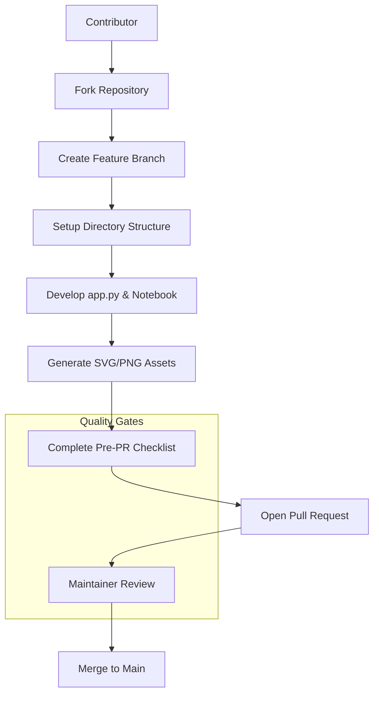
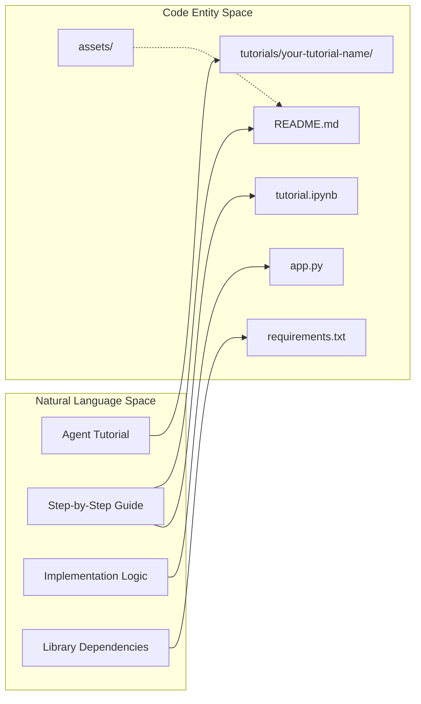
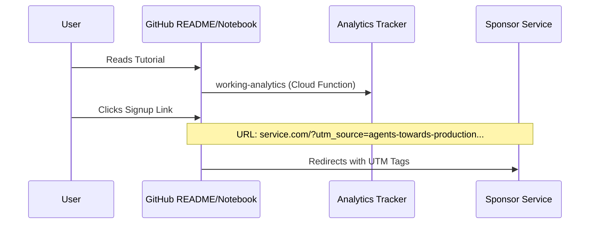

<!-- source: DeepWiki mcp.deepwiki.com · repo NirDiamant/agents-towards-production · page 6 Development & Community · fetched 2026-10-29 -->

# Development & Community

Relevant source files

The following files were used as context for generating this wiki page:

- [CONTRIBUTING.md](CONTRIBUTING.md)
- [README.md](README.md)
- [assets/repos_images/ai_architecture_diagram.svg](assets/repos_images/ai_architecture_diagram.svg)

This page outlines the guidelines for contributing to the **Agents Towards Production** repository and engaging with the community. It defines the standardized processes for tutorial creation, quality control mechanisms, and the support resources available to contributors and users. The repository follows a tutorial-first approach, requiring specific file structures and content standards to ensure every contribution is production-ready.

For detailed technical requirements on file structures and content standards, see [Contributing Guidelines](#6.1). For information on how to report bugs or engage with the community on Discord, see [Issue Reporting & Support](#6.2).

## Contribution Lifecycle

The repository implements a structured pipeline that transforms community contributions into high-quality educational content. This process ensures that every tutorial, whether from an individual or a corporate sponsor, maintains a consistent professional standard.

### Tutorial Development Flow

Sources: [CONTRIBUTING.md:110-116](), [CONTRIBUTING.md:118-137]()

### Repository Entity Mapping

This diagram bridges the conceptual "Tutorial" with the specific file entities required in the codebase.

Sources: [CONTRIBUTING.md:17-47]()

## Community Engagement & Support

The project maintains multiple channels for support, ranging from real-time chat to formal issue tracking.

### Support Channels

*   **GitHub Issues**: Used for technical bug reports, tutorial requests, and formal feedback.
*   **Discord**: The primary hub for live community support and architectural discussions. [Join the Discord](https://discord.gg/cA6Aa4uyDX).
*   **Social Media**: Updates and networking via [LinkedIn](https://www.linkedin.com/in/nir-diamant-759323134) and [Twitter/X](https://twitter.com/NirDiamantAI).

Sources: [README.md:13-15]()

## Standards & Requirements

To maintain a "Production-Ready" status, all contributions must adhere to specific quality and tracking standards.

### Content Quality Standards
The repository emphasizes horizontal learning—ensuring readers understand that specific implementations are examples of broader architectural patterns.

| Requirement | Description | Code Pointer |
| :--- | :--- | :--- |
| **UTM Tracking** | All external links must use specific UTM parameters for tracking. | [CONTRIBUTING.md:12-12]() |
| **Code Documentation** | Every code cell in notebooks must be preceded by explanatory markdown. | [CONTRIBUTING.md:69-72]() |
| **Visuals** | Architecture diagrams must be included (preferably Mermaid rendered to SVG). | [CONTRIBUTING.md:54-54]() |
| **Environment** | `requirements.txt` must include specific versions for reproducibility. | [CONTRIBUTING.md:33-33]() |

Sources: [CONTRIBUTING.md:49-91]()

### Tracking & Analytics System

For tutorials involving partner services, the repository uses a standardized tracking format to measure the impact of the educational content.

Sources: [CONTRIBUTING.md:1-12]()

For more details on the specific requirements for these files and how to format your PR, refer to the [Contributing Guidelines](#6.1).

---

