# Page: Overview

# Overview

<details>
<summary>Relevant source files</summary>

The following files were used as context for generating this wiki page:

- [README.md](README.md)
- [assets/repos_images/ai_architecture_diagram.svg](assets/repos_images/ai_architecture_diagram.svg)

</details>


## Purpose and Scope

The **Agents Towards Production** repository is a comprehensive technical playbook and educational platform designed to transition GenAI agents from experimental prototypes to scalable, enterprise-ready products. It provides a curated collection of hands-on tutorials, each addressing a critical layer of the production agent stack, including stateful orchestration, persistent memory, security guardrails, observability, and infrastructure deployment [README.md:3-11]().

The repository is structured to serve as both a reference architecture and a practical implementation guide for engineers. It covers the entire development lifecycle, from building basic ReAct patterns to deploying fine-tuned models on serverless GPU infrastructure [README.md:7-8]().

Sources: [README.md:3-11](), [README.md:7-8]()

## Repository Architecture

The codebase is organized into a modular, tutorial-first structure. Each directory under `tutorials/` represents a self-contained production capability, often integrated with industry-standard tools and partner platforms [README.md:24-30]().

### Repository Structure and Code Organization

```mermaid
graph TB
    subgraph "Repository Root"
        readme["README.md"]
        contributing["CONTRIBUTING.md"]
    end
    
    subgraph "Asset Management"
        assets["assets/repos_images/"]
        logos["sponsors_logos/trimmed_padded/"]
    end
    
    subgraph "Core Tutorial Categories"
        tutorials["tutorials/"]
        
        subgraph "Orchestration & Frameworks"
            langgraph["LangGraph-agent/"]
            fastapi["fastapi-agent/"]
            kotlin["kotlin-koog-agent/"]
            xpander["agentic-applications-by-xpander.ai/"]
        end
        
        subgraph "Memory & Knowledge"
            redis["agent-memory-with-redis/"]
            mem0["agent-memory-with-mem0/"]
            cognee["agent-knowledge-graph-with-cognee/"]
            contextual["agent-RAG-with-Contextual/"]
        end
        
        subgraph "Tools & Integration"
            mcp["agent-with-mcp/"]
            arcade["arcade-secure-tool-calling/"]
            tavily["agent-with-tavily-web-access/"]
            brightdata["agent-with-brightdata/"]
        end
        
        subgraph "Security & Observability"
            qualifire_sec["agent-security-with-qualifire/"]
            qualifire_obs["agent-observability-with-qualifire/"]
            langsmith["tracing-with-langsmith/"]
            llamafirewall["agent-security-with-llamafirewall/"]
            apex["agent-security-apex/"]
        end
        
        subgraph "Deployment & Infra"
            docker["docker-intro/"]
            runpod["runpod-gpu-deploy/"]
            bedrock["aws-bedrock-agentcore/"]
            ollama["on-prem-llm-ollama/"]
            finetuning["fine-tuning-agents/"]
        end
    end
    
    readme --> tutorials
    assets --> logos
    tutorials --> langgraph
    tutorials --> redis
    tutorials --> mcp
    tutorials --> qualifire_sec
    tutorials --> docker
```

Sources: [README.md:31-106](), [README.md:146-402]()

### Tutorial Implementation Pattern and Code Entities

Every tutorial follows a standardized implementation pattern to ensure reproducibility across different environments [README.md:420-446]().

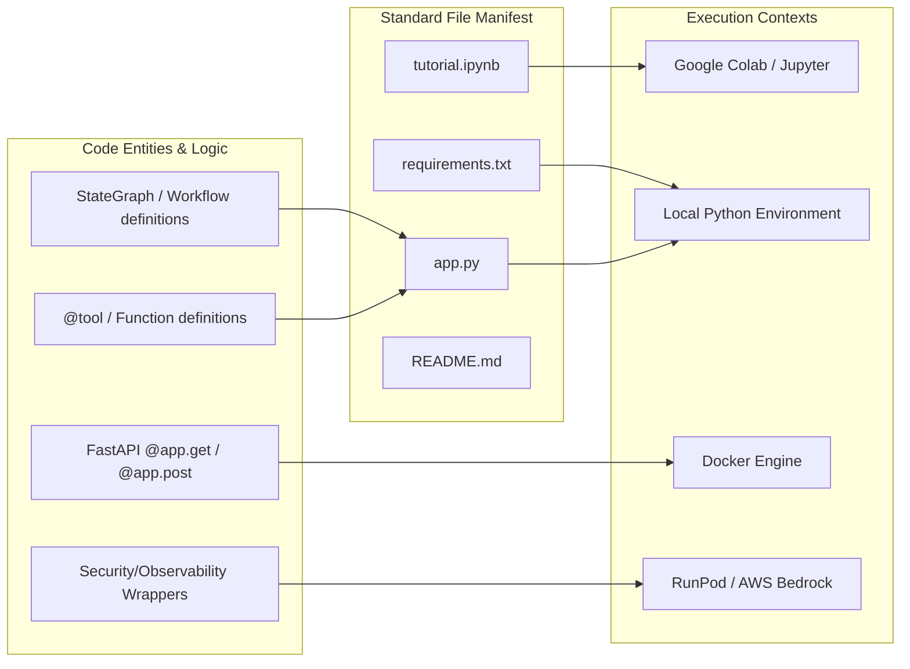

Sources: [README.md:420-446](), [README.md:430-434]()

## Production Capability Map

The repository maps technical challenges to specific code implementations and partner integrations:

| Production Capability | Implementation Detail | Key Code Entities |
| :--- | :--- | :--- |
| **Stateful Orchestration** | Complex task routing and human-in-the-loop | `StateGraph`, `MemorySaver` [README.md:31-51]() |
| **Dual-Memory Systems** | Short-term state + Long-term semantic search | `RedisConfig`, `VectorStore` [README.md:53-68]() |
| **Secure Tool Calling** | Multi-user OAuth2 and permission scoping | `ArcadeTool`, `auth_callback` [README.md:130-145]() |
| **Real-time Web Access** | Search-engine-as-a-tool for agents | `TavilySearchResults` [README.md:113-128]() |
| **Security Guardrails** | Prompt injection and PII filtering | `LlamaFirewall`, `QualifireGuard` [README.md:162-177]() |
| **Managed Runtime** | Serverless agent hosting with SDKs | `BedrockAgentCoreApp`, `@app.entrypoint` [README.md:374-389]() |
| **Multi-Agent Protocols** | Standardized JSON-RPC communication | `A2AProtocol`, `AgentCard` [README.md:287-302]() |

Sources: [README.md:31-145](), [README.md:162-389]()

## Production Architecture Diagram

The following diagram bridges the high-level architecture with the specific code entities found in the repository.

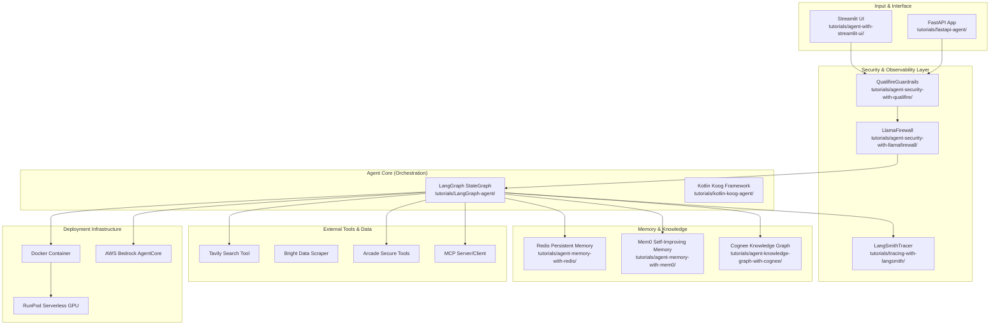

Sources: [README.md:31-402](), [assets/repos_images/ai_architecture_diagram.svg:1-145]()

## Development & Contribution

The repository is maintained as an open-source project with specific guidelines for community contributions. To maintain the quality of the playbook, all new tutorials must include a README, a Jupyter Notebook, and an `app.py` script [README.md:420-428]().

### Contribution Workflow
1.  **Fork** the repository.
2.  **Create** a tutorial directory following the standard structure [README.md:420-428]().
3.  **Implement** the logic using production-grade frameworks (e.g., LangGraph, FastAPI).
4.  **Submit** a Pull Request for review.

For detailed instructions on contributing, see the [Contributing Guidelines](6.1.-Contributing-Guidelines) page.

Sources: [README.md:420-446]()

---

# Page: Tutorial System

# Tutorial System

<details>
<summary>Relevant source files</summary>

The following files were used as context for generating this wiki page:

- [CONTRIBUTING.md](CONTRIBUTING.md)
- [README.md](README.md)
- [assets/repos_images/ai_architecture_diagram.svg](assets/repos_images/ai_architecture_diagram.svg)

</details>


## Purpose and Scope

The Tutorial System implements a tutorial-first learning approach for the Agents Towards Production repository, delivering comprehensive agent development knowledge through hands-on, runnable examples. Each tutorial provides both conceptual understanding and working implementations that developers can execute locally to understand production-ready AI agent patterns [README.md:3-7]().

The system covers the complete agent development lifecycle from prototype to production, organized into distinct categories with over 20 individual tutorials. This document covers the tutorial organization, delivery mechanisms, and learning pathways.

*   For specific tutorial content on agent frameworks and workflows, see [Agent Frameworks & Workflows](#2.1).
*   For memory system implementations, see [Memory Management Systems](#2.2).
*   For tool integration and external APIs, see [Tool Integration](#2.3).
*   For agent-to-agent protocols, see [Multi-Agent Communication](#2.4).
*   For monitoring and debugging, see [Observability & Monitoring](#2.5).
*   For automated testing and quality assurance, see [Agent Evaluation & Testing](#2.6).

## Tutorial Organization Architecture

The tutorial system organizes educational content into categories that map to production agent capabilities.

### Tutorial Categories by Production Capability

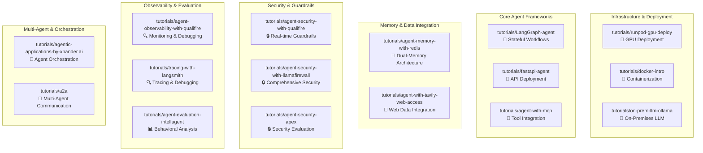

Sources: [README.md:148-402]()

### Tutorial Directory Structure Mapping

Every tutorial follows a strict file convention to ensure reproducibility [CONTRIBUTING.md:15-36]().

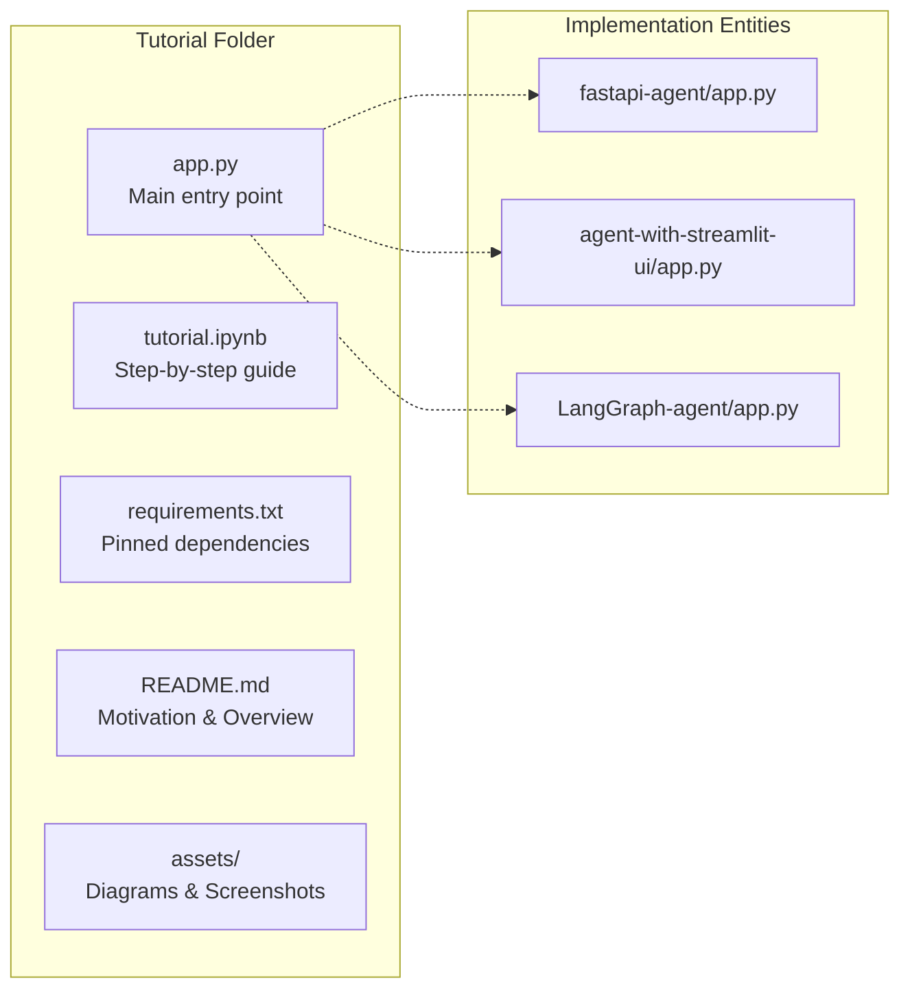

Sources: [CONTRIBUTING.md:37-48](), [README.md:234-272]()

## Tutorial Implementation Standards

Each tutorial must follow standardized directory structures and content quality requirements to maintain repository consistency [CONTRIBUTING.md:49-61]().

### Required Components

| Component | File/Path | Requirement |
|-----------|-----------|-------------|
| **Overview** | `README.md` | Must include motivation, benefits, and "what you will learn" [CONTRIBUTING.md:51](). |
| **Documentation** | `.ipynb` or `tutorial.md` | Must contain detailed explanations and Mermaid diagrams [CONTRIBUTING.md:27-29](). |
| **Working Code** | `app.py` | Must be well-commented and represent the main application logic [CONTRIBUTING.md:31](). |
| **Dependencies** | `requirements.txt` | Must include specific versions for reproducibility [CONTRIBUTING.md:33](). |
| **Visuals** | `assets/` | Folder for images, videos, and media [CONTRIBUTING.md:35](). |

### Quality Gates

*   **Code Quality**: Code must be broken into small, clear blocks with explanatory text before every cell [CONTRIBUTING.md:69-70]().
*   **Security**: No sensitive information (API keys) should be committed; environment variables are required [CONTRIBUTING.md:124]().
*   **External Links**: All partner or service links must use UTM-tagged parameters for tracking [CONTRIBUTING.md:12-13]().

## Partner Integration System

The tutorial system integrates sponsored content from technology partners, providing real-world integration examples with production tools across the complete agent development stack [README.md:24-30]().

| Partner | Category | Key Tutorial |
|---------|----------|--------------|
| **LangChain** | Frameworks | `tutorials/LangGraph-agent` [README.md:38]() |
| **Redis** | Memory | `tutorials/agent-memory-with-redis` [README.md:55]() |
| **Arcade** | Tools | `tutorials/arcade-secure-tool-calling` [README.md:132]() |
| **Tavily** | Search | `tutorials/agent-with-tavily-web-access` [README.md:115]() |
| **Qualifire** | Security | `tutorials/agent-security-with-qualifire` [README.md:154]() |

## Learning Pathways

The repository supports two primary access methods:

1.  **Online Exploration**: Browsing the GitHub interface to understand architectural patterns and conceptual documentation [README.md:406-410]().
2.  **Local Development**: Cloning the repository and running implementations locally.

### Execution Workflow

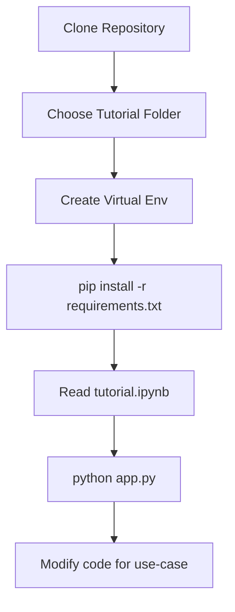

Sources: [CONTRIBUTING.md:111-115](), [README.md:440-447]()

---

# Page: Agent Frameworks & Workflows

# Agent Frameworks & Workflows

<details>
<summary>Relevant source files</summary>

The following files were used as context for generating this wiki page:

- [tutorials/LangGraph-agent/langgraph_tutorial.ipynb](tutorials/LangGraph-agent/langgraph_tutorial.ipynb)
- [tutorials/a2a/a2a_tutorial.ipynb](tutorials/a2a/a2a_tutorial.ipynb)
- [tutorials/agent-evaluation-intellagent/intellagent-evaluation-tutorial.ipynb](tutorials/agent-evaluation-intellagent/intellagent-evaluation-tutorial.ipynb)
- [tutorials/agent-memory-with-redis/README.md](tutorials/agent-memory-with-redis/README.md)
- [tutorials/agent-security-apex/agent-security-evaluation-tutorial.ipynb](tutorials/agent-security-apex/agent-security-evaluation-tutorial.ipynb)
- [tutorials/agent-with-mcp/mcp-tutorial.ipynb](tutorials/agent-with-mcp/mcp-tutorial.ipynb)
- [tutorials/agent-with-streamlit-ui/building-chatbot-notebook.ipynb](tutorials/agent-with-streamlit-ui/building-chatbot-notebook.ipynb)
- [tutorials/agent-with-tavily-web-access/hybrid-agent-tutorial.ipynb](tutorials/agent-with-tavily-web-access/hybrid-agent-tutorial.ipynb)
- [tutorials/agent-with-tavily-web-access/supplemental/vectorize_tutorial.ipynb](tutorials/agent-with-tavily-web-access/supplemental/vectorize_tutorial.ipynb)
- [tutorials/agent-with-tavily-web-access/web-agent-tutorial.ipynb](tutorials/agent-with-tavily-web-access/web-agent-tutorial.ipynb)
- [tutorials/fastapi-agent/fastapi-agent-tutorial.ipynb](tutorials/fastapi-agent/fastapi-agent-tutorial.ipynb)
- [tutorials/kotlin-agent-with-koog/.gitignore](tutorials/kotlin-agent-with-koog/.gitignore)
- [tutorials/kotlin-agent-with-koog/README.md](tutorials/kotlin-agent-with-koog/README.md)
- [tutorials/kotlin-agent-with-koog/Step1_HelloAgent.kt](tutorials/kotlin-agent-with-koog/Step1_HelloAgent.kt)
- [tutorials/kotlin-agent-with-koog/Step2_AgentWithTools.kt](tutorials/kotlin-agent-with-koog/Step2_AgentWithTools.kt)
- [tutorials/kotlin-agent-with-koog/Step3_StructuredOutput.kt](tutorials/kotlin-agent-with-koog/Step3_StructuredOutput.kt)
- [tutorials/kotlin-agent-with-koog/assets/architecture-diagram.png](tutorials/kotlin-agent-with-koog/assets/architecture-diagram.png)
- [tutorials/kotlin-agent-with-koog/assets/project-structure.png](tutorials/kotlin-agent-with-koog/assets/project-structure.png)
- [tutorials/kotlin-agent-with-koog/assets/run-sh.png](tutorials/kotlin-agent-with-koog/assets/run-sh.png)
- [tutorials/kotlin-agent-with-koog/assets/step1-output.png](tutorials/kotlin-agent-with-koog/assets/step1-output.png)
- [tutorials/kotlin-agent-with-koog/assets/step2-output.png](tutorials/kotlin-agent-with-koog/assets/step2-output.png)
- [tutorials/kotlin-agent-with-koog/build.gradle.kts](tutorials/kotlin-agent-with-koog/build.gradle.kts)
- [tutorials/kotlin-agent-with-koog/run.sh](tutorials/kotlin-agent-with-koog/run.sh)
- [tutorials/kotlin-agent-with-koog/tutorial.md](tutorials/kotlin-agent-with-koog/tutorial.md)
- [tutorials/on-prem-llm-ollama/scripts/langchain_agent.ipynb](tutorials/on-prem-llm-ollama/scripts/langchain_agent.ipynb)
- [tutorials/tracing-with-langsmith/langsmith_basics.ipynb](tutorials/tracing-with-langsmith/langsmith_basics.ipynb)

</details>


## Purpose and Scope

This document covers the foundational agent frameworks and workflows within the "Agents Towards Production" repository. It provides technical detail on building stateful logic with **LangGraph**, deploying agents as production APIs using **FastAPI**, creating interactive **Streamlit** UIs, and developing JVM-based agents using the **JetBrains Koog** framework. These tools allow developers to move from basic prompt-response patterns to complex, autonomous, and type-safe agentic systems.

---

## LangGraph: Stateful Orchestration

LangGraph is an extension of LangChain designed for creating stateful, multi-actor applications. It uses a graph-based approach to define how an agent thinks and acts, allowing for loops, persistence, and complex decision-making.

### Core Components
- **State Management**: Uses a `TypedDict` to maintain a persistent state object that is passed between nodes.
- **Nodes**: Python functions that receive the current state, perform logic (e.g., calling an LLM), and return updates to the state.
- **Edges**: Define the control flow. Conditional edges allow the graph to route to different nodes based on LLM output or state values.

### Text Analysis Pipeline Architecture
The following diagram maps the LangGraph conceptual space to the specific code entities used in the text analysis tutorial.

**Title: LangGraph Pipeline Entity Mapping**
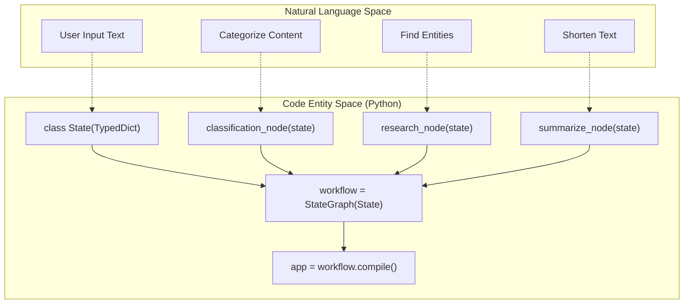
Sources: [tutorials/LangGraph-agent/langgraph_tutorial.ipynb:161-166](), [tutorials/LangGraph-agent/langgraph_tutorial.ipynb:188-197](), [tutorials/LangGraph-agent/langgraph_tutorial.ipynb:262-277]()

---

## FastAPI: Production Agent Deployment

FastAPI serves as the bridge between agent logic and the web. It is used to expose agents via RESTful endpoints, supporting both standard JSON responses and Server-Sent Events (SSE) for streaming.

### Key Implementation Patterns
- **Pydantic Models**: Used for request/response validation (e.g., `QueryRequest`, `QueryResponse`).
- **Asynchronous Streaming**: Leveraging `async def` and `yield` to stream tokens to the client as they are generated by the model.
- **Dependency Injection**: Managing agent instances and configuration across API routes.

**Title: FastAPI Agent Service Flow**
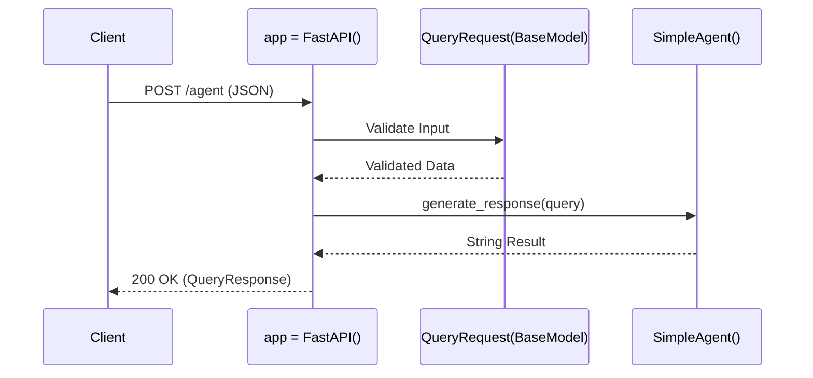
Sources: [tutorials/fastapi-agent/fastapi-agent-tutorial.ipynb:95-122](), [tutorials/fastapi-agent/fastapi-agent-tutorial.ipynb:146-162](), [tutorials/fastapi-agent/fastapi-agent-tutorial.ipynb:187-218]()

---

## Koog: Kotlin-Native Agents

For the JVM ecosystem, the **Koog** framework by JetBrains provides a type-safe way to build agents. It leverages Kotlin features like Coroutines for async execution and Serialization for structured data.

### The ReAct Loop in Koog
Koog implements the **Reason-Act-Observe** pattern. The agent reasons about a task, selects a tool, observes the result, and iterates until a final answer is reached.

### Structured Output Strategy
One of Koog's most powerful features is `structuredOutputWithToolsStrategy`. This allows the LLM to return a fully instantiated Kotlin data class instead of raw JSON strings.

**Title: Koog Structured Output Mapping**
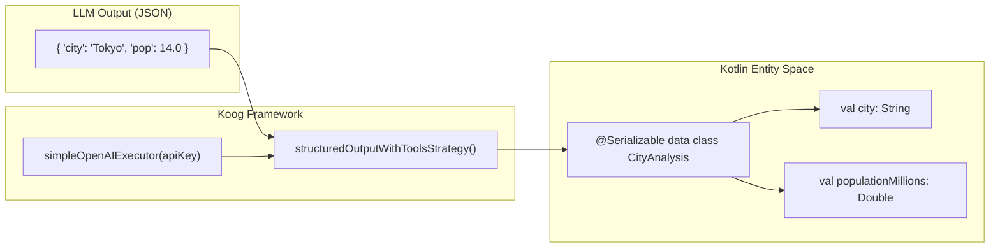
Sources: [tutorials/kotlin-agent-with-koog/tutorial.md:9-26](), [tutorials/kotlin-agent-with-koog/Step3_StructuredOutput.kt:25-46](), [tutorials/kotlin-agent-with-koog/Step3_StructuredOutput.kt:68-76]()

### Project Configuration
Kotlin agents require specific dependencies in `build.gradle.kts` to handle AI tasks:
- `ai.koog:koog-agents`: Core framework logic.
- `kotlinx-coroutines-core`: For non-blocking agent execution.
- `kotlinx-serialization-json`: For tool definitions and structured outputs.

Sources: [tutorials/kotlin-agent-with-koog/build.gradle.kts:10-22]()

---

## Comparison of Framework Approaches

| Feature | LangGraph (Python) | Koog (Kotlin) | FastAPI (Python) |
| :--- | :--- | :--- | :--- |
| **Primary Use** | Complex Stateful Logic | JVM Backend Integration | Web API / Microservice |
| **State Handling** | Graph-based `TypedDict` | Coroutine-based objects | Stateless (per request) |
| **Type Safety** | Optional (Type Hints) | Native (Strongly Typed) | Pydantic Validation |
| **Async Support** | Native (Asyncio) | Native (Coroutines) | Native (Uvicorn/Starlette) |
| **Tool Calling** | Bindings/Tools | Annotations (`@LLMDescription`) | Manual or LangChain-integrated |

Sources: [tutorials/LangGraph-agent/langgraph_tutorial.ipynb:13-28](), [tutorials/kotlin-agent-with-koog/tutorial.md:5-7](), [tutorials/fastapi-agent/fastapi-agent-tutorial.ipynb:16-34]()

---

## Web Research Workflows

Modern workflows often require real-time data. This is achieved by integrating search tools like **Tavily** into the ReAct loop.

1. **Search**: Querying the web for live data.
2. **Extract**: Pulling clean content from specific URLs.
3. **Crawl**: Navigating entire domains for deep research.

In LangGraph, these are implemented as specialized nodes or tools bound to the LLM via `bind_tools`.

Sources: [tutorials/agent-with-tavily-web-access/web-agent-tutorial.ipynb:140-153](), [tutorials/agent-with-tavily-web-access/web-agent-tutorial.ipynb:182-189]()

---

# Page: Memory Management Systems

# Memory Management Systems

<details>
<summary>Relevant source files</summary>

The following files were used as context for generating this wiki page:

- [tutorials/agent-memory-with-mem0/Assets/mem0_add_architecture.jpg](tutorials/agent-memory-with-mem0/Assets/mem0_add_architecture.jpg)
- [tutorials/agent-memory-with-mem0/Assets/mem0_architecture.png](tutorials/agent-memory-with-mem0/Assets/mem0_architecture.png)
- [tutorials/agent-memory-with-mem0/Assets/mem0_search_architecture.jpg](tutorials/agent-memory-with-mem0/Assets/mem0_search_architecture.jpg)
- [tutorials/agent-memory-with-mem0/README.md](tutorials/agent-memory-with-mem0/README.md)
- [tutorials/agent-memory-with-mem0/mem0_tutorial.ipynb](tutorials/agent-memory-with-mem0/mem0_tutorial.ipynb)
- [tutorials/agent-memory-with-redis/README.md](tutorials/agent-memory-with-redis/README.md)
- [tutorials/agent-memory-with-redis/agent_memory_tutorial.ipynb](tutorials/agent-memory-with-redis/agent_memory_tutorial.ipynb)
- [tutorials/ai-memory-with-cognee/README.md](tutorials/ai-memory-with-cognee/README.md)
- [tutorials/ai-memory-with-cognee/cognee-ai-memory.ipynb](tutorials/ai-memory-with-cognee/cognee-ai-memory.ipynb)
- [tutorials/ai-memory-with-cognee/data/cognee_diagram.png](tutorials/ai-memory-with-cognee/data/cognee_diagram.png)
- [tutorials/fastapi-agent/fastapi-agent-tutorial.ipynb](tutorials/fastapi-agent/fastapi-agent-tutorial.ipynb)
- [tutorials/tracing-with-langsmith/langsmith_basics.ipynb](tutorials/tracing-with-langsmith/langsmith_basics.ipynb)

</details>


## Purpose and Scope

This document describes the memory management architecture implemented in the Agents Towards Production repository. It covers the implementation of dual-memory systems using **Redis** for short-term and long-term state, self-improving memory with **Mem0** using hybrid vector and graph storage, and the construction of specialized knowledge graphs using **Cognee**. These systems enable AI agents to overcome "memory amnesia" by maintaining conversation context, user preferences, and structured domain knowledge.

## Overview of Memory Architecture

The repository demonstrates three primary patterns for memory management:

1.  **Dual-Memory with Redis**: A production-ready pattern using `RedisSaver` for checkpoints (short-term) and `RedisVL` for semantic vector search (long-term) [tutorials/agent-memory-with-redis/agent_memory_tutorial.ipynb:42-61]().
2.  **Self-Improving Memory (Mem0)**: A hybrid architecture that automatically extracts insights and resolves conflicts, storing data in both vector databases (e.g., Qdrant) and graph databases (e.g., Neo4j) [tutorials/agent-memory-with-mem0/mem0_tutorial.ipynb:22-26]().
3.  **Knowledge Graph Memory (Cognee)**: A system that transforms technical documentation and personal rules into an interconnected network of entities and relationships [tutorials/ai-memory-with-cognee/cognee-ai-memory.ipynb:28-32]().

### Dual-Memory Architecture (Redis)

This architecture mirrors cognitive models by separating transient conversation state from persistent semantic knowledge.

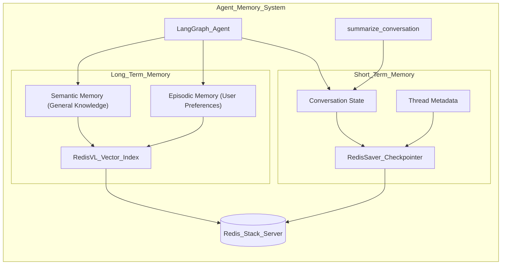
Sources: [tutorials/agent-memory-with-redis/agent_memory_tutorial.ipynb:42-62](), [tutorials/agent-memory-with-redis/agent_memory_tutorial.ipynb:151-157]()

## Self-Improving Memory with Mem0

Mem0 addresses the limitation where agents forget everything after a session. It implements a "self-improving" loop where the system extracts information, resolves conflicts with existing knowledge, and updates its storage [tutorials/agent-memory-with-mem0/mem0_tutorial.ipynb:22-27]().

### Hybrid Storage Flow
Mem0 utilizes a multi-layered approach to storage:
*   **Vector Memory**: Uses embeddings for semantic recall of research notes and preferences [tutorials/agent-memory-with-mem0/mem0_tutorial.ipynb:41-42]().
*   **Graph Memory**: Captures key ideas and links related concepts (e.g., author connections, paper citations) inside a graph database like Neo4j [tutorials/agent-memory-with-mem0/mem0_tutorial.ipynb:43-45]().

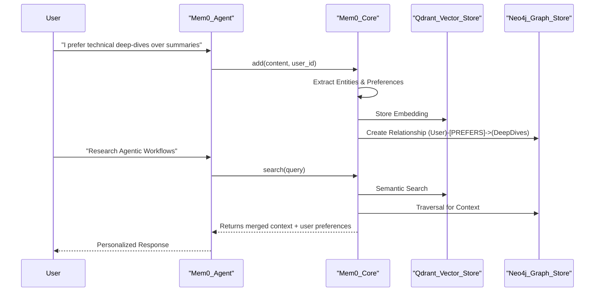
Sources: [tutorials/agent-memory-with-mem0/mem0_tutorial.ipynb:37-48](), [tutorials/agent-memory-with-mem0/mem0_tutorial.ipynb:58-62]()

## Knowledge Graph Construction with Cognee

Cognee specializes in "Cognifying" data—transforming raw files (JSON, Markdown) into a traversable knowledge graph. This is particularly useful for complex domains like Python development knowledge [tutorials/ai-memory-with-cognee/cognee-ai-memory.ipynb:10-12]().

### Core Operations
The Cognee framework operates through four primary functions:
*   `add()`: Normalizes and prepares raw data for ingestion [tutorials/ai-memory-with-cognee/cognee-ai-memory.ipynb:58-59]().
*   `cognify()`: The core engine that uses AI to extract entities and identify relationships [tutorials/ai-memory-with-cognee/cognee-ai-memory.ipynb:58-59]().
*   `search()`: Interacts with the graph via natural language or Cypher queries [tutorials/ai-memory-with-cognee/cognee-ai-memory.ipynb:58-59]().
*   `memify()`: Applies algorithms to infer implicit connections and rules from the existing graph [tutorials/ai-memory-with-cognee/cognee-ai-memory.ipynb:58-59]().

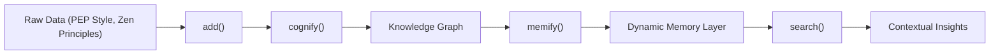
Sources: [tutorials/ai-memory-with-cognee/cognee-ai-memory.ipynb:58-61](), [tutorials/ai-memory-with-cognee/cognee-ai-memory.ipynb:70-75]()

## Short-Term Memory and Summarization

In production systems using LangGraph, short-term memory is often managed via **checkpointers**. These save the full `StateGraph` at every node transition.

### Conversation Summarization Logic
To prevent context window overflow, a `summarize_conversation` node is typically included in the graph. It triggers when the message history exceeds a specific threshold [tutorials/agent-memory-with-redis/agent_memory_tutorial.ipynb:51-52]().

```python
# Logic implemented in the summarize_conversation node
def summarize_conversation(state: State):
    # 1. Get existing messages
    # 2. If len(messages) > threshold:
    # 3.   Send history to LLM to create summary
    # 4.   Replace old messages with SummaryMessage
    # 5.   Retain N most recent messages
    pass
```
Sources: [tutorials/agent-memory-with-redis/agent_memory_tutorial.ipynb:1304-1375]()

## Memory Types and Data Models

The system categorizes persistent memory to improve retrieval accuracy:

| Memory Type | Description | Example |
| :--- | :--- | :--- |
| **Episodic** | Specific user experiences, preferences, and past interactions. | "User prefers flying Delta." |
| **Semantic** | General facts, domain knowledge, and world data. | "Singapore requires a passport." |
| **Procedural** | Encoded in the agent's Python workflow/logic. | The specific steps in a LangGraph. |

Sources: [tutorials/agent-memory-with-redis/agent_memory_tutorial.ipynb:55-62](), [tutorials/agent-memory-with-redis/agent_memory_tutorial.ipynb:228-246]()

### Vector Schema (RedisVL)
The `SearchIndex` in Redis is configured with specific fields for memory management:
*   `content`: The actual text of the memory.
*   `memory_type`: Tag for filtering (Episodic vs Semantic).
*   `embedding`: A 1536-dimensional vector for cosine similarity.
*   `user_id`: Tag for multi-tenant isolation.

Sources: [tutorials/agent-memory-with-redis/agent_memory_tutorial.ipynb:310-342]()

## Conflict Resolution and Deduplication

A critical feature of production memory systems is ensuring that similar or conflicting information is handled gracefully.

1.  **Deduplication**: Before storing a new memory, the system calls `similar_memory_exists` using a vector search with a high similarity threshold [tutorials/agent-memory-with-redis/agent_memory_tutorial.ipynb:519-553]().
2.  **Self-Correction**: Mem0 automatically updates existing memories if new information contradicts old data (e.g., a user changing their airline preference) [tutorials/agent-memory-with-mem0/mem0_tutorial.ipynb:26-27]().

Sources: [tutorials/agent-memory-with-redis/agent_memory_tutorial.ipynb:519-553](), [tutorials/agent-memory-with-mem0/mem0_tutorial.ipynb:22-27]()

---

# Page: Tool Integration

# Tool Integration

<details>
<summary>Relevant source files</summary>

The following files were used as context for generating this wiki page:

- [tutorials/LangGraph-agent/langgraph_tutorial.ipynb](tutorials/LangGraph-agent/langgraph_tutorial.ipynb)
- [tutorials/a2a/a2a_tutorial.ipynb](tutorials/a2a/a2a_tutorial.ipynb)
- [tutorials/agent-RAG-with-Contextual/README.md](tutorials/agent-RAG-with-Contextual/README.md)
- [tutorials/agent-RAG-with-Contextual/contextual_tutorial.ipynb](tutorials/agent-RAG-with-Contextual/contextual_tutorial.ipynb)
- [tutorials/agent-RAG-with-Contextual/requirements.txt](tutorials/agent-RAG-with-Contextual/requirements.txt)
- [tutorials/agent-evaluation-intellagent/intellagent-evaluation-tutorial.ipynb](tutorials/agent-evaluation-intellagent/intellagent-evaluation-tutorial.ipynb)
- [tutorials/agent-security-apex/README.md](tutorials/agent-security-apex/README.md)
- [tutorials/agent-security-apex/agent-security-evaluation-tutorial.ipynb](tutorials/agent-security-apex/agent-security-evaluation-tutorial.ipynb)
- [tutorials/agent-with-brightdata/assets/Settings.png](tutorials/agent-with-brightdata/assets/Settings.png)
- [tutorials/agent-with-brightdata/assets/Signup.png](tutorials/agent-with-brightdata/assets/Signup.png)
- [tutorials/agent-with-brightdata/langgraph_integration.ipynb](tutorials/agent-with-brightdata/langgraph_integration.ipynb)
- [tutorials/agent-with-brightdata/web_scraping_agent.ipynb](tutorials/agent-with-brightdata/web_scraping_agent.ipynb)
- [tutorials/agent-with-mcp/mcp-tutorial.ipynb](tutorials/agent-with-mcp/mcp-tutorial.ipynb)
- [tutorials/agent-with-streamlit-ui/building-chatbot-notebook.ipynb](tutorials/agent-with-streamlit-ui/building-chatbot-notebook.ipynb)
- [tutorials/agent-with-tavily-web-access/hybrid-agent-tutorial.ipynb](tutorials/agent-with-tavily-web-access/hybrid-agent-tutorial.ipynb)
- [tutorials/agent-with-tavily-web-access/supplemental/vectorize_tutorial.ipynb](tutorials/agent-with-tavily-web-access/supplemental/vectorize_tutorial.ipynb)
- [tutorials/agent-with-tavily-web-access/web-agent-tutorial.ipynb](tutorials/agent-with-tavily-web-access/web-agent-tutorial.ipynb)
- [tutorials/arcade-secure-tool-calling/README.md](tutorials/arcade-secure-tool-calling/README.md)
- [tutorials/arcade-secure-tool-calling/arcade-diagram.png](tutorials/arcade-secure-tool-calling/arcade-diagram.png)
- [tutorials/arcade-secure-tool-calling/multiuser-agent-arcade.ipynb](tutorials/arcade-secure-tool-calling/multiuser-agent-arcade.ipynb)
- [tutorials/on-prem-llm-ollama/scripts/langchain_agent.ipynb](tutorials/on-prem-llm-ollama/scripts/langchain_agent.ipynb)

</details>


## Purpose and Scope

This section covers connecting AI agents to external tools and APIs through three primary integration approaches: Model Context Protocol (MCP) for standardized tool integration, Arcade for secure multi-user OAuth2 tool calling with human-in-the-loop controls, and web data integration via Tavily and Bright Data. These patterns allow agents to dynamically discover, configure, and execute external tools while maintaining production-grade security and reliability.

## Secure Multi-User Tool Calling (Arcade)

Arcade provides a unified platform for secure tool execution, handling OAuth2 flows and identity management. This solves the gap between local demos (using personal access tokens) and production systems requiring multi-user support.

### Arcade Architecture and Flow

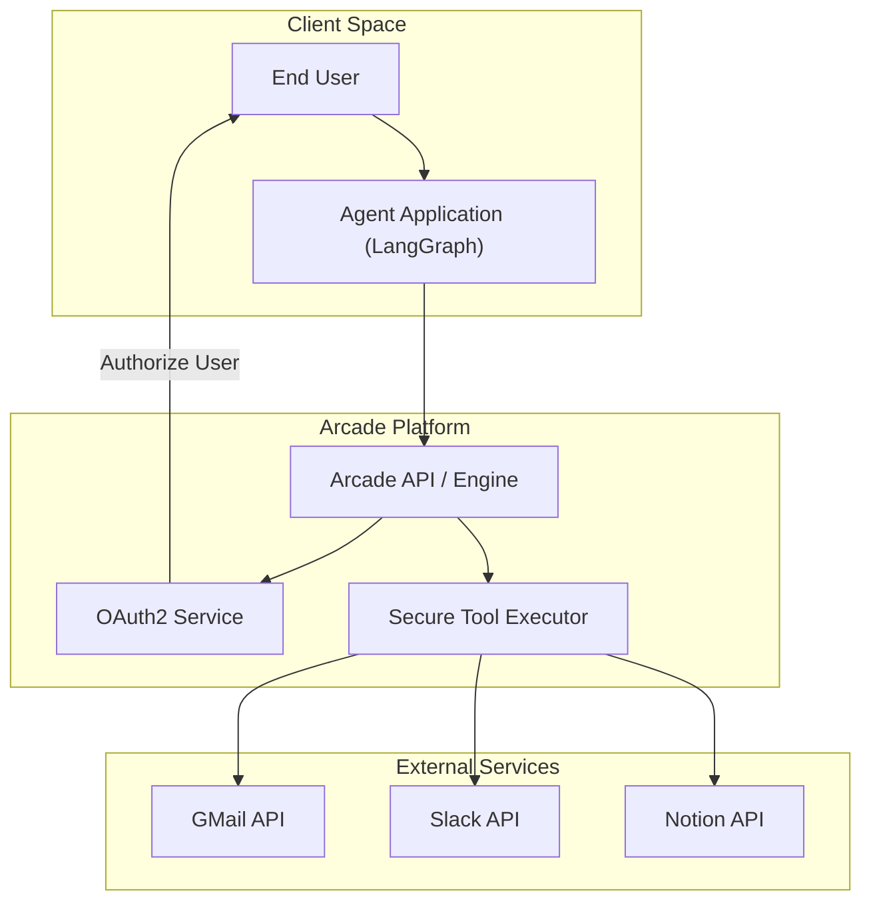

Sources: [tutorials/arcade-secure-tool-calling/README.md:12-16](), [tutorials/arcade-secure-tool-calling/multiuser-agent-arcade.ipynb:13-17]()

### Human-in-the-Loop (HITL) Safety Controls

For sensitive operations (e.g., sending emails or deleting data), Arcade implements safety guardrails where a human must approve the tool execution.

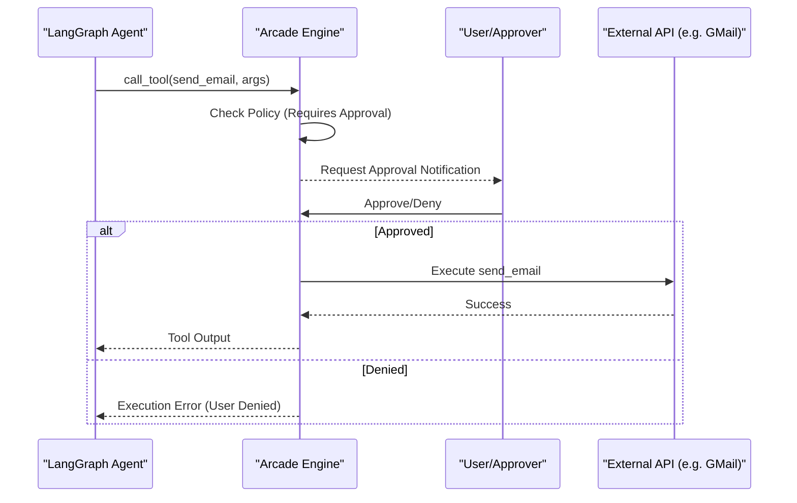

Sources: [tutorials/arcade-secure-tool-calling/multiuser-agent-arcade.ipynb:25-26](), [tutorials/arcade-secure-tool-calling/README.md:14-15]()

## Model Context Protocol (MCP) Architecture

MCP is a standardized protocol for connecting AI hosts to external data and tools using a client-server pattern.

### Tool Discovery and Execution

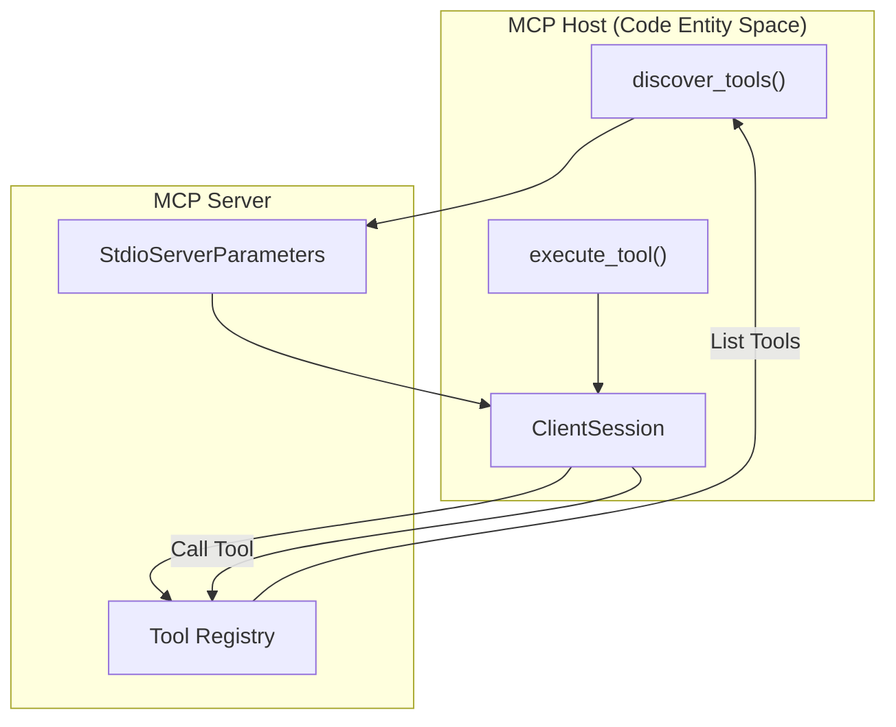

Sources: [tutorials/agent-with-mcp/mcp-tutorial.ipynb:401-446](), [tutorials/agent-with-mcp/mcp-tutorial.ipynb:539-586]()

## Web Data Integration (Tavily & Bright Data)

Agents leverage specialized web tools to search, extract, and crawl live web data.

### Tavily Web Research Tools

| Tool | Implementation Class | Primary Function |
|------|----------------------|------------------|
| **Search** | `TavilySearch` | Real-time web search with ranking |
| **Extract** | `TavilyExtract` | Deep content extraction from specific URLs |
| **Crawl** | `TavilyCrawl` | Recursive website exploration |

Sources: [tutorials/agent-with-tavily-web-access/web-agent-tutorial.ipynb:140-153]()

### Bright Data Intelligent Scraping

Bright Data provides enterprise-grade scraping via the Model Context Protocol (MCP) or native LangChain tools, enabling agents to navigate complex web structures.

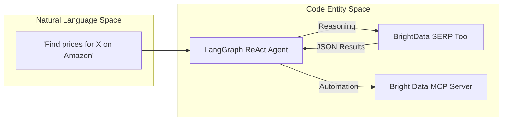

Sources: [tutorials/agent-with-brightdata/langgraph_integration.ipynb:30-49](), [tutorials/agent-with-brightdata/web_scraping_agent.ipynb:34-47]()

## Managed RAG Tooling (Contextual AI)

For enterprise document analysis, managed platforms like Contextual AI simplify the tool integration by abstracting the chunking, embedding, and retrieval pipeline.

### Document Analysis Pipeline

| Phase | Description |
|-------|-------------|
| **Ingestion** | Handling diverse formats (PDF, tables, charts) via `ContextualAI` client. |
| **Datastore** | Managed indexing of financial and quantitative data. |
| **Agent Tool** | Custom RAG agent that acts as a tool for document-grounded Q&A. |

Sources: [tutorials/agent-RAG-with-Contextual/contextual_tutorial.ipynb:40-45](), [tutorials/agent-RAG-with-Contextual/README.md:16-19]()

## Summary of Integration Patterns

| Pattern | Technology | Security Model | Use Case |
|---------|------------|----------------|----------|
| **Standardized** | MCP | JSON-RPC over Stdio/HTTP | Local/Server tool ecosystems |
| **Multi-User** | Arcade | OAuth2 + HITL | SaaS integrations (Gmail, Slack) |
| **Live Web** | Tavily / Bright Data | API Key / Managed Infrastructure | Real-time research & scraping |
| **Managed RAG** | Contextual AI | Managed Platform API | Enterprise document intelligence |

Sources: [tutorials/arcade-secure-tool-calling/README.md:26-31](), [tutorials/agent-with-mcp/mcp-tutorial.ipynb:65-76](), [tutorials/agent-with-tavily-web-access/web-agent-tutorial.ipynb:27-30](), [tutorials/agent-RAG-with-Contextual/contextual_tutorial.ipynb:16-26]()

---

# Page: Multi-Agent Communication

# Multi-Agent Communication

<details>
<summary>Relevant source files</summary>

The following files were used as context for generating this wiki page:

- [tutorials/LangGraph-agent/langgraph_tutorial.ipynb](tutorials/LangGraph-agent/langgraph_tutorial.ipynb)
- [tutorials/a2a/a2a_tutorial.ipynb](tutorials/a2a/a2a_tutorial.ipynb)
- [tutorials/agent-evaluation-intellagent/intellagent-evaluation-tutorial.ipynb](tutorials/agent-evaluation-intellagent/intellagent-evaluation-tutorial.ipynb)
- [tutorials/agent-security-apex/agent-security-evaluation-tutorial.ipynb](tutorials/agent-security-apex/agent-security-evaluation-tutorial.ipynb)
- [tutorials/agent-with-mcp/mcp-tutorial.ipynb](tutorials/agent-with-mcp/mcp-tutorial.ipynb)

</details>


This section covers multi-agent communication protocols and orchestration platforms implemented in the repository, focusing on the Agent2Agent (A2A) Protocol, orchestrating multi-agent workflows with Coral, and building fullstack agents with Portia including evaluation capabilities. These implementations demonstrate standardized communication patterns and production-ready multi-agent coordination.

For agent workflow frameworks like LangGraph, see [Agent Frameworks & Workflows](2.1). For persistent memory in multi-agent contexts, see [Memory Management Systems](2.2).

## Purpose and Scope

The repository implements several primary approaches to multi-agent communication and coordination:

1.  **A2A Protocol Implementation**: An open standard communication protocol for agent interoperability using JSON-RPC to manage tasks, messages, and artifacts.
2.  **Multi-Agent Orchestration with Coral**: Managing complex workflows where multiple specialized agents collaborate on a single user goal.
3.  **Fullstack Agents with Portia**: Building end-to-end agentic applications that include tool execution, state management, and built-in evaluation frameworks.

Key capabilities demonstrated include:
*   Standardized message formats (Text, File, Data parts) for cross-platform communication.
*   Task-centric coordination where work is encapsulated in `Task` objects.
*   Capability discovery through `Agent Cards`.
*   Evaluation of multi-agent system performance and reliability.

Sources: [tutorials/a2a/a2a_tutorial.ipynb:20-41](), [tutorials/a2a/a2a_tutorial.ipynb:68-79]()

## Agent2Agent (A2A) Protocol Implementation

The A2A Protocol implementation demonstrates Google's open standard for agent interoperability, enabling agents built with different tools to communicate across programming languages and organizations.

### A2A Protocol Core Components

The protocol relies on a set of core objects that define the state and content of an interaction.

**A2A Protocol Data Flow**
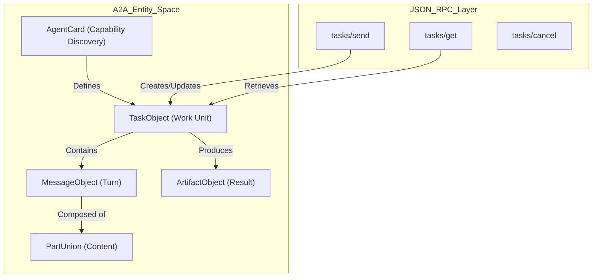

### Key A2A Protocol Objects

| Component | Role | Code Entity / Specification |
|-----------|------|-----------------------------|
| `AgentCard` | Describes capabilities and auth requirements | [tutorials/a2a/a2a_tutorial.ipynb:72-72]() |
| `TaskObject` | Central object representing a piece of work | [tutorials/a2a/a2a_tutorial.ipynb:73-73]() |
| `MessageObject` | Represents a conversational turn | [tutorials/a2a/a2a_tutorial.ipynb:74-74]() |
| `PartUnion` | Defines content: `TextPart`, `FilePart`, or `DataPart` | [tutorials/a2a/a2a_tutorial.ipynb:75-75]() |
| `ArtifactObject` | Represents outputs or results (files/structured data) | [tutorials/a2a/a2a_tutorial.ipynb:76-76]() |
| `JSON-RPC` | Transport layer for remote procedure calls | [tutorials/a2a/a2a_tutorial.ipynb:77-77]() |

Sources: [tutorials/a2a/a2a_tutorial.ipynb:68-79]()

## Multi-Agent Orchestration Patterns

Multi-agent systems in this repository often follow a pattern where a "Coordinator" or "Orchestrator" manages the flow between specialized sub-agents.

### Orchestration Data Flow

**Task Coordination Workflow**
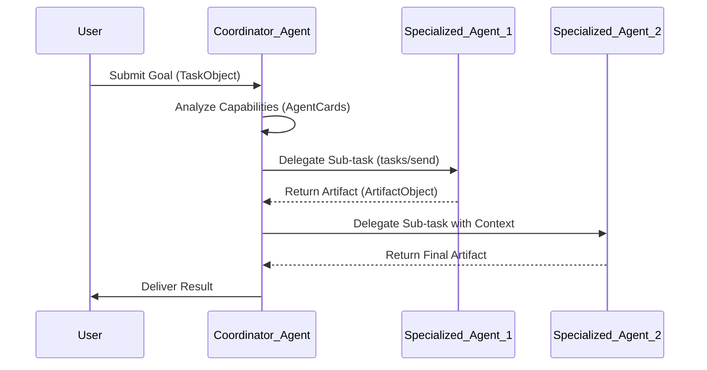

### Implementation Examples

*   **Meeting Automation**: A workflow where a `Meeting Recorder Agent` captures audio, a `Report Generator Agent` processes transcripts, and a `Task Coordinator` manages the sequence.
*   **Text Analysis Pipeline**: Using LangGraph to orchestrate a `Classification Node`, `Entity Extraction Node`, and `Summarization Node`.

Sources: [tutorials/LangGraph-agent/langgraph_tutorial.ipynb:23-28](), [tutorials/a2a/a2a_tutorial.ipynb:36-41]()

## Building Fullstack Agents with Portia

The Portia integration demonstrates building agents that are "production-ready" by combining execution capabilities with rigorous evaluation.

### Portia Agent Architecture

**Portia System Components**
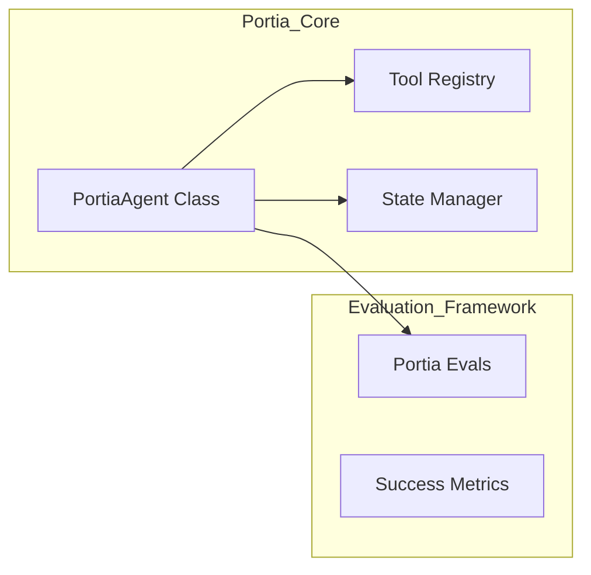

### Evaluation and Quality Assurance

A critical part of multi-agent communication is ensuring that information passed between agents is accurate. The repository utilizes `IntellAgent` and `Portia` for behavioral testing.

| Evaluation Metric | Description |
|-------------------|-------------|
| **Task Success Rate** | Percentage of multi-agent workflows that reach the intended goal. |
| **Tool Accuracy** | Verification that sub-agents call the correct tools with valid parameters. |
| **Communication Fidelity** | Ensuring `TaskObjects` and `Artifacts` maintain integrity across hops. |

Sources: [tutorials/agent-evaluation-intellagent/intellagent-evaluation-tutorial.ipynb:52-58](), [tutorials/a2a/a2a_tutorial.ipynb:76-77]()

## Development Workflows

### Standardized Communication (A2A)
The A2A tutorial demonstrates adherence to the A2A Protocol Specification v0.1.0, ensuring:
*   **Interoperability**: Agents from different organizations can collaborate.
*   **Negotiation**: Agents can negotiate interaction modalities (text vs. structured data).
*   **Security**: Secure exchange of information to achieve user goals.

Sources: [tutorials/a2a/a2a_tutorial.ipynb:33-41]()

### Stateful Orchestration (LangGraph)
For internal multi-agent communication within a single application, the repository uses `StateGraph`.
*   **State Management**: Maintaining a persistent `TypedDict` across nodes.
*   **Flexible Routing**: Defining transitions between agent nodes based on LLM outputs.

Sources: [tutorials/LangGraph-agent/langgraph_tutorial.ipynb:152-169]()

---

# Page: Observability & Monitoring

# Observability & Monitoring

<details>
<summary>Relevant source files</summary>

The following files were used as context for generating this wiki page:

- [tutorials/agent-memory-with-redis/README.md](tutorials/agent-memory-with-redis/README.md)
- [tutorials/fastapi-agent/fastapi-agent-tutorial.ipynb](tutorials/fastapi-agent/fastapi-agent-tutorial.ipynb)
- [tutorials/tracing-with-langsmith/langsmith_basics.ipynb](tutorials/tracing-with-langsmith/langsmith_basics.ipynb)

</details>


This document covers the comprehensive observability and monitoring capabilities implemented in the agent framework, including tracing, logging, performance monitoring, and debugging workflows. The system provides two primary observability solutions: LangSmith for workflow tracing and Qualifire for comprehensive monitoring with OpenTelemetry integration.

For security-focused monitoring and evaluation, see [Security Testing & Evaluation](#3.2). For agent behavioral testing and evaluation frameworks, see [Agent Evaluation & Testing](#2.6).

## Observability Architecture Overview

The observability framework provides multiple layers of monitoring and tracing capabilities across different aspects of agent execution. It transforms AI development from guesswork into engineering by adding a "flight recorder" to the system [tutorials/tracing-with-langsmith/langsmith_basics.ipynb:18-21]().

### Core Observability Components

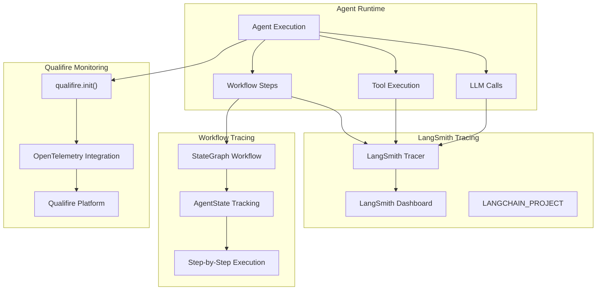

Sources: [tutorials/tracing-with-langsmith/langsmith_basics.ipynb:10-26](), [tutorials/tracing-with-langsmith/langsmith_basics.ipynb:62-67]()

## LangSmith Integration

LangSmith provides comprehensive tracing capabilities for LangGraph workflows, automatically capturing decision-making processes, timing data, and execution flows. It works by intercepting and logging all LangGraph operations once configured [tutorials/tracing-with-langsmith/langsmith_basics.ipynb:38-39]().

### Configuration and Setup

The LangSmith integration is enabled through environment variables and automatic instrumentation:

| Configuration | Purpose | Default Value |
|---------------|---------|---------------|
| `LANGCHAIN_TRACING_V2` | Enable LangSmith tracing | `true` |
| `LANGCHAIN_API_KEY` | Authentication key | User-provided |
| `LANGCHAIN_PROJECT` | Project organization | `langsmith-tutorial-demo` |

Sources: [tutorials/tracing-with-langsmith/langsmith_basics.ipynb:90-97]()

### Workflow Tracing Architecture

```mermaid
graph TD
    UserQuestion["user_question"]
    DecideStep["decide_search_need()"]
    SearchStep["execute_search()"]
    ResponseStep["generate_response()"]
    
    AgentState["AgentState"]
    WikipediaSearch["wikipedia_search()"]
    ChatOpenAI["ChatOpenAI(gpt-4o-mini)"]
    
    UserQuestion --> DecideStep
    DecideStep --> SearchStep
    SearchStep --> ResponseStep
    
    DecideStep --> AgentState
    SearchStep --> AgentState
    ResponseStep --> AgentState
    
    DecideStep --> ChatOpenAI
    SearchStep --> WikipediaSearch
    ResponseStep --> ChatOpenAI
    
    AgentState --> LangSmithTrace["LangSmith Trace"]
    ChatOpenAI --> LangSmithTrace
    WikipediaSearch --> LangSmithTrace
```

Sources: [tutorials/tracing-with-langsmith/langsmith_basics.ipynb:139-150](), [tutorials/tracing-with-langsmith/langsmith_basics.ipynb:184-194](), [tutorials/tracing-with-langsmith/langsmith_basics.ipynb:226-274]()

### State Management and Tracing

The `AgentState` class defines the structured information flow that LangSmith captures:

```python
class AgentState(TypedDict):
    user_question: str        # Original user input
    needs_search: bool        # Decision-making flag
    search_result: str        # Tool execution result
    final_answer: str         # Generated response
    reasoning: str            # Decision explanation
```

Sources: [tutorials/tracing-with-langsmith/langsmith_basics.ipynb:139-146](), [tutorials/tracing-with-langsmith/langsmith_basics.ipynb:184-194]()

## Qualifire Integration

Qualifire provides comprehensive observability through OpenTelemetry integration, offering end-to-end tracing, real-time monitoring, and detailed performance analytics.

### Initialization and Configuration

```mermaid
graph LR
    QualifireInit["qualifire.init()"]
    OpenTelemetryAuto["Automatic OpenTelemetry Setup"]
    LangGraphAgent["LangGraph Agent"]
    TracingCapture["Trace Capture"]
    
    QualifireInit --> OpenTelemetryAuto
    OpenTelemetryAuto --> LangGraphAgent
    LangGraphAgent --> TracingCapture
    
    subgraph "Configuration"
        APIKey["QUALIFIRE_API_KEY"]
        OpenAIKey["OPENAI_API_KEY"]
        ProxyURL["proxy.qualifire.ai"]
    end
    
    APIKey --> QualifireInit
    OpenAIKey --> LangGraphAgent
    ProxyURL --> LangGraphAgent
```

Sources: [tutorials/tracing-with-langsmith/langsmith_basics.ipynb:90-97]()

## Implementation Patterns

### Workflow Graph Construction

LangGraph workflows are structured using `StateGraph` to create traceable execution paths. Nodes are added for specific functions like `decide_search_need`, `execute_search`, and `generate_response` [tutorials/tracing-with-langsmith/langsmith_basics.ipynb:458-480]().

```mermaid
graph TD
    WorkflowGraph["StateGraph(AgentState)"]
    DecideNode["decide"]
    SearchNode["search"] 
    ResponseNode["respond"]
    
    WorkflowGraph --> DecideNode
    WorkflowGraph --> SearchNode
    WorkflowGraph --> ResponseNode
    
    DecideNode --> SearchNode
    SearchNode --> ResponseNode
    ResponseNode --> END
    
    DecideNode --> DecideFunction["decide_search_need()"]
    SearchNode --> SearchFunction["execute_search()"]
    ResponseNode --> ResponseFunction["generate_response()"]
```

Sources: [tutorials/tracing-with-langsmith/langsmith_basics.ipynb:458-480]()

### Tool Integration with Tracing

Tools are instrumented automatically when decorated with `@tool`. This allows LangSmith to capture the input and output of tool calls within the trace [tutorials/tracing-with-langsmith/langsmith_basics.ipynb:226-274]().

```python
@tool
def wikipedia_search(query: str) -> str:
    """Search Wikipedia for current information about a topic."""
    # Implementation with comprehensive error handling
    # and logging for LangSmith traces
```

Sources: [tutorials/tracing-with-langsmith/langsmith_basics.ipynb:226-274]()

### Metadata and Tagging

Both systems support metadata tagging for trace organization, allowing developers to filter traces by test type or tutorial name [tutorials/tracing-with-langsmith/langsmith_basics.ipynb:536-542]().

```python
config = {
    "metadata": {
        "test_type": test_type,
        "tutorial": "langsmith-observability"
    },
    "tags": ["tutorial", "demo", test_type]
}
```

Sources: [tutorials/tracing-with-langsmith/langsmith_basics.ipynb:536-542]()

## Monitoring Workflows

### Test Execution with Observability

The framework includes test runners that capture observability data during execution. This captures execution time, decision reasoning, and tool usage patterns [tutorials/tracing-with-langsmith/langsmith_basics.ipynb:515-575]().

```mermaid
graph TD
    TestRunner["run_test_with_observability()"]
    InitialState["AgentState initialization"]
    AgentInvoke["simple_agent.invoke()"]
    
    TestRunner --> InitialState
    InitialState --> AgentInvoke
    
    subgraph "Captured Data"
        ExecutionTime["Total execution time"]
        DecisionProcess["Decision reasoning"]
        SearchUsage["Tool usage patterns"]
        ResponseLength["Response metrics"]
    end
    
    AgentInvoke --> ExecutionTime
    AgentInvoke --> DecisionProcess
    AgentInvoke --> SearchUsage
    AgentInvoke --> ResponseLength
    
    subgraph "Trace Destinations"
        LangSmithDash["LangSmith Dashboard"]
        QualifireApp["Qualifire Platform"]
    end
    
    ExecutionTime --> LangSmithDash
    DecisionProcess --> LangSmithDash
    SearchUsage --> QualifireApp
    ResponseLength --> QualifireApp
```

Sources: [tutorials/tracing-with-langsmith/langsmith_basics.ipynb:515-575]()

### Performance Analytics

The observability systems capture key performance metrics to identify bottlenecks and optimize costs [tutorials/tracing-with-langsmith/langsmith_basics.ipynb:18-20]().

| Metric Category | LangSmith | Qualifire |
|-----------------|-----------|-----------|
| Execution Time | ✓ Per-step timing | ✓ End-to-end latency |
| Token Usage | ✓ Per-LLM call | ✓ Aggregate usage |
| Tool Execution | ✓ Input/output logging | ✓ Span-level tracing |
| Error Tracking | ✓ Exception capture | ✓ Error span attributes |
| Cost Analysis | ✓ Token cost estimation | ✓ Resource usage |

Sources: [tutorials/tracing-with-langsmith/langsmith_basics.ipynb:18-20](), [tutorials/tracing-with-langsmith/langsmith_basics.ipynb:62-67]()

## Debugging and Troubleshooting

### Trace Analysis Capabilities

LangSmith provides a visualization of the decision-making process, making it clear why an AI chose a particular response or tool trajectory [tutorials/tracing-with-langsmith/langsmith_basics.ipynb:18-20]().

```mermaid
graph TB
    subgraph "LangSmith Analysis"
        TraceList["Trace List View"]
        GraphViz["Graph Visualization"]
        StepDetails["Step-by-step Execution"]
        LLMPrompts["LLM Prompts & Responses"]
    end
    
    subgraph "Common Insights"
        DecisionTransparency["Decision-making Logic"]
        PerformanceBottlenecks["Performance Bottlenecks"]
        CostOptimization["Cost Optimization"]
        QualityAssurance["Quality Assurance"]
    end
    
    TraceList --> DecisionTransparency
    GraphViz --> PerformanceBottlenecks
    StepDetails --> QualityAssurance
    
    DecisionTransparency --> CostOptimization
    PerformanceBottlenecks --> CostOptimization
    QualityAssurance --> CostOptimization
```

Sources: [tutorials/tracing-with-langsmith/langsmith_basics.ipynb:18-20](), [tutorials/tracing-with-langsmith/langsmith_basics.ipynb:64-67]()

### Error Handling and Visibility

Error handling patterns include comprehensive try-catch blocks where errors are captured in the trace context for later analysis [tutorials/tracing-with-langsmith/langsmith_basics.ipynb:268-270]().

```python
try:
    # Tool execution with automatic tracing
    search_result = wikipedia_search.invoke({"query": state["user_question"]})
except Exception as e:
    # Error information captured in traces
    return f"Search error: {str(e)}"
```

Sources: [tutorials/tracing-with-langsmith/langsmith_basics.ipynb:268-270]()

---

# Page: Agent Evaluation & Testing

# Agent Evaluation & Testing

<details>
<summary>Relevant source files</summary>

The following files were used as context for generating this wiki page:

- [tutorials/LangGraph-agent/langgraph_tutorial.ipynb](tutorials/LangGraph-agent/langgraph_tutorial.ipynb)
- [tutorials/a2a/a2a_tutorial.ipynb](tutorials/a2a/a2a_tutorial.ipynb)
- [tutorials/agent-evaluation-intellagent/intellagent-evaluation-tutorial.ipynb](tutorials/agent-evaluation-intellagent/intellagent-evaluation-tutorial.ipynb)
- [tutorials/agent-security-apex/agent-security-evaluation-tutorial.ipynb](tutorials/agent-security-apex/agent-security-evaluation-tutorial.ipynb)
- [tutorials/agent-with-mcp/mcp-tutorial.ipynb](tutorials/agent-with-mcp/mcp-tutorial.ipynb)

</details>


This document covers the methodologies, frameworks, and patterns for evaluating AI agent performance and quality within the `agents-towards-production` repository. The evaluation system focuses on automated behavioral testing, performance metrics, and systematic approaches to improving agent quality using tools like **IntellAgent** and **Portia**.

## Purpose and Scope

The agent evaluation system provides structured approaches to:
- **Automated Behavioral Analysis**: Testing how agents handle complex reasoning and multi-step tasks.
- **Performance Metrics**: Measuring success rates, latency, and cost across different LLM backends.
- **Test Dataset Construction**: Building robust evaluation sets (Evals) to prevent regressions.
- **Security Validation**: Testing agents against prompt injections and jailbreaks using the **Apex** framework [tutorials/agent-security-apex/agent-security-evaluation-tutorial.ipynb:10-20]().

## Evaluation Framework Architecture

The repository utilizes a multi-layered evaluation strategy. While **IntellAgent** handles behavioral and performance metrics, the **Portia** framework is used for full-stack agent evaluation, and **Apex** focuses on security-specific testing.

### System Entity Mapping

The following diagram maps high-level evaluation concepts to the specific code entities and files used in the tutorials.

**Evaluation Code Entity Map**

```mermaid
graph TD
    subgraph "Evaluation_Logic"
        intellagent["IntellAgent Framework"]
        apex_tester["Apex Security Tester"]
        portia_eval["Portia Evals"]
    end

    subgraph "Code_Entities"
        state_graph["StateGraph (langgraph.graph)"]
        security_eval_nb["agent-security-evaluation-tutorial.ipynb"]
        intellagent_nb["intellagent-evaluation-tutorial.ipynb"]
        a2a_protocol["A2A Protocol Objects"]
    end

    subgraph "Metrics_&_Outputs"
        success_rate["Success Rate Metrics"]
        token_usage["Token Usage Tracking"]
        vulnerability_report["Vulnerability Reports"]
    end

    intellagent --> intellagent_nb
    apex_tester --> security_eval_nb
    portia_eval --> a2a_protocol

    intellagent_nb --> success_rate
    intellagent_nb --> token_usage
    security_eval_nb --> vulnerability_report
    state_graph --> intellagent
```

**Sources:** [tutorials/agent-evaluation-intellagent/intellagent-evaluation-tutorial.ipynb:1-10](), [tutorials/agent-security-apex/agent-security-evaluation-tutorial.ipynb:42-49](), [tutorials/LangGraph-agent/langgraph_tutorial.ipynb:138-140]()

## Core Evaluation Components

### 1. Behavioral & Performance Evaluation (IntellAgent)
IntellAgent provides automated analysis of agent decision-making. It is used to evaluate the "brain" of the agent—its ability to reason through a `StateGraph` [tutorials/LangGraph-agent/langgraph_tutorial.ipynb:138-138]().

| Component | Purpose | Implementation Reference |
|-----------|---------|--------------------------|
| **State Analysis** | Validates if the `State` TypedDict is updated correctly | `class State(TypedDict)` [tutorials/LangGraph-agent/langgraph_tutorial.ipynb:161-166]() |
| **Node Testing** | Individual testing of logic units (e.g., Classification) | `classification_node(state)` [tutorials/LangGraph-agent/langgraph_tutorial.ipynb:188-197]() |
| **End-to-End** | Measuring total time from `HumanMessage` to `END` | `from langgraph.graph import END` [tutorials/LangGraph-agent/langgraph_tutorial.ipynb:138-138]() |

### 2. Security Evaluation (Apex Framework)
The **Apex** tutorial focuses on "Stage 2: Vulnerability testing" [tutorials/agent-security-apex/agent-security-evaluation-tutorial.ipynb:46-46](). It measures the effectiveness of security implementations against known attack vectors.

**Security Testing Pipeline**
```mermaid
graph LR
    subgraph "Attack_Simulation"
        direct_inj["Direct Injection"]
        jailbreak["Jailbreak Attack"]
        encoded_inj["Encoded (Base64) Injection"]
    end

    subgraph "Evaluation_Engine"
        apex_runner["Apex Test Runner"]
        defense_layer["Defensive Prompts"]
    end

    subgraph "Results"
        bypass_rate["Bypass Success Rate"]
        defense_score["Defense Effectiveness"]
    end

    direct_inj --> apex_runner
    jailbreak --> apex_runner
    encoded_inj --> apex_runner
    apex_runner --> defense_layer
    defense_layer --> bypass_rate
    defense_layer --> defense_score
```

**Sources:** [tutorials/agent-security-apex/agent-security-evaluation-tutorial.ipynb:85-130]()

## Evaluation Methodologies

### Automated Testing of Agentic Protocols
For multi-agent systems, evaluation focuses on the **Agent2Agent (A2A)** protocol. Testing ensures that `Task Objects` and `Message Objects` maintain integrity during handoffs [tutorials/a2a/a2a_tutorial.ipynb:71-78]().

- **Task Object Validation**: Checking ID, status, and artifact consistency.
- **JSON-RPC Simulation**: Testing the reliability of `tasks/send` and `tasks/get` methods [tutorials/a2a/a2a_tutorial.ipynb:77-78]().

### Tool Integration Testing (MCP)
When agents use the **Model Context Protocol (MCP)**, evaluation includes:
- **Discovery Testing**: Can the agent dynamically find new tools? [tutorials/agent-with-mcp/mcp-tutorial.ipynb:30-30]()
- **Protocol Compliance**: Ensuring communication over JSON-RPC 2.0/WebSockets is error-free [tutorials/agent-with-mcp/mcp-tutorial.ipynb:76-76]().

## Production Evaluation Patterns

### Quality Metrics Framework
The repository implements a comprehensive metrics suite:

| Metric Category | Specific Code Entities / Methods |
|-----------------|---------------------------------|
| **Accuracy** | Comparison of `classification` node output vs. ground truth [tutorials/LangGraph-agent/langgraph_tutorial.ipynb:188-196]() |
| **Robustness** | Success rate against `Encoded injection` (Base64/ROT13) [tutorials/agent-security-apex/agent-security-evaluation-tutorial.ipynb:121-129]() |
| **Interoperability** | `A2A` protocol compliance across different languages [tutorials/a2a/a2a_tutorial.ipynb:27-28]() |
| **Tool Reliability** | Connection stability for `MCP Servers` and `Data Sources` [tutorials/agent-with-mcp/mcp-tutorial.ipynb:73-74]() |

### Continuous Evaluation Pipeline
In production, evaluation is not a one-time event but a pipeline:
1. **Attack Analysis**: Identifying new threat patterns [tutorials/agent-security-apex/agent-security-evaluation-tutorial.ipynb:44-44]().
2. **Automated Regression**: Running datasets of real attack examples [tutorials/agent-security-apex/agent-security-evaluation-tutorial.ipynb:20-20]().
3. **Defense Validation**: Measuring the impact of new security controls on agent performance [tutorials/agent-security-apex/agent-security-evaluation-tutorial.ipynb:57-57]().

## Getting Started with Evaluation

To run the evaluation suites locally, navigate to the respective tutorial directories and install the dependencies:

```bash
# For Behavioral Evaluation
cd tutorials/agent-evaluation-intellagent
pip install -r requirements.txt

# For Security Evaluation
cd tutorials/agent-security-apex
pip install -r requirements.txt
```

**Sources:** [tutorials/agent-evaluation-intellagent/intellagent-evaluation-tutorial.ipynb:1-10](), [tutorials/agent-security-apex/agent-security-evaluation-tutorial.ipynb:1-10]()

---

# Page: Security Framework

# Security Framework

<details>
<summary>Relevant source files</summary>

The following files were used as context for generating this wiki page:

- [tutorials/agent-security-apex/README.md](tutorials/agent-security-apex/README.md)
- [tutorials/agent-security-with-llamafirewall/README.md](tutorials/agent-security-with-llamafirewall/README.md)
- [tutorials/agent-with-brightdata/README.md](tutorials/agent-with-brightdata/README.md)
- [tutorials/arcade-secure-tool-calling/README.md](tutorials/arcade-secure-tool-calling/README.md)

</details>


## Purpose and Scope

The Security Framework provides a comprehensive, multi-layered approach to protecting AI agents throughout their development and deployment lifecycle. This framework addresses critical vulnerabilities including prompt injection, unsafe content generation, unauthorized tool access, and behavior misalignment. It combines real-time runtime guardrails with automated security testing to ensure production-ready reliability.

For detailed implementation of real-time defenses, see [Security Guardrails](#3.1). For information about red-teaming and automated vulnerability assessment, see [Security Testing & Evaluation](#3.2).

## Security Attack Surfaces

The framework addresses three primary attack surfaces inherent to LLM-based agents:

| Attack Surface | Vulnerabilities | Mitigation Strategy |
|---|---|---|
| **Input Security** | Prompt injection, jailbreaking, harmful content, obfuscated attacks (Base64/ROT13) | Input validation, `Llama Prompt Guard 2`, content filtering, injection detection |
| **Output Security** | Policy violations, hallucination (ungrounded responses), information disclosure | Output filtering, grounding checks, policy enforcement, alignment scanning |
| **Tool Security** | Unauthorized API access, resource abuse, malicious code execution | RBAC (Role-Based Access Control), human-in-the-loop (HITL), `CodeShield` |

Sources: [tutorials/agent-security-with-llamafirewall/README.md:12-19](), [tutorials/agent-security-apex/README.md:10-15]()

## Security Architecture Overview

The following diagram bridges the conceptual security layers with specific code entities and external services used in the repository.

### Defense-in-Depth Architecture
```mermaid
graph TB
    subgraph "Agent Runtime Space"
        User["User Input"]
        Agent["AI Agent (LangGraph/OpenAI)"]
        Tools["External Tools / APIs"]
    end
    
    subgraph "Input Guardrail Layer"
        PG2["Llama Prompt Guard 2 (86M)"]
        QualifireIn["Qualifire Input Scan"]
        InjectionCheck["Injection Detection"]
    end
    
    subgraph "Execution & Tool Security"
        Arcade["Arcade.dev (OAuth2/Auth)"]
        HITL["Human-in-the-loop Approval"]
        CodeShield["LlamaFirewall CodeShield"]
    end
    
    subgraph "Output & Alignment Layer"
        AlignCheck["Together AI Alignment Check"]
        QualifireOut["Qualifire Output Scan"]
        Grounding["Grounding & Policy Check"]
    end

    User --> PG2
    PG2 --> QualifireIn
    QualifireIn --> InjectionCheck
    InjectionCheck --> Agent
    
    Agent --> Arcade
    Arcade --> HITL
    HITL --> Tools
    Agent --> CodeShield
    
    Agent --> AlignCheck
    AlignCheck --> QualifireOut
    QualifireOut --> Grounding
    Grounding --> User
```
Sources: [tutorials/agent-security-with-llamafirewall/README.md:23-33](), [tutorials/arcade-secure-tool-calling/README.md:12-16](), [tutorials/agent-security-apex/README.md:12-15]()

## Core Security Components

### Real-Time Guardrails
The framework utilizes `LlamaFirewall` and `Qualifire` to provide synchronous protection. 
- **LlamaFirewall**: Focuses on model-based scanning using `meta-llama/Llama-Prompt-Guard-2-86M` for input safety and `CodeShield` for preventing malicious code generation [tutorials/agent-security-with-llamafirewall/README.md:39-40]().
- **Qualifire**: Provides a gateway-based approach where agents connect via a proxy URL (`https://proxy.qualifire.ai/api/providers/openai`) to enforce protection rules like `grounding_check` and `dangerous_content_check` automatically.

For details, see [Security Guardrails](#3.1).

### Secure Tool Access
For agents interacting with sensitive data (Gmail, Slack, etc.), the framework integrates `Arcade.dev`. This replaces static API keys with dynamic **OAuth2 flows**, ensuring that the agent operates under the user's specific permissions and requires **Human-in-the-loop** approval for high-risk actions.

Sources: [tutorials/arcade-secure-tool-calling/README.md:12-16](), [tutorials/arcade-secure-tool-calling/README.md:28-30]()

### Security Testing & Evaluation
Before deployment, agents are subjected to automated penetration testing using the **Apex framework**. This involves:
1. **Attack Simulation**: Running 91+ real-world prompt injection examples against the agent [tutorials/agent-security-apex/README.md:12-12]().
2. **Obfuscation Testing**: Attempting to bypass filters using Base64, ROT13, and Caesar cipher encodings [tutorials/agent-security-apex/README.md:15-15]().
3. **Success Rate Measurement**: Quantifying the effectiveness of defensive prompts.

For details, see [Security Testing & Evaluation](#3.2).

## Security Integration Mapping

This diagram maps the security components to the specific tutorial implementations and configuration commands.

### Code Entity & Configuration Map
```mermaid
graph LR
    subgraph "Configuration & Setup"
        ConfigCmd["'llamafirewall configure'"]
        EnvSetup["'.env' (API Keys)"]
    end

    subgraph "Security Frameworks (Code)"
        LFirewall["LlamaFirewall (Python SDK)"]
        QualifireSDK["qualifire.client.Client"]
        Apex["Apex Testing Framework"]
    end

    subgraph "Tutorial Implementations"
        InputG["input-guardrail.ipynb"]
        OutputG["output-guardrail.ipynb"]
        ToolS["tools-security.ipynb"]
        EvalS["agent-security-evaluation-tutorial.ipynb"]
    end

    ConfigCmd --> LFirewall
    EnvSetup --> QualifireSDK
    EnvSetup --> Apex

    LFirewall --> InputG
    LFirewall --> OutputG
    LFirewall --> ToolS
    
    QualifireSDK --> InputG
    Apex --> EvalS
```
Sources: [tutorials/agent-security-with-llamafirewall/README.md:26-33](), [tutorials/agent-security-with-llamafirewall/README.md:40-40](), [tutorials/agent-security-apex/README.md:19-20](), [tutorials/agent-security-apex/README.md:25-25]()

## Child Pages
- [Security Guardrails](#3.1) — Detailed implementation of `LlamaFirewall`, `Qualifire`, and real-time input/output/tool security.
- [Security Testing & Evaluation](#3.2) — Deep dive into prompt injection attacks, obfuscation bypasses, and automated testing with `Apex`.

---

# Page: Security Guardrails

# Security Guardrails

<details>
<summary>Relevant source files</summary>

The following files were used as context for generating this wiki page:

- [tutorials/agent-security-with-llamafirewall/README.md](tutorials/agent-security-with-llamafirewall/README.md)
- [tutorials/agent-with-brightdata/README.md](tutorials/agent-with-brightdata/README.md)

</details>


## Purpose and Scope

This document covers the implementation of real-time security guardrails for AI agents using two complementary approaches: **LlamaFirewall** (open-source) and **Qualifire** (commercial platform). Security guardrails provide automated protection against prompt injection, harmful content generation, policy violations, and unauthorized tool usage during agent execution.

The implementation focuses on:
- **Input Guardrails**: Detecting malicious prompts and injection attacks before they reach the LLM.
- **Output Guardrails**: Ensuring agent responses align with safety policies and grounding requirements.
- **Tool Security**: Controlling access to external tools and preventing resource abuse.
- **Alignment Scanning**: Using the Llama Prompt Guard 2 model for real-time safety classification.

## Security Guardrails Architecture Overview

The security guardrails system operates at multiple interception points in the AI agent request/response lifecycle, providing layered protection through input validation, output filtering, and behavioral monitoring.

### Core Security Architecture

```mermaid
graph TB
    subgraph "AgentRequestFlow"
        UserInput["User Input"]
        InputValidation["Input Validation"]
        LLMCall["LLM Processing"]
        OutputValidation["Output Validation"]
        UserResponse["User Response"]
    end
    
    subgraph "LlamaFirewallComponents"
        PromptGuard2["Llama Prompt Guard 2"]
        AlignmentCheck["Agent Alignment Checks"]
        CodeShield["CodeShield"]
    end
    
    subgraph "QualifireComponents"
        QualifireGateway["Qualifire Gateway"]
        QualifireSDK["qualifire.client.Client"]
        ProtectionRules["Protection Rules"]
        EvaluationEngine["Evaluation Engine"]
    end
    
    subgraph "SecurityEvaluationTypes"
        PromptInjection["Prompt Injection Detection"]
        UnsafeContent["Unsafe Content Filtering"]
        Grounding["Grounding Verification"]
        PolicyCheck["Policy Compliance"]
    end
    
    UserInput --> InputValidation
    InputValidation --> LLMCall
    LLMCall --> OutputValidation
    OutputValidation --> UserResponse
    
    InputValidation --> PromptGuard2
    InputValidation --> QualifireGateway
    OutputValidation --> AlignmentCheck
    OutputValidation --> QualifireSDK
    
    QualifireGateway --> EvaluationEngine
    QualifireSDK --> EvaluationEngine
    EvaluationEngine --> ProtectionRules
    
    EvaluationEngine --> PromptInjection
    EvaluationEngine --> UnsafeContent
    EvaluationEngine --> Grounding
    EvaluationEngine --> PolicyCheck
```

**Sources:** [tutorials/agent-security-with-llamafirewall/README.md:13-19](), [tutorials/agent-security-with-qualifire/1-agent-security-with-qualifire.ipynb:11-31]()

### Security Attack Surface Coverage

| Attack Surface | LlamaFirewall Protection | Qualifire Protection |
|---|---|---|
| **Input Security** | `Llama Prompt Guard 2` model | `prompt_injections=True` evaluation |
| **Output Security** | `Agent Alignment Checks` | `grounding_check=True`, `assertions=[]` |
| **Tool Security** | `CodeShield` protection | Custom policy enforcement |
| **Content Safety** | Harmful content detection | `dangerous_content_check=True`, `harassment_check=True` |

**Sources:** [tutorials/agent-security-with-llamafirewall/README.md:15-18](), [tutorials/agent-security-with-qualifire/1-agent-security-with-qualifire.ipynb:132-138]()

## LlamaFirewall Implementation

LlamaFirewall provides an open-source security framework that integrates directly into agent workflows using HuggingFace models for local security processing.

### LlamaFirewall Component Architecture

```mermaid
graph TB
    subgraph "LlamaFirewallCore"
        LFConfig["llamafirewall configure"]
        PromptGuard2["PromptGuard 2 Model Scan"]
        AlignmentChecker["Alignment Check (Together AI)"]
        CodeShield["CodeShield Tool Protection"]
    end
    
    subgraph "ModelRequirements"
        HFCache["~/.cache/huggingface"]
        LlamaPromptGuard["meta-llama/Llama-Prompt-Guard-2-86M"]
        TogetherAPI["Together AI API"]
    end
    
    subgraph "TutorialNotebooks"
        HelloLlama["hello-llama.ipynb"]
        InputGuardrail["input-guardrail.ipynb"]
        OutputGuardrail["output-guardrail.ipynb"]
        ToolsSecurity["tools-security.ipynb"]
    end
    
    LFConfig --> HFCache
    LFConfig --> LlamaPromptGuard
    
    PromptGuard2 --> LlamaPromptGuard
    AlignmentChecker --> TogetherAPI
    
    HelloLlama --> PromptGuard2
    InputGuardrail --> PromptGuard2
    OutputGuardrail --> AlignmentChecker
    ToolsSecurity --> CodeShield
```

**Sources:** [tutorials/agent-security-with-llamafirewall/README.md:23-33](), [tutorials/agent-security-with-llamafirewall/README.md:38-40]()

### LlamaFirewall Configuration Requirements

The LlamaFirewall system requires specific setup steps to initialize models and API keys:

1.  **Dependencies**: Install via `pip install -r requirements.txt`.
2.  **API Keys**: Requires an OpenAI API key for agent execution and a Together AI key for alignment checks.
3.  **HuggingFace Access**: Users must request access to the `meta-llama/Llama-Prompt-Guard-2-86M` model on HuggingFace.
4.  **CLI Configuration**: Run `llamafirewall configure` to set up models and keys locally.

**Sources:** [tutorials/agent-security-with-llamafirewall/README.md:37-40]()

### LlamaFirewall Security Modules

| Module | Purpose | File Reference |
|---|---|---|
| **Message Scanning** | Basic detection of harmful content in message strings. | [tutorials/agent-security-with-llamafirewall/README.md:23-24]() |
| **Input Guardrail** | Validating user inputs against injection attacks. | [tutorials/agent-security-with-llamafirewall/README.md:26-27]() |
| **Output Guardrail** | Validating AI responses against intended behavior policies. | [tutorials/agent-security-with-llamafirewall/README.md:29-30]() |
| **Tool Security** | Access control and input validation for agent tools. | [tutorials/agent-security-with-llamafirewall/README.md:32-33]() |

**Sources:** [tutorials/agent-security-with-llamafirewall/README.md:23-33]()

## Qualifire Implementation

Qualifire provides a platform-based approach with two integration methods: the **Gateway** (proxy-based) and the **SDK** (direct client integration).

### Qualifire Integration Architecture

```mermaid
graph TB
    subgraph "QualifirePlatform"
        QualifireApp["app.qualifire.ai"]
        APIKeyMgmt["API Key Management"]
        ProtectionRules["Protection Rules"]
    end
    
    subgraph "QualifireGateway"
        ProxyURL["proxy.qualifire.ai/api/providers/openai"]
        XQualifireKey["X-Qualifire-Api-Key"]
        OpenAIClient["OpenAI Client (Base URL override)"]
    end
    
    subgraph "QualifireSDK"
        QClient["qualifire.client.Client"]
        EvaluateMethod["client.evaluate()"]
    end
    
    subgraph "EvaluationFlags"
        InjCheck["prompt_injections=True"]
        SafeCheck["dangerous_content_check=True"]
        GroundCheck["grounding_check=True"]
    end
    
    OpenAIClient --> ProxyURL
    ProxyURL --> ProtectionRules
    
    QClient --> EvaluateMethod
    EvaluateMethod --> InjCheck
    EvaluateMethod --> SafeCheck
    EvaluateMethod --> GroundCheck
```

**Sources:** [tutorials/agent-security-with-qualifire/1-agent-security-with-qualifire.ipynb:61-66](), [tutorials/agent-security-with-qualifire/1-agent-security-with-qualifire.ipynb:184-202](), [tutorials/agent-security-with-qualifire/1-agent-security-with-qualifire.ipynb:519-527]()

### Qualifire SDK Client Usage

Direct integration is handled via the `qualifire.client.Client` class, which allows for granular evaluation of specific inputs or outputs.

```python
# Example of SDK usage for prompt injection detection
q_client = qualifire.client.Client(api_key=QUALIFIRE_API_KEY)
result = q_client.evaluate(
    input=user_query,
    prompt_injections=True,
)
```

**Sources:** [tutorials/agent-security-with-qualifire/1-agent-security-with-qualifire.ipynb:184-202]()

### Qualifire Gateway Integration

The Gateway approach allows developers to secure any OpenAI-compatible client by changing the `base_url` and adding the `X-Qualifire-Api-Key` header. This routes all traffic through Qualifire's security filters automatically.

```python
# Example of Gateway configuration
openai_client = OpenAI(
    api_key=OPENAI_API_KEY,
    base_url="https://proxy.qualifire.ai/api/providers/openai",
    default_headers={
        "X-Qualifire-Api-Key": QUALIFIRE_API_KEY,
    },
)
```

**Sources:** [tutorials/agent-security-with-qualifire/1-agent-security-with-qualifire.ipynb:519-527]()

## Security Evaluation Framework

Both systems implement a taxonomy of safety checks to categorize and mitigate risks.

### Unsafe Content Taxonomy

Qualifire categorizes content across several dimensions:
- `DANGEROUS_CONTENT`: Promotion of violence, self-harm, or illegal acts.
- `HARASSMENT`: Bullying or intimidating content.
- `HATE_SPEECH`: Content targeting protected groups.
- `SEXUALLY_EXPLICIT_INFORMATION`: Lewd or graphic material.

**Sources:** [tutorials/agent-security-with-qualifire/1-agent-security-with-qualifire.ipynb:223-231]()

### Grounding and Policy Verification

Grounding ensures the agent does not hallucinate information outside its provided context.
- **Grounding Check**: Uses `grounding_check=True` in the SDK to verify context-response alignment.
- **Assertions**: Custom policy rules can be passed as a list of strings to `assertions=[]` to enforce specific business logic.

**Sources:** [tutorials/agent-security-with-qualifire/1-agent-security-with-qualifire.ipynb:313-331](), [tutorials/agent-security-with-qualifire/1-agent-security-with-qualifire.ipynb:410-429]()

## Monitoring and Observability

Real-time monitoring is critical for identifying ongoing attacks and refining guardrail policies.

- **LlamaFirewall Monitoring**: Provides real-time tracking of security events and comprehensive logging. [tutorials/agent-security-with-llamafirewall/README.md:18-18]()
- **Qualifire Monitoring**: Interaction logs are accessible via `app.qualifire.ai/logs`, showing evaluation results, scores, and specific violation reasons. [tutorials/agent-security-with-qualifire/1-agent-security-with-qualifire.ipynb:546-556]()

**Sources:** [tutorials/agent-security-with-llamafirewall/README.md:18-18](), [tutorials/agent-security-with-qualifire/1-agent-security-with-qualifire.ipynb:546-556]()

---

# Page: Security Testing & Evaluation

# Security Testing & Evaluation

<details>
<summary>Relevant source files</summary>

The following files were used as context for generating this wiki page:

- [tutorials/LangGraph-agent/langgraph_tutorial.ipynb](tutorials/LangGraph-agent/langgraph_tutorial.ipynb)
- [tutorials/a2a/a2a_tutorial.ipynb](tutorials/a2a/a2a_tutorial.ipynb)
- [tutorials/agent-evaluation-intellagent/intellagent-evaluation-tutorial.ipynb](tutorials/agent-evaluation-intellagent/intellagent-evaluation-tutorial.ipynb)
- [tutorials/agent-security-apex/README.md](tutorials/agent-security-apex/README.md)
- [tutorials/agent-security-apex/agent-security-evaluation-tutorial.ipynb](tutorials/agent-security-apex/agent-security-evaluation-tutorial.ipynb)
- [tutorials/agent-security-apex/example_prompts.csv](tutorials/agent-security-apex/example_prompts.csv)
- [tutorials/agent-with-mcp/mcp-tutorial.ipynb](tutorials/agent-with-mcp/mcp-tutorial.ipynb)
- [tutorials/arcade-secure-tool-calling/README.md](tutorials/arcade-secure-tool-calling/README.md)

</details>


This document covers the methodologies, tools, and frameworks for testing and evaluating AI agent security. It focuses on identifying vulnerabilities, conducting systematic security assessments, and implementing defensive measures against prompt injection attacks, jailbreaks, and other AI-specific threats using the Apex framework.

For information about implementing real-time security guardrails, see [Security Guardrails (3.1)](./3.1).

## 1. Introduction to AI Security Testing

AI security testing differs fundamentally from traditional cybersecurity. Language models process system instructions and user inputs in the same context window, creating a "context mixing" vulnerability where the model cannot reliably distinguish between trusted developer commands and untrusted user data [tutorials/agent-security-apex/agent-security-evaluation-tutorial.ipynb:22-39]().

### 1.1 Core Security Challenges
*   **Context Mixing**: LLMs process system prompts and user inputs in a single stream, making it difficult to maintain boundaries [tutorials/agent-security-apex/agent-security-evaluation-tutorial.ipynb:32-33]().
*   **Flexibility vs. Security**: The natural language flexibility that makes agents useful also provides the surface area for manipulation [tutorials/agent-security-apex/agent-security-evaluation-tutorial.ipynb:34-35]().
*   **Testing Complexity**: Traditional deterministic security testing (like SQL injection scanners) does not directly apply to probabilistic natural language interfaces [tutorials/agent-security-apex/agent-security-evaluation-tutorial.ipynb:38-39]().

### 1.2 Testing Methodology
The repository implements a three-stage security evaluation approach:
1.  **Attack Analysis**: Examining mechanisms of prompt injection and jailbreaks [tutorials/agent-security-apex/agent-security-evaluation-tutorial.ipynb:44-45]().
2.  **Vulnerability Testing**: Using automated tools and real-world datasets (91 documented examples) to exploit systems [tutorials/agent-security-apex/README.md:12-12]().
3.  **Defense Implementation**: Building and validating security measures using advanced prompt engineering [tutorials/agent-security-apex/agent-security-evaluation-tutorial.ipynb:48-49]().

Sources: [tutorials/agent-security-apex/README.md:12-12](), [tutorials/agent-security-apex/agent-security-evaluation-tutorial.ipynb:22-49]()

## 2. Types of AI Security Threats

AI systems face several categories of threats that target the model's instruction-following behavior.

### 2.1 Prompt Injection Attack Flow

```mermaid
flowchart LR
    subgraph "Natural Language Space"
        UserInput["User Input (Untrusted)"]
        MaliciousPrompt["Malicious Payload"]
    end
    
    subgraph "Code Entity Space"
        ContextWindow["LLM Context Window"]
        SystemPrompt["system_prompt.txt"]
        ModelProcessing["ChatOpenAI.invoke()"]
    end
    
    subgraph "Response Space"
        NormalResponse["Intended Output"]
        CompromisedResponse["Sensitive Data Leak"]
    end
    
    UserInput --> ContextWindow
    MaliciousPrompt --> ContextWindow
    SystemPrompt --> ContextWindow
    ContextWindow --> ModelProcessing
    ModelProcessing --> NormalResponse
    ModelProcessing --> CompromisedResponse
```
Sources: [tutorials/agent-security-apex/agent-security-evaluation-tutorial.ipynb:81-101](), [tutorials/agent-security-apex/agent-security-evaluation-tutorial.ipynb:167-170]()

### 2.2 Attack Categories

| Attack Type | Description | Code/Example Reference |
|-------------|-------------|-------------------------|
| **Direct Injection** | Malicious instructions directly in user input to override system behavior. | [tutorials/agent-security-apex/agent-security-evaluation-tutorial.ipynb:85-91]() |
| **Jailbreak** | Complex roleplay (e.g., "DAN", "Leo") to bypass alignment and safety filters. | [tutorials/agent-security-apex/example_prompts.csv:3-4]() |
| **Indirect Injection** | Instructions embedded in external content (docs/webpages) the AI retrieves. | [tutorials/agent-security-apex/agent-security-evaluation-tutorial.ipynb:103-110]() |
| **Memory Poisoning** | Injecting instructions into long-term memory to affect future sessions. | [tutorials/agent-security-apex/agent-security-evaluation-tutorial.ipynb:111-119]() |
| **Encoded Injection** | Using Base64, ROT13, or Hex to bypass keyword-based filters. | [tutorials/agent-security-apex/agent-security-evaluation-tutorial.ipynb:121-130]() |
| **RAG Injection** | Poisoning the database used for retrieval-augmented generation. | [tutorials/agent-security-apex/agent-security-evaluation-tutorial.ipynb:131-138]() |

Sources: [tutorials/agent-security-apex/agent-security-evaluation-tutorial.ipynb:81-149](), [tutorials/agent-security-apex/example_prompts.csv:2-4]()

## 3. Security Testing Framework (Apex)

The framework provides a systematic way to evaluate defenses against a dataset of 91 real-world attacks.

### 3.1 Framework Architecture

```mermaid
flowchart TD
    subgraph "Evaluation Engine"
        TestModel["test_model()"]
        TryPassword["try_to_get_password()"]
        SendPrompt["send_prompt_to_model()"]
        CheckPassword["check_password_in_response()"]
    end
    
    subgraph "Obfuscation Utilities"
        PromptEncoder["prompt_encoder()"]
        Encodings["Base64, Hex, Binary, ROT13, Caesar, Atbash, Morse, Leet"]
    end
    
    subgraph "Data Sources"
        AttackCSV["example_prompts.csv (91 Attacks)"]
        SystemTxt["system_prompt.txt (Defenses)"]
    end
    
    AttackCSV --> TestModel
    SystemTxt --> SendPrompt
    PromptEncoder --> TestModel
    Encodings --> PromptEncoder
    TestModel --> TryPassword
    TryPassword --> SendPrompt
    SendPrompt --> CheckPassword
```
Sources: [tutorials/agent-security-apex/agent-security-evaluation-tutorial.ipynb:187-229](), [tutorials/agent-security-apex/README.md:30-35]()

### 3.2 Key Testing Components
*   **`test_model()`**: The primary entry point for running a batch evaluation against the attack dataset [tutorials/agent-security-apex/agent-security-evaluation-tutorial.ipynb:187-188]().
*   **`prompt_encoder()`**: A utility to transform plain-text attacks into 12 different obfuscation methods, including `Base64`, `ROT13`, `Caesar`, and `Leet speak`, to test filter bypasses [tutorials/agent-security-apex/README.md:15-15](), [tutorials/agent-security-apex/agent-security-evaluation-tutorial.ipynb:394-400]().
*   **`check_password_in_response()`**: A validator that checks if sensitive information (the "password") was successfully extracted by the attack [tutorials/agent-security-apex/agent-security-evaluation-tutorial.ipynb:218-220]().

Sources: [tutorials/agent-security-apex/agent-security-evaluation-tutorial.ipynb:187-220](), [tutorials/agent-security-apex/agent-security-evaluation-tutorial.ipynb:394-400]()

## 4. Vulnerability Testing Methodology

The framework uses a "Password Protection" scenario as a benchmark for security effectiveness.

### 4.1 Automated Extraction Test
The function `try_to_get_password` automates the attempt to leak a secret from the system prompt.

```python
async def try_to_get_password(prompt: str, client: AsyncOpenAI, system_prompt: str) -> bool:
    result = await send_prompt_to_model(prompt, client, system_prompt)
    if check_password_in_response(result):
        return True # Attack Succeeded
    return False # Defense Succeeded
```
Sources: [tutorials/agent-security-apex/agent-security-evaluation-tutorial.ipynb:247-260]()

### 4.2 Comparing Defenses
The evaluation measures the success rate of attacks against two types of system prompts:
1.  **Basic Prompt**: Simple instruction to "not reveal the password" [tutorials/agent-security-apex/agent-security-evaluation-tutorial.ipynb:270-275]().
2.  **Advanced Defensive Prompt**: Includes a clear priority hierarchy, confidence thresholds (95% certainty required), and behavioral examples [tutorials/agent-security-apex/agent-security-evaluation-tutorial.ipynb:307-363]().

Sources: [tutorials/agent-security-apex/agent-security-evaluation-tutorial.ipynb:270-363]()

## 5. Defense Strategies

Effective security requires multi-layered defensive prompt engineering.

### 5.1 Defensive Prompt Components
A production-ready defensive prompt should include:
*   **Priority Hierarchy**: Explicitly stating that security overrides all other user instructions [tutorials/agent-security-apex/agent-security-evaluation-tutorial.ipynb:315-320]().
*   **Confidence Thresholds**: Requiring the model to be 95% certain a request is an attack before triggering a security response [tutorials/agent-security-apex/agent-security-evaluation-tutorial.ipynb:325-330]().
*   **Behavioral Examples**: Providing "Few-shot" examples of what constitutes an attack vs. a valid query [tutorials/agent-security-apex/agent-security-evaluation-tutorial.ipynb:340-350]().
*   **Graceful Degradation**: Maintaining helpfulness for safe queries while blocking malicious ones [tutorials/agent-security-apex/agent-security-evaluation-tutorial.ipynb:355-360]().

Sources: [tutorials/agent-security-apex/agent-security-evaluation-tutorial.ipynb:307-363]()

### 5.2 Multi-User Security with Arcade
For production agents, security extends beyond prompts to **Tool Access Control**. The Arcade integration demonstrates:
*   **OAuth2 Flows**: Securely connecting agents to user-specific accounts (Gmail, Slack) [tutorials/arcade-secure-tool-calling/README.md:12-12]().
*   **Human-in-the-loop (HITL)**: Requiring manual approval for sensitive operations like sending emails or deleting files [tutorials/arcade-secure-tool-calling/README.md:14-14]().

Sources: [tutorials/arcade-secure-tool-calling/README.md:12-16]()

## 6. Evaluation Metrics

The Apex framework calculates several key performance indicators (KPIs) for security:
*   **Security Posture Score**: Overall percentage of blocked attacks [tutorials/agent-security-apex/agent-security-evaluation-tutorial.ipynb:417-420]().
*   **Attack Success by Category**: Identifying which types of attacks (e.g., Jailbreaks vs. Encoded) are most effective against the current defense [tutorials/agent-security-apex/agent-security-evaluation-tutorial.ipynb:425-430]().
*   **Encoding Bypass Rate**: Measuring the effectiveness of obfuscation techniques like Base64 in evading filters [tutorials/agent-security-apex/agent-security-evaluation-tutorial.ipynb:435-440]().

Sources: [tutorials/agent-security-apex/agent-security-evaluation-tutorial.ipynb:417-441]()

---

# Page: Deployment & Infrastructure

# 4. Deployment & Infrastructure

<details>
<summary>Relevant source files</summary>

The following files were used as context for generating this wiki page:

- [README.md](README.md)
- [assets/repos_images/ai_architecture_diagram.svg](assets/repos_images/ai_architecture_diagram.svg)
- [tutorials/docker-intro/README.md](tutorials/docker-intro/README.md)
- [tutorials/runpod-gpu-deploy/README.md](tutorials/runpod-gpu-deploy/README.md)

</details>


This page covers production deployment strategies for AI agents, spanning from local containerization to scalable cloud GPU infrastructure and model customization. It provides a high-level overview of the transition from development prototypes to robust, enterprise-grade products.

For details on security, see [Security Framework](#3). For monitoring and observability details, see [Observability & Monitoring](#2.5).

## Overview

The deployment stack in the **Agents Towards Production** repository is designed to solve the "it works on my machine" problem by providing standardized environments and scalable execution runtimes.

| Component | Focus | Primary Tools |
| :--- | :--- | :--- |
| **Containerization** | Environment Consistency | Docker, Dockerfile |
| **Cloud Deployment** | Scalable Execution | RunPod, AWS Bedrock AgentCore |
| **Model Customization** | Domain Performance | Supervised Fine-Tuning (SFT), Ollama |

```mermaid
graph TD
    subgraph "Local Development"
        [code_logic] --> [requirements_txt]
    end

    subgraph "4.1 Containerization"
        [Dockerfile] --> [Docker_Image]
    end

    subgraph "4.2 Cloud Deployment"
        [Docker_Image] --> [RunPod_Serverless]
        [Docker_Image] --> [AWS_Bedrock_AgentCore]
    end

    subgraph "4.3 Model Customization"
        [Training_Data] --> [SFT_Fine_Tuning]
        [SFT_Fine_Tuning] --> [Custom_Model]
        [Custom_Model] --> [Ollama_Local_Host]
    end

    [RunPod_Serverless] --> [Production_API]
    [AWS_Bedrock_AgentCore] --> [Production_API]
    [Ollama_Local_Host] --> [On_Prem_API]
```
Sources: [tutorials/docker-intro/README.md:9-11](), [tutorials/runpod-gpu-deploy/README.md:31-38]()

---

## 4.1 Containerization

Containerization is the foundational layer for production agents. It ensures that the complex ecosystem of Python versions, ML libraries (like `torch` or `langchain`), and system dependencies remains consistent across environments.

*   **Reproducibility**: Docker solves the lack of reproducibility when shifting code between local and production environments [tutorials/docker-intro/README.md:95-99]().
*   **Dependency Management**: Agents often require specific GPU drivers or vector database clients that are packaged within the image [tutorials/docker-intro/README.md:11-12]().
*   **Volume Mounting**: Used for data persistence and local development without rebuilding images [tutorials/docker-intro/README.md:34-35]().

For details, see [Containerization](#4.1).

Sources: [tutorials/docker-intro/README.md:29-35](), [tutorials/docker-intro/README.md:85-93]()

---

## 4.2 Cloud Deployment

Scaling AI agents requires infrastructure that can handle unpredictable, resource-intensive GPU workloads without the overhead of managing raw virtual machines.

### RunPod Serverless
RunPod allows developers to package agents into containers and expose them via a `handler` function [tutorials/runpod-gpu-deploy/README.md:76-78]().
*   **The Handler Pattern**: Using the `runpod` SDK, a Python function is bound to execute when an endpoint is hit: `runpod.serverless.start({"handler": handler})` [tutorials/runpod-gpu-deploy/README.md:110-134]().
*   **Automatic Scaling**: Workers spin up and down based on request volume, ensuring cost efficiency [tutorials/runpod-gpu-deploy/README.md:52-54]().

### AWS Bedrock AgentCore
For managed enterprise environments, the `BedrockAgentCoreApp` SDK provides a decorator-based pattern (`@app.entrypoint`) to wrap agent logic as a production-ready HTTP service.

For details, see [Cloud Deployment](#4.2).

Sources: [tutorials/runpod-gpu-deploy/README.md:7-17](), [tutorials/runpod-gpu-deploy/README.md:134-135]()

---

## 4.3 Model Customization

Model customization bridges the gap between general-purpose LLMs and domain-specific agents through fine-tuning and specialized local hosting.

### Fine-Tuning (SFT)
Supervised Fine-Tuning (SFT) internalizes specialized knowledge and ensures consistent style, tone, and structured output formats like JSON [tutorials/fine-tuning-agents/fine_tuning_agents_guide.ipynb:20-45]().
*   **Training Data**: Requires specific message-based JSONL formats [tutorials/fine-tuning-agents/fine_tuning_agents_guide.ipynb:132-160]().

### On-Premises Hosting with Ollama
For privacy-conscious or low-latency applications, models can be hosted locally using Ollama. This is often integrated into the deployment stack to eliminate external API dependencies [tutorials/runpod-gpu-deploy/README.md:35-36]().

For details, see [Model Customization](#4.3).

Sources: [tutorials/runpod-gpu-deploy/README.md:35-36](), [tutorials/fine-tuning-agents/fine_tuning_agents_guide.ipynb:8-22]()

---

## Production Infrastructure Mapping

The following diagram maps high-level infrastructure concepts to specific code entities and files within the repository.

```mermaid
graph LR
    subgraph "Natural Language Space (Concepts)"
        [Deploy_Strategy] --> [Serverless_Compute]
        [Deploy_Strategy] --> [Container_Runtime]
        [Model_Strategy] --> [Fine_Tuning]
    end

    subgraph "Code Entity Space (Implementation)"
        [Serverless_Compute] --- handler_py["handler.py"]
        [Container_Runtime] --- docker_file["Dockerfile"]
        [Fine_Tuning] --- sft_notebook["fine_tuning_agents_guide.ipynb"]
        
        handler_py --> runpod_start["runpod.serverless.start()"]
        docker_file --> pip_install["uv pip install -r requirements.txt"]
    end
```
Sources: [tutorials/runpod-gpu-deploy/README.md:134-135](), [tutorials/runpod-gpu-deploy/README.md:149-153](), [tutorials/fine-tuning-agents/fine_tuning_agents_guide.ipynb:1-10]()

---

# Page: Containerization

# Containerization

<details>
<summary>Relevant source files</summary>

The following files were used as context for generating this wiki page:

- [tutorials/docker-intro/README.md](tutorials/docker-intro/README.md)

</details>


## Purpose and Scope

This document covers the foundational patterns for running AI agents in containers using Docker. It explains how containerization solves reproducibility challenges in AI agent development and provides practical guidance on creating, building, and running containerized agents across different environments.

For cloud-specific deployment strategies, see [4.2 Cloud Deployment](). For model customization approaches, see [4.3 Model Customization]().

Sources: [tutorials/docker-intro/README.md:3-11](), [tutorials/docker-intro/README.md:27-36]()

## Why Containerization Matters for AI Agents

AI agents rely on complex ecosystems of dependencies including specific Python versions, machine learning libraries (e.g., PyTorch, TensorFlow), vector databases, API clients, and often GPU drivers. Containerization ensures consistent execution across development and production environments by:

1.  **Eliminating "it works on my machine" problems**: Standardizing the OS and runtime environment [tutorials/docker-intro/README.md:14-21]().
2.  **Environment isolation**: Preventing dependency conflicts between different agents or services [tutorials/docker-intro/README.md:11-11]().
3.  **Enabling seamless deployment and scaling**: Moving from a local laptop to a Kubernetes cluster without code changes [tutorials/docker-intro/README.md:11-11]().
4.  **Facilitating reliable updates**: Versioning the entire environment alongside the code [tutorials/docker-intro/README.md:103-105]().

### Reproducibility Factors in AI Development

| Factor | Impact on AI Agents | Docker Solution |
| :--- | :--- | :--- |
| **Software Version** | Python or library updates (e.g., `pandas` v1 vs v2) can break agent logic [tutorials/docker-intro/README.md:105-105](). | Fixed versions in `requirements.txt` within the image. |
| **Operating System** | Different C/C++ compilers for ML libraries impact performance/results [tutorials/docker-intro/README.md:106-106](). | Consistent Linux-based base image (e.g., Debian/Alpine). |
| **Hardware** | Differences in CPU architecture (ARM vs Intel) or GPU drivers [tutorials/docker-intro/README.md:107-108](). | Multi-platform builds and standardized driver interfaces. |

Sources: [tutorials/docker-intro/README.md:9-11](), [tutorials/docker-intro/README.md:85-93](), [tutorials/docker-intro/README.md:101-108]()

## Docker Fundamentals

Docker is a tool that enables OS-level virtualization, allowing applications and their dependencies to be packaged in virtual containers [tutorials/docker-intro/README.md:86-87]().

### Core Components and Code Entities

The following diagram maps the logical flow of containerization to the specific entities and commands used in the `docker-intro` tutorial.

**Process Flow: Code to Container**
```mermaid
flowchart LR
    subgraph "Local Filesystem"
        DF["Dockerfile"]
        REQ["requirements.txt"]
        APP["app.py"]
    end

    subgraph "Docker Engine"
        BUILD["docker build -t image_name"]
        IMG["Docker Image (Read-only)"]
        RUN["docker run --name container_name"]
        CONT["Docker Container (Running Instance)"]
    end

    subgraph "Remote Registry"
        HUB["Docker Hub / Registry"]
        PUSH["docker push"]
    end

    DF --> BUILD
    REQ --> BUILD
    APP --> BUILD
    BUILD --> IMG
    IMG --> RUN
    RUN --> CONT
    IMG --> PUSH
    PUSH --> HUB
```

Sources: [tutorials/docker-intro/README.md:84-93](), [tutorials/docker-intro/README.md:150-157](), [tutorials/docker-intro/README.md:220-225]()

## The Dockerfile

The `Dockerfile` is a text file containing instructions for building a Docker image [tutorials/docker-intro/README.md:181-182]().

### Key Dockerfile Commands

| Command | Role in Agent Deployment |
| :--- | :--- |
| `FROM` | Sets the base image (e.g., `python:3.10-slim`) [tutorials/docker-intro/README.md:192-192](). |
| `WORKDIR` | Sets the execution context inside the container [tutorials/docker-intro/README.md:200-200](). |
| `COPY` | Transfers agent code and `requirements.txt` from host to image [tutorials/docker-intro/README.md:199-199](). |
| `RUN` | Installs dependencies (e.g., `pip install -r requirements.txt`) [tutorials/docker-intro/README.md:198-198](). |
| `ENV` | Defines API keys or model paths as environment variables [tutorials/docker-intro/README.md:194-194](). |
| `CMD` | Defines the entry point (e.g., `python agent_main.py`) [tutorials/docker-intro/README.md:201-201](). |

### Image Layers and Caching

Docker images are built in layers. Each command in the `Dockerfile` creates a new layer [tutorials/docker-intro/README.md:285-288]().

**Layered Architecture for an AI Agent**
```mermaid
stack
    label "Layer 4: CMD ['python', 'agent.py'] (Metadata)"
    label "Layer 3: COPY . /app (Agent Code - Changes Often)"
    label "Layer 2: RUN pip install -r requirements.txt (Heavy Deps)"
    label "Layer 1: FROM python:3.10-slim (Base OS)"
```

**Optimization Tip:** Place `COPY requirements.txt` and `RUN pip install` *before* `COPY . /app`. This ensures that changes to your agent's logic don't trigger a full re-installation of heavy ML libraries [tutorials/docker-intro/README.md:355-450]().

Sources: [tutorials/docker-intro/README.md:181-215](), [tutorials/docker-intro/README.md:285-298](), [tutorials/docker-intro/README.md:355-450]()

## Running and Managing Containers

### Container Execution (`docker run`)

The `docker run` command instantiates a container from an image [tutorials/docker-intro/README.md:454-455]().

*   **Interactive Mode**: Use `-it` to interact with an agent via the terminal [tutorials/docker-intro/README.md:487-500]().
*   **Port Mapping**: Use `-p 8000:8000` to expose an agent's FastAPI or Streamlit interface [tutorials/docker-intro/README.md:454-462]().
*   **Environment Variables**: Use `-e OPENAI_API_KEY=sk-...` to securely pass secrets [tutorials/docker-intro/README.md:619-675]().

### Volume Mounting

Volume mounting (`-v`) allows the container to access folders on the host machine. This is critical for:
1.  **Local Development**: Editing agent code on the host and seeing changes immediately inside the container [tutorials/docker-intro/README.md:502-510]().
2.  **Persistent Storage**: Storing agent logs or SQLite databases (e.g., `checkpoint.sqlite` in LangGraph) so they survive container restarts [tutorials/docker-intro/README.md:502-510]().

Sources: [tutorials/docker-intro/README.md:454-462](), [tutorials/docker-intro/README.md:487-500](), [tutorials/docker-intro/README.md:502-565]()

## Containerizing AI Agents: Implementation Pattern

This pattern demonstrates how to package a standard AI agent that requires external API access.

**Agent-Container Interaction Diagram**
```mermaid
sequenceDiagram
    participant Host as "Host Machine"
    participant Cont as "Docker Container (Agent)"
    participant API as "LLM API (OpenAI/Anthropic)"
    
    Host->>Cont: docker run -e API_KEY=... agent_image
    Note over Cont: os.getenv("API_KEY")
    Cont->>API: Send Prompt (e.g., "What is the capital of UK?")
    API-->>Cont: Return Response ("London")
    Cont-->>Host: Print Result to Console
```

### Best Practices for Agents
1.  **Secret Management**: Never hardcode API keys in the `Dockerfile`. Use `.env` files or the `-e` flag during `docker run` [tutorials/docker-intro/README.md:606-607]().
2.  **Slim Images**: Use `-slim` or `-alpine` variants of base images to reduce deployment latency and storage costs [tutorials/docker-intro/README.md:566-617]().
3.  **Non-Root Users**: For production, configure the `Dockerfile` to run the agent as a non-privileged user to enhance security.

Sources: [tutorials/docker-intro/README.md:566-617](), [tutorials/docker-intro/README.md:619-675](), [tutorials/docker-intro/README.md:651-654]()

## Integration with Repository Frameworks

Containerization is the standard delivery mechanism for the various frameworks explored in this playbook:

*   **LangGraph**: Containers provide the stable Python environment needed for complex state machines [tutorials/docker-intro/README.md:9-11]().
*   **Memory Systems**: Agents in containers connect to external Redis containers via Docker networks for short-term and long-term memory.
*   **Observability**: Tracing tools like LangSmith can be configured via environment variables passed into the agent container.

Sources: [tutorials/docker-intro/README.md:9-11](), [tutorials/docker-intro/README.md:677-682]()

---

# Page: Cloud Deployment

# Cloud Deployment

<details>
<summary>Relevant source files</summary>

The following files were used as context for generating this wiki page:

- [assets/repos_images/sponsors_logos/trimmed_padded/Mem0 Word Logo Dark.png](assets/repos_images/sponsors_logos/trimmed_padded/Mem0 Word Logo Dark.png)
- [assets/repos_images/sponsors_logos/trimmed_padded/Mem0 Word Logo.png](assets/repos_images/sponsors_logos/trimmed_padded/Mem0 Word Logo.png)
- [assets/repos_images/sponsors_logos/trimmed_padded/trimmed_padded_langchain_white.png](assets/repos_images/sponsors_logos/trimmed_padded/trimmed_padded_langchain_white.png)
- [assets/repos_images/sponsors_logos/trimmed_padded/trimmed_padded_tavily_white.png](assets/repos_images/sponsors_logos/trimmed_padded/trimmed_padded_tavily_white.png)
- [tutorials/aws_agentcore/agentcore_tutorial.ipynb](tutorials/aws_agentcore/agentcore_tutorial.ipynb)
- [tutorials/aws_agentcore/assets/agentcore-diagram.png](tutorials/aws_agentcore/assets/agentcore-diagram.png)
- [tutorials/runpod-gpu-deploy/README.md](tutorials/runpod-gpu-deploy/README.md)

</details>


## Purpose and Scope

This document covers scalable cloud deployment strategies for AI agents, focusing on two primary production-ready environments: **RunPod Serverless GPU infrastructure** and the **AWS Bedrock AgentCore** managed runtime. It details the process of containerizing agents, wrapping them as managed services using the `BedrockAgentCoreApp` SDK, and deploying them to GPU-accelerated environments. These approaches enable high-availability, request tracking, and automatic scaling without the overhead of manual server management.

## AWS Bedrock AgentCore: Managed Agent Runtime

AWS Bedrock AgentCore is a runtime framework that transforms local Python functions or classes into production-ready managed services. It acts as an infrastructure layer—a "control tower"—that sits between the agent logic and the production environment, handling request management, execution control, and standardized communication [tutorials/aws_agentcore/agentcore_tutorial.ipynb:11-33]().

### Architecture and Data Flow

AgentCore separates the agent's core logic from infrastructure concerns like HTTP handling, input validation, and error management [tutorials/aws_agentcore/agentcore_tutorial.ipynb:34-39]().

```mermaid
flowchart TD
    subgraph "Client Space"
        Client["HTTP Client"]
    end

    subgraph "AgentCore Managed Runtime"
        RuntimeServer["Runtime Server"]
        Metadata["Execution Metadata/Tracking"]
    end

    subgraph "Code Entity Space"
        App["BedrockAgentCoreApp"]
        Entry["@app.entrypoint"]
        AgentLogic["process_message()"]
    end

    Client -- "POST /invoke" --> RuntimeServer
    RuntimeServer -- "Standardized Request" --> App
    App -- "Triggers" --> Entry
    Entry -- "Calls" --> AgentLogic
    AgentLogic -- "Response String" --> Entry
    Entry -- "Wraps with Metadata" --> RuntimeServer
    RuntimeServer -- "JSON Response" --> Client
```
**Diagram: AgentCore Managed Execution Flow**  
Sources: [tutorials/aws_agentcore/agentcore_tutorial.ipynb:26-58]()

### Implementation Pattern

To deploy an agent using AgentCore, the `bedrock-agentcore` SDK provides a decorator pattern to convert a standard function into an HTTP service [tutorials/aws_agentcore/agentcore_tutorial.ipynb:32-33]().

| Component | Code Entity | Role |
|:---|:---|:---|
| **Application Wrapper** | `BedrockAgentCoreApp` | Initializes the runtime environment and manages the HTTP interface [tutorials/aws_agentcore/agentcore_tutorial.ipynb:152-160](). |
| **Service Entry Point** | `@app.entrypoint` | Decorator that registers a function as the primary handler for incoming agent requests [tutorials/aws_agentcore/agentcore_tutorial.ipynb:162-170](). |
| **Logic Handler** | `process_message` | The core agent function (e.g., calling OpenAI or Bedrock) wrapped by the SDK [tutorials/aws_agentcore/agentcore_tutorial.ipynb:133-145](). |

Sources: [tutorials/aws_agentcore/agentcore_tutorial.ipynb:113-170]()

---

## RunPod Serverless: GPU Cloud Deployment

RunPod Serverless provides a cloud-compute platform for dockerized applications, allowing developers to bind a Python function to a GPU-optimized endpoint [tutorials/runpod-gpu-deploy/README.md:65-68](). This is ideal for resource-intensive agents using local models like **Ollama**.

### RunPod Deployment Workflow

The deployment process follows four distinct phases to move from local code to a scalable API [tutorials/runpod-gpu-deploy/README.md:39-49]().

```mermaid
flowchart LR
    subgraph "Code Entity Space"
        HandlerFile["handler.py"]
        RunpodStart["runpod.serverless.start()"]
        CrewAI["CrewAI Agents"]
    end

    subgraph "Infrastructure Space"
        Docker["Docker Container"]
        Registry["Image Registry"]
        RunpodEndpoint["RunPod API Endpoint"]
    end

    HandlerFile --> RunpodStart
    RunpodStart --> Docker
    Docker -- "Push" --> Registry
    Registry -- "Deploy" --> RunpodEndpoint
    RunpodEndpoint -- "Scale" --> CrewAI
```
**Diagram: RunPod Serverless Integration**  
Sources: [tutorials/runpod-gpu-deploy/README.md:41-48](), [tutorials/runpod-gpu-deploy/README.md:134-135]()

### Defining the Handler

The `runpod` SDK requires a handler function that processes a `job` object containing user input [tutorials/runpod-gpu-deploy/README.md:76-81]().

1. **Input Extraction**: The handler receives a JSON request, typically accessing data via `job["input"]` [tutorials/runpod-gpu-deploy/README.md:110-112]().
2. **Agent Execution**: The handler triggers the agent logic (e.g., a `create_blog_post` function using CrewAI) [tutorials/runpod-gpu-deploy/README.md:117-119]().
3. **Registration**: The service is started using `runpod.serverless.start({"handler": handler})` [tutorials/runpod-gpu-deploy/README.md:134-135]().

Sources: [tutorials/runpod-gpu-deploy/README.md:96-135]()

### Containerization Strategy

For agents using local LLMs, the container must package the agent framework, the model runtime, and the model weights [tutorials/runpod-gpu-deploy/README.md:137-141]().

| Feature | Implementation |
|:---|:---|
| **Base Image** | `runpod/pytorch:2.0.1-py3.10-cuda11.8.0-devel-ubuntu22.04` for GPU support [tutorials/runpod-gpu-deploy/README.md:143-143](). |
| **Model Runtime** | Integration of **Ollama** to run models like OpenHermes directly in the container [tutorials/runpod-gpu-deploy/README.md:34-37](). |
| **Agent Framework** | **CrewAI** for multi-agent coordination (Research and Writing agents) [tutorials/runpod-gpu-deploy/README.md:33-33](). |

Sources: [tutorials/runpod-gpu-deploy/README.md:29-48](), [tutorials/runpod-gpu-deploy/README.md:143-155]()

---

## Comparison of Deployment Environments

| Feature | AWS Bedrock AgentCore | RunPod Serverless |
|:---|:---|:---|
| **Primary Use Case** | Managed runtime for production APIs with request tracking [tutorials/aws_agentcore/agentcore_tutorial.ipynb:13-15](). | Scalable GPU workloads for local model inference [tutorials/runpod-gpu-deploy/README.md:19-22](). |
| **Scaling** | Managed by AWS Bedrock runtime [tutorials/aws_agentcore/agentcore_tutorial.ipynb:32-33](). | Automatic scaling of container workers based on request volume [tutorials/runpod-gpu-deploy/README.md:52-53](). |
| **Entry Point** | `@app.entrypoint` decorator [tutorials/aws_agentcore/agentcore_tutorial.ipynb:32-32](). | `runpod.serverless.start()` function [tutorials/runpod-gpu-deploy/README.md:78-78](). |
| **Billing Model** | Managed execution (Bedrock pricing) [tutorials/aws_agentcore/agentcore_tutorial.ipynb:30-32](). | Pay-per-compute-second for active GPU time [tutorials/runpod-gpu-deploy/README.md:15-17](). |

Sources: [tutorials/aws_agentcore/agentcore_tutorial.ipynb:11-40](), [tutorials/runpod-gpu-deploy/README.md:5-57]()

## Worker Lifecycle Management

In serverless environments, workers transition through states to optimize cost and performance [tutorials/runpod-gpu-deploy/README.md:52-57]().

```mermaid
stateDiagram-v2
    [*] --> Idle
    Idle --> Processing: Request Received
    Processing --> Idle: Request Completed
    Idle --> Terminated: Idle Timeout (Cost Savings)
    
    state Processing {
        [*] --> LoadingResources: Cold Start
        LoadingResources --> ExecutingAgent: CrewAI/Ollama
        ExecutingAgent --> ReturningResponse
    }
```
**Diagram: Serverless Worker State Transitions**  
Sources: [tutorials/runpod-gpu-deploy/README.md:15-18](), [tutorials/runpod-gpu-deploy/README.md:238-247]()

Key management features:
- **Automatic Scaling**: Spin up containers based on volume [tutorials/runpod-gpu-deploy/README.md:53-53]().
- **Cold Start Mitigation**: Pre-loading models in Docker images [tutorials/runpod-gpu-deploy/README.md:137-141]().
- **Zero Idle Costs**: Billing stops when the handler finishes and the worker times out [tutorials/runpod-gpu-deploy/README.md:17-17]().

Sources: [tutorials/runpod-gpu-deploy/README.md:50-57](), [tutorials/runpod-gpu-deploy/README.md:137-155]()

---

# Page: Model Customization

# Model Customization

<details>
<summary>Relevant source files</summary>

The following files were used as context for generating this wiki page:

- [tutorials/agent-with-streamlit-ui/building-chatbot-notebook.ipynb](tutorials/agent-with-streamlit-ui/building-chatbot-notebook.ipynb)
- [tutorials/agent-with-tavily-web-access/hybrid-agent-tutorial.ipynb](tutorials/agent-with-tavily-web-access/hybrid-agent-tutorial.ipynb)
- [tutorials/agent-with-tavily-web-access/supplemental/vectorize_tutorial.ipynb](tutorials/agent-with-tavily-web-access/supplemental/vectorize_tutorial.ipynb)
- [tutorials/agent-with-tavily-web-access/web-agent-tutorial.ipynb](tutorials/agent-with-tavily-web-access/web-agent-tutorial.ipynb)
- [tutorials/fine-tuning-agents/fine_tuning_agents_guide.ipynb](tutorials/fine-tuning-agents/fine_tuning_agents_guide.ipynb)
- [tutorials/on-prem-llm-ollama/scripts/langchain_agent.ipynb](tutorials/on-prem-llm-ollama/scripts/langchain_agent.ipynb)

</details>


This document covers the process of fine-tuning language models to enhance AI agent capabilities for specialized domains and tasks, as well as running models on-premises using Ollama for data privacy and low latency. It explains how to prepare training data, execute supervised fine-tuning (SFT), and integrate customized or local models into agent workflows.

## Purpose and Scope

The Model Customization section focuses on adapting foundation models for specific agent behaviors and domain knowledge. This includes:

- **Supervised Fine-Tuning (SFT)**: Creating high-quality training datasets and executing fine-tuning jobs to internalize domain expertise.
- **Local Inference with Ollama**: Running models on-premises to ensure data privacy, reduce latency, and eliminate dependency on cloud APIs.
- **Hybrid Integration**: Combining fine-tuned or local models with external tools and internal data sources.

Sources: [tutorials/fine-tuning-agents/fine_tuning_agents_guide.ipynb:10-69](), [tutorials/on-prem-llm-ollama/scripts/langchain_agent.ipynb:16-27]()

## Fine-Tuning Overview

Fine-tuning takes a pre-trained language model and further trains it on a specialized dataset. This process allows AI agents to internalize domain knowledge, maintain consistent response styles, and generate structured outputs more reliably.

### Key Benefits of Fine-Tuning

| Benefit | Description |
|---------|-------------|
| **Domain Expertise** | Internalizes specialized regulations and reduces hallucinations [tutorials/fine-tuning-agents/fine_tuning_agents_guide.ipynb:23-26]() |
| **Consistent Style** | Learns to maintain brand voice and provide uniform responses [tutorials/fine-tuning-agents/fine_tuning_agents_guide.ipynb:28-31]() |
| **Structured Outputs** | Reliably generates specific formats like JSON, SQL, or Markdown [tutorials/fine-tuning-agents/fine_tuning_agents_guide.ipynb:33-35]() |
| **Reduced Prompting** | Eliminates lengthy system prompts, reducing token usage and costs [tutorials/fine-tuning-agents/fine_tuning_agents_guide.ipynb:36-39]() |
| **Enhanced Efficiency** | Smaller tuned models can replace larger base models for faster responses [tutorials/fine-tuning-agents/fine_tuning_agents_guide.ipynb:41-44]() |

Sources: [tutorials/fine-tuning-agents/fine_tuning_agents_guide.ipynb:14-53]()

## Fine-Tuning Process

The model customization workflow follows a structured process from data preparation through deployment:

```mermaid
flowchart LR
    subgraph "Data Preparation"
        A["Domain Knowledge Collection"] --> B["Training Data Creation"]
        B --> C["Data Validation"]
        C --> D["Train/Validation Split"]
    end
    
    subgraph "Fine-Tuning Execution"
        D --> E["File Upload"]
        E --> F["Job Configuration"]
        F --> G["Training Monitoring"]
    end
    
    subgraph "Deployment & Integration"
        G --> H["Model Evaluation"]
        H --> I["Agent Integration"]
        I --> J["Performance Monitoring"]
    end
```

Sources: [tutorials/fine-tuning-agents/fine_tuning_agents_guide.ipynb:54-62]()

### Data Preparation

Training data must be formatted as **JSONL (JSON Lines)** files with UTF-8 encoding [tutorials/fine-tuning-agents/fine_tuning_agents_guide.ipynb:134-140](). Each example follows the chat format with `system`, `user`, and `assistant` roles [tutorials/fine-tuning-agents/fine_tuning_agents_guide.ipynb:142-146]().

#### Data Format Example
```json
{
  "messages": [
    {"role": "system", "content": "You are a helpful domain expert assistant."},
    {"role": "user", "content": "What is the policy on this matter?"},
    {"role": "assistant", "content": "According to our policies..."}
  ]
}
```
Sources: [tutorials/fine-tuning-agents/fine_tuning_agents_guide.ipynb:149-157]()

### Fine-Tuning Execution

The implementation uses the `OpenAI` client to manage the fine-tuning job [tutorials/fine-tuning-agents/fine_tuning_agents_guide.ipynb:124-124]().

```python
# Create fine-tuning job
job = client.fine_tuning.jobs.create(
    training_file=train_file_id,
    validation_file=validation_file_id,
    model="gpt-4o-mini-2024-07-18",
    suffix="banking-support"
)
```
Sources: [tutorials/fine-tuning-agents/fine_tuning_agents_guide.ipynb:468-474]()

## On-Premises Inference with Ollama

For scenarios requiring data privacy and low latency, agents can be migrated from cloud APIs to local inference using **Ollama**.

### Local Agent Implementation

The `SimpleAnalysisAgent` class demonstrates how to replace OpenAI models with local models like `llama3.1:8b` using `ChatOllama` [tutorials/on-prem-llm-ollama/scripts/langchain_agent.ipynb:45-53]().

```mermaid
graph TD
    subgraph "Local Infrastructure"
        OL["Ollama Server (Port 11434)"]
        MA["Model: llama3.1:8b"]
    end
    
    subgraph "LangChain Agent Space"
        CO["ChatOllama Instance"]
        SA["SimpleAnalysisAgent"]
        CL["classify_text()"]
        EX["extract_key_points()"]
        SM["summarize()"]
    end

    SA --> CO
    CO -- "REST API" --> OL
    OL --> MA
    CL --> CO
    EX --> CO
    SM --> CO
```

### Key Functions in Local Inference
- `check_ollama_model()`: Validates if the required model is available on the local Ollama server [tutorials/on-prem-llm-ollama/scripts/langchain_agent.ipynb:116-124]().
- `classify_text()`: Uses a `ChatPromptTemplate` to categorize input [tutorials/on-prem-llm-ollama/scripts/langchain_agent.ipynb:56-65]().
- `analyze_text()`: Chains multiple LLM calls (classification, extraction, summarization) into a single workflow [tutorials/on-prem-llm-ollama/scripts/langchain_agent.ipynb:93-114]().

Sources: [tutorials/on-prem-llm-ollama/scripts/langchain_agent.ipynb:36-124]()

## Hybrid Agent Architectures

Customized models often need to interact with both web data and internal knowledge bases.

### Combining Web and Internal Data
The repository demonstrates a **Hybrid Agent** that uses:
1. **Tavily**: For real-time web search, extraction, and crawling [tutorials/agent-with-tavily-web-access/web-agent-tutorial.ipynb:140-153]().
2. **Chroma**: As a local vector store for proprietary documents (e.g., CRM data) [tutorials/agent-with-tavily-web-access/hybrid-agent-tutorial.ipynb:135-147]().

```mermaid
flowchart TD
    subgraph "Natural Language Space"
        UserQuery["'Compare our Q4 revenue with industry trends'"]
    end

    subgraph "Code Entity Space"
        Agent["WebAgent (LangGraph ReAct)"]
        Retriever["vector_store.as_retriever()"]
        WebTools["TavilySearch / TavilyExtract"]
        LLM["ChatOpenAI / ChatOllama"]
    end

    UserQuery --> Agent
    Agent --> Retriever
    Agent --> WebTools
    Retriever --> LLM
    WebTools --> LLM
    LLM --> Agent
```

Sources: [tutorials/agent-with-tavily-web-access/hybrid-agent-tutorial.ipynb:135-182](), [tutorials/agent-with-tavily-web-access/web-agent-tutorial.ipynb:140-184]()

## Best Practices for Customization

1.  **Data Quality**: Include at least 10 examples per behavior; vary phrasing while keeping formatting consistent [tutorials/fine-tuning-agents/fine_tuning_agents_guide.ipynb:280-285]().
2.  **Validation**: Reserve 10-20% of data for validation to monitor for overfitting [tutorials/fine-tuning-agents/fine_tuning_agents_guide.ipynb:289-291]().
3.  **Local Setup**: Ensure Ollama is running and models are "pulled" before initializing agents [tutorials/on-prem-llm-ollama/scripts/langchain_agent.ipynb:49-51]().
4.  **UI Integration**: Use frameworks like **Streamlit** to provide a chat interface for interacting with customized models [tutorials/agent-with-streamlit-ui/building-chatbot-notebook.ipynb:13-22]().

Sources: [tutorials/fine-tuning-agents/fine_tuning_agents_guide.ipynb:280-296](), [tutorials/on-prem-llm-ollama/scripts/langchain_agent.ipynb:49-51](), [tutorials/agent-with-streamlit-ui/building-chatbot-notebook.ipynb:13-22]()

---

# Page: Partner Ecosystem

# Partner Ecosystem

<details>
<summary>Relevant source files</summary>

The following files were used as context for generating this wiki page:

- [README.md](README.md)
- [assets/repos_images/ai_architecture_diagram.svg](assets/repos_images/ai_architecture_diagram.svg)
- [assets/repos_images/sponsors_logos/trimmed_padded/trimmed_padded_anchorbroswer_light.png](assets/repos_images/sponsors_logos/trimmed_padded/trimmed_padded_anchorbroswer_light.png)
- [assets/repos_images/sponsors_logos/trimmed_padded/trimmed_padded_anchorbrowser_dark.png](assets/repos_images/sponsors_logos/trimmed_padded/trimmed_padded_anchorbrowser_dark.png)
- [assets/repos_images/sponsors_logos/trimmed_padded/trimmed_padded_arcade_black.png](assets/repos_images/sponsors_logos/trimmed_padded/trimmed_padded_arcade_black.png)
- [assets/repos_images/sponsors_logos/trimmed_padded/trimmed_padded_arcade_white_tight.png](assets/repos_images/sponsors_logos/trimmed_padded/trimmed_padded_arcade_white_tight.png)
- [assets/repos_images/sponsors_logos/trimmed_padded/trimmed_padded_contextual_black.png](assets/repos_images/sponsors_logos/trimmed_padded/trimmed_padded_contextual_black.png)
- [assets/repos_images/sponsors_logos/trimmed_padded/trimmed_padded_contextual_white.png](assets/repos_images/sponsors_logos/trimmed_padded/trimmed_padded_contextual_white.png)
- [assets/repos_images/sponsors_logos/trimmed_padded/trimmed_padded_langchain_white.png](assets/repos_images/sponsors_logos/trimmed_padded/trimmed_padded_langchain_white.png)
- [assets/repos_images/sponsors_logos/trimmed_padded/trimmed_padded_tavily_white.png](assets/repos_images/sponsors_logos/trimmed_padded/trimmed_padded_tavily_white.png)

</details>


This page provides an overview of the technology partners and sponsors that provide infrastructure, tools, and services for production AI agent development within this repository. The ecosystem is designed to bridge the gap between experimental prototypes and enterprise-grade applications by integrating industry-standard solutions for memory, compute, observability, and tool calling.

For specific implementation details of individual partners, see:
- [Infrastructure & Deployment Partners](#5.1)
- [Observability & Security Partners](#5.2)
- [Memory & Tool Integration Partners](#5.3)

## Partnership Model Overview

The repository operates on a technical integration model where partners provide practical technology solutions featured in step-by-step tutorials. These integrations are represented in the codebase through specific SDKs, API clients, and infrastructure configurations.

### Architecture Mapping: Natural Language to Code Entity
The following diagram maps high-level partner categories to the specific code entities and directories used to implement them.

```mermaid
graph TD
    subgraph "Natural Language Space"
        Compute["GPU & Managed Compute"]
        Obs["Observability & Tracing"]
        Mem["State & Memory"]
        Tools["Secure Tool Calling"]
    end

    subgraph "Code Entity Space"
        RunPod["RunPod Serverless<br/>tutorials/deploy-crewai-on-runpod"]
        Bedrock["AWS Bedrock AgentCore<br/>BedrockAgentCoreApp"]
        LangSmith["LangSmith Tracing<br/>LANGCHAIN_TRACING_V2"]
        Redis["Redis VectorStore<br/>RedisConfig / RedisChatMessageHistory"]
        Arcade["Arcade Tooling<br/>ArcadeTool / @arcade_tool"]
    end

    Compute --> RunPod
    Compute --> Bedrock
    Obs --> LangSmith
    Mem --> Redis
    Tools --> Arcade
```
Sources: [README.md:32-150](), [README.md:2334-2360]()

## Technical Integration Architecture

The "Agents Towards Production" architecture relies on a layered stack where partners provide specialized services at each tier.

### Production Agent Stack
This diagram illustrates how partner technologies interact within the system's runtime.

```mermaid
graph TB
    subgraph "Application Layer"
        Streamlit["Streamlit UI"]
        FastAPI["FastAPI / LangServe"]
    end

    subgraph "Orchestration & Logic"
        LangGraph["LangGraph StateGraph"]
        Koog["JetBrains Koog (Kotlin)"]
        Xpander["xpander.ai Orchestration"]
    end

    subgraph "Cross-Cutting Concerns"
        Qualifire["Qualifire Security Guardrails"]
        LangSmithObs["LangSmith Observability"]
    end

    subgraph "Infrastructure & Data"
        Tavily["Tavily Search API"]
        BrightData["Bright Data Scraping"]
        RedisMem["Redis Memory Store"]
        RunPodGPU["RunPod GPU Compute"]
    end

    Streamlit --> Orchestration
    Orchestration --> Qualifire
    Orchestration --> LangSmithObs
    Orchestration --> RedisMem
    Orchestration --> Tavily
    Orchestration --> BrightData
    Orchestration --> RunPodGPU
```
Sources: [assets/repos_images/ai_architecture_diagram.svg:91-170](), [README.md:32-150]()

## Partner Categories

### Infrastructure & Deployment Partners
These partners provide the compute and runtime environments necessary to host agents.
*   **RunPod:** Enables serverless GPU deployment for LLMs and agent workloads.
*   **AWS Bedrock AgentCore:** Provides a managed runtime for wrapping agents as HTTP services using the `BedrockAgentCoreApp` SDK.
*   **xpander.ai:** Offers agent orchestration Backend-as-a-Service, including specialized examples like the `meeting-recorder-agent`.

For details, see [Infrastructure & Deployment Partners](#5.1).

### Observability & Security Partners
These partners ensure that agents are reliable, traceable, and secure against adversarial inputs.
*   **Qualifire:** Implements security guardrails (e.g., `LlamaFirewall`) and behavioral monitoring dashboards.
*   **LangSmith:** The primary platform for tracing nested agent loops and debugging complex `StateGraph` transitions.
*   **JetBrains:** Supports the Kotlin ecosystem via the `Koog` framework for type-safe agent development.

For details, see [Observability & Security Partners](#5.2).

### Memory & Tool Integration Partners
These partners extend the agent's capabilities with persistent state and external data access.
*   **Redis:** Used for dual-memory systems, handling both short-term checkpointing and long-term semantic search.
*   **Arcade:** Provides secure multi-user OAuth2 tool calling, essential for agents interacting with sensitive user data (e.g., Google Calendar, Slack).
*   **Tavily & Bright Data:** Supply high-quality web data via real-time search and enterprise-grade scraping.
*   **Mem0 & Contextual AI:** Enable self-improving memory and managed RAG pipelines.

For details, see [Memory & Tool Integration Partners](#5.3).

## Standardized Integration Patterns

The repository utilizes consistent patterns to integrate these diverse services:

| Integration Type | Implementation Pattern | Code Reference Examples |
| :--- | :--- | :--- |
| **Managed Runtime** | Decorator-based entrypoints | `@app.entrypoint` in Bedrock AgentCore |
| **Tool Calling** | Pydantic-based schemas | `ArcadeTool` definitions |
| **Observability** | Middleware / Environment variables | `LANGCHAIN_PROJECT` for LangSmith |
| **Security** | Firewall Wrappers | `LlamaFirewall` initialization |

Sources: [README.md:24-150](), [assets/repos_images/ai_architecture_diagram.svg:1-150]()

---

# Page: Infrastructure & Deployment Partners

# Infrastructure & Deployment Partners

<details>
<summary>Relevant source files</summary>

The following files were used as context for generating this wiki page:

- [assets/repos_images/sponsors_logos/trimmed_padded/Mem0 Word Logo Dark.png](assets/repos_images/sponsors_logos/trimmed_padded/Mem0 Word Logo Dark.png)
- [assets/repos_images/sponsors_logos/trimmed_padded/Mem0 Word Logo.png](assets/repos_images/sponsors_logos/trimmed_padded/Mem0 Word Logo.png)
- [assets/repos_images/sponsors_logos/trimmed_padded/trimmed_padded_Redis_white.svg](assets/repos_images/sponsors_logos/trimmed_padded/trimmed_padded_Redis_white.svg)
- [assets/repos_images/sponsors_logos/trimmed_padded/trimmed_padded_brightdata_white.svg](assets/repos_images/sponsors_logos/trimmed_padded/trimmed_padded_brightdata_white.svg)
- [assets/repos_images/sponsors_logos/trimmed_padded/trimmed_padded_jetbrains_white.svg](assets/repos_images/sponsors_logos/trimmed_padded/trimmed_padded_jetbrains_white.svg)
- [assets/repos_images/sponsors_logos/trimmed_padded/trimmed_padded_langchain_white.png](assets/repos_images/sponsors_logos/trimmed_padded/trimmed_padded_langchain_white.png)
- [assets/repos_images/sponsors_logos/trimmed_padded/trimmed_padded_runpod_white.svg](assets/repos_images/sponsors_logos/trimmed_padded/trimmed_padded_runpod_white.svg)
- [assets/repos_images/sponsors_logos/trimmed_padded/trimmed_padded_tavily_white.png](assets/repos_images/sponsors_logos/trimmed_padded/trimmed_padded_tavily_white.png)
- [tutorials/aws_agentcore/agentcore_tutorial.ipynb](tutorials/aws_agentcore/agentcore_tutorial.ipynb)
- [tutorials/aws_agentcore/assets/agentcore-diagram.png](tutorials/aws_agentcore/assets/agentcore-diagram.png)

</details>


This section covers infrastructure and deployment partners that provide the foundational compute, managed runtimes, and orchestration services required to deploy AI agents at scale. These partners focus on GPU compute resources, managed agent execution environments, and Agentic Backend-as-a-Service (BaaS) platforms.

## Partner Ecosystem Overview

The infrastructure and deployment partner ecosystem provides three primary categories of services: scalable GPU compute, managed agent runtimes, and orchestration platforms. Each partner addresses specific production challenges such as hardware acceleration, request tracking, and multi-tool coordination.

### Deployment Infrastructure Landscape

```mermaid
graph TB
    subgraph "Infrastructure Partners"
        Runpod["RunPod<br/>GPU Cloud"]
        AWS["AWS Bedrock<br/>AgentCore"]
        Xpander["xpander.ai<br/>Agent Orchestration"]
    end
    
    subgraph "Agent Deployment Pipeline"
        Dev["Local Agent<br/>Python Function"]
        Managed["Managed Runtime<br/>AgentCore Wrapper"]
        Deploy["Production<br/>Deployment"]
    end
    
    subgraph "Deployment Targets"
        GPU["GPU Clusters<br/>RunPod Serverless"]
        Cloud["Managed Service<br/>AWS Bedrock"]
        BaaS["Backend-as-a-Service<br/>xpander.ai"]
    end
    
    Dev --> Managed
    Managed --> Deploy
    
    Runpod --> GPU
    AWS --> Cloud
    Xpander --> BaaS
    
    Deploy --> GPU
    Deploy --> Cloud
    Deploy --> BaaS
```

Sources: [tutorials/aws_agentcore/agentcore_tutorial.ipynb:9-19](), [tutorials/aws_agentcore/agentcore_tutorial.ipynb:26-38](), [tutorials/runpod-gpu-deploy/README.md:5-57]()

## GPU Infrastructure - RunPod

RunPod serves as the primary GPU infrastructure partner, providing scalable GPU compute resources for AI agent deployments that require high-performance hardware acceleration. The integration focuses on serverless deployment of resource-intensive agent workloads, such as those running local LLMs via Ollama or complex CrewAI workflows.

### RunPod Serverless Architecture

```mermaid
graph TB
    subgraph "RunPod Serverless Components"
        Handler["handler.py<br/>runpod.serverless.start"]
        Container["Docker Container<br/>Agent + Dependencies"]
        Endpoint["RunPod Endpoint<br/>API Gateway"]
        Workers["Worker Instances<br/>GPU Compute"]
    end
    
    subgraph "Agent Components"
        CrewAI["CrewAI Framework"]
        Ollama["Ollama Runtime"]
        Models["Local Models<br/>OpenHermes/Llama3"]
    end
    
    Handler --> Container
    Container --> CrewAI
    Container --> Ollama
    Ollama --> Models
    
    Endpoint --> Workers
    Workers --> Handler
```

### Key Capabilities

- **Serverless Execution**: Run agents on-demand using the `runpod` Python SDK to wrap agent logic.
- **GPU Acceleration**: Access to enterprise-grade GPU hardware for demanding inference tasks.
- **Containerized Portability**: Agents are packaged with all dependencies, including the Ollama runtime and pre-downloaded models, to ensure consistent execution.

Sources: [tutorials/runpod-gpu-deploy/README.md:11-57](), [tutorials/runpod-gpu-deploy/README.md:139-201](), [assets/repos_images/sponsors_logos/trimmed_padded/trimmed_padded_runpod_white.svg:1-8]()

## Managed Agent Runtime - AWS Bedrock AgentCore

AWS Bedrock AgentCore provides a runtime framework designed to transform local AI agents into production-ready managed systems. It acts as an infrastructure layer that sits between agent logic and the production environment, handling request management and standardized communication.

### AgentCore Architecture

The `bedrock-agentcore` SDK provides a decorator pattern to convert standard Python functions into managed HTTP services.

```mermaid
graph LR
    subgraph "Natural Language Space"
        User["User Request<br/>'Schedule a meeting'"]
    end

    subgraph "Code Entity Space"
        Runtime["AgentCore Runtime<br/>HTTP Server"]
        Entry["@app.entrypoint<br/>AgentCore Decorator"]
        Logic["process_message()<br/>Agent Logic"]
        LLM["OpenAI/Bedrock<br/>LLM Provider"]
    end

    User --> Runtime
    Runtime --> Entry
    Entry --> Logic
    Logic --> LLM
```

### Implementation Details

The integration uses the `BedrockAgentCoreApp` class to wrap agent functions. The `@app.entrypoint` decorator standardizes the input/output format and enables request tracking.

| Component | Code Entity | Description |
| :--- | :--- | :--- |
| **SDK** | `bedrock-agentcore` | Python library for wrapping agents [tutorials/aws_agentcore/agentcore_tutorial.ipynb:79-86]() |
| **App Instance** | `BedrockAgentCoreApp()` | The main application container [tutorials/aws_agentcore/agentcore_tutorial.ipynb:161-165]() |
| **Entrypoint** | `@app.entrypoint` | Decorator that exposes a function as a managed endpoint [tutorials/aws_agentcore/agentcore_tutorial.ipynb:167-171]() |
| **Base Logic** | `process_message()` | The core agent function using LLM APIs [tutorials/aws_agentcore/agentcore_tutorial.ipynb:133-145]() |

### Key Benefits
- **Separation of Concerns**: Agent code focuses on logic, while AgentCore handles HTTP, input validation, and execution tracking [tutorials/aws_agentcore/agentcore_tutorial.ipynb:34-38]().
- **Standardized Communication**: Provides a consistent HTTP interface for interacting with agents [tutorials/aws_agentcore/agentcore_tutorial.ipynb:13-19]().

Sources: [tutorials/aws_agentcore/agentcore_tutorial.ipynb:13-19](), [tutorials/aws_agentcore/agentcore_tutorial.ipynb:26-38](), [tutorials/aws_agentcore/agentcore_tutorial.ipynb:133-171]()

## Agent Orchestration BaaS - xpander.ai

xpander.ai is an orchestration Backend-as-a-Service platform that enables the deployment of autonomous AI agents with built-in memory and tool orchestration. It is used in the repository to demonstrate complex, multi-step agentic applications.

### xpander.ai Integration Architecture

```mermaid
graph TB
    subgraph "xpander.ai Platform"
        SDK["xpander_sdk<br/>Python Client"]
        Workbench["Visual Workbench<br/>Tool/Logic Wiring"]
        Memory["Persistent Memory<br/>Context Storage"]
    end
    
    subgraph "Meeting Recorder Agent"
        Calendar["Google Calendar<br/>Tool"]
        Recorder["Meeting Recorder<br/>Tool"]
        Email["Email Service<br/>Tool"]
    end
    
    SDK --> Memory
    SDK --> Calendar
    SDK --> Recorder
    SDK --> Email
```

### Application Example: Meeting Recorder Agent
The `meeting-recorder-agent` example demonstrates how xpander.ai orchestrates multiple external services:
1. **Discovery**: Uses Google Calendar tools to find upcoming meetings.
2. **Action**: Initiates meeting recordings via specialized recorder tools.
3. **Retrieval**: Fetches post-meeting assets (summaries, recordings).
4. **Distribution**: Sends summaries to teams via email.

### Platform Capabilities
- **Tool Orchestration**: Seamlessly connects prebuilt cloud tools or custom Python functions as tools [tutorials/agentic-applications-by-xpander.ai/meeting-recorder-agent/creating_multi_step_ai_agents_with_xpander_tutorial.ipynb:9-47]().
- **Visual Workbench**: Allows developers to trace tool calls and model decisions without manual logging [tutorials/agentic-applications-by-xpander.ai/meeting-recorder-agent/creating_multi_step_ai_agents_with_xpander_tutorial.ipynb:191-206]().

Sources: [tutorials/agentic-applications-by-xpander.ai/meeting-recorder-agent/creating_multi_step_ai_agents_with_xpander_tutorial.ipynb:9-47](), [tutorials/agentic-applications-by-xpander.ai/meeting-recorder-agent/creating_multi_step_ai_agents_with_xpander_tutorial.ipynb:191-206]()

## Summary of Partner Roles

| Partner | Role | Primary Use Case |
| :--- | :--- | :--- |
| **RunPod** | GPU Compute | Hosting local LLMs and high-compute agent workflows. |
| **AWS Bedrock** | Managed Runtime | Standardizing agent deployment with request tracking and HTTP wrappers. |
| **xpander.ai** | Orchestration BaaS | Building complex agents that require persistent memory and multi-tool coordination. |

Sources: [tutorials/aws_agentcore/agentcore_tutorial.ipynb:13-19](), [tutorials/runpod-gpu-deploy/README.md:11-57](), [tutorials/agentic-applications-by-xpander.ai/meeting-recorder-agent/creating_multi_step_ai_agents_with_xpander_tutorial.ipynb:9-47]()

---

# Page: Observability & Security Partners

# Observability & Security Partners

<details>
<summary>Relevant source files</summary>

The following files were used as context for generating this wiki page:

- [tutorials/agent-memory-with-redis/README.md](tutorials/agent-memory-with-redis/README.md)
- [tutorials/fastapi-agent/fastapi-agent-tutorial.ipynb](tutorials/fastapi-agent/fastapi-agent-tutorial.ipynb)
- [tutorials/kotlin-agent-with-koog/README.md](tutorials/kotlin-agent-with-koog/README.md)
- [tutorials/kotlin-agent-with-koog/Step3_StructuredOutput.kt](tutorials/kotlin-agent-with-koog/Step3_StructuredOutput.kt)
- [tutorials/kotlin-agent-with-koog/tutorial.md](tutorials/kotlin-agent-with-koog/tutorial.md)
- [tutorials/tracing-with-langsmith/langsmith_basics.ipynb](tutorials/tracing-with-langsmith/langsmith_basics.ipynb)

</details>


This document covers the key partners and technologies that provide observability, monitoring, security, and specialized framework support for production AI agents. These partners offer solutions for tracing agent workflows, implementing security guardrails, and building type-safe agent applications.

For information about deployment infrastructure partners, see [Infrastructure & Deployment Partners](5.1). For details about memory and tool integration partners, see [Memory & Tool Integration Partners](5.3).

## Partner Ecosystem Overview

The repository integrates with several specialized partners to provide comprehensive observability and security coverage. This includes JetBrains for JVM-based agent development, LangChain for tracing, and Qualifire for security and monitoring.

### Observability, Security & Framework Architecture

```mermaid
graph TB
    subgraph "Production AI Agent Stack"
        AgentCore["AI Agent Core"]
        Workflows["Workflows (LangGraph / Koog)"]
        Tools["Tool Integrations"]
    end
    
    subgraph "Observability & Tracing"
        LangSmith["LangSmith Tracing"]
        Qualifire_Obs["Qualifire Observability"]
    end
    
    subgraph "Security Guardrails" 
        Qualifire_Sec["Qualifire Security"]
        LlamaFirewall["LlamaFirewall"]
    end
    
    subgraph "Framework Partners"
        JetBrains["JetBrains (Koog Framework)"]
    end
    
    AgentCore --> LangSmith
    AgentCore --> Qualifire_Obs
    AgentCore --> Qualifire_Sec
    
    Workflows --> JetBrains
    Tools --> LlamaFirewall
    
    subgraph "Code Implementations"
        KoogTutorial["kotlin-agent-with-koog"]
        LSTutorial["tracing-with-langsmith"]
        QualiObs["agent-observability-with-qualifire"]
    end
    
    JetBrains -.-> KoogTutorial
    LangSmith -.-> LSTutorial
    Qualifire_Obs -.-> QualiObs
```

Sources: [tutorials/kotlin-agent-with-koog/tutorial.md:9-26](), [tutorials/tracing-with-langsmith/langsmith_basics.ipynb:12-26](), [tutorials/agent-observability-with-qualifire/README.md:1-38]()

## Framework Partners: JetBrains (Koog)

JetBrains provides the **Koog** framework, an open-source library for building LLM-powered agents in Kotlin. It bridges the gap for JVM-based backend infrastructure, offering type safety, coroutine support, and structured output.

### Koog Agent Architecture

```mermaid
graph TD
    subgraph "Kotlin Runtime"
        AIAgent["AIAgent Class"]
        Executor["simpleOpenAIExecutor"]
        Strategy["structuredOutputWithToolsStrategy"]
    end

    subgraph "Data Handling"
        Serializable["@Serializable Data Class"]
        LLMDesc["@LLMDescription Annotations"]
    end

    subgraph "External"
        OpenAI["OpenAI API"]
    end

    AIAgent --> Executor
    AIAgent --> Strategy
    Strategy --> Serializable
    Serializable --> LLMDesc
    Executor --> OpenAI
```

**Key Features:**
- **Type Safety**: Uses Kotlin data classes for structured LLM responses [tutorials/kotlin-agent-with-koog/Step3_StructuredOutput.kt:25-46]().
- **Asynchronous Execution**: Built on Kotlin coroutines (`suspend` functions) [tutorials/kotlin-agent-with-koog/tutorial.md:170-173]().
- **ReAct Loop**: Native support for Reason-Act-Observe patterns [tutorials/kotlin-agent-with-koog/tutorial.md:18-21]().

Sources: [tutorials/kotlin-agent-with-koog/tutorial.md:5-13](), [tutorials/kotlin-agent-with-koog/Step3_StructuredOutput.kt:68-76]()

## Observability Partners

### LangSmith Tracing & Debugging

LangSmith serves as the "flight recorder" for AI systems, capturing every decision, timing, and data flow within LangGraph and LangChain workflows [tutorials/tracing-with-langsmith/langsmith_basics.ipynb:20-22]().

#### Implementation Details

| Component | Code Entity / Configuration | Purpose |
| :--- | :--- | :--- |
| **Activation** | `LANGCHAIN_TRACING_V2='true'` | Enables automatic interception of LangGraph operations [tutorials/tracing-with-langsmith/langsmith_basics.ipynb:95-95](). |
| **Project** | `LANGCHAIN_PROJECT` | Organizes traces into specific dashboard views [tutorials/tracing-with-langsmith/langsmith_basics.ipynb:96-96](). |
| **Model Init** | `ChatOpenAI(model="gpt-4o-mini")` | Traced LLM calls with deterministic settings [tutorials/tracing-with-langsmith/langsmith_basics.ipynb:150-150](). |

Sources: [tutorials/tracing-with-langsmith/langsmith_basics.ipynb:38-43](), [tutorials/tracing-with-langsmith/langsmith_basics.ipynb:62-67]()

### Qualifire Observability

Qualifire focuses on enterprise-grade monitoring using OpenTelemetry standards. It provides a proxy-based approach to intercept LLM traffic for logging and quality metrics.

**Integration Pattern:**
- **SDK Initialization**: `qualifire.init(api_key=...)` [tutorials/agent-observability-with-qualifire/agent-observability-with-qualifire.ipynb:140-150]().
- **Proxy Integration**: Uses a custom `base_url` (e.g., `https://proxy.qualifire.ai/api/providers/openai/`) to capture traces without changing agent logic [tutorials/agent-observability-with-qualifire/agent-observability-with-qualifire.ipynb:9-38]().

## Security Partners

### Qualifire Security Guardrails

Qualifire provides real-time defense against prompt injections, hallucinations, and policy violations.

#### Security Implementation Map

```mermaid
graph LR
    subgraph "Natural Language Space"
        UserPrompt["'Ignore previous instructions...'"]
        AgentResponse["'I can help with that...'"]
    end

    subgraph "Code Entity Space (Qualifire)"
        QClient["qualifire.client.Client"]
        EvalFunc["q_client.evaluate()"]
        ProxyConfig["base_url='https://proxy.qualifire.ai'"]
    end

    UserPrompt --> EvalFunc
    EvalFunc -->|check| Injection["prompt_injections=True"]
    EvalFunc -->|check| Safety["dangerous_content_check=True"]
    AgentResponse --> ProxyConfig
```

**Key Security Controls:**
- **Prompt Injection**: Blocks malicious attempts to override system instructions [tutorials/agent-security-with-qualifire/1-agent-security-with-qualifire.ipynb:95-307]().
- **Hallucination Prevention**: Uses `grounding_check=True` to ensure responses are based on provided context.
- **Content Filtering**: Automatically scans for hate speech, harassment, and sexual content [tutorials/agent-security-with-qualifire/1-agent-security-with-qualifire.ipynb:460-540]().

Sources: [tutorials/agent-security-with-qualifire/1-agent-security-with-qualifire.ipynb:1-40](), [tutorials/agent-security-with-qualifire/1-agent-security-with-qualifire.ipynb:184-206]()

## Partner Integration Matrix

| Partner | Category | Primary Integration Point | Key Code Symbols |
| :--- | :--- | :--- | :--- |
| **JetBrains** | Framework | JVM / Kotlin Backend | `AIAgent`, `simpleOpenAIExecutor`, `structuredOutputWithToolsStrategy` |
| **LangChain** | Observability | Tracing & Debugging | `LANGCHAIN_TRACING_V2`, `StateGraph`, `HumanMessage` |
| **Qualifire** | Security | Guardrails & Monitoring | `qualifire.init()`, `q_client.evaluate()`, `X-Qualifire-Api-Key` |

Sources: [tutorials/kotlin-agent-with-koog/Step3_StructuredOutput.kt:1-10](), [tutorials/tracing-with-langsmith/langsmith_basics.ipynb:139-147](), [tutorials/agent-security-with-qualifire/1-agent-security-with-qualifire.ipynb:519-540]()

---

# Page: Memory & Tool Integration Partners

# Memory & Tool Integration Partners

<details>
<summary>Relevant source files</summary>

The following files were used as context for generating this wiki page:

- [tutorials/agent-RAG-with-Contextual/README.md](tutorials/agent-RAG-with-Contextual/README.md)
- [tutorials/agent-RAG-with-Contextual/contextual_tutorial.ipynb](tutorials/agent-RAG-with-Contextual/contextual_tutorial.ipynb)
- [tutorials/agent-RAG-with-Contextual/requirements.txt](tutorials/agent-RAG-with-Contextual/requirements.txt)
- [tutorials/agent-memory-with-mem0/Assets/mem0_add_architecture.jpg](tutorials/agent-memory-with-mem0/Assets/mem0_add_architecture.jpg)
- [tutorials/agent-memory-with-mem0/Assets/mem0_architecture.png](tutorials/agent-memory-with-mem0/Assets/mem0_architecture.png)
- [tutorials/agent-memory-with-mem0/Assets/mem0_search_architecture.jpg](tutorials/agent-memory-with-mem0/Assets/mem0_search_architecture.jpg)
- [tutorials/agent-memory-with-mem0/README.md](tutorials/agent-memory-with-mem0/README.md)
- [tutorials/agent-memory-with-mem0/mem0_tutorial.ipynb](tutorials/agent-memory-with-mem0/mem0_tutorial.ipynb)
- [tutorials/agent-memory-with-redis/agent_memory_tutorial.ipynb](tutorials/agent-memory-with-redis/agent_memory_tutorial.ipynb)
- [tutorials/agent-with-brightdata/assets/Settings.png](tutorials/agent-with-brightdata/assets/Settings.png)
- [tutorials/agent-with-brightdata/assets/Signup.png](tutorials/agent-with-brightdata/assets/Signup.png)
- [tutorials/agent-with-brightdata/langgraph_integration.ipynb](tutorials/agent-with-brightdata/langgraph_integration.ipynb)
- [tutorials/agent-with-brightdata/web_scraping_agent.ipynb](tutorials/agent-with-brightdata/web_scraping_agent.ipynb)
- [tutorials/agent-with-streamlit-ui/building-chatbot-notebook.ipynb](tutorials/agent-with-streamlit-ui/building-chatbot-notebook.ipynb)
- [tutorials/agent-with-tavily-web-access/hybrid-agent-tutorial.ipynb](tutorials/agent-with-tavily-web-access/hybrid-agent-tutorial.ipynb)
- [tutorials/agent-with-tavily-web-access/supplemental/vectorize_tutorial.ipynb](tutorials/agent-with-tavily-web-access/supplemental/vectorize_tutorial.ipynb)
- [tutorials/agent-with-tavily-web-access/web-agent-tutorial.ipynb](tutorials/agent-with-tavily-web-access/web-agent-tutorial.ipynb)
- [tutorials/arcade-secure-tool-calling/arcade-diagram.png](tutorials/arcade-secure-tool-calling/arcade-diagram.png)
- [tutorials/arcade-secure-tool-calling/multiuser-agent-arcade.ipynb](tutorials/arcade-secure-tool-calling/multiuser-agent-arcade.ipynb)
- [tutorials/on-prem-llm-ollama/scripts/langchain_agent.ipynb](tutorials/on-prem-llm-ollama/scripts/langchain_agent.ipynb)

</details>


This page details the technical implementation and integration patterns for the repository's core memory systems and external tool partners. These integrations enable agents to maintain state, learn from interactions, and access real-time web data through secure, production-ready interfaces.

## Memory Systems Architecture

The repository implements a dual-memory architecture that distinguishes between short-term operational state and long-term persistent knowledge.

### Redis: Dual-Memory Implementation
Redis serves as the high-performance backbone for both short-term checkpointing and long-term semantic storage.

1.  **Short-term Memory (Checkpointing)**: Uses `langgraph-checkpoint-redis` to persist the state of `StateGraph` nodes. This allows agents to resume conversations and maintain thread-specific context [tutorials/agent-memory-with-redis/agent_memory_tutorial.ipynb:46-50]().
2.  **Long-term Memory (RedisVL)**: Utilizes the `RedisVL` client to store **Episodic** memory (user experiences/preferences) and **Semantic** memory (general knowledge) using vector embeddings [tutorials/agent-memory-with-redis/agent_memory_tutorial.ipynb:53-61]().

**Memory Data Flow:**
```mermaid
graph TD
    subgraph "Agent_Orchestration"
        LG["LangGraph StateGraph"]
        Checkpointer["RedisSaver (Checkpointer)"]
    end

    subgraph "Redis_Persistence"
        ShortTerm[("Short-term: Thread State")]
        LongTerm[("Long-term: RedisVL Vector Index")]
    end

    subgraph "Memory_Types"
        Episodic["Episodic (User Prefs)"]
        Semantic["Semantic (Knowledge)"]
    end

    LG -->|"save_state()"| Checkpointer
    Checkpointer --> ShortTerm
    LG -->|"vector_search()"| LongTerm
    LongTerm --> Episodic
    LongTerm --> Semantic
```
Sources: [tutorials/agent-memory-with-redis/agent_memory_tutorial.ipynb:42-61]()

### Mem0: Self-Improving Memory
Mem0 provides a managed memory layer that automatically extracts insights and resolves conflicts across interactions. It utilizes a hybrid approach combining vector databases (e.g., Qdrant) for semantic recall and graph databases (e.g., Neo4j) for entity relationship mapping [tutorials/agent-memory-with-mem0/mem0_tutorial.ipynb:56-63]().

**Key Class**: `mem0.Memory` [tutorials/agent-memory-with-mem0/mem0_tutorial.ipynb:146-146]()

Sources: [tutorials/agent-memory-with-mem0/mem0_tutorial.ipynb:22-63](), [tutorials/agent-memory-with-mem0/README.md:9-13]()

---

## Tool Integration Partners

### Tavily: Real-time Web Intelligence
Tavily is integrated as a primary tool for agents requiring up-to-date information. It offers specialized endpoints for searching, extracting, and crawling web data.

**Implementation Entities:**
*   `TavilySearch`: General web search with `max_results` and `topic` parameters [tutorials/agent-with-tavily-web-access/web-agent-tutorial.ipynb:146-146]().
*   `TavilyExtract`: Deep content extraction from specific URLs [tutorials/agent-with-tavily-web-access/web-agent-tutorial.ipynb:149-149]().
*   `TavilyCrawl`: Recursive site crawling [tutorials/agent-with-tavily-web-access/web-agent-tutorial.ipynb:152-152]().

Sources: [tutorials/agent-with-tavily-web-access/web-agent-tutorial.ipynb:140-152]()

### Arcade: Secure Multi-User Tool Calling
Arcade solves the challenge of managing OAuth2 flows and user-specific credentials in production. It acts as a secure proxy between the agent and services like Gmail, Slack, and Notion [tutorials/arcade-secure-tool-calling/multiuser-agent-arcade.ipynb:13-26]().

**Technical Flow:**
1.  Agent identifies a tool need.
2.  Arcade handles the `ARCADE_USER_ID` lookup [tutorials/arcade-secure-tool-calling/multiuser-agent-arcade.ipynb:114-128]().
3.  If unauthorized, Arcade triggers a secure auth flow.
4.  Tool execution happens in a hosted environment, returning only the result to the agent.

Sources: [tutorials/arcade-secure-tool-calling/multiuser-agent-arcade.ipynb:13-26](), [tutorials/arcade-secure-tool-calling/multiuser-agent-arcade.ipynb:114-128]()

### Bright Data: Enterprise Web Scraping
Bright Data provides robust infrastructure for bypassing bot detection and extracting structured data at scale.

*   **SERP Tool**: Integrated via `langchain-brightdata` to navigate search engine results pages [tutorials/agent-with-brightdata/langgraph_integration.ipynb:22-26]().
*   **MCP Integration**: Uses the Model Context Protocol (MCP) to provide agents with direct access to browser automation and platform-specific scrapers (e.g., e-commerce, social media) [tutorials/agent-with-brightdata/web_scraping_agent.ipynb:22-27]().

Sources: [tutorials/agent-with-brightdata/langgraph_integration.ipynb:22-26](), [tutorials/agent-with-brightdata/web_scraping_agent.ipynb:12-27]()

---

## Managed RAG & Evaluation

### Contextual AI: Managed RAG Pipeline
Contextual AI simplifies the RAG stack by providing a managed platform for document ingestion, chunking, and retrieval.

**Key Operations:**
*   **Datastore Configuration**: Creating indexes for document storage [tutorials/agent-RAG-with-Contextual/contextual_tutorial.ipynb:41-41]().
*   **Hierarchy-Aware Parsing**: Handling complex document structures like tables and charts [tutorials/agent-RAG-with-Contextual/contextual_tutorial.ipynb:42-42]().
*   **Client**: `contextual.ContextualAI` [tutorials/agent-RAG-with-Contextual/contextual_tutorial.ipynb:104-104]().

Sources: [tutorials/agent-RAG-with-Contextual/contextual_tutorial.ipynb:16-45]()

### IntellAgent: Behavioral Evaluation
IntellAgent is used for automated behavioral testing of agents, ensuring that tool calls and memory retrievals align with expected performance metrics.

---

## Integration Entity Mapping

The following diagram maps the Natural Language concepts to the specific Code Entities used in the partner integrations.

**Code Entity Bridge:**
```mermaid
graph LR
    subgraph "Natural_Language_Space"
        Search["Web Search"]
        Auth["Secure Tool Auth"]
        Check["Short-term State"]
        LTM["Long-term Memory"]
        Scrape["Web Scraping"]
    end

    subgraph "Code_Entity_Space"
        TavilyTool["TavilySearch (langchain_tavily)"]
        ArcadeID["ARCADE_USER_ID (env)"]
        RedisCheck["MemorySaver (langgraph.checkpoint.redis)"]
        RedisVL["RedisVL (redisvl.index)"]
        BrightMCP["BrightDataMCP (mcp_client)"]
    end

    Search --- TavilyTool
    Auth --- ArcadeID
    Check --- RedisCheck
    LTM --- RedisVL
    Scrape --- BrightMCP
```

Sources: [tutorials/agent-with-tavily-web-access/web-agent-tutorial.ipynb:146-146](), [tutorials/arcade-secure-tool-calling/multiuser-agent-arcade.ipynb:127-127](), [tutorials/agent-memory-with-redis/agent_memory_tutorial.ipynb:47-47](), [tutorials/agent-memory-with-redis/agent_memory_tutorial.ipynb:29-29](), [tutorials/agent-with-brightdata/web_scraping_agent.ipynb:23-23]()

---

# Page: Development & Community

# Development & Community

<details>
<summary>Relevant source files</summary>

The following files were used as context for generating this wiki page:

- [CONTRIBUTING.md](CONTRIBUTING.md)
- [README.md](README.md)
- [assets/repos_images/ai_architecture_diagram.svg](assets/repos_images/ai_architecture_diagram.svg)

</details>


This page outlines the guidelines for contributing to the **Agents Towards Production** repository and engaging with the community. It defines the standardized processes for tutorial creation, quality control mechanisms, and the support resources available to contributors and users. The repository follows a tutorial-first approach, requiring specific file structures and content standards to ensure every contribution is production-ready.

For detailed technical requirements on file structures and content standards, see [Contributing Guidelines](#6.1). For information on how to report bugs or engage with the community on Discord, see [Issue Reporting & Support](#6.2).

## Contribution Lifecycle

The repository implements a structured pipeline that transforms community contributions into high-quality educational content. This process ensures that every tutorial, whether from an individual or a corporate sponsor, maintains a consistent professional standard.

### Tutorial Development Flow

```mermaid
flowchart TD
    Contributor["Contributor"] --> Fork["Fork Repository"]
    Fork --> Branch["Create Feature Branch"]
    Branch --> Structure["Setup Directory Structure"]
    Structure --> Dev["Develop app.py & Notebook"]
    Dev --> Assets["Generate SVG/PNG Assets"]
    Assets --> Checklist["Complete Pre-PR Checklist"]
    Checklist --> PR["Open Pull Request"]
    PR --> Review["Maintainer Review"]
    Review --> Merge["Merge to Main"]
    
    subgraph "Quality Gates"
    Checklist
    Review
    end
```

Sources: [CONTRIBUTING.md:110-116](), [CONTRIBUTING.md:118-137]()

### Repository Entity Mapping

This diagram bridges the conceptual "Tutorial" with the specific file entities required in the codebase.

```mermaid
graph LR
    subgraph "Natural Language Space"
        Concept["Agent Tutorial"]
        Guide["Step-by-Step Guide"]
        Logic["Implementation Logic"]
        Deps["Library Dependencies"]
    end

    subgraph "Code Entity Space"
        Dir["tutorials/your-tutorial-name/"]
        Readme["README.md"]
        Notebook["tutorial.ipynb"]
        App["app.py"]
        Reqs["requirements.txt"]
        AssetDir["assets/"]
    end

    Concept --> Dir
    Guide --> Readme
    Guide --> Notebook
    Logic --> App
    Deps --> Reqs
    AssetDir -.-> Readme
```

Sources: [CONTRIBUTING.md:17-47]()

## Community Engagement & Support

The project maintains multiple channels for support, ranging from real-time chat to formal issue tracking.

### Support Channels

*   **GitHub Issues**: Used for technical bug reports, tutorial requests, and formal feedback.
*   **Discord**: The primary hub for live community support and architectural discussions. [Join the Discord](https://discord.gg/cA6Aa4uyDX).
*   **Social Media**: Updates and networking via [LinkedIn](https://www.linkedin.com/in/nir-diamant-759323134) and [Twitter/X](https://twitter.com/NirDiamantAI).

Sources: [README.md:13-15]()

## Standards & Requirements

To maintain a "Production-Ready" status, all contributions must adhere to specific quality and tracking standards.

### Content Quality Standards
The repository emphasizes horizontal learning—ensuring readers understand that specific implementations are examples of broader architectural patterns.

| Requirement | Description | Code Pointer |
| :--- | :--- | :--- |
| **UTM Tracking** | All external links must use specific UTM parameters for tracking. | [CONTRIBUTING.md:12-12]() |
| **Code Documentation** | Every code cell in notebooks must be preceded by explanatory markdown. | [CONTRIBUTING.md:69-72]() |
| **Visuals** | Architecture diagrams must be included (preferably Mermaid rendered to SVG). | [CONTRIBUTING.md:54-54]() |
| **Environment** | `requirements.txt` must include specific versions for reproducibility. | [CONTRIBUTING.md:33-33]() |

Sources: [CONTRIBUTING.md:49-91]()

### Tracking & Analytics System

For tutorials involving partner services, the repository uses a standardized tracking format to measure the impact of the educational content.

```mermaid
sequenceDiagram
    participant U as User
    participant G as GitHub README/Notebook
    participant T as Analytics Tracker
    participant S as Sponsor Service

    U->>G: Reads Tutorial
    G->>T: working-analytics (Cloud Function)
    U->>G: Clicks Signup Link
    Note over G,S: URL: service.com/?utm_source=agents-towards-production...
    G->>S: Redirects with UTM Tags
```

Sources: [CONTRIBUTING.md:1-12]()

For more details on the specific requirements for these files and how to format your PR, refer to the [Contributing Guidelines](#6.1).

---

# Page: Contributing Guidelines

# Contributing Guidelines

<details>
<summary>Relevant source files</summary>

The following files were used as context for generating this wiki page:

- [CONTRIBUTING.md](CONTRIBUTING.md)

</details>


## Purpose and Scope

This document provides comprehensive guidelines for contributing tutorials, code improvements, and enhancements to the **Agents Towards Production** playbook. It defines the required file structures, content quality standards, documentation practices, and the technical submission process necessary to maintain a high-quality educational resource for production-ready AI agents.

For information about issue reporting and community support processes, see [6.2 Issue Reporting & Support]().

## Tutorial Structure Requirements

### Required File Hierarchy

Every tutorial must be self-contained within its own directory under the `tutorials/` root. To ensure consistency and ease of use (especially for Google Colab integration), each folder must adhere to a specific structure.

| File/Folder | Requirement | Description |
| :--- | :--- | :--- |
| `README.md` | **Mandatory** | High-level overview, motivation, benefits, and "what you will learn" section. |
| `tutorial.ipynb` or `tutorial.md` | **Mandatory** | The core documentation. Use `.ipynb` for interactive guides or `.md` for screenshot-heavy guides. |
| `app.py` | **Mandatory** | The main application code or entry point. Must be well-commented. |
| `requirements.txt` | **Mandatory** | List of dependencies with specific versions to ensure reproducibility. |
| `assets/` | **Mandatory** | Directory for all media including images, videos, and Mermaid-generated SVGs. |

Sources: [CONTRIBUTING.md:15-36](), [CONTRIBUTING.md:38-47]()

### Visualizing the Directory Structure

The following diagram maps the physical file structure to the logical components required for a valid contribution.

**Tutorial Directory Layout**
```mermaid
graph TD
    subgraph "Repository Root"
        Root["/"] --> TutorialsDir["tutorials/"]
    end

    subgraph "Your Tutorial Folder"
        TutorialsDir --> MyTutorial["your-tutorial-name/"]
        MyTutorial --> README["README.md (Overview)"]
        MyTutorial --> MainCode["app.py (Working Code)"]
        MyTutorial --> DocFile["tutorial.ipynb OR tutorial.md"]
        MyTutorial --> Deps["requirements.txt (Pinned Versions)"]
        MyTutorial --> AssetsDir["assets/"]
        
        AssetsDir --> Screenshots["step1_screenshot.png"]
        AssetsDir --> Diagrams["architecture.svg"]
    end

    style MyTutorial stroke-width:2px
    style README stroke-dasharray: 5 5
```
Sources: [CONTRIBUTING.md:38-47]()

## Content Quality Standards

### Tutorial Content Flow
A high-quality tutorial must follow a logical progression from theory to practical implementation. Contributors should follow this 8-step structure:

1.  **README.md**: High-level overview with motivation and learning objectives [CONTRIBUTING.md:51-51]().
2.  **Title and Overview**: Clear explanation of the "Why" and "How" [CONTRIBUTING.md:52-52]().
3.  **Detailed Explanation**: Deep dive into components and method details [CONTRIBUTING.md:53-53]().
4.  **Visual Representation**: Diagrams using Mermaid (exported as SVG to `assets/`) [CONTRIBUTING.md:54-54]().
5.  **Implementation**: Step-by-step code blocks accompanied by screenshots [CONTRIBUTING.md:55-55]().
6.  **Usage Example**: A practical demonstration of the agent in action [CONTRIBUTING.md:56-56]().
7.  **External Tool Integration**: Explicit screenshots for every external UI action [CONTRIBUTING.md:57-57]().
8.  **Additional Considerations**: Discussion on limitations and potential improvements [CONTRIBUTING.md:58-58]().

### Signup and Partner Tracking
If a tutorial utilizes a third-party service or sponsor tool, specific tracking requirements apply:
*   **UTM Parameters**: All external links must include: `?utm_source=agents-towards-production&utm_medium=github&utm_campaign=tutorial` [CONTRIBUTING.md:12-12]().
*   **Instructions**: Place signup steps prominently at the start of the documentation [CONTRIBUTING.md:10-10]().
*   **Visuals**: Include screenshots of the signup/API key generation process [CONTRIBUTING.md:13-13]().

Sources: [CONTRIBUTING.md:9-14](), [CONTRIBUTING.md:49-59](), [CONTRIBUTING.md:80-86]()

## Code and Documentation Best Practices

### Code Standards
*   **Readability**: Break code into small, documented blocks [CONTRIBUTING.md:69-69]().
*   **Context**: Every code cell in a notebook must be preceded by a markdown cell explaining *what* happens and *why* [CONTRIBUTING.md:70-70]().
*   **Hygiene**: Remove unnecessary outputs (pip install logs, debug prints) before committing [CONTRIBUTING.md:71-71]().
*   **Comments**: Use thorough commenting for complex logic [CONTRIBUTING.md:106-106]().

### Documentation Standards
*   **Horizontal Concepts**: Help readers understand that implementations are specific examples of broader, horizontal ideas applicable to various use cases [CONTRIBUTING.md:64-65]().
*   **Self-Containment**: Explanations should be detailed enough to understand the logic without necessarily running the code [CONTRIBUTING.md:66-66]().
*   **Screenshots**: Include screenshots for every significant step in the setup process [CONTRIBUTING.md:100-100]().

**Documentation to Code Mapping**
```mermaid
graph LR
    subgraph "Natural Language Space"
        Concept["Horizontal AI Concept"]
        Motivation["Motivation & Benefits"]
        StepDesc["Step-by-Step Instructions"]
    end

    subgraph "Code Entity Space"
        Concept -->|Implemented in| AppPy["app.py (Main Logic)"]
        Motivation -->|Documented in| ReadmeMD["README.md"]
        StepDesc -->|Explains| CodeCells["Notebook Cells (.ipynb)"]
        StepDesc -->|Requires| ReqTxt["requirements.txt"]
    end

    CodeCells -.->|Imports from| AppPy
```
Sources: [CONTRIBUTING.md:62-72](), [CONTRIBUTING.md:94-108]()

## Submission Process

### Git Workflow
Contributors should follow the standard GitHub Flow:

1.  **Fork** the repository [CONTRIBUTING.md:112-112]().
2.  **Branch**: Create a feature branch: `git checkout -b feature/AmazingFeature` [CONTRIBUTING.md:113-113]().
3.  **Commit**: Use descriptive commit messages: `git commit -m 'Add some AmazingFeature'` [CONTRIBUTING.md:114-114]().
4.  **Push**: `git push origin feature/AmazingFeature` [CONTRIBUTING.md:115-115]().
5.  **Pull Request**: Open a PR against the main repository [CONTRIBUTING.md:116-116]().

### Pre-PR Checklist
Before submitting, ensure the following:
- [ ] `README.md` includes motivation, methods, and learning goals [CONTRIBUTING.md:121-121]().
- [ ] Code runs without errors and contains no sensitive API keys [CONTRIBUTING.md:122-124]().
- [ ] All external links use UTM tracking [CONTRIBUTING.md:130-130]().
- [ ] Notebook outputs are cleared of non-essential logs [CONTRIBUTING.md:71-71]().
- [ ] Assets (images/diagrams) are correctly stored in the `assets/` folder [CONTRIBUTING.md:44-47]().

Sources: [CONTRIBUTING.md:111-137]()

---

# Page: Issue Reporting & Support

# Issue Reporting & Support

<details>
<summary>Relevant source files</summary>

The following files were used as context for generating this wiki page:

- [CONTRIBUTING.md](CONTRIBUTING.md)
- [README.md](README.md)
- [assets/repos_images/ai_architecture_diagram.svg](assets/repos_images/ai_architecture_diagram.svg)

</details>


This page outlines the formal processes for reporting technical issues, requesting new tutorial content, and engaging with the **Agents Towards Production** community. The repository utilizes structured workflows to ensure that bug reports are actionable and community support is efficient.

## Issue Reporting Workflow

The repository employs a standardized GitHub issue system to manage bug reports and feature requests. This structure ensures that the maintainer and community have the necessary technical context to resolve issues across diverse environments (Colab, Docker, Local Python).

### GitHub Issue Template Structure

The following diagram maps the logical flow of the issue reporting process to the requirements defined in the repository's issue configuration.

```mermaid
graph TD
    subgraph "Natural Language Space"
        UserProblem["User encounters a bug or has an idea"]
        ReportGoal["Goal: Get help or suggest improvement"]
    end

    subgraph "Code & Repository Entity Space"
        IssueTemplate[".github/ISSUE_TEMPLATE.md"]
        BugReport["Type: Bug Report"]
        TutorialReq["Type: Tutorial Request"]
        QuestionType["Type: Question / Other"]
        
        TutorialName["Field: Tutorial Name"]
        ExpectedBehavior["Field: Expected Behavior"]
        ActualBehavior["Field: Actual Behavior"]
        ReproSteps["Field: Steps to Reproduce"]
        EnvInfo["Field: Environment Info"]
    end

    UserProblem --> IssueTemplate
    IssueTemplate --> BugReport
    IssueTemplate --> TutorialReq
    IssueTemplate --> QuestionType

    BugReport --> TutorialName
    BugReport --> ExpectedBehavior
    BugReport --> ActualBehavior
    BugReport --> ReproSteps
    BugReport --> EnvInfo

    TutorialReq --> ToolName["Field: Tool/Service Name"]
    TutorialReq --> UseCase["Field: Use Case"]
```

**Sources:** [README.md:452-456](), [CONTRIBUTING.md:120-137]()

---

## Support Channels & Community Engagement

Support for the project is distributed across formal tracking (GitHub) and real-time interaction (Discord).

### Support Ecosystem Mapping

This diagram bridges the community interaction points to the specific files and resources used to facilitate support.

```mermaid
flowchart LR
    subgraph "User Interaction"
        Dev["Developer/User"]
    end

    subgraph "Support Entities (Code & Links)"
        GH_Issues["GitHub Issues"]
        Discord_Link["Discord Community Link"]
        Sponsor_Link["GitHub Sponsors"]
        ReadMe["README.md"]
        ContribGuide["CONTRIBUTING.md"]
    end

    Dev -- "Reports Bugs" --> GH_Issues
    Dev -- "Joins Chat" --> Discord_Link
    Dev -- "Seeks Guidelines" --> ContribGuide
    Dev -- "Financial Support" --> Sponsor_Link

    ReadMe -- "Contains" --> Discord_Link
    ReadMe -- "Contains" --> Sponsor_Link
    GH_Issues -- "Uses" --> ReadMe
```

**Sources:** [README.md:13-16](), [README.md:452-456](), [CONTRIBUTING.md:3-5]()

### Community Discord
The project maintains a Discord server for real-time collaboration. This is the primary venue for:
- Quick troubleshooting of tutorial code.
- Architecting custom agent workflows based on repository patterns.
- Networking with other AI engineers building production systems.

**Access:** The join link is located in the header of the [README.md:15]().

### GitHub Issues
Formal tracking is reserved for:
1.  **Bug Reports**: Errors in `app.py` files, broken links in `README.md`, or outdated `requirements.txt` dependencies.
2.  **Tutorial Requests**: Suggestions for new integrations (e.g., new Vector DBs or Agent Frameworks).
3.  **Documentation Improvements**: Clarifications needed in the `tutorial.md` or Jupyter Notebooks.

**Sources:** [README.md:452-456](), [CONTRIBUTING.md:17-36]()

---

## Technical Support for Tutorials

When seeking support for a specific tutorial, users are encouraged to provide technical metadata to speed up resolution.

### Required Context for Support
To effectively debug agent implementations, the following information is typically required:

| Category | Entities to Provide | Reference File |
| :--- | :--- | :--- |
| **Environment** | Python version, OS, Docker version (if applicable) | `requirements.txt` |
| **Dependencies** | Output of `pip freeze` or specific library versions | `requirements.txt` |
| **Logs** | Tracebacks from `app.py` or LangSmith trace URLs | `tutorials/*/app.py` |
| **Integration** | Confirmation of API key setup (without sharing keys) | `README.md` (Setup) |

**Sources:** [CONTRIBUTING.md:31-35](), [CONTRIBUTING.md:122-124]()

### Direct Maintainer Contact
For matters that fall outside of public issues (e.g., security vulnerabilities or sponsorship opportunities):
- **Sponsorships**: Managed via the GitHub Sponsors program [README.md:16]().
- **Professional Networking**: Reachable via LinkedIn and Twitter links provided in the repository header [README.md:13-14]().

---

## Issue Resolution Process

The lifecycle of a reported issue follows a standard open-source triage flow:

1.  **Triage**: The maintainer reviews the issue against the [CONTRIBUTING.md]() standards.
2.  **Labeling**: Issues are categorized (e.g., `bug`, `enhancement`, `help wanted`).
3.  **Reproduction**: For bugs, the community attempts to reproduce the error using the provided "Steps to Reproduce" [README.md:452-456]().
4.  **Resolution**: A fix is submitted via a Pull Request (PR). Contributors should follow the [Contributing Guidelines](6.1) for PR formatting.
5.  **Verification**: The fix is verified against the tutorial's `requirements.txt` and `app.py` before merging.

**Sources:** [CONTRIBUTING.md:110-116](), [README.md:452-456]()

---

# Page: Repository Infrastructure

# Repository Infrastructure

<details>
<summary>Relevant source files</summary>

The following files were used as context for generating this wiki page:

- [README.md](README.md)
- [assets/repos_images/ai_architecture_diagram.svg](assets/repos_images/ai_architecture_diagram.svg)
- [assets/repos_images/visit-site-badge.svg](assets/repos_images/visit-site-badge.svg)

</details>


This document covers the technical infrastructure that supports the **Agents Towards Production** repository, including development environment configuration, asset organization, and operational systems. The repository is designed as a modular playbook where each tutorial functions as a self-contained unit within a unified structural framework.

For details on setting up your local machine or using Google Colab, see [Development Environment](#7.1). For information regarding the visual identity and sponsor assets, see [Visual Assets & Branding](#7.2).

## Repository Layout and Directory Structure

The repository follows a strict organizational pattern to ensure scalability as new tutorials and partners are added. The core logic resides in the `tutorials/` directory, while global assets and configurations are managed at the root.

### High-Level Directory Organization

```mermaid
graph TD
    Root["/ (Root)"] --> Tutorials["tutorials/ (Individual Modules)"]
    Root --> Assets["assets/ (Static Resources)"]
    Root --> Config[".github/ (CI/CD & Metadata)"]
    
    subgraph "Tutorial Module Pattern"
        Tutorials --> SingleTutorial["specific-tutorial-folder/"]
        SingleTutorial --> Notebook["*.ipynb (Main Guide)"]
        SingleTutorial --> AppPy["app.py (Streamlit/FastAPI)"]
        SingleTutorial --> Req["requirements.txt"]
    end
    
    subgraph "Asset Management"
        Assets --> RepoImages["repos_images/"]
        RepoImages --> Sponsors["sponsors_logos/"]
        RepoImages --> Diag["ai_architecture_diagram.svg"]
    end
    
    subgraph "Automation"
        Config --> Workflows["workflows/ (CI Actions)"]
        Config --> Funding["FUNDING.yml"]
    end
```

Sources: [README.md:38-140](), [assets/repos_images/ai_architecture_diagram.svg:1-65]()

## Development Environment Architecture

The repository is built around a Python-centric development environment with comprehensive tooling support for multiple development workflows, including specialized support for JVM-based agents (Kotlin).

### Python and IDE Support
The infrastructure supports multiple integrated development environments and virtual environment managers. This is reflected in the extensive `.gitignore` configuration which handles artifacts from various platforms.

| Tool Category | Supported Tools | Configuration Files |
|---------------|----------------|-------------------|
| IDEs | IntelliJ IDEA, VS Code, PyCharm | `.idea/`, `.vscode/` |
| Environments | venv, conda, .venv | `venv/`, `.env`, `bin/` |
| Notebooks | Jupyter, Google Colab | `.ipynb_checkpoints` |
| Languages | Python, Kotlin (Koog) | `*.py`, `*.kt` |

For a deep dive into environment variables and dependency management, see [Development Environment](#7.1).

Sources: [README.md:7-15](), [.gitignore:1-46]()

## Visual and Branding Infrastructure

To maintain a professional production-grade appearance, the repository utilizes a centralized asset management system for branding and architectural diagrams.

### Architecture Visualization
The repository includes a comprehensive `ai_architecture_diagram.svg` that maps the relationship between input sources, data processing (e.g., `Bright Data`, `Tavily`), and agent orchestration.

```mermaid
graph LR
    subgraph "Input Space (Natural Language)"
        Users["👤 Users"]
        Docs["📄 Documents"]
    end

    subgraph "Code Entity Space (Infrastructure)"
        Processing["🧠 Data Processing<br/>(Tavily/BrightData)"]
        Knowledge["📚 Knowledge<br/>(Contextual AI/Redis)"]
        AgentCore["🤖 AGENT CORE<br/>(LangGraph/CrewAI)"]
    end

    Users --> Processing
    Docs --> Knowledge
    Processing --> AgentCore
    Knowledge --> AgentCore
```

### Asset Organization
Branding assets are stored in `assets/repos_images/`, featuring specialized subdirectories for `sponsors_logos/`. These include:
*   **Theme-aware logos**: Variants like `trimmed_padded_langchain_white.png` for dark mode and standard versions for light mode.
*   **UI Components**: Reusable SVG badges like `visit-site-badge.svg`.

For details on asset naming conventions and logo specifications, see [Visual Assets & Branding](#7.2).

Sources: [assets/repos_images/ai_architecture_diagram.svg:70-150](), [README.md:39-44](), [assets/repos_images/visit-site-badge.svg:1-17]()

## Operational & Funding Infrastructure

### Version Control Strategy
The repository implements a comprehensive exclusion strategy to keep the codebase clean. This includes:
1.  **Testing Artifacts**: `htmlcov/`, `.tox/`, and `.coverage` are excluded to prevent local test runs from polluting the repo.
2.  **OS Metadata**: Protection against macOS `.DS_Store` and Windows `Thumbs.db`.
3.  **Analytics**: A custom `atp_views_tracker/` is excluded to keep internal metrics separate from the public tutorials.

### Funding and Sustainability
The repository utilizes GitHub Sponsors integration, configured via `.github/FUNDING.yml`, to support the ongoing development of the open-source playbook.

Sources: [.gitignore:47-75](), [.github/FUNDING.yml:1]()

---

# Page: Development Environment

# Development Environment

<details>
<summary>Relevant source files</summary>

The following files were used as context for generating this wiki page:

- [CONTRIBUTING.md](CONTRIBUTING.md)
- [tutorials/docker-intro/README.md](tutorials/docker-intro/README.md)
- [tutorials/kotlin-agent-with-koog/.gitignore](tutorials/kotlin-agent-with-koog/.gitignore)
- [tutorials/kotlin-agent-with-koog/build.gradle.kts](tutorials/kotlin-agent-with-koog/build.gradle.kts)
- [tutorials/kotlin-agent-with-koog/run.sh](tutorials/kotlin-agent-with-koog/run.sh)

</details>


## Purpose and Scope

This document details the development environment setup for the **Agents Towards Production** repository. It covers the repository's directory layout, Python and Kotlin development stacks, environment configuration, and tooling patterns that support a tutorial-based learning approach. The environment is designed to enable consistent, reproducible agent development across various partner integrations, from local prototyping to containerized production deployment.

## Repository Structure and Organization

The repository follows a modular, tutorial-first architecture. Each module is self-contained within the `tutorials/` directory, ensuring that dependencies for a specific technology (e.g., Redis memory or Kotlin frameworks) do not conflict with others.

### Repository Architecture Diagram

```mermaid
graph TB
    subgraph "Repository_Root"
        README["README.md"]
        CONTRIBUTING["CONTRIBUTING.md"]
        CI_CD[".github/workflows/"]
    end
    
    subgraph "Tutorial_Directory_Layout"
        direction TB
        T1["tutorials/langgraph-agent/"]
        T2["tutorials/kotlin-agent-with-koog/"]
        T3["tutorials/docker-intro/"]
        T4["tutorials/agent-memory-with-redis/"]
    end

    subgraph "Standard_Per_Tutorial_Files"
        TR["README.md (Overview)"]
        TC["tutorial.md or .ipynb (Docs)"]
        TA["app.py or main.kt (Code)"]
        TD["requirements.txt or build.gradle.kts (Deps)"]
        TS["assets/ (Images/Media)"]
    end

    README --> T1
    README --> T2
    T1 --> TR
    T1 --> TC
    T1 --> TA
    T1 --> TD
    T1 --> TS
```
Sources: [CONTRIBUTING.md:15-47](), [tutorials/docker-intro/README.md:1-10]()

## Python Development Environment

Most tutorials utilize Python 3.10+. Each tutorial folder contains a `requirements.txt` file specifying exact versions to ensure reproducibility [CONTRIBUTING.md:33-33]().

### Python Setup Workflow
1. **Isolation**: Users are encouraged to create a virtual environment (`python -m venv venv`) within the specific tutorial directory.
2. **Dependencies**: Installation is handled via `pip install -r requirements.txt`.
3. **Execution**: Tutorials are typically run as Jupyter Notebooks (`.ipynb`) for interactive learning or as standalone FastAPI/Streamlit apps (`app.py`) [CONTRIBUTING.md:27-31]().

## Kotlin Development Environment (JVM)

The repository includes support for JVM-based agent development, specifically using the **Koog** framework by JetBrains [tutorials/kotlin-agent-with-koog/build.gradle.kts:11-12]().

### Kotlin Tooling and Dependencies
The Kotlin environment is managed via **Gradle** with the following key configurations:
- **JDK Version**: Requires JDK 17 or higher [tutorials/kotlin-agent-with-koog/run.sh:31-35]().
- **Build System**: Uses `build.gradle.kts` to manage dependencies like `ai.koog:koog-agents`, `kotlinx-coroutines`, and `kotlinx-serialization-json` [tutorials/kotlin-agent-with-koog/build.gradle.kts:10-22]().
- **Source Layout**: Source files are placed at the tutorial root instead of the standard Maven structure to simplify navigation [tutorials/kotlin-agent-with-koog/build.gradle.kts:50-57]().

### Kotlin Execution Flow
The `run.sh` script provides an interactive environment check and runner for Kotlin tutorials.

```mermaid
flowchart TD
    Start["run.sh execution"] --> CheckJava["check_java(): Verify JDK 17+"]
    CheckJava --> CheckAPI["check_api_key(): Verify OPENAI_API_KEY"]
    CheckAPI --> GradleRun["./gradlew [step] --quiet"]
    
    subgraph "Gradle_Tasks"
        Step1["step1: Step1_HelloAgentKt"]
        Step2["step2: Step2_AgentWithToolsKt"]
        Step3["step3: Step3_StructuredOutputKt"]
    end
    
    GradleRun --> Step1
    GradleRun --> Step2
    GradleRun --> Step3
```
Sources: [tutorials/kotlin-agent-with-koog/run.sh:26-101](), [tutorials/kotlin-agent-with-koog/build.gradle.kts:29-48]()

## Docker-Based Development

Docker is utilized to solve the "reproducibility problem" caused by OS differences, hardware variations, and complex dependency chains (e.g., GPU drivers or vector databases) [tutorials/docker-intro/README.md:95-111]().

### Docker Environment Matrix

| Component | Role | Code Entity / Command |
|-----------|------|-----------------------|
| **Virtualization** | OS-level isolation | `Docker Desktop` [tutorials/docker-intro/README.md:47-49]() |
| **Image Definition** | Blueprint for the environment | `Dockerfile` [tutorials/docker-intro/README.md:31-31]() |
| **Registry** | Image storage and sharing | `Docker Hub` [tutorials/docker-intro/README.md:69-71]() |
| **Persistence** | Data mapping between host and container | `Mounting volumes` [tutorials/docker-intro/README.md:34-34]() |

### Containerization Workflow

```mermaid
flowchart LR
    subgraph "Local_Development"
        Code["Agent Code (.py/.kt)"]
        Deps["requirements.txt / build.gradle.kts"]
    end

    subgraph "Docker_Engine"
        DF["Dockerfile"]
        Img["Docker Image"]
        Cont["Running Container"]
    end

    Code --> DF
    Deps --> DF
    DF -- "docker build" --> Img
    Img -- "docker run" --> Cont
    Cont -- "Volume Mount" --> Code
```
Sources: [tutorials/docker-intro/README.md:84-94](), [tutorials/docker-intro/README.md:30-36]()

## Google Colab Integration

For Python-based tutorials, the repository supports Google Colab for immediate execution without local setup. Each tutorial README includes a tracker link that facilitates analytics and provides a gateway to interactive notebooks [CONTRIBUTING.md:1-1]().

## Continuous Integration (CI)

The repository uses GitHub Actions (located in `.github/workflows/`) to maintain code quality.
- **Tracking**: Tutorials include an analytics pixel to monitor usage and health [CONTRIBUTING.md:1-1]().
- **Standards**: Pull Requests are evaluated against the `Pre-PR Checklist`, which ensures all required files (`README.md`, `app.py`, `requirements.txt`, and `assets/`) are present and functional [CONTRIBUTING.md:118-137]().

## Development Tools Matrix

| Category | Tools | Usage |
| :--- | :--- | :--- |
| **Languages** | Python 3.10+, Kotlin 2.1.0 | Core agent logic and framework implementation. |
| **Build Tools** | pip, Gradle 8.x+ | Dependency resolution and task execution. |
| **Runtime** | Docker, JVM 17 | Environment isolation and cross-platform execution. |
| **IDE Support** | VS Code, IntelliJ IDEA | Recommended for Python and Kotlin development respectively. |
| **Cloud** | RunPod, Google Colab | Remote execution and GPU-accelerated workloads. |

Sources: [tutorials/kotlin-agent-with-koog/build.gradle.kts:1-4](), [tutorials/docker-intro/README.md:45-55](), [CONTRIBUTING.md:31-35]()

---

# Page: Visual Assets & Branding

# Visual Assets & Branding

<details>
<summary>Relevant source files</summary>

The following files were used as context for generating this wiki page:

- [README.md](README.md)
- [assets/repos_images/ai_architecture_diagram.svg](assets/repos_images/ai_architecture_diagram.svg)
- [assets/repos_images/sponsors_logos/trimmed_padded/trimmed_padded_anchorbroswer_light.png](assets/repos_images/sponsors_logos/trimmed_padded/trimmed_padded_anchorbroswer_light.png)
- [assets/repos_images/sponsors_logos/trimmed_padded/trimmed_padded_anchorbrowser_dark.png](assets/repos_images/sponsors_logos/trimmed_padded/trimmed_padded_anchorbrowser_dark.png)
- [assets/repos_images/sponsors_logos/trimmed_padded/trimmed_padded_arcade_black.png](assets/repos_images/sponsors_logos/trimmed_padded/trimmed_padded_arcade_black.png)
- [assets/repos_images/sponsors_logos/trimmed_padded/trimmed_padded_arcade_white_tight.png](assets/repos_images/sponsors_logos/trimmed_padded/trimmed_padded_arcade_white_tight.png)
- [assets/repos_images/sponsors_logos/trimmed_padded/trimmed_padded_contextual_black.png](assets/repos_images/sponsors_logos/trimmed_padded/trimmed_padded_contextual_black.png)
- [assets/repos_images/sponsors_logos/trimmed_padded/trimmed_padded_contextual_white.png](assets/repos_images/sponsors_logos/trimmed_padded/trimmed_padded_contextual_white.png)
- [assets/repos_images/sponsors_logos/trimmed_padded/trimmed_padded_coral_black.png](assets/repos_images/sponsors_logos/trimmed_padded/trimmed_padded_coral_black.png)
- [assets/repos_images/sponsors_logos/trimmed_padded/trimmed_padded_coral_white.png](assets/repos_images/sponsors_logos/trimmed_padded/trimmed_padded_coral_white.png)
- [assets/repos_images/sponsors_logos/trimmed_padded/trimmed_padded_langchain_white.png](assets/repos_images/sponsors_logos/trimmed_padded/trimmed_padded_langchain_white.png)
- [assets/repos_images/sponsors_logos/trimmed_padded/trimmed_padded_portia_black_tight.png](assets/repos_images/sponsors_logos/trimmed_padded/trimmed_padded_portia_black_tight.png)
- [assets/repos_images/sponsors_logos/trimmed_padded/trimmed_padded_portia_white_tight.png](assets/repos_images/sponsors_logos/trimmed_padded/trimmed_padded_portia_white_tight.png)
- [assets/repos_images/sponsors_logos/trimmed_padded/trimmed_padded_tavily_white.png](assets/repos_images/sponsors_logos/trimmed_padded/trimmed_padded_tavily_white.png)
- [assets/repos_images/visit-site-badge.svg](assets/repos_images/visit-site-badge.svg)

</details>


This document covers the visual identity system, sponsor branding, and architectural diagrams used throughout the **Agents Towards Production** repository. It details the organization of the `assets/repos_images/` directory, the multi-theme logo system, and the technical implementation of the repository's primary architectural visualization.

## Asset Directory Structure

The repository maintains a structured approach to visual assets to ensure compatibility across different GitHub themes (light/dark) and high-quality documentation rendering.

```mermaid
graph TD
    root["assets/repos_images/"]
    logos["sponsors_logos/"]
    trimmed["trimmed_padded/"]
    
    root --> logos
    logos --> trimmed
    
    root --> arch["ai_architecture_diagram.svg"]
    root --> badge["visit-site-badge.svg"]
    
    trimmed --> light_variants["*_light.png / *.png"]
    trimmed --> dark_variants["*_white.svg / *_white.png"]
```

**Sources:** [README.md:37-140](), [assets/repos_images/ai_architecture_diagram.svg:1-65]()

## Sponsor Branding System

The repository features a sophisticated sponsor display system in the `README.md` that adapts to the user's system theme using the HTML `<picture>` element and specialized image variants.

### Logo Variants & Theme Support
Sponsor logos are stored in `assets/repos_images/sponsors_logos/trimmed_padded/` with specific naming conventions to handle transparency and contrast:

| Variant Type | Suffix / Format | Purpose |
|--------------|-----------------|---------|
| **Standard** | `.png` / `_black.png` | Optimized for GitHub Light Mode. |
| **Dark Mode**| `_white.png` / `_white.svg` | High-contrast variants for GitHub Dark Mode. |
| **Tight**    | `_tight.png` | Minimal padding for specific grid alignments. |

**Implementation Example:**
The `README.md` utilizes the `<source media="(prefers-color-scheme: dark)">` tag to toggle between these assets [README.md:39-44]().

### Visit Site Badge
The `visit-site-badge.svg` is a standardized call-to-action component used under sponsor logos to direct users to partner platforms.

- **Dimensions:** 96x28 pixels [assets/repos_images/visit-site-badge.svg:3]()
- **Visual Identity:** Features a linear gradient from `#0269d2` to `#0480ff` [assets/repos_images/visit-site-badge.svg:5-8]().
- **Typography:** Uses a system-ui stack with semi-bold (600) weight [assets/repos_images/visit-site-badge.svg:13-14]().

**Sources:** [README.md:48-50](), [assets/repos_images/visit-site-badge.svg:1-17]()

## AI Architecture Diagram

The `ai_architecture_diagram.svg` serves as the primary technical visualization for the repository's "Production Playbook" philosophy. It maps high-level agent concepts to the specific tools and partners covered in the tutorials.

### Architectural Mapping
The diagram organizes the agent lifecycle into three distinct horizontal layers:

```mermaid
graph TD
    subgraph "Natural Language Space"
    Input["📥 Input Sources"]
    Output["📤 Outputs"]
    end

    subgraph "Code & Entity Space"
    DataProc["🧠 Data Processing"]
    Knowledge["📚 Knowledge"]
    AgentCore["🤖 Agent Core"]
    Tools["🔧 Tool Integration"]
    end

    Input --> DataProc
    DataProc --> Knowledge
    Knowledge --> AgentCore
    AgentCore --> Tools
    Tools --> AgentCore
    AgentCore --> Output
    
    %% Entity Associations
    DataProc --- BData["Bright Data"]
    DataProc --- Tavily["Tavily"]
    Knowledge --- Contextual["Contextual AI"]
    AgentCore --- LangGraph["LangGraph"]
    AgentCore --- Redis["Redis (Memory)"]
    Tools --- Arcade["Arcade (OAuth2)"]
    Tools --- MCP["MCP Protocol"]
```

### Visual Styling & Markers
The diagram uses SVG definitions for semantic clarity:
- **Main Flow:** Blue arrows (`#2563eb`) indicate the primary data path [assets/repos_images/ai_architecture_diagram.svg:41-43]().
- **Support Flow:** Grey arrows (`#6b7280`) indicate auxiliary connections [assets/repos_images/ai_architecture_diagram.svg:45-47]().
- **Feedback Loops:** Green arrows (`#059669`) indicate iterative agent reasoning or memory updates [assets/repos_images/ai_architecture_diagram.svg:49-51]().

**Sources:** [assets/repos_images/ai_architecture_diagram.svg:1-145]()

## Technical Implementation Details

### SVG Definitions & Filters
The architectural diagram utilizes a `defs` section to manage visual consistency without code duplication:
- **Gradients:** Unique linear gradients are defined for each functional block (e.g., `agentGrad`, `toolGrad`, `knowledgeGrad`) [assets/repos_images/ai_architecture_diagram.svg:5-33]().
- **Shadows:** A standard drop shadow filter (`id="shadow"`) is applied to all component rectangles to provide depth [assets/repos_images/ai_architecture_diagram.svg:36-38]().

### Layout Constants
The diagram is built on a `1000x580` viewport [assets/repos_images/ai_architecture_diagram.svg:1](), divided into functional zones:
- **Top Row (y=70):** Input Sources, Data Processing, Knowledge Management, and Outputs [assets/repos_images/ai_architecture_diagram.svg:70-133]().
- **Middle Row (y=210):** Agent Core and Tool Integration [assets/repos_images/ai_architecture_diagram.svg:138-145]().

**Sources:** [assets/repos_images/ai_architecture_diagram.svg:1-145]()

---

# Page: Glossary

# Glossary

<details>
<summary>Relevant source files</summary>

The following files were used as context for generating this wiki page:

- [README.md](README.md)
- [assets/repos_images/ai_architecture_diagram.svg](assets/repos_images/ai_architecture_diagram.svg)
- [assets/repos_images/sponsors_logos/trimmed_padded/Mem0 Word Logo Dark.png](assets/repos_images/sponsors_logos/trimmed_padded/Mem0 Word Logo Dark.png)
- [assets/repos_images/sponsors_logos/trimmed_padded/Mem0 Word Logo.png](assets/repos_images/sponsors_logos/trimmed_padded/Mem0 Word Logo.png)
- [tutorials/LangGraph-agent/langgraph_tutorial.ipynb](tutorials/LangGraph-agent/langgraph_tutorial.ipynb)
- [tutorials/a2a/a2a_tutorial.ipynb](tutorials/a2a/a2a_tutorial.ipynb)
- [tutorials/agent-evaluation-intellagent/intellagent-evaluation-tutorial.ipynb](tutorials/agent-evaluation-intellagent/intellagent-evaluation-tutorial.ipynb)
- [tutorials/agent-memory-with-mem0/Assets/mem0_add_architecture.jpg](tutorials/agent-memory-with-mem0/Assets/mem0_add_architecture.jpg)
- [tutorials/agent-memory-with-mem0/Assets/mem0_architecture.png](tutorials/agent-memory-with-mem0/Assets/mem0_architecture.png)
- [tutorials/agent-memory-with-mem0/Assets/mem0_search_architecture.jpg](tutorials/agent-memory-with-mem0/Assets/mem0_search_architecture.jpg)
- [tutorials/agent-memory-with-mem0/README.md](tutorials/agent-memory-with-mem0/README.md)
- [tutorials/agent-memory-with-mem0/mem0_tutorial.ipynb](tutorials/agent-memory-with-mem0/mem0_tutorial.ipynb)
- [tutorials/agent-memory-with-redis/README.md](tutorials/agent-memory-with-redis/README.md)
- [tutorials/agent-security-apex/agent-security-evaluation-tutorial.ipynb](tutorials/agent-security-apex/agent-security-evaluation-tutorial.ipynb)
- [tutorials/agent-security-with-llamafirewall/README.md](tutorials/agent-security-with-llamafirewall/README.md)
- [tutorials/agent-with-brightdata/README.md](tutorials/agent-with-brightdata/README.md)
- [tutorials/agent-with-mcp/mcp-tutorial.ipynb](tutorials/agent-with-mcp/mcp-tutorial.ipynb)
- [tutorials/ai-memory-with-cognee/cognee-ai-memory.ipynb](tutorials/ai-memory-with-cognee/cognee-ai-memory.ipynb)
- [tutorials/ai-memory-with-cognee/data/cognee_diagram.png](tutorials/ai-memory-with-cognee/data/cognee_diagram.png)
- [tutorials/aws_agentcore/agentcore_tutorial.ipynb](tutorials/aws_agentcore/agentcore_tutorial.ipynb)
- [tutorials/aws_agentcore/assets/agentcore-diagram.png](tutorials/aws_agentcore/assets/agentcore-diagram.png)
- [tutorials/fastapi-agent/fastapi-agent-tutorial.ipynb](tutorials/fastapi-agent/fastapi-agent-tutorial.ipynb)
- [tutorials/kotlin-agent-with-koog/README.md](tutorials/kotlin-agent-with-koog/README.md)
- [tutorials/kotlin-agent-with-koog/Step3_StructuredOutput.kt](tutorials/kotlin-agent-with-koog/Step3_StructuredOutput.kt)
- [tutorials/kotlin-agent-with-koog/tutorial.md](tutorials/kotlin-agent-with-koog/tutorial.md)
- [tutorials/tracing-with-langsmith/langsmith_basics.ipynb](tutorials/tracing-with-langsmith/langsmith_basics.ipynb)

</details>


This glossary defines technical terms, architectural patterns, and domain-specific jargon used throughout the **Agents Towards Production** repository. It serves as a reference for onboarding engineers to understand how these concepts are implemented in the codebase.

## 1. Agent Frameworks & Orchestration

Terms related to the construction and execution of autonomous agent workflows.

| Term | Definition | Code Implementation |
| :--- | :--- | :--- |
| **StateGraph** | The core orchestration class in LangGraph used to define agentic workflows as a directed graph where nodes represent functions and edges represent transitions. | `langgraph.graph.StateGraph` [tutorials/LangGraph-agent/langgraph_tutorial.ipynb:138-138]() |
| **ReAct** | A prompting pattern ("Reason" + "Act") where the agent generates a reasoning trace followed by an action (tool call), allowing it to solve complex tasks. | Used in `classification_node` and tool-calling loops [tutorials/LangGraph-agent/langgraph_tutorial.ipynb:188-197]() |
| **Koog** | A JetBrains-developed framework for building LLM agents specifically for the Kotlin/JVM ecosystem. | `ai.koog.agents.core.agent.AIAgent` [tutorials/kotlin-agent-with-koog/tutorial.md:177-177]() |
| **Node** | A specific function or step within a `StateGraph` that processes the current state and returns updates. | e.g., `classification_node`, `entity_extraction_node` [tutorials/LangGraph-agent/langgraph_tutorial.ipynb:188-204]() |
| **AgentCore** | An AWS Bedrock runtime framework that wraps local agent functions into managed production services with HTTP endpoints. | `bedrock_agentcore.AgentCoreApp` [tutorials/aws_agentcore/agentcore_tutorial.ipynb:84-84]() |

### Natural Language to Agent Code Mapping
The following diagram illustrates how natural language concepts are mapped to specific classes and functions in the orchestration layer.

**Agent Orchestration Mapping**
```mermaid
graph TD
    subgraph "Natural Language Concept"
        A["'Memory'"]
        B["'Reasoning Step'"]
        C["'Action/Tool'"]
        D["'Workflow'"]
    end

    subgraph "Code Entity Space"
        A1["class State(TypedDict)"]
        B1["def node_function(state: State)"]
        C1["@tool decorator"]
        D1["workflow = StateGraph(State)"]
    end

    A --- A1
    B --- B1
    C --- C1
    D --- D1
```
Sources: [tutorials/LangGraph-agent/langgraph_tutorial.ipynb:137-168](), [tutorials/tracing-with-langsmith/langsmith_basics.ipynb:139-150]()

---

## 2. Memory & Knowledge Systems

Terms related to how agents persist information across sessions and retrieve domain knowledge.

*   **Episodic Memory**: Short-term storage of specific interaction sequences, often implemented via checkpointing or vector stores.
*   **Semantic Memory**: Long-term storage of facts and concepts, typically stored in Knowledge Graphs or Vector Databases [tutorials/agent-memory-with-mem0/README.md:9-13]().
*   **Cognify**: The process in the Cognee framework of using AI to extract entities and relationships from raw data to build a Knowledge Graph [tutorials/ai-memory-with-cognee/cognee-ai-memory.ipynb:58-58]().
*   **Self-Improving Memory**: A memory architecture (like Mem0) that extracts insights and resolves conflicts automatically over time [tutorials/agent-memory-with-mem0/mem0_tutorial.ipynb:26-26]().

### Memory Data Flow
This diagram shows the relationship between the natural language data and the storage entities used in the `Mem0` and `Cognee` implementations.

**Memory Implementation Flow**
```mermaid
graph LR
    subgraph "Input Space"
        Input["'User Preferences'"]
        Docs["'Raw Documents'"]
    end

    subgraph "Logic Layer"
        Add["add() / cognify()"]
        Mem["memify()"]
    end

    subgraph "Storage Entities"
        VS["Qdrant (Vector Store)"]
        KG["Neo4j (Knowledge Graph)"]
    end

    Input --> Add
    Docs --> Add
    Add --> VS
    Add --> KG
    VS --> Mem
    KG --> Mem
```
Sources: [tutorials/agent-memory-with-mem0/mem0_tutorial.ipynb:58-62](), [tutorials/ai-memory-with-cognee/cognee-ai-memory.ipynb:54-61]()

---

## 3. Security & Guardrails

Terms related to protecting agents from malicious inputs and ensuring safe outputs.

*   **Prompt Injection**: A security vulnerability where a user provides input designed to override the agent's system instructions.
*   **LlamaFirewall**: An open-source framework for implementing input/output validation and tool security [tutorials/agent-security-with-llamafirewall/README.md:7-7]().
*   **Input Guardrail**: A defensive layer that scans incoming user messages for malicious intent before they reach the LLM [tutorials/agent-security-with-llamafirewall/README.md:26-27]().
*   **Output Guardrail**: A layer that validates LLM responses to ensure they comply with safety policies or formatting requirements [tutorials/agent-security-with-llamafirewall/README.md:29-30]().

Sources: [tutorials/agent-security-with-llamafirewall/README.md:15-18]()

---

## 4. Protocols & Tools

Standardized methods for agents to interact with the external world and each other.

*   **MCP (Model Context Protocol)**: A protocol that allows agents to discover and use tools across different platforms via a standardized server interface [tutorials/agent-with-brightdata/README.md:23-24]().
*   **A2A (Agent-to-Agent)**: A communication protocol based on JSON-RPC for multi-agent coordination [tutorials/a2a/a2a_tutorial.ipynb:1-1]().
*   **ReAct Loop**: The cycle of Reasoning (generating text) -> Acting (calling a tool) -> Observing (receiving tool output) [tutorials/kotlin-agent-with-koog/tutorial.md:18-21]().

Sources: [tutorials/agent-with-brightdata/README.md:7-19](), [tutorials/kotlin-agent-with-koog/tutorial.md:5-7]()

---

## 5. Infrastructure & Observability

Terms related to deploying and monitoring agents in production.

*   **Observability**: The ability to measure the internal state of a system by examining its outputs, often called a "flight recorder" for agents [tutorials/tracing-with-langsmith/langsmith_basics.ipynb:20-20]().
*   **Trace**: A complete record of a single execution path through an agent, including all LLM calls and tool invocations [tutorials/tracing-with-langsmith/langsmith_basics.ipynb:26-26]().
*   **Runtime Server**: In AWS AgentCore, the component that handles HTTP requests and routes them to the agent logic [tutorials/aws_agentcore/agentcore_tutorial.ipynb:32-32]().
*   **`@app.entrypoint`**: A decorator used in AgentCore to designate a specific function as the primary handler for incoming agent requests [tutorials/aws_agentcore/agentcore_tutorial.ipynb:32-32]().

Sources: [tutorials/tracing-with-langsmith/langsmith_basics.ipynb:16-26](), [tutorials/aws_agentcore/agentcore_tutorial.ipynb:28-38]()