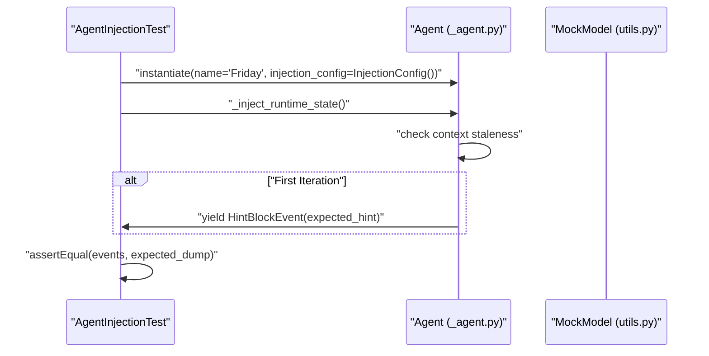

<!-- source: DeepWiki mcp.deepwiki.com · repo agentscope-ai/agentscope · page 1.2 Contributing & Development Standards · fetched 2026-10-30 -->

# Contributing & Development Standards

<details>
<summary>Relevant source files</summary>

The following files were used as context for generating this wiki page:

- [.gemini/styleguide.md](.gemini/styleguide.md)
- [.github/PULL_REQUEST_TEMPLATE.md](.github/PULL_REQUEST_TEMPLATE.md)
- [.github/copilot-instructions.md](.github/copilot-instructions.md)
- [.github/workflows/pr-title-check.yml](.github/workflows/pr-title-check.yml)
- [.github/workflows/pre-commit.yml](.github/workflows/pre-commit.yml)
- [.github/workflows/publish-pypi.yml](.github/workflows/publish-pypi.yml)
- [.github/workflows/stale.yml](.github/workflows/stale.yml)
- [.pre-commit-config.yaml](.pre-commit-config.yaml)
- [CONTRIBUTING.md](CONTRIBUTING.md)
- [CONTRIBUTING_zh.md](CONTRIBUTING_zh.md)
- [assets/images/agentscope.png](assets/images/agentscope.png)
- [src/agentscope/_version.py](src/agentscope/_version.py)
- [src/agentscope/agent/__init__.py](src/agentscope/agent/__init__.py)
- [tests/agent_injection_test.py](tests/agent_injection_test.py)
- [tests/middleware_filesystem_memory_test.py](tests/middleware_filesystem_memory_test.py)

</details>


This page outlines the technical standards, workflows, and infrastructure for contributing to the AgentScope codebase. It covers coding conventions, the mandatory use of lazy loading for optional dependencies, the pre-commit and CI/CD pipelines, and the pull request (PR) lifecycle.

## 1. Development Workflow & PR Process

AgentScope follows a structured contribution workflow to ensure code quality and maintainability. All contributors are expected to follow the [Conventional Commits](https://www.conventionalcommits.org) specification for both commit messages and PR titles.

### PR Title & Commit Standards
PR titles are automatically validated by GitHub Actions [`.github/workflows/pr-title-check.yml`]() to ensure they follow the format: `<type>(<scope>): <description>`. The scope must be lowercase, using only alphanumeric characters, hyphens, or underscores [`CONTRIBUTING.md:160-162`]().

| Type | Purpose |
| :--- | :--- |
| `feat` | New features or capabilities [`CONTRIBUTING.md:134`](). |
| `fix` | Bug fixes [`CONTRIBUTING.md:135`](). |
| `docs` | Documentation changes only [`CONTRIBUTING.md:136`](). |
| `refactor` | Code changes that neither fix a bug nor add a feature [`CONTRIBUTING.md:138`](). |
| `ci` | Changes to CI/CD configuration or scripts [`CONTRIBUTING.md:140`](). |
| `perf` | Performance improvements [`CONTRIBUTING.md:139`](). |
| `test` | Adding or correcting tests [`.github/PULL_REQUEST_TEMPLATE.md:6`](). |
| `chore` | Maintenance tasks or dependency updates [`CONTRIBUTING.md:141`](). |

### PR Checklist
Before submitting a PR, contributors must ensure:
1. An issue exists and is linked in the PR description [`.github/PULL_REQUEST_TEMPLATE.md:21-21`]().
2. Docstrings follow the **Google Style** [`.github/PULL_REQUEST_TEMPLATE.md:23-23`]().
3. All pre-commit hooks pass locally [`CONTRIBUTING.md:111-112`]().
4. Unit tests are provided for new features [`CONTRIBUTING.md:103-104`]().
5. Optional dependencies are lazy-loaded [`CONTRIBUTING.md:141-145`]().

**Sources:** [`CONTRIBUTING.md:83-186`](), [`.github/PULL_REQUEST_TEMPLATE.md:1-25`](), [`.github/workflows/pr-title-check.yml`]()

---

## 2. Coding Standards & Conventions

### Lazy Loading Rule
To keep the core SDK lightweight, any dependency not listed in the base `[project.dependencies]` of `pyproject.toml` must be **lazy-imported** at the point of use [`.github/copilot-instructions.md:10-12`](). This includes providers like Gemini, Ollama, and storage backends like Redis. This ensures that `import agentscope` remains fast and `ImportError` only occurs when a specific feature is invoked [`CONTRIBUTING.md:151-152`]().

For base class imports, the framework prefers a factory pattern to avoid circular imports and heavy top-level dependencies [`.github/copilot-instructions.md:13-19`]().

```python
# Correct usage for optional dependencies [CONTRIBUTING.md:146-150]
def some_function():
    import google.genai  # from the `gemini` extra — lazy-imported
    # ... use google.genai here
```

### Encapsulation Standards
All Python files under `src/agentscope` should be named with a `_` prefix, and exposure must be controlled through `__init__.py` [`.github/copilot-instructions.md:28-29`](). For example, `Agent` is defined in `src/agentscope/agent/_agent.py` but exposed via `src/agentscope/agent/__init__.py` [`src/agentscope/agent/__init__.py:3-7`]().

### AI-Assisted Coding Policy
AgentScope allows the use of AI coding assistants (e.g., Claude Code, Cursor) provided they are used responsibly [`CONTRIBUTING.md:48-51`]().
*   **Human Authorship:** Contributors must read every line of diff and understand the "why" behind changes [`CONTRIBUTING.md:55-56`]().
*   **Atomic PRs:** AI-generated PRs must be broken into focused, single-purpose changes; 10K+ line dumps will be rejected [`CONTRIBUTING.md:66-69`]().

**Sources:** [`CONTRIBUTING.md:48-78`](), [`CONTRIBUTING.md:141-155`](), [`.github/copilot-instructions.md:1-30`](), [`src/agentscope/agent/__init__.py:1-12`]()

---

## 3. Pre-commit & Linting Infrastructure

AgentScope employs a rigorous multi-stage linting process via `pre-commit` to ensure code consistency.

### Pre-commit Pipeline
The configuration in [`.pre-commit-config.yaml`]() executes the following checks:
*   **Static Analysis:** `mypy` for type checking [`.pre-commit-config.yaml:27-50`]() and `pylint` for code smells [`.pre-commit-config.yaml:66-111`]().
*   **Formatting:** `black` (line length 79) [`.pre-commit-config.yaml:55-59`]() and `flake8` [`.pre-commit-config.yaml:60-65`]().
*   **Safety:** `detect-private-key` and `check-ast` [`.pre-commit-config.yaml:5-21`]().

### Mermaid: Code Quality Flow
This diagram bridges the developer's local environment to the CI system.

```mermaid
graph TD
    subgraph "Local_Development_Space"
        [DEV_Code] --> [PC_Install]
        [PC_Install] --> [PC_Hooks]
    end

    subgraph "Code_Entity_Space_pre-commit-config.yaml"
        [PC_Hooks] --> [Black_Formatter]
        [PC_Hooks] --> [Mypy_Type_Checker]
        [PC_Hooks] --> [Pylint_Linter]
        [PC_Hooks] --> [Flake8_Linter]
        
        [Black_Formatter] --> ["black --line-length=79"]
        [Mypy_Type_Checker] --> ["mypy --disallow-untyped-defs"]
        [Pylint_Linter] --> ["pylint --max-statements=100"]
    end

    subgraph "CI_Space_github_workflows"
        [Black_Formatter] & [Mypy_Type_Checker] & [Pylint_Linter] --> [Pre_commit_yml]
        [Pre_commit_yml] --> [GitHub_Actions_Runner]
    end
```
**Sources:** [`.pre-commit-config.yaml:1-117`](), [`.github/workflows/pre-commit.yml:1-30`]()

---

## 4. Testing Infrastructure

Tests are located in the `tests/` directory and are executed using `pytest`.

### Test Execution & Utilities
The testing infrastructure utilizes specialized utilities to handle non-deterministic LLM outputs.
*   **Mocking:** Tests frequently use `MockModel` and `AnyString` to simulate LLM responses [`tests/agent_injection_test.py:10-12`]().
*   **State Injection:** The `AgentInjectionTest` class demonstrates how to test internal state mechanisms like `_inject_runtime_state` by patching `datetime` to return a `FROZEN_NOW` [`tests/agent_injection_test.py:23-61`]().
*   **Assertions:** Reviewers require test assertions to compare entire data structures rather than individual fields to ensure clarity [`.github/copilot-instructions.md:41-42`]().

### Mermaid: Agent State Injection Test Flow
This diagram shows how the test suite interacts with the `Agent` class to verify runtime behavior.


**Sources:** [`tests/agent_injection_test.py:41-134`](), [`.github/copilot-instructions.md:41-42`]()

---

## 5. CI/CD Workflows

AgentScope uses GitHub Actions for automation:

| Workflow | File | Description |
| :--- | :--- | :--- |
| **Pre-commit** | `pre-commit.yml` | Runs all linting hooks on the full codebase using `uv` [`.github/workflows/pre-commit.yml:1-30`](). |
| **Stale** | `stale.yml` | Marks and closes inactive issues/PRs after 60 days of inactivity [`.github/workflows/stale.yml:22-35`](). |
| **Publish** | `publish-pypi.yml` | Builds the package via `python -m build` and uploads to PyPI using `Twine` [`.github/workflows/publish-pypi.yml:9-43`](). |
| **PR Title** | `pr-title-check.yml` | Validates Conventional Commit format for PR titles [`.github/workflows/pr-title-check.yml`]() |

### Mermaid: Release Data Flow
This diagram maps the natural language "Contribution" to the code entities that manage the release.

```mermaid
graph LR
    subgraph "Natural_Language_Space"
        [Contributor] --> [Pull_Request]
        [Pull_Request] --> [Release_Published]
    end

    subgraph "Code_Entity_Space_Workflows"
        [Pull_Request] --> [Pre_commit_yml]
        [Pre_commit_yml] --> [PR_Title_Check_yml]
        [Release_Published] --> [Publish_PyPi_Package]
    end

    subgraph "Deployment_Tools"
        [Publish_PyPi_Package] --> ["uv pip install build"]
        [Publish_PyPi_Package] --> ["python -m build"]
        [Publish_PyPi_Package] --> ["gh-action-pypi-publish"]
    end
```
**Sources:** [`.github/workflows/publish-pypi.yml:32-43`](), [`.github/workflows/pre-commit.yml:1-30`](), [`.github/workflows/stale.yml:6-36`]()

---

