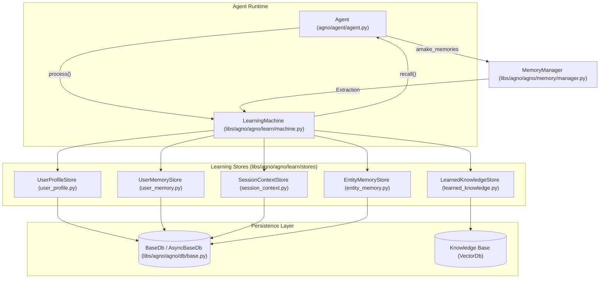
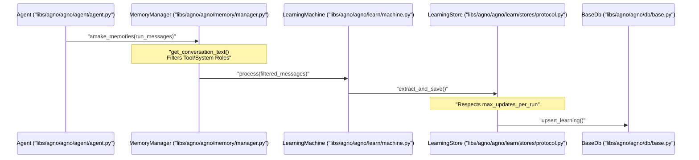

<!-- source: DeepWiki mcp.deepwiki.com · repo agno-agi/agno · page 6 Learning Machine · fetched 2026-11-09 -->

# Learning Machine

<details>
<summary>Relevant source files</summary>

The following files were used as context for generating this wiki page:

- [cookbook/08_learning/01_basics/6_extraction_limits.py](cookbook/08_learning/01_basics/6_extraction_limits.py)
- [cookbook/08_learning/07_patterns/research_assistant.py](cookbook/08_learning/07_patterns/research_assistant.py)
- [libs/agno/agno/agent/_init.py](libs/agno/agno/agent/_init.py)
- [libs/agno/agno/agent/_managers.py](libs/agno/agno/agent/_managers.py)
- [libs/agno/agno/learn/__init__.py](libs/agno/agno/learn/__init__.py)
- [libs/agno/agno/learn/config.py](libs/agno/agno/learn/config.py)
- [libs/agno/agno/learn/machine.py](libs/agno/agno/learn/machine.py)
- [libs/agno/agno/learn/schemas.py](libs/agno/agno/learn/schemas.py)
- [libs/agno/agno/learn/stores/__init__.py](libs/agno/agno/learn/stores/__init__.py)
- [libs/agno/agno/learn/stores/entity_memory.py](libs/agno/agno/learn/stores/entity_memory.py)
- [libs/agno/agno/learn/stores/learned_knowledge.py](libs/agno/agno/learn/stores/learned_knowledge.py)
- [libs/agno/agno/learn/stores/session_context.py](libs/agno/agno/learn/stores/session_context.py)
- [libs/agno/agno/learn/stores/user_memory.py](libs/agno/agno/learn/stores/user_memory.py)
- [libs/agno/agno/learn/stores/user_profile.py](libs/agno/agno/learn/stores/user_profile.py)
- [libs/agno/tests/unit/agent/test_memory_extra_messages.py](libs/agno/tests/unit/agent/test_memory_extra_messages.py)
- [libs/agno/tests/unit/learn/test_extraction_prompt_framing.py](libs/agno/tests/unit/learn/test_extraction_prompt_framing.py)
- [libs/agno/tests/unit/learn/test_session_context_store.py](libs/agno/tests/unit/learn/test_session_context_store.py)
- [libs/agno/tests/unit/test_learning_machine.py](libs/agno/tests/unit/test_learning_machine.py)
- [libs/agno/tests/unit/test_learning_message_filtering.py](libs/agno/tests/unit/test_learning_message_filtering.py)

</details>


The **Learning Machine** is a sophisticated coordination system that enables Agno agents to evolve through interaction. Unlike traditional memory which often just stores chat history, the `LearningMachine` (`[libs/agno/agno/learn/machine.py:82-107]()`) manages a suite of specialized **Learning Stores** that extract, persist, and recall structured and unstructured information across sessions.

By enabling `learning=True` on an `Agent`, the system automatically activates a `LearningMachine` that observes conversations to build user profiles, track session goals, and record reusable knowledge.

## System Overview

The Learning Machine operates as a background orchestrator that bridges the gap between raw conversation logs and actionable long-term memory. It coordinates multiple storage backends, each specialized for a specific type of data.

### High-Level Architecture
The following diagram illustrates how the `LearningMachine` coordinates between the `Agent` execution and the underlying `LearningStore` implementations.

**Learning Machine Coordination Flow**

Sources: [libs/agno/agno/learn/machine.py:81-107](), [libs/agno/agno/learn/stores/session_context.py:58-77](), [libs/agno/agno/learn/stores/protocol.py:1-20]()

---

## Child Pages & Core Sub-Topics

For detailed implementation and advanced configurations, refer to the following child pages:

- **[LearningMachine Architecture](#6.1)** — Document the `LearningMachine` class, the `learning=True` shortcut, store coordination, `LearningMode`, `Curator`, and integration with `Agent`.
- **[Learning Stores](#6.2)** — Detail each store type: `UserProfile`, `UserMemory`, `SessionContext`, `EntityMemory`, `LearnedKnowledge`, and `DecisionLog`.
- **[Memory Manager and Persistence](#6.3)** — Explain `MemoryManager`, memory extraction strategies, deduplication, database-backed persistence, and recall into agent context.

---

## Summary of Learning Stores

The Learning Machine manages several distinct types of memory, each serving a unique role in the agent's cognitive architecture.

| Store Type | Purpose | Persistence Scope | Code Entity |
|:---|:---|:---|:---|
| **User Profile** | Structured facts about the user (name, preferences). | User ID | `UserProfileStore` [libs/agno/agno/learn/stores/user_profile.py:62]() |
| **User Memory** | Unstructured observations and long-term history. | User ID | `UserMemoryStore` [libs/agno/agno/learn/stores/user_memory.py:57]() |
| **Session Context**| Snapshot of current goals, plans, and progress. | Session ID | `SessionContextStore` [libs/agno/agno/learn/stores/session_context.py:58]() |
| **Entity Memory** | Facts about external entities (companies, projects). | Entity ID + Type | `EntityMemoryStore` [libs/agno/agno/learn/stores/entity_memory.py:67]() |
| **Learned Knowledge**| Reusable insights applicable across all users. | Global / Namespace | `LearnedKnowledgeStore` [libs/agno/agno/learn/stores/learned_knowledge.py:51]() |
| **Decision Log** | Logs of agent decisions for auditing/improvement. | Session ID | `DecisionLogStore` [libs/agno/agno/learn/config.py:260]() |

For details, see [Learning Stores](#6.2).

Sources: [libs/agno/agno/learn/stores/user_profile.py:1-28](), [libs/agno/agno/learn/stores/session_context.py:1-26](), [libs/agno/agno/learn/stores/entity_memory.py:1-35](), [libs/agno/agno/learn/machine.py:111-162](), [cookbook/08_learning/README.md:9-17]()

---

## Learning Modes

The Learning Machine supports different operational modes defined in `LearningMode` (`[libs/agno/agno/learn/config.py:36-49]`) that determine how and when information is extracted and saved:

*   **ALWAYS**: Automatic extraction performed by the system after every interaction (`[libs/agno/agno/learn/config.py:45]()`).
*   **AGENTIC**: The agent decides when to learn by calling specific tools (e.g., `update_user_profile`) (`[libs/agno/agno/learn/config.py:46]()`).
*   **PROPOSE**: The agent proposes a memory update, which requires approval (used in `LearnedKnowledgeStore`) (`[libs/agno/agno/learn/config.py:47]()`).
*   **HITL**: Human-in-the-loop mode for strict approval of memory updates (`[libs/agno/agno/learn/config.py:48]()`).

For implementation details on these modes and the `Curator` system for memory maintenance, see [LearningMachine Architecture](#6.1).

Sources: [libs/agno/agno/learn/config.py:36-49]()

---

## Memory Extraction and Persistence

The Learning Machine ensures that the model only sees relevant, cleaned data. It uses `get_conversation_text` to filter out system prompts and tool scaffolding before passing history to extraction models, preventing scaffolding contamination (`[libs/agno/agno/utils/message.py:44-45]()`). To prevent runaway loops, each store respects a `max_updates_per_run` limit (default: 10) (`[libs/agno/agno/learn/machine.py:125]()`, `[cookbook/08_learning/01_basics/6_extraction_limits.py:10-13]()`).

**Memory Extraction Sequence**

Sources: [libs/agno/agno/learn/stores/session_context.py:128-163](), [libs/agno/agno/learn/stores/user_memory.py:118-150](), [libs/agno/agno/learn/machine.py:81-107](), [libs/agno/agno/learn/config.py:102-103](), [libs/agno/tests/unit/learn/test_session_context_store.py:20-21]()

For details on deduplication, extraction strategies, and database-backed persistence, see [Memory Manager and Persistence](#6.3).

---

## Usage Example

Integrating the Learning Machine is typically done during Agent initialization. You can use the `learning=True` shortcut for defaults or provide a `LearningMachine` configuration object for granular control (`[libs/agno/agno/agent/_init.py:122-171]()`).

```python
from agno.agent import Agent
from agno.learn import LearningMachine, UserProfileConfig, LearningMode

agent = Agent(
    # learning=True,  # Shortcut for default profile and memory
    learning=LearningMachine(
        user_profile=UserProfileConfig(mode=LearningMode.ALWAYS),
        session_context=True,
        learned_knowledge=True,
        max_updates_per_run=5  # Global limit
    ),
    db=my_database_backend,
)
```
Sources: [libs/agno/agno/agent/_init.py:122-171](), [libs/agno/agno/learn/machine.py:81-125](), [cookbook/08_learning/README.md:182-210]()

---

