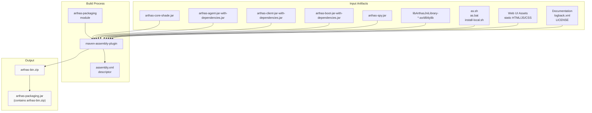
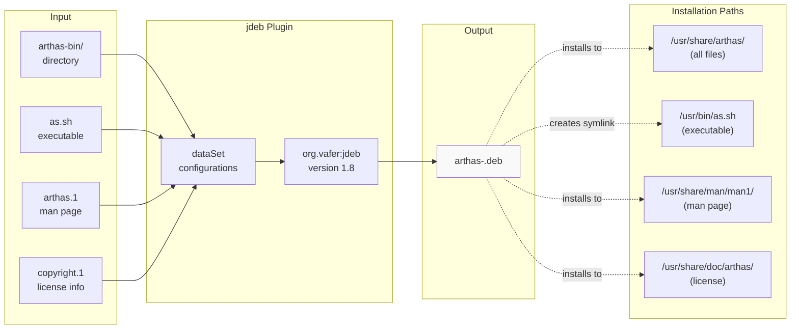
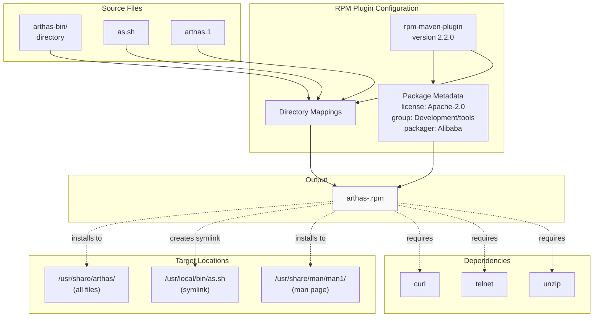
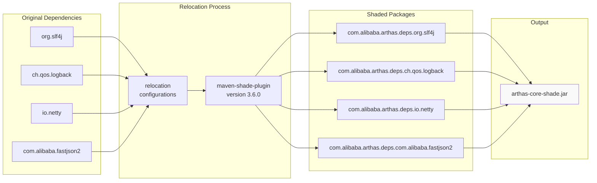
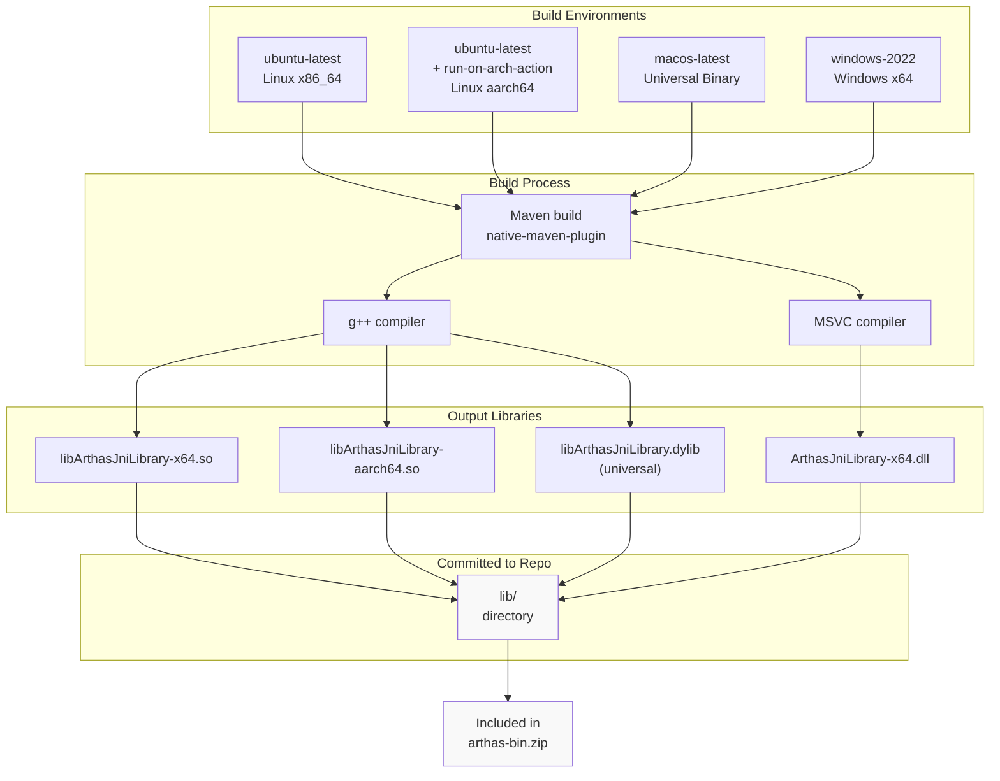
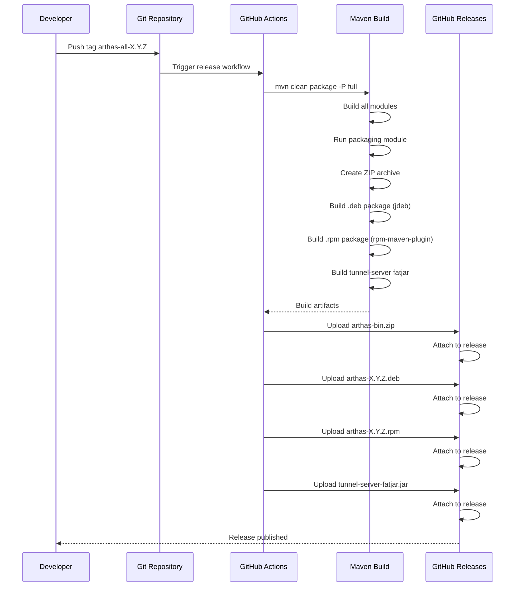
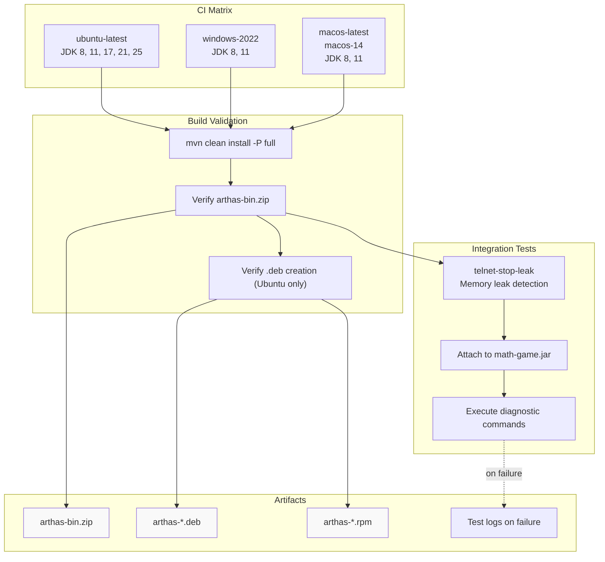

<!-- source: DeepWiki mcp.deepwiki.com · repo alibaba/arthas · page 8.2 Packaging and Distribution Formats · fetched 2026-10-29 -->

# Packaging and Distribution Formats

<details>
<summary>Relevant source files</summary>

The following files were used as context for generating this wiki page:

- [.github/workflows/auto-prettier.yaml](.github/workflows/auto-prettier.yaml)
- [.github/workflows/build-vmtool.yaml](.github/workflows/build-vmtool.yaml)
- [.github/workflows/release.yaml](.github/workflows/release.yaml)
- [.github/workflows/test.yaml](.github/workflows/test.yaml)
- [.gitignore](.gitignore)
- [agent/pom.xml](agent/pom.xml)
- [boot/pom.xml](boot/pom.xml)
- [client/pom.xml](client/pom.xml)
- [common/pom.xml](common/pom.xml)
- [core/pom.xml](core/pom.xml)
- [integration-test/telnet-stop-leak/README.md](integration-test/telnet-stop-leak/README.md)
- [integration-test/telnet-stop-leak/arthas_telnet.exp](integration-test/telnet-stop-leak/arthas_telnet.exp)
- [integration-test/telnet-stop-leak/commands.txt](integration-test/telnet-stop-leak/commands.txt)
- [integration-test/telnet-stop-leak/run_telnet_stop_leak_test.py](integration-test/telnet-stop-leak/run_telnet_stop_leak_test.py)
- [memorycompiler/pom.xml](memorycompiler/pom.xml)
- [packaging/pom.xml](packaging/pom.xml)
- [pom.xml](pom.xml)
- [site/pom.xml](site/pom.xml)
- [spy/pom.xml](spy/pom.xml)
- [testcase/pom.xml](testcase/pom.xml)
- [tunnel-client/pom.xml](tunnel-client/pom.xml)
- [tunnel-server/pom.xml](tunnel-server/pom.xml)

</details>


This document describes the various distribution formats provided by Arthas, their contents, and how they are built. It covers the ZIP archive, Debian/RPM packages, Docker images, and Maven Central artifacts that enable users to install Arthas in different environments.

For information about installation methods and deployment procedures, see [Installation Methods](#8.1). For build system details, see [Build System and CI/CD](#9.1).

---

## Overview of Distribution Formats

Arthas provides multiple distribution formats to accommodate different deployment scenarios and operating systems. All formats share the same core artifacts but differ in packaging, installation mechanisms, and target platforms.

**Sources:** [packaging/pom.xml:1-263](), [.github/workflows/release.yaml:1-32]()

### Available Formats

| Format | File Pattern | Target Platform | Use Case |
|--------|-------------|-----------------|----------|
| **ZIP Archive** | `arthas-bin.zip` | Cross-platform | Manual installation, custom deployments |
| **Debian Package** | `arthas-<version>.deb` | Debian/Ubuntu Linux | System-level installation via `apt` |
| **RPM Package** | `arthas-<version>.rpm` | RedHat/CentOS/Fedora | System-level installation via `yum`/`dnf` |
| **Docker Image** | `hengyunabc/arthas` | Container environments | Containerized deployments |
| **Maven Artifacts** | Individual JAR files | Maven/Gradle projects | Embedded integration |
| **Tunnel Server** | `arthas-tunnel-server-fatjar.jar` | Any JVM platform | Standalone tunnel server |

**Sources:** [.github/workflows/release.yaml:24-29](), [packaging/pom.xml:75-262]()

---

## Distribution Format Details

### ZIP Archive (arthas-bin.zip)

The primary distribution format is a ZIP archive containing all Arthas components. This format is created by the `arthas-packaging` module using the Maven Assembly Plugin.



**ZIP Archive Structure:**

```
arthas-bin/
├── arthas-core.jar          (symlink to arthas-core-shade.jar)
├── arthas-core-shade.jar    (shaded core with dependencies)
├── arthas-agent.jar         (JVM agent with dependencies)
├── arthas-client.jar        (Telnet client)
├── arthas-boot.jar          (Bootstrap launcher)
├── arthas-spy.jar           (SpyAPI for bytecode hooks)
├── math-game.jar            (Demo application)
├── as.sh                    (Launch script for Unix/Linux)
├── as.bat                   (Launch script for Windows)
├── install-local.sh         (Local installation script)
├── async-profiler/          (Platform-specific profiler binaries)
├── lib/                     (Native JNI libraries)
│   ├── libArthasJniLibrary-x64.so       (Linux x86_64)
│   ├── libArthasJniLibrary-aarch64.so   (Linux ARM64)
│   ├── libArthasJniLibrary.dylib        (macOS universal)
│   └── ArthasJniLibrary-x64.dll         (Windows x64)
├── logback.xml              (Logging configuration)
└── LICENSE                  (Apache 2.0 license)
```

**Sources:** [packaging/pom.xml:36-51](), [packaging/src/main/assembly/assembly.xml]()

#### Assembly Configuration

The ZIP structure is defined by `assembly.xml` descriptor which specifies:
- File inclusions from dependent modules
- Symlink creation for `arthas-core.jar`
- Executable permissions for shell scripts
- Directory structure preservation

**Sources:** [packaging/pom.xml:44-48]()

#### Packaging JAR Enhancement

After assembly, the `maven-antrun-plugin` embeds the `arthas-bin.zip` into `arthas-packaging.jar`:

[packaging/pom.xml:54-70]()

This enables `arthas-boot.jar` to extract the distribution from the JAR when installed via Maven Central.

**Sources:** [packaging/pom.xml:54-70]()

---

### Debian Package (.deb)

Debian packages enable system-level installation on Debian-based Linux distributions (Debian, Ubuntu, Mint, etc.). The package is built using the `jdeb` Maven plugin.



**Debian Package Configuration:**

[packaging/pom.xml:76-153]()

Key configuration details:
- **Ownership:** All files owned by `root:root`
- **Permissions:** 755 for executables, standard for data files
- **Installation prefix:** `/usr/share/arthas`
- **Executable symlink:** `/usr/bin/as.sh` points to `/usr/share/arthas/as.sh`
- **Man page:** Installs to `/usr/share/man/man1/arthas.1`
- **Documentation:** License file in `/usr/share/doc/arthas/copyright.1`

**Profile Activation:**

The `deb` profile is activated automatically for JDK 1.8 and later:

[packaging/pom.xml:77-80]()

**Sources:** [packaging/pom.xml:76-153](), [packaging/src/deb/man1/arthas.1](), [packaging/src/deb/copyright/copyright.1]()

---

### RPM Package (.rpm)

RPM packages support RedHat-based Linux distributions (RHEL, CentOS, Fedora, etc.). The package is built using the `rpm-maven-plugin`.



**RPM Package Configuration:**

[packaging/pom.xml:156-234]()

Key configuration details:
- **Prefix:** `/usr/share` (all files install under this)
- **Installation directory:** `/usr/share/arthas`
- **Executable symlink:** `/usr/local/bin/as.sh` → `/usr/share/arthas/as.sh` (softlink)
- **File permissions:** 755 for all directories and files
- **Dependencies:** Requires `curl`, `telnet`, and `unzip` packages

**Profile Activation:**

The `rpm` profile requires explicit activation on Linux systems with the `rpm` property:

[packaging/pom.xml:156-164]()

**Sources:** [packaging/pom.xml:156-234]()

---

### Docker Image

While the official Docker image is not built directly in the repository, the release artifacts support Docker deployment. The ZIP archive can be extracted into a Docker container, and the tunnel server provides a pre-built fat JAR.

**Common Docker Usage Patterns:**

```dockerfile
# Example: Using arthas-tunnel-server in Docker
FROM openjdk:8-jre-alpine
COPY arthas-tunnel-server-fatjar.jar /app/
EXPOSE 7777 8080
ENTRYPOINT ["java", "-jar", "/app/arthas-tunnel-server-fatjar.jar"]
```

The tunnel server fat JAR is specifically built for containerized deployments:

[tunnel-server/pom.xml:195-213]()

**Sources:** [tunnel-server/pom.xml:195-213](), [.github/workflows/release.yaml:29]()

---

### Maven Central Artifacts

Individual Arthas components are published to Maven Central for embedded integration scenarios. Each module produces its own artifact with dependencies.

**Published Artifacts:**

| Artifact ID | Description | Packaging Type |
|-------------|-------------|----------------|
| `arthas-core` | Core diagnostic engine (shaded) | JAR with relocated dependencies |
| `arthas-agent` | JVM agent bootstrap | JAR with dependencies |
| `arthas-client` | Telnet console client | JAR with dependencies |
| `arthas-boot` | Bootstrap launcher | JAR with dependencies |
| `arthas-spy` | SpyAPI for instrumentation | JAR (no dependencies) |
| `arthas-tunnel-server` | Tunnel server application | JAR (regular) and fat JAR |
| `arthas-spring-boot-starter` | Spring Boot auto-configuration | JAR |
| `arthas-common` | Common utilities | JAR (no dependencies) |

**Central Publishing Configuration:**

[pom.xml:339-346]()

The release process uses the `central-publishing-maven-plugin` activated via the `release` profile when `performRelease=true`.

**Sources:** [pom.xml:315-349](), [pom.xml:339-346]()

---

## Core Artifacts

### Shaded JARs

Several artifacts use the Maven Shade Plugin to relocate dependencies and avoid classpath conflicts with target applications.

#### arthas-core-shade.jar

The core module shades and relocates major dependencies:



**Relocation Configuration:**

[core/pom.xml:45-63]()

All dependencies are relocated to the `com.alibaba.arthas.deps` package to prevent conflicts.

**Post-Shade Processing:**

After shading, the `maven-antrun-plugin` performs additional operations:

1. Unzips the shaded JAR
2. Restores original logger command classes (which were incorrectly relocated)
3. Copies Web UI assets from `web-ui` module
4. Re-zips the final JAR

[core/pom.xml:81-104]()

**Sources:** [core/pom.xml:21-78](), [core/pom.xml:81-104]()

#### Assembly Plugin for Executable JARs

Other modules use `maven-assembly-plugin` with the `jar-with-dependencies` descriptor to create executable fat JARs:

- **arthas-agent.jar:** [agent/pom.xml:36-64]()
- **arthas-client.jar:** [client/pom.xml:18-46]()
- **arthas-boot.jar:** [boot/pom.xml:36-68]()

These JARs bundle all dependencies without relocation since they run in separate processes.

**Sources:** [agent/pom.xml:36-64](), [client/pom.xml:18-46](), [boot/pom.xml:36-68]()

---

### Native Libraries

Arthas includes platform-specific JNI libraries for low-level JVM operations via the `arthas-vmtool` module.



**Build Workflow:**

The `build-vmtool.yaml` GitHub Actions workflow compiles native libraries across four platforms:

[.github/workflows/build-vmtool.yaml:6-110]()

**Platform-Specific Builds:**

1. **Linux x86_64:** Built on `ubuntu-latest` ([.github/workflows/build-vmtool.yaml:7-21]())
2. **Linux aarch64:** Built using `uraimo/run-on-arch-action` with Ubuntu 20.04 container ([.github/workflows/build-vmtool.yaml:55-82]())
3. **macOS:** Built on `macos-latest`, produces universal binary ([.github/workflows/build-vmtool.yaml:22-37]())
4. **Windows:** Built on `windows-2022` ([.github/workflows/build-vmtool.yaml:38-53]())

**Artifact Commitment:**

After building, the workflow commits the compiled libraries back to the `lib/` directory in the repository:

[.github/workflows/build-vmtool.yaml:84-109]()

This ensures reproducible builds and allows users to clone the repository and use pre-built native libraries.

**Sources:** [.github/workflows/build-vmtool.yaml:1-110]()

---

## Release Process

### GitHub Actions Release Workflow

The release process is triggered when a tag matching `arthas-all-*` is pushed:



**Release Workflow Configuration:**

[.github/workflows/release.yaml:1-32]()

**Artifacts Published:**

The workflow uploads four types of files to GitHub Releases:
- `packaging/target/*.zip` (arthas-bin.zip)
- `packaging/target/*.deb` (Debian package)
- `packaging/target/*.rpm` (RPM package)
- `tunnel-server/target/*fatjar.jar` (Tunnel server standalone JAR)

**Sources:** [.github/workflows/release.yaml:1-32]()

### Maven Central Publishing

When building with the `release` profile and `performRelease=true`, artifacts are published to Maven Central using the Sonatype Central Publishing plugin:

[pom.xml:315-349]()

**GPG Signing:**

All artifacts are GPG-signed during the release process:

[pom.xml:325-337]()

**Full Build Profile:**

The `full` profile enables additional features for releases:
- Git commit information embedding ([pom.xml:259-291]())
- Javadoc generation ([pom.xml:292-310]())
- Documentation assembly for doc ZIP ([packaging/pom.xml:236-261]())

**Sources:** [pom.xml:255-313](), [pom.xml:315-349]()

---

## Package Contents Inventory

### Core Diagnostic Engine

| File | Module | Description |
|------|--------|-------------|
| `arthas-core-shade.jar` | `core` | Shaded core engine with relocated dependencies (netty, slf4j, logback, fastjson2) |
| `arthas-core.jar` | `core` | Symlink to arthas-core-shade.jar for backwards compatibility |

**Sources:** [core/pom.xml:1-279]()

### Agent and Client

| File | Module | Description |
|------|--------|-------------|
| `arthas-agent.jar` | `agent` | JVM agent bootstrap with manifest entries for Premain-Class and Agent-Class |
| `arthas-client.jar` | `client` | Standalone Telnet client for connecting to Arthas server |
| `arthas-boot.jar` | `boot` | Bootstrap launcher for attaching Arthas to target JVM |

**Sources:** [agent/pom.xml:1-68](), [client/pom.xml:1-66](), [boot/pom.xml:1-71]()

### Supporting Components

| File | Module | Description |
|------|--------|-------------|
| `arthas-spy.jar` | `spy` | SpyAPI hooks injected into bootstrap classloader |
| `math-game.jar` | `math-game` | Demo application for testing Arthas features |

**Sources:** [spy/pom.xml:1-28]()

### Scripts and Configuration

| File | Purpose |
|------|---------|
| `as.sh` | Unix/Linux/macOS launch script |
| `as.bat` | Windows launch script |
| `install-local.sh` | Script for installing Arthas to local Maven repository |
| `logback.xml` | Default logging configuration for Arthas core |

### Native Libraries (lib)

| File | Platform |
|------|----------|
| `libArthasJniLibrary-x64.so` | Linux x86_64 |
| `libArthasJniLibrary-aarch64.so` | Linux ARM64/aarch64 |
| `libArthasJniLibrary.dylib` | macOS (Universal Binary, x86_64 + ARM64) |
| `ArthasJniLibrary-x64.dll` | Windows x64 |

**Sources:** [.github/workflows/build-vmtool.yaml:1-110]()

### Async Profiler

| Directory | Contents |
|-----------|----------|
| `async-profiler/` | Platform-specific async-profiler native libraries for CPU/memory profiling |

**Sources:** Diagram 4 (Build & Deployment Pipeline)

---

## Build Profiles and Options

### Maven Profiles

The build system supports several profiles for different build scenarios:

**1. `full` Profile**

Activated explicitly with `-P full`, enables:
- Git commit information embedding
- Javadoc generation
- Documentation site building

[pom.xml:255-313]()

**2. `release` Profile**

Activated when `performRelease=true`, enables:
- GPG artifact signing
- Central publishing plugin

[pom.xml:315-349]()

**3. `deb` Profile**

Auto-activated on JDK 8+, enables:
- Debian package creation

[packaging/pom.xml:76-153]()

**4. `rpm` Profile**

Activated explicitly with `-Prpm` on Linux, enables:
- RPM package creation

[packaging/pom.xml:156-234]()

**Sources:** [pom.xml:224-350](), [packaging/pom.xml:75-262]()

### Build Commands

**Standard Build:**
```bash
mvn clean package
```

**Full Build (with docs):**
```bash
mvn clean package -P full
```

**Release Build:**
```bash
mvn clean deploy -P full,release -DperformRelease=true
```

**RPM Build:**
```bash
mvn clean package -P full,rpm -Drpm
```

**Sources:** [.github/workflows/test.yaml:24](), [.github/workflows/release.yaml:19]()

---

## Platform-Specific Considerations

### Linux

- **Debian/Ubuntu:** Use `.deb` package for system-wide installation via `apt install ./arthas-*.deb`
- **RedHat/CentOS/Fedora:** Use `.rpm` package for system-wide installation via `yum install arthas-*.rpm` or `dnf install arthas-*.rpm`
- **Manual:** Extract `arthas-bin.zip` and run `./as.sh`
- **Dependencies:** ZIP format requires `unzip` utility; RPM requires `curl`, `telnet`, `unzip`

**Sources:** [packaging/pom.xml:225-229]()

### macOS

- Extract `arthas-bin.zip` and run `./as.sh`
- Native library is universal binary supporting both Intel (x86_64) and Apple Silicon (ARM64)

**Sources:** [.github/workflows/build-vmtool.yaml:22-37]()

### Windows

- Extract `arthas-bin.zip` and run `as.bat`
- Requires Java 8 or later in PATH
- Native library compiled with MSVC on Windows 2022 environment

**Sources:** [.github/workflows/build-vmtool.yaml:38-53]()

### Container Environments

- Use `arthas-bin.zip` in custom Dockerfile
- For tunnel server, use pre-built `arthas-tunnel-server-fatjar.jar`
- Ensure proper JDK base image (8 or later)

**Sources:** [tunnel-server/pom.xml:195-213]()

---

## Dependencies and Prerequisites

### Build-Time Dependencies

| Dependency | Purpose | Version |
|------------|---------|---------|
| Maven | Build system | 3.x |
| JDK | Compilation | 8 or later |
| Node.js + Yarn | Web UI build | Node v16+ |
| g++ / MSVC | Native library compilation | System default |

**Sources:** [pom.xml:87-88](), [site/pom.xml:18-19]()

### Runtime Dependencies

Arthas JARs have minimal runtime dependencies due to shading:
- **Java Runtime:** JRE 8 or later
- **Native Libraries:** Platform-specific JNI library (included in distribution)
- **Optional:** `telnet` client for remote connection (not needed for HTTP/WebSocket access)

**Sources:** [core/pom.xml:45-63]()

### Dependency Isolation

The core module uses Maven Shade Plugin to relocate dependencies into `com.alibaba.arthas.deps` package, preventing conflicts with target application dependencies:

[core/pom.xml:45-63]()

This ensures Arthas can attach to applications using different versions of:
- SLF4J / Logback
- Netty
- Fastjson2

**Sources:** [core/pom.xml:45-63]()

---

## CI/CD Integration

The continuous integration pipeline validates distribution formats across multiple platforms:



**Test Workflow:**

[.github/workflows/test.yaml:1-84]()

**Key Test Stages:**
1. **Matrix Builds:** Test across 3 OSes × multiple JDK versions
2. **Packaging Verification:** Ensure all distribution formats build successfully
3. **Integration Testing:** `telnet-stop-leak` test validates memory leak prevention across multiple attach/detach cycles

**Sources:** [.github/workflows/test.yaml:1-84](), [integration-test/telnet-stop-leak/README.md:1-41]()

---

## Summary

Arthas provides five primary distribution formats optimized for different deployment scenarios:

1. **ZIP Archive** - Universal, cross-platform, manual installation
2. **Debian Package** - System integration for Debian/Ubuntu
3. **RPM Package** - System integration for RedHat/CentOS/Fedora  
4. **Docker/Fat JAR** - Containerized tunnel server deployments
5. **Maven Artifacts** - Embedded integration via dependency management

All formats share identical core functionality but differ in installation mechanisms, file paths, and system integration. The build system uses Maven profiles to conditionally enable platform-specific packaging, and GitHub Actions automates cross-platform compilation of native libraries and distribution to GitHub Releases and Maven Central.

**Sources:** [packaging/pom.xml:1-263](), [.github/workflows/release.yaml:1-32](), [.github/workflows/build-vmtool.yaml:1-110]()

---

