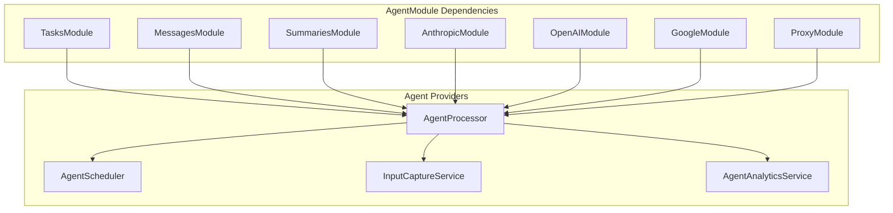
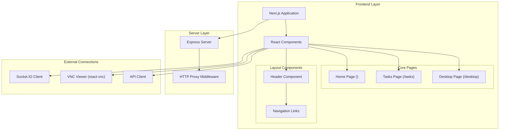
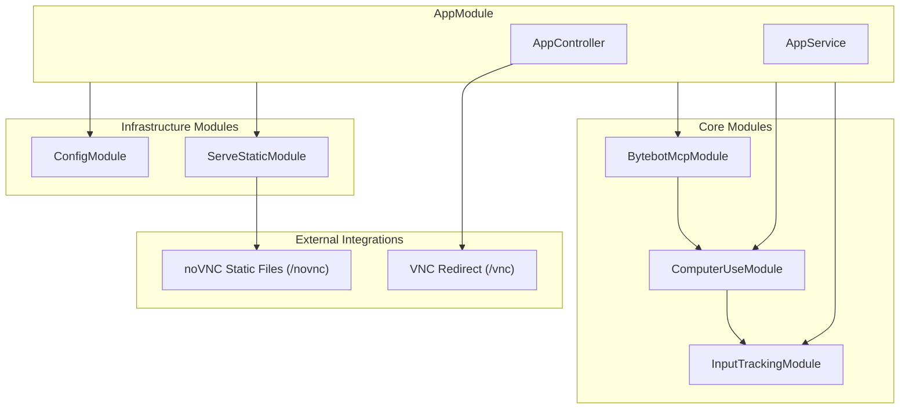
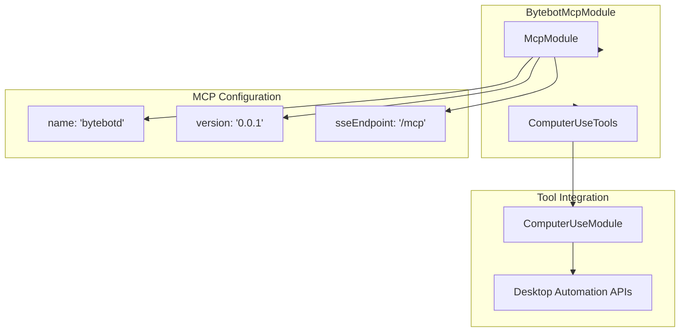
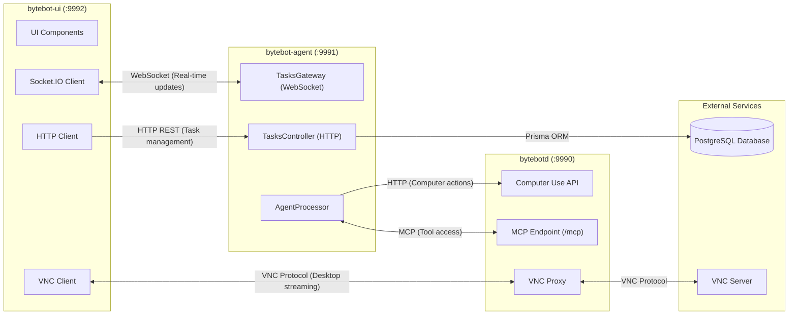
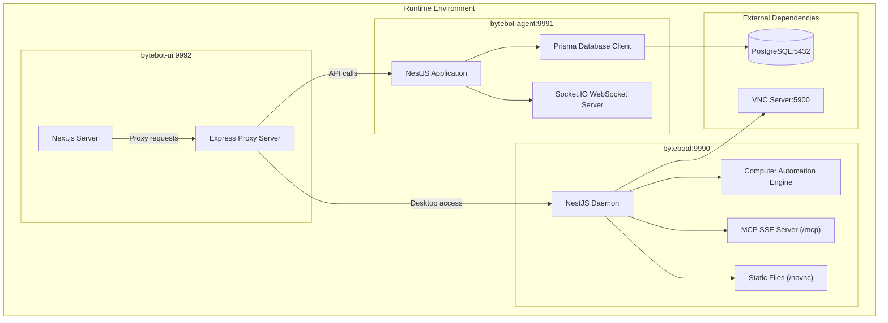

<!-- source: DeepWiki mcp.deepwiki.com · repo bytebot-ai/bytebot · page 2.1 Service Architecture · fetched 2026-10-29 -->

# Service Architecture

Relevant source files

The following files were used as context for generating this wiki page:

- [packages/bytebot-agent/package-lock.json](packages/bytebot-agent/package-lock.json)
- [packages/bytebot-agent/package.json](packages/bytebot-agent/package.json)
- [packages/bytebot-agent/src/agent/agent.module.ts](packages/bytebot-agent/src/agent/agent.module.ts)
- [packages/bytebot-agent/src/app.module.ts](packages/bytebot-agent/src/app.module.ts)
- [packages/bytebot-agent/src/main.ts](packages/bytebot-agent/src/main.ts)
- [packages/bytebot-agent/src/tasks/tasks.gateway.ts](packages/bytebot-agent/src/tasks/tasks.gateway.ts)
- [packages/bytebot-ui/next.config.ts](packages/bytebot-ui/next.config.ts)
- [packages/bytebot-ui/server.ts](packages/bytebot-ui/server.ts)
- [packages/bytebot-ui/src/app/api/[[...path]]/route.ts](packages/bytebot-ui/src/app/api/[[...path]]/route.ts)
- [packages/bytebot-ui/src/hooks/useWebSocket.ts](packages/bytebot-ui/src/hooks/useWebSocket.ts)

This document details the internal architecture of each core Bytebot service, including their modules, dependencies, and inter-service communication patterns. For overall system design and component relationships, see [System Architecture](#2). For deployment considerations, see [Deployment Architecture](#2.2).

## Service Overview

Bytebot consists of three primary services that work together to provide AI-powered desktop automation:

| Service | Technology | Port | Primary Responsibility |
|---------|------------|------|----------------------|
| `bytebot-agent` | NestJS | 9991 | Task orchestration and AI integration |
| `bytebot-ui` | Next.js | 9992 | Web interface and user interaction |
| `bytebotd` | NestJS | 9990 | Desktop automation and computer control |

## Agent Service Architecture

### Core Module Structure

The `bytebot-agent` service is built using NestJS and organized into specialized modules for task management, AI integration, and system orchestration.

```mermaid
graph TB
    AppModule["AppModule"]
    
    subgraph "Core Processing"
        AgentModule["AgentModule"]
        TasksModule["TasksModule"]  
        MessagesModule["MessagesModule"]
        SummariesModule["SummariesModule"]
    end
    
    subgraph "AI Providers"
        AnthropicModule["AnthropicModule"]
        OpenAIModule["OpenAIModule"]
        GoogleModule["GoogleModule"]
        ProxyModule["ProxyModule"]
    end
    
    subgraph "Infrastructure"
        PrismaModule["PrismaModule"]
        ConfigModule["ConfigModule"]
        ScheduleModule["ScheduleModule"]
        EventEmitterModule["EventEmitterModule"]
    end
    
    AppModule --> AgentModule
    AppModule --> TasksModule
    AppModule --> MessagesModule
    AppModule --> SummariesModule
    AppModule --> AnthropicModule
    AppModule --> OpenAIModule
    AppModule --> GoogleModule
    AppModule --> ProxyModule
    AppModule --> PrismaModule
    AppModule --> ConfigModule
    AppModule --> ScheduleModule
    AppModule --> EventEmitterModule
```

**Sources:** [packages/bytebot-agent/src/app.module.ts:17-33]()

### Agent Processing Components

The `AgentModule` contains the core orchestration logic and processing components:

**Sources:** [packages/bytebot-agent/src/agent/agent.module.ts:15-33]()

### Key Dependencies

The agent service relies on several critical dependencies for AI integration and system functionality:

| Dependency | Purpose | Version |
|------------|---------|---------|
| `@anthropic-ai/sdk` | Claude AI integration | ^0.39.0 |
| `openai` | OpenAI GPT integration | ^5.8.2 |
| `@google/genai` | Google Gemini integration | ^1.8.0 |
| `@prisma/client` | Database ORM | ^6.6.0 |
| `socket.io` | WebSocket communication | ^4.8.1 |
| `@nestjs/websockets` | NestJS WebSocket support | ^11.1.1 |

**Sources:** [packages/bytebot-agent/package.json:24-46]()

## UI Service Architecture

### Next.js Application Structure

The `bytebot-ui` service provides the web interface using Next.js with a custom Express server for proxy functionality:

**Sources:** [packages/bytebot-ui/src/components/layout/Header.tsx:15-94](), [packages/bytebot-ui/package.json:30-47]()

### UI Dependencies and Communication

The UI service integrates multiple technologies for real-time communication and desktop visualization:

| Dependency | Purpose | Version |
|------------|---------|---------|
| `next` | React framework | >=15.3.3 |
| `react` | UI library | ^19.0.0 |
| `socket.io-client` | Real-time communication | ^4.8.1 |
| `react-vnc` | VNC desktop viewer | ^3.1.0 |
| `http-proxy-middleware` | API proxying | ^3.0.5 |
| `@radix-ui/*` | UI component primitives | Various |

**Sources:** [packages/bytebot-ui/package.json:11-47]()

## Desktop Service Architecture

### Daemon Module Organization

The `bytebotd` service provides desktop automation capabilities through a modular NestJS architecture:

**Sources:** [packages/bytebotd/src/app.module.ts:10-26](), [packages/bytebotd/src/app.controller.ts:1-18]()

### MCP Integration Architecture

The Model Context Protocol (MCP) integration enables AI models to access desktop automation tools:

**Sources:** [packages/bytebotd/src/mcp/bytebot-mcp.module.ts:6-17]()

### Desktop Automation Dependencies

The desktop service uses specialized libraries for computer control and input monitoring:

| Dependency | Purpose | Version |
|------------|---------|---------|
| `@nut-tree-fork/nut-js` | Desktop automation framework | ^4.2.6 |
| `uiohook-napi` | Global input event capture | ^1.5.4 |
| `sharp` | Image processing for screenshots | ^0.34.2 |
| `@rekog/mcp-nest` | MCP protocol integration | ^1.6.2 |
| `http-proxy-middleware` | Request proxying | ^3.0.5 |

**Sources:** [packages/bytebotd/package.json:28-46]()

## Inter-Service Communication

### Communication Protocols and Patterns

The three services communicate using multiple protocols optimized for different types of data exchange:

**Sources:** [packages/bytebot-agent/src/app.module.ts:17-37](), [packages/bytebotd/src/app.controller.ts:10-17](), [packages/bytebot-ui/package.json:41-43]()

## Service Runtime Configuration

### Port Allocation and Environment

Each service operates on dedicated ports with specific runtime configurations:

**Sources:** [packages/bytebot-agent/package.json:96-98](), [packages/bytebot-ui/package.json:5-9](), [packages/bytebotd/src/app.module.ts:15-18]()

---

