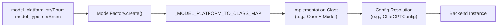

<!-- source: DeepWiki mcp.deepwiki.com · repo camel-ai/camel · page 3 Model Integration System · fetched 2026-10-29 -->

# Model Integration System

<details>
<summary>Relevant source files</summary>

The following files were used as context for generating this wiki page:

- [.github/workflows/build_package.yml](.github/workflows/build_package.yml)
- [.github/workflows/pytest_package.yml](.github/workflows/pytest_package.yml)
- [camel/configs/__init__.py](camel/configs/__init__.py)
- [camel/configs/anthropic_config.py](camel/configs/anthropic_config.py)
- [camel/models/__init__.py](camel/models/__init__.py)
- [camel/models/anthropic_model.py](camel/models/anthropic_model.py)
- [camel/models/azure_openai_model.py](camel/models/azure_openai_model.py)
- [camel/models/base_model.py](camel/models/base_model.py)
- [camel/models/model_factory.py](camel/models/model_factory.py)
- [camel/models/openai_compatible_model.py](camel/models/openai_compatible_model.py)
- [camel/models/openai_model.py](camel/models/openai_model.py)
- [camel/types/enums.py](camel/types/enums.py)
- [camel/types/unified_model_type.py](camel/types/unified_model_type.py)
- [docs/key_modules/models.md](docs/key_modules/models.md)
- [docs/mintlify/key_modules/models.mdx](docs/mintlify/key_modules/models.mdx)
- [examples/models/anthropic_model_example.py](examples/models/anthropic_model_example.py)
- [test/models/test_anthropic_model.py](test/models/test_anthropic_model.py)
- [test/models/test_base_model.py](test/models/test_base_model.py)

</details>


## Purpose and Scope

The Model Integration System provides a unified abstraction layer for seamless interaction with over 40 Large Language Model (LLM) platforms. It encapsulates model backend implementations, unifies model instantiation via a factory pattern, and governs message preprocessing, token counting, and response postprocessing. This enables CAMEL-AI to flexibly support a vast ecosystem of LLM providers under a consistent interface.

For how models fit within the agent architecture, see [ChatAgent](#2.1). For technical specifics of each subsystem, refer to the following child pages:
- [Model Types and Factory](#3.1)
- [Model Backends](#3.2)
- [Message Processing and Preprocessing](#3.3)
- [Token Counting and Context Management](#3.4)
- [Structured Output and Streaming](#3.5)

**Sources**: [camel/models/__init__.py:1-127](), [docs/key_modules/models.md:1-84]()

---

## Architecture Overview

CAMEL's Model Integration System comprises three key conceptual layers:

1. **Type System**: Enumerations and unified type classes defining model identifiers.
2. **Factory Layer**: Centralized creation of backend model instances.
3. **Backend Layer**: Concrete implementations wrapping individual LLM provider APIs.

The following diagram maps these layers to their corresponding code entities:

```mermaid
graph TB
    subgraph "Type System [camel/types/]"
        ModelType["ModelType Enum<br/>(enums.py)"]
        ModelPlatformType["ModelPlatformType Enum<br/>(enums.py)"]
        UnifiedModelType["UnifiedModelType<br/>(unified_model_type.py)"]
    end
    
    subgraph "Factory Layer [camel/models/]"
        ModelFactory["ModelFactory.create()<br/>(model_factory.py)"]
        ConfigClasses["Config Classes<br/>(camel/configs)"]
    end
    
    subgraph "Backend Layer [camel/models/]"
        BaseModelBackend["BaseModelBackend<br/>(base_model.py)"]
        
        subgraph "OpenAI Style"
            OpenAIModel["OpenAIModel<br/>(openai_model.py)"]
            AzureOpenAIModel["AzureOpenAIModel<br/>(azure_openai_model.py)"]
        end
        
        subgraph "OpenAI Compatible"
            OpenAICompatibleModel["OpenAICompatibleModel<br/>(openai_compatible_model.py)"]
            GeminiModel["GeminiModel<br/>(gemini_model.py)"]
            DeepSeekModel["DeepSeekModel<br/>(deepseek_model.py)"]
            GroqModel["GroqModel<br/>(groq_model.py)"]
        end
        
        subgraph "Native SDKs"
            MistralModel["MistralModel<br/>(mistral_model.py)"]
            AnthropicModel["AnthropicModel<br/>(anthropic_model.py)"]
            CohereModel["CohereModel<br/>(cohere_model.py)"]
        end
    end
    
    ModelFactory --> ModelType
    ModelFactory --> ModelPlatformType
    ModelFactory --> ConfigClasses
    ModelFactory --> BaseModelBackend
    
    BaseModelBackend <|-- OpenAIModel
    BaseModelBackend <|-- OpenAICompatibleModel
    BaseModelBackend <|-- AnthropicModel
    
    OpenAICompatibleModel <|-- GeminiModel
    OpenAICompatibleModel <|-- DeepSeekModel
    OpenAICompatibleModel <|-- GroqModel
```

This modular layering allows CAMEL's system to integrate new LLM platforms efficiently by implementing the backend interface and registering it in the factory.

**Sources**: [camel/models/model_factory.py:78-128](), [camel/models/__init__.py:70-127](), [camel/models/base_model.py:82-275]()

---

## Model Type System

CAMEL employs a flexible type system for identifying and handling models across platforms:

### ModelType Enum

This enum lists over 300 predefined and well-known model variants spanning providers such as OpenAI (GPT series), Anthropic (Claude), Google Gemini, ZhipuAI, and more. It inherits from `UnifiedModelType`, enabling seamless compatibility between enum members and string literals to specify models.

Recent additions include advanced variants like `GLM_5_*`, `CLAUDE_3_7_SONNET`, and `O3_MINI`.

### ModelPlatformType Enum

This enum captures more than 40 distinct LLM platforms. Each platform corresponds to a dedicated backend implementation class managed by the factory. Examples include platforms like `OPENAI`, `AZURE`, `GEMINI`, `CEREBRAS`, and `SAMBA`.

### UnifiedModelType

`UnifiedModelType` acts as a bridge allowing uniform handling of model identifiers either as enum members or string names. It exposes convenient properties such as `is_openai` or `is_anthropic` to classify models and manages metadata including token limits for context window management.

For complete details, see [Model Types and Factory](#3.1).

**Sources**: [camel/types/enums.py:33-165](), [camel/types/unified_model_type.py:74-231](), [camel/models/model_factory.py:78-128]()

---

## ModelFactory: Model Instantiation

The `ModelFactory` class is the centralized factory responsible for creating model backend instances based on platform and model type.

### Factory Mapping

A core mapping `_MODEL_PLATFORM_TO_CLASS_MAP` connects each `ModelPlatformType` to the corresponding backend class extending `BaseModelBackend`. For example:

- `ModelPlatformType.OPENAI` → `OpenAIModel`
- `ModelPlatformType.ANTHROPIC` → `AnthropicModel`
- `ModelPlatformType.GEMINI` → `GeminiModel`
- `ModelPlatformType.VLLM` → `VLLMModel`

### Creation Process

`ModelFactory.create()` accepts either enums or strings representing the platform and model type. It loads the appropriate configuration class for the platform and instantiates the backend model with optional parameters like API keys, token counters, clients, and timeout settings.

The factory implementation facilitates consistent, modular, and extensible model management.

### Model Creation Flow Diagram



For implementation details, see [Model Types and Factory](#3.1).

**Sources**: [camel/models/model_factory.py:78-149]()

---

## BaseModelBackend Interface

`BaseModelBackend` is the abstract base class defining the interface and lifecycle for model execution across providers.

### Key Responsibilities

- **Message Preprocessing**: Tags such as `<think>` are automatically removed or extracted before calling the underlying LLM.
- **Execution Methods**: Implements abstract `_run()` and `_arun()` methods that concrete subclasses override to call their specific LLM APIs.
- **Response Postprocessing**: Extracts reasoning content and formats responses after raw output retrieval.
- **Stream Handling**: Supports both synchronous and asynchronous streaming via wrappers (`_SyncStreamWrapper` and `_AsyncStreamWrapper`) that also provide logging hooks for observability.

The base class uses a metaclass `ModelBackendMeta` to automatically inject preprocessing and postprocessing around `run()` and `arun()`.

For details on subclasses like `OpenAIModel` or `AnthropicModel`, see [Model Backends](#3.2).

**Sources**: [camel/models/base_model.py:14-194](), [camel/models/base_model.py:195-275]()

---

## Message Processing and Preprocessing

CAMEL-AI provides a flexible and extensible message processing pipeline ensuring compatibility across diverse LLMs.

### Pipeline Features

- **<think> Tag Removal**: The system automatically strips or extracts `<think>` tags, which represent internal reasoning, from messages before sending to the model and restores them in the structured output.
- **Tool Call Formatting**: Supports reordering and attribution of tool calls and tool_call_id to enable multi-tool parallel invocation.
- **Platform-Specific Adaptations**: Adapts messages for models with different role support, such as converting system roles to user roles for certain OpenAI O1 models that lack system role support.
- **Whitespace Handling**: For example, the `AnthropicModel` backend uses a specialized function to remove trailing whitespace from message content to meet Anthropic API constraints.

For message preprocessing implementation and management, see [Message Processing and Preprocessing](#3.3).

**Sources**: [camel/models/base_model.py:207-275](), [camel/models/anthropic_model.py:60-98](), [camel/models/openai_model.py:71-79]()

---

## Token Counting and Context Management

Accurate token counting and context window enforcement are critical for robust LLM usage.

### Token Counters

The system uses implementations of the `BaseTokenCounter` interface to count tokens in input messages and tool definitions:

- **OpenAITokenCounter**: Utilizes `tiktoken` to count tokens precisely, accounting for model-specific message formatting overhead and tool schema tokens.
- **AnthropicTokenCounter**: Customized for Anthropic Claude models.
- **Fallback**: Unknown or unsupported models default to a very high token limit with warning to prevent premature truncation.

### Context Window

The `UnifiedModelType` includes metadata `token_limit` to enforce maximum token usage within conversation context windows. CAMEL's integration uses this metadata to control message inputs and summarization strategies.

For further details, including token counting mechanics and implementations, see [Token Counting and Context Management](#3.4).

**Sources**: [camel/models/anthropic_model.py:29](), [camel/types/unified_model_type.py:80-87](), [camel/utils/token_counting.py]()

---

## Structured Output and Streaming

CAMEL supports advanced output management featuring structured responses with native parsing and streaming.

### Structured Output

- Uses `response_format` to trigger either platform-native parsing facilities (e.g., OpenAI's `.beta.chat.completions.parse()`) or schema-injected fallback JSON extraction.
- `AnthropicModel` enforces limits on strict tool output parameters in structured output mode to adhere to Anthropic API limits.

### Streaming

- Stream responses are wrapped in `_StreamLogger` derived classes that capture all streamed chunks, accumulate content, track usage, and handle final logging when streams complete.
- Both synchronous and asynchronous streaming modes are supported with corresponding wrappers.

Structured output and streaming are critical for real-time and interactive agent workflows.

For a full understanding, see [Structured Output and Streaming](#3.5).

**Sources**: [camel/models/base_model.py:69-120](), [camel/models/openai_model.py:105-115](), [camel/models/anthropic_model.py:53-57]()

---

# Summary

The Model Integration System is a foundational layer in CAMEL-AI enabling flexible, scalable, and coherent interaction with a vast array of LLM providers. By abstracting model types, centralizing creation in a factory, defining a comprehensive model backend interface, and integrating rich preprocessing and token management, CAMEL empowers users to experiment and deploy complex AI agents with ease.

For deep technical insights on each subsystem, follow the respective child pages as outlined in this overview. This modular architecture ensures support continuity and extensibility across 40+ LLM providers and 300+ model variants.

---

**Sources**:  
- [camel/models/__init__.py:1-127]()  
- [docs/key_modules/models.md:1-84]()  
- [camel/models/model_factory.py:78-149]()  
- [camel/types/enums.py:33-165]()  
- [camel/types/unified_model_type.py:74-231]()  
- [camel/models/base_model.py:14-194]()  
- [camel/models/base_model.py:195-275]()  
- [camel/models/anthropic_model.py:60-98]()  
- [camel/models/openai_model.py:71-79]()

---

