# Page: Introduction to CAMEL-AI

# Introduction to CAMEL-AI

<details>
<summary>Relevant source files</summary>

The following files were used as context for generating this wiki page:

- [.github/ISSUE_TEMPLATE/bug_report.yml](.github/ISSUE_TEMPLATE/bug_report.yml)
- [README.md](README.md)
- [camel/__init__.py](camel/__init__.py)
- [camel/agents/chat_agent.py](camel/agents/chat_agent.py)
- [docs/conf.py](docs/conf.py)
- [docs/get_started/installation.md](docs/get_started/installation.md)
- [docs/get_started/setup.md](docs/get_started/setup.md)
- [docs/key_modules/loaders.md](docs/key_modules/loaders.md)
- [docs/mintlify/convert_notebook2mdx.py](docs/mintlify/convert_notebook2mdx.py)
- [docs/mintlify/get_started/introduction.mdx](docs/mintlify/get_started/introduction.mdx)
- [docs/mintlify/get_started/setup.mdx](docs/mintlify/get_started/setup.mdx)
- [docs/mintlify/reference/camel.toolkits.excel_toolkit.mdx](docs/mintlify/reference/camel.toolkits.excel_toolkit.mdx)
- [docs/mintlify/reference/camel.toolkits.message_integration.mdx](docs/mintlify/reference/camel.toolkits.message_integration.mdx)
- [misc/wechat.jpeg](misc/wechat.jpeg)
- [pyproject.toml](pyproject.toml)
- [test/agents/test_chat_agent.py](test/agents/test_chat_agent.py)
- [uv.lock](uv.lock)

</details>


## Purpose and Scope

This document provides a high-level introduction to the CAMEL-AI framework, describing its purpose as a platform for building and studying communicative multi-agent AI systems. It covers the framework’s key design principles, architecture, and major components at a conceptual level. For detailed step-by-step installation instructions, see [Installation and Setup](#1.1), and for an in-depth explanation of the architecture and component interactions, refer to [Core Architecture Overview](#1.2).

**Sources:** [docs/conf.py:27-30](), [README.md:108-126]()

## What is CAMEL-AI?

CAMEL (Communicative Agents for AI Society Study) is an open-source framework designed to enable the creation, orchestration, and study of multi-agent AI systems at scale. It supports modeling intelligent agents that communicate, collaborate, and evolve to accomplish complex tasks.

Key capabilities include:
- Construction of autonomous conversational agents with advanced task-solving and tool-integration capabilities.
- Coordination and orchestration of multi-agent workflows for cooperative or role-playing scenarios.
- Integration support for over 40 LLM model providers via a unified model abstraction layer.
- Extension with 50+ specialized toolkits spanning search, data ingestion, media processing, and communication platforms.
- Support for retrieval-augmented generation (RAG) and knowledge management to enrich agent context.
- Synthetic data generation pipelines for training data creation and agent self-improvement.

CAMEL aims to facilitate research into the scaling laws and emergent properties of agent societies by providing a flexible, scalable, and stateful multi-agent platform [README.md:46-47](), [pyproject.toml:6-22](), [camel/__init__.py:17]()

**Sources:** [README.md:45-46](), [pyproject.toml:6-22](), [camel/__init__.py:17]()

## Core Design Principles

CAMEL’s architecture is guided by four fundamental principles that influence every aspect of the framework:

| Principle          | Description                                                                                          | CAMEL Implementation Highlights                             |
|--------------------|--------------------------------------------------------------------------------------------------|------------------------------------------------------------|
| **🧬 Evolvability**  | Multi-agent systems evolve continuously by generating data and interacting with their environment. | Agents have stateful memory and continuous interaction loops; data generation pipelines support evolvable agent behaviors. |
| **📈 Scalability**   | Designed to scale seamlessly to millions of agents with efficient communication and coordination.   | `Workforce` system enables distributed task execution and dynamic worker pools with async and parallel processing.        |
| **💾 Statefulness**  | Agents maintain persistent state and memory, enabling multi-turn dialogs and sophisticated decision-making. | Memory interfaces (`AgentMemory`, `ChatHistoryMemory`, `VectorDBMemory`) maintain extensive conversational and task context. |
| **📖 Code-as-Prompt** | Every line of code and comment serves effectively as a prompt, enabling clear human-agent comprehension. | System messages, role definitions, and prompts are expressed in code with rich docstrings, enabling interpretable agent contexts. |

**Sources:** [README.md:108-126]()

## High-Level System Architecture

CAMEL is organized into layered components that together build the multi-agent ecosystem. Below is a conceptual overview showing primary modules and their relationships.

```mermaid
graph TB
    %% Application Layer: Agent Societies and Orchestration
    subgraph "Application Layer"
      RolePlaying["RolePlaying<br/>camel.societies.RolePlaying"]
      Workforce["Workforce<br/>camel.societies.workforce.Workforce"]
    end
    
    %% Core Agent Layer: Agents and Memory
    subgraph "Agent Core Layer"
      ChatAgent["ChatAgent<br/>camel.agents.ChatAgent"]
      TaskAgent["TaskAgent<br/>camel.agents.TaskAgent"]
      AgentMemory["AgentMemory<br/>camel.memories.AgentMemory"]
    end
    
    %% Model Layer: Model Factory and Backend Abstractions
    subgraph "Model Abstraction Layer"
      ModelFactory["ModelFactory<br/>camel.models.ModelFactory"]
      BaseModelBackend["BaseModelBackend<br/>camel.models.BaseModelBackend"]
      ModelType["ModelType<br/>camel.types.ModelType"]
    end
    
    %% Tools Ecosystem Layer
    subgraph "Tools & Extensions Layer"
      FunctionTool["FunctionTool<br/>camel.toolkits.FunctionTool"]
      SearchToolkit["SearchToolkit<br/>camel.toolkits.SearchToolkit"]
      BrowserToolkit["BrowserToolkit<br/>camel.toolkits.BrowserToolkit"]
    end
    
    %% Data Ingestion & Storage Layer
    subgraph "Data & Storage Layer"
      UnstructuredIO["UnstructuredIO<br/>camel.loaders.UnstructuredIO"]
      ChunkrReader["ChunkrReader<br/>camel.loaders.ChunkrReader"]
      BaseVectorStorage["BaseVectorStorage<br/>camel.storages.BaseVectorStorage"]
    end
    
    %% Supporting Infrastructure Layer
    subgraph "Infrastructure Layer"
      Decorators["@api_keys_required<br/>@dependencies_required (decorators)"]
      BatchProcessor["BatchProcessor<br/>camel.utils.BatchProcessor"]
    end
    
    %% Relationships
    RolePlaying --> ChatAgent
    Workforce --> ChatAgent
    
    ChatAgent --> AgentMemory
    ChatAgent --> ModelFactory
    ChatAgent --> FunctionTool
    
    ModelFactory --> BaseModelBackend
    ModelFactory --> ModelType
    
    FunctionTool --> SearchToolkit
    FunctionTool --> BrowserToolkit
    
    AgentMemory --> BaseVectorStorage
    
    ChatAgent --> UnstructuredIO
    UnstructuredIO --> ChunkrReader
    
    FunctionTool --> Decorators
    ChatAgent --> BatchProcessor
```

This layered design modularizes concerns, allowing:
- Application-level multi-agent orchestration via RolePlaying and Workforce.
- Core conversational agents (e.g., ChatAgent) that use memory and tools.
- Model platform abstraction providing seamless integration of many LLM backends.
- Tools ecosystem that equips agents with extended domain capabilities.
- Data ingestion and storage systems for external knowledge integration.
- Infrastructure helpers for decorators and batch processing utilities.

**Sources:** [camel/agents/chat_agent.py:69-109](), [camel/models/__init__.py:1-50](), [pyproject.toml:23-36]()

## Core Component Overview

### ChatAgent: The Central Agent Implementation

The `ChatAgent` class is the foundational conversational AI agent in CAMEL. It orchestrates natural language interactions by managing memory, calling models through a unified backend, and executing tools wrapped as function calls.

Key features of `ChatAgent` include:
- Stateful handling of conversations and established roles.
- Tool execution support to call integrated toolkits like search or browsers.
- Management of message transformation, response formatting, and streaming.
- Facilitates multi-turn dialogs with reasoning transparency.

Below is a high-level flow of `ChatAgent` processing a user input:

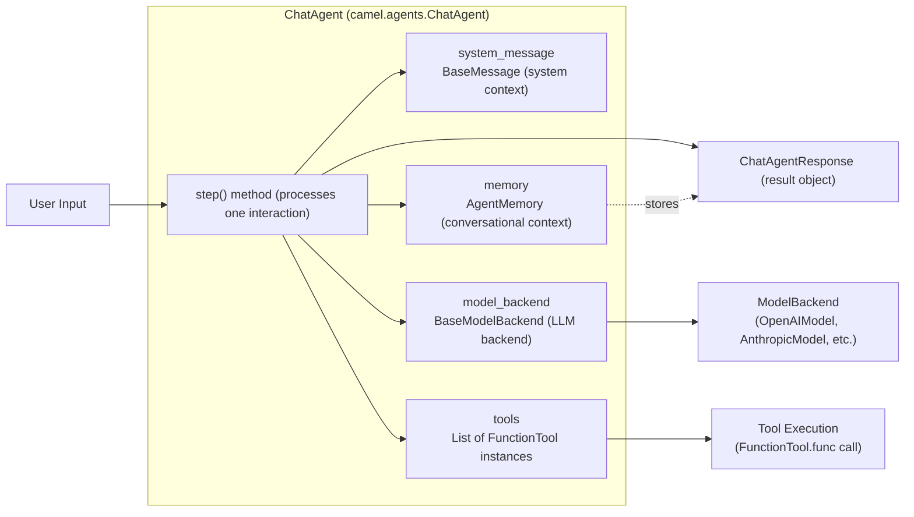

The `step()` method is the core driver advancing the conversation one turn by integrating all these components [camel/agents/chat_agent.py:133-176](), [camel/agents/chat_agent.py:336-418]().

**Sources:** [camel/agents/chat_agent.py:133-176](), [camel/agents/chat_agent.py:336-418]()

### Model Integration System

CAMEL abstracts large language model providers through the `ModelFactory`, allowing users to instantiate any supported model backend with a consistent API. This supports over 40 model platforms like OpenAI, Anthropic Claude, Google Gemini, and Mistral.

The model backend components facilitate:
- Standardized message formatting and streaming.
- Token counting and limit management.
- Pre-processing for platform-specific adaptations.
- Handling structured outputs and tool-calling responses.

The following diagram shows how `ModelFactory` delegates platform and model type to backend implementations:

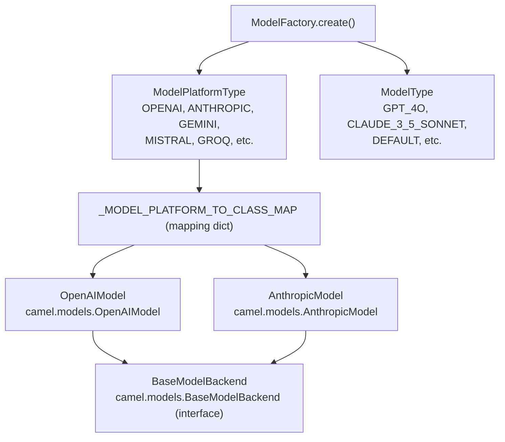

This abstraction simplifies swapping model providers and leverages each platform’s unique capabilities transparently [camel/models/__init__.py:42-47](), [camel/types/__init__.py:54-62](), [test/agents/test_chat_agent.py:93-99]()

**Sources:** [camel/models/__init__.py:42-47](), [camel/types/__init__.py:54-62](), [test/agents/test_chat_agent.py:93-99]()

### Data and Message Systems

Effective multi-agent interaction requires robust data ingestion and message handling. CAMEL incorporates flexible loaders supporting:
- Parsing and cleaning unstructured text data from URLs or files (`UnstructuredIO`).
- Advanced document and OCR processing via `ChunkrReader`.
- Chunking and staging data into agent-consumable formats.

Example features include text cleaning operations and document chunking pipelines that enhance retrieval-augmented generation and context management [docs/key_modules/loaders.md:9-16](), [docs/key_modules/loaders.md:107-119]()

**Sources:** [docs/key_modules/loaders.md:9-16](), [docs/key_modules/loaders.md:107-119]()

## Package Structure

The CAMEL codebase is structured to separate concerns and simplify extension:

| Package                | Purpose                                                        |
|------------------------|----------------------------------------------------------------|
| `camel.agents`         | Core agent code including `ChatAgent` and other agent classes.|
| `camel.models`         | Model backends, `ModelFactory`, and platform abstractions.     |
| `camel.toolkits`       | Toolkits providing external integrations and plugins (50+).    |
| `camel.memories`       | Memory handling modules such as conversational and vector DB memory.  |
| `camel.societies`      | Multi-agent orchestration frameworks like `RolePlaying` and `Workforce`. |
| `camel.loaders`        | Data ingestion utilities such as `UnstructuredIO` and `ChunkrReader`. |
| `camel.datagen`        | Synthetic dataset generation tools and pipelines.              |

This modular setup facilitates flexible research, development, and experimentation with sophisticated multi-agent AI systems [camel/__init__.py:1-24](), [pyproject.toml:23-38](), [pyproject.toml:75-238]()

**Sources:** [camel/__init__.py:1-24](), [pyproject.toml:23-38](), [pyproject.toml:75-238]()

## The "Code-as-Prompt" Philosophy

A unique CAMEL design philosophy is the concept of "Code-as-Prompt." Rather than relying exclusively on static natural language prompts, CAMEL treats code — including comments, docstrings, class and function definitions — as integral prompt components that clarify agent behavior and reasoning.

This approach emphasizes writing code that is:
- Clear and readable by both humans and AI agents.
- Expressive in defining roles, tasks, and interaction protocols.
- Explicit with docstrings and comments to inform agent contexts.

The philosophy ensures:
- Higher interpretability of agent systems.
- Easier debugging and enhancement.
- Richer, dynamic prompts encoded directly in the system code.

This principle guides architectural decisions like embedding system messages in code objects (`BaseMessage`), role modeling, prompt templates, and tool interface definitions.

## Next Steps

To get started exploring CAMEL:

- **Installation and Setup:** Follow the installation guide to configure your environment and API keys [Installation and Setup](#1.1).
- **Core Architecture Overview:** Understand the abstractions of agents, models, memory, and tools, and how they interoperate [Core Architecture Overview](#1.2).
- **Core Agent System:** Delve deeper into agent lifecycles, memory systems, role playing, and task orchestration.
- **Toolkit Ecosystem:** Explore the rich suite of toolkits available to extend agent capabilities.
- **Model Integration:** Learn to configure and use over 40 model providers with CAMEL’s unified backend.

This foundational knowledge will enable you to effectively build and study communicative AI agents using CAMEL-AI.

---

**Sources:**  
[docs/conf.py:27-30](), [README.md:46-126](), [camel/__init__.py:1-24](), [pyproject.toml:6-38](), [camel/agents/chat_agent.py:69-109](), [camel/agents/chat_agent.py:133-418](), [camel/models/__init__.py:1-50](), [test/agents/test_chat_agent.py:93-99](), [docs/key_modules/loaders.md:9-16](), [docs/key_modules/loaders.md:107-119](), [pyproject.toml:75-238]()

---

# Page: Installation and Setup

# Installation and Setup

<details>
<summary>Relevant source files</summary>

The following files were used as context for generating this wiki page:

- [.container/.env.example](.container/.env.example)
- [.container/Dockerfile](.container/Dockerfile)
- [.container/README.md](.container/README.md)
- [.container/docker-compose.yaml](.container/docker-compose.yaml)
- [.container/minimal_build/Dockerfile](.container/minimal_build/Dockerfile)
- [.github/ISSUE_TEMPLATE/bug_report.yml](.github/ISSUE_TEMPLATE/bug_report.yml)
- [README.md](README.md)
- [camel/__init__.py](camel/__init__.py)
- [camel/agents/chat_agent.py](camel/agents/chat_agent.py)
- [camel/interpreters/docker/Dockerfile](camel/interpreters/docker/Dockerfile)
- [docs/conf.py](docs/conf.py)
- [docs/cookbooks/multi_agent_society/agents_society.md](docs/cookbooks/multi_agent_society/agents_society.md)
- [docs/get_started/installation.md](docs/get_started/installation.md)
- [docs/get_started/setup.md](docs/get_started/setup.md)
- [docs/key_modules/loaders.md](docs/key_modules/loaders.md)
- [docs/mintlify/get_started/installation.mdx](docs/mintlify/get_started/installation.mdx)
- [docs/mintlify/key_modules/society.mdx](docs/mintlify/key_modules/society.mdx)
- [docs/mintlify/key_modules/storages.mdx](docs/mintlify/key_modules/storages.mdx)
- [docs/mintlify/reference/camel.caches.base.mdx](docs/mintlify/reference/camel.caches.base.mdx)
- [docs/mintlify/reference/camel.caches.semantic_cache.mdx](docs/mintlify/reference/camel.caches.semantic_cache.mdx)
- [docs/mintlify/reference/camel.storages.vectordb_storages.chroma.mdx](docs/mintlify/reference/camel.storages.vectordb_storages.chroma.mdx)
- [docs/mintlify/reference/camel.storages.vectordb_storages.pgvector.mdx](docs/mintlify/reference/camel.storages.vectordb_storages.pgvector.mdx)
- [docs/mintlify/reference/camel.storages.vectordb_storages.surreal.mdx](docs/mintlify/reference/camel.storages.vectordb_storages.surreal.mdx)
- [docs/mintlify/reference/camel.storages.vectordb_storages.weaviate.mdx](docs/mintlify/reference/camel.storages.vectordb_storages.weaviate.mdx)
- [pyproject.toml](pyproject.toml)
- [test/agents/test_chat_agent.py](test/agents/test_chat_agent.py)
- [uv.lock](uv.lock)

</details>


This guide covers installing the CAMEL framework, configuring API credentials, and verifying your setup. For detailed architecture and core concept explanations, see section 1.2. For example-driven learning about creating your first agent, refer to section 9.

---

## Purpose and Scope

This page provides:

- Methods to install CAMEL-AI for end-users and contributors.
- Details on Python version and dependency group management.
- Instructions on configuring API keys for model platforms.
- Verification steps for installation success and troubleshooting advice.

---

## System Requirements

### Python Version

CAMEL requires **Python >=3.10 and <3.15**.

```toml
requires-python = ">=3.10,<3.15"
```
[pyproject.toml:10-10]()

> **Note on Python 3.13+:**  
> - Certain packages such as `unstructured` and `pyobvector` are unavailable on Python 3.13+ due to incompatibilities with NumPy versions.  
> - For RAG and document-related features using these packages, use Python 3.10-3.12.  
> - All other features including the core agents and most model platforms support Python 3.13+ normally.

[docs/get_started/installation.md:143-149]()

### Supported Operating Systems

Linux, macOS, and Windows platforms are supported for running CAMEL.

---

## Installation Methods

### Basic Installation for End Users

To get started quickly with CAMEL, install the core package from PyPI:

```bash
pip install camel-ai
```

This installs the essential dependencies like `openai`, `pydantic`, `tiktoken`, `httpx`, and others.

[pyproject.toml:23-38]()

### Installation Dependency Overview

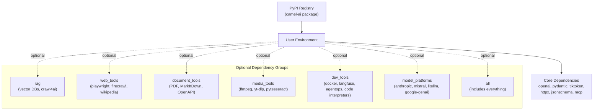

Sources: [pyproject.toml:23-237](), [docs/get_started/installation.md:43-57]()

### Installing with Optional Feature Groups

CAMEL groups optional dependencies by functionality so you can install only what you need:

| Dependency Group   | Use Case                       | Key Libraries                                         |
| ------------------ | ------------------------------| ---------------------------------------------------- |
| **`web_tools`**    | Web search and automation      | `playwright`, `firecrawl-py`, `beautifulsoup4`, `ddgs` |
| **`rag`**          | Retrieval-augmented generation | `qdrant-client`, `pymilvus`, `chromadb`, `weaviate-client` |
| **`document_tools`** | Document parsing and conversion| `PyMuPDF`, `markitdown`, `python-pptx`, `openpyxl`  |
| **`media_tools`**  | Image, video, audio processing | `ffmpeg-python`, `yt-dlp`, `pytesseract`, `pydub`   |
| **`model_platforms`** | Alternative LLM backends      | `anthropic`, `mistralai`, `litellm`, `google-genai` |
| **`storage`**      | Persistent storage backends    | `redis`, `neo4j`, `pgvector`, `surrealdb`            |
| **`dev_tools`**    | Development & observability    | `docker`, `agentops`, `langfuse`, `e2b-code-interpreter` |

Install multiple groups by combining extras:

```bash
pip install 'camel-ai[rag,web_tools,document_tools]'
```

Or install all dependencies recommended for full feature support:

```bash
pip install 'camel-ai[all]'
```

[pyproject.toml:75-237](), [docs/get_started/installation.md:31-62]()

---

### Installing from Source for Contributors

Developers and contributors use the `uv` tool for deterministic, fast environment setup. CAMEL provides a `uv.lock` file that pins exact versions.

```bash
# Clone the CAMEL repository
git clone https://github.com/camel-ai/camel.git
cd camel

# Install uv and create a virtual environment with Python 3.10
pip install uv
uv venv .venv --python=3.10

# Activate the virtual environment
source .venv/bin/activate   # Linux/macOS
# .venv\Scripts\activate    # Windows

# Install CAMEL in editable mode with all dependencies, including dev and docs
uv pip install -e ".[all, dev, docs]"
```

[docs/get_started/installation.md:151-168](), [uv.lock:1-21]()

---

## Configuring API Keys and Environment Variables

CAMEL supports over 40 model platforms, each requiring credentials configured as environment variables or through `.env` files.

### How CAMEL Loads Model Configurations

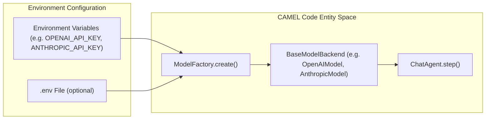

The `ModelFactory.create()` method reads environment credentials and returns an appropriate `BaseModelBackend` instance, such as `OpenAIModel` or `AnthropicModel`. These backend models are then used by `ChatAgent.step()` to process messages.

Sources: [camel/agents/chat_agent.py:81-86](), [docs/get_started/setup.md:7-55]()

### Setting Up Your Environment Variables

**Using a `.env` file (recommended):**

Create a `.env` file in your project root:

```dotenv
OPENAI_API_KEY=sk-xxxxxxx
ANTHROPIC_API_KEY=an-xxxxxxx
GOOGLE_API_KEY=xxxxxx
```

Load these variables in your Python code early:

```python
from dotenv import load_dotenv
load_dotenv()
```

[docs/get_started/installation.md:211-221]()

### Default Model Platform and Type Override

You can set global environment variables to specify the default model platform and type CAMEL uses if none is specified programmatically:

```bash
export DEFAULT_MODEL_PLATFORM_TYPE=openai       # e.g., openai, anthropic, litellm
export DEFAULT_MODEL_TYPE=gpt-4o-mini           # e.g., gpt-3.5-turbo, gpt-4o-mini, etc.
```

These defaults configure `ModelFactory` behavior to automatically pick your preferred backend/model.

[docs/get_started/installation.md:178-190]()

---

## Verifying Installation

### Quick Verification Script

Run this minimal Python snippet to confirm CAMEL is installed and can instantiate core agents with models:

```python
import camel
from camel.agents import ChatAgent
from camel.models import ModelFactory
from camel.types import ModelPlatformType, ModelType

# Print installed CAMEL version
print(f"CAMEL version: {camel.__version__}")

# Create a model instance using ModelFactory
model = ModelFactory.create(
    model_platform=ModelPlatformType.OPENAI,
    model_type=ModelType.GPT_4O_MINI,
)

# Initialize a ChatAgent with a system prompt
agent = ChatAgent(system_message="You are a helpful assistant.", model=model)

print("✓ Agent initialized successfully")
```

Sources: [camel/__init__.py:17-17](), [camel/agents/chat_agent.py:133-134]()

### Testing Optional Modules

To verify optional feature group installations, attempt importing their key classes:

| Feature       | Code Entity to Test              | Source Location                  |
| ------------- | ------------------------------- | ------------------------------- |
| RAG           | `camel.loaders.UnstructuredIO`  | [docs/key_modules/loaders.md:110-112]() |
| Storage       | `camel.storages.MilvusStorage`  | [docs/mintlify/key_modules/storages.mdx:51-53]() |
| Toolkits      | `camel.toolkits.SearchToolkit`  | [test/agents/test_chat_agent.py:52-52]() |

---

## Troubleshooting Common Issues

| Symptom                                       | Cause                          | Resolution                                |
| ---------------------------------------------| -------------------------------| ----------------------------------------|
| `ImportError: No module named 'qdrant_client'` | Missing optional RAG dependencies | Run `pip install 'camel-ai[rag]'`       |
| `ValueError: OPENAI_API_KEY is required`      | Environment variable not set    | Set API key via `.env` file or export   |
| `ModuleNotFoundError: No module named 'unstructured'` | Using Python 3.13+ where `unstructured` is unavailable | Downgrade Python to 3.10-3.12           |
| Rate limit errors on API calls                 | API quota exceeded              | `ChatAgent` retries automatically; verify your quota and usage |

[docs/get_started/installation.md:143-149](), [camel/agents/chat_agent.py:52-54]()

---

## Development Infrastructure (For Contributors)

### Pre-commit Hooks

CAMEL uses `ruff` for linting and `mypy` for static typing checks:

```bash
pre-commit install
pre-commit run --all-files
```

Configuration located here: [pyproject.toml:48-51]()

### Running Tests

Tests are organized with `pytest`, including unit and integration tests:

```bash
pytest test/agents/test_chat_agent.py
```

[camel/agents/chat_agent.py:21-32]()

---

This completes the Installation and Setup guide. After this, consult the Core Architecture Overview (section 1.2) for an understanding of CAMEL's layered design and primary abstractions.

Sources:  
[pyproject.toml:1-237](),  
[uv.lock:1-21](),  
[docs/get_started/installation.md:1-228](),  
[docs/get_started/setup.md:1-55](),  
[camel/__init__.py:1-24](),  
[camel/agents/chat_agent.py:1-134](),  
[test/agents/test_chat_agent.py:21-32](),  
[docs/key_modules/loaders.md:110-112](),  
[docs/mintlify/key_modules/storages.mdx:51-53]()

---

# Page: Core Architecture Overview

# Core Architecture Overview

<details>
<summary>Relevant source files</summary>

The following files were used as context for generating this wiki page:

- [.github/ISSUE_TEMPLATE/bug_report.yml](.github/ISSUE_TEMPLATE/bug_report.yml)
- [README.md](README.md)
- [camel/__init__.py](camel/__init__.py)
- [camel/agents/chat_agent.py](camel/agents/chat_agent.py)
- [camel/toolkits/__init__.py](camel/toolkits/__init__.py)
- [docs/conf.py](docs/conf.py)
- [docs/get_started/installation.md](docs/get_started/installation.md)
- [docs/get_started/setup.md](docs/get_started/setup.md)
- [docs/key_modules/agents.md](docs/key_modules/agents.md)
- [docs/key_modules/datagen.md](docs/key_modules/datagen.md)
- [docs/key_modules/embeddings.md](docs/key_modules/embeddings.md)
- [docs/key_modules/interpreters.md](docs/key_modules/interpreters.md)
- [docs/key_modules/loaders.md](docs/key_modules/loaders.md)
- [docs/key_modules/memory.md](docs/key_modules/memory.md)
- [docs/key_modules/messages.md](docs/key_modules/messages.md)
- [docs/key_modules/prompts.md](docs/key_modules/prompts.md)
- [docs/key_modules/retrievers.md](docs/key_modules/retrievers.md)
- [docs/key_modules/runtimes.md](docs/key_modules/runtimes.md)
- [docs/key_modules/society.md](docs/key_modules/society.md)
- [docs/key_modules/storages.md](docs/key_modules/storages.md)
- [docs/key_modules/tasks.md](docs/key_modules/tasks.md)
- [docs/key_modules/tools.md](docs/key_modules/tools.md)
- [docs/key_modules/workforce.md](docs/key_modules/workforce.md)
- [docs/mintlify/docs.json](docs/mintlify/docs.json)
- [docs/mintlify/reference/camel.agents._utils.mdx](docs/mintlify/reference/camel.agents._utils.mdx)
- [docs/mintlify/reference/camel.agents.chat_agent.mdx](docs/mintlify/reference/camel.agents.chat_agent.mdx)
- [docs/mintlify/reference/camel.configs.avian_config.mdx](docs/mintlify/reference/camel.configs.avian_config.mdx)
- [docs/mintlify/reference/camel.configs.cerebras_config.mdx](docs/mintlify/reference/camel.configs.cerebras_config.mdx)
- [docs/mintlify/reference/camel.configs.orcarouter_config.mdx](docs/mintlify/reference/camel.configs.orcarouter_config.mdx)
- [docs/mintlify/reference/camel.memories.agent_memories.mdx](docs/mintlify/reference/camel.memories.agent_memories.mdx)
- [docs/mintlify/reference/camel.memories.base.mdx](docs/mintlify/reference/camel.memories.base.mdx)
- [docs/mintlify/reference/camel.memories.blocks.chat_history_block.mdx](docs/mintlify/reference/camel.memories.blocks.chat_history_block.mdx)
- [docs/mintlify/reference/camel.memories.context_creators.score_based.mdx](docs/mintlify/reference/camel.memories.context_creators.score_based.mdx)
- [docs/mintlify/reference/camel.models.avian_model.mdx](docs/mintlify/reference/camel.models.avian_model.mdx)
- [docs/mintlify/reference/camel.models.cerebras_model.mdx](docs/mintlify/reference/camel.models.cerebras_model.mdx)
- [docs/mintlify/reference/camel.models.orcarouter_model.mdx](docs/mintlify/reference/camel.models.orcarouter_model.mdx)
- [docs/mintlify/reference/camel.types.enums.mdx](docs/mintlify/reference/camel.types.enums.mdx)
- [docs/mintlify/reference/camel.types.unified_model_type.mdx](docs/mintlify/reference/camel.types.unified_model_type.mdx)
- [pyproject.toml](pyproject.toml)
- [test/agents/test_chat_agent.py](test/agents/test_chat_agent.py)
- [uv.lock](uv.lock)

</details>


## Purpose and Scope

This document provides a detailed exposition of CAMEL-AI’s core layered architecture, detailing the primary components—agents, models, memory, tools—and how they interoperate to enable rich multi-agent communicative systems. It highlights key design abstractions and patterns, illustrating implementation relationships and data flow, serving as a technical foundation for contributors and developers extending the framework.

For in-depth implementation details, specific components can be referenced in the following files:

- Agent internals and lifecycle: [camel/agents/chat_agent.py:246-363]()
- Memory implementations and abstractions: [camel/memories/chat_history.py:34-75]()
- Multi-agent orchestration and workforce: [camel/societies/workforce/workforce.py:50-150]()
- Model backends and factory: [camel/models/base_model.py:28-112](), [camel/models/model_factory.py:78-143]()
- Toolkits and tools: [camel/toolkits/base.py:35-110](), [camel/toolkits/function_tool.py:30-100]()

---

## Architectural Layers

CAMEL-AI organizes its architecture in five distinct yet interlinked layers, enabling modular extensibility and clean separation of concerns:

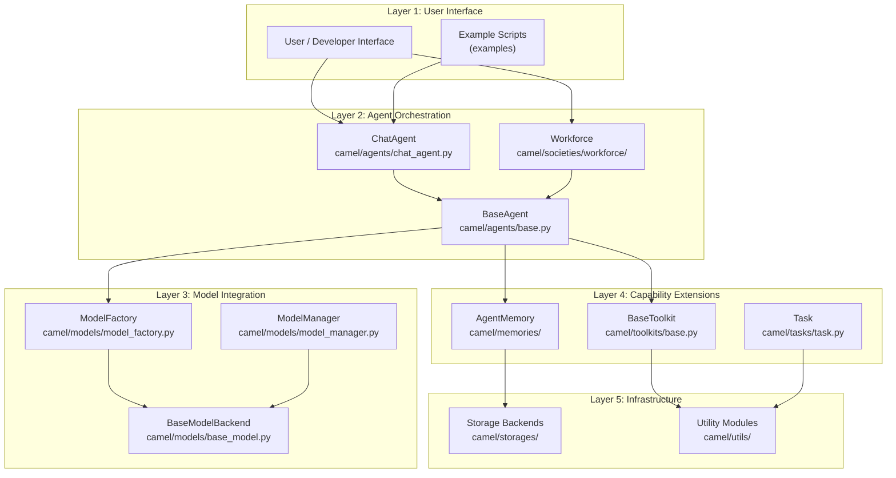

**Notes:**

- **Layer 1** represents entry points like users or example scripts.
- **Layer 2** handles agent orchestration, including individual chat agents and multi-agent societies.
- **Layer 3** manages model backends supporting multiple LLM providers with flexible factory instantiation.
- **Layer 4** extends agent capabilities via memory, toolkits (function calls and external APIs), and task abstractions.
- **Layer 5** provides foundational infrastructure such as persistent storage and utility functions.

**Sources:** [camel/agents/chat_agent.py:1-465](), [camel/models/model_factory.py:1-143](), [camel/agents/base.py:1-29](), [camel/models/base_model.py:1-112]()

---

## Core Components

### Agent System

The **agent system** comprises both the abstraction of single agents and multi-agent orchestration components. Its core class is `ChatAgent`, derived from `BaseAgent`, managing dialogue context, invoking models, and orchestrating tool executions.

| Component | Implementation Path | Responsibility |
|-----------|---------------------|----------------|
| `BaseAgent` | [camel/agents/base.py:29]() | Defines the abstract agent interface and lifecycle methods such as `step()` and `reset()` |
| `ChatAgent` | [camel/agents/chat_agent.py:246-363]() | Implements conversational agent logic, including memory integration, tool calling, and streaming responses |
| `Workforce` | [camel/societies/workforce/workforce.py:50-150]() | Coordinates multiple agents and workers for complex task orchestration |

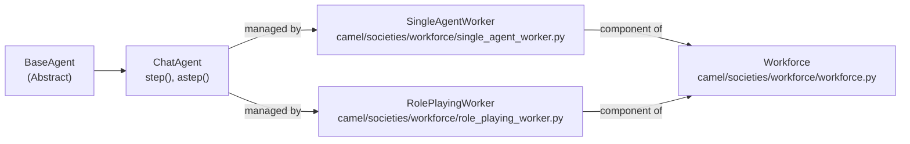

**Design Highlights:**

- `ChatAgent.step()` method sequences user input processing, memory updates, model calls, and tool invocations to produce an assistant response. This is the main conversational "turn" method.
- Streaming responses are supported via the `StreamContentAccumulator` class that aggregates partial content progressively.
- Tool call handling is integrated tightly, supporting multi-step interactions.

**Sources:** [camel/agents/chat_agent.py:1171-1450]() (main step pipeline), [camel/agents/base.py:29](), [camel/models/_utils.py:87-88]()

---

### Model Integration Layer

CAMEL-AI interfaces with over 40 different large language model (LLM) providers through an extensible factory and backend abstraction:

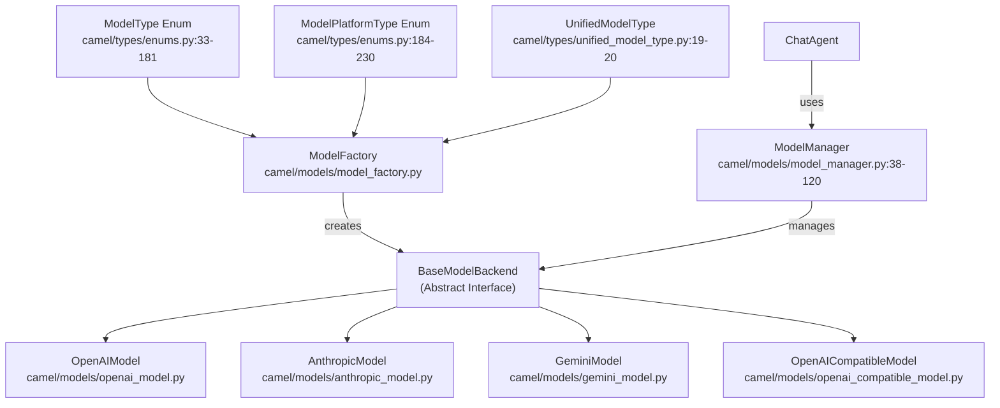

**Key Points:**

- The `ModelFactory.create()` method centralizes creation of suitable model backends based on platform and type enums or strings.
- Supports both synchronous `run()` and asynchronous `arun()` calls.
- Model backends implement a shared interface `BaseModelBackend` specifying key methods and properties such as token counting, streaming, and prompt preprocessing.
- Model configurations (hyperparameters, defaults) are managed separately per platform (e.g., `ChatGPTConfig`, `AnthropicConfig`, `GeminiConfig`).

**Sources:** [camel/models/model_factory.py:78-143](), [camel/models/base_model.py:28-112](), [camel/types/enums.py:33-230](), [camel/types/unified_model_type.py:19-20]()

---

### Memory System

The memory subsystem allows agents to maintain conversational and task context persistently with pluggable storage mechanisms and intelligent context retrieval:

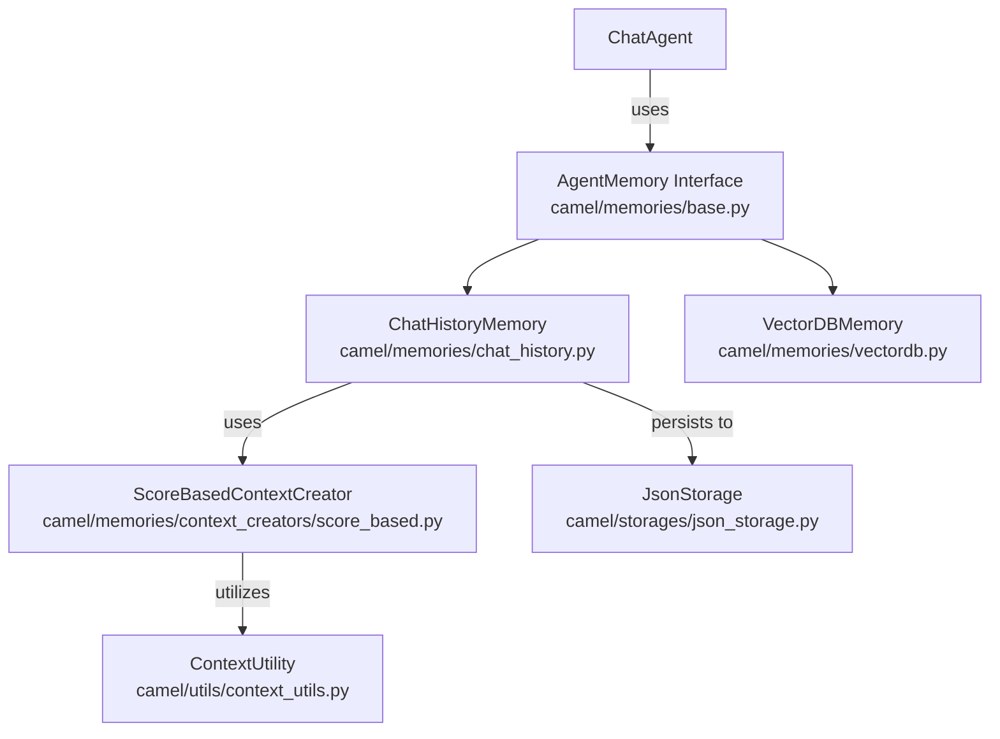

**Operational Flow:**

1. **Memory Writing:** When new messages arrive or tool calls complete, they are encapsulated as `MemoryRecord` and written to the memory backend, e.g., file-backed JSON or vector databases.
2. **Context Retrieval:** On each turn, the `ChatAgent` invokes memory retrieval to obtain relevant conversation history using `ScoreBasedContextCreator`, which scores and filters based on relevance and token constraints.
3. **Token Management:** Token counting utilities, such as `BaseTokenCounter` implementations, ensure memory context does not exceed model limits.
4. **Context Utilities:** `ContextUtility` provides supporting methods for context assembly and summarization.

**Sources:** [camel/agents/chat_agent.py:70-75](), [camel/memories/chat_history.py:34-150](), [camel/memories/context_creators/score_based.py:120-150](), [camel/utils/context_utils.py:107-108]()

---

### Tool Ecosystem

Tools enrich agents by enabling external actions, functionalities, and API calls via a unified interface and schema-based invocation system:

```mermaid
graph TB
    BaseToolkit["BaseToolkit Class<br/>camel/toolkits/base.py"]
    
    BaseToolkit --> SearchToolkit["SearchToolkit<br/>camel/toolkits/search_toolkit.py"]
    BaseToolkit --> TerminalToolkit["TerminalToolkit<br/>camel/toolkits/terminal_toolkit.py"]
    
    FunctionTool["FunctionTool Wrapper<br/>camel/toolkits/function_tool.py"]
    
    BaseToolkit --> |"methods wrapped as"| FunctionTool
    
    Decorators["Validation & Dependency Decorators"]
    Decorators --> dependencies_required["@dependencies_required<br/>camel/utils/commons.py"]
    
    ChatAgent --> |"calls"| FunctionTool
    FunctionTool --> |"executes"| BaseToolkit implementations
```

**Tool Development Workflow:**

- Developers implement toolkits by subclassing `BaseToolkit`.
- Each actionable method is decorated to enforce dependencies, timeouts, or API key presence via `@dependencies_required` and other decorators.
- `ChatAgent` integrates tools by converting methods to `FunctionTool` objects, supplying function schemas compatible with LLM tool-calling standards.
- Executed tool results are wrapped within `ToolResult` to standardize response handling.

**Sources:** [camel/toolkits/base.py:35-110](), [camel/toolkits/function_tool.py:30-100](), [camel/utils/commons.py:106-107](), [camel/utils/tool_result.py:44]()

---

## Design Patterns

### Factory Pattern (Model Creation)

- The CAMEL-AI uses a Factory Pattern via `ModelFactory.create()` to instantiate appropriate model backends from platform and model type enums or strings.
- This pattern encapsulates platform-specific differences and supports quick extension for new LLM providers, ensuring loose coupling.

**Sources:** [camel/models/model_factory.py:78-143]()

---

### Strategy Pattern (Memory Management)

- Memory implementations adhere to the `AgentMemory` interface, allowing seamless swapping between in-memory, file-based, or vector-database storages.
- This enables flexible context retention strategies without modifying agent code.

**Sources:** [camel/agents/chat_agent.py:70-75](), [camel/memories/chat_history.py:73-74]()

---

## Data Flow: Single Agent Execution Pipeline

The following sequence diagram details the processing steps when a `ChatAgent` handles a user message:

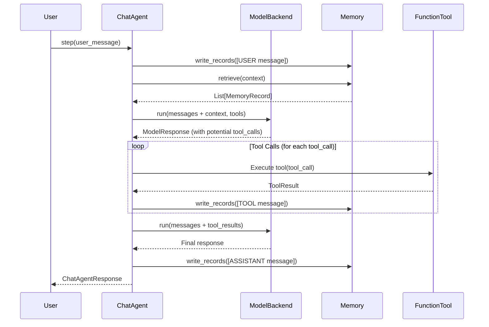

**Explanation of Key Steps:**

- The user input is recorded in memory.
- Relevant context is retrieved to compose the model input prompt.
- The language model runs, optionally requesting tool calls.
- The agent executes the tools, adding their outputs to memory.
- The model is called again with tool results to produce the final response.
- The assistant’s response is stored.
- The agent returns the response to the user.

**Additional notes:**

- If streaming is enabled, partial content aggregation is managed by `StreamContentAccumulator`.
- Specialized reasoning or "thinking" extraction is handled by utilities like `extract_thinking_from_content()` for models that output intermediate thoughts.
- Tool call and result tracking uses the `ToolCallingRecord` abstraction.

**Sources:** [camel/agents/chat_agent.py:1171-1450](), [camel/agents/chat_agent.py:176-228](), [camel/models/_utils.py:87-88](), [camel/types/agents.py:100-101]()

---

## Key Abstractions Summary

| Abstraction          | File Path                                  | Key Methods                  | Purpose                                      |
|----------------------|--------------------------------------------|-----------------------------|----------------------------------------------|
| `BaseAgent`          | [camel/agents/base.py:29]()             | `step()`, `reset()`          | Defines the agent lifecycle interface         |
| `ChatAgent`          | [camel/agents/chat_agent.py:246-363]()     | `step()`, streaming support  | Implements single chat agent with tool and memory integration |
| `BaseModelBackend`   | [camel/models/base_model.py:28-112]()      | `run()`, `arun()`            | Unified interface for language model backends |
| `AgentMemory`        | [camel/memories/chat_history.py:34-75]()  | `write_records()`, `retrieve()` | Abstraction for stateful storage and retrieval of conversational context |
| `BaseToolkit`        | [camel/toolkits/base.py:35-110]()          | `get_tools()`                | Toolkit interface for defining pluggable tools |
| `FunctionTool`       | [camel/toolkits/function_tool.py:30-100]()| Call wrappers and schema     | Wraps Python functions as tools accessible to agents |
| `ModelFactory`       | [camel/models/model_factory.py:78-143]()  | `create()`                  | Factory pattern to instantiate model backends |
| `ScoreBasedContextCreator` | [camel/memories/context_creators/score_based.py:120-150]() | Context filtering/scoring     | Implements token-aware retrieval strategy for memory |

---

## Bridging Natural Language Concepts to Code Entities

### Diagram: Agent and Model Bridging

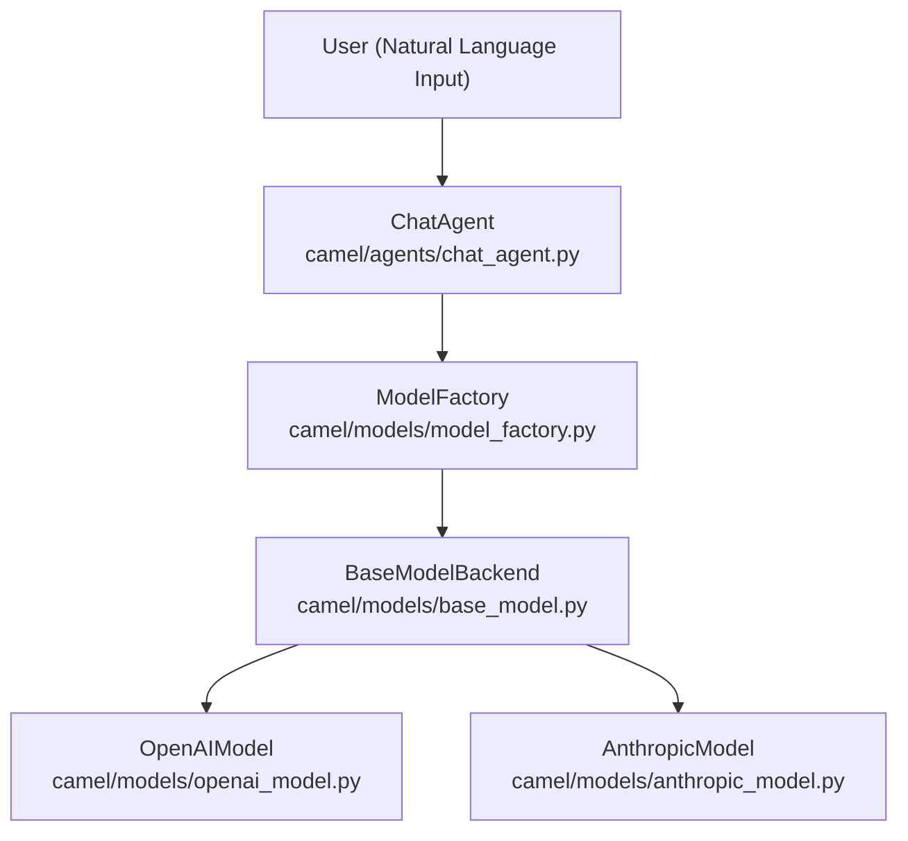

- The user's natural language passes to `ChatAgent.step()` which calls `ModelFactory.create()` to get a backend.
- The backend handles communication with the LLM provider (OpenAI, Anthropic, etc.)
- Model responses encapsulate tokens and tool call metadata usable by agent layers.

**Sources:** [camel/agents/chat_agent.py:246-363](), [camel/models/model_factory.py:78-143](), [camel/models/openai_model.py](), [camel/models/anthropic_model.py]()

---

### Diagram: Tool Invocation Bridging

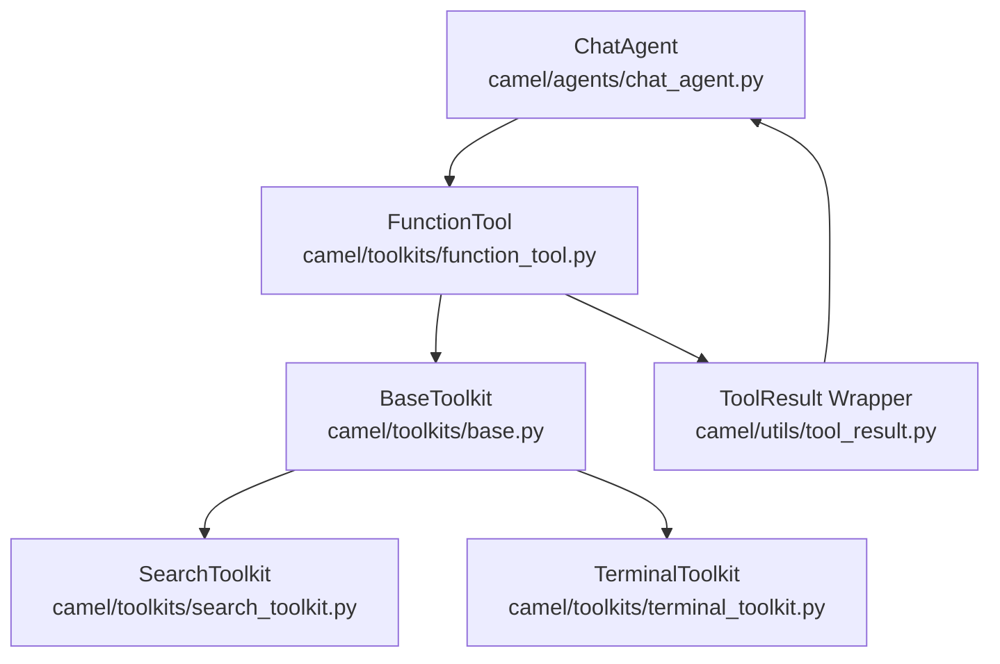

- Agent uses `FunctionTool` wrappers to invoke specific toolkit methods.
- Toolkit classes implement concrete external integrations (e.g., web search, terminal commands).
- Results are wrapped and fed back to the agent's memory and reasoning streams.

**Sources:** [camel/toolkits/function_tool.py:30-100](), [camel/toolkits/base.py:35-110](), [camel/agents/chat_agent.py:246-363]()

---

# Summary

The CAMEL-AI core architecture leverages modular abstractions across agents, models, memory, and capabilities (tools, tasks) connected through well-defined interfaces and design patterns. The layered system enables integration of diverse LLM backends, persistent stateful memory, and extensible tool ecosystems, orchestrated by agent instances to engage in sophisticated multi-turn dialogues and multi-agent workflows. Understanding these components and their interactions is essential for effectively developing, debugging, or extending the CAMEL framework.

---

**Sources:**

- [camel/agents/chat_agent.py:1-465]()
- [camel/agents/chat_agent.py:1171-1450]()
- [camel/models/model_factory.py:78-143]()
- [camel/models/base_model.py:28-112]()
- [camel/agents/base.py:29]()
- [camel/memories/chat_history.py:34-150]()
- [camel/memories/context_creators/score_based.py:120-150]()
- [camel/utils/context_utils.py:107-108]()
- [camel/toolkits/base.py:35-110]()
- [camel/toolkits/function_tool.py:30-100]()
- [camel/utils/commons.py:106-107]()
- [camel/utils/tool_result.py:44]()
- [camel/models/_utils.py:87-88]()
- [camel/types/agents.py:100-101]()

---

# Page: Core Agent System

# Core Agent System

<details>
<summary>Relevant source files</summary>

The following files were used as context for generating this wiki page:

- [camel/toolkits/__init__.py](camel/toolkits/__init__.py)
- [docs/key_modules/agents.md](docs/key_modules/agents.md)
- [docs/key_modules/datagen.md](docs/key_modules/datagen.md)
- [docs/key_modules/embeddings.md](docs/key_modules/embeddings.md)
- [docs/key_modules/interpreters.md](docs/key_modules/interpreters.md)
- [docs/key_modules/memory.md](docs/key_modules/memory.md)
- [docs/key_modules/messages.md](docs/key_modules/messages.md)
- [docs/key_modules/prompts.md](docs/key_modules/prompts.md)
- [docs/key_modules/retrievers.md](docs/key_modules/retrievers.md)
- [docs/key_modules/runtimes.md](docs/key_modules/runtimes.md)
- [docs/key_modules/society.md](docs/key_modules/society.md)
- [docs/key_modules/storages.md](docs/key_modules/storages.md)
- [docs/key_modules/tasks.md](docs/key_modules/tasks.md)
- [docs/key_modules/tools.md](docs/key_modules/tools.md)
- [docs/key_modules/workforce.md](docs/key_modules/workforce.md)
- [docs/mintlify/docs.json](docs/mintlify/docs.json)
- [docs/mintlify/reference/camel.agents._utils.mdx](docs/mintlify/reference/camel.agents._utils.mdx)
- [docs/mintlify/reference/camel.agents.chat_agent.mdx](docs/mintlify/reference/camel.agents.chat_agent.mdx)
- [docs/mintlify/reference/camel.configs.avian_config.mdx](docs/mintlify/reference/camel.configs.avian_config.mdx)
- [docs/mintlify/reference/camel.configs.cerebras_config.mdx](docs/mintlify/reference/camel.configs.cerebras_config.mdx)
- [docs/mintlify/reference/camel.configs.orcarouter_config.mdx](docs/mintlify/reference/camel.configs.orcarouter_config.mdx)
- [docs/mintlify/reference/camel.memories.agent_memories.mdx](docs/mintlify/reference/camel.memories.agent_memories.mdx)
- [docs/mintlify/reference/camel.memories.base.mdx](docs/mintlify/reference/camel.memories.base.mdx)
- [docs/mintlify/reference/camel.memories.blocks.chat_history_block.mdx](docs/mintlify/reference/camel.memories.blocks.chat_history_block.mdx)
- [docs/mintlify/reference/camel.memories.context_creators.score_based.mdx](docs/mintlify/reference/camel.memories.context_creators.score_based.mdx)
- [docs/mintlify/reference/camel.models.avian_model.mdx](docs/mintlify/reference/camel.models.avian_model.mdx)
- [docs/mintlify/reference/camel.models.cerebras_model.mdx](docs/mintlify/reference/camel.models.cerebras_model.mdx)
- [docs/mintlify/reference/camel.models.orcarouter_model.mdx](docs/mintlify/reference/camel.models.orcarouter_model.mdx)
- [docs/mintlify/reference/camel.types.enums.mdx](docs/mintlify/reference/camel.types.enums.mdx)
- [docs/mintlify/reference/camel.types.unified_model_type.mdx](docs/mintlify/reference/camel.types.unified_model_type.mdx)

</details>


## Purpose and Scope

This document provides a high-level overview of CAMEL’s core agent architecture, focusing on the single-agent abstraction, multi-agent orchestration, and the agent lifecycle. It introduces the foundational concepts and relationships among key components such as agents, models, memory, tools, and workforce management.

For detailed technical information on each aspect, please refer to the dedicated child pages:
- ChatAgent internals → see [ChatAgent](#2.1)
- Memory management and strategies → see [Agent Memory System](#2.2)
- Multi-turn role-playing dialogues → see [Role Playing System](#2.3)
- Task lifecycle and management → see [Task Management](#2.4)
- Multi-agent workforce orchestration → see [Workforce Orchestration](#2.5)

---

## Agent Architecture Overview

At the core, CAMEL’s agent system is designed with modular layers that interoperate to enable autonomous and collaborative AI behavior. The central abstraction is the `BaseAgent`, from which specific implementations extend, most notably the `ChatAgent` for single-agent conversational tasks and the `Workforce` for managing multiple agents working together.

The system integrates these main components:
- **Model Integration**: Abstracted by `BaseModelBackend` and managed via `ModelManager` for selecting and using language models.
- **Memory Management**: Agents use the `AgentMemory` interface to store and retrieve conversation or task context, with support from context creators like `ScoreBasedContextCreator`.
- **Tool Execution**: Tools are wrapped as `FunctionTool` objects, exposing external functions or APIs accessible by agents.
- **Multi-Agent Orchestration**: The `Workforce` class coordinates multiple worker agents, assigning tasks dynamically or via pipelines.

### High-Level Agent System Architecture

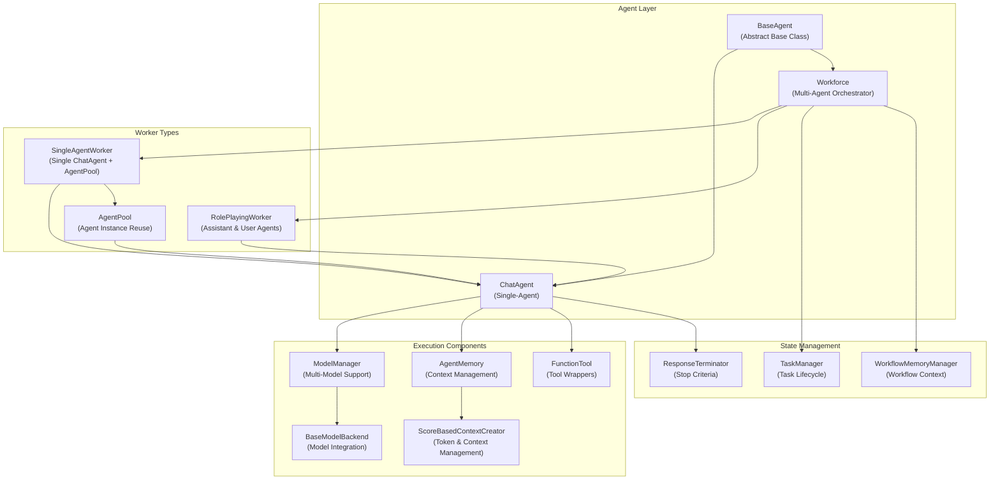

This architecture enables flexible configurations ranging from simple single-agent conversations to complex multi-agent collaborations with shared memory and streaming support.

Sources: [camel/agents/chat_agent.py:69-112](), [camel/agents/base.py:1-29](), [camel/societies/workforce/workforce.py:15-40]().

---

## Agent Class Hierarchy

The core agent interface, `BaseAgent`, defines fundamental agent lifecycle methods like `reset()` and `step()`. Two main classes extend this base:

- **ChatAgent**: Implements conversational AI with features such as system message setup, model backend management, tool function integration, memory handling, response termination detection, and multi-model scheduling.
- **Workforce**: Orchestrates multiple worker agents, coordinating task assignment, failure recovery, and complex workflows.

Specialized worker classes extend functionality further:
- `SingleAgentWorker` manages a single `ChatAgent` with an `AgentPool` for efficient reuse.
- `RolePlayingWorker` sets up a multi-turn role-playing session between two `ChatAgent` instances simulating assistant-user dialogues.

### Agent Class Diagram

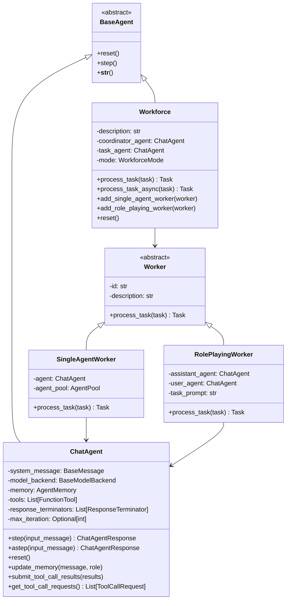

This hierarchy supports code reuse and specialization, enabling versatile agent behaviors.

Sources: [camel/agents/base.py:27-29](), [camel/agents/chat_agent.py:364-465](), [camel/societies/workforce/workforce.py:15-70]().

---

## ChatAgent: Single Agent Execution

The `ChatAgent` is the primary class for single-agent conversational workflows. It manages dialogue state, executes tool calls, interacts with language model backends, and maintains conversation memory.

### Core Execution Flow

The key method `step()` encapsulates a single interaction cycle with the agent. This includes updating memory with user messages, retrieving context, invoking the language model, handling tool calls if any, managing response termination conditions, and committing assistant responses to memory.

### ChatAgent Step Execution Flow Diagram

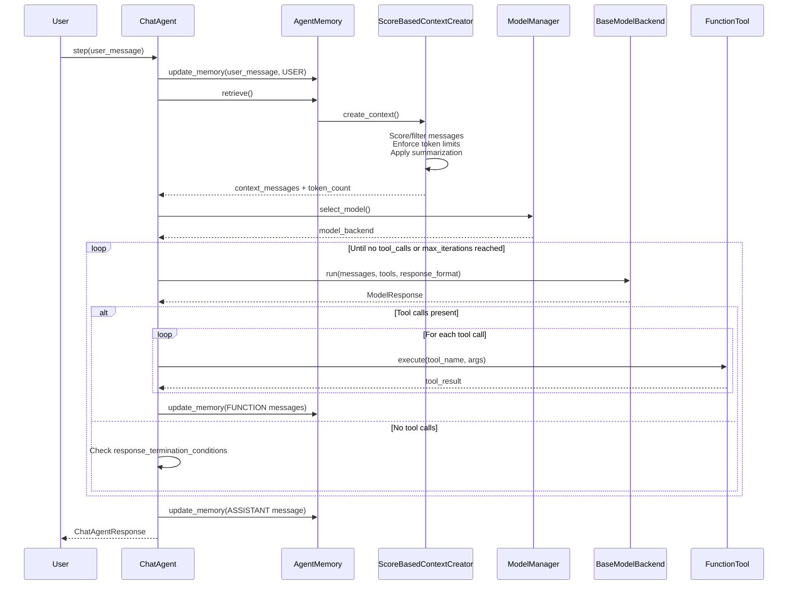

This iterative cycle allows the agent to seamlessly chain reasoning steps with external tool invocations.

Sources: [camel/agents/chat_agent.py:844-1200](), [camel/memories/agent_memory.py:27-50](), [camel/memories/context_creators/score_based_context_creator.py:35-70]().

### ChatAgent Initialization Parameters Overview

The `ChatAgent` constructor provides rich configuration parameters for customized behavior:

| Category | Key Parameters | Description |
|---------|----------------|-------------|
| System Config | `system_message`, `agent_id` | Specify the agent's system prompt and unique identifier. |
| Model Backend | `model`, `model_config` | Select model backend(s) via `BaseModelBackend` or model specifications (strings, enums). |
| Memory | `memory`, `message_window_size` | Agent memory instance and maximum messages in context. |
| Tools | `tools` | List of external `FunctionTool` callables for tool usage. |
| Execution Controls | `max_iteration`, `response_terminators` | Limits on iteration count and handlers to decide conversation termination. |

These parameters balance flexibility and ease of use for diverse agent tasks.

Sources: [camel/agents/chat_agent.py:366-464]().

---

## Multi-Agent Orchestration with Workforce

The `Workforce` provides a multi-agent framework that enables complex task orchestration through collaboration of specialized agents.

### Core Concepts

- **Coordinator Agent** assigns and tracks tasks.
- **Task Agent** decomposes high-level tasks into subtasks.
- **Workers** execute subtasks, which may be single agents (`SingleAgentWorker`) or role-playing pairs (`RolePlayingWorker`).
- **Shared Memory and Task Management** help maintain context and coordinate execution.

### Execution Modes

Workforce supports:

- **AUTO_DECOMPOSE** (default): Fully automated task breakdown and assignment with failure handling.
- **PIPELINE**: Fixed sequence of tasks with defined order.

### Workforce Task Lifecycle (Simplified Sequence)

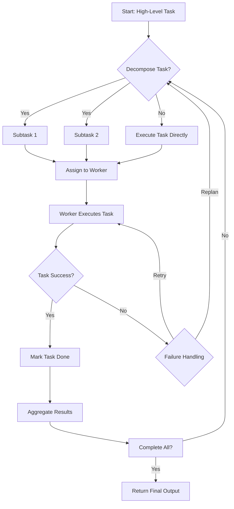

For an in-depth walkthrough of Workforce capabilities, worker types, and failure strategies, see [Workforce Orchestration](#2.5).

Sources: [camel/societies/workforce/workforce.py:10-190]().

---

## Agent Memory and Context Management

CAMEL’s memory system provides agents with persistent and flexible context management for conversations and tasks.

### Key Concepts

- **AgentMemory**: Abstract base managing reading and writing dialogue or task data.
- **ChatHistoryMemory**: Stores sequential chat messages.
- **VectorDBMemory**: Supports embedding-based retrieval.
- **LongtermAgentMemory**: Combines multiple blocks with context summarization.
- **ScoreBasedContextCreator**: Strategy for selecting relevant context based on message scores and token limits.

Memory enables agents to maintain coherent, context-rich dialogues beyond a single interaction.

For comprehensive details visit [Agent Memory System](#2.2).

Sources: [camel/memories/agent_memory.py:27-45](), [camel/memories/context_creators/score_based_context_creator.py:35-50]().

---

## Advanced Features

### Streaming Responses

`ChatAgent` supports streaming outputs, delivering partial responses as they are generated. This is managed by classes like:

- **StreamContentAccumulator**: Aggregates streaming chunks to provide coherent full content and reasoning traces.
- **StreamingChatAgentResponse** and **AsyncStreamingChatAgentResponse**: Wrappers allowing seamless integration with existing interfaces.

Streaming allows real-time interaction and enhances UX in conversational applications.

Sources: [camel/agents/chat_agent.py:11-105](), [camel/agents/chat_agent.py:110-185]().

### Structured Output Support

Agents can output structured data (e.g., JSON) conforming to Pydantic models via the `response_format` parameter in the `step()` method. This is facilitated internally by:

- `StructuredOutputHandler`

It enforces schema, enabling predictable and machine-readable agent responses.

Sources: [camel/agents/chat_agent.py:844-900](), [test/agents/test_chat_agent.py:180-212]().

---

# Summary

The Core Agent System is the foundation of CAMEL’s autonomous and collaborative AI capabilities. It supports flexible single-agent conversations via `ChatAgent`, rich memory and context management to sustain dialogue coherence, and powerful multi-agent orchestration with `Workforce` for complex workflows.

By leveraging well-defined abstractions across model backends, memory structures, toolkits, and agent lifecycles, CAMEL enables scalable, extensible AI agent designs adaptable to a wide range of applications.

---

# References to Related Child Pages

- [ChatAgent](#2.1) — Deep dive into ChatAgent’s internals and execution.
- [Agent Memory System](#2.2) — Details on memory strategies and implementations.
- [Role Playing System](#2.3) — Multi-agent dialogue structures via role-playing.
- [Task Management](#2.4) — Task lifecycle, decomposition, and validation.
- [Workforce Orchestration](#2.5) — Comprehensive multi-agent and workflow orchestration.

---

# End of Core Agent System Page

---

# Page: ChatAgent

# ChatAgent

<details>
<summary>Relevant source files</summary>

The following files were used as context for generating this wiki page:

- [.github/ISSUE_TEMPLATE/bug_report.yml](.github/ISSUE_TEMPLATE/bug_report.yml)
- [README.md](README.md)
- [camel/__init__.py](camel/__init__.py)
- [camel/agents/chat_agent.py](camel/agents/chat_agent.py)
- [docs/conf.py](docs/conf.py)
- [docs/get_started/installation.md](docs/get_started/installation.md)
- [docs/get_started/setup.md](docs/get_started/setup.md)
- [docs/key_modules/loaders.md](docs/key_modules/loaders.md)
- [docs/mintlify/docs.json](docs/mintlify/docs.json)
- [docs/mintlify/reference/camel.agents._utils.mdx](docs/mintlify/reference/camel.agents._utils.mdx)
- [docs/mintlify/reference/camel.agents.chat_agent.mdx](docs/mintlify/reference/camel.agents.chat_agent.mdx)
- [docs/mintlify/reference/camel.configs.avian_config.mdx](docs/mintlify/reference/camel.configs.avian_config.mdx)
- [docs/mintlify/reference/camel.configs.cerebras_config.mdx](docs/mintlify/reference/camel.configs.cerebras_config.mdx)
- [docs/mintlify/reference/camel.configs.orcarouter_config.mdx](docs/mintlify/reference/camel.configs.orcarouter_config.mdx)
- [docs/mintlify/reference/camel.memories.agent_memories.mdx](docs/mintlify/reference/camel.memories.agent_memories.mdx)
- [docs/mintlify/reference/camel.memories.base.mdx](docs/mintlify/reference/camel.memories.base.mdx)
- [docs/mintlify/reference/camel.memories.blocks.chat_history_block.mdx](docs/mintlify/reference/camel.memories.blocks.chat_history_block.mdx)
- [docs/mintlify/reference/camel.memories.context_creators.score_based.mdx](docs/mintlify/reference/camel.memories.context_creators.score_based.mdx)
- [docs/mintlify/reference/camel.models.avian_model.mdx](docs/mintlify/reference/camel.models.avian_model.mdx)
- [docs/mintlify/reference/camel.models.cerebras_model.mdx](docs/mintlify/reference/camel.models.cerebras_model.mdx)
- [docs/mintlify/reference/camel.models.orcarouter_model.mdx](docs/mintlify/reference/camel.models.orcarouter_model.mdx)
- [docs/mintlify/reference/camel.types.enums.mdx](docs/mintlify/reference/camel.types.enums.mdx)
- [docs/mintlify/reference/camel.types.unified_model_type.mdx](docs/mintlify/reference/camel.types.unified_model_type.mdx)
- [docs/reference/camel.agents.chat_agent.md](docs/reference/camel.agents.chat_agent.md)
- [docs/reference/camel.memories.context_creators.score_based.md](docs/reference/camel.memories.context_creators.score_based.md)
- [docs/reference/camel.messages.func_message.md](docs/reference/camel.messages.func_message.md)
- [docs/reference/camel.models.azure_openai_model.md](docs/reference/camel.models.azure_openai_model.md)
- [docs/reference/camel.models.base_model.md](docs/reference/camel.models.base_model.md)
- [docs/reference/camel.models.model_manager.md](docs/reference/camel.models.model_manager.md)
- [docs/reference/camel.models.openai_compatible_model.md](docs/reference/camel.models.openai_compatible_model.md)
- [docs/reference/camel.models.openai_model.md](docs/reference/camel.models.openai_model.md)
- [docs/reference/camel.utils.message_summarizer.md](docs/reference/camel.utils.message_summarizer.md)
- [pyproject.toml](pyproject.toml)
- [test/agents/test_chat_agent.py](test/agents/test_chat_agent.py)
- [uv.lock](uv.lock)

</details>


ChatAgent is the primary single-agent class in CAMEL responsible for managing autonomous conversations powered by Large Language Models (LLMs). It provides a comprehensive interface for processing input messages, maintaining conversation memory, invoking model backends, executing tools, handling multi-turn dialogues, and streaming responses. ChatAgent serves as a fundamental building block for autonomous agents, used both in standalone scenarios and as part of multi-agent orchestration systems such as Workforce.

**Scope:** This page provides an in-depth technical explanation of ChatAgent’s design and implementation, including initialization parameters, the core `step()` method, message and memory handling, tool execution strategies, and streaming response management. It includes data flow diagrams bridging natural language concepts to concrete code entities.

---

## Core Architecture

At a high level, ChatAgent integrates five major subsystems, each distinctly implemented but tightly orchestrated:

- **Model Backend Management**: Interface with one or more LLM backends via `BaseModelBackend` or managed by `ModelManager`, leveraging the `ModelFactory` for instantiation.
- **Memory Storage and Retrieval**: Uses an `AgentMemory` implementation (by default `ChatHistoryMemory`) to store and retrieve conversational context with token-awareness and summarization policies driven by `ScoreBasedContextCreator`.
- **Tool Integration and Execution**: Supports internal and external tools via `FunctionTool` instances or toolkits. The agent can automatically execute internal tools or defer execution by signaling external tools.
- **Message Processing**: Handles various message types (`BaseMessage`, `OpenAIMessage`, `FunctionCallingMessage`) and deals with dynamic prompt and response formatting.
- **Response Handling and Streaming**: Produces `ChatAgentResponse` objects for synchronous calls and specialized streaming wrappers (`StreamingChatAgentResponse` and `AsyncStreamingChatAgentResponse`) to deliver streaming tokens gracefully.

---

### System Architecture Diagram

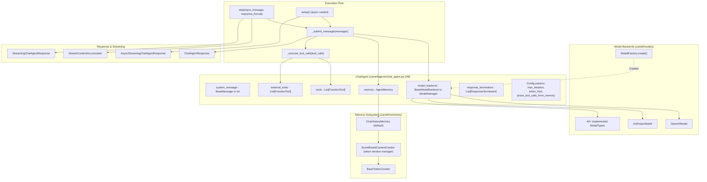

**Sources:** [camel/agents/chat_agent.py:248-362](), [camel/agents/chat_agent.py:177-227](), [camel/agents/chat_agent.py:230-304](), [camel/agents/chat_agent.py:1115-1257]()

---

## Initialization and Configuration

When creating a `ChatAgent` instance, the constructor accepts a rich set of parameters for precise control over behavior. It defaults to a helpful assistant role with a sensible message memory and a default model unless customized.

### Usage Example

```python
from camel.agents import ChatAgent
from camel.models import ModelFactory
from camel.types import ModelPlatformType, ModelType

# Minimal default agent
agent_default = ChatAgent()

# Agent with explicit system message and OpenAI GPT-4O backend
system_msg = "You are a helpful assistant specialized in data analysis."
model = ModelFactory.create(
    model_platform=ModelPlatformType.OPENAI,
    model_type=ModelType.GPT_4O,
)
agent_custom = ChatAgent(system_message=system_msg, model=model)
```

### Key Parameters

| Parameter                     | Type                                                              | Description                                      | Default            |
|-------------------------------|-------------------------------------------------------------------|-------------------------------------------------|--------------------|
| `system_message`              | `BaseMessage` or `str`                                            | System prompt defining agent behavior            | `None` (generic)   |
| `model`                      | `BaseModelBackend` or `ModelManager` or model specifiers          | Model backend(s) used for generation             | Default LLM        |
| `memory`                     | `AgentMemory`                                                     | Memory storage for chat history and context      | `ChatHistoryMemory`|
| `tools`                      | List of `FunctionTool` or callable                               | Internal tools automatically executed            | `None`             |
| `external_tools`             | List of `FunctionTool` or callable                               | Tools returned as requests, not executed internally | `None`           |
| `max_iteration`              | `int`                                                            | Max model calls per single `step()` invocation   | Unlimited          |
| `token_limit`                | `int`                                                            | Maximum tokens allowed in context window override| Defaults to model default |
| `message_window_size`        | `int`                                                            | Max number of messages kept in context (windowing) | `None`          |
| `prune_tool_calls_from_memory` | `bool`                                                        | Whether to remove tool-related messages after step | `False`          |
| `response_terminators`       | List of `ResponseTerminator`                                    | Criteria to end iterative generation             | None               |
| `stream_accumulate`          | `bool`                                                          | Whether to accumulate streaming output cumulatively | `False`          |

These parameters allow tuning of resource usage, robustness, and the degree of interactivity and tool integration.

**Sources:** [camel/agents/chat_agent.py:257-362](), [camel/agents/chat_agent.py:466-534]()

---

## The `step()` Method – Core Execution Loop

The `step()` method is the primary function to feed an input message and receive a response. It encapsulates the internal loop of prompt preparation, model invocation, tool detection and execution, memory updates, and termination checking.

### Execution Flow Sequence Diagram

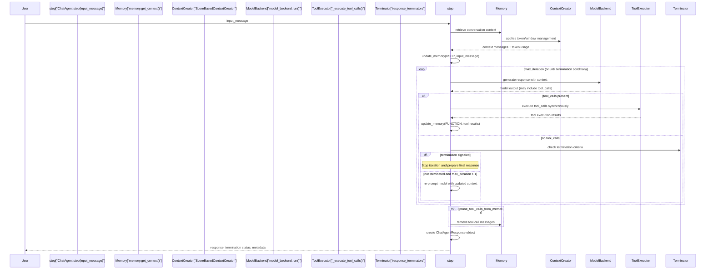

### Details

- **Context Retrieval**: Gets relevant messages from memory, filtered by token and message window constraints.
- **User Input Memory Update**: Inserts the new user input into the memory system.
- **Iterative Model Calls**: Runs model queries up to `max_iteration` times or when termination criteria met.
- **Tool Calls Detection & Execution**: Automatically executes internal tools if model requests, updating memory with results.
- **Termination Check**: Uses configured `response_terminators` (e.g., keywords, token limits) to conclude the conversation step.
- **Memory Pruning**: Optionally removes intermediary tool messages to keep memory clean.

---

### Response Dataclass

The method outputs a `ChatAgentResponse` dataclass that contains:

```python
@dataclass
class ChatAgentResponse:
    msgs: List[BaseMessage]    # List of generated or executed messages
    terminated: bool           # Whether termination conditions were met
    info: Dict[str, Any]       # Additional metadata (e.g., ids, usage, reasons)
```

**Sources:** [camel/agents/chat_agent.py:1115-1257](), [camel/responses.py:27-38]()

---

## Memory Management Integration

Memory is central to ChatAgent’s ability to maintain coherent multi-turn conversations. The default memory implementation is `ChatHistoryMemory` augmented by `ScoreBasedContextCreator` which handles context windowing intelligently based on token budgets.

### Memory Architecture Diagram

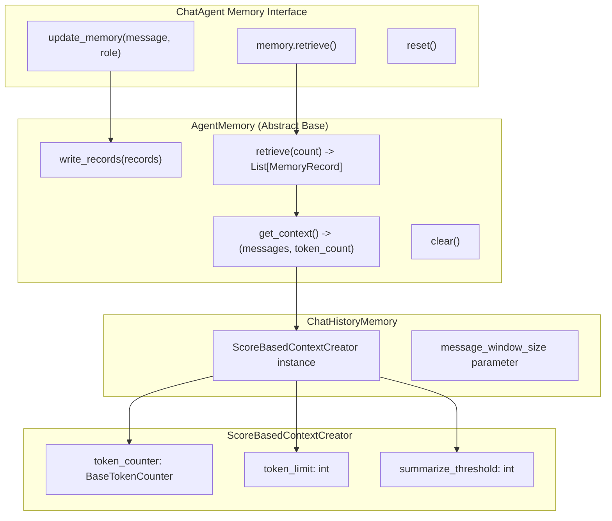

### Token Management and Summarization

The `ScoreBasedContextCreator` monitors token usage and triggers summarization recursively if usage crosses a configured threshold of the token limit.

Process highlights:

1. Calls `build_default_summary_prompt()` to generate summarization instructions blending code summarization context [camel/agents/_utils.py:61-93]().
2. Spawns a recursive `ChatAgent` with summarization roles to generate concise summaries of older conversation blocks.
3. Inserts system-level summary messages back into the memory at the start to condense state.
4. Returns a trimmed context, ensuring that token limit compliance and conversational coherence are maintained.

**Sources:** [camel/agents/chat_agent.py:466-534](), [camel/memories/context_creators/score_based.py:34-150](), [camel/agents/_utils.py:61-93]()

---

## Tool Integration and Execution

ChatAgent handles tools via internal and external patterns to support synchronous execution and deferred external interactions.

### Tool Execution Flow Diagram

```mermaid
graph TB
    ModelOutput["Model returns tool_calls"]
    CheckExternal["Check if tool_call.function.name in external_tools"]
    
    ExternalToolResponse["Return ToolCallRequest (flagged as external_tool)"]
    InternalToolExec["_execute_tool_calls()"]
    
    ToolInvocation["Execute tool function"]
    FormatFuncMsg["Format output as FUNCTION message"]
    MemoryUpdate["update_memory(FUNCTION, tool result)"]
    
    ModelOutput --> CheckExternal
    CheckExternal -->|Yes| ExternalToolResponse
    CheckExternal -->|No| InternalToolExec
    
    InternalToolExec --> ToolInvocation
    ToolInvocation --> FormatFuncMsg
    FormatFuncMsg --> MemoryUpdate
```

### Differences

- **Internal Tools**: Are invoked automatically within the agent's execution loop and their results are fed back into the memory context seamlessly. This enables multi-step reasoning augmented with dynamic tool calls [camel/agents/chat_agent.py:2174-2403]().
- **External Tools**: Are detected and returned as a `ToolCallRequest` to users/calling code to execute externally. The agent does not execute these but flags them for external handling [camel/agents/chat_agent.py:2405-2525]().

This supports flexible integration with external APIs, toolkit orchestrators, or user-informed tool execution in workflows.

**Sources:** [camel/agents/chat_agent.py:2174-2403](), [camel/agents/chat_agent.py:2405-2525](), [camel/toolkits/function_tool.py:1-124]()

---

## Streaming Responses Support

ChatAgent supports streaming generation from models to provide partial outputs in real-time. Streaming is managed with careful accumulation and state maintenance to ensure coherence and usability.

### Streaming Components

- **StreamContentAccumulator**: Collects streamed content fragments, reasoning segments, and tool status messages to build a cumulative response [camel/agents/chat_agent.py:177-227]().
- **StreamingChatAgentResponse**: Wraps a synchronous generator of response chunks to emulate a streaming experience while exposing the same API as `ChatAgentResponse` [camel/agents/chat_agent.py:230-304]().
- **AsyncStreamingChatAgentResponse**: Wraps an asynchronous generator to provide awaitable streaming compatible with async code [camel/agents/chat_agent.py:306-361]().

### Example Usage

```python
# Synchronous streaming
response = agent.step("Write a detailed essay")
for chunk in response:
    print(chunk.msgs[0].content, end="", flush=True)
```

The streaming wrappers abstract away the complexity of partial updates while maintaining consistent message semantics for downstream consumers.

---

## Summary

`ChatAgent` is the core single-agent conversational engine in CAMEL, responsible for:

- Managing LLM-based dialogues with a unified `step()` API.
- Maintaining token and message window-aware memory via `AgentMemory` and `ScoreBasedContextCreator`.
- Supporting advanced tool execution including internal synchronous and external asynchronous tools.
- Handling complex multi-turn interactions with built-in response termination criteria.
- Providing full streaming support for incremental response delivery.
- Allowing structured output parsing through Pydantic schema integration.

This design enables rich, extensible agent workflows robust to scaling, external tool interactions, and complex memory constraints.

---

# Bridging Natural Language Concepts to Code Entities: Key Mappings

```mermaid
graph LR
    UserInput["User Input (Natural Language)"] -->|input_message| Step["ChatAgent.step() (camel/agents/chat_agent.py:1115)"]
    
    Step --> Memory["memory.get_context() (AgentMemory interface - camel/memories)"]
    Memory --> ChatHistory["ChatHistoryMemory (camel/memories/chat_history_memory.py)"]
    ChatHistory --> ContextCreator["ScoreBasedContextCreator (camel/memories/context_creators/score_based.py)"]
    ContextCreator --> TokenCounter["BaseTokenCounter (camel/models/_token_counter.py)"]
    
    Step --> Model["model_backend.run() (camel/models/base_model_backend.py)"]
    Model --> ModelManager["ModelManager (camel/models/model_manager.py)"]
    ModelManager -. "created via" .-> ModelFactory["ModelFactory.create() (camel/models/model_factory.py)"]
    
    Model --> ToolCallDetection["Detect tool calls (chat_agent.py)"]
    ToolCallDetection --> ToolExecution["_execute_tool_calls() (camel/agents/chat_agent.py:2174-2403)"]
    ToolExecution --> Tools["FunctionTool / RegisteredAgentToolkit (camel/toolkits)"]
    
    Step --> ResponseHandler["Response Handling (ChatAgentResponse, Streaming wrappers) (camel/responses.py)"]
```

```mermaid
graph LR
    ChatAgentClass["ChatAgent (camel/agents/chat_agent.py:248)"]
    MemoryClass["AgentMemory interface (camel/memories/base.py)"]
    ModelClass["BaseModelBackend (camel/models/base_model_backend.py)"]
    ToolClass["FunctionTool (camel/toolkits/function_tool.py)"]
    ResponseClass["ChatAgentResponse (camel/responses.py)"]
    
    ChatAgentClass --> MemoryClass
    ChatAgentClass --> ModelClass
    ChatAgentClass --> ToolClass
    ChatAgentClass --> ResponseClass
```

---

**Sources:**  
- [camel/agents/chat_agent.py:1-1300]()  
- [camel/memories/context_creators/score_based.py:34-150]()  
- [camel/memories/chat_history_memory.py]()  
- [camel/models/base_model_backend.py]()  
- [camel/models/model_factory.py]()  
- [camel/models/model_manager.py]()  
- [camel/toolkits/function_tool.py]()  
- [camel/responses.py]()  
- [camel/agents/_utils.py:60-100]()

---

# Page: Agent Memory System

# Agent Memory System

<details>
<summary>Relevant source files</summary>

The following files were used as context for generating this wiki page:

- [camel/memories/__init__.py](camel/memories/__init__.py)
- [camel/memories/agent_memories.py](camel/memories/agent_memories.py)
- [camel/memories/base.py](camel/memories/base.py)
- [camel/memories/blocks/chat_history_block.py](camel/memories/blocks/chat_history_block.py)
- [camel/memories/blocks/vectordb_block.py](camel/memories/blocks/vectordb_block.py)
- [camel/memories/context_creators/__init__.py](camel/memories/context_creators/__init__.py)
- [camel/memories/context_creators/score_based.py](camel/memories/context_creators/score_based.py)
- [camel/memories/records.py](camel/memories/records.py)
- [camel/storages/key_value_storages/json.py](camel/storages/key_value_storages/json.py)
- [camel/storages/vectordb_storages/base.py](camel/storages/vectordb_storages/base.py)
- [camel/toolkits/__init__.py](camel/toolkits/__init__.py)
- [docs/key_modules/agents.md](docs/key_modules/agents.md)
- [docs/key_modules/datagen.md](docs/key_modules/datagen.md)
- [docs/key_modules/embeddings.md](docs/key_modules/embeddings.md)
- [docs/key_modules/interpreters.md](docs/key_modules/interpreters.md)
- [docs/key_modules/memory.md](docs/key_modules/memory.md)
- [docs/key_modules/messages.md](docs/key_modules/messages.md)
- [docs/key_modules/prompts.md](docs/key_modules/prompts.md)
- [docs/key_modules/retrievers.md](docs/key_modules/retrievers.md)
- [docs/key_modules/runtimes.md](docs/key_modules/runtimes.md)
- [docs/key_modules/society.md](docs/key_modules/society.md)
- [docs/key_modules/storages.md](docs/key_modules/storages.md)
- [docs/key_modules/tasks.md](docs/key_modules/tasks.md)
- [docs/key_modules/tools.md](docs/key_modules/tools.md)
- [docs/key_modules/workforce.md](docs/key_modules/workforce.md)
- [docs/mintlify/docs.json](docs/mintlify/docs.json)
- [docs/mintlify/reference/camel.agents._utils.mdx](docs/mintlify/reference/camel.agents._utils.mdx)
- [docs/mintlify/reference/camel.agents.chat_agent.mdx](docs/mintlify/reference/camel.agents.chat_agent.mdx)
- [docs/mintlify/reference/camel.configs.avian_config.mdx](docs/mintlify/reference/camel.configs.avian_config.mdx)
- [docs/mintlify/reference/camel.configs.cerebras_config.mdx](docs/mintlify/reference/camel.configs.cerebras_config.mdx)
- [docs/mintlify/reference/camel.configs.orcarouter_config.mdx](docs/mintlify/reference/camel.configs.orcarouter_config.mdx)
- [docs/mintlify/reference/camel.memories.agent_memories.mdx](docs/mintlify/reference/camel.memories.agent_memories.mdx)
- [docs/mintlify/reference/camel.memories.base.mdx](docs/mintlify/reference/camel.memories.base.mdx)
- [docs/mintlify/reference/camel.memories.blocks.chat_history_block.mdx](docs/mintlify/reference/camel.memories.blocks.chat_history_block.mdx)
- [docs/mintlify/reference/camel.memories.context_creators.score_based.mdx](docs/mintlify/reference/camel.memories.context_creators.score_based.mdx)
- [docs/mintlify/reference/camel.models.avian_model.mdx](docs/mintlify/reference/camel.models.avian_model.mdx)
- [docs/mintlify/reference/camel.models.cerebras_model.mdx](docs/mintlify/reference/camel.models.cerebras_model.mdx)
- [docs/mintlify/reference/camel.models.orcarouter_model.mdx](docs/mintlify/reference/camel.models.orcarouter_model.mdx)
- [docs/mintlify/reference/camel.types.enums.mdx](docs/mintlify/reference/camel.types.enums.mdx)
- [docs/mintlify/reference/camel.types.unified_model_type.mdx](docs/mintlify/reference/camel.types.unified_model_type.mdx)
- [test/memories/context_creators/test_score_based.py](test/memories/context_creators/test_score_based.py)
- [test/memories/test_agent_memories.py](test/memories/test_agent_memories.py)
- [test/memories/test_blocks.py](test/memories/test_blocks.py)
- [test/memories/test_chat_history_memory.py](test/memories/test_chat_history_memory.py)
- [test/memories/test_vector_db_memory.py](test/memories/test_vector_db_memory.py)

</details>


This page documents CAMEL's memory and context management system, which enables agents to maintain conversation history, manage token limits, and share context across multi-agent workflows. The system provides flexible memory storage backends, context creation strategies, and integration with agent execution loops.

## Overview

CAMEL's agent memory system is designed to facilitate persistent and context-aware conversational AI by providing several layers of abstraction:

- **AgentMemory Interface**: The abstract base that defines the contract for memory implementations, enabling retrieval, storage, and context creation.
- **Memory Blocks**: Underlying storage components that manage raw data (messages and metadata), such as `ChatHistoryBlock` for sequential chat logs and `VectorDBBlock` for semantic vector-based storage.
- **Context Creators**: Strategies, such as `ScoreBasedContextCreator`, to assemble memory records into a context window considering token limits and message importance.
- **Concrete Memory Implementations**:
  - `ChatHistoryMemory` for time-sequenced chat history with windowing support.
  - `VectorDBMemory` for semantic retrieval using vector databases.
  - `LongtermAgentMemory` combining both chat history and vector search for a hybrid approach supporting both short-term and long-term memory.
  
Together, these components enable agents to retrieve informative conversation context for effective reasoning and response generation while respecting model token limits.

---

## Memory System Architecture

### Bridging Natural Language Concepts to Code Entities

```mermaid
graph TD
    subgraph "Agent Memory Interface Layer"
        AM[AgentMemory (abstract/interface)]
        CHM[ChatHistoryMemory]
        VDM[VectorDBMemory]
        LAM[LongtermAgentMemory]
    end

    subgraph "Memory Block Layer"
        CHB[ChatHistoryBlock<br/>write_records(), retrieve()]
        VDB[VectorDBBlock<br/>write_records(), retrieve()]
    end

    subgraph "Context Creation Layer"
        SBC[ScoreBasedContextCreator<br/>create_context(), _estimate_message_tokens()]
    end

    subgraph "Storage Backend Layer"
        IMKV[InMemoryKeyValueStorage]
        VDBS[BaseVectorStorage (QdrantStorage, etc.)]
    end

    AM --> CHM
    AM --> VDM
    AM --> LAM

    CHM --> CHB
    CHM --> SBC

    VDM --> VDB
    LAM --> CHB
    LAM --> VDB

    CHB --> IMKV
    VDB --> VDBS

    ChatAgent["ChatAgent<br/>step(), update_memory()"] -- "uses" --> AM
```

This diagram relates the natural language idea of "Memory" to the main classes and interfaces in CAMEL.

Sources: [camel/memories/base.py:23-196](), [camel/memories/agent_memories.py:26-304](), [camel/memories/blocks/chat_history_block.py:23-156](), [camel/memories/blocks/vectordb_block.py:28-81](), [camel/memories/context_creators/score_based.py:24-169]()

---

## AgentMemory Interface

At the core lies the `AgentMemory` class defining the interface for all agent memory types. It provides methods for:

- `retrieve()`: Fetch a list of `ContextRecord` instances representing historical interactions relevant for context.
- `write_records(records)`: Store new memory entries.
- `get_context_creator()`: Return the associated `BaseContextCreator` strategy.
- `get_context()`: Produce a properly sized list of messages for the model's input considering token limits.
- `clear()`: Remove stored memory.
  
This abstraction allows different implementations of memory to adhere to a common API and be interchangeable in agents.

Sources: [camel/memories/base.py:134-196]()

---

## Memory Blocks

Memory Blocks implement the lower-level storage functionality, focusing on efficient data access and persistence.

### ChatHistoryBlock

- Stores chat messages sequentially using a key-value storage backend.
- Supports sliding window retrieval of recent messages, while always preserving the initial `SYSTEM` or `DEVELOPER` message at index 0.
- Uses a scoring decay `keep_rate` (default 0.9) to assign importance scores to recent messages, falling exponentially for older messages.
- Methods:
  - `retrieve(window_size)`: Returns the recent messages up to the window size plus preserved system message.
  - `write_records(records)`: Saves new chat records to the backend.
  - `pop_records(count)`: Removes the last N records.
  - `remove_records_by_indices(indices)`: Deletes messages at specified indices, with protection over the initial system message.

```mermaid
classDiagram
    class ChatHistoryBlock {
        <<MemoryBlock>>
        - storage: BaseKeyValueStorage
        - keep_rate: float
        + retrieve(window_size: Optional[int]) List[ContextRecord]
        + write_records(records: List[MemoryRecord]) void
        + pop_records(count: int) List[MemoryRecord]
        + remove_records_by_indices(indices: List[int]) List[MemoryRecord]
    }
    class BaseKeyValueStorage
    ChatHistoryBlock --> BaseKeyValueStorage
```

### VectorDBBlock

- Wraps a vector storage backend for semantic search of memory records.
- Converts messages using embedding models for indexing and similarity queries.
- Methods:
  - `retrieve(keyword: str, limit: int)`: Queries semantically related messages based on text keywords.

```mermaid
classDiagram
    class VectorDBBlock {
        <<MemoryBlock>>
        - storage: BaseVectorStorage
        - embedding: BaseEmbedding
        + retrieve(keyword: str, limit: int) List[ContextRecord]
        + write_records(records: List[MemoryRecord]) void
    }
    class BaseVectorStorage
    class BaseEmbedding
    VectorDBBlock --> BaseVectorStorage
    VectorDBBlock --> BaseEmbedding
```

Sources: [camel/memories/blocks/chat_history_block.py:23-156](), [camel/memories/blocks/vectordb_block.py:28-111]()

---

## Context Creator: ScoreBasedContextCreator

The `ScoreBasedContextCreator` is a token management strategy to construct an agent's input context with efficient token counting:

- It orders retrieved records chronologically by timestamp.
- Identifies and places the `SYSTEM` role message first in the context.
- Maintains a cached token count from previous LLM API responses to limit full recounting.
- Estimates token usage for new messages with a heuristic (~2 characters per token), fast enough to be practical.
- Integrates a `BaseTokenCounter` for precise token counting when cache is invalid or stale.
- Returns a tuple of the context messages list and the estimated total token count.

Sequence Diagram of Token Counting and Context Construction:

```mermaid
sequenceDiagram
    participant M as AgentMemory
    participant C as ScoreBasedContextCreator
    participant TC as BaseTokenCounter

    M->>C: create_context(records)
    C->>C: Sort records by timestamp
    C->>C: Extract SYSTEM message to head
    
    alt Cache is valid
        C->>C: Incremental estimate using _estimate_message_tokens()
    else Cache stale/missing
        C->>TC: count_tokens_from_messages(messages)
        TC-->>C: total_tokens
    end
    
    C-->>M: (List[OpenAIMessage], total_tokens)
```

Sources: [camel/memories/context_creators/score_based.py:24-169](), [camel/memories/base.py:80-131]()

---

## AgentMemory Implementations

### ChatHistoryMemory

- Wraps `ChatHistoryBlock` and uses a `BaseContextCreator` for preparing context.
- Supports windowed retrieval to limit the number of chat messages included.
- Provides `clean_tool_calls()` to remove tool-call related messages (e.g., with role `FUNCTION`, `TOOL`, and assistant tool call messages) to reduce token consumption.
- Supports assigning an `agent_id` to messages for multi-agent identification.
  
```mermaid
classDiagram
    class ChatHistoryMemory {
        - _chat_history_block: ChatHistoryBlock
        - _context_creator: BaseContextCreator
        - _window_size: Optional[int]
        - _agent_id: Optional[str]
        + retrieve() List[ContextRecord]
        + write_records(records: List[MemoryRecord]) void
        + clean_tool_calls() void
        + pop_records(count: int) List[MemoryRecord]
        + remove_records_by_indices(indices: List[int]) List[MemoryRecord]
        + clear() void
    }
    ChatHistoryMemory --> ChatHistoryBlock
    ChatHistoryMemory --> BaseContextCreator
```

### VectorDBMemory

- Wraps `VectorDBBlock`.
- Provides semantic retrieval with embedding similarity.
- Returns cached semantic results but does not include the very latest messages unless they have been embedded and stored.
- Supports a retrieval `limit` to constrain the number of results added to context.

```mermaid
classDiagram
    class VectorDBMemory {
        - _vector_db_block: VectorDBBlock
        - _context_creator: BaseContextCreator
        - _retrieve_limit: int
        - _agent_id: Optional[str]
        + retrieve() List[ContextRecord]
        + write_records(records: List[MemoryRecord]) void
        + clear() void
    }
    VectorDBMemory --> VectorDBBlock
    VectorDBMemory --> BaseContextCreator
```

### LongtermAgentMemory

- Hybrid memory combining `ChatHistoryBlock` and `VectorDBBlock`.
- Ideal for agents requiring both short-term chat context and long-term semantic search capabilities.
- Maintains an internal `_current_topic` inferred from the latest user or assistant message for semantic queries.
- Retrieval logic:
  - Retrieves recent chat history records.
  - Queries vector DB with the current topic to retrieve semantically related records.
  - Combines both sets and passes to context creator.
- Provides write methods to store messages into both blocks when applicable.

```mermaid
classDiagram
    class LongtermAgentMemory {
        - _chat_history_block: ChatHistoryBlock
        - _vector_db_block: VectorDBBlock
        - _context_creator: BaseContextCreator
        - _current_topic: Optional[str]
        + retrieve() List[ContextRecord]
        + write_records(records: List[MemoryRecord]) void
        + clear() void
        + topic (property)
        + topic.setter
    }
    LongtermAgentMemory --> ChatHistoryBlock
    LongtermAgentMemory --> VectorDBBlock
    LongtermAgentMemory --> BaseContextCreator
```

| Memory Class          | Storage Block(s)           | Retrieval Style            | Use Case                        |
|----------------------|----------------------------|----------------------------|--------------------------------|
| `ChatHistoryMemory`  | `ChatHistoryBlock`          | Recent messages windowed   | Short-term dialogue context     |
| `VectorDBMemory`     | `VectorDBBlock`             | Semantic similarity search | Long-term knowledge and facts  |
| `LongtermAgentMemory`| Both blocks combined        | Hybrid                     | Persistent, context-rich memory |

Sources: [camel/memories/agent_memories.py:26-304]()

---

## Memory Operations and Data Flow

### Writing Memory Records

When `write_records` is called on any `AgentMemory` instance:

- Each `MemoryRecord` is inspected.
- If it lacks an `agent_id` but the memory has an `agent_id`, the record is assigned this ID.
- The record is stored in one or both underlying memory blocks, depending on the implementation (e.g., `LongtermAgentMemory` writes to both chat and vector blocks).
  
This ensures consistent attribution of messages to agents in scenario with multiple agents.

### Managing Records

- `pop_records(count)`: Removes the most recent `count` records from the chat history storage.
- `remove_records_by_indices(indices)`: Deletes records at specified indices, while preventing removal of the crucial first system message (index 0).
- `clean_tool_calls()`: Specifically in `ChatHistoryMemory`, removes messages related to tool/function calls to optimize token usage during context generation.

Data flow for retrieval context generation:

```mermaid
flowchart TD
    Records[(Memory Records)]
    AgentMemory --> Retrieve[retrieve()]
    Retrieve --> MemoryBlocks
    MemoryBlocks --> Records
    AgentMemory --> ContextCreator
    ContextCreator --> ComposeContext
    ComposeContext --> ContextMessages[(Context Messages for Agent)]
```

Sources: [camel/memories/base.py:23-77](), [camel/memories/blocks/chat_history_block.py:173-234](), [camel/memories/agent_memories.py:80-85]()

---

# Summary

The Agent Memory System in CAMEL provides a rich abstraction hierarchy to manage conversational context and token limit challenges effectively. The core interface `AgentMemory` is implemented through specialized memory classes that wrap lower-level storage blocks and use context creators like `ScoreBasedContextCreator` for token-efficient context formation.

- `ChatHistoryMemory` manages sequential message storage with windowing and tool call filtering.
- `VectorDBMemory` facilitates semantic retrieval via vector embeddings.
- `LongtermAgentMemory` integrates both chat history and vector search for persistent multi-timescale memory.

This layered approach ensures that CAMEL agents maintain coherent, context-aware interactions and handle token constraints intelligently.

Sources:  
[camel/memories/base.py:23-196](),  
[camel/memories/agent_memories.py:26-304](),  
[camel/memories/blocks/chat_history_block.py:23-156](),  
[camel/memories/blocks/vectordb_block.py:28-111](),  
[camel/memories/context_creators/score_based.py:24-169]()

---

# Page: Role Playing System

# Role Playing System

<details>
<summary>Relevant source files</summary>

The following files were used as context for generating this wiki page:

- [camel/agents/__init__.py](camel/agents/__init__.py)
- [camel/agents/critic_agent.py](camel/agents/critic_agent.py)
- [camel/agents/task_agent.py](camel/agents/task_agent.py)
- [camel/human.py](camel/human.py)
- [camel/prompts/ai_society.py](camel/prompts/ai_society.py)
- [camel/prompts/code.py](camel/prompts/code.py)
- [camel/prompts/role_description_prompt_template.py](camel/prompts/role_description_prompt_template.py)
- [camel/societies/role_playing.py](camel/societies/role_playing.py)
- [examples/ai_society/role_playing.py](examples/ai_society/role_playing.py)
- [examples/ai_society/role_playing_multi_lingual.py](examples/ai_society/role_playing_multi_lingual.py)
- [examples/ai_society/role_playing_multiprocess.py](examples/ai_society/role_playing_multiprocess.py)
- [examples/ai_society/role_playing_with_critic.py](examples/ai_society/role_playing_with_critic.py)
- [examples/ai_society/role_playing_with_human.py](examples/ai_society/role_playing_with_human.py)
- [examples/code/role_playing.py](examples/code/role_playing.py)
- [examples/code/role_playing_multiprocess.py](examples/code/role_playing_multiprocess.py)
- [examples/misalignment/role_playing_multiprocess.py](examples/misalignment/role_playing_multiprocess.py)
- [examples/misalignment/role_playing_with_human.py](examples/misalignment/role_playing_with_human.py)
- [examples/role_description/role_generation.py](examples/role_description/role_generation.py)
- [examples/role_description/role_playing_with_role_description.py](examples/role_description/role_playing_with_role_description.py)
- [examples/test/test_ai_society_example.py](examples/test/test_ai_society_example.py)
- [examples/test/test_code_example.py](examples/test/test_code_example.py)
- [examples/test/test_role_description_example.py](examples/test/test_role_description_example.py)
- [examples/test/test_single_agent.py](examples/test/test_single_agent.py)
- [test/agents/test_critic_agent.py](test/agents/test_critic_agent.py)
- [test/agents/test_role_assignment_agent.py](test/agents/test_role_assignment_agent.py)
- [test/agents/test_role_playing.py](test/agents/test_role_playing.py)
- [test/agents/test_task_agent.py](test/agents/test_task_agent.py)
- [test/prompts/test_role_description_prompt_template.py](test/prompts/test_role_description_prompt_template.py)

</details>


The Role Playing System enables multi-turn, task-oriented dialogues between two agents—a user agent and an assistant agent—facilitating problem-solving via autonomous conversation. It supports task refinement and decomposition with optional evaluation by a critic or a human in the loop. This system forms the core of simulated interactive communication where agents role-play specified personas to collaboratively accomplish complex tasks.

**Scope**: This page documents the `RolePlaying` society class for bi-directional agent communication, covering initialization, task refinement, interaction flow, and evaluation. For multi-agent workforce task orchestration, see [Workforce Orchestration (2.5)](2.5). For single agent internals, see [ChatAgent (2.1)](2.1) and task/critic agents [Task Management (2.4)](2.4).

---

## Core Concept

The system facilitates dialogue-driven collaboration between two primary agents:

- **Assistant Agent**: Acts as the expert or solution provider.
- **User Agent**: Acts as the task requester or stakeholder.

Additional components include:

- **Task Specify Agent** (optional): Refines vague tasks into detailed specifications.
- **Task Planner Agent** (optional): Decomposes tasks into subtasks.
- **Critic Agent or Human** (optional): Evaluates and selects the best assistant response when multiple candidates are available.

This system architecture enables staged task processing, iterative refinement, and quality control through conversation loops.

Sources: [camel/societies/role_playing.py:36-90]()

---

## Architecture Overview

The following diagram connects conceptual elements of the Role Playing System to the concrete classes and files implementing them in the CAMEL codebase.

### Role Playing System Entity Mapping

```mermaid
graph TB
    subgraph "RolePlaying Society [camel/societies/role_playing.py]"
        RP["RolePlaying"]

        subgraph "Task Refinement"
            TSA["TaskSpecifyAgent\n(camel/agents/task_agent.py)"]
            TPA["TaskPlannerAgent\n(camel/agents/task_agent.py)"]
        end

        subgraph "Main Participants"
            AA["AssistantAgent (ChatAgent)"]
            UA["UserAgent (ChatAgent)"]
        end

        subgraph "Evaluation"
            CA["CriticAgent\n(camel/agents/critic_agent.py)"]
            H["Human\n(camel/human.py)"]
        end

        SMG["SystemMessageGenerator\n(camel/generators/system_message.py)"]
    end

    RP -->|"Optional: with_task_specify"| TSA
    RP -->|"Optional: with_task_planner"| TPA
    RP --> SMG

    SMG --> AA
    SMG --> UA
    SMG --> CA

    TSA -.-> AA
    TSA -.-> UA
    TPA -.-> AA

    AA <--> UA
    CA -.-> AA
    CA -.-> UA
    H -.-> AA
    H -.-> UA
```

Sources: [camel/societies/role_playing.py:36-178](), [camel/agents/task_agent.py:35-198](), [camel/agents/critic_agent.py:40-185]()

---

## Key Components

### RolePlaying Class

The `RolePlaying` class manages a session where two agents role-play distinct roles and interact via turns of message exchanges. Its responsibilities include:

- Task refinement via TaskSpecifyAgent (optional).
- Task planning with TaskPlannerAgent (optional).
- Initialization of assistant and user agents with system prompts.
- Iterative dialogue through the `step()` method.
- Optional incorporation of a CriticAgent or human for response evaluation.

#### Initialization Highlights

| Parameter                  | Type                  | Description                                              | Reference                          |
|----------------------------|-----------------------|----------------------------------------------------------|----------------------------------|
| `assistant_role_name`       | `str`                 | Name for the assistant's role.                           | [role_playing.py:93-117]()       |
| `user_role_name`            | `str`                 | Name for the user's role.                                | [role_playing.py:93-117]()       |
| `critic_role_name`          | `str`                 | Role of the critic agent; `"human"` uses `Human` agent. | [role_playing.py:43-45]()         |
| `task_prompt`               | `str`                 | Initial task description prompt.                         | [role_playing.py:47]()           |
| `with_task_specify`         | `bool`                | Whether to use task specification agent (default `True`). | [role_playing.py:49]()          |
| `with_task_planner`         | `bool`                | Whether to use task planner agent (default `False`).    | [role_playing.py:51]()           |
| `with_critic_in_the_loop`   | `bool`                | Whether to run a critic during dialogues (default `False`). | [role_playing.py:53]()          |
| `model`                    | `BaseModelBackend`     | Optional global model backend for all agents.            | [role_playing.py:57-60]()        |
| `task_type`                | `TaskType`             | Categorization of task: AI_SOCIETY, CODE, MISALIGNMENT.  | [role_playing.py:61-62]()        |

Other parameters support passing additional kwargs to agents and system message customization.

#### Important Methods

- **`init_chat()`**: Prepares and initializes the chat conversation:
  - Runs task specification if enabled to produce a detailed prompt.
  - Runs task planning if enabled to decompose the task.
  - Creates system messages for assistant and user agents.
  - Resets agents and starts the initial conversation round.
  
- **`step(assistant_msg: BaseMessage)`**: Advances a conversation step given a message from the assistant.
  - Invokes the assistant agent’s `step()` method.
  - If `with_critic_in_the_loop` is enabled and multiple assistant messages exist, uses CriticAgent to select the best response.
  - Passes the selected assistant message to the user agent’s `step()`.
  - Returns the responses from both assistant and user agents encapsulated as `ChatAgentResponse` objects.

Sources: [camel/societies/role_playing.py:92-117](), [camel/societies/role_playing.py:361-438](), [camel/societies/role_playing.py:473-548]()

---

### TaskSpecifyAgent

- Specializes vague task prompts into more detailed descriptions to enhance clarity.
- Uses a prompt template generator to define the specification prompt based on task type.
- The `run()` method takes an initial prompt and metadata dict, returning a refined `TextPrompt`.
- Defaults to a 50-word limit specification guideline.

Sources: [camel/agents/task_agent.py:35-128]()

---

### TaskPlannerAgent

- Divides a task prompt into subtasks to enable modular task execution.
- Uses a concise prompt: "Divide this task into subtasks: {task}. Be concise."
- The `run()` method outputs a prompt describing subtasks.

Sources: [camel/agents/task_agent.py:129-189]()

---

## Data Flow and Interaction

This sequence diagram demonstrates the typical lifecycle and message flow during a RolePlaying session from initiation to multi-turn dialogue, connecting system entities to their code implementations.

### RolePlaying Interaction Sequence

```mermaid
sequenceDiagram
    participant App as User Script
    participant RP as RolePlaying\n[came/societies/role_playing.py]
    participant TSA as TaskSpecifyAgent\n[came/agents/task_agent.py]
    participant AA as AssistantAgent\n(ChatAgent)
    participant UA as UserAgent\n(ChatAgent)
    participant CA as CriticAgent\n[came/agents/critic_agent.py]

    App->>RP: __init__(assistant_role_name, user_role_name, task_prompt, ...)
    Note over RP: _init_specified_task_prompt()
    RP->>TSA: run(task_prompt)
    TSA-->>RP: specified_task_prompt

    App->>RP: init_chat()
    Note over RP: Generate system messages (SystemMessageGenerator)
    RP->>AA: reset with system_message
    RP->>UA: step(initial task user message)
    UA-->>RP: initial_user_msg
    RP-->>App: initial_user_msg

    loop For each conversation turn
        App->>RP: step(previous_assistant_msg)
        RP->>AA: step(previous_assistant_msg)
        AA-->>RP: assistant_response

        opt with_critic_in_loop and multiple responses
            RP->>CA: reduce_step(assistant_responses)
            CA-->>RP: selected_assistant_response
        end

        RP->>UA: step(selected_assistant_response)
        UA-->>RP: user_response
        RP-->>App: assistant_response, user_response
    end
```

Sources: [camel/societies/role_playing.py:361-438](), [camel/societies/role_playing.py:473-548](), [camel/agents/task_agent.py:93-128]()

---

## Evaluation and Quality Control

### Critic System

The system optionally incorporates a critic to evaluate multiple candidate responses from the assistant agent to select the best for the user agent. This is especially used when the model is configured to generate multiple outputs (e.g., temperature/n-shots > 1).

#### CriticAgent

- Provides methods to present multiple assistant message options and request a ranking choice.
- Key methods:
  - `flatten_options(messages)`: Converts multiple assistant messages into a single critique prompt [camel/agents/critic_agent.py:101-123]().
  - `get_option(input_message)`: Repeatedly calls the critic model to obtain a valid option choice or falls back to a random choice after retries [camel/agents/critic_agent.py:125-170]().
  - `parse_critic()`: Parses the critic's numeric choice from the response [camel/agents/critic_agent.py:171-185]().

#### Human Evaluator

- By setting `critic_role_name="human"` in `RolePlaying`, the system switches to the `Human` class which waits for terminal input to select among options. 
- This allows for human-in-the-loop evaluation during simulation runs [camel/societies/role_playing.py:44-45]().

Sources: [camel/agents/critic_agent.py:41-185](), [camel/human.py:19-95](), [camel/societies/role_playing.py:36-90]()

---

## Initialization and Configuration

### Task Typing and Prompts

- The nature of the task shapes the interaction:
  - **AI_SOCIETY**: General AI collaboration tasks.
  - **CODE**: Software development-focused tasks, often with language and domain metadata to specialize prompt generation.
  - **MISALIGNMENT**: Tasks focused on AI safety and alignment issues.

- System messages guiding the agents are generated using `SystemMessageGenerator` based on task specifics and roles [camel/societies/role_playing.py:119-135]().

---

## Usage Example: Multiprocess Dataset Generation

The RolePlaying system is often utilized to generate multi-turn dialogue data by running many sessions concurrently.

```python
from camel.models import ModelFactory
from camel.societies import RolePlaying
from camel.types import TaskType, ModelPlatformType, ModelType

# Create model instance
model = ModelFactory.create(
    model_platform=ModelPlatformType.DEFAULT,
    model_type=ModelType.DEFAULT,
)

# Initialize RolePlaying
role_play_session = RolePlaying(
    assistant_role_name="Assistant Role",
    user_role_name="User Role",
    task_prompt="Your task prompt here.",
    with_task_specify=True,
    task_type=TaskType.AI_SOCIETY,
    assistant_agent_kwargs=dict(model=model),
    user_agent_kwargs=dict(model=model),
)

# Initialize chat
input_msg = role_play_session.init_chat()

# Step through conversation loop
assistant_resp, user_resp = role_play_session.step(input_msg)
```

This pattern is shown in numerous example scripts such as `examples/ai_society/role_playing_multiprocess.py` and `examples/code/role_playing_multiprocess.py` which automate multi-turn conversations and dataset harvesting.

Sources: [examples/ai_society/role_playing_multiprocess.py:48-57](), [examples/code/role_playing_multiprocess.py:66-72]()

---

## Key Characteristics & Constraints

- **Two-Agent Interaction**: The system is designed for one assistant and one user agent communicating in a turn-based manner.
- **Termination Conditions**: A session terminates when either agent flags termination or detects end tokens (e.g., `<CAMEL_TASK_DONE>` in message content) [examples/ai_society/role_playing.py:81]().

- **Agent Model Priority**: If a global model is provided in `RolePlaying`, it is used for all agents except when overwritten by explicit agent kwargs.

---

# Summary

The Role Playing System in CAMEL-AI offers an extensible framework for simulating interactive dialogues between AI agents with roles, task refinement, planning, and evaluation features. It leverages modular agents wrapped by the `RolePlaying` class to manage conversation state, task prompts, and iterative message exchanges. The flexible critic and human evaluation enable quality control over generated dialogues, making it suitable for synthetic data generation, AI research, and experimentation.

---

# References

- [camel/societies/role_playing.py:1-178, 361-548]()
- [camel/agents/task_agent.py:1-198]()
- [camel/agents/critic_agent.py:1-185]()
- [camel/human.py:1-95]()
- [examples/ai_society/role_playing_multiprocess.py:1-80]()
- [examples/code/role_playing_multiprocess.py:1-100]()
- [examples/ai_society/role_playing.py:1-88]()
- [examples/misalignment/role_playing_multiprocess.py:1-90]()

---

# Page: Task Management

# Task Management

<details>
<summary>Relevant source files</summary>

The following files were used as context for generating this wiki page:

- [camel/societies/workforce/__init__.py](camel/societies/workforce/__init__.py)
- [camel/societies/workforce/prompts.py](camel/societies/workforce/prompts.py)
- [camel/societies/workforce/role_playing_worker.py](camel/societies/workforce/role_playing_worker.py)
- [camel/societies/workforce/single_agent_worker.py](camel/societies/workforce/single_agent_worker.py)
- [camel/societies/workforce/utils.py](camel/societies/workforce/utils.py)
- [camel/societies/workforce/worker.py](camel/societies/workforce/worker.py)
- [camel/societies/workforce/workforce.py](camel/societies/workforce/workforce.py)
- [camel/tasks/task.py](camel/tasks/task.py)
- [camel/toolkits/__init__.py](camel/toolkits/__init__.py)
- [docs/key_modules/agents.md](docs/key_modules/agents.md)
- [docs/key_modules/datagen.md](docs/key_modules/datagen.md)
- [docs/key_modules/embeddings.md](docs/key_modules/embeddings.md)
- [docs/key_modules/interpreters.md](docs/key_modules/interpreters.md)
- [docs/key_modules/memory.md](docs/key_modules/memory.md)
- [docs/key_modules/messages.md](docs/key_modules/messages.md)
- [docs/key_modules/prompts.md](docs/key_modules/prompts.md)
- [docs/key_modules/retrievers.md](docs/key_modules/retrievers.md)
- [docs/key_modules/runtimes.md](docs/key_modules/runtimes.md)
- [docs/key_modules/society.md](docs/key_modules/society.md)
- [docs/key_modules/storages.md](docs/key_modules/storages.md)
- [docs/key_modules/tasks.md](docs/key_modules/tasks.md)
- [docs/key_modules/tools.md](docs/key_modules/tools.md)
- [docs/key_modules/workforce.md](docs/key_modules/workforce.md)
- [docs/mintlify/reference/camel.messages.base.mdx](docs/mintlify/reference/camel.messages.base.mdx)
- [docs/mintlify/reference/camel.models.modelscope_model.mdx](docs/mintlify/reference/camel.models.modelscope_model.mdx)
- [docs/mintlify/reference/camel.models.qwen_model.mdx](docs/mintlify/reference/camel.models.qwen_model.mdx)
- [docs/mintlify/reference/camel.societies.workforce.role_playing_worker.mdx](docs/mintlify/reference/camel.societies.workforce.role_playing_worker.mdx)
- [docs/mintlify/reference/camel.societies.workforce.single_agent_worker.mdx](docs/mintlify/reference/camel.societies.workforce.single_agent_worker.mdx)
- [docs/mintlify/reference/camel.societies.workforce.structured_output_handler.mdx](docs/mintlify/reference/camel.societies.workforce.structured_output_handler.mdx)
- [docs/mintlify/reference/camel.societies.workforce.utils.mdx](docs/mintlify/reference/camel.societies.workforce.utils.mdx)
- [docs/mintlify/reference/camel.societies.workforce.workflow_memory_manager.mdx](docs/mintlify/reference/camel.societies.workforce.workflow_memory_manager.mdx)
- [docs/mintlify/reference/camel.societies.workforce.workforce.mdx](docs/mintlify/reference/camel.societies.workforce.workforce.mdx)
- [docs/mintlify/reference/camel.societies.workforce.workforce_callback.mdx](docs/mintlify/reference/camel.societies.workforce.workforce_callback.mdx)
- [docs/mintlify/reference/camel.societies.workforce.workforce_logger.mdx](docs/mintlify/reference/camel.societies.workforce.workforce_logger.mdx)
- [docs/mintlify/reference/camel.societies.workforce.workforce_metrics.mdx](docs/mintlify/reference/camel.societies.workforce.workforce_metrics.mdx)
- [docs/mintlify/reference/camel.tasks.task.mdx](docs/mintlify/reference/camel.tasks.task.mdx)
- [docs/mintlify/reference/camel.toolkits.context_summarizer_toolkit.mdx](docs/mintlify/reference/camel.toolkits.context_summarizer_toolkit.mdx)
- [docs/mintlify/reference/camel.toolkits.task_planning_toolkit.mdx](docs/mintlify/reference/camel.toolkits.task_planning_toolkit.mdx)
- [docs/mintlify/reference/camel.utils.context_utils.mdx](docs/mintlify/reference/camel.utils.context_utils.mdx)
- [examples/workforce/eigent.py](examples/workforce/eigent.py)
- [examples/workforce/pipeline_workflow_example.py](examples/workforce/pipeline_workflow_example.py)

</details>


## Purpose and Scope

This document covers the `Task` class and related infrastructure for defining, validating, decomposing, composing, and managing units of work in CAMEL-AI. It details the `TaskState` lifecycle, task composition, decomposition techniques, validation utilities, and how these integrate with the broader multi-agent Workforce system.

Tasks serve as the fundamental units of assignment for agents, supporting hierarchical subtasks, dependency management, and multimodal content. Understanding task management is crucial for leveraging CAMEL’s task orchestration and worker coordination capabilities.

For execution and interaction details, see [Workforce Orchestration](#2.5) and [Worker Types](#2.5.1).

---

## Task Class and Structure

The `Task` class models a discrete unit of work. It is designed to be flexible for varied workflows ranging from simple tasks to complex hierarchies with dependencies and multimodal data.

### Core Attributes

| Attribute           | Type                             | Description                                                |
|---------------------|---------------------------------|------------------------------------------------------------|
| `content`           | `str`                           | The description or instruction for the task                 |
| `id`                | `str`                           | Unique identifier, auto-generated UUID by default           |
| `state`             | `TaskState`                     | Lifecycle state: OPEN, RUNNING, DONE, FAILED, DELETED       |
| `result`            | `Optional[str]`                 | The output or answer produced after task execution           |
| `parent`            | `Optional[Task]`                | Parent task if this is a subtask, else None                  |
| `subtasks`          | `List[Task]`                    | List of child subtasks created by decomposition             |
| `dependencies`      | `List[Task]`                    | Other tasks that must complete before this task starts      |
| `assigned_worker_id`| `Optional[str]`                 | ID of worker node currently assigned to process this task   |
| `failure_count`     | `int`                          | Number of times this task has failed                         |
| `additional_info`   | `Optional[Dict[str, Any]]`     | Arbitrary metadata or contextual info                        |

### Multimodal Support

| Attribute      | Type                                 | Description                                        |
|----------------|-------------------------------------|----------------------------------------------------|
| `image_list`    | Optional[List[Union[Image.Image,str]]] | List of PIL images or image URLs related to task    |
| `image_detail`  | `Literal["auto", "low", "high"]`    | Detail level of images                               |
| `video_bytes`   | Optional[bytes]                     | Optional video data bytes                            |
| `video_detail`  | `Literal["auto", "low", "high"]`    | Detail level of video                                |

Sources: [camel/tasks/task.py:216-284]()

### Task Relationships Diagram

```mermaid
graph TB
    subgraph "Task Hierarchy"
        RootTask["Root Task<br/>(id='0', parent=None)"]
        SubTask1["Subtask 1<br/>(id='0.1', parent=Root)"]
        SubTask2["Subtask 2<br/>(id='0.2', parent=Root)"]
        SubTask3["Subtask 3<br/>(id='0.3', parent=Root)"]
    end
    
    subgraph "Task Dependencies"
        TaskA["Task A<br/>(dependencies=[])"]
        TaskB["Task B<br/>(dependencies=[A])"]
        TaskC["Task C<br/>(dependencies=[A])"]
        TaskD["Task D<br/>(dependencies=[B,C])"]
    end
    
    RootTask -->|"add_subtask()"| SubTask1
    RootTask -->|"add_subtask()"| SubTask2
    RootTask -->|"add_subtask()"| SubTask3
    
    TaskA -->|"must complete before"| TaskB
    TaskA -->|"must complete before"| TaskC
    TaskB -->|"must complete before"| TaskD
    TaskC -->|"must complete before"| TaskD
```

---

## Task Lifecycle and States

### TaskState Enum

The lifecycle of a `Task` is defined by the `TaskState` enumeration:

```python
class TaskState(str, Enum):
    OPEN = "OPEN"        # Task created but not started yet
    RUNNING = "RUNNING"  # Task is currently being processed
    DONE = "DONE"        # Task completed successfully
    FAILED = "FAILED"    # Task execution failed
    DELETED = "DELETED"  # Task marked for removal
```

Sources: [camel/tasks/task.py:204-214]()

### State Transition Flow Diagram

```mermaid
stateDiagram-v2
    [*] --> FAILED: "Task created"
    FAILED --> RUNNING: "Worker starts processing"
    RUNNING --> DONE: "Successful completion"
    RUNNING --> FAILED: "Execution error"
    FAILED --> RUNNING: "Retry attempt"
    DONE --> [*]
    FAILED --> DELETED: "Task removed"
    DELETED --> [*]
    
    note right of FAILED
        Default initial state upon creation
    end note
    
    note right of RUNNING
        set_state() triggers upward propagation
        to parent task to mark RUNNING
    end note
    
    note right of DONE
        Recursively marks all subtasks DONE with set_state()
    end note
```

### Key State Methods

- `set_state(state: TaskState)`  
  Recursively updates the state of the task and its subtasks. When moving to `RUNNING`, the parent task is also set to `RUNNING` to reflect active processing. When setting `DONE`, all subtasks (except those marked `DELETED`) are recursively marked done.  
  (See [camel/tasks/task.py:337-349]())

- `update_result(result: str)`  
  Assigns the result string and marks the task as `DONE`. (See [camel/tasks/task.py:313-322]())

- `reset()`  
  Resets the task to the initial `FAILED` state and clears the result, preparing it for retry. (See [camel/tasks/task.py:303-311]())

---

## Task Validation

CAMEL-AI performs rigorous validation of task content and results to prevent silent failures, empty results, or failure indicators being overlooked.

### TaskValidationMode Enum

Two validation modes are supported:

| Mode           | Purpose                              | Failure Pattern Check          |
|----------------|------------------------------------|-------------------------------|
| `INPUT`        | Validate task content before agent processing | Disabled                      |
| `OUTPUT`       | Validate task result after execution           | Enabled (detect failure phrases) |

Sources: [camel/tasks/task.py:52-57]()

### Validation Logic Flow

```mermaid
graph LR
    Input["Task Content/Result"] --> ValidateFunc["validate_task_content()"]
    Mode["TaskValidationMode<br/>INPUT or OUTPUT"] --> ValidateFunc
    
    ValidateFunc --> Check1["Content is not None?"]
    Check1 -->|No| Fail["Return False"]
    Check1 -->|Yes| Check2["Content not empty after stripping?"]
    Check2 -->|No| Fail
    Check2 -->|Yes| Check3["Length >= min_length?"]
    Check3 -->|No| Fail
    Check3 -->|Yes| Check4{"If OUTPUT mode & check_failure_patterns?"}
    Check4 -->|Yes| Check5["Contains failure indicators?"]
    Check4 -->|No| Pass["Return True"]
    Check5 -->|Yes| Fail
    Check5 -->|No| Pass
```

Sources: [camel/tasks/task.py:59-145]()

### Failure Indicators Checked in OUTPUT Mode

- Phrases like:  
  - "i cannot complete", "i cannot do", "task failed"  
  - "unable to complete", "cannot be completed", "failed to complete"  
  - "i cannot", "not possible", "impossible to", "cannot perform"
- Results starting with error/refusal words: "error", "failed", "cannot", "unable"

Sources: [camel/tasks/task.py:108-139]()

### Convenience Function to Check Insufficient Results

```python
def is_task_result_insufficient(task: Task) -> bool:
    """Check if a task's result is insufficient and should be treated as failure."""
    if not hasattr(task, 'result') or task.result is None:
        return True
    return not validate_task_content(
        content=task.result,
        task_id=task.id,
        mode=TaskValidationMode.OUTPUT,
        check_failure_patterns=True,
    )
```

This function is used internally to determine if a task should be flagged as `FAILED`.  
Sources: [camel/tasks/task.py:148-169](), [camel/societies/workforce/single_agent_worker.py:44]()

---

## Task Decomposition

Decomposition is the process of breaking a complex task into manageable subtasks. This enables parallelization and orchestration in multi-agent workflows.

### Decompose Method Overview

The `Task.decompose()` method supports both streaming and non-streaming agents for flexible task extraction.

Signature:

```python
def decompose(
    self,
    agent: ChatAgent,
    prompt: Optional[str] = None,
    task_parser: Callable[[str, str], List[Task]] = parse_response,
    stream_callback: Optional[Callable[[ChatAgentResponse], None]] = None,
) -> Union[List[Task], Generator[List[Task], None, None]]
```

- `agent`: the ChatAgent to use for decomposition
- `prompt`: optional custom prompt; defaults to `TASK_DECOMPOSE_PROMPT`
- `task_parser`: function to parse agent responses into tasks (`parse_response` default)
- `stream_callback`: optional callback for streaming partial responses

### Streaming vs Non-Streaming Decomposition Flow

```mermaid
graph TB
    Task["Task.decompose(agent, prompt)"]
    Task --> DetectMode{"Streaming enabled?"}
    
    DetectMode -->|Yes| StreamFlow["_decompose_streaming()"]
    DetectMode -->|No| NonStreamFlow["_decompose_non_streaming()"]
    
    StreamFlow --> StreamResponse["Process streaming chunks"]
    StreamResponse --> StreamPartialParse["Parse partial <task> blocks"]
    StreamPartialParse --> StreamYield["Yield new tasks incrementally"]
    StreamYield --> StreamFinalParse["Final parse_response() on full text"]
    
    NonStreamFlow --> WaitResponse["Wait for full response"]
    WaitResponse --> ParseTasks["parse_response(response)"]
    
    StreamFinalParse --> UpdateSubtasks["Set parent & subtasks relationships"]
    ParseTasks --> UpdateSubtasks
    UpdateSubtasks --> ReturnSubtasks["Return list of subtasks"]
```

Sources: [camel/tasks/task.py:409-542]()

### Parsing Tasks from Responses

The default parser extracts tasks from XML-like tags `<task>...</task>` using regex:

```python
def parse_response(response: str, task_id: Optional[str] = None) -> List[Task]:
    pattern = "<task>(.*?)</task>"
    tasks_content = re.findall(pattern, response, re.DOTALL)
    
    tasks = []
    if task_id is None:
        task_id = "0"
    for i, content in enumerate(tasks_content, 1):
        stripped_content = content.strip()
        if validate_task_content(stripped_content, f"{task_id}.{i}"):
            tasks.append(Task(content=stripped_content, id=f"{task_id}.{i}"))
    return tasks
```

Invalid or empty subtasks are skipped with warnings.  
Sources: [camel/tasks/task.py:171-201]()

---

## Task Composition

Composition aggregates results from subtasks into a final consolidated output for the parent task.

### compose Method

```python
def compose(
    self,
    agent: ChatAgent,
    template: TextPrompt = TASK_COMPOSE_PROMPT,
    result_parser: Optional[Callable[[str], str]] = None
) -> str
```

- Formats a prompt combining subtask results using a `TextPrompt` template (default `TASK_COMPOSE_PROMPT`)  
- Sends the prompt to the `agent` for synthesis  
- Optionally parses the agent response with `result_parser`  
- Updates the task's `result` with the composed output

### Composition Sequence Diagram

```mermaid
sequenceDiagram
    participant Parent as "Parent Task"
    participant Agent as "ChatAgent"
    participant Sub1 as "Subtask 1<br/>(DONE)"
    participant Sub2 as "Subtask 2<br/>(DONE)"
    participant Sub3 as "Subtask 3<br/>(DONE)"
    
    Parent->>Parent: "Ensure all subtasks are DONE"
    Parent->>Sub1: "Retrieve result"
    Sub1-->>Parent: "Result 1"
    Parent->>Sub2: "Retrieve result"
    Sub2-->>Parent: "Result 2"
    Parent->>Sub3: "Retrieve result"
    Sub3-->>Parent: "Result 3"
    
    Parent->>Parent: "Format TASK_COMPOSE_PROMPT"
    Parent->>Agent: "Send composed prompt"
    Agent-->>Parent: "Receive synthesized result"
    Parent->>Parent: "Apply result_parser and update result"
```

Sources: [camel/tasks/task.py:543-567]()

---

## Task Dependencies and Ordering

Tasks can specify prerequisite dependencies that must complete before execution, enabling complex workflows.

### Dependency Attribute

```python
dependencies: List[Task] = []
```

These dependencies ensure correct execution order and data flow.

Sources: [camel/tasks/task.py:273]()

### Dependency Patterns

Common dependency structures found in workflows:

```mermaid
graph LR
    subgraph "Serial Dependencies"
        A["Task A"] -->|"depends_on"| B["Task B"]
        B -->|"depends_on"| C["Task C"]
    end
    
    subgraph "Parallel with Synchronization"
        D["Sync Task"] --> P1["Parallel Task 1"]
        D --> P2["Parallel Task 2"]
        D --> P3["Parallel Task 3"]
        P1 & P2 & P3 -->|"all must complete"| D
    end
    
    subgraph "Diamond Pattern"
        Root["Root Task"] --> Fork1["Branch 1"]
        Root --> Fork2["Branch 2"]
        Fork1 & Fork2 --> Join["Join Task"]
    end
```

Sources: [camel/societies/workforce/utils.py:176-181](), [camel/societies/workforce/utils.py:270-331]()

---

## PipelineTaskBuilder: Fluent Task Pipeline Construction

`PipelineTaskBuilder` offers a high-level API to construct complex workflows with dependency management:

### Builder Methods Summary

| Method              | Description                         | Auto Dependencies                   |
|---------------------|-----------------------------------|-----------------------------------|
| `add()`             | Add a single task                  | Yes, depends on previous task by default |
| `add_parallel_tasks()` | Add tasks to run in parallel     | Yes, added tasks depend on last task |
| `add_sync_task()`    | Add task that waits for parallel tasks | Yes, waits on last parallel tasks |
| `fork()`            | Alias for `add_parallel_tasks()` | Yes                               |
| `join()`            | Alias for `add_sync_task()`       | Yes                               |
| `build()`           | Validate and obtain final task list | N/A                               |

### Internal State and Flow

```mermaid
graph TB
    subgraph "PipelineTaskBuilder Internal State"
        TaskList["task_list: List[Task]"]
        Registry["_task_registry: Dict[str, Task]"]
        LastID["_last_task_id: Optional[str]"]
        LastParallel["_last_parallel_tasks: List[str]"]
        Counter["task_counter: int"]
    end
    
    subgraph "Adding Tasks"
        AddSingle["add()"]
        AddParallel["add_parallel_tasks()"]
        AddSync["add_sync_task()"]
    end
    
    AddSingle --> CheckExists{"Task ID exists?"}
    CheckExists -->|No| CheckDeps{"Dependencies provided?"}
    CheckDeps -->|No| UseLast["Use _last_task_id as dependency"]
    UseLast --> Create["Create Task object"]
    Create --> UpdateStates["Update internal state"]
    
    AddParallel --> LoopOverTasks["Loop tasks in contents"]
    LoopOverTasks --> AddSingle
    LoopOverTasks --> UpdateParallel["Update last_parallel_tasks"]
    
    AddSync --> UseParallelDeps["Use last_parallel_tasks as dependencies if wait_for not provided"]
    UseParallelDeps --> AddSingle
```

Sources: [camel/societies/workforce/utils.py:237-331]()

---

## TaskResult: Structured Task Outcome

`TaskResult` is a Pydantic model used for workers to deliver consistent task results.

```python
class TaskResult(BaseModel):
    content: str = Field(description="The result of the task.")
    failed: bool = Field(
        default=False,
        description="Flag indicating if the task processing was unsuccessful."
    )
```

Workers, such as `SingleAgentWorker`, use `TaskResult` to parse and validate output from LLMs either through native structured output or prompt-guided parsing with `StructuredOutputHandler`.  
Sources: [camel/societies/workforce/utils.py:129-137](), [camel/societies/workforce/single_agent_worker.py:39](#camel/societies/workforce/single_agent_worker.py:39-80)(), [camel/societies/workforce/role_playing_worker.py:75-83]()

---

## Bridging Natural Language to Code Entities

### Diagram 1: Natural Language "Task" to Code Entity Mapping

```mermaid
graph LR
    NLTask["Natural Language: Task"]
    CodeTask[/"Class: Task\n(camel/tasks/task.py)"/]
    
    NLState["Task Lifecycle States"]
    CodeState[/"Enum: TaskState\n(camel/tasks/task.py)"/]
    
    NLDecompose["Task Decomposition"]
    CodeDecompose[/"Method: Task.decompose()\n(camel/tasks/task.py)"/]
    
    NLCompose["Task Composition"]
    CodeCompose[/"Method: Task.compose()\n(camel/tasks/task.py)"/]
    
    NLValidate["Validation of Task Content/Results"]
    CodeValidate[/"Function: validate_task_content()\n(camel/tasks/task.py)"/]
    
    NLTask --> CodeTask
    NLState --> CodeState
    NLDecompose --> CodeDecompose
    NLCompose --> CodeCompose
    NLValidate --> CodeValidate
```

### Diagram 2: From Workforce System to Task Handling Entities

```mermaid
graph TD
    Workforce["Workforce System\n(camel/societies/workforce/workforce.py)"]
    Worker["Worker Nodes\n(SingleAgentWorker, RolePlayingWorker)"]
    Task["Task Class\n(camel/tasks/task.py)"]
    TaskResult["TaskResult Model\n(camel/societies/workforce/utils.py)"]
    Decompose["Task.decompose()"]
    Compose["Task.compose()"]
    
    Workforce --> Worker
    Worker --> TaskResult
    Worker --> Task
    Task --> Decompose
    Task --> Compose
    Worker --> Decompose
    Worker --> Compose
```

---

## Summary of Key Classes and Functions

| Component               | File Path                                   | Purpose                                              |
|-------------------------|---------------------------------------------|------------------------------------------------------|
| `Task`                  | [camel/tasks/task.py:216-407]()             | Core class representing an individual task with state, relations, decomposition, and composition   |
| `TaskState`             | [camel/tasks/task.py:204-214]()             | Enum specifying task lifecycle states                |
| `validate_task_content()`| [camel/tasks/task.py:59-145]()               | Validation method for task content and results       |
| `is_task_result_insufficient()`| [camel/tasks/task.py:148-169]()          | Checks if the task's result is insufficient           |
| `parse_response()`       | [camel/tasks/task.py:171-201]()              | Regex-based parser extracting tasks from agent output |
| `PipelineTaskBuilder`    | [camel/societies/workforce/utils.py:237-331]() | Fluent builder for task pipelines with dependency management |
| `TaskResult`             | [camel/societies/workforce/utils.py:129-137]() | Structured model for worker task execution results   |

Sources: [camel/tasks/task.py:1-542](), [camel/societies/workforce/utils.py:1-331](), [camel/societies/workforce/single_agent_worker.py:1-187]()

---

This detailed technical overview of task management in CAMEL-AI provides engineers with a deep understanding of task definition, lifecycle states, validation protocols, and decomposition/composition methods, enabling effective multi-agent task orchestration and development.

---

# Page: Workforce Orchestration

# Workforce Orchestration

<details>
<summary>Relevant source files</summary>

The following files were used as context for generating this wiki page:

- [camel/societies/workforce/__init__.py](camel/societies/workforce/__init__.py)
- [camel/societies/workforce/prompts.py](camel/societies/workforce/prompts.py)
- [camel/societies/workforce/role_playing_worker.py](camel/societies/workforce/role_playing_worker.py)
- [camel/societies/workforce/single_agent_worker.py](camel/societies/workforce/single_agent_worker.py)
- [camel/societies/workforce/task_channel.py](camel/societies/workforce/task_channel.py)
- [camel/societies/workforce/utils.py](camel/societies/workforce/utils.py)
- [camel/societies/workforce/worker.py](camel/societies/workforce/worker.py)
- [camel/societies/workforce/workforce.py](camel/societies/workforce/workforce.py)
- [camel/tasks/task.py](camel/tasks/task.py)
- [docs/mintlify/reference/camel.messages.base.mdx](docs/mintlify/reference/camel.messages.base.mdx)
- [docs/mintlify/reference/camel.models.modelscope_model.mdx](docs/mintlify/reference/camel.models.modelscope_model.mdx)
- [docs/mintlify/reference/camel.models.qwen_model.mdx](docs/mintlify/reference/camel.models.qwen_model.mdx)
- [docs/mintlify/reference/camel.societies.workforce.role_playing_worker.mdx](docs/mintlify/reference/camel.societies.workforce.role_playing_worker.mdx)
- [docs/mintlify/reference/camel.societies.workforce.single_agent_worker.mdx](docs/mintlify/reference/camel.societies.workforce.single_agent_worker.mdx)
- [docs/mintlify/reference/camel.societies.workforce.structured_output_handler.mdx](docs/mintlify/reference/camel.societies.workforce.structured_output_handler.mdx)
- [docs/mintlify/reference/camel.societies.workforce.utils.mdx](docs/mintlify/reference/camel.societies.workforce.utils.mdx)
- [docs/mintlify/reference/camel.societies.workforce.workflow_memory_manager.mdx](docs/mintlify/reference/camel.societies.workforce.workflow_memory_manager.mdx)
- [docs/mintlify/reference/camel.societies.workforce.workforce.mdx](docs/mintlify/reference/camel.societies.workforce.workforce.mdx)
- [docs/mintlify/reference/camel.societies.workforce.workforce_callback.mdx](docs/mintlify/reference/camel.societies.workforce.workforce_callback.mdx)
- [docs/mintlify/reference/camel.societies.workforce.workforce_logger.mdx](docs/mintlify/reference/camel.societies.workforce.workforce_logger.mdx)
- [docs/mintlify/reference/camel.societies.workforce.workforce_metrics.mdx](docs/mintlify/reference/camel.societies.workforce.workforce_metrics.mdx)
- [docs/mintlify/reference/camel.tasks.task.mdx](docs/mintlify/reference/camel.tasks.task.mdx)
- [docs/mintlify/reference/camel.toolkits.context_summarizer_toolkit.mdx](docs/mintlify/reference/camel.toolkits.context_summarizer_toolkit.mdx)
- [docs/mintlify/reference/camel.toolkits.task_planning_toolkit.mdx](docs/mintlify/reference/camel.toolkits.task_planning_toolkit.mdx)
- [docs/mintlify/reference/camel.utils.context_utils.mdx](docs/mintlify/reference/camel.utils.context_utils.mdx)
- [examples/benchmarks/browsecomp_workforce.py](examples/benchmarks/browsecomp_workforce.py)
- [examples/toolkits/async_browser_toolkit.py](examples/toolkits/async_browser_toolkit.py)
- [examples/workforce/eigent.py](examples/workforce/eigent.py)
- [examples/workforce/human_in_the_loop/simple_hotkey_demo.py](examples/workforce/human_in_the_loop/simple_hotkey_demo.py)
- [examples/workforce/pipeline_workflow_example.py](examples/workforce/pipeline_workflow_example.py)
- [examples/workforce/workforce_multitask_with_skip.py](examples/workforce/workforce_multitask_with_skip.py)
- [examples/workforce/workforce_shared_memory_validation.py](examples/workforce/workforce_shared_memory_validation.py)
- [test/workforce/test_workforce.py](test/workforce/test_workforce.py)

</details>


## Purpose and Scope

The Workforce system provides a coordinator-driven multi-agent orchestration framework within CAMEL-AI, enabling multiple worker nodes (agents) to collaboratively solve complex tasks. It combines intelligent task decomposition, task assignment, failure recovery strategies, and task result composition. This page offers a high-level overview of the core Workforce design, its two main execution modes, failure handling mechanisms, and the logging framework. 

More granular details on different worker node types are in [Worker Types](#2.5.1). Workflow memory management and workflow session persistence mechanisms are covered in [Workflow Memory](#2.5.2).

Sources: [camel/societies/workforce/workforce.py:1-310]()

---

## Architecture Overview

The central class is `Workforce`, which extends `BaseNode` and acts as a root orchestrator managing a set of child worker nodes (which can be either single-agent workers, role-playing workers, or even nested Workforce instances). 

Internally, the Workforce employs three specialized `ChatAgent` instances that cooperate to form a robust task coordination system:

- **Coordinator Agent**: Assigns tasks to workers based on their capabilities, manages dynamic worker creation, and monitors workforce status.
- **Task Planner Agent**: Responsible for decomposing complex tasks into subtasks and composing results for final outputs.
- **Dynamic Worker Agent Template**: Used to create new worker nodes dynamically at runtime when current workers cannot handle certain failure cases.

The Workforce maintains key data structures:

- Task queues: `_pending_tasks` (deque), `_completed_tasks` (list).
- Task dependencies: `_task_dependencies` (dict mapping from task IDs to their prerequisite task IDs).
- Task assignments: `_assignees` (mapping task IDs to assigned worker IDs).
- Communication channels: `_task_channels` (mapping from worker IDs to `TaskChannel` instances).
- Child workers: `_children` list (the active worker nodes).

### Diagram: Workforce Architecture and Code Entities

```mermaid
graph TB
    Workforce["Workforce<br/>(class Workforce)"]
    CoordAgent["coordinator_agent<br/>(ChatAgent)"]
    TaskAgent["task_agent<br/>(ChatAgent)"]
    DynamicAgent["new_worker_agent (ChatAgent template)"]

    subgraph WorkerNodes
        SAW1["SingleAgentWorker<br/>(class SingleAgentWorker)"]
        SAW2["SingleAgentWorker<br/>(class SingleAgentWorker)"]
        RPW["RolePlayingWorker<br/>(class RolePlayingWorker)"]
        NestedWF["Nested Workforce<br/>(Workforce instance)"]
    end

    subgraph TasksManagement
        PendingQ["_pending_tasks<br/>(collections.deque<Task>)"]
        CompletedL["_completed_tasks<br/>(List[Task])"]
        DepsMap["_task_dependencies<br/>(Dict[str, List[str]])"]
        AssigneesMap["_assignees<br/>(Dict[str, str])"]
    end

    subgraph Communication
        Channels["_task_channels<br/>(Dict[str, TaskChannel])"]
        ListenTasks["_child_listening_tasks<br/>(List[asyncio.Task])"]
    end

    Workforce --> CoordAgent
    Workforce --> TaskAgent
    Workforce --> DynamicAgent

    Workforce --> PendingQ
    Workforce --> CompletedL
    Workforce --> DepsMap
    Workforce --> AssigneesMap

    Workforce --> Channels
    Workforce --> ListenTasks

    Workforce --> SAW1
    Workforce --> SAW2
    Workforce --> RPW
    Workforce --> NestedWF

    CoordAgent -.assigns tasks to.-> SAW1
    CoordAgent -.assigns tasks to.-> SAW2
    TaskAgent -.decomposes tasks for.-> PendingQ
```

Sources: [camel/societies/workforce/workforce.py:176-310](), [camel/societies/workforce/prompts.py:17-82]()

---

## Execution Modes

The Workforce supports two primary execution modes, defined by the `WorkforceMode` enumeration:

- **AUTO_DECOMPOSE**: The default mode where task decomposition and failure recovery are managed dynamically by the LLM agents based on recovery strategies. This includes decomposing tasks, replanning, retrying, reassigning, or creating new dynamic workers as needed.
- **PIPELINE**: A mode where tasks follow a predefined pipeline with explicit dependency graphs. Task failure is handled with simple retry logic, and failed tasks can propagate errors downstream without auto decomposition.

### Diagram: WorkforceMode Overview

```mermaid
graph LR
    Auto["AUTO_DECOMPOSE<br/>(WorkforceMode.AUTO_DECOMPOSE)"]
    Pipe["PIPELINE<br/>(WorkforceMode.PIPELINE)"]

    subgraph AUTO_DECOMPOSE
        AutoFeatures["- LLM-driven task decomposition<br/>- Intelligent failure recovery<br/>- Five recovery strategies<br/>- Dynamic worker creation"]
    end

    subgraph PIPELINE
        PipeFeatures["- User-defined pipeline task graph<br/>- Simple retry on failure<br/>- Failures propagate downstream<br/>- Suitable for known workflows"]
    end

    Auto --> AutoFeatures
    Pipe --> PipeFeatures
```

| Mode            | Description                                               | Failure Handling                                       | Typical Use Case                 |
|-----------------|-----------------------------------------------------------|-------------------------------------------------------|---------------------------------|
| AUTO_DECOMPOSE  | Dynamic, LLM-driven decomposition and recovery            | 5 strategies: RETRY, REASSIGN, DECOMPOSE, REPLAN, CREATE_WORKER | Complex and evolving workflows  |
| PIPELINE        | User pre-defines pipeline and dependencies explicitly     | Simple retry, failures continue with error propagation | Stable workflows, batch pipelines |

The mode can be configured during Workforce initialization or modified later via `set_mode()`.

Sources: [camel/societies/workforce/workforce.py:142-147](), [camel/societies/workforce/workforce.py:235-256](), [camel/societies/workforce/utils.py:236-245]()

---

## Coordinator Agent System

### Task Assignment Logic

The coordinator agent is responsible for assigning tasks to worker nodes by matching task requirements with worker capabilities. The assignment process involves:

- Formatting the assignment prompt (`ASSIGN_TASK_PROMPT`) including tasks info and worker node info.
- Executing LLM calls with structured output instructions or native structured output parsing to obtain precise JSON assignments (`TaskAssignResult`).
- Storing the assignment results in internal mappings and posting tasks to workers via their `TaskChannel`s.

### Diagram: Task Assignment Flow (Simplified Sequence)

```mermaid
sequenceDiagram
    participant WF as Workforce
    participant Coord as coordinator_agent
    participant Model as BaseModelBackend
    participant Handler as StructuredOutputHandler

    WF->>Coord: _assign_task_batch(tasks, workers)
    Coord->>Coord: Format ASSIGN_TASK_PROMPT with task and child nodes info

    alt Structured output handler enabled
        Coord->>Model: step(prompt + structured output instructions)
        Model-->>Coord: LLM JSON response
        Coord->>Handler: extract_structured_output(response)
        Handler-->>Coord: TaskAssignResult parsed
    else Native structured output
        Coord->>Model: step(prompt, response_format=TaskAssignResult)
        Model-->>Coord: TaskAssignResult parsed natively
    end

    Coord->>WF: Return TaskAssignResult

    loop For each task assignment
        WF->>WF: Save assignee and dependencies in internal dicts
        WF->>TaskChannel: Post task to assigned worker's channel
    end
```

`TaskAssignResult` contains a list of `TaskAssignment` entries with task IDs, assignee IDs, and dependencies.

Sources: [camel/societies/workforce/workforce.py:1087-1205](), [camel/societies/workforce/prompts.py:52-85](), [camel/societies/workforce/utils.py:169-206]()

### Dynamic Worker Creation

If failure recovery requires a specialized worker not currently available, the coordinator creates a new worker node dynamically using insights from failure analysis:

- Uses `CREATE_NODE_PROMPT` to query the LLM for role name, system message, and description of a new worker adapted to the failing task type.
- If a `new_worker_agent` template agent is provided, clones it; otherwise creates a default ChatAgent with toolkits like SearchToolkit, CodeExecutionToolkit, and ThinkingToolkit.
- Wraps the agent in a `SingleAgentWorker` and adds it to the workforce's children list.

### Diagram: Dynamic Worker Creation Process

```mermaid
graph TB
    FailTask["Task fails with CREATE_WORKER strategy"]
    AnalyzeResp["Failure analysis results"]
    CreatePrompt["Generate CREATE_NODE_PROMPT with task context"]

    CoordFlow["coordinator_agent.step() with prompt"]
    ParseConfig["Parse WorkerConf: role, sys_msg, description"]

    TemplateCheck{"new_worker_agent configured?"}
    CloneNew["Clone new_worker_agent"]
    DefaultNew["Create default agent + toolkits"]
    WrapWorker["Wrap agent in SingleAgentWorker"]
    AddChild["Add worker node to Workforce children"]

    FailTask --> AnalyzeResp
    AnalyzeResp --> CreatePrompt
    CreatePrompt --> CoordFlow
    CoordFlow --> ParseConfig

    ParseConfig --> TemplateCheck
    TemplateCheck -->|Yes| CloneNew
    TemplateCheck -->|No| DefaultNew
    CloneNew --> WrapWorker
    DefaultNew --> WrapWorker
    WrapWorker --> AddChild
```

Sources: [camel/societies/workforce/workforce.py:895-978](), [camel/societies/workforce/prompts.py:17-50]()

---

## Task Planner Agent System

### Task Decomposition

The task planner agent analyzes whether a complex task requires decomposition by generating a `TaskAnalysisResult`. If decomposition is needed:

- The agent decomposes the task into subtasks using the `TASK_DECOMPOSE_PROMPT`.
- Parses the subtasks from the LLM's markdown response.
- Newly created subtasks are enqueued in `_pending_tasks` and dependencies relations updated.
- Marks the main task as waiting for subtasks.

### Diagram: Task Decomposition Process

```mermaid
graph TB
    MainTask["Main Task"]

    Analyze["task_agent.step() with TASK_ANALYSIS_PROMPT"]
    AnalysisResult["TaskAnalysisResult: reasoning, decomposition_needed, suggested_subtasks"]

    CheckDecomp{"Should decompose?"}

    Decompose["task_agent.step() with TASK_DECOMPOSE_PROMPT"]
    Parse["parse_response() extracts tasks"]

    AddPending["Add subtasks to _pending_tasks queue"]
    UpdateDeps["Update _task_dependencies map"]
    MarkMainWaiting["Set main task state: WAITING_FOR_SUBTASK"]

    MainTask --> Analyze
    Analyze --> AnalysisResult
    AnalysisResult --> CheckDecomp

    CheckDecomp -->|Yes| Decompose
    CheckDecomp -->|No| ReturnOriginal["Return original task"]

    Decompose --> Parse
    Parse --> AddPending
    AddPending --> UpdateDeps
    UpdateDeps --> MarkMainWaiting
```

This process centralizes task management and enables hierarchical task execution.

Sources: [camel/societies/workforce/workforce.py:1444-1584](), [camel/societies/workforce/prompts.py:155-207](), [camel/societies/workforce/utils.py:195-208]()

---

## Failure Handling System

### Recovery Strategies

The Workforce handles task failures via a modular strategy system represented by the `RecoveryStrategy` enum, with five key strategies:

- **RETRY**: Retry the same task with the same worker.
- **REASSIGN**: Assign the task to a different capable worker.
- **DECOMPOSE**: Break the task into smaller subtasks.
- **REPLAN**: Re-decompose and replan the parent task.
- **CREATE_WORKER**: Create a new specialized worker to handle the task.

Upon failure, the Workforce:

- Uses the `FAILURE_ANALYSIS_PROMPT` to analyze the failure.
- Interprets the LLM output to select a recovery strategy with rationale.
- Executes the chosen strategy, either retrying, reassigning, decomposing, replanning, or worker creation.

### Diagram: Failure Recovery Strategy Flow

```mermaid
graph TB
    OnFailure["Task fails"]

    AnalyzeFailure["_analyze_task_failure() with FAILURE_ANALYSIS_PROMPT"]

    FailureInfo["LLM Response: strategy, reasoning"]

    StrategyChoice["Identify recovery strategy"]

    Retry["RETRY: retry same worker"]
    Reassign["REASSIGN: assign to different worker"]
    Decompose["DECOMPOSE: break into smaller subtasks"]
    Replan["REPLAN: re-decompose parent task"]
    CreateWorker["CREATE_WORKER: create specialized worker"]

    RetryCheck{"Can retry again?"}

    OnFailure --> AnalyzeFailure
    AnalyzeFailure --> FailureInfo
    FailureInfo --> StrategyChoice

    StrategyChoice --> Retry
    StrategyChoice --> Reassign
    StrategyChoice --> Decompose
    StrategyChoice --> Replan
    StrategyChoice --> CreateWorker

    Retry --> RetryCheck
    RetryCheck -->|Yes| Retry
    RetryCheck -->|No| NextStrategy

    NextStrategy -.-> Reassign
```

The framework respects maximum retry limits and can halt or continue based on configuration.

Sources: [camel/societies/workforce/utils.py:130-137](), [camel/societies/workforce/workforce.py:751-893](), [camel/societies/workforce/prompts.py:234-278]()

---

## Task Lifecycle and Communication

### Task State Machine

Tasks have a lifecycle defined by the `TaskState` enum:

| State   | Description                                 |
|---------|---------------------------------------------|
| OPEN    | Task is pending assignment or processing    |
| RUNNING | Task is currently being worked on            |
| DONE    | Task completed successfully with results    |
| FAILED  | Task failed processing                        |
| DELETED | Task removed from the workflow                |

This state machine governs transitions during execution and failure recovery.

Sources: [camel/tasks/task.py:204-210](), [camel/societies/workforce/workforce.py:1754-1852]()

### Task Channel Communication

Workers are connected with the Workforce via dedicated `TaskChannel` instances. Communication flow:

- On assignment, Workforce posts a task into the worker's `TaskChannel`.
- Worker asynchronously obtains tasks from its channel, processes them, and returns results.
- Workforce listens on channels for completed tasks, updating internal states and triggering dependent task processing.

### Diagram: Workforce TaskChannel Communication Schema

```mermaid
graph TB
    Workf["Workforce"]
    ChildWorker["Worker Node"]
    Channel["TaskChannel"]

    Workf -->|Creates| Channel
    Channel -->|Receives task| ChildWorker
    ChildWorker -->|Completes and returns task| Channel
    Channel -->|Listener in Workforce| Workf

    Workf -.->|Updates task states| Workf
```

Sources: [camel/societies/workforce/task_channel.py:1-105](), [camel/societies/workforce/workforce.py:398-465](), [camel/societies/workforce/workforce.py:1854-1979]()

---

## Callbacks and Observability

### WorkforceCallback System

The Workforce supports extensible lifecycle event callbacks via the `WorkforceCallback` interface, allowing hooks into events like task creation, assignment, start, completion, failure, and worker node lifecycle events.

By default, a `WorkforceLogger` callback is attached if no other metrics-reporting callback is provided. This callback logs lifecycle events and collects metrics exposed by `WorkforceMetrics`.

Sources: [camel/societies/workforce/workforce_callback.py:1-115](), [camel/societies/workforce/workforce_logger.py:43-48](), [camel/societies/workforce/workforce_metrics.py:33](), [camel/societies/workforce/workforce.py:363-396]()

---

## Shared Memory Configuration

The Workforce supports enabling shared memory across all `SingleAgentWorker` instances as well as the coordinator and task agents by sharing their complete conversation histories and function call trajectories. This enriches context continuity for distributed task execution and handoffs.

### Diagram: Shared Memory Architecture Across SingleAgentWorkers

```mermaid
graph TB
    SharedMem["Shared ChatHistoryMemory"]
    CoordAgent["coordinator_agent (ChatAgent)"]
    TaskAgent["task_agent (ChatAgent)"]
    SAW1["SingleAgentWorker 1"]
    SAW2["SingleAgentWorker 2"]

    SharedMem -.shared with.-> CoordAgent
    SharedMem -.shared with.-> TaskAgent
    SharedMem -.shared with.-> SAW1
    SharedMem -.shared with.-> SAW2

    Note["All see unified conversation and tooling context"]

    SAW1 -.has access to.-> Note
    SAW2 -.has access to.-> Note
    CoordAgent -.has access to.-> Note
    TaskAgent -.has access to.-> Note
```

Note: Currently, only `SingleAgentWorker` types participate in shared memory. RolePlayingWorker and nested Workforce instances do not.

Sources: [camel/societies/workforce/workforce.py:540-564](), [camel/societies/workforce/single_agent_worker.py:228-239]()

---

This completes the high-level overview of workforce orchestration in CAMEL-AI. For concrete implementation, usage patterns, and detailed APIs, see the related child pages:

- [Worker Types](#2.5.1) — for deep details of `SingleAgentWorker`, `RolePlayingWorker`, and nested Workforce nodes.
- [Workflow Memory](#2.5.2) — for memory management, workflow summaries, and session management utilities.

---

# References

- `camel/societies/workforce/workforce.py:1-310`  
- `camel/societies/workforce/prompts.py:17-82`  
- `camel/societies/workforce/utils.py:130-245`  
- `camel/societies/workforce/workforce_callback.py:1-115`  
- `camel/societies/workforce/workforce_logger.py:43-48`  
- `camel/societies/workforce/workforce_metrics.py:36-70`  
- `camel/tasks/task.py:204-210`  
- `camel/societies/workforce/task_channel.py:1-105`  
- `camel/societies/workforce/single_agent_worker.py:228-239`

---

# Page: Worker Types

# Worker Types

<details>
<summary>Relevant source files</summary>

The following files were used as context for generating this wiki page:

- [camel/societies/workforce/__init__.py](camel/societies/workforce/__init__.py)
- [camel/societies/workforce/events.py](camel/societies/workforce/events.py)
- [camel/societies/workforce/prompts.py](camel/societies/workforce/prompts.py)
- [camel/societies/workforce/role_playing_worker.py](camel/societies/workforce/role_playing_worker.py)
- [camel/societies/workforce/single_agent_worker.py](camel/societies/workforce/single_agent_worker.py)
- [camel/societies/workforce/utils.py](camel/societies/workforce/utils.py)
- [camel/societies/workforce/worker.py](camel/societies/workforce/worker.py)
- [camel/societies/workforce/workforce.py](camel/societies/workforce/workforce.py)
- [camel/societies/workforce/workforce_callback.py](camel/societies/workforce/workforce_callback.py)
- [camel/societies/workforce/workforce_logger.py](camel/societies/workforce/workforce_logger.py)
- [camel/societies/workforce/workforce_metrics.py](camel/societies/workforce/workforce_metrics.py)
- [camel/tasks/task.py](camel/tasks/task.py)
- [docs/mintlify/reference/camel.messages.base.mdx](docs/mintlify/reference/camel.messages.base.mdx)
- [docs/mintlify/reference/camel.models.modelscope_model.mdx](docs/mintlify/reference/camel.models.modelscope_model.mdx)
- [docs/mintlify/reference/camel.models.qwen_model.mdx](docs/mintlify/reference/camel.models.qwen_model.mdx)
- [docs/mintlify/reference/camel.societies.workforce.role_playing_worker.mdx](docs/mintlify/reference/camel.societies.workforce.role_playing_worker.mdx)
- [docs/mintlify/reference/camel.societies.workforce.single_agent_worker.mdx](docs/mintlify/reference/camel.societies.workforce.single_agent_worker.mdx)
- [docs/mintlify/reference/camel.societies.workforce.structured_output_handler.mdx](docs/mintlify/reference/camel.societies.workforce.structured_output_handler.mdx)
- [docs/mintlify/reference/camel.societies.workforce.utils.mdx](docs/mintlify/reference/camel.societies.workforce.utils.mdx)
- [docs/mintlify/reference/camel.societies.workforce.workflow_memory_manager.mdx](docs/mintlify/reference/camel.societies.workforce.workflow_memory_manager.mdx)
- [docs/mintlify/reference/camel.societies.workforce.workforce.mdx](docs/mintlify/reference/camel.societies.workforce.workforce.mdx)
- [docs/mintlify/reference/camel.societies.workforce.workforce_callback.mdx](docs/mintlify/reference/camel.societies.workforce.workforce_callback.mdx)
- [docs/mintlify/reference/camel.societies.workforce.workforce_logger.mdx](docs/mintlify/reference/camel.societies.workforce.workforce_logger.mdx)
- [docs/mintlify/reference/camel.societies.workforce.workforce_metrics.mdx](docs/mintlify/reference/camel.societies.workforce.workforce_metrics.mdx)
- [docs/mintlify/reference/camel.tasks.task.mdx](docs/mintlify/reference/camel.tasks.task.mdx)
- [docs/mintlify/reference/camel.toolkits.context_summarizer_toolkit.mdx](docs/mintlify/reference/camel.toolkits.context_summarizer_toolkit.mdx)
- [docs/mintlify/reference/camel.toolkits.task_planning_toolkit.mdx](docs/mintlify/reference/camel.toolkits.task_planning_toolkit.mdx)
- [docs/mintlify/reference/camel.utils.context_utils.mdx](docs/mintlify/reference/camel.utils.context_utils.mdx)
- [examples/workforce/eigent.py](examples/workforce/eigent.py)
- [examples/workforce/pipeline_workflow_example.py](examples/workforce/pipeline_workflow_example.py)
- [examples/workforce/workforce_callbacks_example.py](examples/workforce/workforce_callbacks_example.py)
- [test/workforce/test_workforce_callbacks.py](test/workforce/test_workforce_callbacks.py)

</details>


This document describes the three primary worker node types within the Workforce system: `SingleAgentWorker`, `RolePlayingWorker`, and nested `Workforce` instances. These worker types define the fundamental execution units that process tasks within a Workforce orchestration.

For a broader understanding of Workforce orchestration, refer to [Workforce Orchestration](#2.5). For workflow memory specifics, see [Workflow Memory](#2.5.2).

---

## Overview

Worker nodes are essential building blocks in Workforce execution. The Workforce orchestrates task assignment and recovery by delegating task processing to these workers. The supported worker types are:

| Worker Type | Purpose | Key Feature |
|-------------|---------|-------------|
| `SingleAgentWorker` | Executes tasks via an individual agent | Implements efficient agent pooling |
| `RolePlayingWorker` | Facilitates multi-agent dialogues | Coordinates assistant-user roleplay sessions |
| Nested `Workforce` | Enables hierarchical delegation | Embeds sub-workforces as child nodes |

All worker types extend the abstract `Worker` base class defined in `camel/societies/workforce/worker.py` [camel/societies/workforce/worker.py:34-42](), implementing the async method `_process_task()` to handle task processing [camel/societies/workforce/worker.py:63-77]().

Sources: [camel/societies/workforce/single_agent_worker.py:71-77](), [camel/societies/workforce/role_playing_worker.py:38-64](), [camel/societies/workforce/workforce.py:175-186]()

---

## SingleAgentWorker

### Architecture and Design

`SingleAgentWorker` encapsulates a single `ChatAgent` instance to process tasks. To efficiently support concurrency and avoid memory interference, it employs an `AgentPool` that manages multiple clones of the base agent. Each task acquires a pooled agent instance to process the request independently.

Key components:

- **Base Agent (`base_agent`)**: The prototype agent instance cloned for task handling.
- **AgentPool**: Manages cloned agents for concurrency, recycling idle agents and scaling dynamically.
- **Conversation Accumulator (`_conversation_accumulator`)**: Optionally accumulates conversation history across tasks for workflow memory.
- **WorkflowMemoryManager (`_workflow_manager`)**: Manages saving and loading of workflow memories.

```mermaid
graph TB
    subgraph "SingleAgentWorker [camel/societies/workforce/single_agent_worker.py]"
        SAW["SingleAgentWorker"]
        BaseAgent["base_agent: ChatAgent"]
        Pool["AgentPool"]
        Accumulator["_conversation_accumulator: ChatAgent"]
        WorkflowMgr["_workflow_manager: WorkflowMemoryManager"]
    end
    
    subgraph "AgentPool Internals [camel/societies/workforce/single_agent_worker.py:54]"
        Available["_available_agents: deque"]
        InUse["_in_use_agents: set"]
        Stats["_total_borrows<br/>_pool_hits<br/>_agents_cleaned"]
    end
    
    subgraph "Task Execution Space"
        Task1["Task (id='task_1')"]
        Agent1["ChatAgent.clone()"]
        Agent2["ChatAgent.clone()"]
    end
    
    SAW --> BaseAgent
    SAW --> Pool
    SAW --> Accumulator
    SAW --> WorkflowMgr
    
    Pool --> Available
    Pool --> InUse
    Pool --> Stats
    
    Task1 -.->|get_agent()| Agent1
    Agent1 -.->|return_agent()| Pool
    Agent1 -.->|memory records| Accumulator
```

**SingleAgentWorker Architecture**

Sources: [camel/societies/workforce/single_agent_worker.py:73-185](), [camel/societies/workforce/single_agent_worker.py:221-334]()

---

### Initialization Parameters

`SingleAgentWorker` constructor signature:

```python
SingleAgentWorker(
    description: str,
    worker: ChatAgent,
    use_agent_pool: bool = True,
    pool_initial_size: int = 1,
    pool_max_size: int = 10,
    auto_scale_pool: bool = True,
    use_structured_output_handler: bool = True,
    context_utility: Optional[ContextUtility] = None,
    enable_workflow_memory: bool = False,
)
```

| Parameter | Type | Default | Description |
|-----------|------|---------|-------------|
| `description` | str | required | Human-readable description for the worker node |
| `worker` | ChatAgent | required | Base agent instance to clone in the pool |
| `use_agent_pool` | bool | True | Enables agent pooling for concurrency efficiency |
| `pool_initial_size` | int | 1 | Number of agents prepopulated in pool |
| `pool_max_size` | int | 10 | Maximum pool size to prevent unlimited clones |
| `auto_scale_pool` | bool | True | Allows pool to dynamically add clones when needed |
| `use_structured_output_handler` | bool | True | Use regex-based structured output extraction |
| `context_utility` | ContextUtility or None | None | Shared context utility instance for workflow sessions |
| `enable_workflow_memory` | bool | False | Accumulates conversations for workflow saving |

Sources: [camel/societies/workforce/single_agent_worker.py:221-262](), [docs/mintlify/reference/camel.societies.workforce.single_agent_worker.mdx:73-92]()

---

### AgentPool Mechanism

The `AgentPool` class provides concurrency control and resource reuse for cloned agents:

- **Get Agent**: `get_agent()` asynchronously fetches an available agent clone or creates a new one if under `max_size` [camel/societies/workforce/single_agent_worker.py:118-140]().
- **Return Agent**: `return_agent(agent)` resets the agent's memory and returns it to the pool [camel/societies/workforce/single_agent_worker.py:141-161]().
- **Cleanup**: Periodic cleanup removes idle agents unused beyond `idle_timeout` seconds (default 180s) [camel/societies/workforce/single_agent_worker.py:162-184]().
- **Statistics**: `get_stats()` returns metrics such as total borrows, pool hits, and agents cleaned.

The pool runs `_periodic_cleanup()` periodically on a fixed timer (default 60s) to free resources in the background [camel/societies/workforce/single_agent_worker.py:81-87]().

---

### Task Processing Flow

Tasks processed by `SingleAgentWorker` follow this sequence:

```mermaid
sequenceDiagram
    participant Workforce
    participant SAW as SingleAgentWorker
    participant Pool as AgentPool
    participant Agent as ChatAgent (Clone)
    
    Workforce->>SAW: _process_task(task, dependencies)
    SAW->>Pool: get_agent()
    Pool-->>SAW: Agent instance
    
    SAW->>SAW: Format PROCESS_TASK_PROMPT [prompts.py:87]
    SAW->>Agent: astep(prompt)
    
    Agent-->>SAW: ChatAgentResponse
    SAW->>SAW: Parse TaskResult [utils.py:129]
    
    opt enable_workflow_memory = True
        SAW->>SAW: _get_conversation_accumulator()
        SAW->>SAW: memory.retrieve() -> write_records()
    end
    
    SAW->>Pool: return_agent(agent)
    SAW-->>Workforce: TaskState.DONE/FAILED
```

Process highlights:

- The pooled agent clone receives a JSON-structured task prompt using `PROCESS_TASK_PROMPT` [camel/societies/workforce/prompts.py:87]() and executes an async step.
- The response is parsed into a structured `TaskResult` using regex or native structured output depending on configuration.
- If workflow memory accumulation is enabled, conversation history is aggregated into the accumulator agent.
- The used agent clone is returned to the pool for reuse.

Sources: [camel/societies/workforce/single_agent_worker.py:336-565](), [camel/societies/workforce/single_agent_worker.py:124-140]()

---

### Workflow Memory Support

`SingleAgentWorker` can optionally accumulate conversation histories across tasks, enabling workflow memory saving and reuse.

Supporting methods:

| Method | Description |
|--------|-------------|
| `save_workflow_memories()` | Saves current workflow memory synchronously [camel/societies/workforce/single_agent_worker.py:601-645]() |
| `save_workflow_memories_async()` | Same operation asynchronously for parallel execution efficiency [camel/societies/workforce/single_agent_worker.py:647-688]() |
| `load_workflow_memories()` | Loads relevant workflow memories via intelligent metadata-based selection [camel/societies/workforce/single_agent_worker.py:690-730]() |

Internally, `WorkflowMemoryManager` handles these operations [camel/societies/workforce/single_agent_worker.py:321-334]().

Sources: [camel/societies/workforce/single_agent_worker.py:601-730](), [docs/mintlify/reference/camel.societies.workforce.single_agent_worker.mdx:162-214]()

---

## RolePlayingWorker

### Architecture and Design

`RolePlayingWorker` runs a multi-turn conversation between two agent roles—the assistant and the user—to collaboratively solve a task. This worker internally creates a fresh `RolePlaying` society instance per task.

Additional components:

- **Summarizer Agent**: After roleplay dialogue, a summarizer agent generates a concise final task result summary.
- **Structured Output Handler**: Optionally parses structured outputs from summarizer responses.

```mermaid
graph TB
    subgraph "RolePlayingWorker [camel/societies/workforce/role_playing_worker.py]"
        RPW["RolePlayingWorker"]
        Summ["summarize_agent: ChatAgent"]
        Handler["structured_handler: StructuredOutputHandler"]
    end
    
    subgraph "RolePlaying Society [camel/societies/role_playing.py]"
        Society["RolePlaying"]
        Assistant["Assistant Agent"]
        User["User Agent"]
    end
    
    subgraph "Data Flow"
        TaskPrompt["ROLEPLAY_PROCESS_TASK_PROMPT"]
        History["chat_history: List[str]"]
        SummPrompt["ROLEPLAY_SUMMARIZE_PROMPT"]
    end
    
    RPW -->|creates| Society
    Society --> Assistant
    Society --> User
    RPW --> Summ
    RPW --> Handler
    
    Society -.->|dialogue| History
    History -.->|summarize| Summ
    Summ -.->|output| Handler
```

**RolePlayingWorker Architecture**

Sources: [camel/societies/workforce/role_playing_worker.py:38-99](), [camel/societies/workforce/role_playing_worker.py:103-253]()

---

### Initialization Parameters

Constructor signature:

```python
RolePlayingWorker(
    description: str,
    assistant_role_name: str,
    user_role_name: str,
    assistant_agent_kwargs: Optional[Dict] = None,
    user_agent_kwargs: Optional[Dict] = None,
    summarize_agent_kwargs: Optional[Dict] = None,
    chat_turn_limit: int = 20,
    use_structured_output_handler: bool = True,
)
```

- `assistant_role_name`, `user_role_name`: Role identifiers for participating agents.
- `chat_turn_limit`: Maximum dialogue turns in roleplay.
- `use_structured_output_handler`: Controls regex-based output parsing from summarizer.

Sources: [camel/societies/workforce/role_playing_worker.py:66-99](), [docs/mintlify/reference/camel.societies.workforce.role_playing_worker.mdx:38-40]()

---

### Multi-Turn Dialogue Process

The typical task processing steps:

1. **Prompt Generation:** Format `ROLEPLAY_PROCESS_TASK_PROMPT` with the current task, its parent, dependencies, and additional info [camel/societies/workforce/prompts.py:128-161]().
2. **RolePlaying Session:** Instantiate a new `RolePlaying` society session with assistant and user roles [camel/societies/workforce/role_playing_worker.py:138-143]().
3. **Dialogue Loop:** Execute asynchronous dialogue steps via `role_play_session.astep()` up to `chat_turn_limit` [camel/societies/workforce/role_playing_worker.py:149-186]().
4. **Termination Check:** Exit when either agent signals termination or detects the special token `"CAMEL_TASK_DONE"` in outputs.
5. **Summarization:** Send the entire multi-turn chat history to the summarizer agent using `ROLEPLAY_SUMMARIZE_PROMPT` [camel/societies/workforce/role_playing_worker.py:202-212]().
6. **Result Parsing:** Extract final `TaskResult` including content and failure flag using structured output handler or direct parsing [camel/societies/workforce/role_playing_worker.py:230-244]().

This roleplay approach leverages the collaboration of two agents to produce richer task solutions for complex tasks.

Sources: [camel/societies/workforce/role_playing_worker.py:129-196](), [camel/societies/workforce/role_playing_worker.py:202-253]()

---

## Worker Composition Patterns

### Multiple SingleAgentWorkers

Workforces often assign distinct `SingleAgentWorker` instances specialized on different roles or skills. The coordinator agent dynamically assigns tasks based on worker capabilities and descriptions.

Example: See [Eigent example](examples/workforce/eigent.py#116-200) where workers handle distinct technical roles [examples/workforce/eigent.py:116-200]().

---

### Nested Workforce

The `Workforce` class, inheriting from `BaseNode`, can be nested within a parent Workforce as a child node. This allows hierarchical task delegation, modular sub-team orchestration, and complex workflows involving sub-workforces.

```mermaid
graph LR
    ParentWF["Parent Workforce Instance<br/>(camel/societies/workforce/workforce.py:175)"]
    ChildWF["Child Workforce Instance<br/>(Workforce as Worker)"]
    SAW1["SingleAgentWorker"]
    SAW2["SingleAgentWorker"]
    
    ParentWF --> ChildWF
    ChildWF --> SAW1
    ChildWF --> SAW2
```

The nested Workforce acts as a worker node itself with its own children workers.

Sources: [camel/societies/workforce/workforce.py:175-191](), [docs/mintlify/reference/camel.societies.workforce.workforce.mdx:72]()

---

## Worker Lifecycle

### Registration and Initialization

Workers are registered with a Workforce via the `children` parameter or dynamically added. Each worker receives:

- A `TaskChannel` instance for async task communication [camel/societies/workforce/worker.py:94-95]().
- A streaming callback handler for real-time outputs [camel/societies/workforce/worker.py:97-107]().

---

### Task Execution Lifecycle

The `Worker.start()` method listens on its `TaskChannel` for incoming tasks, invoking `_process_task()` implemented in concrete workers:

```mermaid
sequenceDiagram
    Worker->>TaskChannel: listen for tasks
    TaskChannel->>Worker: send task
    Worker->>Worker: _process_task(task, dependencies)
```

The specific `_process_task()` implementation defines the execution logic:

- `SingleAgentWorker` uses a pooled agent.
- `RolePlayingWorker` initiates multi-agent dialogue.
- Nested `Workforce` delegates to its children.

Sources: [camel/societies/workforce/worker.py:109-200]()

---

### Resource Management and Cleanup

**SingleAgentWorker**
- The `AgentPool` asynchronously cleans up idle cloned agents after a configurable timeout (default 180s) [camel/societies/workforce/single_agent_worker.py:162-184]().
- The cleanup coroutine is canceled on worker reset or shutdown [camel/societies/workforce/single_agent_worker.py:280-287]().

**RolePlayingWorker**
- Creates a fresh `RolePlaying` instance per task.
- Agents and session memory are garbage collected after task completion.

No explicit cleanup coroutine is maintained due to ephemeral session creation.

Sources: [camel/societies/workforce/single_agent_worker.py:162-184](), [camel/societies/workforce/single_agent_worker.py:273-287]()

---

## Configuration Comparison

| Feature | SingleAgentWorker | RolePlayingWorker |
|---------|-------------------|-------------------|
| **Concurrency Model** | Supports agent pooling and concurrent clones | Sequential multi-turn dialogue sessions |
| **Memory Persistence** | Optional accumulated workflow memory support | Per-session only, no accumulation |
| **Toolkits Support** | Full ChatAgent toolkits supported | Both assistant and user can use toolkits |
| **Workflow Memory Save/Load** | Supported (sync and async) | Not supported |
| **Best Usage** | Specialized single tasks with efficiency | Collaborative problem-solving with roleplay |

Sources: [camel/societies/workforce/single_agent_worker.py:73-89](), [camel/societies/workforce/role_playing_worker.py:38-64]()

---

## Usage Examples

### Basic SingleAgentWorker Example

```python
from camel.agents import ChatAgent
from camel.societies.workforce import SingleAgentWorker

agent = ChatAgent(system_message="You are a researcher.")
worker = SingleAgentWorker(
    description="Research specialist",
    worker=agent,
    pool_max_size=5
)
```

Sources: [camel/societies/workforce/single_agent_worker.py:221-262](), [docs/mintlify/reference/camel.societies.workforce.single_agent_worker.mdx:73-92]()

---

### RolePlayingWorker Multi-Turn Example

```python
from camel.societies.workforce import RolePlayingWorker

worker = RolePlayingWorker(
    description="A team of researcher and analyst",
    assistant_role_name="Researcher",
    user_role_name="Analyst",
    chat_turn_limit=10
)
```

Sources: [camel/societies/workforce/role_playing_worker.py:66-99](), [docs/mintlify/reference/camel.societies.workforce.role_playing_worker.mdx:38-40]()

---

# Summary

This section detailed the three worker node types in CAMEL Workforce orchestration:

- `SingleAgentWorker` for efficient single-agent task processing with pooled agents and optional workflow memory.
- `RolePlayingWorker` to run roleplay dialogues between assistant and user agents for complex collaborative reasoning.
- Nested `Workforce` nodes enabling hierarchical task management patterns.

Their distinct architectures and APIs provide flexible building blocks to construct diverse AI agent workflows.

---

# References

- AgentPool, SingleAgentWorker classes and logic: `camel/societies/workforce/single_agent_worker.py` [54-185](), [221-730]()
- RolePlayingWorker and dialogue methods: `camel/societies/workforce/role_playing_worker.py` [38-99](), [103-262]()
- Workforce node and nesting: `camel/societies/workforce/workforce.py` [175-191]()
- Task processing prompts: `camel/societies/workforce/prompts.py` [87-125](), [128-161]()
- Utility and parsing methods: `camel/societies/workforce/utils.py`
- Worker base lifecycle: `camel/societies/workforce/worker.py` [34-77](), [90-107](), [109-200]()
- Examples: `examples/workforce/eigent.py` [116-200]()

---

# Page: Workflow Memory

# Workflow Memory

<details>
<summary>Relevant source files</summary>

The following files were used as context for generating this wiki page:

- [camel/benchmarks/browsecomp.py](camel/benchmarks/browsecomp.py)
- [camel/societies/workforce/workflow_memory_manager.py](camel/societies/workforce/workflow_memory_manager.py)
- [camel/storages/vectordb_storages/tidb.py](camel/storages/vectordb_storages/tidb.py)
- [camel/toolkits/context_summarizer_toolkit.py](camel/toolkits/context_summarizer_toolkit.py)
- [camel/utils/context_utils.py](camel/utils/context_utils.py)
- [docs/mintlify/reference/camel.messages.base.mdx](docs/mintlify/reference/camel.messages.base.mdx)
- [docs/mintlify/reference/camel.models.modelscope_model.mdx](docs/mintlify/reference/camel.models.modelscope_model.mdx)
- [docs/mintlify/reference/camel.models.qwen_model.mdx](docs/mintlify/reference/camel.models.qwen_model.mdx)
- [docs/mintlify/reference/camel.societies.workforce.role_playing_worker.mdx](docs/mintlify/reference/camel.societies.workforce.role_playing_worker.mdx)
- [docs/mintlify/reference/camel.societies.workforce.single_agent_worker.mdx](docs/mintlify/reference/camel.societies.workforce.single_agent_worker.mdx)
- [docs/mintlify/reference/camel.societies.workforce.structured_output_handler.mdx](docs/mintlify/reference/camel.societies.workforce.structured_output_handler.mdx)
- [docs/mintlify/reference/camel.societies.workforce.utils.mdx](docs/mintlify/reference/camel.societies.workforce.utils.mdx)
- [docs/mintlify/reference/camel.societies.workforce.workflow_memory_manager.mdx](docs/mintlify/reference/camel.societies.workforce.workflow_memory_manager.mdx)
- [docs/mintlify/reference/camel.societies.workforce.workforce.mdx](docs/mintlify/reference/camel.societies.workforce.workforce.mdx)
- [docs/mintlify/reference/camel.societies.workforce.workforce_callback.mdx](docs/mintlify/reference/camel.societies.workforce.workforce_callback.mdx)
- [docs/mintlify/reference/camel.societies.workforce.workforce_logger.mdx](docs/mintlify/reference/camel.societies.workforce.workforce_logger.mdx)
- [docs/mintlify/reference/camel.societies.workforce.workforce_metrics.mdx](docs/mintlify/reference/camel.societies.workforce.workforce_metrics.mdx)
- [docs/mintlify/reference/camel.tasks.task.mdx](docs/mintlify/reference/camel.tasks.task.mdx)
- [docs/mintlify/reference/camel.toolkits.context_summarizer_toolkit.mdx](docs/mintlify/reference/camel.toolkits.context_summarizer_toolkit.mdx)
- [docs/mintlify/reference/camel.toolkits.task_planning_toolkit.mdx](docs/mintlify/reference/camel.toolkits.task_planning_toolkit.mdx)
- [docs/mintlify/reference/camel.utils.context_utils.mdx](docs/mintlify/reference/camel.utils.context_utils.mdx)
- [examples/workforce/workforce_workflow_memory_example.py](examples/workforce/workforce_workflow_memory_example.py)
- [test/models/test_cerebras_model.py](test/models/test_cerebras_model.py)
- [test/toolkits/test_context_summarizer_toolkit.py](test/toolkits/test_context_summarizer_toolkit.py)
- [test/utils/test_context_utils.py](test/utils/test_context_utils.py)
- [test/workforce/test_workflow_memory.py](test/workforce/test_workflow_memory.py)

</details>


## Purpose and Scope

Workflow Memory is a specialized system within the CAMEL Workforce framework that allows agents to capture, persist, and reuse knowledge from past task executions. Specifically designed for `SingleAgentWorker` instances, the system accumulates conversations during task runs, generates structured workflow summaries via LLM-driven analysis, and persistently saves them as markdown files organized by agent role. Future executions can intelligently load these saved workflows to provide relevant context, improving task efficiency and continuity.

This page explains the architecture and implementation of the Workflow Memory system, focusing on these key aspects:

- The `WorkflowMemoryManager` that handles the saving and loading of workflow memories.
- The structured generation of `WorkflowSummary` data models.
- Intelligent selection and loading of past workflows using agent-driven reasoning.
- Session management and file handling provided by `ContextUtility`.

For broader memory concepts, refer to **2.2 Agent Memory System**; for workforce details, see **2.5 Workforce Orchestration**; and for task lifecycle, see **2.4 Task Management**.

---

## System Architecture

The workflow memory mechanism is tightly integrated with the `SingleAgentWorker` class and relies on three primary components:
- A conversation accumulator agent that collects memory records during task processing.
- A workflow memory manager that orchestrates summarization, saving, and loading of workflows.
- A context utility for managing sessions, directories, and markdown file operations.

Other supporting Pydantic models track configuration and metadata.

### Architecture Diagram: Workflow Memory Architecture

```mermaid
graph TB
    subgraph "SingleAgentWorker"
        Worker["SingleAgentWorker<br/>enable_workflow_memory=True"]
        Accumulator["_conversation_accumulator<br/>ChatAgent clone"]
        Manager["_workflow_manager<br/>WorkflowMemoryManager"]
        ContextUtil["_context_utility<br/>ContextUtility"]
    end
    
    subgraph "Task Execution Flow"
        TaskStart["Task Assigned"] --> ProcessTask["_process_task()"]
        ProcessTask --> WorkerAgent["Get agent from pool"]
        WorkerAgent --> Execute["Execute task with tools/LLM"]
        Execute --> Transfer["Transfer memory records<br/>to accumulator"]
        Transfer --> Return["Return agent to pool"]
    end
    
    subgraph "Persistence Operations"
        Save["save_workflow_memories_async()"]
        Generate["Generate WorkflowSummary<br/>via LLM"]
        WriteFile["Write markdown file<br/>with metadata"]
        Load["load_workflow_memories()"]
        Select["Intelligent selection<br/>via LLM reasoning"]
    end
    
    subgraph "File System"
        BaseDir["workforce_workflows/"]
        RoleDir["role_name/"]
        MarkdownFiles["*.md files<br/>with frontmatter metadata"]
    end
    
    Worker -->|creates| Accumulator
    Worker -->|creates| Manager
    Worker -->|uses| ContextUtil
    
    ProcessTask -->|if enabled| Accumulator
    Transfer -->|write_records| Accumulator
    
    Save -->|uses| Manager
    Manager -->|uses| Accumulator
    Manager -->|uses| ContextUtil
    Generate -->|summarization| Manager
    Manager --> WriteFile
    
    Load -->|uses| Manager
    Manager --> Select
    Select -->|reads from| BaseDir
    
    WriteFile --> BaseDir
    BaseDir --> RoleDir
    RoleDir --> MarkdownFiles
```

---

### Core Components and Models

| Component                  | Type                      | Purpose                                                                                 | Location                                             |
|----------------------------|---------------------------|-----------------------------------------------------------------------------------------|------------------------------------------------------|
| `_conversation_accumulator`| `ChatAgent`               | Accumulates conversation memory records across all task executions by the worker       | `single_agent_worker.py` : 132-140                    |
| `_workflow_manager`        | `WorkflowMemoryManager`   | Handles workflow saving/loading, summarization, and metadata management                 | `single_agent_worker.py` : 142-150                    |
| `_context_utility`         | `ContextUtility`          | Manages session directories, markdown file operations, and shared workforce sessions    | `single_agent_worker.py` : 122-130                    |
| `WorkflowMetadata`         | Pydantic Model            | Tracks workflow file versioning, timestamps, and context info                           | `workforce/utils.py` : 27-40                          |
| `WorkflowConfig`           | Pydantic Model            | Central configuration for workflow memory management                                    | `workforce/utils.py` : 41-53                          |
| `WorkflowSummary`          | Pydantic Model            | Structured schema defining the fields for workflow summaries                             | `utils/context_utils.py` : 32-135                     |

Sources:  
[camel/societies/workforce/single_agent_worker.py:122-151](),  
[camel/societies/workforce/utils.py:27-53](),  
[camel/utils/context_utils.py:32-135]()

---

## Enabling Workflow Memory in `SingleAgentWorker`

Workflow memory tracking is **disabled by default** and must be explicitly enabled when constructing a `SingleAgentWorker`:

```python
enable_workflow_memory: bool = False
```
[camel/societies/workforce/single_agent_worker.py:108]()

When enabled, the worker lazily initializes the following on the first relevant operation:

- `_conversation_accumulator`: A fresh clonable `ChatAgent` instance without existing memory, used to accumulate workflow conversation history.
- `_workflow_manager`: An instance of `WorkflowMemoryManager`, responsible for workflow persistence.
- `_context_utility`: A `ContextUtility` instance managing session folders and file operations.

The `context_utility` parameter allows workers within the same workforce session to share storage locations to keep workflow files logically grouped.

### Initialization Sequence Diagram: Lazy Initialization

```mermaid
sequenceDiagram
    participant User
    participant Worker as SingleAgentWorker
    participant Accumulator as _conversation_accumulator
    participant Manager as _workflow_manager
    participant ContextUtil as ContextUtility
    
    User->>Worker: __init__(enable_workflow_memory=True)
    Note over Worker: Internally sets<br/>_conversation_accumulator = None<br/>_workflow_manager = None<br/>_context_utility = None
    
    User->>Worker: First task execution
    Worker->>Worker: _get_conversation_accumulator()
    Worker->>Accumulator: worker.clone(with_memory=False)
    
    alt Provided context_utility instance
        Worker->>ContextUtil: Use given instance (shared)
    else No utility provided
        Worker->>ContextUtil: Create new ContextUtility instance
    end
    
    Worker->>Manager: Instantiate WorkflowMemoryManager with above components
```

Sources: [camel/societies/workforce/single_agent_worker.py:122-151]() and [camel/societies/workforce/single_agent_worker.py:107-108]()

---

## Conversation Accumulation Process During Task Execution

When a task is being processed by a `SingleAgentWorker` with workflow memory enabled, after the worker agent completes execution steps and produces conversation history, relevant memory records (messages and tool calls) are extracted and transferred to the shared `_conversation_accumulator`. This operation ensures that complete task execution contexts accumulate in a central location per worker.

### Memory Transfer Flow Diagram

```mermaid
graph TB
    subgraph "Task Processing"
        Execute["Worker agent executes task"]
        Transfer["Transfer memory records to accumulator"]
    end
    
    subgraph "Memory Transfer Detail"
        Retrieve["Retrieve context memory records"]
        Extract["Extract MemoryRecord objects"]
        Write["Write memory records to accumulator agent"]
    end
    
    Execute --> Transfer
    Transfer --> Retrieve
    Retrieve --> Extract
    Extract --> Write
```

This process aggregates knowledge from all task runs, preparing for efficient summarization and storage.

Sources: [camel/societies/workforce/single_agent_worker.py:108](), [camel/societies/workforce/single_agent_worker.py:132-140]()

---

## Saving Workflow Summaries

The accumulated conversation is not just stored verbatim; instead, a structured summary is generated to compactly represent the workflow. This summary is suitable for reuse by future agents.

### Workflow Summary Structured Model

The `WorkflowSummary` Pydantic model defines the schema for these summaries. It captures multiple fields:

| Field Name                    | Description                                                                                               | Constraints / Examples                                                                     |
|-------------------------------|-----------------------------------------------------------------------------------------------------------|--------------------------------------------------------------------------------------------|
| `agent_title`                 | Concise role/identity describing the agent's specialization (≤ 5 words), e.g., "data_analyst"            | Lowercase with underscores; used for organizing workflows by role                           |
| `task_title`                  | Short generic title of the main task (≤ 10 words)                                                        | Avoid product or case-specific names                                                       |
| `task_description`            | One-paragraph summary describing user request outcome (≤ 80 words), no implementation details            | Example: "Extract study authors and emails from papers and create Notion tables"            |
| `tools`                      | Bullet list of tool/function calls used with their utility                                               | E.g., "- ArxivToolkit: retrieved author info for email extraction"                         |
| `steps`                      | Numbered high-level actions the agent took to complete the task                                           | Start with verbs; generic enough to be repeatable                                           |
| `failure_and_recovery_strategies` | Optional list of issues encountered, fixes, and verification                                        | E.g., missing dependencies resolved by pip install                                         |
| `notes_and_observations`      | Optional critical extra info for future execution (non-trivial details)                                  | E.g., user preferences for status updates                                                  |
| `tags`                       | 3-10 categorization tags (lowercase, hyphenated) for semantic matching                                  | Examples: "data-analysis", "web-scraping", "report-generation"                             |

This structured model guides the summarization prompt and shapes the saved workflow markdown content [camel/utils/context_utils.py:32-135]()

---

### LLM Prompt-Driven Summarization Process

The `WorkflowMemoryManager` uses the following procedure to save workflow memories:

1. Retrieve accumulated conversations from the `_conversation_accumulator`.
2. Generate a prompt based on the static method `WorkflowSummary.get_instruction_prompt()`.
3. Ask the agent to produce a structured output conforming to `WorkflowSummary` schema.
4. Parse and validate the output to ensure compliance.
5. Save the structured summary to markdown files with embedded metadata to disk.

This encapsulates unstructured conversation into a standardized reusable artifact.

### Sequence Diagram: Workflow Summary Generation

```mermaid
sequenceDiagram
    participant Manager as WorkflowMemoryManager
    participant Agent as Worker Agent
    participant Prompt as WorkflowSummary.get_instruction_prompt()
    
    Manager->>Prompt: Retrieve summarization instructions
    Prompt-->>Manager: Return structured output template
    Manager->>Agent: Request summary using prompt and accumulated conversation
    Agent-->>Manager: Return validated WorkflowSummary object
    Manager->>WriteFile: Save markdown file with metadata
```

Sources:  
[camel/utils/context_utils.py:137-160](),  
[camel/societies/workforce/single_agent_worker.py:162-180]()

---

### Role Name Handling for File Organization

To store workflow markdown files in logically organized folders, the system uses the agent's role name (e.g., the worker description).

However, some role names are generic and non-informative (e.g., "assistant", "user"). The helper function `is_generic_role_name()` detects such names and triggers fallback logic to extract a more specific role descriptor from the agent’s metadata (such as `agent_title` generated during summarization).

This improves workflow discoverability and organization.

Source: [camel/societies/workforce/utils.py:3-26]()

---

## Loading Workflow Memories

### Intelligent Workflow Selection

When loading workflows for subsequent task sessions, the system offers two loading modes:

- **Legacy pattern matching:** Loads workflows matching filename patterns.
- **Smart agent-based selection:** Uses an LLM agent to semantically select the most relevant saved workflows based on metadata similarity with the current task context.

Smart selection uses metadata fields such as `agent_title`, `task_title`, `tags` to guide retrieval.

### Loading Flow Diagram: Intelligent Workflow Selection

```mermaid
graph LR
    subgraph "Natural Language Space"
        Input["Current Task / Worker Context"]
        Metadata["Stored Workflow Metadata"]
    end
    
    subgraph "Code Entity Space"
        Manager["WorkflowMemoryManager"]
        Agent["SingleAgentWorker._conversation_accumulator (ChatAgent)"]
        Util["ContextUtility"]
    end
    
    Input --> Manager
    Metadata --> Manager
    Manager --> Agent
    Agent -- "Selects top relevant workflow files" --> Util
    Util -- "Reads markdown workflow files" --> Manager
```

Sources: [camel/societies/workforce/single_agent_worker.py:182-215](), [camel/utils/context_utils.py:216-233]()

---

### Parameters for Loading Workflows

- **`max_workflows`** (default = 3): Limits the number of workflows loaded to avoid overload.
- **`use_smart_selection`** (default = True): Enables intelligent LLM-driven workflow selection.
- **`pattern`**: Legacy filename pattern for matching files if smart selection is disabled.
- **`session_id`** (optional): Targets specific sessions stored by `ContextUtility` for more granular loading.

This flexibility allows adapting to different usage scenarios and workflow management policies.

Source: [camel/societies/workforce/single_agent_worker.py:182-215]()

---

## File System Organization and Markdown Generation

### Directory and Filename Management

Workflows are saved under the base folder `"workforce_workflows/"`, followed by role-specific subfolders derived from sanitized role names or agent titles. Filenames correspond to the sanitized `task_title` of the workflow.

The `ContextUtility.sanitize_workflow_filename()` method ensures filenames:
- Are lowercased
- Replace spaces with underscores
- Remove special characters (only alphanumeric and underscores allowed)
- Are truncated to a max length (default controlled by constant `MAX_WORKFLOW_FILENAME_LENGTH`)

If sanitization produces an empty string, a fallback `"agent"` name is used.

This strategy prevents filesystem errors and enforces naming consistency.

Source: [camel/utils/context_utils.py:102-128]()

---

### Markdown Content Generation

The saved workflow is stored as a markdown file with frontmatter metadata for fast loading and search indexing.

`ContextUtility.structured_output_to_markdown()` converts the `WorkflowSummary` Pydantic object into a well-structured markdown format containing:

- YAML frontmatter with metadata (e.g., agent title, tags, timestamps)
- Sectioned content according to the workflow summary fields (tools, steps, recovery strategies, notes)

This format is both human-readable and machine-accessible for retrieval and further processing.

Source: [camel/utils/context_utils.py:187-215]()

---

## Implementation Details

### Workforce Session Management

`ContextUtility` supports shared session directories among multiple workers within a workforce instance. Invoking `ContextUtility.reset_shared_sessions()` clears cached session instances, enabling test isolation or fresh environment startup.

This shared session mechanism aids in grouping workflows from the same workforce run in consistent folders.

Source: [camel/utils/context_utils.py:34-50](), [camel/societies/workforce/single_agent_worker.py:90-91](), [test/workforce/test_workflow_memory.py:46-61]()

---

### Integration with Recovery Strategies

The `WorkflowSummary` model includes an optional field `failure_and_recovery_strategies` where agents document encountered task failures, diagnostics, fixes, and verifications for those recoveries.

This structured approach makes workflow memories valuable not only for task reuse but also for learning error-handling best practices by future agents.

Source: [camel/utils/context_utils.py:85-93](), [camel/societies/workforce/utils.py:128-153]()

---

# Summary

The CAMEL framework's Workflow Memory system is a sophisticated LLM-augmented persistence layer embedded within the `SingleAgentWorker` class. By accumulating rich conversation histories during task execution, generating concise yet structured workflow summaries, and intelligently managing workflow files via the `WorkflowMemoryManager` and `ContextUtility`, CAMEL enables effective knowledge reuse across agent lifecycles and sessions. This facilitates improved efficiency, transparency, and continuous learning in multi-agent workforce environments.

---

# References

- `camel/societies/workforce/single_agent_worker.py:93-110,122-151`  
- `camel/societies/workforce/utils.py:27-53`  
- `camel/utils/context_utils.py:32-135,137-160,102-128,187-215`  
- `camel/societies/workforce/utils.py:3-26,128-153`  
- `camel/societies/workforce/single_agent_worker.py:162-180,182-215`  
- `test/workforce/test_workflow_memory.py:46-61`

---

# Page: Model Integration System

# Model Integration System

<details>
<summary>Relevant source files</summary>

The following files were used as context for generating this wiki page:

- [.github/workflows/build_package.yml](.github/workflows/build_package.yml)
- [.github/workflows/pytest_package.yml](.github/workflows/pytest_package.yml)
- [camel/configs/__init__.py](camel/configs/__init__.py)
- [camel/configs/anthropic_config.py](camel/configs/anthropic_config.py)
- [camel/models/__init__.py](camel/models/__init__.py)
- [camel/models/anthropic_model.py](camel/models/anthropic_model.py)
- [camel/models/azure_openai_model.py](camel/models/azure_openai_model.py)
- [camel/models/base_model.py](camel/models/base_model.py)
- [camel/models/model_factory.py](camel/models/model_factory.py)
- [camel/models/openai_compatible_model.py](camel/models/openai_compatible_model.py)
- [camel/models/openai_model.py](camel/models/openai_model.py)
- [camel/types/enums.py](camel/types/enums.py)
- [camel/types/unified_model_type.py](camel/types/unified_model_type.py)
- [docs/key_modules/models.md](docs/key_modules/models.md)
- [docs/mintlify/key_modules/models.mdx](docs/mintlify/key_modules/models.mdx)
- [examples/models/anthropic_model_example.py](examples/models/anthropic_model_example.py)
- [test/models/test_anthropic_model.py](test/models/test_anthropic_model.py)
- [test/models/test_base_model.py](test/models/test_base_model.py)

</details>


## Purpose and Scope

The Model Integration System provides a unified abstraction layer for seamless interaction with over 40 Large Language Model (LLM) platforms. It encapsulates model backend implementations, unifies model instantiation via a factory pattern, and governs message preprocessing, token counting, and response postprocessing. This enables CAMEL-AI to flexibly support a vast ecosystem of LLM providers under a consistent interface.

For how models fit within the agent architecture, see [ChatAgent](#2.1). For technical specifics of each subsystem, refer to the following child pages:
- [Model Types and Factory](#3.1)
- [Model Backends](#3.2)
- [Message Processing and Preprocessing](#3.3)
- [Token Counting and Context Management](#3.4)
- [Structured Output and Streaming](#3.5)

**Sources**: [camel/models/__init__.py:1-127](), [docs/key_modules/models.md:1-84]()

---

## Architecture Overview

CAMEL's Model Integration System comprises three key conceptual layers:

1. **Type System**: Enumerations and unified type classes defining model identifiers.
2. **Factory Layer**: Centralized creation of backend model instances.
3. **Backend Layer**: Concrete implementations wrapping individual LLM provider APIs.

The following diagram maps these layers to their corresponding code entities:

```mermaid
graph TB
    subgraph "Type System [camel/types/]"
        ModelType["ModelType Enum<br/>(enums.py)"]
        ModelPlatformType["ModelPlatformType Enum<br/>(enums.py)"]
        UnifiedModelType["UnifiedModelType<br/>(unified_model_type.py)"]
    end
    
    subgraph "Factory Layer [camel/models/]"
        ModelFactory["ModelFactory.create()<br/>(model_factory.py)"]
        ConfigClasses["Config Classes<br/>(camel/configs)"]
    end
    
    subgraph "Backend Layer [camel/models/]"
        BaseModelBackend["BaseModelBackend<br/>(base_model.py)"]
        
        subgraph "OpenAI Style"
            OpenAIModel["OpenAIModel<br/>(openai_model.py)"]
            AzureOpenAIModel["AzureOpenAIModel<br/>(azure_openai_model.py)"]
        end
        
        subgraph "OpenAI Compatible"
            OpenAICompatibleModel["OpenAICompatibleModel<br/>(openai_compatible_model.py)"]
            GeminiModel["GeminiModel<br/>(gemini_model.py)"]
            DeepSeekModel["DeepSeekModel<br/>(deepseek_model.py)"]
            GroqModel["GroqModel<br/>(groq_model.py)"]
        end
        
        subgraph "Native SDKs"
            MistralModel["MistralModel<br/>(mistral_model.py)"]
            AnthropicModel["AnthropicModel<br/>(anthropic_model.py)"]
            CohereModel["CohereModel<br/>(cohere_model.py)"]
        end
    end
    
    ModelFactory --> ModelType
    ModelFactory --> ModelPlatformType
    ModelFactory --> ConfigClasses
    ModelFactory --> BaseModelBackend
    
    BaseModelBackend <|-- OpenAIModel
    BaseModelBackend <|-- OpenAICompatibleModel
    BaseModelBackend <|-- AnthropicModel
    
    OpenAICompatibleModel <|-- GeminiModel
    OpenAICompatibleModel <|-- DeepSeekModel
    OpenAICompatibleModel <|-- GroqModel
```

This modular layering allows CAMEL's system to integrate new LLM platforms efficiently by implementing the backend interface and registering it in the factory.

**Sources**: [camel/models/model_factory.py:78-128](), [camel/models/__init__.py:70-127](), [camel/models/base_model.py:82-275]()

---

## Model Type System

CAMEL employs a flexible type system for identifying and handling models across platforms:

### ModelType Enum

This enum lists over 300 predefined and well-known model variants spanning providers such as OpenAI (GPT series), Anthropic (Claude), Google Gemini, ZhipuAI, and more. It inherits from `UnifiedModelType`, enabling seamless compatibility between enum members and string literals to specify models.

Recent additions include advanced variants like `GLM_5_*`, `CLAUDE_3_7_SONNET`, and `O3_MINI`.

### ModelPlatformType Enum

This enum captures more than 40 distinct LLM platforms. Each platform corresponds to a dedicated backend implementation class managed by the factory. Examples include platforms like `OPENAI`, `AZURE`, `GEMINI`, `CEREBRAS`, and `SAMBA`.

### UnifiedModelType

`UnifiedModelType` acts as a bridge allowing uniform handling of model identifiers either as enum members or string names. It exposes convenient properties such as `is_openai` or `is_anthropic` to classify models and manages metadata including token limits for context window management.

For complete details, see [Model Types and Factory](#3.1).

**Sources**: [camel/types/enums.py:33-165](), [camel/types/unified_model_type.py:74-231](), [camel/models/model_factory.py:78-128]()

---

## ModelFactory: Model Instantiation

The `ModelFactory` class is the centralized factory responsible for creating model backend instances based on platform and model type.

### Factory Mapping

A core mapping `_MODEL_PLATFORM_TO_CLASS_MAP` connects each `ModelPlatformType` to the corresponding backend class extending `BaseModelBackend`. For example:

- `ModelPlatformType.OPENAI` → `OpenAIModel`
- `ModelPlatformType.ANTHROPIC` → `AnthropicModel`
- `ModelPlatformType.GEMINI` → `GeminiModel`
- `ModelPlatformType.VLLM` → `VLLMModel`

### Creation Process

`ModelFactory.create()` accepts either enums or strings representing the platform and model type. It loads the appropriate configuration class for the platform and instantiates the backend model with optional parameters like API keys, token counters, clients, and timeout settings.

The factory implementation facilitates consistent, modular, and extensible model management.

### Model Creation Flow Diagram

```mermaid
graph LR
    Input["model_platform: str/Enum<br/>model_type: str/Enum"] --> Factory["ModelFactory.create()"]
    Factory --> Map["_MODEL_PLATFORM_TO_CLASS_MAP"]
    Map --> BackendClass["Implementation Class<br/>(e.g., OpenAIModel)"]
    BackendClass --> Config["Config Resolution<br/>(e.g., ChatGPTConfig)"]
    Config --> Instance["Backend Instance"]
```

For implementation details, see [Model Types and Factory](#3.1).

**Sources**: [camel/models/model_factory.py:78-149]()

---

## BaseModelBackend Interface

`BaseModelBackend` is the abstract base class defining the interface and lifecycle for model execution across providers.

### Key Responsibilities

- **Message Preprocessing**: Tags such as `<think>` are automatically removed or extracted before calling the underlying LLM.
- **Execution Methods**: Implements abstract `_run()` and `_arun()` methods that concrete subclasses override to call their specific LLM APIs.
- **Response Postprocessing**: Extracts reasoning content and formats responses after raw output retrieval.
- **Stream Handling**: Supports both synchronous and asynchronous streaming via wrappers (`_SyncStreamWrapper` and `_AsyncStreamWrapper`) that also provide logging hooks for observability.

The base class uses a metaclass `ModelBackendMeta` to automatically inject preprocessing and postprocessing around `run()` and `arun()`.

For details on subclasses like `OpenAIModel` or `AnthropicModel`, see [Model Backends](#3.2).

**Sources**: [camel/models/base_model.py:14-194](), [camel/models/base_model.py:195-275]()

---

## Message Processing and Preprocessing

CAMEL-AI provides a flexible and extensible message processing pipeline ensuring compatibility across diverse LLMs.

### Pipeline Features

- **<think> Tag Removal**: The system automatically strips or extracts `<think>` tags, which represent internal reasoning, from messages before sending to the model and restores them in the structured output.
- **Tool Call Formatting**: Supports reordering and attribution of tool calls and tool_call_id to enable multi-tool parallel invocation.
- **Platform-Specific Adaptations**: Adapts messages for models with different role support, such as converting system roles to user roles for certain OpenAI O1 models that lack system role support.
- **Whitespace Handling**: For example, the `AnthropicModel` backend uses a specialized function to remove trailing whitespace from message content to meet Anthropic API constraints.

For message preprocessing implementation and management, see [Message Processing and Preprocessing](#3.3).

**Sources**: [camel/models/base_model.py:207-275](), [camel/models/anthropic_model.py:60-98](), [camel/models/openai_model.py:71-79]()

---

## Token Counting and Context Management

Accurate token counting and context window enforcement are critical for robust LLM usage.

### Token Counters

The system uses implementations of the `BaseTokenCounter` interface to count tokens in input messages and tool definitions:

- **OpenAITokenCounter**: Utilizes `tiktoken` to count tokens precisely, accounting for model-specific message formatting overhead and tool schema tokens.
- **AnthropicTokenCounter**: Customized for Anthropic Claude models.
- **Fallback**: Unknown or unsupported models default to a very high token limit with warning to prevent premature truncation.

### Context Window

The `UnifiedModelType` includes metadata `token_limit` to enforce maximum token usage within conversation context windows. CAMEL's integration uses this metadata to control message inputs and summarization strategies.

For further details, including token counting mechanics and implementations, see [Token Counting and Context Management](#3.4).

**Sources**: [camel/models/anthropic_model.py:29](), [camel/types/unified_model_type.py:80-87](), [camel/utils/token_counting.py]()

---

## Structured Output and Streaming

CAMEL supports advanced output management featuring structured responses with native parsing and streaming.

### Structured Output

- Uses `response_format` to trigger either platform-native parsing facilities (e.g., OpenAI's `.beta.chat.completions.parse()`) or schema-injected fallback JSON extraction.
- `AnthropicModel` enforces limits on strict tool output parameters in structured output mode to adhere to Anthropic API limits.

### Streaming

- Stream responses are wrapped in `_StreamLogger` derived classes that capture all streamed chunks, accumulate content, track usage, and handle final logging when streams complete.
- Both synchronous and asynchronous streaming modes are supported with corresponding wrappers.

Structured output and streaming are critical for real-time and interactive agent workflows.

For a full understanding, see [Structured Output and Streaming](#3.5).

**Sources**: [camel/models/base_model.py:69-120](), [camel/models/openai_model.py:105-115](), [camel/models/anthropic_model.py:53-57]()

---

# Summary

The Model Integration System is a foundational layer in CAMEL-AI enabling flexible, scalable, and coherent interaction with a vast array of LLM providers. By abstracting model types, centralizing creation in a factory, defining a comprehensive model backend interface, and integrating rich preprocessing and token management, CAMEL empowers users to experiment and deploy complex AI agents with ease.

For deep technical insights on each subsystem, follow the respective child pages as outlined in this overview. This modular architecture ensures support continuity and extensibility across 40+ LLM providers and 300+ model variants.

---

**Sources**:  
- [camel/models/__init__.py:1-127]()  
- [docs/key_modules/models.md:1-84]()  
- [camel/models/model_factory.py:78-149]()  
- [camel/types/enums.py:33-165]()  
- [camel/types/unified_model_type.py:74-231]()  
- [camel/models/base_model.py:14-194]()  
- [camel/models/base_model.py:195-275]()  
- [camel/models/anthropic_model.py:60-98]()  
- [camel/models/openai_model.py:71-79]()

---

# Page: Model Types and Factory

# Model Types and Factory

<details>
<summary>Relevant source files</summary>

The following files were used as context for generating this wiki page:

- [.github/workflows/build_package.yml](.github/workflows/build_package.yml)
- [.github/workflows/pytest_package.yml](.github/workflows/pytest_package.yml)
- [camel/configs/__init__.py](camel/configs/__init__.py)
- [camel/models/__init__.py](camel/models/__init__.py)
- [camel/models/model_factory.py](camel/models/model_factory.py)
- [camel/models/stub_model.py](camel/models/stub_model.py)
- [camel/types/enums.py](camel/types/enums.py)
- [camel/types/unified_model_type.py](camel/types/unified_model_type.py)
- [docs/key_modules/models.md](docs/key_modules/models.md)
- [docs/mintlify/key_modules/models.mdx](docs/mintlify/key_modules/models.mdx)
- [test/models/test_model_factory.py](test/models/test_model_factory.py)

</details>


This page documents the model type system and factory mechanism that enables CAMEL to support 300+ models across 40+ platforms. The system consists of four core components:

1. **ModelType**: Enum defining 300+ individual model identifiers (e.g., `GPT_4O_MINI`, `CLAUDE_3_5_SONNET`) [[camel/types/enums.py:33-63]]().
2. **ModelPlatformType**: Enum defining 40+ platform identifiers (e.g., `OPENAI`, `ANTHROPIC`, `GROQ`) [[camel/models/model_factory.py:78-128]]().
3. **UnifiedModelType**: String-compatible bridge enabling both enum and string-based model access [[camel/types/unified_model_type.py:25-50]]().
4. **ModelFactory**: Factory class with `create()` method to instantiate model backends [[camel/models/model_factory.py:131-143]]().

For backend implementation details, see **Model Backends (3.2)**.

---

## ModelType Enumeration

The `ModelType` enum declared in `camel/types/enums.py` defines over 300 model identifiers organized by provider and platform. It is a subclass of both `Enum` and `UnifiedModelType` to unify enum and string access.

### Enum Overview and Key Providers

`ModelType` enumerates many models, with popular examples as follows:

- **OpenAI Models**: `GPT_3_5_TURBO`, `GPT_4`, `GPT_4O`, `O1`, `O3_MINI`, `GPT_5_5_PRO` etc.
- **Anthropic Models**: e.g., `AWS_CLAUDE_3_7_SONNET`, `AWS_CLAUDE_3_5_SONNET`.
- **ZhipuAI GLM Models**: e.g., `GLM_5_2`, `GLM_4_7_FLASHX`.
- **Groq Models**: e.g., `GROQ_LLAMA_3_3_70B`.
- **Cerebras Models**: e.g., `CEREBRAS_GPT_OSS_120B`.
- **Nebius AI Studio Models**: e.g., `NEBIUS_GPT_OSS_120B`.
- **CometAPI Models**: e.g., `COMETAPI_GPT_5`, `COMETAPI_GEMINI_2_5_PRO`.
- **OpenRouter Models**: `OPENROUTER_LLAMA_4_MAVERICK`.

Full list spans 300+ models across more than 40 platforms.

### Structure Diagram — ModelType Enum Hierarchy

```mermaid
graph TB
    ModelType["ModelType<br/>(Enum + UnifiedModelType)"]
    
    subgraph "OpenAI Models"
        GPT_3_5_TURBO["GPT_3_5_TURBO = 'gpt-3.5-turbo'"]
        GPT_4["GPT_4 = 'gpt-4'"]
        GPT_4O["GPT_4O = 'gpt-4o'"]
        O1["O1 = 'o1'"]
        O3_MINI["O3_MINI = 'o3-mini'"]
        GPT_5_5_PRO["GPT_5_5_PRO = 'gpt-5.5-pro-2026-04-23'"]
    end
    
    subgraph "Anthropic Models"
        CLAUDE_3_5_SONNET["CLAUDE_3_5_SONNET = 'anthropic.claude-3-5-sonnet-20241022-v2:0'"]
        CLAUDE_3_7_SONNET["CLAUDE_3_7_SONNET = 'anthropic.claude-3-7-sonnet-20250219-v1:0'"]
    end
    
    subgraph "AWS Bedrock Models"
        AWS_CLAUDE_3_7_SONNET["AWS_CLAUDE_3_7_SONNET"]
        AWS_DEEPSEEK_R1["AWS_DEEPSEEK_R1"]
    end
    
    subgraph "Gemini Models"
        GEMINI_2_5_PRO["GEMINI_2_5_PRO = 'gemini-2.5-pro'"]
        GEMINI_2_5_FLASH["GEMINI_2_5_FLASH = 'gemini-2.5-flash'"]
    end
    
    subgraph "Platform Models (40+ Providers)"
        GROQ_LLAMA["GROQ_LLAMA_3_3_70B"]
        CEREBRAS_LLAMA["CEREBRAS_LLAMA_3_3_70B"]
        OPENROUTER_LLAMA["OPENROUTER_LLAMA_4_MAVERICK"]
        MORE["...300+ other models"]
    end
    
    ModelType --> GPT_3_5_TURBO
    ModelType --> CLAUDE_3_5_SONNET
    ModelType --> AWS_CLAUDE_3_7_SONNET
    ModelType --> GEMINI_2_5_PRO
    ModelType --> GROQ_LLAMA
    ModelType --> MORE
```

Sources: [camel/types/enums.py:33-219]()

---

## ModelPlatformType and Registry

The `ModelPlatformType` enum captures the diverse set of model platforms/providers supported (40+). For each platform, CAMEL implements a specific backend inheriting from `BaseModelBackend` for API integration and inference.

The `ModelFactory` maintains a mapping from `ModelPlatformType` to backend class:

| ModelPlatformType                | Backend Class              |
|---------------------------------|----------------------------|
| `OPENAI`                        | `OpenAIModel`              |
| `ANTHROPIC`                    | `AnthropicModel`           |
| `GEMINI`                       | `GeminiModel`              |
| `GROQ`                         | `GroqModel`                |
| `OLLAMA`                       | `OllamaModel`              |
| `VLLM`                         | `VLLMModel`                |
| `AWS_BEDROCK`                  | `AWSBedrockModel`          |
| `AZURE`                        | `AzureOpenAIModel`         |
| `COMETAPI`                     | `CometAPIModel`            |
| `MINIMAX`                      | `MinimaxModel`             |
| and many others (total 40+)    | ...                        |

### Diagram — Platform to Backend Mapping

```mermaid
graph LR
    subgraph "ModelPlatformType Enum"
        OPENAI["OPENAI"]
        ANTHROPIC["ANTHROPIC"]
        GEMINI["GEMINI"]
        GROQ["GROQ"]
        OLLAMA["OLLAMA"]
        VLLM["VLLM"]
        AWS_BEDROCK["AWS_BEDROCK"]
        MORE["...40+ platforms"]
    end
    
    subgraph "Backend Implementations"
        OpenAIModel["OpenAIModel"]
        AnthropicModel["AnthropicModel"]
        GeminiModel["GeminiModel"]
        GroqModel["GroqModel"]
        OllamaModel["OllamaModel"]
        VLLMModel["VLLMModel"]
        AWSBedrockModel["AWSBedrockModel"]
    end
    
    OPENAI --> OpenAIModel
    ANTHROPIC --> AnthropicModel
    GEMINI --> GeminiModel
    GROQ --> GroqModel
    OLLAMA --> OllamaModel
    VLLM --> VLLMModel
    AWS_BEDROCK --> AWSBedrockModel
    MORE --> OpenAICompatibleModel
```

Sources: [camel/models/model_factory.py:78-128]()

---

## UnifiedModelType Bridge

`UnifiedModelType` is a specialized `str` subclass defined in `camel/types/unified_model_type.py`. It acts as a unified representation for model types regardless of whether they originate from an enum (`ModelType`) or a raw string identifier. This unification enables flexibility in APIs and internal calls, allowing users to specify models as enums or strings interchangeably.

### Implementation Details:

- **Thread-safe Caching:** Uses a class-level dictionary `_cache` guarded by a lock `_lock` to memoize instances, ensuring unique instances for each model string.
- **Enum Conversion:** On creation, converts enum inputs to their underlying string values.
- **Token Limit Defaults:** For unknown model strings not recognized in `ModelType`, it emits a warning once and defaults token limit to a very large value (`999,999,999` tokens).
- **Interface:** Implements properties such as `value_for_tiktoken` with a default return (`"gpt-4o-mini"`), and boolean properties `is_openai`, `is_anthropic`, etc., which can be overloaded for fine-grained behavior (currently return `True`).

### Diagram — Unified Model Type Lifecycle

```mermaid
classDiagram
    class UnifiedModelType {
        <<str>>
        - _cache: Dict[str, UnifiedModelType]
        - _lock: Lock
        - _token_limit_warning_emitted: bool
        + __new__(cls, value: Union[ModelType, str]) UnifiedModelType
        + _warn_unknown_token_limit_once(model_name: str) void
        + token_limit: int
        + value_for_tiktoken: str
        + is_openai: bool
        + is_anthropic: bool
        ...
    }

    UnifiedModelType <|-- ModelType
```

Sources: [camel/types/unified_model_type.py:25-87]()

---

## ModelFactory.create()

The `ModelFactory` class is the central factory for creating backend model instances suitable for various platforms and model types. It abstracts the complexity of initializing different backend classes with appropriate configurations, token counters, API keys, URLs, and other runtime parameters.

### Data Flow of Model Creation

```mermaid
graph TD
    Input["Input: model_platform (ModelPlatformType or str), model_type (ModelType or str), other params"]
    
    subgraph "ModelFactory.create()"
        CheckStub["Check if ModelType is STUB"]
        LookupClass["Lookup backend class from _MODEL_PLATFORM_TO_CLASS_MAP"]
        ConfigureLangfuse["Configure Langfuse for tracing"]
        InstantiateBackend["Instantiate backend model class with config"]
    end

    Input --> CheckStub
    CheckStub -->|Yes| CreateStub["Create StubModel instance"]
    CheckStub -->|No| LookupClass
    LookupClass --> ConfigureLangfuse
    ConfigureLangfuse --> InstantiateBackend
    InstantiateBackend --> ReturnModel["Return BaseModelBackend instance"]

    CreateStub --> ReturnModel
```

### Key Behavior:

- Accepts both enum or string identifiers for platform and model type, normalizing them for lookup.
- If model type is `STUB` (used for testing), it returns a `StubModel`.
- Looks up the respective backend class registered for the platform.
- Applies any API key, URL, token counter, timeout, or retries overrides passed in arguments.
- Supports optional `client` or `async_client` injection for advanced usage.
- Integrates automatic Langfuse tracing configuration if enabled in environment.

### Key Methods:

- `create(...)`: Main factory method to instantiate the appropriate backend [[camel/models/model_factory.py:131-196]]().
- `create_from_json(path)`: Reads model config from a JSON file and creates instance [[camel/models/model_factory.py:268-288]]().
- `create_from_yaml(path)`: Reads from YAML config and creates instance [[camel/models/model_factory.py:290-311]]().

### StubModel for Testing:

The factory can create a `StubModel`, a dummy backend used mostly for unit testing. The `StubModel` returns a fixed "Lorem Ipsum" response for all inference calls and provides a simple token counter returning a constant token count (`10`) [[camel/models/stub_model.py:33-184]]().

---

## Summary Table of Key Classes and Enums

| Name              | Type         | Description                                                    | Location                             |
|-------------------|--------------|----------------------------------------------------------------|------------------------------------|
| `ModelType`       | Enum         | Enum of 300+ supported model identifiers                        | `camel/types/enums.py:33-`         |
| `ModelPlatformType`| Enum         | Enum of 40+ supported model platforms/providers                 | `camel/models/model_factory.py:78-`|
| `UnifiedModelType`| Class (str)  | Unified string-based model identifier supporting enum & str    | `camel/types/unified_model_type.py`|
| `ModelFactory`    | Class        | Factory for creating model backend instances                    | `camel/models/model_factory.py`    |
| `StubModel`       | Class        | Dummy model backend used for unit testing                       | `camel/models/stub_model.py`        |

---

# Cross-Domain Diagram

## Natural Language to Code Entity Mapping

This diagram illustrates the journey from a "natural language" description of a model requirement to the actual code entity instantiated via the factory.

```mermaid
flowchart TD
    NLModel["Natural Language:<br/>Request to use GPT-4O Mini"]:::nl
    Input["Inputs:<br/>platform='openai'<br/>model='gpt-4o-mini'"]:::input
    ModelTypeEnum["ModelType.GPT_4O_MINI<br/>'gpt-4o-mini' (Enum)"]:::enum
    UnifiedType["UnifiedModelType('gpt-4o-mini')"]:::class
    PlatformEnum["ModelPlatformType.OPENAI"]:::enum
    BackendClass["OpenAIModel (subclass BaseModelBackend)"]:::class
    ModelInstance["Instance of OpenAIModel"]:::instance

    NLModel --> Input
    Input --> ModelTypeEnum
    Input --> PlatformEnum
    ModelTypeEnum --> UnifiedType
    UnifiedType --> ModelFactoryCreate["ModelFactory.create()"]:::func
    PlatformEnum --> ModelFactoryCreate
    ModelFactoryCreate --> BackendClass
    BackendClass --> ModelInstance

    classDef nl fill:#f3f3f3,stroke:#000,stroke-width:0.5px;
    classDef input fill:#fff,stroke:#000,stroke-width:0.5px;
    classDef enum fill:#e0e0e0,stroke:#000,stroke-width:0.5px;
    classDef class fill:#d0d0d0,stroke:#000,stroke-width:0.5px;
    classDef instance fill:#c8f0c8,stroke:#000,stroke-width:0.5px;
    classDef func fill:#d0e0f0,stroke:#000,stroke-width:0.5px;
```

## Detailed ModelFactory Workflow Mapping

Shows internals of `ModelFactory.create()` from input parameters, configuration, platform-to-class lookup, Langfuse config, to returning a backend instance.

```mermaid
flowchart TD
    Start["Start: create(platform, model_type, config...)"]:::start
    ConvertPlatform["Convert platform param to ModelPlatformType enum"]:::step
    ConvertModelType["Convert model_type param to UnifiedModelType"]:::step
    CheckStub["Is model_type == ModelType.STUB?"]:::decision
    CreateStub["Return StubModel instance"]:::step
    LookupBackend["Lookup backend class in _MODEL_PLATFORM_TO_CLASS_MAP"]:::step
    LangfuseConfig["Configure Langfuse if enabled"]:::step
    InstantiateBackend["Instantiate backend class with config, api_key, token_counter"]:::step
    ReturnInstance["Return model backend instance"]:::end

    Start --> ConvertPlatform
    ConvertPlatform --> ConvertModelType
    ConvertModelType --> CheckStub
    CheckStub -->|Yes| CreateStub
    CheckStub -->|No| LookupBackend
    LookupBackend --> LangfuseConfig
    LangfuseConfig --> InstantiateBackend
    InstantiateBackend --> ReturnInstance

    classDef start fill:#dfd,stroke:#080,stroke-width:1px;
    classDef step fill:#def,stroke:#008,stroke-width:1px;
    classDef decision fill:#fdd,stroke:#800,stroke-width:2px,font-weight:bold;
    classDef end fill:#ffd,stroke:#880,stroke-width:1px;
```

---

# References

- `ModelType` Enum — [camel/types/enums.py:33-219]()
- `ModelPlatformType` and backend map — [camel/models/model_factory.py:78-128]()
- `UnifiedModelType` implementation — [camel/types/unified_model_type.py:25-87]()
- `ModelFactory.create()` method — [camel/models/model_factory.py:131-196]()
- StubModel — [camel/models/stub_model.py:33-184]()

---

This concludes the detailed technical documentation of the CAMEL model type enumeration and factory instantiation subsystem.

---

# Page: Model Backends

# Model Backends

<details>
<summary>Relevant source files</summary>

The following files were used as context for generating this wiki page:

- [camel/configs/anthropic_config.py](camel/configs/anthropic_config.py)
- [camel/configs/bedrock_config.py](camel/configs/bedrock_config.py)
- [camel/configs/deepseek_config.py](camel/configs/deepseek_config.py)
- [camel/configs/gemini_config.py](camel/configs/gemini_config.py)
- [camel/configs/samba_config.py](camel/configs/samba_config.py)
- [camel/configs/togetherai_config.py](camel/configs/togetherai_config.py)
- [camel/configs/xai_config.py](camel/configs/xai_config.py)
- [camel/models/anthropic_model.py](camel/models/anthropic_model.py)
- [camel/models/aws_bedrock_converse_model.py](camel/models/aws_bedrock_converse_model.py)
- [camel/models/aws_bedrock_model.py](camel/models/aws_bedrock_model.py)
- [camel/models/azure_openai_model.py](camel/models/azure_openai_model.py)
- [camel/models/base_model.py](camel/models/base_model.py)
- [camel/models/cohere_model.py](camel/models/cohere_model.py)
- [camel/models/deepseek_model.py](camel/models/deepseek_model.py)
- [camel/models/gemini_model.py](camel/models/gemini_model.py)
- [camel/models/groq_model.py](camel/models/groq_model.py)
- [camel/models/litellm_model.py](camel/models/litellm_model.py)
- [camel/models/mistral_model.py](camel/models/mistral_model.py)
- [camel/models/ollama_model.py](camel/models/ollama_model.py)
- [camel/models/openai_compatible_model.py](camel/models/openai_compatible_model.py)
- [camel/models/openai_model.py](camel/models/openai_model.py)
- [camel/models/reka_model.py](camel/models/reka_model.py)
- [camel/models/samba_model.py](camel/models/samba_model.py)
- [camel/models/togetherai_model.py](camel/models/togetherai_model.py)
- [camel/models/vllm_model.py](camel/models/vllm_model.py)
- [camel/models/xai_model.py](camel/models/xai_model.py)
- [camel/models/zhipuai_model.py](camel/models/zhipuai_model.py)
- [docs/mintlify/reference/camel.configs.anthropic_config.mdx](docs/mintlify/reference/camel.configs.anthropic_config.mdx)
- [docs/mintlify/reference/camel.configs.openai_config.mdx](docs/mintlify/reference/camel.configs.openai_config.mdx)
- [docs/mintlify/reference/camel.models._utils.mdx](docs/mintlify/reference/camel.models._utils.mdx)
- [docs/mintlify/reference/camel.models.anthropic_model.mdx](docs/mintlify/reference/camel.models.anthropic_model.mdx)
- [docs/mintlify/reference/camel.models.base_model.mdx](docs/mintlify/reference/camel.models.base_model.mdx)
- [docs/mintlify/reference/camel.models.model_manager.mdx](docs/mintlify/reference/camel.models.model_manager.mdx)
- [docs/reference/camel.configs.anthropic_config.md](docs/reference/camel.configs.anthropic_config.md)
- [docs/reference/camel.models.anthropic_model.md](docs/reference/camel.models.anthropic_model.md)
- [examples/models/anthropic_model_example.py](examples/models/anthropic_model_example.py)
- [examples/models/deepseek_model_example.py](examples/models/deepseek_model_example.py)
- [examples/models/gemini_model_example.py](examples/models/gemini_model_example.py)
- [examples/models/litellm_model_example.py](examples/models/litellm_model_example.py)
- [examples/models/openai_audio_models_example.py](examples/models/openai_audio_models_example.py)
- [examples/models/role_playing_with_claude.py](examples/models/role_playing_with_claude.py)
- [examples/models/role_playing_with_gemini.py](examples/models/role_playing_with_gemini.py)
- [examples/models/samba_model_example.py](examples/models/samba_model_example.py)
- [examples/models/togetherai_model_example.py](examples/models/togetherai_model_example.py)
- [examples/models/xai_model_example.py](examples/models/xai_model_example.py)
- [test/models/test_anthropic_model.py](test/models/test_anthropic_model.py)
- [test/models/test_aws_bedrock_converse_model.py](test/models/test_aws_bedrock_converse_model.py)
- [test/models/test_aws_bedrock_model.py](test/models/test_aws_bedrock_model.py)
- [test/models/test_base_model.py](test/models/test_base_model.py)
- [test/models/test_cohere_model.py](test/models/test_cohere_model.py)
- [test/models/test_deepseek_model.py](test/models/test_deepseek_model.py)
- [test/models/test_gemini_model.py](test/models/test_gemini_model.py)
- [test/models/test_reka_model.py](test/models/test_reka_model.py)
- [test/models/test_samba_model.py](test/models/test_samba_model.py)
- [test/models/test_togetherai_model.py](test/models/test_togetherai_model.py)
- [test/models/test_xai_model.py](test/models/test_xai_model.py)

</details>


Model backends are the interface layer between CAMEL agents and large language model (LLM) providers. Each backend implements the `BaseModelBackend` interface, providing a unified API for chat completion requests, token counting, and message preprocessing. This abstraction hides API differences of the underlying providers, offering a consistent interface to the rest of the CAMEL framework.

**Scope**: This page covers the architecture and implementation of model backends. For model instantiation via factory, see [Model Types and Factory](3.1). For message preprocessing, see [Message Processing and Preprocessing](3.3).

---

## Architecture Overview

Model backends are positioned between the agent layer and external LLM APIs, abstracting away provider-specific details. CAMEL supports over 40 platforms via three primary integration patterns:

1. **OpenAI-compatible models**  
   Use the OpenAI client or compatible clients with ability to override base URLs and authentication (including providers like TogetherAI, DeepSeek, Groq).

2. **Native API models**  
   Use provider SDKs with custom message format conversions (e.g., Anthropic models).

3. **Specialized backends**  
   Have unique startup or API interaction logic (e.g., local vLLM servers, Gemini, Azure OpenAI with specific configurations).

The diagram below illustrates key components and their relationships in the model backend system.

```mermaid
graph TB
    subgraph Agent_Layer
        ChatAgent["ChatAgent"]
    end

    subgraph Model_Factory
        ModelFactory["ModelFactory.create()"]
        Registry["_MODEL_PLATFORM_TO_CLASS_MAP"]
    end

    subgraph Backend_Abstraction
        BaseModelBackend["BaseModelBackend<br/>(Abstract Base Class)"]
        TokenCounter["BaseTokenCounter<br/>(Abstract)"]
    end

    subgraph Backend_Implementations
        OpenAIModel["OpenAIModel"]
        OpenAICompatibleModel["OpenAICompatibleModel"]
        AnthropicModel["AnthropicModel"]
        GeminiModel["GeminiModel"]
        VLLMModel["VLLMModel"]
        AzureOpenAIModel["AzureOpenAIModel"]
    end

    subgraph Token_Counters
        OpenAITokenCounter["OpenAITokenCounter"]
        AnthropicTokenCounter["AnthropicTokenCounter"]
    end

    subgraph External_APIs
        OpenAIAPI["OpenAI API"]
        CompatibleAPIs["OpenAI-Compatible APIs:<br/>DeepSeek, Groq, TogetherAI, etc."]
        AnthropicAPI["Anthropic API"]
        GeminiAPI["Gemini API"]
        VLLMAPI["vLLM Local API"]
        AzureOpenAIAPI["Azure OpenAI API"]
    end

    ChatAgent --> ModelFactory
    ModelFactory --> Registry
    Registry --> BaseModelBackend

    BaseModelBackend --> OpenAIModel
    BaseModelBackend --> OpenAICompatibleModel
    BaseModelBackend --> AnthropicModel
    BaseModelBackend --> GeminiModel
    BaseModelBackend --> VLLMModel
    BaseModelBackend --> AzureOpenAIModel

    BaseModelBackend --> TokenCounter
    TokenCounter --> OpenAITokenCounter
    TokenCounter --> AnthropicTokenCounter

    OpenAIModel --> OpenAIAPI
    OpenAICompatibleModel --> CompatibleAPIs
    AnthropicModel --> AnthropicAPI
    GeminiModel --> GeminiAPI
    VLLMModel --> VLLMAPI
    AzureOpenAIModel --> AzureOpenAIAPI
```

**Sources**: [camel/models/base_model.py:172-203](), [camel/models/openai_model.py:82-123](), [camel/models/openai_compatible_model.py:73-150](), [camel/models/anthropic_model.py:101-185](), [camel/models/gemini_model.py:67-151](), [camel/models/vllm_model.py:29-146](), [camel/models/azure_openai_model.py:41-151]()

---

## BaseModelBackend Interface

`BaseModelBackend` is the abstract base class defining the contract for all model backends. It ensures uniformity in model interaction through methods for synchronous and asynchronous invocation, token counting, and message preprocessing. The `ModelBackendMeta` metaclass wraps the `run` and `arun` methods to automatically preprocess messages (e.g., removing `<think>` tags) before sending and postprocess responses (e.g., extracting `<think>` reasoning content) after receiving [camel/models/base_model.py:195-237]().

### Core Attributes

| Attribute                    | Type                      | Description                                   |
|-----------------------------|---------------------------|-----------------------------------------------|
| `model_type`                 | `UnifiedModelType`        | Identifier for the model (e.g., `ModelType.GPT_4O`) |
| `model_config_dict`          | `Dict[str, Any]`          | Model configuration dictionary                  |
| `_api_key`                   | `Optional[str]`           | API key for authentication                      |
| `_url`                      | `Optional[str]`           | Optional custom API endpoint                     |
| `_token_counter`             | `Optional[BaseTokenCounter]` | Token counting implementation                  |
| `_timeout`                   | `float`                   | API request timeout in seconds                   |

### Key Methods

- `run(messages: List[OpenAIMessage], ...)`  
  Synchronous entry point for generating chat completions. Automatically wraps `_run` by performing message preprocessing and postprocessing.  
- `_run(messages: List[OpenAIMessage], ...)`  
  Abstract synchronous method to send requests to the model. Subclasses implement actual calling logic.  
- `_arun(messages: List[OpenAIMessage], ...)`  
  Corresponding asynchronous method for subclasses to implement async calls.  
- `token_counter` (property)  
  Provides a token counting mechanism specialized for the backend's tokenization format.  
- `supports_tool_response_format()`  
  Boolean indicating native support for structured tool responses.

**Sources**: [camel/models/base_model.py:172-268]()

---

## OpenAIModel Implementation

`OpenAIModel` implements the backend interface for the OpenAI API directly. It supports the GPT and O-series models and handles both sync and async clients.

### O-Series Model Restrictions

O-series models (e.g., `o1-mini`) do not support settings like `temperature`, `top_p`, or `logprobs`. To avoid API rejection, `OpenAIModel` maintains a set `UNSUPPORTED_PARAMS` which are filtered out from calls [camel/models/openai_model.py:71-80]().

### Client Initialization and Features

- Supports user-provided custom synchronous and asynchronous clients, enabling compatibility with RL frameworks and proxy clients.
- Defaults to OpenAI's `OpenAI` and `AsyncOpenAI` clients if none provided.
- If enabled, `langfuse` wrappers are integrated for enhanced telemetry.
- Supports two API modes: `"chat_completions"` (standard OpenAI chat completions) and `"responses"` (response chaining with previous response IDs).

### Request Handling Flow

```mermaid
sequenceDiagram
    participant Agent as ChatAgent
    participant Backend as OpenAIModel
    participant Meta as ModelBackendMeta
    participant Client as OpenAI SDK

    Agent->>Backend: run(messages)
    Backend->>Meta: wrapped_run(messages)
    Meta->>Backend: preprocess_messages(messages)
    Backend-->>Meta: cleaned_messages
    Meta->>Backend: _run(cleaned_messages)
    Backend->>Backend: _prepare_request_config(tools)
    Backend->>Client: chat.completions.create(request_config)
    Client-->>Backend: ChatCompletion
    Backend-->>Meta: ChatCompletion
    Meta->>Backend: postprocess_response(response)
    Backend-->>Agent: Final ChatCompletion
```

**Sources**: [camel/models/openai_model.py:82-145](), [camel/models/base_model.py:205-237]()

---

## OpenAICompatibleModel

`OpenAICompatibleModel` is a more flexible base class for providers that implement the OpenAI-compatible API. These include providers like TogetherAI, DeepSeek, Groq, and Gemini.

- Supports custom base URLs and API keys.
- Enables reuse of OpenAI client logic with provider-specific overrides.
- Supports `"chat_completions"` and `"responses"` API modes, similar to `OpenAIModel`.
- Allows custom synchronous and asynchronous clients.

### Specialized Compatible Implementations

- **GeminiModel**  
  Inherits from `OpenAICompatibleModel` targeting Google's Gemini API. It adds native Google GenAI client support for caching operations and specialized cache creation methods.

- **VLLMModel**  
  Represents a local vLLM server with OpenAI-compatible APIs. If the URL is not supplied, it automatically launches a local vLLM server subprocess. It also normalizes reasoning fields for compatibility.

- **AzureOpenAIModel**  
  Extends `OpenAIModel` but specifically for Azure OpenAI API with additional parameters like API versioning and optional Azure AD token support.

**Sources**: [camel/models/openai_compatible_model.py:73-175](), [camel/models/gemini_model.py:67-151](), [camel/models/vllm_model.py:29-146](), [camel/models/azure_openai_model.py:41-151]()

---

## AnthropicModel Implementation

`AnthropicModel` integrates with Anthropic's Claude models using Anthropic's native Python SDK, not via OpenAI-compatible interfaces. This allows fine-grained usage of Anthropic-specific features and optimizations.

### Message Sanitization

Anthropic requires message contents to have no trailing whitespace. The helper function `strip_trailing_whitespace_from_messages` cleans message contents before sending [camel/models/anthropic_model.py:60-98]().

### Cache Control

Supports Anthropic's ephemeral prompt caching configured via the `cache_control` parameter in the model config (e.g., `'5m'` or `'1h'` TTL). Invalid TTL values raise exceptions [camel/models/anthropic_model.py:159-169](), [camel/configs/anthropic_config.py:63-65]().

### Token Counter

Defaults to an `AnthropicTokenCounter` implementation specialized for Anthropic's tokenization style.

**Sources**: [camel/models/anthropic_model.py:101-185](), [test/models/test_anthropic_model.py:116-150](), [camel/configs/anthropic_config.py:21-94]()

---

## Token Counting System

CAMEL's model backends provide token counters to help agents manage token budgets for prompt construction.

| Backend Type          | Token Counter Implementation   |
|----------------------|-------------------------------|
| OpenAI & Compatible   | `OpenAITokenCounter` (based on tiktoken) [camel/models/openai_model.py:96-98](), [camel/models/openai_compatible_model.py:84-87]() |
| Anthropic              | `AnthropicTokenCounter` (specialized tokenizer) [camel/models/anthropic_model.py:115-117]() |

**Sources**: [camel/models/openai_model.py:96-98](), [camel/models/anthropic_model.py:115-117](), [test/models/test_anthropic_model.py:27-29]()

---

## Summary Diagram: Natural Language to Code Entities

This diagram bridges from LLM provider names to their concrete backend classes and token counters, making it easy to locate implementations in code.

```mermaid
graph TB
    subgraph "Model Providers (Natural Language)"
        OpenAI["OpenAI"]
        Anthropic["Anthropic Claude"]
        Gemini["Google Gemini"]
        VLLM["vLLM (Local)"]
        AzureOpenAI["Azure OpenAI"]
        Compatible["Other OpenAI-Compatible"]
    end

    subgraph "Backend Classes (Code Entities)"
        OpenAIModel["OpenAIModel (camel/models/openai_model.py)"]
        AnthropicModel["AnthropicModel (camel/models/anthropic_model.py)"]
        GeminiModel["GeminiModel (camel/models/gemini_model.py)"]
        VLLMModel["VLLMModel (camel/models/vllm_model.py)"]
        AzureOpenAIModel["AzureOpenAIModel (camel/models/azure_openai_model.py)"]
        OpenAICompatibleModel["OpenAICompatibleModel (camel/models/openai_compatible_model.py)"]
    end

    subgraph "Token Counter Classes"
        OpenAITokenCounter["OpenAITokenCounter"]
        AnthropicTokenCounter["AnthropicTokenCounter"]
    end

    OpenAI --> OpenAIModel
    OpenAIModel --> OpenAITokenCounter

    Anthropic --> AnthropicModel
    AnthropicModel --> AnthropicTokenCounter

    Gemini --> GeminiModel
    GeminiModel --> OpenAITokenCounter

    VLLM --> VLLMModel
    VLLMModel --> OpenAITokenCounter

    AzureOpenAI --> AzureOpenAIModel
    AzureOpenAIModel --> OpenAITokenCounter

    Compatible --> OpenAICompatibleModel
    OpenAICompatibleModel --> OpenAITokenCounter
```

---

## Summary Table: Model Backends and Key Characteristics

| Backend Class            | API Type                   | Sync/Async Clients Support | Token Counter          | Notable Features                       |
|-------------------------|----------------------------|----------------------------|-----------------------|--------------------------------------|
| `OpenAIModel`            | OpenAI official API        | Yes                        | `OpenAITokenCounter`   | O-series param restrictions, langfuse integration |
| `OpenAICompatibleModel`  | OpenAI-compatible APIs     | Yes                        | `OpenAITokenCounter`   | Used by Gemini, DeepSeek, Groq, TogetherAI |
| `GeminiModel`            | Google Gemini              | Yes                        | `OpenAITokenCounter`   | Native Google GenAI client + cache API |
| `AnthropicModel`         | Native Anthropic API       | Yes                        | `AnthropicTokenCounter`| Strips trailing whitespace, cache control TTL |
| `AzureOpenAIModel`       | Azure OpenAI API           | Yes                        | `OpenAITokenCounter`   | Azure AD token support and versioning |
| `VLLMModel`              | Local vLLM server          | Yes                        | `OpenAITokenCounter`   | Auto-start server if URL missing; normalizes reasoning |

---

# References and Sources

- `camel/models/base_model.py:172-268`  
- `camel/models/openai_model.py:71-179`  
- `camel/models/openai_compatible_model.py:73-176`  
- `camel/models/anthropic_model.py:60-185`  
- `camel/models/gemini_model.py:67-151`  
- `camel/models/vllm_model.py:29-147`  
- `camel/models/azure_openai_model.py:41-151`  
- `camel/configs/anthropic_config.py:21-95`  
- `test/models/test_anthropic_model.py:116-150`

---

# Page: Message Processing and Preprocessing

# Message Processing and Preprocessing

<details>
<summary>Relevant source files</summary>

The following files were used as context for generating this wiki page:

- [camel/configs/anthropic_config.py](camel/configs/anthropic_config.py)
- [camel/models/anthropic_model.py](camel/models/anthropic_model.py)
- [camel/models/azure_openai_model.py](camel/models/azure_openai_model.py)
- [camel/models/base_model.py](camel/models/base_model.py)
- [camel/models/openai_compatible_model.py](camel/models/openai_compatible_model.py)
- [camel/models/openai_model.py](camel/models/openai_model.py)
- [docs/mintlify/reference/camel.configs.bedrock_config.mdx](docs/mintlify/reference/camel.configs.bedrock_config.mdx)
- [docs/mintlify/reference/camel.configs.gemini_config.mdx](docs/mintlify/reference/camel.configs.gemini_config.mdx)
- [docs/mintlify/reference/camel.configs.minimax_config.mdx](docs/mintlify/reference/camel.configs.minimax_config.mdx)
- [docs/mintlify/reference/camel.configs.moonshot_config.mdx](docs/mintlify/reference/camel.configs.moonshot_config.mdx)
- [docs/mintlify/reference/camel.configs.volcano_config.mdx](docs/mintlify/reference/camel.configs.volcano_config.mdx)
- [docs/mintlify/reference/camel.configs.zhipuai_config.mdx](docs/mintlify/reference/camel.configs.zhipuai_config.mdx)
- [docs/mintlify/reference/camel.messages.func_message.mdx](docs/mintlify/reference/camel.messages.func_message.mdx)
- [docs/mintlify/reference/camel.models._interleaved_thinking_mixin.mdx](docs/mintlify/reference/camel.models._interleaved_thinking_mixin.mdx)
- [docs/mintlify/reference/camel.models.aiml_model.mdx](docs/mintlify/reference/camel.models.aiml_model.mdx)
- [docs/mintlify/reference/camel.models.aws_bedrock_converse_model.mdx](docs/mintlify/reference/camel.models.aws_bedrock_converse_model.mdx)
- [docs/mintlify/reference/camel.models.cohere_model.mdx](docs/mintlify/reference/camel.models.cohere_model.mdx)
- [docs/mintlify/reference/camel.models.gemini_model.mdx](docs/mintlify/reference/camel.models.gemini_model.mdx)
- [docs/mintlify/reference/camel.models.groq_model.mdx](docs/mintlify/reference/camel.models.groq_model.mdx)
- [docs/mintlify/reference/camel.models.internlm_model.mdx](docs/mintlify/reference/camel.models.internlm_model.mdx)
- [docs/mintlify/reference/camel.models.minimax_model.mdx](docs/mintlify/reference/camel.models.minimax_model.mdx)
- [docs/mintlify/reference/camel.models.moonshot_model.mdx](docs/mintlify/reference/camel.models.moonshot_model.mdx)
- [docs/mintlify/reference/camel.models.volcano_model.mdx](docs/mintlify/reference/camel.models.volcano_model.mdx)
- [docs/mintlify/reference/camel.models.zhipuai_model.mdx](docs/mintlify/reference/camel.models.zhipuai_model.mdx)
- [examples/models/anthropic_model_example.py](examples/models/anthropic_model_example.py)
- [test/models/test_anthropic_model.py](test/models/test_anthropic_model.py)
- [test/models/test_base_model.py](test/models/test_base_model.py)

</details>


This page documents the message preprocessing pipeline that transforms conversation histories into model-compatible formats before they are sent to LLM APIs. Message preprocessing is a critical step that ensures compatibility across 40+ model providers, handles model-specific requirements, and manages complex message sequences like parallel tool calls.

## Overview

Message preprocessing occurs automatically before every model API call through a metaclass-based system. The preprocessing pipeline consists of:

1.  **Automatic wrapping** via `ModelBackendMeta` metaclass [camel/models/base_model.py:195-216]().
2.  **Base preprocessing** for all models (think tag removal, tool call formatting) [camel/models/base_model.py:277-295]().
3.  **Model-specific adaptations** (role conversions for O1, whitespace stripping for Anthropic, tool sanitization for Gemini/Moonshot) [camel/models/openai_model.py:188-257](), [camel/models/anthropic_model.py:60-98](), [docs/mintlify/reference/camel.models.gemini_model.mdx:209-219,223-239](), [docs/mintlify/reference/camel.models.moonshot_model.mdx:68-86]().
4.  **Request logging** (optional, controlled by environment variables) [camel/models/base_model.py:402-478]().

### Message Preprocessing Pipeline

```mermaid
graph TB
    Input["List[OpenAIMessage]<br/>from ChatAgent"]
    
    subgraph "Metaclass Wrapper"
        MetaWrap["ModelBackendMeta.__new__<br/>Wraps run() and arun()"]
    end
    
    subgraph "Base Preprocessing"
        BasePreproc["BaseModelBackend.preprocess_messages()"]
        ThinkRemoval["Remove &lt;think&gt; tags<br/>from assistant/user messages"]
        ToolFormat["Format parallel tool calls<br/>Reorder tool_calls & tool responses"]
    end
    
    subgraph "Model-Specific Processing"
        O1Adapt["OpenAIModel<br/>_adapt_messages_for_o1_models()"]
        GeminiProc["GeminiModel<br/>_process_messages()"]
        AnthropicProc["AnthropicModel<br/>strip_trailing_whitespace_from_messages()"]
        MoonshotProc["MoonshotModel<br/>_clean_tool_schemas()"]
    end
    
    subgraph "API Call"
        Log["_log_request()<br/>(optional)"]
        APICall["_run() / _arun()<br/>Make API request"]
    end
    
    Input --> MetaWrap
    MetaWrap --> BasePreproc
    BasePreproc --> ThinkRemoval
    ThinkRemoval --> ToolFormat
    
    ToolFormat --> O1Adapt
    ToolFormat --> GeminiProc
    ToolFormat --> AnthropicProc
    ToolFormat --> MoonshotProc
    
    O1Adapt --> Log
    GeminiProc --> Log
    AnthropicProc --> Log
    MoonshotProc --> Log
    
    Log --> APICall
```

**Sources:** [camel/models/base_model.py:195-216](), [camel/models/base_model.py:277-400](), [camel/models/anthropic_model.py:60-98](), [camel/models/openai_model.py:188-257]()

---

## Metaclass-Based Preprocessing

The `ModelBackendMeta` metaclass automatically intercepts all `run()` and `arun()` method calls to inject preprocessing. It wraps these methods to ensure that messages are preprocessed before execution and responses are postprocessed (e.g., extracting reasoning content).

### Metaclass Wrapping Details

- The metaclass overrides `__new__` to replace `run` and `arun` with wrappers.
- The wrappers call `preprocess_messages()` before the original `run` or `arun`.
- After obtaining the result, they call `postprocess_response()` for any needed extraction or cleanup.

```mermaid
classDiagram
    class ModelBackendMeta {
        <<metaclass>>
        +__new__(mcs, name, bases, namespace)
        +wrapped_run(self, messages, *args, **kwargs)
        +wrapped_arun(self, messages, *args, **kwargs)
    }
    
    class BaseModelBackend {
        <<abstract>>
        +preprocess_messages(messages) List~OpenAIMessage~
        +postprocess_response(result)
        +run(messages, response_format, tools)
        +_run(messages, response_format, tools)*
    }
    
    class OpenAIModel {
        +_adapt_messages_for_o1_models(messages)
        +_run(messages, response_format, tools)
    }
    
    class AnthropicModel {
        +preprocess_messages(messages)
        +_run(messages, response_format, tools)
    }

    class MoonshotModel {
        +_clean_tool_schemas(tools)
        +_run(messages, response_format, tools)
    }
    
    ModelBackendMeta --|> BaseModelBackend : wraps
    BaseModelBackend <|-- OpenAIModel
    BaseModelBackend <|-- AnthropicModel
    BaseModelBackend <|-- MoonshotModel
```

### Call Flow from Agent to Model

| Step | Action | Location |
|------|--------|----------|
| 1 | Agent calls `model.run(messages)` | [camel/agents/chat_agent.py]() |
| 2 | Metaclass intercepts call and invokes wrapper | [camel/models/base_model.py:210-213]() |
| 3 | Calls `self.preprocess_messages(messages)` to transform inputs | [camel/models/base_model.py:213]() |
| 4 | Calls original `run()` method with preprocessed messages | [camel/models/base_model.py:214]() |
| 5 | Calls `self.postprocess_response(result)` for final output adjustments | [camel/models/base_model.py:215]() |

**Sources:** [camel/models/base_model.py:195-234]()

---

## Base Message Preprocessing

The `BaseModelBackend.preprocess_messages()` method implements transformations applied to all models that include:

- Removal of `` tags is removed before sending to the model. This ensures that intermediate internal reasoning is not sent to the API directly.

### Reasoning Extraction (Postprocessing)

After receiving a model response, the system extracts the content inside `<think>` tags from assistant messages and saves it separately as `reasoning_content`. This helps separate user-facing output from the model's internal thoughts.

```mermaid
graph LR
    Raw["Content: &lt;think&gt;Let me calculate...&lt;/think&gt;The result is 42"]
    
    Process["BaseModelBackend.postprocess_response()"]
    
    Content["Content: 'The result is 42'"]
    Reasoning["Reasoning: 'Let me calculate...'"]
    
    Raw --> Process
    Process --> Content
    Process --> Reasoning
```

### Parallel Tool Call Formatting

If multiple consecutive assistant messages each contain a single tool call, the preprocessing merges these into a single assistant message with multiple tool calls in sequence. This ensures the API receives a correct and expected sequence of assistant messages interfacing with tools in bulk instead of fragmented calls. This reordering also guarantees tool responses are properly paired and ordered after the assistant messages.

**Sources:** [camel/models/base_model.py:277-400]()

---

## Model-Specific Adaptations

Message preprocessing also involves model-specific adaptations to handle unique API requirements and quirks.

### OpenAI O1 Models

The O1 series (e.g., O1_MINI, O1_PREVIEW) require:

- Conversion of all `system` and `developer` roles in messages to `user` role due to interface constraints.
- Warning issued on such role conversions to inform users.
- Unsupported parameters like `temperature`, `top_p`, frequency or presence penalties are filtered out before API calls.

This adaptation occurs in the `_adapt_messages_for_o1_models()` method in `OpenAIModel`.

### Anthropic

Anthropic API enforces strict constraints, notably:

- Trailing whitespace in any message content is disallowed.
- The utility function `strip_trailing_whitespace_from_messages(messages)` is used to preprocess messages by stripping trailing whitespace from string or list content parts before sending [camel/models/anthropic_model.py:60-98]().

### Gemini

The `GeminiModel` implements preprocessing via `_process_messages()` to adapt messages to Google's Gemini API format. Key adaptations include:

- Merging consecutive assistant messages with single tool calls into a single message containing multiple tool calls (required for Gemini's parallel function call feature).
- Preserving special "thought signatures" embedded in messages critical for Gemini function calling semantics.

These behaviors ensure Gemini compatibility, especially for advanced tool call orchestration.

### Moonshot

Moonshot's API rejects schemas with `{"type": "null"}` in anyOf parameters. The `MoonshotModel` provides `_clean_tool_schemas()` that recursively removes null type definitions from tool schemas during preprocessing before request submission.

**Sources:**

- OpenAI O1 adaptations: [camel/models/openai_model.py:188-257]()
- Anthropic whitespace stripping: [camel/models/anthropic_model.py:60-98]()
- Gemini processing: [docs/mintlify/reference/camel.models.gemini_model.mdx:209-219,223-239]()
- Moonshot tool cleaning: [docs/mintlify/reference/camel.models.moonshot_model.mdx:68-86]()

---

## Message Logging and Streaming Support

`BaseModelBackend` optionally logs all requests and responses for debugging and auditing purposes. Logging behavior is controlled via environment variables.

- `_log_request()` writes request messages and config to a JSON file per agent session [camel/models/base_model.py:402-453]().
- `_log_response()` appends response content and metadata.
- Streaming responses are wrapped with `_SyncStreamWrapper` or `_AsyncStreamWrapper` to accumulate streamed chunks and log final content upon stream completion [camel/models/base_model.py:69-120]().

### Streaming Logger Class Diagram

```mermaid
sequenceDiagram
    participant B as BaseModelBackend
    participant W as _AsyncStreamWrapper
    participant L as _StreamLogger
    participant F as File System

    B->>W: Initialize with stream
    loop Each Chunk
        W->>L: _collect(chunk)
        L->>L: Accumulate self._content
    end
    W->>L: __del__() or StopAsyncIteration triggers
    L->>F: _log() final content to JSON
```

---

## Summary of Key Entities

| Entity                    | Role                                             | File / Location                                      |
|---------------------------|--------------------------------------------------|-----------------------------------------------------|
| `ModelBackendMeta`        | Metaclass for automatic message preprocessing    | [camel/models/base_model.py:195-216]()              |
| `BaseModelBackend.preprocess_messages` | Base logic for think tag removal and tool formatting | [camel/models/base_model.py:277-295]()              |
| `strip_trailing_whitespace_from_messages` | Anthropic-specific message sanitization | [camel/models/anthropic_model.py:60-98]()           |
| `_adapt_messages_for_o1_models` | Role conversion for OpenAI O1 series models | [camel/models/openai_model.py:188-257]()            |
| `_process_messages`        | Gemini-specific message formatting and tool call merging | [docs/mintlify/reference/camel.models.gemini_model.mdx:209-219,223-239]() |
| `_clean_tool_schemas`      | Moonshot-specific null type removal from tool schemas | [docs/mintlify/reference/camel.models.moonshot_model.mdx:68-86]() |
| `_StreamLogger`            | Handles logging facets of streaming LLM outputs | [camel/models/base_model.py:69-120]()                |

---

These mechanisms together ensure that CAMEL-AI agents interact robustly and compatibly with a wide variety of LLM backends, enabling coherent multi-tool orchestration and rich model-specific behavior.

**Sources:**  
[camel/models/base_model.py:195-400](),  
[camel/models/anthropic_model.py:60-98](),  
[camel/models/openai_model.py:188-257](),  
[docs/mintlify/reference/camel.models.gemini_model.mdx:209-239](),  
[docs/mintlify/reference/camel.models.moonshot_model.mdx:68-86]()

---

# Page: Token Counting and Context Management

# Token Counting and Context Management

<details>
<summary>Relevant source files</summary>

The following files were used as context for generating this wiki page:

- [camel/configs/anthropic_config.py](camel/configs/anthropic_config.py)
- [camel/interpreters/__init__.py](camel/interpreters/__init__.py)
- [camel/models/anthropic_model.py](camel/models/anthropic_model.py)
- [camel/models/azure_openai_model.py](camel/models/azure_openai_model.py)
- [camel/models/base_model.py](camel/models/base_model.py)
- [camel/models/openai_compatible_model.py](camel/models/openai_compatible_model.py)
- [camel/models/openai_model.py](camel/models/openai_model.py)
- [camel/utils/__init__.py](camel/utils/__init__.py)
- [camel/utils/commons.py](camel/utils/commons.py)
- [camel/utils/token_counting.py](camel/utils/token_counting.py)
- [examples/interpreters/microsandbox_interpreter_example.py](examples/interpreters/microsandbox_interpreter_example.py)
- [examples/models/anthropic_model_example.py](examples/models/anthropic_model_example.py)
- [test/interpreters/test_microsandbox_interpreter.py](test/interpreters/test_microsandbox_interpreter.py)
- [test/models/test_anthropic_model.py](test/models/test_anthropic_model.py)
- [test/models/test_base_model.py](test/models/test_base_model.py)
- [test/runtimes/test_daytona_runtime.py](test/runtimes/test_daytona_runtime.py)
- [test/utils/test_commons.py](test/utils/test_commons.py)

</details>


This document covers CAMEL's token counting and context management system. It provides platform-specific token counting abstractions and implementations, enforces token limits, and supports intelligent context window management via summarization to optimize message histories in interaction with large language models (LLMs).

This page details the design and implementation of:

- The `BaseTokenCounter` abstract interface and concrete implementations such as `OpenAITokenCounter`.

- Token limit enforcement along model backends.

- Context window management strategies including summarization triggered by `ChatAgent`.

For broader context, see documentation on Model Backends (Section 3.2), Model Types (Section 3.1), and Agent Memory Systems (Section 2.2).

---

## Overview

The token counting and context management functionality is structured into the following:

1. **Token Counting Abstractions and Implementations**:  
   - The core `BaseTokenCounter` abstract class defines the interface for counting tokens, encoding text to token IDs, and decoding token IDs back to strings.  
   - `OpenAITokenCounter` provides a `tiktoken`-based implementation specialized for OpenAI-like models, with detailed support for vision tokens.  
   - Other counters like `AnthropicTokenCounter` integrate platform-specific token counting APIs.

2. **Token Limit Enforcement**:  
   - Each `ModelType` carries metadata about its token context window limit (e.g., 4k, 128k, or upwards to 1 million tokens for specific models).  
   - The model backends enforce these limits alongside agent logic that manages token usage.

3. **Context Window Summarization and Memory Management**:  
   - The `ScoreBasedContextCreator` intelligently selects relevant messages for the conversation context respecting token limits.  
   - `ChatAgent` can trigger automatic summarization when token usage approaches the configured token limit to compress history while preserving salient content.

Together, these components form a coherent system that transparently manages token budgets across different LLMs and providers with extensibility for vision models and new backends.

Sources: [camel/utils/token_counting.py:77-116](), [camel/utils/token_counting.py:118-162](), [camel/utils/__init__.py:65-72]()


---

## Token Counter Architecture

### BaseTokenCounter and Subclasses

The `BaseTokenCounter` abstraction mandates implementations to provide:

- `count_tokens_from_messages(messages: List[OpenAIMessage]) -> int`: Compute the total token count for a message list.

- `encode(text: str) -> List[int]`: Convert a string to token IDs.

- `decode(token_ids: List[int]) -> str`: Convert token IDs back to string.

```mermaid
classDiagram
    class BaseTokenCounter {
        <<abstract>>
        +count_tokens_from_messages(messages): int
        +encode(text): List[int]
        +decode(token_ids): str
    }
    
    class OpenAITokenCounter {
        -model: str
        -tokens_per_message: int
        -tokens_per_name: int
        -encoding: Encoding (tiktoken)
        +count_tokens_from_messages(messages): int
        +encode(text): List[int]
        +decode(token_ids): str
        -_count_tokens_from_image(image: Image, detail: str): int
    }
    
    class AnthropicTokenCounter {
        -client: Anthropic
        -model: str
        +count_tokens_from_messages(messages): int
        +encode(text): NotImplementedError
        +decode(token_ids): NotImplementedError
    }
    
    class LiteLLMTokenCounter {
        -model_type: UnifiedModelType
        -_token_counter: callable
        -_completion_cost: callable
        +count_tokens_from_messages(messages): int
        +calculate_cost_from_response(response): float
        +encode(text): List[int]
        +decode(token_ids): str
    }
    
    class MistralTokenCounter {
        -model_type: ModelType
        -tokenizer: MistralTokenizer
        +count_tokens_from_messages(messages): int
        +encode(text): List[int]
        +decode(token_ids): str
    }
    
    BaseTokenCounter <|-- OpenAITokenCounter
    BaseTokenCounter <|-- AnthropicTokenCounter
    BaseTokenCounter <|-- LiteLLMTokenCounter
    BaseTokenCounter <|-- MistralTokenCounter
```

The `OpenAITokenCounter` is the most richly featured implementation, using `tiktoken` tokenizers and supporting vision tokens for images embedded in messages.

Sources: [camel/utils/token_counting.py:77-116](), [camel/utils/token_counting.py:118-162](), [camel/utils/token_counting.py:293-316](), [camel/utils/token_counting.py:370-409](), [camel/utils/token_counting.py:449-491]()


### Integration with Model Backends

Each model backend initializes an appropriate token counter during its construction to accurately track token usage according to the model's tokenization scheme.

For example:

```mermaid
graph TB
    subgraph "Model Backends"
        OpenAIModel["OpenAIModel\n(camel/models/openai_model.py)"]
        AnthropicModel["AnthropicModel\n(camel/models/anthropic_model.py)"]
    end

    subgraph "Token Counters"
        BaseTokenCounter["BaseTokenCounter\n(camel/utils/token_counting.py)"]
        OpenAITokenCounter["OpenAITokenCounter\n(camel/utils/token_counting.py)"]
        AnthropicTokenCounter["AnthropicTokenCounter\n(camel/utils/token_counting.py)"]
    end

    OpenAIModel -->|"uses"| OpenAITokenCounter
    AnthropicModel -->|"uses"| AnthropicTokenCounter
    OpenAITokenCounter --|> BaseTokenCounter
    AnthropicTokenCounter --|> BaseTokenCounter
```

The `OpenAIModel` (and similarly related backends like AzureOpenAIModel) use `OpenAITokenCounter`. `AnthropicModel` uses `AnthropicTokenCounter`. This ensures consistent and accurate token management respective to the provider.

Sources: [camel/models/openai_model.py:96-162](), [camel/models/anthropic_model.py:28-35, 101-170](), [camel/utils/token_counting.py:77-162](), [camel/utils/__init__.py:65-72]()


---

## Platform-Specific Implementations

### OpenAITokenCounter Details

The `OpenAITokenCounter` leverages `tiktoken` encodings for precise token counting:

- It initializes with model-specific token overhead constants (`tokens_per_message` and `tokens_per_name`) according to OpenAI's internal tokenization scheme for chat messages.

- Models like `gpt-3.5-turbo-0301` have different per-message token overhead than newer variants like `gpt-4`.

- The token counting method iterates over each message and counts tokens for each field, including handling content which may consist of text or images with associated metadata.

- For images, it supports counting tokens for base64-encoded image data differently depending on the detail level (`low` or `high`).

```mermaid
flowchart TD
    A[OpenAITokenCounter Initialized with model] --> B{Model Type?}
    B -->|gpt-3.5-turbo-0301| C["tokens_per_message=4,\ntokens_per_name=-1"]
    B -->|gpt-3.5-turbo or gpt-4/5| D["tokens_per_message=3,\ntokens_per_name=1"]
    B -->|o1/o3/o4 variants| E["tokens_per_message=2,\ntokens_per_name=1"]
    C --> F[Use tiktoken encoding for model]
    D --> F
    E --> F
    F --> G[Count tokens from messages]
    
    subgraph Counting Logic
      G --> H[Add tokens_per_message per message]
      H --> I[Encode fields as tokens]
      I --> J[Handle list contents (text/image)]
      J --> K[Count image tokens accordingly]
    end
```

Sources: [camel/utils/token_counting.py:118-182](), [camel/utils/token_counting.py:231-268]()


### AnthropicTokenCounter Overview

The `AnthropicTokenCounter` relies on the Anthropic client to count tokens:

- It invokes `client.messages.count_tokens()` by converting messages into the format expected by the Anthropic API. The API returns the input tokens count.

- Encoding and decoding are not implemented because Anthropic's client does not expose token IDs.

- This approach abstracts token counting to the provider's service rather than local tokenization.

Sources: [camel/utils/token_counting.py:320-367](), [camel/models/anthropic_model.py:29-35]()


### Vision Token Counting in OpenAITokenCounter

To handle tokens for embedded images, the token counting supports a vision context:

- **Low Detail** images have a fixed token count of 85.

- **High Detail** counting is resolution-dependent. It calculates tokens based on the image's pixel dimensions tiled into 512x512 squares, incorporating overhead tokens. This is based on official OpenAI documentation for vision-enabled chat models.

Constants used:

| Constant               | Value | Description                                          |
|------------------------|-------|------------------------------------------------------|
| `LOW_DETAIL_TOKENS`    | 85    | Fixed tokens for low detail images                   |
| `FIT_SQUARE_PIXELS`    | 2048  | Pixels used to fit scaling factor                    |
| `SHORTEST_SIDE_PIXELS` | 768   | Minimum side length for upscale scaling              |
| `SQUARE_TOKENS`        | 170   | Tokens consumed per 512x512 image tile                |
| `EXTRA_TOKENS`         | 85    | Extra overhead tokens for images                      |

The counting function uses these constants to estimate the token cost of an image.

Sources: [camel/utils/token_counting.py:41-46](), [camel/utils/token_counting.py:231-268]()


---

## Context Window Management and Token Limit Enforcement

### Token Limits per Model

Token limits are metadata encoded in `ModelType` and govern the maximum permissible context size:

| Model Type          | Token Limit        |
|---------------------|--------------------|
| GLM-5.2             | 1,000,000 tokens   |
| GLM-5.1             | 200,000 tokens     |
| Ollama / Local LLMs | Often limited to e.g. 4096 tokens |

CAMEL uses these limits to enforce conversation context size during agent initialization and message processing. The token limit can be overridden manually by passing the `token_limit` argument to `ChatAgent`.

### Context Creation and Summarization

CAMEL uses a context creation strategy called `ScoreBasedContextCreator` (covered in detail in Section 2.2). It manages token budgets by:

- Estimating message token usage via the token counters.

- Selecting relevant messages to fit the conversation context within the token limit.

- Triggering automatic summarization in `ChatAgent` if token usage approaches or exceeds thresholds, compressing older conversation while retaining context.

This dynamic summarization ensures long conversations can remain meaningful and coherent at scale.

### Token Counting Flow in Agent Context

The typical flow of token counting and context enforcement in an agent step is:

```mermaid
sequenceDiagram
    participant Agent as ChatAgent
    participant TC as OpenAITokenCounter
    participant TikTok as tiktoken Library

    Agent->>TC: count_tokens_from_messages(messages)
    alt Encoding unavailable
      TC->>TikTok: Retrieve encoding for model
    end
    loop For each message
      TC->>TikTok: Encode message content fields
      TikTok-->>TC: token IDs
      TC->>TC: Add tokens_per_message overhead
    end
    TC-->>Agent: Return total token count
```

The agent can then decide to prune or summarize messages if token usage nears the configured limit.

Sources: [camel/utils/token_counting.py:164-182](), [camel/utils/token_counting.py:51-74](), [examples/models/ollama_model_example.py:29]()


---

## Special Cases and Edge Conditions

### Model Encoding Resolution in `get_model_encoding`

The helper `get_model_encoding` abstracts away model name peculiarities for `tiktoken`:

- If the model name is one of the O1 series (e.g., `o1`, `o1-mini`), the `"o200k_base"` encoding is used.

- For unrecognized models, it falls back to the standard `"cl100k_base"` encoding, logging a warning.

This prevents token counting errors due to missing or new model names.

Sources: [camel/utils/token_counting.py:51-74]()


### Handling Reasoning Content Tokens (ZhipuAI Example)

Some models, such as ZhipuAI's GLM series, separate out "reasoning" content via mechanisms like `interleaved_thinking`. Although such reasoning content contributes to token usage, CAMEL handles it specially by extracting and injecting the reasoning portion. This processing ensures token counting accounts for reasoning without breaking usage during tool calls.

Sources: [test/models/test_zhipuai_model.py:100-155]()


# Summary

CAMEL's token counting and context management system provides:

- An extensible abstract interface (`BaseTokenCounter`) and multiple platform-specific implementations (notably `OpenAITokenCounter`).

- Accurate token counting including vision tokens for image content.

- Seamless integration with model backends for enforcing token limits.

- Intelligent context creation and summarization triggered during agent conversation to fit within token budgets.

This system underpins the memory and interaction layer of CAMEL's agents, enabling efficient and effective dialogue management across diverse LLMs.

---

# Glossary

| Term                   | Description                                                    |
|------------------------|----------------------------------------------------------------|
| `BaseTokenCounter`     | Abstract base class defining token counting interface          |
| `OpenAITokenCounter`   | Implementation using OpenAI's `tiktoken` library               |
| `AnthropicTokenCounter`| Anthropics' client-assisted token counter                      |
| `count_tokens_from_messages` | Method to count tokens consumed by a sequence of chat messages |
| `encode` / `decode`    | Conversion methods between text and token ID representations   |
| `ScoreBasedContextCreator` | Memory manager for token-budgeted context window creation    |
| `token_limit`          | Maximum allowed tokens in context for an LLM model             |
| `ChatAgent`            | Agent class that manages context and summarization based on tokens |

---

Sources:  
- [camel/utils/token_counting.py:77-182, 231-268, 293-367, 370-409, 449-491]()  
- [camel/models/openai_model.py:96-162]()  
- [camel/models/anthropic_model.py:28-35, 101-170]()  
- [camel/utils/__init__.py:65-72]()  
- [test/models/test_zhipuai_model.py:100-155]()

---

# Page: Structured Output and Streaming

# Structured Output and Streaming

<details>
<summary>Relevant source files</summary>

The following files were used as context for generating this wiki page:

- [camel/configs/anthropic_config.py](camel/configs/anthropic_config.py)
- [camel/configs/vllm_config.py](camel/configs/vllm_config.py)
- [camel/models/anthropic_model.py](camel/models/anthropic_model.py)
- [camel/models/azure_openai_model.py](camel/models/azure_openai_model.py)
- [camel/models/base_model.py](camel/models/base_model.py)
- [camel/models/openai_compatible_model.py](camel/models/openai_compatible_model.py)
- [camel/models/openai_model.py](camel/models/openai_model.py)
- [camel/responses/agent_responses.py](camel/responses/agent_responses.py)
- [docs/cookbooks/data_processing/summarisation_agent_with_mistral_ocr.ipynb](docs/cookbooks/data_processing/summarisation_agent_with_mistral_ocr.ipynb)
- [docs/mintlify/reference/camel.configs.xai_config.mdx](docs/mintlify/reference/camel.configs.xai_config.mdx)
- [docs/mintlify/reference/camel.models.model_factory.mdx](docs/mintlify/reference/camel.models.model_factory.mdx)
- [docs/mintlify/reference/camel.models.openai_compatible_model.mdx](docs/mintlify/reference/camel.models.openai_compatible_model.mdx)
- [docs/mintlify/reference/camel.models.openai_model.mdx](docs/mintlify/reference/camel.models.openai_model.mdx)
- [docs/mintlify/reference/camel.models.openai_responses_adapter.mdx](docs/mintlify/reference/camel.models.openai_responses_adapter.mdx)
- [docs/mintlify/reference/camel.models.samba_model.mdx](docs/mintlify/reference/camel.models.samba_model.mdx)
- [docs/mintlify/reference/camel.models.sglang_model.mdx](docs/mintlify/reference/camel.models.sglang_model.mdx)
- [docs/mintlify/reference/camel.models.xai_model.mdx](docs/mintlify/reference/camel.models.xai_model.mdx)
- [examples/models/anthropic_model_example.py](examples/models/anthropic_model_example.py)
- [test/models/test_anthropic_model.py](test/models/test_anthropic_model.py)
- [test/models/test_base_model.py](test/models/test_base_model.py)

</details>


This document covers CAMEL's support for **structured output** (using Pydantic models to constrain LLM responses) and **streaming responses** (receiving partial results as they are generated). These features are primarily implemented in the `ChatAgent` and its underlying model backends, such as `OpenAIModel` and `OpenAICompatibleModel`.

For general agent concepts, see page [2.1](). For model backends and their capabilities, see page [3.2]().

---

## Overview

CAMEL provides two complementary mechanisms to control and interact with model responses:

| Feature           | Purpose                                               | Primary Parameter        |
|-------------------|-------------------------------------------------------|-------------------------|
| **Structured Output** | Constrain LLM outputs to match a Pydantic schema  | `response_format` (Pydantic model class) |
| **Streaming**         | Receive responses incrementally as they are generated | `stream` (bool flag)    |

Both features can be used in `ChatAgent.step()` and `ChatAgent.astep()` methods to enable output parsing and incremental reception of results, with native support varying across different model backends.

These mechanisms ensure responses that are semantically and syntactically reliable and/or received with low latency.

---

## Structured Output

### Basic Usage

Structured output enforces that a model's response conforms to a specified Pydantic schema, enabling deterministic, machine-readable outputs and simplifying downstream processing.

```python
from pydantic import BaseModel, Field
from camel.agents import ChatAgent

# Define a Pydantic schema for structured output
class JokeResponse(BaseModel):
    joke: str = Field(description="The joke text")
    funny_level: int = Field(description="Funniness rating from 1-10")

agent = ChatAgent()

# Request structured output from the agent with the schema
response = agent.step(
    "Tell me a joke",
    response_format=JokeResponse,
)
```

The resulting content will be a JSON object matching the `JokeResponse` schema. This feature leverages underlying model APIs that support structured output natively, such as OpenAI's `.beta.chat.completions.parse()`.

---

### Implementation Flow

```mermaid
graph TD
    UserRequest["User calls ChatAgent.step(response_format=Schema)"]
    ModelRun["BaseModelBackend._run(response_format=Schema)"]
    OpenAIPath["OpenAIModel invokes .beta.chat.completions.parse() for native parsing"]
    ResponsesPath["OpenAIModel uses 'responses' API mode (api_mode='responses')"]
    StrictSchema["_enforce_object_additional_properties_false() modifies schema"]
    Validation["Pydantic validates and parses the JSON output"]
    ReturnResponse["Return ChatAgentResponse with validated Pydantic object"]

    UserRequest --> ModelRun
    ModelRun --> OpenAIPath
    ModelRun --> ResponsesPath
    ResponsesPath --> StrictSchema
    StrictSchema --> Validation
    Validation --> ReturnResponse
    OpenAIPath --> ReturnResponse
```

**Key Points:**

- `BaseModelBackend` subclasses such as `OpenAIModel` and `OpenAICompatibleModel` handle the core `_run()` method augmented with `response_format`.
- For OpenAI backends, the SDK method `.beta.chat.completions.parse()` enables native structured output parsing [camel/models/openai_compatible_model.py:93-99]().
- When using the `"responses"` API mode, CAMEL adapts tool schemas and conversation state to the OpenAI Responses API format, enforcing strict JSON object validation to satisfy API constraints [camel/models/openai_model.py:150-157]().
- The strict enforcement helper `_enforce_object_additional_properties_false()` recursively sets `additionalProperties = false` in JSON schemas to ensure exact schema shape matching.
- Model configs like `VLLMConfig` include optional `response_format` dicts to facilitate this integration [camel/configs/vllm_config.py:42-54]().
- Validated Pydantic objects are returned wrapped in `ChatAgentResponse`.

---

### Model-Specific Behavior

| Model Backend          | Native Structured Output Support | Implementation Notes                                         |
|-----------------------|----------------------------------|--------------------------------------------------------------|
| `OpenAIModel`          | ✅ Supports both `chat_completions` and `responses` API modes | Uses `.beta.chat.completions.parse()` for structured output and supports Responses API with adapted tool schemas and strict validation [camel/models/openai_model.py:95-119]() |
| `OpenAICompatibleModel`| ✅ Uses OpenAI-compatible SDK methods | Similar to `OpenAIModel`, adapts for generic OpenAI-compatible backends [camel/models/openai_compatible_model.py:89-112]()   |
| `SambaModel`           | ✅ Wraps OpenAI-compatible streaming/ non-streaming calls | Stream-compatible structured output handlers [camel/models/samba_model.py:63-72]() |
| `VLLMModel`            | ✅ Supported via `VLLMConfig.response_format` parameter | Modeled on OpenAI-compatible schema [camel/configs/vllm_config.py:42-54]()          |
| `XAIModel`             | ✅ Supports advanced structured output including reasoning traces | Integrates encrypted "thinking" content and structured output [docs/mintlify/reference/camel.models.xai_model.mdx:192-207]() |

---

## Streaming Responses

### Basic Usage

Streaming enables applications to receive an LLM response progressively as it is being generated. This reduces latency and allows partial output processing.

```python
agent = ChatAgent()

# Synchronous streaming example
for resp in agent.step("Write a story", stream=True):
    print(resp.msg.content, end="", flush=True)
```

This uses underlying model backend support for streaming APIs typically returning iterators or async generators.

---

### Stream Content Accumulator

The `StreamContentAccumulator` class manages assembling partial streaming updates into coherent full responses. This is essential when handling complex streaming scenarios such as reasoning traces or multi-part tool calls.

```mermaid
classDiagram
    class StreamContentAccumulator {
        +add_streaming_content(delta: str)
        +add_reasoning_content(delta: str)
        +get_full_content() str
        +reset()
    }
    
    class XAIModel {
        +_stream_to_chunks(stream_iter)
        +_save_response_chain()
    }
    
    XAIModel ..> StreamContentAccumulator : "uses for streaming aggregation"
```

- For models like xAI's, streaming responses include encrypted and adaptive reasoning traces, managed by `StreamContentAccumulator`.
- `XAIModel` implements streaming by wrapping incoming content deltas, accumulating full content, and optionally chaining responses via the `previous_response_id` server-side state [docs/mintlify/reference/camel.models.xai_model.mdx:192-207]().

---

### Streaming Wrappers

To unify streaming response processing, CAMEL provides adapter wrappers:

- **OpenAI Responses Adapter**: The function `iter_response_events_to_chat_chunks` converts OpenAI Responses API event streams into standard `ChatCompletionChunk` objects, yielding consistent partial response chunks to callers [camel/models/openai_responses_adapter.py:88-98]().

- **SambaModel Stream Handler**: Implements `_run_streaming` to yield `ChatCompletionChunk` items compatible with CAMEL's response protocol [camel/models/samba_model.py:83-105]().

- **BaseModelBackend Helpers**: `BaseModelBackend` defines `_SyncStreamWrapper` and `_AsyncStreamWrapper` classes to encapsulate logging and chunk accumulation for synchronous and asynchronous streaming flows [camel/models/base_model.py:121-193]().

These wrappers enable both reliable incremental consumption of partial outputs and logging/debugging support.

---

### Tool Calls and Streaming

When streaming with tool-calling enabled, CAMEL carefully reconstructs fragmented tool invocation and output parts:

```mermaid
sequenceDiagram
    participant Agent as ChatAgent
    participant Adapter as OpenAIResponsesAdapter
    participant Model as LLM Provider
    
    Agent->>Model: Request (stream=True, tools=[...])
    Model-->>Adapter: Yields Response Events (tool call fragments)
    Adapter->>Adapter: _extract_tool_call(event)
    Adapter-->>Agent: Yields ChatCompletionChunk with tool call data
    Agent->>Agent: Executes Tool if applicable
    Agent->>Model: Requests continuation with tool output context
```

Key details:
- The function `_convert_messages_to_responses_input` rewrites assistant messages with tool calls into one or more discrete `function_call` items aligned with the Responses API specification [camel/models/openai_model.py:192-204]().

- To generate standard OpenAI-like chunks from provider-specific events, the adapter function `_build_chat_completion_chunk` is used [camel/models/openai_responses_adapter.py:44-58]().

This careful mapping ensures seamless interleaving of tool calls and model generation in streaming contexts.

---

## API Reference Summary

### Data Types for Structured and Streaming Output

| Class                 | Location                                    | Description                                                  |
|-----------------------|---------------------------------------------|--------------------------------------------------------------|
| `ChatAgentResponse`     | [camel/responses/agent_responses.py:21-43]() | The standard container for agent responses, including metadata and termination state. |
| `OpenAIMessage`         | [camel/messages.py (inferred)]               | The unified message format for OpenAI-compatible conversation inputs and outputs. |

### Model Backend Methods Related to Structured Output

| Method                         | Parameters                                   | Purpose                             |
|--------------------------------|---------------------------------------------|-----------------------------------|
| `_request_parse`               | `messages: List[OpenAIMessage], response_format: Type[BaseModel], tools` | Performs a non-streaming structured output request [camel/models/openai_compatible_model.py:93-99]() |
| `_request_stream_parse`        | `messages: List[OpenAIMessage], response_format: Type[BaseModel], tools` | Initiates streaming structured output request and parses chunks [camel/models/openai_compatible_model.py:106-112]() |

### Streaming Wrappers

| Class                     | Location                                   | Purpose                                 |
|--------------------------|---------------------------------------------|-----------------------------------------|
| `_SyncStreamWrapper`      | [camel/models/base_model.py:121-157]()     | Wraps synchronous streams with logging  |
| `_AsyncStreamWrapper`     | [camel/models/base_model.py:158-193]()     | Wraps asynchronous streams with logging |

---

# Summary

CAMEL's structured output system uses Pydantic schemas alongside advanced model integrations to enforce reliable output formats, while streaming support enables low-latency, incremental response handling. Together, these facilitate complex agent workflows that require consistent parsing and responsiveness.

---

**Sources:**  
[camel/models/openai_model.py:82-179]()  
[camel/models/openai_compatible_model.py:73-176]()  
[camel/models/base_model.py:69-193]()  
[camel/models/openai_responses_adapter.py:88-98]()  
[camel/configs/vllm_config.py:42-54]()  
[camel/responses/agent_responses.py:21-43]()  
[docs/mintlify/reference/camel.models.xai_model.mdx:192-207]()  
[docs/mintlify/reference/camel.configs.xai_config.mdx:23-25]()

---

# Page: Toolkit Ecosystem

# Toolkit Ecosystem

<details>
<summary>Relevant source files</summary>

The following files were used as context for generating this wiki page:

- [camel/toolkits/__init__.py](camel/toolkits/__init__.py)
- [camel/toolkits/function_tool.py](camel/toolkits/function_tool.py)
- [camel/toolkits/google_maps_toolkit.py](camel/toolkits/google_maps_toolkit.py)
- [camel/toolkits/whatsapp_toolkit.py](camel/toolkits/whatsapp_toolkit.py)
- [docs/key_modules/agents.md](docs/key_modules/agents.md)
- [docs/key_modules/datagen.md](docs/key_modules/datagen.md)
- [docs/key_modules/embeddings.md](docs/key_modules/embeddings.md)
- [docs/key_modules/interpreters.md](docs/key_modules/interpreters.md)
- [docs/key_modules/memory.md](docs/key_modules/memory.md)
- [docs/key_modules/messages.md](docs/key_modules/messages.md)
- [docs/key_modules/prompts.md](docs/key_modules/prompts.md)
- [docs/key_modules/retrievers.md](docs/key_modules/retrievers.md)
- [docs/key_modules/runtimes.md](docs/key_modules/runtimes.md)
- [docs/key_modules/society.md](docs/key_modules/society.md)
- [docs/key_modules/storages.md](docs/key_modules/storages.md)
- [docs/key_modules/tasks.md](docs/key_modules/tasks.md)
- [docs/key_modules/tools.md](docs/key_modules/tools.md)
- [docs/key_modules/workforce.md](docs/key_modules/workforce.md)
- [examples/toolkits/generate_openai_tool_schema.py](examples/toolkits/generate_openai_tool_schema.py)
- [examples/toolkits/synthesize_function_execution.py](examples/toolkits/synthesize_function_execution.py)
- [test/toolkits/test_generate_openai_tool_schema.py](test/toolkits/test_generate_openai_tool_schema.py)
- [test/toolkits/test_google_maps_function.py](test/toolkits/test_google_maps_function.py)
- [test/toolkits/test_openai_function.py](test/toolkits/test_openai_function.py)
- [test/toolkits/test_synthesize_output.py](test/toolkits/test_synthesize_output.py)
- [test/toolkits/test_whatsapp_function.py](test/toolkits/test_whatsapp_function.py)

</details>


This page provides an overview of the CAMEL-AI toolkit system, which enables agents to interact seamlessly with external services, APIs, and environments. The toolkit ecosystem comprises over 50 curated toolkits—growing to 90+—organized into categories such as search engines, development utilities, communication platforms, media processing, and specialized domains. This system abstracts capabilities as callable functions with rich, automatic schema validation, enabling smooth integration with language models via OpenAI-compatible function calling.

For detailed technical information on the architecture and individual toolkit categories, please see the following child pages:
- [Toolkit System Architecture](#4.1)
- [SearchToolkit](#4.2)
- [TerminalToolkit](#4.3)
- [BrowserToolkit and Web Automation](#4.4)
- [Media and Document Toolkits](#4.5)
- [Communication Toolkits](#4.6)
- [Development and Integration Toolkits](#4.7)
- [Specialized Toolkits](#4.8)

---

## Architecture Overview

The CAMEL toolkit system standardizes wrapping external functions into tools that language models can call during conversations or workflows. At the core:

- Every toolkit derives from `BaseToolkit`.
- Toolkit methods are exposed as `FunctionTool` instances.
- `FunctionTool` generates OpenAI-compatible JSON schemas for LLM function calling.
- Decorators provide validation for API keys, dependencies, and execution timeouts.

This architecture unifies over 50 toolkits under a consistent interface that agents can utilize for diverse tasks.

### Core Components Diagram

```mermaid
graph TB
    subgraph "Toolkit Abstraction Layer"
        BaseToolkit["BaseToolkit"]
        RegisteredAgentToolkit["RegisteredAgentToolkit"]
        manual_timeout["manual_timeout decorator"]
    end
    
    subgraph "Tool Wrapping"
        FunctionTool["FunctionTool"]
        get_openai_function_schema["get_openai_function_schema()"]
        get_openai_tool_schema["get_openai_tool_schema()"]
        generate_docstring["generate_docstring()"]
    end
    
    subgraph "Validation Decorators"
        api_keys_required["api_keys_required"]
        dependencies_required["dependencies_required"]
        with_timeout["with_timeout"]
    end
    
    subgraph "Example Toolkit Implementations"
        SearchToolkit["SearchToolkit"]
        TerminalToolkit["TerminalToolkit"]
        BrowserToolkit["BrowserToolkit"]
        GithubToolkit["GithubToolkit"]
    end
    
    subgraph "Agent Integration"
        ChatAgent["ChatAgent"]
        SingleAgentWorker["SingleAgentWorker"]
    end
    
    BaseToolkit -->|inherits from| SearchToolkit
    BaseToolkit -->|inherits from| TerminalToolkit
    BaseToolkit -->|inherits from| BrowserToolkit
    BaseToolkit -->|inherits from| GithubToolkit
    
    SearchToolkit -->|methods wrapped as| FunctionTool
    TerminalToolkit -->|methods wrapped as| FunctionTool
    BrowserToolkit -->|methods wrapped as| FunctionTool
    GithubToolkit -->|methods wrapped as| FunctionTool
    
    FunctionTool -->|uses| get_openai_function_schema
    FunctionTool -->|uses| get_openai_tool_schema
    FunctionTool -->|uses| generate_docstring
    
    FunctionTool -->|passed to| ChatAgent
    FunctionTool -->|passed to| SingleAgentWorker
    
    RegisteredAgentToolkit -.->|utility mixin for| BaseToolkit
    manual_timeout -.->|used by| BaseToolkit
```

**Sources:** [camel/toolkits/__init__.py:15-20,35](), [camel/toolkits/function_tool.py:137-170](), [docs/key_modules/tools.md:11-23]()

---

## BaseToolkit and FunctionTool

- **BaseToolkit** is the abstract foundation for all toolkits. It maintains:
  - a `timeout` attribute to enforce method execution limits,
  - a `get_tools()` method that returns a list of `FunctionTool` instances,
  - integration with decorators for API key and dependency checks.

- **FunctionTool** wraps individual Python functions, automatically:
  - parsing function signatures and docstrings,
  - generating OpenAI-compatible function schemas (JSON Schema),
  - applying argument coercion to convert raw JSON dicts back into Pydantic models for type safety,
  - supporting both synchronous and asynchronous functions, running sync functions in a thread pool to avoid blocking.

This design bridges the natural language space of LLMs with precise code entities and their types.

**Sources:** [camel/toolkits/base.py:27-35](), [camel/toolkits/function_tool.py:137-170](), [camel/toolkits/__init__.py:15-20,35]()

---

## Decorator-Based Validation

CAMEL's toolkit system employs several key decorators to ensure robust execution:

- **`api_keys_required`**: Checks that necessary API keys are present either in function args or environment variables. Provides clear error messages linking to key management sites to assist developers.
- **`dependencies_required`**: Validates the presence of required Python packages before running toolkit methods, enabling graceful handling of optional dependencies.
- **`with_timeout`**: Enforces execution timeouts on toolkit methods, working for both synchronous and asynchronous operations to prevent hangs and ensure responsive behavior.

These decorators are integral to toolkit reliability and developer ergonomics.

**Sources:** [camel/toolkits/function_tool.py:14-49](), [docs/key_modules/tools.md:27-35]()

---

## Toolkit Categories

CAMEL distributes a broad and diversified set of toolkits grouped by primary usage domains:

| Category            | Toolkits                                                                                                  | Description                                                       |
|---------------------|-----------------------------------------------------------------------------------------------------------|-------------------------------------------------------------------|
| **Search & Web**     | `SearchToolkit`, `BrowserToolkit`, `Crawl4AIToolkit`, `SearxNGToolkit`, `WebFetchToolkit`                 | Search engines, web scraping, browsing and automation tools       |
| **Development**     | `TerminalToolkit`, `CodeExecutionToolkit`, `GithubToolkit`, `FileToolkit`, `MCPToolkit`                   | Shell automation, code execution, version control, file handling  |
| **Communication**    | `SlackToolkit`, `GmailToolkit`, `TwitterToolkit`, `WhatsAppToolkit`, `LarkToolkit`, `DingtalkToolkit`     | Messaging, email, and social media platform integrations           |
| **Media & Documents**| `ImageGenToolkit`, `VideoAnalysisToolkit`, `AudioAnalysisToolkit`, `ExcelToolkit`, `MinerUToolkit`, `PPTXToolkit` | Media generation and analysis, document extraction and processing |
| **Specialized**      | `MathToolkit`, `SymPyToolkit`, `NetworkXToolkit`, `ArxivToolkit`, `OpenBBToolkit`, `WolframAlphaToolkit`   | Domain-specific specialized computation and academic research     |
| **Agentic & Logic**  | `HumanToolkit`, `MemoryToolkit`, `ThinkingToolkit`, `SkillToolkit`, `TaskPlanningToolkit`                | Cognitive tools: memory, reasoning, task planning, human-in-the-loop |

This large and growing ecosystem empowers agents to handle a wide spectrum of real-world tasks.

**Sources:** [camel/toolkits/__init__.py:24-110](), [docs/key_modules/tools.md:107-160]()

---

## Integration with Agents

Toolkits integrate seamlessly with CAMEL's agent architecture. The typical pattern:

- Instantiate a toolkit (e.g., `SearchToolkit()`).
- Obtain its `FunctionTool` list via `.get_tools()`.
- Pass the tool list to a `ChatAgent` instance.
- The agent automatically uses the OpenAI-compatible schemas to enable the language model to invoke toolkit functions as tools within conversation flows.

### Agent-Toolkit Integration Flow Diagram

```mermaid
sequenceDiagram
    participant User
    participant Toolkit as "SearchToolkit"
    participant FunctionTool as "FunctionTool"
    participant Agent as "ChatAgent"
    participant Backend as "BaseModelBackend"
    
    User->>Toolkit: toolkit = SearchToolkit()
    Toolkit->>FunctionTool: Wrap toolkit methods as FunctionTools
    FunctionTool-->>User: List of FunctionTools
    
    User->>Agent: ChatAgent(tools=tools)
    Agent->>FunctionTool: Fetch OpenAI tool schemas
    FunctionTool-->>Agent: JSON schema dicts
    
    User->>Agent: agent.step(user_message)
    Agent->>Backend: Send request with tools schema
    Backend-->>Agent: Tool call JSON returned by LLM
    
    Agent->>FunctionTool: Execute tool with coerced arguments
    FunctionTool->>Toolkit: Invoke toolkit method
    Toolkit-->>FunctionTool: Return results (BaseMessage)
    FunctionTool-->>Agent: Tool result
    
    Agent-->>User: Final response
```

This structure tightly couples natural language requests to typed code entities.

**Sources:** [camel/toolkits/function_tool.py:208-220](), [docs/key_modules/tools.md:90-99](), [camel/agents/chat_agent.py:120-135]()

---

## Common Patterns

### Timeout and Threading

Synchronous toolkit methods run within a shared thread pool executor (`_SYNC_TOOL_EXECUTOR`) to prevent blocking async event loops used by agents. This ensures scalable, responsive execution even for long-running tools.

### API Key Handling

The `api_keys_required` decorator supports multiple ways to supply required keys, including function parameters and environment variables, and produces user-friendly errors with instructional URLs if keys are missing.

### Structured Input Coercion

CAMEL's `FunctionTool` utilizes argument type coercion to convert raw LLM-generated JSON dictionaries into strongly-typed Pydantic models, allowing toolkit authors to define structured input and output schemas easily, enhancing validation and reducing runtime errors.

---

## Summary

The CAMEL-AI toolkit ecosystem is a foundational pillar that equips agents with a vast array of externally callable functions. By structuring tools as `FunctionTool` objects with automatic schema generation and validation, CAMEL provides a robust bridge between natural language model outputs and precise Python code execution. Developers can leverage dozens of built-in toolkits spanning search, code execution, communication, media, specialized domains, and agentic capabilities, or create custom ones following this unified architecture.

For more details on internal implementation and each toolkit category, please refer to the respective child pages.

---

**Sources:**  
[camel/toolkits/__init__.py:1-194]()  
[camel/toolkits/function_tool.py:1-170]()  
[docs/key_modules/tools.md:1-160]()  
[camel/agents/chat_agent.py:120-135]()

---

# Page: Toolkit System Architecture

# Toolkit System Architecture

<details>
<summary>Relevant source files</summary>

The following files were used as context for generating this wiki page:

- [camel/configs/sglang_config.py](camel/configs/sglang_config.py)
- [camel/interpreters/__init__.py](camel/interpreters/__init__.py)
- [camel/models/sglang_model.py](camel/models/sglang_model.py)
- [camel/toolkits/base.py](camel/toolkits/base.py)
- [camel/toolkits/dingtalk.py](camel/toolkits/dingtalk.py)
- [camel/toolkits/function_tool.py](camel/toolkits/function_tool.py)
- [camel/toolkits/github_toolkit.py](camel/toolkits/github_toolkit.py)
- [camel/toolkits/google_maps_toolkit.py](camel/toolkits/google_maps_toolkit.py)
- [camel/toolkits/whatsapp_toolkit.py](camel/toolkits/whatsapp_toolkit.py)
- [camel/utils/__init__.py](camel/utils/__init__.py)
- [camel/utils/commons.py](camel/utils/commons.py)
- [camel/utils/token_counting.py](camel/utils/token_counting.py)
- [examples/external_tools/use_external_tools.py](examples/external_tools/use_external_tools.py)
- [examples/interpreters/microsandbox_interpreter_example.py](examples/interpreters/microsandbox_interpreter_example.py)
- [examples/models/sglang_model_example.py](examples/models/sglang_model_example.py)
- [examples/toolkits/dingtalk.py](examples/toolkits/dingtalk.py)
- [examples/toolkits/generate_openai_tool_schema.py](examples/toolkits/generate_openai_tool_schema.py)
- [examples/toolkits/github_toolkit.py](examples/toolkits/github_toolkit.py)
- [examples/toolkits/synthesize_function_execution.py](examples/toolkits/synthesize_function_execution.py)
- [test/interpreters/test_microsandbox_interpreter.py](test/interpreters/test_microsandbox_interpreter.py)
- [test/models/test_sglang_model.py](test/models/test_sglang_model.py)
- [test/runtimes/test_daytona_runtime.py](test/runtimes/test_daytona_runtime.py)
- [test/toolkits/test_dingtalk.py](test/toolkits/test_dingtalk.py)
- [test/toolkits/test_generate_openai_tool_schema.py](test/toolkits/test_generate_openai_tool_schema.py)
- [test/toolkits/test_github_toolkit.py](test/toolkits/test_github_toolkit.py)
- [test/toolkits/test_google_maps_function.py](test/toolkits/test_google_maps_function.py)
- [test/toolkits/test_openai_function.py](test/toolkits/test_openai_function.py)
- [test/toolkits/test_synthesize_output.py](test/toolkits/test_synthesize_output.py)
- [test/toolkits/test_whatsapp_function.py](test/toolkits/test_whatsapp_function.py)
- [test/utils/test_commons.py](test/utils/test_commons.py)

</details>


This document explains the architectural foundations of CAMEL's toolkit system, covering the `BaseToolkit` abstract base class, the `RegisteredAgentToolkit` mixin for agent registration, the `FunctionTool` class that acts as a bridge between Python callable functions and LLM-compatible function schemas, OpenAI schema generation mechanisms, and the common validation and resource management decorators such as `api_keys_required` and `with_timeout`.

This is a foundational layer enabling rich interactions where agents dynamically call Python-implemented capabilities with strict input validation, asynchronous execution control, and schema adherence.

---

## Architectural Overview

The CAMEL toolkit system operates as a multi-layer architecture that cleanly separates concerns from low-level toolkit base classes to high-level integration with agents and LLMs.

```mermaid
graph TB
    subgraph "Layer 3: Agent Integration"
        ChatAgent["ChatAgent"]
        tools_param["tools: List[FunctionTool]"]
        external_tools["external_tools: List"]
        register_param["toolkits_to_register_agent"]
    end
    
    subgraph "Layer 2: Tool Wrappers"
        FunctionTool["FunctionTool"]
        get_openai_tool_schema["get_openai_tool_schema()"]
        get_openai_function_schema["get_openai_function_schema()"]
        generate_docstring["generate_docstring()"]
    end
    
    subgraph "Layer 1: Base Classes"
        BaseToolkit["BaseToolkit"]
        RegisteredAgentToolkit["RegisteredAgentToolkit"]
        get_tools["get_tools() -> List[FunctionTool]"]
        agent_attr["agent: Optional[ChatAgent]"]
    end
    
    subgraph "Layer 0: Validation Decorators"
        api_keys_required["@api_keys_required"]
        dependencies_required["@dependencies_required"]
        with_timeout["@with_timeout"]
        manual_timeout["@manual_timeout"]
    end
    
    BaseToolkit -->|"inherits from"| RegisteredAgentToolkit
    BaseToolkit -->|"defines"| get_tools
    RegisteredAgentToolkit -->|"adds"| agent_attr
    
    get_tools -->|"returns"| FunctionTool
    FunctionTool -->|"uses"| get_openai_tool_schema
    FunctionTool -->|"uses"| get_openai_function_schema
    FunctionTool -->|"uses"| generate_docstring
    
    FunctionTool -->|"passed to"| tools_param
    FunctionTool -->|"passed to"| external_tools
    RegisteredAgentToolkit -->|"passed to"| register_param
    
    tools_param --> ChatAgent
    external_tools --> ChatAgent
    register_param --> ChatAgent
    
    api_keys_required -.->|"decorates"| BaseToolkit
    dependencies_required -.->|"decorates"| BaseToolkit
    with_timeout -.->|"decorates"| BaseToolkit
```

- **Layer 3: Agent Integration** — The `ChatAgent` consumes lists of `FunctionTool` objects as `tools` or `external_tools` parameters for enabling LLM function calls. Toolkits needing agent references register via `toolkits_to_register_agent`.

- **Layer 2: Tool Wrappers** — `FunctionTool` instances wrap Python functions, generate OpenAI function call schemas, and handle coercion of LLM JSON outputs to Python argument types.

- **Layer 1: Base Classes** — `BaseToolkit` defines the toolkit interface and automatic timeout decoration. `RegisteredAgentToolkit` mixin enables agent reference registration.

- **Layer 0: Validation Decorators** — Decorators such as `@api_keys_required`, `@dependencies_required`, and `@with_timeout` enforce environment validation and runtime constraints.

Sources: [camel/toolkits/base.py:61-118](), [camel/toolkits/base.py:119-165](), [camel/toolkits/function_tool.py:15-258](), [camel/utils/commons.py:192-403]()

---

## BaseToolkit and RegisteredAgentToolkit

### BaseToolkit

`BaseToolkit` is the base class for all toolkits. It implements automatic timeout management by wrapping all public, callable instance methods with the `with_timeout` decorator unless:

- The method is decorated with `@manual_timeout`.
- The method explicitly has a `timeout` parameter in its signature.

The class uses the metaclass `AgentOpsMeta` for enhanced introspection and operation tracking.

**Key points:**

- `timeout` is stored as a class attribute defaulting to `Constants.TIMEOUT_THRESHOLD`.
- Subclasses must implement `get_tools()`, which returns a list of `FunctionTool` instances representing toolkit functions.
- Provides `run_mcp_server()` for starting Model Context Protocol servers.

```python
class BaseToolkit(metaclass=AgentOpsMeta):
    timeout: Optional[float] = Constants.TIMEOUT_THRESHOLD
    
    def __init__(self, timeout: Optional[float] = Constants.TIMEOUT_THRESHOLD):
        if timeout is not None and timeout <= 0:
            raise ValueError("Timeout must be a positive number.")
        self.timeout = timeout

    # Automatically decorate public methods with timeout, except those:
    # * marked with @manual_timeout
    # * with a 'timeout' argument in their signature
    def __init_subclass__(cls, **kwargs):
        super().__init_subclass__(**kwargs)
        for attr_name, attr_value in cls.__dict__.items():
            if callable(attr_value) and not attr_name.startswith("__"):
                if getattr(attr_value, '_manual_timeout', False):
                    continue
                try:
                    sig = inspect.signature(attr_value)
                    if 'timeout' in sig.parameters:
                        continue
                except (ValueError, TypeError):
                    pass
                setattr(cls, attr_name, with_timeout(attr_value))

    def get_tools(self) -> List[FunctionTool]:
        raise NotImplementedError("Subclasses must implement this method.")

    def run_mcp_server(self, mode: Literal["stdio", "sse", "streamable-http"]) -> None:
        self.mcp.run(mode)
```

### RegisteredAgentToolkit

`RegisteredAgentToolkit` is a mixin designed for toolkits that require a reference to the active `ChatAgent`. During the agent's initialization, toolkits inheriting from this class are automatically registered with the agent instance.

- Provides the `agent` property to access the registered agent.
- Raises warnings if accessed before registration.
- The agent registers itself via `register_agent()`.

```python
class RegisteredAgentToolkit:
    def __init__(self):
        self._agent: Optional["ChatAgent"] = None

    @property
    def agent(self) -> Optional["ChatAgent"]:
        if self._agent is None:
            logger.warning(f"{self.__class__.__name__} does not have a registered ChatAgent.")
        return self._agent

    def register_agent(self, agent: "ChatAgent") -> None:
        self._agent = agent
        logger.info(f"Agent registered with {self.__class__.__name__}")
```

**Class Hierarchy:**

```mermaid
classDiagram
    class BaseToolkit {
        +timeout: float
        +mcp: FastMCP
        +get_tools() List[FunctionTool]*
        +run_mcp_server(mode)
    }
    
    class RegisteredAgentToolkit {
        -agent: ChatAgent
        +register_agent(agent)
        +agent property
    }
    
    class GithubToolkit {
        +github: Github
        +github_get_issue_list()
        +get_tools()
    }
    
    BaseToolkit <|-- GithubToolkit
    RegisteredAgentToolkit <.. ChatAgent : registers self
    GithubToolkit ..|> RegisteredAgentToolkit : optional mixin
```

Sources: [camel/toolkits/base.py:61-165](), [camel/toolkits/github_toolkit.py:28-55]()

---

## FunctionTool: The LLM Bridge

`FunctionTool` is the central class that wraps Python functions for use as LLM-invokable tools with OpenAI-compatible function signatures. It manages input coercion, schema generation, docstring extraction, and synchronous/asynchronous invocation.

### Features

- Converts Python function signatures and Pydantic models to JSON schemas compliant with OpenAI function-calling spec.
- Coerces the raw argument dicts from the LLM into typed Python arguments that match the function's type annotations.
- Supports synchronous, asynchronous, and thread-pooled execution paths to avoid blocking event loops.
- Extracts function docstrings and parameter descriptions for schema documentation.

### Argument Coercion Details

The function coercion maps JSON-like dict inputs from LLM calls back into Python objects, especially Pydantic models, lists, dicts, and optional unions.

- `_coerce_arg(value, annotation)` recursively converts dicts to Pydantic instances if appropriate.
- `_coerce_arguments(func, args, kwargs)` applies coercion to all positional and keyword args based on the function's signature.

```python
def _coerce_arg(value: Any, annotation: Any) -> Any:
    if isinstance(annotation, type) and issubclass(annotation, BaseModel):
        if isinstance(value, dict):
            return annotation.model_validate(value)
        return value
    # Handle List, Dict, Optional, and Union recursively...
    return value


def _coerce_arguments(
    func: Callable,
    args: tuple,
    kwargs: Dict[str, Any],
) -> Tuple[tuple, Dict[str, Any]]:
    # Coerce positional and keyword arguments to match function signature and Pydantic models
    ...
```

### Schema Generation

`FunctionTool` generates OpenAI function schemas with the help of `get_openai_tool_schema(func)` that:

- Parses the Python function signature, including type hints.
- Extracts descriptions from the function docstring using `docstring_parser`.
- Produces JSON Schema for parameters and their types.
- Removes redundant `title` fields recursively from the schema to reduce token usage.
- Accounts for Pydantic v1 vs v2 schema differences.

This schema generation is essential for the LLM to understand valid function calls, argument types, and constraints.

### Data Flow Diagram: Coercion and Schema Generation

```mermaid
graph LR
    subgraph "Code Space"
        Func["Python Function"]
        Sig["inspect.signature()"]
        Doc["docstring_parser.parse()"]
    end

    subgraph "Transformation"
        GOT["get_openai_tool_schema()"]
        RT["_remove_title_recursively()"]
    end

    subgraph "OpenAI Schema Space"
        Schema["JSON Schema"]
        Properties["properties"]
        Required["required"]
    end

    Func --> Sig
    Func --> Doc
    Sig --> GOT
    Doc --> GOT
    GOT --> RT
    RT --> Schema
```

Sources: [camel/toolkits/function_tool.py:15-258](), [test/toolkits/test_openai_function.py:27-181]()

---

## OpenAI Schema Generation Utilities

The toolkit system provides utility functions like `get_openai_function_schema` and `get_openai_tool_schema` that produce OpenAI-compatible function schemas from Python functions.

Key aspects include:

- Support for primitive Python types (`int`, `str`, `float`), collection types (`List`, `Dict`), `datetime`, and Enum types.
- Strict schema generation for pydantic v2 enforcing `additionalProperties=False`.
- Consolidation of function name, description, parameter details into single JSON schema for the OpenAI function calling format.
- Use of recursive removal of `title` keys from the JSON schema to avoid redundancy without losing parameter names.

This machinery is integrated deeply within `FunctionTool` for seamless runtime schema exposure to LLMs.

Sources: [camel/toolkits/function_tool.py:210-258](), [test/toolkits/test_openai_function.py:27-181]()

---

## Common Decorators

Validation, dependency management, and resource control are implemented through decorators frequently used on toolkits and function tools.

| Decorator              | Module                | Description                                                                                                          |
|------------------------|-----------------------|----------------------------------------------------------------------------------------------------------------------|
| `@api_keys_required`    | `camel.utils.commons` | Checks for required API keys in env or function args, raising informative errors if missing or empty.                 |
| `@dependencies_required`| `camel.utils.commons` | Ensures optional dependencies (libraries) are installed before function execution, raising ImportError if not found. |
| `@with_timeout`         | `camel.utils.commons` | Wraps functions to enforce a runtime timeout, canceling calls exceeding threshold transparently.                      |
| `@manual_timeout`       | `camel.toolkits.base` | Marks toolkit methods as handling their own timeout logic internally, thus exempting them from automatic wrapping.   |
| `@MCPServer`            | `camel.utils.mcp`     | Marks a toolkit class as compatible with running as a Model Context Protocol server.                                 |

### Implementation Notes

- The `BaseToolkit` metaclass automatically applies `@with_timeout` to all non-exempt public callable methods at class initialization.
- `@api_keys_required` validates API keys by checking environment variables or explicit function parameters.
- `@dependencies_required` checks Python imports dynamically to guard optional features.

Example snippet from `BaseToolkit` showing automatic timeout wrapping:

```python
def __init_subclass__(cls, **kwargs):
    for attr_name, attr_value in cls.__dict__.items():
        if callable(attr_value) and not attr_name.startswith("__"):
            if getattr(attr_value, '_manual_timeout', False):
                continue
            try:
                sig = inspect.signature(attr_value)
                if 'timeout' in sig.parameters:
                    continue
            except (ValueError, TypeError):
                pass
            setattr(cls, attr_name, with_timeout(attr_value))
```

Sources: [camel/utils/commons.py:192-403](), [camel/toolkits/base.py:30-95](), [camel/toolkits/github_toolkit.py:27-41]()

---

## Summary of Key Class Relationships and Data Flow

The following diagrams summarize the mappings between natural language concepts, system names, and code entities bridging developer understanding with implementation.

### Natural Language to Code Entities Mapping for BaseToolkit System

```mermaid
graph LR
    subgraph "Natural Language"
        NL_Baseline["Toolkit System"]
        NL_Agent["Agent Integration"]
        NL_Function["Function as Tool"]
        NL_Decorators["Decorators"]
    end

    subgraph "Code Entities"
        BaseToolkit_cls["BaseToolkit class\n(camel/toolkits/base.py)"]
        RegisteredAgent_cls["RegisteredAgentToolkit class\n(camel/toolkits/base.py)"]
        FunctionTool_cls["FunctionTool class\n(camel/toolkits/function_tool.py)"]
        get_schema_funcs["get_openai_tool_schema(), get_openai_function_schema()\n(camel/toolkits/function_tool.py)"]
        decorators_mod["Decorators (api_keys_required, with_timeout, ...)\n(camel/utils/commons.py)"]
    end

    NL_Baseline --> BaseToolkit_cls
    NL_Agent --> RegisteredAgent_cls
    NL_Function --> FunctionTool_cls
    NL_Function --> get_schema_funcs
    NL_Decorators --> decorators_mod
    
    BaseToolkit_cls --> FunctionTool_cls
    RegisteredAgent_cls --> BaseToolkit_cls
```

### Data Flow from Function Definition to LLM Function Schema

```mermaid
graph TD
    py_func["Python Function (user code)"]
    parse_sig["inspect.signature()"]
    parse_doc["docstring_parser.parse()"]
    gen_schema["get_openai_tool_schema()"]
    clean_schema["_remove_title_recursively()"]
    final_schema["OpenAI-compatible JSON Schema"]

    py_func --> parse_sig
    py_func --> parse_doc
    parse_sig --> gen_schema
    parse_doc --> gen_schema
    gen_schema --> clean_schema
    clean_schema --> final_schema
```

---

This design enables CAMEL agents to expose rich, type-safe, validated, and dynamically invokable toolkits, manifesting as Python classes and functions that LLMs can call as if native capabilities while preserving strong runtime safety and developer ergonomics.

For detailed examples and implementation details, see:

- [BaseToolkit and RegisteredAgentToolkit implementation](camel/toolkits/base.py:15-166)  
- [FunctionTool class and schema generation](camel/toolkits/function_tool.py:15-258)  
- [Common decorators implementation](camel/utils/commons.py:192-403)  
- [GithubToolkit example illustrating RegisteredAgentToolkit usage](camel/toolkits/github_toolkit.py:28-180)  

---

# End of Toolkit System Architecture (4.1)

Sources:  
[camel/toolkits/base.py:15-165](),  
[camel/toolkits/function_tool.py:15-258](),  
[camel/utils/commons.py:192-403](),  
[camel/toolkits/github_toolkit.py:28-180](),  
[test/toolkits/test_openai_function.py:27-181]()

---

# Page: SearchToolkit

# SearchToolkit

<details>
<summary>Relevant source files</summary>

The following files were used as context for generating this wiki page:

- [camel/toolkits/search_toolkit.py](camel/toolkits/search_toolkit.py)
- [docs/mintlify/reference/camel.toolkits.github_toolkit.mdx](docs/mintlify/reference/camel.toolkits.github_toolkit.mdx)
- [docs/mintlify/reference/camel.toolkits.math_toolkit.mdx](docs/mintlify/reference/camel.toolkits.math_toolkit.mdx)
- [docs/mintlify/reference/camel.toolkits.search_toolkit.mdx](docs/mintlify/reference/camel.toolkits.search_toolkit.mdx)
- [docs/reference/camel.toolkits.github_toolkit.md](docs/reference/camel.toolkits.github_toolkit.md)
- [docs/reference/camel.toolkits.search_toolkit.md](docs/reference/camel.toolkits.search_toolkit.md)
- [examples/toolkits/querit_search_example.py](examples/toolkits/querit_search_example.py)
- [examples/toolkits/search_google_with_exclusion.py](examples/toolkits/search_google_with_exclusion.py)
- [examples/toolkits/search_toolkit.py](examples/toolkits/search_toolkit.py)
- [test/toolkits/test_search_functions.py](test/toolkits/test_search_functions.py)

</details>


The `SearchToolkit` provides a unified interface for performing web searches across 13+ different search engines and services. This toolkit enables CAMEL agents to retrieve information from the web using various search providers including Google, DuckDuckGo, Brave, Wikipedia, and specialized search APIs.

For general toolkit architecture and the `BaseToolkit` interface, see [Toolkit System Architecture](#4.1). For other specialized toolkits, see [Development and Integration Toolkits](#4.7).

---

## Purpose and Scope

`SearchToolkit` is designed to:
- Provide agents with web search capabilities through a consistent API.
- Support multiple search engines with engine-specific features.
- Handle API authentication and rate limiting via environment variables.
- Return structured, parseable search results (often in `List[Dict]` or `Dict` format).
- Support different search modalities (web, images, videos, documents).

The toolkit inherits from `BaseToolkit` and follows the decorator-based validation pattern used throughout the CAMEL toolkit ecosystem.

**Sources:** [camel/toolkits/search_toolkit.py:33-38](), [camel/toolkits/search_toolkit.py:41-57]()

---

## Architecture Overview

### Class Structure

```mermaid
classDiagram
    class BaseToolkit {
        +timeout: Optional[float]
        +get_tools() List[FunctionTool]
    }
    
    class SearchToolkit {
        -exclude_domains: Optional[List[str]]
        +search_google(query, search_type, number_of_result_pages, start_page)
        +search_brave(q, country, search_lang, ...)
        +search_duckduckgo(query, source, number_of_result_pages)
        +search_wiki(entity)
        +search_serper(query, page, location)
        +search_linkup(query, depth, output_type, structured_output_schema)
        +search_tavily(query, number_of_result_pages, **kwargs)
        +search_baidu(query, number_of_result_pages)
        +search_bing(query, number_of_result_pages)
        +search_exa(query, search_type, category, ...)
        +search_alibaba_tongxiao(query, time_range, industry, ...)
        +search_metaso(query, page, scope)
        +search_serpapi(query, engine, location, ...)
        +search_bocha(query, freshness, summary, page)
        +search_querit(query, number_of_result_pages, ...)
        +fetch_querit_content(urls, content_format, extras_meta)
    }
    
    class FunctionTool {
        +func: Callable
        +openai_tool_schema: Dict
    }
    
    class ChatAgent {
        +tools: List[FunctionTool]
        +step(input_message)
    }
    
    BaseToolkit <|-- SearchToolkit
    SearchToolkit --> FunctionTool : "creates"
    ChatAgent --> FunctionTool : "consumes"
```

**Diagram: SearchToolkit Class Hierarchy**

The `SearchToolkit` class extends `BaseToolkit` and implements 13+ search methods. Each method is decorated with `@api_keys_required` or `@dependencies_required` to enforce runtime validation.

**Sources:** [camel/toolkits/search_toolkit.py:32-57](), [camel/toolkits/base.py:1-50]()

---

## Supported Search Engines

The toolkit supports the following search engines and services:

| Search Engine | Method Name | API Required | Key Features |
|--------------|-------------|--------------|--------------|
| **Google** | `search_google` | Yes (GOOGLE_API_KEY, SEARCH_ENGINE_ID) | Web & image search, domain exclusion, pagination |
| **Brave** | `search_brave` | Yes (BRAVE_API_KEY) | Advanced filtering, freshness, goggles, multilingual |
| **DuckDuckGo** | `search_duckduckgo` | No | Text, images, videos; privacy-focused |
| **Wikipedia** | `search_wiki` | No | Entity summaries, disambiguation handling |
| **Serper** | `search_serper` | Yes (SERPER_API_KEY) | Google results via Serper.dev API |
| **Linkup** | `search_linkup` | Yes (LINKUP_API_KEY) | Search results, sourced answers, structured output |
| **Tavily** | `search_tavily` | Yes (TAVILY_API_KEY) | Research-focused, configurable depth |
| **Baidu** | `search_baidu` | No | Chinese search engine, web scraping |
| **Bing** | `search_bing` | No | Chinese Bing (cn.bing.com), web scraping |
| **Exa** | `search_exa` | Yes (EXA_API_KEY) | Neural & keyword search, category filtering |
| **Alibaba Tongxiao** | `search_alibaba_tongxiao` | Yes (TONGXIAO_API_KEY) | Chinese language, industry filtering, markdown output |
| **Metaso** | `search_metaso` | Yes (METASO_API_KEY) | Multi-scope search (webpage, document, scholar, etc.) |
| **SerpApi** | `search_serpapi` | Yes (SERPAPI_API_KEY) | Multi-engine proxy (Google, Bing, Yahoo, etc.) |
| **Bocha AI** | `search_bocha` | Yes (BOCHA_API_KEY) | AI-powered search with freshness filtering |
| **Querit** | `search_querit` | Yes (QUERIT_API_KEY) | Advanced geo/time filters, site inclusion/exclusion |

**Sources:** [camel/toolkits/search_toolkit.py:58-190](), [examples/toolkits/querit_search_example.py:46-49]()

---

## Configuration

### Initialization

The `SearchToolkit` constructor accepts optional configuration parameters:

```python
def __init__(
    self,
    timeout: Optional[float] = None,
    exclude_domains: Optional[List[str]] = None,
):
```

**Parameters:**
- `timeout` (Optional[float]): Timeout for API requests in seconds. Applies to all search methods. Default: `None` [camel/toolkits/search_toolkit.py:43-50]()
- `exclude_domains` (Optional[List[str]]): List of domains to exclude from search results. Currently only supported by `search_google`. Default: `None` [camel/toolkits/search_toolkit.py:51-54]()

**Usage Example:**
```python
# Basic initialization
toolkit = SearchToolkit()

# With timeout
toolkit = SearchToolkit(timeout=30.0)

# With domain exclusion (Google only)
toolkit = SearchToolkit(exclude_domains=["wikipedia.org", "reddit.com"])
```

**Sources:** [camel/toolkits/search_toolkit.py:40-56](), [examples/toolkits/search_google_with_exclusion.py:24-41]()

---

## Search Methods

### Google Search

**Method:** `search_google(query, search_type, number_of_result_pages, start_page)`

Google Custom Search API integration supporting web and image search with pagination.

**Parameters:**
- `query` (str): The search query.
- `search_type` (str): Either "web" or "image". Default: "web".
- `number_of_result_pages` (int): Number of results (1-10, capped by Google API). Default: 10.
- `start_page` (int): Starting result index for pagination (≥1). Default: 1.

**Returns:** `List[Dict[str, Any]]`

**Web Search Result Structure:**
```python
{
    'result_id': 1,
    'title': 'Page Title',
    'description': 'Brief description',
    'long_description': 'Detailed og:description or "N/A"',
    'url': 'https://example.com'
}
```

**Domain Exclusion:**
When `exclude_domains` is set during initialization, the method automatically appends `-site:domain.com` operators to the query using Google's search syntax.

**Sources:** [test/toolkits/test_search_functions.py:94-207](), [examples/toolkits/search_google_with_exclusion.py:24-41]()

---

### Brave Search

**Method:** `search_brave(q, country, search_lang, ui_lang, ...)`

Comprehensive search using Brave's API with extensive filtering and customization options.

**Key Parameters:**
- `q` (str): Search query (max 400 chars, 50 words). [docs/mintlify/reference/camel.toolkits.search_toolkit.mdx:176]()
- `country` (str): 2-character country code. Default: "US".
- `search_lang` (str): Search language using Brave-specific codes. Default: "en".
- `freshness` (Optional[str]): Time filter - "pd" (day), "pw" (week), "pm" (month), "py" (year), or date range. [docs/mintlify/reference/camel.toolkits.search_toolkit.mdx:157]()
- `summary` (Optional[bool]): Enable summary generation.
- `number_of_result_pages` (int): Number of results. Default: 10.

**Returns:** `Dict[str, Any]` containing structured results with keys like 'web', 'news', 'videos', etc.

**Sources:** [docs/mintlify/reference/camel.toolkits.search_toolkit.mdx:144-181](), [examples/toolkits/search_toolkit.py:22-53]()

---

## Specialized Retrieval

### Wikipedia Search

**Method:** `search_wiki(entity)`

Retrieves Wikipedia article summaries for named entities with disambiguation handling.

**Parameters:**
- `entity` (str): The entity name to search for.

**Returns:** `str` - A 5-sentence summary or an error message. [camel/toolkits/search_toolkit.py:131]()

**Disambiguation Handling:**
If multiple articles match the entity name, the method automatically selects the first disambiguation option (`e.options[0]`) and retrieves its summary. [camel/toolkits/search_toolkit.py:132-135]()

**Sources:** [camel/toolkits/search_toolkit.py:113-144](), [test/toolkits/test_search_functions.py:30-56]()

### Querit Search & Content Fetching

The toolkit includes specialized methods for `Querit`, which provides both search and full-page content retrieval.

**Methods:**
- `search_querit(...)`: Performs search with granular filters (geo, time, site inclusion).
- `fetch_querit_content(urls, ...)`: Crawls specific URLs and returns content in "text" or "markdown" format. [examples/toolkits/querit_search_example.py:98-102]()

**Sources:** [examples/toolkits/querit_search_example.py:46-129]()

---

## Integration with ChatAgent

### Basic Integration Pattern

```mermaid
sequenceDiagram
    participant User
    participant "ChatAgent" as Agent
    participant "SearchToolkit" as Toolkit
    participant "Search Engine API" as API
    
    User->>Agent: step(input_message="What is the weather in Tokyo?")
    Agent->>Agent: Model determines tool needed
    Agent->>Toolkit: search_brave(q="weather Tokyo")
    Toolkit->>API: HTTP POST/GET request
    API-->>Toolkit: JSON response
    Toolkit-->>Agent: Structured search results
    Agent->>Agent: Model processes results
    Agent-->>User: Natural language response
```

**Diagram: Search Integration Flow**

**Sources:** [examples/toolkits/search_toolkit.py:30-53]()

### Code Example: Agent with Search Tools

```python
from camel.agents import ChatAgent
from camel.toolkits import SearchToolkit, FunctionTool

# Create agent with search capability
toolkit = SearchToolkit()
agent = ChatAgent(
    system_message="You are a helpful assistant with web search.",
    tools=[
        FunctionTool(toolkit.search_brave),
        FunctionTool(toolkit.search_wiki)
    ]
)

# Agent automatically uses tools when needed
response = agent.step(input_message="What is CAMEL-AI?")
print(response.msgs[0].content)
```

**Sources:** [examples/toolkits/search_toolkit.py:28-53]()

---

## Decorator-Based Validation

### API Key Enforcement

The `@api_keys_required` decorator validates that necessary environment variables are set before method execution.

```python
@api_keys_required([
    (None, "SERPER_API_KEY"),
])
def search_serper(self, query: str, ...):
    ...
```

**Sources:** [camel/toolkits/search_toolkit.py:59-64](), [camel/toolkits/search_toolkit.py:148-152]()

### Dependency Enforcement

The `@dependencies_required` decorator ensures required packages are installed (e.g., `wikipedia`, `linkup`).

```python
@dependencies_required("wikipedia")
def search_wiki(self, entity: str):
    import wikipedia
    ...
```

**Sources:** [camel/toolkits/search_toolkit.py:113](), [camel/toolkits/search_toolkit.py:147]()

---

## Error Handling

### Flow of Error Resolution

```mermaid
graph TB
    SearchMethod["Search Method Call"]
    ValidateDecorators["Decorator Validation"]
    MakeRequest["Make HTTP Request"]
    ParseResponse["Parse Response"]
    ReturnResults["Return Results"]
    
    ErrorAPIKey["Error: Missing API Key"]
    ErrorDependency["Error: Missing Package"]
    ErrorHTTP["Error: HTTP/Network"]
    ErrorParsing["Error: Response Parsing"]
    
    SearchMethod --> ValidateDecorators
    ValidateDecorators -->|Missing Key| ErrorAPIKey
    ValidateDecorators -->|Missing Package| ErrorDependency
    ValidateDecorators -->|Pass| MakeRequest
    
    MakeRequest -->|Timeout/Connection| ErrorHTTP
    MakeRequest -->|Success| ParseResponse
    
    ParseResponse -->|Invalid Format| ErrorParsing
    ParseResponse -->|Success| ReturnResults
    
    ErrorAPIKey --> ReturnResults
    ErrorDependency --> ReturnResults
    ErrorHTTP --> ReturnResults
    ErrorParsing --> ReturnResults
```

**Diagram: Error Handling Flow**

Most search methods return error information in the result structure (e.g., `{"error": "..."}`) rather than raising exceptions to prevent agent crashes.

**Sources:** [camel/toolkits/search_toolkit.py:97-111](), [camel/toolkits/search_toolkit.py:184-190]()

---

## MCP Server Support

The `SearchToolkit` class is decorated with `@MCPServer()`, enabling integration with Model Context Protocol servers. This allows the toolkit to be exposed as an MCP server for remote tool invocation and discovery.

**Sources:** [camel/toolkits/search_toolkit.py:32-33]()

---

# Page: TerminalToolkit

# TerminalToolkit

<details>
<summary>Relevant source files</summary>

The following files were used as context for generating this wiki page:

- [.github/PULL_REQUEST_TEMPLATE.md](.github/PULL_REQUEST_TEMPLATE.md)
- [CONTRIBUTING.md](CONTRIBUTING.md)
- [camel/benchmarks/ragbench.py](camel/benchmarks/ragbench.py)
- [camel/toolkits/terminal_toolkit/__init__.py](camel/toolkits/terminal_toolkit/__init__.py)
- [camel/toolkits/terminal_toolkit/go_runtime.py](camel/toolkits/terminal_toolkit/go_runtime.py)
- [camel/toolkits/terminal_toolkit/java_runtime.py](camel/toolkits/terminal_toolkit/java_runtime.py)
- [camel/toolkits/terminal_toolkit/runtime_utils.py](camel/toolkits/terminal_toolkit/runtime_utils.py)
- [camel/toolkits/terminal_toolkit/terminal_toolkit.py](camel/toolkits/terminal_toolkit/terminal_toolkit.py)
- [camel/toolkits/terminal_toolkit/utils.py](camel/toolkits/terminal_toolkit/utils.py)
- [docs/index.rst](docs/index.rst)
- [docs/key_modules/Benchmark.md](docs/key_modules/Benchmark.md)
- [docs/key_modules/browsertoolkit.md](docs/key_modules/browsertoolkit.md)
- [docs/key_modules/terminaltoolkit.md](docs/key_modules/terminaltoolkit.md)
- [docs/mintlify/reference/camel.models.base_audio_model.mdx](docs/mintlify/reference/camel.models.base_audio_model.mdx)
- [docs/mintlify/reference/camel.toolkits.base.mdx](docs/mintlify/reference/camel.toolkits.base.mdx)
- [docs/mintlify/reference/camel.toolkits.terminal_toolkit.go_runtime.mdx](docs/mintlify/reference/camel.toolkits.terminal_toolkit.go_runtime.mdx)
- [docs/mintlify/reference/camel.toolkits.terminal_toolkit.java_runtime.mdx](docs/mintlify/reference/camel.toolkits.terminal_toolkit.java_runtime.mdx)
- [docs/mintlify/reference/camel.toolkits.terminal_toolkit.runtime_utils.mdx](docs/mintlify/reference/camel.toolkits.terminal_toolkit.runtime_utils.mdx)
- [docs/mintlify/reference/camel.toolkits.terminal_toolkit.terminal_toolkit.mdx](docs/mintlify/reference/camel.toolkits.terminal_toolkit.terminal_toolkit.mdx)
- [docs/mintlify/reference/camel.toolkits.terminal_toolkit.utils.mdx](docs/mintlify/reference/camel.toolkits.terminal_toolkit.utils.mdx)
- [examples/__init__.py](examples/__init__.py)
- [examples/benchmarks/ragbench.py](examples/benchmarks/ragbench.py)
- [examples/toolkits/terminal_toolkit.py](examples/toolkits/terminal_toolkit.py)
- [examples/toolkits/terminal_toolkit_runtimes.py](examples/toolkits/terminal_toolkit_runtimes.py)
- [test/conftest.py](test/conftest.py)
- [test/toolkits/test_enable_other_runtimes.py](test/toolkits/test_enable_other_runtimes.py)
- [test/toolkits/test_go_runtime.py](test/toolkits/test_go_runtime.py)
- [test/toolkits/test_java_runtime.py](test/toolkits/test_java_runtime.py)
- [test/toolkits/test_runtime_utils.py](test/toolkits/test_runtime_utils.py)
- [test/toolkits/test_terminal_toolkit.py](test/toolkits/test_terminal_toolkit.py)

</details>


## Purpose and Scope

The `TerminalToolkit` provides LLM agents with the ability to execute and interact with terminal commands in either local or sandboxed Docker environments. This toolkit enables agents to perform system administration tasks, file operations, and long-running process management with built-in safety features, session management, and support for multiple language runtimes (Python, Go, Java). It is designed to be exposed as a set of tools for `ChatAgent` or via the Model Context Protocol (MCP).

**Sources**: [camel/toolkits/terminal_toolkit/terminal_toolkit.py:70-103](), [camel/toolkits/terminal_toolkit/terminal_toolkit.py:69-70]()

---

## Architecture Overview

The `TerminalToolkit` implements a dual-backend architecture supporting both local and Docker-based command execution with comprehensive session management and safety features.

### System Architecture

```mermaid
graph TB
    subgraph "ChatAgent Integration"
        Agent["ChatAgent"]
        Tools["FunctionTool[]"]
    end
    
    subgraph "TerminalToolkit Core"
        TT["TerminalToolkit<br/>@MCPServer()"]
        SessionMgr["shell_sessions: Dict<br/>_session_lock: RLock<br/>_output_condition: Condition"]
        SafetyLayer["_sanitize_command()<br/>check_command_safety()"]
    end
    
    subgraph "Execution Backends"
        LocalBackend["Local Backend<br/>subprocess.Popen"]
        DockerBackend["Docker Backend<br/>docker.APIClient"]
    end
    
    subgraph "Environment & Runtimes"
        EnvClone["clone_current_environment()"]
        InitialEnv["setup_initial_env_with_uv()"]
        GoRuntime["ensure_go_available()"]
        JavaRuntime["ensure_java_available()"]
    end
    
    subgraph "Session Types"
        BlockingExec["Blocking Execution<br/>subprocess.communicate()"]
        NonBlockingExec["Non-blocking Session<br/>output_stream: Queue<br/>reader thread"]
    end
    
    Agent -->|tools| Tools
    Tools --> TT
    TT --> SessionMgr
    TT --> SafetyLayer
    
    TT -->|use_docker_backend=False| LocalBackend
    TT -->|use_docker_backend=True| DockerBackend
    
    LocalBackend --> EnvClone
    LocalBackend --> InitialEnv
    LocalBackend --> GoRuntime
    LocalBackend --> JavaRuntime
    
    TT -->|shell_exec(block=True)| BlockingExec
    TT -->|shell_exec(block=False)| NonBlockingExec
    BlockingExec -->|timeout| NonBlockingExec
```

**Sources**: [camel/toolkits/terminal_toolkit/terminal_toolkit.py:105-138](), [camel/toolkits/terminal_toolkit/terminal_toolkit.py:142-163](), [camel/toolkits/terminal_toolkit/terminal_toolkit.py:693-743]()

---

## Execution Backends

The toolkit supports two backend modes controlled by the `use_docker_backend` initialization parameter.

### Backend Comparison

| Feature | Local Backend | Docker Backend |
|---------|---------------|----------------|
| **Execution Environment** | Host system (with optional venv) | Docker container |
| **Working Directory** | `working_dir` (default `./workspace`) | `docker_workdir` (default `/workspace`) |
| **Safety** | Path restrictions, command filtering | Full container isolation |
| **Environment Setup** | `uv` or `venv`-based Python env | Pre-configured container |
| **Runtimes** | Python, Go, Java (auto-install) | Container-provided |

**Sources**: [camel/toolkits/terminal_toolkit/terminal_toolkit.py:142-163](), [camel/toolkits/terminal_toolkit/terminal_toolkit.py:71-103]()

### Runtime Detection

When running inside a CAMEL runtime container (detected via `CAMEL_RUNTIME=true`), the toolkit automatically disables the Docker backend and skips additional sandboxing, as the container already provides isolation.

**Sources**: [camel/toolkits/terminal_toolkit/terminal_toolkit.py:120-129]()

---

## Session Management

The toolkit maintains thread-safe session state for non-blocking processes using `threading.RLock` and `threading.Condition`.

### Session Data Structure

Each session in the `shell_sessions` dictionary contains state for tracking background processes. The `_session_lock` ensures safe concurrent access to these sessions.

```python
{
    "id": str,                        # Session identifier
    "process": Popen | socket,        # Process handle or Docker socket
    "output_stream": Queue,           # Output buffer (maxsize=10000)
    "command_history": List[str],     # Commands executed
    "running": bool,                  # Process state
    "backend": "local" | "docker",    # Backend type
    "timeout_converted": bool,        # True if converted from blocking
}
```

**Sources**: [camel/toolkits/terminal_toolkit/terminal_toolkit.py:132-137](), [camel/toolkits/terminal_toolkit/terminal_toolkit.py:135-137]()

---

## Command Execution Modes

### Blocking Mode

Blocking execution (`block=True`) in `shell_exec` waits for command completion and returns combined output. If the command exceeds the `timeout`, it is automatically converted into a background session to prevent blocking the agent indefinitely.

**Sources**: [camel/toolkits/terminal_toolkit/terminal_toolkit.py:693-743]()

### Non-Blocking Mode

Non-blocking execution (`block=False`) starts a background process. A dedicated reader thread started by `_start_output_reader_thread` monitors the output and populates the `output_stream` queue.

**Sources**: [camel/toolkits/terminal_toolkit/terminal_toolkit.py:179-180](), [camel/toolkits/terminal_toolkit/terminal_toolkit.py:829-840]()

---

## Safety Features

### Command Sanitization

The `sanitize_command` utility in `utils.py` provides comprehensive safety checks. It blocks dangerous commands defined in `DANGEROUS_COMMANDS` and prevents path traversal.

**Blocked Commands Include**:
- System Admin: `sudo`, `su`, `reboot`, `shutdown`, `halt`, `poweroff`, `init`
- File System: `rm`, `chown`, `chgrp`, `umount`, `mount`
- Disk: `dd`, `mkfs`, `fdisk`, `parted`, `fsck`
- Network: `iptables`, `ip6tables`, `ifconfig`, `route`

**Sources**: [camel/toolkits/terminal_toolkit/utils.py:62-112](), [camel/toolkits/terminal_toolkit/utils.py:176-213]()

### Path Validation

In `safe_mode`, the toolkit validates that `cd` commands and file operations do not exit the `working_directory`. It uses regex patterns like `_CD_PATTERN` and `_PUSHD_PATTERN` to identify directory changes and ensures they stay within the sandbox.

**Sources**: [camel/toolkits/terminal_toolkit/utils.py:38-41](), [camel/toolkits/terminal_toolkit/utils.py:46-59]()

---

## Environment and Language Runtimes

### Managed Python Environments

The toolkit manages isolated Python environments using `uv` (preferred) or `venv`.
- **Initial Env**: `_setup_initial_environment` creates a clean Python environment.
- **Cloned Env**: `_setup_cloned_environment` uses `clone_current_environment` to replicate the current environment's packages into the sandbox.

**Sources**: [camel/toolkits/terminal_toolkit/utils.py:138-156](), [camel/toolkits/terminal_toolkit/utils.py:108-132](), [camel/toolkits/terminal_toolkit/terminal_toolkit.py:77-86]()

### Multi-Language Support

The toolkit supports auto-installation of additional runtimes via `enable_other_runtimes`.

```mermaid
graph TD
    subgraph "Natural Language Intent"
        NL["'Run this Go program'"]
    end

    subgraph "TerminalToolkit (Code Entity Space)"
        TT_Class["TerminalToolkit"]
        RuntimeEnum["Runtime Enum<br/>(GO, JAVA)"]
        GoInstaller["ensure_go_available()"]
        JavaInstaller["ensure_java_available()"]
    end
    
    NL -->|Initializes| TT_Class
    TT_Class -->|Checks| RuntimeEnum
    RuntimeEnum --> GoInstaller
    RuntimeEnum --> JavaInstaller
    
    GoInstaller -->|"~/.camel/runtimes/"| Disk["Local Storage"]
    JavaInstaller -->|"~/.camel/runtimes/"| Disk
```

- **Go**: `ensure_go_available` handles installation logic for the Go runtime.
- **Java**: `ensure_java_available` handles installation logic for the Java runtime.
- **Path Isolation**: Runtime paths are stored in `_runtime_env_vars` and applied only to subprocesses started by the toolkit via `_get_env_vars`.

**Sources**: [camel/toolkits/terminal_toolkit/terminal_toolkit.py:30-35](), [camel/toolkits/terminal_toolkit/terminal_toolkit.py:87-95](), [camel/toolkits/terminal_toolkit/terminal_toolkit.py:105-117]()

---

## File and Interactive Operations

### File Tools
- `shell_write_content_to_file`: Writes content to a file with path safety checks.
- `file_find_in_content`: Regex search within files.
- `file_find_by_name`: Glob-based file discovery.

**Sources**: [test/toolkits/test_terminal_toolkit.py:164-167](), [examples/toolkits/terminal_toolkit.py:114-117](), [examples/toolkits/terminal_toolkit.py:147-151]()

### Interactive Tools
- `shell_view`: Retrieves new output from background sessions using `_collect_output_until_idle`.
- `shell_write_to_process`: Sends stdin to a running process.
- `ask_user_for_help`: drops into an interactive terminal for human intervention.

**Sources**: [camel/toolkits/terminal_toolkit/terminal_toolkit.py:189-213](), [docs/key_modules/terminaltoolkit.md:103-119](), [docs/key_modules/terminaltoolkit.md:22-24]()

---

## Resource Cleanup

The `cleanup()` method ensures that all background processes, reader threads, and temporary resources are terminated.

**Sources**: [test/toolkits/test_terminal_toolkit.py:32-34](), [test/toolkits/test_terminal_toolkit.py:100-107]()

---

# Page: BrowserToolkit and Web Automation

# BrowserToolkit and Web Automation

<details>
<summary>Relevant source files</summary>

The following files were used as context for generating this wiki page:

- [camel/toolkits/async_browser_toolkit.py](camel/toolkits/async_browser_toolkit.py)
- [camel/toolkits/browser_toolkit.py](camel/toolkits/browser_toolkit.py)
- [camel/toolkits/browser_toolkit_commons.py](camel/toolkits/browser_toolkit_commons.py)
- [camel/toolkits/hybrid_browser_toolkit/config_loader.py](camel/toolkits/hybrid_browser_toolkit/config_loader.py)
- [camel/toolkits/hybrid_browser_toolkit/hybrid_browser_toolkit.py](camel/toolkits/hybrid_browser_toolkit/hybrid_browser_toolkit.py)
- [camel/toolkits/hybrid_browser_toolkit/hybrid_browser_toolkit_ts.py](camel/toolkits/hybrid_browser_toolkit/hybrid_browser_toolkit_ts.py)
- [camel/toolkits/hybrid_browser_toolkit/ts/src/browser-session.ts](camel/toolkits/hybrid_browser_toolkit/ts/src/browser-session.ts)
- [camel/toolkits/hybrid_browser_toolkit/ts/src/config-loader.ts](camel/toolkits/hybrid_browser_toolkit/ts/src/config-loader.ts)
- [camel/toolkits/hybrid_browser_toolkit/ts/src/hybrid-browser-toolkit.ts](camel/toolkits/hybrid_browser_toolkit/ts/src/hybrid-browser-toolkit.ts)
- [camel/toolkits/hybrid_browser_toolkit/ts/src/types.ts](camel/toolkits/hybrid_browser_toolkit/ts/src/types.ts)
- [camel/toolkits/hybrid_browser_toolkit/ts/websocket-server.js](camel/toolkits/hybrid_browser_toolkit/ts/websocket-server.js)
- [camel/toolkits/hybrid_browser_toolkit/ws_wrapper.py](camel/toolkits/hybrid_browser_toolkit/ws_wrapper.py)
- [camel/toolkits/hybrid_browser_toolkit_py/__init__.py](camel/toolkits/hybrid_browser_toolkit_py/__init__.py)
- [camel/toolkits/hybrid_browser_toolkit_py/actions.py](camel/toolkits/hybrid_browser_toolkit_py/actions.py)
- [camel/toolkits/hybrid_browser_toolkit_py/agent.py](camel/toolkits/hybrid_browser_toolkit_py/agent.py)
- [camel/toolkits/hybrid_browser_toolkit_py/browser_session.py](camel/toolkits/hybrid_browser_toolkit_py/browser_session.py)
- [camel/toolkits/hybrid_browser_toolkit_py/config_loader.py](camel/toolkits/hybrid_browser_toolkit_py/config_loader.py)
- [camel/toolkits/hybrid_browser_toolkit_py/hybrid_browser_toolkit.py](camel/toolkits/hybrid_browser_toolkit_py/hybrid_browser_toolkit.py)
- [camel/toolkits/hybrid_browser_toolkit_py/snapshot.py](camel/toolkits/hybrid_browser_toolkit_py/snapshot.py)
- [camel/toolkits/hybrid_browser_toolkit_py/unified_analyzer.js](camel/toolkits/hybrid_browser_toolkit_py/unified_analyzer.js)
- [docs/mintlify/reference/camel.toolkits.arxiv_toolkit.mdx](docs/mintlify/reference/camel.toolkits.arxiv_toolkit.mdx)
- [docs/mintlify/reference/camel.toolkits.async_browser_toolkit.mdx](docs/mintlify/reference/camel.toolkits.async_browser_toolkit.mdx)
- [docs/mintlify/reference/camel.toolkits.browser_toolkit.mdx](docs/mintlify/reference/camel.toolkits.browser_toolkit.mdx)
- [docs/mintlify/reference/camel.toolkits.hybrid_browser_toolkit.config_loader.mdx](docs/mintlify/reference/camel.toolkits.hybrid_browser_toolkit.config_loader.mdx)
- [docs/mintlify/reference/camel.toolkits.hybrid_browser_toolkit.hybrid_browser_toolkit.mdx](docs/mintlify/reference/camel.toolkits.hybrid_browser_toolkit.hybrid_browser_toolkit.mdx)
- [docs/mintlify/reference/camel.toolkits.hybrid_browser_toolkit.hybrid_browser_toolkit_ts.mdx](docs/mintlify/reference/camel.toolkits.hybrid_browser_toolkit.hybrid_browser_toolkit_ts.mdx)
- [docs/mintlify/reference/camel.toolkits.hybrid_browser_toolkit.installer.mdx](docs/mintlify/reference/camel.toolkits.hybrid_browser_toolkit.installer.mdx)
- [docs/mintlify/reference/camel.toolkits.hybrid_browser_toolkit.ws_wrapper.mdx](docs/mintlify/reference/camel.toolkits.hybrid_browser_toolkit.ws_wrapper.mdx)
- [docs/mintlify/reference/camel.toolkits.hybrid_browser_toolkit_py.actions.mdx](docs/mintlify/reference/camel.toolkits.hybrid_browser_toolkit_py.actions.mdx)
- [docs/mintlify/reference/camel.toolkits.hybrid_browser_toolkit_py.agent.mdx](docs/mintlify/reference/camel.toolkits.hybrid_browser_toolkit_py.agent.mdx)
- [docs/mintlify/reference/camel.toolkits.hybrid_browser_toolkit_py.browser_session.mdx](docs/mintlify/reference/camel.toolkits.hybrid_browser_toolkit_py.browser_session.mdx)
- [docs/mintlify/reference/camel.toolkits.hybrid_browser_toolkit_py.config_loader.mdx](docs/mintlify/reference/camel.toolkits.hybrid_browser_toolkit_py.config_loader.mdx)
- [docs/mintlify/reference/camel.toolkits.hybrid_browser_toolkit_py.hybrid_browser_toolkit.mdx](docs/mintlify/reference/camel.toolkits.hybrid_browser_toolkit_py.hybrid_browser_toolkit.mdx)
- [docs/mintlify/reference/camel.toolkits.hybrid_browser_toolkit_py.snapshot.mdx](docs/mintlify/reference/camel.toolkits.hybrid_browser_toolkit_py.snapshot.mdx)
- [docs/mintlify/reference/camel.toolkits.terminal_toolkit.mdx](docs/mintlify/reference/camel.toolkits.terminal_toolkit.mdx)
- [examples/toolkits/browser_toolkit.py](examples/toolkits/browser_toolkit.py)
- [examples/toolkits/browser_toolkit_with_user_data_dir.py](examples/toolkits/browser_toolkit_with_user_data_dir.py)
- [examples/toolkits/hybrid_browser_toolkit_example.py](examples/toolkits/hybrid_browser_toolkit_example.py)
- [test/toolkits/test_async_browser_toolkit.py](test/toolkits/test_async_browser_toolkit.py)
- [test/toolkits/test_browser_toolkit.py](test/toolkits/test_browser_toolkit.py)
- [test/toolkits/test_hybrid_browser_toolkit.py](test/toolkits/test_hybrid_browser_toolkit.py)

</details>


## Purpose and Scope

The BrowserToolkit provides Playwright-based web automation capabilities to CAMEL-AI agents, enabling programmatic control of web browsers for tasks such as navigation, interaction with web elements, and authenticated session management. The toolkit ecosystem includes the **HybridBrowserToolkit**, which offers advanced AI-native features like "Set-of-Mark" (SoM) visual prompting, DOM snapshots optimized for LLMs, and a choice between Python and TypeScript execution backends.

For terminal-based shell execution, see [TerminalToolkit](#4.3). For general toolkit architecture, see [Toolkit System Architecture](#4.1).

---

## Architecture Overview

CAMEL-AI provides several browser automation implementations to suit different performance and capability requirements.

```mermaid
graph TB
    subgraph "Python Interface Space [camel/toolkits/]"
        HybridBrowserToolkit["HybridBrowserToolkit<br/>(Main Entry Point)"]
        BrowserToolkit["BrowserToolkit<br/>(Legacy Sync)"]
        AsyncBrowserToolkit["AsyncBrowserToolkit<br/>(Legacy Async)"]
    end

    subgraph "Backend Implementation Space"
        WSWrapper["WebSocketBrowserWrapper<br/>(hybrid_browser_toolkit/ws_wrapper.py)"]
        TSServer["WebSocket Server<br/>(hybrid_browser_toolkit/ts)"]
        PyImplementation["Pure Python Implementation<br/>(hybrid_browser_toolkit_py)"]
    end

    subgraph "Playwright Core"
        PlaywrightAPI["Playwright Library"]
        BrowserContext["BrowserContext<br/>(Cookies + Storage)"]
        Page["Page Object"]
    end

    HybridBrowserToolkit -->|mode='typescript'| WSWrapper
    WSWrapper -->|JSON RPC| TSServer
    HybridBrowserToolkit -->|mode='python'| PyImplementation
    
    TSServer -->|uses| PlaywrightAPI
    PyImplementation -->|uses| PlaywrightAPI
    BrowserToolkit -->|uses| PlaywrightAPI
    
    PlaywrightAPI --> BrowserContext
    BrowserContext --> Page
```

**Diagram: BrowserToolkit Multi-Backend Architecture**

### Key Classes
- `HybridBrowserToolkit`: The modern recommended entry point that can switch between TypeScript and Python implementations [camel/toolkits/hybrid_browser_toolkit/hybrid_browser_toolkit.py:20-85]().
- `WebSocketBrowserWrapper`: A Python bridge that manages a Node.js subprocess and communicates via WebSockets to provide high-performance browser control [camel/toolkits/hybrid_browser_toolkit/ws_wrapper.py:196-223]().
- `BrowserToolkit`: The standard synchronous implementation using Playwright's Python API [camel/toolkits/browser_toolkit.py:121-189]().
- `BaseBrowser`: The base class providing core initialization for the standard Python browser, handling Playwright startup and stealth arguments [camel/toolkits/browser_toolkit.py:121-202]().

Sources: [camel/toolkits/hybrid_browser_toolkit/hybrid_browser_toolkit.py:20-85](), [camel/toolkits/hybrid_browser_toolkit/ws_wrapper.py:196-223](), [camel/toolkits/browser_toolkit.py:121-202]()

---

## HybridBrowserToolkit (TypeScript vs. Python)

The `HybridBrowserToolkit` allows users to select an implementation `mode` during instantiation [camel/toolkits/hybrid_browser_toolkit/hybrid_browser_toolkit.py:87-113]().

### TypeScript Mode (`mode='typescript'`)
This is the default mode. It uses a Node.js backend which is often more stable for Playwright operations and supports advanced features:
- **CDP Connection**: Can connect to an existing Chrome instance via Chrome DevTools Protocol using `connectOverCdp` and `cdpUrl` [camel/toolkits/hybrid_browser_toolkit/ts/src/config-loader.ts:78-80]().
- **Enhanced Stealth**: Includes sophisticated scripts to bypass bot detection by overriding `navigator.webdriver`, faking plugins, and patching hardware fingerprints [camel/toolkits/hybrid_browser_toolkit/ts/src/config-loader.ts:140-220]().
- **AI-Optimized Snapshots**: Uses Playwright's `_snapshotForAI` to generate structured representations of the DOM for model consumption [camel/toolkits/hybrid_browser_toolkit/ts/src/browser-session.ts:51-56]().

### Python Mode (`mode='python'`)
A pure Python implementation that avoids the Node.js dependency. It is suitable for environments where installing Node.js is restricted or for simpler automation tasks.

Sources: [camel/toolkits/hybrid_browser_toolkit/hybrid_browser_toolkit.py:87-113](), [camel/toolkits/hybrid_browser_toolkit/ts/src/config-loader.ts:140-220](), [camel/toolkits/hybrid_browser_toolkit/ts/src/config-loader.ts:78-80](), [camel/toolkits/hybrid_browser_toolkit/ts/src/browser-session.ts:51-56]()

---

## AI-Native Automation Features

Modern browser agents in CAMEL-AI utilize more than just simple selectors; they use visual and structural context.

### Set-of-Mark (SoM) Visuals
The toolkit can generate screenshots with "marks" (labels) on interactive elements, allowing Vision-Language Models (VLMs) to refer to elements by numeric IDs [camel/toolkits/browser_toolkit_commons.py:65](). It also includes a "Ruler" feature that adds pixel-accurate tick marks to the edges of screenshots to help models understand spatial relationships [camel/toolkits/hybrid_browser_toolkit/hybrid_browser_toolkit_ts.py:40-58]().

### Visual Viewport and Interactive Regions
The system tracks the `VisualViewport` and identifies `InteractiveRegion` objects (buttons, links, inputs) [camel/toolkits/browser_toolkit_commons.py:63-64](). This data is used to filter what the agent "sees" via the `viewport_limit` parameter to avoid context window overflow [camel/toolkits/hybrid_browser_toolkit/ts/src/browser-session.ts:168-177]().

### Data Flow for AI Snapshots
```mermaid
sequenceDiagram
    participant Agent as ChatAgent
    participant Toolkit as HybridBrowserToolkit
    participant Session as HybridBrowserSession (TS)
    participant Page as Playwright Page

    Agent->>Toolkit: browser_get_page_snapshot()
    Toolkit->>Session: getSnapshotForAI()
    Session->>Page: _snapshotForAI()
    Page-->>Session: raw AXTree/DOM
    Session->>Session: Filter by Viewport (if viewport_limit=True)
    Session->>Session: Add ARIA refs (f0e1, f0e2...)
    Session-->>Toolkit: YAML/JSON Snapshot
    Toolkit-->>Agent: Formatted text for Prompt
```
**Diagram: Data Flow for AI-Native Snapshots**

Sources: [camel/toolkits/browser_toolkit_commons.py:63-65](), [camel/toolkits/hybrid_browser_toolkit/hybrid_browser_toolkit_ts.py:40-58](), [camel/toolkits/hybrid_browser_toolkit/ts/src/browser-session.ts:168-177]()

---

## Authentication and Cookie Management

Managing authenticated sessions is critical for agents interacting with private data.

### Storage State and Persistence
The toolkit handles authentication by saving and loading browser state files containing cookies and local storage.

- **Cookie Path**: The `cookie_json_path` parameter in `BaseBrowser` allows loading pre-saved authentication states to maintain sessions [camel/toolkits/browser_toolkit.py:127-129]().
- **User Data Directory**: The `user_data_dir` provides persistent context across browser restarts, maintaining logins naturally in a dedicated folder [camel/toolkits/browser_toolkit.py:167-168]().
- **Stealth and Persistence**: The `StealthConfig` in the TypeScript implementation provides platform-aware User-Agents (Windows, Linux, macOS) to ensure that saved sessions remain valid and aren't flagged as suspicious [camel/toolkits/hybrid_browser_toolkit/ts/src/config-loader.ts:114-138]().

Sources: [camel/toolkits/browser_toolkit.py:127-168](), [camel/toolkits/hybrid_browser_toolkit/ts/src/config-loader.ts:114-138]()

---

## Implementation Details: WebSocketWrapper

The `WebSocketBrowserWrapper` manages the lifecycle of the TypeScript backend.

- **Action Logging**: Uses an `@action_logger` decorator to record every browser interaction, including page load times and errors [camel/toolkits/hybrid_browser_toolkit/ws_wrapper.py:79-132]().
- **High-Level Actions**: The `@high_level_action` decorator allows grouping multiple low-level browser calls into a single logical step, suppressing internal low-level logs to keep agent history clean [camel/toolkits/hybrid_browser_toolkit/ws_wrapper.py:135-193]().
- **Memory Safety**: Includes `_create_memory_aware_error` to detect if browser crashes are due to system OOM (Out Of Memory) conditions [camel/toolkits/hybrid_browser_toolkit/ws_wrapper.py:48-59]().

```mermaid
graph LR
    subgraph "Python [camel/toolkits/hybrid_browser_toolkit/ws_wrapper.py]"
        HL["high_level_action"]
        LL["action_logger"]
        WS["WebSocketBrowserWrapper"]
    end
    
    subgraph "TypeScript [camel/toolkits/hybrid_browser_toolkit/ts/src/]"
        SRV["websocket-server.js"]
        HBT["HybridBrowserToolkit (TS class)"]
        HBS["HybridBrowserSession"]
    end

    HL --> LL
    LL --> WS
    WS <==>|JSON RPC| SRV
    SRV --> HBT
    HBT --> HBS
```
**Diagram: Python-to-TypeScript Execution Bridge**

Sources: [camel/toolkits/hybrid_browser_toolkit/ws_wrapper.py:48-193](), [camel/toolkits/hybrid_browser_toolkit/ts/src/hybrid-browser-toolkit.ts:8-21]()

---

## Usage Example

```python
from camel.toolkits import HybridBrowserToolkit

# Initialize with TypeScript backend and stealth enabled
toolkit = HybridBrowserToolkit(
    mode="typescript",
    headless=False,
    stealth=True,
    viewport_limit=True  # Reduces token usage by only sending visible elements
)

# Get tools for ChatAgent
tools = toolkit.get_tools() 
```

Sources: [camel/toolkits/hybrid_browser_toolkit/hybrid_browser_toolkit.py:87-113](), [examples/toolkits/hybrid_browser_toolkit_example.py:77-85]()

---

# Page: Media and Document Toolkits

# Media and Document Toolkits

<details>
<summary>Relevant source files</summary>

The following files were used as context for generating this wiki page:

- [camel/toolkits/audio_analysis_toolkit.py](camel/toolkits/audio_analysis_toolkit.py)
- [camel/toolkits/excel_toolkit.py](camel/toolkits/excel_toolkit.py)
- [camel/toolkits/image_analysis_toolkit.py](camel/toolkits/image_analysis_toolkit.py)
- [camel/toolkits/math_toolkit.py](camel/toolkits/math_toolkit.py)
- [camel/toolkits/networkx_toolkit.py](camel/toolkits/networkx_toolkit.py)
- [camel/toolkits/pptx_toolkit.py](camel/toolkits/pptx_toolkit.py)
- [camel/toolkits/slack_toolkit.py](camel/toolkits/slack_toolkit.py)
- [camel/toolkits/twitter_toolkit.py](camel/toolkits/twitter_toolkit.py)
- [camel/toolkits/video_analysis_toolkit.py](camel/toolkits/video_analysis_toolkit.py)
- [camel/toolkits/video_download_toolkit.py](camel/toolkits/video_download_toolkit.py)
- [camel/toolkits/weather_toolkit.py](camel/toolkits/weather_toolkit.py)
- [docs/mintlify/reference/camel.toolkits.agent_toolkit.mdx](docs/mintlify/reference/camel.toolkits.agent_toolkit.mdx)
- [docs/mintlify/reference/camel.toolkits.craw4ai_toolkit.mdx](docs/mintlify/reference/camel.toolkits.craw4ai_toolkit.mdx)
- [docs/mintlify/reference/camel.toolkits.file_toolkit.mdx](docs/mintlify/reference/camel.toolkits.file_toolkit.mdx)
- [docs/mintlify/reference/camel.toolkits.markitdown_toolkit.mdx](docs/mintlify/reference/camel.toolkits.markitdown_toolkit.mdx)
- [docs/mintlify/reference/camel.toolkits.note_taking_toolkit.mdx](docs/mintlify/reference/camel.toolkits.note_taking_toolkit.mdx)
- [docs/mintlify/reference/camel.toolkits.planning_worktree_toolkit.mdx](docs/mintlify/reference/camel.toolkits.planning_worktree_toolkit.mdx)
- [docs/mintlify/reference/camel.toolkits.pptx_toolkit.mdx](docs/mintlify/reference/camel.toolkits.pptx_toolkit.mdx)
- [docs/mintlify/reference/camel.toolkits.screenshot_toolkit.mdx](docs/mintlify/reference/camel.toolkits.screenshot_toolkit.mdx)
- [docs/mintlify/reference/camel.toolkits.todo_toolkit.mdx](docs/mintlify/reference/camel.toolkits.todo_toolkit.mdx)
- [docs/mintlify/reference/camel.toolkits.video_analysis_toolkit.mdx](docs/mintlify/reference/camel.toolkits.video_analysis_toolkit.mdx)
- [docs/mintlify/reference/camel.toolkits.video_download_toolkit.mdx](docs/mintlify/reference/camel.toolkits.video_download_toolkit.mdx)
- [docs/mintlify/reference/camel.toolkits.web_fetch_toolkit.mdx](docs/mintlify/reference/camel.toolkits.web_fetch_toolkit.mdx)
- [docs/reference/camel.toolkits.file_toolkit.md](docs/reference/camel.toolkits.file_toolkit.md)
- [docs/reference/camel.toolkits.note_taking_toolkit.md](docs/reference/camel.toolkits.note_taking_toolkit.md)
- [docs/reference/camel.toolkits.pptx_toolkit.md](docs/reference/camel.toolkits.pptx_toolkit.md)
- [docs/reference/camel.toolkits.video_analysis_toolkit.md](docs/reference/camel.toolkits.video_analysis_toolkit.md)
- [docs/reference/camel.toolkits.video_download_toolkit.md](docs/reference/camel.toolkits.video_download_toolkit.md)
- [examples/toolkits/excel_toolkit.py](examples/toolkits/excel_toolkit.py)
- [examples/toolkits/image_analysis_toolkit.py](examples/toolkits/image_analysis_toolkit.py)
- [examples/toolkits/post_weather_on_twitter.py](examples/toolkits/post_weather_on_twitter.py)
- [examples/toolkits/pptx_toolkit.py](examples/toolkits/pptx_toolkit.py)
- [examples/toolkits/video_analysis_toolkit.py](examples/toolkits/video_analysis_toolkit.py)
- [examples/usecases/chat_with_youtube/README.md](examples/usecases/chat_with_youtube/README.md)
- [examples/usecases/chat_with_youtube/app.py](examples/usecases/chat_with_youtube/app.py)
- [examples/usecases/chat_with_youtube/requirements.txt](examples/usecases/chat_with_youtube/requirements.txt)
- [test/toolkits/test_excel_toolkit.py](test/toolkits/test_excel_toolkit.py)
- [test/toolkits/test_image_analysis_toolkiy.py](test/toolkits/test_image_analysis_toolkiy.py)
- [test/toolkits/test_math_functions.py](test/toolkits/test_math_functions.py)
- [test/toolkits/test_pptx_toolkit.py](test/toolkits/test_pptx_toolkit.py)
- [test/toolkits/test_slack_functions.py](test/toolkits/test_slack_functions.py)
- [test/toolkits/test_video_analysis_toolkit.py](test/toolkits/test_video_analysis_toolkit.py)
- [test/toolkits/test_video_download_function.py](test/toolkits/test_video_download_function.py)

</details>


## Purpose and Scope

This document covers CAMEL's media and document processing toolkits, which enable agents to analyze videos, process images, and handle document formats like Excel, PowerPoint, and Markdown. These toolkits bridge natural language instructions to specialized processing libraries.

- **Image Analysis**: `ImageAnalysisToolkit` for visual description and question answering using vision-capable models.
- **Video Processing**: `VideoDownloaderToolkit` for acquisition and `VideoAnalysisToolkit` for multi-modal understanding (visual, audio, and OCR).
- **Document Processing**: `ExcelToolkit`, `PPTXToolkit`, and `NoteTakingToolkit` for structured data extraction, presentation creation, and note management.
- **Unified Document Conversion**: `MarkItDownToolkit` (deprecated in favor of `FileToolkit`) for converting diverse formats to Markdown.
- **Audio Processing**: `AudioAnalysisToolkit` for speech-to-text and audio understanding.

---

## Image and Video Processing Architecture

### ImageAnalysisToolkit

The `ImageAnalysisToolkit` [camel/toolkits/image_analysis_toolkit.py:34-37]() provides comprehensive image understanding by wrapping vision-capable language models. It supports both local file paths and web URLs.

**Key Functions:**
- `image_to_text(image_path, sys_prompt)`: Generates a natural language description of an image [camel/toolkits/image_analysis_toolkit.py:65-91]().
- `ask_question_about_image(image_path, question, sys_prompt)`: Performs targeted visual question answering [camel/toolkits/image_analysis_toolkit.py:93-122]().
- `_load_image(image_path)`: Internal utility to fetch images via `requests` or load from disk into `PIL.Image` [camel/toolkits/image_analysis_toolkit.py:124-154]().

Sources: [camel/toolkits/image_analysis_toolkit.py:34-187]()

### VideoDownloaderToolkit

The `VideoDownloaderToolkit` [camel/toolkits/video_download_toolkit.py:83-94]() provides capabilities for downloading videos and extracting screenshots using `yt_dlp` and `ffmpeg`.

**Key Methods:**
- `download_video(url: str) -> str`: Downloads video and returns the local file path [camel/toolkits/video_download_toolkit.py:142-171]().
- `get_video_bytes(video_path: str) -> bytes`: Returns video content as bytes, downloading it first if a URL is provided [camel/toolkits/video_download_toolkit.py:173-194]().
- `_capture_screenshot(video_file, timestamp)`: A standalone utility that uses `ffmpeg` to extract a single frame at a specific time [camel/toolkits/video_download_toolkit.py:56-80]().

Sources: [camel/toolkits/video_download_toolkit.py:56-194](), [test/toolkits/test_video_download_function.py:20-83]()

---

### VideoAnalysisToolkit Architecture

The `VideoAnalysisToolkit` [camel/toolkits/video_analysis_toolkit.py:96-121]() performs comprehensive video analysis by combining visual frames, audio transcripts, and OCR text. It uses a `ChatAgent` internally to synthesize information based on the `VIDEO_QA_PROMPT` [camel/toolkits/video_analysis_toolkit.py:41-92]().

**Entity Bridge: Natural Language to Code**
```mermaid
graph TB
    subgraph "Natural Language Space"
        UserQuery["'What happens at 0:30 in this video?'"]
        AudioTrans["Audio Transcription"]
        VisualText["OCR Text"]
    end
    
    subgraph "Code Entity Space (camel.toolkits.video_analysis_toolkit)"
        VAT["VideoAnalysisToolkit"]
        VLA["vl_agent: ChatAgent"]
        VDT["video_downloader_toolkit: VideoDownloaderToolkit"]
        Init["__init__(use_audio_transcription, use_ocr)"]
    end

    UserQuery --> VAT
    VAT --> VDT
    VAT --> Init
    Init --> VLA
    AudioTrans --> VLA
    VisualText --> VLA
    VLA --> Response["Analysis Result"]
```
Sources: [camel/toolkits/video_analysis_toolkit.py:124-172](), [camel/toolkits/video_analysis_toolkit.py:41-92]()

---

## Document and File Processing

### Excel and PowerPoint Toolkits

| Toolkit | Primary Class | Key Capabilities |
| :--- | :--- | :--- |
| **Excel** | `ExcelToolkit` | Extracting content from `.xlsx`, `.xls`, and `.csv` into Markdown tables [camel/toolkits/excel_toolkit.py:33-40](). |
| **PowerPoint** | `PPTXToolkit` | Creating presentations via `create_presentation` [camel/toolkits/pptx_toolkit.py:184-203](), adding slides, and managing text formatting. |

**Excel Processing Implementation:**
The `ExcelToolkit` uses `pandas`, `openpyxl`, and `xls2xlsx` to parse files. It includes a security check `_validate_file_path` to prevent path traversal [camel/toolkits/excel_toolkit.py:76-90]().
- `extract_excel_content(document_path)`: Returns a comprehensive report with sheet names, markdown tables, and cell metadata [camel/toolkits/excel_toolkit.py:106-123]().

Sources: [camel/toolkits/excel_toolkit.py:33-185](), [camel/toolkits/pptx_toolkit.py:5-179]()

### NoteTaking and File Toolkits

The `NoteTakingToolkit` provides a structured way for agents to maintain persistent Markdown notes within a registry [docs/mintlify/reference/camel.toolkits.note_taking_toolkit.mdx:8-15]().
- `create_note(note_name, content)`: Initializes a new `.md` file [docs/mintlify/reference/camel.toolkits.note_taking_toolkit.mdx:95-122]().
- `append_note(note_name, content)`: Adds information to existing notes or creates them if missing [docs/mintlify/reference/camel.toolkits.note_taking_toolkit.mdx:41-59]().
- `list_note()`: Returns a list of available notes and their sizes [docs/mintlify/reference/camel.toolkits.note_taking_toolkit.mdx:128-135]().

The `FileToolkit` serves as a comprehensive hub for reading and writing across formats, now incorporating `MarkItDown` capabilities for diverse file conversion [docs/mintlify/reference/camel.toolkits.file_toolkit.mdx:11-21]().

Sources: [docs/mintlify/reference/camel.toolkits.note_taking_toolkit.mdx:8-162](), [docs/mintlify/reference/camel.toolkits.file_toolkit.mdx:8-252]()

---

## Implementation Details and Integration

### Resource Cleanup and Safety

- **Cleanup**: `VideoDownloaderToolkit` implements a `__del__` method to remove temporary directories and files if a `working_directory` was not explicitly provided [camel/toolkits/video_download_toolkit.py:124-140]().
- **Path Security**: `ExcelToolkit` and `FileToolkit` use path validation/sanitization to prevent directory traversal attacks [camel/toolkits/excel_toolkit.py:76-90](), [docs/mintlify/reference/camel.toolkits.file_toolkit.mdx:98-116]().

### Dependency Requirements

These toolkits require specific external libraries and system tools, often checked via the `@dependencies_required` decorator.

| Toolkit | Dependencies |
| :--- | :--- |
| **Video** | `ffmpeg`, `yt_dlp`, `scenedetect` [camel/toolkits/video_analysis_toolkit.py:123-134]() |
| **Excel** | `pandas`, `openpyxl`, `xls2xlsx`, `tabulate` [camel/toolkits/excel_toolkit.py:101-127]() |
| **PPTX** | `python-pptx` |
| **Math** | Standard library (rounding, basic arithmetic) [camel/toolkits/math_toolkit.py:31-101]() |

**Tool Registration Diagram**
```mermaid
graph LR
    subgraph "Toolkit Registration (camel.toolkits.base)"
        Toolkit["BaseToolkit"]
        Reg["@MCPServer()"]
    end
    
    subgraph "Specific Implementations"
        Math["MathToolkit"]
        Excel["ExcelToolkit"]
        Slack["SlackToolkit"]
    end
    
    Reg --> Math
    Reg --> Excel
    Reg --> Slack
    Math -- "get_tools()" --> FT["List[FunctionTool]"]
    FT --> Agent["ChatAgent"]
```
Sources: [camel/toolkits/math_toolkit.py:23-117](), [camel/toolkits/excel_toolkit.py:32-40](), [camel/toolkits/slack_toolkit.py:31-37]()

---

# Page: Communication Toolkits

# Communication Toolkits

<details>
<summary>Relevant source files</summary>

The following files were used as context for generating this wiki page:

- [README.ja.md](README.ja.md)
- [README.zh.md](README.zh.md)
- [camel/toolkits/audio_analysis_toolkit.py](camel/toolkits/audio_analysis_toolkit.py)
- [camel/toolkits/craw4ai_toolkit.py](camel/toolkits/craw4ai_toolkit.py)
- [camel/toolkits/file_toolkit.py](camel/toolkits/file_toolkit.py)
- [camel/toolkits/image_analysis_toolkit.py](camel/toolkits/image_analysis_toolkit.py)
- [camel/toolkits/markitdown_toolkit.py](camel/toolkits/markitdown_toolkit.py)
- [camel/toolkits/math_toolkit.py](camel/toolkits/math_toolkit.py)
- [camel/toolkits/message_integration.py](camel/toolkits/message_integration.py)
- [camel/toolkits/networkx_toolkit.py](camel/toolkits/networkx_toolkit.py)
- [camel/toolkits/slack_toolkit.py](camel/toolkits/slack_toolkit.py)
- [camel/toolkits/twitter_toolkit.py](camel/toolkits/twitter_toolkit.py)
- [camel/toolkits/weather_toolkit.py](camel/toolkits/weather_toolkit.py)
- [docs/mintlify/reference/camel.toolkits.dalle_toolkit.mdx](docs/mintlify/reference/camel.toolkits.dalle_toolkit.mdx)
- [examples/toolkits/file_toolkit.py](examples/toolkits/file_toolkit.py)
- [examples/toolkits/image_analysis_toolkit.py](examples/toolkits/image_analysis_toolkit.py)
- [examples/toolkits/post_weather_on_twitter.py](examples/toolkits/post_weather_on_twitter.py)
- [examples/toolkits/toolkit_message_integration.py](examples/toolkits/toolkit_message_integration.py)
- [test/toolkits/test_file_toolkit.py](test/toolkits/test_file_toolkit.py)
- [test/toolkits/test_image_analysis_toolkiy.py](test/toolkits/test_image_analysis_toolkiy.py)
- [test/toolkits/test_math_functions.py](test/toolkits/test_math_functions.py)
- [test/toolkits/test_message_integration.py](test/toolkits/test_message_integration.py)
- [test/toolkits/test_slack_functions.py](test/toolkits/test_slack_functions.py)

</details>


## Purpose and Scope

Communication Toolkits provide agents with the ability to interact with external messaging and collaboration platforms. These toolkits enable agents to send messages, manage users and groups, and automate communication workflows across enterprise platforms like Slack, Gmail, Twitter, and DingTalk. Communication toolkits extend the agent's capabilities beyond text generation to include direct integration with real-world communication systems.

This page focuses on the architecture and usage of communication toolkits, covering integrations for Slack, Gmail, Twitter, WeChat, DingTalk, Lark, and WhatsApp. For general toolkit architecture patterns, see [Toolkit System Overview]().

## Available Communication Toolkits

The CAMEL framework provides a comprehensive set of communication platform integrations:

| Toolkit | Platform | Key Capabilities |
|---------|----------|------------------|
| `SlackToolkit` | Slack | Channel management, joining/leaving, messaging, user discovery |
| `GmailToolkit` | Gmail | Sending emails, searching messages, managing drafts |
| `TwitterToolkit` | Twitter (X) | Posting tweets, searching tweets, user information |
| `WhatsAppToolkit` | WhatsApp | Sending messages via Twilio API |
| `WeChatOfficialToolkit` | WeChat | Official account management, message handling |
| `DingtalkToolkit` | DingTalk | Enterprise messaging, department/group management, webhooks |
| `LarkToolkit` | Lark (Feishu) | Messaging, spreadsheet integration, group management |

Sources: [camel/toolkits/slack_toolkit.py:32-37](), [camel/toolkits/twitter_toolkit.py:40-45](), [camel/toolkits/audio_analysis_toolkit.py:85-96]()

## SlackToolkit Architecture

The `SlackToolkit` provides a high-level interface for interacting with the Slack API using the `slack_sdk` [camel/toolkits/slack_toolkit.py:75-80](). It is decorated with `@MCPServer()` to facilitate Model Context Protocol integration [camel/toolkits/slack_toolkit.py:31-32]().

### Component Interaction

```mermaid
graph TD
    subgraph "CAMEL Agent Space"
        Agent["ChatAgent"]
        ST["SlackToolkit<br/>@MCPServer()"]
    end

    subgraph "Slack SDK Space"
        Client["slack_sdk.WebClient"]
        API["Slack API"]
    end

    Agent -- "Calls tool" --> ST
    ST -- "Auth via _login_slack()" --> Client
    Client -- "HTTP Request" --> API
    API -- "JSON Response" --> Client
    Client -- "Dict" --> ST
    ST -- "JSON String" --> Agent
```

### Key Functions
- `create_slack_channel(name, is_private)`: Creates a new Slack channel [camel/toolkits/slack_toolkit.py:95-125]().
- `join_slack_channel(channel_id)`: Joins an existing channel [camel/toolkits/slack_toolkit.py:126-145]().
- `get_slack_channel_information()`: Discovers available channels and their IDs [camel/toolkits/slack_toolkit.py:166-200]().
- `send_slack_message(message, channel_id)`: Sends a message to a specific channel [camel/toolkits/slack_toolkit.py:228-251]().

Sources: [camel/toolkits/slack_toolkit.py:31-251](), [test/toolkits/test_slack_functions.py:26-163]()

## TwitterToolkit Integration

The `TwitterToolkit` uses OAuth1 authentication to interact with the X (formerly Twitter) API [camel/toolkits/twitter_toolkit.py:80-85]().

### Core Features
- **Tweet Management**: Supports `create_tweet` with optional polls or quotes [camel/toolkits/twitter_toolkit.py:40-77]() and `delete_tweet` [camel/toolkits/twitter_toolkit.py:145-163]().
- **User Discovery**: Provides `get_my_user_profile` [camel/toolkits/twitter_toolkit.py:204-205]() and `get_user_profile_by_username` [camel/toolkits/twitter_toolkit.py:241-242]().
- **Constraint Handling**: Automatically validates the 280-character limit via `TWEET_TEXT_LIMIT` [camel/toolkits/twitter_toolkit.py:27-94]().

Sources: [camel/toolkits/twitter_toolkit.py:27-242]()

## Toolkit Message Integration

The `ToolkitMessageIntegration` class allows agents to send status updates to users while executing toolkit functions in a single step, improving communication and reducing the number of tool calls needed [camel/toolkits/message_integration.py:24-30]().

### Messaging Data Flow

```mermaid
graph LR
    subgraph "Natural Language Space"
        LLM["LLM Output<br/>(Tool Call + message_title)"]
    end

    subgraph "Code Entity Space"
        TMI["ToolkitMessageIntegration<br/>_add_messaging_to_tool()"]
        Handler["message_handler<br/>(send_message_to_user)"]
        Tool["Enhanced FunctionTool<br/>(e.g. search_web)"]
    end

    LLM -- "Arguments" --> TMI
    TMI -- "Extracts message params" --> Handler
    TMI -- "Executes logic" --> Tool
    Handler -- "print/log" --> User["User View"]
```

### Key Components
- `register_toolkits(toolkit)`: Wraps all methods in a toolkit to accept `message_title`, `message_description`, and `message_attachment` [camel/toolkits/message_integration.py:151-178]().
- `send_message_to_user(...)`: The default handler that prints tidy status updates to the console and logs [camel/toolkits/message_integration.py:106-138]().
- `register_functions(functions)`: Enhances specific standalone functions with messaging capabilities [camel/toolkits/message_integration.py:192-205]().

Sources: [camel/toolkits/message_integration.py:24-205](), [test/toolkits/test_message_integration.py:75-152]()

## Audio and Image Communication Analysis

Communication toolkits often work alongside media toolkits to process attachments received in messages.

### AudioAnalysisToolkit
This toolkit transcribes audio to text and performs reasoning over audio content [camel/toolkits/audio_analysis_toolkit.py:85-96]().
- `audio2text(audio_path)`: Uses `transcribe_model` (defaulting to `OpenAIAudioModels`) for speech-to-text [camel/toolkits/audio_analysis_toolkit.py:137-159]().
- `ask_question_about_audio(audio_path, question)`: Uses a multimodal `ChatAgent` to answer questions about audio files [camel/toolkits/audio_analysis_toolkit.py:160-205]().

### ImageAnalysisToolkit
Provides visual understanding capabilities for images sent via communication platforms [camel/toolkits/image_analysis_toolkit.py:34-37]().
- `image_to_text(image_path)`: Generates natural language descriptions using vision-capable models [camel/toolkits/image_analysis_toolkit.py:65-92]().
- `ask_question_about_image(image_path, question)`: Performs Visual Question Answering (VQA) [camel/toolkits/image_analysis_toolkit.py:93-123]().

Sources: [camel/toolkits/audio_analysis_toolkit.py:85-205](), [camel/toolkits/image_analysis_toolkit.py:34-123]()

## File Operations in Communication
The `FileToolkit` serves as a foundation for handling documents and archives often shared in communication channels. It provides cross-platform support for reading and writing formats like PDF, DOCX, JSON, and ZIP [camel/toolkits/file_toolkit.py:31-41]().

- **Reading**: Supports multiple formats through `read_file` (replacing the deprecated `MarkItDownToolkit.read_files`) [camel/toolkits/markitdown_toolkit.py:31-45]().
- **Safety**: Includes `_sanitize_filename` to prevent path traversal or invalid characters in communication-based file downloads [camel/toolkits/file_toolkit.py:124-138]().

Sources: [camel/toolkits/file_toolkit.py:31-138](), [camel/toolkits/markitdown_toolkit.py:31-45]()

## Configuration and Credentials

Communication toolkits require specific environment variables or API keys, often enforced by the `@api_keys_required` decorator [camel/toolkits/twitter_toolkit.py:32-39]().

| Variable | Toolkit |
|----------|---------|
| `SLACK_BOT_TOKEN` / `SLACK_USER_TOKEN` | `SlackToolkit` |
| `TWITTER_CONSUMER_KEY` / `TWITTER_ACCESS_TOKEN` | `TwitterToolkit` |
| `OPENWEATHERMAP_API_KEY` | `WeatherToolkit` |

Sources: [camel/toolkits/slack_toolkit.py:82-89](), [camel/toolkits/twitter_toolkit.py:32-39](), [camel/toolkits/weather_toolkit.py:53-61]()

---

# Page: Development and Integration Toolkits

# Development and Integration Toolkits

<details>
<summary>Relevant source files</summary>

The following files were used as context for generating this wiki page:

- [README.ja.md](README.ja.md)
- [README.zh.md](README.zh.md)
- [camel/agents/mcp_agent.py](camel/agents/mcp_agent.py)
- [camel/configs/sglang_config.py](camel/configs/sglang_config.py)
- [camel/interpreters/internal_python_interpreter.py](camel/interpreters/internal_python_interpreter.py)
- [camel/interpreters/subprocess_interpreter.py](camel/interpreters/subprocess_interpreter.py)
- [camel/models/sglang_model.py](camel/models/sglang_model.py)
- [camel/prompts/base.py](camel/prompts/base.py)
- [camel/toolkits/base.py](camel/toolkits/base.py)
- [camel/toolkits/code_execution.py](camel/toolkits/code_execution.py)
- [camel/toolkits/craw4ai_toolkit.py](camel/toolkits/craw4ai_toolkit.py)
- [camel/toolkits/dingtalk.py](camel/toolkits/dingtalk.py)
- [camel/toolkits/edgeone_pages_mcp_toolkit.py](camel/toolkits/edgeone_pages_mcp_toolkit.py)
- [camel/toolkits/file_toolkit.py](camel/toolkits/file_toolkit.py)
- [camel/toolkits/github_toolkit.py](camel/toolkits/github_toolkit.py)
- [camel/toolkits/google_drive_mcp_toolkit.py](camel/toolkits/google_drive_mcp_toolkit.py)
- [camel/toolkits/markitdown_toolkit.py](camel/toolkits/markitdown_toolkit.py)
- [camel/toolkits/mcp_toolkit.py](camel/toolkits/mcp_toolkit.py)
- [camel/toolkits/notion_mcp_toolkit.py](camel/toolkits/notion_mcp_toolkit.py)
- [camel/toolkits/origene_mcp_toolkit.py](camel/toolkits/origene_mcp_toolkit.py)
- [camel/toolkits/playwright_mcp_toolkit.py](camel/toolkits/playwright_mcp_toolkit.py)
- [camel/utils/mcp_client.py](camel/utils/mcp_client.py)
- [camel/verifiers/math_verifier.py](camel/verifiers/math_verifier.py)
- [docs/mintlify/reference/camel.agents.mcp_agent.mdx](docs/mintlify/reference/camel.agents.mcp_agent.mdx)
- [docs/mintlify/reference/camel.configs.crynux_config.mdx](docs/mintlify/reference/camel.configs.crynux_config.mdx)
- [docs/mintlify/reference/camel.interpreters.microsandbox_interpreter.mdx](docs/mintlify/reference/camel.interpreters.microsandbox_interpreter.mdx)
- [docs/mintlify/reference/camel.interpreters.subprocess_interpreter.mdx](docs/mintlify/reference/camel.interpreters.subprocess_interpreter.mdx)
- [docs/mintlify/reference/camel.models.crynux_model.mdx](docs/mintlify/reference/camel.models.crynux_model.mdx)
- [docs/mintlify/reference/camel.toolkits.code_execution.mdx](docs/mintlify/reference/camel.toolkits.code_execution.mdx)
- [docs/mintlify/reference/camel.toolkits.dalle_toolkit.mdx](docs/mintlify/reference/camel.toolkits.dalle_toolkit.mdx)
- [docs/mintlify/reference/camel.toolkits.function_tool.mdx](docs/mintlify/reference/camel.toolkits.function_tool.mdx)
- [docs/mintlify/reference/camel.toolkits.mcp_toolkit.mdx](docs/mintlify/reference/camel.toolkits.mcp_toolkit.mdx)
- [docs/mintlify/reference/camel.toolkits.microsoft_outlook_mail_toolkit.mdx](docs/mintlify/reference/camel.toolkits.microsoft_outlook_mail_toolkit.mdx)
- [docs/mintlify/reference/camel.utils.mcp_client.mdx](docs/mintlify/reference/camel.utils.mcp_client.mdx)
- [docs/reference/camel.interpreters.subprocess_interpreter.md](docs/reference/camel.interpreters.subprocess_interpreter.md)
- [docs/reference/camel.toolkits.code_execution.md](docs/reference/camel.toolkits.code_execution.md)
- [examples/external_tools/use_external_tools.py](examples/external_tools/use_external_tools.py)
- [examples/interpreters/internal_python_interpreter.py](examples/interpreters/internal_python_interpreter.py)
- [examples/models/sglang_model_example.py](examples/models/sglang_model_example.py)
- [examples/toolkits/dingtalk.py](examples/toolkits/dingtalk.py)
- [examples/toolkits/edgeone_pages_mcp_toolkit.py](examples/toolkits/edgeone_pages_mcp_toolkit.py)
- [examples/toolkits/file_toolkit.py](examples/toolkits/file_toolkit.py)
- [examples/toolkits/github_toolkit.py](examples/toolkits/github_toolkit.py)
- [examples/toolkits/google_drive_mcp_toolkit.py](examples/toolkits/google_drive_mcp_toolkit.py)
- [examples/toolkits/mcp/mcp_arxiv_toolkit/client.py](examples/toolkits/mcp/mcp_arxiv_toolkit/client.py)
- [examples/toolkits/mcp/mcp_arxiv_toolkit/client_sync.py](examples/toolkits/mcp/mcp_arxiv_toolkit/client_sync.py)
- [examples/toolkits/mcp/mcp_origene_toolkit/client.py](examples/toolkits/mcp/mcp_origene_toolkit/client.py)
- [examples/toolkits/mcp/mcp_toolkit.py](examples/toolkits/mcp/mcp_toolkit.py)
- [examples/toolkits/notion_mcp_tookit.py](examples/toolkits/notion_mcp_tookit.py)
- [examples/toolkits/playwright_mcp_toolkit.py](examples/toolkits/playwright_mcp_toolkit.py)
- [test/interpreters/test_python_interpreter.py](test/interpreters/test_python_interpreter.py)
- [test/interpreters/test_subprocess_interpreter.py](test/interpreters/test_subprocess_interpreter.py)
- [test/models/test_sglang_model.py](test/models/test_sglang_model.py)
- [test/prompts/test_prompt_base.py](test/prompts/test_prompt_base.py)
- [test/toolkits/test_code_execution.py](test/toolkits/test_code_execution.py)
- [test/toolkits/test_dingtalk.py](test/toolkits/test_dingtalk.py)
- [test/toolkits/test_file_toolkit.py](test/toolkits/test_file_toolkit.py)
- [test/toolkits/test_github_toolkit.py](test/toolkits/test_github_toolkit.py)
- [test/toolkits/test_mcp_toolkit.py](test/toolkits/test_mcp_toolkit.py)
- [test/utils/test_mcp_client.py](test/utils/test_mcp_client.py)
- [test/utils/test_mcp_server.py](test/utils/test_mcp_server.py)

</details>


This page documents the development-focused toolkits in CAMEL, specifically focusing on the Model Context Protocol (MCP) integration, code execution, version control, and cloud productivity tools. These toolkits bridge the gap between Natural Language Space and Code Entity Space, allowing agents to interact with professional development environments and standard protocols.

## Overview

Development and Integration Toolkits provide agents with capabilities to:
- **MCP Integration**: Connect to any MCP-compliant server (e.g., Playwright, Google Drive, Postgres) via a unified client.
- **Code Execution**: Run code in various sandboxed environments (Internal, Docker, Jupyter, E2B, Microsandbox).
- **Version Control**: Manage GitHub repositories, issues, and pull requests.
- **Productivity**: Interact with Notion databases and pages.
- **File Management**: Perform low-level file system operations with strict path controls.

## Toolkit Architecture

The architecture relies on `BaseToolkit` for common lifecycle management and `MCPToolkit` for dynamic tool discovery via the Model Context Protocol.

Title: Toolkit Inheritance and Interaction Architecture
```mermaid
graph TB
    BaseToolkit["BaseToolkit<br/>(camel.toolkits.base.BaseToolkit)"]
    
    subgraph "MCP Ecosystem"
        MCPToolkit["MCPToolkit<br/>(camel.toolkits.mcp_toolkit.MCPToolkit)"]
        MCPClient["MCPClient<br/>(camel.utils.mcp_client.MCPClient)"]
        PlaywrightMCP["PlaywrightMCPToolkit"]
        GoogleDriveMCP["GoogleDriveMCPToolkit"]
    end
    
    subgraph "Code & Development"
        CodeExecutionToolkit["CodeExecutionToolkit<br/>(camel.toolkits.code_execution.CodeExecutionToolkit)"]
        GithubToolkit["GithubToolkit<br/>(camel.toolkits.github_toolkit.GithubToolkit)"]
        FileToolkit["FileToolkit<br/>(camel.toolkits.file_toolkit.FileToolkit)"]
    end
    
    subgraph "Integrations"
        NotionToolkit["NotionToolkit"]
        OpenAPIToolkit["OpenAPIToolkit"]
    end

    BaseToolkit --> MCPToolkit
    BaseToolkit --> CodeExecutionToolkit
    BaseToolkit --> GithubToolkit
    BaseToolkit --> FileToolkit
    
    MCPToolkit --> MCPClient
    MCPClient -- "stdio/sse/ws" --> ExternalMCPServer["External MCP Server"]
    
    CodeExecutionToolkit --> Interpreter["Interpreter Interface<br/>(camel.interpreters.base.BaseInterpreter)"]
```

Sources: `[camel/toolkits/base.py:21-21]()`, `[camel/toolkits/mcp_toolkit.py:24-25]()`, `[camel/toolkits/code_execution.py:33-33]()`, `[camel/toolkits/github_toolkit.py:28-28]()`

## Model Context Protocol (MCP) Integration

CAMEL provides a robust implementation of the Model Context Protocol, allowing agents to use tools from any server that implements the MCP specification.

### MCPToolkit and MCPClient
The `MCPToolkit` acts as a manager for multiple `MCPClient` instances. It can load configurations from a dictionary or a JSON file (standard `mcp_config.json` format) `[camel/toolkits/mcp_toolkit.py:46-56]()`.

**Key Components:**
- **`MCPClient`**: Handles the low-level transport (STDIO, SSE, WebSocket, Streamable-HTTP) and session negotiation `[camel/utils/mcp_client.py:190-202]()`.
- **`ServerConfig`**: A Pydantic model that automatically detects transport types based on the presence of a `command` (STDIO) or `url` (SSE/WS/HTTP) `[camel/utils/mcp_client.py:80-98]()`.
- **`ensure_strict_json_schema`**: A utility that mutates standard JSON schemas to conform to OpenAI's "strict" mode requirements by setting `additionalProperties: false` and enforcing `required` fields `[camel/toolkits/mcp_toolkit.py:57-63]()`.

### Data Flow for MCP Tool Execution
The diagram below illustrates how a natural language request is transformed into an MCP tool call.

Title: MCP Tool Discovery and Execution Flow
```mermaid
sequenceDiagram
    participant Agent as ChatAgent
    participant Toolkit as MCPToolkit
    participant Client as MCPClient
    participant Server as MCP Server (e.g. Postgres)
    
    Agent->>Toolkit: get_tools()
    Toolkit->>Client: list_mcp_tools_sync()
    Client-->>Toolkit: List of Tool definitions
    Toolkit-->>Agent: List[FunctionTool]
    
    Note over Agent: Agent decides to call tool
    
    Agent->>Toolkit: call(tool_name, args)
    Toolkit->>Client: call_tool_sync(tool_name, args)
    Client->>Server: JSON-RPC request
    Server-->>Client: JSON-RPC response
    Client-->>Toolkit: Any result
    Toolkit-->>Agent: Result string/object
```

Sources: `[camel/toolkits/mcp_toolkit.py:27-28]()`, `[camel/utils/mcp_client.py:203-210]()`, `[camel/utils/mcp_client.py:231-235]()`

## Code Execution Toolkit

`CodeExecutionToolkit` provides a unified interface for executing code across different sandboxes. It supports Python by default but can be extended to other languages via specific interpreters.

### Interpreter Backends
The toolkit wraps various interpreter classes defined in `camel.interpreters`:
- **`InternalPythonInterpreter`**: Executes code within the same process. It includes security checks like an `import_white_list` and an `action_space` to restrict available functions `[camel/interpreters/internal_python_interpreter.py:27-32]()`.
- **`SubprocessInterpreter`**: Runs code in a separate local process using the system shell `[camel/toolkits/code_execution.py:113-118]()`.
- **`DockerInterpreter`**: Executes code inside a Docker container for high isolation `[camel/toolkits/code_execution.py:107-112]()`.
- **`E2BInterpreter`**: Uses the E2B cloud sandbox for remote code execution `[camel/toolkits/code_execution.py:119-122]()`.
- **`MicrosandboxInterpreter`**: A specialized lightweight sandbox with configurable server URLs and namespaces `[camel/toolkits/code_execution.py:123-134]()`.

### Tool Methods
- **`execute_code(code, code_type)`**: The primary tool for running snippets. It returns a formatted string containing both the code and its execution results `[camel/toolkits/code_execution.py:140-158]()`.
- **`execute_command(command)`**: Useful for resolving dependencies (e.g., `pip install`) within the sandbox environment `[camel/toolkits/code_execution.py:160-174]()`.

Sources: `[camel/toolkits/code_execution.py:33-54]()`, `[camel/toolkits/code_execution.py:95-138]()`

## Github Toolkit

`GithubToolkit` allows agents to perform complex repository operations. It is decorated with `@MCPServer()`, meaning it can be exposed as an MCP server itself `[camel/toolkits/github_toolkit.py:27-28]()`.

| Function | Role | Source |
| :--- | :--- | :--- |
| `github_create_pull_request` | Creates a new branch, updates a file, and opens a PR. | `[camel/toolkits/github_toolkit.py:84-113]()` |
| `github_get_issue_list` | Retrieves issues with filtering by state (open/closed/all). | `[camel/toolkits/github_toolkit.py:154-179]()` |
| `github_get_issue_content` | Gets detailed text content of a specific issue number. | `[camel/toolkits/github_toolkit.py:181-183]()` |

**Authentication**: The toolkit requires a `GITHUB_ACCESS_TOKEN` environment variable `[camel/toolkits/github_toolkit.py:75-82]()`.

Sources: `[camel/toolkits/github_toolkit.py:42-63]()`, `[camel/toolkits/github_toolkit.py:114-145]()`

## File Toolkit

`FileToolkit` handles fundamental file operations with an emphasis on safety and working directory isolation.

**Key Functions:**
- **`read_file`**: Reads content from a specific path.
- **`write_file`**: Writes content to a path, creating directories if necessary.
- **`list_files`**: Recursively or non-recursively lists files in a directory.

The toolkit ensures that all operations are confined within a `working_directory` to prevent agents from accessing sensitive system files.

Sources: `[camel/toolkits/file_toolkit.py:1-40]()`

## MCP-based Toolkits

CAMEL includes several pre-configured toolkits that leverage the MCP protocol to interact with external services. These toolkits inherit from `MCPToolkit` but are specialized for specific domains.

### Playwright MCP Toolkit
Provides full browser automation (navigation, clicking, typing, screenshotting) by connecting to an MCP-compliant Playwright server `[camel/toolkits/playwright_mcp_toolkit.py:1-40]()`.

### Notion MCP Toolkit
Allows agents to query Notion databases, retrieve page properties, and append content to blocks by wrapping a Notion MCP server `[camel/toolkits/notion_mcp_toolkit.py:1-40]()`.

## Implementation Details: Schema Strictness

OpenAI's "Strict" mode for tool calling requires schemas to have `additionalProperties: false` and all properties listed in the `required` array. `MCPToolkit` uses `ensure_strict_json_schema` to handle this transformation for tools discovered from external servers `[camel/toolkits/mcp_toolkit.py:57-63]()`.

Title: Schema Strictness Transformation Logic
```mermaid
graph LR
    InputSchema["Raw MCP Schema"]
    RequiredFix["Add 'required' field<br/>(all keys)"]
    AddPropFix["additionalProperties: false"]
    OutputSchema["OpenAI Strict Schema"]

    InputSchema --> RequiredFix
    RequiredFix --> AddPropFix
    AddPropFix --> OutputSchema
```

Sources: `[camel/toolkits/mcp_toolkit.py:93-120]()`, `[camel/toolkits/mcp_toolkit.py:189-190]()`

## Summary Table of Key Classes

| Class Name | Primary Responsibility | File Path |
| :--- | :--- | :--- |
| `BaseToolkit` | Abstract base providing timeout and MCP server runners. | `[camel/toolkits/base.py:21]()` |
| `MCPToolkit` | Manager for multiple MCP clients and tool aggregation. | `[camel/toolkits/mcp_toolkit.py:27]()` |
| `MCPClient` | Low-level transport and session handler for MCP. | `[camel/utils/mcp_client.py:190]()` |
| `CodeExecutionToolkit` | Entry point for running code in sandboxes. | `[camel/toolkits/code_execution.py:33]()` |
| `GithubToolkit` | Wrapper for PyGithub repository operations. | `[camel/toolkits/github_toolkit.py:28]()` |
| `InternalPythonInterpreter` | Sandboxed Python execution within the framework. | `[camel/interpreters/internal_python_interpreter.py:27]()` |

Sources: `[camel/toolkits/base.py:21-72]()`, `[camel/toolkits/mcp_toolkit.py:27-198]()`, `[camel/utils/mcp_client.py:80-204]()`, `[camel/interpreters/internal_python_interpreter.py:27-156]()`

---

# Page: Specialized Toolkits

# Specialized Toolkits

<details>
<summary>Relevant source files</summary>

The following files were used as context for generating this wiki page:

- [.camel/skills/skill-creator/SKILL.md](.camel/skills/skill-creator/SKILL.md)
- [.camel/skills/skill-creator/references/output-patterns.md](.camel/skills/skill-creator/references/output-patterns.md)
- [.camel/skills/skill-creator/references/workflows.md](.camel/skills/skill-creator/references/workflows.md)
- [.camel/skills/skill-creator/scripts/init_skill.py](.camel/skills/skill-creator/scripts/init_skill.py)
- [.camel/skills/skill-creator/scripts/package_skill.py](.camel/skills/skill-creator/scripts/package_skill.py)
- [.camel/skills/skill-creator/scripts/quick_validate.py](.camel/skills/skill-creator/scripts/quick_validate.py)
- [camel/toolkits/agent_toolkit.py](camel/toolkits/agent_toolkit.py)
- [camel/toolkits/arxiv_toolkit.py](camel/toolkits/arxiv_toolkit.py)
- [camel/toolkits/ask_news_toolkit.py](camel/toolkits/ask_news_toolkit.py)
- [camel/toolkits/dappier_toolkit.py](camel/toolkits/dappier_toolkit.py)
- [camel/toolkits/google_scholar_toolkit.py](camel/toolkits/google_scholar_toolkit.py)
- [camel/toolkits/human_toolkit.py](camel/toolkits/human_toolkit.py)
- [camel/toolkits/linkedin_toolkit.py](camel/toolkits/linkedin_toolkit.py)
- [camel/toolkits/meshy_toolkit.py](camel/toolkits/meshy_toolkit.py)
- [camel/toolkits/notion_toolkit.py](camel/toolkits/notion_toolkit.py)
- [camel/toolkits/openbb_toolkit.py](camel/toolkits/openbb_toolkit.py)
- [camel/toolkits/planning_worktree_toolkit.py](camel/toolkits/planning_worktree_toolkit.py)
- [camel/toolkits/skill_toolkit.py](camel/toolkits/skill_toolkit.py)
- [camel/toolkits/stripe_toolkit.py](camel/toolkits/stripe_toolkit.py)
- [camel/toolkits/todo_toolkit.py](camel/toolkits/todo_toolkit.py)
- [camel/toolkits/web_fetch_toolkit.py](camel/toolkits/web_fetch_toolkit.py)
- [camel/toolkits/wolfram_alpha_toolkit.py](camel/toolkits/wolfram_alpha_toolkit.py)
- [camel/toolkits/zapier_toolkit.py](camel/toolkits/zapier_toolkit.py)
- [camel/utils/mcp.py](camel/utils/mcp.py)
- [docs/cookbooks/advanced_features/agent_generate_structured_output.ipynb](docs/cookbooks/advanced_features/agent_generate_structured_output.ipynb)
- [docs/cookbooks/advanced_features/agents_with_MCP.ipynb](docs/cookbooks/advanced_features/agents_with_MCP.ipynb)
- [docs/cookbooks/advanced_features/agents_with_oceanbase_advanced_usage.ipynb](docs/cookbooks/advanced_features/agents_with_oceanbase_advanced_usage.ipynb)
- [docs/cookbooks/advanced_features/agents_with_oceanbase_advanced_usage.md](docs/cookbooks/advanced_features/agents_with_oceanbase_advanced_usage.md)
- [docs/cookbooks/advanced_features/agents_with_tools_from_ACI.ipynb](docs/cookbooks/advanced_features/agents_with_tools_from_ACI.ipynb)
- [docs/cookbooks/advanced_features/index.rst](docs/cookbooks/advanced_features/index.rst)
- [docs/mcp/connecting_existing_mcp_tools.md](docs/mcp/connecting_existing_mcp_tools.md)
- [docs/mintlify/cookbooks/advanced_features/agents_with_oceanbase_advanced_usage.mdx](docs/mintlify/cookbooks/advanced_features/agents_with_oceanbase_advanced_usage.mdx)
- [docs/mintlify/reference/camel.toolkits.human_toolkit.mdx](docs/mintlify/reference/camel.toolkits.human_toolkit.mdx)
- [examples/models/qwq_model_example.py](examples/models/qwq_model_example.py)
- [examples/toolkits/ask_news_toolkit.py](examples/toolkits/ask_news_toolkit.py)
- [examples/toolkits/dappier_toolkit.py](examples/toolkits/dappier_toolkit.py)
- [examples/toolkits/human_toolkit.py](examples/toolkits/human_toolkit.py)
- [examples/toolkits/meshy_toolkit.py](examples/toolkits/meshy_toolkit.py)
- [examples/toolkits/openbb_toolkit.py](examples/toolkits/openbb_toolkit.py)
- [examples/toolkits/skill_toolkit.py](examples/toolkits/skill_toolkit.py)
- [examples/toolkits/wolfram_alpha_toolkit.py](examples/toolkits/wolfram_alpha_toolkit.py)
- [examples/toolkits/zapier_toolkit.py](examples/toolkits/zapier_toolkit.py)
- [test/toolkits/test_arxiv_functions.py](test/toolkits/test_arxiv_functions.py)
- [test/toolkits/test_asknews_function.py](test/toolkits/test_asknews_function.py)
- [test/toolkits/test_dappier_function.py](test/toolkits/test_dappier_function.py)
- [test/toolkits/test_linkedin_function.py](test/toolkits/test_linkedin_function.py)
- [test/toolkits/test_meshy_function.py](test/toolkits/test_meshy_function.py)
- [test/toolkits/test_notion_toolkit.py](test/toolkits/test_notion_toolkit.py)
- [test/toolkits/test_openbb_functions.py](test/toolkits/test_openbb_functions.py)
- [test/toolkits/test_planning_worktree_toolkit.py](test/toolkits/test_planning_worktree_toolkit.py)
- [test/toolkits/test_skill_toolkit.py](test/toolkits/test_skill_toolkit.py)
- [test/toolkits/test_stripe_function.py](test/toolkits/test_stripe_function.py)
- [test/toolkits/test_wolframalpha_toolkit.py](test/toolkits/test_wolframalpha_toolkit.py)
- [test/toolkits/test_zapier_ai_function.py](test/toolkits/test_zapier_ai_function.py)
- [test/utils/test_mcp.py](test/utils/test_mcp.py)

</details>


## Purpose and Scope

This document covers **specialized toolkits** that provide domain-specific capabilities for mathematical computation, academic research, financial analysis, scientific data processing, human interaction, and planning. These toolkits extend CAMEL-AI's functionality into specialized domains requiring expert knowledge, access to domain-specific APIs, or structured task execution.

**Covered toolkits:**
- **Mathematical/Computational:** `MathToolkit`, `SymPyToolkit`, `NetworkXToolkit`, `WolframAlphaToolkit`
- **Academic Research:** `ArxivToolkit`, `GoogleScholarToolkit`, `SemanticScholarToolkit`, `PubMedToolkit`
- **Financial:** `OpenBBToolkit`
- **Scientific Data:** `DataCommonsToolkit`, `EarthScienceToolkit`
- **Interaction & Workflow:** `SkillToolkit`, `HumanToolkit`
- **Planning & State:** `PlanningWorktreeToolkit`

For general toolkit architecture and base classes, see [Toolkit System Architecture](#4.1).

**Sources:** [camel/toolkits/__init__.py:23-102](), [camel/toolkits/human_toolkit.py:24-30](), [camel/toolkits/skill_toolkit.py:27-31]()

---

## Toolkit Architecture and Integration

### Specialized Toolkit Hierarchy

```mermaid
graph TB
    BaseToolkit["BaseToolkit<br/>(Abstract Base)"]
    
    subgraph "Mathematical Computing"
        MathToolkit["MathToolkit<br/>Basic math operations"]
        SymPyToolkit["SymPyToolkit<br/>Symbolic mathematics"]
        NetworkXToolkit["NetworkXToolkit<br/>Graph algorithms"]
        WolframAlpha["WolframAlphaToolkit<br/>Computational engine API"]
    end
    
    subgraph "Academic Research"
        ArxivToolkit["ArxivToolkit<br/>Preprint search"]
        GoogleScholar["GoogleScholarToolkit<br/>Citation search"]
        SemanticScholar["SemanticScholarToolkit<br/>Semantic paper search"]
        PubMedToolkit["PubMedToolkit<br/>Biomedical literature"]
    end
    
    subgraph "Financial & Scientific"
        OpenBBToolkit["OpenBBToolkit<br/>Market data"]
        DataCommons["DataCommonsToolkit<br/>Public datasets"]
    end

    subgraph "Workflow & Human"
        HumanToolkit["HumanToolkit<br/>Human-in-the-loop"]
        SkillToolkit["SkillToolkit<br/>SKILL.md discovery"]
        PlanningToolkit["PlanningWorktreeToolkit<br/>Git worktree planning"]
    end
    
    BaseToolkit --> MathToolkit
    BaseToolkit --> SymPyToolkit
    BaseToolkit --> NetworkXToolkit
    BaseToolkit --> WolframAlpha
    BaseToolkit --> ArxivToolkit
    BaseToolkit --> GoogleScholar
    BaseToolkit --> SemanticScholar
    BaseToolkit --> PubMedToolkit
    BaseToolkit --> OpenBBToolkit
    BaseToolkit --> DataCommons
    BaseToolkit --> HumanToolkit
    BaseToolkit --> SkillToolkit
    BaseToolkit --> PlanningToolkit
```

**Diagram: Specialized Toolkit Class Hierarchy**

All specialized toolkits inherit from `BaseToolkit` and follow common integration patterns: dependency validation via decorators, function wrapping as `FunctionTool` objects, and integration with `ChatAgent`. Several toolkits are also decorated with `@MCPServer()` to allow exposure via the Model Context Protocol [camel/utils/mcp.py:133-168]().

**Sources:** [camel/toolkits/__init__.py:23-102](), [camel/toolkits/base.py:25-30](), [camel/toolkits/human_toolkit.py:24](), [camel/toolkits/skill_toolkit.py:27](), [camel/toolkits/arxiv_toolkit.py:25-26](), [camel/toolkits/wolfram_alpha_toolkit.py:25-26]()

---

## Mathematical and Computational Toolkits

### WolframAlphaToolkit

`WolframAlphaToolkit` interfaces with the **Wolfram Alpha API** for computational knowledge. It provides three primary methods: `query_wolfram_alpha` for simple answers, `query_wolfram_alpha_step_by_step` for detailed breakdowns including image URLs and subpod data, and `query_wolfram_alpha_llm` for LLM-optimized plaintext responses via the Wolfram LLM-API endpoint [camel/toolkits/wolfram_alpha_toolkit.py:105-132]().

#### Configuration

| Environment Variable | Required | Purpose |
|---------------------|----------|---------|
| `WOLFRAMALPHA_APP_ID` | Yes | API authentication [camel/toolkits/wolfram_alpha_toolkit.py:51-54]() |

```python
# Usage in ChatAgent
tools = [WolframAlphaToolkit().query_wolfram_alpha]
agent = ChatAgent(system_message=msg, model=model, tools=tools)
```

**Sources:** [camel/toolkits/wolfram_alpha_toolkit.py:26-105](), [examples/toolkits/wolfram_alpha_toolkit.py:28-34]()

---

## Interaction and Workflow Toolkits

### HumanToolkit

The `HumanToolkit` enables "Human-in-the-loop" interactions, allowing agents to pause execution to ask for clarification or provide status updates.

| Method | Type | Purpose |
|--------|------|---------|
| `ask_human_via_console` | Two-way | Asks a question and waits for user `input()`. [camel/toolkits/human_toolkit.py:32-53]() |
| `send_message_to_user` | One-way | Prints a tidy message to inform the user of progress without requiring a response. [camel/toolkits/human_toolkit.py:55-77]() |

**Sources:** [camel/toolkits/human_toolkit.py:32-77]()

### SkillToolkit

`SkillToolkit` is designed for the "Code-as-Prompt" philosophy. It scans a `working_directory` for `.camel/skills/` folders containing `SKILL.md` files.

- **Discovery:** Scans filesystem for skill metadata including name, description, and associated files [camel/toolkits/skill_toolkit.py:156-190]().
- **Progressive Disclosure:** Only the skill description is initially in context via `_build_description`. The agent must call `load_skill` to read the full Markdown instructions to keep the context window efficient [camel/toolkits/skill_toolkit.py:52-139]().
- **Bundled Resources:** Skills can reference `scripts/`, `references/`, and `assets/` which are listed in the tool schema [camel/toolkits/skill_toolkit.py:84-100]().

**Sources:** [camel/toolkits/skill_toolkit.py:27-140](), [test/toolkits/test_skill_toolkit.py:77-110](), [.camel/skills/skill-creator/SKILL.md:31-41]()

---

## Planning and State Toolkits

### PlanningWorktreeToolkit

`PlanningWorktreeToolkit` manages a specialized workflow where agents create a plan in a Markdown file and execute it within isolated Git worktrees.

1. **Plan Mode:** Activated via `planning_enter_plan_mode()`, which creates `.camel-plan.md` [camel/toolkits/planning_worktree_toolkit.py:107-134]().
2. **Worktree Isolation:** Uses `git worktree` to create clean environments for task execution, preventing interference with the main branch [camel/toolkits/planning_worktree_toolkit.py:182-220]().
3. **Concurrency Control:** Implements a class-level `_plan_locks` registry to ensure thread-safe writes to the plan file when multiple agents share a directory [camel/toolkits/planning_worktree_toolkit.py:54-86]().

**Sources:** [camel/toolkits/planning_worktree_toolkit.py:32-105]()

---

## Academic Research Toolkits

### ArxivToolkit & GoogleScholarToolkit

These toolkits provide programmatic access to research papers.

| Toolkit | Primary Use Case | Key Method |
|---------|------------------|------------|
| `ArxivToolkit` | Fetching preprints and extracting text from PDFs using `arxiv2text`. | `search_papers` [camel/toolkits/arxiv_toolkit.py:71-126]() |
| `GoogleScholarToolkit` | Retrieving author details and publication lists via `scholarly`. | `get_author_detailed_info` [camel/toolkits/google_scholar_toolkit.py:117-136]() |

`ArxivToolkit` specifically handles PDF extraction to provide `paper_text` to the agent [camel/toolkits/arxiv_toolkit.py:109-122](). `GoogleScholarToolkit` supports proxy usage to handle rate-limiting when scraping citation data [camel/toolkits/google_scholar_toolkit.py:64-74]().

**Sources:** [camel/toolkits/arxiv_toolkit.py:26-37](), [camel/toolkits/google_scholar_toolkit.py:23-45]()

---

## Financial Analysis Toolkits

### OpenBBToolkit

Integrates the **OpenBB Platform** into CAMEL. It provides access to stocks, options, crypto, and fundamental data.

```mermaid
graph LR
    ChatAgent["ChatAgent"]
    OpenBBToolkit["OpenBBToolkit"]
    OpenBBSDK["OpenBB SDK"]
    DataProviders["Market Data Providers"]

    ChatAgent -->|"call_tool"| OpenBBToolkit
    OpenBBToolkit --> OpenBBSDK
    OpenBBSDK --> DataProviders
```

**Sources:** [camel/toolkits/openbb_toolkit.py:23-50](), [examples/toolkits/openbb_toolkit.py:15-30]()

---

## Data Flow: Natural Language to Specialized Code

This diagram illustrates how a natural language request is routed through specialized toolkits to concrete code entities.

```mermaid
sequenceDiagram
    participant User as "User (Natural Language)"
    participant Agent as "ChatAgent"
    participant Tool as "Specialized Toolkit (e.g., WolframAlphaToolkit)"
    participant Func as "FunctionTool"
    participant Ext as "External SDK/API"

    User->>Agent: "What is the step-by-step solution for x^2 + 2x + 1 = 0?"
    Agent->>Func: call_tool("query_wolfram_alpha_step_by_step", {"query": "..."})
    Func->>Tool: query_wolfram_alpha_step_by_step("...")
    Tool->>Ext: wolframalpha.Client.query(query)
    Ext-->>Tool: XML Pod Data
    Tool->>Tool: _parse_wolfram_result()
    Tool-->>Func: Dict[str, Any] (steps, images, answer)
    Func-->>Agent: ToolCallingRecord
    Agent-->>User: "The solution is x = -1. Steps: ..."
```

**Sources:** [camel/toolkits/wolfram_alpha_toolkit.py:69-98](), [camel/toolkits/wolfram_alpha_toolkit.py:133-191](), [examples/toolkits/wolfram_alpha_toolkit.py:67-71]()

---

## Summary Table of Specialized Features

| Toolkit | Core Dependency | Key Logic |
|---------|-----------------|-----------|
| `SymPyToolkit` | `sympy` | Symbolic algebraic manipulation. |
| `NetworkXToolkit` | `networkx` | Graph construction and pathfinding. |
| `HumanToolkit` | `builtins` | `input()` and `print()` orchestration [camel/toolkits/human_toolkit.py:51-75](). |
| `SkillToolkit` | `pathlib`, `yaml` | Filesystem-based skill discovery and YAML metadata parsing [camel/toolkits/skill_toolkit.py:15-22](). |
| `PlanningWorktreeToolkit` | `git`, `subprocess` | Git worktree lifecycle management via subprocess [camel/toolkits/planning_worktree_toolkit.py:94-105](). |
| `ArxivToolkit` | `arxiv`, `arxiv2text` | PDF extraction and metadata retrieval [camel/toolkits/arxiv_toolkit.py:31-37](). |

**Sources:** [camel/toolkits/skill_toolkit.py:15-22](), [camel/toolkits/planning_worktree_toolkit.py:15-28](), [camel/toolkits/human_toolkit.py:15-21](), [camel/toolkits/arxiv_toolkit.py:31-37]()

---

# Page: Data and Message Systems

# Data and Message Systems

<details>
<summary>Relevant source files</summary>

The following files were used as context for generating this wiki page:

- [camel/caches/__init__.py](camel/caches/__init__.py)
- [camel/caches/base.py](camel/caches/base.py)
- [camel/caches/semantic_cache.py](camel/caches/semantic_cache.py)
- [camel/messages/base.py](camel/messages/base.py)
- [camel/prompts/__init__.py](camel/prompts/__init__.py)
- [camel/prompts/task_prompt_template.py](camel/prompts/task_prompt_template.py)
- [camel/storages/__init__.py](camel/storages/__init__.py)
- [camel/storages/key_value_storages/__init__.py](camel/storages/key_value_storages/__init__.py)
- [camel/storages/vectordb_storages/__init__.py](camel/storages/vectordb_storages/__init__.py)
- [camel/storages/vectordb_storages/faiss.py](camel/storages/vectordb_storages/faiss.py)
- [camel/storages/vectordb_storages/pgvector.py](camel/storages/vectordb_storages/pgvector.py)
- [camel/storages/vectordb_storages/surreal.py](camel/storages/vectordb_storages/surreal.py)
- [camel/types/__init__.py](camel/types/__init__.py)
- [camel/types/openai_types.py](camel/types/openai_types.py)
- [docs/camel.storages.vectordb_storages.rst](docs/camel.storages.vectordb_storages.rst)
- [examples/caches/semantic_cache_example.py](examples/caches/semantic_cache_example.py)
- [examples/storages/surreal_vector_storage.py](examples/storages/surreal_vector_storage.py)
- [examples/vision/video_description.py](examples/vision/video_description.py)
- [test/caches/test_semantic_cache.py](test/caches/test_semantic_cache.py)
- [test/messages/test_chat_message.py](test/messages/test_chat_message.py)
- [test/messages/test_message_base.py](test/messages/test_message_base.py)
- [test/storages/vector_storages/test_faiss.py](test/storages/vector_storages/test_faiss.py)
- [test/storages/vector_storages/test_pgvector.py](test/storages/vector_storages/test_pgvector.py)
- [test/storages/vector_storages/test_surreal.py](test/storages/vector_storages/test_surreal.py)
- [test/utils/test_token_counting.py](test/utils/test_token_counting.py)

</details>


This page provides an overview of how the CAMEL framework handles data, structured messages, and knowledge storage. It covers the core message abstractions, the multi-backend storage system, data loading utilities, and the embedding layer.

For details on how these systems integrate with agents, see [Agent Memory System](#2.2). For the underlying LLM communication, see [Model Integration System](#3).

## Overview

The data and message architecture is designed to bridge the gap between "Natural Language Space" (prompts, conversations) and "Code Entity Space" (structured objects, database records).

**Data and Message Architecture**

```mermaid
flowchart TD
    subgraph "Natural Language Space"
        UserPrompt["User Prompt"]
        ModelResponse["Model Response"]
    end

    subgraph "Code Entity Space: Messages"
        BaseMessage["BaseMessage Class"]
        OpenAIMessage["OpenAIMessage (TypedDict)"]
        ShareGPT["ShareGPTMessage"]
    end

    subgraph "Code Entity Space: Storage"
        BaseVectorStorage["BaseVectorStorage"]
        BaseKeyValueStorage["BaseKeyValueStorage"]
        VectorRecord["VectorRecord"]
        MemoryRecord["MemoryRecord"]
    end

    UserPrompt -->|"make_user_message()"| BaseMessage
    ModelResponse -->|"make_assistant_message()"| BaseMessage
    BaseMessage -->|"to_openai_message()"| OpenAIMessage
    BaseMessage -->|"to_sharegpt()"| ShareGPT
    
    BaseMessage -->|"MemoryRecord"| MemoryRecord
    MemoryRecord -->|"write_record()"| BaseKeyValueStorage
    BaseMessage -->|"VectorRecord"| VectorRecord
    VectorRecord -->|"add()"| BaseVectorStorage
```

Sources:
- [camel/messages/base.py:55-90]()
- [camel/types/enums.py:14-32]()
- [camel/messages/base.py:93-106]()
- [camel/messages/base.py:139-152]()

## Message System

The message system is centered around the `BaseMessage` class, which serves as the universal container for text, metadata, and multimodal content. It provides a unified interface for converting between different platform-specific formats.

### Core Message Types
- **BaseMessage**: The primary class used throughout the framework. It supports multimodal data via `image_list` and `video_bytes` [camel/messages/base.py:85-86](). It also handles reasoning traces via `reasoning_content` [camel/messages/base.py:90-90]() and structured data via `parsed` [camel/messages/base.py:89-89]().
- **OpenAIMessage**: A set of `TypedDict` structures (e.g., `ChatCompletionUserMessageParam`) used for direct API communication [camel/types/openai_types.py:39-53]().
- **ShareGPT**: Support for the ShareGPT format, facilitating dataset conversion [camel/messages/conversion.py:43-43]().

### Role Management
Messages are associated with specific roles defined in the `RoleType` enum [camel/types/enums.py:26-26]():
- `RoleType.ASSISTANT`: Messages generated by the AI agent.
- `RoleType.USER`: Messages generated by the human or a calling agent.
- `RoleType.EMBODIMENT`: Role for physical or simulated embodiment agents.

For details, see [Message System](#5.1).

Sources:
- [camel/messages/base.py:55-152]()
- [camel/types/__init__.py:14-32]()
- [test/messages/test_message_base.py:100-143]()

## Storage and Retrieval

CAMEL supports a wide array of storage backends for persistent memory and Retrieval Augmented Generation (RAG). These are split into Key-Value stores for structured metadata and Vector Databases for semantic search.

**Storage Implementation Mapping**

```mermaid
graph LR
    subgraph "Interface"
        BVS["BaseVectorStorage"]
        BKVS["BaseKeyValueStorage"]
        BGS["BaseGraphStorage"]
    end

    subgraph "Vector DB Implementations"
        Qdrant["QdrantStorage"]
        Milvus["MilvusStorage"]
        Surreal["SurrealStorage"]
        PGV["PgVectorStorage"]
        TiDB["TiDBStorage"]
        Chroma["ChromaStorage"]
        OceanBase["OceanBaseStorage"]
        Faiss["FaissStorage"]
    end

    subgraph "Key-Value Implementations"
        IMKV["InMemoryKeyValueStorage"]
        JSON["JsonStorage"]
        Redis["RedisStorage"]
        Mem0["Mem0Storage"]
    end

    subgraph "Graph Implementations"
        Neo4j["Neo4jGraph"]
        Nebula["NebulaGraph"]
    end

    BVS --> Qdrant
    BVS --> Milvus
    BVS --> Surreal
    BVS --> PGV
    BVS --> TiDB
    BVS --> Chroma
    BVS --> OceanBase
    BVS --> Faiss

    BKVS --> IMKV
    BKVS --> JSON
    BKVS --> Redis
    BKVS --> Mem0

    BGS --> Neo4j
    BGS --> Nebula
```

### Key Storage Classes
- **BaseVectorStorage**: Abstract base for similarity-based search. Implementations like `FaissStorage` [camel/storages/vectordb_storages/faiss.py:37-37]() and `SurrealStorage` [camel/storages/vectordb_storages/surreal.py:31-31]() handle semantic retrieval.
- **VectorRecord**: The standard unit of storage containing a `vector` (list of floats) and a `payload` (metadata dictionary) [camel/storages/vectordb_storages/base.py:20-20]().
- **BaseGraphStorage**: Interface for graph databases like `Neo4jGraph` and `NebulaGraph`, supporting triplet-based knowledge management [camel/storages/graph_storages/base.py:15-15]().

For details, see [Storage and Retrieval](#5.2).

Sources:
- [camel/storages/__init__.py:15-59]()
- [camel/storages/vectordb_storages/surreal.py:61-114]()
- [camel/storages/vectordb_storages/faiss.py:74-126]()

## Data Loaders

Data loaders facilitate the ingestion of external information into the CAMEL ecosystem. They transform raw files and web content into structured text or chunks suitable for embedding.

- **File Parsers**: Utilities handle specialized document types, including integration with external toolkits for parsing PDFs, Excel, and Markdown.
- **Web Scrapers**: Components like `Firecrawl` and `JinaURLReader` convert live web pages into LLM-friendly formats.
- **Dataset Generation**: Tools like `Alpaca` and `ShareGPT` collectors allow for the creation of synthetic datasets from agent interactions [camel/messages/conversion.py:43-43]().

For details, see [Data Loaders](#5.3).

Sources:
- [camel/messages/conversion.py:43-43]()
- [camel/types/enums.py:28-28]()

## Embeddings

The embedding system converts text and multimodal data into numerical vectors. This layer is crucial for the retrieval systems to function.

- **Text Embeddings**: Support for `OpenAIEmbedding` and `SentenceTransformersEmbedding` via the `BaseEmbedding` interface.
- **Vision-Language Models (VLM)**: Specialized embedding models for generating representations of images and videos.
- **Semantic Caching**: The `SemanticCache` utilizes embeddings to cache and retrieve responses based on semantic similarity rather than exact string matches [camel/caches/semantic_cache.py:21-21]().

For details, see [Embeddings](#5.4).

Sources:
- [camel/types/__init__.py:16-19]()
- [camel/types/enums.py:16-16]()
- [camel/caches/semantic_cache.py:21-45]()

---

# Page: Message System

# Message System

<details>
<summary>Relevant source files</summary>

The following files were used as context for generating this wiki page:

- [camel/configs/internlm_config.py](camel/configs/internlm_config.py)
- [camel/configs/openrouter_config.py](camel/configs/openrouter_config.py)
- [camel/configs/yi_config.py](camel/configs/yi_config.py)
- [camel/messages/__init__.py](camel/messages/__init__.py)
- [camel/messages/base.py](camel/messages/base.py)
- [camel/messages/conversion/__init__.py](camel/messages/conversion/__init__.py)
- [camel/messages/conversion/alpaca.py](camel/messages/conversion/alpaca.py)
- [camel/messages/conversion/conversation_models.py](camel/messages/conversion/conversation_models.py)
- [camel/messages/conversion/sharegpt/__init__.py](camel/messages/conversion/sharegpt/__init__.py)
- [camel/messages/conversion/sharegpt/function_call_formatter.py](camel/messages/conversion/sharegpt/function_call_formatter.py)
- [camel/messages/conversion/sharegpt/hermes/__init__.py](camel/messages/conversion/sharegpt/hermes/__init__.py)
- [camel/messages/conversion/sharegpt/hermes/hermes_function_formatter.py](camel/messages/conversion/sharegpt/hermes/hermes_function_formatter.py)
- [camel/messages/func_message.py](camel/messages/func_message.py)
- [camel/prompts/__init__.py](camel/prompts/__init__.py)
- [camel/prompts/task_prompt_template.py](camel/prompts/task_prompt_template.py)
- [camel/types/__init__.py](camel/types/__init__.py)
- [camel/types/openai_types.py](camel/types/openai_types.py)
- [examples/conversion.py](examples/conversion.py)
- [examples/vision/video_description.py](examples/vision/video_description.py)
- [test/data_collectors/test_alpaca_collector.py](test/data_collectors/test_alpaca_collector.py)
- [test/data_collectors/test_sharegpt_collector.py](test/data_collectors/test_sharegpt_collector.py)
- [test/messages/test_chat_message.py](test/messages/test_chat_message.py)
- [test/messages/test_func_message.py](test/messages/test_func_message.py)
- [test/messages/test_message_base.py](test/messages/test_message_base.py)
- [test/utils/test_token_counting.py](test/utils/test_token_counting.py)

</details>


The CAMEL message system provides a robust framework for handling multi-turn dialogues, tool interactions, and multimodal data. It serves as the bridge between high-level agent logic and low-level model API requirements, ensuring data integrity across memory storage, model inference, and data collection pipelines.

## Core Message Abstractions

The system is built around three primary message representations:
1.  **`BaseMessage`**: The high-level internal representation used by agents [camel/messages/base.py:54-90]().
2.  **`FunctionCallingMessage`**: A specialized subclass for tool execution and results [camel/messages/func_message.py:37-63]().
3.  **`OpenAIMessage`**: The standardized format for model backend communication, defined as a union of OpenAI-compatible `TypedDict` objects [camel/messages/__init__.py:36-44]().

### BaseMessage Structure

`BaseMessage` encapsulates role information, content, and multimedia data. It includes factory methods for creating specific message types and conversion methods for external formats.

**BaseMessage Class Overview**
```mermaid
graph TD
    subgraph "BaseMessage [camel/messages/base.py]"
        direction TB
        A["role_name: str"]
        B["role_type: RoleType"]
        C["content: str"]
        D["meta_dict: Optional[Dict]"]
        E["image_list: Optional[List]"]
        F["video_bytes: Optional[bytes]"]
        G["parsed: Optional[BaseModel]"]
        H["reasoning_content: Optional[str]"]
    end

    subgraph "Factory Methods"
        M1["make_user_message()"]
        M2["make_assistant_message()"]
    end

    subgraph "Conversion Logic"
        C1["to_openai_message()"]
        C2["to_sharegpt()"]
        C3["extract_text_and_code_prompts()"]
    end

    BaseMessage --> M1
    BaseMessage --> M2
    BaseMessage --> C1
    BaseMessage --> C2
    BaseMessage --> C3
```
Sources: [camel/messages/base.py:54-90](), [camel/messages/base.py:93-182]()

### Multimedia and Vision Support
`BaseMessage` supports multimodal inputs including images (PIL or URLs) and video bytes. It manages detail levels for vision models via `image_detail` and `video_detail` attributes.
- **Image Support**: Accepts `PIL.Image` objects or string URLs [camel/messages/base.py:67-69]().
- **Video Support**: Handles raw bytes for video frames [camel/messages/base.py:85]().
- **Detail Levels**: Uses `OpenAIVisionDetailType` (auto, low, high) for granular control over vision processing [camel/messages/base.py:100-105](), [camel/types/__init__.py:78]().

## Function and Tool Messages

Tool interactions are handled by the `FunctionCallingMessage` class. This class tracks function names, arguments, and execution results, facilitating the transition between "assistant" (requesting a tool) and "tool" (providing the result) roles.

**Function Calling Data Flow**
```mermaid
graph LR
    subgraph "Agent Space"
        AG["ChatAgent"]
    end

    subgraph "Message Entity Space"
        FCM_CALL["FunctionCallingMessage (Call)"]
        FCM_RES["FunctionCallingMessage (Result)"]
    end

    subgraph "Code Entity Space"
        OAI_ASST["OpenAIAssistantMessage"]
        OAI_TOOL["OpenAIToolMessageParam"]
        SGP["ShareGPTMessage"]
    end

    AG --> FCM_CALL
    FCM_CALL -- "to_openai_assistant_message()" --> OAI_ASST
    FCM_RES -- "to_openai_tool_message()" --> OAI_TOOL
    FCM_CALL -- "to_sharegpt()" --> SGP
```
Sources: [camel/messages/func_message.py:37-63](), [camel/messages/func_message.py:125-181]()

### Key Features of FunctionCallingMessage:
- **Masking**: The `mask_output` flag allows sanitizing sensitive tool outputs into `[MASKED]` placeholders in both OpenAI and ShareGPT formats [camel/messages/func_message.py:116-123](), [camel/messages/func_message.py:172-175]().
- **Tool ID Tracking**: Maintains `tool_call_id` to correlate responses with specific requests in parallel execution [camel/messages/func_message.py:48-49]().
- **Extra Content**: Supports `extra_content` for passing non-standard data through tool calls [camel/messages/func_message.py:148-149]().

## Message Conversion and Formatting

### OpenAI Format Conversion
CAMEL standardizes communication using the OpenAI message format. `BaseMessage` and `FunctionCallingMessage` provide specialized methods to generate these structures:
- **`to_openai_assistant_message()`**: In `FunctionCallingMessage`, this structures the `tool_calls` list with the function name and JSON-serialized arguments [camel/messages/func_message.py:125-155]().
- **`to_openai_tool_message()`**: Converts execution results into the OpenAI "tool" role format [camel/messages/func_message.py:157-181]().

### ShareGPT and Data Collection
For training and dataset generation, CAMEL supports the ShareGPT format via `ShareGPTMessage` and `ShareGPTConversation`.
- **Validation**: `ShareGPTConversation` validates the logical flow, ensuring tool responses follow gpt messages containing tool calls [camel/messages/conversion/conversation_models.py:56-88]().
- **Formatting**: The `HermesFunctionFormatter` is the default for converting function calls into XML-like tags (`<tool_call>`) used by models like Hermes [camel/messages/func_message.py:98-111](), [camel/messages/conversion/sharegpt/hermes/hermes_function_formatter.py:114-153]().

Sources: [camel/messages/conversion/conversation_models.py:27-50](), [camel/messages/conversion/conversation_models.py:50-88](), [camel/messages/func_message.py:85-123]()

## Message Preprocessing

Before messages reach the LLM, they pass through a preprocessing pipeline. This step ensures model-specific constraints are met.

### Preprocessing Operations:
1.  **Thinking Tag Removal**: Reasoning models generate internal chains-of-thought wrapped in `<think>` tags. The system can remove these to prevent the model from seeing its own internal trace in history.
2.  **Tool Message Alignment**: Ensures that every `tool` role message is preceded by an `assistant` message containing a matching `tool_call_id`.
3.  **Role Adaptation**: The system maps internal `RoleType` to `OpenAIBackendRole` (system, user, assistant, tool) to ensure API compliance [camel/types/__init__.py:22](), [camel/messages/func_message.py:65-83]().

**Preprocessing Pipeline**
```mermaid
sequenceDiagram
    participant A as ChatAgent
    participant B as BaseModelBackend
    participant C as Model API

    A->>B: step(List[BaseMessage])
    Note over B: Convert to OpenAIMessage
    B->>B: remove_thinking_tags()
    B->>B: align_tool_messages()
    B->>B: map_unsupported_roles()
    B->>C: API Request
```
Sources: [camel/messages/func_message.py:65-83](), [camel/types/__init__.py:22-26]()

## Utility Functions

### Prompt Extraction
The `extract_text_and_code_prompts()` method separates natural language instructions from code blocks within a message's content [test/messages/test_message_base.py:61-86](). It returns lists of `TextPrompt` and `CodePrompt` objects. It raises a `ValueError` if it encounters an unclosed code fence [test/messages/test_message_base.py:88-102]().

### Operator Overloading
`BaseMessage` implements Python magic methods to simplify message manipulation:
- **`__add__`**: Concatenates message content [test/messages/test_message_base.py:42-44]().
- **`__mul__`**: Repeats message content [test/messages/test_message_base.py:47-49]().
- **`__contains__`**: Checks for substrings within content [test/messages/test_message_base.py:56-59]().
- **`__len__`**: Returns the length of the content string [test/messages/test_message_base.py:52-53]().

Sources: [test/messages/test_message_base.py:42-102](), [camel/messages/base.py:54-90]()

---

# Page: Storage and Retrieval

# Storage and Retrieval

<details>
<summary>Relevant source files</summary>

The following files were used as context for generating this wiki page:

- [camel/caches/__init__.py](camel/caches/__init__.py)
- [camel/caches/base.py](camel/caches/base.py)
- [camel/caches/semantic_cache.py](camel/caches/semantic_cache.py)
- [camel/retrievers/__init__.py](camel/retrievers/__init__.py)
- [camel/retrievers/auto_retriever.py](camel/retrievers/auto_retriever.py)
- [camel/retrievers/base.py](camel/retrievers/base.py)
- [camel/retrievers/base_rerank.py](camel/retrievers/base_rerank.py)
- [camel/retrievers/bm25_retriever.py](camel/retrievers/bm25_retriever.py)
- [camel/retrievers/cohere_rerank_retriever.py](camel/retrievers/cohere_rerank_retriever.py)
- [camel/retrievers/hybrid_retrival.py](camel/retrievers/hybrid_retrival.py)
- [camel/retrievers/jina_rerank_retriever.py](camel/retrievers/jina_rerank_retriever.py)
- [camel/retrievers/vector_retriever.py](camel/retrievers/vector_retriever.py)
- [camel/storages/__init__.py](camel/storages/__init__.py)
- [camel/storages/key_value_storages/__init__.py](camel/storages/key_value_storages/__init__.py)
- [camel/storages/key_value_storages/mem0_cloud.py](camel/storages/key_value_storages/mem0_cloud.py)
- [camel/storages/key_value_storages/redis.py](camel/storages/key_value_storages/redis.py)
- [camel/storages/object_storages/amazon_s3.py](camel/storages/object_storages/amazon_s3.py)
- [camel/storages/object_storages/azure_blob.py](camel/storages/object_storages/azure_blob.py)
- [camel/storages/object_storages/google_cloud.py](camel/storages/object_storages/google_cloud.py)
- [camel/storages/vectordb_storages/__init__.py](camel/storages/vectordb_storages/__init__.py)
- [camel/storages/vectordb_storages/faiss.py](camel/storages/vectordb_storages/faiss.py)
- [camel/storages/vectordb_storages/milvus.py](camel/storages/vectordb_storages/milvus.py)
- [camel/storages/vectordb_storages/oceanbase.py](camel/storages/vectordb_storages/oceanbase.py)
- [camel/storages/vectordb_storages/pgvector.py](camel/storages/vectordb_storages/pgvector.py)
- [camel/storages/vectordb_storages/qdrant.py](camel/storages/vectordb_storages/qdrant.py)
- [camel/storages/vectordb_storages/surreal.py](camel/storages/vectordb_storages/surreal.py)
- [docs/camel.storages.vectordb_storages.rst](docs/camel.storages.vectordb_storages.rst)
- [docs/cookbooks/multi_agent_society/agents_society.md](docs/cookbooks/multi_agent_society/agents_society.md)
- [docs/mintlify/get_started/installation.mdx](docs/mintlify/get_started/installation.mdx)
- [docs/mintlify/key_modules/society.mdx](docs/mintlify/key_modules/society.mdx)
- [docs/mintlify/key_modules/storages.mdx](docs/mintlify/key_modules/storages.mdx)
- [docs/mintlify/reference/camel.caches.base.mdx](docs/mintlify/reference/camel.caches.base.mdx)
- [docs/mintlify/reference/camel.caches.semantic_cache.mdx](docs/mintlify/reference/camel.caches.semantic_cache.mdx)
- [docs/mintlify/reference/camel.storages.vectordb_storages.chroma.mdx](docs/mintlify/reference/camel.storages.vectordb_storages.chroma.mdx)
- [docs/mintlify/reference/camel.storages.vectordb_storages.pgvector.mdx](docs/mintlify/reference/camel.storages.vectordb_storages.pgvector.mdx)
- [docs/mintlify/reference/camel.storages.vectordb_storages.surreal.mdx](docs/mintlify/reference/camel.storages.vectordb_storages.surreal.mdx)
- [docs/mintlify/reference/camel.storages.vectordb_storages.weaviate.mdx](docs/mintlify/reference/camel.storages.vectordb_storages.weaviate.mdx)
- [examples/caches/semantic_cache_example.py](examples/caches/semantic_cache_example.py)
- [examples/rag/single_agent_with_hybrid_rag.py](examples/rag/single_agent_with_hybrid_rag.py)
- [examples/storages/oceanbase_vector_storage.py](examples/storages/oceanbase_vector_storage.py)
- [examples/storages/redis_storage.py](examples/storages/redis_storage.py)
- [examples/storages/surreal_vector_storage.py](examples/storages/surreal_vector_storage.py)
- [test/caches/test_semantic_cache.py](test/caches/test_semantic_cache.py)
- [test/loaders/test_base_io.py](test/loaders/test_base_io.py)
- [test/retrievers/test_auto_retriever.py](test/retrievers/test_auto_retriever.py)
- [test/retrievers/test_bm25_retriever.py](test/retrievers/test_bm25_retriever.py)
- [test/retrievers/test_cohere_rerank_retriever.py](test/retrievers/test_cohere_rerank_retriever.py)
- [test/retrievers/test_hybrid_retriever.py](test/retrievers/test_hybrid_retriever.py)
- [test/retrievers/test_jina_rerank_retriever.py](test/retrievers/test_jina_rerank_retriever.py)
- [test/retrievers/test_retrievers_decorators.py](test/retrievers/test_retrievers_decorators.py)
- [test/retrievers/test_vector_retriever.py](test/retrievers/test_vector_retriever.py)
- [test/storages/key_value_storages/test_mem0_cloud.py](test/storages/key_value_storages/test_mem0_cloud.py)
- [test/storages/key_value_storages/test_redis.py](test/storages/key_value_storages/test_redis.py)
- [test/storages/test_storages_decorators.py](test/storages/test_storages_decorators.py)
- [test/storages/vector_storages/test_all_vectordbs.py](test/storages/vector_storages/test_all_vectordbs.py)
- [test/storages/vector_storages/test_faiss.py](test/storages/vector_storages/test_faiss.py)
- [test/storages/vector_storages/test_milvus.py](test/storages/vector_storages/test_milvus.py)
- [test/storages/vector_storages/test_oceanbase.py](test/storages/vector_storages/test_oceanbase.py)
- [test/storages/vector_storages/test_pgvector.py](test/storages/vector_storages/test_pgvector.py)
- [test/storages/vector_storages/test_qdrant.py](test/storages/vector_storages/test_qdrant.py)
- [test/storages/vector_storages/test_surreal.py](test/storages/vector_storages/test_surreal.py)

</details>


This document covers CAMEL's storage backends and retrieval mechanisms that enable persistent data management and Retrieval-Augmented Generation (RAG) capabilities. These systems allow agents to store and efficiently query structured data, embeddings, and knowledge graphs to enhance their responses with external information.

## Overview

CAMEL provides a unified abstraction layer over multiple storage backends, allowing agents to persist and retrieve information across different data paradigms:

- **Vector Databases**: Store and query high-dimensional embeddings for semantic similarity search.
- **Graph Databases**: Model and traverse relationships between entities in knowledge graphs.
- **Key-Value Stores**: Fast access to structured data, metadata, and configuration.
- **Retrieval Systems**: Higher-level interfaces like `VectorRetriever` and `AutoRetriever` that bridge raw storage with agent logic.

## Storage Backend Architecture

CAMEL defines abstract base classes to ensure a consistent interface across various third-party database integrations.

### Storage Hierarchy and Code Association
The following diagram maps the logical storage types to their specific Python class implementations within the CAMEL codebase.

```mermaid
graph TD
    subgraph "Base Abstractions"
        BKV["BaseKeyValueStorage (camel/storages/key_value_storages/base.py)"]
        BVS["BaseVectorStorage (camel/storages/vectordb_storages/base.py)"]
        BGS["BaseGraphStorage (camel/storages/graph_storages/base.py)"]
    end

    subgraph "Key-Value Implementations"
        IMKV["InMemoryKeyValueStorage"]
        JS["JsonStorage"]
        RS["RedisStorage"]
        M0["Mem0Storage"]
    end

    subgraph "Vector Implementations"
        QS["QdrantStorage"]
        MS["MilvusStorage"]
        OBS["OceanBaseStorage"]
        PGV["PgVectorStorage"]
        SS["SurrealStorage"]
        TIDB["TiDBStorage"]
        CS["ChromaStorage"]
        FS["FaissStorage"]
        WS["WeaviateStorage"]
    end

    BKV --> IMKV
    BKV --> JS
    BKV --> RS
    BKV --> M0

    BVS --> QS
    BVS --> MS
    BVS --> OBS
    BVS --> PGV
    BVS --> SS
    BVS --> TIDB
    BVS --> CS
    BVS --> FS
    BVS --> WS
```
**Sources:** [camel/storages/key_value_storages/base.py:18-21](), [camel/storages/vectordb_storages/base.py:15-21](), [camel/storages/__init__.py:15-59](), [camel/storages/vectordb_storages/__init__.py:22-30]()

### Vector Database Support

Vector databases are central to RAG. All implementations inherit from `BaseVectorStorage` [camel/storages/vectordb_storages/base.py:32-35]() and use standard data structures like `VectorRecord` [camel/storages/vectordb_storages/base.py:27-30]() and `VectorDBQuery` [camel/storages/vectordb_storages/base.py:23-25]().

| Backend | Implementation Class | Primary Use Case |
| :--- | :--- | :--- |
| **Qdrant** | `QdrantStorage` | Fast similarity search with local or remote deployment [camel/storages/vectordb_storages/qdrant.py:36-69]() |
| **Milvus** | `MilvusStorage` | Cloud-native, high-performance vector search [camel/storages/vectordb_storages/milvus.py:27-56]() |
| **OceanBase** | `OceanBaseStorage` | Enterprise-grade distributed vector storage [camel/storages/vectordb_storages/oceanbase.py:33-58]() |
| **PostgreSQL** | `PgVectorStorage` | Vector search integrated with relational data via `pgvector` [camel/storages/vectordb_storages/pgvector.py:28-52]() |
| **SurrealDB** | `SurrealStorage` | Distributed storage with SQL-like syntax and HNSW indexing [camel/storages/vectordb_storages/surreal.py:31-59]() |
| **TiDB** | `TiDBStorage` | Hybrid vector/relational database for cloud-native apps [camel/storages/vectordb_storages/tidb.py:27-51]() |

#### SurrealDB Integration
`SurrealStorage` manages WebSocket connections to SurrealDB via `Surreal(self.url)` [camel/storages/vectordb_storages/surreal.py:110-112](). It automatically creates tables with HNSW indexes using `DEFINE INDEX ... HNSW` queries [camel/storages/vectordb_storages/surreal.py:164-171](). It converts `VectorRecord` objects into SurrealDB-compatible dictionaries for insertion using `_validate_and_convert_records` [camel/storages/vectordb_storages/surreal.py:123-135]().

#### OceanBase Integration
`OceanBaseStorage` utilizes the `pyobvector` client to interact with OceanBase Vector Database [camel/storages/vectordb_storages/oceanbase.py:35-61](). It supports multiple distance metrics including `l2`, `cosine`, and `inner_product` [camel/storages/vectordb_storages/oceanbase.py:72-74]().

### Key-Value Storage
Key-value stores handle non-vector data like metadata or configuration.
- **JsonStorage**: Provides human-readable persistence by saving Python lists of dictionaries to `.json` files [camel/storages/key_value_storages/json.py:23-41]().
- **InMemoryKeyValueStorage**: A non-persistent backend using a Python list, ideal for caching or testing [camel/storages/key_value_storages/in_memory.py:18-24]().
- **Mem0Storage**: A cloud-based memory storage using Mem0's API. It transforms `MemoryRecord` into dictionaries and manages them using `agent_id` and `user_id` filters [camel/storages/key_value_storages/mem0_cloud.py:30-47](), [camel/storages/key_value_storages/mem0_cloud.py:154-177]().

## Retrieval Systems

Retrievers sit between the storage layer and the agent, handling tasks like document chunking, embedding generation, and result ranking.

### VectorRetriever
The `VectorRetriever` uses an embedding model and a vector storage instance to find relevant information [camel/retrievers/vector_retriever.py:36-49]().

**Key Functions:**
- `process()`: Parses content (files, URLs, or strings), chunks it using `UnstructuredIOChunker`, generates embeddings via `embedding_model.embed_list()`, and stores them in the `storage` [camel/retrievers/vector_retriever.py:74-106](), [camel/retrievers/vector_retriever.py:156-160]().
- `query()`: Converts a string query into a vector and performs a similarity search in the storage backend, returning results as a list of dictionaries containing similarity scores and text [camel/retrievers/vector_retriever.py:214-230]().

### HybridRetriever
`HybridRetriever` combines results from `VectorRetriever` and `BM25Retriever` [camel/retrievers/hybrid_retrival.py:23-39](). It uses **Reciprocal Rank Fusion (RRF)** in `_sort_rrf_scores()` to merge and rank results from both semantic and keyword-based searches [camel/retrievers/hybrid_retrival.py:60-100](), [camel/retrievers/hybrid_retrival.py:142-154]().

### AutoRetriever
`AutoRetriever` simplifies the RAG process by automatically initializing the appropriate storage type based on the `StorageType` enum [camel/retrievers/auto_retriever.py:41-54](). It handles automatic collection name generation in `_collection_name_generator()` based on content path or URL hashing [camel/retrievers/auto_retriever.py:121-167]().

## Data Flow: From Content to Context

The following diagram shows how raw data is processed into vector storage and subsequently retrieved to provide context to a `ChatAgent`.

```mermaid
sequenceDiagram
    participant U as "User/Data Source"
    participant VR as "VectorRetriever"
    participant UIO as "UnstructuredIO"
    participant EM as "BaseEmbedding (OpenAIEmbedding)"
    participant VS as "BaseVectorStorage (QdrantStorage)"
    participant AG as "ChatAgent"

    Note over U, VS: Ingestion Phase (VectorRetriever.process)
    U->>VR: process(content)
    VR->>UIO: parse_file_or_url(content)
    UIO-->>VR: List[Element]
    VR->>VR: chunk(elements)
    VR->>EM: embed_list(objs)
    EM-->>VR: List[vectors]
    VR->>VS: add(records)

    Note over U, AG: Retrieval Phase (VectorRetriever.query)
    U->>AG: User Message
    AG->>VR: query(query, top_k)
    VR->>EM: embed(text)
    EM-->>VR: query_vector
    VR->>VS: query(VectorDBQuery)
    VS-->>VR: List[VectorDBQueryResult]
    VR-->>AG: Retrieved Context
    AG->>AG: generate_response(Context)
```
**Sources:** [camel/retrievers/vector_retriever.py:74-106](), [camel/retrievers/vector_retriever.py:214-230](), [camel/retrievers/auto_retriever.py:170-178]()

## Implementation Details

### Vector Storage Interface
All vector databases implement the `BaseVectorStorage` interface, which mandates the following methods:
- `add(records: List[VectorRecord])`: Inserts embeddings and payloads [camel/storages/vectordb_storages/base.py:37-46]().
- `query(query: VectorDBQuery)`: Performs similarity search [camel/storages/vectordb_storages/base.py:48-57]().
- `delete()`: Removes records by ID or clears the collection [camel/storages/vectordb_storages/base.py:59-71]().
- `status()`: Returns metadata like vector count and dimensions [camel/storages/vectordb_storages/base.py:73-77]().

### Embedding Integration
Retrievers rely on `BaseEmbedding` implementations (e.g., `OpenAIEmbedding`) to transform text into vectors before storage or querying [camel/retrievers/vector_retriever.py:63-69](). The vector dimension of the storage must match the output dimension of the embedding model [camel/retrievers/vector_retriever.py:67-69]().

### Storage-to-Code Mapping
The following table maps storage system concepts to specific CAMEL code entities.

| System Concept | Code Entity | File Path |
| :--- | :--- | :--- |
| **Abstract Storage** | `BaseVectorStorage` | `camel/storages/vectordb_storages/base.py` |
| **Data Record** | `VectorRecord` | `camel/storages/vectordb_storages/base.py` |
| **Search Query** | `VectorDBQuery` | `camel/storages/vectordb_storages/base.py` |
| **Search Result** | `VectorDBQueryResult` | `camel/storages/vectordb_storages/base.py` |
| **Retrieval Logic** | `VectorRetriever` | `camel/retrievers/vector_retriever.py` |
| **Cloud Memory** | `Mem0Storage` | `camel/storages/key_value_storages/mem0_cloud.py` |
| **Hybrid Search** | `HybridRetriever` | `camel/retrievers/hybrid_retrival.py` |

**Sources:** [camel/storages/vectordb_storages/base.py:15-30](), [camel/retrievers/vector_retriever.py:36-49](), [camel/storages/key_value_storages/mem0_cloud.py:30-47](), [camel/retrievers/hybrid_retrival.py:23-28]()

## Summary of Storage Backends

| Class | Backend | Persistence | Key Feature |
| :--- | :--- | :--- | :--- |
| `QdrantStorage` | Qdrant | Yes/Memory | Local path support or remote URL [camel/storages/vectordb_storages/qdrant.py:48-52]() |
| `MilvusStorage` | Milvus | Yes | Highly scalable for production [camel/storages/vectordb_storages/milvus.py:27-30]() |
| `SurrealStorage` | SurrealDB | Yes | SQL-like query capability over WebSockets [camel/storages/vectordb_storages/surreal.py:52-54]() |
| `PgVectorStorage`| Postgres | Yes | Relational + Vector hybrid [camel/storages/vectordb_storages/pgvector.py:28-30]() |
| `OceanBaseStorage`| OceanBase | Yes | Distributed HNSW index support [camel/storages/vectordb_storages/oceanbase.py:121-131]() |
| `JsonStorage` | Local File | Yes | Human-readable JSON persistence [camel/storages/key_value_storages/json.py:23-25]() |

**Sources:** [camel/storages/vectordb_storages/__init__.py:15-30](), [camel/storages/key_value_storages/__init__.py:18-22](), [camel/storages/vectordb_storages/oceanbase.py:35-58]()

---

# Page: Data Loaders

# Data Loaders

<details>
<summary>Relevant source files</summary>

The following files were used as context for generating this wiki page:

- [camel/loaders/__init__.py](camel/loaders/__init__.py)
- [camel/loaders/base_io.py](camel/loaders/base_io.py)
- [camel/loaders/chunkr_reader.py](camel/loaders/chunkr_reader.py)
- [camel/loaders/crawl4ai_reader.py](camel/loaders/crawl4ai_reader.py)
- [camel/loaders/firecrawl_reader.py](camel/loaders/firecrawl_reader.py)
- [camel/loaders/markitdown.py](camel/loaders/markitdown.py)
- [camel/loaders/scrapegraph_reader.py](camel/loaders/scrapegraph_reader.py)
- [camel/loaders/unstructured_io.py](camel/loaders/unstructured_io.py)
- [docs/mintlify/reference/camel.configs.deepseek_config.mdx](docs/mintlify/reference/camel.configs.deepseek_config.mdx)
- [docs/mintlify/reference/camel.loaders.chunkr_reader.mdx](docs/mintlify/reference/camel.loaders.chunkr_reader.mdx)
- [docs/mintlify/reference/camel.loaders.firecrawl_reader.mdx](docs/mintlify/reference/camel.loaders.firecrawl_reader.mdx)
- [docs/mintlify/reference/camel.loaders.jina_url_reader.mdx](docs/mintlify/reference/camel.loaders.jina_url_reader.mdx)
- [docs/mintlify/reference/camel.loaders.scrapegraph_reader.mdx](docs/mintlify/reference/camel.loaders.scrapegraph_reader.mdx)
- [docs/mintlify/reference/camel.models.aws_bedrock_model.mdx](docs/mintlify/reference/camel.models.aws_bedrock_model.mdx)
- [docs/mintlify/reference/camel.models.azure_openai_model.mdx](docs/mintlify/reference/camel.models.azure_openai_model.mdx)
- [docs/mintlify/reference/camel.models.deepseek_model.mdx](docs/mintlify/reference/camel.models.deepseek_model.mdx)
- [docs/mintlify/reference/camel.models.ollama_model.mdx](docs/mintlify/reference/camel.models.ollama_model.mdx)
- [docs/mintlify/reference/camel.models.vllm_model.mdx](docs/mintlify/reference/camel.models.vllm_model.mdx)
- [docs/mintlify/reference/camel.retrievers.bm25_retriever.mdx](docs/mintlify/reference/camel.retrievers.bm25_retriever.mdx)
- [docs/reference/camel.loaders.firecrawl_reader.md](docs/reference/camel.loaders.firecrawl_reader.md)
- [examples/loaders/chunkr_example.py](examples/loaders/chunkr_example.py)
- [examples/loaders/crawl4ai_example.py](examples/loaders/crawl4ai_example.py)
- [examples/loaders/firecrawl_example.py](examples/loaders/firecrawl_example.py)
- [examples/loaders/scrapegraph_example.py](examples/loaders/scrapegraph_example.py)
- [examples/models/role_playing_with_sambanova.py](examples/models/role_playing_with_sambanova.py)
- [test/loaders/test_chunkr_reader.py](test/loaders/test_chunkr_reader.py)
- [test/loaders/test_crawl4ai.py](test/loaders/test_crawl4ai.py)
- [test/loaders/test_firecrawl.py](test/loaders/test_firecrawl.py)
- [test/loaders/test_loaders_decorators.py](test/loaders/test_loaders_decorators.py)
- [test/loaders/test_scrapegraph_reader.py](test/loaders/test_scrapegraph_reader.py)

</details>


This document covers data loading utilities and dataset generation systems in CAMEL-AI. These utilities handle content acquisition from multiple sources including web URLs, local files, and remote datasets. The system provides specialized readers for modern web scraping, document parsing, and dataset preparation for agent training.

For storage backends and vector databases, see page 5.2. For message structures and processing, see page 5.1.

## Data Loading Architecture

CAMEL-AI provides multiple data loading utilities organized into general-purpose utilities, specialized document readers, and dataset collectors. The `camel.loaders` module acts as a central hub for these implementations.

### Data Loading Utilities Overview

```mermaid
graph TB
    subgraph "Web Readers"
        FC["Firecrawl"]
        JINA["JinaURLReader"]
        C4AI["Crawl4AI"]
        SG["ScrapeGraphAI"]
    end
    
    subgraph "Document Readers"
        UIO["UnstructuredIO"]
        CR["ChunkrReader"]
        MID["MarkItDownLoader"]
        MU["MinerU"]
    end
    
    subgraph "Dataset Generation"
        AC["AlpacaCollector"]
        SC["ShareGPTCollector"]
    end
    
    subgraph "Input Sources"
        URL_INPUT["Web URLs"]
        LOCAL_FILES["Local Files<br/>(PDF, DOCX, etc.)"]
        SOCIETY["Agent Interactions"]
    end
    
    subgraph "Output"
        TEXT_OUTPUT["Extracted Text"]
        ELEMENTS["Element Objects"]
        JSON_DS["JSON Datasets"]
    end
    
    URL_INPUT --> FC
    URL_INPUT --> JINA
    URL_INPUT --> C4AI
    URL_INPUT --> SG
    
    LOCAL_FILES --> UIO
    LOCAL_FILES --> CR
    LOCAL_FILES --> MID
    LOCAL_FILES --> MU
    
    SOCIETY --> AC
    SOCIETY --> SC
    
    FC --> TEXT_OUTPUT
    JINA --> TEXT_OUTPUT
    
    UIO --> ELEMENTS
    CR --> JSON_DS
    MID --> TEXT_OUTPUT
    
    AC --> JSON_DS
    SC --> JSON_DS
```

Sources: [camel/loaders/__init__.py:15-42](), [camel/loaders/unstructured_io.py:35-43](), [camel/loaders/chunkr_reader.py:58-69]()

## Web and URL Readers

The framework supports several high-performance web readers for converting URLs into LLM-friendly formats.

### Firecrawl
The `Firecrawl` class allows turning entire websites into LLM-ready markdown. It supports complex operations including crawling subpages and structured scraping.

- **`crawl`**: Crawls a URL and all accessible subpages, returning a crawl job result [camel/loaders/firecrawl_reader.py:66-98]().
- **`scrape`**: Scrapes a single URL and returns full data as a dictionary [camel/loaders/firecrawl_reader.py:120-146]().
- **`structured_scrape`**: Uses an LLM to extract data into a specific Pydantic `response_format` [camel/loaders/firecrawl_reader.py:148-178]().
- **`map_site`**: Retrieves all accessible URLs from a site [camel/loaders/firecrawl_reader.py:179-210]().

### ScrapeGraphAI
The `ScrapeGraphAI` class enables AI-powered web scraping and searching using the ScrapeGraphAI API [camel/loaders/scrapegraph_reader.py:21-31]().

- **`search`**: Performs an AI-powered search using `client.searchscraper` and returns results with reference URLs [camel/loaders/scrapegraph_reader.py:50-70]().
- **`scrape`**: Extracts specific data from a URL using instructions provided in `user_prompt` [camel/loaders/scrapegraph_reader.py:72-100]().

### JinaURLReader and Crawl4AI
- **`JinaURLReader`**: Simple reader that utilizes Jina AI's service to convert web pages into clean markdown [camel/loaders/jina_url_reader.py:24-30]().
- **`Crawl4AI`**: An asynchronous web crawler designed for AI applications, supporting advanced extraction strategies [camel/loaders/crawl4ai_reader.py:24-31]().

Sources: [camel/loaders/firecrawl_reader.py:35-210](), [camel/loaders/scrapegraph_reader.py:21-104](), [camel/loaders/jina_url_reader.py:24-30](), [camel/loaders/crawl4ai_reader.py:24-31]()

## Specialized Document Processing

### UnstructuredIO
The `UnstructuredIO` class provides ETL for parsing, cleaning, and chunking unstructured data using the `unstructured` library [camel/loaders/unstructured_io.py:35-43]().

| Method | Description |
|-----------|----------|
| `create_element_from_text` | Manually creates a `Text` element with metadata and optional embeddings [camel/loaders/unstructured_io.py:47-97](). |
| `parse_file_or_url` | Loads a file or URL and parses it into `Element` objects [camel/loaders/unstructured_io.py:101-163](). |
| `parse_bytes` | Parses a bytes stream into elements using the `partition` function [camel/loaders/unstructured_io.py:166-191](). |

Sources: [camel/loaders/unstructured_io.py:35-191]()

### ChunkrReader
`ChunkrReader` connects to the Chunkr API for high-resolution OCR and layout-aware document segmentation [camel/loaders/chunkr_reader.py:58-69]().

- **`ChunkrReaderConfig`**: Configures `chunk_processing` (target length), `high_resolution` OCR, and `ocr_strategy` [camel/loaders/chunkr_reader.py:28-56]().
- **`submit_task`**: Asynchronously uploads a file to the API and returns a `task_id` [camel/loaders/chunkr_reader.py:86-115]().
- **`get_task_output`**: Polls for completion and returns the formatted JSON result [camel/loaders/chunkr_reader.py:117-154]().

Sources: [camel/loaders/chunkr_reader.py:28-154]()

### MarkItDownLoader
The `MarkItDownLoader` class converts a wide variety of file formats into Markdown format [camel/loaders/markitdown.py:24-43]().

- **Supported Formats**: PDF, Word (.doc, .docx), Excel (.xls, .xlsx), PowerPoint (.ppt, .pptx), EPUB, HTML, Images (OCR), Audio (Transcription), ZIP, and YouTube URLs [camel/loaders/markitdown.py:45-68]().
- **`convert_file`**: Validates the file extension and converts the content to Markdown text [camel/loaders/markitdown.py:107-140]().
- **`convert_files`**: Processes multiple files, supporting `parallel` execution via `ThreadPoolExecutor` [camel/loaders/markitdown.py:142-194]().

Sources: [camel/loaders/markitdown.py:24-194]()

## Data Flow and Entity Mapping

The following diagrams bridge the gap between high-level data loading concepts and the specific code entities responsible for them.

### Document Ingestion Flow
This diagram shows how a raw file (like a PDF) is transformed into structured elements within the `UnstructuredIO` system.

```mermaid
sequenceDiagram
    participant U as "User/Agent"
    participant UIO as "UnstructuredIO"
    participant P as "partition (unstructured)"
    participant E as "Element (unstructured.documents.elements)"

    U->>UIO: "parse_file_or_url(input_path)"
    UIO->>P: "partition(file=f, **kwargs)"
    P-->>UIO: "List[Element]"
    UIO-->>U: "List[Element]"
```

Sources: [camel/loaders/unstructured_io.py:101-163]()

### API-Based Reader Lifecycle
Mapping the interaction between CAMEL loaders and external service APIs (e.g., Firecrawl, Chunkr).

```mermaid
graph LR
    subgraph "CAMEL Code Entity Space"
        CR["ChunkrReader"]
        CRC["ChunkrReaderConfig"]
        FR["Firecrawl"]
        SGA["ScrapeGraphAI"]
    end
    
    subgraph "External Service Space"
        CAI["chunkr_ai SDK"]
        FAP["firecrawl-py SDK"]
        SGP["scrapegraph_py Client"]
    end
    
    CR -- "wraps" --> CAI
    FR -- "wraps" --> FAP
    SGA -- "wraps" --> SGP
    CRC -- "configures" --> CR
    
    CR -- "submit_task()" --> CAI
    CAI -- "POST /task" --> Service[("Remote API")]
```

Sources: [camel/loaders/chunkr_reader.py:58-84](), [camel/loaders/firecrawl_reader.py:49-64](), [camel/loaders/scrapegraph_reader.py:39-48]()

## Dataset Generation and Collectors

CAMEL provides collectors to transform agent interactions into training datasets in Alpaca or ShareGPT formats.

### Base IO and File Abstractions
The framework defines a common `File` interface to handle different document types consistently [camel/loaders/base_io.py:66-78]().

- **`create_file`**: Factory function that maps file extensions to specific classes like `DocxFile`, `PdfFile`, `TxtFile`, `JsonFile`, or `HtmlFile` [camel/loaders/base_io.py:25-49]().
- **`PdfFile`**: Uses the `fitz` library to extract text and page numbers from PDF documents [camel/loaders/base_io.py:191-214]().
- **`DocxFile`**: Uses `docx2txt` to extract and clean text from Word documents [camel/loaders/base_io.py:159-188]().

Sources: [camel/loaders/base_io.py:25-214]()

## Summary of Reader Capabilities

| Reader | Primary Input | Output Format | Key Feature |
|--------|---------------|---------------|-------------|
| `UnstructuredIO` | Local/URL | `List[Element]` | Partitioning, cleaning, and metadata handling [camel/loaders/unstructured_io.py:35-43]() |
| `Firecrawl` | URL | Markdown/JSON | Full site crawling and structured LLM extraction [camel/loaders/firecrawl_reader.py:36-46]() |
| `ChunkrReader` | PDF/Images | JSON | High-res OCR and asynchronous task polling [camel/loaders/chunkr_reader.py:58-69]() |
| `ScrapeGraphAI` | URL/Prompt | Dict/JSON | AI-powered search and smart scraping [camel/loaders/scrapegraph_reader.py:21-31]() |
| `MarkItDownLoader` | Office Docs | Markdown | Support for 20+ formats including Audio/Video [camel/loaders/markitdown.py:24-68]() |

Sources: [camel/loaders/__init__.py:27-42](), [camel/loaders/unstructured_io.py:35-43](), [camel/loaders/firecrawl_reader.py:36-46](), [camel/loaders/chunkr_reader.py:58-69](), [camel/loaders/markitdown.py:24-68]()

---

# Page: Embeddings

# Embeddings

<details>
<summary>Relevant source files</summary>

The following files were used as context for generating this wiki page:

- [camel/benchmarks/__init__.py](camel/benchmarks/__init__.py)
- [camel/benchmarks/apibank.py](camel/benchmarks/apibank.py)
- [camel/benchmarks/apibench.py](camel/benchmarks/apibench.py)
- [camel/benchmarks/gaia.py](camel/benchmarks/gaia.py)
- [camel/benchmarks/mock_website/mock_web.py](camel/benchmarks/mock_website/mock_web.py)
- [camel/benchmarks/nexus.py](camel/benchmarks/nexus.py)
- [camel/embeddings/__init__.py](camel/embeddings/__init__.py)
- [camel/embeddings/azure_embedding.py](camel/embeddings/azure_embedding.py)
- [camel/embeddings/base.py](camel/embeddings/base.py)
- [camel/embeddings/gemini_embedding.py](camel/embeddings/gemini_embedding.py)
- [camel/embeddings/jina_embedding.py](camel/embeddings/jina_embedding.py)
- [camel/embeddings/mistral_embedding.py](camel/embeddings/mistral_embedding.py)
- [camel/embeddings/openai_compatible_embedding.py](camel/embeddings/openai_compatible_embedding.py)
- [camel/embeddings/openai_embedding.py](camel/embeddings/openai_embedding.py)
- [camel/embeddings/sentence_transformers_embeddings.py](camel/embeddings/sentence_transformers_embeddings.py)
- [camel/embeddings/together_embedding.py](camel/embeddings/together_embedding.py)
- [camel/embeddings/vlm_embedding.py](camel/embeddings/vlm_embedding.py)
- [camel/models/reward/skywork_model.py](camel/models/reward/skywork_model.py)
- [examples/benchmarks/apibank.py](examples/benchmarks/apibank.py)
- [examples/benchmarks/apibench.py](examples/benchmarks/apibench.py)
- [examples/benchmarks/nexus.py](examples/benchmarks/nexus.py)
- [examples/embeddings/openai_compatible_embedding_example.py](examples/embeddings/openai_compatible_embedding_example.py)
- [test/embeddings/test_embeddings_decorators.py](test/embeddings/test_embeddings_decorators.py)
- [test/embeddings/test_openai_compatible_embedding.py](test/embeddings/test_openai_compatible_embedding.py)
- [test/embeddings/test_openai_embedding.py](test/embeddings/test_openai_embedding.py)

</details>


The embedding system in CAMEL-AI provides a unified interface for transforming various data types—primarily text and images—into high-dimensional numerical vectors. These embeddings are essential for downstream tasks such as semantic search, vector database storage, and retrieval-augmented generation (RAG). The system is built on a generic base class and supports a wide range of providers including OpenAI, Azure, Mistral, Together AI, Gemini, Jina, and local open-source models via Sentence Transformers.

## Architecture and Base Abstraction

The embedding system follows a provider-agnostic design where all specific implementations inherit from `BaseEmbedding`. This class uses Python Generics to define the type of input it can process (e.g., `str` for text models or `Union[str, Image.Image]` for multimodal models).

### BaseEmbedding Interface
The `BaseEmbedding` class defines the core contract for all embedding models:
- `embed_list(objs, **kwargs)`: The primary abstract method that processes a batch of objects and returns a list of float vectors [[camel/embeddings/base.py:25-41]()] .
- `embed(obj, **kwargs)`: A convenience method that wraps `embed_list` to process a single object [[camel/embeddings/base.py:43-58]()] .
- `get_output_dim()`: An abstract method to retrieve the dimensionality of the vectors produced by the model [[camel/embeddings/base.py:60-67]()] .

### Embedding System Class Diagram
The following diagram illustrates the relationship between the base abstraction and its concrete implementations.

**Embedding Class Hierarchy**
```mermaid
classDiagram
    class "BaseEmbedding[T]" {
        <<abstract>>
        +embed_list(objs: list[T]) list[list[float]]
        +embed(obj: T) list[float]
        +get_output_dim() int
    }
    
    class "OpenAIEmbedding" {
        -client: OpenAI
        -output_dim: int
        +embed_list(objs: list[str])
    }
    
    class "VisionLanguageEmbedding" {
        -model: AutoModel
        -processor: AutoProcessor
        +embed_list(objs: list[Union[str, Image.Image]])
    }
    
    class "SentenceTransformerEncoder" {
        -model: SentenceTransformer
        +embed_list(objs: list[str])
    }

    "BaseEmbedding[T]" <|-- "OpenAIEmbedding"
    "BaseEmbedding[T]" <|-- "VisionLanguageEmbedding"
    "BaseEmbedding[T]" <|-- "SentenceTransformerEncoder"
    "BaseEmbedding[T]" <|-- "OpenAICompatibleEmbedding"
    "BaseEmbedding[T]" <|-- "JinaEmbedding"
    "BaseEmbedding[T]" <|-- "AzureEmbedding"
    "BaseEmbedding[T]" <|-- "TogetherEmbedding"
```
Sources: [[camel/embeddings/base.py:22-67]()], [[camel/embeddings/openai_embedding.py:26-58]()], [[camel/embeddings/vlm_embedding.py:58-103]()], [[camel/embeddings/sentence_transformers_embeddings.py:22-47]()], [[camel/embeddings/openai_compatible_embedding.py:25-51]()], [[camel/embeddings/azure_embedding.py:28-65]()], [[camel/embeddings/together_embedding.py:26-69]()]

## Provider-Specific Implementations

### OpenAI and Azure
The `OpenAIEmbedding` class uses the official `openai` Python client to interact with models like `text-embedding-3-small` or `text-embedding-ada-002`. It supports configurable output dimensions for newer models [[camel/embeddings/openai_embedding.py:62-66]()]. It utilizes the `self.client.embeddings.create` method to generate vectors [[camel/embeddings/openai_embedding.py:93-104]()].

`AzureEmbedding` provides a similar interface but utilizes `AzureOpenAI` to connect to Azure-hosted endpoints, requiring an `api_version` and `azure_endpoint` [[camel/embeddings/azure_embedding.py:78-82]()].

### OpenAI Compatible
For local servers (like vLLM, Ollama, or LM Studio) that mimic the OpenAI API, `OpenAICompatibleEmbedding` allows users to specify a custom `url` and `model_type` string [[camel/embeddings/openai_compatible_embedding.py:25-51]()]. If the output dimension is not provided during initialization, it is automatically determined by making a test call during the first embedding request [[camel/embeddings/openai_compatible_embedding.py:99-105]()].

### Multimodal Embeddings (VLM)
The `VisionLanguageEmbedding` class leverages HuggingFace `transformers` to support CLIP-like models. It can process both text and `PIL.Image` objects [[camel/embeddings/vlm_embedding.py:58-72]()].

- **Data Flow**: It uses an `AutoProcessor` to prepare inputs and an `AutoModel` to extract features [[camel/embeddings/vlm_embedding.py:80-86]()].
- **Feature Extraction**: It specifically looks for `pooler_output` or projected features via `_feature_output_to_tensor` to return a flat vector [[camel/embeddings/vlm_embedding.py:32-55]()].
- **Multimodal Logic**: The `embed_list` method checks if the object is a `PIL.Image` to call `self.model.get_image_features` or a `str` to call `self.model.get_text_features` [[camel/embeddings/vlm_embedding.py:137-176]()].

### Local Open-Source Models
The `SentenceTransformerEncoder` provides a wrapper for the `sentence-transformers` library, allowing for local execution of models like `intfloat/e5-large-v2` [[camel/embeddings/sentence_transformers_embeddings.py:22-47]()]. It ensures that embeddings are normalized to unit L2 norm by default [[camel/embeddings/sentence_transformers_embeddings.py:68-70]()].

## Data Flow: From Natural Language to Vector Space

The following diagram bridges the "Natural Language Space" (where users provide text/images) to the "Code Entity Space" (where CAMEL-AI classes process the data into vectors).

**Embedding Data Flow**
```mermaid
sequenceDiagram
    participant User as "Natural Language Input"
    participant OE as "OpenAIEmbedding"
    participant VE as "VisionLanguageEmbedding"
    participant OC as "openai.OpenAI.embeddings"
    participant HF as "transformers.AutoModel"

    User->>OE: .embed("Hello World")
    OE->>OC: .create(input=["Hello World"], model=...)
    OC-->>OE: returns response.data[0].embedding
    OE-->>User: returns list[float]

    User->>VE: .embed(PIL.Image)
    VE->>HF: .get_image_features(pixel_values)
    HF-->>VE: returns BaseModelOutputWithPooling
    VE->>VE: _feature_output_to_tensor()
    VE-->>User: returns list[float]
```
Sources: [[camel/embeddings/openai_embedding.py:92-105]()], [[camel/embeddings/vlm_embedding.py:137-157]()], [[camel/embeddings/vlm_embedding.py:32-55]()]

## Benchmark and Retrieval Integration
Embeddings are core to CAMEL's evaluation and retrieval systems. The `DefaultGAIARetriever` inherits from `AutoRetriever` and uses vector embeddings to retrieve content for the GAIA benchmark [[camel/benchmarks/gaia.py:69-89]()].

**Retriever Implementation Flow**
```mermaid
graph TD
    subgraph "Natural Language Space"
        Q["User Query String"]
        Docs["Document Corpus"]
    end

    subgraph "Code Entity Space"
        GR["DefaultGAIARetriever"]
        AR["AutoRetriever"]
        EM["BaseEmbedding Implementation"]
    end

    Q --> GR
    GR -- "calls run_vector_retriever" --> AR
    AR -- "uses" --> EM
    EM -- "transforms text to" --> Vec["Vector Space"]
```
Sources: [[camel/benchmarks/gaia.py:69-89]()], [[camel/benchmarks/gaia.py:35-53]()]

## Summary of Key Classes

| Class | Input Type | Primary Backend | Key Feature |
| :--- | :--- | :--- | :--- |
| `OpenAIEmbedding` | `str` | `openai` API | Supports `dimensions` parameter for v3 models [[camel/embeddings/openai_embedding.py:99]()] |
| `VisionLanguageEmbedding` | `str`, `Image` | `transformers` | Local execution of CLIP-style models [[camel/embeddings/vlm_embedding.py:83]()] |
| `SentenceTransformerEncoder` | `str` | `sentence_transformers` | Local CPU/GPU text embedding [[camel/embeddings/sentence_transformers_embeddings.py:47]()] |
| `OpenAICompatibleEmbedding` | `str` | `openai` API | Dynamic dimension detection [[camel/embeddings/openai_compatible_embedding.py:99-105]()] |
| `TogetherEmbedding` | `str` | `openai` (Together AI) | Integration with Together AI's retrieval models [[camel/embeddings/together_embedding.py:63-68]()] |
| `AzureEmbedding` | `str` | `AzureOpenAI` | Enterprise-grade embedding support [[camel/embeddings/azure_embedding.py:78-82]()] |

Sources: [[camel/embeddings/openai_embedding.py]()], [[camel/embeddings/vlm_embedding.py]()], [[camel/embeddings/sentence_transformers_embeddings.py]()], [[camel/embeddings/openai_compatible_embedding.py]()], [[camel/embeddings/together_embedding.py]()], [[camel/embeddings/azure_embedding.py]()]

---

# Page: Utilities and Infrastructure

# Utilities and Infrastructure

<details>
<summary>Relevant source files</summary>

The following files were used as context for generating this wiki page:

- [camel/interpreters/__init__.py](camel/interpreters/__init__.py)
- [camel/utils/__init__.py](camel/utils/__init__.py)
- [camel/utils/commons.py](camel/utils/commons.py)
- [camel/utils/token_counting.py](camel/utils/token_counting.py)
- [examples/interpreters/microsandbox_interpreter_example.py](examples/interpreters/microsandbox_interpreter_example.py)
- [test/interpreters/test_microsandbox_interpreter.py](test/interpreters/test_microsandbox_interpreter.py)
- [test/runtimes/test_daytona_runtime.py](test/runtimes/test_daytona_runtime.py)
- [test/utils/test_commons.py](test/utils/test_commons.py)

</details>


This document covers the common utilities, decorators, and infrastructure helpers that support the CAMEL-AI framework. These include decorator-based validation systems, batch processing utilities, structured output generation tools, async/sync bridging helpers, and observability integrations.

For information about specific toolkit implementations, see [Toolkit Ecosystem](#4). For memory and storage systems, see [Storage and Retrieval](#5.2). For model-specific token counting, see [Token Counting and Context Management](#3.4).

## Overview

The utilities and infrastructure layer provides cross-cutting concerns that are used throughout the CAMEL-AI framework:

| Category | Key Components | Purpose |
|----------|---------------|---------|
| **Decorators** | `api_keys_required`, `dependencies_required`, `with_timeout` | Validation and safety |
| **Batch Processing** | `BatchProcessor`, `run_async` | Resource-aware execution |
| **Structured Output** | `json_to_function_code`, `func_string_to_callable` | Schema-to-code generation |
| **Observability** | Langfuse, AgentOps decorators | Tracking and monitoring |
| **Interpreters** | `MicrosandboxInterpreter`, `DockerInterpreter`, `InternalPythonInterpreter` | Isolated code execution |
| **Token Counting** | `OpenAITokenCounter`, `AnthropicTokenCounter`, `MistralTokenCounter` | Token usage estimation |

**Sources:** [camel/utils/__init__.py:1-129](), [camel/utils/commons.py:1-219](), [camel/interpreters/__init__.py:1-33]()

## Decorator System Architecture

The decorator system provides three categories of functionality: validation, execution control, and observability. Decorators are extensively used throughout the toolkit ecosystem to enforce requirements and add cross-cutting capabilities.

### Framework Decorator Map

```mermaid
graph TB
    subgraph "Validation Decorators"
        api_keys_required["api_keys_required<br/>camel/utils/commons.py:20"]
        dependencies_required["dependencies_required<br/>camel/utils/commons.py:192"]
        
        api_keys_required -->|"checks env vars"| EnvCheck["Environment Variables"]
        api_keys_required -->|"validates params"| ParamCheck["Function Parameters"]
        dependencies_required -->|"imports"| ModuleCheck["Module Availability"]
    end
    
    subgraph "Execution Control Decorators"
        with_timeout["with_timeout<br/>camel/utils/commons.py:44"]
        retry_on_error["retry_on_error<br/>camel/utils/commons.py:38"]
        
        with_timeout -->|"sync functions"| ThreadTimeout["Threading.Thread"]
        with_timeout -->|"async functions"| AsyncTimeout["asyncio.wait_for"]
        retry_on_error -->|"exponential backoff"| RetryLogic["Retry with Delay"]
    end
    
    subgraph "Observability Decorators"
        agentops_decorator["agentops_decorator<br/>camel/utils/commons.py:19"]
        observe["@observe<br/>camel/utils/langfuse.py:54"]
        
        agentops_decorator -->|"records"| ToolEvent["ToolEvent"]
        observe -->|"traces"| Langfuse["Langfuse Trace"]
    end
    
    subgraph "Usage in Framework"
        BaseToolkit["BaseToolkit"]
        ChatAgent["ChatAgent"]
        
        BaseToolkit -.->|"uses"| api_keys_required
        BaseToolkit -.->|"uses"| dependencies_required
        BaseToolkit -.->|"uses"| with_timeout
        ChatAgent -.->|"uses"| observe
    end
    
    subgraph "Metaclass Pattern"
        AgentOpsMeta["AgentOpsMeta<br/>camel/utils/commons.py:17"]
        
        AgentOpsMeta -->|"auto-decorates"| AllMethods["All Toolkit Methods"]
        AllMethods -->|"with"| agentops_decorator
    end
```

**Sources:** [camel/utils/commons.py:17-44](), [camel/utils/commons.py:192-219](), [camel/utils/__init__.py:16-57]()

---

## Common Utilities and Decorators

CAMEL utilizes a robust set of decorators to manage environment requirements and execution safety. The `api_keys_required` decorator [camel/utils/commons.py:20]() ensures that LLM or tool-specific keys are present before execution, while `dependencies_required` [camel/utils/commons.py:192-219]() checks for optional library installations. Execution safety is handled via `with_timeout` [camel/utils/commons.py:44]() and `retry_on_error` [camel/utils/commons.py:38]().

For details, see [Common Utilities and Decorators](#6.1).

---

## Batch Processing and Async Support

The framework provides a `BatchProcessor` [camel/utils/commons.py:18]() designed for high-throughput tasks. It is resource-aware, monitoring system resources to dynamically adjust processing. Additionally, the `run_async` helper [camel/utils/commons.py:39]() facilitates the execution of asynchronous code within synchronous environments by managing event loop lifecycles.

For details, see [Batch Processing and Async Support](#6.2).

---

## Structured Output Generation

To ensure agents return data in predictable formats, CAMEL provides a suite of schema utilities. `get_pydantic_object_schema` [camel/utils/commons.py:31]() extracts JSON schemas from Pydantic models, while `json_to_function_code` [camel/utils/commons.py:36]() generates Python functions that enforce these schemas. These are bridged to callables using `func_string_to_callable` [camel/utils/commons.py:27]().

For details, see [Structured Output Generation](#6.3).

---

## Observability and Tracing

CAMEL supports comprehensive observability through integrations with Langfuse and AgentOps. The `@observe` decorator [camel/utils/langfuse.py:54]() provides detailed tracing of agent steps, while the `AgentOpsMeta` metaclass [camel/utils/commons.py:17]() automatically wraps toolkit methods for event tracking via `agentops_decorator` [camel/utils/commons.py:19]().

### Observability Entity Mapping

```mermaid
graph LR
    subgraph "Natural Language Space"
        UserReq["User Request"]
        AgentTrace["Agent Execution Trace"]
        ToolCall["Tool Execution Event"]
    end

    subgraph "Code Entity Space"
        ChatAgent_step["ChatAgent.step()"]
        Observe_dec["@observe decorator"]
        AgentOps_dec["@agentops_decorator"]
        Langfuse_trace["update_langfuse_trace()"]
        
        UserReq --> ChatAgent_step
        AgentTrace --> Observe_dec
        AgentTrace --> Langfuse_trace
        ToolCall --> AgentOps_dec
    end
```

For details, see [Observability and Tracing](#6.4).

---

## Code Interpreters and Runtimes

Infrastructure for code execution is abstracted through various interpreter classes defined in `camel/interpreters/` [camel/interpreters/__init__.py:24-33](). These range from the `InternalPythonInterpreter` [camel/interpreters/__init__.py:27]() for local execution to isolated environments like `DockerInterpreter` [camel/interpreters/__init__.py:29]() and `MicrosandboxInterpreter` [camel/interpreters/__init__.py:32](). Cloud-based execution is supported via `E2BInterpreter` [camel/interpreters/__init__.py:31]() and `DaytonaRuntime` [test/runtimes/test_daytona_runtime.py:19]().

For details, see [Code Interpreters and Runtimes](#6.5).

---

## Knowledge Graph and Graph Storage

CAMEL supports structured knowledge management through graph-based storage. This infrastructure includes the `KnowledgeGraphAgent` and integrations with graph databases like `Neo4j` for persistent storage. These utilities allow agents to build and query complex relationships between entities using defined graph models.

For details, see [Knowledge Graph and Graph Storage](#6.6).

**Sources:** [camel/utils/__init__.py:1-129](), [camel/utils/commons.py:1-219](), [camel/interpreters/__init__.py:1-33](), [test/utils/test_commons.py:1-213](), [test/runtimes/test_daytona_runtime.py:19-181]()

---

# Page: Common Utilities and Decorators

# Common Utilities and Decorators

<details>
<summary>Relevant source files</summary>

The following files were used as context for generating this wiki page:

- [camel/interpreters/__init__.py](camel/interpreters/__init__.py)
- [camel/utils/__init__.py](camel/utils/__init__.py)
- [camel/utils/commons.py](camel/utils/commons.py)
- [camel/utils/token_counting.py](camel/utils/token_counting.py)
- [examples/interpreters/microsandbox_interpreter_example.py](examples/interpreters/microsandbox_interpreter_example.py)
- [test/interpreters/test_microsandbox_interpreter.py](test/interpreters/test_microsandbox_interpreter.py)
- [test/runtimes/test_daytona_runtime.py](test/runtimes/test_daytona_runtime.py)
- [test/utils/test_commons.py](test/utils/test_commons.py)

</details>


This document covers the utility functions, decorators, and helper classes provided by the CAMEL-AI framework in the `camel.utils` module. These utilities support the core agent system by providing validation, error handling, timeout management, structured output generation, and system integration capabilities.

For information about observability-specific utilities (Langfuse integration and the `@observe` decorator), see [Observability and Tracing](6.4). For batch processing and async execution patterns, see [Batch Processing and Async Support](6.2).

**Sources:** [camel/utils/__init__.py:1-129](), [camel/utils/commons.py:1-219]()

## Overview of Utility Categories

The CAMEL-AI utilities fall into several functional categories:

| Category | Key Functions/Classes | Purpose |
|----------|----------------------|---------|
| **Validation Decorators** | `api_keys_required`, `dependencies_required` | Pre-execution validation of API keys and dependencies |
| **Execution Control** | `with_timeout`, `retry_on_error` | Timeout management and retry logic with exponential backoff |
| **Structured Output** | `json_to_function_code`, `func_string_to_callable`, `get_pydantic_object_schema` | Convert between JSON schemas, Python functions, and Pydantic models |
| **String Processing** | `get_prompt_template_key_words`, `to_pascal`, `create_chunks` | Text manipulation and formatting |
| **System Integration** | `is_docker_running`, `check_server_running`, `get_system_information` | System state detection |
| **Observability** | `agentops_decorator`, `AgentOpsMeta` | Optional AgentOps integration |
| **Resource Management** | `BatchProcessor` | Dynamic batch sizing based on system load |
| **Async/Sync Bridging** | `run_async` | Execute async functions in sync contexts |

**Sources:** [camel/utils/commons.py:1-219](), [camel/utils/__init__.py:16-45]()

## Validation Decorators

### api_keys_required Decorator

The `api_keys_required` decorator ensures that required API keys are provided either as function arguments or environment variables. It's extensively used across toolkits to validate credentials before making external API calls.

**Logic Flow for API Key Validation**
```mermaid
graph TB
    subgraph "Decorator Application"
        FuncCall["Function Call"]
        Decorator["@api_keys_required([<br/>('param', 'ENV_VAR')])"]
        CheckParam["Check Function<br/>Argument"]
        CheckEnv["Check Environment<br/>Variable"]
        RaiseError["Raise ValueError<br/>with helpful message"]
        ExecuteFunc["Execute Original<br/>Function"]
    end
    
    subgraph "Usage Example"
        Toolkit["SearchToolkit.__init__"]
        ApiKeyCheck["@api_keys_required([<br/>(None, 'GOOGLE_API_KEY')])"]
    end
    
    FuncCall --> Decorator
    Decorator --> CheckParam
    CheckParam -->|"Valid value"| ExecuteFunc
    CheckParam -->|"None or missing"| CheckEnv
    CheckEnv -->|"Valid value"| ExecuteFunc
    CheckEnv -->|"Missing/empty"| RaiseError
    
    Toolkit --> ApiKeyCheck
```

**Implementation Details:**

The decorator accepts a list of tuples where each tuple contains:
1. **Parameter name** (Optional[str]): Function argument to check, or `None` to skip argument checking.
2. **Environment variable name** (str): Corresponding environment variable.

The validation logic follows this precedence:
1. If `param_name` is provided, check the function argument first.
2. If no valid value found in arguments (or `param_name` is `None`), check the environment variable.
3. If both are missing or empty, raise a `ValueError` with a helpful message indicating where to obtain the key.

**Sources:** [camel/utils/commons.py:20-21](), [test/utils/test_commons.py:155-213]()

**Example Usage:**

```python
@api_keys_required([
    ('api_key', 'OPENAI_API_KEY'),
    ('another_key', 'GOOGLE_API_KEY'),
    (None, 'ANTHROPIC_API_KEY'),  # Only checks env var
])
def some_api_function(api_key=None, another_key=None):
    # Function implementation
    pass
```

The decorator includes provider-specific guidance for obtaining API keys. When an API key is missing, the error message includes the appropriate URL for platforms like OpenAI, Anthropic, and Gemini.

**Sources:** [camel/utils/commons.py:20-21](), [test/utils/test_commons.py:155-213]()

### dependencies_required Decorator

The `dependencies_required` decorator validates that specified Python modules are available before function execution. This is used throughout toolkits to provide clear error messages when optional dependencies are missing.

**Dependency Check Flow**
```mermaid
graph LR
    FuncCall["Function Call"] --> CheckImports["Check Module<br/>Availability"]
    CheckImports -->|"All present"| Execute["Execute Function"]
    CheckImports -->|"Missing modules"| RaiseError["Raise ImportError:<br/>'Missing required modules'"]
    
    CheckImports --> ModuleA["is_module_available<br/>(module_name)"]
    ModuleA -->|"importlib.util.find_spec"| Available["Module Available"]
```

**Implementation Details:**

The decorator uses `is_module_available()` which internally relies on `importlib.util.find_spec()` to check availability without actually importing the modules into the function's namespace [camel/utils/commons.py:218-219](). This allows for early detection of missing dependencies with minimal overhead.

**Sources:** [camel/utils/commons.py:192-219]()

**Example Usage:**

```python
@dependencies_required('numpy', 'pandas', 'scipy')
def data_processing_function():
    import numpy as np
    import pandas as pd
    # Function implementation
    pass
```

When dependencies are missing, the error message clearly lists all missing modules [camel/utils/commons.py:218-219]().

**Sources:** [test/utils/test_commons.py:62-78]()

## Execution Control Decorators

### with_timeout Decorator

The `with_timeout` decorator adds timeout functionality to both synchronous and asynchronous functions. It's used throughout the toolkit system to prevent functions from hanging indefinitely.

**Timeout Execution Logic**
```mermaid
graph TB
    subgraph "Timeout Resolution"
        DecoratorCall["@with_timeout(timeout)"]
        ExplicitTimeout["Explicit timeout<br/>parameter"]
        InstanceTimeout["Instance attribute:<br/>self.timeout"]
    end
    
    subgraph "Synchronous Execution"
        CheckLoop["Check for running<br/>asyncio event loop"]
        ThreadExec["Execute in<br/>daemon thread"]
        ThreadJoin["thread.join(timeout)"]
        TimeoutCheck{"Thread alive<br/>after join?"}
        ReturnMsg["Return timeout<br/>message"]
        ReturnResult["Return result"]
    end
    
    subgraph "Asynchronous Execution"
        AsyncWaitFor["asyncio.wait_for<br/>(coro, timeout)"]
        AsyncResult["Return result"]
    end
    
    DecoratorCall --> ExplicitTimeout
    DecoratorCall --> InstanceTimeout
    
    ExplicitTimeout --> CheckLoop
    InstanceTimeout --> CheckLoop
    
    CheckLoop -->|"No loop"| ThreadExec
    CheckLoop -->|"Loop running"| NoTimeout["Execute normally"]
    ThreadExec --> ThreadJoin
    ThreadJoin --> TimeoutCheck
    TimeoutCheck -->|"Yes"| ReturnMsg
    TimeoutCheck -->|"No"| ReturnResult
    
    AsyncWaitFor --> AsyncResult
```

**Implementation Details:**

The decorator handles multiple scenarios:
1. **Timeout Resolution**: Checks explicit timeout parameters or instance attributes.
2. **Async Detection**: Determines if the function is a coroutine.
3. **Event Loop Handling**: For sync functions, it handles execution via threads to avoid blocking the main loop.
4. **Graceful Timeout**: Returns a descriptive message rather than crashing when a timeout occurs.

**Sources:** [camel/utils/commons.py:44-45](), [test/utils/test_commons.py:33-34]()

### retry_on_error Decorator

The `retry_on_error` decorator implements retry logic with exponential backoff for handling transient failures.

**Retry Behavior:**

| Parameter | Default | Description |
|-----------|---------|-------------|
| `max_retries` | 3 | Maximum number of retry attempts |
| `initial_delay` | 1.0 | Initial delay in seconds |
| Backoff Strategy | Exponential | Each retry increases the delay |

**Sources:** [camel/utils/commons.py:38-39](), [test/utils/test_commons.py:31-32]()

## Structured Output Utilities

The structured output utilities bridge between JSON schemas, OpenAI function calling format, and executable Python code.

**Schema Transformation Map**
```mermaid
graph TB
    subgraph "Data Entities"
        JSONSchema["JSON Schema<br/>(dict)"]
        PydanticModel["Pydantic Model<br/>(BaseModel)"]
        FunctionCode["Python Function<br/>(str)"]
        Callable["Callable<br/>(function)"]
    end
    
    subgraph "Utility Functions"
        GetSchema["get_pydantic_object_schema"]
        JSONToFunc["json_to_function_code"]
        StringToCallable["func_string_to_callable"]
    end
    
    PydanticModel --> GetSchema
    GetSchema --> JSONSchema
    
    JSONSchema --> JSONToFunc
    JSONToFunc --> FunctionCode
    
    FunctionCode --> StringToCallable
    StringToCallable --> Callable
```

**Sources:** [camel/utils/__init__.py:27-36]()

### get_pydantic_object_schema

Extracts JSON schema from a Pydantic model. It handles version differences between Pydantic v1 and v2 [camel/utils/__init__.py:30-31]().

### json_to_function_code

Generates executable Python function code from a JSON schema [camel/utils/__init__.py:36-37](). This is used to dynamically create functions that agents can call based on provided schemas.

### func_string_to_callable

Executes a function code string and extracts the callable function object [camel/utils/__init__.py:27-28]().

## Resource Management: BatchProcessor

The `BatchProcessor` class provides dynamic batch processing with resource-aware scaling based on CPU and memory usage.

**Dynamic Batch Scaling Logic**
```mermaid
graph TB
    subgraph "Resource Monitoring"
        UpdateMetrics["Update CPU & Memory<br/>(psutil)"]
        CheckThresholds{"CPU > 80% OR<br/>Memory > 85%?"}
        ScaleDown["Reduce batch_size<br/>Reduce max_workers"]
    end
    
    subgraph "Batch Adjustment"
        AdjustCall["adjust_batch_size(success, time)"]
        Success{"Success?"}
        ScaleUp["batch_size *= 1.2"]
        ScaleDownFail["batch_size *= 0.8"]
    end
    
    AdjustCall --> UpdateMetrics
    UpdateMetrics --> CheckThresholds
    CheckThresholds -->|"Yes"| ScaleDown
    CheckThresholds -->|"No"| Success
    
    Success -->|"True"| ScaleUp
    Success -->|"False"| ScaleDownFail
```

**Sources:** [camel/utils/commons.py:18-19](), [test/utils/test_commons.py:25-26]()

## AgentOps Integration

The AgentOps integration provides optional observability through automatic event recording when the `AGENTOPS_API_KEY` environment variable is set.

**AgentOps Tracking Mechanism**
```mermaid
graph TB
    subgraph "Decorator Application"
        FuncCall["Function execution"]
        CheckEvent{"ToolEvent<br/>available?"}
        CreateEvent["ToolEvent(name, params)"]
        Execute["Execute function"]
        Record["record(tool_event)"]
        DirectExec["Execute without tracking"]
    end
    
    subgraph "Metaclass Usage"
        ClassDef["class MyToolkit<br/>metaclass=AgentOpsMeta"]
        AutoDecorate["All methods automatically<br/>decorated"]
    end
    
    FuncCall --> CheckEvent
    CheckEvent -->|"Yes"| CreateEvent
    CheckEvent -->|"No"| DirectExec
    CreateEvent --> Execute
    Execute --> Record
    
    ClassDef --> AutoDecorate
```

**Sources:** [camel/utils/commons.py:17-19](), [camel/utils/__init__.py:99-101]()

## Token Counting Utilities

CAMEL-AI provides specialized token counters for various LLM providers, ensuring accurate context window management.

| Counter Class | Implementation Detail |
|---------------|-----------------------|
| `OpenAITokenCounter` | Uses `tiktoken` with specific handling for GPT-3.5, GPT-4, and O1 models [camel/utils/token_counting.py:118-162]() |
| `AnthropicTokenCounter` | Specialized for Claude models [camel/utils/__init__.py:66-67]() |
| `MistralTokenCounter` | Specialized for Mistral models [camel/utils/__init__.py:69-70]() |
| `LiteLLMTokenCounter` | Generic counter for LiteLLM supported models [camel/utils/__init__.py:68-69]() |

**Sources:** [camel/utils/token_counting.py:77-200](), [camel/utils/__init__.py:65-72]()

## Other Utility Functions

- **`get_first_int`**: Extracts the first integer from a string [camel/utils/commons.py:95-111]().
- **`get_task_list`**: Parses numbered task lists from agent responses [camel/utils/commons.py:147-167]().
- **`check_server_running`**: Checks if a server (e.g., LLM inference service) is reachable at a given URL [camel/utils/commons.py:170-190]().
- **`print_text_animated`**: Prints text with a typewriter effect [camel/utils/commons.py:63-76]().
- **`get_prompt_template_key_words`**: Extracts variables inside curly braces from a string template [camel/utils/commons.py:78-93]().
- **`download_tasks`**: Downloads and extracts task metadata from HuggingFace [camel/utils/commons.py:114-145]().
- **`get_system_information`**: Collects OS, system, release, and processor information for diagnostic logging [test/utils/test_commons.py:79-102]().

**Sources:** [camel/utils/commons.py:63-219](), [test/utils/test_commons.py:37-102]()

---

# Page: Batch Processing and Async Support

# Batch Processing and Async Support

<details>
<summary>Relevant source files</summary>

The following files were used as context for generating this wiki page:

- [camel/interpreters/__init__.py](camel/interpreters/__init__.py)
- [camel/toolkits/__init__.py](camel/toolkits/__init__.py)
- [camel/utils/__init__.py](camel/utils/__init__.py)
- [camel/utils/commons.py](camel/utils/commons.py)
- [camel/utils/token_counting.py](camel/utils/token_counting.py)
- [docs/key_modules/agents.md](docs/key_modules/agents.md)
- [docs/key_modules/datagen.md](docs/key_modules/datagen.md)
- [docs/key_modules/embeddings.md](docs/key_modules/embeddings.md)
- [docs/key_modules/interpreters.md](docs/key_modules/interpreters.md)
- [docs/key_modules/memory.md](docs/key_modules/memory.md)
- [docs/key_modules/messages.md](docs/key_modules/messages.md)
- [docs/key_modules/prompts.md](docs/key_modules/prompts.md)
- [docs/key_modules/retrievers.md](docs/key_modules/retrievers.md)
- [docs/key_modules/runtimes.md](docs/key_modules/runtimes.md)
- [docs/key_modules/society.md](docs/key_modules/society.md)
- [docs/key_modules/storages.md](docs/key_modules/storages.md)
- [docs/key_modules/tasks.md](docs/key_modules/tasks.md)
- [docs/key_modules/tools.md](docs/key_modules/tools.md)
- [docs/key_modules/workforce.md](docs/key_modules/workforce.md)
- [examples/interpreters/microsandbox_interpreter_example.py](examples/interpreters/microsandbox_interpreter_example.py)
- [test/interpreters/test_microsandbox_interpreter.py](test/interpreters/test_microsandbox_interpreter.py)
- [test/runtimes/test_daytona_runtime.py](test/runtimes/test_daytona_runtime.py)
- [test/utils/test_commons.py](test/utils/test_commons.py)

</details>


This page documents CAMEL-AI's utilities for resource-aware batch processing and asynchronous execution bridging. The `BatchProcessor` class provides dynamic batch sizing based on system resource availability, while the `run_async` helper enables seamless execution of async functions in synchronous contexts.

These utilities are distinct from the asynchronous agent execution patterns and focus on lower-level execution optimization and context bridging.

---

## BatchProcessor Architecture

The `BatchProcessor` class provides intelligent batch processing with dynamic resource monitoring and adaptive sizing. It monitors CPU and memory usage to automatically adjust batch sizes and worker counts, preventing system overload during intensive processing tasks.

### Initialization and Configuration

The `BatchProcessor` is initialized with configurable thresholds and resource limits:

[camel/utils/commons.py:726-758]()

| Parameter | Type | Default | Description |
|-----------|------|---------|-------------|
| `max_workers` | `Optional[int]` | `None` | Maximum concurrent workers. If `None`, calculated dynamically based on CPU count and current load |
| `initial_batch_size` | `Optional[int]` | `None` | Starting batch size. Defaults to `10` if not specified |
| `monitoring_interval` | `float` | `5.0` | Seconds between resource usage checks |
| `cpu_threshold` | `float` | `80.0` | CPU usage percentage triggering scale-down |
| `memory_threshold` | `float` | `85.0` | Memory usage percentage triggering scale-down |

The processor uses `psutil` for resource monitoring and maintains internal state tracking performance metrics.

**Sources:** [camel/utils/commons.py:726-782]()

### Dynamic Worker Allocation

The processor calculates optimal worker count based on current system state using the `_calculate_optimal_workers` method:

**Natural Language to Code Entity Space: Worker Calculation**

```mermaid
graph TB
    subgraph "camel/utils/commons.py"
        Start["BatchProcessor._calculate_optimal_workers()"]
        GetCPU["psutil.cpu_count()"]
        CheckCPU["psutil.cpu_percent(interval=1)"]
        CheckMem["psutil.virtual_memory()"]
        
        Start --> GetCPU
        GetCPU --> CheckCPU
        CheckCPU --> CheckMem
        
        CheckMem --> CPUHigh{"cpu_percent > self.cpu_threshold?"}
        CPUHigh -->|Yes| Workers1["workers = max(1, cpu_count // 4)"]
        CPUHigh -->|No| CPU60{"cpu_percent > 60?"}
        CPU60 -->|Yes| Workers2["workers = max(1, cpu_count // 2)"]
        CPU60 -->|No| Workers3["workers = max(1, cpu_count - 1)"]
        
        Workers1 --> MemCheck{"memory.percent > self.memory_threshold?"}
        Workers2 --> MemCheck
        Workers3 --> MemCheck
        
        MemCheck -->|Yes| MemScale["workers = max(1, workers // 2)"]
        MemCheck -->|No| Return["return workers"]
        MemScale --> Return
    end
```

The algorithm progressively reduces worker count as system load increases:
- **High CPU (>80%)**: Use only 25% of available cores [camel/utils/commons.py:791-792]()
- **Medium CPU (>60%)**: Use 50% of available cores [camel/utils/commons.py:793-794]()
- **Low CPU (≤60%)**: Use all cores minus one [camel/utils/commons.py:796]()
- **High Memory (>85%)**: Halve the worker count [camel/utils/commons.py:798-799]()

**Sources:** [camel/utils/commons.py:783-801]()

### Resource Monitoring and Adaptive Batch Sizing

The `adjust_batch_size` method continuously monitors system resources and adjusts batch sizes accordingly:

```mermaid
graph TB
    subgraph "Adaptive Sizing Flow"
        AdjustCall["BatchProcessor.adjust_batch_size(success, processing_time)"]
        UpdateMetrics["total_processed += 1<br/>Update error count<br/>Append processing_time"]
        
        CheckInterval{"time.time() - last_check_time<br/>>= monitoring_interval?"}
        UpdateResources["_update_resource_metrics()<br/>current_cpu = psutil.cpu_percent()<br/>current_memory = psutil.virtual_memory().percent"]
        
        ResourceCheck{"current_cpu > cpu_threshold<br/>OR<br/>current_memory > memory_threshold?"}
        
        ScaleDown["batch_size = max(<br/>int(batch_size * backoff_factor),<br/>min_batch_size)<br/>max_workers = max(1, max_workers - 1)"]
        
        SuccessCheck{"success == True?"}
        ScaleUp["batch_size = min(<br/>int(batch_size * success_factor),<br/>max_batch_size)"]
        ScaleDownFail["batch_size = max(<br/>int(batch_size * backoff_factor),<br/>min_batch_size)"]
        
        AdjustCall --> UpdateMetrics
        UpdateMetrics --> CheckInterval
        CheckInterval -->|Yes| UpdateResources
        CheckInterval -->|No| SuccessCheck
        UpdateResources --> ResourceCheck
        ResourceCheck -->|Yes| ScaleDown
        ResourceCheck -->|No| SuccessCheck
        ScaleDown --> Return["Return"]
        SuccessCheck -->|Yes| ScaleUp
        SuccessCheck -->|No| ScaleDownFail
        ScaleUp --> Return
        ScaleDownFail --> Return
    end
```

The system uses scaling factors:
- **backoff_factor** (0.8): Multiplier when reducing batch size due to failure or high resource usage [camel/utils/commons.py:755]()
- **success_factor** (1.2): Multiplier when increasing batch size after successful completion [camel/utils/commons.py:756]()

**Sources:** [camel/utils/commons.py:803-855]()

---

## Async/Sync Execution Bridging

The `run_async` helper function enables calling async functions from synchronous contexts by managing event loop lifecycle:

**Natural Language to Code Entity Space: Async Bridging**

```mermaid
graph TB
    subgraph "camel/utils/commons.py"
        Call["run_async(async_func)"]
        Wrapper["@functools.wraps(async_func)<br/>def wrapper(*args, **kwargs)"]
        
        GetLoop["Try: asyncio.get_event_loop()"]
        CheckError{"RuntimeError?"}
        CreateLoop["asyncio.new_event_loop()<br/>asyncio.set_event_loop(loop)"]
        
        CheckClosed{"loop.is_closed()?"}
        CreateNew["asyncio.new_event_loop()<br/>asyncio.set_event_loop(loop)"]
        
        RunComplete["loop.run_until_complete(<br/>async_func(*args, **kwargs))"]
        Return["return result"]
        
        Call --> Wrapper
        Wrapper --> GetLoop
        GetLoop --> CheckError
        CheckError -->|Yes| CreateLoop
        CheckError -->|No| CheckClosed
        CreateLoop --> CheckClosed
        CheckClosed -->|Yes| CreateNew
        CheckClosed -->|No| RunComplete
        CreateNew --> RunComplete
        RunComplete --> Return
    end
```

### Event Loop Management

The `run_async` function handles three event loop scenarios:

1. **No event loop exists**: Creates new loop with `asyncio.new_event_loop()` [camel/utils/commons.py:1152-1153]()
2. **Event loop exists but closed**: Creates and sets new loop [camel/utils/commons.py:1156-1157]()
3. **Event loop exists and active**: Uses existing loop [camel/utils/commons.py:1159]()

**Sources:** [camel/utils/commons.py:1139-1163]()

---

## Timeout Support for Async Functions

The `with_timeout` decorator provides timeout functionality for both synchronous and asynchronous functions:

```mermaid
graph TB
    subgraph "with_timeout Decorator Logic"
        Decorate["@with_timeout(timeout)"]
        CheckAsync{"inspect.iscoroutinefunction(func)?"}
        
        AsyncWrapper["async_wrapper"]
        SyncWrapper["wrapper"]
        
        DetermineTimeout["Determine effective_timeout"]
        
        HasTimeout{"effective_timeout is not None?"}
        
        AsyncWaitFor["asyncio.wait_for(<br/>func(*args, **kwargs),<br/>timeout=effective_timeout)"]
        AsyncDirect["await func(*args, **kwargs)"]
        
        CheckLoopRunning{"asyncio.get_running_loop()?"}
        InlineExec["return func(*args, **kwargs)"]
        ThreadExec["Execute in Thread"]
        
        Decorate --> CheckAsync
        CheckAsync -->|Yes| AsyncWrapper
        CheckAsync -->|No| SyncWrapper
        
        AsyncWrapper --> DetermineTimeout
        SyncWrapper --> DetermineTimeout
        
        DetermineTimeout --> HasTimeout
        HasTimeout -->|Yes, Async| AsyncWaitFor
        HasTimeout -->|No, Async| AsyncDirect
        HasTimeout -->|Yes, Sync| CheckLoopRunning
        HasTimeout -->|No, Sync| InlineExec
        
        CheckLoopRunning -->|Loop Active| InlineExec
        CheckLoopRunning -->|No Loop| ThreadExec
    end
```

### Async Function Timeout Handling

For async functions, the decorator uses `asyncio.wait_for()` [camel/utils/commons.py:997-1001](). It detects coroutine functions using `inspect.iscoroutinefunction(func)` [camel/utils/commons.py:988]().

### Synchronous Function with Event Loop Preservation

For synchronous functions, the decorator checks for running event loops via `asyncio.get_running_loop()` [camel/utils/commons.py:1018](). If a loop is running, it executes the function directly to avoid threading issues with async-dependent code [camel/utils/commons.py:1027-1029](). Otherwise, it uses a `threading.Thread` to enforce the timeout [camel/utils/commons.py:1040-1064]().

**Sources:** [camel/utils/commons.py:964-1074]()

---

## Usage Patterns

### BatchProcessor Example

```python
from camel.utils import BatchProcessor
import time

# Initialize with resource limits
processor = BatchProcessor(max_workers=4, cpu_threshold=70.0)

# Simulate processing loop
for batch in range(10):
    start = time.time()
    # Perform task...
    success = True 
    # Dynamically adjust sizing based on success and latency
    processor.adjust_batch_size(success, time.time() - start)
```

**Sources:** [camel/utils/commons.py:726-855](), [test/utils/test_commons.py:25]()

### run_async for Toolkit Integration

The `run_async` helper is frequently exported and used to bridge async logic (like `AsyncBrowserToolkit` or `AsyncAskNewsToolkit`) into the primarily synchronous agent interaction loops.

**Sources:** [camel/utils/commons.py:1139-1163](), [camel/utils/__init__.py:39](), [camel/toolkits/__init__.py:28](), [camel/toolkits/__init__.py:70]()

---

# Page: Structured Output Generation

# Structured Output Generation

<details>
<summary>Relevant source files</summary>

The following files were used as context for generating this wiki page:

- [camel/interpreters/__init__.py](camel/interpreters/__init__.py)
- [camel/utils/__init__.py](camel/utils/__init__.py)
- [camel/utils/commons.py](camel/utils/commons.py)
- [camel/utils/token_counting.py](camel/utils/token_counting.py)
- [docs/cookbooks/advanced_features/agents_tracking.ipynb](docs/cookbooks/advanced_features/agents_tracking.ipynb)
- [docs/cookbooks/advanced_features/agents_with_graph_rag.ipynb](docs/cookbooks/advanced_features/agents_with_graph_rag.ipynb)
- [docs/cookbooks/advanced_features/agents_with_human_in_loop_and_tool_approval.ipynb](docs/cookbooks/advanced_features/agents_with_human_in_loop_and_tool_approval.ipynb)
- [docs/cookbooks/advanced_features/agents_with_rag.ipynb](docs/cookbooks/advanced_features/agents_with_rag.ipynb)
- [docs/cookbooks/advanced_features/critic_agents_and_tree_search.ipynb](docs/cookbooks/advanced_features/critic_agents_and_tree_search.ipynb)
- [docs/cookbooks/applications/roleplaying_scraper.ipynb](docs/cookbooks/applications/roleplaying_scraper.ipynb)
- [docs/cookbooks/data_generation/data_model_generation_and_structured_output_with_qwen.ipynb](docs/cookbooks/data_generation/data_model_generation_and_structured_output_with_qwen.ipynb)
- [docs/mintlify/cookbooks/advanced_features/agents_tracking.mdx](docs/mintlify/cookbooks/advanced_features/agents_tracking.mdx)
- [docs/mintlify/cookbooks/data_processing/agent_with_chunkr_for_pdf_parsing.mdx](docs/mintlify/cookbooks/data_processing/agent_with_chunkr_for_pdf_parsing.mdx)
- [docs/mintlify/cookbooks/mcp/agents_with_sql_mcp.mdx](docs/mintlify/cookbooks/mcp/agents_with_sql_mcp.mdx)
- [docs/mintlify/cookbooks/mcp/camel_aci_mcp_cookbook.mdx](docs/mintlify/cookbooks/mcp/camel_aci_mcp_cookbook.mdx)
- [examples/interpreters/microsandbox_interpreter_example.py](examples/interpreters/microsandbox_interpreter_example.py)
- [test/interpreters/test_microsandbox_interpreter.py](test/interpreters/test_microsandbox_interpreter.py)
- [test/runtimes/test_daytona_runtime.py](test/runtimes/test_daytona_runtime.py)
- [test/utils/test_commons.py](test/utils/test_commons.py)

</details>


## Purpose and Scope

This page documents the utilities and systems for generating structured outputs in CAMEL-AI. Structured output generation enables agents to produce responses conforming to specific JSON schemas, supporting both native model capabilities (via `response_format`) and prompt-based extraction methods. These utilities are fundamental to the toolkit system and the Workforce orchestration system, where coordinator agents, task planners, and workers must produce predictable, parseable outputs for task decomposition, assignment, and tool execution.

## System Architecture

```mermaid
graph TB
    subgraph "Natural Language Space"
        UserIntent["User Prompt / Intent"]
        LLMResponse["LLM JSON Response"]
    end

    subgraph "Code Entity Space"
        PydanticModel["Pydantic BaseModel<br/>(User-defined schemas)"]
        JSONSchema["JSON Schema<br/>(OpenAI-compatible)"]
        
        subgraph "Core Utilities"
            GetSchema["get_pydantic_object_schema()<br/>camel/utils/commons.py"]
            JSONToFunc["json_to_function_code()<br/>camel/utils/commons.py"]
            FuncToCallable["func_string_to_callable()<br/>camel/utils/commons.py"]
        end
        
        subgraph "Function Tool Integration"
            FT["FunctionTool<br/>camel/toolkits/function_tool.py"]
            Coerce["_coerce_arguments()<br/>Bridge JSON to Pydantic"]
            GetToolSchema["get_openai_tool_schema()"]
        end
    end
    
    UserIntent -->|Prompt| GetToolSchema
    PydanticModel -->|input| GetSchema
    GetSchema -->|output| JSONSchema
    JSONSchema -->|input| JSONToFunc
    JSONToFunc -->|output| FuncCode["Python Function Code"]
    FuncCode -->|input| FuncToCallable
    FuncToCallable -->|output| CallableFunc["Callable Function"]
    
    PydanticModel -->|schema| FT
    FT --> Coerce
    FT --> GetToolSchema
    
    LLMResponse -->|JSON Dict| Coerce
    Coerce -->|Pydantic Instance| CallableFunc
```

**Diagram: Structured Output Generation System Architecture**

The system provides two parallel approaches: **native structured output** through the `response_format` parameter passed to model backends, and **coercion logic** within the toolkit system to ensure that JSON inputs from LLMs are correctly mapped to Python objects.

Sources: [camel/utils/commons.py:430-516](), [camel/toolkits/function_tool.py:137-170](), [camel/toolkits/function_tool.py:208-250]()

---

## Core Schema Utilities

### get_pydantic_object_schema

This utility leverages Pydantic to generate OpenAI-compatible JSON schemas from model classes. It handles version-specific logic to ensure compatibility between Pydantic v1 and v2.

**Function Definition:**
```python
def get_pydantic_object_schema(pydantic_params: Type[BaseModel]) -> Dict
```
[camel/utils/commons.py:430-440]()

It is used internally by `FunctionTool` to generate schemas for tool calls when the function signature uses Pydantic models as arguments. The utility relies on `get_pydantic_major_version` [camel/utils/commons.py:421-427]() to decide whether to call `.schema()` (v1) or `.model_json_schema()` (v2).

Sources: [camel/utils/commons.py:421-440](), [camel/toolkits/function_tool.py:47-47]()

### json_to_function_code and func_string_to_callable

These functions allow for dynamic generation of Python code from JSON definitions, which is particularly useful for creating "structured output" wrappers around LLM responses.

```mermaid
sequenceDiagram
    participant Schema as JSON Schema
    participant J2F as json_to_function_code()
    participant F2C as func_string_to_callable()
    participant Code as Python Code String
    participant Func as Callable Function
    
    Schema->>J2F: {properties, required}
    J2F->>J2F: Map JSON types to Python types
    J2F->>J2F: Generate signature & docstring
    J2F-->>Code: "def structured_output_func(...):"
    Code->>F2C: exec(code)
    F2C-->>Func: <function structured_output_func>
```

**Diagram: JSON to Code Pipeline**

**Type Mapping Table:**
| JSON Type | Python Type |
|-----------|-------------|
| `string` | `str` |
| `number` | `float` |
| `integer` | `int` |
| `boolean` | `bool` |

The `json_to_function_code` function [camel/utils/commons.py:443-503]() iterates through properties to build a function signature, while `func_string_to_callable` [camel/utils/commons.py:506-516]() uses `exec()` within a controlled namespace to return the function object.

Sources: [camel/utils/commons.py:443-516](), [test/utils/test_commons.py:327-360]()

---

## FunctionTool and Structured Arguments

`FunctionTool` is the primary interface for bridging Natural Language tool calls to Python execution. It handles the task of coercing the flat JSON dictionary produced by an LLM into the structured types (like nested Pydantic models) expected by Python functions.

### Argument Coercion Logic

When an LLM calls a tool, it provides arguments as a JSON object. `FunctionTool` uses `_coerce_arguments` and `_coerce_arg` to transform these dictionaries into Pydantic model instances.

```mermaid
graph TD
    subgraph "Natural Language Output"
        LLM_Output["JSON Dict<br/>{'user': {'name': 'John', 'age': 30}}"]
    end

    subgraph "Code Execution Space"
        FT_Exec["FunctionTool.func(**kwargs)"]
        Coerce["_coerce_arguments()"]
        Check["_annotation_accepts()"]
        Model["Pydantic Model Instance<br/>User(name='John', age=30)"]
        Python_Execution["target_function(user=Model)"]
    end

    LLM_Output --> FT_Exec
    FT_Exec --> Coerce
    Coerce --> Check
    Check -->|Matches| Model
    Model --> Python_Execution
```

**Diagram: Tool Argument Coercion**

- **`_coerce_arg`**: Recursively handles `List[Model]`, `Dict[str, Model]`, `Optional`, and `Union` types. [camel/toolkits/function_tool.py:80-134]()
- **`_coerce_arguments`**: Inspects the function signature and applies coercion to both positional and keyword arguments. [camel/toolkits/function_tool.py:137-170]()

Sources: [camel/toolkits/function_tool.py:80-170]()

---

## Response Format and Pydantic Models

The `camel.utils.response_format` module provides utilities for dynamic Pydantic model creation, which is essential for `response_format` support in model backends.

- **`get_pydantic_model`**: Generates a Pydantic model from a list of field definitions. [camel/utils/response_format.py:20-45]()
- **`model_from_json_schema`**: Converts a raw JSON schema into a valid Pydantic `BaseModel` class. [camel/utils/response_format.py:48-75]()

These utilities allow the `ChatAgent` to enforce structure even when the schema is defined at runtime by the agent's logic or a task coordinator.

Sources: [camel/utils/__init__.py:59-59](), [camel/utils/response_format.py:20-75]()

---

## Token Counting for Structured Output

When generating structured outputs, token counting becomes critical for context window management. CAMEL provides specific counters for different model architectures through the `BaseTokenCounter` abstraction [camel/utils/token_counting.py:77-91]().

| Counter Class | Implementation | Model Target |
|---------------|----------------|--------------|
| `OpenAITokenCounter` | Uses `tiktoken` | GPT-3.5, GPT-4, O1, O3 |
| `AnthropicTokenCounter` | Provider-specific | Claude models |
| `MistralTokenCounter` | Uses `mistral_common` | Mistral/Mixtral |

For OpenAI models, the `tokens_per_message` and `tokens_per_name` vary by model type. For example, `gpt-4` uses 3 tokens per message, while `o1` series models use 2 tokens [camel/utils/token_counting.py:136-150]().

Sources: [camel/utils/token_counting.py:77-164]()

---

## Summary of Key Symbols

| Symbol | Role | Location |
|--------|------|----------|
| `get_pydantic_object_schema` | Converts Pydantic models to JSON schemas | `camel/utils/commons.py` |
| `json_to_function_code` | Generates Python function strings from JSON | `camel/utils/commons.py` |
| `func_string_to_callable` | Compiles function strings into executable objects | `camel/utils/commons.py` |
| `FunctionTool` | Wrapper for tool execution and schema generation | `camel/toolkits/function_tool.py` |
| `_coerce_arg` | Transforms LLM JSON dicts into Pydantic objects | `camel/toolkits/function_tool.py` |
| `model_from_json_schema` | Creates Pydantic classes from JSON schemas | `camel/utils/response_format.py` |
| `OpenAITokenCounter` | Manages token limits for OpenAI structured calls | `camel/utils/token_counting.py` |

Sources: [camel/utils/commons.py:430-516](), [camel/toolkits/function_tool.py:15-48](), [camel/utils/token_counting.py:118-120](), [camel/utils/response_format.py:48-75]()

---

# Page: Observability and Tracing

# Observability and Tracing

<details>
<summary>Relevant source files</summary>

The following files were used as context for generating this wiki page:

- [camel/interpreters/__init__.py](camel/interpreters/__init__.py)
- [camel/utils/__init__.py](camel/utils/__init__.py)
- [camel/utils/agent_context.py](camel/utils/agent_context.py)
- [camel/utils/commons.py](camel/utils/commons.py)
- [camel/utils/langfuse.py](camel/utils/langfuse.py)
- [camel/utils/token_counting.py](camel/utils/token_counting.py)
- [camel_log_viewer.html](camel_log_viewer.html)
- [docs/cookbooks/advanced_features/agents_tracking.ipynb](docs/cookbooks/advanced_features/agents_tracking.ipynb)
- [docs/cookbooks/advanced_features/agents_with_graph_rag.ipynb](docs/cookbooks/advanced_features/agents_with_graph_rag.ipynb)
- [docs/cookbooks/advanced_features/agents_with_human_in_loop_and_tool_approval.ipynb](docs/cookbooks/advanced_features/agents_with_human_in_loop_and_tool_approval.ipynb)
- [docs/cookbooks/advanced_features/agents_with_rag.ipynb](docs/cookbooks/advanced_features/agents_with_rag.ipynb)
- [docs/cookbooks/advanced_features/critic_agents_and_tree_search.ipynb](docs/cookbooks/advanced_features/critic_agents_and_tree_search.ipynb)
- [docs/cookbooks/applications/roleplaying_scraper.ipynb](docs/cookbooks/applications/roleplaying_scraper.ipynb)
- [docs/cookbooks/data_generation/data_model_generation_and_structured_output_with_qwen.ipynb](docs/cookbooks/data_generation/data_model_generation_and_structured_output_with_qwen.ipynb)
- [docs/mintlify/cookbooks/advanced_features/agents_tracking.mdx](docs/mintlify/cookbooks/advanced_features/agents_tracking.mdx)
- [docs/mintlify/cookbooks/data_processing/agent_with_chunkr_for_pdf_parsing.mdx](docs/mintlify/cookbooks/data_processing/agent_with_chunkr_for_pdf_parsing.mdx)
- [docs/mintlify/cookbooks/mcp/agents_with_sql_mcp.mdx](docs/mintlify/cookbooks/mcp/agents_with_sql_mcp.mdx)
- [docs/mintlify/cookbooks/mcp/camel_aci_mcp_cookbook.mdx](docs/mintlify/cookbooks/mcp/camel_aci_mcp_cookbook.mdx)
- [examples/interpreters/microsandbox_interpreter_example.py](examples/interpreters/microsandbox_interpreter_example.py)
- [test/interpreters/test_microsandbox_interpreter.py](test/interpreters/test_microsandbox_interpreter.py)
- [test/models/test_openai_compatible_model.py](test/models/test_openai_compatible_model.py)
- [test/models/test_openai_model.py](test/models/test_openai_model.py)
- [test/runtimes/test_daytona_runtime.py](test/runtimes/test_daytona_runtime.py)
- [test/utils/test_commons.py](test/utils/test_commons.py)

</details>


This document covers CAMEL-AI's observability and tracing infrastructure, including Langfuse integration, TraceRoot support, AgentOps tracking, and request/response logging. These systems enable monitoring, debugging, and analyzing agent behavior across single-agent and multi-agent workflows.

For information about model-specific logging and token counting, see [Token Counting and Context Management](#3.4). For batch processing metrics, see [Batch Processing and Async Support](#6.2).

---

## System Overview

CAMEL-AI provides multiple observability layers that can be enabled independently or together. The framework supports three primary tracing platforms (Langfuse, TraceRoot, AgentOps) plus built-in file-based logging and a web-based log viewer.

**Architecture Diagram**

```mermaid
graph TB
    subgraph "Application Layer"
        ChatAgent["ChatAgent"]
        Workforce["Workforce"]
        ModelBackend["BaseModelBackend"]
    end
    
    subgraph "Decorator Layer"
        ObserveDecorator["@observe() decorator"]
        AgentOpsDecorator["@agentops_decorator"]
    end
    
    subgraph "Tracing Backends"
        Langfuse["Langfuse<br/>LANGFUSE_ENABLED=true"]
        TraceRoot["TraceRoot<br/>TRACEROOT_ENABLED=true"]
        AgentOps["AgentOps<br/>AGENTOPS_API_KEY set"]
    end
    
    subgraph "Built-in Logging"
        LogRequest["_log_request()<br/>camel_logs/"]
        LogResponse["_log_response()"]
        LogViewer["camel_log_viewer.html"]
    end
    
    subgraph "Context Management"
        UpdateTrace["update_langfuse_trace()"]
        UpdateObservation["update_current_observation()"]
        SessionId["get_current_agent_session_id()"]
        AgentId["get_current_agent_id()"]
    end
    
    ChatAgent --> ObserveDecorator
    Workforce --> ObserveDecorator
    ModelBackend --> ObserveDecorator
    ModelBackend --> LogRequest
    ModelBackend --> LogResponse
    
    ObserveDecorator -.->|if enabled| Langfuse
    ObserveDecorator -.->|if enabled| TraceRoot
    ObserveDecorator -.->|fallback| NoOp["no-op decorator"]
    
    ModelBackend --> UpdateTrace
    ModelBackend --> UpdateObservation
    UpdateTrace --> SessionId
    UpdateTrace --> AgentId
    
    LogRequest --> LogViewer
    LogResponse --> LogViewer
    
    AgentOpsDecorator --> AgentOps
    
    style ObserveDecorator fill:#f9f9f9
    style Langfuse fill:#f9f9f9
    style TraceRoot fill:#f9f9f9
    style AgentOps fill:#f9f9f9
```

**Sources**: [camel/utils/langfuse.py:28-35](), [camel/utils/langfuse.py:39-63](), [camel/utils/langfuse.py:123-144](), [docs/mintlify/cookbooks/advanced_features/agents_tracking.mdx:76-84](), [camel_log_viewer.html:6-25]()

---

## Langfuse Integration

Langfuse is the primary observability platform, enabled via `LANGFUSE_ENABLED=true` environment variable. It provides trace-based monitoring with hierarchical observation trees.

### Configuration and Initialization

The framework checks for Langfuse availability and falls back gracefully if unavailable. Configuration is handled via `configure_langfuse()`:

```python
@dependencies_required('langfuse')
def configure_langfuse(
    public_key: Optional[str] = None,
    secret_key: Optional[str] = None,
    host: Optional[str] = None,
    debug: Optional[bool] = None,
    enabled: Optional[bool] = None,
):
    # ... handles environment variable mapping ...
    langfuse_context.configure(...)
```

**Sources**: [camel/utils/langfuse.py:39-117]()

### Context and Session Tracking

CAMEL uses `ContextVar` to manage session IDs across sync and async contexts, ensuring that traces are correctly grouped even in highly concurrent multi-agent environments.

| Code Entity | File Path | Role |
| :--- | :--- | :--- |
| `_agent_session_id_var` | [camel/utils/langfuse.py:23-25]() | `ContextVar` holding the current session ID. |
| `_agent_id_var` | [camel/utils/agent_context.py:17-17]() | `ContextVar` holding the specific agent ID. |
| `set_current_agent_session_id` | [camel/utils/langfuse.py:123-132]() | Updates the session ID in context-local storage. |
| `get_current_agent_session_id` | [camel/utils/langfuse.py:135-144]() | Retrieves the session ID for the current coroutine/thread. |
| `set_current_agent_id` | [camel/utils/agent_context.py:20-29]() | Updates the agent ID in context-local storage. |
| `update_langfuse_trace` | [camel/utils/langfuse.py:147-188]() | Updates the active trace with session/user metadata. |

### Observation Updates

The `update_current_observation` function allows models to enrich traces with specific LLM metadata like usage and parameters.

**Observation Data Flow**

```mermaid
graph LR
    PreRun["Before LLM Call"]
    UpdateInput["update_current_observation()<br/>input, model, parameters"]
    Execute["Execute model.run()"]
    UpdateUsage["update_current_observation()<br/>usage_details, output"]
    Return["Return ChatCompletion"]
    
    PreRun --> UpdateInput
    UpdateInput --> Execute
    Execute --> UpdateUsage
    UpdateUsage --> Return
```

**Sources**: [camel/utils/langfuse.py:191-215]()

---

## AgentOps Tracking

AgentOps provides specialized agent-specific event tracking, capturing tool usage and LLM interactions. It is typically initialized at the start of a script to wrap toolkits and models.

### Initialization and Tool Tracking

To track tool usage, `agentops` must be initialized before importing CAMEL toolkits.

```python
import agentops
agentops.init(os.getenv("AGENTOPS_API_KEY"))

from camel.toolkits import SearchToolkit
# Tool usage is now tracked
```

**Sources**: [docs/mintlify/cookbooks/advanced_features/agents_tracking.mdx:76-84](), [docs/cookbooks/advanced_features/agents_tracking.ipynb:212-246]()

### Tracking Components

| Component | Code Reference | Description |
| :--- | :--- | :--- |
| `agentops.init` | [docs/mintlify/cookbooks/advanced_features/agents_tracking.mdx:81-81]() | Starts the AgentOps session. |
| `agentops.start_session` | [docs/mintlify/cookbooks/advanced_features/agents_tracking.mdx:155-155]() | Begins a specific session with tags. |
| `agentops.end_session` | [docs/mintlify/cookbooks/advanced_features/agents_tracking.mdx:124-124]() | Finalizes tracking and uploads data. |

---

## Built-in Logging System

CAMEL-AI maintains a local logging system that captures raw requests and responses in JSON format, facilitating offline debugging.

### Model Execution and Logging

The `BaseModelBackend` (and implementations like `OpenAIModel` or `OpenAICompatibleModel`) interacts with the logging system during the `run()` lifecycle.

**Natural Language to Code Mapping**

```mermaid
graph TD
    subgraph "Natural Language Concepts"
        Trace["Execution Trace"]
        Log["Local JSON Log"]
        Metrics["Token Usage"]
    end

    subgraph "Code Entities"
        OpenAIModel["OpenAIModel [test/models/test_openai_model.py]"]
        CompatibleModel["OpenAICompatibleModel [test/models/test_openai_compatible_model.py]"]
        TokenCounter["OpenAITokenCounter [camel/utils/token_counting.py]"]
        LogViewer["camel_log_viewer.html [camel_log_viewer.html]"]
    end

    Trace --- OpenAIModel
    Log --- LogViewer
    Metrics --- TokenCounter
    Metrics --- CompatibleModel
```

**Sources**: [test/models/test_openai_model.py:21-56](), [test/models/test_openai_compatible_model.py:20-48](), [camel/utils/token_counting.py:118-162](), [camel_log_viewer.html:6-25]()

### API Caching and Tracing

Tracing also extends to performance optimizations. For instance, the `OpenAIModel` supports passing a `prompt_cache_key` to the API, which is tracked in the request payload.

| Entity | Location | Purpose |
| :--- | :--- | :--- |
| `test_prompt_cache_key_passed_to_api` | [test/models/test_openai_model.py:58-90]() | Validates that cache keys are correctly logged and passed. |
| `OpenAITokenCounter` | [camel/utils/token_counting.py:118-118]() | Attached to models to track cost/usage metrics. |
| `set_current_agent_session_id` | [camel/utils/langfuse.py:123-132]() | Used to verify session scoping for response chains. |

---

## MCP Observability

When using the Model Context Protocol (MCP), CAMEL manages the lifecycle of external tool servers. Tracking here involves monitoring the communication over `stdio` or other transports.

**MCP Integration Diagram**

```mermaid
sequenceDiagram
    participant Agent as ChatAgent
    participant MCPT as MCPToolkit
    participant MCPS as MCPServer
    participant Proc as sql_server_mcp.py

    Agent->>MCPT: Call tool (e.g., list_tables)
    MCPT->>MCPS: Forward via FastMCP
    MCPS->>Proc: stdio (JSON-RPC)
    Proc-->>MCPS: Tool Result
    MCPS-->>MCPT: Formatted Output
    MCPT-->>Agent: Observation
```

**Sources**: [camel/utils/mcp.py:58-58](), [docs/mintlify/cookbooks/mcp/agents_with_sql_mcp.mdx:20-30](), [docs/mintlify/cookbooks/mcp/agents_with_sql_mcp.mdx:83-94]()

---

## Decorator Summary

| Decorator | Source | Purpose |
| :--- | :--- | :--- |
| `@observe()` | [camel/utils/langfuse.py:31-35]() | Wraps functions for Langfuse tracing. |
| `@dependencies_required('langfuse')` | [camel/utils/langfuse.py:38-38]() | Ensures Langfuse is installed before configuration. |
| `@agentops_decorator` | [camel/utils/commons.py:19-19]() | Metadata-driven decorator for AgentOps tracking. |

**Sources**: [camel/utils/langfuse.py:31-38](), [camel/utils/commons.py:19-19](), [docs/mintlify/cookbooks/advanced_features/agents_tracking.mdx:76-84]()

---

# Page: Code Interpreters and Runtimes

# Code Interpreters and Runtimes

<details>
<summary>Relevant source files</summary>

The following files were used as context for generating this wiki page:

- [camel/datagen/self_improving_cot.py](camel/datagen/self_improving_cot.py)
- [camel/interpreters/base.py](camel/interpreters/base.py)
- [camel/interpreters/docker_interpreter.py](camel/interpreters/docker_interpreter.py)
- [camel/interpreters/e2b_interpreter.py](camel/interpreters/e2b_interpreter.py)
- [camel/interpreters/internal_python_interpreter.py](camel/interpreters/internal_python_interpreter.py)
- [camel/interpreters/ipython_interpreter.py](camel/interpreters/ipython_interpreter.py)
- [camel/interpreters/microsandbox_interpreter.py](camel/interpreters/microsandbox_interpreter.py)
- [camel/interpreters/subprocess_interpreter.py](camel/interpreters/subprocess_interpreter.py)
- [camel/prompts/base.py](camel/prompts/base.py)
- [camel/runtimes/base.py](camel/runtimes/base.py)
- [camel/runtimes/configs.py](camel/runtimes/configs.py)
- [camel/runtimes/daytona_runtime.py](camel/runtimes/daytona_runtime.py)
- [camel/runtimes/docker_runtime.py](camel/runtimes/docker_runtime.py)
- [camel/runtimes/llm_guard_runtime.py](camel/runtimes/llm_guard_runtime.py)
- [camel/runtimes/remote_http_runtime.py](camel/runtimes/remote_http_runtime.py)
- [camel/toolkits/code_execution.py](camel/toolkits/code_execution.py)
- [docs/mintlify/reference/camel.interpreters.base.mdx](docs/mintlify/reference/camel.interpreters.base.mdx)
- [docs/mintlify/reference/camel.interpreters.docker_interpreter.mdx](docs/mintlify/reference/camel.interpreters.docker_interpreter.mdx)
- [docs/mintlify/reference/camel.interpreters.e2b_interpreter.mdx](docs/mintlify/reference/camel.interpreters.e2b_interpreter.mdx)
- [docs/mintlify/reference/camel.interpreters.internal_python_interpreter.mdx](docs/mintlify/reference/camel.interpreters.internal_python_interpreter.mdx)
- [docs/mintlify/reference/camel.interpreters.ipython_interpreter.mdx](docs/mintlify/reference/camel.interpreters.ipython_interpreter.mdx)
- [docs/mintlify/reference/camel.interpreters.microsandbox_interpreter.mdx](docs/mintlify/reference/camel.interpreters.microsandbox_interpreter.mdx)
- [docs/mintlify/reference/camel.interpreters.subprocess_interpreter.mdx](docs/mintlify/reference/camel.interpreters.subprocess_interpreter.mdx)
- [docs/mintlify/reference/camel.toolkits.code_execution.mdx](docs/mintlify/reference/camel.toolkits.code_execution.mdx)
- [docs/reference/camel.interpreters.subprocess_interpreter.md](docs/reference/camel.interpreters.subprocess_interpreter.md)
- [docs/reference/camel.toolkits.code_execution.md](docs/reference/camel.toolkits.code_execution.md)
- [examples/interpreters/internal_python_interpreter.py](examples/interpreters/internal_python_interpreter.py)
- [test/interpreters/test_docker_interpreter.py](test/interpreters/test_docker_interpreter.py)
- [test/interpreters/test_interpreters_decorators.py](test/interpreters/test_interpreters_decorators.py)
- [test/interpreters/test_python_interpreter.py](test/interpreters/test_python_interpreter.py)
- [test/interpreters/test_subprocess_interpreter.py](test/interpreters/test_subprocess_interpreter.py)
- [test/prompts/test_prompt_base.py](test/prompts/test_prompt_base.py)
- [test/runtimes/test_base_runtime.py](test/runtimes/test_base_runtime.py)
- [test/toolkits/test_code_execution.py](test/toolkits/test_code_execution.py)

</details>


The CAMEL-AI framework provides a robust infrastructure for executing code generated by LLMs across various environments. This system is divided into **Interpreters**, which handle the logic of parsing and running code snippets, and **Runtimes**, which provide the underlying infrastructure or sandboxing layers.

## Architecture Overview

The system bridges Natural Language Space (where the LLM generates instructions) to Code Entity Space (where actual execution occurs) through the `CodeExecutionToolkit` and the `BaseInterpreter` abstraction.

### Natural Language to Code Entity Mapping

The following diagram illustrates how a user's request for code execution is routed through the CAMEL system to specific code entities.

**Code Execution Flow Diagram**
```mermaid
graph TD
    subgraph "Natural Language Space"
        UserRequest["'Calculate the Fibonacci sequence'"]
        Agent["ChatAgent"]
    end

    subgraph "Tool Space"
        Toolkit["CodeExecutionToolkit"]
        ExecCode["execute_code()"]
        ExecCmd["execute_command()"]
    end

    subgraph "Code Entity Space (Interpreters)"
        direction TB
        BaseInt["BaseInterpreter"]
        IntPy["InternalPythonInterpreter"]
        DockInt["DockerInterpreter"]
        E2BInt["E2BInterpreter"]
        MicroInt["MicrosandboxInterpreter"]
        SubInt["SubprocessInterpreter"]
    end

    UserRequest --> Agent
    Agent -- "calls" --> ExecCode
    Agent -- "calls" --> ExecCmd
    ExecCode -- "dispatches to" --> IntPy
    ExecCode -- "dispatches to" --> DockInt
    ExecCode -- "dispatches to" --> E2BInt
    ExecCode -- "dispatches to" --> MicroInt
    ExecCode -- "dispatches to" --> SubInt
    
    IntPy -- "inherits" --> BaseInt
    DockInt -- "inherits" --> BaseInt
    E2BInt -- "inherits" --> BaseInt
    MicroInt -- "inherits" --> BaseInt
    SubInt -- "inherits" --> BaseInt
```
Sources: `camel/toolkits/code_execution.py:33-129` [33-129](), `camel/interpreters/base.py:23-23` [23-23](), `camel/toolkits/code_execution.py:140-177` [140-177]()

## Code Interpreters

Interpreters are the primary interface for executing code strings. All interpreters inherit from `BaseInterpreter` and implement the `run()` method.

### InternalPythonInterpreter
The `InternalPythonInterpreter` is a highly controlled environment adapted from Hugging Face's implementation. It uses Python's `ast` (Abstract Syntax Tree) module to parse code and execute it node-by-node, ensuring that only allowed functions and modules are accessed.

- **Action Space**: A dictionary mapping allowed function names to callable objects `[camel/interpreters/internal_python_interpreter.py:101-102]()`.
- **Import White List**: A strict list of modules that the LLM is permitted to import. Any other import statements will be rejected `[camel/interpreters/internal_python_interpreter.py:104-104]()`.
- **Fuzzy Matching**: Supports `fuzz_state` to match variables with similar names if the LLM makes minor naming errors `[camel/interpreters/internal_python_interpreter.py:103-103]()`.
- **Safe Built-ins**: Includes a default set of safe functions like `print`, `len`, `sum`, and `range` added via `_add_safe_builtins()` `[camel/interpreters/internal_python_interpreter.py:113-154]()`.
- **Unsafe Mode**: If enabled, it bypasses security checks and uses standard `eval()` or `exec()` `[camel/interpreters/internal_python_interpreter.py:163-164]()` (implied behavior from documentation).

### DockerInterpreter
The `DockerInterpreter` provides a secure, isolated environment by spawning a temporary Docker container for every execution session.

- **Container Management**: Uses the `docker` Python library. It builds a custom image tagged `camel-interpreter:latest` which includes Python and R `[camel/interpreters/docker_interpreter.py:126-136]()`.
- **Execution Mechanism**: 
    1. Content is written to a temporary file inside the container using `put_archive` `[camel/interpreters/docker_interpreter.py:148-162]()`.
    2. The file is executed via `exec_run` using language-specific commands mapped in `_CODE_EXECUTE_CMD_MAPPING` `[camel/interpreters/docker_interpreter.py:171-183]()`.
- **Cleanup**: The `cleanup()` method ensures containers are stopped and removed after use `[camel/interpreters/docker_interpreter.py:197-207]()` (implied behavior from `__del__`).

### E2BInterpreter
This interpreter utilizes the E2B (Execution-to-Browser) cloud sandboxing service. It is ideal for long-running tasks or environments requiring complex dependencies without local overhead.

- **Sandbox Creation**: Initializes a remote `Sandbox` using an `E2B_API_KEY` and optional `E2B_DOMAIN` for custom endpoints `[camel/interpreters/e2b_interpreter.py:65-81]()`.
- **Multi-language Support**: Maps code types like `python`, `bash`, `java`, `javascript`, and `r` to E2B supported languages `[camel/interpreters/e2b_interpreter.py:38-49]()`.
- **Rich Output Handling**: Processes `execution.results` to extract base64 encoded PNG, JPEG, SVG, or HTML data generated during execution `[camel/interpreters/e2b_interpreter.py:168-192]()`.

### SubprocessInterpreter
A lightweight interpreter that runs code in a local subprocess.

- **AST Transformation**: For Python code, it uses `ast` to wrap the final expression in a `print(repr())` call, allowing it to behave like a REPL `[camel/interpreters/subprocess_interpreter.py:116-156]()`.
- **Safety**: Includes a `require_confirm` flag that pauses execution for user approval `[camel/interpreters/subprocess_interpreter.py:78-78]()`.
- **Timeout**: Enforces an `execution_timeout` (default 60s) on the subprocess `[camel/interpreters/subprocess_interpreter.py:81-81]()`.

### MicrosandboxInterpreter
Provides integration with a specialized microsandbox server for execution.

- **Configuration**: Requires `server_url`, `api_key`, and `namespace` `[camel/toolkits/code_execution.py:127-134]()`.

Sources: `camel/interpreters/internal_python_interpreter.py:27-154` [27-154](), `camel/interpreters/docker_interpreter.py:35-207` [35-207](), `camel/interpreters/e2b_interpreter.py:25-192` [25-192](), `camel/interpreters/subprocess_interpreter.py:31-163` [31-163](), `camel/toolkits/code_execution.py:123-134` [123-134]()

## Runtime Backends

Runtimes represent the infrastructure layer where code entities (functions/tools) are deployed and executed.

### DaytonaRuntime
`DaytonaRuntime` integrates with the Daytona open-source development environment manager.

- **Sandbox Initialization**: Creates a sandbox from a specified Docker image (defaults to `python:3.11`) `[camel/runtimes/daytona_runtime.py:29-73]()`.
- **Function Injection**: Functions are serialized and uploaded to the sandbox as `.py` files `[camel/runtimes/daytona_runtime.py:164-173]()`.
- **Remote Execution**: Uses the Daytona SDK to execute the script and capture results `[camel/runtimes/daytona_runtime.py:183-195]()`.

### LLMGuard
`LLMGuardRuntime` acts as a security runtime layer to validate generated code against safety policies or scanning tools before it reaches an interpreter.

### Runtime Infrastructure Mapping

**Runtime Infrastructure Mapping**
```mermaid
graph LR
    subgraph "CAMEL Runtime Layer"
        BaseRuntime["BaseRuntime"]
        Daytona["DaytonaRuntime"]
        DockerR["DockerRuntime"]
        LLMGuard["LLMGuardRuntime"]
    end

    subgraph "External Infrastructure"
        DaytonaServer["Daytona Server/API"]
        DockerDaemon["Docker Daemon"]
        GuardService["LLM Guard Service"]
    end

    Daytona -- "manages" --> DaytonaServer
    DockerR -- "talks to" --> DockerDaemon
    LLMGuard -- "interfaces with" --> GuardService
    Daytona -- "implements" --> BaseRuntime
    DockerR -- "implements" --> BaseRuntime
    LLMGuard -- "implements" --> BaseRuntime
```
Sources: `camel/runtimes/daytona_runtime.py:36-79` [36-79](), `camel/runtimes/base.py:24-24` [24-24](), `camel/runtimes/docker_runtime.py:26-26` [26-26](), `camel/runtimes/llm_guard_runtime.py:26-26` [26-26]()

## Implementation Details

### Data Flow in CodeExecutionToolkit
The `CodeExecutionToolkit` acts as the dispatcher. It initializes the requested interpreter in its `__init__` method and exposes `execute_code` and `execute_command` as tools for the agent.

| Component | Role | Primary Class |
| :--- | :--- | :--- |
| **Toolkit** | Interface for Agents | `CodeExecutionToolkit` |
| **Interpreter** | Logic Execution | `InternalPythonInterpreter`, `DockerInterpreter`, `E2BInterpreter`, `MicrosandboxInterpreter`, `SubprocessInterpreter`, `JupyterKernelInterpreter` |
| **Error Handling** | Exception Management | `InterpreterError` |
| **Environment** | Infrastructure | `Sandbox` (E2B), `Container` (Docker), `Subprocess`, `Microsandbox` |

### Key Functions
- `execute_code(code, code_type)`: The primary entry point for LLM-generated snippets `[camel/toolkits/code_execution.py:140-158]()`.
- `execute_command(command)`: Used to resolve dependencies or run shell commands `[camel/toolkits/code_execution.py:160-177]()`.
- `run(code, code_type)`: The core method implemented by all interpreters to process code strings `[camel/interpreters/internal_python_interpreter.py:156-162]()`, `[camel/interpreters/docker_interpreter.py:165-195]()`.
- `run_file(file, code_type)`: Method in `SubprocessInterpreter` to execute a script file `[camel/interpreters/subprocess_interpreter.py:88-103]()`.
- `CodePrompt.execute(interpreter)`: Allows executing a prompt directly if it contains code `[camel/prompts/base.py:168-194]()`.

Sources: `camel/toolkits/code_execution.py:56-177` [56-177](), `camel/interpreters/internal_python_interpreter.py:156-162` [156-162](), `camel/interpreters/subprocess_interpreter.py:88-103` [88-103](), `camel/prompts/base.py:168-194` [168-194]()

---

# Page: Knowledge Graph and Graph Storage

# Knowledge Graph and Graph Storage

<details>
<summary>Relevant source files</summary>

The following files were used as context for generating this wiki page:

- [camel/agents/knowledge_graph_agent.py](camel/agents/knowledge_graph_agent.py)
- [camel/agents/role_assignment_agent.py](camel/agents/role_assignment_agent.py)
- [camel/agents/search_agent.py](camel/agents/search_agent.py)
- [camel/storages/graph_storages/graph_element.py](camel/storages/graph_storages/graph_element.py)
- [camel/storages/graph_storages/neo4j_graph.py](camel/storages/graph_storages/neo4j_graph.py)
- [docs/cookbooks/advanced_features/agents_with_dkg.ipynb](docs/cookbooks/advanced_features/agents_with_dkg.ipynb)
- [test/storages/graph_storages/test_neo4j_graph.py](test/storages/graph_storages/test_neo4j_graph.py)

</details>


The CAMEL-AI framework provides a comprehensive system for constructing, storing, and querying Knowledge Graphs (KGs). This system enables Graph-based Retrieval-Augmented Generation (GraphRAG) by transforming unstructured text into structured entities and relationships. The core of this system is the `KnowledgeGraphAgent`, which works in tandem with specialized graph storage backends like Neo4j.

## Core Data Models

The graph system is built upon three primary Pydantic models defined in the `graph_element.py` module. These models ensure type safety and structure for all graph operations.

### GraphElement Models
- **`Node`**: Represents an entity in the graph. It includes a unique `id`, a `type` (label, defaulting to "Node"), and a dictionary of `properties` for metadata [camel/storages/graph_storages/graph_element.py:26-39]().
- **`Relationship`**: Represents a directed edge between two `Node` objects. It includes a `subj` (source), `obj` (target), a `type` (predicate, defaulting to "Relationship"), an optional `timestamp`, and additional `properties` [camel/storages/graph_storages/graph_element.py:41-58]().
- **`GraphElement`**: A container object that holds lists of nodes and relationships extracted from a specific source `Element` (typically a document chunk from the `unstructured` library) [camel/storages/graph_storages/graph_element.py:60-75]().

### Mapping Natural Language to Graph Entities
The following diagram illustrates how the system bridges the gap between unstructured natural language and the structured `GraphElement` code entities.

**Entity Extraction Mapping**
```mermaid
graph TD
    subgraph "Natural Language Space"
        TEXT["'John works at XYZ Corp'"]
    end

    subgraph "Code Entity Space (GraphElement)"
        GE["GraphElement"]
        N1["Node(id='John', type='Person')"]
        N2["Node(id='XYZ Corp', type='Organization')"]
        R1["Relationship(subj=N1, obj=N2, type='WorksAt')"]
    end

    TEXT -- "KnowledgeGraphAgent.run(element, parse_graph_elements=True)" --> GE
    GE -- "contains" --> N1
    GE -- "contains" --> N2
    GE -- "contains" --> R1
```
Sources: [camel/agents/knowledge_graph_agent.py:88-106](), [camel/storages/graph_storages/graph_element.py:60-75]()

## KnowledgeGraphAgent

The `KnowledgeGraphAgent` is a specialized `ChatAgent` designed to parse unstructured content and return structured graph data [camel/agents/knowledge_graph_agent.py:116-123]().

### Key Functionality
- **Information Extraction**: It uses a predefined `text_prompt` that instructs the LLM to identify entities as `Node` objects and their connections as `Relationship` objects [camel/agents/knowledge_graph_agent.py:42-112]().
- **Parsing**: The `run()` method can return either a raw string or a structured `GraphElement` object if `parse_graph_elements` is set to `True` [camel/agents/knowledge_graph_agent.py:148-186]().
- **Validation**: Internal methods like `_validate_node` ensure that the LLM's output matches the required schema before processing [camel/agents/knowledge_graph_agent.py:188-191]().

Sources: [camel/agents/knowledge_graph_agent.py:116-186]()

## Neo4j Graph Storage

CAMEL supports Neo4j as a primary graph storage backend through the `Neo4jGraph` class, which implements the `BaseGraphStorage` interface [camel/storages/graph_storages/neo4j_graph.py:66-84]().

### Storage Features
- **Connection Management**: The class initializes a `neo4j.GraphDatabase.driver` using environment variables or provided parameters and verifies connectivity [camel/storages/graph_storages/neo4j_graph.py:99-124]().
- **Schema Management**: The storage automatically manages graph schemas using Neo4j's APOC (Awesome Procedures on Cypher) plugin. It provides methods like `refresh_schema()` to synchronize the local representation with the database [camel/storages/graph_storages/neo4j_graph.py:126-133]().
- **Data Ingestion**: The `add_graph_elements()` method iterates through `GraphElement` objects and generates Cypher queries to `MERGE` nodes and relationships into the database [test/storages/graph_storages/test_neo4j_graph.py:158-167]().
- **Source Tracking**: If `include_source` is enabled, the storage creates an `Element` node for the document chunk and links extracted entities back to their source using the `INCLUDE_DOCS_QUERY` [camel/storages/graph_storages/neo4j_graph.py:56-61](), [test/storages/graph_storages/test_neo4j_graph.py:178-187]().
- **Data Truncation**: To prevent context overflow in RAG applications, the `_value_truncate` method removes oversized lists (exceeding `LIST_LIMIT`) or embedding-like structures from query results [camel/storages/graph_storages/neo4j_graph.py:167-185]().

### Graph Data Flow
The diagram below shows the data flow from raw text to the `Neo4jGraph` storage.

**Graph Ingestion Workflow**
```mermaid
sequenceDiagram
    participant U as "User/Element"
    participant KGA as "KnowledgeGraphAgent"
    participant NG as "Neo4jGraph"
    participant DB as "Neo4j Database"

    U->>KGA: "run(element, parse_graph_elements=True)"
    KGA->>KGA: "step(input_message=...)"
    KGA->>KGA: "_parse_graph_elements(content)"
    KGA-->>U: "GraphElement"
    U->>NG: "add_graph_elements([GraphElement])"
    NG->>NG: "refresh_schema()"
    NG->>DB: "driver.session().run(CYPHER_MERGE_STMT)"
```
Sources: [camel/agents/knowledge_graph_agent.py:148-186](), [camel/storages/graph_storages/neo4j_graph.py:103-133](), [test/storages/graph_storages/test_neo4j_graph.py:167-167]()

## Graph-Based RAG Patterns

CAMEL enables advanced RAG patterns by combining graph storage with agentic reasoning.

| Pattern | Description | Implementation |
| :--- | :--- | :--- |
| **Dynamic KG Construction** | Building a graph incrementally as new documents are processed. | `KnowledgeGraphAgent` + `Neo4jGraph.add_graph_elements()` |
| **Schema-Aware Querying** | Using the graph schema to help LLMs generate valid Cypher queries. | `Neo4jGraph.get_schema` [camel/storages/graph_storages/neo4j_graph.py:141-156]() |
| **Sub-graph Retrieval** | Fetching specific neighborhoods of nodes to provide context for a query. | `Neo4jGraph.query()` with Cypher `MATCH` patterns |
| **Deduplication** | Ensuring unique entities across different document chunks. | Handled by Cypher `MERGE` logic in `add_graph_elements` |

### Querying and Schema
The `Neo4jGraph` class provides structured access to the database schema, which is essential for agents to understand the types of nodes and relationships available for querying. It uses `NODE_PROPERTY_QUERY`, `REL_PROPERTY_QUERY`, and `REL_QUERY` to build a map of the graph's structure, which is stored in `structured_schema` [camel/storages/graph_storages/neo4j_graph.py:28-54](), [camel/storages/graph_storages/neo4j_graph.py:109-110]().

Sources: [camel/storages/graph_storages/neo4j_graph.py:28-54](), [docs/cookbooks/advanced_features/agents_with_dkg.ipynb:33-46]()

---

# Page: Data Generation and Synthetic Datasets

# Data Generation and Synthetic Datasets

<details>
<summary>Relevant source files</summary>

The following files were used as context for generating this wiki page:

- [camel/datagen/__init__.py](camel/datagen/__init__.py)
- [camel/datagen/self_instruct/__init__.py](camel/datagen/self_instruct/__init__.py)
- [camel/datagen/self_instruct/filter/__init__.py](camel/datagen/self_instruct/filter/__init__.py)
- [camel/datagen/self_instruct/filter/filter_function.py](camel/datagen/self_instruct/filter/filter_function.py)
- [camel/datagen/self_instruct/filter/filter_registry.py](camel/datagen/self_instruct/filter/filter_registry.py)
- [camel/datagen/self_instruct/filter/instruction_filter.py](camel/datagen/self_instruct/filter/instruction_filter.py)
- [camel/datagen/self_instruct/self_instruct.py](camel/datagen/self_instruct/self_instruct.py)
- [camel/datagen/self_instruct/templates.py](camel/datagen/self_instruct/templates.py)
- [camel/datasets/__init__.py](camel/datasets/__init__.py)
- [camel/datasets/base_generator.py](camel/datasets/base_generator.py)
- [camel/datasets/few_shot_generator.py](camel/datasets/few_shot_generator.py)
- [camel/datasets/models.py](camel/datasets/models.py)
- [camel/datasets/self_instruct_generator.py](camel/datasets/self_instruct_generator.py)
- [camel/environments/models.py](camel/environments/models.py)
- [camel/environments/single_step.py](camel/environments/single_step.py)
- [camel/verifiers/__init__.py](camel/verifiers/__init__.py)
- [camel/verifiers/base.py](camel/verifiers/base.py)
- [camel/verifiers/models.py](camel/verifiers/models.py)
- [camel/verifiers/python_verifier.py](camel/verifiers/python_verifier.py)
- [examples/datagen/self_instruct/data_output.json](examples/datagen/self_instruct/data_output.json)
- [examples/datagen/self_instruct/seed_tasks.jsonl](examples/datagen/self_instruct/seed_tasks.jsonl)
- [examples/datagen/self_instruct/self_instruct.py](examples/datagen/self_instruct/self_instruct.py)
- [examples/dataset/few_shot_generator.py](examples/dataset/few_shot_generator.py)
- [examples/dataset/self_instruct_generator.py](examples/dataset/self_instruct_generator.py)
- [test/datagen/self_instruct/filter/instruction_filter_tests.py](test/datagen/self_instruct/filter/instruction_filter_tests.py)
- [test/datasets/test_base_dataset.py](test/datasets/test_base_dataset.py)
- [test/datasets/test_self_instruct_generator.py](test/datasets/test_self_instruct_generator.py)
- [test/environments/test_single_step_env.py](test/environments/test_single_step_env.py)
- [test/verifiers/test_base_verifier.py](test/verifiers/test_base_verifier.py)
- [test/verifiers/test_python_verifier.py](test/verifiers/test_python_verifier.py)

</details>


CAMEL provides a robust suite of tools for generating high-quality synthetic datasets, ranging from simple few-shot generation to complex self-improving pipelines. This system bridges the gap between raw data and structured training sets by utilizing communicative agents to brainstorm, evolve, and verify instructions and their corresponding rationales.

## Overview of Data Generation Capabilities

The data generation ecosystem in CAMEL is built around the concept of a `DataPoint` [camel/datasets/models.py:27-27](), which encapsulates a question, a final answer, and the logical rationale or code used to derive that answer [test/datasets/test_base_dataset.py:38-52]().

### Core Components
*   **Generators**: Abstracted by `BaseGenerator` [camel/datasets/base_generator.py:32-37](), these classes handle the logic of creating new `DataPoint` instances using either synchronous or asynchronous iterators [camel/datasets/base_generator.py:103-168]().
*   **Pipelines**: High-level orchestrators like `SelfInstructPipeline` [camel/datagen/self_instruct/self_instruct.py:33-54]() that manage the flow from seed tasks to filtered, machine-generated instructions.
*   **Verifiers**: Specialized classes such as `PythonVerifier` [camel/verifiers/python_verifier.py:34-47]() that ensure the correctness of synthetic answers by executing code in isolated environments.
*   **Environments**: The `SingleStepEnv` [camel/environments/single_step.py:32-50]() provides a lightweight wrapper for Reinforcement Learning (RL) scenarios, treating LLM responses as `Action` [camel/environments/models.py:21-34]() objects verified against a dataset.

### System Architecture: From Generation to Dataset
The following diagram illustrates how generation entities interact with core agent logic and execution components.

**Data Generation Flow Architecture**
```mermaid
graph TD
    subgraph "Natural Language Space"
        A["Seed Tasks (JSONL)"] --> B["SelfInstructPipeline"]
        B --> C["ChatAgent (Brainstorming)"]
        C --> D["InstructionFilter"]
    end

    subgraph "Code Entity Space"
        D --> E["SelfInstructGenerator"]
        E --> F["ChatAgent (Rationale Gen)"]
        F --> G["InternalPythonInterpreter"]
        G --> H["BaseVerifier (e.g., PythonVerifier)"]
        H --> I["DataPoint (Pydantic Model)"]
    end

    subgraph "Storage Layer"
        I --> J["StaticDataset"]
        J --> K["HuggingFace (HFDataset)"]
    end

    style I stroke-width:2px
    style B stroke-width:2px
```
Sources: [camel/datagen/self_instruct/self_instruct.py:33-54](), [camel/datasets/models.py:27-27](), [camel/verifiers/python_verifier.py:34-47](), [camel/environments/single_step.py:32-50](), [camel/datasets/base_generator.py:32-37]()

---

## Self-Instruct and Evol-Instruct (#7.1)

The **Self-Instruct** framework allows agents to bootstrap a small set of human-written "seed" instructions into a large-scale synthetic dataset. The `SelfInstructPipeline` uses a `ChatAgent` to generate new tasks based on a configurable `human_to_machine_ratio` [camel/datagen/self_instruct/self_instruct.py:60-70](). 

Key features include:
*   **Instruction Filtering**: The `InstructionFilter` [camel/datagen/self_instruct/self_instruct.py:90-92]() applies various checks to ensure diversity and quality, including `RougeSimilarityFilter` [camel/datagen/self_instruct/self_instruct.py:26-26]().
*   **Template-Based Generation**: Utilizes `SelfInstructTemplates` [camel/datagen/self_instruct/templates.py:19-20]() to classify tasks and produce labeled examples via prompts like `clf_template` [camel/datagen/self_instruct/templates.py:22-117]().
*   **Few-Shot Bootstrapping**: The `FewShotGenerator` [camel/datasets/few_shot_generator.py:60-65]() leverages existing `StaticDataset` examples to prompt agents for similar high-quality data points [camel/datasets/few_shot_generator.py:109-121]().

For details, see [Self-Instruct and Evol-Instruct](#7.1).

Sources: [camel/datagen/self_instruct/self_instruct.py:148-181](), [camel/datagen/self_instruct/templates.py:22-55](), [camel/datasets/few_shot_generator.py:99-121]()

---

## Dataset Management and Verifiers (#7.2)

CAMEL provides a structured way to handle generated data through the `StaticDataset` [camel/datasets/static_dataset.py:38-47](), which can be initialized from Hugging Face `HFDataset` objects [test/datasets/test_base_dataset.py:123-144]().

The generation process often involves a "generate-then-verify" loop:
1.  **Generation**: `FewShotGenerator` or `SelfInstructGenerator` uses an agent to create a question and a rationale (often Python code) [camel/datasets/few_shot_generator.py:130-140]().
2.  **Verification**: The `BaseVerifier` [camel/verifiers/base.py:28-44]() executes the solution. The `PythonVerifier` specifically sets up isolated virtual environments (optionally using `uv`) to run code safely [camel/verifiers/python_verifier.py:87-107]().

**Entity Mapping: Generation to Code Execution**
```mermaid
classDiagram
    class DataPoint {
        +str question
        +str final_answer
        +str rationale
        +to_dict()
    }
    class BaseGenerator {
        +generate_new(n)
        +__aiter__()
        +sample()
    }
    class FewShotGenerator {
        +StaticDataset seed_dataset
        +BaseVerifier verifier
        +ChatAgent agent
    }
    class PythonVerifier {
        +setup(uv)
        +verify(solution, reference)
        +cleanup()
    }
    
    BaseGenerator <|-- FewShotGenerator
    FewShotGenerator --> DataPoint : produces
    FewShotGenerator --> PythonVerifier : validates via
```
Sources: [camel/datasets/base_generator.py:32-37](), [camel/datasets/few_shot_generator.py:67-74](), [camel/verifiers/python_verifier.py:49-69](), [camel/verifiers/base.py:165-185]()

For details, see [Dataset Management and Verifiers](#7.2).

---

## DataHubs and Benchmarks (#7.3)

Once datasets are generated and verified, CAMEL facilitates their export and evaluation. The `StaticDataset` class supports filtering and strict validation of `DataPoint` schemas [test/datasets/test_base_dataset.py:171-189]().

The framework supports advanced benchmarking through specialized environments. The `SingleStepEnv` [camel/environments/single_step.py:32-50]() allows datasets to be used as evaluation environments for RL-tuned policies, providing `StepResult` [camel/environments/models.py:67-87]() objects containing rewards and verification feedback [camel/environments/single_step.py:40-43]().

For details, see [DataHubs and Benchmarks](#7.3).

Sources: [camel/environments/single_step.py:141-166](), [test/datasets/test_base_dataset.py:123-144](), [camel/environments/models.py:89-94]()

---

# Page: Self-Instruct and Evol-Instruct

# Self-Instruct and Evol-Instruct

<details>
<summary>Relevant source files</summary>

The following files were used as context for generating this wiki page:

- [camel/datagen/__init__.py](camel/datagen/__init__.py)
- [camel/datagen/self_instruct/__init__.py](camel/datagen/self_instruct/__init__.py)
- [camel/datagen/self_instruct/filter/__init__.py](camel/datagen/self_instruct/filter/__init__.py)
- [camel/datagen/self_instruct/filter/filter_function.py](camel/datagen/self_instruct/filter/filter_function.py)
- [camel/datagen/self_instruct/filter/filter_registry.py](camel/datagen/self_instruct/filter/filter_registry.py)
- [camel/datagen/self_instruct/filter/instruction_filter.py](camel/datagen/self_instruct/filter/instruction_filter.py)
- [camel/datagen/self_instruct/self_instruct.py](camel/datagen/self_instruct/self_instruct.py)
- [camel/datagen/self_instruct/templates.py](camel/datagen/self_instruct/templates.py)
- [docs/cookbooks/applications/dynamic_travel_planner.ipynb](docs/cookbooks/applications/dynamic_travel_planner.ipynb)
- [docs/cookbooks/applications/finance_discord_bot.ipynb](docs/cookbooks/applications/finance_discord_bot.ipynb)
- [docs/cookbooks/applications/index.rst](docs/cookbooks/applications/index.rst)
- [docs/cookbooks/applications/pptx_toolkit.ipynb](docs/cookbooks/applications/pptx_toolkit.ipynb)
- [docs/cookbooks/basic_concepts/agents_message.ipynb](docs/cookbooks/basic_concepts/agents_message.ipynb)
- [docs/cookbooks/basic_concepts/agents_prompting.ipynb](docs/cookbooks/basic_concepts/agents_prompting.ipynb)
- [docs/cookbooks/basic_concepts/create_your_first_agent.ipynb](docs/cookbooks/basic_concepts/create_your_first_agent.ipynb)
- [docs/cookbooks/basic_concepts/create_your_first_agents_society.ipynb](docs/cookbooks/basic_concepts/create_your_first_agents_society.ipynb)
- [docs/cookbooks/data_generation/cot_data_gen_sft_qwen_unsolth_upload_huggingface.ipynb](docs/cookbooks/data_generation/cot_data_gen_sft_qwen_unsolth_upload_huggingface.ipynb)
- [docs/cookbooks/data_generation/data_gen_with_real_function_calls_and_hermes_format.ipynb](docs/cookbooks/data_generation/data_gen_with_real_function_calls_and_hermes_format.ipynb)
- [docs/cookbooks/data_generation/distill_math_reasoning_data_from_deepseek_r1.ipynb](docs/cookbooks/data_generation/distill_math_reasoning_data_from_deepseek_r1.ipynb)
- [docs/cookbooks/data_generation/index.rst](docs/cookbooks/data_generation/index.rst)
- [docs/cookbooks/data_generation/self_improving_math_reasoning_data_distillation_from_deepSeek_r1.ipynb](docs/cookbooks/data_generation/self_improving_math_reasoning_data_distillation_from_deepSeek_r1.ipynb)
- [docs/cookbooks/data_generation/self_instruct_data_generation.ipynb](docs/cookbooks/data_generation/self_instruct_data_generation.ipynb)
- [docs/cookbooks/data_generation/sft_data_generation_and_unsloth_finetuning_Qwen2_5_7B.ipynb](docs/cookbooks/data_generation/sft_data_generation_and_unsloth_finetuning_Qwen2_5_7B.ipynb)
- [docs/cookbooks/data_generation/sft_data_generation_and_unsloth_finetuning_mistral_7b_instruct.ipynb](docs/cookbooks/data_generation/sft_data_generation_and_unsloth_finetuning_mistral_7b_instruct.ipynb)
- [docs/cookbooks/data_generation/sft_data_generation_and_unsloth_finetuning_tinyllama.ipynb](docs/cookbooks/data_generation/sft_data_generation_and_unsloth_finetuning_tinyllama.ipynb)
- [docs/cookbooks/data_generation/synthetic_dataevaluation&filter_with_reward_model.ipynb](docs/cookbooks/data_generation/synthetic_dataevaluation&filter_with_reward_model.ipynb)
- [docs/cookbooks/data_processing/agent_with_chunkr_for_pdf_parsing.ipynb](docs/cookbooks/data_processing/agent_with_chunkr_for_pdf_parsing.ipynb)
- [docs/cookbooks/data_processing/ingest_data_from_websites_with_Firecrawl.ipynb](docs/cookbooks/data_processing/ingest_data_from_websites_with_Firecrawl.ipynb)
- [docs/cookbooks/data_processing/video_analysis.ipynb](docs/cookbooks/data_processing/video_analysis.ipynb)
- [docs/cookbooks/multi_agent_society/workforce_judge_committee.ipynb](docs/cookbooks/multi_agent_society/workforce_judge_committee.ipynb)
- [docs/cookbooks/multi_agent_society/workforce_judge_committee.md](docs/cookbooks/multi_agent_society/workforce_judge_committee.md)
- [docs/mintlify/cookbooks/multi_agent_society/workforce_judge_committee.mdx](docs/mintlify/cookbooks/multi_agent_society/workforce_judge_committee.mdx)
- [examples/datagen/self_instruct/data_output.json](examples/datagen/self_instruct/data_output.json)
- [examples/datagen/self_instruct/seed_tasks.jsonl](examples/datagen/self_instruct/seed_tasks.jsonl)
- [examples/datagen/self_instruct/self_instruct.py](examples/datagen/self_instruct/self_instruct.py)
- [test/datagen/self_instruct/filter/instruction_filter_tests.py](test/datagen/self_instruct/filter/instruction_filter_tests.py)

</details>


This page documents the synthetic data generation capabilities of the CAMEL framework, focusing on the **Self-Instruct** pipeline for automated instruction dataset creation, the **Evol-Instruct** methodology for evolving instruction complexity, and **Self-Improving Chain-of-Thought (CoT)** generation. These tools allow developers to bootstrap high-quality instruction-tuning datasets from a small set of seed tasks using LLMs.

## Self-Instruct Data Generation Pipeline

The `Self-Instruct` pipeline is an implementation of the technique used to automatically generate instruction datasets for Large Language Models (LLMs). It reduces the human effort required to build diverse datasets by using an agent to generate new tasks based on a small pool of "seed" tasks.

### Core Architecture and Data Flow

The pipeline is managed by the `SelfInstructPipeline` class [camel/datagen/self_instruct/self_instruct.py:33](). It maintains two pools of tasks: `human_tasks` (loaded from a seed file) and `machine_tasks` (generated during the process) [camel/datagen/self_instruct/self_instruct.py:71-72]().

1.  **Seed Loading**: Human-written instructions are loaded from a `.jsonl` file via `load_seed()` [camel/datagen/self_instruct/self_instruct.py:94-112]().
2.  **Task Sampling**: For each generation step, the pipeline samples a mix of human and machine tasks based on a configurable `human_to_machine_ratio` (default is 6:2) [camel/datagen/self_instruct/self_instruct.py:62]().
3.  **Instruction Generation**: A `ChatAgent` [camel/agents/chat_agent.py]() is prompted with these samples to produce exactly one new task that fits the style of the examples via `generate_machine_instruction()` [camel/datagen/self_instruct/self_instruct.py:148-189]().
4.  **Classification & Instance Generation**: The pipeline identifies if the task is a classification task using `identify_instruction()` [camel/datagen/self_instruct/self_instruct.py:191-224](). Depending on the type, it generates input-output instances using specific templates from `SelfInstructTemplates` [camel/datagen/self_instruct/templates.py:19-20]().

### Pipeline Implementation Diagram

The following diagram illustrates the interaction between the pipeline, the agent, and the filtering system.

**Self-Instruct Data Flow**
```mermaid
graph TD
    subgraph "Natural Language Space"
        SeedFile["seed_tasks.jsonl"]
        GenInstr["Generated Instruction"]
        FilteredInstr["Validated Instruction"]
    end

    subgraph "Code Entity Space"
        Pipeline["SelfInstructPipeline"]
        Agent["ChatAgent"]
        Filter["InstructionFilter"]
        Templates["SelfInstructTemplates"]
    end

    SeedFile -->|"load_seed()"| Pipeline
    Pipeline -->|"sample_human_tasks()"| Pipeline
    Pipeline -->|"agent.step(prompt)"| Agent
    Agent -->|"response"| Pipeline
    Pipeline -->|"identify_instruction()"| Templates
    Pipeline -->|"filter()"| Filter
    Filter -->|"apply()"| FilterFunction["FilterFunction"]
    FilterFunction -->|"True/False"| Pipeline
    Pipeline -->|"save_to_json()"| DataOut["data_output.json"]
```
**Sources:** [camel/datagen/self_instruct/self_instruct.py:33-224](), [camel/datagen/self_instruct/filter/instruction_filter.py:24-97]()

## Instruction Filtering

To ensure the quality and diversity of the machine-generated dataset, CAMEL implements a robust filtering system. The `InstructionFilter` class applies a series of validation checks to every generated instruction.

### Filter Registry and Functions
Filters are registered in the `FILTER_REGISTRY` [camel/datagen/self_instruct/filter/filter_registry.py:19](). Standard filters include:
*   **Length Filter**: Ensures instructions are within a specific character or word count range.
*   **Keyword Filter**: Blocks instructions containing specific "forbidden" keywords (e.g., "image", "video" if the model is text-only) [camel/datagen/self_instruct/filter/instruction_filter.py:76]().
*   **Language Filter**: Detects and removes non-English instructions [camel/datagen/self_instruct/filter/instruction_filter.py:78]().
*   **ROUGE Similarity Filter**: Compares the new instruction against existing ones to prevent redundancy. If the ROUGE score exceeds a threshold (e.g., 0.7), the instruction is discarded [camel/datagen/self_instruct/filter/instruction_filter.py:79]().

### Technical Implementation
The `InstructionFilter` can be configured to `stop_on_first_failure` to optimize processing time [camel/datagen/self_instruct/filter/instruction_filter.py:65]().

| Class | Purpose | Key Method |
| :--- | :--- | :--- |
| `InstructionFilter` | Orchestrates multiple filter functions. | `filter(instruction)` [camel/datagen/self_instruct/filter/instruction_filter.py:67-97]() |
| `FilterFunction` | Abstract base class for individual filters. | `apply(instruction)` [camel/datagen/self_instruct/filter/filter_function.py:24]() |
| `RougeSimilarityFilter` | Measures text overlap with existing tasks. | `apply(instruction)` [camel/datagen/self_instruct/filter/filter_function.py:80]() |

**Sources:** [camel/datagen/self_instruct/filter/instruction_filter.py:24-97](), [camel/datagen/self_instruct/filter/filter_function.py:18-100]()

## Evol-Instruct and CoT Generation

CAMEL extends basic self-instruction with advanced reasoning data generation techniques, including **Evol-Instruct** and **Self-Improving CoT**.

### Self-Improving CoT Pipeline
The `SelfImprovingCoTPipeline` [camel/datagen/self_improving_cot.py:16]() (referenced in [docs/cookbooks/data_generation/index.rst:24]()) is designed to generate high-quality Chain-of-Thought (CoT) data. It operates by:
1.  Generating an initial reasoning path for a given instruction.
2.  Using a critic-like mechanism or internal validation to identify flaws in the reasoning.
3.  Refining the CoT until it meets accuracy and clarity standards.

### Data Generation Classes

| Class | File Path | Role |
| :--- | :--- | :--- |
| `CoTDataGenerator` | `camel/datagen/cot_datagen.py` | Generates basic step-by-step reasoning for instructions [camel/datagen/__init__.py:15](). |
| `SelfImprovingCoTPipeline` | `camel/datagen/self_improving_cot.py` | Iteratively improves generated reasoning paths [camel/datagen/__init__.py:16](). |
| `SelfInstructPipeline` | `camel/datagen/self_instruct/self_instruct.py` | Manages the end-to-end generation of tasks and instances [camel/datagen/__init__.py:17](). |

**Sources:** [camel/datagen/__init__.py:15-23](), [camel/datagen/self_instruct/self_instruct.py:33-70](), [docs/cookbooks/data_generation/index.rst:23-24]()

## Implementation Example: Running a Pipeline

The pipeline is typically initialized with a `ChatAgent` and a path to seed tasks.

```python
from camel.agents import ChatAgent
from camel.datagen.self_instruct import SelfInstructPipeline
from camel.models import ModelFactory
from camel.types import ModelType

# Initialize the agent
model = ModelFactory.create(model_type=ModelType.GPT_4O)
agent = ChatAgent(system_message=BaseMessage.make_assistant_message(role_name="Assistant", content="You are a helpful assistant."), model=model)

# Initialize the pipeline
pipeline = SelfInstructPipeline(
    agent=agent,
    seed="examples/datagen/self_instruct/seed_tasks.jsonl",
    num_machine_instructions=50
)

# Run generation
# pipeline.generate_machine_instruction() is called internally during execution
```
**Sources:** [camel/datagen/self_instruct/self_instruct.py:56-72](), [docs/cookbooks/data_generation/self_instruct_data_generation.ipynb:9-50]()

### System Interaction Diagram

**Agent and Filter Integration**
```mermaid
sequenceDiagram
    participant P as SelfInstructPipeline
    participant A as ChatAgent
    participant F as InstructionFilter
    
    P->>P: load_seed("seed_tasks.jsonl")
    loop For num_machine_instructions
        P->>A: step(prompt_with_samples)
        A-->>P: response(new_instruction)
        P->>F: filter(new_instruction)
        F->>F: check_length()
        F->>F: check_rouge_similarity()
        alt Pass
            F-->>P: True
            P->>P: add_to_machine_tasks()
        else Fail
            F-->>P: False
            P->>P: discard_instruction()
        end
    end
    P->>P: save_to_json("data_output.json")
```
**Sources:** [camel/datagen/self_instruct/self_instruct.py:148-189](), [camel/datagen/self_instruct/filter/instruction_filter.py:67-97]()

---

# Page: Dataset Management and Verifiers

# Dataset Management and Verifiers

<details>
<summary>Relevant source files</summary>

The following files were used as context for generating this wiki page:

- [camel/configs/qwen_config.py](camel/configs/qwen_config.py)
- [camel/datasets/__init__.py](camel/datasets/__init__.py)
- [camel/datasets/base_generator.py](camel/datasets/base_generator.py)
- [camel/datasets/few_shot_generator.py](camel/datasets/few_shot_generator.py)
- [camel/datasets/models.py](camel/datasets/models.py)
- [camel/datasets/self_instruct_generator.py](camel/datasets/self_instruct_generator.py)
- [camel/environments/models.py](camel/environments/models.py)
- [camel/environments/single_step.py](camel/environments/single_step.py)
- [camel/models/_utils.py](camel/models/_utils.py)
- [camel/models/aiml_model.py](camel/models/aiml_model.py)
- [camel/models/qwen_model.py](camel/models/qwen_model.py)
- [camel/models/siliconflow_model.py](camel/models/siliconflow_model.py)
- [camel/verifiers/__init__.py](camel/verifiers/__init__.py)
- [camel/verifiers/base.py](camel/verifiers/base.py)
- [camel/verifiers/models.py](camel/verifiers/models.py)
- [camel/verifiers/python_verifier.py](camel/verifiers/python_verifier.py)
- [docs/cookbooks/loong/batched_single_step_env.ipynb](docs/cookbooks/loong/batched_single_step_env.ipynb)
- [docs/cookbooks/loong/multi_step_rl.ipynb](docs/cookbooks/loong/multi_step_rl.ipynb)
- [docs/cookbooks/loong/single_step_env.ipynb](docs/cookbooks/loong/single_step_env.ipynb)
- [examples/dataset/few_shot_generator.py](examples/dataset/few_shot_generator.py)
- [examples/dataset/self_instruct_generator.py](examples/dataset/self_instruct_generator.py)
- [examples/models/qwen_model_example.py](examples/models/qwen_model_example.py)
- [test/datasets/test_base_dataset.py](test/datasets/test_base_dataset.py)
- [test/datasets/test_self_instruct_generator.py](test/datasets/test_self_instruct_generator.py)
- [test/environments/test_single_step_env.py](test/environments/test_single_step_env.py)
- [test/models/test_aiml_model.py](test/models/test_aiml_model.py)
- [test/models/test_qwen_model.py](test/models/test_qwen_model.py)
- [test/verifiers/test_base_verifier.py](test/verifiers/test_base_verifier.py)
- [test/verifiers/test_python_verifier.py](test/verifiers/test_python_verifier.py)

</details>


The CAMEL framework provides a robust infrastructure for managing static datasets, generating synthetic data through LLM-based agents, and verifying the correctness of model outputs. These components are essential for Reinforcement Learning from AI Feedback (RLAIF) and supervised fine-tuning pipelines.

## Dataset Management

CAMEL distinguishes between static datasets and dynamic generators. All data units are encapsulated in the `DataPoint` model, which ensures consistency across the ecosystem.

### DataPoint Model
The `DataPoint` class is the fundamental unit of data in CAMEL. It requires a `question` and a `final_answer`, with an optional `rationale` (often used for Chain-of-Thought or code-based reasoning) and `metadata`.
- **Definition**: [camel/datasets/models.py:22-54]()
- **Validation**: Uses Pydantic for strict type checking [camel/datasets/models.py:22-22]().
- **Conversion**: Supports dictionary conversion via `to_dict()` [test/datasets/test_base_dataset.py:72-88]() and `from_dict()` [test/datasets/test_base_dataset.py:90-104]().

### StaticDataset
`StaticDataset` is a PyTorch-compatible dataset designed for fixed-size data. It can ingest data from Hugging Face `datasets.Dataset`, JSONL files, or lists of dictionaries.
- **Initialization**: Validates integrity and can filter out malformed samples if `strict=False` [test/datasets/test_base_dataset.py:183-189](). It requires a minimum number of samples specified by `min_samples` [test/datasets/test_base_dataset.py:192-196]().
- **Sampling**: Supports deterministic sampling via a local random number generator [camel/environments/single_step.py:185-189]().

### BaseGenerator
`BaseGenerator` is an abstract base class for infinite or on-demand data generation. It implements the PyTorch `IterableDataset` interface [camel/datasets/base_generator.py:32-37]().
- **Interface**: Requires subclasses to implement `generate_new(n)` [camel/datasets/base_generator.py:78-101]().
- **Caching**: Automatically caches generated points to a JSONL file every 100 iterations if a `cache` path is provided [camel/datasets/base_generator.py:123-129]().
- **Iteration**: Supports both asynchronous (`__aiter__`) [camel/datasets/base_generator.py:103-131]() and synchronous (`__iter__`) [camel/datasets/base_generator.py:133-168]() iteration. Synchronous iteration raises a `RuntimeError` if called within an active event loop [camel/datasets/base_generator.py:145-152]().

### Self-Instruct and Few-Shot Generation
CAMEL provides specialized generators for synthetic data:
- **FewShotGenerator**: Leverages a seed dataset, a `ChatAgent`, and a `BaseVerifier` to generate new samples by providing examples in the system prompt [camel/datasets/few_shot_generator.py:60-93](). It uses a strict output format requirement in its `SYSTEM_PROMPT` [camel/datasets/few_shot_generator.py:32-57]().
- **SelfInstructGenerator**: Implements the self-instruct pipeline to generate diverse instructions and rationales [camel/datasets/self_instruct_generator.py:63-63]().

### Synthetic Data Generation Flow

The following diagram illustrates how `BaseGenerator` subclasses like `FewShotGenerator` bridge the gap between abstract dataset definitions and concrete code execution for validation.

**Data Generation and Validation Flow**
```mermaid
graph TD
    subgraph "NaturalLanguageSpace"
        SD["StaticDataset"]
        FSG["FewShotGenerator"]
        AG["ChatAgent"]
        PR["_construct_prompt()"]
    end

    subgraph "CodeEntitySpace"
        DP["DataPoint Object"]
        PV["PythonVerifier"]
        VENV["Isolated Venv/UV"]
        RES["VerificationResult"]
    end

    SD -- "sample()" --> FSG
    FSG -- "examples" --> PR
    PR -- "system_message" --> AG
    AG -- "step()" --> DP
    DP -- "rationale (code)" --> PV
    PV -- "subprocess.run()" --> VENV
    VENV -- "stdout" --> RES
    RES -- "status == SUCCESS" --> FSG
```
Sources: [camel/datasets/few_shot_generator.py:60-121](), [camel/datasets/base_generator.py:32-77](), [camel/verifiers/python_verifier.py:34-47]()

---

## Verifiers

Verifiers are responsible for evaluating the correctness of a "solution" against a "reference answer". They are used both during data generation and during RL training.

### BaseVerifier Architecture
All verifiers inherit from `BaseVerifier`, which provides:
- **Batch Processing**: Uses `BatchProcessor` to handle multiple verifications efficiently [camel/verifiers/base.py:88-88]().
- **Retry Logic**: Configurable `max_retries` and `retry_delay` for handling transient failures [camel/verifiers/base.py:51-52]().
- **Resource Monitoring**: Optional CPU and memory thresholds to prevent system exhaustion during heavy verification tasks [camel/verifiers/base.py:54-55]().

### PythonVerifier
The `PythonVerifier` executes code-based rationales in isolated environments to verify logic.
- **Isolation**: Creates temporary virtual environments using `venv.create` [camel/verifiers/python_verifier.py:99-102]() or `uv` [camel/verifiers/python_verifier.py:142-169]().
- **Package Management**: Installs `required_packages` using `pip` or `uv` in the isolated environment [camel/verifiers/python_verifier.py:110-118]().
- **Float Tolerance**: Supports fuzzy matching for numerical outputs using `_is_equal_with_tolerance` [camel/verifiers/python_verifier.py:174-179]().
- **Verification Logic**: Compares execution output against a `reference_answer` [test/verifiers/test_python_verifier.py:94-107]().

### MathVerifier
Specialized for mathematical expressions, the `MathVerifier` uses symbolic manipulation or canonicalization to compare equations that may be formatted differently but are mathematically equivalent.
- **Definition**: [camel/verifiers/math_verifier.py]()

| Verifier Type | Core Functionality | Primary Use Case |
| :--- | :--- | :--- |
| `PythonVerifier` | Subprocess execution of Python code | Verifying code generation or algorithmic reasoning |
| `MathVerifier` | Mathematical equivalence checking | Verifying symbolic math or numeric answers |
| `BaseVerifier` | Abstract verification interface | Custom logic (e.g., regex matching, LLM-as-a-judge) |

Sources: [camel/verifiers/base.py:28-44](), [camel/verifiers/python_verifier.py:34-80](), [test/verifiers/test_python_verifier.py:46-58]()

---

## RL Environments

CAMEL provides environments that wrap datasets and verifiers into an interface compatible with Reinforcement Learning, mimicking the OpenAI Gym API.

### SingleStepEnv
This environment models a single interaction where an agent receives a question, provides a response, and receives a reward based on verification [camel/environments/single_step.py:32-50]().
- **Reset**: Samples a new batch of `Observation` objects from the dataset [camel/environments/single_step.py:141-184]().
- **Step**: Takes an `Action` (LLM response), calls `verifier.verify_batch()`, and returns a `StepResult` containing the reward [camel/environments/single_step.py:241-314]().
- **Reward Logic**: Defaults to `ACCURACY_REWARD` (1.0) for successful verification [camel/environments/single_step.py:56-56]() but can be extended via `_compute_custom_reward` [test/environments/test_single_step_env.py:31-37]().

### MultiStepEnv
Used for tasks requiring multiple turns or state changes, such as games or complex tool-use scenarios [docs/cookbooks/loong/multi_step_rl.ipynb:11-15]().
- **TicTacToeEnv**: A concrete example using an `Opponent` class to simulate an adversary [docs/cookbooks/loong/multi_step_rl.ipynb:65-67]().

**RL Environment Data Flow**
```mermaid
sequenceDiagram
    participant AG as ChatAgent (Policy)
    participant ENV as SingleStepEnv
    participant DS as StaticDataset / BaseGenerator
    participant VR as BaseVerifier

    ENV->>DS: sample()
    DS-->>ENV: DataPoint
    ENV->>AG: Observation(question)
    AG->>ENV: Action(llm_response)
    ENV->>VR: verify_batch([solution], [reference])
    VR-->>ENV: List[VerificationResult]
    ENV->>ENV: _compute_reward()
    ENV-->>AG: StepResult(reward, done, info)
```
Sources: [camel/environments/single_step.py:32-50](), [camel/environments/models.py:27-27](), [test/environments/test_single_step_env.py:92-112]()

## Key Classes and Functions Summary

| Class/Function | File Path | Role |
| :--- | :--- | :--- |
| `DataPoint` | `camel/datasets/models.py` | Schema for a single training/evaluation unit. |
| `StaticDataset` | `camel/datasets/static_dataset.py` | Fixed-size data container for SFT/RL. |
| `FewShotGenerator` | `camel/datasets/few_shot_generator.py` | Generates new data using an agent and seed examples. |
| `PythonVerifier` | `camel/verifiers/python_verifier.py` | Executes code in venv to check correctness. |
| `SingleStepEnv` | `camel/environments/single_step.py` | RL environment for single-turn Q&A tasks. |
| `BatchProcessor` | `camel/utils/batch_processor.py` | Manages parallel execution of verifier tasks. |

Sources: [camel/datasets/models.py:22-22](), [camel/datasets/static_dataset.py:38-38](), [camel/datasets/few_shot_generator.py:60-60](), [camel/verifiers/python_verifier.py:34-34](), [camel/environments/single_step.py:32-32]()

---

# Page: DataHubs and Benchmarks

# DataHubs and Benchmarks

<details>
<summary>Relevant source files</summary>

The following files were used as context for generating this wiki page:

- [.github/PULL_REQUEST_TEMPLATE.md](.github/PULL_REQUEST_TEMPLATE.md)
- [CONTRIBUTING.md](CONTRIBUTING.md)
- [camel/benchmarks/__init__.py](camel/benchmarks/__init__.py)
- [camel/benchmarks/apibank.py](camel/benchmarks/apibank.py)
- [camel/benchmarks/apibench.py](camel/benchmarks/apibench.py)
- [camel/benchmarks/browsecomp.py](camel/benchmarks/browsecomp.py)
- [camel/benchmarks/gaia.py](camel/benchmarks/gaia.py)
- [camel/benchmarks/mock_website/mock_web.py](camel/benchmarks/mock_website/mock_web.py)
- [camel/benchmarks/nexus.py](camel/benchmarks/nexus.py)
- [camel/benchmarks/ragbench.py](camel/benchmarks/ragbench.py)
- [camel/embeddings/vlm_embedding.py](camel/embeddings/vlm_embedding.py)
- [camel/models/reward/skywork_model.py](camel/models/reward/skywork_model.py)
- [camel/societies/workforce/workflow_memory_manager.py](camel/societies/workforce/workflow_memory_manager.py)
- [camel/storages/vectordb_storages/tidb.py](camel/storages/vectordb_storages/tidb.py)
- [camel/toolkits/context_summarizer_toolkit.py](camel/toolkits/context_summarizer_toolkit.py)
- [camel/utils/context_utils.py](camel/utils/context_utils.py)
- [docs/index.rst](docs/index.rst)
- [docs/key_modules/Benchmark.md](docs/key_modules/Benchmark.md)
- [docs/key_modules/browsertoolkit.md](docs/key_modules/browsertoolkit.md)
- [docs/key_modules/terminaltoolkit.md](docs/key_modules/terminaltoolkit.md)
- [examples/__init__.py](examples/__init__.py)
- [examples/benchmarks/apibank.py](examples/benchmarks/apibank.py)
- [examples/benchmarks/apibench.py](examples/benchmarks/apibench.py)
- [examples/benchmarks/nexus.py](examples/benchmarks/nexus.py)
- [examples/benchmarks/ragbench.py](examples/benchmarks/ragbench.py)
- [examples/workforce/workforce_workflow_memory_example.py](examples/workforce/workforce_workflow_memory_example.py)
- [test/conftest.py](test/conftest.py)
- [test/models/test_cerebras_model.py](test/models/test_cerebras_model.py)
- [test/toolkits/test_context_summarizer_toolkit.py](test/toolkits/test_context_summarizer_toolkit.py)
- [test/utils/test_context_utils.py](test/utils/test_context_utils.py)
- [test/workforce/test_workflow_memory.py](test/workforce/test_workflow_memory.py)

</details>


This page documents the integration of external data sources via HuggingFace DataHubs and the comprehensive suite of benchmarks supported by the CAMEL-AI framework. These systems allow for standardized evaluation of agent capabilities across tasks such as general reasoning, API usage, retrieval-augmented generation (RAG), and web navigation.

## HuggingFace DataHub Integration

CAMEL provides a structured interface for interacting with HuggingFace datasets. This integration allows agents to pull data records, manage metadata, and utilize external datasets for training or evaluation.

### Implementation and Data Flow

The data hub system is built on a base abstraction that defines how records are fetched and structured. The `Record` model ensures that data retrieved from external hubs follows a consistent schema including an ID, metadata, and the core content.

The `HuggingFaceHub` implementation facilitates:
1.  **Dataset Connection**: Authenticating and connecting to specific HuggingFace repositories.
2.  **Record Retrieval**: Mapping dataset rows to CAMEL `Record` objects.
3.  **Local Caching**: Leveraging the HuggingFace Hub's local caching mechanisms for performance.

**Sources:**
- [camel/benchmarks/gaia.py:152-158]()
- [camel/benchmarks/nexus.py:111-119]()

---

## Benchmark Suites

CAMEL integrates several industry-standard and custom benchmarks to evaluate agent performance. These benchmarks are managed under the `camel.benchmarks` module and inherit from `BaseBenchmark` [camel/benchmarks/base.py:17-48]().

### GAIA (General AI Assistants)
The GAIA benchmark evaluates agents on tasks that are conceptually simple for humans but challenging for AI, often requiring tool use and multi-modality.

*   **Retriever Protocol**: GAIA in CAMEL uses a `RetrieverProtocol` [camel/benchmarks/gaia.py:35-54]() to allow flexible search implementations.
*   **Default Retriever**: The `DefaultGAIARetriever` [camel/benchmarks/gaia.py:69-114]() extends `AutoRetriever` to handle vector-based content retrieval for benchmark tasks. It uses `run_vector_retriever` [camel/benchmarks/gaia.py:89-89]() and supports resetting storage paths per task [camel/benchmarks/gaia.py:101-112]().
*   **Data Handling**: It automatically downloads datasets from HuggingFace (`gaia-benchmark/GAIA`) using `snapshot_download` [camel/benchmarks/gaia.py:152-158]() and processes validation/test splits, converting metadata such as difficulty levels into integers [camel/benchmarks/gaia.py:183-195]().

### APIBench (Gorilla)
Focuses on evaluating the agent's ability to generate correct API calls for various domains like TorchHub, HuggingFace, and TensorFlowHub.

*   **Prompt Encoding**: The `encode_question` function [camel/benchmarks/apibench.py:59-134]() transforms raw questions into structured prompts that specify the required output format (e.g., `<<<api_call>>>`, `<<<explanation>>>`, `<<<code>>>`).
*   **Domain Mapping**: It includes extensive mappings for different API providers (HuggingFace, TensorFlowHub, TorchHub) to ensure the model understands the available search space [camel/benchmarks/apibench.py:35-54]().

### Nexus (Function Calling)
Evaluates function-calling capabilities, specifically focusing on zero-shot, nested, and parallel tool invocations.

*   **Sample Structure**: Uses `NexusSample` and `NexusTool` dataclasses to manage input-output pairs and tool descriptions [camel/benchmarks/nexus.py:36-51]().
*   **Dataset Mapping**: Supports multiple sub-datasets including `NVDLibrary`, `VirusTotal`, and `ClimateAPI` [camel/benchmarks/nexus.py:52-61]().
*   **Specialized Handlers**: Contains specific logic for processing different data formats, such as `_process_nvdlibrary`, `_process_nested_calls`, and `_process_parallel_calls` [camel/benchmarks/nexus.py:171-192]().
*   **Tooling Prompt**: Uses a specific `TOOL_CALLING_PROMPT` to instruct the agent to respond with executable function calls separated by semicolons if multiple [camel/benchmarks/nexus.py:63-77]().

### Workflow Memory and Persona Generation
CAMEL enables agents to generate "workflow memories" during benchmark execution or task solving, which can be reused by future agents.

*   **Workflow Summarization**: The `WorkflowSummary` Pydantic model [camel/utils/context_utils.py:32-136]() captures the agent's role, task description, tools used, steps taken, and failure recovery strategies [camel/utils/context_utils.py:85-93]().
*   **Memory Management**: The `WorkflowMemoryManager` handles saving and loading these structured memories to a local work directory, often organized by `agent_title` [camel/utils/context_utils.py:39-49]().
*   **Context Injection**: Loaded workflows are injected into the agent's system message via `ContextUtility` to provide few-shot examples or procedural guidance [examples/workforce/workforce_workflow_memory_example.py:173-189]().

**Sources:**
- [camel/benchmarks/gaia.py:35-196]()
- [camel/benchmarks/apibench.py:35-134]()
- [camel/benchmarks/nexus.py:36-192]()
- [camel/utils/context_utils.py:32-151]()
- [camel/benchmarks/__init__.py:15-32]()

---

## Persona Generation and Multimodality

CAMEL supports advanced data generation that bridges different modalities, critical for benchmarks that include visual assets.

*   **VLM Support**: The `VisionLanguageEmbedding` class [camel/embeddings/vlm_embedding.py:58-183]() generates embeddings for both `PIL.Image` and `str` using models like CLIP. It utilizes `AutoModel` and `AutoProcessor` [camel/embeddings/vlm_embedding.py:80-86]() and extracts features via `get_image_features` and `get_text_features` [camel/embeddings/vlm_embedding.py:150-173]().
*   **Persona Identification**: Workflows are categorized by concise roles (e.g., `data_analyst`, `python_developer`) to build a library of agent capabilities [camel/utils/context_utils.py:39-49]().

**Sources:**
- [camel/embeddings/vlm_embedding.py:58-183]()
- [camel/utils/context_utils.py:39-49]()

---

## Architectural Diagrams

### Data Flow: Benchmark Execution
This diagram shows how a `BaseBenchmark` implementation interacts with a `ChatAgent` and external data sources.

```mermaid
graph TD
    subgraph "Natural Language Space"
        UserQuery["User Query / Task"]
        GroundTruth["Ground Truth Answer"]
    end

    subgraph "Code Entity Space"
        Benchmark["GAIABenchmark / APIBenchBenchmark"]
        Agent["ChatAgent"]
        Retriever["DefaultGAIARetriever"]
        HFHub["huggingface_hub.snapshot_download"]
        Memory["WorkflowMemoryManager"]
    end

    HFHub -->|Download| Benchmark
    Benchmark -->|Load Data| UserQuery
    UserQuery -->|Query| Retriever
    Retriever -->|Context| Agent
    Agent -->|Step Output| Benchmark
    Agent -->|Record Experience| Memory
    Benchmark -->|Compare| GroundTruth
```
**Sources:**
- [camel/benchmarks/gaia.py:150-160]()
- [camel/benchmarks/base.py:17-48]()
- [camel/agents/chat_agent.py]()
- [camel/societies/workforce/workflow_memory_manager.py]()

### Benchmark Component Association
This diagram bridges the conceptual benchmark tasks to the specific classes and methods in the codebase.

```mermaid
classDiagram
    class BaseBenchmark {
        +download()
        +load()
        +run(agent: ChatAgent)
    }
    
    class GAIABenchmark {
        +retriever: RetrieverProtocol
        +download()
        +load(force_download)
    }
    
    class APIBenchBenchmark {
        +dataset_mapping: dict
        +encode_question(question, dataset_name)
    }

    class NexusBenchmark {
        +load(dataset_name)
        +_process_parquet_data(data, dataset_name)
    }

    class VisionLanguageEmbedding {
        +embed_list(objs)
        +get_image_features()
    }

    BaseBenchmark <|-- GAIABenchmark
    BaseBenchmark <|-- APIBenchBenchmark
    BaseBenchmark <|-- NexusBenchmark

    GAIABenchmark ..> DefaultGAIARetriever : uses
    NexusBenchmark ..> NexusSample : structures
    GAIABenchmark ..> VisionLanguageEmbedding : multimodal_eval
```
**Sources:**
- [camel/benchmarks/base.py:17-48]()
- [camel/benchmarks/gaia.py:116-149]()
- [camel/benchmarks/apibench.py:137-156]()
- [camel/benchmarks/nexus.py:80-107]()
- [camel/embeddings/vlm_embedding.py:58-72]()

---

## Summary Table of Supported Benchmarks

| Benchmark | Target Capability | Primary Source | Implementation Class |
| :--- | :--- | :--- | :--- |
| **GAIA** | General Assistant Tasks | HuggingFace | `GAIABenchmark` [camel/benchmarks/gaia.py:116]() |
| **APIBench** | API Generation | Gorilla LLM | `APIBenchBenchmark` [camel/benchmarks/apibench.py:137]() |
| **Nexus** | Function Calling | NexusRaven | `NexusBenchmark` [camel/benchmarks/nexus.py:80]() |
| **RAGBench** | RAG Evaluation | RAGBench | `RAGBenchBenchmark` [camel/benchmarks/ragbench.py:32]() |
| **BrowseComp** | Web Browsing | CAMEL-AI | `BrowseCompBenchmark` [camel/benchmarks/browsecomp.py:18]() |
| **APIBank** | Tool-use Systems | API-Bank | `APIBankBenchmark` [camel/benchmarks/apibank.py:34]() |

**Sources:**
- [camel/benchmarks/__init__.py:15-32]()
- [camel/benchmarks/gaia.py:116-120]()
- [camel/benchmarks/apibench.py:137-140]()
- [camel/benchmarks/nexus.py:80-83]()
- [camel/benchmarks/ragbench.py:32-35]()
- [camel/benchmarks/browsecomp.py:18-22]()
- [camel/benchmarks/apibank.py:34-38]()

---

# Page: Development and Contribution

# Development and Contribution

<details>
<summary>Relevant source files</summary>

The following files were used as context for generating this wiki page:

- [.github/PULL_REQUEST_TEMPLATE.md](.github/PULL_REQUEST_TEMPLATE.md)
- [.github/workflows/codeql.yml](.github/workflows/codeql.yml)
- [.github/workflows/dependency-review.yml](.github/workflows/dependency-review.yml)
- [.github/workflows/documentation.yml](.github/workflows/documentation.yml)
- [.github/workflows/pr-label-automation.yml](.github/workflows/pr-label-automation.yml)
- [.github/workflows/pre_commit.yml](.github/workflows/pre_commit.yml)
- [.github/workflows/publish_release.yml](.github/workflows/publish_release.yml)
- [.github/workflows/pytest_apps.yml](.github/workflows/pytest_apps.yml)
- [.github/workflows/scorecard.yml](.github/workflows/scorecard.yml)
- [.github/workflows/test_minimal_dependency.yml](.github/workflows/test_minimal_dependency.yml)
- [CONTRIBUTING.md](CONTRIBUTING.md)
- [camel/benchmarks/ragbench.py](camel/benchmarks/ragbench.py)
- [docs/index.rst](docs/index.rst)
- [docs/key_modules/Benchmark.md](docs/key_modules/Benchmark.md)
- [docs/key_modules/browsertoolkit.md](docs/key_modules/browsertoolkit.md)
- [docs/key_modules/terminaltoolkit.md](docs/key_modules/terminaltoolkit.md)
- [examples/__init__.py](examples/__init__.py)
- [examples/benchmarks/ragbench.py](examples/benchmarks/ragbench.py)
- [test/conftest.py](test/conftest.py)

</details>


This page provides an overview of CAMEL-AI's development infrastructure, including the CI/CD pipeline, testing system, documentation generation, and release process. It serves as a guide for contributors who want to understand how the codebase is maintained, tested, and deployed.

For detailed guidance on contributing code and following coding standards, see [Contributing Guidelines](#8.1). For in-depth information about the testing infrastructure and running tests, see [Testing Infrastructure](#8.2). For details on CI/CD workflows, see [CI/CD Pipelines](#8.3). For documentation generation processes, see [Documentation System](#8.4). For information on the MCP server and agent services, see [MCP Server and Agent Services](#8.5).

## Development Infrastructure Overview

CAMEL-AI uses a comprehensive GitHub Actions-based CI/CD system with multiple workflows that handle code quality, testing, security scanning, documentation generation, and releases. All workflows begin with `step-security/harden-runner` for egress auditing, demonstrating a security-first approach [[.github/workflows/publish_release.yml:21-24](), [.github/workflows/pre_commit.yml:24-27]()].

### CI/CD Workflow Architecture

```mermaid
graph TB
    subgraph "Quality Gates"
        PreCommit["pre_commit.yml<br/>Code quality checks"]
        MinimalDeps["test_minimal_dependency.yml<br/>Integration tests"]
    end
    
    subgraph "Testing Pipelines"
        PytestApps["pytest_apps.yml<br/>Apps & examples"]
    end
    
    subgraph "Security Scanning"
        CodeQL["codeql.yml<br/>Code analysis"]
        Scorecard["scorecard.yml<br/>Supply chain security"]
        DepReview["dependency-review.yml<br/>Dependency scanning"]
    end
    
    subgraph "Documentation"
        DocWorkflow["documentation.yml<br/>Notebook→MDX + API docs"]
        ConvertScript["convert_notebook2mdx.py"]
        BuildAPI["build_api_docs.py"]
    end
    
    subgraph "Release Pipeline"
        Publish["publish_release.yml<br/>Triggered on v* tags"]
        PyPI["PyPI package"]
        Docker["Docker images<br/>ghcr.io/camel-ai/camel"]
        GitHubRelease["GitHub Releases"]
    end
    
    subgraph "PR Automation"
        PRLabel["pr-label-automation.yml<br/>Auto-label PRs"]
    end
    
    Push["Git Push<br/>(master/qa)"] --> PreCommit
    Push --> PytestApps
    Push --> DocWorkflow
    Push --> CodeQL
    
    PR["Pull Request"] --> PreCommit
    PR --> PytestApps
    PR --> MinimalDeps
    PR --> DepReview
    PR --> CodeQL
    PR --> PRLabel
    
    VersionTag["Version Tag<br/>(v*)"] --> Publish
    
    DocWorkflow --> ConvertScript
    DocWorkflow --> BuildAPI
    
    Publish --> PyPI
    Publish --> Docker
    Publish --> GitHubRelease
    
    Schedule["Scheduled<br/>(weekly)"] --> Scorecard
```

**Sources:** [.github/workflows/publish_release.yml:1-140](), [.github/workflows/documentation.yml:1-130](), [.github/workflows/pytest_apps.yml:1-77](), [.github/workflows/pre_commit.yml:1-38](), [.github/workflows/scorecard.yml:1-83](), [.github/workflows/test_minimal_dependency.yml:1-47](), [.github/workflows/pr-label-automation.yml:1-30]()

### Workflow Triggers and Purposes

| Workflow | File | Triggers | Purpose |
|----------|------|----------|---------|
| **Pre-commit** | `pre_commit.yml` | Push/PR to master/qa | Code formatting, linting, type checking |
| **Apps Tests** | `pytest_apps.yml` | Push/PR to master/qa | Gradio apps and example scripts |
| **Minimal Deps** | `test_minimal_dependency.yml` | PR (pyproject.toml changes) | Integration tests with minimal dependencies |
| **Documentation** | `documentation.yml` | Push to master/qa | Incremental notebook→MDX conversion and API docs |
| **Scorecard** | `scorecard.yml` | Push to master, weekly | OpenSSF supply chain security checks |
| **Release** | `publish_release.yml` | Version tags (v*) | Build and publish to PyPI, Docker, GitHub |

**Sources:** [.github/workflows/pre_commit.yml:3-15](), [.github/workflows/pytest_apps.yml:6-18](), [.github/workflows/documentation.yml:3-6](), [.github/workflows/publish_release.yml:3-8](), [.github/workflows/scorecard.yml:6-15](), [.github/workflows/test_minimal_dependency.yml:3-10]()

## Package Management and Build System

CAMEL-AI uses `uv` as the primary package manager for fast, reproducible builds [[.github/workflows/publish_release.yml:34-45]()]. The project enforces high standards for code quality and human-verified testing [[CONTRIBUTING.md:23-31]()].

### Build Process Flow

```mermaid
sequenceDiagram
    participant Developer
    participant UV as "uv tool"
    participant VEnv as ".venv"
    participant PyProject as "pyproject.toml"
    participant UVLock as "uv.lock"
    
    Developer->>UV: uv venv .venv --python=3.10
    UV->>VEnv: Create virtual environment
    
    Developer->>UV: uv pip install -e ".[all, dev, docs]"
    UV->>PyProject: Read dependency groups
    UV->>UVLock: Generate/update lock file
    UV->>VEnv: Install packages with pinned versions
    
    Note over UV,VEnv: Fast resolution with uv's<br/>Rust-based dependency solver
    
    Developer->>VEnv: source .venv/bin/activate
    Developer->>VEnv: Run tests/scripts
```

**Sources:** [.github/workflows/publish_release.yml:34-45]()

### AI-Generated Code Policy

CAMEL-AI maintains a strict policy regarding AI-generated code to ensure quality and reduce maintenance costs:
*   **Prior Discussion Required**: Every PR must link to a previously discussed issue or Discord thread [[CONTRIBUTING.md:27]()].
*   **No Unreviewed LLM Submissions**: PRs primarily generated by LLMs without human review will be closed [[CONTRIBUTING.md:28]()].
*   **Human-Verified Testing**: Proof of testing (screenshots, logs) is mandatory for every PR [[CONTRIBUTING.md:29]()].

**Sources:** [CONTRIBUTING.md:7-38]()

## Testing System Overview

The testing infrastructure is designed to validate the framework across various dependency levels and API integrations.

### Test Directory Structure

```mermaid
graph TB
    subgraph "Test Organization"
        TestRoot["Repository Root"]
        
        TestDir["test/<br/>Unit & integration tests"]
        AppsDir["apps/<br/>Gradio application tests"]
        ExamplesDir["examples/<br/>Example script tests"]
        
        TestRoot --> TestDir
        TestRoot --> AppsDir
        TestRoot --> ExamplesDir
        
        TestDir --> UnitTests["Unit tests<br/>Fast test suite"]
        TestDir --> IntegrationTests["test/integration_test/<br/>LLM & slow tests"]
        
        AppsDir --> GradioTests["Gradio app functionality"]
        ExamplesDir --> ExampleTests["Example script validation"]
    end
    
    subgraph "Test Execution"
        PytestApps["pytest_apps.yml<br/>Runs apps/ & examples/"]
        MinimalDeps["test_minimal_dependency.yml<br/>Runs test/integration_test/"]
        
        PytestApps --> GradioTests
        PytestApps --> ExampleTests
        MinimalDeps --> IntegrationTests
    end
    
    subgraph "API Keys Required"
        Secrets["GitHub Secrets<br/>LLM & Tool API keys"]
        Secrets --> PytestApps
        Secrets --> MinimalDeps
    end
```

**Sources:** [.github/workflows/pytest_apps.yml:39-47](), [.github/workflows/pytest_apps.yml:64-77](), [.github/workflows/test_minimal_dependency.yml:40-46]()

### Testing Specific Components

The framework includes specific integration tests for minimal dependency environments to ensure core functionality works without optional extras [[.github/workflows/test_minimal_dependency.yml:40-47]()].

| Key Category | Examples | Usage |
|--------------|----------|-------|
| **LLM Providers** | `OPENAI_API_KEY`, `COHERE_API_KEY` | Testing model backends |
| **Search Engines** | `GOOGLE_API_KEY`, `SEARCH_ENGINE_ID` | SearchToolkit validation |
| **Platform APIs** | `MOONSHOT_API_KEY`, `SILICONFLOW_API_KEY` | Platform-specific model tests |

**Sources:** [.github/workflows/pytest_apps.yml:40-73](), [.github/workflows/test_minimal_dependency.yml:41-47]()

## Documentation Generation Pipeline

The documentation system uses an incremental build process that converts Jupyter notebooks to MDX format and generates API documentation via Mintlify.

### Documentation Build Flow

```mermaid
sequenceDiagram
    participant Workflow as "documentation.yml"
    participant Git as "Git History"
    participant Convert as "convert_notebook2mdx.py"
    participant BuildAPI as "build_api_docs.py"
    participant Mintlify as "docs/mintlify/"
    participant DocsJSON as "docs.json"
    
    Workflow->>Git: Determine BASE_SHA for diff
    Git-->>Workflow: Previous commit hash
    
    Note over Workflow: Process cookbooks/
    Workflow->>Convert: --input docs/cookbooks<br/>--incremental --use-git --base-branch BASE_SHA
    Convert->>Git: Get changed notebooks
    Convert->>Convert: Convert only changed .ipynb to .mdx
    Convert->>DocsJSON: Update navigation structure
    Convert->>Mintlify: Write .mdx files
    
    Note over Workflow: Process API docs
    Workflow->>BuildAPI: --incremental --since_hours 24
    BuildAPI->>Mintlify: Write reference/*.mdx
    
    Workflow->>Git: Commit changes with [skip ci]
    Workflow->>Git: Push to master/qa branch
```

**Sources:** [.github/workflows/documentation.yml:34-112]()

## Release Pipeline

The release process is triggered by version tags (e.g., `v0.1.0`) and automates publishing to PyPI, Docker Hub (GHCR), and GitHub Releases [[.github/workflows/publish_release.yml:3-8]()].

### Release Job Details

| Job | Purpose | Key Steps |
|-----|---------|-----------|
| `build-and-publish-pypi` | Build Python package | `python -m build`, `twine upload dist/*` |
| `create-release` | Create GitHub release | Check for pre-release, upload artifacts |
| `build-and-publish-image` | Build Docker images | Multi-platform build for `ghcr.io` |

**Sources:** [.github/workflows/publish_release.yml:14-140]()

## Security Infrastructure

CAMEL-AI implements security scanning via `harden-runner` in all workflows [[.github/workflows/publish_release.yml:21-24]()] and utilizes the OpenSSF Scorecard for supply-chain security analysis [[.github/workflows/scorecard.yml:5-15]()].

**Sources:** [.github/workflows/scorecard.yml:1-83](), [.github/workflows/publish_release.yml:21-24]()

---

# Page: Contributing Guidelines

# Contributing Guidelines

<details>
<summary>Relevant source files</summary>

The following files were used as context for generating this wiki page:

- [.github/PULL_REQUEST_TEMPLATE.md](.github/PULL_REQUEST_TEMPLATE.md)
- [.pre-commit-config.yaml](.pre-commit-config.yaml)
- [.style.yapf](.style.yapf)
- [CONTRIBUTING.md](CONTRIBUTING.md)
- [camel/benchmarks/ragbench.py](camel/benchmarks/ragbench.py)
- [docs/cookbooks/loong/index.rst](docs/cookbooks/loong/index.rst)
- [docs/cookbooks/mcp/agents_with_sql_mcp.ipynb](docs/cookbooks/mcp/agents_with_sql_mcp.ipynb)
- [docs/cookbooks/mcp/camel_aci_mcp_cookbook.ipynb](docs/cookbooks/mcp/camel_aci_mcp_cookbook.ipynb)
- [docs/cookbooks/mcp/index.rst](docs/cookbooks/mcp/index.rst)
- [docs/cookbooks/multi_agent_society/azure_openai_claude_society.ipynb](docs/cookbooks/multi_agent_society/azure_openai_claude_society.ipynb)
- [docs/cookbooks/multi_agent_society/azure_openai_claude_society.md](docs/cookbooks/multi_agent_society/azure_openai_claude_society.md)
- [docs/cookbooks/multi_agent_society/index.rst](docs/cookbooks/multi_agent_society/index.rst)
- [docs/index.rst](docs/index.rst)
- [docs/key_modules/Benchmark.md](docs/key_modules/Benchmark.md)
- [docs/key_modules/browsertoolkit.md](docs/key_modules/browsertoolkit.md)
- [docs/key_modules/terminaltoolkit.md](docs/key_modules/terminaltoolkit.md)
- [docs/mintlify/cookbooks/multi_agent_society/azure_openai_claude_society.mdx](docs/mintlify/cookbooks/multi_agent_society/azure_openai_claude_society.mdx)
- [examples/__init__.py](examples/__init__.py)
- [examples/benchmarks/ragbench.py](examples/benchmarks/ragbench.py)
- [test/conftest.py](test/conftest.py)
- [test/models/test_model_manager.py](test/models/test_model_manager.py)

</details>


## Purpose and Scope

This document describes the contribution process, code quality standards, and development workflow for the CAMEL-AI project. It covers the mandatory AI-generated code policy, the fork-and-pull-request workflow for community contributors, code quality requirements, and the CI/CD pipeline that validates contributions. CAMEL-AI emphasizes quality over quantity and requires human-verified testing for all submissions.

## AI-Generated Code Policy

CAMEL-AI maintains a strict policy regarding AI-generated content to preserve the integrity of the repository and minimize maintenance costs associated with "vibe-coded" or unreviewed submissions.

- **Mandatory Discussion**: Every PR must link to a previously discussed and accepted issue, Discord thread, or equivalent `[CONTRIBUTING.md:23-27]()`.
- **Human Review Required**: Submissions primarily generated by LLMs without meaningful human review will be closed `[CONTRIBUTING.md:28-28]()`.
- **Human-Verified Testing**: Code that is "theoretically correct but untested" is not accepted. PRs must include proof of testing, such as logs, screenshots, or screen recordings `[CONTRIBUTING.md:29-29]()`.
- **Abuse Policy**: Inauthentic contribution activity or bulk low-quality AI content results in an immediate ban `[CONTRIBUTING.md:32-38]()`.

**Sources:** `[CONTRIBUTING.md:7-40]()`

## Contribution Workflows

CAMEL uses different workflows depending on contributor status to handle security and testing requirements.

### Fork-and-Pull-Request Workflow (Community Contributors)

```mermaid
flowchart TD
    Fork["Fork camel-ai/camel repository"] --> Clone["Clone fork to local machine"]
    Clone --> Branch["Create feature branch"]
    Branch --> Develop["Make changes and commit"]
    Develop --> PreCommit["Run pre-commit hooks"]
    PreCommit --> LocalTest["Run local tests (fast mode)"]
    LocalTest --> Push["Push to fork"]
    Push --> PR["Open Pull Request to master"]
    PR --> CIChecks["CI runs ruff, mypy, pytest"]
    CIChecks --> Review["Code review by maintainers"]
    Review --> Address{Changes needed?}
    Address -->|Yes| Develop
    Address -->|No| Merge["Merge to master"]
```

**Sources:** `[CONTRIBUTING.md:62-63]()`, `[CONTRIBUTING.md:23-31]()`

### Checkout-and-Pull-Request Workflow (Organization Members)

Organization members follow the checkout workflow to ensure PRs pass tests requiring [GitHub Secrets](https://docs.github.com/en/actions/security-guides/encrypted-secrets) `[CONTRIBUTING.md:64-65]()`.

**Sources:** `[CONTRIBUTING.md:64-67]()`

## Development Environment Setup

### Local Installation and Pre-commit Hooks

CAMEL uses `uv` for dependency management. Pre-commit hooks are enforced to maintain code style and catch errors early.

```bash
# Install pre-commit hooks
pre-commit install

# Run hooks manually
pre-commit run --all-files
```

The `.pre-commit-config.yaml` defines several critical checks:
- **Ruff**: Handles linting and formatting `[.pre-commit-config.yaml:2-10]()`.
- **Mypy**: Performs static type checking on `camel`, `test`, and `apps` packages `[.pre-commit-config.yaml:13-20]()`.
- **License Check**: Ensures the CAMEL-AI copyright header is present in Python files using `licenses/update_license.py` `[.pre-commit-config.yaml:24-30]()`.
- **Codespell**: Checks for common misspellings `[.pre-commit-config.yaml:31-38]()`.
- **Gitleaks**: Scans for accidental secret leaks `[.pre-commit-config.yaml:39-43]()`.

**Sources:** `[.pre-commit-config.yaml:1-50]()`, `[CONTRIBUTING.md:69-70]()`

## Code Quality and Style

### Formatting and Type Checking

CAMEL adheres to strict formatting rules defined in `.style.yapf` (based on PEP8) and uses `Ruff` for enforcement `[.pre-commit-config.yaml:5-9]()`.

### Docstring Standards

Docstrings must use raw string literals (`r"""`) to prevent escape character issues and follow a structured format including `Args` and `Returns` sections.

```python
def annotate_dataset(
    dataset: Dataset,
    context_call: Optional[Callable[[Dict[str, Any]], List[str]]],
    answer_call: Optional[Callable[[Dict[str, Any]], str]],
) -> Dataset:
    r"""Annotate the dataset by adding context and answers using the provided
    functions.

    Args:
        dataset (Dataset): The input dataset to annotate.
        context_call (Optional[Callable[[Dict[str, Any]], List[str]]]):
            Function to generate context for each example.
        answer_call (Optional[Callable[[Dict[str, Any]], str]]): Function to
            generate answer for each example.

    Returns:
        Dataset: The annotated dataset with added contexts and/or answers.
    """
```

**Sources:** `[camel/benchmarks/ragbench.py:36-53]()`, `[camel/benchmarks/ragbench.py:65-77]()`

## Testing Infrastructure

CAMEL utilizes `pytest` with custom markers to manage test execution time and resource usage.

### Test Modes

The `test/conftest.py` file defines several modes for running tests via `pytest_addoption` `[test/conftest.py:24-48]()`:
- `--fast-test-mode`: Runs only tests that do not require LLM inference. It skips tests marked with `optional` or `model_backend` `[test/conftest.py:34-37]()`, `[test/conftest.py:69-74]()`.
- `--llm-test-only`: Runs only tests involving LLM inference (marked with `model_backend`) `[test/conftest.py:39-42]()`, `[test/conftest.py:51-56]()`.
- `--very-slow-test-only`: Runs only tests marked as `very_slow` `[test/conftest.py:43-47]()`, `[test/conftest.py:57-62]()`.
- `--full-test-mode`: Runs the entire test suite `[test/conftest.py:24-27]()`, `[test/conftest.py:64-65]()`.

### Example: Model Manager Testing

Tests for core components like `ModelManager` use `pytest.mark.model_backend` to signify they require model interaction and use `mock` to simulate backend responses `[test/models/test_model_manager.py:25-43]()`.

**Sources:** `[test/conftest.py:1-82]()`, `[test/models/test_model_manager.py:1-113]()`

## Pull Request Process

### Submission Requirements

Every Pull Request must satisfy the checklist in the PR template `[.github/PULL_REQUEST_TEMPLATE.md:21-29]()`:
1. **AI-Generated Code Policy**: Must agree to the policy `[.github/PULL_REQUEST_TEMPLATE.md:23-23]()`.
2. **Issue Linking**: Must link to a resolved issue (e.g., `Closes #123`) `[.github/PULL_REQUEST_TEMPLATE.md:8-9]()`.
3. **Dependencies**: Update `pyproject.toml` and run `uv lock` if new dependencies are added `[.github/PULL_REQUEST_TEMPLATE.md:25-25]()`.
4. **Testing**: Update tests for any bug fix or new feature `[.github/PULL_REQUEST_TEMPLATE.md:26-26]()`.

### Documentation and Cookbook Contributions

- **Cookbooks**: Must use the provided Google Colab template and ensure LLM-generated responses are verified for correctness `[CONTRIBUTING.md:84-97]()`.
- **Interactive Elements**: Interactive code cells should be added in Colab so users can directly run and modify them `[CONTRIBUTING.md:98-99]()`.
- **Version Pinning**: For cookbook examples, specific versions should be used for reproducibility, e.g., `!pip install "camel-ai[all]==0.2.62"` `[docs/cookbooks/mcp/agents_with_sql_mcp.ipynb:78-78]()`.

**Sources:** `[.github/PULL_REQUEST_TEMPLATE.md:1-30]()`, `[CONTRIBUTING.md:71-100]()`, `[docs/cookbooks/mcp/agents_with_sql_mcp.ipynb:78-78]()`

## Code Entity Mapping

The following diagram bridges high-level contribution requirements to the specific code entities that enforce them.

```mermaid
classDiagram
    class ContributionRequirements {
        <<Interface>>
        +LinkIssue()
        +HumanVerifiedTest()
        +NoUnreviewedAI()
    }
    class PreCommitHooks {
        +ruff()
        +mypy()
        +check-license()
        +codespell()
    }
    class TestSuites {
        +fast_test_mode()
        +llm_test_only()
        +very_slow_test_only()
    }
    
    ContributionRequirements <.. PR_Template : enforces
    PreCommitHooks <.. .pre-commit-config.yaml : configures
    TestSuites <.. test/conftest.py : implements logic
    
    PR_Template : .github/PULL_REQUEST_TEMPLATE.md
    .pre-commit-config.yaml : .pre-commit-config.yaml
    test/conftest.py : pytest_addoption()
    test/conftest.py : pytest_collection_modifyitems()
```

**Sources:** `[.github/PULL_REQUEST_TEMPLATE.md:1-30]()`, `[.pre-commit-config.yaml:1-50]()`, `[test/conftest.py:24-82]()`

### Workflow to Code Entity Space

This diagram maps the natural language "Contribution Workflow" to the specific scripts and configurations in the codebase.

```mermaid
flowchart LR
    subgraph "Natural Language Space"
        A["Code Formatting"]
        B["Static Analysis"]
        C["Unit Testing"]
        D["License Verification"]
    end

    subgraph "Code Entity Space"
        A1["ruff (args: --fix)"]
        B1["mypy (entry: uv run mypy)"]
        C1["pytest (test/conftest.py)"]
        D1["update_license.py (licenses)"]
    end

    A --> A1
    B --> B1
    C --> C1
    D --> D1
```

**Sources:** `[.pre-commit-config.yaml:5-26]()`, `[test/conftest.py:24-47]()`

---

# Page: Testing Infrastructure

# Testing Infrastructure

<details>
<summary>Relevant source files</summary>

The following files were used as context for generating this wiki page:

- [.github/PULL_REQUEST_TEMPLATE.md](.github/PULL_REQUEST_TEMPLATE.md)
- [CONTRIBUTING.md](CONTRIBUTING.md)
- [apps/agents/agents.py](apps/agents/agents.py)
- [apps/agents/test/test_agents.py](apps/agents/test/test_agents.py)
- [apps/common/auto_zip.py](apps/common/auto_zip.py)
- [apps/common/test/test_archive_1.zip](apps/common/test/test_archive_1.zip)
- [apps/common/test/test_auto_zip.py](apps/common/test/test_auto_zip.py)
- [apps/data_explorer/data_explorer.py](apps/data_explorer/data_explorer.py)
- [apps/data_explorer/downloader.py](apps/data_explorer/downloader.py)
- [apps/data_explorer/loader.py](apps/data_explorer/loader.py)
- [apps/data_explorer/test/test_data_explorer.py](apps/data_explorer/test/test_data_explorer.py)
- [apps/dilemma/database_connection.py](apps/dilemma/database_connection.py)
- [apps/dilemma/dilemma.py](apps/dilemma/dilemma.py)
- [apps/dilemma/requirements.txt](apps/dilemma/requirements.txt)
- [camel/benchmarks/ragbench.py](camel/benchmarks/ragbench.py)
- [docs/index.rst](docs/index.rst)
- [docs/key_modules/Benchmark.md](docs/key_modules/Benchmark.md)
- [docs/key_modules/browsertoolkit.md](docs/key_modules/browsertoolkit.md)
- [docs/key_modules/terminaltoolkit.md](docs/key_modules/terminaltoolkit.md)
- [examples/__init__.py](examples/__init__.py)
- [examples/benchmarks/ragbench.py](examples/benchmarks/ragbench.py)
- [examples/test/test_unstructured_io_example.py](examples/test/test_unstructured_io_example.py)
- [test/conftest.py](test/conftest.py)
- [test/loaders/test_unstructured_io.py](test/loaders/test_unstructured_io.py)

</details>


## Purpose and Scope

This document describes the testing infrastructure for the CAMEL project. It covers test organization (unit, integration, apps, examples), pytest workflows, test modes (fast/LLM/slow), and API key requirements. The CAMEL project maintains a multi-layered testing infrastructure that validates functionality across agents, models, toolkits, and applications. The system supports fast local iteration through test modes that skip external API calls, while comprehensive integration tests in CI validate full functionality against 40+ LLM providers and external services.

## Test Organization

### Directory Structure

Tests are organized in the `test/` directory with a structure mirroring the main codebase, plus application and example tests at the repository root. This ensures that every functional module has a corresponding validation suite.

| Directory | Purpose | Test Type |
|-----------|---------|-----------|
| `test/agents/` | Agent implementation tests | Unit + Integration |
| `test/models/` | Model backend tests | Integration |
| `test/toolkits/` | Toolkit functionality tests | Integration |
| `test/messages/` | Message system tests | Unit |
| `test/storages/` | Storage backend tests | Unit + Integration |
| `test/workforce/` | Multi-agent orchestration tests | Integration |
| `test/loaders/` | Data loading and processing tests | Unit |
| `examples/test/` | Validation of cookbook/example scripts | Integration |
| `apps/*/test/` | Tests for Gradio-based applications | Integration |

**Test File Naming Convention:**
- Test files: `test_<module_name>.py` (e.g., [test/loaders/test_unstructured_io.py:1-1]())
- Test functions: `test_<functionality>()` (e.g., `test_create_element_from_text` [test/loaders/test_unstructured_io.py:29-29]())

**Test Module to Source Code Mapping:**

Title: Natural Language Space to Code Entity Mapping
```mermaid
graph LR
    subgraph "Test Entities"
        TestAgents["test/agents/"]
        TestModels["test/models/"]
        TestToolkits["test/toolkits/"]
        TestLoaders["test/loaders/"]
        TestAppAgents["apps/agents/test/"]
    end
    
    subgraph "Code Entities"
        CamelAgents["camel/agents/<br/>ChatAgent<br/>TaskSpecifyAgent"]
        CamelModels["camel/models/<br/>ModelFactory<br/>BaseModelBackend"]
        CamelToolkits["camel/toolkits/<br/>BaseToolkit<br/>FunctionTool"]
        CamelLoaders["camel/loaders/<br/>UnstructuredIO<br/>Firecrawl"]
        AppAgents["apps/agents/agents.py<br/>RolePlaying"]
    end
    
    TestAgents -->|tests| CamelAgents
    TestModels -->|tests| CamelModels
    TestToolkits -->|tests| CamelToolkits
    TestLoaders -->|tests| CamelLoaders
    TestAppAgents -->|tests| AppAgents
    
    subgraph "Application Integration"
        Examples["examples/"]
        Apps["apps/"]
    end
    
    Examples -->|validates| CamelAgents
    Apps -->|validates| AppAgents
```
Sources: [CONTRIBUTING.md:73-81](), [apps/agents/test/test_agents.py:17-26](), [test/loaders/test_unstructured_io.py:19-19]()

---

## Test Modes and Execution

### Test Mode Classification

CAMEL tests are categorized based on execution speed and external dependencies to balance developer productivity with comprehensive coverage.

| Mode | Marker | Execution Time | External Dependencies | Use Case |
|------|--------|----------------|----------------------|----------|
| **Fast** | `--fast-test-mode` | < 10 seconds | None | Local unit testing |
| **LLM** | `model_backend` | 10-60 seconds | LLM API calls | Model integration testing |
| **Slow** | `slow` | > 60 seconds | Heavy computation | Full integration testing |

**Fast Mode Tests** - Execute without external API calls. These are the default for local development to ensure core logic remains sound without incurring costs or latency.

**LLM Mode Tests** - Require model backend API calls. These tests often use the `ModelFactory` to instantiate real backends. In CI, these are gated by secret availability. For example, the application test `test_session` in `apps/agents/test/test_agents.py` is marked with `@pytest.mark.model_backend` because it initializes a `RolePlaying` session [apps/agents/test/test_agents.py:39-42]().

**Sources:** [apps/agents/test/test_agents.py:39-42](), [CONTRIBUTING.md:69-72]()

### Running Tests Locally

Developers can run tests using `pytest` with specific flags. The project recommends using `uv` for environment management.

```bash
# Run fast tests only
pytest --fast-test-mode .

# Run integration tests on specific apps
pytest -v apps/agents/test/

# Exclude model backend tests (useful for forks without secrets)
pytest -m "not model_backend"
```
Sources: [apps/agents/test/test_agents.py:39-40](), [CONTRIBUTING.md:69-72]()

---

## CI/CD Test Workflows

### Workflow Architecture

The CAMEL repository uses GitHub Actions to automate testing across different environments, dependency sets, and security levels.

Title: CI Pipeline Execution Flow
```mermaid
graph TB
    subgraph "GitHub Actions Workflows"
        PytestApps["pytest_apps.yml<br/>Gradio & Examples"]
        MinDep["test_minimal_dependency.yml<br/>Core Package Check"]
        PreCommit["pre_commit.yml<br/>Linting & Style"]
    end
    
    subgraph "Execution Environments"
        FastTests["Fast Test Mode<br/>Local logic"]
        LLMTests["LLM Test Mode<br/>API Keys Required"]
        MinimalEnv["Minimal Environment<br/>pip install -e ."]
    end
    
    PytestApps --> LLMTests
    MinDep --> MinimalEnv
    MinDep --> FastTests
    
    subgraph "Application Components"
        AgentApp["apps/agents/agents.py"]
        DataExplorer["apps/data_explorer/data_explorer.py"]
        DilemmaApp["apps/dilemma/dilemma.py"]
    end
    
    LLMTests --> AgentApp
    FastTests --> DataExplorer
    FastTests --> DilemmaApp
```
Sources: [apps/agents/agents.py:15-17](), [apps/data_explorer/data_explorer.py:15-16](), [apps/dilemma/dilemma.py:15-17]()

### Application and Example Testing

CAMEL includes specific tests for its built-in Gradio applications to ensure that UI components correctly interface with the underlying agent logic.

- **Agent App**: Validates `RolePlaying` sessions, task specification, and message history management [apps/agents/test/test_agents.py:40-86]().
- **Data Explorer**: Tests dataset loading from ZIP files using `AutoZip` and UI block construction [apps/data_explorer/test/test_data_explorer.py:25-37]().
- **Dilemma App**: Validates selection between two options and database logging [apps/dilemma/dilemma.py:15-17]().

**Sources:** [apps/agents/test/test_agents.py:1-86](), [apps/data_explorer/test/test_data_explorer.py:1-41](), [apps/dilemma/dilemma.py:1-17]()

---

## API Key Requirements

CAMEL supports a massive array of models and toolkits, which necessitates a complex API key management system for testing.

### Toolkit and Loader Requirements

Many toolkits and data loaders require external API keys for validation.

| Component | Requirement | Purpose |
|-----------|-------------|---------|
| `SearchToolkit` | `GOOGLE_API_KEY` | Web search validation |
| `TerminalToolkit` | `working_directory` | Sandboxed shell execution [docs/key_modules/terminaltoolkit.md:45-49]() |
| `HybridBrowserToolkit` | Node.js/Playwright | Browser automation [docs/key_modules/browsertoolkit.md:36-39]() |
| `UnstructuredIO` | Optional API Key | Parsing complex document types [test/loaders/test_unstructured_io.py:73-77]() |

### Contribution Policy for Tests

The project enforces a strict policy on testing for contributions:
1. **Human-verified testing**: Every PR must include proof of testing (logs, screenshots) [CONTRIBUTING.md:29-29]().
2. **Bug fixes**: Must add a relevant unit test in the `test/` directory [CONTRIBUTING.md:73-74]().
3. **New features**: Must include unit tests AND a demo script in the `examples/` directory [CONTRIBUTING.md:78-80]().
4. **Cookbooks**: Must be verified with real code execution in Google Colab [CONTRIBUTING.md:96-96]().

**Sources:** [CONTRIBUTING.md:23-31](), [CONTRIBUTING.md:73-81](), [.github/PULL_REQUEST_TEMPLATE.md:26-28]()

---

## Summary Table: Testing Commands

| Action | Command |
|--------|---------|
| **Install Dev Deps** | `pip install -e ".[all, dev, docs]"` |
| **Run Core Tests** | `pytest test/` |
| **Run App Tests** | `pytest apps/agents/test/` |
| **Run Example Tests** | `pytest examples/test/` |
| **Run Loader Tests** | `pytest test/loaders/` |

**Sources:** [CONTRIBUTING.md:69-72](), [apps/agents/test/test_agents.py:1-26](), [test/loaders/test_unstructured_io.py:1-20]()

---

# Page: CI/CD Pipelines

# CI/CD Pipelines

<details>
<summary>Relevant source files</summary>

The following files were used as context for generating this wiki page:

- [.github/workflows/build_package.yml](.github/workflows/build_package.yml)
- [.github/workflows/codeql.yml](.github/workflows/codeql.yml)
- [.github/workflows/dependency-review.yml](.github/workflows/dependency-review.yml)
- [.github/workflows/documentation.yml](.github/workflows/documentation.yml)
- [.github/workflows/pr-label-automation.yml](.github/workflows/pr-label-automation.yml)
- [.github/workflows/pre_commit.yml](.github/workflows/pre_commit.yml)
- [.github/workflows/publish_release.yml](.github/workflows/publish_release.yml)
- [.github/workflows/pytest_apps.yml](.github/workflows/pytest_apps.yml)
- [.github/workflows/pytest_package.yml](.github/workflows/pytest_package.yml)
- [.github/workflows/scorecard.yml](.github/workflows/scorecard.yml)
- [.github/workflows/test_minimal_dependency.yml](.github/workflows/test_minimal_dependency.yml)
- [camel/configs/__init__.py](camel/configs/__init__.py)
- [camel/models/__init__.py](camel/models/__init__.py)
- [camel/models/model_factory.py](camel/models/model_factory.py)
- [camel/types/enums.py](camel/types/enums.py)
- [camel/types/unified_model_type.py](camel/types/unified_model_type.py)
- [docs/key_modules/models.md](docs/key_modules/models.md)
- [docs/mintlify/key_modules/models.mdx](docs/mintlify/key_modules/models.mdx)

</details>


## Purpose and Scope

This document details the Continuous Integration and Continuous Deployment (CI/CD) infrastructure for the CAMEL-AI repository. The system consists of multiple GitHub Actions workflows that handle code quality enforcement, automated testing, security scanning, documentation generation, and multi-target release automation. These pipelines ensure that every contribution meets the framework's standards for reliability, security, and documentation accuracy.

---

## Workflow Architecture Overview

The CI/CD system is organized around event-driven workflows triggered by pushes, pull requests, tags, or schedules. A key security feature across all workflows is the use of `step-security/harden-runner` to audit outbound network calls.

### Pipeline Flow Diagram

```mermaid
graph TB
    subgraph "Trigger_Events"
        PushMaster["push to master/qa"]
        PushTag["push tag v*"]
        PullRequest["pull_request"]
        Schedule["schedule (cron)"]
        WorkflowDispatch["workflow_dispatch"]
    end
    
    subgraph "Quality_and_Testing"
        BuildPackage["build_package.yml<br/>Build & Import Test"]
        PytestPackage["pytest_package.yml<br/>Core Unit Tests"]
        PytestApps["pytest_apps.yml<br/>Apps & Examples"]
        MinimalDep["test_minimal_dependency.yml<br/>Base Integration"]
    end
    
    subgraph "Security_and_Scanning"
        CodeQL["codeql.yml<br/>Static Analysis"]
        Scorecard["scorecard.yml<br/>Supply Chain"]
        DepReview["dependency-review.yml<br/>Vulnerability Scan"]
    end
    
    subgraph "Deployment_and_Release"
        Documentation["documentation.yml<br/>Incremental Docs"]
        PublishRelease["publish_release.yml<br/>PyPI/Docker/GitHub"]
    end
    
    PushMaster --> BuildPackage
    PushMaster --> PytestPackage
    PushMaster --> Documentation
    PushMaster --> CodeQL
    
    PullRequest --> BuildPackage
    PullRequest --> PytestPackage
    PullRequest --> PytestApps
    PullRequest --> DepReview
    
    PushTag --> PublishRelease
    
    Schedule --> CodeQL
    Schedule --> Scorecard
    
    WorkflowDispatch --> Documentation
    WorkflowDispatch --> PublishRelease
```

**Sources:** [.github/workflows/build_package.yml:1-116](), [.github/workflows/pytest_package.yml:1-308](), [.github/workflows/publish_release.yml:1-140](), [.github/workflows/documentation.yml:1-130]()

---

## Release Pipeline: `publish_release.yml`

The release workflow orchestrates a multi-target deployment triggered by version tags (e.g., `v0.2.0`). It automates the distribution of the CAMEL package to PyPI, GitHub Releases, and the GitHub Container Registry (GHCR).

### Multi-Target Deployment Flow

```mermaid
sequenceDiagram
    participant Git as "GitHub Tag (v*)"
    participant PyPIJob as "build-and-publish-pypi"
    participant GHJob as "create-release"
    participant DockerJob as "build-and-publish-image"

    Git->>PyPIJob: "Trigger"
    Git->>DockerJob: "Trigger"
    
    Note over PyPIJob: "Build .whl & .tar.gz"
    PyPIJob->>PyPIJob: "twine upload (PYPI_API_KEY)"
    
    PyPIJob-->>GHJob: "needs completion"
    Note over GHJob: "softprops/action-gh-release"
    GHJob->>GHJob: "Attach dist/* artifacts"
    
    Note over DockerJob: "Build multi-arch image"
    DockerJob->>DockerJob: "Push to ghcr.io"
```

### Job Details

1.  **PyPI Publication**: Uses `uv` to set up a Python 3.10 environment, installs `[all, dev, docs]` extras, builds the package using `python -m build`, and uploads via `twine` [[.github/workflows/publish_release.yml:14-61]]().
2.  **GitHub Release**: Automatically generates release notes and detects pre-releases by checking if the tag contains an "a" (e.g., `v1.0.0a1`) [[.github/workflows/publish_release.yml:84-98]]().
3.  **Docker Image**: Builds multi-architecture images (`linux/amd64`, `linux/arm64`) using the Dockerfile at `.container/minimal_build/Dockerfile` and pushes to `ghcr.io` [[.github/workflows/publish_release.yml:101-141]]().

**Sources:** [.github/workflows/publish_release.yml:1-140]()

---

## Testing Infrastructure

### Core Package Tests: `pytest_package.yml`

This is the primary gatekeeper for code quality, running two distinct jobs: `pytest_package_fast_test` and `pytest_package_llm_test`.

*   **Fast Test Mode**: Executes the suite with the `--fast-test-mode` flag and excludes `heavy_dependency` markers to ensure quick feedback loops. It also ignores specific data generation and environment tests to maintain speed [[.github/workflows/pytest_package.yml:102-118]]().
*   **LLM Test Mode**: Executes tests that require live LLM interactions, utilizing a vast array of secrets for providers defined in `ModelPlatformType` such as OpenAI, Anthropic, Gemini, and ZhipuAI [[.github/workflows/pytest_package.yml:133-152]](), [[camel/types/enums.py:64-105]]().

### Build Verification: `build_package.yml`

Ensures the package can be built and installed in a clean environment.
*   **Process**: Creates a virtual environment using `uv`, installs the core package, builds a wheel via `python -m build`, and then attempts to install that wheel in a *separate* `test_venv` to verify `import camel` works without dev dependencies [[.github/workflows/build_package.yml:80-103]]().

**Sources:** [.github/workflows/pytest_package.yml:1-308](), [.github/workflows/build_package.yml:1-116](), [camel/types/enums.py:33-177]()

---

## Documentation Pipeline: `documentation.yml`

The documentation workflow implements an incremental build system to manage the conversion of Jupyter notebooks and the generation of API references for the Mintlify-based documentation.

### Incremental Logic and Data Flow

```mermaid
graph LR
    subgraph "Change_Detection"
        GitDiff["git rev-parse HEAD^1"]
    end

    subgraph "Processing_Scripts"
        NotebookConv["convert_notebook2mdx.py<br/>--incremental"]
        APIGen["build_api_docs.py<br/>--since_hours 24"]
    end

    subgraph "Documentation_Entities"
        Cookbooks["docs/cookbooks/"]
        KeyModules["docs/key_modules/"]
        Reference["docs/mintlify/reference/"]
        DocsJSON["docs/mintlify/docs.json"]
    end

    GitDiff -->|BASE_SHA| NotebookConv
    Cookbooks --> NotebookConv
    KeyModules --> NotebookConv
    
    NotebookConv --> DocsJSON
    APIGen --> Reference
    APIGen --> DocsJSON
```

### Key Functions
*   **Notebook Conversion**: Processes notebooks in `docs/cookbooks`, `docs/get_started`, and `docs/key_modules` using `pandoc` and `convert_notebook2mdx.py`. The script updates `docs/mintlify/docs.json` to reflect the structure [[.github/workflows/documentation.yml:47-88]]().
*   **API Reference**: Uses `build_api_docs.py` with an `--incremental` flag to update the `docs/mintlify/reference` directory based on code changes within the last 24 hours [[.github/workflows/documentation.yml:103-112]]().
*   **Auto-Commit**: Changes are pushed back to the repository by `camel-docs-bot` with a `[skip ci]` tag to prevent recursion [[.github/workflows/documentation.yml:114-130]]().

**Sources:** [.github/workflows/documentation.yml:1-130](), [docs/key_modules/models.md:1-81]()

---

## Security and Compliance

### Static Analysis and Supply Chain
*   **CodeQL**: Performs semantic analysis for Python and JavaScript/TypeScript to identify vulnerabilities.
*   **OSSF Scorecard**: Evaluates the repository against security best practices (e.g., pinned dependencies, branch protection) and uploads results in SARIF format.
*   **Dependency Review**: Scans pull requests for new dependencies with known vulnerabilities or incompatible licenses.

### Runner Hardening
All workflows utilize `step-security/harden-runner` to restrict and audit network egress, mitigating potential supply chain attacks during the build process [[.github/workflows/publish_release.yml:21-24](), [.github/workflows/build_package.yml:19-22](), [.github/workflows/pytest_package.yml:27-30]]().

**Sources:** [.github/workflows/publish_release.yml:21-24](), [.github/workflows/build_package.yml:19-22](), [.github/workflows/pytest_package.yml:27-30]()

---

## Environment and Secrets Management

The CI/CD system relies on a comprehensive set of GitHub Secrets to authenticate with external model providers and services during testing. These secrets are injected as environment variables into the `pytest` runner, allowing the `ModelFactory` to instantiate backends for integration testing [[camel/models/model_factory.py:78-128]]().

| Secret Category | Key Secrets |
| :--- | :--- |
| **Model Platforms** | `OPENAI_API_KEY`, `ANTHROPIC_API_KEY`, `GEMINI_API_KEY`, `GROQ_API_KEY`, `ZHIPUAI_API_KEY`, `MISTRAL_API_KEY`, `DEEPSEEK_API_KEY`, `CEREBRAS_API_KEY`, `TOGETHER_API_KEY`, `SAMBA_API_KEY` |
| **Infrastructure** | `NEO4J_PASSWORD`, `FIRECRAWL_API_KEY`, `HF_TOKEN`, `NOTION_TOKEN`, `GOOGLE_CLIENT_ID`, `JINA_API_KEY` |
| **Deployment** | `PYPI_API_KEY`, `PAT_TOKEN`, `GITHUB_TOKEN` |

**Sources:** [.github/workflows/pytest_package.yml:38-101](), [.github/workflows/publish_release.yml:50](), [camel/models/model_factory.py:71-143]()

---

# Page: Documentation System

# Documentation System

<details>
<summary>Relevant source files</summary>

The following files were used as context for generating this wiki page:

- [.pre-commit-config.yaml](.pre-commit-config.yaml)
- [.style.yapf](.style.yapf)
- [docs/cookbooks/loong/index.rst](docs/cookbooks/loong/index.rst)
- [docs/cookbooks/mcp/agents_with_sql_mcp.ipynb](docs/cookbooks/mcp/agents_with_sql_mcp.ipynb)
- [docs/cookbooks/mcp/camel_aci_mcp_cookbook.ipynb](docs/cookbooks/mcp/camel_aci_mcp_cookbook.ipynb)
- [docs/cookbooks/mcp/index.rst](docs/cookbooks/mcp/index.rst)
- [docs/cookbooks/multi_agent_society/azure_openai_claude_society.ipynb](docs/cookbooks/multi_agent_society/azure_openai_claude_society.ipynb)
- [docs/cookbooks/multi_agent_society/azure_openai_claude_society.md](docs/cookbooks/multi_agent_society/azure_openai_claude_society.md)
- [docs/cookbooks/multi_agent_society/index.rst](docs/cookbooks/multi_agent_society/index.rst)
- [docs/mintlify/convert_notebook2mdx.py](docs/mintlify/convert_notebook2mdx.py)
- [docs/mintlify/cookbooks/multi_agent_society/azure_openai_claude_society.mdx](docs/mintlify/cookbooks/multi_agent_society/azure_openai_claude_society.mdx)
- [docs/mintlify/docs.json](docs/mintlify/docs.json)
- [docs/mintlify/get_started/introduction.mdx](docs/mintlify/get_started/introduction.mdx)
- [docs/mintlify/get_started/setup.mdx](docs/mintlify/get_started/setup.mdx)
- [docs/mintlify/reference/camel.agents._utils.mdx](docs/mintlify/reference/camel.agents._utils.mdx)
- [docs/mintlify/reference/camel.agents.chat_agent.mdx](docs/mintlify/reference/camel.agents.chat_agent.mdx)
- [docs/mintlify/reference/camel.configs.avian_config.mdx](docs/mintlify/reference/camel.configs.avian_config.mdx)
- [docs/mintlify/reference/camel.configs.cerebras_config.mdx](docs/mintlify/reference/camel.configs.cerebras_config.mdx)
- [docs/mintlify/reference/camel.configs.orcarouter_config.mdx](docs/mintlify/reference/camel.configs.orcarouter_config.mdx)
- [docs/mintlify/reference/camel.memories.agent_memories.mdx](docs/mintlify/reference/camel.memories.agent_memories.mdx)
- [docs/mintlify/reference/camel.memories.base.mdx](docs/mintlify/reference/camel.memories.base.mdx)
- [docs/mintlify/reference/camel.memories.blocks.chat_history_block.mdx](docs/mintlify/reference/camel.memories.blocks.chat_history_block.mdx)
- [docs/mintlify/reference/camel.memories.context_creators.score_based.mdx](docs/mintlify/reference/camel.memories.context_creators.score_based.mdx)
- [docs/mintlify/reference/camel.models.avian_model.mdx](docs/mintlify/reference/camel.models.avian_model.mdx)
- [docs/mintlify/reference/camel.models.cerebras_model.mdx](docs/mintlify/reference/camel.models.cerebras_model.mdx)
- [docs/mintlify/reference/camel.models.orcarouter_model.mdx](docs/mintlify/reference/camel.models.orcarouter_model.mdx)
- [docs/mintlify/reference/camel.toolkits.excel_toolkit.mdx](docs/mintlify/reference/camel.toolkits.excel_toolkit.mdx)
- [docs/mintlify/reference/camel.toolkits.message_integration.mdx](docs/mintlify/reference/camel.toolkits.message_integration.mdx)
- [docs/mintlify/reference/camel.types.enums.mdx](docs/mintlify/reference/camel.types.enums.mdx)
- [docs/mintlify/reference/camel.types.unified_model_type.mdx](docs/mintlify/reference/camel.types.unified_model_type.mdx)
- [test/models/test_model_manager.py](test/models/test_model_manager.py)

</details>


The CAMEL-AI documentation system provides automated generation and deployment of user-facing documentation from Jupyter notebooks and Python source code. The system uses Mintlify as the documentation platform, with automated pipelines that convert notebooks to MDX format and extract API references from the codebase. All documentation updates are triggered automatically via GitHub Actions on pushes to `master` or `qa` branches.

For information about the testing infrastructure that validates code examples, see [8.2 Testing Infrastructure](). For details on the CI/CD pipelines themselves, see [8.3 CI/CD Pipelines]().

## Documentation Architecture

```mermaid
graph TB
    subgraph "Source Content"
        Notebooks["Jupyter Notebooks<br/>docs/cookbooks/<br/>docs/get_started/<br/>docs/key_modules/"]
        SourceCode["Python Source Code<br/>camel/**/*.py"]
        ManualMDX["Manual MDX Files<br/>docs/mintlify/mcp/"]
    end
    
    subgraph "Build Tools"
        ConvertScript["convert_notebook2mdx.py<br/>Notebook & MD Logic"]
        BuildAPI["build_api_docs.py<br/>AST Parsing Reference"]
    end
    
    subgraph "Generated Output"
        CookbookMDX["docs/mintlify/cookbooks/*.mdx"]
        GetStartedMDX["docs/mintlify/get_started/*.mdx"]
        KeyModulesMDX["docs/mintlify/key_modules/*.mdx"]
        ReferenceMDX["docs/mintlify/reference/*.mdx"]
    end
    
    subgraph "Configuration"
        DocsJSON["docs.json<br/>Navigation Structure"]
        MintlifyMeta["SEO Metadata<br/>Theme Config"]
    end
    
    subgraph "Deployment"
        GitCommit["Auto-commit by<br/>camel-docs-bot"]
        MintlifyPlatform["Mintlify Hosting<br/>docs.camel-ai.org"]
    end
    
    Notebooks -->|Pandoc + Python| ConvertScript
    SourceCode -->|AST Parsing| BuildAPI
    
    ConvertScript -->|Update| DocsJSON
    ConvertScript --> CookbookMDX
    ConvertScript --> GetStartedMDX
    ConvertScript --> KeyModulesMDX
    
    BuildAPI -->|Update| DocsJSON
    BuildAPI --> ReferenceMDX
    
    ManualMDX -->|Tracked in| DocsJSON
    
    CookbookMDX --> GitCommit
    GetStartedMDX --> GitCommit
    KeyModulesMDX --> GitCommit
    ReferenceMDX --> GitCommit
    DocsJSON --> GitCommit
    
    GitCommit --> MintlifyPlatform
```

**Title:** Documentation Build Pipeline Architecture

The documentation system consists of three content sources, two build tools, and automated deployment. Source notebooks are converted to MDX via `convert_notebook2mdx.py`, while Python modules generate API references through `build_api_docs.py`. Both tools update `docs.json` to maintain the navigation structure. The `camel-docs-bot` commits all changes, triggering Mintlify deployment.

**Sources:** [docs/mintlify/docs.json:1-150](), [docs/mintlify/convert_notebook2mdx.py:19-22]()

## Mintlify Configuration Structure

The `docs.json` file at [docs/mintlify/docs.json:1-150]() defines the complete documentation structure for the Mintlify platform:

| Configuration Section | Purpose | Key Fields |
|----------------------|---------|------------|
| **Branding** | Visual identity | `logo`, `favicon`, `colors`, `theme` |
| **Navigation** | Document hierarchy | `tabs`, `groups`, `pages` |
| **Navbar** | Header links | `navbar.links`, `navbar.primary` |
| **Styling** | Code block appearance | `styling.codeblocks` |

### Navigation Structure

```mermaid
graph LR
    Root["docs.json<br/>navigation.tabs[]"]
    
    DocTab["Documentation Tab"]
    
    GetStarted["Get Started Group"]
    KeyModules["Key Modules Group"]
    Toolkits["Awesome Toolkits Group"]
    MCP["CAMEL with MCP Group"]
    Cookbooks["Cookbooks Group"]
    
    BasicConcepts["Basic Concepts Subgroup"]
    AdvancedFeatures["Advanced Features Subgroup"]
    Applications["Applications Subgroup"]
    DataGen["Data Generation Subgroup"]
    
    Root --> DocTab
    
    DocTab --> GetStarted
    DocTab --> KeyModules
    DocTab --> Toolkits
    DocTab --> MCP
    DocTab --> Cookbooks
    
    Cookbooks --> BasicConcepts
    Cookbooks --> AdvancedFeatures
    Cookbooks --> Applications
    Cookbooks --> DataGen
```

**Title:** Mintlify Navigation Hierarchy

The navigation is organized into functional tabs. The Documentation tab contains groups like "Get Started" [docs/mintlify/docs.json:47-53](), "Key Modules" [docs/mintlify/docs.json:54-74](), and "Cookbooks" [docs/mintlify/docs.json:93-180](). Cookbooks are further subdivided into thematic subgroups such as "Basic Concepts" [docs/mintlify/docs.json:95-103]() and "Advanced Features" [docs/mintlify/docs.json:104-121]().

**Sources:** [docs/mintlify/docs.json:41-180]()

### Theme and Branding Configuration

The documentation uses a purple primary color (`#5603fc`) and specifies different logos for light and dark modes:

```json
{
  "colors": {
    "primary": "#5603fc",
    "light": "#5603fc",
    "dark": "#5603fc"
  },
  "logo": {
    "light": "images/CAMEL_Icon.png",
    "dark": "images/CAMEL_Icon_White.png",
    "href": "https://camel-ai.org "
  }
}
```

**Sources:** [docs/mintlify/docs.json:5-15]()

## Notebook-to-MDX Conversion System

The `convert_notebook2mdx.py` script transforms Jupyter notebooks (`.ipynb`), Markdown (`.md`), and RestructuredText (`.rst`) files into Mintlify-compatible MDX files [docs/mintlify/convert_notebook2mdx.py:19-22]().

### Conversion Logic and Data Flow

```mermaid
graph TB
    subgraph "Input Processing"
        RawFiles[".ipynb, .md, .rst"]
        RemoveOutput["RemoveOutputPreprocessor<br/>Strip Code Cell Results"]
    end
    
    subgraph "MDX Transformation"
        NbConvert["nbconvert.MarkdownExporter"]
        FixHTML["fix_html_tags()<br/>JSX Compatibility"]
        FixPaths["fix_duplicate_paths()<br/>Image Normalization"]
    end
    
    subgraph "Asset Management"
        Base64Extract["extract_base64_image()<br/>Save to ./images/"]
        ImageDir["./images/ Output Folder"]
    end
    
    RawFiles --> RemoveOutput
    RemoveOutput --> NbConvert
    NbConvert --> FixHTML
    FixHTML --> FixPaths
    FixPaths --> Base64Extract
    Base64Extract --> ImageDir
```

**Title:** Notebook to MDX Transformation Pipeline

The conversion process includes a `RemoveOutputPreprocessor` that strips execution results from code cells to ensure clean documentation [docs/mintlify/convert_notebook2mdx.py:38-49](). It then applies `fix_html_tags` to handle JSX syntax requirements in MDX, such as self-closing `img` tags [docs/mintlify/convert_notebook2mdx.py:52-78]().

### Image and Path Handling
The system implements specialized logic to prevent duplicate path segments in image references through `fix_duplicate_paths` [docs/mintlify/convert_notebook2mdx.py:81-122](). Base64 encoded images embedded in notebooks are extracted and saved as physical files in an `images` directory relative to the generated MDX [docs/mintlify/convert_notebook2mdx.py:154-184]().

**Sources:** [docs/mintlify/convert_notebook2mdx.py:38-184]()

## API Documentation Generation

API documentation is generated by inspecting the `camel` package and producing MDX files for each module.

### Generated API Reference Structure

The API reference files follow a consistent format with anchor-based navigation, as seen in the `ChatAgent` documentation [docs/mintlify/reference/camel.agents.chat_agent.mdx:245-253]():

```mdx
<a id="camel.agents.chat_agent.ChatAgent"></a>

## ChatAgent

```python
class ChatAgent(BaseAgent):
```

Class for managing conversations of CAMEL Chat Agents.
```

Each entity (class, method, function) receives a unique anchor ID following the pattern `camel.module.entity`, enabling deep linking. For example, the `StreamContentAccumulator` in `chat_agent` is anchored at `camel.agents.chat_agent.StreamContentAccumulator` [docs/mintlify/reference/camel.agents.chat_agent.mdx:11-17]().

### Type and Enum Documentation
The system automatically documents complex types like `ModelType` [docs/mintlify/reference/camel.types.enums.mdx:3-9]() and `UnifiedModelType` [docs/mintlify/reference/camel.types.unified_model_type.mdx:3-9](). This includes their methods (e.g., `is_openai()`, `token_limit()`) and how they interact with TikToken for token counting [docs/mintlify/reference/camel.types.unified_model_type.mdx:59-68]().

**Sources:** [docs/mintlify/reference/camel.agents.chat_agent.mdx:1-253](), [docs/mintlify/reference/camel.types.enums.mdx:1-110](), [docs/mintlify/reference/camel.types.unified_model_type.mdx:1-91]()

## Specialized Toolkit Documentation

The system generates detailed documentation for toolkits, including complex integrations like `ToolkitMessageIntegration`.

### Toolkit Message Integration
The `ToolkitMessageIntegration` class allows standard tools to send status updates to users during execution [docs/mintlify/reference/camel.toolkits.message_integration.mdx:40-57](). The documentation system captures how this class modifies tool signatures to include `message_title` and `message_description` [docs/mintlify/reference/camel.toolkits.message_integration.mdx:80-96]().

### File and Data Toolkits
Toolkits like `ExcelToolkit` are documented with their full functional range, including methods for extracting content from `.xlsx`, `.xls`, and `.csv` files and converting them to Markdown tables [docs/mintlify/reference/camel.toolkits.excel_toolkit.mdx:5-17](). Security validations for file paths are also highlighted [docs/mintlify/reference/camel.toolkits.excel_toolkit.mdx:37-53]().

**Sources:** [docs/mintlify/reference/camel.toolkits.message_integration.mdx:1-100](), [docs/mintlify/reference/camel.toolkits.excel_toolkit.mdx:5-72]()

## Documentation Maintenance and Quality

The documentation quality is maintained through automated checks integrated into the pre-commit and CI pipelines.

### Linting and Style Checks
The `.pre-commit-config.yaml` file defines several hooks to ensure documentation quality:
*   **Ruff**: Used for linting and formatting, though specifically excluded from `docs/` and `examples/usecases/` to prevent conflicts with generated content [ .pre-commit-config.yaml:2-9]().
*   **Codespell**: Automatically checks for typos in the repository, excluding the `docs/` directory to avoid false positives in generated MDX [ .pre-commit-config.yaml:31-36]().
*   **Gitleaks**: Scans for accidental secrets in the codebase, excluding the `docs/` folder [ .pre-commit-config.yaml:39-43]().

### Incremental Builds and Automation
The system is designed for incremental updates. The `docs.json` navigation is programmatically updated by the build scripts as new notebooks are added to the `cookbooks/` or `key_modules/` directories [docs/mintlify/docs.json:93-171]().

**Sources:** [ .pre-commit-config.yaml:1-51](), [docs/mintlify/docs.json:1-171]()

---

# Page: MCP Server and Agent Services

# MCP Server and Agent Services

<details>
<summary>Relevant source files</summary>

The following files were used as context for generating this wiki page:

- [.camel/skills/skill-creator/SKILL.md](.camel/skills/skill-creator/SKILL.md)
- [.camel/skills/skill-creator/references/output-patterns.md](.camel/skills/skill-creator/references/output-patterns.md)
- [.camel/skills/skill-creator/references/workflows.md](.camel/skills/skill-creator/references/workflows.md)
- [.camel/skills/skill-creator/scripts/init_skill.py](.camel/skills/skill-creator/scripts/init_skill.py)
- [.camel/skills/skill-creator/scripts/package_skill.py](.camel/skills/skill-creator/scripts/package_skill.py)
- [.camel/skills/skill-creator/scripts/quick_validate.py](.camel/skills/skill-creator/scripts/quick_validate.py)
- [camel/agents/mcp_agent.py](camel/agents/mcp_agent.py)
- [camel/toolkits/edgeone_pages_mcp_toolkit.py](camel/toolkits/edgeone_pages_mcp_toolkit.py)
- [camel/toolkits/google_drive_mcp_toolkit.py](camel/toolkits/google_drive_mcp_toolkit.py)
- [camel/toolkits/mcp_toolkit.py](camel/toolkits/mcp_toolkit.py)
- [camel/toolkits/notion_mcp_toolkit.py](camel/toolkits/notion_mcp_toolkit.py)
- [camel/toolkits/origene_mcp_toolkit.py](camel/toolkits/origene_mcp_toolkit.py)
- [camel/toolkits/playwright_mcp_toolkit.py](camel/toolkits/playwright_mcp_toolkit.py)
- [camel/toolkits/skill_toolkit.py](camel/toolkits/skill_toolkit.py)
- [camel/utils/mcp_client.py](camel/utils/mcp_client.py)
- [camel/verifiers/math_verifier.py](camel/verifiers/math_verifier.py)
- [docs/mintlify/reference/camel.agents.mcp_agent.mdx](docs/mintlify/reference/camel.agents.mcp_agent.mdx)
- [docs/mintlify/reference/camel.configs.crynux_config.mdx](docs/mintlify/reference/camel.configs.crynux_config.mdx)
- [docs/mintlify/reference/camel.models.crynux_model.mdx](docs/mintlify/reference/camel.models.crynux_model.mdx)
- [docs/mintlify/reference/camel.toolkits.function_tool.mdx](docs/mintlify/reference/camel.toolkits.function_tool.mdx)
- [docs/mintlify/reference/camel.toolkits.mcp_toolkit.mdx](docs/mintlify/reference/camel.toolkits.mcp_toolkit.mdx)
- [docs/mintlify/reference/camel.toolkits.microsoft_outlook_mail_toolkit.mdx](docs/mintlify/reference/camel.toolkits.microsoft_outlook_mail_toolkit.mdx)
- [docs/mintlify/reference/camel.utils.mcp_client.mdx](docs/mintlify/reference/camel.utils.mcp_client.mdx)
- [examples/toolkits/edgeone_pages_mcp_toolkit.py](examples/toolkits/edgeone_pages_mcp_toolkit.py)
- [examples/toolkits/google_drive_mcp_toolkit.py](examples/toolkits/google_drive_mcp_toolkit.py)
- [examples/toolkits/mcp/mcp_arxiv_toolkit/client.py](examples/toolkits/mcp/mcp_arxiv_toolkit/client.py)
- [examples/toolkits/mcp/mcp_arxiv_toolkit/client_sync.py](examples/toolkits/mcp/mcp_arxiv_toolkit/client_sync.py)
- [examples/toolkits/mcp/mcp_origene_toolkit/client.py](examples/toolkits/mcp/mcp_origene_toolkit/client.py)
- [examples/toolkits/mcp/mcp_toolkit.py](examples/toolkits/mcp/mcp_toolkit.py)
- [examples/toolkits/notion_mcp_tookit.py](examples/toolkits/notion_mcp_tookit.py)
- [examples/toolkits/playwright_mcp_toolkit.py](examples/toolkits/playwright_mcp_toolkit.py)
- [examples/toolkits/skill_toolkit.py](examples/toolkits/skill_toolkit.py)
- [test/toolkits/test_mcp_toolkit.py](test/toolkits/test_mcp_toolkit.py)
- [test/toolkits/test_skill_toolkit.py](test/toolkits/test_skill_toolkit.py)
- [test/utils/test_mcp_client.py](test/utils/test_mcp_client.py)
- [test/utils/test_mcp_server.py](test/utils/test_mcp_server.py)

</details>


The Model Context Protocol (MCP) integration in CAMEL-AI allows agents to interact with a vast ecosystem of external tools and services through a standardized interface. This system is divided into two primary directions: consuming MCP tools from external servers via `MCPToolkit` and specialized agents, and managing reusable agent skills via the `SkillToolkit`.

## Core MCP Client Architecture

The CAMEL MCP implementation centers around the `MCPClient` and `MCPToolkit`. These components handle the lifecycle of connections to MCP servers, whether they are local (via `stdio`) or remote (via `HTTP/SSE` or `WebSocket`).

### Unified MCP Client
The `MCPClient` class [camel/utils/mcp_client.py:190-201]() provides a unified interface that automatically detects the required transport protocol based on the `ServerConfig`. It supports:
*   **STDIO**: Local processes communicating over standard input/output [camel/utils/mcp_client.py:74]().
*   **SSE (Server-Sent Events)**: HTTP-based streaming [camel/utils/mcp_client.py:75]().
*   **STREAMABLE_HTTP**: Standard HTTP transport [camel/utils/mcp_client.py:76]().
*   **WEBSOCKET**: Full-duplex persistent connections [camel/utils/mcp_client.py:77]().

### MCP Toolkit
The `MCPToolkit` [camel/toolkits/mcp_toolkit.py:79-89]() manages multiple `MCPClient` instances. It aggregates tools from different servers into a single collection of `FunctionTool` objects that any CAMEL agent can use. It supports loading configurations from JSON files or dictionaries [camel/toolkits/mcp_toolkit.py:127-128]().

**MCP Tool Data Flow**
The following diagram illustrates how an MCP tool is discovered, transformed into a CAMEL-compatible `FunctionTool`, and executed.

Title: MCP Tool Transformation and Execution Flow
```mermaid
graph TD
    subgraph "MCP Server Space"
        Server["MCP Server"]
        McpTool["mcp.types.Tool"]
    end

    subgraph "CAMEL Code Entity Space"
        Config["ServerConfig"]
        Client["MCPClient"]
        Toolkit["MCPToolkit"]
        CamelTool["FunctionTool"]
        Agent["ChatAgent / MCPAgent"]
    end

    Config -->|"initialized with"| Client
    Client -->|"list_mcp_tools()"| McpTool
    Client -->|"generate_function_from_mcp_tool()"| CamelTool
    Toolkit -->|"manages"| Client
    Toolkit -->|"get_tools()"| CamelTool
    CamelTool -->|"registered in"| Agent
    Agent -->|"step()"| CamelTool
    CamelTool -->|"call_tool()"| Client
    Client -->|"JSON-RPC"| Server
```
Sources: [camel/utils/mcp_client.py:80-157](), [camel/utils/mcp_client.py:190-213](), [camel/toolkits/mcp_toolkit.py:79-131](), [camel/agents/mcp_agent.py:105-143]().

## Specialized MCP Agents

While a standard `ChatAgent` can use MCP tools via `MCPToolkit.get_tools()`, the `MCPAgent` [camel/agents/mcp_agent.py:105-127]() is optimized for registry-based tool discovery and handling.

### MCPAgent Implementation
The `MCPAgent` extends `ChatAgent` and introduces specific handling for MCP registries. It uses a specialized system message `SYS_MSG_CONTENT` [camel/agents/mcp_agent.py:64-89]() to instruct the model on how to format tool calls if the model does not natively support OpenAI-style function calling.

Key features include:
*   **Registry Integration**: Can be initialized with `registry_configs` to pull tools from managed MCP directories [camel/agents/mcp_agent.py:135-137]().
*   **Automatic Connection**: Manages the `connect()` and `disconnect()` lifecycle of the underlying `mcp_toolkit` [camel/agents/mcp_agent.py:175-183]().
*   **Schema Enforcement**: Uses `ensure_strict_json_schema` [camel/toolkits/mcp_toolkit.py:57-63]() to ensure MCP tool definitions meet the strict requirements of LLM providers like OpenAI.

Sources: [camel/agents/mcp_agent.py:105-183](), [camel/toolkits/mcp_toolkit.py:57-63]().

## Configuration and Transport Detection

The `ServerConfig` [camel/utils/mcp_client.py:80-98]() class uses Pydantic validators to determine the `TransportType` based on provided fields.

| Configuration Field | Detected Transport | Description |
| :--- | :--- | :--- |
| `command` | `STDIO` | Path to executable (e.g., "npx", "python") [camel/utils/mcp_client.py:174](). |
| `url` (ws/wss) | `WEBSOCKET` | Connection to a websocket endpoint [camel/utils/mcp_client.py:177](). |
| `url` (http/https) | `STREAMABLE_HTTP` | Standard web transport [camel/utils/mcp_client.py:183](). |
| `prefer_sse=True` | `SSE` | Forces Server-Sent Events for HTTP URLs [camel/utils/mcp_client.py:181](). |

Sources: [camel/utils/mcp_client.py:160-188]().

## Skill System and .camel/skills/

The `SkillToolkit` [camel/toolkits/skill_toolkit.py:27-31]() allows agents to discover and load specialized instructions and assets from a local filesystem structure, typically located in `.camel/skills/`.

### Skill Structure and Contract
A skill is defined as a directory containing a mandatory `SKILL.md` file with YAML frontmatter [.camel/skills/skill-creator/SKILL.md:31-41](). The standard directory structure includes:
*   `SKILL.md`: Required frontmatter (name, description) and core instructions [.camel/skills/skill-creator/SKILL.md:37]().
*   `scripts/`: Optional deterministic helpers [.camel/skills/skill-creator/SKILL.md:38]().
*   `references/`: Optional guidance loaded on-demand [.camel/skills/skill-creator/SKILL.md:39]().
*   `assets/`: Optional templates or static files [.camel/skills/skill-creator/SKILL.md:40]().

### Skill Discovery and Loading
The `SkillToolkit` manages the lifecycle of these skills. It initially exposes metadata and only loads the full body upon an agent's request to minimize context window usage [camel/toolkits/skill_toolkit.py:113-122]().

1.  `list_skills`: Scans the `working_directory` to find available skills and their descriptions [camel/toolkits/skill_toolkit.py:141-150]().
2.  `load_skill`: Reads the content of a `SKILL.md` file and provides it as context to the agent [camel/toolkits/skill_toolkit.py:28-31]().

Title: Skill System Architecture
```mermaid
graph LR
    subgraph "Local Filesystem [.camel/skills/]"
        SkillDir["Skill Directory"]
        SkillMD["SKILL.md (YAML Frontmatter)"]
        Refs["references/"]
        Scripts["scripts/"]
    end

    subgraph "CAMEL Logic Space"
        ST["SkillToolkit"]
        FT_List["FunctionTool: list_skills"]
        FT_Load["FunctionTool: load_skill"]
        Agent["ChatAgent"]
    end

    SkillMD -->|"parsed by"| ST
    ST -->|"provides"| FT_List
    ST -->|"provides"| FT_Load
    FT_List -->|"used by"| Agent
    FT_Load -->|"used by"| Agent
    Agent -->|"reads"| SkillMD
```
Sources: [camel/toolkits/skill_toolkit.py:27-50](), [.camel/skills/skill-creator/SKILL.md:31-65](), [camel/toolkits/skill_toolkit.py:141-151]().

## Schema Adaptation
A critical component of the MCP service is the `ensure_strict_json_schema` function [camel/toolkits/mcp_toolkit.py:57-63](). MCP servers often provide loose JSON schemas, but modern LLM APIs (especially OpenAI's `strict` mode) require specific constraints:
1.  `additionalProperties: false` for all objects [camel/toolkits/mcp_toolkit.py:95]().
2.  All properties must be listed in the `required` array [camel/toolkits/mcp_toolkit.py:113]().
3.  Recursive resolution of `$ref` definitions to inline schemas [camel/toolkits/mcp_toolkit.py:168-187]().

The `MCPToolkit` applies these mutations to ensure tool definitions are valid for the target model backends [camel/toolkits/mcp_toolkit.py:57-189]().

Sources: [camel/toolkits/mcp_toolkit.py:57-189]().

---

# Page: Examples and Applications

# Examples and Applications

<details>
<summary>Relevant source files</summary>

The following files were used as context for generating this wiki page:

- [apps/agents/agents.py](apps/agents/agents.py)
- [apps/agents/test/test_agents.py](apps/agents/test/test_agents.py)
- [apps/common/auto_zip.py](apps/common/auto_zip.py)
- [apps/common/test/test_archive_1.zip](apps/common/test/test_archive_1.zip)
- [apps/common/test/test_auto_zip.py](apps/common/test/test_auto_zip.py)
- [apps/data_explorer/data_explorer.py](apps/data_explorer/data_explorer.py)
- [apps/data_explorer/downloader.py](apps/data_explorer/downloader.py)
- [apps/data_explorer/loader.py](apps/data_explorer/loader.py)
- [apps/data_explorer/test/test_data_explorer.py](apps/data_explorer/test/test_data_explorer.py)
- [apps/dilemma/database_connection.py](apps/dilemma/database_connection.py)
- [apps/dilemma/dilemma.py](apps/dilemma/dilemma.py)
- [apps/dilemma/requirements.txt](apps/dilemma/requirements.txt)
- [docs/cookbooks/applications/finance_discord_bot.ipynb](docs/cookbooks/applications/finance_discord_bot.ipynb)
- [docs/cookbooks/basic_concepts/agents_message.ipynb](docs/cookbooks/basic_concepts/agents_message.ipynb)
- [docs/cookbooks/basic_concepts/agents_prompting.ipynb](docs/cookbooks/basic_concepts/agents_prompting.ipynb)
- [docs/cookbooks/basic_concepts/create_your_first_agent.ipynb](docs/cookbooks/basic_concepts/create_your_first_agent.ipynb)
- [docs/cookbooks/basic_concepts/create_your_first_agents_society.ipynb](docs/cookbooks/basic_concepts/create_your_first_agents_society.ipynb)
- [docs/cookbooks/data_generation/data_gen_with_real_function_calls_and_hermes_format.ipynb](docs/cookbooks/data_generation/data_gen_with_real_function_calls_and_hermes_format.ipynb)
- [docs/cookbooks/data_generation/self_instruct_data_generation.ipynb](docs/cookbooks/data_generation/self_instruct_data_generation.ipynb)
- [docs/cookbooks/data_generation/sft_data_generation_and_unsloth_finetuning_Qwen2_5_7B.ipynb](docs/cookbooks/data_generation/sft_data_generation_and_unsloth_finetuning_Qwen2_5_7B.ipynb)
- [docs/cookbooks/data_generation/sft_data_generation_and_unsloth_finetuning_mistral_7b_instruct.ipynb](docs/cookbooks/data_generation/sft_data_generation_and_unsloth_finetuning_mistral_7b_instruct.ipynb)
- [docs/cookbooks/data_generation/sft_data_generation_and_unsloth_finetuning_tinyllama.ipynb](docs/cookbooks/data_generation/sft_data_generation_and_unsloth_finetuning_tinyllama.ipynb)
- [docs/cookbooks/data_processing/agent_with_chunkr_for_pdf_parsing.ipynb](docs/cookbooks/data_processing/agent_with_chunkr_for_pdf_parsing.ipynb)
- [docs/cookbooks/data_processing/ingest_data_from_websites_with_Firecrawl.ipynb](docs/cookbooks/data_processing/ingest_data_from_websites_with_Firecrawl.ipynb)
- [docs/cookbooks/data_processing/video_analysis.ipynb](docs/cookbooks/data_processing/video_analysis.ipynb)
- [docs/cookbooks/multi_agent_society/workforce_judge_committee.ipynb](docs/cookbooks/multi_agent_society/workforce_judge_committee.ipynb)
- [docs/cookbooks/multi_agent_society/workforce_judge_committee.md](docs/cookbooks/multi_agent_society/workforce_judge_committee.md)
- [docs/mintlify/cookbooks/multi_agent_society/workforce_judge_committee.mdx](docs/mintlify/cookbooks/multi_agent_society/workforce_judge_committee.mdx)
- [examples/test/test_unstructured_io_example.py](examples/test/test_unstructured_io_example.py)
- [test/loaders/test_unstructured_io.py](test/loaders/test_unstructured_io.py)

</details>


This page demonstrates practical usage patterns for CAMEL-AI through concrete examples and applications. It covers single-agent scenarios, multi-agent orchestration, toolkit integration, and advanced patterns. Examples range from basic `ChatAgent` usage to complex multi-agent systems with failure recovery and specialized web applications.

For foundational concepts about agents and their architecture, see [Core Agent System](#2). For toolkit system details, see [Toolkit Ecosystem](#4). For multi-agent coordination mechanisms, see [Workforce Orchestration](#2.5).

---

## Single Agent Examples

The `ChatAgent` class provides the foundation for single-agent applications. Examples demonstrate progressive complexity from basic conversation to tool-calling, streaming, and structured output generation.

### Basic Conversation Pattern

The simplest usage involves creating a `ChatAgent` with a system message and calling `step()` with user input. In the context of video analysis, an agent is initialized with a `VIDEO_DESCRIPTION` prompt template and a model created via `ModelFactory` [docs/cookbooks/data_processing/video_analysis.ipynb:160-188]().

```mermaid
graph TD
    User["User Input<br/>(String or BaseMessage)"]
    ChatAgent["ChatAgent<br/>camel/agents/chat_agent.py"]
    Memory["AgentMemory<br/>(ChatHistoryMemory default)"]
    ModelBackend["BaseModelBackend<br/>(e.g., OpenAIModel)"]
    Response["ChatAgentResponse<br/>msgs, terminated, info"]
    
    User -->|"step(message)"| ChatAgent
    ChatAgent -->|"update_memory()"| Memory
    ChatAgent -->|"retrieve()"| Memory
    Memory -->|"List[OpenAIMessage]"| ChatAgent
    ChatAgent -->|"run(messages)"| ModelBackend
    ModelBackend -->|"ModelResponse"| ChatAgent
    ChatAgent -->|"update_memory()"| Memory
    ChatAgent --> Response
```

**Diagram: Basic ChatAgent Step Flow**

For details, see [Single Agent Examples](#9.1).

Sources: [apps/agents/agents.py:224-250](), [docs/cookbooks/data_processing/video_analysis.ipynb:160-188]()

---

## Multi-Agent and Workforce Examples

The `Workforce` system orchestrates multiple workers to handle complex tasks through decomposition, parallel processing, and intelligent failure recovery. A prime example is the **Hackathon Judge Committee**, where a `Workforce` manages specialized `ChatAgent` instances acting as judges with unique personas [docs/mintlify/cookbooks/multi_agent_society/workforce_judge_committee.mdx:82-114]().

### Workforce Architecture Pattern

```mermaid
graph TB
    subgraph "Workforce Instance [camel.societies.workforce.Workforce]"
        Coordinator["Coordinator Agent<br/>ChatAgent"]
        TaskPlanner["Task Planner Agent<br/>ChatAgent"]
        MainTask["Main Task<br/>camel.tasks.Task"]
        PendingTasks["pending_tasks<br/>Deque"]
        CompletedTasks["completed_tasks<br/>List"]
    end
    
    subgraph "Worker Pool"
        Worker1["SingleAgentWorker"]
        Worker2["SingleAgentWorker"]
        Worker3["RolePlayingWorker"]
    end
    
    MainTask -->|"decompose"| TaskPlanner
    TaskPlanner -->|"creates"| PendingTasks
    PendingTasks -->|"assign"| Coordinator
    Coordinator -->|"TaskAssignment"| Worker1
    
    Worker1 -->|"result"| CompletedTasks
```

**Diagram: Workforce System Architecture**

Practical applications include hackathon judge committees and automated research societies. For details, see [Multi-Agent and Workforce Examples](#9.2).

Sources: [docs/mintlify/cookbooks/multi_agent_society/workforce_judge_committee.mdx:74-80](), [apps/agents/test/test_agents.py:41-86]()

---

## Toolkit Integration Examples

Toolkits extend agent capabilities through specialized functions. Examples show integration patterns for document processing, web automation, and media analysis.

### Specialized Data Processing

CAMEL supports complex data processing tasks like OCR and structured extraction through integrated toolkits and loaders like `UnstructuredIO` [test/loaders/test_unstructured_io.py:19-25]().

| Application | Toolkits/Services Used | Code Reference |
|-----------|----------|----------|
| **PDF/URL Parsing** | `UnstructuredIO` | [test/loaders/test_unstructured_io.py:69-78]() |
| **PDF Extraction** | `Chunkr` | [docs/cookbooks/data_processing/agent_with_chunkr_for_pdf_parsing.ipynb:10-20]() |
| **Video Download** | `VideoDownloaderToolkit` | [docs/cookbooks/data_processing/video_analysis.ipynb:144-150]() |
| **Web Search** | `SearchToolkit` | [docs/mintlify/cookbooks/multi_agent_society/workforce_judge_committee.mdx:147-151]() |

For details, see [Toolkit Integration Examples](#9.3).

Sources: [test/loaders/test_unstructured_io.py:29-59](), [docs/cookbooks/data_processing/video_analysis.ipynb:144-150]()

---

## Advanced Patterns

Advanced patterns involve dynamic role-playing, complex web applications, and large-scale synthetic data generation.

### Gradio Web Applications

CAMEL includes several functional web applications built with Gradio:

*   **Agent Society App**: A interface for collaborative chats between agents using `RolePlaying` [apps/agents/agents.py:24-33]().
*   **Data Explorer**: A tool to browse and analyze CAMEL datasets (AI Society, Code, Misalignment) [apps/data_explorer/data_explorer.py:116-166]().
*   **Dilemma Tool**: A UI for comparing agent solutions [apps/dilemma/dilemma.py:15-26]().

### Data Generation Pipelines

CAMEL facilitates the creation of synthetic datasets through the **Self-Instruct Pipeline**, automating instruction generation for LLMs like Qwen [docs/cookbooks/data_generation/self_instruct_data_generation.ipynb:41-48]().

```mermaid
graph LR
    Dataset["ZIP Dataset<br/>.zip with JSONs"]
    AutoZip["AutoZip<br/>apps/common/auto_zip.py"]
    Loader["loader.py<br/>apps/data_explorer/loader.py"]
    UI["Gradio UI<br/>apps/data_explorer/data_explorer.py"]

    Dataset --> AutoZip
    AutoZip -->|"iter(zip_inst)"| Loader
    Loader -->|"parse(raw_chat)"| UI
```

**Diagram: Data Exploration Pipeline**

For details, see [Advanced Patterns](#9.4).

Sources: [apps/data_explorer/loader.py:96-140](), [apps/common/auto_zip.py:25-30](), [docs/cookbooks/data_generation/self_instruct_data_generation.ipynb:41-48]()

---

# Page: Single Agent Examples

# Single Agent Examples

<details>
<summary>Relevant source files</summary>

The following files were used as context for generating this wiki page:

- [camel/prompts/role_description_prompt_template.py](camel/prompts/role_description_prompt_template.py)
- [examples/ai_society/role_playing_multi_lingual.py](examples/ai_society/role_playing_multi_lingual.py)
- [examples/code/role_playing.py](examples/code/role_playing.py)
- [examples/models/mistral_model_example.py](examples/models/mistral_model_example.py)
- [examples/models/role_playing_with_mistral.py](examples/models/role_playing_with_mistral.py)
- [examples/observability/agentops_track_roleplaying_with_function.py](examples/observability/agentops_track_roleplaying_with_function.py)
- [examples/role_description/role_generation.py](examples/role_description/role_generation.py)
- [examples/role_description/role_playing_with_role_description.py](examples/role_description/role_playing_with_role_description.py)
- [examples/structured_response/json_format_reponse_with_tools.py](examples/structured_response/json_format_reponse_with_tools.py)
- [examples/structured_response/json_format_response.py](examples/structured_response/json_format_response.py)
- [examples/tasks/task_generation.py](examples/tasks/task_generation.py)
- [examples/test/test_ai_society_example.py](examples/test/test_ai_society_example.py)
- [examples/test/test_code_example.py](examples/test/test_code_example.py)
- [examples/test/test_role_description_example.py](examples/test/test_role_description_example.py)
- [examples/test/test_single_agent.py](examples/test/test_single_agent.py)
- [examples/vision/image_crafting.py](examples/vision/image_crafting.py)
- [examples/vision/multi_condition_image_crafting.py](examples/vision/multi_condition_image_crafting.py)
- [examples/vision/multi_turn_image_refining.py](examples/vision/multi_turn_image_refining.py)
- [examples/workforce/hackathon_judges.py](examples/workforce/hackathon_judges.py)
- [examples/workforce/multiple_single_agents.py](examples/workforce/multiple_single_agents.py)
- [examples/workforce/role_playing_with_agents.py](examples/workforce/role_playing_with_agents.py)
- [test/agents/test_role_assignment_agent.py](test/agents/test_role_assignment_agent.py)
- [test/models/test_mistral_model.py](test/models/test_mistral_model.py)
- [test/prompts/test_role_description_prompt_template.py](test/prompts/test_role_description_prompt_template.py)
- [test/workforce/test_workforce_single_agent.py](test/workforce/test_workforce_single_agent.py)

</details>


This page presents practical examples of using `ChatAgent` for single-agent scenarios, demonstrating common usage patterns including basic conversation, tool calling, multimodal interactions, and structured task processing. These examples showcase how to leverage `ChatAgent` for various tasks without multi-agent coordination.

For comprehensive documentation of `ChatAgent`'s architecture, initialization parameters, and the `step()` method, see [ChatAgent](#2.1). For multi-agent coordination and workforce patterns, see [Workforce Orchestration](#2.5).

---

## Basic ChatAgent Usage

The simplest `ChatAgent` usage involves creating an agent with a system message and interacting with it through the `step()` method. This method accepts either a string or a `BaseMessage` object and returns a `ChatAgentResponse` containing the response messages, termination status, and metadata.

```python
from camel.agents import ChatAgent
from camel.models import ModelFactory
from camel.types import ModelPlatformType, ModelType

# Create a model backend
model = ModelFactory.create(
    model_platform=ModelPlatformType.MISTRAL,
    model_type=ModelType.MISTRAL_8B,
)

# Initialize agent with system message
agent = ChatAgent(
    system_message="You are a helpful assistant.",
    model=model
)

# Interact with the agent
response = agent.step("Say hi to CAMEL AI.")
print(response.msgs[0].content)
```

### Execution Flow Diagram

The following diagram illustrates the interaction between high-level user code and the underlying code entities during a single step.

**Title: ChatAgent Step Execution Flow**
```mermaid
graph TB
    subgraph "Natural Language Space"
        UserQuery["'Say hi to CAMEL AI'"]
        SystemPrompt["'You are a helpful assistant'"]
    end

    subgraph "Code Entity Space"
        ChatAgent["ChatAgent Class"]
        ModelFactory["ModelFactory.create()"]
        BaseMessage["BaseMessage.make_user_message()"]
        StepMethod["ChatAgent.step()"]
        ModelBackend["BaseModelBackend.run()"]
        ChatHistoryMemory["ChatHistoryMemory"]
        
        ChatAgent -->|"uses"| ChatHistoryMemory
        ChatAgent -->|"calls"| StepMethod
        StepMethod -->|"prepares"| BaseMessage
        StepMethod -->|"invokes"| ModelBackend
    end
    
    UserQuery -.->|"input to"| StepMethod
    SystemPrompt -.->|"initializes"| ChatAgent
```
**Sources:** [examples/models/mistral_model_example.py:25-42](), [camel/agents/chat_agent.py:363-465](), [test/models/test_mistral_model.py:41-49]()

---

## Tool Calling and Function Integration

`ChatAgent` supports tool calling by passing a list of tools to the constructor. These tools can be CAMEL `BaseToolkit` methods or custom `FunctionTool` instances. The agent automatically manages the loop of calling the tool and feeding the output back into the model.

| Toolkit Example | Implementation | Purpose |
| :--- | :--- | :--- |
| `SearchToolkit` | `tools=[SearchToolkit().search_wiki]` | Web search and information gathering. |
| `OpenAIImageToolkit` | `tools=OpenAIImageToolkit().get_tools()` | DALL-E image generation capabilities. |
| `FunctionTool` | `FunctionTool(search_toolkit.search_duckduckgo)` | Wrapping arbitrary Python functions as tools. |

**Sources:** [examples/workforce/multiple_single_agents.py:25-36](), [examples/vision/image_crafting.py:39-43](), [examples/workforce/hackathon_judges.py:75-78]()

---

## Multimodal Interactions (Vision)

`ChatAgent` can process images by using `BaseMessage.make_user_message()` with the `image_list` parameter. This allows agents to describe images or generate new ones based on visual input.

```python
from camel.messages import BaseMessage
from PIL import Image

# Load image
img = Image.open("path/to/image.png")

# Create message with image
user_msg = BaseMessage.make_user_message(
    role_name="User", 
    content="What's in the image?", 
    image_list=[img]
)

# Agent processes image and text
response = camel_agent.step(user_msg)
```

**Sources:** [examples/models/mistral_model_example.py:60-70](), [examples/vision/multi_condition_image_crafting.py:48-57]()

---

## Role-Playing Logic

While `RolePlaying` is a multi-agent society class, it utilizes `ChatAgent` instances internally. The interaction loop demonstrates how single agents handle termination signals like `CAMEL_TASK_DONE` and access termination reasons.

**Title: Single Agent Role-Playing Interaction Loop**
```mermaid
graph TD
    subgraph "Agent Logic"
        Init["RolePlaying.init_chat()"]
        Step["RolePlaying.step(input_msg)"]
        TermCheck{"Check terminated?"}
        ContentCheck{"'CAMEL_TASK_DONE' in content?"}
        Finish["End Session"]
    end

    subgraph "Data Entities"
        Response["ChatAgentResponse"]
        Msg["BaseMessage"]
        Info["Response.info['termination_reasons']"]
    end

    Init --> Step
    Step --> Response
    Response --> TermCheck
    TermCheck -- "No" --> ContentCheck
    ContentCheck -- "No" --> Step
    ContentCheck -- "Yes" --> Finish
    TermCheck -- "Yes" --> Info
    Info --> Finish
```
**Sources:** [examples/code/role_playing.py:56-92](), [examples/ai_society/role_playing_multi_lingual.py:50-86](), [examples/code/role_playing.py:61-78]()

---

## Advanced Response Handling

Agents provide detailed metadata in the `ChatAgentResponse` object, which is critical for debugging and flow control.

| Feature | Implementation | Purpose |
| :--- | :--- | :--- |
| **Termination Status** | `response.terminated` | Boolean flag indicating if the session should end. |
| **Termination Reasons** | `response.info['termination_reasons']` | Accessing why the model stopped (e.g., `stop_sequence`). |
| **Tool Call IDs** | `assistant_message.tool_calls[0].id` | Tracking unique identifiers for tool executions. |
| **Stream Mode** | `info={"stream_accumulate_mode": "delta"}` | Identifying incremental updates in streaming responses. |

**Sources:** [examples/code/role_playing.py:61-78](), [test/models/test_mistral_model.py:96-107](), [test/workforce/test_workforce_single_agent.py:72-80]()

---

## Specialized Persona Generation

`ChatAgent` is frequently used to simulate specific personas, which is particularly useful for evaluation tasks like hackathon judging or misalignment testing.

```python
def make_judge(persona: str, criteria: str) -> ChatAgent:
    msg_content = f"You are a judge. Persona: {persona}. Criteria: {criteria}"
    sys_msg = BaseMessage.make_assistant_message(
        role_name="Hackathon Judge",
        content=msg_content,
    )
    return ChatAgent(system_message=sys_msg)
```

**Sources:** [examples/workforce/hackathon_judges.py:25-57](), [examples/misalignment/single_agent.py:20-32]()

---

# Page: Multi-Agent and Workforce Examples

# Multi-Agent and Workforce Examples

<details>
<summary>Relevant source files</summary>

The following files were used as context for generating this wiki page:

- [camel/societies/workforce/__init__.py](camel/societies/workforce/__init__.py)
- [camel/societies/workforce/prompts.py](camel/societies/workforce/prompts.py)
- [camel/societies/workforce/role_playing_worker.py](camel/societies/workforce/role_playing_worker.py)
- [camel/societies/workforce/single_agent_worker.py](camel/societies/workforce/single_agent_worker.py)
- [camel/societies/workforce/task_channel.py](camel/societies/workforce/task_channel.py)
- [camel/societies/workforce/utils.py](camel/societies/workforce/utils.py)
- [camel/societies/workforce/worker.py](camel/societies/workforce/worker.py)
- [camel/societies/workforce/workforce.py](camel/societies/workforce/workforce.py)
- [camel/tasks/task.py](camel/tasks/task.py)
- [examples/ai_society/role_playing.py](examples/ai_society/role_playing.py)
- [examples/ai_society/role_playing_multiprocess.py](examples/ai_society/role_playing_multiprocess.py)
- [examples/ai_society/role_playing_with_critic.py](examples/ai_society/role_playing_with_critic.py)
- [examples/ai_society/role_playing_with_human.py](examples/ai_society/role_playing_with_human.py)
- [examples/benchmarks/browsecomp_workforce.py](examples/benchmarks/browsecomp_workforce.py)
- [examples/code/role_playing_multiprocess.py](examples/code/role_playing_multiprocess.py)
- [examples/misalignment/role_playing_multiprocess.py](examples/misalignment/role_playing_multiprocess.py)
- [examples/misalignment/role_playing_with_human.py](examples/misalignment/role_playing_with_human.py)
- [examples/toolkits/async_browser_toolkit.py](examples/toolkits/async_browser_toolkit.py)
- [examples/workforce/eigent.py](examples/workforce/eigent.py)
- [examples/workforce/human_in_the_loop/simple_hotkey_demo.py](examples/workforce/human_in_the_loop/simple_hotkey_demo.py)
- [examples/workforce/pipeline_workflow_example.py](examples/workforce/pipeline_workflow_example.py)
- [examples/workforce/workforce_multitask_with_skip.py](examples/workforce/workforce_multitask_with_skip.py)
- [examples/workforce/workforce_shared_memory_validation.py](examples/workforce/workforce_shared_memory_validation.py)
- [test/workforce/test_workforce.py](test/workforce/test_workforce.py)

</details>


This page demonstrates practical usage patterns for CAMEL's multi-agent orchestration system, focusing on the `Workforce` class and its worker types. These examples show how to coordinate multiple agents to solve complex tasks through task decomposition, parallel processing, and intelligent failure recovery.

For single-agent patterns without orchestration, see [Single Agent Examples](9.1). For toolkit integration in multi-agent contexts, see [Toolkit Integration Examples](9.3). For advanced customization patterns like custom model backends and agent pooling, see [Advanced Patterns](9.4).

---

## Architecture Overview

The Workforce system implements a coordinator-planner-worker architecture where specialized agents handle task assignment, decomposition, and execution.

Title: Workforce Orchestration System Architecture
```mermaid
graph TB
    subgraph "Workforce System"
        Workforce["Workforce<br/>(Orchestrator)"]
        CoordAgent["coordinator_agent<br/>(ChatAgent)"]
        TaskAgent["task_agent<br/>(ChatAgent)"]
    end
    
    subgraph "Worker Types"
        SAW["SingleAgentWorker<br/>+ AgentPool"]
        RPW["RolePlayingWorker<br/>(RolePlaying)"]
        NestedWF["Nested Workforce"]
    end
    
    subgraph "Task Flow"
        MainTask["Main Task"]
        SubTask1["Subtask 1"]
        SubTask2["Subtask 2"]
        SubTask3["Subtask 3"]
    end
    
    Workforce -->|"assigns tasks"| CoordAgent
    Workforce -->|"decomposes/composes"| TaskAgent
    CoordAgent -->|"selects worker"| SAW
    CoordAgent -->|"selects worker"| RPW
    CoordAgent -->|"delegates to"| NestedWF
    
    MainTask -->|"AUTO_DECOMPOSE"| SubTask1
    MainTask -->|"AUTO_DECOMPOSE"| SubTask2
    MainTask -->|"AUTO_DECOMPOSE"| SubTask3
    
    SubTask1 -->|"executed by"| SAW
    SubTask2 -->|"executed by"| RPW
    SubTask3 -->|"executed by"| NestedWF
```
Sources: [camel/societies/workforce/workforce.py:176-213]()

The `Workforce` class uses three specialized `ChatAgent` instances internally:
- `coordinator_agent`: Assigns tasks to workers via `ASSIGN_TASK_PROMPT`. [camel/societies/workforce/workforce.py:182-185](), [camel/societies/workforce/prompts.py:52-85]()
- `task_agent`: Decomposes tasks via `TASK_DECOMPOSE_PROMPT` and composes results via `TASK_COMPOSE_PROMPT`. [camel/societies/workforce/workforce.py:186-187](), [camel/societies/workforce/prompts.py:162-200]()
- `new_worker_agent`: Template for dynamically created workers when failures occur. [camel/societies/workforce/workforce.py:206-213]()

---

## Basic Multi-Agent Coordination

### Multiple SingleAgentWorkers

The simplest multi-agent pattern uses multiple `SingleAgentWorker` instances coordinated by a `Workforce`. Each worker has a specialized role and toolset.

Title: Basic Workforce Task Assignment Sequence
```mermaid
sequenceDiagram
    participant User
    participant Workforce
    participant Coordinator as coordinator_agent
    participant Worker1 as researcher_worker
    participant Worker2 as writer_worker
    
    User->>Workforce: process_task("Market Analysis")
    Workforce->>Coordinator: assign tasks
    Coordinator->>Coordinator: Analyze worker descriptions
    Coordinator-->>Workforce: Assign "Research" to Worker1
    Coordinator-->>Workforce: Assign "Write" to Worker2
    
    Workforce->>Worker1: Process research task
    Worker1-->>Workforce: Research results
    
    Workforce->>Worker2: Process writing task<br/>(with research results)
    Worker2-->>Workforce: Final report
    
    Workforce-->>User: Completed task
```
Sources: [camel/societies/workforce/workforce.py:176-213](), [camel/societies/workforce/single_agent_worker.py:220-225]()

**Key Points:**
- Each `SingleAgentWorker` wraps a `ChatAgent` with specialized capabilities. [camel/societies/workforce/single_agent_worker.py:220-225]()
- The `coordinator_agent` analyzes worker `description` fields to make assignments using `ASSIGN_TASK_PROMPT`. [camel/societies/workforce/prompts.py:52-85]()
- Workers operate in parallel when tasks have no dependencies. [camel/societies/workforce/worker.py:151-182]()

---

## Execution Modes

The `Workforce` supports two execution modes.

| Mode | Description | Use Case | Failure Handling |
|------|-------------|----------|------------------|
| `AUTO_DECOMPOSE` | LLM-driven task decomposition | Complex, ambiguous tasks | Intelligent recovery (retry, reassign, decompose, replan, create_worker) |
| `PIPELINE` | Predefined task graph | Structured workflows | Simple retry, allows failures to propagate |

Sources: [camel/societies/workforce/workforce.py:142-146](), [camel/societies/workforce/workforce.py:330-335]()

### AUTO_DECOMPOSE Mode

In `AUTO_DECOMPOSE` mode (default), the workforce uses its `task_agent` to break down complex tasks and apply sophisticated recovery strategies.

Title: Auto-Decomposition and Failure Recovery Flow
```mermaid
graph TD
    MainTask["Main Task:<br/>Build web application"]
    
    subgraph "Decomposition (task_agent)"
        Decompose["TASK_DECOMPOSE_PROMPT"]
        SubTask1["Design database schema"]
        SubTask2["Implement backend API"]
        SubTask3["Create frontend UI"]
        SubTask4["Write tests"]
    end
    
    subgraph "Failure Handling"
        FailureAnalysis["Analyze failure with<br/>FAILURE_ANALYSIS_RESPONSE_FORMAT"]
        Strategy{{"Recovery Strategy"}}
        Retry["RETRY:<br/>Same worker, same task"]
        Reassign["REASSIGN:<br/>Different worker"]
        DecomposeMore["DECOMPOSE:<br/>Break into smaller tasks"]
        Replan["REPLAN:<br/>Re-decompose parent"]
        CreateWorker["CREATE_WORKER:<br/>Specialized worker"]
    end
    
    MainTask --> Decompose
    Decompose --> SubTask1
    Decompose --> SubTask2
    Decompose --> SubTask3
    Decompose --> SubTask4
    
    SubTask2 -->|"fails"| FailureAnalysis
    FailureAnalysis --> Strategy
    Strategy --> Retry
    Strategy --> Reassign
    Strategy --> DecomposeMore
    Strategy --> Replan
    Strategy --> CreateWorker
```
Sources: [camel/societies/workforce/workforce.py:1489-1520](), [camel/societies/workforce/prompts.py:202-268]()

The recovery strategy selection process uses `StructuredOutputHandler` for reliable parsing. [camel/societies/workforce/workforce.py:1489-1505]()

**Recovery Strategy Details:**

| Strategy | Enum Value | Implementation |
|----------|------------|----------------|
| Retry | `RecoveryStrategy.RETRY` | Re-queue same task to same worker. [camel/societies/workforce/utils.py:75]() |
| Reassign | `RecoveryStrategy.REASSIGN` | Use `ASSIGN_TASK_PROMPT` to pick a new worker. [camel/societies/workforce/utils.py:75]() |
| Decompose | `RecoveryStrategy.DECOMPOSE` | Apply `TASK_DECOMPOSE_PROMPT` to failed task. [camel/societies/workforce/utils.py:75]() |
| Replan | `RecoveryStrategy.REPLAN` | Re-decompose the parent task. [camel/societies/workforce/utils.py:75]() |
| Create Worker | `RecoveryStrategy.CREATE_WORKER` | Use `CREATE_NODE_PROMPT` to spawn new worker. [camel/societies/workforce/utils.py:75]() |

---

## Worker Types in Practice

### SingleAgentWorker with AgentPool

`SingleAgentWorker` wraps a `ChatAgent` and provides an `AgentPool` for efficient reuse and scaling. [camel/societies/workforce/single_agent_worker.py:54-72]()

Title: AgentPool Management and State
```mermaid
graph TB
    subgraph "SingleAgentWorker"
        SAW["SingleAgentWorker<br/>description, worker"]
        BaseAgent["base_agent:<br/>ChatAgent"]
        Pool["AgentPool<br/>(max_size=10)"]
    end
    
    subgraph "Agent Pool States"
        Available["available_agents<br/>(deque)"]
        InUse["in_use_agents<br/>(set)"]
        LastUsed["agent_last_used<br/>(dict)"]
    end
    
    subgraph "Pool Operations"
        Get["get_agent()"]
        Return["return_agent()"]
        Cleanup["cleanup_idle_agents()"]
    end
    
    SAW --> BaseAgent
    SAW --> Pool
    Pool --> Available
    Pool --> InUse
    Pool --> LastUsed
    
    Pool --> Get
    Pool --> Return
    Pool --> Cleanup
```
Sources: [camel/societies/workforce/single_agent_worker.py:54-162]()

### Workflow Memory

`SingleAgentWorker` supports workflow memory management to save and load past conversation context. [camel/societies/workforce/single_agent_worker.py:41-43]()

Title: Workflow Memory Lifecycle
```mermaid
graph TB
    subgraph "Workflow Memory System"
        Manager["WorkflowMemoryManager"]
        ContextUtil["ContextUtility"]
        Summary["WorkflowSummary"]
    end
    
    subgraph "Lifecycle"
        TaskStart["Task Start"]
        LoadMemories["Load relevant workflows"]
        Execute["Execute with context"]
        Save["Save workflow memories"]
    end
    
    TaskStart --> LoadMemories
    LoadMemories --> Execute
    Execute --> Save
    Save --> Manager
```
Sources: [camel/societies/workforce/single_agent_worker.py:41-46]()

### RolePlayingWorker

`RolePlayingWorker` wraps the `RolePlaying` society for multi-turn dialogues between an assistant and a user agent to solve a task. [camel/societies/workforce/role_playing_worker.py:38-64]()

Title: RolePlayingWorker Dialogue Flow
```mermaid
graph TB
    subgraph "RolePlayingWorker"
        RPW["RolePlayingWorker"]
        AsstRole["assistant_role_name"]
        UserRole["user_role_name"]
    end
    
    subgraph "Execution"
        BuildPrompt["ROLEPLAY_PROCESS_TASK_PROMPT"]
        Session["RolePlaying.astep()"]
        Summarize["ROLEPLAY_SUMMARIZE_PROMPT"]
    end
    
    RPW --> AsstRole
    RPW --> UserRole
    AsstRole --> BuildPrompt
    BuildPrompt --> Session
    Session --> Summarize
```
Sources: [camel/societies/workforce/role_playing_worker.py:103-161]()

---

## Real-World Applications

### Development Automation (Eigent)

A complex development team with specialized agents and extensive toolkits. [examples/workforce/eigent.py:116-152]()

Title: Eigent Development Team Capabilities
```mermaid
graph TB
    subgraph "Development Team"
        DevAgent["Developer Agent<br/>(Lead Engineer)"]
        ResearchAgent["Research Agent<br/>(Senior Analyst)"]
        DocAgent["Documentation Agent<br/>(Tech Writer)"]
    end
    
    subgraph "Developer Capabilities"
        Terminal["TerminalToolkit"]
        WebDeploy["WebDeployToolkit"]
        Skill["SkillToolkit"]
    end
    
    DevAgent --> Terminal
    DevAgent --> WebDeploy
    DevAgent --> Skill
```
Sources: [examples/workforce/eigent.py:116-152]()

### Multi-Process Role-Playing

Large-scale data generation using multi-processing and role-playing societies. [examples/ai_society/role_playing_multiprocess.py:29-55]()

**Key Components:**
- `multiprocessing` for parallel session execution. [examples/ai_society/role_playing_multiprocess.py:15]()
- `RolePlaying` session initialization with specific `TaskType`. [examples/ai_society/role_playing_multiprocess.py:48-55]()
- Custom termination logic based on message content and turn counts. [examples/ai_society/role_playing_multiprocess.py:119-140]()

---

## Summary

This page covered multi-agent coordination using CAMEL's Workforce system:

- **Basic coordination** with `SingleAgentWorker`. [camel/societies/workforce/single_agent_worker.py:220-225]()
- **Execution modes**: `AUTO_DECOMPOSE` vs. `PIPELINE`. [camel/societies/workforce/workforce.py:142-146]()
- **Worker types**: `AgentPool` scaling and `RolePlaying` collaboration. [camel/societies/workforce/single_agent_worker.py:54-72](), [camel/societies/workforce/role_playing_worker.py:38-64]()
- **Failure recovery**: Automatic strategies like retry, reassign, and decompose. [camel/societies/workforce/utils.py:75]()

**Key Classes:**
- `Workforce`: [camel/societies/workforce/workforce.py:176-213]()
- `SingleAgentWorker`: [camel/societies/workforce/single_agent_worker.py:220-225]()
- `RolePlayingWorker`: [camel/societies/workforce/role_playing_worker.py:38-64]()
- `Task`: [camel/tasks/task.py:216-225]()

---

# Page: Toolkit Integration Examples

# Toolkit Integration Examples

<details>
<summary>Relevant source files</summary>

The following files were used as context for generating this wiki page:

- [camel/toolkits/search_toolkit.py](camel/toolkits/search_toolkit.py)
- [docs/cookbooks/data_processing/index.rst](docs/cookbooks/data_processing/index.rst)
- [docs/mintlify/reference/camel.toolkits.github_toolkit.mdx](docs/mintlify/reference/camel.toolkits.github_toolkit.mdx)
- [docs/mintlify/reference/camel.toolkits.math_toolkit.mdx](docs/mintlify/reference/camel.toolkits.math_toolkit.mdx)
- [docs/mintlify/reference/camel.toolkits.search_toolkit.mdx](docs/mintlify/reference/camel.toolkits.search_toolkit.mdx)
- [docs/reference/camel.toolkits.github_toolkit.md](docs/reference/camel.toolkits.github_toolkit.md)
- [docs/reference/camel.toolkits.search_toolkit.md](docs/reference/camel.toolkits.search_toolkit.md)
- [examples/toolkits/arxiv_toolkit.py](examples/toolkits/arxiv_toolkit.py)
- [examples/toolkits/code_execution_toolkit.py](examples/toolkits/code_execution_toolkit.py)
- [examples/toolkits/e2b_custom_provider_example.py](examples/toolkits/e2b_custom_provider_example.py)
- [examples/toolkits/google_scholar_toolkit.py](examples/toolkits/google_scholar_toolkit.py)
- [examples/toolkits/notion_toolkit.py](examples/toolkits/notion_toolkit.py)
- [examples/toolkits/openapi_toolkit.py](examples/toolkits/openapi_toolkit.py)
- [examples/toolkits/querit_search_example.py](examples/toolkits/querit_search_example.py)
- [examples/toolkits/role_playing_with_functions.py](examples/toolkits/role_playing_with_functions.py)
- [examples/toolkits/search_google_with_exclusion.py](examples/toolkits/search_google_with_exclusion.py)
- [examples/toolkits/search_toolkit.py](examples/toolkits/search_toolkit.py)
- [examples/usecases/mistral_OCR/README.md](examples/usecases/mistral_OCR/README.md)
- [examples/usecases/mistral_OCR/requirements.txt](examples/usecases/mistral_OCR/requirements.txt)
- [examples/usecases/pptx_toolkit_usecase/README.md](examples/usecases/pptx_toolkit_usecase/README.md)
- [examples/usecases/pptx_toolkit_usecase/app_pptx.py](examples/usecases/pptx_toolkit_usecase/app_pptx.py)
- [examples/usecases/pptx_toolkit_usecase/assets/CAMEL_logo.jpg](examples/usecases/pptx_toolkit_usecase/assets/CAMEL_logo.jpg)
- [examples/usecases/pptx_toolkit_usecase/requirements.txt](examples/usecases/pptx_toolkit_usecase/requirements.txt)
- [examples/usecases/pptx_toolkit_usecase/slides_templates/urban_monochrome.pptx](examples/usecases/pptx_toolkit_usecase/slides_templates/urban_monochrome.pptx)
- [examples/usecases/youtube_ocr/README.md](examples/usecases/youtube_ocr/README.md)
- [examples/usecases/youtube_ocr/app.py](examples/usecases/youtube_ocr/app.py)
- [examples/usecases/youtube_ocr/requirements.txt](examples/usecases/youtube_ocr/requirements.txt)
- [test/toolkits/test_search_functions.py](test/toolkits/test_search_functions.py)

</details>


## Purpose and Scope

This page demonstrates practical patterns for integrating toolkits with CAMEL-AI agents. It covers toolkit instantiation, configuration, usage with `ChatAgent`, and combining multiple toolkits. Specifically, it details search integration, terminal automation, and sandbox execution. For single-agent patterns without toolkits, see [Single Agent Examples](9.1). For advanced toolkit patterns like custom toolkits and agent pooling, see [Advanced Patterns](9.4).

## Toolkit Integration Architecture

The toolkit system provides a standardized interface for extending agent capabilities. All toolkits inherit from `BaseToolkit` and expose their methods as `FunctionTool` objects that agents can invoke.

### Architecture Diagram

```mermaid
graph TB
    subgraph "Agent Layer"
        ChatAgent["ChatAgent"]
    end
    
    subgraph "Toolkit Layer"
        BaseToolkit["BaseToolkit"]
        SearchToolkit["SearchToolkit"]
        CodeExecutionToolkit["CodeExecutionToolkit"]
        GithubToolkit["GithubToolkit"]
    end
    
    subgraph "Function Tool Wrapper"
        FunctionTool["FunctionTool"]
    end
    
    subgraph "Validation Decorators"
        api_keys_required["@api_keys_required"]
        dependencies_required["@dependencies_required"]
    end
    
    subgraph "Model Backend"
        BaseModelBackend["BaseModelBackend"]
    end
    
    ChatAgent -->|tools param| FunctionTool
    FunctionTool -->|wraps| BaseToolkit
    BaseToolkit -->|inherits| SearchToolkit
    BaseToolkit -->|inherits| CodeExecutionToolkit
    BaseToolkit -->|inherits| GithubToolkit
    
    SearchToolkit -.->|decorated by| api_keys_required
    SearchToolkit -.->|decorated by| dependencies_required
    
    ChatAgent -->|step| BaseModelBackend
    BaseModelBackend -->|tool_calls| FunctionTool
    FunctionTool -->|executes| SearchToolkit
    FunctionTool -->|executes| CodeExecutionToolkit
```

**Sources:** [camel/toolkits/base.py:21-33](), [camel/toolkits/search_toolkit.py:33-40](), [camel/toolkits/code_execution.py:19-20](), [camel/toolkits/github_toolkit.py:8-9]()

## Basic Toolkit Integration

### Instantiation and Configuration

Toolkits are instantiated with configuration parameters and converted to `FunctionTool` objects for agent use. The `SearchToolkit` can be configured with timeouts and domain exclusions [camel/toolkits/search_toolkit.py:41-57]().

```mermaid
sequenceDiagram
    participant User
    participant SearchToolkit
    participant FunctionTool
    participant ChatAgent
    participant Model
    
    User->>SearchToolkit: __init__(timeout=10.0, exclude_domains=["wikipedia.org"])
    User->>SearchToolkit: search_brave(q="...")
    SearchToolkit-->>User: Result
    
    Note over User, Model: Integration with Agent
    
    User->>FunctionTool: FunctionTool(SearchToolkit().search_brave)
    FunctionTool->>FunctionTool: Generate JSON Schema
    User->>ChatAgent: __init__(tools=[FunctionTool])
    User->>ChatAgent: step(prompt)
    ChatAgent->>Model: request(tools)
    Model-->>ChatAgent: call search_brave
    ChatAgent->>FunctionTool: execute()
    FunctionTool->>SearchToolkit: search_brave()
```

**Sources:** [camel/toolkits/search_toolkit.py:41-57](), [examples/toolkits/search_toolkit.py:22-38]()

### Integration with ChatAgent

The standard pattern passes toolkit functions to `ChatAgent`. The `ChatAgent` uses these tools to interact with external environments based on user prompts.

| Component | File Path | Role |
|-----------|-----------|------|
| `SearchToolkit` | [camel/toolkits/search_toolkit.py:33-40]() | Provides web search methods. |
| `FunctionTool` | [camel/toolkits/function_tool.py:22-22]() | Wraps methods for LLM compatibility. |
| `ChatAgent` | [camel/agents/chat_agent.py:19-19]() | Orchestrates tool calling and reasoning. |
| `CodeExecutionToolkit` | [camel/toolkits/code_execution.py:19-20]() | Provides sandboxed code execution. |

**Example from codebase:**
```python
# [examples/toolkits/search_toolkit.py:30-34]
agent = ChatAgent(
    system_message="""You are a helpful assistant that can use brave search
        engine to answer questions.""",
    tools=[FunctionTool(SearchToolkit().search_brave)],
)
```

**Sources:** [examples/toolkits/search_toolkit.py:30-34](), [camel/toolkits/search_toolkit.py:33-40]()

## SearchToolkit Integration Examples

`SearchToolkit` provides integrations for multiple search engines (Google, Brave, DuckDuckGo, Wikipedia, Linkup, Querit, etc.) with consistent interfaces.

### Multi-Engine Integration Diagram

```mermaid
graph LR
    subgraph "SearchToolkit Methods"
        search_google["search_google (GOOGLE_API_KEY)"]
        search_brave["search_brave (BRAVE_API_KEY)"]
        search_duckduckgo["search_duckduckgo (No Key)"]
        search_wiki["search_wiki (No Key)"]
        search_serper["search_serper (SERPER_API_KEY)"]
        search_linkup["search_linkup (LINKUP_API_KEY)"]
        search_querit["search_querit (QUERIT_API_KEY)"]
    end
```

**Sources:** [camel/toolkits/search_toolkit.py:64-69](), [camel/toolkits/search_toolkit.py:114-118](), [camel/toolkits/search_toolkit.py:153-161](), [examples/toolkits/querit_search_example.py:46-49]()

### Specialized Search Patterns

#### Domain Exclusion
The `SearchToolkit` allows excluding specific domains, which is particularly useful for forcing an agent to find alternative sources [examples/toolkits/search_google_with_exclusion.py:31-35]().

#### Wikipedia Integration
The `search_wiki` method handles ambiguity and missing pages gracefully using the `wikipedia` library [camel/toolkits/search_toolkit.py:114-145]().

#### Querit Search and Content Fetching
Querit allows both searching and fetching full page content in markdown or text formats, enabling RAG-style workflows [examples/toolkits/querit_search_example.py:98-102]().

```python
# [examples/toolkits/querit_search_example.py:148-151]
agent = ChatAgent(
    system_message="...",
    tools=[
        FunctionTool(toolkit.search_querit),
        FunctionTool(toolkit.fetch_querit_content),
    ],
)
```

**Sources:** [camel/toolkits/search_toolkit.py:114-145](), [examples/toolkits/querit_search_example.py:98-151](), [examples/toolkits/search_google_with_exclusion.py:31-35]()

## Code Execution and Sandbox Integration

`CodeExecutionToolkit` allows agents to write and run code. It supports different sandboxes, including local execution and cloud-based E2B sandboxes.

### Execution Flow

```mermaid
graph TD
    subgraph "CodeExecutionToolkit"
        get_tools["get_tools()"]
        run_code["run_code()"]
    end
    
    subgraph "Sandbox Backends"
        LocalInterpreter["InternalPythonInterpreter"]
        E2BInterpreter["E2B Sandbox"]
    end
    
    get_tools --> run_code
    run_code -->|sandbox='local'| LocalInterpreter
    run_code -->|sandbox='e2b'| E2BInterpreter
```

**Sources:** [examples/toolkits/code_execution_toolkit.py:19-25](), [examples/toolkits/code_execution_toolkit.py:80-86]()

### Cloud-based Sandbox (E2B)
For enhanced security and isolated environments, agents can use the E2B sandbox by setting the `sandbox` parameter to `"e2b"` [examples/toolkits/code_execution_toolkit.py:85]().

**Sources:** [examples/toolkits/code_execution_toolkit.py:80-90]()

## Combining Multiple Toolkits

Agents can be equipped with tools from different toolkits to solve complex tasks. For example, a math tutor agent might use `CodeExecutionToolkit` for calculations and `SearchToolkit` for looking up formulas.

### Multi-Toolkit Integration Pattern

```python
# [examples/toolkits/code_execution_toolkit.py:24-25]
toolkit = CodeExecutionToolkit(verbose=True)
tools = toolkit.get_tools()

# Combining with other toolkits
from camel.toolkits import SearchToolkit
all_tools = tools + SearchToolkit().get_tools()

agent = ChatAgent(
    system_message="You are a research engineer.",
    tools=all_tools,
)
```

**Sources:** [examples/toolkits/code_execution_toolkit.py:24-44](), [examples/toolkits/search_toolkit.py:30-34]()

## Configuration and Safety

### API Key Management
Toolkits use the `@api_keys_required` decorator to ensure necessary environment variables (e.g., `SERPER_API_KEY`, `LINKUP_API_KEY`) are set before execution [camel/toolkits/search_toolkit.py:59-63]().

### Dependency Validation
The `@dependencies_required` decorator prevents runtime errors by checking for optional third-party packages like `wikipedia` or `linkup` [camel/toolkits/search_toolkit.py:113](), [camel/toolkits/search_toolkit.py:147]().

**Sources:** [camel/toolkits/search_toolkit.py:59-63](), [camel/toolkits/search_toolkit.py:113-147]()

---

# Page: Advanced Patterns

# Advanced Patterns

<details>
<summary>Relevant source files</summary>

The following files were used as context for generating this wiki page:

- [apps/agents/agents.py](apps/agents/agents.py)
- [apps/agents/test/test_agents.py](apps/agents/test/test_agents.py)
- [apps/common/auto_zip.py](apps/common/auto_zip.py)
- [apps/common/test/test_archive_1.zip](apps/common/test/test_archive_1.zip)
- [apps/common/test/test_auto_zip.py](apps/common/test/test_auto_zip.py)
- [apps/data_explorer/data_explorer.py](apps/data_explorer/data_explorer.py)
- [apps/data_explorer/downloader.py](apps/data_explorer/downloader.py)
- [apps/data_explorer/loader.py](apps/data_explorer/loader.py)
- [apps/data_explorer/test/test_data_explorer.py](apps/data_explorer/test/test_data_explorer.py)
- [apps/dilemma/database_connection.py](apps/dilemma/database_connection.py)
- [apps/dilemma/dilemma.py](apps/dilemma/dilemma.py)
- [apps/dilemma/requirements.txt](apps/dilemma/requirements.txt)
- [camel/bots/__init__.py](camel/bots/__init__.py)
- [camel/bots/discord/__init__.py](camel/bots/discord/__init__.py)
- [camel/bots/discord/discord_app.py](camel/bots/discord/discord_app.py)
- [camel/bots/discord/discord_installation.py](camel/bots/discord/discord_installation.py)
- [camel/bots/discord/discord_store.py](camel/bots/discord/discord_store.py)
- [camel/bots/slack/__init__.py](camel/bots/slack/__init__.py)
- [camel/bots/slack/models.py](camel/bots/slack/models.py)
- [camel/bots/slack/slack_app.py](camel/bots/slack/slack_app.py)
- [camel/bots/telegram_bot.py](camel/bots/telegram_bot.py)
- [docs/cookbooks/advanced_features/agents_tracking.ipynb](docs/cookbooks/advanced_features/agents_tracking.ipynb)
- [docs/cookbooks/advanced_features/agents_with_graph_rag.ipynb](docs/cookbooks/advanced_features/agents_with_graph_rag.ipynb)
- [docs/cookbooks/advanced_features/agents_with_human_in_loop_and_tool_approval.ipynb](docs/cookbooks/advanced_features/agents_with_human_in_loop_and_tool_approval.ipynb)
- [docs/cookbooks/advanced_features/agents_with_rag.ipynb](docs/cookbooks/advanced_features/agents_with_rag.ipynb)
- [docs/cookbooks/advanced_features/critic_agents_and_tree_search.ipynb](docs/cookbooks/advanced_features/critic_agents_and_tree_search.ipynb)
- [docs/cookbooks/applications/roleplaying_scraper.ipynb](docs/cookbooks/applications/roleplaying_scraper.ipynb)
- [docs/cookbooks/data_generation/data_model_generation_and_structured_output_with_qwen.ipynb](docs/cookbooks/data_generation/data_model_generation_and_structured_output_with_qwen.ipynb)
- [docs/mintlify/cookbooks/advanced_features/agents_tracking.mdx](docs/mintlify/cookbooks/advanced_features/agents_tracking.mdx)
- [docs/mintlify/cookbooks/data_processing/agent_with_chunkr_for_pdf_parsing.mdx](docs/mintlify/cookbooks/data_processing/agent_with_chunkr_for_pdf_parsing.mdx)
- [docs/mintlify/cookbooks/mcp/agents_with_sql_mcp.mdx](docs/mintlify/cookbooks/mcp/agents_with_sql_mcp.mdx)
- [docs/mintlify/cookbooks/mcp/camel_aci_mcp_cookbook.mdx](docs/mintlify/cookbooks/mcp/camel_aci_mcp_cookbook.mdx)
- [examples/bots/discord_bot_installation_management.py](examples/bots/discord_bot_installation_management.py)
- [examples/test/test_unstructured_io_example.py](examples/test/test_unstructured_io_example.py)
- [test/bots/test_discord_app.py](test/bots/test_discord_app.py)
- [test/bots/test_slack_app.py](test/bots/test_slack_app.py)
- [test/bots/test_telegram_bot.py](test/bots/test_telegram_bot.py)
- [test/loaders/test_unstructured_io.py](test/loaders/test_unstructured_io.py)

</details>


This page covers advanced usage patterns in CAMEL-AI that enable sophisticated agent orchestration, custom model integration, efficient resource management, and extensibility. These patterns go beyond basic single-agent and multi-agent examples to demonstrate production-grade techniques for building scalable AI systems.

---

## Agent Pooling for Efficient Resource Management

Agent pooling enables efficient reuse of pre-initialized agents, avoiding the overhead of creating fresh agent instances for each task. This pattern is particularly valuable in high-throughput workforce scenarios where `SingleAgentWorker` instances need to handle concurrent requests.

### AgentPool Architecture

```mermaid
graph TB
    subgraph "AgentPool Lifecycle"
        [BaseAgent] -- "clone(with_memory=False)" --> [Pool]
        
        subgraph "Pool State"
            [Available]
            [InUse]
            [LastUsed]
        end
        
        [Pool] --> [Available]
        [Pool] --> [InUse]
        [Pool] --> [LastUsed]
    end
    
    subgraph "Worker Usage"
        [Worker] -- "get_agent()" --> [Pool]
        [Pool] -- "check available" --> [Available]
        [Available] -- "popleft() if available" --> [WorkerAgent]
        [Available] -- "create_fresh if needed" --> [WorkerAgent]
        
        [WorkerAgent] -- "process task" --> [TaskExec]
        [TaskExec] -- "return_agent()" --> [Pool]
        [Pool] -- "reset() + append" --> [Available]
    end
    
    subgraph "Cleanup Strategy"
        [Monitor] -- "every cleanup_interval" --> [IdleCheck]
        [IdleCheck] -- "if exceeded" --> [Remove]
        [Remove] -- [Available]
    end
    
    subgraph "Statistics"
        [Stats] -- [Metrics]
    end
```

**Sources:** [camel/societies/workforce/single_agent_worker.py:42-185]()

### Using Agent Pooling in SingleAgentWorker

The `SingleAgentWorker` class utilizes an `AgentPool` to manage multiple instances of its underlying `ChatAgent`.

```python
from camel.agents import ChatAgent
from camel.societies.workforce import SingleAgentWorker

# Create a worker with agent pooling enabled
worker = SingleAgentWorker(
    description="Research specialist with pooling",
    worker=base_agent,
    use_agent_pool=True,          # Enable pooling
    pool_initial_size=2,          # Start with 2 agents
    pool_max_size=10,             # Allow up to 10 agents
    auto_scale_pool=True,         # Auto-scale based on demand
)
```

**Key Parameters:**
- `use_agent_pool`: Boolean to enable/disable pooling. [camel/societies/workforce/single_agent_worker.py:221-221]()
- `pool_initial_size`: Number of agents to pre-warm. [camel/societies/workforce/single_agent_worker.py:222-222]()
- `pool_max_size`: Upper limit for the pool. [camel/societies/workforce/single_agent_worker.py:223-223]()
- `idle_timeout`: Time in seconds before an idle agent is purged. [camel/societies/workforce/single_agent_worker.py:225-225]()

**Sources:** [camel/societies/workforce/single_agent_worker.py:187-271]()

---

## Workflow Memory Patterns

Workflow memory allows agents to persist and retrieve context across different task sessions. This is managed by the `WorkflowMemoryManager` and the `ContextUtility`.

### Workflow Memory Flow

```mermaid
sequenceDiagram
    participant Worker as SingleAgentWorker
    participant Accumulator as _conversation_accumulator
    participant Manager as WorkflowMemoryManager
    participant Agent as worker_agent (from pool)
    participant Storage as Markdown Files
    
    Note over Worker: enable_workflow_memory=True
    
    Worker->>Agent: get_agent() from pool
    Agent->>Agent: process task with tools
    
    opt Memory Transfer
        Agent->>Accumulator: retrieve() memory records
        Accumulator->>Accumulator: write_records()
    end
    
    Worker->>Agent: return_agent() to pool
    
    rect rgb(240, 240, 240)
        Note over Worker,Storage: Save Workflow
        Worker->>Manager: save_workflow_async()
        Manager->>Accumulator: retrieve() all conversations
        Manager->>Manager: Generate WorkflowSummary using LLM
        Manager->>Storage: Write markdown file
    end
```

**Sources:** [camel/societies/workforce/single_agent_worker.py:336-495](), [camel/societies/workforce/single_agent_worker.py:601-747]()

### Enabling Workflow Memory

Workflow memory is enabled via the `enable_workflow_memory` flag in `SingleAgentWorker`. It relies on `ContextUtility` for session management.

```python
from camel.societies.workforce import SingleAgentWorker
from camel.utils import ContextUtility

# Shared context across workers
shared_context = ContextUtility.get_workforce_shared()

worker = SingleAgentWorker(
    description="Data analyst",
    worker=agent,
    enable_workflow_memory=True,
    context_utility=shared_context,
)
```

**Sources:** [camel/societies/workforce/single_agent_worker.py:220-273]()

---

## Custom Model Backend Integration

CAMEL-AI supports a wide range of model providers through the `BaseModelBackend` interface.

### BaseModelBackend Hierarchy

```mermaid
classDiagram
    class BaseModelBackend {
        <<abstract>>
        +model_type: UnifiedModelType
        +run(messages)
        +arun(messages)
    }
    
    class OpenAIModel {
        +_client: OpenAI
        +_request_chat_completion()
    }
    
    class OpenAICompatibleModel {
        +_client: OpenAI
        +api_key: str
    }
    
    class GeminiModel {
        +_process_messages()
    }
    
    BaseModelBackend <|-- OpenAIModel
    BaseModelBackend <|-- OpenAICompatibleModel
    OpenAICompatibleModel <|-- GeminiModel
    OpenAICompatibleModel <|-- DeepSeekModel
```

**Sources:** [camel/models/base_model.py:218-276](), [camel/models/openai_model.py:68-106](), [camel/models/openai_compatible_model.py:58-94]()

### Model-Specific Preprocessing
Backends often require specific message adaptations. For instance, `OpenAIModel` adapts messages for `o1` models by converting system messages to user messages. [camel/models/openai_model.py:213-257]()
`GeminiModel` handles consecutive tool calls and preserves "thought" signatures. [camel/models/gemini_model.py:120-233]()

---

## Chat Bots (Discord/Telegram/Slack)

CAMEL-AI provides integration wrappers to deploy agents as interactive bots on popular communication platforms.

### Telegram Bot Implementation
The `TelegramBot` class wraps a `ChatAgent` to handle incoming messages via the `telebot` library. It uses `infinity_polling()` to maintain a persistent connection. [camel/bots/telegram_bot.py:27-61]()

```mermaid
graph LR
    User["Telegram User"]
    Bot["TelegramBot"]
    Agent["ChatAgent"]
    
    User -- "message" --> Bot
    Bot -- "on_message()" --> Bot
    Bot -- "agent.step(text)" --> Agent
    Agent -- "BaseMessage" --> Bot
    Bot -- "reply_to()" --> User
```

**Key Implementation Details:**
- `on_message()` calls `self.chat_agent.reset()` to clear previous context for each interaction. [camel/bots/telegram_bot.py:63-69]()
- It uses the `step()` method of the `ChatAgent` to generate responses. [camel/bots/telegram_bot.py:74-74]()

**Sources:** [camel/bots/telegram_bot.py:27-76](), [camel/bots/__init__.py:14-34]()

---

## Observability and Tracing

CAMEL-AI integrates with third-party observability tools like **AgentOps** and **Langfuse** to track agent performance, tool usage, and costs.

### AgentOps Integration
AgentOps can be initialized to track both single-agent and multi-agent sessions. It captures tool calls and LLM interactions automatically when initialized before tool imports. [docs/mintlify/cookbooks/advanced_features/agents_tracking.mdx:76-84]()

```python
import agentops
import os
from camel.agents import ChatAgent
from camel.models import ModelFactory

# Initialize AgentOps
agentops.init(os.getenv("AGENTOPS_API_KEY"))

# Tools imported after init are tracked
from camel.toolkits import SearchToolkit

# Run Agent
agent = ChatAgent(system_message=sys_msg, tools=SearchToolkit().get_tools())
response = agent.step("What is CAMEL-AI?")
agentops.end_session("Success")
```

**Sources:** [docs/mintlify/cookbooks/advanced_features/agents_tracking.mdx:13-124](), [docs/cookbooks/advanced_features/agents_tracking.ipynb:10-243]()

---

## Gradio Web Applications

CAMEL-AI includes pre-built Gradio applications for agent interaction and data exploration.

### Agents Web App (`apps/agents/agents.py`)
This app provides a UI for `RolePlaying` sessions. It uses a `State` class (inheriting from Pydantic's `BaseModel`) to manage session data, message history, and UI states. [apps/agents/agents.py:45-85]()

**Key Functions:**
- `role_playing_start()`: Initializes the `RolePlaying` session based on UI inputs like assistant/user roles and task prompt. [apps/agents/agents.py:165-232]()
- `cleanup_on_launch()`: Resets the UI and state for a new session. [apps/agents/agents.py:145-162]()

### Data Explorer (`apps/data_explorer/data_explorer.py`)
Used to visualize and explore the CAMEL dataset. It uses `AutoZip` to load JSON chat histories from compressed files. [apps/data_explorer/loader.py:96-141]()

**Sources:** [apps/agents/agents.py:15-101](), [apps/data_explorer/data_explorer.py:15-114](), [apps/data_explorer/loader.py:32-93]()

---

## Model Context Protocol (MCP) Integration

CAMEL supports the Model Context Protocol, allowing agents to connect to external MCP servers for tool execution.

### SQL MCP Pattern
An agent can interact with an SQL database via an `MCPToolkit` connected to a local Python-based MCP server.

```python
# Example configuration in mcp_config.json
{
    "mcpServers": {
        "sql_server": {
            "type": "script",
            "command": "python",
            "args": ["sql_server_mcp.py"],
            "transport": "stdio"
        }
    }
}
```

**Sources:** [docs/mintlify/cookbooks/mcp/agents_with_sql_mcp.mdx:1-100]()

---

## Pipeline Workflow Patterns

The `PipelineTaskBuilder` enables declarative workflow construction with automatic dependency management, supporting sequential and parallel task execution.

```python
from camel.societies.workforce import PipelineTaskBuilder

builder = PipelineTaskBuilder()
builder.add("Task 1: Search")
builder.add_parallel_tasks(["Task 2a: Summarize", "Task 2b: Analyze"])
builder.sync_after_parallel("Task 3: Final Report")

tasks = builder.build()
```

**Sources:** [camel/societies/workforce/utils.py:420-605]()

---

# Page: Glossary

# Glossary

<details>
<summary>Relevant source files</summary>

The following files were used as context for generating this wiki page:

- [.github/workflows/build_package.yml](.github/workflows/build_package.yml)
- [.github/workflows/pytest_package.yml](.github/workflows/pytest_package.yml)
- [camel/configs/__init__.py](camel/configs/__init__.py)
- [camel/interpreters/__init__.py](camel/interpreters/__init__.py)
- [camel/memories/__init__.py](camel/memories/__init__.py)
- [camel/memories/agent_memories.py](camel/memories/agent_memories.py)
- [camel/memories/base.py](camel/memories/base.py)
- [camel/memories/blocks/chat_history_block.py](camel/memories/blocks/chat_history_block.py)
- [camel/memories/blocks/vectordb_block.py](camel/memories/blocks/vectordb_block.py)
- [camel/memories/context_creators/__init__.py](camel/memories/context_creators/__init__.py)
- [camel/memories/context_creators/score_based.py](camel/memories/context_creators/score_based.py)
- [camel/memories/records.py](camel/memories/records.py)
- [camel/models/__init__.py](camel/models/__init__.py)
- [camel/models/model_factory.py](camel/models/model_factory.py)
- [camel/societies/workforce/__init__.py](camel/societies/workforce/__init__.py)
- [camel/societies/workforce/prompts.py](camel/societies/workforce/prompts.py)
- [camel/societies/workforce/role_playing_worker.py](camel/societies/workforce/role_playing_worker.py)
- [camel/societies/workforce/single_agent_worker.py](camel/societies/workforce/single_agent_worker.py)
- [camel/societies/workforce/utils.py](camel/societies/workforce/utils.py)
- [camel/societies/workforce/worker.py](camel/societies/workforce/worker.py)
- [camel/societies/workforce/workforce.py](camel/societies/workforce/workforce.py)
- [camel/storages/key_value_storages/json.py](camel/storages/key_value_storages/json.py)
- [camel/storages/vectordb_storages/base.py](camel/storages/vectordb_storages/base.py)
- [camel/tasks/task.py](camel/tasks/task.py)
- [camel/toolkits/function_tool.py](camel/toolkits/function_tool.py)
- [camel/toolkits/google_maps_toolkit.py](camel/toolkits/google_maps_toolkit.py)
- [camel/toolkits/whatsapp_toolkit.py](camel/toolkits/whatsapp_toolkit.py)
- [camel/types/enums.py](camel/types/enums.py)
- [camel/types/unified_model_type.py](camel/types/unified_model_type.py)
- [camel/utils/__init__.py](camel/utils/__init__.py)
- [camel/utils/commons.py](camel/utils/commons.py)
- [camel/utils/token_counting.py](camel/utils/token_counting.py)
- [docs/key_modules/models.md](docs/key_modules/models.md)
- [docs/mintlify/key_modules/models.mdx](docs/mintlify/key_modules/models.mdx)
- [examples/interpreters/microsandbox_interpreter_example.py](examples/interpreters/microsandbox_interpreter_example.py)
- [examples/toolkits/generate_openai_tool_schema.py](examples/toolkits/generate_openai_tool_schema.py)
- [examples/toolkits/synthesize_function_execution.py](examples/toolkits/synthesize_function_execution.py)
- [examples/workforce/eigent.py](examples/workforce/eigent.py)
- [examples/workforce/pipeline_workflow_example.py](examples/workforce/pipeline_workflow_example.py)
- [test/interpreters/test_microsandbox_interpreter.py](test/interpreters/test_microsandbox_interpreter.py)
- [test/memories/context_creators/test_score_based.py](test/memories/context_creators/test_score_based.py)
- [test/memories/test_agent_memories.py](test/memories/test_agent_memories.py)
- [test/memories/test_blocks.py](test/memories/test_blocks.py)
- [test/memories/test_chat_history_memory.py](test/memories/test_chat_history_memory.py)
- [test/memories/test_vector_db_memory.py](test/memories/test_vector_db_memory.py)
- [test/runtimes/test_daytona_runtime.py](test/runtimes/test_daytona_runtime.py)
- [test/toolkits/test_generate_openai_tool_schema.py](test/toolkits/test_generate_openai_tool_schema.py)
- [test/toolkits/test_google_maps_function.py](test/toolkits/test_google_maps_function.py)
- [test/toolkits/test_openai_function.py](test/toolkits/test_openai_function.py)
- [test/toolkits/test_synthesize_output.py](test/toolkits/test_synthesize_output.py)
- [test/toolkits/test_whatsapp_function.py](test/toolkits/test_whatsapp_function.py)
- [test/utils/test_commons.py](test/utils/test_commons.py)

</details>


This page provides definitions and technical context for the core abstractions, jargon, and domain-specific terms used within the CAMEL-AI codebase. It is intended to help onboarding engineers navigate the system architecture and understand the relationships between different code entities.

## Core Agent System

### ChatAgent
The primary unit of intelligence in CAMEL. A `ChatAgent` manages the lifecycle of a conversation with a model backend, including message history, tool calling, and response parsing [camel/agents/chat_agent.py:176-180]().
- **Key Method**: `step()` - The main execution loop that sends messages to the model and processes the response [camel/agents/chat_agent.py:680-685]().
- **Implementation**: It utilizes an `AgentMemory` for context and a `BaseModelBackend` for LLM interactions [camel/agents/chat_agent.py:71-87]().

### RolePlaying
A collaborative paradigm where two agents (typically an `Assistant` and a `User`) interact to solve a task through multi-turn dialogue. The roles are defined by the `RoleType` enum [camel/types/enums.py:24-31]().

### AgentPool
A management structure for maintaining and retrieving a collection of agents. It is frequently used in `Workforce` environments to provide specific workers for tasks based on their descriptions or capabilities.

### AgentMemory
The interface for managing an agent's context. 
- **ChatHistoryMemory**: Stores the linear sequence of messages [camel/agents/chat_agent.py:73]().
- **ScoreBasedContextCreator**: A utility used to select the most relevant messages from memory when the context window is nearly full, based on importance scores [camel/memories/context_creators/score_based.py:35-40]().

**Sources**: [camel/agents/chat_agent.py:71-180](), [camel/types/enums.py:24-31](), [camel/memories/context_creators/score_based.py:35-40]()

## Model Integration Layer

### BaseModelBackend
The abstract base class for all model implementations (e.g., `OpenAIModel`, `AnthropicModel`). It defines the interface for sending requests to various LLM providers [camel/models/base_model.py:27-30]().

### ModelFactory
A factory class used to instantiate the correct `BaseModelBackend` based on a `ModelType` and `ModelPlatformType` [camel/models/model_factory.py:71-76](). It maintains a mapping of platforms to their respective implementation classes [camel/models/model_factory.py:78-128]().

### UnifiedModelType
A base class for model enums that provides a standardized way to refer to models across different platforms using string-based identifiers [camel/types/unified_model_type.py:19]().

### Model Mapping to Code Entities
The following diagram illustrates how natural language model requests are mapped to specific code implementations.

**Natural Language to Code Entity Space: Models**
```mermaid
graph TD
    subgraph "Natural Language Space"
        A["'gpt-4o'"]
        B["'claude-3-sonnet'"]
    end

    subgraph "Code Entity Space"
        C["ModelType.GPT_4O"]
        D["ModelType.AWS_CLAUDE_3_SONNET"]
        E["ModelFactory.create()"]
        F["OpenAIModel"]
        G["AnthropicModel"]
    end

    A --> C
    B --> D
    C --> E
    D --> E
    E --> F
    E --> G
```
**Sources**: [camel/types/enums.py:33-75](), [camel/models/model_factory.py:71-143](), [camel/models/base_model.py:27-30]()

## Workforce and Task Orchestration

### Workforce
A high-level orchestration system where multiple `Worker` nodes cooperate to solve complex tasks [camel/societies/workforce/workforce.py:176-180]().
- **Coordinator Agent**: Internal agent that assigns tasks to workers based on capabilities [camel/societies/workforce/workforce.py:183-184]().
- **Task Planner Agent**: Internal agent that decomposes complex tasks and composes results [camel/societies/workforce/workforce.py:184-185]().

### WorkforceMode
Defines the strategy for task execution [camel/societies/workforce/workforce.py:142-147]():
- `AUTO_DECOMPOSE`: Automatic task decomposition mode.
- `PIPELINE`: Predefined sequence of steps (pipeline mode).

### TaskState
Represents the lifecycle of a task within the system [camel/tasks/task.py:85]():
- `OPEN`, `RUNNING`, `DONE`, `FAILED`.

### TaskChannel
A communication abstraction used within a `Workforce` to facilitate message passing and dependency management between different task execution nodes [camel/societies/workforce/task_channel.py:20-25]().

### RecoveryStrategy
Strategies used by the `Workforce` to handle task failures [camel/societies/workforce/utils.py:75-80]():
- `RETRY`: Re-run the task.
- `DECOMPOSE`: Break the failed task into smaller sub-tasks.
- `CREATE_NEW_WORKER`: Instantiate a new agent with specific tools to solve the failure.

### WorkflowMemoryManager
A component responsible for persisting and retrieving the state of a `Workforce` execution, allowing for session recovery and long-running task management.

### StructuredOutputHandler
A utility used to enforce that model responses adhere to a specific Pydantic schema or JSON format, particularly for workforce prompts like `FAILURE_ANALYSIS_RESPONSE_FORMAT` [camel/societies/workforce/workforce.py:68-70]().

### Task Execution Data Flow
This diagram shows how a task moves from a high-level definition into code execution.

**Natural Language to Code Entity Space: Task Execution**
```mermaid
graph LR
    subgraph "Natural Language Space"
        Input["'Write a script to...'"]
    end

    subgraph "Code Entity Space"
        T["Task(content=Input)"]
        W["Workforce.process_task(T)"]
        C["CoordinatorAgent"]
        S["SingleAgentWorker"]
        FT["FunctionTool"]
    end

    Input --> T
    T --> W
    W --> C
    C -- "assigns to" --> S
    S -- "calls" --> FT
```
**Sources**: [camel/societies/workforce/workforce.py:142-210](), [camel/tasks/task.py:83-88](), [camel/societies/workforce/utils.py:75-80]()

## Tooling and Utilities

### BaseToolkit & FunctionTool
- **BaseToolkit**: A collection of related tools (e.g., `SearchToolkit`, `TerminalToolkit`) [camel/toolkits/base.py:20-25]().
- **FunctionTool**: A wrapper that converts a standard Python function into a format (OpenAI JSON Schema) that LLMs can understand and call [camel/toolkits/function_tool.py:15-21]().

### MCPToolkit
A toolkit implementation that integrates with the **Model Context Protocol (MCP)**, allowing CAMEL agents to use tools provided by external MCP servers [camel/toolkits/__init__.py:67]().

### ContextUtility
A utility class for managing and summarizing workflow context, ensuring that agents stay within token limits while retaining critical information [camel/utils/context_utils.py:20-30]().

### StreamContentAccumulator
Utility to gather chunks of a streaming LLM response before processing the final content [camel/agents/chat_agent.py:177-180]().

## Technical Jargon Summary

| Term | Definition | Code Reference |
| :--- | :--- | :--- |
| **Code-as-Prompt** | Philosophy where code structure and comments serve as instructions for agents. | [README.md:122-125]() |
| **UnifiedModelType** | A standardized model identifier across all supported platforms. | [camel/types/unified_model_type.py:19]() |
| **TaskChannel** | Async mechanism for workers to receive and report task status. | [camel/societies/workforce/task_channel.py:20]() |
| **RecoveryStrategy** | Enumerated strategies for handling worker or task failures. | [camel/societies/workforce/utils.py:75]() |
| **WorkerConf** | Configuration object for instantiating workers in a workforce. | [camel/societies/workforce/utils.py:79]() |

**Sources**: [camel/agents/chat_agent.py:1-230](), [camel/societies/workforce/workforce.py:1-176](), [camel/types/enums.py:1-110](), [camel/toolkits/function_tool.py:15-21]()