# Page: Overview

# Overview

<details>
<summary>Relevant source files</summary>

The following files were used as context for generating this wiki page:

- [.continue/environment.json](.continue/environment.json)
- [.github/CODEOWNERS](.github/CODEOWNERS)
- [.gitignore](.gitignore)
- [.husky/pre-commit](.husky/pre-commit)
- [.prettierignore](.prettierignore)
- [.prettierrc](.prettierrc)
- [README.md](README.md)
- [binary/package-lock.json](binary/package-lock.json)
- [core/package-lock.json](core/package-lock.json)
- [core/package.json](core/package.json)
- [core/protocol/coreWebview.ts](core/protocol/coreWebview.ts)
- [extensions/intellij/README.md](extensions/intellij/README.md)
- [extensions/vscode/README.md](extensions/vscode/README.md)
- [extensions/vscode/package-lock.json](extensions/vscode/package-lock.json)
- [extensions/vscode/package.json](extensions/vscode/package.json)
- [gui/package-lock.json](gui/package-lock.json)
- [gui/package.json](gui/package.json)
- [package-lock.json](package-lock.json)
- [package.json](package.json)
- [packages/config-yaml/package.json](packages/config-yaml/package.json)

</details>


## Purpose and Scope

This document provides a high-level introduction to the Continue codebase architecture, explaining how the major components fit together to deliver AI-powered coding assistance across multiple IDE platforms. It covers the core architectural patterns, key subsystems, and their interactions.

For detailed information about specific subsystems:
- For setup instructions, see [Getting Started](#1.1)
- For core concepts like the IDE abstraction and LLM providers, see [Key Concepts](#1.2)
- For IDE-specific implementation details, see [VS Code Extension](#6) and [IntelliJ Plugin](#7)
- For the user interface implementation, see [User Interface](#8)

## What is Continue?

Continue is an open-source AI code assistant that provides chat, autocomplete, and inline editing capabilities within development environments. The project is structured as a cross-platform system with the following characteristics:

- **Multi-IDE Support**: Native extensions for VS Code, IntelliJ IDEA, and a CLI interface. [extensions/vscode/package.json:1-58](), [README.md:21-22]()
- **Provider Agnostic**: Supports a wide range of LLM providers (OpenAI, Anthropic, Ollama, Bedrock, etc.) through a unified abstraction layer. [core/package.json:57-66](), [core/package.json:99-101]()
- **Modular Architecture**: Shared core business logic with platform-specific IDE adapters. [core/package.json:4-4]()
- **Configuration Flexibility**: Supports both JSON and YAML configuration formats with local and remote sync. [extensions/vscode/package.json:136-150](), [packages/config-yaml/package.json:1-17]()

**Primary Distribution Artifacts**:
- **VS Code Extension**: Published to VS Code Marketplace and Open VSX. [extensions/vscode/package.json:1-24]()
- **IntelliJ Plugin**: Published to JetBrains Marketplace. [README.md:41-45]()
- **CLI Tool (`@continuedev/cli`)**: Distributed as an npm package or standalone binary for terminal-based AI assistance. [README.md:37-39](), [binary/package-lock.json:27-29]()

Sources: [extensions/vscode/package.json:1-152](), [core/package.json:1-135](), [gui/package.json:1-121](), [README.md:1-64](), [binary/package-lock.json:1-44]()

## System Architecture

### High-Level Component Structure

```mermaid
graph TB
    subgraph "IDE_Layer"
        ["VsCodeExtension"]
        ["ContinuePluginService"]
        ["CLITool"]
    end
    
    subgraph "Core_Layer"
        ["Core"]
        ["ConfigHandler"]
        ["CodebaseIndexer"]
        ["CompletionProvider"]
    end
    
    subgraph "GUI_Layer"
        ["ReactApp"]
        ["ReduxStore"]
    end
    
    subgraph "LLM_Abstraction"
        ["ILLM_Interface"]
        ["BaseLLM"]
        ["LLM_Provider_Implementations"]
    end
    
    ["VsCodeExtension"] -->|"InProcessMessenger"| ["Core"]
    ["ContinuePluginService"] -->|"CoreMessenger"| ["Core"]
    ["CLITool"] -->|"DirectInstantiation"| ["Core"]
    
    ["VsCodeExtension"] -->|embeds| ["ReactApp"]
    ["ContinuePluginService"] -->|"JCEF_Browser"| ["ReactApp"]
    
    ["Core"] --> ["ConfigHandler"]
    ["Core"] --> ["CodebaseIndexer"]
    ["Core"] --> ["CompletionProvider"]
    
    ["ReactApp"] --> ["ReduxStore"]
    
    ["Core"] -->|instantiates| ["ILLM_Interface"]
    ["ILLM_Interface"] <|-- ["BaseLLM"]
    ["BaseLLM"] <|-- ["LLM_Provider_Implementations"]
```

Sources: [core/package.json:1-135](), [gui/package.json:1-121](), [extensions/vscode/package.json:1-60](), [core/package.json:4-4]()

### Core Orchestration and IDE Adapters

The system bridges "Natural Language Space" (user intent) to "Code Entity Space" (files, symbols, diffs) through the `Core` orchestrator and platform-specific `IDE` interface implementations.

```mermaid
graph LR
    subgraph "Natural_Language_Space"
        ["Chat_Component"]
        ["ContinueInputBox_TipTap"]
    end

    subgraph "Core_Logic"
        ["Core_Class"]
        ["ConfigHandler_Service"]
        ["CodebaseIndexer_Service"]
    end

    subgraph "Code_Entity_Space"
        ["VsCodeIde_Implementation"]
        ["IntelliJIde_Implementation"]
        ["ripgrep_Service"]
        ["LanceDB_VectorStore"]
    end

    ["Chat_Component"] --> ["Core_Class"]
    ["Core_Class"] --> ["ConfigHandler_Service"]
    ["Core_Class"] --> ["VsCodeIde_Implementation"]
    ["Core_Class"] --> ["IntelliJIde_Implementation"]
    ["CodebaseIndexer_Service"] --> ["LanceDB_VectorStore"]
    ["VsCodeIde_Implementation"] --> ["ripgrep_Service"]
```

**Core Orchestration**:
- **VS Code**: The extension process instantiates `Core` as the main logic provider. [extensions/vscode/package.json:58-58]()
- **IntelliJ**: Communicates with the core logic, often via a separate process handled by the plugin service. [README.md:43-45]()
- **CLI**: Runs logic directly via commander-based commands. [binary/package-lock.json:14-14]()

Sources: [core/package.json:1-135](), [extensions/vscode/package.json:1-152](), [README.md:1-64]()

## Message-Passing Architecture

Continue uses a type-safe message-passing system to enable communication between the GUI, the IDE, and the Core logic.

### Protocol Boundaries
The system defines primary protocol boundaries to maintain strict typing:
1. **Core Protocols**: Communication between IDE extensions and Core logic. [core/package.json:1-15]()
2. **Webview Protocols**: Communication between the IDE host and the React-based GUI. [extensions/vscode/package.json:56-56]()
3. **Pass-Through**: Direct GUI-to-Core messages for performance-sensitive operations like LLM streaming. [gui/package-lock.json:67-67]()

Sources: [core/package.json:1-135](), [gui/package.json:1-121](), [extensions/vscode/package.json:1-152]()

## Key Subsystems

### ConfigHandler
Manages configuration loading and profile selection. It supports modern YAML (`@continuedev/config-yaml`) and legacy JSON formats (`config.json`). [packages/config-yaml/package.json:1-47](), [extensions/vscode/package.json:62-65]()

### CodebaseIndexer
Provides semantic search over the codebase.
- **Storage**: Uses `LanceDB` (`vectordb` package) for local vector storage. [core/package-lock.json:74-74](), [binary/package-lock.json:24-24]()
- **Process**: Chunks documents and generates embeddings. [core/package-lock.json:25-25]()

### Autocomplete System
Provides inline code completions and "Next Edit" predictions. [extensions/vscode/package.json:111-120]()
- **Context**: Integrates with Language Server Protocols (LSP) and local file history. [extensions/vscode/package-lock.json:56-56]()

Sources: [core/package.json:1-135](), [extensions/vscode/package.json:1-152](), [packages/config-yaml/package.json:1-47]()

## GUI Architecture

The GUI is a React application using Redux for state management, built with Vite. [gui/package.json:1-10](), [gui/package.json:105-105]()

- **State Management**: Uses `@reduxjs/toolkit` to manage chat sessions and UI state. [gui/package.json:25-25]()
- **Rich Input**: Uses `TipTap` for the rich-text input box supporting context items and slash commands. [gui/package.json:26-38]()
- **Rendering**: Supports Markdown, LaTeX, and Mermaid diagrams in the chat. [gui/package.json:51-59](), [gui/package.json:48-48]()

Sources: [gui/package.json:1-121](), [gui/package-lock.json:1-111]()

## Build System

Continue uses a monorepo structure with specialized build pipelines for different components.

| Component | Tool | Key Scripts |
|-----------|------|-------------|
| **Core** | `tsc` | `npm run build` [core/package.json:10-10]() |
| **GUI** | `vite` | `npm run build` [gui/package.json:10-10]() |
| **VS Code** | `esbuild` | `npm run build` (via extension scripts) [extensions/vscode/package-lock.json:80-80]() |
| **CLI / Binary** | `pkg` / `esbuild` | `npm run build` [binary/package-lock.json:37-39]() |

Sources: [core/package.json:1-15](), [gui/package.json:1-17](), [binary/package-lock.json:30-43]()

---

# Page: Getting Started

# Getting Started

<details>
<summary>Relevant source files</summary>

The following files were used as context for generating this wiki page:

- [.github/actions/build-vscode-extension/action.yml](.github/actions/build-vscode-extension/action.yml)
- [.github/actions/run-jetbrains-tests/action.yml](.github/actions/run-jetbrains-tests/action.yml)
- [.github/actions/run-vscode-e2e-test/action.yml](.github/actions/run-vscode-e2e-test/action.yml)
- [.github/actions/setup-component/action.yml](.github/actions/setup-component/action.yml)
- [.github/actions/setup-packages/action.yml](.github/actions/setup-packages/action.yml)
- [.github/pull_request_template.md](.github/pull_request_template.md)
- [.node-version](.node-version)
- [.nvmrc](.nvmrc)
- [.vscode/launch.json](.vscode/launch.json)
- [.vscode/tasks.json](.vscode/tasks.json)
- [CONTRIBUTING.md](CONTRIBUTING.md)
- [binary/utils/bundle-binary.js](binary/utils/bundle-binary.js)
- [core/vendor/package.json](core/vendor/package.json)
- [extensions/intellij/CONTRIBUTING.md](extensions/intellij/CONTRIBUTING.md)
- [extensions/vscode/scripts/download-copy-sqlite.js](extensions/vscode/scripts/download-copy-sqlite.js)
- [extensions/vscode/scripts/esbuild.js](extensions/vscode/scripts/esbuild.js)
- [extensions/vscode/scripts/install-copy-nodemodule.js](extensions/vscode/scripts/install-copy-nodemodule.js)
- [scripts/build-packages.js](scripts/build-packages.js)
- [scripts/install-dependencies.ps1](scripts/install-dependencies.ps1)
- [scripts/install-dependencies.sh](scripts/install-dependencies.sh)

</details>


This guide covers setting up a local development environment for the Continue codebase, including prerequisites, installation, building, and running the project. For information about the overall architecture and system components, see [Overview](#1). For details about the package structure and monorepo organization, see [Package Structure](#2.2).

## Prerequisites

Continue requires specific versions of Node.js and uses npm for package management. The project enforces strict engine requirements across all packages.

### Required Software

| Software | Version | Verification Command |
|----------|---------|---------------------|
| Node.js  | ≥20.20.1 | `node --version` |
| npm      | Latest (bundled with Node.js) | `npm --version` |
| Vite     | Latest (Global) | `vite --version` |

The Node.js version requirement is checked during the installation scripts. If a version mismatch is detected against the `.nvmrc` file, a warning is issued.

**Sources:** [CONTRIBUTING.md:118-130](), [scripts/install-dependencies.sh:9-28](), [scripts/install-dependencies.ps1:29-50](), [.nvmrc:1-1]()

## Repository Structure

Continue is organized as a monorepo with multiple interconnected packages. Understanding this structure is essential for navigating the codebase.

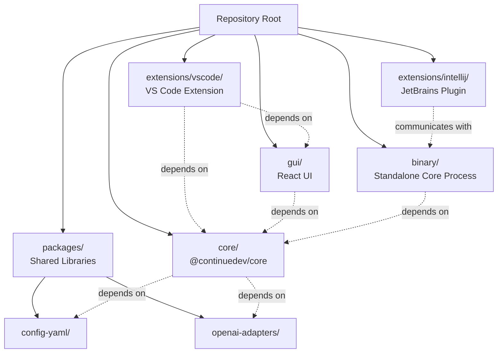

**Sources:** [CONTRIBUTING.md:32-34](), [extensions/intellij/CONTRIBUTING.md:33-36](), [scripts/install-dependencies.sh:33-60]()

## Cloning and Installation

### 1. Clone the Repository

```bash
git clone https://github.com/continuedev/continue.git
cd continue
```

### 2. Install Dependencies

The project provides automated scripts to handle the complex dependency linking across the monorepo.

1. **VS Code Task:** Open VS Code, `Cmd/Ctrl+Shift+P` -> `Tasks: Run Task` -> `install-all-dependencies`.
2. **Manual (Unix):** `./scripts/install-dependencies.sh`
3. **Manual (Windows):** `.\scripts\install-dependencies.ps1`

The `install-dependencies` scripts perform several critical steps:
- Installs root dependencies via `npm install`.
- Builds shared packages (fetch, openai-adapters, config-yaml) via `node ./scripts/build-packages.js`.
- Links the `@continuedev/core` package to the GUI and extensions using `npm link`.
- Runs initial builds for the GUI and VS Code extension to ensure a clean state.

**Sources:** [CONTRIBUTING.md:143-146](), [scripts/install-dependencies.sh:30-60](), [scripts/install-dependencies.ps1:76-106](), [.vscode/tasks.json:129-139]()

## Building the Project

Continue uses different build systems for different components. The primary tools are TypeScript (`tsc`), `esbuild`, and `Vite`.

### Build Order and Dependencies

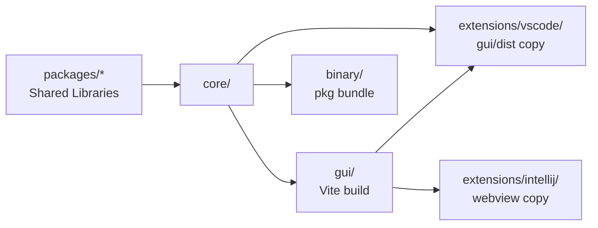

### Building Shared Packages
Shared packages are built using a utility script that handles the internal dependency graph of the `packages/` directory:
```bash
node ./scripts/build-packages.js
```
**Sources:** [scripts/install-dependencies.sh:33-34](), [scripts/build-packages.js:1-10]()

### Building GUI
```bash
cd gui
npm run build
```
This bundles the React application into static assets. The build is often memory-intensive, requiring `NODE_OPTIONS="--max-old-space-size=4096"`.
**Sources:** [scripts/install-dependencies.sh:48]()

### Building VS Code Extension
The extension uses `esbuild` for bundling the extension host code. The `package` script in `extensions/vscode` handles the full pipeline, including the `prepackage` step which copies GUI assets and native binaries.
**Sources:** [scripts/install-dependencies.sh:58](), [extensions/vscode/scripts/esbuild.js:9-51]()

## Development Workflows

### VS Code Extension
1. Open the project in VS Code.
2. Select the `Launch extension` configuration in the **Run and Debug** view.
3. This runs the `vscode-extension:build-with-packages` task, which executes `extensions/vscode/scripts/prepackage.js`.
4. A new "Extension Development Host" window opens with Continue loaded.

**Hot-reloading:** Changes to the `gui/` are automatically reflected via Vite. Changes to `core/` or `extensions/vscode/` require a "Reload Window" (`Cmd/Ctrl+Shift+P`) in the Host window.

**Sources:** [.vscode/launch.json:9-28](), [.vscode/tasks.json:108-127](), [CONTRIBUTING.md:163-171]()

### JetBrains Extension
1. Open the project in IntelliJ IDEA.
2. Select the `Run Continue` task and click **Debug**.
3. This starts the `Start Core Dev Server` task, which runs the core in a mode that the plugin can communicate with via stdin/stdout.
4. For Community Edition (CE), use the `Run Continue (CE)` task.

**Sources:** [extensions/intellij/CONTRIBUTING.md:81-92](), [extensions/intellij/CONTRIBUTING.md:33-37]()

## Building the Standalone Binary

The "Core Binary" is a standalone executable containing the Continue core, used by IntelliJ and the CLI. It uses `pkg` to bundle Node.js and the source code into a single file.

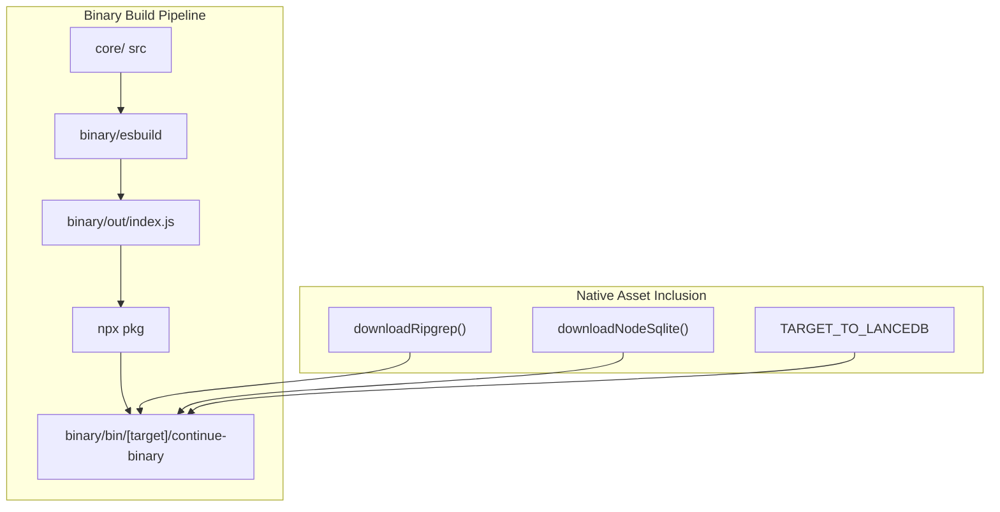

The bundling process performs:
1. **LanceDB Setup:** Copies platform-specific `@lancedb` index files to the destination directory.
2. **Native Modules:** Downloads and extracts `ripgrep` and `node-sqlite3` binaries for the target platform.
3. **Binary Generation:** Uses `pkg` (via `bundleBinary`) to create final executables for targets like `darwin-arm64`, `linux-x64`, or `win32-x64`.

**Sources:** [binary/utils/bundle-binary.js:46-69](), [binary/utils/bundle-binary.js:9-14](), [scripts/install-dependencies.sh:61-65]()

## Testing and Debugging

### Debugging the Core
You can debug the core process independently using the `Core Binary` launch configuration in VS Code. This runs `${workspaceFolder}/binary/out/index.js` with source maps enabled.
**Sources:** [.vscode/launch.json:29-45]()

### Running CLI in Debug Mode
The CLI can be debugged using the `Debug CLI` configuration, which runs the compiled `extensions/cli/dist/cn.js`.
**Sources:** [.vscode/launch.json:136-164]()

### Test Suites
- **Core Jest Tests:** `cd core && npm test`. Can be debugged via `[Core] Jest Test Debugger, Current Open File`.
- **VS Code E2E Tests:** Run via GitHub Actions using the `Run VS Code E2E Test` composite action, which sets up a virtual display (Xvfb) and runs Playwright/WebDriver tests.
- **JetBrains Tests:** Run via `./gradlew test testIntegration` in the `extensions/intellij` directory.

**Sources:** [.vscode/launch.json:77-96](), [.github/actions/run-vscode-e2e-test/action.yml:93-106](), [.github/actions/run-jetbrains-tests/action.yml:110-118]()

---

# Page: Key Concepts

# Key Concepts

<details>
<summary>Relevant source files</summary>

The following files were used as context for generating this wiki page:

- [.continue/environment.json](.continue/environment.json)
- [.github/CODEOWNERS](.github/CODEOWNERS)
- [.gitignore](.gitignore)
- [.husky/pre-commit](.husky/pre-commit)
- [.prettierignore](.prettierignore)
- [.prettierrc](.prettierrc)
- [core/config/types.ts](core/config/types.ts)
- [core/core.ts](core/core.ts)
- [core/index.d.ts](core/index.d.ts)
- [core/llm/autodetect.ts](core/llm/autodetect.ts)
- [core/llm/llms/ClawRouter.ts](core/llm/llms/ClawRouter.ts)
- [core/llm/llms/ClawRouter.vitest.ts](core/llm/llms/ClawRouter.vitest.ts)
- [core/llm/llms/WatsonX.ts](core/llm/llms/WatsonX.ts)
- [core/llm/llms/index.ts](core/llm/llms/index.ts)
- [core/llm/toolSupport.test.ts](core/llm/toolSupport.test.ts)
- [core/llm/toolSupport.ts](core/llm/toolSupport.ts)
- [core/protocol/core.ts](core/protocol/core.ts)
- [core/protocol/coreWebview.ts](core/protocol/coreWebview.ts)
- [core/protocol/ide.ts](core/protocol/ide.ts)
- [core/protocol/messenger/messageIde.ts](core/protocol/messenger/messageIde.ts)
- [core/protocol/messenger/reverseMessageIde.ts](core/protocol/messenger/reverseMessageIde.ts)
- [core/protocol/passThrough.ts](core/protocol/passThrough.ts)
- [core/protocol/webview.ts](core/protocol/webview.ts)
- [core/util/filesystem.ts](core/util/filesystem.ts)
- [docs/customize/model-providers/more/clawrouter.mdx](docs/customize/model-providers/more/clawrouter.mdx)
- [docs/customize/model-providers/overview.mdx](docs/customize/model-providers/overview.mdx)
- [extensions/intellij/src/main/kotlin/com/github/continuedev/continueintellijextension/constants/MessageTypes.kt](extensions/intellij/src/main/kotlin/com/github/continuedev/continueintellijextension/constants/MessageTypes.kt)
- [extensions/vscode/config_schema.json](extensions/vscode/config_schema.json)
- [extensions/vscode/src/VsCodeIde.ts](extensions/vscode/src/VsCodeIde.ts)
- [extensions/vscode/src/extension/VsCodeExtension.ts](extensions/vscode/src/extension/VsCodeExtension.ts)
- [extensions/vscode/src/util/ideUtils.ts](extensions/vscode/src/util/ideUtils.ts)
- [gui/public/logos/clawrouter.png](gui/public/logos/clawrouter.png)
- [gui/src/pages/AddNewModel/configs/models.ts](gui/src/pages/AddNewModel/configs/models.ts)
- [gui/src/pages/AddNewModel/configs/providers.ts](gui/src/pages/AddNewModel/configs/providers.ts)
- [package-lock.json](package-lock.json)
- [package.json](package.json)
- [packages/llm-info/src/providers/inception.ts](packages/llm-info/src/providers/inception.ts)
- [packages/openai-adapters/src/index.ts](packages/openai-adapters/src/index.ts)
- [packages/openai-adapters/src/types.ts](packages/openai-adapters/src/types.ts)

</details>


This page explains the fundamental concepts that power Continue's AI coding assistance: **IDE Abstraction**, **LLM Providers**, **Message Protocols**, **Configuration Profiles**, and **Context Items**. Understanding these concepts is essential for working with Continue's codebase.

For information about system architecture and component interactions, see [System Architecture](2.1). For configuration details, see [Configuration Architecture](5.1).

## The IDE Abstraction Layer

Continue is designed to be IDE-agnostic. It achieves this through the `IDE` interface, which abstracts editor-specific operations like file manipulation, terminal access, and window management.

### IDE Interface Architecture

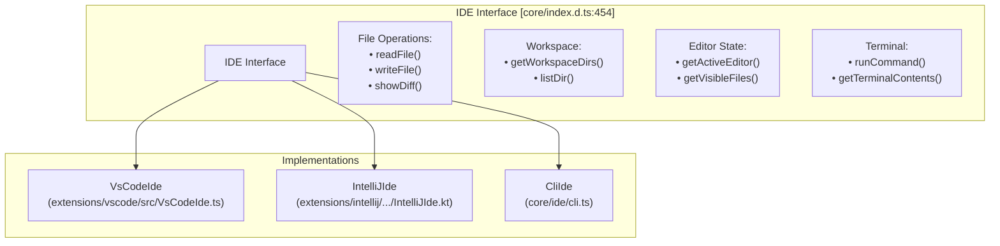

The `IDE` interface allows the `Core` logic to remain identical across VS Code, JetBrains, and the CLI. For example, when the `CodebaseIndexer` needs to read a file, it calls `ide.readFile(filepath)` [core/index.d.ts:454-516]() without knowing which editor is hosting it. The `VsCodeIde` class implements this interface for the VS Code environment [extensions/vscode/src/VsCodeIde.ts:181-181]().

**Sources:** [core/index.d.ts:454-516](), [extensions/vscode/src/VsCodeIde.ts:181-181]()

## The ILLM Interface: Language Model Abstraction

Continue abstracts all language model interactions behind the `ILLM` interface, enabling support for dozens of providers (OpenAI, Anthropic, Ollama, etc.) with a unified API.

### Core Interface Definition

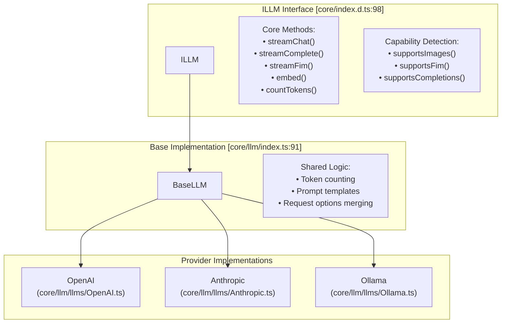

The `ILLM` interface defines the contract for interaction with AI models [core/index.d.ts:98-169](). This includes streaming chat [core/index.d.ts:127-132](), token counting [core/index.d.ts:149-149](), and capability detection like image support [core/index.d.ts:151-151](). Specific providers like `Ollama` [core/core.ts:19-19]() or `Lemonade` [core/core.ts:17-17]() implement these methods. Model metadata and provider-specific configurations are often defined in `ModelDescription` [core/index.d.ts:337-342]().

**Sources:** [core/index.d.ts:98-169](), [core/core.ts:17-19](), [core/index.d.ts:337-342]()

## Message Protocols and Communication

Communication between the **IDE**, **Core**, and **GUI** happens via structured JSON-RPC-like messages defined in the `Protocol` types.

### Data Flow and Protocols

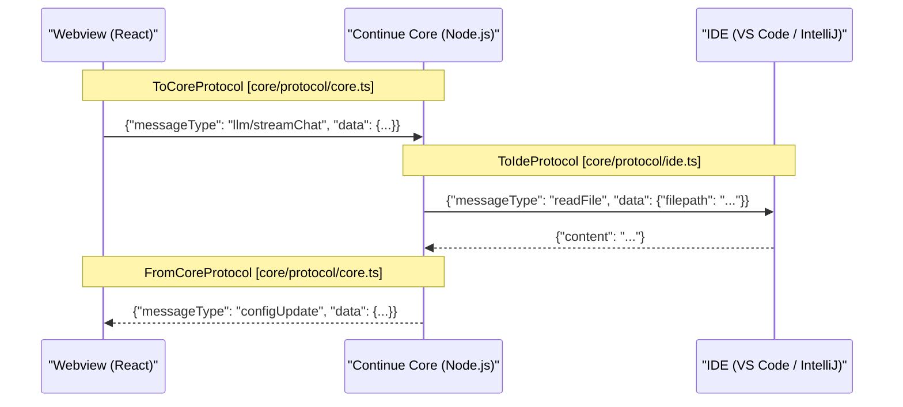

| Protocol Name | File | Purpose |
|---------------|------|---------|
| `ToCoreProtocol` | [core/protocol/core.ts:63]() | Messages sent from GUI/IDE to the Core (e.g., chat requests, indexing) |
| `FromCoreProtocol` | [core/protocol/core.ts:312]() | Messages sent from Core to GUI/IDE (e.g., streaming chunks, config updates) |
| `ToIdeProtocol` | [core/protocol/ide.ts:5]() | Messages sent from Core to the IDE to perform editor actions |

The `Core` class uses an `IMessenger` to handle these communications [core/core.ts:129-131](). It routes messages like `configUpdate` to notify the UI when settings change [core/core.ts:173-178]().

**Sources:** [core/protocol/core.ts:63-311](), [core/core.ts:129-131](), [core/core.ts:173-178]()

## Configuration and Profiles

Continue uses a robust configuration system managed by the `ConfigHandler`. This system supports local JSON/YAML files as well as remote profiles for organizations.

### Configuration Management

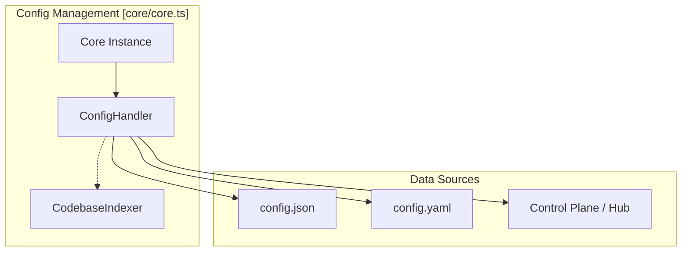

- **ConfigHandler**: The central class responsible for loading and watching configuration files [core/core.ts:138-138](). It triggers reloads across the system when updates occur [core/core.ts:169-170]().
- **Profiles**: Continue supports multiple profiles, which can be local or organization-based, represented by `ProfileDescription` [core/protocol/core.ts:13-13]().
- **Onboarding**: The system includes specific logic for different onboarding modes like `LOCAL` or `API_KEY` [core/protocol/core.ts:52-55]().

**Sources:** [core/core.ts:138-138](), [core/core.ts:169-170](), [core/protocol/core.ts:13-13](), [core/protocol/core.ts:52-55]()

## Context Providers and Items

Context Providers are the mechanism by which Continue gathers external information (code, docs, terminal output) to include in LLM prompts.

### Context Retrieval

A `ContextItem` is the unit of information passed to the LLM. It includes the content, a name, and metadata [core/index.d.ts:441-452]().

| Interface/Type | Definition | Description |
|----------------|------------|-------------|
| `IContextProvider` | [core/index.d.ts:261]() | The base interface for all context providers |
| `ContextItem` | [core/index.d.ts:441]() | The data structure representing a piece of context |
| `ContextProviderExtras` | [core/index.d.ts:199]() | Additional data (IDE, LLM, Config) provided to `getContextItems` |
| `ContextSubmenuItem` | [core/index.d.ts:233]() | Items displayed in the `@` mention dropdown |

The `IContextProvider` interface requires two main methods:
1. `getContextItems()`: Returns the actual data for a query [core/index.d.ts:264-267]().
2. `loadSubmenuItems()`: Returns items for the `@` dropdown in the UI [core/index.d.ts:269-269]().

**Sources:** [core/index.d.ts:199-209](), [core/index.d.ts:233-239](), [core/index.d.ts:261-272](), [core/index.d.ts:441-452]()

## Tool Calling and Capabilities

Continue manages how LLMs interact with external tools and detects model-specific capabilities.

### Tool Execution and Detection

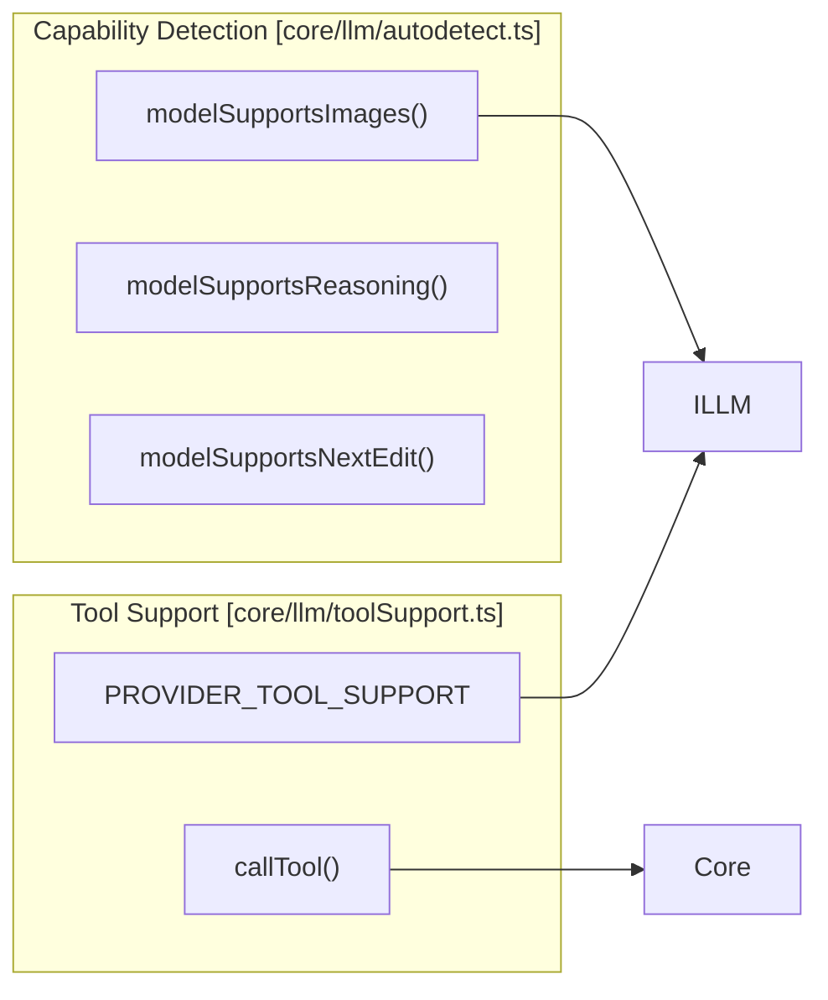

- **Capability Autodetection**: Continue automatically detects if a model supports images [core/llm/autodetect.ts:160-187](), reasoning [core/llm/autodetect.ts:189-232](), or the "Next Edit" feature [core/llm/autodetect.ts:292-307]().
- **Tool Support**: The system maintains a mapping of which providers and models support tool calling (function calling) via `PROVIDER_TOOL_SUPPORT` [core/llm/toolSupport.ts:3-222]().
- **Execution**: Tools are invoked via the `callTool` function within the core logic [core/core.ts:22-22]().

**Sources:** [core/llm/autodetect.ts:160-187](), [core/llm/autodetect.ts:189-232](), [core/llm/autodetect.ts:292-307](), [core/llm/toolSupport.ts:3-222](), [core/core.ts:22-22]()

---

# Page: Architecture

# Architecture

<details>
<summary>Relevant source files</summary>

The following files were used as context for generating this wiki page:

- [binary/package-lock.json](binary/package-lock.json)
- [core/core.ts](core/core.ts)
- [core/package-lock.json](core/package-lock.json)
- [core/package.json](core/package.json)
- [core/protocol/core.ts](core/protocol/core.ts)
- [core/protocol/ide.ts](core/protocol/ide.ts)
- [core/protocol/messenger/messageIde.ts](core/protocol/messenger/messageIde.ts)
- [core/protocol/messenger/reverseMessageIde.ts](core/protocol/messenger/reverseMessageIde.ts)
- [core/protocol/passThrough.ts](core/protocol/passThrough.ts)
- [core/protocol/webview.ts](core/protocol/webview.ts)
- [core/util/filesystem.ts](core/util/filesystem.ts)
- [extensions/intellij/src/main/kotlin/com/github/continuedev/continueintellijextension/constants/MessageTypes.kt](extensions/intellij/src/main/kotlin/com/github/continuedev/continueintellijextension/constants/MessageTypes.kt)
- [extensions/vscode/package-lock.json](extensions/vscode/package-lock.json)
- [extensions/vscode/package.json](extensions/vscode/package.json)
- [extensions/vscode/src/VsCodeIde.ts](extensions/vscode/src/VsCodeIde.ts)
- [extensions/vscode/src/extension/VsCodeExtension.ts](extensions/vscode/src/extension/VsCodeExtension.ts)
- [extensions/vscode/src/util/ideUtils.ts](extensions/vscode/src/util/ideUtils.ts)
- [gui/package-lock.json](gui/package-lock.json)
- [gui/package.json](gui/package.json)
- [packages/config-yaml/package.json](packages/config-yaml/package.json)

</details>


Continue is an open-source AI code assistant with a multi-tier architecture consisting of IDE extensions (VS Code, IntelliJ), a core backend service, a React-based GUI, and an LLM abstraction layer supporting 40+ AI providers. The system uses message-passing protocols for communication between isolated processes, enabling clean separation of concerns and cross-platform IDE support.

This page provides a high-level architectural overview. For detailed information, see:
- [System Architecture](#2.1) - Complete system interactions and component relationships
- [Package Structure](#2.2) - Monorepo organization and dependencies  
- [Communication Protocols](#2.3) - Message passing and protocol definitions
- [IDE Integration Patterns](#2.4) - Cross-platform IDE abstraction patterns

## System Overview

Continue's architecture consists of four main layers that communicate through typed protocols:

**High-Level System Architecture**
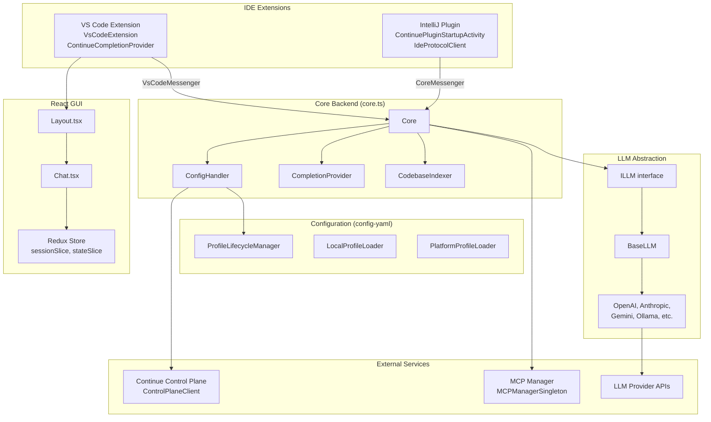

**Sources:** [core/core.ts:89-131](), [core/core.ts:138-167](), [extensions/vscode/src/extension/VsCodeExtension.ts:63-80](), [core/context/mcp/MCPManagerSingleton.ts]()

The architecture maintains strict separation:
- **IDE Layer**: Platform-specific integration (e.g., `VsCodeExtension` [extensions/vscode/src/extension/VsCodeExtension.ts:63-172]())
- **Core Layer**: Business logic in `Core` class [core/core.ts:89-124]()
- **Configuration Layer**: Multi-source config via `ConfigHandler` [core/core.ts:138-144]() and profile management.
- **LLM Layer**: Provider abstraction through `ILLM` interface and `BaseLLM`.
- **GUI Layer**: React application with Redux state management [gui/package.json:25-74]().

## Core Backend

The `Core` class [core/core.ts:89-124]() orchestrates all backend functionality:

**Core Class Structure**
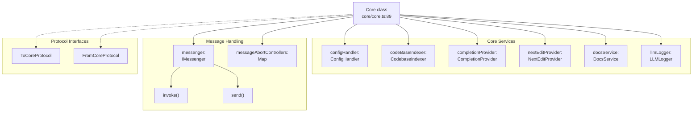

**Sources:** [core/core.ts:89-124](), [core/protocol/core.ts:63-242]()

`Core` responsibilities:
- **Message Routing**: `invoke()` and `send()` methods for request/response and fire-and-forget patterns [core/core.ts:111-124]().
- **Service Management**: Initializes and coordinates `ConfigHandler`, `CodebaseIndexer`, `DocsService`, and `NextEditProvider` [core/core.ts:138-167]().
- **Abort Control**: Manages `AbortController` instances for cancellable operations via `messageAbortControllers` [core/core.ts:98-109]().
- **Protocol Handlers**: Implements the handlers for the extensive `ToCoreProtocol` [core/protocol/core.ts:63-242]().

## IDE Extensions

Continue supports multiple IDEs through platform-specific extensions sharing a common `IDE` interface [core/core.ts:130]().

**VS Code Extension Architecture**
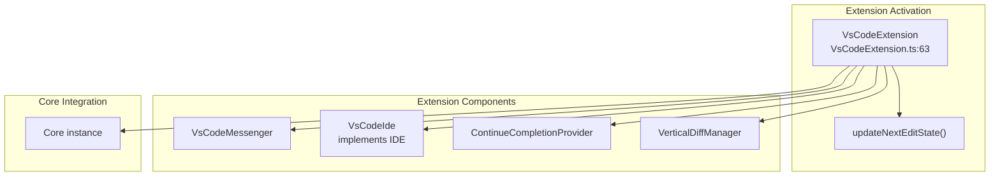

**Sources:** [extensions/vscode/src/extension/VsCodeExtension.ts:63-80](), [extensions/vscode/package.json:153-205]()

VS Code extension components:
- `VsCodeExtension`: Main extension class managing lifecycle and service instantiation [extensions/vscode/src/extension/VsCodeExtension.ts:63]().
- `ContinueCompletionProvider`: Implements tab-autocomplete logic [extensions/vscode/src/extension/VsCodeExtension.ts:80]().
- `VsCodeMessenger`: Routes messages between the webview and the core [extensions/vscode/src/extension/VsCodeExtension.ts:40]().
- Extensive commands registered in `package.json` [extensions/vscode/package.json:153-205]().

## React GUI

The GUI is a React application shared across IDEs via webview integration [gui/package.json:54-60]().

**GUI Component Hierarchy**
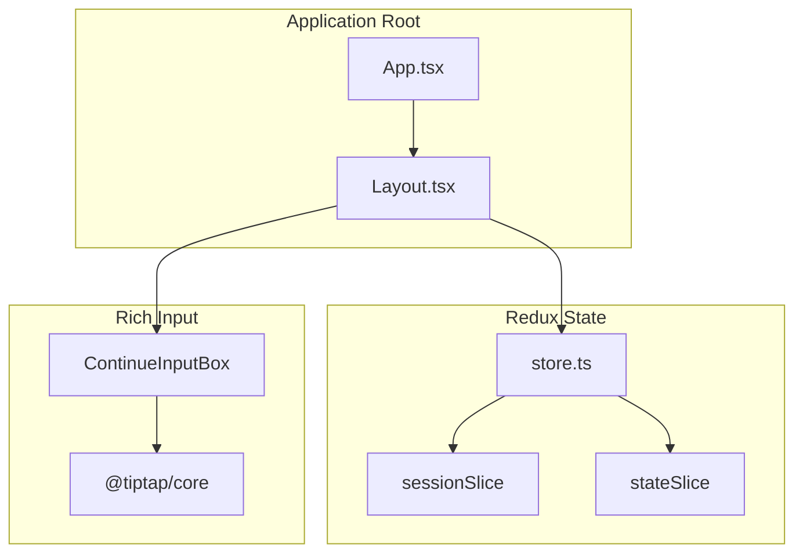

**Sources:** [gui/package.json:18-40](), [gui/package.json:60-69]().

Key components:
- `Layout`: Root component managing routing and global UI state.
- `ContinueInputBox`: TipTap-based editor for rich chat input [gui/package.json:26-38]().
- `Redux Store`: Centralized state for chat sessions, configuration, and indexing status [gui/package.json:25]().

## Communication Protocols

Continue uses typed protocol definitions for all inter-process communication:

**Protocol Definitions and Message Flow**
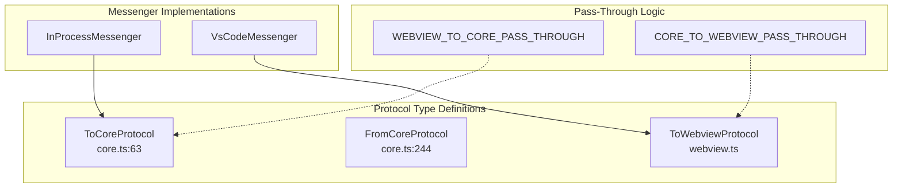

**Sources:** [core/protocol/core.ts:63-242](), [core/protocol/core.ts:244-307](), [core/protocol/passThrough.ts:9-109]().

Protocol structure:
- `ToCoreProtocol`: Message types for Core operations (history, config, context, indexing) [core/protocol/core.ts:63-242]().
- `FromCoreProtocol`: Messages sent from the Core to the IDE/Webview (notifications, status updates) [core/protocol/core.ts:244-307]().
- `Pass-Through`: Pre-defined lists of message types that are automatically routed between components [core/protocol/passThrough.ts:9-109]().

## Monorepo Structure

Continue is organized as a monorepo with several interconnected packages:

**Package Dependencies**
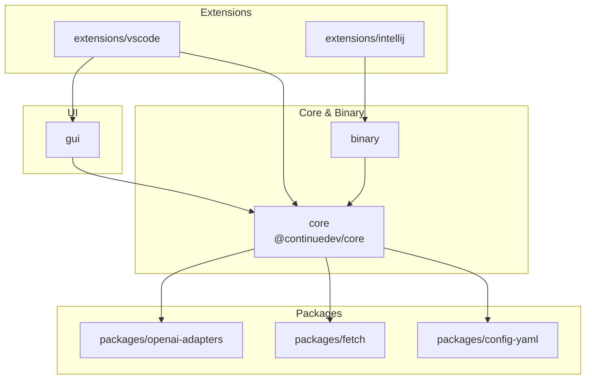

**Sources:** [extensions/vscode/package-lock.json:12-18](), [core/package.json:61-66](), [gui/package.json:43](), [binary/package-lock.json:15]().

| Package | Purpose | Key Dependencies |
|---------|---------|-----------------|
| `core` [core/package.json]() | Central business logic, LLM providers, indexing. | `@continuedev/config-yaml`, `openai`, `ollama` |
| `gui` [gui/package.json]() | React-based user interface. | `react`, `@reduxjs/toolkit`, `core` |
| `extensions/vscode` [extensions/vscode/package.json]() | VS Code specific integration. | `core`, `vscode-languageclient` |
| `binary` [binary/package-lock.json]() | Standalone binary wrapper for the core (used by IntelliJ). | `core` |
| `packages/config-yaml` [packages/config-yaml/package.json]() | YAML configuration parsing and validation. | `yaml`, `zod` |

## Configuration System

The configuration system is centered around `ConfigHandler`, which manages the loading and refreshing of configuration from various sources.

**Configuration Loading Pipeline**
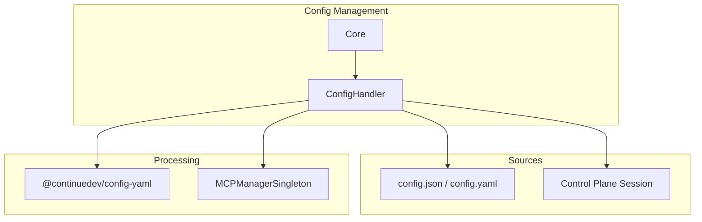

**Sources:** [core/core.ts:138-144](), [core/core.ts:146-160](), [core/package.json:61-62]().

`ConfigHandler` architecture:
- **Initialization**: Created within `Core` and linked to the IDE and session info [core/core.ts:138]().
- **MCP Integration**: Refreshed when Model Context Protocol (MCP) connections change [core/core.ts:146-160]().
- **Validation**: Uses `@continuedev/config-yaml` for parsing and `zod` for runtime validation [core/package.json:126]().

---

# Page: System Architecture

# System Architecture

<details>
<summary>Relevant source files</summary>

The following files were used as context for generating this wiki page:

- [binary/package-lock.json](binary/package-lock.json)
- [core/core.ts](core/core.ts)
- [core/package-lock.json](core/package-lock.json)
- [core/package.json](core/package.json)
- [core/protocol/core.ts](core/protocol/core.ts)
- [core/protocol/ide.ts](core/protocol/ide.ts)
- [core/protocol/messenger/messageIde.ts](core/protocol/messenger/messageIde.ts)
- [core/protocol/messenger/reverseMessageIde.ts](core/protocol/messenger/reverseMessageIde.ts)
- [core/protocol/passThrough.ts](core/protocol/passThrough.ts)
- [core/protocol/webview.ts](core/protocol/webview.ts)
- [core/util/filesystem.ts](core/util/filesystem.ts)
- [extensions/intellij/src/main/kotlin/com/github/continuedev/continueintellijextension/constants/MessageTypes.kt](extensions/intellij/src/main/kotlin/com/github/continuedev/continueintellijextension/constants/MessageTypes.kt)
- [extensions/vscode/package-lock.json](extensions/vscode/package-lock.json)
- [extensions/vscode/package.json](extensions/vscode/package.json)
- [extensions/vscode/src/VsCodeIde.ts](extensions/vscode/src/VsCodeIde.ts)
- [extensions/vscode/src/extension/VsCodeExtension.ts](extensions/vscode/src/extension/VsCodeExtension.ts)
- [extensions/vscode/src/util/ideUtils.ts](extensions/vscode/src/util/ideUtils.ts)
- [gui/package-lock.json](gui/package-lock.json)
- [gui/package.json](gui/package.json)
- [packages/config-yaml/package.json](packages/config-yaml/package.json)

</details>


## Purpose and Scope

This document describes Continue's layered system architecture, explaining how the IDE extensions, Core orchestrator, GUI, and external services interact through message-passing protocols. It covers the separation of concerns between platform-specific code and shared business logic, the configuration system, and the communication patterns that enable cross-platform functionality.

For details on specific communication protocols, see [Communication Protocols](#2.3). For IDE-specific integration patterns, see [IDE Integration Patterns](#2.4). For the package organization, see [Package Structure](#2.2).

## High-Level Architecture

Continue uses a layered architecture with strict separation between IDE-specific code, shared business logic, and the user interface. This design enables a single codebase to support multiple IDEs (VS Code, IntelliJ) and a CLI while maintaining consistent functionality.

### Core Component Relationships

```mermaid
graph TB
    subgraph IDE["IDE Layer"]
        VSCodeExt["VsCodeExtension<br/>extensions/vscode/src/extension/VsCodeExtension.ts"]
        IntelliJPlugin["ContinuePluginService<br/>Kotlin plugin service"]
        CLITool["CLI Application<br/>binary/"]
    end
    
    subgraph Messenger["Message Router Layer"]
        VSCodeMsngr["VsCodeMessenger<br/>extensions/vscode/src/extension/VsCodeMessenger.ts"]
        IntelliJMsngr["IdeProtocolClient<br/>Kotlin message handler"]
        InProcessMsngr["InProcessMessenger<br/>core/protocol/messenger.ts"]
    end
    
    subgraph CoreLayer["Core Layer"]
        CoreClass["Core<br/>core/core.ts"]
        ConfigHandlerClass["ConfigHandler<br/>core/config/ConfigHandler.ts"]
        CodeBaseIndexer["CodebaseIndexer<br/>core/indexing/CodebaseIndexer.ts"]
        CompletionProvider["CompletionProvider<br/>core/autocomplete/CompletionProvider.ts"]
    end
    
    subgraph GUI["GUI Layer"]
        ReactApp["React Application<br/>gui/src/"]
        ReduxStore["Redux Store<br/>sessionSlice, stateSlice"]
        WebviewProtocol["VsCodeWebviewProtocol<br/>extensions/vscode/src/webviewProtocol.ts"]
    end
    
    subgraph External["External Services"]
        ControlPlane["ControlPlaneClient<br/>core/control-plane/client.ts"]
        LLMProviders["LLM Providers<br/>core/llm/llms/"]
        MCPManager["MCPManagerSingleton<br/>core/context/mcp/MCPManagerSingleton.ts"]
    end
    
    VSCodeExt -->|creates| InProcessMsngr [extensions/vscode/src/extension/VsCodeExtension.ts:181-190]()
    VSCodeExt -->|creates| VSCodeMsngr [extensions/vscode/src/extension/VsCodeExtension.ts:181-190]()
    
    VSCodeMsngr -->|handles| InProcessMsngr [extensions/vscode/src/extension/VsCodeMessenger.ts:45-66]()
    
    InProcessMsngr -->|instantiates| CoreClass [extensions/vscode/src/extension/VsCodeExtension.ts:200-210]()
    CoreClass -->|owns| ConfigHandlerClass [core/core.ts:138]()
    CoreClass -->|owns| CodeBaseIndexer [core/core.ts:162-167]()
    CoreClass -->|owns| CompletionProvider [core/core.ts:92]()
    
    VSCodeExt -->|embeds| ReactApp [extensions/vscode/package.json:56]()
    ReactApp -->|manages| ReduxStore [gui/package.json:25]()
    ReactApp -->|communicates via| WebviewProtocol [extensions/vscode/src/extension/VsCodeExtension.ts:175-180]()
    
    ConfigHandlerClass -->|uses| ControlPlane [core/core.ts:138]()
    CoreClass -->|calls| LLMProviders [core/core.ts:17-20]()
    CoreClass -->|integrates| MCPManager [core/core.ts:146-160]()
```

**Sources:** [core/core.ts:92-182](), [extensions/vscode/src/extension/VsCodeExtension.ts:63-210](), [core/protocol/messenger.ts:1-20]()

## Core Orchestrator

The `Core` class serves as the central orchestrator, managing all business logic and coordinating between subsystems. It is instantiated by IDE extensions and communicates through message protocols.

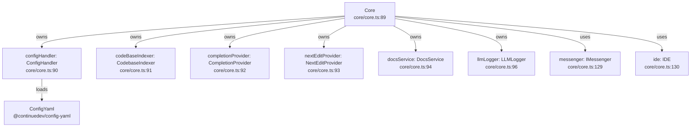

The `Core` constructor initializes all subsystems and registers message handlers for different message types, handling everything from history management to autocomplete to indexing operations. It listens for configuration updates via `configHandler.onConfigUpdate` to broadcast changes to the messenger.

**Sources:** [core/core.ts:89-106](), [core/core.ts:128-205](), [core/core.ts:169-185]()

## Message-Passing Architecture

Continue uses a strict message-passing architecture with typed protocols to maintain separation between layers. Messages flow through well-defined channels with no direct function calls across layer boundaries.

### Message Protocol Types

| Protocol Type | Source | Target | Purpose |
|--------------|--------|--------|---------|
| `ToCoreProtocol` | IDE or Webview | Core | Requests to Core business logic [core/protocol/core.ts:63]() |
| `FromCoreProtocol` | Core | IDE or Webview | Responses and notifications from Core [core/core.ts:118]() |
| `ToWebviewProtocol` | IDE or Core | Webview | Requests to update the GUI state [extensions/vscode/src/extension/VsCodeMessenger.ts:45]() |

**Sources:** [core/protocol/core.ts:63-243](), [core/core.ts:118-125](), [core/protocol/passThrough.ts:95-109]()

### Message Flow Diagram

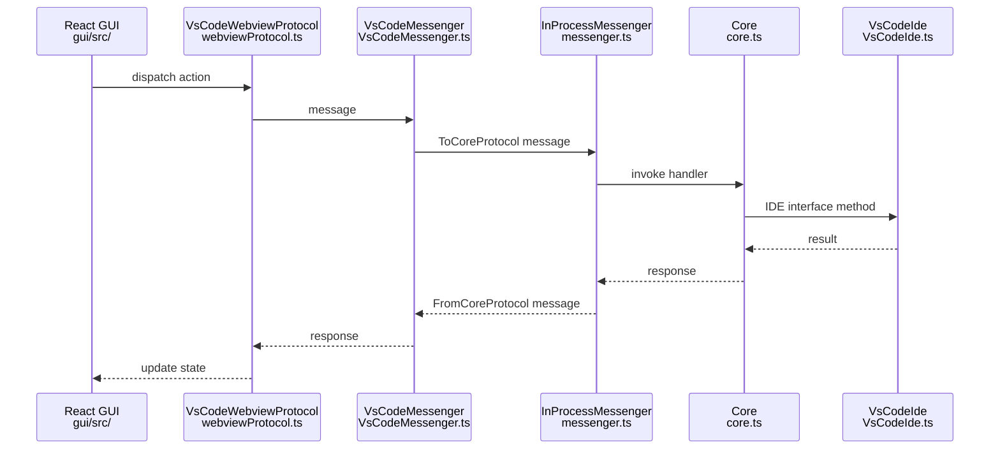

**Sources:** [extensions/vscode/src/extension/VsCodeMessenger.ts:45-66](), [core/protocol/messenger.ts:1-20](), [core/core.ts:128-132]()

### Pass-Through Messages

The architecture includes pass-through message lists that allow direct communication between the Webview and Core, bypassing the IDE layer for efficiency. These are defined in `WEBVIEW_TO_CORE_PASS_THROUGH` and `CORE_TO_WEBVIEW_PASS_THROUGH`.

```mermaid
graph LR
    Webview["React GUI"]
    
    subgraph PassThrough["Pass-Through Messages"]
        W2C["WEBVIEW_TO_CORE_PASS_THROUGH<br/>core/protocol/passThrough.ts:9"]
        C2W["CORE_TO_WEBVIEW_PASS_THROUGH<br/>core/protocol/passThrough.ts:95"]
    end
    
    Core["Core"]
    
    Webview -->|"history/*, config/*,<br/>context/*, llm/*, etc."| W2C
    W2C --> Core
    Core -->|"configUpdate, indexProgress,<br/>sessionUpdate, etc."| C2W
    C2W --> Webview
```

Examples of pass-through messages include `"history/list"`, `"config/addModel"`, `"llm/streamChat"`, `"indexProgress"`, and `"configUpdate"`.

**Sources:** [core/protocol/passThrough.ts:9-110](), [core/protocol/core.ts:63-243]()

## Configuration System Architecture

The configuration system supports multiple sources (local YAML/JSON, remote profiles) and manages profile lifecycle across different scopes.

```mermaid
graph TB
    subgraph Sources["Configuration Sources"]
        ConfigYaml["config.yaml<br/>~/.continue/config.yaml"]
        ConfigJson["config.json<br/>~/.continue/config.json"]
        LocalBlocks[".continue/ blocks<br/>Workspace YAML files"]
    end
    
    subgraph Loading["Configuration Loading"]
        ConfigHandler["ConfigHandler<br/>core/config/ConfigHandler.ts"]
        ConfigYamlPkg["ConfigYaml<br/>@continuedev/config-yaml"]
    end
    
    subgraph Processing["Processing Pipeline"]
        DoLoadConfig["doLoadConfig<br/>core/config/profile/doLoadConfig.ts"]
    end
    
    subgraph Result["Result"]
        ContinueConfig["ContinueConfig<br/>Final configuration object"]
    end
    
    ConfigYaml --> ConfigYamlPkg [packages/config-yaml/package.json:2-17]()
    ConfigJson --> ConfigHandler [core/core.ts:138]()
    LocalBlocks --> ConfigYamlPkg [core/core.ts:50]()
    
    ConfigHandler --> DoLoadConfig
    ConfigYamlPkg --> DoLoadConfig
    
    DoLoadConfig --> ContinueConfig
```

**Sources:** [core/core.ts:138-144](), [packages/config-yaml/package.json:1-30](), [core/protocol/core.ts:1-7]()

## GUI State Management

The React GUI uses Redux for state management with clear separation between session state, configuration state, and UI state.

```mermaid
graph TB
    subgraph Store["Redux Store"]
        SessionSlice["sessionSlice<br/>Current chat session state"]
        StateSlice["stateSlice<br/>Global state"]
    end
    
    subgraph Components["React Components"]
        Chat["Chat<br/>gui/src/pages/gui/Chat.tsx"]
        ContinueInputBox["ContinueInputBox<br/>gui/src/components/mainInput/ContinueInputBox.tsx"]
    end
    
    Components -->|dispatch| Store [gui/package.json:25]()
    Components -->|selector| Store [gui/package.json:60]()
```

**Sources:** [gui/package.json:25](), [gui/package.json:60-69](), [gui/package.json:18-83]()

## VS Code Extension Architecture

The VS Code extension follows a specific initialization pattern that creates the Core, manages the webview, and coordinates between all subsystems.

```mermaid
graph TB
    VsCodeExtension["VsCodeExtension<br/>extensions/vscode/src/extension/VsCodeExtension.ts:63"]
    
    subgraph Creation["Component Creation"]
        Sidebar["ContinueGUIWebviewViewProvider<br/>extensions/vscode/src/ContinueGUIWebviewViewProvider.ts"]
        InProcessMessenger["InProcessMessenger<br/>core/protocol/messenger.ts"]
        VsCodeMessenger["VsCodeMessenger<br/>extensions/vscode/src/extension/VsCodeMessenger.ts:40"]
        Core["Core<br/>core/core.ts"]
    end
    
    subgraph Managers["Manager Setup"]
        VerticalDiffManager["VerticalDiffManager<br/>extensions/vscode/src/diff/vertical/manager.ts"]
        EditDecorationManager["EditDecorationManager<br/>extensions/vscode/src/quickEdit/EditDecorationManager.ts"]
        CompletionProvider["ContinueCompletionProvider<br/>extensions/vscode/src/autocomplete/completionProvider.ts"]
    end
    
    VsCodeExtension --> Sidebar [extensions/vscode/src/extension/VsCodeExtension.ts:71]()
    VsCodeExtension --> InProcessMessenger [extensions/vscode/src/extension/VsCodeExtension.ts:9]()
    VsCodeExtension --> VsCodeMessenger [extensions/vscode/src/extension/VsCodeExtension.ts:40]()
    VsCodeExtension --> Core [extensions/vscode/src/extension/VsCodeExtension.ts:76]()
    VsCodeExtension --> VerticalDiffManager [extensions/vscode/src/extension/VsCodeExtension.ts:74]()
    VsCodeExtension --> EditDecorationManager [extensions/vscode/src/extension/VsCodeExtension.ts:73]()
    VsCodeExtension --> CompletionProvider [extensions/vscode/src/extension/VsCodeExtension.ts:80]()
```

**Sources:** [extensions/vscode/src/extension/VsCodeExtension.ts:63-86](), [extensions/vscode/src/extension/VsCodeExtension.ts:172-210]()

## LLM Integration Layer

The Core integrates with LLM providers through an abstraction layer that provides a unified interface.

```mermaid
graph TB
    subgraph Providers["Provider Implementations"]
        Ollama["Ollama<br/>core/llm/llms/Ollama.ts"]
        Lemonade["Lemonade<br/>core/llm/llms/Lemonade.ts"]
    end
    
    subgraph Usage["Core Usage"]
        llmStreamChat["llmStreamChat()<br/>core/llm/streamChat.ts"]
        CompletionProvider["CompletionProvider<br/>core/autocomplete/CompletionProvider.ts"]
    end
    
    llmStreamChat -->|calls| Ollama [core/core.ts:77]()
    CompletionProvider -->|calls| Lemonade [core/core.ts:92]()
```

**Sources:** [core/core.ts:17-19](), [core/core.ts:77](), [core/core.ts:92](), [core/package.json:57-127]()

## Indexing and Context

Continue maintains multiple types of indexes for providing context to LLMs:

```mermaid
graph TB
    subgraph Indexing["Indexing Systems"]
        CodeBaseIndexer["CodebaseIndexer<br/>core/indexing/CodebaseIndexer.ts"]
        DocsService["DocsService<br/>core/indexing/docs/DocsService.ts"]
        MCPManager["MCPManagerSingleton<br/>core/context/mcp/MCPManagerSingleton.ts"]
    end
    
    subgraph Databases["Storage"]
        Vectordb["Vectordb<br/>LanceDB/Vector embeddings"]
        DevDataSqliteDb["DevDataSqliteDb<br/>SQLite metadata"]
    end
    
    CodeBaseIndexer -->|uses| Vectordb [core/package.json:119]()
    CodeBaseIndexer -->|uses| DevDataSqliteDb [core/core.ts:12]()
    DocsService -->|managed by| Core [core/core.ts:140-144]()
    MCPManager -->|refreshes| ConfigHandler [core/core.ts:146-160]()
```

**Sources:** [core/core.ts:12-15](), [core/core.ts:162-168](), [core/core.ts:146-160](), [core/package.json:112-119]()

## Build and Distribution

Continue uses a monorepo structure with separate build processes for each component.

```mermaid
graph TB
    subgraph Source["Source Packages"]
        CoreSrc["core/<br/>TypeScript"]
        GUISrc["gui/<br/>React + TypeScript"]
        VSCodeSrc["extensions/vscode/<br/>TypeScript"]
        BinarySrc["binary/<br/>TypeScript"]
    end
    
    subgraph Build["Build Tools"]
        TSC["tsc<br/>TypeScript compiler"]
        Vite["Vite<br/>GUI bundler"]
        ESBuild["esbuild<br/>Extension bundler"]
    end
    
    CoreSrc --> TSC [core/package.json:10]()
    GUISrc --> Vite [gui/package.json:10]()
    VSCodeSrc --> ESBuild [extensions/vscode/package-lock.json:80]()
```

**Sources:** [core/package.json:5-10](), [gui/package.json:7-10](), [extensions/vscode/package-lock.json:80-87]()

---

# Page: Package Structure

# Package Structure

<details>
<summary>Relevant source files</summary>

The following files were used as context for generating this wiki page:

- [.continue/environment.json](.continue/environment.json)
- [.github/CODEOWNERS](.github/CODEOWNERS)
- [.gitignore](.gitignore)
- [.husky/pre-commit](.husky/pre-commit)
- [.prettierignore](.prettierignore)
- [.prettierrc](.prettierrc)
- [binary/package-lock.json](binary/package-lock.json)
- [core/package-lock.json](core/package-lock.json)
- [core/package.json](core/package.json)
- [core/protocol/coreWebview.ts](core/protocol/coreWebview.ts)
- [extensions/vscode/package-lock.json](extensions/vscode/package-lock.json)
- [extensions/vscode/package.json](extensions/vscode/package.json)
- [gui/package-lock.json](gui/package-lock.json)
- [gui/package.json](gui/package.json)
- [package-lock.json](package-lock.json)
- [package.json](package.json)
- [packages/config-yaml/package.json](packages/config-yaml/package.json)
- [packages/continue-sdk/package-lock.json](packages/continue-sdk/package-lock.json)
- [packages/continue-sdk/package.json](packages/continue-sdk/package.json)
- [packages/continue-sdk/tsconfig.json](packages/continue-sdk/tsconfig.json)
- [packages/openai-adapters/package-lock.json](packages/openai-adapters/package-lock.json)
- [packages/openai-adapters/package.json](packages/openai-adapters/package.json)
- [packages/openai-adapters/src/apis/WatsonX.ts](packages/openai-adapters/src/apis/WatsonX.ts)

</details>


This document describes the monorepo structure of the Continue codebase, detailing the purpose and dependencies of each major package. Continue is organized as a multi-package repository with several top-level directories containing distinct modules that work together to provide AI coding assistance across multiple IDEs.

For information about the high-level system architecture and how these packages interact at runtime, see [System Architecture](#2.1). For details on message passing between packages, see [Communication Protocols](#2.3).

## Monorepo Organization

Continue uses a monorepo structure with the following top-level organization:

| Directory | Purpose | Language | Package Name | Main Entry |
|-----------|---------|----------|--------------|------------|
| `core/` | Backend orchestration, LLM integration, context providers | TypeScript | `@continuedev/core` | [core/package.json:15]() (Module) |
| `gui/` | React-based user interface shared by all IDE extensions | TypeScript/React | `gui` (private) | [gui/package.json:4]() (Module) |
| `extensions/vscode/` | VS Code extension implementation | TypeScript | `continue` | [extensions/vscode/package.json:58]() |
| `extensions/intellij/` | IntelliJ plugin implementation | Kotlin/Java | N/A | Gradle build |
| `packages/config-yaml/` | YAML configuration parser and block resolver | TypeScript | `@continuedev/config-yaml` | [packages/config-yaml/package.json:5]() |
| `packages/openai-adapters/` | OpenAI-compatible LLM adapters | TypeScript | `@continuedev/openai-adapters` | [packages/openai-adapters/package.json:5]() |
| `packages/config-types/` | TypeScript type definitions for config | TypeScript | `@continuedev/config-types` | [extensions/vscode/package-lock.json:12]() |
| `packages/fetch/` | HTTP client with proxy support | TypeScript | `@continuedev/fetch` | [core/package-lock.json:18]() |
| `packages/llm-info/` | Model metadata and capabilities | TypeScript | `@continuedev/llm-info` | [core/package-lock.json:19]() |
| `packages/terminal-security/` | Terminal command validation | TypeScript | `@continuedev/terminal-security` | [core/package-lock.json:21]() |
| `binary/` | Standalone CLI tool / Core binary | TypeScript | `binary` | [binary/package-lock.json:28]() |

**Sources:** [extensions/vscode/package.json:1-58](), [core/package.json:1-4](), [gui/package.json:1-6](), [packages/openai-adapters/package.json:1-7](), [binary/package-lock.json:1-29]()

## Package Dependency Graph

This diagram shows npm package dependencies using actual package names from `package.json` and `package-lock.json` files:

```mermaid
graph TB
    subgraph IDEExtensions["IDE Extensions"]
        VSCode["continue<br/>extensions/vscode/package.json<br/>main: out/extension.js"]
        IntelliJ["IntelliJ Plugin<br/>extensions/intellij<br/>Gradle build"]
    end
    
    subgraph Frontend["Frontend Layer"]
        GUI["gui (private)<br/>gui/package.json"]
    end
    
    subgraph Backend["Backend Layer"]
        Core["@continuedev/core<br/>core/package.json"]
        Binary["binary<br/>binary/package.json"]
    end
    
    subgraph SharedPackages["Shared Packages"]
        ConfigYaml["@continuedev/config-yaml<br/>packages/config-yaml"]
        OpenAIAdapters["@continuedev/openai-adapters<br/>packages/openai-adapters"]
        ConfigTypes["@continuedev/config-types<br/>packages/config-types"]
        Fetch["@continuedev/fetch<br/>packages/fetch"]
        LlmInfo["@continuedev/llm-info<br/>packages/llm-info"]
        TerminalSec["@continuedev/terminal-security<br/>packages/terminal-security"]
    end
    
    VSCode -->|"file:../../core"| Core
    VSCode -->|"file:../../packages/config-types"| ConfigTypes
    VSCode -->|"file:../../packages/fetch"| Fetch
    
    Binary -->|"file:../core"| Core
    
    GUI -->|"file:../core"| Core
    GUI -->|"file:../packages/config-yaml"| ConfigYaml
    GUI -->|"file:../packages/terminal-security"| TerminalSec
    
    Core -->|"file:../packages/config-yaml"| ConfigYaml
    Core -->|"file:../packages/fetch"| Fetch
    Core -->|"file:../packages/openai-adapters"| OpenAIAdapters
    Core -->|"file:../packages/llm-info"| LlmInfo
    Core -->|"file:../packages/terminal-security"| TerminalSec
    
    OpenAIAdapters -->|"^1.0.14"| ConfigTypes
    OpenAIAdapters -->|"file:../config-yaml"| ConfigYaml
    OpenAIAdapters -->|"file:../fetch"| Fetch
```

**Note:** Dependencies prefixed with `file:` indicate monorepo workspace links, while version strings (e.g., `^1.0.14`) indicate published npm packages.

**Sources:** [extensions/vscode/package-lock.json:11-18](), [core/package.json:61-67](), [gui/package.json:19-20,43](), [packages/openai-adapters/package.json:23-25](), [binary/package-lock.json:11-15]()

## Core Package (`@continuedev/core`)

The `core` package contains all backend business logic and is the heart of the Continue system. It is published as `@continuedev/core` (version 1.1.0) and consumed by IDE extensions.

### Package Configuration

```json
{
  "name": "@continuedev/core",
  "version": "1.1.0",
  "description": "The Continue Core contains functionality that can be shared across web, VS Code, or Node.js",
  "type": "module",
  "engines": { "node": ">=20.20.1" }
}
```

**Sources:** [core/package.json:1-4,129-131]()

### External Dependencies by Category

The core package dependencies from [core/package.json:57-127]():

**LLM Provider SDKs:**
- `@anthropic-ai/sdk@^0.62.0` [core/package.json:57]()
- `openai@^5.13.1` [core/package.json:101]()
- `@aws-sdk/client-bedrock-runtime@^3.931.0` [core/package.json:58]()
- `google-auth-library@^10.4.1` [core/package.json:83]()
- `ollama@^0.4.6` [core/package.json:99]()

**Continue Internal Packages:**
- `@continuedev/config-yaml@file:../packages/config-yaml` [core/package.json:62]()
- `@continuedev/openai-adapters@file:../packages/openai-adapters` [core/package.json:65]()
- `@continuedev/fetch@file:../packages/fetch` [core/package.json:63]()
- `@continuedev/llm-info@file:../packages/llm-info` [core/package.json:64]()

**Embeddings & Vector DB:**
- `@xenova/transformers@2.14.0` [core/package.json:70]()
- `onnxruntime-node@1.14.0` [core/package.json:100]()
- `vectordb@0.4.20` [core/package.json:119]()

**Protocol Integration:**
- `@modelcontextprotocol/sdk@^1.25.2` [core/package.json:67]()
- `socket.io-client@^4.7.3` [core/package.json:111]()

**Sources:** [core/package.json:57-127]()

## GUI Package

The `gui` package is a React application providing the chat interface. It is shared across VS Code and IntelliJ via webview embedding.

### Key Dependencies

- **React**: `react@^18.2.0`, `react-dom@^18.2.0` [gui/package.json:54-55]()
- **State Management**: `@reduxjs/toolkit@^2.11.2`, `react-redux@^8.0.5` [gui/package.json:25,60]()
- **Editor**: `@tiptap/core`, `@tiptap/react` [gui/package.json:26,36]()
- **Markdown**: `react-markdown@^9.0.1` [gui/package.json:59]()
- **Diagrams**: `mermaid@^11.10.0` [gui/package.json:51]()

**Sources:** [gui/package.json:18-83]()

## VS Code Extension Package (`continue`)

The VS Code extension (`extensions/vscode`) implements the IDE-specific integration.

### Package Configuration

```json
{
  "name": "continue",
  "version": "1.3.40",
  "publisher": "Continue",
  "main": "./out/extension.js",
  "engines": { 
    "vscode": "^1.70.0",
    "node": ">=20.20.1" 
  },
  "activationEvents": [
    "onUri",
    "onStartupFinished",
    "onView:continueGUIView"
  ]
}
```

**Sources:** [extensions/vscode/package.json:1-58]()

### Key Dependencies

From [extensions/vscode/package-lock.json:11-59]():

- `core@file:../../core` [extensions/vscode/package-lock.json:18]()
- `@continuedev/config-types@file:../../packages/config-types` [extensions/vscode/package-lock.json:12]()
- `@continuedev/fetch@file:../../packages/fetch` [extensions/vscode/package-lock.json:13]()
- `@vscode/ripgrep@^1.15.9` [extensions/vscode/package-lock.json:16]()
- `vectordb@0.4.20` [extensions/vscode/package-lock.json:54]()
- `vscode-languageclient@^8.0.2` [extensions/vscode/package-lock.json:56]()

**Sources:** [extensions/vscode/package-lock.json:11-59]()

## Shared Packages (`packages/`)

### config-yaml Package (`@continuedev/config-yaml`)

Implements the YAML configuration system used for profile management and block resolution.

**Package Configuration:**
```json
{
  "name": "@continuedev/config-yaml",
  "version": "1.23.0",
  "main": "dist/index.js",
  "bin": {
    "config-yaml": "./dist/cli.js"
  }
}
```

**Sources:** [packages/config-yaml/package.json:1-17]()

### openai-adapters Package (`@continuedev/openai-adapters`)

Provides OpenAI-compatible adapters for diverse LLM providers using the Vercel AI SDK and native SDKs.

**Architecture and Dependencies:**
- `ai@^6.0.86`: Core Vercel AI SDK [packages/openai-adapters/package.json:27]()
- `@ai-sdk/anthropic`, `@ai-sdk/google`, `@ai-sdk/openai`, `@ai-sdk/deepseek`: Provider-specific adapters [packages/openai-adapters/package.json:15-18]()

**Sources:** [packages/openai-adapters/package.json:1-35]()

## Build and Dependency Management

### Workspace Configuration

The monorepo uses file-based package references (`file:../path`) for local development:

**From core/package.json:**
```json
{
  "dependencies": {
    "@continuedev/config-yaml": "file:../packages/config-yaml",
    "@continuedev/fetch": "file:../packages/fetch",
    "@continuedev/llm-info": "file:../packages/llm-info",
    "@continuedev/openai-adapters": "file:../packages/openai-adapters",
    "@continuedev/terminal-security": "file:../packages/terminal-security"
  }
}
```

**Sources:** [core/package.json:62-66]()

### TypeScript Compilation

Each package has its own TypeScript configuration and build scripts:

- **Core**: `npm run build` executes `tsc -p ./tsconfig.npm.json` [core/package.json:10]().
- **GUI**: `npm run build` executes `tsc && vite build` [gui/package.json:10]().
- **VS Code**: Uses `esbuild` for bundling and `tsc` for type checking [extensions/vscode/package-lock.json:80,86]().
- **Binary**: Uses `esbuild` and `@vercel/ncc` for packaging [binary/package-lock.json:35,37]().

**Sources:** [core/package.json:10](), [gui/package.json:10](), [extensions/vscode/package-lock.json:80-86](), [binary/package-lock.json:35-37]()

---

# Page: Communication Protocols

# Communication Protocols

<details>
<summary>Relevant source files</summary>

The following files were used as context for generating this wiki page:

- [.continue/environment.json](.continue/environment.json)
- [.github/CODEOWNERS](.github/CODEOWNERS)
- [.gitignore](.gitignore)
- [.husky/pre-commit](.husky/pre-commit)
- [.prettierignore](.prettierignore)
- [.prettierrc](.prettierrc)
- [core/core.ts](core/core.ts)
- [core/protocol/core.ts](core/protocol/core.ts)
- [core/protocol/coreWebview.ts](core/protocol/coreWebview.ts)
- [core/protocol/ide.ts](core/protocol/ide.ts)
- [core/protocol/messenger/messageIde.ts](core/protocol/messenger/messageIde.ts)
- [core/protocol/messenger/reverseMessageIde.ts](core/protocol/messenger/reverseMessageIde.ts)
- [core/protocol/passThrough.ts](core/protocol/passThrough.ts)
- [core/protocol/webview.ts](core/protocol/webview.ts)
- [core/util/filesystem.ts](core/util/filesystem.ts)
- [extensions/intellij/src/main/kotlin/com/github/continuedev/continueintellijextension/constants/MessageTypes.kt](extensions/intellij/src/main/kotlin/com/github/continuedev/continueintellijextension/constants/MessageTypes.kt)
- [extensions/vscode/src/VsCodeIde.ts](extensions/vscode/src/VsCodeIde.ts)
- [extensions/vscode/src/extension/VsCodeExtension.ts](extensions/vscode/src/extension/VsCodeExtension.ts)
- [extensions/vscode/src/util/ideUtils.ts](extensions/vscode/src/util/ideUtils.ts)
- [package-lock.json](package-lock.json)
- [package.json](package.json)

</details>


## Purpose and Scope

This document describes the message-passing protocols used in Continue's architecture to enable communication between the IDE extensions, Core backend, and GUI webview. It covers the protocol type definitions, message routing implementations, and the request/response patterns that enable bidirectional real-time communication across these components.

For information about how the Core orchestrator processes messages, see [Core Orchestrator](3.1). For details on state management in the GUI, see [State Management](8.3).

---

## Protocol Architecture Overview

Continue implements a strongly-typed message passing system with three primary communication channels. The architecture relies on an `IMessenger` interface to abstract the underlying transport (IPC, Webview postMessage, or TCP).

### Component Communication Flow

```mermaid
graph TB
    subgraph "GUI (React Webview)"
        GUI["React Components"]
        IdeMessengerContext["IdeMessengerContext"]
        Redux["Redux Store"]
    end
    
    subgraph "Message Router Layer"
        VSCodeMessenger["VsCodeMessenger"]
        VsCodeWebviewProtocol["VsCodeWebviewProtocol"]
    end
    
    subgraph "Core Backend"
        Core["Core class"]
        InProcessMessenger["InProcessMessenger"]
    end
    
    subgraph "IDE Platform APIs"
        VsCodeIde["VsCodeIde"]
        VSCodeAPI["vscode.* APIs"]
    end
    
    subgraph "Protocol Definitions"
        ToIdeFromWebview["ToIdeFromWebviewOrCoreProtocol"]
        ToWebviewFromIde["ToWebviewOrCoreFromIdeProtocol"]
        ToCore["ToCoreProtocol"]
        FromCore["FromCoreProtocol"]
    end
    
    GUI -->|messages| IdeMessengerContext
    IdeMessengerContext -->|ToIdeFromWebview| VsCodeWebviewProtocol
    VsCodeWebviewProtocol -->|postMessage| VSMessenger
    
    VSMessenger["VsCodeMessenger"] -->|routes to| Core
    VSMessenger -->|routes to| VsCodeIde
    VSMessenger -->|routes to| GUI
    
    Core -->|FromCore| VSMessenger
    
    VSMessenger -->|ToWebviewFromCore| GUI
    
    Core -.->|uses| InProcessMessenger
    
    ToIdeFromWebview -.->|defines| IdeMessengerContext
    ToCore -.->|defines| InProcessMessenger
    FromCore -.->|defines| Core
```

**Sources:** [core/core.ts:128-131](), [extensions/vscode/src/extension/VsCodeMessenger.ts:40-40](), [extensions/vscode/src/extension/VsCodeExtension.ts:75-76]()

---

## Protocol Type Definitions

### Core Protocol Interfaces

The protocol system defines primary TypeScript interfaces that establish message contracts:

| Protocol Interface | Direction | Purpose | Location |
|-------------------|-----------|---------|----------|
| `ToCoreProtocol` | → Core | Requests that Core can handle | [core/protocol/core.ts:63-255]() |
| `FromCoreProtocol` | Core → | Notifications Core can send | [core/protocol/coreWebview.ts]() |
| `ToIdeFromWebviewOrCoreProtocol` | Webview/Core → IDE | Requests sent to IDE implementation | [core/protocol/ide.ts:21-91]() |

Each protocol is defined as a TypeScript mapped type where each key is a message type string and the value is a tuple of `[PayloadType, ReturnType]`.

**Sources:** [core/protocol/core.ts:63-255](), [core/protocol/ide.ts:21-91]()

### ToCoreProtocol Message Categories

The `ToCoreProtocol` handles the bulk of business logic requests including history, configuration, context, and LLM interactions.

```mermaid
graph LR
    ToCoreProtocol["ToCoreProtocol (core/protocol/core.ts)"]
    
    ToCoreProtocol --> History["History Management<br/>history/list<br/>history/save<br/>history/load"]
    ToCoreProtocol --> Config["Configuration<br/>config/addModel<br/>config/refreshProfiles<br/>config/updateSelectedModel"]
    ToCoreProtocol --> Context["Context Providers<br/>context/getContextItems<br/>context/loadSubmenuItems<br/>context/addDocs"]
    ToCoreProtocol --> LLM["LLM Operations<br/>llm/streamChat<br/>llm/complete<br/>llm/listModels"]
    ToCoreProtocol --> Autocomplete["Autocomplete<br/>autocomplete/complete<br/>autocomplete/accept"]
    ToCoreProtocol --> NextEdit["Next Edit<br/>nextEdit/predict<br/>nextEdit/accept<br/>nextEdit/startChain"]
    ToCoreProtocol --> Indexing["Indexing<br/>index/forceReIndex<br/>index/setPaused"]
    ToCoreProtocol --> MCP["MCP Integration<br/>mcp/reloadServer<br/>mcp/getPrompt<br/>mcp/startAuthentication"]
```

**Sources:** [core/protocol/core.ts:69-255]()

### ToIdeFromWebviewOrCoreProtocol Message Types

These messages allow the React-based GUI or the Core orchestrator to trigger native IDE actions defined in the `IDE` interface.

```mermaid
graph LR
    ToIde["ToIdeFromWebviewOrCoreProtocol (core/protocol/ide.ts)"]
    
    ToIde --> FileOps["File Operations<br/>readFile<br/>writeFile<br/>removeFile<br/>fileExists"]
    ToIde --> Search["Search & Git<br/>getSearchResults<br/>getFileResults<br/>getBranch<br/>getRepoName"]
    ToIde --> Editor["Editor State<br/>getOpenFiles<br/>getCurrentFile<br/>getPinnedFiles<br/>showLines"]
    ToIde --> LSP["LSP Integration<br/>gotoDefinition<br/>getReferences<br/>getDocumentSymbols"]
    ToIde --> Secrets["Security<br/>readSecrets<br/>writeSecrets"]
```

**Sources:** [core/protocol/ide.ts:21-91]()

---

## Message Routing Architecture

### VsCodeMessenger Routing

The `VsCodeMessenger` class in the VS Code extension implements the bridge between the Webview and the Core. It uses specialized registration methods to handle different message sources:

1.  **`onWebview`**: Listens for messages originating from the React GUI.
2.  **`onCore`**: Listens for messages originating from the Core backend.
3.  **`onWebviewOrCore`**: Listens for messages that can originate from either, typically IDE-level requests like file system access or settings.

**Routing Destinations:**
*   **Direct Handling**: Actions like `showFile` or `reloadWindow` are handled directly by calling VS Code APIs.
*   **Pass-Through**: Messages destined for Core are forwarded via the `IMessenger` implementation using the `WEBVIEW_TO_CORE_PASS_THROUGH` list [core/protocol/passThrough.ts:9-90]().

**Sources:** [extensions/vscode/src/extension/VsCodeMessenger.ts:40-40](), [core/protocol/passThrough.ts:9-90]()

---

## Pass-Through Message System

To minimize boilerplate, Continue uses lists of message types that are automatically forwarded between components.

### WEBVIEW_TO_CORE_PASS_THROUGH

This list contains messages that the IDE extension should forward from the GUI to the Core backend.

| Category | Message Types |
| :--- | :--- |
| **History** | `history/list`, `history/save`, `history/load`, `history/clear` |
| **Config** | `config/addModel`, `config/refreshProfiles`, `config/updateSelectedModel` |
| **Context** | `context/getContextItems`, `context/addDocs`, `context/indexDocs` |
| **LLM** | `llm/streamChat`, `llm/complete`, `llm/listModels` |
| **Next Edit** | `nextEdit/predict`, `nextEdit/accept`, `nextEdit/reject` |
| **MCP** | `mcp/reloadServer`, `mcp/getPrompt`, `mcp/startAuthentication` |

**Sources:** [core/protocol/passThrough.ts:9-90]()

### CORE_TO_WEBVIEW_PASS_THROUGH

This list contains notifications from Core that are forwarded to the GUI, such as configuration updates or indexing progress.

*   `configUpdate`: Triggered when the configuration is reloaded [core/protocol/passThrough.ts:97]().
*   `indexProgress`: Updates on codebase indexing status [core/protocol/passThrough.ts:98]().
*   `refreshSubmenuItems`: Updates for @mention dropdowns (e.g., for MCP) [core/protocol/passThrough.ts:101]().
*   `sessionUpdate`: Updates for the current chat session [core/protocol/passThrough.ts:106]().

**Sources:** [core/protocol/passThrough.ts:95-109]()

---

## Core Message Handler Registration

The `Core` class serves as the central hub, registering handlers for `ToCoreProtocol` messages during its initialization.

```mermaid
graph TB
    Core["Core class (core/core.ts)"]
    
    subgraph "Handler Registration (constructor)"
        Config["configUpdate handler"]
        MCP["refreshSubmenuItems handler"]
        Indexing["indexProgress handler"]
    end
    
    Core --> Config
    Core --> MCP
    Core --> Indexing
```

**Example: Abort Logic**
The `Core` class manages `AbortController` instances to allow cancellation of long-running requests by message ID [core/core.ts:98-106](). The `abortById` function triggers the signal for a specific message [core/core.ts:107-109]().

**Sources:** [core/core.ts:98-109](), [core/core.ts:169-178]()

---

## Message Lifecycle Example: Chat Stream

The following diagram illustrates how a chat request traverses the communication layers from the GUI to the Core.

```mermaid
sequenceDiagram
    participant GUI as Chat Component (React)
    participant WebviewProt as VsCodeWebviewProtocol
    participant VSMessenger as VsCodeMessenger
    participant Core as Core (core/core.ts)
    participant LLM as LLM Provider

    GUI->>WebviewProt: messenger.request("llm/streamChat", payload)
    WebviewProt->>VSMessenger: postMessage({type: "llm/streamChat", ...})
    VSMessenger->>Core: messenger.invoke("llm/streamChat")
    Core->>LLM: streamChat()
    
    loop Streaming Chunks
        LLM-->>Core: chunk
        Core-->>VSMessenger: messenger.send("llm/streamChat", chunk)
        VSMessenger-->>WebviewProt: webview.postMessage("llm/streamChat", chunk)
        WebviewProt-->>GUI: onMessage listener
    end
```

**Sources:** [core/core.ts:111-124](), [extensions/vscode/src/extension/VsCodeMessenger.ts:40-40](), [core/protocol/passThrough.ts:59-59]()

---

## Error Handling in Protocols

The protocol system includes centralized error propagation:

*   **IDE Toasts**: Errors encountered in Core or the Extension can be sent to the GUI or shown as native notifications using `ide.showToast` [extensions/vscode/src/VsCodeIde.ts:148-165]().
*   **Abort Logic**: The `Core` class tracks active message IDs and provides an `abort` mechanism to cancel long-running operations like LLM streams [core/core.ts:98-109]().
*   **IntelliJ Specifics**: The IntelliJ implementation maintains its own list of pass-through message types to ensure consistency with the TypeScript core [extensions/intellij/src/main/kotlin/com/github/continuedev/continueintellijextension/constants/MessageTypes.kt:55-158]().

**Sources:** [extensions/vscode/src/VsCodeIde.ts:148-165](), [core/core.ts:98-109](), [extensions/intellij/src/main/kotlin/com/github/continuedev/continueintellijextension/constants/MessageTypes.kt:55-158]()

---

## Summary of Key Classes and Files

| Entity | Role | File |
| :--- | :--- | :--- |
| `IMessenger` | Interface for bidirectional message passing | [core/protocol/messenger.ts]() |
| `VsCodeMessenger` | Central router for VS Code extension | [extensions/vscode/src/extension/VsCodeMessenger.ts]() |
| `Core` | Central logic handler for Core protocol | [core/core.ts]() |
| `ToCoreProtocol` | Type definitions for Core requests | [core/protocol/core.ts]() |
| `WEBVIEW_TO_CORE_PASS_THROUGH` | List of automatically forwarded messages | [core/protocol/passThrough.ts]() |
| `VsCodeIde` | Implementation of IDE interface for VS Code | [extensions/vscode/src/VsCodeIde.ts]() |

**Sources:** [core/core.ts:89-96](), [extensions/vscode/src/VsCodeIde.ts:38-48](), [core/protocol/passThrough.ts:9-90]()

---

# Page: IDE Integration Patterns

# IDE Integration Patterns

<details>
<summary>Relevant source files</summary>

The following files were used as context for generating this wiki page:

- [core/core.ts](core/core.ts)
- [core/protocol/core.ts](core/protocol/core.ts)
- [core/protocol/ide.ts](core/protocol/ide.ts)
- [core/protocol/ideWebview.ts](core/protocol/ideWebview.ts)
- [core/protocol/messenger/messageIde.ts](core/protocol/messenger/messageIde.ts)
- [core/protocol/messenger/reverseMessageIde.ts](core/protocol/messenger/reverseMessageIde.ts)
- [core/protocol/passThrough.ts](core/protocol/passThrough.ts)
- [core/protocol/webview.ts](core/protocol/webview.ts)
- [core/util/filesystem.ts](core/util/filesystem.ts)
- [extensions/intellij/src/main/kotlin/com/github/continuedev/continueintellijextension/constants/MessageTypes.kt](extensions/intellij/src/main/kotlin/com/github/continuedev/continueintellijextension/constants/MessageTypes.kt)
- [extensions/vscode/src/VsCodeIde.ts](extensions/vscode/src/VsCodeIde.ts)
- [extensions/vscode/src/commands.ts](extensions/vscode/src/commands.ts)
- [extensions/vscode/src/extension/VsCodeExtension.ts](extensions/vscode/src/extension/VsCodeExtension.ts)
- [extensions/vscode/src/extension/VsCodeMessenger.ts](extensions/vscode/src/extension/VsCodeMessenger.ts)
- [extensions/vscode/src/util/ideUtils.ts](extensions/vscode/src/util/ideUtils.ts)
- [gui/src/components/Layout.tsx](gui/src/components/Layout.tsx)
- [gui/src/components/mainInput/ContinueInputBox.tsx](gui/src/components/mainInput/ContinueInputBox.tsx)
- [gui/src/components/mainInput/InputToolbar.tsx](gui/src/components/mainInput/InputToolbar.tsx)
- [gui/src/components/modelSelection/ModelSelect.tsx](gui/src/components/modelSelection/ModelSelect.tsx)
- [gui/src/pages/gui/Chat.tsx](gui/src/pages/gui/Chat.tsx)

</details>


Continue supports multiple IDEs (VS Code, IntelliJ, CLI) through a unified `IDE` interface abstraction. Platform-specific implementations (`VsCodeIde`, `IntelliJIde`) translate IDE-native APIs to this common interface, allowing the core backend to remain platform-agnostic.

For overall system architecture, see [System Architecture](#2.1). For message protocols, see [Communication Protocols](#2.3).

---

## The IDE Interface Abstraction

The `IDE` interface defines methods across file operations, editor manipulation, Git integration, LSP queries, and UI interactions. This interface is the primary contract that the `Core` class uses to interact with the host environment [core/core.ts:130-130]().

**IDE Interface Method Categories**

```mermaid
graph TB
    IDE["IDE interface"]
    
    subgraph FileOps["File Operations"]
        readFile["readFile()"]
        writeFile["writeFile()"]
        fileExists["fileExists()"]
        listDir["listDir()"]
        getFileStats["getFileStats()"]
    end
    
    subgraph EditorOps["Editor Operations"]
        openFile["openFile()"]
        showLines["showLines()"]
        showDiff["showDiff()"]
        showVirtualFile["showVirtualFile()"]
    end
    
    subgraph LSPOps["LSP Operations"]
        gotoDefinition["gotoDefinition()"]
        gotoTypeDefinition["gotoTypeDefinition()"]
        getReferences["getReferences()"]
        getDocumentSymbols["getDocumentSymbols()"]
        getSignatureHelp["getSignatureHelp()"]
    end
    
    subgraph GitOps["Git Operations"]
        getBranch["getBranch()"]
        getDiff["getDiff()"]
        getRepoName["getRepoName()"]
        getGitRootPath["getGitRootPath()"]
    end
    
    subgraph UIOps["UI Operations"]
        showToast["showToast()"]
        getProblems["getProblems()"]
        getIdeInfo["getIdeInfo()"]
        getIdeSettings["getIdeSettings()"]
    end
    
    subgraph Implementations["Platform Implementations"]
        VsCodeIde["VsCodeIde"]
        IntelliJIde["IntelliJIde"]
        FileSystemIde["FileSystemIde"]
    end
    
    IDE --> FileOps
    IDE --> EditorOps
    IDE --> LSPOps
    IDE --> GitOps
    IDE --> UIOps
    
    VsCodeIde -.implements.-> IDE
    IntelliJIde -.implements.-> IDE
    FileSystemIde -.implements.-> IDE
```

Sources: [core/index.d.ts:47-47](), [extensions/vscode/src/VsCodeIde.ts:38-38](), [extensions/intellij/src/main/kotlin/com/github/continuedev/continueintellijextension/continue/IntelliJIde.kt:43-47]()

---

## VS Code Implementation Architecture

`VsCodeIde` implements the `IDE` interface using native VS Code APIs. The extension runs the core backend in-process within the Node.js runtime.

**VS Code Extension Component Structure**

```mermaid
graph TB
    subgraph EntryPoint["VsCodeExtension"]
        VsCodeExtensionClass["VsCodeExtension"]
        activateFn["activate()"]
    end
    
    subgraph IDEImpl["IDE Implementation"]
        VsCodeIde["VsCodeIde"]
        VsCodeIdeUtils["VsCodeIdeUtils"]
        SecretStorage["SecretStorage"]
    end
    
    subgraph VSCodeAPIs["VS Code APIs"]
        workspaceFS["vscode.workspace.fs"]
        window["vscode.window"]
        commands["vscode.commands"]
    end
    
    subgraph Messaging["VsCodeMessenger"]
        MessengerClass["VsCodeMessenger"]
        VsCodeWebviewProtocol["VsCodeWebviewProtocol"]
    end
    
    VsCodeExtensionClass --> VsCodeIde
    VsCodeExtensionClass --> MessengerClass
    
    VsCodeIde --> VsCodeIdeUtils
    VsCodeIde --> SecretStorage
    VsCodeIde --> VSCodeAPIs
    
    MessengerClass --> VsCodeWebviewProtocol
    MessengerClass --> VsCodeIde
```

Sources: [extensions/vscode/src/extension/VsCodeExtension.ts:63-80](), [extensions/vscode/src/VsCodeIde.ts:38-48](), [extensions/vscode/src/extension/VsCodeMessenger.ts:39-84]()

### VsCodeIde Method Implementations

| Method Category | Implementation Pattern | VS Code API / Code Entity |
|----------------|----------------------|-------------|
| File Operations | `vscode.workspace.fs` via `VsCodeIdeUtils` | `this.ideUtils.stat()` [extensions/vscode/src/VsCodeIde.ts:75-75]() |
| Editor Operations | `vscode.window` + utility functions | `openEditorAndRevealRange()` [extensions/vscode/src/VsCodeIde.ts:19-19]() |
| LSP Queries | `vscode.commands.executeCommand()` | `executeGotoProvider()` [extensions/vscode/src/VsCodeIde.ts:86-86]() |
| Git Operations | Git extension `Repository` API | `this.getRepo(dir)` [extensions/vscode/src/VsCodeIde.ts:168-168]() |
| Secrets | `SecretStorage` wrapper | `this.secretStorage.get(key)` [extensions/vscode/src/VsCodeIde.ts:51-51]() |
| UI Notifications | `vscode.window` notification methods | `showErrorMessage()` [extensions/vscode/src/VsCodeIde.ts:155-155]() |

Sources: [extensions/vscode/src/VsCodeIde.ts:73-83](), [extensions/vscode/src/VsCodeIde.ts:85-127](), [extensions/vscode/src/VsCodeIde.ts:148-165](), [extensions/vscode/src/VsCodeIde.ts:167-183]()

---

## IntelliJ Implementation Architecture

`IntelliJIde` implements the `IDE` interface using IntelliJ Platform APIs. Unlike VS Code, the core backend runs as a separate Node.js process communicating via JSON over stdin/stdout or TCP.

**IntelliJ Plugin Component Structure**

```mermaid
graph TB
    subgraph PluginEntry["Plugin Entry"]
        pluginXML["plugin.xml"]
        ContinuePluginStartupActivity["ContinuePluginStartupActivity"]
    end
    
    subgraph IDEImpl["IDE Implementation"]
        IntelliJIde["IntelliJIde"]
        FileUtils["FileUtils"]
    end
    
    subgraph CoreComm["Core Process Communication"]
        CoreMessenger["CoreMessenger"]
        IdeProtocolClient["IdeProtocolClient"]
    end
    
    subgraph IntelliJAPIs["IntelliJ Platform APIs"]
        LocalFileSystem["LocalFileSystem"]
        FileEditorManager["FileEditorManager"]
        DocumentMarkupModel["DocumentMarkupModel"]
    end
    
    pluginXML --> ContinuePluginStartupActivity
    ContinuePluginStartupActivity --> IntelliJIde
    ContinuePluginStartupActivity --> CoreMessenger
    
    IntelliJIde --> FileUtils
    IntelliJIde --> IntelliJAPIs
    
    CoreMessenger --> IdeProtocolClient
    IdeProtocolClient --> IntelliJIde
```

Sources: [extensions/intellij/src/main/resources/META-INF/plugin.xml:17-54](), [extensions/intellij/src/main/kotlin/com/github/continuedev/continueintellijextension/continue/IntelliJIde.kt:43-47](), [extensions/intellij/src/main/kotlin/com/github/continuedev/continueintellijextension/continue/CoreMessenger.kt:17-43]()

### IntelliJ Core Process Architecture

IntelliJ runs the core backend as a separate Node.js process to isolate it from the JVM. Communication is via JSON over stdin/stdout or TCP.

**Core Process Communication Flow**

```mermaid
graph TB
    IntelliJPlugin["IntelliJ Plugin (JVM)"]
    
    subgraph ProcessMgmt["Process Management"]
        CoreMessenger["CoreMessenger"]
        ContinueBinaryProcess["ContinueBinaryProcess"]
        ContinueSocketProcess["ContinueSocketProcess"]
    end
    
    subgraph NodeProcess["Node.js Process"]
        CoreBackend["Core Backend"]
    end
    
    IdeProtocolClient["IdeProtocolClient"]
    limitedParallelism["Dispatchers.IO.limitedParallelism(4)"]
    
    IntelliJPlugin --> CoreMessenger
    CoreMessenger --> ContinueBinaryProcess
    CoreMessenger --> ContinueSocketProcess
    ContinueBinaryProcess -->|JSON| CoreBackend
    ContinueSocketProcess -->|JSON| CoreBackend
    CoreBackend -->|JSON| CoreMessenger
    
    CoreMessenger --> IdeProtocolClient
    IdeProtocolClient --> limitedParallelism
```

The `IdeProtocolClient` uses `Dispatchers.IO.limitedParallelism(4)` to prevent UI freezing when handling concurrent IDE operations.

Sources: [extensions/intellij/src/main/kotlin/com/github/continuedev/continueintellijextension/continue/IdeProtocolClient.kt:34-53](), [extensions/intellij/src/main/kotlin/com/github/continuedev/continueintellijextension/continue/CoreMessenger.kt:36-43]()

---

## File System Operations

Both implementations provide file system operations but handle URI schemes and security ignores differently.

### VS Code File System Handling

VS Code natively supports multiple URI schemes through its file system provider API. The `VsCodeIde.fileExists()` method handles unsupported schemes gracefully using `VsCodeIdeUtils`.

```typescript
async fileExists(uri: string): Promise<boolean> {
  try {
    const stat = await this.ideUtils.stat(vscode.Uri.parse(uri));
    return stat !== null;
  } catch (error) {
    if (error instanceof vscode.FileSystemError) {
      return false;
    }
    throw error;
  }
}
```

Sources: [extensions/vscode/src/VsCodeIde.ts:73-83]()

### IntelliJ File System Handling

IntelliJ uses `VirtualFileManager` and `LocalFileSystem` for file operations. The implementation includes extensive security-focused ignore patterns (`DEFAULT_SECURITY_IGNORE_FILETYPES`) to prevent sensitive files like `.env` or SSH keys from being processed.

Sources: [extensions/intellij/src/main/kotlin/com/github/continuedev/continueintellijextension/continue/IntelliJIde.kt:50-111]()

---

## LSP Integration

Both implementations provide access to Language Server Protocol features, but through different mechanisms.

### VS Code LSP Integration

VS Code directly exposes LSP providers through `vscode.commands.executeCommand()`.

```typescript
async gotoDefinition(location: Location): Promise<RangeInFile[]> {
  const result = await executeGotoProvider({
    uri: vscode.Uri.parse(location.filepath),
    line: location.position.line,
    character: location.position.character,
    name: "vscode.executeDefinitionProvider",
  });
  return result;
}
```

Sources: [extensions/vscode/src/VsCodeIde.ts:85-94](), [extensions/vscode/src/VsCodeIde.ts:118-127]()

### IntelliJ LSP Integration

IntelliJ's implementation of LSP methods currently returns empty results or null as it primarily relies on its internal indexing and PSI for these features, which are not yet fully mapped to the `IDE` interface.

Sources: [extensions/intellij/src/main/kotlin/com/github/continuedev/continueintellijextension/continue/IntelliJIde.kt:120-121]()

---

## Platform Detection and Adaptation

Implementations provide `IdeInfo` to enable platform-specific behavior adaptation.

### IdeInfo Structure

**VsCodeIde.getIdeInfo()**:
```typescript
getIdeInfo(): Promise<IdeInfo> {
  return Promise.resolve({
    ideType: "vscode",
    name: vscode.env.appName,
    version: vscode.version,
    remoteName: vscode.env.remoteName || "local",
    extensionVersion: getExtensionVersion(),
    isPrerelease: isExtensionPrerelease(),
  });
}
```

Sources: [extensions/vscode/src/VsCodeIde.ts:201-210]()

**IntelliJIde.getIdeInfo()**:
```kotlin
override suspend fun getIdeInfo(): IdeInfo {
    val applicationInfo = ApplicationInfo.getInstance()
    val ideName: String = applicationInfo.fullApplicationName
    val ideVersion = applicationInfo.fullVersion
    // ... remote detection ...
    val plugin = PluginManagerCore.getPlugin(PluginId.getId(pluginId))
    val extensionVersion = plugin?.version ?: "Unknown"

    return IdeInfo(
        ideType = "jetbrains",
        name = ideName,
        version = ideVersion,
        remoteName = remoteName,
        extensionVersion = extensionVersion,
        isPrerelease = false
    )
}
```

Sources: [extensions/intellij/src/main/kotlin/com/github/continuedev/continueintellijextension/continue/IntelliJIde.kt:138-162]()

---

# Page: Core System

# Core System

<details>
<summary>Relevant source files</summary>

The following files were used as context for generating this wiki page:

- [core/core.ts](core/core.ts)
- [core/protocol/core.ts](core/protocol/core.ts)
- [core/protocol/ide.ts](core/protocol/ide.ts)
- [core/protocol/messenger/messageIde.ts](core/protocol/messenger/messageIde.ts)
- [core/protocol/messenger/reverseMessageIde.ts](core/protocol/messenger/reverseMessageIde.ts)
- [core/protocol/passThrough.ts](core/protocol/passThrough.ts)
- [core/protocol/webview.ts](core/protocol/webview.ts)
- [core/util/filesystem.ts](core/util/filesystem.ts)
- [extensions/intellij/src/main/kotlin/com/github/continuedev/continueintellijextension/constants/MessageTypes.kt](extensions/intellij/src/main/kotlin/com/github/continuedev/continueintellijextension/constants/MessageTypes.kt)
- [extensions/vscode/src/VsCodeIde.ts](extensions/vscode/src/VsCodeIde.ts)
- [extensions/vscode/src/extension/VsCodeExtension.ts](extensions/vscode/src/extension/VsCodeExtension.ts)
- [extensions/vscode/src/util/ideUtils.ts](extensions/vscode/src/util/ideUtils.ts)

</details>


The Core System is the central orchestration layer of Continue, responsible for business logic, service coordination, and message routing between the IDE, GUI, and external services. It acts as the single source of truth for configuration, manages stateful services like codebase indexing and autocomplete, and provides a unified message-based API for all client interactions.

For information about the GUI state management and user interface, see [User Interface](#8). For details on IDE-specific integrations, see [VS Code Extension](#6) and [IntelliJ Plugin](#7). For communication protocols, see [Communication Protocols](#2.3).

## Core Class Architecture

The `Core` class serves as the central hub that instantiates and coordinates all major services. It is initialized with an `IMessenger` and an `IDE` instance, then creates and manages the lifecycle of configuration, indexing, autocomplete, and other services.

**Core Class Structure**

```mermaid
graph TB
    Core["Core<br/>(core/core.ts:89)"]
    
    subgraph "Injected Dependencies"
        Messenger["IMessenger&lt;ToCoreProtocol,<br/>FromCoreProtocol&gt;"]
        IDE["IDE interface"]
    end
    
    subgraph "Managed Services"
        ConfigHandler["ConfigHandler<br/>(configHandler)"]
        CodebaseIndexer["CodebaseIndexer<br/>(codeBaseIndexer)"]
        CompletionProvider["CompletionProvider<br/>(completionProvider)"]
        NextEditProvider["NextEditProvider<br/>(nextEditProvider)"]
        DocsService["DocsService<br/>(docsService)"]
        GlobalContext["GlobalContext<br/>(globalContext)"]
        LLMLogger["LLMLogger<br/>(llmLogger)"]
    end
    
    subgraph "State Management"
        AbortControllers["messageAbortControllers<br/>Map&lt;string, AbortController&gt;"]
    end
    
    Core --> Messenger
    Core --> IDE
    Core --> ConfigHandler
    Core --> CodebaseIndexer
    Core --> CompletionProvider
    Core --> NextEditProvider
    Core --> DocsService
    Core --> GlobalContext
    Core --> LLMLogger
    Core --> AbortControllers
    
    ConfigHandler -.provides config to.-> CodebaseIndexer
    ConfigHandler -.provides config to.-> CompletionProvider
    ConfigHandler -.provides config to.-> NextEditProvider
```

Sources: [core/core.ts:89-106]()

The `Core` constructor performs several critical initialization steps:

1. **Configuration Management**: Creates a `ConfigHandler` to manage configuration loading and updates [core/core.ts:138]().
2. **Service Initialization**: Instantiates `DocsService` [core/core.ts:140](), `CodebaseIndexer` [core/core.ts:162](), and `NextEditProvider`.
3. **MCP Integration**: Sets up MCP connection refresh callbacks to trigger config reloads and UI updates [core/core.ts:146-160]().
4. **Message Handler Registration**: Registers all protocol handlers via `this.registerMessageHandlers()` [core/core.ts:281]().
5. **Indexing Setup**: Schedules initial codebase indexing based on workspace directories [core/core.ts:285-287]().

**Service Initialization Flow**

```mermaid
sequenceDiagram
    participant Ext as IDE Extension
    participant Msgr as InProcessMessenger
    participant Core as Core
    participant CH as ConfigHandler
    participant CI as CodebaseIndexer
    participant DS as DocsService
    
    Ext->>Msgr: new InProcessMessenger()
    Ext->>Core: new Core(messenger, ide)
    
    Core->>CH: new ConfigHandler(ide, llmLogger)
    Note over CH: Initializes profile managers
    
    Core->>DS: DocsService.createSingleton(configHandler, ide, messenger)
    Core->>CI: new CodebaseIndexer(configHandler, ide, messenger, paused)
    
    Core->>CH: onConfigUpdate(callback)
    Note over CH: Register for config updates
    
    Core->>Core: registerMessageHandlers()
    Note over Core: Register ~80 message handlers
    
    Core->>CH: loadConfig()
    CH-->>Core: ConfigResult
    
    Core->>CI: refreshCodebaseIndex(dirs)
    Note over CI: Begin initial indexing
```

Sources: [core/core.ts:128-287](), [extensions/vscode/src/extension/VsCodeExtension.ts:181-200]()

## Message Routing Architecture

The Core system uses a message-passing architecture defined by the `ToCoreProtocol` and `FromCoreProtocol` type dictionaries. All interactions with the Core are asynchronous message-based calls, enabling IDE-agnostic operation.

**Message Protocol Structure**

```mermaid
graph LR
    subgraph "Message Protocols"
        ToCoreProtocol["ToCoreProtocol<br/>(core/protocol/core.ts)"]
        FromCoreProtocol["FromCoreProtocol<br/>(core/protocol/webview.ts)"]
    end
    
    subgraph "Core Methods"
        Invoke["invoke&lt;T&gt;(messageType, data)<br/>Send request to IDE/Webview"]
        Send["send&lt;T&gt;(messageType, data)<br/>Fire-and-forget message"]
        On["messenger.on(messageType, handler)<br/>Register message handler"]
    end
    
    subgraph "Handler Categories"
        HistoryHandlers["History: list, load, save, delete"]
        ConfigHandlers["Config: addModel, deleteModel,<br/>refreshProfiles, updateSelectedModel"]
        ContextHandlers["Context: getContextItems,<br/>loadSubmenuItems, addDocs"]
        LLMHandlers["LLM: streamChat, complete,<br/>listModels, compileChat"]
        AutocompleteHandlers["Autocomplete: complete,<br/>accept, cancel"]
        NextEditHandlers["NextEdit: predict, accept,<br/>reject, queue operations"]
        IndexHandlers["Index: setPaused, forceReIndex"]
        MCPHandlers["MCP: reloadServer, getPrompt,<br/>startAuthentication"]
    end
    
    ToCoreProtocol --> On
    FromCoreProtocol --> Send
    
    On --> HistoryHandlers
    On --> ConfigHandlers
    On --> ContextHandlers
    On --> LLMHandlers
    On --> AutocompleteHandlers
    On --> NextEditHandlers
    On --> IndexHandlers
    On --> MCPHandlers
```

Sources: [core/protocol/core.ts:63-354](), [core/core.ts:111-124]()

### Message Handler Registration

The `registerMessageHandlers()` method in Core binds all message types to their handler functions. This happens during Core construction and establishes the complete API surface.

**Abort Management**
The Core manages request cancellation using `messageAbortControllers`. Long-running requests like LLM streaming [core/core.ts:618]() or indexing [core/core.ts:851]() can be cancelled via the `abort` message [core/core.ts:313]().

Sources: [core/core.ts:98-109](), [core/core.ts:290-1186]()

### Pass-Through Messages

Many messages pass directly between the Webview and Core without IDE intervention. These are defined in pass-through lists to optimize routing across different IDE implementations.

| Pass-Through Direction | Source | Key Messages |
|------------------------|--------|--------------|
| `WEBVIEW_TO_CORE` | [core/protocol/passThrough.ts:9]() | `history/list`, `llm/streamChat`, `config/refreshProfiles`, `autocomplete/complete` |
| `CORE_TO_WEBVIEW` | [core/protocol/passThrough.ts:95]() | `configUpdate`, `indexProgress`, `refreshSubmenuItems`, `sessionUpdate` |

Sources: [core/protocol/passThrough.ts:1-110](), [extensions/intellij/src/main/kotlin/com/github/continuedev/continueintellijextension/constants/MessageTypes.kt:55-158]()

## Configuration Management

The configuration system is managed by the `ConfigHandler`. It orchestrates the loading of `config.yaml` or `config.json` files and handles profile management.

For details, see [Configuration Architecture](#5.1).

### Configuration Loading Pipeline

The `doLoadConfig()` function performs the multi-stage configuration loading process:

1. **Format Selection**: Prefers YAML over JSON if available.
2. **MCP Integration**: Connects to Model Context Protocol servers.
3. **Context Providers**: Initializes built-in and custom context providers.
4. **Model Rectification**: Applies saved model selections from `GlobalContext`.

Sources: [core/core.ts:138-144](), [core/core.ts:169-185]()

## Service Coordination

The Core class coordinates several stateful services that operate independently but share configuration and state.

### Primary Services

- **Core Orchestrator**: The central hub for all business logic. For details, see [Core Orchestrator](#3.1).
- **Message Routing**: Manages communication between components. For details, see [Message Routing](#3.2).
- **Context Providers**: Supplies context (files, docs, terminal) to LLMs. For details, see [Context Providers](#3.3).
- **Codebase Indexing**: Manages semantic search indexing using LanceDB. For details, see [Codebase Indexing](#3.4).
- **MCP Integration**: Connects to Model Context Protocol servers. For details, see [MCP Integration](#3.5).

### Service Lifecycle and Dependencies

```mermaid
graph TB
    Core["Core.constructor()"]
    
    subgraph "Phase 1: Core Services"
        ConfigHandler["ConfigHandler<br/>(requires: IDE)"]
        DocsService["DocsService.createSingleton<br/>(requires: ConfigHandler, IDE, Messenger)"]
        GlobalContext["GlobalContext<br/>(singleton)"]
    end
    
    subgraph "Phase 2: Config-Dependent Services"
        CodebaseIndexer["CodebaseIndexer<br/>(requires: ConfigHandler, IDE,<br/>Messenger, pausedFlag)"]
        CompletionProvider["CompletionProvider"]
        NextEditProvider["NextEditProvider"]
    end
    
    subgraph "Phase 3: Initialization"
        RegisterHandlers["registerMessageHandlers()"]
        InitialIndex["refreshCodebaseIndex()"]
    end
    
    Core --> ConfigHandler
    Core --> DocsService
    Core --> GlobalContext
    
    ConfigHandler --> CodebaseIndexer
    ConfigHandler --> CompletionProvider
    ConfigHandler --> NextEditProvider
    
    CodebaseIndexer --> RegisterHandlers
    RegisterHandlers --> InitialIndex
```

Sources: [core/core.ts:128-287]()

## IDE Abstraction

The Core interacts with the IDE through the `IDE` interface. This allows the same business logic to run in VS Code, IntelliJ, or a CLI environment.

- **VS Code Implementation**: `VsCodeIde` [extensions/vscode/src/VsCodeIde.ts:38]().
- **File System Implementation**: `FileSystemIde` [core/util/filesystem.ts:22]().
- **Message-based Implementation**: `MessageIde` [core/protocol/messenger/messageIde.ts:21](), used when the Core runs in a separate process.

Sources: [core/index.d.ts:47](), [core/protocol/ide.ts:21-91]()

---

# Page: Core Orchestrator

# Core Orchestrator

<details>
<summary>Relevant source files</summary>

The following files were used as context for generating this wiki page:

- [.continue/prompts/core-unit-test.prompt](.continue/prompts/core-unit-test.prompt)
- [core/context/retrieval/util.ts](core/context/retrieval/util.ts)
- [core/core.ts](core/core.ts)
- [core/edit/lazy/findInAst.test.ts](core/edit/lazy/findInAst.test.ts)
- [core/indexing/chunk/basic.test.ts](core/indexing/chunk/basic.test.ts)
- [core/indexing/docs/DocsService.skip.ts](core/indexing/docs/DocsService.skip.ts)
- [core/protocol/core.ts](core/protocol/core.ts)
- [core/protocol/ide.ts](core/protocol/ide.ts)
- [core/protocol/messenger/messageIde.ts](core/protocol/messenger/messageIde.ts)
- [core/protocol/messenger/reverseMessageIde.ts](core/protocol/messenger/reverseMessageIde.ts)
- [core/protocol/passThrough.ts](core/protocol/passThrough.ts)
- [core/protocol/webview.ts](core/protocol/webview.ts)
- [core/test/fixtures.ts](core/test/fixtures.ts)
- [core/util/chatDescriber.test.ts](core/util/chatDescriber.test.ts)
- [core/util/chatDescriber.ts](core/util/chatDescriber.ts)
- [core/util/extractMinimalStackTraceInfo.test.ts](core/util/extractMinimalStackTraceInfo.test.ts)
- [core/util/extractMinimalStackTraceInfo.ts](core/util/extractMinimalStackTraceInfo.ts)
- [core/util/fetchFavicon.test.ts](core/util/fetchFavicon.test.ts)
- [core/util/filesystem.ts](core/util/filesystem.ts)
- [core/util/index.test.ts](core/util/index.test.ts)
- [core/util/index.ts](core/util/index.ts)
- [core/util/messageContent.test.ts](core/util/messageContent.test.ts)
- [core/util/tts.ts](core/util/tts.ts)
- [core/util/withExponentialBackoff.test.ts](core/util/withExponentialBackoff.test.ts)
- [extensions/cli/src/util/exponentialBackoff.ts](extensions/cli/src/util/exponentialBackoff.ts)
- [extensions/cli/src/util/withExponentialBackoff.test.ts](extensions/cli/src/util/withExponentialBackoff.test.ts)
- [extensions/intellij/src/main/kotlin/com/github/continuedev/continueintellijextension/constants/MessageTypes.kt](extensions/intellij/src/main/kotlin/com/github/continuedev/continueintellijextension/constants/MessageTypes.kt)
- [extensions/vscode/src/VsCodeIde.ts](extensions/vscode/src/VsCodeIde.ts)
- [extensions/vscode/src/extension/VsCodeExtension.ts](extensions/vscode/src/extension/VsCodeExtension.ts)
- [extensions/vscode/src/util/ideUtils.ts](extensions/vscode/src/util/ideUtils.ts)

</details>


The Core Orchestrator is the central coordination hub of the Continue system, implemented by the `Core` class. It instantiates and manages all major business logic services (configuration, indexing, autocomplete, LLM interaction), registers message handlers for protocol operations, and serves as the bridge between IDE extensions, the GUI, and the underlying AI capabilities.

For information about the message routing protocols that Core uses to communicate, see [Communication Protocols](2.3). For details on individual services managed by Core, see [Configuration System](5), [Codebase Indexing](3.4), and [Autocomplete System](6.4).

## Purpose and Responsibilities

The `Core` class serves as the orchestrator with these key responsibilities:

- **Service Lifecycle Management**: Instantiates and owns `ConfigHandler`, `CodebaseIndexer`, `CompletionProvider`, `NextEditProvider`, and `DocsService` [core/core.ts:90-94]().
- **Message Protocol Coordination**: Registers handlers for all `ToCoreProtocol` message types and routes them to appropriate services [core/core.ts:290-1117]().
- **Configuration Propagation**: Listens to config updates via `onConfigUpdate` and notifies dependent services or the GUI [core/core.ts:169-210]().
- **Abort Signal Management**: Maintains `messageAbortControllers` for cancellable operations like LLM streaming [core/core.ts:98-106]().

Sources: [core/core.ts:89-109](), [core/core.ts:290-1117]()

## System Architecture

The following diagram bridges the "Natural Language Space" of system concepts to the "Code Entity Space" by mapping orchestrator components to their implementation classes.

**Core Component Mapping**
```mermaid
graph TB
    subgraph "IDE Layer [Code Entity Space]"
        VsCodeIde["VsCodeIde (IDE Implementation)"]
        IntelliJIde["IntelliJIde (IDE Implementation)"]
    end
    
    subgraph "Communication [Code Entity Space]"
        IMessenger["IMessenger Interface"]
        ToCoreProtocol["ToCoreProtocol (Message Schema)"]
    end
    
    subgraph "Core Orchestrator [Code Entity Space]"
        Core["class Core"]
        AbortMap["messageAbortControllers: Map"]
    end
    
    subgraph "Managed Services [Code Entity Space]"
        ConfigHandler["ConfigHandler"]
        CodebaseIndexer["CodebaseIndexer"]
        CompletionProvider["CompletionProvider"]
        NextEditProvider["NextEditProvider"]
        DocsService["DocsService"]
    end
    
    VsCodeIde --- IMessenger
    IntelliJIde --- IMessenger
    IMessenger -->|routes to| Core [core/core.ts:129]()
    
    Core -->|instantiates| ConfigHandler [core/core.ts:138]()
    Core -->|instantiates| CodebaseIndexer [core/core.ts:162]()
    Core -->|instantiates| CompletionProvider [core/core.ts:220]()
    Core -->|instantiates| NextEditProvider [core/core.ts:237]()
    Core -->|instantiates| DocsService [core/core.ts:140]()
    
    Core -->|manages| AbortMap [core/core.ts:98]()
```

Sources: [core/core.ts:89-106](), [core/core.ts:128-182](), [core/protocol/ide.ts:21-91]()

## Core Initialization Sequence

The `Core` constructor performs a carefully orchestrated initialization sequence to set up the environment before processing messages.

**Initialization Data Flow**
```mermaid
sequenceDiagram
    participant Ext as IDE Extension
    participant Msgr as InProcessMessenger
    participant Core as Core
    participant CH as ConfigHandler
    participant CI as CodebaseIndexer
    
    Ext->>Core: new Core(messenger, ide)
    Note over Core: migrateV1DevDataFiles() [core/core.ts:134]
    
    par Metadata Retrieval
        Core->>Msgr: messenger.request("getIdeInfo") [core/core.ts:136]
        Core->>Msgr: messenger.request("getIdeSettings") [core/core.ts:137]
    end
    
    Core->>CH: new ConfigHandler(ide, llmLogger) [core/core.ts:138]
    Core->>CI: new CodebaseIndexer(configHandler, ide, messenger, paused) [core/core.ts:162]
    
    Core->>CH: onConfigUpdate() callback registration [core/core.ts:169]
    
    Note over Core: registerMessageHandlers() [core/core.ts:252]
```

Key initialization steps:

1.  **Directory Migration**: Calls `migrateV1DevDataFiles()` to ensure the `.continue` directory structure and data are up to date [core/core.ts:134]().
2.  **Async Metadata**: Requests `getIdeInfo` and `getIdeSettings` from the IDE via the messenger [core/core.ts:136-137]().
3.  **Service Instantiation**:
    *   `ConfigHandler` is initialized first to handle settings and LLM configuration [core/core.ts:138]().
    *   `DocsService` is created as a singleton to manage documentation indexing [core/core.ts:140]().
    *   `CodebaseIndexer` is initialized with the current indexing pause state from `GlobalContext` [core/core.ts:162-167]().
4.  **MCP Synchronization**: Configures `MCPManagerSingleton` to trigger a config reload whenever Model Context Protocol connections are refreshed [core/core.ts:146-160]().
5.  **Config Update Subscriptions**: Registers a listener that pushes `configUpdate` messages to the webview and triggers codebase re-indexing if new indexes were added [core/core.ts:169-210]().

Sources: [core/core.ts:128-210]()

## Service Management

### Owned Services and Their Roles

| Service | Property Name | Purpose | Key Dependencies |
| :--- | :--- | :--- | :--- |
| `ConfigHandler` | `configHandler` | Loads and manages configuration, handles profiles and MCP server integration | `IDE`, `LLMLogger` [core/core.ts:90, 138]() |
| `CodebaseIndexer` | `codeBaseIndexer` | Manages the lifecycle of codebase embeddings and vector database synchronization | `ConfigHandler`, `IDE`, `IMessenger` [core/core.ts:91, 162]() |
| `CompletionProvider` | `completionProvider` | Orchestrates tab-autocomplete logic and model interaction | `ConfigHandler`, `IDE`, `IMessenger` [core/core.ts:92, 220]() |
| `NextEditProvider` | `nextEditProvider` | Predicts the next logical edit location based on recent changes | `ConfigHandler`, `IDE` [core/core.ts:93, 237]() |
| `DocsService` | `docsService` (private) | Handles crawling and indexing of external documentation sites | `ConfigHandler`, `IDE`, `IMessenger` [core/core.ts:94, 140]() |

Sources: [core/core.ts:90-94](), [core/core.ts:138-248]()

### Service Coordination via Config Updates

The Core coordinates service updates through the `ConfigHandler.onConfigUpdate` callback. When configuration changes (e.g., a user edits `config.json` or switches profiles), Core ensures all subsystems are notified [core/core.ts:169]().

1.  **Webview Notification**: Core serializes the new config and sends it to the webview via the `configUpdate` message [core/core.ts:173]().
2.  **Indexing Refresh**: If the configuration update added new indexes, Core triggers `codeBaseIndexer.refreshCodebaseIndex()` [core/core.ts:180-184]().
3.  **Submenu Refresh**: MCP providers and other context providers are refreshed in the UI via `refreshSubmenuItems` [core/core.ts:156, 191]().

Sources: [core/core.ts:169-210]()

## Message Protocol Implementation

### Message Handler Registration

The `registerMessageHandlers` method (called during initialization) sets up the routing logic for all incoming requests from the IDE or Webview [core/core.ts:252]().

Handler categories:

*   **History**: Handlers for `history/list`, `history/load`, and `history/save` manage session persistence [core/protocol/core.ts:70-73]().
*   **LLM Interaction**: `llm/streamChat` routes chat requests through `llmStreamChat` [core/core.ts:618](), while `llm/complete` handles non-streaming completions [core/core.ts:599]().
*   **Context**: `context/getContextItems` coordinates context providers to gather information for prompts [core/core.ts:717]().
*   **Indexing**: `index/forceReIndex` and `index/setPaused` control the `CodebaseIndexer` [core/core.ts:1017, 1030]().

Sources: [core/core.ts:290-1117](), [core/protocol/core.ts:63-242]()

### Abort Controller Management

Core maintains a `Map<string, AbortController>` to support cancellation of long-running LLM requests [core/core.ts:98]().

1.  **Creation**: When a streaming request starts (e.g., `llm/streamChat`), Core calls `addMessageAbortController(id)` [core/core.ts:99]().
2.  **Association**: The resulting `AbortSignal` is passed to the LLM provider or indexing service [core/core.ts:625]().
3.  **Cancellation**: If the user clicks "Stop" in the GUI, an `abort` message is sent to Core, which calls `abortById(messageId)` to trigger the signal [core/core.ts:107, 314]().

Sources: [core/core.ts:98-109](), [core/core.ts:314](), [core/core.ts:618-628]()

## Helper Methods and Utilities

### Protocol Wrappers

Core provides high-level wrappers around the `IMessenger` to simplify communication with other components:

*   **`invoke`**: Used to send a request to the IDE and await a typed response [core/core.ts:111-116]().
*   **`send`**: Used to fire-and-forget messages to the Webview or IDE [core/core.ts:118-124]().

Sources: [core/core.ts:111-124]()

### IDE Abstraction Integration

Core interacts with the IDE through the `IDE` interface, which is implemented differently for VS Code and IntelliJ. This allows the Core logic to remain platform-agnostic while performing file operations, running terminal commands, or accessing LSP features.

| Feature | Implementation Method | Protocol Mapping |
| :--- | :--- | :--- |
| File Read | `ide.readFile(path)` | `readFile` [core/protocol/ide.ts:36]() |
| LSP Symbols | `ide.getDocumentSymbols(uri)` | `getDocumentSymbols` [core/protocol/ide.ts:87]() |
| Terminal | `ide.runCommand(cmd)` | `runCommand` [core/protocol/ide.ts:30]() |

Sources: [core/core.ts:130](), [core/protocol/ide.ts:21-91](), [extensions/vscode/src/VsCodeIde.ts:38]()

---

# Page: Message Routing

# Message Routing

<details>
<summary>Relevant source files</summary>

The following files were used as context for generating this wiki page:

- [core/core.ts](core/core.ts)
- [core/protocol/core.ts](core/protocol/core.ts)
- [core/protocol/ide.ts](core/protocol/ide.ts)
- [core/protocol/ideWebview.ts](core/protocol/ideWebview.ts)
- [core/protocol/messenger/messageIde.ts](core/protocol/messenger/messageIde.ts)
- [core/protocol/messenger/reverseMessageIde.ts](core/protocol/messenger/reverseMessageIde.ts)
- [core/protocol/passThrough.ts](core/protocol/passThrough.ts)
- [core/protocol/webview.ts](core/protocol/webview.ts)
- [core/util/filesystem.ts](core/util/filesystem.ts)
- [extensions/intellij/src/main/kotlin/com/github/continuedev/continueintellijextension/constants/MessageTypes.kt](extensions/intellij/src/main/kotlin/com/github/continuedev/continueintellijextension/constants/MessageTypes.kt)
- [extensions/vscode/src/VsCodeIde.ts](extensions/vscode/src/VsCodeIde.ts)
- [extensions/vscode/src/commands.ts](extensions/vscode/src/commands.ts)
- [extensions/vscode/src/extension/VsCodeExtension.ts](extensions/vscode/src/extension/VsCodeExtension.ts)
- [extensions/vscode/src/extension/VsCodeMessenger.ts](extensions/vscode/src/extension/VsCodeMessenger.ts)
- [extensions/vscode/src/util/ideUtils.ts](extensions/vscode/src/util/ideUtils.ts)
- [gui/src/components/Layout.tsx](gui/src/components/Layout.tsx)
- [gui/src/components/mainInput/ContinueInputBox.tsx](gui/src/components/mainInput/ContinueInputBox.tsx)
- [gui/src/components/mainInput/InputToolbar.tsx](gui/src/components/mainInput/InputToolbar.tsx)
- [gui/src/components/modelSelection/ModelSelect.tsx](gui/src/components/modelSelection/ModelSelect.tsx)
- [gui/src/pages/gui/Chat.tsx](gui/src/pages/gui/Chat.tsx)

</details>


This document details the message routing system that enables communication between Continue's three main architectural layers: the IDE extensions, the Core business logic module, and the GUI webview. It covers the `IMessenger` interface, protocol definitions, pass-through routing mechanisms, and handler registration patterns.

For information about the overall system architecture and how these components fit together, see [System Architecture](#2.1). For details on the communication protocols themselves, see [Communication Protocols](#2.3).

## Message Routing Architecture

Continue uses a message-passing architecture to maintain strict separation between the IDE layer, Core business logic, and GUI components. All communication flows through typed message protocols with specific routing rules.

### Three-Layer Communication Model

The following diagram illustrates how messages flow between the specialized IDE implementations, the central Core process, and the React-based GUI.

Title: Three-Layer Message Flow
```mermaid
graph TB
    subgraph "IDE Layer"
        VSCodeIde["VsCodeIde"]
        IntelliJIde["IntelliJIDE"]
    end
    
    subgraph "Messenger Layer"
        VSCodeMessenger["VsCodeMessenger"]
        IntelliJMessenger["IdeProtocolClient"]
        InProcessMessenger["InProcessMessenger<br/>(VS Code)"]
        CoreMessenger["CoreMessenger<br/>(IntelliJ)"]
    end
    
    subgraph "Webview Layer"
        Webview["React GUI<br/>Redux State"]
        WebviewProtocol["VsCodeWebviewProtocol<br/>ContinueBrowser"]
    end
    
    subgraph "Core Layer"
        Core["Core.registerMessageHandlers()"]
    end
    
    VSCodeIde -->|"IDE operations"| VSCodeMessenger
    IntelliJIde -->|"IDE operations"| IntelliJMessenger
    
    VSCodeMessenger <-->|"ToWebviewFromIdeProtocol<br/>ToIdeFromWebviewProtocol"| WebviewProtocol
    IntelliJMessenger <-->|"ToWebviewFromIdeProtocol<br/>ToIdeFromWebviewProtocol"| WebviewProtocol
    
    VSCodeMessenger <-->|"InProcessMessenger"| InProcessMessenger
    IntelliJMessenger <-->|"stdin/stdout or TCP"| CoreMessenger
    
    InProcessMessenger <-->|"ToCoreProtocol<br/>FromCoreProtocol"| Core
    CoreMessenger <-->|"ToCoreProtocol<br/>FromCoreProtocol"| Core
    
    WebviewProtocol <-->|"WEBVIEW_TO_CORE_PASS_THROUGH"| Core
    Core -->|"CORE_TO_WEBVIEW_PASS_THROUGH"| WebviewProtocol
```

**Sources:** [core/core.ts:128-131](), [extensions/vscode/src/extension/VsCodeMessenger.ts:39-84](), [extensions/vscode/src/extension/VsCodeExtension.ts:172-185]()

## Protocol Definitions

Message routing is governed by strictly-typed protocol definitions that specify the message types, their payloads, and return types.

### Core Protocol Types

Title: Protocol Data Flow
```mermaid
graph LR
    ToCoreProtocol["ToCoreProtocol<br/>Messages TO Core"]
    FromCoreProtocol["FromCoreProtocol<br/>Messages FROM Core"]
    ToIdeProtocol["ToIdeFromWebviewOrCoreProtocol<br/>Messages TO IDE"]
    FromIdeProtocol["FromIdeProtocol<br/>Messages FROM IDE"]
    ToWebviewProtocol["ToWebviewFromIdeOrCoreProtocol<br/>Messages TO Webview"]
    
    ToCoreProtocol -.->|"example: 'llm/streamChat'"| Core
    Core -.->|"example: 'configUpdate'"| FromCoreProtocol
    ToIdeProtocol -.->|"example: 'readFile'"| IDE
    IDE -.->|"response"| FromIdeProtocol
    ToWebviewProtocol -.->|"example: 'indexProgress'"| Webview
```

The protocol types are defined as TypeScript mapped types where each key is a message type and the value is a tuple of `[RequestPayload, ResponseType]`.

**Sources:** [core/protocol/core.ts:63-245](), [core/protocol/passThrough.ts:1-110]()

### Message Type Categories

Messages are categorized by their routing destination:

| Category | Description | Example Message Types |
|----------|-------------|----------------------|
| **IDE-bound** | Operations requiring IDE-specific APIs | `showFile`, `overwriteFile`, `insertAtCursor` |
| **Core-bound** | Business logic operations | `llm/streamChat`, `config/addModel`, `index/setPaused` |
| **Webview-bound** | UI state updates | `configUpdate`, `indexProgress`, `addContextItem` |
| **Pass-through** | Direct routing between layers | See Pass-Through Routing section |

**Sources:** [core/protocol/core.ts:63-245](), [core/protocol/passThrough.ts:9-109](), [core/protocol/ideWebview.ts:16-82]()

## The IMessenger Interface

The `IMessenger` interface provides the abstraction for all message routing operations. While the interface itself is defined in TypeScript, both VS Code and IntelliJ implement compatible message routing mechanisms.

### Core Messenger Methods

Title: IMessenger Interface Capabilities
```mermaid
graph TB
    IMessenger["IMessenger&lt;ToCoreProtocol, FromCoreProtocol&gt;"]
    
    IMessenger -->|"send(messageType, data, messageId?)"| SendMethod["Returns: messageId<br/>Fire-and-forget"]
    IMessenger -->|"request(messageType, data)"| RequestMethod["Returns: Promise&lt;Response&gt;<br/>Awaitable response"]
    IMessenger -->|"on(messageType, handler)"| OnMethod["Registers handler<br/>for incoming messages"]
    IMessenger -->|"invoke(messageType, data)"| InvokeMethod["Core helper method<br/>Calls request internally"]
```

The `Core` class uses the messenger through helper methods:

```typescript
// Core class usage (core/core.ts:111-124)
invoke<T extends keyof ToCoreProtocol>(
  messageType: T,
  data: ToCoreProtocol[T][0],
): ToCoreProtocol[T][1] {
  return this.messenger.invoke(messageType, data);
}

send<T extends keyof FromCoreProtocol>(
  messageType: T,
  data: FromCoreProtocol[T][0],
  messageId?: string,
): string {
  return this.messenger.send(messageType, data, messageId);
}
```

**Sources:** [core/core.ts:111-124](), [core/protocol/messenger/index.ts]()

## Pass-Through Routing

Pass-through routing allows messages to bypass intermediate layers for efficiency, enabling direct communication between the Webview and Core without going through the IDE messenger logic.

### Pass-Through Message Lists

Two critical lists define which messages can pass through:

Title: Pass-Through Logic Categories
```mermaid
graph LR
    subgraph "Webview to Core"
        W2C_List["WEBVIEW_TO_CORE_PASS_THROUGH"]
        W2C_List -->|"Contains 80+ message types"| W2C_Examples["'llm/streamChat'<br/>'history/list'<br/>'config/addModel'<br/>'autocomplete/complete'"]
    end
    
    subgraph "Core to Webview"
        C2W_List["CORE_TO_WEBVIEW_PASS_THROUGH"]
        C2W_List -->|"Contains 12 message types"| C2W_Examples["'configUpdate'<br/>'indexProgress'<br/>'addContextItem'<br/>'refreshSubmenuItems'"]
    end
    
    W2C_Examples -.->|"Direct routing"| Core
    Core -.->|"Direct routing"| C2W_Examples
```

The lists are maintained in `core/protocol/passThrough.ts` and must be kept synchronized with platform-specific implementations like the IntelliJ Kotlin extension.

**Sources:** [core/protocol/passThrough.ts:9-109]()

### Pass-Through Routing Logic

Title: Routing Decision Process
```mermaid
graph TB
    WebviewMsg["Webview sends message"]
    CheckPassThrough{"Is messageType in<br/>WEBVIEW_TO_CORE_PASS_THROUGH?"}
    RouteToCore["Route directly to Core"]
    RouteToIDE["Route to IDE handler"]
    
    CoreResponse["Core sends response"]
    CheckCorePassThrough{"Is messageType in<br/>CORE_TO_WEBVIEW_PASS_THROUGH?"}
    RouteToWebview["Route directly to Webview"]
    RouteToIDEHandler["Route through IDE"]
    
    WebviewMsg --> CheckPassThrough
    CheckPassThrough -->|Yes| RouteToCore
    CheckPassThrough -->|No| RouteToIDE
    
    CoreResponse --> CheckCorePassThrough
    CheckCorePassThrough -->|Yes| RouteToWebview
    CheckCorePassThrough -->|No| RouteToIDEHandler
```

**Sources:** [extensions/vscode/src/extension/VsCodeMessenger.ts:13-16](), [core/protocol/passThrough.ts:9-109]()

## Message Handler Registration

The `Core` class registers handlers for incoming messages using the `on()` method of the messenger. This happens during Core initialization.

### Abort Controller Management

The `Core` class maintains abort controllers for cancellable operations such as streaming LLM responses or long-running indexing tasks.

```typescript
// Abort controller management (core/core.ts:98-109)
private messageAbortControllers = new Map<string, AbortController>();
private addMessageAbortController(id: string): AbortController {
  const controller = new AbortController();
  this.messageAbortControllers.set(id, controller);
  controller.signal.addEventListener("abort", () => {
    this.messageAbortControllers.delete(id);
  });
  return controller;
}
private abortById(messageId: string) {
  this.messageAbortControllers.get(messageId)?.abort();
}
```

**Sources:** [core/core.ts:98-109]()

## Platform-Specific Implementations

Message routing is implemented differently for VS Code (in-process) and IntelliJ (separate process).

### VS Code: VsCodeMessenger

In VS Code, the `VsCodeMessenger` acts as a shared hub between Core and Webview. It registers handlers for both `onWebview` and `onCore` events.

```typescript
// VsCodeMessenger handler registration (extensions/vscode/src/extension/VsCodeMessenger.ts:39-70)
export class VsCodeMessenger {
  onWebview<T extends keyof FromWebviewProtocol>(messageType: T, handler: ...): void {
    void this.webviewProtocol.on(messageType, handler);
  }

  onCore<T extends keyof ToIdeOrWebviewFromCoreProtocol>(messageType: T, handler: ...): void {
    this.inProcessMessenger.externalOn(messageType, handler);
  }
}
```

**Sources:** [extensions/vscode/src/extension/VsCodeMessenger.ts:39-70]()

### IDE Message Routing

Both platforms route IDE-specific messages to their respective IDE implementations (e.g., `VsCodeIde`).

Title: IDE-Specific Message Dispatch
```mermaid
graph TB
    Message["Incoming Message"]
    CheckType{"Message Type?"}
    
    IDEMsg["IDE_MESSAGE_TYPES"]
    PassThroughCore["PASS_THROUGH_TO_CORE"]
    PassThroughWebview["PASS_THROUGH_TO_WEBVIEW"]
    
    Message --> CheckType
    CheckType -->|"showFile, overwriteFile, etc."| IDEMsg
    CheckType -->|"llm/streamChat, config/*, etc."| PassThroughCore
    CheckType -->|"configUpdate, indexProgress, etc."| PassThroughWebview
    
    IDEMsg --> IDEHandler["VsCodeMessenger.onWebview()"]
    PassThroughCore --> CoreHandler["Forward to InProcessMessenger"]
    PassThroughWebview --> WebviewHandler["Forward to VsCodeWebviewProtocol"]
    
    IDEHandler -->|"showFile"| OpenFile["VsCodeIde.openFile()"]
    IDEHandler -->|"readRangeInFile"| ReadRange["VsCodeIde.readRangeInFile()"]
```

**Sources:** [extensions/vscode/src/extension/VsCodeMessenger.ts:86-193](), [extensions/vscode/src/VsCodeIde.ts:212-221]()

## Message Flow Examples

### Example 1: Webview to Core Request (Pass-Through)

1. **GUI** sends a `config/getSerializedProfileInfo` message via `ideMessenger.post` or `request`.
2. **VsCodeMessenger** identifies this as a pass-through message for Core [core/protocol/passThrough.ts:26]().
3. **Core** receives the request and returns the serialized configuration [core/core.ts:171-178]().

**Sources:** [core/protocol/passThrough.ts:26](), [core/core.ts:171-178]()

### Example 2: File Reading (IDE Operation)

1. **Core** requests `readRangeInFile` from the IDE.
2. **Messenger** identifies this as an IDE-bound operation.
3. **VsCodeIde** performs the operation using VS Code APIs [extensions/vscode/src/VsCodeIde.ts:212-220]().
4. The result is returned to Core.

**Sources:** [extensions/vscode/src/VsCodeIde.ts:212-220](), [extensions/vscode/src/extension/VsCodeMessenger.ts:60-70]()

---

# Page: Context Providers

# Context Providers

<details>
<summary>Relevant source files</summary>

The following files were used as context for generating this wiki page:

- [core/context/index.ts](core/context/index.ts)
- [core/context/providers/CurrentFileContextProvider.ts](core/context/providers/CurrentFileContextProvider.ts)
- [core/context/providers/DatabaseContextProvider.ts](core/context/providers/DatabaseContextProvider.ts)
- [core/context/providers/DiffContextProvider.ts](core/context/providers/DiffContextProvider.ts)
- [core/context/providers/FileContextProvider.ts](core/context/providers/FileContextProvider.ts)
- [core/context/providers/FileTreeContextProvider.ts](core/context/providers/FileTreeContextProvider.ts)
- [core/context/providers/FolderContextProvider.ts](core/context/providers/FolderContextProvider.ts)
- [core/context/providers/GitHubIssuesContextProvider.ts](core/context/providers/GitHubIssuesContextProvider.ts)
- [core/context/providers/GitLabMergeRequestContextProvider.ts](core/context/providers/GitLabMergeRequestContextProvider.ts)
- [core/context/providers/GoogleContextProvider.ts](core/context/providers/GoogleContextProvider.ts)
- [core/context/providers/GreptileContextProvider.ts](core/context/providers/GreptileContextProvider.ts)
- [core/context/providers/JiraIssuesContextProvider/JiraClient.ts](core/context/providers/JiraIssuesContextProvider/JiraClient.ts)
- [core/context/providers/JiraIssuesContextProvider/index.ts](core/context/providers/JiraIssuesContextProvider/index.ts)
- [core/context/providers/OpenFilesContextProvider.ts](core/context/providers/OpenFilesContextProvider.ts)
- [core/context/providers/PostgresContextProvider.ts](core/context/providers/PostgresContextProvider.ts)
- [core/context/providers/ProblemsContextProvider.ts](core/context/providers/ProblemsContextProvider.ts)
- [core/context/providers/RepoMapContextProvider.ts](core/context/providers/RepoMapContextProvider.ts)
- [core/context/providers/SearchContextProvider.ts](core/context/providers/SearchContextProvider.ts)
- [core/context/providers/TerminalContextProvider.ts](core/context/providers/TerminalContextProvider.ts)
- [core/context/providers/URLContextProvider.ts](core/context/providers/URLContextProvider.ts)
- [core/context/providers/index.ts](core/context/providers/index.ts)
- [core/context/retrieval/pipelines/BaseRetrievalPipeline.ts](core/context/retrieval/pipelines/BaseRetrievalPipeline.ts)
- [core/context/retrieval/pipelines/NoRerankerRetrievalPipeline.ts](core/context/retrieval/pipelines/NoRerankerRetrievalPipeline.ts)
- [core/context/retrieval/pipelines/RerankerRetrievalPipeline.ts](core/context/retrieval/pipelines/RerankerRetrievalPipeline.ts)
- [core/context/retrieval/repoMapRequest.ts](core/context/retrieval/repoMapRequest.ts)
- [core/context/retrieval/retrieval.ts](core/context/retrieval/retrieval.ts)
- [core/util/generateRepoMap.ts](core/util/generateRepoMap.ts)
- [core/util/grepSearch.ts](core/util/grepSearch.ts)
- [extensions/vscode/src/lang-server/promptFileCompletions.ts](extensions/vscode/src/lang-server/promptFileCompletions.ts)
- [extensions/vscode/src/util/FileSearch.ts](extensions/vscode/src/util/FileSearch.ts)
- [gui/src/context/SubmenuContextProviders.tsx](gui/src/context/SubmenuContextProviders.tsx)

</details>


Context Providers are the mechanism for supplying relevant information to the LLM during conversations. They implement a standard interface for retrieving data from various sources—such as files, terminal output, documentation, or external APIs—and packaging it as `ContextItem` objects that are attached to chat messages.

This document covers the `IContextProvider` interface, built-in provider implementations, and the data flow between the IDE, Core, and GUI.

## Context Provider Interface

The core abstraction is the `IContextProvider` interface, which all context providers must implement. Most providers extend `BaseContextProvider` to inherit default behaviors.

Title: Context Provider Class Hierarchy
```mermaid
classDiagram
    class IContextProvider {
        <<interface>>
        +get description() ContextProviderDescription
        +getContextItems(query, extras) Promise~ContextItem[]~
        +loadSubmenuItems(args) Promise~ContextSubmenuItem[]~
    }
    
    class BaseContextProvider {
        <<abstract>>
        +options: any
    }

    class ContextProviderDescription {
        +title: ContextProviderName
        +displayTitle: string
        +description: string
        +type: ContextProviderType
        +dependsOnIndexing?: ContextIndexingType[]
    }
    
    class ContextProviderExtras {
        +config: ContinueConfig
        +llm: ILLM
        +ide: IDE
        +fetch: FetchFunction
        +fullInput: string
    }
    
    class ContextItem {
        +content: string
        +name: string
        +description: string
        +uri?: ContextItemUri
    }
    
    IContextProvider <|-- BaseContextProvider
    IContextProvider ..> ContextProviderDescription
    IContextProvider ..> ContextProviderExtras
    IContextProvider ..> ContextItem
```

**Sources:** [core/index.d.ts:181-273](), [core/context/index.ts:10-30]()

### Provider Types and Interaction

Context providers are categorized by how users interact with them in the UI:

| Type | Interaction Pattern | Example |
| :--- | :--- | :--- |
| `normal` | Immediate attachment when mentioned. | `@terminal`, `@diff` |
| `query` | Requires user text input after the provider name. | `@url https://...`, `@google search query` |
| `submenu` | Triggers a searchable dropdown list of items. | `@file`, `@folder`, `@codebase` |

**Sources:** [core/index.d.ts:181-186](), [core/context/providers/URLContextProvider.ts:19-19](), [core/context/providers/FileContextProvider.ts:24-24]()

## Built-In Providers

Continue includes a wide array of built-in providers registered in the `Providers` array within `core/context/providers/index.ts`.

Title: Built-in Context Providers Categorization
```mermaid
graph TD
    subgraph "Code & Workspace"
        file["FileContextProvider"]
        folder["FolderContextProvider"]
        codebase["CodebaseContextProvider"]
        tree["FileTreeContextProvider"]
        repomap["RepoMapContextProvider"]
        open["OpenFilesContextProvider"]
    end
    
    subgraph "External & Data"
        url["URLContextProvider"]
        docs["DocsContextProvider"]
        postgres["PostgresContextProvider"]
        jira["JiraIssuesContextProvider"]
        gh["GitHubIssuesContextProvider"]
        mcp["MCPContextProvider"]
    end

    subgraph "System State"
        terminal["TerminalContextProvider"]
        diff["DiffContextProvider"]
        probs["ProblemsContextProvider"]
        os["OSContextProvider"]
    end
```

**Sources:** [core/context/providers/index.ts:43-75]()

### Implementation Highlights

#### File and Folder Context
- **`FileContextProvider`**: Uses `walkDirs` to populate submenu items (up to 10,000 items) and `ide.readFile` to retrieve content. [core/context/providers/FileContextProvider.ts:17-77]()
- **`FolderContextProvider`**: Often relies on the retrieval pipeline. It uses `retrieveContextItemsFromEmbeddings` to perform semantic search restricted to a specific directory. [core/context/providers/FolderContextProvider.ts:16-30]()
- **`RepoMapContextProvider`**: Generates a high-level overview of the repository structure using `generateRepoMap`. It can be scoped to specific folders or the entire codebase. [core/context/providers/RepoMapContextProvider.ts:22-48]()
- **`FileTreeContextProvider`**: Recursively walks workspace directories via `walkDir` to build a string representation of the project structure. [core/context/providers/FileTreeContextProvider.ts:39-91]()

#### Retrieval Pipeline and Codebase Context
The `@codebase` provider (via `CodebaseContextProvider`) utilizes a sophisticated retrieval pipeline to find relevant snippets.

Title: Retrieval Pipeline Data Flow
```mermaid
graph TD
    subgraph "Retrieval Pipeline (RerankerRetrievalPipeline)"
        FTS["FullTextSearchCodebaseIndex"]
        Embed["LanceDbIndex (Embeddings)"]
        Edited["Recently Edited Files"]
        RM["requestFilesFromRepoMap"]
        Tools["retrieveWithTools (Experimental)"]
    end

    FTS & Embed & Edited & RM & Tools --> Dedupe["deduplicateChunks"]
    Dedupe --> Rerank["Reranker (e.g. Voyage, Cohere)"]
    Rerank --> Final["ContextItem[]"]
```

- **Reranking**: If a reranker is configured, `RerankerRetrievalPipeline` is used to refine results from multiple sources. [core/context/retrieval/retrieval.ts:57-59]()
- **Repo Map Retrieval**: `requestFilesFromRepoMap` uses an LLM to look at the repo map and select the 5-10 most relevant files before reading them. [core/context/retrieval/repoMapRequest.ts:34-103]()

**Sources:** [core/context/retrieval/retrieval.ts:11-130](), [core/context/retrieval/pipelines/BaseRetrievalPipeline.ts:60-205](), [core/context/retrieval/pipelines/RerankerRetrievalPipeline.ts:12-90]()

#### Web and External Data
- **`URLContextProvider`**: Uses `jsdom` and `@mozilla/readability` to extract the main content from a webpage, converting it to Markdown via `node-html-markdown`. [core/context/providers/URLContextProvider.ts:32-72]()
- **`JiraIssuesContextProvider`**: Uses a `JiraClient` to fetch issue summaries, descriptions (converted from ADF to Markdown), and comments. [core/context/providers/JiraIssuesContextProvider/JiraClient.ts:67-185]()

#### IDE State
- **`TerminalContextProvider`**: Calls `ide.getTerminalContents()` to provide the LLM with recent command output. [core/context/providers/TerminalContextProvider.ts:8-30]()
- **`DiffContextProvider`**: Retrieves the current git diff via `ide.getDiff(includeUnstaged)`. [core/context/providers/DiffContextProvider.ts:8-32]()
- **`OpenFilesContextProvider`**: Fetches content from all currently open or pinned tabs using `ide.getOpenFiles` or `ide.getPinnedFiles`. [core/context/providers/OpenFilesContextProvider.ts:19-59]()

## Data Flow: Natural Language to Code Entity

The following diagram bridges the gap between the user's natural language input in the GUI and the underlying code entities that resolve context.

Title: Context Resolution Sequence
```mermaid
sequenceDiagram
    participant User as "User (GUI)"
    participant Input as "ContinueInputBox (TipTap)"
    participant Core as "Core Orchestrator"
    participant Registry as "contextProviderClassFromName"
    participant Provider as "FileContextProvider (IContextProvider)"
    participant IDE as "VsCodeIde (IDE Abstraction)"

    User->>Input: Types "@file main.ts"
    Input->>Core: Request context/getContextItems {name: "file", query: "main.ts"}
    Core->>Registry: Resolve "file"
    Registry->>Provider: Instantiate class
    Provider->>IDE: readFile("main.ts")
    IDE->>Provider: returns string content
    Provider->>Core: returns ContextItem[]
    Core->>User: Display item in chat input
```

**Sources:** [gui/src/context/SubmenuContextProviders.tsx:144-217](), [core/context/providers/index.ts:77-83](), [core/context/providers/FileContextProvider.ts:27-51]()

## Submenu Search and Ranking

For providers like `@file`, the GUI implements intelligent sorting and searching using `MiniSearch` in the `SubmenuContextProvidersProvider`.

Title: GUI Context Submenu Ranking Logic
```mermaid
graph LR
    subgraph "GUI Search Logic"
        MS["MiniSearch Index"]
        Sort["calculateFileSortPriority"]
        Open["ide.getOpenFiles()"]
    end

    subgraph "Ranking Factors"
        F1["Exact Filename Match"]
        F2["Recently Opened Files"]
        F3["CamelCase/Abbreviation Match"]
        F4["Common Dev Directories (src/, lib)"]
    end

    MS --> Sort
    Open --> Sort
    F1 & F2 & F3 & F4 --> Sort
    Sort --> Result["Sorted Submenu Items"]
```

The GUI uses `getShortestUniqueRelativeUriPaths` to ensure that files with the same name in different directories are distinguishable in the submenu (e.g., `src/utils/index.ts` vs `lib/utils/index.ts`).

**Sources:** [gui/src/context/SubmenuContextProviders.tsx:25-137](), [gui/src/context/SubmenuContextProviders.tsx:224-255](), [core/util/uri.ts:12-15]()

## Loading and Registration

Context providers are resolved at runtime based on the `config.json` or `config.yaml`. The `contextProviderClassFromName` utility finds the correct class implementation.

```typescript
export function contextProviderClassFromName(
  name: ContextProviderName,
): typeof BaseContextProvider | undefined {
  const provider = Providers.find((cls) => cls.description.title === name);
  return provider;
}
```

**Sources:** [core/context/providers/index.ts:77-83]()

### MCP Integration

The `MCPContextProvider` acts as a bridge for the Model Context Protocol. It allows external MCP servers to provide resources that appear as context items. This enables a plugin-like architecture where third-party services can supply context without modifying the Continue core.

**Sources:** [core/context/providers/MCPContextProvider.ts:1-24](), [core/context/providers/index.ts:71-71]()

---

# Page: Codebase Indexing

# Codebase Indexing

<details>
<summary>Relevant source files</summary>

The following files were used as context for generating this wiki page:

- [core/autocomplete/classification/shouldCompleteMultiline.ts](core/autocomplete/classification/shouldCompleteMultiline.ts)
- [core/autocomplete/constants/AutocompleteLanguageInfo.ts](core/autocomplete/constants/AutocompleteLanguageInfo.ts)
- [core/autocomplete/context/ImportDefinitionsService.ts](core/autocomplete/context/ImportDefinitionsService.ts)
- [core/autocomplete/context/root-path-context/RootPathContextService.ts](core/autocomplete/context/root-path-context/RootPathContextService.ts)
- [core/autocomplete/context/root-path-context/test/testUtils.ts](core/autocomplete/context/root-path-context/test/testUtils.ts)
- [core/autocomplete/generation/ListenableGenerator.ts](core/autocomplete/generation/ListenableGenerator.ts)
- [core/autocomplete/prefiltering/index.ts](core/autocomplete/prefiltering/index.ts)
- [core/autocomplete/templating/getStopTokens.ts](core/autocomplete/templating/getStopTokens.ts)
- [core/commands/slash/built-in-legacy/onboard.ts](core/commands/slash/built-in-legacy/onboard.ts)
- [core/context/providers/CodeContextProvider.ts](core/context/providers/CodeContextProvider.ts)
- [core/context/providers/DocsContextProvider.ts](core/context/providers/DocsContextProvider.ts)
- [core/continueServer/interface.ts](core/continueServer/interface.ts)
- [core/continueServer/stubs/client.ts](core/continueServer/stubs/client.ts)
- [core/indexing/CodeSnippetsIndex.test.ts](core/indexing/CodeSnippetsIndex.test.ts)
- [core/indexing/CodeSnippetsIndex.ts](core/indexing/CodeSnippetsIndex.ts)
- [core/indexing/CodebaseIndexer.test.ts](core/indexing/CodebaseIndexer.test.ts)
- [core/indexing/CodebaseIndexer.ts](core/indexing/CodebaseIndexer.ts)
- [core/indexing/LanceDbIndex.ts](core/indexing/LanceDbIndex.ts)
- [core/indexing/TestCodebaseIndex.ts](core/indexing/TestCodebaseIndex.ts)
- [core/indexing/chunk/ChunkCodebaseIndex.test.ts](core/indexing/chunk/ChunkCodebaseIndex.test.ts)
- [core/indexing/chunk/ChunkCodebaseIndex.ts](core/indexing/chunk/ChunkCodebaseIndex.ts)
- [core/indexing/chunk/basic.ts](core/indexing/chunk/basic.ts)
- [core/indexing/chunk/chunk.ts](core/indexing/chunk/chunk.ts)
- [core/indexing/chunk/code.ts](core/indexing/chunk/code.ts)
- [core/indexing/continueignore.ts](core/indexing/continueignore.ts)
- [core/indexing/docs/DocsService.ts](core/indexing/docs/DocsService.ts)
- [core/indexing/docs/article.ts](core/indexing/docs/article.ts)
- [core/indexing/ignore.ts](core/indexing/ignore.ts)
- [core/indexing/ignore.vitest.ts](core/indexing/ignore.vitest.ts)
- [core/indexing/refreshIndex.ts](core/indexing/refreshIndex.ts)
- [core/indexing/shouldIgnore.test.ts](core/indexing/shouldIgnore.test.ts)
- [core/indexing/shouldIgnore.ts](core/indexing/shouldIgnore.ts)
- [core/indexing/test/indexing.ts](core/indexing/test/indexing.ts)
- [core/indexing/types.ts](core/indexing/types.ts)
- [core/indexing/walkDir.test.ts](core/indexing/walkDir.test.ts)
- [core/indexing/walkDir.ts](core/indexing/walkDir.ts)
- [core/test/testDir.ts](core/test/testDir.ts)
- [core/util/LruCache.ts](core/util/LruCache.ts)
- [core/util/pathToUri.ts](core/util/pathToUri.ts)
- [core/util/treeSitter.ts](core/util/treeSitter.ts)
- [extensions/vscode/src/webviewProtocol.ts](extensions/vscode/src/webviewProtocol.ts)
- [gui/src/components/dialogs/AddDocsDialog.tsx](gui/src/components/dialogs/AddDocsDialog.tsx)
- [gui/src/components/dialogs/ConfirmationDialog.tsx](gui/src/components/dialogs/ConfirmationDialog.tsx)
- [gui/src/components/dialogs/index.tsx](gui/src/components/dialogs/index.tsx)
- [gui/src/components/indexing/ChatIndexingPeeks.tsx](gui/src/components/indexing/ChatIndexingPeeks.tsx)

</details>


## Purpose and Scope

The codebase indexing system provides semantic search and context retrieval capabilities across the user's workspace. It indexes code files using embeddings stored in vector databases, AST parsing via tree-sitter, and fast text search through SQL-based indexing. This enables the LLM to retrieve relevant code context when answering questions or generating code.

The system is designed for efficiency, utilizing a coordination layer for incremental indexing and supporting multiple backends like LanceDB for vector storage and SQLite for metadata and relational mapping.

## System Architecture

The indexing system consists of several coordinated components that work together to provide fast, accurate code search:

```mermaid
graph TB
    subgraph "Core Indexing Services"
        CodebaseIndexer["CodebaseIndexer<br/>core/indexing/CodebaseIndexer.ts"]
        DocsService["DocsService<br/>core/indexing/docs/DocsService.ts"]
    end
    
    subgraph "Indexing Implementations"
        LanceDbIndex["LanceDbIndex<br/>core/indexing/LanceDbIndex.ts"]
        FTSIndex["FullTextSearchCodebaseIndex<br/>core/indexing/FullTextSearchCodebaseIndex.ts"]
        SnippetIndex["CodeSnippetsCodebaseIndex<br/>core/indexing/CodeSnippetsIndex.ts"]
        ChunkIndex["ChunkCodebaseIndex<br/>core/indexing/chunk/ChunkCodebaseIndex.ts"]
    end
    
    subgraph "Storage Layer"
        LanceDB["LanceDB (vectordb)<br/>Vector Embeddings"]
        SqliteDB["SqliteDb<br/>core/indexing/refreshIndex.ts"]
    end
    
    subgraph "Orchestration"
        ConfigHandler["ConfigHandler<br/>core/config/ConfigHandler.ts"]
        IDE["IDE Interface<br/>File access & stats"]
    end
    
    CodebaseIndexer --> ConfigHandler
    CodebaseIndexer --> IDE
    
    CodebaseIndexer --> LanceDbIndex
    CodebaseIndexer --> FTSIndex
    CodebaseIndexer --> SnippetIndex
    CodebaseIndexer --> ChunkIndex
    
    LanceDbIndex --> LanceDB
    SnippetIndex --> SqliteDB
    ChunkIndex --> SqliteDB
    FTSIndex --> SqliteDB
    
    DocsService --> LanceDB
    DocsService --> SqliteDB
```

**Sources:** [core/indexing/CodebaseIndexer.ts:48-62](), [core/indexing/CodebaseIndexer.ts:178-197](), [core/indexing/refreshIndex.ts:21-109](), [core/indexing/docs/DocsService.ts:168-194]()

### CodebaseIndexer Class

The `CodebaseIndexer` manages the lifecycle of various indexes. It determines which indexes to build based on the user's configuration and coordinates the refresh process across workspace directories.

Key responsibilities:
- **Index Selection**: Maps `ContextIndexingType` (chunk, codeSnippets, fullTextSearch, embeddings) to specific `CodebaseIndex` implementations [core/indexing/CodebaseIndexer.ts:178-197]().
- **Batching**: Processes files in batches (default 200) to limit memory usage and optimize embedding provider requests [core/indexing/CodebaseIndexer.ts:54]().
- **Concurrency Control**: Uses an `IndexLock` to ensure only one indexing operation runs at a time for a given set of directories [core/indexing/refreshIndex.ts:384-413]().

**Sources:** [core/indexing/CodebaseIndexer.ts:48-104](), [core/indexing/refreshIndex.ts:384-413]()

## Indexing Pipeline

### 1. File Discovery and Filtering

The system walks the workspace using `DFSWalker`, which respects global ignores, `.gitignore`, and `.continueignore` files.

- **Security Filtering**: Files matching sensitive patterns (e.g., `.env`, `*.key`, `auth.json`) are strictly excluded via `DEFAULT_SECURITY_IGNORE_FILETYPES` [core/indexing/ignore.ts:8-61]().
- **Binary Filtering**: Non-text files (images, PDFs, binaries) are filtered out using `ADDITIONAL_INDEXING_IGNORE_FILETYPES` [core/indexing/ignore.ts:94-162]().
- **Size Limits**: Files larger than 5MB (`MAX_FILE_SIZE_BYTES`) are skipped during the indexing phase to prevent performance degradation [core/indexing/refreshIndex.ts:136-157]().

**Sources:** [core/indexing/walkDir.ts:74-82](), [core/indexing/ignore.ts:203-207](), [core/indexing/refreshIndex.ts:136-157]()

### 2. Incremental Sync Logic

The `getComputeDeleteAddRemove` function is the core of the incremental indexing logic. It compares the current file system state against the `tag_catalog` in SQLite [core/indexing/refreshIndex.ts:111-124]().

```mermaid
sequenceDiagram
    participant Indexer as CodebaseIndexer
    participant DB as SqliteDb (tag_catalog)
    participant FS as File System (IDE)
    
    Indexer->>DB: getSavedItemsForTag(tag)
    DB-->>Indexer: List of {path, cacheKey, lastUpdated}
    Indexer->>FS: getFileStats(workspaceFiles)
    FS-->>Indexer: Current FileStatsMap
    
    Note over Indexer: Compare cacheKey (hashes) and lastModified
    
    alt File Hash Changed
        Indexer->>Indexer: Mark for 'compute'
    else File Deleted
        Indexer->>Indexer: Mark for 'del'
    else File New
        Indexer->>Indexer: Mark for 'compute'
    end
```

**Sources:** [core/indexing/refreshIndex.ts:138-250](), [core/indexing/refreshIndex.ts:252-320]()

### 3. Multi-Backend Indexing

| Backend | Implementation Class | Storage | Purpose |
|---------|----------------------|---------|---------|
| **Embeddings** | `LanceDbIndex` | LanceDB | Vector search for semantic similarity [core/indexing/LanceDbIndex.ts:41]() |
| **Code Snippets** | `CodeSnippetsCodebaseIndex` | SQLite | AST-based symbol extraction (functions, classes) using Tree-sitter [core/indexing/CodeSnippetsIndex.ts:36]() |
| **Full Text Search** | `FullTextSearchCodebaseIndex` | SQLite (FTS5) | Keyword-based search [core/indexing/CodebaseIndexer.ts:189]() |
| **Chunking** | `ChunkCodebaseIndex` | SQLite | Basic text chunking for context retrieval [core/indexing/chunk/ChunkCodebaseIndex.ts:20]() |

## Vector Indexing (LanceDB)

`LanceDbIndex` handles the generation and storage of embeddings. It dynamically imports the `vectordb` library via `LanceDbIndex.create` to avoid native module loading errors on incompatible platforms [core/indexing/LanceDbIndex.ts:58-73]().

- **Chunking**: Uses `chunkDocument` to split files into segments based on the embedding model's `maxEmbeddingChunkSize` [core/indexing/LanceDbIndex.ts:171-196]().
- **Embedding**: Calls `this.embeddingsProvider.embed` to generate vectors for chunks [core/indexing/LanceDbIndex.ts:198-210]().
- **Storage**: Rows are stored in LanceDB with schema defined in `LanceDbRow`: `uuid`, `path`, `cachekey`, `vector`, and additional metadata [core/indexing/LanceDbIndex.ts:29-35](), [core/indexing/LanceDbIndex.ts:212-235]().

**Sources:** [core/indexing/LanceDbIndex.ts:58-73](), [core/indexing/LanceDbIndex.ts:125-148](), [core/indexing/LanceDbIndex.ts:212-235]()

## Symbol Indexing (Tree-sitter)

The `CodeSnippetsCodebaseIndex` uses Tree-sitter queries (`.scm` files) to extract meaningful code entities like function definitions, interface declarations, and class structures.

- **Extraction**: The `getSnippetsInFile` method parses the AST and applies language-specific queries retrieved via `getQueryForFile` [core/indexing/CodeSnippetsIndex.ts:182-209]().
- **Metadata**: Stores the symbol's `title`, `signature`, and `content` in the `code_snippets` SQLite table [core/indexing/CodeSnippetsIndex.ts:44-53]().

**Sources:** [core/indexing/CodeSnippetsIndex.ts:126-180](), [core/indexing/CodeSnippetsIndex.ts:182-209]()

## Documentation Indexing

`DocsService` manages external documentation sites. It crawls URLs and indexes them into a dedicated `docs` table in LanceDB [core/indexing/docs/DocsService.ts:42-52]().

- **Crawling**: Uses `DocsCrawler` to traverse documentation sites [core/indexing/docs/DocsService.ts:35]().
- **Persistence**: Metadata (start URL, title, favicon) is stored in the `docs` table of the SQLite database, while chunked content and vectors are stored in LanceDB [core/indexing/docs/DocsService.ts:170-171]().

**Sources:** [core/indexing/docs/DocsService.ts:168-194](), [core/indexing/docs/DocsService.ts:233-255]()

## Data Flow: Natural Language to Code Entity

This diagram illustrates how a user query is resolved against the indexed code entities.

```mermaid
graph LR
    subgraph "Natural Language Space"
        UserQuery["'How is indexing initialized?'"]
    end
    
    subgraph "Retrieval Logic"
        EmbedQuery["ILLM.embed(query)"]
        LanceSearch["LanceDbIndex.retrieve()"]
        SqliteSearch["SqliteDb.query(code_snippets)"]
    end
    
    subgraph "Code Entity Space"
        IndexerInit["CodebaseIndexer.init()<br/>core/indexing/CodebaseIndexer.ts:107"]
        RefreshMethod["CodebaseIndexer.refreshDirs()<br/>core/indexing/CodebaseIndexer.ts:221"]
        SnippetRow["Sqlite Row: code_snippets.title = 'init'"]
    end
    
    UserQuery --> EmbedQuery
    EmbedQuery --> LanceSearch
    LanceSearch --> IndexerInit
    LanceSearch --> RefreshMethod
    
    UserQuery --> SqliteSearch
    SqliteSearch --> SnippetRow
```

**Sources:** [core/indexing/CodebaseIndexer.ts:107](), [core/indexing/CodebaseIndexer.ts:221](), [core/indexing/CodeSnippetsIndex.ts:44-53](), [core/indexing/LanceDbIndex.ts:212-235]()

## Progress and State Management

Indexing progress is reported via the `messenger` using the `IndexingProgressUpdate` interface [core/indexing/CodebaseIndexer.ts:91-95]().

- **Status States**: `loading`, `indexing`, `paused`, `idle`.
- **Persistence**: The `SqliteDb` maintains a `tag_catalog` to track the last updated timestamp and hash for every indexed file per `IndexTag` (combination of directory, branch, and artifact ID) [core/indexing/refreshIndex.ts:28-37]().

**Sources:** [core/indexing/CodebaseIndexer.ts:91-95](), [core/indexing/refreshIndex.ts:28-37](), [core/indexing/refreshIndex.ts:111-124]()

---

# Page: MCP Integration

# MCP Integration

<details>
<summary>Relevant source files</summary>

The following files were used as context for generating this wiki page:

- [core/context/mcp/MCPConnection.ts](core/context/mcp/MCPConnection.ts)
- [core/context/mcp/MCPConnection.vitest.ts](core/context/mcp/MCPConnection.vitest.ts)
- [core/context/mcp/MCPManagerSingleton.ts](core/context/mcp/MCPManagerSingleton.ts)
- [core/context/mcp/MCPManagerSingleton.vitest.ts](core/context/mcp/MCPManagerSingleton.vitest.ts)
- [core/context/mcp/MCPOauth.ts](core/context/mcp/MCPOauth.ts)
- [core/context/mcp/MCPOauth.vitest.ts](core/context/mcp/MCPOauth.vitest.ts)
- [core/context/providers/RulesContextProvider.ts](core/context/providers/RulesContextProvider.ts)
- [core/llm/rules/rules-utils.ts](core/llm/rules/rules-utils.ts)
- [core/util/shellPath.ts](core/util/shellPath.ts)
- [extensions/cli/src/services/MCPService.test.ts](extensions/cli/src/services/MCPService.test.ts)
- [extensions/cli/src/services/MCPService.ts](extensions/cli/src/services/MCPService.ts)
- [extensions/cli/src/services/mcpTransports.ts](extensions/cli/src/services/mcpTransports.ts)
- [gui/src/components/dialogs/AddRuleDialog.tsx](gui/src/components/dialogs/AddRuleDialog.tsx)
- [gui/src/components/mainInput/Lump/useEditBlock.ts](gui/src/components/mainInput/Lump/useEditBlock.ts)
- [gui/src/components/mainInput/belowMainInput/RulesPeek.tsx](gui/src/components/mainInput/belowMainInput/RulesPeek.tsx)
- [gui/src/components/ui/TabButton.tsx](gui/src/components/ui/TabButton.tsx)
- [gui/src/pages/config/components/ToolPoliciesGroup.tsx](gui/src/pages/config/components/ToolPoliciesGroup.tsx)
- [gui/src/pages/config/components/ToolPolicyItem.tsx](gui/src/pages/config/components/ToolPolicyItem.tsx)
- [gui/src/pages/config/sections/RulesSection.tsx](gui/src/pages/config/sections/RulesSection.tsx)
- [gui/src/redux/thunks/evaluateToolPolicies.ts](gui/src/redux/thunks/evaluateToolPolicies.ts)
- [packages/config-yaml/src/markdown/agentFiles.test.ts](packages/config-yaml/src/markdown/agentFiles.test.ts)
- [packages/config-yaml/src/markdown/agentFiles.ts](packages/config-yaml/src/markdown/agentFiles.ts)

</details>


## Purpose and Scope

This document explains how Continue integrates with the Model Context Protocol (MCP), enabling third-party servers to extend Continue's functionality by providing tools, context, and prompts. MCP integration allows users to connect external services and data sources through standardized protocol servers across both the IDE extensions and the CLI.

For information about context providers in general, see [Context Providers](3.3). For configuration system details, see [Configuration System](5).

## Architecture Overview

MCP integration is managed by specialized service classes that maintain connections to multiple MCP servers. In the Core system, `MCPManagerSingleton` orchestrates these connections, while the CLI utilizes a dedicated `MCPService`. Each server can contribute tools, prompts (as slash commands), and resources (as context items).

### System Component Diagram
```mermaid
graph TB
    subgraph "Configuration Sources"
        ConfigYaml["config.yaml\nmcpServers blocks"]
        ConfigJson["config.json\nmodelContextProtocolServers"]
        AgentFile["*.agent.md\ntools frontmatter"]
    end

    subgraph "Connection Management"
        MCPManagerSingleton["MCPManagerSingleton (Core)"]
        MCPService["MCPService (CLI)"]
        MCPConnection["MCPConnection Instance"]
    end

    subgraph "Transport Layer"
        Stdio["StdioClientTransport"]
        SSE["SSEClientTransport"]
        HTTP["StreamableHTTPClientTransport"]
        WS["WebSocketClientTransport"]
    end

    subgraph "Integration Points"
        Tools["LLM Tool Calling"]
        SlashCommands["Slash Commands"]
        MCPContextProvider["MCPContextProvider (Resources)"]
    end

    ConfigYaml --> MCPManagerSingleton
    ConfigJson --> MCPManagerSingleton
    AgentFile --> MCPService
    
    MCPManagerSingleton --> MCPConnection
    MCPService --> MCPConnection
    
    MCPConnection --> Stdio
    MCPConnection --> SSE
    MCPConnection --> HTTP
    MCPConnection --> WS

    MCPConnection --> Tools
    MCPConnection --> SlashCommands
    MCPConnection --> MCPContextProvider
```
**Sources:** [core/context/mcp/MCPConnection.ts:13-24](), [extensions/cli/src/services/MCPService.ts:37-43](), [packages/config-yaml/src/markdown/agentFiles.ts:102-115]()

## MCP Connection Management

The `MCPConnection` class represents a single session with an MCP server. It handles the low-level protocol handshake, capability negotiation, and resource listing.

### Key Features
- **Transport Support**: Implements `stdio`, `sse`, `http`, and `websocket` via the `@modelcontextprotocol/sdk` [core/context/mcp/MCPConnection.ts:1-16]().
- **Secret Resolution**: Automatically decodes and injects secrets from the Continue Hub into environment variables or headers [core/context/mcp/MCPConnection.ts:171-187]().
- **Environment Scrubbing**: On Windows, it identifies batch commands (e.g., `npx`, `uv`, `bunx`) that require `cmd.exe` execution [core/context/mcp/MCPConnection.ts:39-47]().
- **Timeout Handling**: Implements a configurable timeout with a default of 20 seconds [core/context/mcp/MCPConnection.ts:36-36](), [core/context/mcp/MCPConnection.ts:205-205]().

### Connection Lifecycle
```mermaid
sequenceDiagram
    participant Manager as MCPManagerSingleton
    participant Conn as MCPConnection
    participant Transport as Transport (stdio/sse/etc)
    participant Server as MCP Server

    Manager->>Conn: connectClient(forceRefresh)
    Conn->>Conn: Initialize AbortController
    Conn->>Conn: Resolve Secrets & Env
    Conn->>Conn: constructTransport()
    Conn->>Server: client.connect(transport)
    Server-->>Conn: Capabilities (Tools/Resources/Prompts)
    Conn->>Server: listTools(), listResources(), listPrompts()
    Conn-->>Manager: Status: "connected"
```
**Sources:** [core/context/mcp/MCPConnection.ts:122-223](), [core/context/mcp/MCPConnection.ts:246-270](), [core/context/mcp/MCPManagerSingleton.ts:144-153]()

## CLI Integration (`MCPService`)

The CLI provides a specialized `MCPService` to handle MCP servers in terminal environments, including headless mode support for agents.

- **Headless Validation**: In headless mode or when using agent files, the service throws an error if any configured MCP server fails to connect, ensuring tool availability for automated tasks [extensions/cli/src/services/MCPService.ts:83-99]().
- **Token Refresh**: Implements `withTokenRefresh` for SSE/HTTP connections, automatically attempting to retrieve fresh OAuth tokens from the Continue backend if a 401 error occurs [extensions/cli/src/services/MCPService.ts:161-178]().
- **Process Cleanup**: Registers shutdown handlers for `SIGINT` and `SIGTERM` to gracefully close all active server connections [extensions/cli/src/services/MCPService.ts:52-56]().

**Sources:** [extensions/cli/src/services/MCPService.ts:37-43](), [extensions/cli/src/services/MCPService.ts:183-203]()

## OAuth and Authentication

Continue supports OAuth 2.0 for MCP servers, primarily for SSE-based connections.

- **`MCPConnectionOauthProvider`**: Implements `OAuthClientProvider` from the MCP SDK to manage client metadata, tokens, and the authorization flow [core/context/mcp/MCPOauth.ts:70-78]().
- **Local Callback Server**: For local development/extensions, Continue starts a temporary HTTP server on port 3000 to capture the OAuth redirect `code` [core/context/mcp/MCPOauth.ts:29-65]().
- **Storage**: Authentication tokens and client information are persisted in `GlobalContext` under the `mcpOauthStorage` key [core/context/mcp/MCPOauth.ts:136-161]().

**Sources:** [core/context/mcp/MCPOauth.ts:18-24](), [core/context/mcp/MCPOauth.ts:207-226]()

## UI and Configuration Management

The GUI provides management interfaces for MCP servers and their associated tools and rules.

- **Tool Policies**: Users can enable/disable individual tools or entire groups (servers) via `ToolPoliciesGroup` and `ToolPolicyItem` components [gui/src/pages/config/components/ToolPoliciesGroup.tsx:22-42]().
- **Rule Management**: The `RulesSection` and `RulesPeek` components allow users to view, toggle, and add rules that guide agent behavior [gui/src/pages/config/sections/RulesSection.tsx:131-150](), [gui/src/components/mainInput/belowMainInput/RulesPeek.tsx:53-73]().
- **Dialogs**: The `AddRuleDialog` facilitates creating new global or workspace-specific rule files [gui/src/components/dialogs/AddRuleDialog.tsx:7-55]().

**Sources:** [gui/src/pages/config/components/ToolPoliciesGroup.tsx:63-103](), [gui/src/pages/config/sections/RulesSection.tsx:201-224]()

## Configuration and Agent Files

MCP servers are defined in the main configuration, while experimental `.agent.md` files allow referencing specific tools in their frontmatter.

### Agent Tool References
The `parseAgentFileTools` utility handles complex reference formats in agent markdown files:
- `owner/package`: All tools from a specific MCP server [packages/config-yaml/src/markdown/agentFiles.ts:187-192]().
- `owner/package:tool_name`: A specific tool from an MCP server [packages/config-yaml/src/markdown/agentFiles.ts:168-185]().
- `https://server.url`: All tools from a remote SSE/HTTP server [packages/config-yaml/src/markdown/agentFiles.ts:120-123]().
- `built_in`: Special keyword for all built-in tools [packages/config-yaml/src/markdown/agentFiles.ts:117-119]().

**Sources:** [packages/config-yaml/src/markdown/agentFiles.ts:8-20](), [packages/config-yaml/src/markdown/agentFiles.ts:102-204]()

## Platform Specifics

### Shell Environment Resolution
For `stdio` transports, Continue attempts to resolve the user's full shell environment (including `PATH`) to ensure MCP servers can find their required runtimes (like `node` or `python`). It sources common profile files (`.zshprofile`, `.zshrc`, `.bash_profile`, `.bashrc`) to replicate the user's terminal environment [core/util/shellPath.ts:5-30]().

### Path Resolution
The `resolveCwd` function in `MCPConnection` ensures that relative paths for a server's working directory are correctly resolved relative to the IDE workspace [core/context/mcp/MCPConnection.vitest.ts:166-177]().

**Sources:** [core/context/mcp/MCPConnection.ts:32-33](), [core/util/shellPath.ts:20-20]()

---

# Page: LLM Integration

# LLM Integration

<details>
<summary>Relevant source files</summary>

The following files were used as context for generating this wiki page:

- [core/config/types.ts](core/config/types.ts)
- [core/index.d.ts](core/index.d.ts)
- [core/llm/autodetect.ts](core/llm/autodetect.ts)
- [core/llm/index.ts](core/llm/index.ts)
- [core/llm/llms/Anthropic.ts](core/llm/llms/Anthropic.ts)
- [core/llm/llms/ClawRouter.ts](core/llm/llms/ClawRouter.ts)
- [core/llm/llms/ClawRouter.vitest.ts](core/llm/llms/ClawRouter.vitest.ts)
- [core/llm/llms/Cohere.ts](core/llm/llms/Cohere.ts)
- [core/llm/llms/Gemini.ts](core/llm/llms/Gemini.ts)
- [core/llm/llms/Ollama.ts](core/llm/llms/Ollama.ts)
- [core/llm/llms/OpenAI.ts](core/llm/llms/OpenAI.ts)
- [core/llm/llms/VertexAI.ts](core/llm/llms/VertexAI.ts)
- [core/llm/llms/WatsonX.ts](core/llm/llms/WatsonX.ts)
- [core/llm/llms/gemini-types.ts](core/llm/llms/gemini-types.ts)
- [core/llm/llms/index.ts](core/llm/llms/index.ts)
- [core/llm/toolSupport.test.ts](core/llm/toolSupport.test.ts)
- [core/llm/toolSupport.ts](core/llm/toolSupport.ts)
- [docs/customize/model-providers/more/clawrouter.mdx](docs/customize/model-providers/more/clawrouter.mdx)
- [docs/customize/model-providers/overview.mdx](docs/customize/model-providers/overview.mdx)
- [extensions/vscode/config_schema.json](extensions/vscode/config_schema.json)
- [gui/public/logos/clawrouter.png](gui/public/logos/clawrouter.png)
- [gui/src/pages/AddNewModel/configs/models.ts](gui/src/pages/AddNewModel/configs/models.ts)
- [gui/src/pages/AddNewModel/configs/providers.ts](gui/src/pages/AddNewModel/configs/providers.ts)
- [packages/llm-info/src/providers/inception.ts](packages/llm-info/src/providers/inception.ts)
- [packages/openai-adapters/src/apis/Bedrock.ts](packages/openai-adapters/src/apis/Bedrock.ts)
- [packages/openai-adapters/src/apis/Gemini.test.ts](packages/openai-adapters/src/apis/Gemini.test.ts)
- [packages/openai-adapters/src/apis/Gemini.ts](packages/openai-adapters/src/apis/Gemini.ts)
- [packages/openai-adapters/src/index.ts](packages/openai-adapters/src/index.ts)
- [packages/openai-adapters/src/types.ts](packages/openai-adapters/src/types.ts)
- [packages/openai-adapters/src/util/gemini-types.ts](packages/openai-adapters/src/util/gemini-types.ts)

</details>


## Purpose and Scope

The LLM Integration system provides a unified abstraction layer for interacting with 40+ Large Language Model providers through a common interface. This document covers the architecture of the LLM integration layer, including the `ILLM` interface contract, the `BaseLLM` base class, provider implementations, and core features like streaming, tool calling, and capability detection.

For details on specific sub-topics, see the following child pages:
- [LLM Abstraction Layer](#4.1) — The `ILLM` interface and `BaseLLM` class.
- [Provider Implementations](#4.2) — Details on OpenAI, Anthropic, Ollama, Gemini, etc.
- [OpenAI Adapters Package](#4.3) — The `@continuedev/openai-adapters` package.
- [Message Compilation and Streaming](#4.4) — Token counting, pruning, and response handling.
- [Tool Calling](#4.5) — Tool definitions, provider formats, and execution.
- [Capability Detection](#4.6) — Autodetecting images, tools, and reasoning support.
- [Prompt Caching](#4.7) — Caching strategies for Anthropic and other providers.

## Architecture Overview

The LLM integration system uses an interface-based design with a factory pattern for provider instantiation. The `Core` orchestrator interacts with models through the `ILLM` interface, while specific providers inherit from `BaseLLM`.

**Code Entities to Natural Language Mapping:**
- **Provider Interface**: `ILLM` [core/index.d.ts:98-169]()
- **Base Implementation**: `BaseLLM` [core/llm/index.ts:91-314]()
- **Registry**: `LLMClasses` [core/llm/llms/index.ts:73-135]()
- **Factory**: `llmFromDescription` [core/llm/llms/index.ts:137-188]()

### System Hierarchy Diagram
```mermaid
graph TB
    subgraph "LLM_Abstraction"
        ILLM["ILLM Interface<br/>(core/index.d.ts)"]
        BaseLLM["BaseLLM Class<br/>(core/llm/index.ts)"]
    end
    
    subgraph "Provider_Registry"
        LLMClasses["LLMClasses Array<br/>(core/llm/llms/index.ts)"]
        Factory["llmFromDescription()<br/>(core/llm/llms/index.ts)"]
    end
    
    subgraph "Implementations"
        OpenAI["OpenAI Class<br/>(core/llm/llms/OpenAI.ts)"]
        Anthropic["Anthropic Class<br/>(core/llm/llms/Anthropic.ts)"]
        Ollama["Ollama Class<br/>(core/llm/llms/Ollama.ts)"]
        Gemini["Gemini Class<br/>(core/llm/llms/Gemini.ts)"]
    end
    
    subgraph "External_Adapters"
        Adapters["@continuedev/openai-adapters<br/>(packages/openai-adapters/src/index.ts)"]
    end
    
    ILLM --> BaseLLM
    BaseLLM --> OpenAI
    BaseLLM --> Anthropic
    BaseLLM --> Ollama
    BaseLLM --> Gemini
    
    Factory --> LLMClasses
    LLMClasses --> OpenAI
    
    OpenAI -.uses.-> Adapters
    Anthropic -.uses.-> Adapters
```
**Sources:** [core/index.d.ts:98-169](), [core/llm/index.ts:91-314](), [core/llm/llms/index.ts:73-135]()

## LLM Abstraction Layer

The `ILLM` interface defines the contract for all providers, covering chat, completion, FIM (Fill-In-Middle), and embeddings [core/index.d.ts:108-147](). The `BaseLLM` class implements this interface and provides shared logic for token counting, template rendering, and request lifecycle management [core/llm/index.ts:91-212](). It also includes properties for managing `completionOptions`, `requestOptions`, and `contextLength` [core/llm/index.ts:152-157]().

For details, see [LLM Abstraction Layer](#4.1).

**Sources:** [core/index.d.ts:98-169](), [core/llm/index.ts:91-314]()

## Provider Implementations

Continue supports a vast array of providers. These range from local runners like `Ollama` [core/llm/llms/Ollama.ts:152-160]() (which implements `ModelInstaller` for local model management) to cloud APIs like `Anthropic`, `Gemini`, and `OpenAI` [core/llm/llms/index.ts:73-135](). Each provider implementation handles specific API authentication and endpoint mapping, such as the `useLegacyCompletionsEndpoint` toggle in the `OpenAI` class [core/llm/llms/OpenAI.ts:194-198]().

For details, see [Provider Implementations](#4.2).

**Sources:** [core/llm/llms/index.ts:73-135](), [gui/src/pages/AddNewModel/configs/providers.ts:56-230](), [core/llm/llms/Ollama.ts:152-160]()

## OpenAI Adapters Package

The `@continuedev/openai-adapters` package provides a unified OpenAI-compatible API for providers that don't natively support it. The `constructLlmApi` function [packages/openai-adapters/src/index.ts:84-195]() serves as a router to create specific adapter instances like `AnthropicApi`, `GeminiApi`, or `BedrockApi`. This allows Continue to interact with diverse backends using a standardized `BaseLlmApi` [packages/openai-adapters/src/apis/base.ts]().

For details, see [OpenAI Adapters Package](#4.3).

**Sources:** [packages/openai-adapters/src/index.ts:84-195](), [packages/openai-adapters/src/types.ts:26-26]()

## Message Compilation and Streaming

Before a request is sent, messages are compiled using `compileChatMessages` [core/llm/index.ts:57-60](). This process involves counting tokens with `countTokens`, pruning context with `pruneRawPromptFromTop`, and formatting the final payload. Responses are typically handled via `AsyncGenerator` for real-time streaming, specifically through `streamChat` [core/index.d.ts:127-132]() and `streamComplete` [core/index.d.ts:114-118]().

For details, see [Message Compilation and Streaming](#4.4).

**Sources:** [core/llm/index.ts:57-60](), [core/index.d.ts:140-143]()

## Tool Calling

Continue enables LLMs to execute tools (e.g., file system access, terminal commands). The system detects tool support via the `PROVIDER_TOOL_SUPPORT` registry [core/llm/toolSupport.ts:3-201](). Provider-specific implementations, such as `OpenAI.convertTool` [core/llm/llms/OpenAI.ts:239-245](), handle the conversion between Continue's `Tool` format and provider-specific schemas.

For details, see [Tool Calling](#4.5).

**Sources:** [core/llm/toolSupport.ts:3-201](), [core/llm/llms/OpenAI.ts:239-245]()

## Capability Detection

The `autodetect` system determines what a model can do without explicit user configuration. It checks for image support via `modelSupportsImages` [core/llm/autodetect.ts:160-187](), reasoning capabilities via `modelSupportsReasoning` [core/llm/autodetect.ts:189-232](), and determines the correct prompt templates based on model names [core/llm/autodetect.ts:266-283]().

For details, see [Capability Detection](#4.6).

**Sources:** [core/llm/autodetect.ts:160-232](), [core/llm/autodetect.ts:266-283]()

### Model Feature Mapping
```mermaid
graph LR
    subgraph "Natural_Language"
        Vision["Vision Support"]
        Tools["Tool Calling"]
        Reasoning["Reasoning/Thinking"]
    end

    subgraph "Code_Entities"
        MSI["modelSupportsImages()<br/>(core/llm/autodetect.ts)"]
        PTS["PROVIDER_TOOL_SUPPORT<br/>(core/llm/toolSupport.ts)"]
        MSR["modelSupportsReasoning()<br/>(core/llm/autodetect.ts)"]
    end

    Vision --- MSI
    Tools --- PTS
    Reasoning --- MSR
```
**Sources:** [core/llm/autodetect.ts:160-232](), [core/llm/toolSupport.ts:3-201]()

## Prompt Caching

To reduce latency and cost, Continue supports prompt caching for compatible providers. This is managed via the `cacheBehavior` property on `BaseLLM` [core/llm/index.ts:169-169]() and can be configured through `BaseCompletionOptions` in the schema [extensions/vscode/config_schema.json:6-15](), specifically for providers like Anthropic.

For details, see [Prompt Caching](#4.7).

**Sources:** [core/llm/index.ts:169-169](), [extensions/vscode/config_schema.json:6-15]()

---

# Page: LLM Abstraction Layer

# LLM Abstraction Layer

<details>
<summary>Relevant source files</summary>

The following files were used as context for generating this wiki page:

- [core/config/types.ts](core/config/types.ts)
- [core/index.d.ts](core/index.d.ts)
- [core/llm/autodetect.ts](core/llm/autodetect.ts)
- [core/llm/index.ts](core/llm/index.ts)
- [core/llm/llms/Anthropic.ts](core/llm/llms/Anthropic.ts)
- [core/llm/llms/ClawRouter.ts](core/llm/llms/ClawRouter.ts)
- [core/llm/llms/ClawRouter.vitest.ts](core/llm/llms/ClawRouter.vitest.ts)
- [core/llm/llms/Cohere.ts](core/llm/llms/Cohere.ts)
- [core/llm/llms/Gemini.ts](core/llm/llms/Gemini.ts)
- [core/llm/llms/Ollama.ts](core/llm/llms/Ollama.ts)
- [core/llm/llms/OpenAI.ts](core/llm/llms/OpenAI.ts)
- [core/llm/llms/VertexAI.ts](core/llm/llms/VertexAI.ts)
- [core/llm/llms/WatsonX.ts](core/llm/llms/WatsonX.ts)
- [core/llm/llms/gemini-types.ts](core/llm/llms/gemini-types.ts)
- [core/llm/llms/index.ts](core/llm/llms/index.ts)
- [core/llm/toolSupport.test.ts](core/llm/toolSupport.test.ts)
- [core/llm/toolSupport.ts](core/llm/toolSupport.ts)
- [docs/customize/model-providers/more/clawrouter.mdx](docs/customize/model-providers/more/clawrouter.mdx)
- [docs/customize/model-providers/overview.mdx](docs/customize/model-providers/overview.mdx)
- [extensions/vscode/config_schema.json](extensions/vscode/config_schema.json)
- [gui/public/logos/clawrouter.png](gui/public/logos/clawrouter.png)
- [gui/src/pages/AddNewModel/configs/models.ts](gui/src/pages/AddNewModel/configs/models.ts)
- [gui/src/pages/AddNewModel/configs/providers.ts](gui/src/pages/AddNewModel/configs/providers.ts)
- [packages/llm-info/src/providers/inception.ts](packages/llm-info/src/providers/inception.ts)
- [packages/openai-adapters/src/apis/Bedrock.ts](packages/openai-adapters/src/apis/Bedrock.ts)
- [packages/openai-adapters/src/apis/Gemini.test.ts](packages/openai-adapters/src/apis/Gemini.test.ts)
- [packages/openai-adapters/src/apis/Gemini.ts](packages/openai-adapters/src/apis/Gemini.ts)
- [packages/openai-adapters/src/index.ts](packages/openai-adapters/src/index.ts)
- [packages/openai-adapters/src/types.ts](packages/openai-adapters/src/types.ts)
- [packages/openai-adapters/src/util/gemini-types.ts](packages/openai-adapters/src/util/gemini-types.ts)

</details>


The LLM Abstraction Layer provides a unified interface for interacting with over 40 large language model providers, enabling Continue to work seamlessly across OpenAI, Anthropic, Ollama, local models, and many others. This layer handles provider-specific API differences, message formatting, token counting, streaming, tool calling, and capability detection.

For configuration of models and providers, see [Configuration Architecture](#5.1). For how models are selected and used in different contexts (chat, agent, autocomplete), see [Model Selection](#8.5).

## Overview

The abstraction layer consists of three primary components:

1.  **ILLM Interface** - A provider-agnostic contract that all models must implement [[core/index.d.ts:98-169]]().
2.  **BaseLLM Class** - A base implementation providing common functionality like token counting, message compilation, and streaming [[core/llm/index.ts:90-314]]().
3.  **Provider Implementations** - Concrete classes extending `BaseLLM` to handle provider-specific APIs [[core/llm/llms/index.ts:73-135]]().

### System Architecture to Code Entity Mapping

The following diagram bridges the high-level conceptual space with the specific classes and files that implement the LLM abstraction.

```mermaid
graph TB
    subgraph "Core Abstractions"
        ILLM["ILLM Interface<br/>(core/index.d.ts:98)"]
        BaseLLM["BaseLLM Class<br/>(core/llm/index.ts:90)"]
        LLMOptions["LLMOptions Type<br/>(core/index.d.ts)"]
    end
    
    subgraph "Provider Implementations"
        OpenAI["OpenAI Class<br/>(core/llm/llms/OpenAI.ts)"]
        Anthropic["Anthropic Class<br/>(core/llm/llms/Anthropic.ts)"]
        Ollama["Ollama Class<br/>(core/llm/llms/Ollama.ts)"]
        Bedrock["Bedrock Class<br/>(core/llm/llms/Bedrock.ts)"]
        Gemini["Gemini Class<br/>(core/llm/llms/Gemini.ts)"]
        Others["40+ more in core/llm/llms/"]
    end
    
    subgraph "OpenAI Adapters Package"
        BaseLlmApi["BaseLlmApi Interface<br/>(packages/openai-adapters/src/apis/base.ts)"]
        OpenAIApi["OpenAIApi Adapter"]
        AnthropicApi["AnthropicApi Adapter"]
        OtherApis["Other Adapters in @continuedev/openai-adapters"]
    end
    
    subgraph "Utilities"
        AutoDetect["autodetect.ts<br/>Capability Detection"]
        ToolSupport["toolSupport.ts<br/>Tool Support Matrix"]
        CountTokens["countTokens.ts<br/>Token Counting"]
    end
    
    ILLM -.implements.- BaseLLM
    BaseLLM -.extends.- OpenAI
    BaseLLM -.extends.- Anthropic
    BaseLLM -.extends.- Ollama
    BaseLLM -.extends.- Bedrock
    BaseLLM -.extends.- Gemini
    BaseLLM -.extends.- Others
    
    BaseLLM --> AutoDetect
    BaseLLM --> ToolSupport
    BaseLLM --> CountTokens
    
    OpenAI -.uses.- OpenAIApi
    Anthropic -.uses.- AnthropicApi
    
    BaseLlmApi -.implements.- OpenAIApi
    BaseLlmApi -.implements.- AnthropicApi
```
Sources: [core/index.d.ts:98-169](), [core/llm/index.ts:90-314](), [core/llm/llms/index.ts:73-135](), [packages/openai-adapters/src/index.ts:84-195]()

## ILLM Interface

The `ILLM` interface defines the contract that all LLM providers must implement. It extends `LLMOptions` and requires specific properties and methods for model interaction.

### Core Properties

| Property | Type | Description |
| :--- | :--- | :--- |
| `providerName` | `string` | Provider identifier (e.g., "openai", "anthropic") [[core/index.d.ts:101]]() |
| `underlyingProviderName` | `string` | Actual provider when using proxies [[core/index.d.ts:102]]() |
| `model` | `string` | Model identifier [[core/llm/index.ts:146]]() |
| `uniqueId` | `string` | Unique instance identifier [[core/llm/index.ts:145]]() |
| `contextLength` | `number` | Maximum context window in tokens [[core/index.d.ts:92]]() |
| `completionOptions` | `CompletionOptions` | Default completion parameters [[core/index.d.ts:96]]() |
| `embeddingId` | `string` | Identifier for embeddings caching [[core/index.d.ts:93]]() |

Sources: [core/index.d.ts:98-169](), [core/llm/index.ts:145-161]()

### Core Methods

*   **complete**: Synchronous text completion [[core/index.d.ts:108]]().
*   **streamComplete**: Streaming text completion [[core/index.d.ts:114]]().
*   **streamFim**: Fill-in-the-middle completion for tab autocomplete [[core/index.d.ts:120]]().
*   **streamChat**: Streaming chat interface using `ChatMessage[]` [[core/index.d.ts:127]]().
*   **compileChatMessages**: Handles context pruning and message assembly [[core/index.d.ts:140]]().
*   **countTokens**: Calculates token usage for a string [[core/index.d.ts:149]]().
*   **supportsImages**: Returns true if the model/provider supports multimodal input [[core/index.d.ts:151]]().

Sources: [core/index.d.ts:108-169]()

## BaseLLM Class

The `BaseLLM` abstract class provides the foundation for all LLM providers. It implements `ILLM` and provides common functionality that can be overridden by specific providers.

### Class Structure and Data Flow

This diagram maps the `BaseLLM` methods to the internal utilities and external package calls.

```mermaid
graph TB
    subgraph "BaseLLM Class (core/llm/index.ts)"
        PublicAPI["Public Methods<br/>(streamChat, streamComplete, etc.)"]
        InternalAPI["Protected Methods<br/>(_streamChat, _streamComplete, etc.)"]
        Logging["_logEnd()<br/>Records to DevDataSqliteDb"]
    end
    
    subgraph "Utilities & State"
        TokenCounter["countTokens.ts<br/>(Tiktoken / LlamaTokenizer)"]
        AutoDetect["autodetect.ts<br/>(Capability Heuristics)"]
        DataLogger["DataLogger"]
        SQLite["DevDataSqliteDb<br/>(core/data/devdataSqlite.js)"]
    end
    
    subgraph "External Packages"
        OpenAIAdapters["@continuedev/openai-adapters<br/>(constructLlmApi)"]
    end
    
    PublicAPI --> InternalAPI
    PublicAPI --> Logging
    InternalAPI --> OpenAIAdapters
    PublicAPI --> TokenCounter
    InternalAPI --> AutoDetect
    Logging --> SQLite
    Logging --> DataLogger
```
Sources: [core/llm/index.ts:90-314](), [core/llm/countTokens.ts:57-60](), [core/llm/autodetect.ts:160-187](), [core/data/devdataSqlite.js:11]()

### Key Features

**Token Counting and Message Compilation**
The `BaseLLM` class integrates with `countTokens.ts` to provide accurate token counting for context management. It uses `Tiktoken` for OpenAI models and custom logic for others [[core/llm/countTokens.ts:58]]().

**Capability Detection**
The system uses heuristics to detect capabilities like image support, tool calling, and reasoning.
*   **Images**: Detected via `modelSupportsImages` which checks provider lists and regex patterns (e.g., `/gpt-4o/`, `/claude-3/`, `/llama-?3\.2/`, `/gemini/`) [[core/llm/autodetect.ts:138-158]]().
*   **Reasoning**: Detected via `modelSupportsReasoning` for models like `o1`, `deepseek-r`, `claude` (excluding 3/3.5), and `grok-4` [[core/llm/autodetect.ts:189-232]]().
*   **Tools**: Mapped in `PROVIDER_TOOL_SUPPORT` for various providers including `anthropic`, `openai`, `gemini`, `ollama`, and `mistral` [[core/llm/toolSupport.ts:3-201]]().

**Custom Fetch with Retries**
`BaseLLM` uses `withExponentialBackoff` to wrap HTTP requests, providing resilience against transient network failures [[core/llm/index.ts:40]](). It also handles custom `RequestOptions` like proxies, custom headers, and SSL verification [[core/llm/index.ts:28]]().

## Provider Registration and Factory

Providers are registered in a central array and instantiated via the `llmFromDescription` factory function.

### Provider Registry
The `LLMClasses` array in `core/llm/llms/index.ts` contains all available provider implementations [[core/llm/llms/index.ts:73-135]]().

### Factory Function
The `llmFromDescription` function converts a `JSONModelDescription` (from `config.json`) into a live `BaseLLM` instance [[core/llm/llms/index.ts:137-145]]().

| Step | Action | Code Reference |
| :--- | :--- | :--- |
| 1 | Find class by `provider` name | `LLMClasses.find(...)` [[core/llm/llms/index.ts:146]]() |
| 2 | Merge completion options | `...desc.completionOptions` [[core/llm/llms/index.ts:152]]() |
| 3 | Render system messages | `renderTemplatedString` [[core/llm/llms/index.ts:161]]() |
| 4 | Setup options object | Create `LLMOptions` with `uniqueId` and `logger` [[core/llm/llms/index.ts:171-185]]() |
| 5 | Instantiate | `new cls(options)` [[core/llm/llms/index.ts:187]]() |

Sources: [core/llm/llms/index.ts:137-188]()

## OpenAI Adapters Package

The `@continuedev/openai-adapters` package provides a compatibility layer that allows Continue to use a standardized OpenAI-like interface even for providers with unique APIs (like Anthropic, Gemini, or Bedrock).

*   **constructLlmApi**: The primary entry point that returns a `BaseLlmApi` implementation for a given provider [[packages/openai-adapters/src/index.ts:84]]().
*   **Supported Adapters**: Includes `AnthropicApi`, `GeminiApi`, `BedrockApi`, `AzureApi`, `CohereApi`, and many others [[packages/openai-adapters/src/index.ts:3-24]]().
*   **OpenAI Compatibility**: Many providers (e.g., Groq, Mistral, Together, Fireworks, xAI) are routed through the `openAICompatible` helper which points to their specific `apiBase` while using standard OpenAI formatting [[packages/openai-adapters/src/index.ts:131-180]]().

Sources: [packages/openai-adapters/src/index.ts:1-195](), [packages/openai-adapters/src/types.ts:26]()

## Usage Tracking and Logging

The abstraction layer ensures that every interaction is recorded for the user's local history and token usage statistics.

1.  **Interaction Logging**: `BaseLLM` handles logging through the `ILLMLogger` interface [[core/llm/index.ts:159]]().
2.  **Database Persistence**: Usage data is managed by `DevDataSqliteDb` [[core/llm/index.ts:11]]().
3.  **Data Logging**: The `DataLogger` class is used to record model interactions for telemetry and debugging [[core/llm/index.ts:12]]().

Sources: [core/llm/index.ts:11-159](), [core/data/devdataSqlite.js:11]()

---

# Page: Provider Implementations

# Provider Implementations

<details>
<summary>Relevant source files</summary>

The following files were used as context for generating this wiki page:

- [core/llm/index.ts](core/llm/index.ts)
- [core/llm/llms/Anthropic.ts](core/llm/llms/Anthropic.ts)
- [core/llm/llms/Bedrock.test.ts](core/llm/llms/Bedrock.test.ts)
- [core/llm/llms/Bedrock.ts](core/llm/llms/Bedrock.ts)
- [core/llm/llms/BedrockImport.ts](core/llm/llms/BedrockImport.ts)
- [core/llm/llms/Cohere.ts](core/llm/llms/Cohere.ts)
- [core/llm/llms/Gemini.ts](core/llm/llms/Gemini.ts)
- [core/llm/llms/HuggingFaceTEI.ts](core/llm/llms/HuggingFaceTEI.ts)
- [core/llm/llms/HuggingFaceTGI.ts](core/llm/llms/HuggingFaceTGI.ts)
- [core/llm/llms/LlamaCpp.ts](core/llm/llms/LlamaCpp.ts)
- [core/llm/llms/Ollama.ts](core/llm/llms/Ollama.ts)
- [core/llm/llms/OpenAI.ts](core/llm/llms/OpenAI.ts)
- [core/llm/llms/SageMaker.ts](core/llm/llms/SageMaker.ts)
- [core/llm/llms/Together.ts](core/llm/llms/Together.ts)
- [core/llm/llms/VertexAI.ts](core/llm/llms/VertexAI.ts)
- [core/llm/llms/Vllm.ts](core/llm/llms/Vllm.ts)
- [core/llm/llms/Voyage.ts](core/llm/llms/Voyage.ts)
- [core/llm/llms/gemini-types.ts](core/llm/llms/gemini-types.ts)
- [core/llm/llms/xAI.ts](core/llm/llms/xAI.ts)
- [core/util/generateRepoMap.test.ts](core/util/generateRepoMap.test.ts)
- [docs/customize/model-providers/more/xAI.mdx](docs/customize/model-providers/more/xAI.mdx)
- [packages/llm-info/README.md](packages/llm-info/README.md)
- [packages/llm-info/package-lock.json](packages/llm-info/package-lock.json)
- [packages/llm-info/package.json](packages/llm-info/package.json)
- [packages/llm-info/src/index.ts](packages/llm-info/src/index.ts)
- [packages/llm-info/src/providers/bedrock.ts](packages/llm-info/src/providers/bedrock.ts)
- [packages/llm-info/src/providers/gemini.ts](packages/llm-info/src/providers/gemini.ts)
- [packages/llm-info/src/providers/mistral.ts](packages/llm-info/src/providers/mistral.ts)
- [packages/llm-info/src/providers/openai.ts](packages/llm-info/src/providers/openai.ts)
- [packages/llm-info/src/providers/os.ts](packages/llm-info/src/providers/os.ts)
- [packages/llm-info/src/providers/vertexai.ts](packages/llm-info/src/providers/vertexai.ts)
- [packages/llm-info/src/providers/xAI.ts](packages/llm-info/src/providers/xAI.ts)
- [packages/llm-info/src/types.ts](packages/llm-info/src/types.ts)
- [packages/openai-adapters/src/apis/Bedrock.ts](packages/openai-adapters/src/apis/Bedrock.ts)
- [packages/openai-adapters/src/apis/Gemini.test.ts](packages/openai-adapters/src/apis/Gemini.test.ts)
- [packages/openai-adapters/src/apis/Gemini.ts](packages/openai-adapters/src/apis/Gemini.ts)
- [packages/openai-adapters/src/apis/base.ts](packages/openai-adapters/src/apis/base.ts)
- [packages/openai-adapters/src/util/gemini-types.ts](packages/openai-adapters/src/util/gemini-types.ts)

</details>


This page documents the concrete LLM provider implementations that extend the base abstraction layer. For information about the `ILLM` interface and `BaseLLM` base class, see **4.1 LLM Abstraction Layer**. For the OpenAI-compatible adapter layer, see **4.3 OpenAI Adapters Package**.

Provider implementations are classes that extend `BaseLLM` and handle the specific API details, authentication, and capabilities of individual LLM providers. Continue supports 40+ providers including OpenAI, Anthropic, Ollama, Gemini, Bedrock, and many others.

## Provider Architecture

All provider implementations follow a common architecture pattern where they extend `BaseLLM` and implement provider-specific logic.

### Class Hierarchy

```mermaid
graph TB
    ["BaseLLM (core/llm/index.ts)"] --> ["OpenAI (core/llm/llms/OpenAI.ts)"]
    ["BaseLLM (core/llm/index.ts)"] --> ["Anthropic (core/llm/llms/Anthropic.ts)"]
    ["BaseLLM (core/llm/index.ts)"] --> ["Ollama (core/llm/llms/Ollama.ts)"]
    ["BaseLLM (core/llm/index.ts)"] --> ["Bedrock (core/llm/llms/Bedrock.ts)"]
    ["BaseLLM (core/llm/index.ts)"] --> ["Gemini (core/llm/llms/Gemini.ts)"]
    ["BaseLLM (core/llm/index.ts)"] --> ["VertexAI (core/llm/llms/VertexAI.ts)"]
    
    ["BaseLLM (core/llm/index.ts)"] -.implements.-> ["ILLM (core/index.ts)"]
    ["Ollama (core/llm/llms/Ollama.ts)"] -.implements.-> ["ModelInstaller (core/index.ts)"]
```

**Sources:** [core/llm/index.ts:90-91](), [core/llm/llms/OpenAI.ts:193-193](), [core/llm/llms/Anthropic.ts:35-35](), [core/llm/llms/Ollama.ts:152-152](), [core/llm/llms/Bedrock.ts:42-42](), [core/llm/llms/Gemini.ts:36-36](), [core/llm/llms/VertexAI.ts:12-12]()

### Provider Base Structure

Each provider class defines:
- `static providerName: string`: Unique identifier for the provider [core/llm/index.ts:91-91]().
- `static defaultOptions: Partial<LLMOptions>`: Default configuration values used in the constructor [core/llm/index.ts:211-215]().
- Protected methods that implement streaming (`_streamChat`, `_streamComplete`).
- `useOpenAIAdapterFor`: A list of `LlmApiRequestType` strings indicating which operations should be routed through the `@continuedev/openai-adapters` package [core/llm/llms/OpenAI.ts:208-215]().

**Sources:** [core/llm/index.ts:91-215](), [core/llm/llms/OpenAI.ts:202-215](), [core/llm/llms/Gemini.ts:36-53]()

## Authentication Patterns

Providers use different authentication mechanisms based on their service requirements.

| Provider | Mechanism | Default API Base |
|----------|-----------|------------------|
| OpenAI | `Authorization: Bearer {apiKey}` | `https://api.openai.com/v1/` |
| Anthropic | `x-api-key` header | `https://api.anthropic.com/v1/` |
| Gemini | Query param `key={apiKey}` or Bearer | `https://generativelanguage.googleapis.com/v1beta/` |
| Bedrock | IAM SigV4 or Bearer token | `https://bedrock-runtime.{region}.amazonaws.com` |
| VertexAI | Google Auth (JWT/ADC) or API Key | `https://{region}-aiplatform.googleapis.com/v1/` |

**Sources:** [core/llm/llms/OpenAI.ts:204-204](), [core/llm/llms/Anthropic.ts:43-43](), [core/llm/llms/Gemini.ts:38-41](), [core/llm/llms/Bedrock.ts:63-65](), [core/llm/llms/VertexAI.ts:169-176]()

### Cloud Provider Authentication Flow

Cloud-native providers like Bedrock and VertexAI utilize complex authentication chains involving AWS IAM or Google Cloud Application Default Credentials (ADC).

```mermaid
graph TB
    subgraph "Bedrock Authentication"
        ["Bedrock._getClient() (core/llm/llms/Bedrock.ts)"] --> B_Key{"Has apiKey?"}
        B_Key -- "Yes" --> ["BedrockRuntimeClient with token (packages/openai-adapters/src/apis/Bedrock.ts)"]
        B_Key -- "No" --> ["fromNodeProviderChain (packages/openai-adapters/src/apis/Bedrock.ts)"]
    end

    subgraph "VertexAI Authentication"
        ["VertexAI.constructor (core/llm/llms/VertexAI.ts)"] --> V_Key{"Has apiKey?"}
        V_Key -- "Yes" --> ["Express Mode API Base (core/llm/llms/VertexAI.ts)"]
        V_Key -- "No" --> ["GoogleAuth.getClient() (core/llm/llms/VertexAI.ts)"]
    end
```

**Sources:** [core/llm/llms/Bedrock.ts:73-94](), [packages/openai-adapters/src/apis/Bedrock.ts:102-118](), [core/llm/llms/VertexAI.ts:87-166]()

## Major Provider Implementations

### OpenAI Provider
The OpenAI provider supports standard chat completions and specialized logic for newer model families.

- **o-series Support**: Normalizes `system` messages to `developer` roles for o1/o3 models [core/llm/llms/OpenAI.ts:47-58]().
- **Prediction Support**: Detects models like `gpt-4o` that support the `prediction` field for faster edits [core/llm/llms/OpenAI.ts:229-237]().
- **Adapter Usage**: Routes most calls through the OpenAI adapter for consistent behavior [core/llm/llms/OpenAI.ts:208-215]().

**Sources:** [core/llm/llms/OpenAI.ts:47-237]()

### Anthropic Provider
Implements the Anthropic Messages API with a focus on specialized features like prompt caching and thinking.

- **Prompt Caching**: Injects `cache_control` into the last two user messages to optimize costs via `addCacheControlToLastTwoUserMessages` [core/llm/llms/Anthropic.ts:333-340]().
- **Thinking/Reasoning**: Supports the `thinking` parameter and `budget_tokens` for reasoning models like Claude 3.7 [core/llm/llms/Anthropic.ts:70-76]().
- **Role Conversion**: Maps `tool` and `user` roles into the alternating role structure required by Anthropic [core/llm/llms/Anthropic.ts:234-238]().

**Sources:** [core/llm/llms/Anthropic.ts:70-340]()

### Ollama Provider
The Ollama provider interacts with local instances and implements the `ModelInstaller` interface for managing local models.

- **Dynamic Config**: Queries `/api/show` to autodetect `num_ctx` (context length) and stop sequences [core/llm/llms/Ollama.ts:190-215]().
- **FIM Support**: Detects Fill-In-the-Middle capability based on the presence of `.Suffix` in the model template [core/llm/llms/Ollama.ts:224-230]().
- **Model Management**: Implements `installModel` using the `/api/pull` endpoint [core/llm/llms/Ollama.ts:609-661]().

**Sources:** [core/llm/llms/Ollama.ts:190-661]()

### Gemini Provider
Supports Google's Gemini models via the Generative Language API, including high-context window models.

- **System Message Merging**: For V1 API versions, merges system messages into the first user message via `removeSystemMessage` [core/llm/llms/Gemini.ts:101-173]().
- **Multimodal**: Converts data URLs into `inlineData` parts with `mimeType: image/jpeg` [core/llm/llms/Gemini.ts:206-231]().
- **Adapter Integration**: Routes chat and embedding through the `GeminiApi` adapter [core/llm/llms/Gemini.ts:46-53]().

**Sources:** [core/llm/llms/Gemini.ts:101-231](), [packages/openai-adapters/src/apis/Gemini.ts:68-84]()

### Bedrock Provider
Uses the AWS SDK to communicate with models hosted on Amazon Bedrock.

- **Converse API**: Uses the unified `ConverseStreamCommand` for all supported models [core/llm/llms/Bedrock.ts:135-143]().
- **Reasoning Blocks**: Handles `reasoningContent` and `signature` blocks for models with hidden thinking [core/llm/llms/Bedrock.ts:172-187]().
- **Image Handling**: Converts image parts into `Uint8Array` bytes for the AWS SDK [packages/openai-adapters/src/apis/Bedrock.ts:153-160]().

**Sources:** [core/llm/llms/Bedrock.ts:135-187](), [packages/openai-adapters/src/apis/Bedrock.ts:120-168]()

## Data Flow: Message Conversion

A critical role of provider implementations is converting the internal `ChatMessage` structure into the provider's expected wire format.

```mermaid
graph LR
    subgraph "Natural Language Space (Continue Core)"
        ["ChatMessage (core/index.ts)"]
    end

    subgraph "Code Entity Space (Provider Adapters)"
        ["toChatBody (core/llm/openaiTypeConverters.ts)"]
        ["convertMessages (core/llm/llms/Anthropic.ts)"]
        ["_convertBody (packages/openai-adapters/src/apis/Gemini.ts)"]
        ["_convertMessages (packages/openai-adapters/src/apis/Bedrock.ts)"]
    end

    ["ChatMessage (core/index.ts)"] --> ["toChatBody (core/llm/openaiTypeConverters.ts)"]
    ["ChatMessage (core/index.ts)"] --> ["convertMessages (core/llm/llms/Anthropic.ts)"]
    ["ChatMessage (core/index.ts)"] --> ["_convertBody (packages/openai-adapters/src/apis/Gemini.ts)"]
    ["ChatMessage (core/index.ts)"] --> ["_convertMessages (packages/openai-adapters/src/apis/Bedrock.ts)"]
```

**Sources:** [core/llm/openaiTypeConverters.ts:66-66](), [core/llm/llms/Anthropic.ts:214-214](), [packages/openai-adapters/src/apis/Gemini.ts:115-115](), [packages/openai-adapters/src/apis/Bedrock.ts:170-170]()

## Tool Calling Implementations

Tool conversion logic is provider-specific to match the varying JSON schemas required by different APIs.

| Provider | Tool Conversion Function | Source File |
|----------|--------------------------|-------------|
| OpenAI | `convertTool` | [core/llm/llms/OpenAI.ts:239-248]() |
| Anthropic | `convertToolToAnthropicTool` | [core/llm/llms/Anthropic.ts:46-55]() |
| Gemini | `convertContinueToolToGeminiFunction` | [core/llm/llms/Gemini.ts:24-25]() |
| Ollama | `convertTool` | [core/llm/llms/Ollama.ts:401-411]() |
| Bedrock | `_convertTools` | [packages/openai-adapters/src/apis/Bedrock.ts:275-290]() |

**Sources:** [core/llm/llms/OpenAI.ts:239-248](), [core/llm/llms/Anthropic.ts:46-55](), [core/llm/llms/Ollama.ts:401-411](), [packages/openai-adapters/src/apis/Bedrock.ts:275-290]()

---

# Page: OpenAI Adapters Package

# OpenAI Adapters Package

<details>
<summary>Relevant source files</summary>

The following files were used as context for generating this wiki page:

- [core/config/selectedModels.ts](core/config/selectedModels.ts)
- [core/llm/llms/Relace.ts](core/llm/llms/Relace.ts)
- [extensions/cli/src/CLIPlatformClient.test.ts](extensions/cli/src/CLIPlatformClient.test.ts)
- [extensions/cli/src/CLIPlatformClient.ts](extensions/cli/src/CLIPlatformClient.ts)
- [extensions/cli/src/args.test.ts](extensions/cli/src/args.test.ts)
- [extensions/cli/src/auth/workos.ts](extensions/cli/src/auth/workos.ts)
- [extensions/cli/src/commands/review/resolveReviews.test.ts](extensions/cli/src/commands/review/resolveReviews.test.ts)
- [extensions/cli/src/commands/review/resolveReviews.ts](extensions/cli/src/commands/review/resolveReviews.ts)
- [extensions/cli/src/config.test.ts](extensions/cli/src/config.test.ts)
- [extensions/cli/src/config.ts](extensions/cli/src/config.ts)
- [extensions/cli/src/hubLoader.ts](extensions/cli/src/hubLoader.ts)
- [extensions/cli/src/integration/rule-duplication.test.ts](extensions/cli/src/integration/rule-duplication.test.ts)
- [extensions/cli/src/onboarding.test.ts](extensions/cli/src/onboarding.test.ts)
- [extensions/cli/src/services/AuthService.ts](extensions/cli/src/services/AuthService.ts)
- [extensions/cli/src/services/ModelService.test.ts](extensions/cli/src/services/ModelService.test.ts)
- [extensions/cli/src/services/ModelService.workflow-priority.test.ts](extensions/cli/src/services/ModelService.workflow-priority.test.ts)
- [extensions/cli/src/services/agent-file-integration.test.ts](extensions/cli/src/services/agent-file-integration.test.ts)
- [packages/config-yaml/src/load/injectBlocks.test.ts](packages/config-yaml/src/load/injectBlocks.test.ts)
- [packages/continue-sdk/package-lock.json](packages/continue-sdk/package-lock.json)
- [packages/continue-sdk/package.json](packages/continue-sdk/package.json)
- [packages/continue-sdk/tsconfig.json](packages/continue-sdk/tsconfig.json)
- [packages/openai-adapters/package-lock.json](packages/openai-adapters/package-lock.json)
- [packages/openai-adapters/package.json](packages/openai-adapters/package.json)
- [packages/openai-adapters/src/apis/AiSdk.ts](packages/openai-adapters/src/apis/AiSdk.ts)
- [packages/openai-adapters/src/apis/Anthropic.test.ts](packages/openai-adapters/src/apis/Anthropic.test.ts)
- [packages/openai-adapters/src/apis/Anthropic.ts](packages/openai-adapters/src/apis/Anthropic.ts)
- [packages/openai-adapters/src/apis/Cohere.ts](packages/openai-adapters/src/apis/Cohere.ts)
- [packages/openai-adapters/src/apis/DeepSeek.ts](packages/openai-adapters/src/apis/DeepSeek.ts)
- [packages/openai-adapters/src/apis/Inception.ts](packages/openai-adapters/src/apis/Inception.ts)
- [packages/openai-adapters/src/apis/Jina.ts](packages/openai-adapters/src/apis/Jina.ts)
- [packages/openai-adapters/src/apis/Moonshot.ts](packages/openai-adapters/src/apis/Moonshot.ts)
- [packages/openai-adapters/src/apis/OpenAI.ts](packages/openai-adapters/src/apis/OpenAI.ts)
- [packages/openai-adapters/src/apis/Relace.ts](packages/openai-adapters/src/apis/Relace.ts)
- [packages/openai-adapters/src/apis/WatsonX.ts](packages/openai-adapters/src/apis/WatsonX.ts)
- [packages/openai-adapters/src/apis/openaiResponses.ts](packages/openai-adapters/src/apis/openaiResponses.ts)
- [packages/openai-adapters/src/convertToolsToVercel.ts](packages/openai-adapters/src/convertToolsToVercel.ts)
- [packages/openai-adapters/src/openaiToVercelMessages.ts](packages/openai-adapters/src/openaiToVercelMessages.ts)
- [packages/openai-adapters/src/test/cli-tools.test.ts](packages/openai-adapters/src/test/cli-tools.test.ts)
- [packages/openai-adapters/src/test/convertToolsToVercel.test.ts](packages/openai-adapters/src/test/convertToolsToVercel.test.ts)
- [packages/openai-adapters/src/test/customFetch-auth-override.vitest.ts](packages/openai-adapters/src/test/customFetch-auth-override.vitest.ts)
- [packages/openai-adapters/src/test/main.test.ts](packages/openai-adapters/src/test/main.test.ts)
- [packages/openai-adapters/src/test/util.ts](packages/openai-adapters/src/test/util.ts)
- [packages/openai-adapters/src/test/vercel-sdk.test.ts](packages/openai-adapters/src/test/vercel-sdk.test.ts)
- [packages/openai-adapters/src/test/vercelStreamConverter.test.ts](packages/openai-adapters/src/test/vercelStreamConverter.test.ts)
- [packages/openai-adapters/src/util.ts](packages/openai-adapters/src/util.ts)
- [packages/openai-adapters/src/vercelStreamConverter.ts](packages/openai-adapters/src/vercelStreamConverter.ts)

</details>


## Purpose and Scope

The `@continuedev/openai-adapters` package provides OpenAI-compatible API adapters for 40+ LLM providers, enabling Continue to interact with diverse AI services through a unified interface. This package abstracts provider-specific API formats, authentication mechanisms, and streaming protocols behind a common `BaseLlmApi` interface that accepts and returns OpenAI-formatted requests and responses.

This package is critical for the "multi-provider" nature of Continue, allowing the core logic to treat various backends (Anthropic, Gemini, DeepSeek, etc.) as if they were OpenAI endpoints while handling the necessary translations internally.

**Sources:** [packages/openai-adapters/src/apis/base.ts:1-54](), [packages/openai-adapters/src/apis/OpenAI.ts:35-50]()

---

## Package Architecture

### Core Components

```mermaid
graph TB
    subgraph "Public API"
        Index["index.ts<br/>constructLlmApi()"]
        Types["types.ts<br/>LLMConfig schemas"]
    end
    
    subgraph "Adapter Interfaces"
        BaseLlmApi["BaseLlmApi<br/>interface"]
        Methods["chatCompletionStream()<br/>chatCompletionNonStream()<br/>completionStream()<br/>fimStream()<br/>embed()<br/>rerank()"]
    end
    
    subgraph "Provider Implementations"
        OpenAIApi["OpenAIApi"]
        AnthropicApi["AnthropicApi"]
        AiSdkApi["AiSdkApi"]
        RelaceApi["RelaceApi"]
    end
    
    subgraph "Utilities"
        Utils["util.ts<br/>chatChunk()<br/>customFetch()"]
        VercelConv["vercelStreamConverter.ts<br/>convertVercelStream()"]
    end
    
    Index --> BaseLlmApi
    Index --> Types
    Index --> OpenAIApi
    Index --> AnthropicApi
    Index --> AiSdkApi
    
    BaseLlmApi --> Methods
    
    OpenAIApi --> Utils
    AnthropicApi --> Utils
    AiSdkApi --> VercelConv
    VercelConv --> Utils
```

**Sources:** [packages/openai-adapters/src/apis/base.ts:56-115](), [packages/openai-adapters/src/apis/OpenAI.ts:35-50](), [packages/openai-adapters/src/apis/Anthropic.ts:56-68](), [packages/openai-adapters/src/apis/AiSdk.ts:51-67]()

---

## BaseLlmApi Interface

The `BaseLlmApi` interface defines the contract that all adapters must implement. It uses types imported from the `openai` SDK to ensure that inputs and outputs are perfectly compatible with standard OpenAI client expectations.

| Method | Purpose | Input Format | Output Format |
|--------|---------|--------------|---------------|
| `chatCompletionNonStream()` | Single chat completion | `ChatCompletionCreateParamsNonStreaming` | `ChatCompletion` |
| `chatCompletionStream()` | Streaming chat completion | `ChatCompletionCreateParamsStreaming` | `AsyncGenerator<ChatCompletionChunk>` |
| `completionNonStream()` | Single text completion | `CompletionCreateParamsNonStreaming` | `Completion` |
| `completionStream()` | Streaming text completion | `CompletionCreateParamsStreaming` | `AsyncGenerator<Completion>` |
| `fimStream()` | Fill-in-middle completion | `FimCreateParamsStreaming` | `AsyncGenerator<ChatCompletionChunk>` |
| `embed()` | Generate embeddings | `EmbeddingCreateParams` | `CreateEmbeddingResponse` |
| `rerank()` | Rerank documents | `RerankCreateParams` | `CreateRerankResponse` |

**Sources:** [packages/openai-adapters/src/apis/base.ts:56-115]()

---

## Key Provider Implementations

### OpenAI Adapter (`OpenAIApi`)

The `OpenAIApi` class handles standard OpenAI requests but includes specialized logic for the `o-series` (o1, o3), `gpt-5`, and DeepSeek models.

*   **Role Mapping:** Automatically converts `system` messages to `developer` roles for o-series models [packages/openai-adapters/src/apis/OpenAI.ts:75-81]().
*   **Token Management:** Maps `max_tokens` to `max_completion_tokens` for DeepSeek reasoner and OpenAI o-series models [packages/openai-adapters/src/apis/OpenAI.ts:58-65](), [packages/openai-adapters/src/apis/OpenAI.ts:71-73]().
*   **Responses Endpoint:** Detects if the model should use the newer OpenAI `/responses` API [packages/openai-adapters/src/apis/OpenAI.ts:90-96]().

### Anthropic Adapter (`AnthropicApi`)

The `AnthropicApi` translates OpenAI chat bodies into Anthropic's Messages API format.

*   **Message Conversion:** Converts OpenAI `messages` (including images and tool calls) into Anthropic `ContentBlockParam` arrays [packages/openai-adapters/src/apis/Anthropic.ts:184-230]().
*   **Prompt Caching:** Implements caching strategies (e.g., `systemAndTools`) and adds `cache_control` to the last two user messages [packages/openai-adapters/src/apis/Anthropic.ts:74-83]().
*   **Tool Choice:** Maps OpenAI `tool_choice` to Anthropic's tool choice structure [packages/openai-adapters/src/apis/Anthropic.ts:156-156]().

### AI SDK Adapter (`AiSdkApi`)

The `AiSdkApi` leverages the Vercel AI SDK to support providers like xAI and Google Generative AI. It maps a provider/model string (e.g., `openai/gpt-4o`) to the appropriate Vercel SDK provider creator [packages/openai-adapters/src/apis/AiSdk.ts:33-49]().

*   **Vercel Integration:** Uses `generateText` and `streamText` from the `ai` package [packages/openai-adapters/src/apis/AiSdk.ts:132-147](), [packages/openai-adapters/src/apis/AiSdk.ts:218-220]().
*   **Stream Conversion:** Uses `convertVercelStream` and `convertVercelStreamPart` to transform Vercel `VercelStreamPart` events (like `text-delta` or `reasoning-delta`) back into OpenAI `ChatCompletionChunk` format [packages/openai-adapters/src/vercelStreamConverter.ts:83-232](), [packages/openai-adapters/src/vercelStreamConverter.ts:237-247]().

**Sources:** [packages/openai-adapters/src/apis/OpenAI.ts:1-163](), [packages/openai-adapters/src/apis/Anthropic.ts:1-230](), [packages/openai-adapters/src/apis/AiSdk.ts:1-230](), [packages/openai-adapters/src/vercelStreamConverter.ts:1-248]()

---

## Data Flow: OpenAI to Provider

This diagram shows how a generic OpenAI request is transformed into a provider-specific request (using Anthropic as an example).

```mermaid
sequenceDiagram
    participant Core as Core LLM Layer
    participant Adapter as AnthropicApi
    participant Utils as AnthropicUtils
    participant API as Anthropic API
    
    Core->>Adapter: chatCompletionStream(oaiBody)
    Adapter->>Adapter: _convertBody(oaiBody)
    Adapter->>Adapter: _convertToCleanAnthropicBody(oaiBody)
    Adapter->>Utils: openaiToolToAnthropicTool(tools)
    Utils-->>Adapter: Anthropic Tools
    Adapter->>Adapter: _convertMessages(oaiMessages)
    Note over Adapter: Maps roles & content parts
    Adapter->>Adapter: Apply CachingStrategy
    Adapter->>API: POST /v1/messages
    API-->>Adapter: SSE Stream (RawMessageStreamEvent)
    Adapter->>Adapter: map events to ChatCompletionChunk
    Adapter-->>Core: yield ChatCompletionChunk
```

**Sources:** [packages/openai-adapters/src/apis/Anthropic.ts:70-160](), [packages/openai-adapters/src/apis/AnthropicUtils.ts:42-48]()

---

## Usage in Core and CLI

The `BaseLLM` class in the core package determines how to format messages before sending them to these adapters. In the CLI, the `createLlmApi` function initializes these adapters from a `ModelConfig` [extensions/cli/src/config.ts:44-58]().

```mermaid
graph LR
    subgraph "extensions/cli/src/config.ts"
        createLlmApi["createLlmApi()"]
    end

    subgraph "packages/openai-adapters/src/index.ts"
        constructLlmApi["constructLlmApi()"]
    end
    
    subgraph "packages/openai-adapters/src/apis"
        OpenAIApi["OpenAIApi"]
        AnthropicApi["AnthropicApi"]
        AiSdkApi["AiSdkApi"]
    end
    
    createLlmApi -- "LLMConfig" --> constructLlmApi
    constructLlmApi --> OpenAIApi
    constructLlmApi --> AnthropicApi
    constructLlmApi --> AiSdkApi
```

**Sources:** [extensions/cli/src/config.ts:44-58](), [packages/openai-adapters/src/index.ts:1-50]()

---

## Utility Functions

The package provides several utilities to standardize response formats:

*   **`chatChunk`**: Standardizes the creation of a `ChatCompletionChunk` with choices and deltas [packages/openai-adapters/src/util.ts:13-38]().
*   **`usageChatChunk`**: Specifically for emitting token usage at the end of a stream [packages/openai-adapters/src/util.ts:40-53]().
*   **`customFetch`**: A wrapper that applies `requestOptions` (proxies, custom headers, timeouts) and handles authentication header overrides [packages/openai-adapters/src/util.ts:155-213]().
*   **`safeParseArgs`**: Attempts to parse JSON tool arguments, falling back to a raw string if parsing fails [packages/openai-adapters/src/util/parseArgs.ts:1-10]().
*   **`convertVercelStream`**: An async generator that iterates over Vercel AI SDK stream parts and yields OpenAI chunks [packages/openai-adapters/src/vercelStreamConverter.ts:237-247]().

**Sources:** [packages/openai-adapters/src/util.ts:1-213](), [packages/openai-adapters/src/util/parseArgs.ts:1-10](), [packages/openai-adapters/src/vercelStreamConverter.ts:237-247]()

---

# Page: Message Compilation and Streaming

# Message Compilation and Streaming

<details>
<summary>Relevant source files</summary>

The following files were used as context for generating this wiki page:

- [core/indexing/chunk/chunk.test.ts](core/indexing/chunk/chunk.test.ts)
- [core/llm/countTokens.test.ts](core/llm/countTokens.test.ts)
- [core/llm/countTokens.ts](core/llm/countTokens.ts)
- [core/llm/getAdjustedTokenCount.test.ts](core/llm/getAdjustedTokenCount.test.ts)
- [core/llm/getAdjustedTokenCount.ts](core/llm/getAdjustedTokenCount.ts)
- [core/llm/llm.test.ts](core/llm/llm.test.ts)
- [core/llm/llms/Deepseek.ts](core/llm/llms/Deepseek.ts)
- [core/llm/messages.ts](core/llm/messages.ts)
- [core/llm/openaiTypeConverters.test.ts](core/llm/openaiTypeConverters.test.ts)
- [core/llm/openaiTypeConverters.ts](core/llm/openaiTypeConverters.ts)
- [core/llm/templates/chat.test.ts](core/llm/templates/chat.test.ts)
- [docs/customize/model-providers/top-level/openai.mdx](docs/customize/model-providers/top-level/openai.mdx)
- [gui/src/pages/gui/StreamError.tsx](gui/src/pages/gui/StreamError.tsx)
- [gui/src/redux/thunks/streamThunkWrapper.tsx](gui/src/redux/thunks/streamThunkWrapper.tsx)
- [gui/src/util/errorAnalysis.test.ts](gui/src/util/errorAnalysis.test.ts)
- [gui/src/util/errorAnalysis.ts](gui/src/util/errorAnalysis.ts)
- [packages/fetch/package-lock.json](packages/fetch/package-lock.json)
- [packages/fetch/package.json](packages/fetch/package.json)
- [packages/fetch/src/fetch.ts](packages/fetch/src/fetch.ts)
- [packages/fetch/src/stream.ts](packages/fetch/src/stream.ts)
- [packages/fetch/src/util.test.ts](packages/fetch/src/util.test.ts)
- [packages/fetch/src/util.ts](packages/fetch/src/util.ts)
- [packages/openai-adapters/src/apis/Azure.ts](packages/openai-adapters/src/apis/Azure.ts)
- [packages/openai-adapters/src/test/adapter-test-utils.ts](packages/openai-adapters/src/test/adapter-test-utils.ts)
- [packages/openai-adapters/src/test/anthropic-adapter.vitest.ts](packages/openai-adapters/src/test/anthropic-adapter.vitest.ts)
- [packages/openai-adapters/src/test/openai-adapter.vitest.ts](packages/openai-adapters/src/test/openai-adapter.vitest.ts)

</details>


## Purpose and Scope

This document explains how Continue compiles chat messages to fit within LLM context windows and streams responses back to the user interface. Message compilation involves token counting, context pruning, and formatting messages for specific LLM providers. Streaming handles real-time response updates, including text content, tool calls, and reasoning traces.

For information about tool calling and execution, see [Tool Calling](4.5). For LLM provider implementations, see [Provider Implementations](4.2). For Redux state management of sessions, see [State Management](8.3).

## Message Compilation Overview

Message compilation ensures that chat history fits within an LLM's context window while preserving critical conversation elements. The compilation process involves token counting, pruning older messages, and formatting for provider-specific APIs.

### Compilation Pipeline

```mermaid
graph TB
    Input["Input Messages<br/>(ChatMessage[])"]
    
    subgraph "Pre-Compilation"
        RequestComp["Request llm/compileChat"]
        CompileFunc["compileChatMessages()"]
        
        subgraph "Token Counting"
            CountBase["countChatMessageTokens()"]
            CountTools["countToolsTokens()"]
            CountSystem["System Message Tokens"]
        end
        
        subgraph "Context Pruning"
            ExtractSeq["extractToolSequence()"]
            CalcAvail["Calculate Available Tokens"]
            PruneOlder["Prune Older Messages"]
        end
    end
    
    subgraph "Compilation Result"
        Compiled["Compiled Messages"]
        DidPrune["didPrune Flag"]
        ContextPct["contextPercentage"]
    end
    
    Input --> RequestComp
    RequestComp --> CompileFunc
    
    CompileFunc --> CountBase
    CompileFunc --> CountTools
    CompileFunc --> CountSystem
    
    CountBase --> CalcAvail
    CountTools --> CalcAvail
    CountSystem --> CalcAvail
    
    CalcAvail --> ExtractSeq
    ExtractSeq --> PruneOlder
    
    PruneOlder --> Compiled
    PruneOlder --> DidPrune
    PruneOlder --> ContextPct
    
    Compiled --> Stream["Stream to LLM"]
```

Sources: [core/llm/countTokens.ts:413-520](), [core/llm/countTokens.test.ts:153-183]()

### Token Counting Implementation

The `countTokens` function uses model-specific tokenizers to accurately measure token usage. The system defaults to LLaMA tokenization for most models but uses GPT tokenization for OpenAI models via `js-tiktoken`.

```mermaid
graph LR
    subgraph "Tokenizer Selection"
        ModelName["Model Name"]
        AutoDetect["autodetectTemplateType()"]
        
        LlamaEnc["LlamaEncoding"]
        GPTEnc["GPT Encoding<br/>(tiktoken)"]
    end
    
    subgraph "Token Counting"
        CountMsg["countChatMessageTokens()"]
        
        BaseTokens["Base Tokens: 4<br/>(role markers)"]
        ContentTokens["Content Tokens"]
        ToolTokens["Tool Call Tokens: +10"]
        ThinkTokens["Thinking Tokens"]
    end
    
    ModelName --> AutoDetect
    AutoDetect -->|"llama/mistral"| LlamaEnc
    AutoDetect -->|"none/gpt"| GPTEnc
    
    CountMsg --> BaseTokens
    CountMsg --> ContentTokens
    CountMsg --> ToolTokens
    CountMsg --> ThinkTokens
    
    ContentTokens --> LlamaEnc
    ContentTokens --> GPTEnc
```

**Token Counting Constants:**

| Constant | Value | Purpose |
|----------|-------|---------|
| `BASE_TOKENS` | 4 | Per-message overhead for role markers [core/llm/countTokens.ts:186]() |
| `TOOL_CALL_EXTRA_TOKENS` | 10 | Tokens for each tool call [core/llm/countTokens.ts:187]() |
| `TOOL_OUTPUT_EXTRA_TOKENS` | 10 | Tokens for tool outputs [core/llm/countTokens.ts:188]() |
| `DEFAULT_PRUNING_LENGTH` | 32000 | Default context length if not specified [core/llm/constants.ts:20-20]() |

Sources: [core/llm/countTokens.ts:179-218](), [core/llm/countTokens.ts:112-132](), [core/llm/countTokens.ts:73-85]()

### Context Pruning Strategy

The `compileChatMessages` function implements an intelligent pruning algorithm that preserves critical conversation elements while removing older messages to fit within the context window.

**Preservation Rules:**
1. Always preserve the system message.
2. Always preserve the last user/tool message sequence using `extractToolSequence` [core/llm/countTokens.ts:221-271]().
3. Never orphan tool responses without their tool calls.
4. Remove older messages first when pruning until the total count is under the limit [core/llm/countTokens.ts:413-520]().

Sources: [core/llm/countTokens.ts:413-520](), [core/llm/countTokens.ts:221-271]()

## Streaming Architecture

Continue uses async generators to stream LLM responses incrementally. The system handles both chat completions and autocomplete (FIM) streaming.

### Streaming Flow and Type Conversion

When streaming via OpenAI-compatible providers, the `toChatBody` and `toChatMessage` functions convert internal `ChatMessage` objects into `ChatCompletionCreateParams`.

```mermaid
graph TD
    Internal["ChatMessage[]"]
    Options["CompletionOptions"]
    
    subgraph "openaiTypeConverters.ts"
        ToBody["toChatBody()"]
        ToMsg["toChatMessage()"]
        Reasoning["appendReasoningFieldsIfSupported()"]
    end
    
    Output["ChatCompletionCreateParams"]
    
    Internal --> ToBody
    Options --> ToBody
    ToBody --> ToMsg
    ToMsg --> Reasoning
    ToMsg --> Output
```

Sources: [core/llm/openaiTypeConverters.ts:109-208](), [core/llm/openaiTypeConverters.ts:210-250]()

### Streaming Response Handling

The `@continuedev/fetch` package provides low-level utilities for consuming Server-Sent Events (SSE) and JSON streams from providers.

| Function | Description |
|----------|-------------|
| `streamResponse` | Converts a `node-fetch` Response into an async string generator, handling Node version differences [packages/fetch/src/stream.ts:10-73]() |
| `streamSse` | Parses SSE data lines (e.g., `data: {...}`) and yields parsed JSON objects [packages/fetch/src/stream.ts:124-150]() |
| `streamJSON` | Parses line-delimited JSON streams [packages/fetch/src/stream.ts:152-169]() |

Sources: [packages/fetch/src/stream.ts:10-169]()

## Autocomplete and Edit Streaming

Streaming for autocomplete (Fill-In-the-Middle) and "Lazy Apply" involves complex transformation pipelines to ensure code quality and stop conditions.

### Autocomplete Stream Transformation

The `StreamTransformPipeline` (referenced in autocomplete logic) applies a series of filters to the raw character stream from the LLM.

```mermaid
graph TD
    Raw["LLM Character Stream"]
    
    subgraph "Pipeline Transforms"
        StopTokens["stopAtStopTokens()"]
        StopSuffix["stopAtStartOf(suffix)"]
        LineStream["streamLines()"]
        StopLines["stopAtLines()"]
        AvoidEmpty["avoidEmptyComments()"]
        PathLine["avoidPathLine()"]
    end
    
    Final["Filtered Code Stream"]
    
    Raw --> StopTokens
    StopTokens --> StopSuffix
    StopSuffix --> LineStream
    LineStream --> StopLines
    StopLines --> AvoidEmpty
    AvoidEmpty --> PathLine
    PathLine --> Final
```

### Lazy Apply Streaming

The `streamLazyApply` function (referenced in edit logic) uses streaming to apply diffs incrementally. It uses a `replacementFunction` to fill in `UNCHANGED_CODE` markers by looking ahead in the stream.

## Reasoning and Thinking Support

Continue supports reasoning models (like Claude 3.7 or DeepSeek R1) by capturing reasoning details separately from the final response.

**Reasoning Logic:**
- `appendReasoningFieldsIfSupported` adds `reasoning_content`, `reasoning`, or `reasoning_details` to the assistant message based on provider flags [core/llm/openaiTypeConverters.ts:45-107]().
- DeepSeek Reasoner specifically requires `reasoning_content` on assistant messages to avoid 400 errors [core/llm/openaiTypeConverters.ts:70-75]().
- Claude requires a signed `reasoning_details` block; if missing, reasoning fields are omitted to prevent errors [core/llm/openaiTypeConverters.ts:87-99]().

Sources: [core/llm/openaiTypeConverters.ts:45-107](), [core/llm/countTokens.ts:202-209]()

## Error Handling and UI Feedback

Streaming operations in the GUI are wrapped in thunks that manage retries and error visualization.

### Stream Error Management

```mermaid
graph TD
    subgraph "gui/src/redux/thunks"
        Wrapper["streamThunkWrapper()"]
        Analyze["analyzeError()"]
    end
    
    subgraph "gui/src/pages/gui"
        Dialog["StreamErrorDialog"]
    end
    
    Wrapper --> Analyze
    Wrapper -->|"on error"| Dialog
    Dialog -->|"retry"| Wrapper
```

- **Overloaded Retries:** `streamThunkWrapper` automatically retries requests up to 3 times with exponential backoff if the provider is overloaded (HTTP 529 or "overloaded" message) [gui/src/redux/thunks/streamThunkWrapper.tsx:25-51]().
- **Error Analysis:** The `analyzeError` utility parses HTTP status codes and error messages to provide specific help URLs and instructions for common issues like invalid API keys (401), insufficient balance (402), or rate limits (429) [gui/src/util/errorAnalysis.ts:38-177]().
- **UI Feedback:** `StreamErrorDialog` allows users to resubmit the last message, check their API key, or refresh their configuration directly from the error state [gui/src/pages/gui/StreamError.tsx:26-129]().

Sources: [gui/src/redux/thunks/streamThunkWrapper.tsx:20-61](), [gui/src/util/errorAnalysis.ts:38-177](), [gui/src/pages/gui/StreamError.tsx:26-129](), [packages/fetch/src/fetch.ts:188-202]()

---

# Page: Tool Calling

# Tool Calling

<details>
<summary>Relevant source files</summary>

The following files were used as context for generating this wiki page:

- [core/config/createNewAssistantFile.ts](core/config/createNewAssistantFile.ts)
- [core/tools/builtIn.ts](core/tools/builtIn.ts)
- [core/tools/callTool.ts](core/tools/callTool.ts)
- [core/tools/definitions/createNewFile.ts](core/tools/definitions/createNewFile.ts)
- [core/tools/definitions/fetchUrlContent.ts](core/tools/definitions/fetchUrlContent.ts)
- [core/tools/definitions/globSearch.ts](core/tools/definitions/globSearch.ts)
- [core/tools/definitions/grepSearch.ts](core/tools/definitions/grepSearch.ts)
- [core/tools/definitions/index.ts](core/tools/definitions/index.ts)
- [core/tools/definitions/ls.ts](core/tools/definitions/ls.ts)
- [core/tools/definitions/readCurrentlyOpenFile.ts](core/tools/definitions/readCurrentlyOpenFile.ts)
- [core/tools/definitions/readFile.ts](core/tools/definitions/readFile.ts)
- [core/tools/definitions/runTerminalCommand.ts](core/tools/definitions/runTerminalCommand.ts)
- [core/tools/definitions/searchWeb.ts](core/tools/definitions/searchWeb.ts)
- [core/tools/definitions/toolDefinitions.test.ts](core/tools/definitions/toolDefinitions.test.ts)
- [core/tools/definitions/viewDiff.ts](core/tools/definitions/viewDiff.ts)
- [core/tools/definitions/viewRepoMap.ts](core/tools/definitions/viewRepoMap.ts)
- [core/tools/definitions/viewSubdirectory.ts](core/tools/definitions/viewSubdirectory.ts)
- [core/tools/implementations/createNewFile.ts](core/tools/implementations/createNewFile.ts)
- [core/tools/implementations/grepSearch.ts](core/tools/implementations/grepSearch.ts)
- [core/tools/implementations/readCurrentlyOpenFile.ts](core/tools/implementations/readCurrentlyOpenFile.ts)
- [core/tools/implementations/readFile.ts](core/tools/implementations/readFile.ts)
- [core/tools/implementations/readFileLimit.ts](core/tools/implementations/readFileLimit.ts)
- [core/tools/implementations/requestRule.ts](core/tools/implementations/requestRule.ts)
- [core/tools/implementations/runTerminalCommand.timeout.vitest.ts](core/tools/implementations/runTerminalCommand.timeout.vitest.ts)
- [core/tools/implementations/runTerminalCommand.ts](core/tools/implementations/runTerminalCommand.ts)
- [core/tools/implementations/runTerminalCommand.vitest.ts](core/tools/implementations/runTerminalCommand.vitest.ts)
- [core/tools/implementations/viewSubdirectory.ts](core/tools/implementations/viewSubdirectory.ts)
- [core/tools/index.ts](core/tools/index.ts)
- [core/tools/searchWebGating.vitest.ts](core/tools/searchWebGating.vitest.ts)
- [core/util/processTerminalStates.test.ts](core/util/processTerminalStates.test.ts)
- [core/util/processTerminalStates.ts](core/util/processTerminalStates.ts)
- [core/vendor/package-lock.json](core/vendor/package-lock.json)
- [gui/src/components/DeprecationBanner.tsx](gui/src/components/DeprecationBanner.tsx)
- [gui/src/pages/gui/ToolCallDiv/CreateFile.tsx](gui/src/pages/gui/ToolCallDiv/CreateFile.tsx)
- [gui/src/pages/gui/ToolCallDiv/IndicatorBar.tsx](gui/src/pages/gui/ToolCallDiv/IndicatorBar.tsx)
- [gui/src/pages/gui/ToolCallDiv/RunTerminalCommand.tsx](gui/src/pages/gui/ToolCallDiv/RunTerminalCommand.tsx)
- [gui/src/pages/gui/ToolCallDiv/TerminalCollapsibleContainer.tsx](gui/src/pages/gui/ToolCallDiv/TerminalCollapsibleContainer.tsx)
- [gui/src/redux/slices/uiSlice.ts](gui/src/redux/slices/uiSlice.ts)
- [gui/src/redux/thunks/callToolById.ts](gui/src/redux/thunks/callToolById.ts)
- [gui/src/redux/thunks/cancelToolCall.ts](gui/src/redux/thunks/cancelToolCall.ts)
- [gui/src/redux/thunks/moveTerminalProcessToBackground.ts](gui/src/redux/thunks/moveTerminalProcessToBackground.ts)
- [gui/src/redux/thunks/streamResponse.test.ts](gui/src/redux/thunks/streamResponse.test.ts)
- [gui/src/redux/thunks/streamResponse_errorHandling.test.ts](gui/src/redux/thunks/streamResponse_errorHandling.test.ts)
- [gui/src/redux/thunks/streamResponse_toolCalls.test.ts](gui/src/redux/thunks/streamResponse_toolCalls.test.ts)
- [gui/src/util/localStorage.ts](gui/src/util/localStorage.ts)
- [gui/src/util/test/mockStore.ts](gui/src/util/test/mockStore.ts)

</details>


## Purpose and Scope

This document describes the tool calling system in Continue, which enables LLMs to invoke functions during chat interactions. Tool calling allows models to interact with the IDE, codebase, and external systems through a structured interface. The system handles tool definition, state management, execution lifecycle, policy evaluation, and provider-specific implementations.

## Tool Definition Structure

Tools in Continue are defined by the `Tool` interface at [core/index.d.ts:1133-1169](), which extends the OpenAI function calling schema while adding Continue-specific metadata for execution control and UI display.

### Tool Interface Structure

```mermaid
graph TB
    ToolInterface["Tool interface<br/>(core/index.d.ts:1133)"]
    
    FunctionDef["function: ToolFunction"]
    DisplayMeta["Display Metadata"]
    ExecutionControl["Execution Control"]
    McpMeta["MCP Integration"]
    
    ToolInterface --> FunctionDef
    ToolInterface --> DisplayMeta
    ToolInterface --> ExecutionControl
    ToolInterface --> McpMeta
    
    FunctionDef --> FnName["name: string"]
    FunctionDef --> FnDesc["description?: string"]
    FunctionDef --> FnParams["parameters?: Record<string, any>"]
    FunctionDef --> FnStrict["strict?: boolean | null"]
    
    DisplayMeta --> DTitle["displayTitle: string"]
    DisplayMeta --> DWouldLike["wouldLikeTo?: string"]
    DisplayMeta --> DCurrently["isCurrently?: string"]
    DisplayMeta --> DAlready["hasAlready?: string"]
    DisplayMeta --> DIcon["toolCallIcon?: string"]
    DisplayMeta --> DFavicon["faviconUrl?: string"]
    
    ExecutionControl --> ECReadonly["readonly: boolean"]
    ExecutionControl --> ECInstant["isInstant?: boolean"]
    ExecutionControl --> ECPolicy["defaultToolPolicy?: ToolPolicy"]
    ExecutionControl --> ECEvaluate["evaluateToolCallPolicy?: fn"]
    ExecutionControl --> ECPreprocess["preprocessArgs?: fn"]
    
    McpMeta --> McpUri["uri?: string"]
    McpMeta --> McpMeta2["mcpMeta?: McpToolMeta"]
```

**Sources:** [core/index.d.ts:1133-1169]()

### Core Tool Properties

| Property Group | Description | Key Properties | Type/Location |
|---------------|-------------|----------------|---------------|
| **Function Definition** | OpenAI-compatible function schema | `function.name`, `function.parameters`, `function.strict` | `type: "function"` at [core/index.d.ts:1134]() |
| **Display Metadata** | UI rendering properties | `displayTitle`, `wouldLikeTo`, `isCurrently`, `hasAlready`, `toolCallIcon` | [core/index.d.ts:1141-1144]() |
| **Execution Control** | Runtime behavior configuration | `readonly`, `isInstant`, `group` | [core/index.d.ts:1145-1149]() |
| **Security Policy** | Approval requirements | `defaultToolPolicy`, `evaluateToolCallPolicy` | [core/index.d.ts:1155, 1163-1167]() |
| **Preprocessing** | Argument validation/transformation | `preprocessArgs` | [core/index.d.ts:1157-1162]() |
| **System Message** | For non-native tool calling | `systemMessageDescription` | [core/index.d.ts:1151-1154]() |
| **MCP Integration** | Model Context Protocol metadata | `uri`, `faviconUrl`, `mcpMeta` | [core/index.d.ts:1147-1148, 1168]() |

**Sources:** [core/index.d.ts:1133-1169]()

## Tool Call Lifecycle

Tool calls progress through distinct phases tracked by the `ToolStatus` type at [core/index.d.ts:497-503](). The lifecycle is managed through Redux actions in `sessionSlice.ts` and orchestrated by the core orchestrator.

### Lifecycle State Diagram

```mermaid
stateDiagram-v2
    [*] --> generating
    
    generating --> generated: setToolGenerated<br/>(sessionSlice.ts)
    
    generated --> calling: setToolCalling<br/>(sessionSlice.ts)
    generated --> canceled: cancelToolCall<br/>(sessionSlice.ts)
    
    calling --> done: setToolCallSuccess<br/>(sessionSlice.ts)
    calling --> errored: errorToolCall<br/>(sessionSlice.ts)
    
    done --> [*]
    errored --> [*]
    canceled --> [*]
    
    note right of generating
        handleStreamingToolCallUpdates()<br/>
        Streaming from LLM
    end note
    
    note right of generated
        preprocessToolCalls()<br/>
        evaluateToolPolicies()<br/>
        Awaiting approval
    end note
    
    note right of calling
        callToolById()<br/>
        Executing tool function
    end note
```

**Sources:** [core/index.d.ts:497-503](), [gui/src/redux/slices/sessionSlice.ts](), [gui/src/redux/thunks/callToolById.ts:19-150]()

### Generation Phase

During LLM streaming, tool calls are incrementally built from `ToolCallDelta` fragments. The `streamResponseThunk` manages this flow, dispatching updates to the Redux store as deltas arrive. For models supporting native tools, Continue captures these structured outputs to populate the `toolCalls` array in the `AssistantChatMessage` [gui/src/redux/thunks/streamResponse_toolCalls.test.ts:142-153]().

**Sources:** [gui/src/redux/thunks/streamResponse.ts](), [gui/src/redux/thunks/streamResponse_toolCalls.test.ts:142-153]()

## Execution Phase

The `callToolById` thunk at [gui/src/redux/thunks/callToolById.ts:19-150]() coordinates the execution. It determines if the tool should be executed on the client (IDE extension) or on the Core side.

### Tool Dispatch Logic

```mermaid
graph TB
    CallToolById["callToolById(toolCallId)<br/>(callToolById.ts:19)"]
    
    FindState["findToolCallById()<br/>(util/index.ts)"]
    
    CheckClient{"isClientSideTool?<br/>(CLIENT_TOOLS_IMPLS)"}
    
    CallClient["callClientTool()<br/>(callClientTool.ts)"]
    CallCore["ideMessenger.request('tools/call')<br/>(callToolById.ts:79)"]
    
    CallToolById --> FindState
    FindState --> CheckClient
    CheckClient -->|"Yes"| CallClient
    CheckClient -->|"No"| CallCore
    
    subgraph CoreProcess ["Core Process (callTool.ts)"]
        CallToolCore["callTool(functionName, args)"]
        CheckBuiltIn{"isBuiltIn?"}
        BuiltInImpl["callBuiltInTool()"]
        MCPImpl["callToolFromUri('mcp://...')"]
    end
    
    CallCore --> CallToolCore
    CallToolCore --> CheckBuiltIn
    CheckBuiltIn -->|"Yes"| BuiltInImpl
    CheckBuiltIn -->|"No"| MCPImpl
```

**Sources:** [gui/src/redux/thunks/callToolById.ts:59-95](), [core/tools/callTool.ts:187-210](), [core/tools/builtIn.ts:28-32]()

### Built-in Tool Implementations

Continue provides built-in tools for IDE interaction, mapped in `callBuiltInTool` [core/tools/callTool.ts:187-210]():

| Tool Name | Implementation Function | Purpose |
|-----------|-------------------------|---------|
| `read_file` | `readFileImpl` | Reads file content [core/tools/implementations/readFile.ts:10]() |
| `run_terminal_command` | `runTerminalCommandImpl` | Executes shell commands [core/tools/implementations/runTerminalCommand.ts:109]() |
| `create_rule_block` | `createRuleBlockImpl` | Creates persistent standards in `.continue/rules` [core/tools/implementations/createRuleBlock.ts:5]() |
| `grep_search` | `grepSearchImpl` | Search codebase using grep [core/tools/implementations/grepSearch.ts:12]() |
| `ls` | `lsToolImpl` | List directory contents [core/tools/implementations/lsTool.ts:5]() |

**Sources:** [core/tools/callTool.ts:187-210](), [core/tools/builtIn.ts:1-24]()

## Policy and Security

Tool execution is governed by policies defined in `uiSlice.ts`.

### Tool Policies

The `ToolPolicy` type (imported from `@continuedev/terminal-security`) includes:
1. `allowedWithPermission`: User must click "Approve" in the UI [gui/src/redux/slices/uiSlice.ts:34]().
2. `allowedWithoutPermission`: Tool executes automatically.
3. `disabled`: Tool cannot be called.

The `uiSlice` manages these settings at [gui/src/redux/slices/uiSlice.ts:80-113]():

```typescript
// Default policy for tools
export const DEFAULT_TOOL_SETTING: ToolPolicy = "allowedWithPermission";

// Reducer for toggling policies
toggleToolSetting: (state, action: PayloadAction<string>) => {
  const setting = state.toolSettings[action.payload];
  switch (setting) {
    case "allowedWithPermission":
      state.toolSettings[action.payload] = "allowedWithoutPermission";
      break;
    case "allowedWithoutPermission":
      state.toolSettings[action.payload] = "disabled";
      break;
    case "disabled":
      state.toolSettings[action.payload] = "allowedWithPermission";
      break;
  }
}
```

**Sources:** [gui/src/redux/slices/uiSlice.ts:34, 96-113]()

### Terminal Security Evaluation

The `run_terminal_command` tool uses a specialized evaluation function to determine if a command requires higher scrutiny based on its content [core/tools/definitions/runTerminalCommand.ts:64-72]().

**Sources:** [core/tools/definitions/runTerminalCommand.ts:64-72]()

## Terminal Command Execution Detail

The `runTerminalCommandImpl` at [core/tools/implementations/runTerminalCommand.ts:109-201]() handles process spawning and output streaming.

1.  **Environment Resolution**: It determines the working directory using `resolveWorkingDirectory` [core/tools/implementations/runTerminalCommand.ts:54-88]().
2.  **Platform Abstraction**: It uses `getShellCommand` to select between `powershell.exe` on Windows and the user's login shell on Unix [core/tools/implementations/runTerminalCommand.ts:25-37]().
3.  **Process Management**: It tracks running processes using `markProcessAsRunning` [core/tools/implementations/runTerminalCommand.ts:156-162]().
4.  **Timeouts**: Default timeout is 2 minutes [core/tools/implementations/runTerminalCommand.ts:7](). If exceeded, it attempts `SIGTERM` followed by `SIGKILL` [core/tools/implementations/runTerminalCommand.ts:172-201]().
5.  **Output Decoding**: It decodes buffer output based on the platform (e.g., handling GBK on Windows) [core/tools/implementations/runTerminalCommand.ts:10-24]().

**Sources:** [core/tools/implementations/runTerminalCommand.ts:1-201]()

## UI Components

Tool calls are rendered in the chat interface using specialized React components.

### Status Rendering

The `ToolCallStatusMessage` component uses Mustache templates defined in the `Tool` object to generate descriptions:

- **wouldLikeTo**: Used when `status` is `generating` or `generated` [core/tools/definitions/runTerminalCommand.ts:38]().
- **isCurrently**: Used when `status` is `calling` [core/tools/definitions/runTerminalCommand.ts:39]().
- **hasAlready**: Used when `status` is `done` [core/tools/definitions/runTerminalCommand.ts:40]().

### RunTerminalCommand Component
The `RunTerminalCommand` component [gui/src/pages/gui/ToolCallDiv/RunTerminalCommand.tsx:10-43]() handles the visual state of terminal execution, determining if the command is `running`, `completed`, `failed`, or `background` based on the `toolCallState` [gui/src/pages/gui/ToolCallDiv/RunTerminalCommand.tsx:23-31]().

**Sources:** [core/tools/definitions/runTerminalCommand.ts:35-41](), [gui/src/pages/gui/ToolCallDiv/RunTerminalCommand.tsx:10-43]()

## Configuration and Selection

Tools are dynamically enabled based on configuration and model capabilities.

### Tool Selection Logic

```typescript
// core/tools/index.ts:18-51
export const getConfigDependentToolDefinitions = async (
  params: ConfigDependentToolParams,
): Promise<Tool[]> => {
  const { modelName, enableExperimentalTools, isRemote } = params;
  const tools: Tool[] = [];
  
  // ...
  tools.push(toolDefinitions.searchWebTool);

  if (enableExperimentalTools) {
    tools.push(
      toolDefinitions.viewRepoMapTool,
      toolDefinitions.viewSubdirectoryTool,
      toolDefinitions.codebaseTool,
      toolDefinitions.readFileRangeTool,
    );
  }
  
  if (modelName && isRecommendedAgentModel(modelName)) {
    tools.push(toolDefinitions.multiEditTool);
  } else {
    tools.push(toolDefinitions.editFileTool);
    tools.push(toolDefinitions.singleFindAndReplaceTool);
  }

  return tools;
};
```

**Sources:** [core/tools/index.ts:18-51](), [core/tools/builtIn.ts:28-32]()

### MCP Tool Loading

MCP tools are discovered from configured MCP servers. The `callToolFromUri` function at [core/tools/callTool.ts:67-185]() handles `mcp://` URIs by retrieving the connection from `MCPManagerSingleton` and invoking `client.client.callTool` [core/tools/callTool.ts:93-109]().

**Sources:** [core/tools/callTool.ts:87-110](), [core/context/mcp/MCPManagerSingleton.ts]()

---

# Page: Capability Detection

# Capability Detection

<details>
<summary>Relevant source files</summary>

The following files were used as context for generating this wiki page:

- [core/config/types.ts](core/config/types.ts)
- [core/index.d.ts](core/index.d.ts)
- [core/llm/autodetect.ts](core/llm/autodetect.ts)
- [core/llm/llms/ClawRouter.ts](core/llm/llms/ClawRouter.ts)
- [core/llm/llms/ClawRouter.vitest.ts](core/llm/llms/ClawRouter.vitest.ts)
- [core/llm/llms/WatsonX.ts](core/llm/llms/WatsonX.ts)
- [core/llm/llms/index.ts](core/llm/llms/index.ts)
- [core/llm/llms/xAI.ts](core/llm/llms/xAI.ts)
- [core/llm/toolSupport.test.ts](core/llm/toolSupport.test.ts)
- [core/llm/toolSupport.ts](core/llm/toolSupport.ts)
- [docs/customize/model-providers/more/clawrouter.mdx](docs/customize/model-providers/more/clawrouter.mdx)
- [docs/customize/model-providers/more/xAI.mdx](docs/customize/model-providers/more/xAI.mdx)
- [docs/customize/model-providers/overview.mdx](docs/customize/model-providers/overview.mdx)
- [extensions/vscode/config_schema.json](extensions/vscode/config_schema.json)
- [gui/public/logos/clawrouter.png](gui/public/logos/clawrouter.png)
- [gui/src/pages/AddNewModel/configs/models.ts](gui/src/pages/AddNewModel/configs/models.ts)
- [gui/src/pages/AddNewModel/configs/providers.ts](gui/src/pages/AddNewModel/configs/providers.ts)
- [packages/llm-info/README.md](packages/llm-info/README.md)
- [packages/llm-info/package-lock.json](packages/llm-info/package-lock.json)
- [packages/llm-info/package.json](packages/llm-info/package.json)
- [packages/llm-info/src/index.ts](packages/llm-info/src/index.ts)
- [packages/llm-info/src/providers/bedrock.ts](packages/llm-info/src/providers/bedrock.ts)
- [packages/llm-info/src/providers/gemini.ts](packages/llm-info/src/providers/gemini.ts)
- [packages/llm-info/src/providers/inception.ts](packages/llm-info/src/providers/inception.ts)
- [packages/llm-info/src/providers/mistral.ts](packages/llm-info/src/providers/mistral.ts)
- [packages/llm-info/src/providers/openai.ts](packages/llm-info/src/providers/openai.ts)
- [packages/llm-info/src/providers/os.ts](packages/llm-info/src/providers/os.ts)
- [packages/llm-info/src/providers/vertexai.ts](packages/llm-info/src/providers/vertexai.ts)
- [packages/llm-info/src/providers/xAI.ts](packages/llm-info/src/providers/xAI.ts)
- [packages/llm-info/src/types.ts](packages/llm-info/src/types.ts)
- [packages/openai-adapters/src/index.ts](packages/openai-adapters/src/index.ts)
- [packages/openai-adapters/src/types.ts](packages/openai-adapters/src/types.ts)

</details>


## Purpose and Scope

This document describes Continue's capability detection system, which automatically determines what features different LLM models and providers support. The system enables Continue to adapt its behavior based on whether a model supports images, tool calling, fill-in-the-middle (FIM) completions, reasoning, and other advanced capabilities. This detection happens during LLM initialization and is used throughout the application to enable or disable specific features.

## System Overview

Continue supports a vast array of LLM providers with varying levels of feature parity. Rather than requiring users to manually configure every capability, the system automatically detects features through provider-specific logic, model name pattern matching, and configuration overrides.

### Capability Detection Architecture

```mermaid
graph TB
    Config["ModelDescription<br/>(extensions/vscode/config_schema.json)"]
    BaseLLM["BaseLLM<br/>(core/llm/index.ts)"]
    
    subgraph "Capability Methods"
        Images["supportsImages()"]
        Tools["modelSupportsNativeTools()"]
        Fim["supportsFim()"]
        Reasoning["modelSupportsReasoning()"]
        Completions["supportsCompletions()"]
        Prefill["supportsPrefill()"]
    end
    
    subgraph "Detection Logic"
        Autodetect["autodetect.ts"]
        ToolSupport["toolSupport.ts"]
        LlmInfo["@continuedev/llm-info"]
    end
    
    subgraph "Override Sources"
        ConfigCaps["capabilities:<br/>ModelCapability"]
        CompletionOpts["completionOptions.<br/>reasoning"]
    end
    
    Config --> BaseLLM
    BaseLLM --> Images
    BaseLLM --> Tools
    BaseLLM --> Fim
    BaseLLM --> Reasoning
    BaseLLM --> Completions
    BaseLLM --> Prefill
    
    Images --> Autodetect
    Tools --> ToolSupport
    Reasoning --> Autodetect
    BaseLLM --> LlmInfo
    
    ConfigCaps -.override.-> Images
    ConfigCaps -.override.-> Tools
    CompletionOpts -.override.-> Reasoning
```

Sources: [core/llm/index.ts:91-210](), [core/llm/autodetect.ts:1-187](), [core/llm/toolSupport.ts:4-222]()

## Core Capability Types

### Image Support Detection

Image support (multimodal vision capabilities) is detected through the `supportsImages()` method in `BaseLLM`, which delegates to `modelSupportsImages()` in the autodetect module.

1.  **Explicit Override**: If `capabilities.uploadImage` is set in the configuration, it takes precedence [core/llm/autodetect.ts:166-168]().
2.  **Provider Validation**: The provider must be in the `PROVIDER_SUPPORTS_IMAGES` list (e.g., `openai`, `anthropic`, `gemini`, `ollama`, `cohere`) [core/llm/autodetect.ts:114-136]().
3.  **Pattern Matching**: The model name or title is checked against regex patterns in `MODEL_SUPPORTS_IMAGES`, covering models like `gpt-4o`, `claude-3`, `gemini-1.5`, `pixtral`, and `llama-3.2` [core/llm/autodetect.ts:138-158]().

Sources: [core/llm/index.ts:151-152](), [core/llm/autodetect.ts:114-187]()

### Tool Support Detection

Tool support (function calling) is managed by the `PROVIDER_TOOL_SUPPORT` record in `toolSupport.ts`. This is a mapping of provider names to detection functions that return a boolean based on the model string.

| Provider | Detection Logic |
| :--- | :--- |
| `openai` | Supports models starting with `gpt-[4-9]`, `o[1-9]`, `codex`, or containing `exaone`, `gpt-oss`, or `gemma` [core/llm/toolSupport.ts:19-60](). |
| `anthropic` | Supports Claude models excluding `claude-2` and `claude-instant` [core/llm/toolSupport.ts:5-13](). |
| `ollama` | Uses a complex heuristic checking for patterns like `llama3.1`, `qwen2`, `mistral`, `deepseek`, while excluding `vision` or `math` variants [core/llm/toolSupport.ts:126-201](). |
| `gemini` | All Gemini models are assumed to support function calling [core/llm/toolSupport.ts:68-71](). |
| `mistral` | Supports `codestral`, `mistral-large`, `pixtral`, `ministral`, and `devstral` [core/llm/toolSupport.ts:109-124](). |
| `bedrock` | Supports `claude` (3+), `nova` series, `llama4`, and `deepseek` [core/llm/toolSupport.ts:87-108](). |

Sources: [core/llm/toolSupport.ts:3-222]()

### Reasoning Support Detection

Reasoning support (extended thinking/chain-of-thought) is determined by `modelSupportsReasoning()`.

*   **Config Level**: Forced if `completionOptions.reasoning` is defined in the model configuration [core/llm/autodetect.ts:195-198]().
*   **Model Patterns**: Automatically enabled for `deepseek-r`, OpenAI `o1/o3/o4` series, `claude` (excluding 3.0/3.5 variants to avoid default reasoning on older models), `command-a-reasoning`, and `magistral` [core/llm/autodetect.ts:204-231]().

Sources: [core/llm/autodetect.ts:189-232](), [extensions/vscode/config_schema.json:79-83]()

### FIM and Prefill Support

*   **FIM (Fill-In-The-Middle)**: Determined by `supportsFim()`. It is disabled by default in the `ILLM` interface [core/index.d.ts:157]() but implemented by specific providers like `Ollama` or `TabAutocomplete` systems.
*   **Prefill**: `supportsPrefill()` signals if the model supports pre-filling the assistant response. It returns true for providers like `anthropic` and `mistral` [core/index.d.ts:155]().

Sources: [core/index.d.ts:151-157](), [extensions/vscode/config_schema.json:12-14]()

## Technical Implementation

### BaseLLM Initialization

When an LLM is instantiated, it uses the `@continuedev/llm-info` package and autodetect logic to populate its internal state. The `llmFromDescription` function orchestrates this by finding the correct provider class and applying configuration options.

```mermaid
sequenceDiagram
    participant C as ConfigLoader
    participant F as llmFromDescription
    participant B as BaseLLM
    participant A as Autodetect
    
    C->>F: JSONModelDescription
    F->>B: new ProviderClass(options)
    B->>A: modelSupportsImages(provider, model, ...)
    A-->>B: boolean
    B->>A: modelSupportsReasoning(modelDescription)
    A-->>B: boolean
    F-->>C: ILLM Instance
```

Sources: [core/llm/llms/index.ts:137-188](), [core/llm/autodetect.ts:160-187]()

### Provider-Specific Overrides

Providers can override default detection behavior by implementing specific methods.

*   **WatsonX**: Implements custom message conversion logic in `_convertMessage` to handle tool calls and image URLs specifically for IBM's infrastructure [core/llm/llms/WatsonX.ts:95-133]().
*   **OpenAI Adapters**: The `@continuedev/openai-adapters` package provides a unified way to construct APIs for various providers, often defaulting to OpenAI-compatible endpoints but allowing for provider-specific logic like `isHuggingFaceOpenAICompatible` [packages/openai-adapters/src/index.ts:46-66]().

Sources: [core/llm/llms/WatsonX.ts:95-133](), [packages/openai-adapters/src/index.ts:84-196]()

## Configuration Schema

Capabilities can be manually tuned in `config.json` via the `ModelDescription` object.

| Property | Description | Source |
| :--- | :--- | :--- |
| `capabilities` | Object containing `uploadImage`, `tools`, and `nextEdit` booleans. | [extensions/vscode/config_schema.json:1010-1025]() |
| `completionOptions.reasoning` | Boolean to enable/disable reasoning for models that support it. | [extensions/vscode/config_schema.json:79-83]() |
| `completionOptions.reasoningBudgetTokens` | Integer setting the token budget for thinking. | [extensions/vscode/config_schema.json:84-88]() |

Sources: [extensions/vscode/config_schema.json:79-1025]()

---

# Page: Prompt Caching

# Prompt Caching

<details>
<summary>Relevant source files</summary>

The following files were used as context for generating this wiki page:

- [core/llm/index.ts](core/llm/index.ts)
- [core/llm/llms/Anthropic.ts](core/llm/llms/Anthropic.ts)
- [core/llm/llms/Cohere.ts](core/llm/llms/Cohere.ts)
- [core/llm/llms/Gemini.ts](core/llm/llms/Gemini.ts)
- [core/llm/llms/Ollama.ts](core/llm/llms/Ollama.ts)
- [core/llm/llms/OpenAI.ts](core/llm/llms/OpenAI.ts)
- [core/llm/llms/VertexAI.ts](core/llm/llms/VertexAI.ts)
- [core/llm/llms/gemini-types.ts](core/llm/llms/gemini-types.ts)
- [packages/openai-adapters/src/apis/Anthropic.test.ts](packages/openai-adapters/src/apis/Anthropic.test.ts)
- [packages/openai-adapters/src/apis/Anthropic.ts](packages/openai-adapters/src/apis/Anthropic.ts)
- [packages/openai-adapters/src/apis/Bedrock.ts](packages/openai-adapters/src/apis/Bedrock.ts)
- [packages/openai-adapters/src/apis/Gemini.test.ts](packages/openai-adapters/src/apis/Gemini.test.ts)
- [packages/openai-adapters/src/apis/Gemini.ts](packages/openai-adapters/src/apis/Gemini.ts)
- [packages/openai-adapters/src/apis/OpenAI.ts](packages/openai-adapters/src/apis/OpenAI.ts)
- [packages/openai-adapters/src/convertToolsToVercel.ts](packages/openai-adapters/src/convertToolsToVercel.ts)
- [packages/openai-adapters/src/openaiToVercelMessages.ts](packages/openai-adapters/src/openaiToVercelMessages.ts)
- [packages/openai-adapters/src/test/cli-tools.test.ts](packages/openai-adapters/src/test/cli-tools.test.ts)
- [packages/openai-adapters/src/test/convertToolsToVercel.test.ts](packages/openai-adapters/src/test/convertToolsToVercel.test.ts)
- [packages/openai-adapters/src/test/vercel-sdk.test.ts](packages/openai-adapters/src/test/vercel-sdk.test.ts)
- [packages/openai-adapters/src/test/vercelStreamConverter.test.ts](packages/openai-adapters/src/test/vercelStreamConverter.test.ts)
- [packages/openai-adapters/src/util/gemini-types.ts](packages/openai-adapters/src/util/gemini-types.ts)
- [packages/openai-adapters/src/vercelStreamConverter.ts](packages/openai-adapters/src/vercelStreamConverter.ts)

</details>


This page documents the prompt caching system used to reduce costs and latency when making repeated LLM requests with similar context. Prompt caching allows providers like Anthropic to reuse previously processed prompts, charging reduced rates for cached portions of the input.

For information about general LLM configuration, see [LLM Abstraction Layer](4.1). For details on message compilation and token counting, see [Message Compilation and Streaming](4.4).

## Overview

Prompt caching enables LLM providers to cache frequently used portions of prompts (such as system messages, tool definitions, or conversation history) and reuse them across requests. This reduces:
- **Cost**: Cached tokens are charged at a lower rate than fresh tokens.
- **Latency**: Cached content doesn't need to be reprocessed.

The caching system is primarily implemented for Anthropic's Claude models, which support "ephemeral" cache control markers. The system is integrated into both the core LLM provider logic and the `@continuedev/openai-adapters` package.

## Architecture

```mermaid
graph TB
    subgraph "Configuration Space"
        AnthropicConfig["AnthropicConfig"]
        CachingStrategyName["CachingStrategyName"]
    end
    
    subgraph "Adapter Layer (@continuedev/openai-adapters)"
        AnthropicApi["AnthropicApi"]
        CachingStrategies["AnthropicCachingStrategies.ts"]
        AnthropicUtils["AnthropicUtils.ts"]
    end
    
    subgraph "Core Entity Space"
        BaseLlmApi["BaseLlmApi"]
        OpenAIApi["OpenAIApi"]
        VercelConverter["vercelStreamConverter.ts"]
    end
    
    subgraph "Data Flow"
        ConvertBody["_convertBody()"]
        AddCacheControl["addCacheControlToLastTwoUserMessages()"]
        StrategyFn["CACHING_STRATEGIES"]
    end

    AnthropicConfig --> CachingStrategyName
    
    AnthropicApi -- implements --> BaseLlmApi
    AnthropicApi -- uses --> StrategyFn
    AnthropicApi -- calls --> ConvertBody
    ConvertBody -- calls --> AddCacheControl
    
    OpenAIApi -- uses --> VercelConverter
    VercelConverter -- maps --> Usage["Usage (with cache details)"]
```
Sources: [packages/openai-adapters/src/apis/Anthropic.ts:56-68](), [packages/openai-adapters/src/apis/Anthropic.ts:70-86](), [packages/openai-adapters/src/vercelStreamConverter.ts:180-207]()

## Anthropic Implementation

### Message Conversion with Caching

The `AnthropicApi` implements caching through its internal `_convertBody` pipeline, which transforms OpenAI-compatible request bodies into Anthropic's native format with cache markers.

**Implementation Flow:**
1. **Body Conversion**: `_convertToCleanAnthropicBody` creates a standard Anthropic `MessageCreateParams` object, converting OpenAI roles (like "system") to Anthropic's system field [packages/openai-adapters/src/apis/Anthropic.ts:95-160]().
2. **Strategy Application**: The selected `CachingStrategy` (defaulting to `systemAndTools`) is retrieved from `CACHING_STRATEGIES` and applied to the clean body [packages/openai-adapters/src/apis/Anthropic.ts:75-77]().
3. **Turn-Level Caching**: If caching is not explicitly disabled, the system automatically calls `addCacheControlToLastTwoUserMessages` to optimize back-and-forth chat [packages/openai-adapters/src/apis/Anthropic.ts:79-83]().

Sources: [packages/openai-adapters/src/apis/Anthropic.ts:70-86](), [packages/openai-adapters/src/apis/AnthropicUtils.ts:43-48]()

## Caching Strategies

The `@continuedev/openai-adapters` package provides a pluggable strategy system for Anthropic caching.

```mermaid
sequenceDiagram
    participant Core as Core Logic
    participant Api as AnthropicApi
    participant Strat as CachingStrategy
    participant Utils as AnthropicUtils

    Core->>Api: chatCompletionStream(oaiBody)
    Api->>Api: _convertBody(oaiBody)
    Api->>Strat: optimizedStrategy(body)
    Note over Strat: Marks system, tools,<br/>and large messages (>500 tokens)
    Strat-->>Api: Modified body
    Api->>Utils: addCacheControlToLastTwoUserMessages(messages)
    Utils-->>Api: Final body with turn markers
    Api->>Api: fetch(anthropicEndpoint)
```
Sources: [packages/openai-adapters/src/apis/Anthropic.ts:70-86](), [packages/openai-adapters/src/apis/AnthropicUtils.ts:43-48]()

### Available Strategies

The system supports several strategies for placing cache markers, defined in `AnthropicCachingStrategies.ts`.

| Strategy | Description | Key Implementation Detail |
|----------|-------------|---------------------------|
| `none` | No caching | Returns body unchanged. |
| `systemOnly` | Caches system messages | Iterates `body.system` array and adds `cache_control` up to 4 markers. |
| `systemAndTools` | Caches system + tool definitions | Caches system array and the final tool definition. |
| `optimized` | Intelligent caching | Caches system, tools, and any individual messages exceeding a specific token threshold (e.g., 500 tokens). |

Sources: [packages/openai-adapters/src/apis/Anthropic.ts:75-77](), [packages/openai-adapters/src/apis/AnthropicUtils.ts:43-48]()

### Conversation Turn Caching

The `addCacheControlToLastTwoUserMessages()` utility implements Anthropic's recommended pattern for conversation caching. It identifies the last and second-to-last user messages in the `messages` array and attaches `cache_control: { type: "ephemeral" }` to their content blocks. This ensures that the context of the immediate conversation is cached for subsequent turns.

Sources: [packages/openai-adapters/src/apis/AnthropicUtils.ts:43-48](), [packages/openai-adapters/src/apis/Anthropic.ts:81-83]()

## Usage Tracking

### Token Metrics and Usage Flow

Anthropic returns detailed usage information for cached requests. The adapter layer ensures these are correctly mapped to a unified `Usage` format.

**Metrics Tracked:**
- `prompt_tokens`: Total tokens in the prompt.
- `cache_read_tokens`: Tokens successfully served from the cache.
- `cache_write_tokens`: New tokens added to the cache during the request.

Sources: [packages/openai-adapters/src/vercelStreamConverter.ts:180-207]()

### Integration with Vercel AI SDK

The `vercelStreamConverter.ts` handles the mapping of Vercel-specific stream parts to OpenAI-compatible chunks. When a `finish` part is received, the converter extracts detailed token usage, including cache-specific metrics.

```mermaid
flowchart TD
    VercelEvent["VercelStreamPart (type: 'finish')"]
    Converter["convertVercelStreamPart()"]
    UsageChunk["usageChatChunk()"]
    
    VercelEvent -- "totalUsage.inputTokenDetails" --> Converter
    Converter -- "maps to prompt_tokens_details" --> UsageChunk
```
Sources: [packages/openai-adapters/src/vercelStreamConverter.ts:165-207](), [packages/openai-adapters/src/vercelStreamConverter.ts:83-86]()

In `convertVercelStreamPart`, the `inputTokenDetails` are mapped to `prompt_tokens_details` containing `cached_tokens`, `cache_read_tokens`, and `cache_write_tokens` [packages/openai-adapters/src/vercelStreamConverter.ts:180-194](). This usage chunk is then yielded to the core logic via `usageChatChunk` [packages/openai-adapters/src/vercelStreamConverter.ts:196-206]().

## Other Provider Implementations

### Ollama and Anthropic Prefill
The `BaseLLM` class tracks `supportsPrefill()` for providers like `ollama`, `anthropic`, and `mistral` [core/llm/index.ts:141-143](). While not strictly prompt caching, prefill allows the model to continue from a specific assistant message prefix, which is often used in conjunction with caching strategies to steer model behavior.

### Bedrock Secure ID
The `BedrockApi` implementation includes a `getSecureID()` utility which generates a UUID for prompt caching purposes, potentially used to identify sessions or specific prompt segments in AWS Bedrock [packages/openai-adapters/src/apis/Bedrock.ts:46-52]().

Sources: [core/llm/index.ts:141-143](), [packages/openai-adapters/src/apis/Bedrock.ts:46-52]()

---

# Page: Configuration System

# Configuration System

<details>
<summary>Relevant source files</summary>

The following files were used as context for generating this wiki page:

- [core/config/ConfigHandler.ts](core/config/ConfigHandler.ts)
- [core/config/ProfileLifecycleManager.ts](core/config/ProfileLifecycleManager.ts)
- [core/config/load.ts](core/config/load.ts)
- [core/config/profile/LocalProfileLoader.ts](core/config/profile/LocalProfileLoader.ts)
- [core/config/profile/LocalProfileLoader.vitest.ts](core/config/profile/LocalProfileLoader.vitest.ts)
- [core/config/profile/doLoadConfig.ts](core/config/profile/doLoadConfig.ts)
- [core/config/profile/doLoadConfig.vitest.ts](core/config/profile/doLoadConfig.vitest.ts)
- [core/config/yaml/loadYaml.ts](core/config/yaml/loadYaml.ts)
- [core/util/paths.ts](core/util/paths.ts)

</details>


## Purpose and Scope

The Configuration System manages Continue's configuration loading, validation, and lifecycle management. It supports multiple configuration formats (modern YAML and legacy JSON), profile management for different workspaces and organizations, and remote synchronization via the Continue Hub. The system is orchestrated by the `ConfigHandler`, which coordinates profile loaders, configuration merging, and update notifications to the IDE and GUI.

Key capabilities:
- **Multiple format support**: Modern YAML (`config.yaml`) with block composition and legacy JSON (`config.json`) formats [core/config/profile/doLoadConfig.ts:107-137]().
- **Profile system**: Local and platform-based profiles managed via `ProfileLifecycleManager` [core/config/ProfileLifecycleManager.ts:28-36]().
- **Organization support**: determines the active organization and profile for a given workspace, persisting selections in `GlobalContext` [core/config/ConfigHandler.ts:92-125]().
- **Model role management**: Automatic selection and configuration of models for different tasks like chat, autocomplete, and embeddings [core/config/yaml/loadYaml.ts:167-191]().
- **Configuration updates**: Live reload system that manages transitions between profiles via `cascadeInit` [core/config/ConfigHandler.ts:83-136]().

---

## Configuration Architecture

The configuration architecture is built around a provider-consumer model where the `ConfigHandler` acts as the central authority. It manages `ProfileLifecycleManager` instances which in turn use specific `IProfileLoader` implementations to fetch data from different sources.

For details, see [Configuration Architecture](#5.1).

### ConfigHandler: Central Orchestrator

The `ConfigHandler` is instantiated by the `Core` and is responsible for determining which profile is currently active for a given workspace [core/config/ConfigHandler.ts:52-72](). It maintains a `GlobalContext` to persist user selections (like `lastSelectedProfileForWorkspace`) across sessions [core/config/ConfigHandler.ts:97-122]().

**Diagram: ConfigHandler Architecture**

```mermaid
graph TB
    subgraph "Core_Package"
        Core["Core"]
        ConfigHandler["ConfigHandler"]
    end

    subgraph "Management_Entities"
        PLM["ProfileLifecycleManager"]
        GlobalLocal["globalLocalProfileManager: ProfileLifecycleManager"]
    end

    subgraph "Loaders"
        LocalLoader["LocalProfileLoader"]
        PlatformLoader["PlatformProfileLoader"]
    end

    Core -->|"instantiates"| ConfigHandler
    ConfigHandler -->|"manages"| GlobalLocal
    ConfigHandler -->|"manages"| PLM
    PLM -->|"uses"| LocalLoader
    PLM -->|"uses"| PlatformLoader
    
    ConfigHandler -->|"calls"| LocalProfileLoader["getLocalProfiles"]
```
**Sources:** [core/config/ConfigHandler.ts:31-72](), [core/config/ProfileLifecycleManager.ts:28-40](), [core/config/profile/LocalProfileLoader.ts:12-23]()

---

## YAML Blocks and Composition

Continue has moved towards a modern YAML-based configuration system that emphasizes modularity. Instead of a single monolithic file, configurations can be composed of "blocks" (models, context providers, rules, etc.) that are "unrolled" into a final configuration.

For details, see [YAML Blocks and Composition](#5.2).

- **Block System**: Allows using blocks that are unrolled into a final `AssistantUnrolled` object [core/config/yaml/loadYaml.ts:1-14]().
- **Unrolling**: The process of resolving local and remote blocks into a single configuration structure using `unrollAssistant` and `unrollLocalYamlBlocks` [core/config/yaml/loadYaml.ts:91-119]().
- **Local Blocks**: Support for `.continue/` directory to define reusable local components (assistants, agents, configs) [core/config/ConfigHandler.ts:171-180]().

---

## Schema Validation

To ensure stability and provide a good developer experience, Continue uses a robust validation layer.

For details, see [Schema Validation](#5.3).

- **Zod & JSON Schema**: The configuration is validated against schemas using `validateConfigYaml` and `validateConfig` [core/config/yaml/loadYaml.ts:122-131](), [core/config/load.ts:128-136]().
- **IDE Integration**: The system generates JSON Schemas used by IDEs to provide autocomplete and inline error highlighting in `config.json` and `config.yaml`.
- **Validation Errors**: Errors are categorized into `fatal` (prevents loading) and non-fatal (warnings) [core/config/profile/doLoadConfig.ts:148-154]().

---

## Configuration Loading Pipeline

The loading pipeline is the sequence of operations that transforms raw files or remote data into the runtime `ContinueConfig` object.

For details, see [Configuration Loading Pipeline](#5.4).

### The doLoadConfig Pipeline

The `doLoadConfig` function is the core of this pipeline. It orchestrates the following:
1. **Format Detection**: Decides whether to load from YAML via `loadContinueConfigFromYaml` or JSON via `loadContinueConfigFromJson` [core/config/profile/doLoadConfig.ts:107-137]().
2. **Rule Aggregation**: Collects rules from `.continuerules` and markdown files in `.continue/rules` [core/config/profile/doLoadConfig.ts:40-62]().
3. **MCP Integration**: Initializes Model Context Protocol servers and maps them to context providers and tools [core/config/profile/doLoadConfig.ts:194-212]().
4. **Tool Definitions**: Merges built-in tools with custom tools defined in the config [core/config/profile/doLoadConfig.ts:214-225]().

**Diagram: doLoadConfig Pipeline**

```mermaid
graph TD
    Input["Raw Config (YAML/JSON)"]
    
    subgraph "doLoadConfig_Execution"
        Detect["Format Detection"]
        LoadRules["loadRules()"]
        YAML["loadContinueConfigFromYaml"]
        JSON["loadContinueConfigFromJson"]
        MergeRules["Merge Rules into ContinueConfig"]
    end

    Input --> Detect
    Detect --> YAML
    Detect --> JSON
    YAML --> MergeRules
    JSON --> MergeRules
    LoadRules --> MergeRules

    MergeRules --> Final["ContinueConfig Object"]
    Final --> Rectify["rectifySelectedModelsFromGlobalContext()"]
```
**Sources:** [core/config/profile/doLoadConfig.ts:64-156](), [core/config/yaml/loadYaml.ts:162-201]()

---

## Profile Management

Profiles allow users to switch between different sets of AI instructions, models, and tools quickly.

For details, see [Profile Management](#5.5).

- **ProfileLifecycleManager**: Handles the state transitions, caching, and loading of a specific profile [core/config/ProfileLifecycleManager.ts:28-36]().
- **LocalProfileLoader**: Loads configuration from the local filesystem, defaulting to the primary config path [core/config/profile/LocalProfileLoader.ts:12-41]().
- **IProfileLoader**: Interface defining the requirements for profile loaders, including the `doLoadConfig` method [core/config/profile/LocalProfileLoader.ts:12-13]().

---

## Organizations and Teams

For enterprise and team use cases, Continue supports organizational profiles that are synchronized from the Continue Hub.

For details, see [Organizations and Teams](#5.6).

- **Profile Selection**: Users can switch between different profiles. `ConfigHandler` determines the selection based on `workspaceId` and persists it [core/config/ConfigHandler.ts:95-125]().
- **Remote Configuration**: Supports loading configuration from a remote server URL if configured in `IdeSettings` [core/config/load.ts:142-151]().
- **Workspace Configuration**: Merges workspace-specific `.continuerc.json` settings into the global configuration [core/config/load.ts:153-160]().

**Sources:** [core/config/ConfigHandler.ts:92-136](), [core/config/load.ts:142-160]()

---

# Page: Configuration Architecture

# Configuration Architecture

<details>
<summary>Relevant source files</summary>

The following files were used as context for generating this wiki page:

- [core/config/ConfigHandler.ts](core/config/ConfigHandler.ts)
- [core/config/ProfileLifecycleManager.ts](core/config/ProfileLifecycleManager.ts)
- [core/config/default.ts](core/config/default.ts)
- [core/config/load.ts](core/config/load.ts)
- [core/config/markdown/index.ts](core/config/markdown/index.ts)
- [core/config/onboarding.ts](core/config/onboarding.ts)
- [core/config/profile/LocalProfileLoader.ts](core/config/profile/LocalProfileLoader.ts)
- [core/config/profile/LocalProfileLoader.vitest.ts](core/config/profile/LocalProfileLoader.vitest.ts)
- [core/config/profile/doLoadConfig.ts](core/config/profile/doLoadConfig.ts)
- [core/config/profile/doLoadConfig.vitest.ts](core/config/profile/doLoadConfig.vitest.ts)
- [core/config/workspace/workspaceBlocks.ts](core/config/workspace/workspaceBlocks.ts)
- [core/config/yaml/loadYaml.ts](core/config/yaml/loadYaml.ts)
- [core/llm/llms/CometAPI.ts](core/llm/llms/CometAPI.ts)
- [core/llm/rules/getSystemMessageWithRules.ts](core/llm/rules/getSystemMessageWithRules.ts)
- [core/tools/definitions/createRuleBlock.ts](core/tools/definitions/createRuleBlock.ts)
- [core/tools/implementations/createRuleBlock.test.ts](core/tools/implementations/createRuleBlock.test.ts)
- [core/tools/implementations/createRuleBlock.ts](core/tools/implementations/createRuleBlock.ts)
- [core/util/paths.ts](core/util/paths.ts)
- [packages/config-yaml/src/schemas/commonSlugs.ts](packages/config-yaml/src/schemas/commonSlugs.ts)
- [packages/llm-info/src/providers/cometapi.ts](packages/llm-info/src/providers/cometapi.ts)

</details>


This document explains the architecture of Continue's configuration system, including the `ContinueConfig` type structure, the multiple configuration sources (JSON, YAML, remote), and the loading pipeline that transforms serialized configuration into runtime objects.

For details on specific configuration formats and composition features, see [YAML Blocks and Composition](5.2). For schema validation, see [Schema Validation](5.3). For the profile management system, see [Profile Management](5.5).

## Overview

Continue's configuration architecture supports multiple serialized formats (JSON and YAML) from various sources (local files, remote hub, workspace overrides) that are loaded, validated, merged, and transformed into a unified runtime configuration object. The system is designed to support both backward compatibility with legacy JSON configs and modern YAML-based assistant definitions.

## Configuration Type Hierarchy

The configuration system uses distinct types at different stages of the loading pipeline:

Title: Configuration Data Transformation Flow
```mermaid
graph TB
    ["SerializedContinueConfig<br/>(JSON format)"] -- "serializedToIntermediateConfig" --> ["Config<br/>(Intermediate)"]
    ["AssistantUnrolled<br/>(YAML format)"] -- "configYamlToContinueConfig" --> ["ContinueConfig<br/>(Runtime)"]
    ["Config<br/>(Intermediate)"] -- "intermediateToFinalConfig" --> ["ContinueConfig<br/>(Runtime)"]
    ["ContinueConfig<br/>(Runtime)"] -- "finalToBrowserConfig" --> ["BrowserSerializedContinueConfig<br/>(GUI representation)"]
    
    style ["ContinueConfig<br/>(Runtime)"] stroke-width:3px
```

**Sources:** [core/config/load.ts:169-207](), [core/config/yaml/loadYaml.ts:156-162]()

### SerializedContinueConfig
The `SerializedContinueConfig` type represents the JSON configuration format. It contains serialized model descriptions, context provider configurations, and other settings in a format suitable for storage and editing. [core/config/load.ts:74-76]().

**Key fields:**
- `models: ModelDescription[]`: Serialized LLM configurations. [core/config/load.ts:30-30]().
- `contextProviders: ContextProviderWithParams[]`: Context provider configs. [core/config/load.ts:17-17]().
- `slashCommands: SlashCommandDescription[]`: Custom slash commands. [core/config/load.ts:32-32]().

### AssistantUnrolled
The `AssistantUnrolled` type represents the modern YAML configuration format after block composition and template resolution. It contains structured blocks for models, context, rules, prompts, and MCP servers. [core/config/yaml/loadYaml.ts:2-14]().

**Key fields:**
- `models`: Model configurations with roles. [core/config/yaml/loadYaml.ts:150-150]().
- `context`: Context provider configurations. [core/config/yaml/loadYaml.ts:147-147]().
- `rules`: Rule definitions. [core/config/yaml/loadYaml.ts:152-152]().
- `mcpServers`: MCP server configurations. [core/config/yaml/loadYaml.ts:149-149]().

### ContinueConfig
The `ContinueConfig` type is the final runtime configuration object used throughout the application. It contains instantiated objects rather than serialized descriptions. [core/config/profile/doLoadConfig.ts:11-18]().

```typescript
interface ContinueConfig {
  slashCommands: SlashCommandWithSource[];
  contextProviders: IContextProvider[];
  tools: Tool[];
  modelsByRole: {
    chat: ILLM[];
    autocomplete: ILLM[];
    // ... other roles
  };
  rules: RuleWithSource[];
}
```
**Sources:** [core/config/yaml/loadYaml.ts:167-194]()

## Configuration Sources

Continue loads configuration from multiple sources with a defined merge priority.

Title: Configuration Source Merging
```mermaid
graph TB
    subgraph "Local_Sources"
        ["config.json<br/>~/.continue/config.json"]
        ["config.yaml<br/>~/.continue/config.yaml"]
        ["workspace overrides<br/>.continuerc.json"]
        ["Global Blocks<br/>~/.continue/agents/"]
        ["Workspace Blocks<br/>.continue/agents/"]
    end
    
    subgraph "Remote_Sources"
        ["Remote config.json<br/>from remoteConfigServerUrl"]
        ["Remote Profile<br/>from PlatformProfileLoader"]
    end
    
    subgraph "Merged_Result"
        ["ContinueConfig"]
    end
    
    ["config.json<br/>~/.continue/config.json"] --> ["ContinueConfig"]
    ["config.yaml<br/>~/.continue/config.yaml"] --> ["ContinueConfig"]
    ["workspace overrides<br/>.continuerc.json"] --> ["ContinueConfig"]
    ["Remote config.json<br/>from remoteConfigServerUrl"] --> ["ContinueConfig"]
    ["Remote Profile<br/>from PlatformProfileLoader"] --> ["ContinueConfig"]
    ["Global Blocks<br/>~/.continue/agents/"] --> ["config.yaml<br/>~/.continue/config.yaml"]
    ["Workspace Blocks<br/>.continue/agents/"] --> ["config.yaml<br/>~/.continue/config.yaml"]
    
    style ["ContinueConfig"] stroke-width:3px
```

**Sources:** [core/config/load.ts:112-167](), [core/config/ConfigHandler.ts:161-190]()

### Configuration File Priority
1. **YAML takes precedence**: If `config.yaml` exists, it is used as the primary configuration. [core/config/profile/doLoadConfig.ts:107-124]().
2. **JSON fallback**: If only `config.json` exists, the JSON loading pipeline is used. [core/config/profile/doLoadConfig.ts:125-137]().
3. **Remote config**: Applied on top of local config if `remoteConfigServerUrl` is set. [core/config/load.ts:142-151]().
4. **Workspace overrides**: `.continuerc.json` files merge with base config. [core/config/load.ts:153-160]().

## The Loading Pipeline

The configuration loading pipeline differs based on whether the primary format is JSON or YAML.

Title: Configuration Loading Pipeline (Code Entities)
```mermaid
graph TB
    subgraph "Detection"
        ["Config Load Request"] --> ["doLoadConfig<br/>(core/config/profile/doLoadConfig.ts)"]
    end
    
    subgraph "JSON_Pipeline"
        ["doLoadConfig<br/>(core/config/profile/doLoadConfig.ts)"] -- "config.json" --> ["loadContinueConfigFromJson<br/>(core/config/load.ts)"]
        ["loadContinueConfigFromJson<br/>(core/config/load.ts)"] --> ["loadSerializedConfig<br/>(core/config/load.ts)"]
        ["loadSerializedConfig<br/>(core/config/load.ts)"] --> ["validateConfig<br/>(core/config/validation.ts)"]
    end
    
    subgraph "YAML_Pipeline"
        ["doLoadConfig<br/>(core/config/profile/doLoadConfig.ts)"] -- "config.yaml" --> ["loadContinueConfigFromYaml<br/>(core/config/yaml/loadYaml.ts)"]
        ["loadContinueConfigFromYaml<br/>(core/config/yaml/loadYaml.ts)"] --> ["unrollAssistant<br/>(packages/config-yaml)"]
        ["unrollAssistant<br/>(packages/config-yaml)"] --> ["configYamlToContinueConfig<br/>(core/config/yaml/loadYaml.ts)"]
    end
    
    subgraph "Common_Post-Processing"
        ["validateConfig<br/>(core/config/validation.ts)"] --> ["loadRules<br/>(core/config/profile/doLoadConfig.ts)"]
        ["configYamlToContinueConfig<br/>(core/config/yaml/loadYaml.ts)"] --> ["loadRules<br/>(core/config/profile/doLoadConfig.ts)"]
        ["loadRules<br/>(core/config/profile/doLoadConfig.ts)"] --> ["MCPManagerSingleton<br/>(core/context/mcp/MCPManagerSingleton.ts)"]
        ["MCPManagerSingleton<br/>(core/context/mcp/MCPManagerSingleton.ts)"] --> ["rectifySelectedModelsFromGlobalContext<br/>(core/config/selectedModels.ts)"]
        ["rectifySelectedModelsFromGlobalContext<br/>(core/config/selectedModels.ts)"] --> ["ContinueConfig"]
    end
    
    style ["ContinueConfig"] stroke-width:3px
```

**Sources:** [core/config/profile/doLoadConfig.ts:64-137](), [core/config/load.ts:112-167](), [core/config/yaml/loadYaml.ts:46-162]()

### JSON Loading Pipeline
The JSON loading process transforms `SerializedContinueConfig` into `ContinueConfig`:
1. **Load and Parse**: Read `config.json` using `resolveSerializedConfig`, which handles environment variable substitution. [core/config/load.ts:74-96]().
2. **Merge Workspace Configs**: Apply `.continuerc.json` files using `mergeJson` with specific merge keys for models and context providers. [core/config/load.ts:98-110]().
3. **Instantiate Objects**: The pipeline creates LLM instances and context providers via `loadSerializedConfig`. [core/config/load.ts:112-167]().

### YAML Loading Pipeline
The YAML loading process uses the `@continuedev/config-yaml` package for composition:
1. **Unroll Blocks**: `unrollAssistant` resolves block references and templates. [core/config/yaml/loadYaml.ts:105-115]().
2. **Inject Local Blocks**: `unrollLocalYamlBlocks` adds workspace-specific blocks from `.continue/agents/` or `.continue/assistants/`. [core/config/yaml/loadYaml.ts:57-71]().
3. **Transform to Config**: `configYamlToContinueConfig` converts YAML structures to runtime objects like `ContinueConfig`. [core/config/yaml/loadYaml.ts:156-162]().

## ConfigHandler Orchestration

The `ConfigHandler` class orchestrates the entire configuration lifecycle, managing multiple profiles. [core/config/ConfigHandler.ts:31-72]().

Title: ConfigHandler Management Flow
```mermaid
graph TB
    subgraph "ConfigHandler_Responsibilities"
        ["cascadeInit<br/>(core/config/ConfigHandler.ts)"] --> ["loadProfiles<br/>(core/config/ConfigHandler.ts)"]
        ["loadProfiles<br/>(core/config/ConfigHandler.ts)"] --> ["Profile Selection"]
        ["Profile Selection"] --> ["reloadConfig<br/>(core/config/ConfigHandler.ts)"]
        ["reloadConfig<br/>(core/config/ConfigHandler.ts)"] --> ["ProfileLifecycleManager.loadConfig<br/>(core/config/ProfileLifecycleManager.ts)"]
    end
    
    subgraph "Profile_System"
        ["ProfileLifecycleManager"] --> ["LocalProfileLoader<br/>(core/config/profile/LocalProfileLoader.ts)"]
        ["LocalProfileLoader<br/>(core/config/profile/LocalProfileLoader.ts)"] --> ["doLoadConfig<br/>(core/config/profile/doLoadConfig.ts)"]
    end
    
    subgraph "Configuration_State"
        ["currentProfile"]
        ["profiles: ProfileLifecycleManager[]"]
        ["Loaded ContinueConfig"]
    end
    
    ["cascadeInit<br/>(core/config/ConfigHandler.ts)"] --> ["profiles: ProfileLifecycleManager[]"]
    ["Profile Selection"] --> ["currentProfile"]
    ["ProfileLifecycleManager.loadConfig<br/>(core/config/ProfileLifecycleManager.ts)"] --> ["Loaded ContinueConfig"]
    
    style ["Loaded ContinueConfig"] stroke-width:3px
```

### Key ConfigHandler Methods
- `cascadeInit(reason)`: Resets the state and reloads all profiles, selecting the appropriate one for the workspace. [core/config/ConfigHandler.ts:83-136]().
- `refreshAll(reason)`: Triggers a full `cascadeInit` from external events. [core/config/ConfigHandler.ts:196-198]().
- `setSelectedProfileId(profileId)`: Switches the active profile and reloads the configuration. [core/config/ConfigHandler.ts:207-230]().

**Sources:** [core/config/ConfigHandler.ts:31-230](), [core/config/ProfileLifecycleManager.ts:28-142]()

## Common Post-Processing Steps

### 1. Rules Loading
Rules are loaded from multiple sources and prepended to the configuration:
- `.continuerules` files in the workspace. [core/config/profile/doLoadConfig.ts:45-47]().
- Markdown files in `.continue/rules`. [core/config/profile/doLoadConfig.ts:51-53]().
- Colocated rules via `CodebaseRulesCache`. [core/config/profile/doLoadConfig.ts:57-59]().

### 2. Rule to Slash Command Conversion
Invokable rules are automatically converted into slash commands. [core/config/profile/doLoadConfig.ts:158-170]().

### 3. MCP Server Integration
The `MCPManagerSingleton` provides statuses and tools from connected MCP servers, which are then added to the `ContinueConfig`. [core/config/profile/doLoadConfig.ts:195-212]().

### 4. Model Selection Rectification
The `rectifySelectedModelsFromGlobalContext` function ensures that the user's manual model selections (stored in global context) are applied to the roles in the newly loaded config. [core/config/profile/doLoadConfig.ts:192-192]().

## Configuration Validation
Validation occurs at multiple stages:
- **JSON**: Validated via `validateConfig` in `loadSerializedConfig`. [core/config/load.ts:128-128]().
- **YAML**: Validated via `validateConfigYaml` in `loadConfigYaml`. [core/config/yaml/loadYaml.ts:122-122]().

Fatal errors set `configLoadInterrupted: true`, preventing the system from using an invalid configuration. [core/config/load.ts:130-136](), [core/config/yaml/loadYaml.ts:125-131]().

**Sources:** [core/config/load.ts:112-167](), [core/config/yaml/loadYaml.ts:46-162](), [core/config/ConfigHandler.ts:31-230](), [core/config/profile/doLoadConfig.ts:64-212](), [core/config/ProfileLifecycleManager.ts:59-117]()

---

# Page: YAML Blocks and Composition

# YAML Blocks and Composition

<details>
<summary>Relevant source files</summary>

The following files were used as context for generating this wiki page:

- [core/config/loadLocalAssistants.ts](core/config/loadLocalAssistants.ts)
- [core/config/markdown/loadCodebaseRules.ts](core/config/markdown/loadCodebaseRules.ts)
- [core/config/markdown/loadMarkdownRules.ts](core/config/markdown/loadMarkdownRules.ts)
- [core/config/yaml/LocalPlatformClient.ts](core/config/yaml/LocalPlatformClient.ts)
- [core/config/yaml/loadLocalYamlBlocks.ts](core/config/yaml/loadLocalYamlBlocks.ts)
- [core/config/yaml/models.ts](core/config/yaml/models.ts)
- [core/llm/llms/SambaNova.ts](core/llm/llms/SambaNova.ts)
- [core/llm/rules/constants.ts](core/llm/rules/constants.ts)
- [core/promptFiles/createNewPromptFile.ts](core/promptFiles/createNewPromptFile.ts)
- [core/promptFiles/getPromptFiles.ts](core/promptFiles/getPromptFiles.ts)
- [core/promptFiles/index.ts](core/promptFiles/index.ts)
- [docs/customize/model-providers/more/SambaNova.mdx](docs/customize/model-providers/more/SambaNova.mdx)
- [docs/customize/model-providers/more/cerebras.mdx](docs/customize/model-providers/more/cerebras.mdx)
- [docs/customize/model-providers/more/cloudflare.mdx](docs/customize/model-providers/more/cloudflare.mdx)
- [docs/customize/model-providers/more/flowise.mdx](docs/customize/model-providers/more/flowise.mdx)
- [docs/customize/model-providers/top-level/azure.mdx](docs/customize/model-providers/top-level/azure.mdx)
- [docs/customize/model-providers/top-level/ollama.mdx](docs/customize/model-providers/top-level/ollama.mdx)
- [docs/guides/ollama-guide.mdx](docs/guides/ollama-guide.mdx)
- [packages/config-yaml/package-lock.json](packages/config-yaml/package-lock.json)
- [packages/config-yaml/src/__tests__/index.test.ts](packages/config-yaml/src/__tests__/index.test.ts)
- [packages/config-yaml/src/converter.ts](packages/config-yaml/src/converter.ts)
- [packages/config-yaml/src/index.ts](packages/config-yaml/src/index.ts)
- [packages/config-yaml/src/interfaces/SecretResult.ts](packages/config-yaml/src/interfaces/SecretResult.ts)
- [packages/config-yaml/src/interfaces/index.ts](packages/config-yaml/src/interfaces/index.ts)
- [packages/config-yaml/src/interfaces/slugs.test.ts](packages/config-yaml/src/interfaces/slugs.test.ts)
- [packages/config-yaml/src/interfaces/slugs.ts](packages/config-yaml/src/interfaces/slugs.ts)
- [packages/config-yaml/src/load/clientRender.ts](packages/config-yaml/src/load/clientRender.ts)
- [packages/config-yaml/src/load/merge.ts](packages/config-yaml/src/load/merge.ts)
- [packages/config-yaml/src/load/unroll.test.ts](packages/config-yaml/src/load/unroll.test.ts)
- [packages/config-yaml/src/load/unroll.ts](packages/config-yaml/src/load/unroll.ts)
- [packages/config-yaml/src/markdown/createMarkdownRule.test.ts](packages/config-yaml/src/markdown/createMarkdownRule.test.ts)
- [packages/config-yaml/src/markdown/createMarkdownRule.ts](packages/config-yaml/src/markdown/createMarkdownRule.ts)
- [packages/config-yaml/src/markdown/markdownToRule.test.ts](packages/config-yaml/src/markdown/markdownToRule.test.ts)
- [packages/config-yaml/src/markdown/markdownToRule.ts](packages/config-yaml/src/markdown/markdownToRule.ts)
- [packages/config-yaml/src/registryClient.test.ts](packages/config-yaml/src/registryClient.test.ts)
- [packages/config-yaml/src/registryClient.ts](packages/config-yaml/src/registryClient.ts)
- [packages/config-yaml/src/schemas/index.ts](packages/config-yaml/src/schemas/index.ts)
- [packages/config-yaml/src/schemas/models.ts](packages/config-yaml/src/schemas/models.ts)
- [packages/config-yaml/src/validation.ts](packages/config-yaml/src/validation.ts)

</details>


## Purpose and Scope

This document details Continue's modern YAML-based configuration system, which utilizes a modular "blocks and composition" architecture. YAML blocks are self-contained configuration units—such as assistants, agents, rules, and prompts—that can be defined locally in a workspace or loaded from Continue Hub. These units are composed through an "unrolling" process to create the final runtime configuration used by the Core.

The YAML configuration is governed by Zod schemas in `@continuedev/config-yaml`, providing strict validation and type safety for the composition logic.

---

## Block Types and Structure

The system recognizes several block types defined as YAML files. These are categorized by the `BLOCK_TYPES` constant and managed through specialized loaders.

| Block Type | Purpose | Local Directory |
|------------|---------|----------------|
| `assistants` | Full assistant configurations | `.continue/agents/` or `.continue/assistants/` |
| `agents` | Alias for assistants | `.continue/agents/` |
| `rules` | Natural language instructions/constraints | `.continue/rules/` |
| `prompts` | Prompt templates and slash commands | `.continue/prompts/` |
| `docs` | Documentation site indexing | `.continue/docs/` |
| `mcpServers` | Model Context Protocol server configs | `.continue/mcpServers/` |

Sources: [core/config/loadLocalAssistants.ts:1-30](), [packages/config-yaml/src/schemas/index.ts:113-153]()

### Block Schema
Blocks are validated using Zod schemas. A `Block` is defined as a base configuration (name, version, env) extended with exactly one of the supported fields (models, context, data, mcpServers, rules, prompts, or docs).

Sources: [packages/config-yaml/src/schemas/index.ts:194-208]()

---

## Package Identifiers and Slugs

Blocks are referenced using a `PackageIdentifier`, which abstracts the source of the configuration. This allows the system to treat local files and remote Hub packages uniformly during composition.

```typescript
export type PackageIdentifier =
  | { uriType: "file"; fileUri: string; content?: string }
  | { uriType: "slug"; fullSlug: FullSlug };

export interface FullSlug {
  ownerSlug: string;
  packageSlug: string;
  versionSlug: string;
}
```

**Identification Schemes:**
- **File URI**: Points to a local filesystem path. The `content` field is used when the file has already been read by the IDE layer.
- **Slug**: Points to a package on Continue Hub (e.g., `continue/python-expert@latest`).

Sources: [packages/config-yaml/src/interfaces/slugs.ts:18-36](), [packages/config-yaml/src/load/unroll.ts:6-16]()

---

## Block Discovery and Loading

### Local Block Discovery
The `getAllDotContinueDefinitionFiles` function scans both the global `~/.continue` directory and the local workspace `.continue` folder for YAML and Markdown files.

**Block Discovery Flow**

```mermaid
graph TB
    subgraph "Block Discovery [loadLocalAssistants.ts]"
        IDE["IDE Interface"]
        GADF["getAllDotContinueDefinitionFiles()"]
        
        subgraph "Scan Locations"
            Global["getGlobalFolderWithName()"]
            Workspace["ide.getWorkspaceDirs()"]
        end
        
        subgraph "File Processing"
            Walk["walkDir()"]
            Filter["Filter .yaml / .yml / .md"]
            Read["ide.readFile()"]
        end
        
        Results["Array of {path, content}"]
    end
    
    IDE --> GADF
    GADF --> Global
    GADF --> Workspace
    Global --> Walk
    Workspace --> Walk
    Walk --> Filter
    Filter --> Read
    Read --> Results
```

Sources: [core/config/loadLocalAssistants.ts:103-155](), [core/config/loadLocalAssistants.ts:49-95]()

### Rules and Agent Files
Continue specifically looks for "Agent Files" at the workspace root (e.g., `AGENT.md`, `CLAUDE.md`) and converts them into rules using `markdownToRule`.

Sources: [core/config/markdown/loadMarkdownRules.ts:10-45](), [core/config/markdown/loadCodebaseRules.ts:67-129](), [packages/config-yaml/src/markdown/index.ts:17-17]()

---

## The Unrolling Process

"Unrolling" is the core logic that transforms a modular YAML block into a flattened `AssistantUnrolled` object. It resolves variables, handles inheritance (`uses`), and merges injected blocks.

### Unrolling Pipeline
The `unrollAssistant` function orchestrates the expansion of a configuration package.

**Unrolling Engine Data Flow**

```mermaid
graph TD
    subgraph "Unrolling Engine [unroll.ts]"
        Input["PackageIdentifier"]
        Registry["Registry.getContent()"]
        
        Parse["parseConfigYaml()"]
        Vars["fillTemplateVariables()"]
        
        subgraph "Expansion Logic"
            Uses["Resolve 'uses' references"]
            Secrets["extractRenderedSecretsMap()"]
            Inject["Merge 'injectBlocks'"]
        end
        
        Output["AssistantUnrolled"]
    end
    
    Input --> Registry
    Registry --> Parse
    Parse --> Vars
    Vars --> Uses
    Uses --> Secrets
    Secrets --> Inject
    Inject --> Output
```

**Key Steps in Unrolling:**
1. **Template Resolution**: Variables like `${{ inputs.key }}` or `${{ secrets.KEY }}` are identified using `TEMPLATE_VAR_REGEX` and replaced using `fillTemplateVariables`.
2. **Secret Rendering**: If `renderSecrets` is true, the `PlatformClient` resolves secret names to actual values or proxy locations via `extractRenderedSecretsMap`.
3. **Reference Resolution**: Blocks using the `uses` keyword (defined via `blockItemWrapperSchema`) are fetched from the `Registry` and merged with local `override` values.
4. **Markdown Conversion**: Markdown rules are parsed for YAML frontmatter and converted to `RuleObject` types.

Sources: [packages/config-yaml/src/load/unroll.ts:238-300](), [packages/config-yaml/src/load/unroll.ts:83-116](), [packages/config-yaml/src/load/unroll.ts:173-206](), [packages/config-yaml/src/schemas/index.ts:71-79]()

---

## Model Configuration Composition

When unrolling models, the system maps YAML `ModelConfig` objects to `BaseLLM` instances. This includes handling role assignments, capability detection, and provider-specific environment variables.

### Model Loading Flow

```mermaid
graph LR
    subgraph "Model Composition [core/config/yaml/models.ts]"
        MC["ModelConfig"]
        MCTB["modelConfigToBaseLLM()"]
        AD["autodetectModels()"]
        
        subgraph "Entity Mapping"
            CLS["LLMClasses"]
            LLM["BaseLLM Instance"]
        end
    end
    
    MC --> MCTB
    MCTB --> CLS
    MCTB --> AD
    AD --> LLM
```

**Autodetection Logic:**
If a model is configured with `model: AUTODETECT`, Continue calls `llm.listModels()` to fetch available models from the provider (e.g., Ollama) and dynamically creates model configurations for each.

Sources: [core/config/yaml/models.ts:189-222](), [core/config/yaml/models.ts:50-146](), [core/config/yaml/models.ts:148-187]()

---

## Secret Management and Composition

Secrets are handled through a tiered resolution strategy during unrolling and rendering.

1. **User Secrets**: Resolved locally from the environment or secret store.
2. **Org Secrets**: Resolved via the `PlatformClient`.
3. **Proxy Locations**: For security, some secrets are rendered as "locations" (e.g., `organization:slug/KEY`) which are resolved at request time.

### Secret Rendering Pipeline
The `renderSecrets` function in `clientRender.ts` converts FQSNs (Fully Qualified Secret Names) into values or proxy references.

```mermaid
sequenceDiagram
    participant C as clientRender.ts
    participant PC as PlatformClient
    participant SS as SecretStore
    
    C->>PC: resolveFQSNs(unresolvedFQSNs)
    PC-->>C: Array<SecretResult>
    loop For each SecretResult
        alt is User Secret
            C->>SS: set(secretName, value)
        else is Org/Package Secret
            C->>C: encodeSecretLocation(location)
        end
    end
    C->>C: fillTemplateVariables(renderedYaml)
```

Sources: [packages/config-yaml/src/load/clientRender.ts:20-70](), [packages/config-yaml/src/load/unroll.ts:173-206](), [packages/config-yaml/src/__tests__/index.test.ts:122-165]()

---

## Validation and Merging

### Schema Validation
The `parseConfigYaml` function ensures that the composed YAML meets structural requirements using `configYamlSchema`. `validateConfigYaml` provides additional semantic checks, such as ensuring API keys do not contain Unicode characters.

Sources: [packages/config-yaml/src/load/unroll.ts:32-58](), [packages/config-yaml/src/validation.ts:21-99]()

### Merging Logic
When multiple assistants or blocks are combined (e.g., workspace blocks injected into a global assistant), the system performs a deep merge. The `BlockDuplicationDetector` is used to prevent duplicate configurations during unrolling by tracking block hashes or identifiers.

Sources: [packages/config-yaml/src/load/unroll.ts:28-30](), [packages/config-yaml/src/load/merge.ts](), [packages/config-yaml/src/load/blockDuplicationDetector.ts]()

---

# Page: Schema Validation

# Schema Validation

<details>
<summary>Relevant source files</summary>

The following files were used as context for generating this wiki page:

- [core/config/yaml/LocalPlatformClient.ts](core/config/yaml/LocalPlatformClient.ts)
- [core/config/yaml/loadLocalYamlBlocks.ts](core/config/yaml/loadLocalYamlBlocks.ts)
- [core/config/yaml/models.ts](core/config/yaml/models.ts)
- [core/llm/llms/SambaNova.ts](core/llm/llms/SambaNova.ts)
- [docs/customize/model-providers/more/SambaNova.mdx](docs/customize/model-providers/more/SambaNova.mdx)
- [docs/customize/model-providers/more/cerebras.mdx](docs/customize/model-providers/more/cerebras.mdx)
- [docs/customize/model-providers/more/cloudflare.mdx](docs/customize/model-providers/more/cloudflare.mdx)
- [docs/customize/model-providers/more/flowise.mdx](docs/customize/model-providers/more/flowise.mdx)
- [docs/customize/model-providers/top-level/azure.mdx](docs/customize/model-providers/top-level/azure.mdx)
- [docs/customize/model-providers/top-level/ollama.mdx](docs/customize/model-providers/top-level/ollama.mdx)
- [docs/guides/ollama-guide.mdx](docs/guides/ollama-guide.mdx)
- [packages/config-yaml/package-lock.json](packages/config-yaml/package-lock.json)
- [packages/config-yaml/src/__tests__/index.test.ts](packages/config-yaml/src/__tests__/index.test.ts)
- [packages/config-yaml/src/converter.ts](packages/config-yaml/src/converter.ts)
- [packages/config-yaml/src/index.ts](packages/config-yaml/src/index.ts)
- [packages/config-yaml/src/interfaces/SecretResult.ts](packages/config-yaml/src/interfaces/SecretResult.ts)
- [packages/config-yaml/src/interfaces/index.ts](packages/config-yaml/src/interfaces/index.ts)
- [packages/config-yaml/src/interfaces/slugs.test.ts](packages/config-yaml/src/interfaces/slugs.test.ts)
- [packages/config-yaml/src/interfaces/slugs.ts](packages/config-yaml/src/interfaces/slugs.ts)
- [packages/config-yaml/src/load/clientRender.ts](packages/config-yaml/src/load/clientRender.ts)
- [packages/config-yaml/src/load/merge.ts](packages/config-yaml/src/load/merge.ts)
- [packages/config-yaml/src/load/unroll.ts](packages/config-yaml/src/load/unroll.ts)
- [packages/config-yaml/src/registryClient.test.ts](packages/config-yaml/src/registryClient.test.ts)
- [packages/config-yaml/src/registryClient.ts](packages/config-yaml/src/registryClient.ts)
- [packages/config-yaml/src/schemas/index.ts](packages/config-yaml/src/schemas/index.ts)
- [packages/config-yaml/src/schemas/models.ts](packages/config-yaml/src/schemas/models.ts)
- [packages/config-yaml/src/validation.ts](packages/config-yaml/src/validation.ts)

</details>


## Purpose and Scope

This document describes how Continue validates configuration files using Zod schemas and JSON Schema, and how schema-based IDE integration provides autocomplete and validation in editors. For information about the overall configuration architecture, see [Configuration Architecture](5.1). For details on loading and processing configurations, see [Configuration Loading Pipeline](5.4).

The schema validation system serves two primary purposes:
1. **Runtime validation**: Using Zod to validate configuration objects in TypeScript/JavaScript during the configuration loading process.
2. **IDE integration**: Using JSON Schema to provide IntelliSense, autocomplete, and inline error checking in VS Code and other supported editors.

## Schema Technologies Overview

Continue uses a dual-schema approach to provide both runtime safety and developer experience:

Title: Schema Validation Data Flow
```mermaid
graph TB
    subgraph "Code Entity Space"
        ZodSchemas["Zod Schema Definitions<br/>(packages/config-yaml/src/schemas/index.ts)"]
        JSONSchemas["JSON Schema Files<br/>(extensions/vscode/config_schema.json)"]
        VSCodeConfig["VS Code package.json<br/>jsonValidation"]
    end

    subgraph "Natural Language Space"
        IDEFeatures["IDE Features<br/>(autocomplete, validation)"]
        RuntimeValidation["Runtime Validation<br/>(Zod.safeParse())"]
    end
    
    ZodSchemas -->|"zod-to-json-schema"| JSONSchemas
    JSONSchemas --> VSCodeConfig
    VSCodeConfig --> IDEFeatures
    ZodSchemas --> RuntimeValidation
```

**Sources**: [packages/config-yaml/src/schemas/index.ts:1-206](), [packages/config-yaml/package-lock.json:31]()

## VS Code JSON Validation Configuration

VS Code's `jsonValidation` contribution point maps configuration file patterns to their corresponding JSON Schema files. This mapping is defined in the extension's manifest.

| File Pattern | Schema File | Purpose |
|--------------|-------------|---------|
| `**/.continue*/config.json` | `config_schema.json` | Main configuration schema |
| `.continuerc.json` | `continue_rc_schema.json` | User override configuration |
| `**/config.yaml` | `config-yaml-schema.json` | YAML configuration schema |

Title: IDE Configuration Validation
```mermaid
graph LR
    subgraph "User Interaction"
        User["User edits config.yaml"]
    end

    subgraph "Code Entity Space"
        VSCode["VS Code Editor"]
        Schema["config-yaml-schema.json"]
        Validation["Schema Validation Logic"]
        Autocomplete["IntelliSense Engine"]
    end
    
    User --> VSCode
    VSCode --> Schema
    Schema --> Validation
    Schema --> Autocomplete
    Validation --> VSCode
    Autocomplete --> VSCode
```

**Sources**: [packages/config-yaml/src/schemas/index.ts:103-113]()

## JSON Schema Structure

The configuration schemas define the valid structure for models, context providers, and other services.

### Schema Definitions

The schema definitions in `packages/config-yaml` are built using Zod and exported for both runtime use and schema generation:

- **`completionOptionsSchema`**: Defines temperature, topP, topK, stop tokens, maxTokens, and reasoning parameters [packages/config-yaml/src/schemas/models.ts:47-63]().
- **`requestOptionsSchema`**: Covers timeout, SSL verification, proxy settings, and custom headers [packages/config-yaml/src/schemas/models.ts:12-21]().
- **`modelSchema`**: Defines the structure for LLM providers, including model names, providers, and capabilities [packages/config-yaml/src/schemas/models.ts:201-205]().

**Sources**: [packages/config-yaml/src/schemas/models.ts:12-205]()

### Model Capabilities

The schema explicitly validates model capabilities such as `tool_use`, `image_input`, and `next_edit` [packages/config-yaml/src/schemas/models.ts:37-42](). These are used during the configuration unrolling process to map YAML flags to the `ILLM` capabilities used by the core orchestrator [core/config/yaml/models.ts:103-107]().

## Schema Generation Pipeline

The schema generation process converts Zod schemas to JSON Schema files during the build process to ensure the IDE schema always matches the code.

Title: Build Pipeline for Schemas
```mermaid
graph TD
    ZodDef["packages/config-yaml/src/schemas/index.ts<br/>Zod schemas"]
    ConfigYamlPkg["@continuedev/config-yaml<br/>package"]
    ZodToJson["zod-to-json-schema<br/>(Dev Dependency)"]
    JSONSchema["JSON Schema files"]
    
    ZodDef --> ConfigYamlPkg
    ConfigYamlPkg --> ZodToJson
    ZodToJson --> JSONSchema
```

**Sources**: [packages/config-yaml/package-lock.json:31](), [packages/config-yaml/src/schemas/index.ts:1-153]()

## Zod Schema Validation

### Runtime Validation with Zod

Zod is used for strict runtime type validation when Continue loads configuration files. The `config-yaml` package defines these schemas.

- **`configYamlSchema`**: Validates the structure of the YAML configuration, including `models`, `context`, `mcpServers`, and `rules` [packages/config-yaml/src/schemas/index.ts:113-153]().
- **`assistantUnrolledSchema`**: Validates the final "unrolled" state of an assistant after composition and secret resolution [packages/config-yaml/src/schemas/index.ts:157-165]().
- **`blockSchema`**: Validates individual configuration blocks (e.g., a single model or tool) [packages/config-yaml/src/schemas/index.ts:194-206]().

### Parsing and Validation Functions

The `unroll.ts` file provides helper functions that wrap Zod parsing and handle formatting errors:

- **`parseConfigYaml(configYaml: string)`**: Parses a YAML string and validates it against `configYamlSchema` [packages/config-yaml/src/load/unroll.ts:32-58]().
- **`parseAssistantUnrolled(configYaml: string)`**: Validates against `assistantUnrolledSchema` [packages/config-yaml/src/load/unroll.ts:60-71]().
- **`parseBlock(configYaml: string)`**: Validates a single configuration block against `blockSchema` [packages/config-yaml/src/load/unroll.ts:73-81]().

**Sources**: [packages/config-yaml/src/load/unroll.ts:32-81](), [packages/config-yaml/src/schemas/index.ts:113-206]()

## Validation Rules and Logic

Beyond structural validation, `validateConfigYaml` performs semantic checks:

- **ASCII Validation**: Ensures API keys and headers do not contain Unicode characters [packages/config-yaml/src/validation.ts:43-59]().
- **Context Length Safety**: Checks if `maxTokens` is too close to `contextLength`, warning if input context might be truncated [packages/config-yaml/src/validation.ts:61-73]().
- **Autocomplete Suitability**: Warns if a model selected for the `autocomplete` role is not typically trained for FIM (Fill-In-the-Middle) tasks [packages/config-yaml/src/validation.ts:75-95]().

**Sources**: [packages/config-yaml/src/validation.ts:21-99]()

## Validation Flow

Title: End-to-End Validation Flow
```mermaid
sequenceDiagram
    participant User
    participant IDE as IDE Editor
    participant Unroll as packages/config-yaml/src/load/unroll.ts
    participant Zod as Zod Schemas
    participant Core as core/config/yaml/models.ts
    
    User->>IDE: Edit config.yaml
    IDE-->>User: Show autocomplete/validation (JSON Schema)
    
    User->>IDE: Save/Reload Config
    IDE->>Unroll: parseConfigYaml()
    Unroll->>Zod: safeParse()
    Zod-->>Unroll: Validation Result
    
    alt Success
        Unroll->>Core: llmsFromModelConfig()
        Core-->>User: Models Initialized
    else Failure
        Unroll-->>User: throw Error(formatZodError)
    end
```

**Sources**: [packages/config-yaml/src/load/unroll.ts:32-58](), [core/config/yaml/models.ts:189-222](), [packages/config-yaml/src/validation.ts:21-35]()

## Relationship to Configuration Loading

Schema validation is integrated into the loading and rendering process.

- **Secret Rendering**: After a YAML is unrolled, it is rendered with secrets. The resulting string is re-parsed and validated via `parseAssistantUnrolled` to ensure secret injection didn't break the structure [packages/config-yaml/src/load/clientRender.ts:61-69]().
- **Model Mapping**: Validated `ModelConfig` objects are converted into `BaseLLM` instances. This process maps schema fields (like `model.chatOptions.toolOverrides`) to internal `LLMOptions` [core/config/yaml/models.ts:50-111]().
- **Template Variables**: The schema allows for template variables like `${{ secrets.KEY }}`. While the schema validates the overall string, `getTemplateVariables` and `fillTemplateVariables` handle the logic for these placeholders [packages/config-yaml/src/load/unroll.ts:83-116]().

**Sources**: [packages/config-yaml/src/load/clientRender.ts:20-70](), [core/config/yaml/models.ts:50-146](), [packages/config-yaml/src/load/unroll.ts:83-116]()

---

# Page: Configuration Loading Pipeline

# Configuration Loading Pipeline

<details>
<summary>Relevant source files</summary>

The following files were used as context for generating this wiki page:

- [core/.eslintrc.json](core/.eslintrc.json)
- [core/config/ConfigHandler.ts](core/config/ConfigHandler.ts)
- [core/config/ProfileLifecycleManager.ts](core/config/ProfileLifecycleManager.ts)
- [core/config/load.ts](core/config/load.ts)
- [core/config/migrateSharedConfig.ts](core/config/migrateSharedConfig.ts)
- [core/config/profile/LocalProfileLoader.ts](core/config/profile/LocalProfileLoader.ts)
- [core/config/profile/LocalProfileLoader.vitest.ts](core/config/profile/LocalProfileLoader.vitest.ts)
- [core/config/profile/doLoadConfig.ts](core/config/profile/doLoadConfig.ts)
- [core/config/profile/doLoadConfig.vitest.ts](core/config/profile/doLoadConfig.vitest.ts)
- [core/config/sharedConfig.ts](core/config/sharedConfig.ts)
- [core/config/yaml/loadYaml.ts](core/config/yaml/loadYaml.ts)
- [core/util/paths.ts](core/util/paths.ts)

</details>


## Purpose and Scope

The Configuration Loading Pipeline is the system responsible for orchestrating the complete loading and assembly of a `ContinueConfig` object from various sources. This includes loading the base configuration (YAML or JSON), loading rules from multiple locations, integrating MCP server capabilities, and applying post-processing steps like shared configuration and model rectification.

**Key Entry Point:** `doLoadConfig` in [core/config/profile/doLoadConfig.ts:64-72]().

## Overview

The configuration loading pipeline is implemented as a multi-stage process coordinated by the `doLoadConfig` function. This function acts as the central orchestrator, delegating to specialized loaders for different configuration sources and then assembling the final configuration object.

The pipeline is invoked through the profile loading system:
- `ConfigHandler` manages the high-level initialization and selection of profiles [core/config/ConfigHandler.ts:31-41]().
- `ProfileLifecycleManager` manages the lifecycle and caching of a single profile's configuration [core/config/ProfileLifecycleManager.ts:28-36]().
- `IProfileLoader` implementations (like `LocalProfileLoader`) delegate the actual work to `doLoadConfig` [core/config/profile/LocalProfileLoader.ts:43-56]().

Sources: [core/config/profile/doLoadConfig.ts:64-72](), [core/config/ConfigHandler.ts:31-41](), [core/config/profile/LocalProfileLoader.ts:43-56](), [core/config/ProfileLifecycleManager.ts:28-36]()

## Loading Sequence

The following diagram illustrates the sequence of operations when a configuration reload is triggered.

Title: Configuration Loading Sequence
```mermaid
sequenceDiagram
    participant CH as "ConfigHandler"
    participant PLM as "ProfileLifecycleManager"
    participant PL as "LocalProfileLoader"
    participant DLC as "doLoadConfig"
    participant YAML as "loadContinueConfigFromYaml"
    participant JSON as "loadContinueConfigFromJson"
    participant Rules as "loadRules"
    participant MCP as "MCPManagerSingleton"
    
    CH->>PLM: reloadConfig()
    PLM->>PL: doLoadConfig()
    PL->>DLC: doLoadConfig(options)
    
    alt "YAML source detected"
        DLC->>YAML: loadContinueConfigFromYaml()
        YAML-->>DLC: ConfigResult<ContinueConfig>
    else "JSON source detected"
        DLC->>JSON: loadContinueConfigFromJson()
        JSON-->>DLC: ConfigResult<ContinueConfig>
    end
    
    DLC->>Rules: loadRules(ide)
    Rules-->>DLC: rules + errors
    
    DLC->>DLC: Convert invokable rules to slash commands
    
    DLC->>MCP: getStatuses()
    MCP-->>DLC: mcpServerStatuses
    
    DLC->>DLC: Add MCP tools/prompts/resources
    DLC->>DLC: Rectify selected models
    
    DLC-->>PL: ConfigResult<ContinueConfig>
    PL-->>PLM: ConfigResult<ContinueConfig>
    PLM-->>CH: ConfigResult<ContinueConfig>
```

Sources: [core/config/profile/doLoadConfig.ts:72-137](), [core/config/ConfigHandler.ts:196-198](), [core/config/profile/LocalProfileLoader.ts:43-67](), [core/config/ProfileLifecycleManager.ts:49-57]()

## Architecture Overview

The configuration system bridges the gap between raw file content and the runtime `ContinueConfig` entity used by the Core.

Title: Configuration Entity Mapping
```mermaid
graph TB
    subgraph "Natural Language / File Space"
        ConfigYAML["config.yaml"]
        ConfigJSON["config.json"]
        DotRules[".continuerules"]
        MarkdownRules["rules/*.md"]
    end

    subgraph "Code Entity Space"
        doLoadConfig["doLoadConfig (profile/doLoadConfig.ts)"]
        loadYaml["loadContinueConfigFromYaml (yaml/loadYaml.ts)"]
        loadJson["loadContinueConfigFromJson (load.ts)"]
        RulesLoader["loadRules (profile/doLoadConfig.ts)"]
        MCPMgr["MCPManagerSingleton (mcp/MCPManagerSingleton.ts)"]
        FinalConfig["ContinueConfig (core/index.d.ts)"]
    end

    ConfigYAML --> loadYaml
    ConfigJSON --> loadJson
    DotRules --> RulesLoader
    MarkdownRules --> RulesLoader

    loadYaml --> doLoadConfig
    loadJson --> doLoadConfig
    RulesLoader --> doLoadConfig
    MCPMgr -->|"mcpServerStatuses"| doLoadConfig

    doLoadConfig --> FinalConfig
```

Sources: [core/config/profile/doLoadConfig.ts:64-137](), [core/config/yaml/loadYaml.ts:156-162](), [core/config/load.ts:112-118]()

## Base Configuration Loading

The pipeline first determines which configuration format to load based on file existence or pre-read content.

### Format Selection Logic

Title: Configuration Format Selection
```mermaid
graph TD
    Start["doLoadConfig invoked"]
    CheckYAML{"overrideConfigYaml OR<br/>hasPreReadContent OR<br/>config.yaml exists?"}
    LoadYAML["loadContinueConfigFromYaml"]
    LoadJSON["loadContinueConfigFromJson"]
    CheckInterrupted{"configLoadInterrupted?"}
    ReturnEarly["Return early with errors"]
    ContinuePipeline["Continue pipeline"]
    
    Start --> CheckYAML
    CheckYAML -->|"Yes"| LoadYAML
    CheckYAML -->|"No"| LoadJSON
    LoadYAML --> CheckInterrupted
    LoadJSON --> CheckInterrupted
    CheckInterrupted -->|"Yes"| ReturnEarly
    CheckInterrupted -->|"No"| ContinuePipeline
```

Sources: [core/config/profile/doLoadConfig.ts:107-137]()

### YAML Loading Path
When loading from YAML, the pipeline calls `loadContinueConfigFromYaml` [core/config/profile/doLoadConfig.ts:112](). The underlying `loadConfigYaml` function:
1. Gathers local blocks from `.continue` directories using `getAllDotContinueDefinitionFiles` [core/config/yaml/loadYaml.ts:57-68]().
2. Unrolls assistant blocks and compositions using `unrollAssistant` or `unrollLocalYamlBlocks` [core/config/yaml/loadYaml.ts:105-119]().
3. Converts YAML structures to `ContinueConfig` via `configYamlToContinueConfig` [core/config/yaml/loadYaml.ts:156-162]().

### JSON Loading Path
When loading from JSON, the pipeline calls `loadContinueConfigFromJson` [core/config/profile/doLoadConfig.ts:126](). The underlying `loadSerializedConfig` function:
1. Resolves the `config.json` path via `getConfigJsonPath` and parses content [core/config/load.ts:122]().
2. Merges remote configurations if a `remoteConfigServerUrl` is specified [core/config/load.ts:142-151]().
3. Merges workspace-specific `.continuerc.json` files via `workspaceConfigs` [core/config/load.ts:153-160]().

Sources: [core/config/yaml/loadYaml.ts:46-139](), [core/config/load.ts:112-167](), [core/config/profile/doLoadConfig.ts:107-137]()

## Rules Loading

After loading the base configuration, `doLoadConfig` loads rules from three sources via the `loadRules` function [core/config/profile/doLoadConfig.ts:40-62]().

Title: Rules Loading Architecture
```mermaid
graph TB
    RulesLoader["loadRules (doLoadConfig.ts)"]
    
    DotRules["getWorkspaceContinueRuleDotFiles (getWorkspaceContinueRuleDotFiles.ts)"]
    MarkdownRules["loadMarkdownRules (markdown/loadMarkdownRules.ts)"]
    CodebaseCache["CodebaseRulesCache (markdown/loadCodebaseRules.ts)"]
    
    RulesLoader --> DotRules
    RulesLoader --> MarkdownRules
    RulesLoader --> CodebaseCache
    
    DotRules -->|".continuerules"| Merge["Merge rules[]"]
    MarkdownRules -->|".continue/rules/*.md"| Merge
    CodebaseCache -->|"Colocated rules"| Merge
```

Rules marked as `invokable` are automatically converted to slash commands using `convertRuleBlockToSlashCommand` [core/config/profile/doLoadConfig.ts:158-170]().

Sources: [core/config/profile/doLoadConfig.ts:40-62](), [core/config/profile/doLoadConfig.ts:153-170]()

## MCP Integration

The pipeline integrates Model Context Protocol (MCP) server capabilities into the configuration via the `MCPManagerSingleton`.

Title: MCP Integration Pipeline
```mermaid
graph TB
    MCPMgr["MCPManagerSingleton"]
    GetStatuses["getStatuses()"]
    
    subgraph "Transformation"
        Tools["Tool Mapping"]
        Prompts["Prompt to SlashCommand"]
        Resources["Resource to ContextProvider"]
    end
    
    MCPMgr --> GetStatuses
    GetStatuses --> Tools
    GetStatuses --> Prompts
    GetStatuses --> Resources
    
    Tools -->|"newConfig.tools"| Final["ContinueConfig"]
    Prompts -->|"newConfig.slashCommands"| Final
    Resources -->|"newConfig.contextProviders"| Final
```

### MCP Tools
Tools from connected MCP servers are converted to Continue's `Tool` format. The system uses `getMCPToolName` and `encodeMCPToolUri` to ensure unique identification and routing [core/config/profile/doLoadConfig.ts:213-226]().

### MCP Prompts
MCP prompts are fetched and converted to slash commands using `stringifyMcpPrompt` [core/config/profile/doLoadConfig.ts:233-241]().

### MCP Resources
MCP resources and templates are exposed as context providers via the `MCPContextProvider` class [core/config/profile/doLoadConfig.ts:243-251]().

Sources: [core/config/profile/doLoadConfig.ts:195-251](), [core/context/mcp/MCPManagerSingleton.ts:25]()

## Configuration Post-Processing

The final stages of `doLoadConfig` involve validation and environment setup:

1.  **Migration**: Migrates old JSON shared configuration settings if they exist via `migrateJsonSharedConfig` [core/config/profile/doLoadConfig.ts:89-92]().
2.  **Model Rectification**: Ensures selected models are correctly mapped from global context via `rectifySelectedModelsFromGlobalContext` [core/config/profile/doLoadConfig.ts:192]().
3.  **Shared Configuration**: Applies global settings (telemetry, indexing, UI) via `modifyAnyConfigWithSharedConfig` [core/config/sharedConfig.ts:91-97]().

Sources: [core/config/profile/doLoadConfig.ts:89-92](), [core/config/profile/doLoadConfig.ts:192](), [core/config/sharedConfig.ts:91-97]()

## Error Handling and Interruption

The loading process distinguishes between fatal and non-fatal errors.

-   **Fatal Errors**: If any error has `fatal: true` (e.g., from `validateConfig`), the pipeline returns early with `configLoadInterrupted: true` [core/config/profile/doLoadConfig.ts:139-146]().
-   **Non-Fatal Errors**: Errors collected during the unrolling of YAML blocks or loading of rules are aggregated in the `errors` array but allow the configuration to proceed [core/config/profile/doLoadConfig.ts:150-156]().

The `ProfileLifecycleManager` wraps the entire call in a try-catch block to ensure that even unexpected exceptions result in a valid `ConfigResult` with a fatal error [core/config/ProfileLifecycleManager.ts:79-100]().

Sources: [core/config/profile/doLoadConfig.ts:139-156](), [core/config/ProfileLifecycleManager.ts:79-100](), [core/config/load.ts:130-136]()

---

# Page: Profile Management

# Profile Management

<details>
<summary>Relevant source files</summary>

The following files were used as context for generating this wiki page:

- [core/config/ConfigHandler.ts](core/config/ConfigHandler.ts)
- [core/config/ProfileLifecycleManager.ts](core/config/ProfileLifecycleManager.ts)
- [core/config/load.ts](core/config/load.ts)
- [core/config/profile/LocalProfileLoader.ts](core/config/profile/LocalProfileLoader.ts)
- [core/config/profile/LocalProfileLoader.vitest.ts](core/config/profile/LocalProfileLoader.vitest.ts)
- [core/config/profile/doLoadConfig.ts](core/config/profile/doLoadConfig.ts)
- [core/config/profile/doLoadConfig.vitest.ts](core/config/profile/doLoadConfig.vitest.ts)
- [core/config/util.ts](core/config/util.ts)
- [core/config/yaml/loadYaml.ts](core/config/yaml/loadYaml.ts)
- [core/util/GlobalContext.test.ts](core/util/GlobalContext.test.ts)
- [core/util/GlobalContext.ts](core/util/GlobalContext.ts)
- [core/util/paths.ts](core/util/paths.ts)

</details>


## Purpose and Scope

This document explains Continue's profile management system, which enables users to switch between different AI assistant configurations. A **profile** represents a complete configuration for Continue, including models, context providers, tools, and rules. Continue tracks which profile is active for each workspace and manages the lifecycle of these configurations through a unified interface.

The system is designed to handle local configuration files (JSON/YAML) and workspace-specific "agents" or "assistants" defined within the `.continue` directory.

---

## Profile Architecture

Continue's profile system consists of three main components that orchestrate the transition from raw configuration files to active `ContinueConfig` objects.

| Component | File | Purpose |
|-----------|------|---------|
| `ProfileLifecycleManager` | [core/config/ProfileLifecycleManager.ts:28-28]() | Manages the lifecycle of a single profile, including loading, caching, and reloading. |
| `IProfileLoader` | [core/config/profile/IProfileLoader.ts:10-10]() | Interface for profile loading strategies (currently primarily `LocalProfileLoader`). |
| `ConfigHandler` | [core/config/ConfigHandler.ts:31-31]() | Orchestrates multiple profiles, handles selection, and maintains the global state of available configurations. |

### IProfileLoader Interface

Profile loaders implement a common interface that defines how configurations are loaded:

```typescript
export interface IProfileLoader {
  description: ProfileDescription;
  doLoadConfig(): Promise<ConfigResult<ContinueConfig>>;
  setIsActive(isActive: boolean): void;
}
```

This interface enables the strategy pattern, allowing `ProfileLifecycleManager` to work with different profile sources without knowing their implementation details.

### Profile System Architecture

The diagram below illustrates the relationship between the `ConfigHandler`, the loaders, and the underlying configuration files.

```mermaid
graph TB
    ConfigHandler["ConfigHandler<br/>(core/config/ConfigHandler.ts)"]
    
    subgraph "Profile Management"
        CurrentProfile["currentProfile: ProfileLifecycleManager"]
        ProfileList["profiles: ProfileLifecycleManager[]"]
    end
    
    subgraph "Loaders"
        LocalLoader["LocalProfileLoader<br/>(core/config/profile/LocalProfileLoader.ts)"]
        GlobalLocalLoader["Global LocalProfileLoader<br/>(~/.continue/config.yaml)"]
    end
    
    subgraph "Config Sources"
        GlobalConfig["Main Config<br/>config.json / config.yaml"]
        WSAgents[".continue/agents/*.yaml"]
        WSConfigs[".continue/configs/*.yaml"]
    end
    
    ConfigHandler --> ProfileList
    ConfigHandler --> CurrentProfile
    
    ProfileList --> LocalLoader
    CurrentProfile --> LocalLoader
    
    LocalLoader --> doLoadConfig["doLoadConfig()<br/>(core/config/profile/doLoadConfig.ts)"]
    
    doLoadConfig --> GlobalConfig
    doLoadConfig --> WSAgents
    doLoadConfig --> WSConfigs
```

**Sources**: [core/config/ConfigHandler.ts:31-40](), [core/config/ProfileLifecycleManager.ts:28-36](), [core/config/profile/LocalProfileLoader.ts:12-12]()

---

## Profile Types and Loaders

### Profile Description Structure

Every profile has a `ProfileDescription` that contains metadata used by the GUI for rendering and selection:

```typescript
export interface ProfileDescription {
  fullSlug: FullSlug;
  title: string;
  id: string;
  iconUrl: string;
  errors: ConfigValidationError[] | undefined;
  uri: string;
  rawYaml?: string;
}
```

**Sources**: [core/config/ProfileLifecycleManager.ts:18-26]()

### Local Profile Loader

The `LocalProfileLoader` loads profiles from local configuration files. It handles both the global `~/.continue/config.yaml` and workspace-specific profiles found in `.continue/agents`, `.continue/assistants`, or `.continue/configs`.

**Key Characteristics**:
- **Profile ID**: Either `LocalProfileLoader.ID` (`"local"`) or the specific file path [core/config/profile/LocalProfileLoader.ts:25-25]().
- **File Resolution**: Uses `getPrimaryConfigFilePath()` to find the user's global config [core/config/profile/LocalProfileLoader.ts:38-38]().
- **WSL/Remote Support**: Passes pre-read `content` to `doLoadConfig` to bypass `fs.readFileSync` issues in VS Code Remote/WSL environments [core/config/profile/LocalProfileLoader.ts:49-55]().

**Loading Process**:
```mermaid
graph LR
    LocalProfileLoader["LocalProfileLoader.doLoadConfig()"]
    
    LocalProfileLoader --> CallDoLoad["Call doLoadConfig()"]
    CallDoLoad --> BuildPackageId["Build PackageIdentifier"]
    
    BuildPackageId --> DoLoad["doLoadConfig()"]
    
    DoLoad --> CheckYamlExists{"config.yaml exists?"}
    CheckYamlExists -->|Yes| YamlLoad["loadContinueConfigFromYaml()"]
    CheckYamlExists -->|No| JsonLoad["loadContinueConfigFromJson()"]
    
    YamlLoad --> StoreErrors["Store result.errors in<br/>description.errors"]
    JsonLoad --> StoreErrors
    
    StoreErrors --> Return["Return ConfigResult"]
```

**Sources**: [core/config/profile/LocalProfileLoader.ts:43-67](), [core/config/profile/doLoadConfig.ts:107-137](), [core/util/paths.ts:132-138]()

---

## Profile Selection and Persistence

Continue persists profile selections in `GlobalContext` using workspace-specific keys to ensure project-specific settings are maintained.

### Selection Keys

- **Workspace ID**: Generated by joining all active workspace directories with an `&` separator [core/config/ConfigHandler.ts:76-81]().
- **Profile Persistence**: Stored under the key `lastSelectedProfileForWorkspace` in the `globalContext.json` file [core/config/ConfigHandler.ts:97-100]().
- **Role-based Selection**: Specific model selections for each role (chat, edit, etc.) are persisted per profile ID [core/util/GlobalContext.ts:170-184]().

**Sources**: [core/config/ConfigHandler.ts:76-100](), [core/util/GlobalContext.ts:24-32]()

---

## Configuration Loading Pipeline

The `ProfileLifecycleManager` manages the loading lifecycle for a single profile, ensuring that expensive configuration parsing and unrolling are cached.

### Loading and Caching

The `ProfileLifecycleManager` implements a promise-based caching strategy to prevent duplicate loads and handle concurrent requests:

```mermaid
graph TD
    LoadConfig["loadConfig(additionalContextProviders)"]
    
    LoadConfig --> CheckCache{"savedConfigResult<br/>exists?"}
    CheckCache -->|Yes| ReturnCached["Return cached config"]
    
    CheckCache -->|No| CheckPending{"pendingConfigPromise<br/>exists?"}
    CheckPending -->|Yes| AwaitPending["Await existing promise"]
    
    CheckPending -->|No| CreatePromise["Create new loading promise"]
    CreatePromise --> CallLoader["profileLoader.doLoadConfig()"]
    
    CallLoader --> TryCatch{"Success?"}
    TryCatch -->|Yes| AddProviders["Add additionalContextProviders"]
    TryCatch -->|No| CreateError["Create fatal error result"]
    
    AddProviders --> SaveResult["savedConfigResult = result<br/>pendingConfigPromise = undefined"]
    CreateError --> SaveResult
    
    SaveResult --> ReturnResult["Return ConfigResult"]
    AwaitPending --> ReturnResult
    ReturnCached --> ReturnResult
```

**Sources**: [core/config/ProfileLifecycleManager.ts:59-117]()

### The `doLoadConfig` Function

The `doLoadConfig` function is the core logic shared by loaders. It performs the following steps:
1. **Migration**: Runs migrations for old configuration formats (e.g., `migrateJsonSharedConfig`) [core/config/profile/doLoadConfig.ts:89-92]().
2. **Format Detection**: Checks for `config.yaml` vs `config.json` [core/config/profile/doLoadConfig.ts:107-111]().
3. **Rule Loading**: Loads workspace rules from `.continuerules` and markdown files in `.continue/rules` [core/config/profile/doLoadConfig.ts:40-62]().
4. **Slash Command Conversion**: Converts invokable rules into slash commands [core/config/profile/doLoadConfig.ts:158-170]().
5. **Model Rectification**: Synchronizes selected models for each role based on `GlobalContext` for the specific `profileId` [core/config/profile/doLoadConfig.ts:192-192]().
6. **MCP Integration**: Fetches tool definitions and statuses from the `MCPManagerSingleton` [core/config/profile/doLoadConfig.ts:195-212]().

**Sources**: [core/config/profile/doLoadConfig.ts:64-137](), [core/config/profile/doLoadConfig.ts:152-192]()

---

## Cascade Initialization

The `ConfigHandler.cascadeInit()` method performs a full re-initialization of the profile system. This is triggered when the extension first loads, when IDE settings change, or when workspace directories are updated.

- **Abort Control**: Uses a `cascadeAbortController` to cancel stale initialization attempts if a new one is triggered [core/config/ConfigHandler.ts:47-50]().
- **Sequence**:
    1. Resets workspace directories [core/config/ConfigHandler.ts:85-85]().
    2. Refreshes `globalLocalProfileManager` [core/config/ConfigHandler.ts:87-90]().
    3. Loads all local profiles from global and workspace directories via `loadProfiles()` [core/config/ConfigHandler.ts:93-93]().
    4. Resolves the selected profile for the current workspace project [core/config/ConfigHandler.ts:96-111]().
    5. Updates the `GlobalContext` with the final selection [core/config/ConfigHandler.ts:117-122]().
    6. Triggers `reloadConfig()` to refresh the active configuration [core/config/ConfigHandler.ts:127-127]().

**Sources**: [core/config/ConfigHandler.ts:83-136]()

---

# Page: Organizations and Teams

# Organizations and Teams

<details>
<summary>Relevant source files</summary>

The following files were used as context for generating this wiki page:

- [core/config/ConfigHandler.ts](core/config/ConfigHandler.ts)
- [core/config/ProfileLifecycleManager.ts](core/config/ProfileLifecycleManager.ts)
- [core/config/load.ts](core/config/load.ts)
- [core/config/profile/LocalProfileLoader.ts](core/config/profile/LocalProfileLoader.ts)
- [core/config/profile/LocalProfileLoader.vitest.ts](core/config/profile/LocalProfileLoader.vitest.ts)
- [core/config/profile/doLoadConfig.ts](core/config/profile/doLoadConfig.ts)
- [core/config/profile/doLoadConfig.vitest.ts](core/config/profile/doLoadConfig.vitest.ts)
- [core/config/yaml/loadYaml.ts](core/config/yaml/loadYaml.ts)
- [core/llm/streamChat.ts](core/llm/streamChat.ts)
- [core/util/paths.ts](core/util/paths.ts)
- [gui/src/components/AssistantAndOrgListbox/AssistantIcon.tsx](gui/src/components/AssistantAndOrgListbox/AssistantIcon.tsx)
- [gui/src/components/AssistantAndOrgListbox/AssistantOption.tsx](gui/src/components/AssistantAndOrgListbox/AssistantOption.tsx)
- [gui/src/components/AssistantAndOrgListbox/AssistantOptions.tsx](gui/src/components/AssistantAndOrgListbox/AssistantOptions.tsx)
- [gui/src/components/AssistantAndOrgListbox/SelectedAssistantButton.tsx](gui/src/components/AssistantAndOrgListbox/SelectedAssistantButton.tsx)
- [gui/src/components/AssistantAndOrgListbox/index.tsx](gui/src/components/AssistantAndOrgListbox/index.tsx)
- [gui/src/components/AssistantAndOrgListbox/shared.tsx](gui/src/components/AssistantAndOrgListbox/shared.tsx)
- [gui/src/components/gui/Alert.tsx](gui/src/components/gui/Alert.tsx)
- [gui/src/components/mainInput/Lump/LumpToolbar/BlockSettingsTopToolbar.tsx](gui/src/components/mainInput/Lump/LumpToolbar/BlockSettingsTopToolbar.tsx)
- [gui/src/components/ui/Button.tsx](gui/src/components/ui/Button.tsx)
- [gui/src/pages/config/components/ConfigHeader.tsx](gui/src/pages/config/components/ConfigHeader.tsx)
- [gui/src/pages/config/components/ModelRoleRow.tsx](gui/src/pages/config/components/ModelRoleRow.tsx)
- [gui/src/pages/config/sections/IndexingSettingsSection.tsx](gui/src/pages/config/sections/IndexingSettingsSection.tsx)
- [gui/src/pages/config/sections/ModelsSection.tsx](gui/src/pages/config/sections/ModelsSection.tsx)
- [gui/src/pages/config/sections/UserSettingsSection.tsx](gui/src/pages/config/sections/UserSettingsSection.tsx)
- [gui/src/pages/config/sections/docs/DocsIndexingStatus.test.tsx](gui/src/pages/config/sections/docs/DocsIndexingStatus.test.tsx)

</details>


This document describes the multi-organization and profile system in Continue, which allows users to access different configurations (assistants) from multiple sources including Continue Hub, team organizations, and local workspaces. This system provides workspace-specific profile selection with a configuration cascade model.

For information about the configuration loading pipeline and format, see [Configuration Loading Pipeline](#5.4). For details about profile lifecycle management, see [Profile Management](#5.5).

## Purpose and Scope

The organizations and teams system enables:
- Access to Continue Hub assistants in a personal organization.
- Team-level shared assistants through Hub organizations.
- Local workspace-specific assistants via `.continue/agents/*.yaml`.
- Workspace-aware profile selection.
- Seamless switching between different configuration sources in the GUI.

## Profile and Assistant Model

In the current architecture, "Assistants" and "Configs" are managed as Profiles. The `ConfigHandler` manages the lifecycle of these profiles, which can be sourced locally or from the platform.

### Profile Data Structure

Profiles are represented by `ProfileDescription` and managed by a `ProfileLifecycleManager`.

```typescript
export interface ProfileDescription {
  fullSlug: FullSlug;
  title: string;
  id: string;
  iconUrl: string;
  errors: ConfigValidationError[] | undefined;
  uri: string;
  rawYaml?: string;
}
```

Sources: [core/config/ProfileLifecycleManager.ts:18-26]()

## Architecture and Data Flow

The `ConfigHandler` acts as the central coordinator. It maintains the list of available `ProfileLifecycleManager` instances and the currently active selection for the current workspace.

### Component Relationship

```mermaid
graph TB
    subgraph "ConfigHandler [core/config/ConfigHandler.ts]"
        Profiles["profiles: ProfileLifecycleManager[]"]
        CurrentProfile["currentProfile: ProfileLifecycleManager | null"]
        GlobalLocalManager["globalLocalProfileManager: ProfileLifecycleManager"]
    end
    
    subgraph "Profile Sources"
        GlobalConfig["Main Config<br/>~/.continue/config.yaml"]
        WorkspaceAgents[".continue/agents/*.yaml"]
        WorkspaceConfigs[".continue/configs/*.yaml"]
    end
    
    subgraph "Loaders [core/config/profile/]"
        LocalLoader["LocalProfileLoader"]
        PlatformLoader["PlatformProfileLoader"]
    end
    
    Profiles --> GlobalLocalManager
    GlobalLocalManager --> LocalLoader
    LocalLoader --> GlobalConfig
    
    Profiles --> WorkspaceProfiles["Workspace Profiles"]
    WorkspaceProfiles --> LocalLoader
    LocalLoader --> WorkspaceAgents
    LocalLoader --> WorkspaceConfigs
    
    CurrentProfile -.selected.-> GlobalLocalManager
```

Sources: [core/config/ConfigHandler.ts:31-40](), [core/config/ConfigHandler.ts:52-72](), [core/config/ConfigHandler.ts:161-190]()

## Configuration Loading Flow

### Cascade Initialization

The loading process follows a cascade pattern initiated by `cascadeInit()`. This function determines the workspace context and selects the appropriate profile based on persisted user preferences.

```mermaid
graph TD
    CascadeInit["cascadeInit(reason) [core/config/ConfigHandler.ts]"]
    LoadProfiles["loadProfiles() [core/config/ConfigHandler.ts]"]
    GetWorkspaceId["getWorkspaceId() [core/config/ConfigHandler.ts]"]
    
    subgraph "Profile Discovery"
        GetLocalProfiles["getLocalProfiles()"]
        ScanGlobal["Scan ~/.continue/config.yaml"]
        ScanWorkspace["Scan .continue/agents/ & .continue/configs/"]
    end
    
    SelectProfile["Select Profile<br/>via lastSelectedProfileForWorkspace"]
    ReloadConfig["reloadConfig() [core/config/ConfigHandler.ts]"]
    
    CascadeInit --> LoadProfiles
    LoadProfiles --> GetLocalProfiles
    GetLocalProfiles --> ScanGlobal
    GetLocalProfiles --> ScanWorkspace
    
    CascadeInit --> GetWorkspaceId
    GetWorkspaceId --> SelectProfile
    SelectProfile --> ReloadConfig
```

Sources: [core/config/ConfigHandler.ts:83-136](), [core/config/ConfigHandler.ts:161-190]()

### Profile Loading Implementation

Profiles are instantiated via `IProfileLoader` implementations:

*   **`LocalProfileLoader`**: Responsible for loading configurations from the local filesystem. It uses `doLoadConfig` with a `packageIdentifier` of type `file`. [core/config/profile/LocalProfileLoader.ts:12-70]()
*   **`doLoadConfig`**: The core loading function that orchestrates reading from YAML or JSON. It handles migrations, rule loading, and model rectification. [core/config/profile/doLoadConfig.ts:64-137]()

## Workspace-Specific Selection

Selections are workspace-specific to ensure developers can have different active assistants for different projects.

*   **Workspace ID**: Generated based on workspace directories joined by `&`. [core/config/ConfigHandler.ts:76-81]()
*   **Selection Persistence**: Selections are persisted in `GlobalContext` under the key `lastSelectedProfileForWorkspace`. [core/config/ConfigHandler.ts:98-122]()

## GUI Integration

The GUI provides interfaces for switching between profiles and viewing configuration status.

### Config Selection Components
The `AssistantAndOrgListbox` component in the React GUI renders the dropdown for switching between assistants. It uses the `useAuth` hook to access available profiles. [gui/src/components/AssistantAndOrgListbox/index.tsx:29-38]()

```mermaid
graph LR
    subgraph "GUI [gui/src/components/AssistantAndOrgListbox/]"
        OrgListbox["AssistantAndOrgListbox"]
        AssistantOptions["AssistantOptions"]
        SelectedButton["SelectedAssistantButton"]
    end
    
    subgraph "Redux State [gui/src/redux/slices/profilesSlice.ts]"
        ProfilesSlice["profilesSlice"]
    end
    
    subgraph "Core Communication"
        IdeMessenger["IdeMessenger.post('didChangeSelectedProfile')"]
    end
    
    OrgListbox --> SelectedButton
    OrgListbox --> AssistantOptions
    AssistantOptions -- "dispatch(setSelectedProfile)" --> ProfilesSlice
    AssistantOptions -- "post" --> IdeMessenger
```

Sources: [gui/src/components/AssistantAndOrgListbox/index.tsx:98-182](), [gui/src/components/AssistantAndOrgListbox/SelectedAssistantButton.tsx:15-66]()

### Profile Switching Logic
The GUI supports a keyboard shortcut (`Cmd/Ctrl + Shift + '`) to toggle between available profiles. This triggers an optimistic update in Redux and notifies the Core via the `didChangeSelectedProfile` message. [gui/src/components/AssistantAndOrgListbox/index.tsx:60-89]()

## Communication Protocol

The IDE and Core communicate changes via specific protocol messages:

| Message | Direction | Purpose |
| :--- | :--- | :--- |
| `didChangeSelectedProfile` | GUI -> Core | Notifies Core to switch the active profile. [gui/src/components/AssistantAndOrgListbox/index.tsx:84-86]() |
| `config/refreshProfiles` | GUI -> Core | Triggers a full reload of all profiles. [gui/src/components/AssistantAndOrgListbox/index.tsx:150]() |
| `config/newAssistantFile` | GUI -> Core | Requests the creation of a new local assistant YAML file. [gui/src/components/AssistantAndOrgListbox/index.tsx:47]() |

Sources: [gui/src/components/AssistantAndOrgListbox/index.tsx:46-49](), [gui/src/components/AssistantAndOrgListbox/index.tsx:82-87]()

---

# Page: VS Code Extension

# VS Code Extension

<details>
<summary>Relevant source files</summary>

The following files were used as context for generating this wiki page:

- [binary/package-lock.json](binary/package-lock.json)
- [core/package-lock.json](core/package-lock.json)
- [core/package.json](core/package.json)
- [core/protocol/ideWebview.ts](core/protocol/ideWebview.ts)
- [extensions/vscode/package-lock.json](extensions/vscode/package-lock.json)
- [extensions/vscode/package.json](extensions/vscode/package.json)
- [extensions/vscode/src/commands.ts](extensions/vscode/src/commands.ts)
- [extensions/vscode/src/extension/VsCodeMessenger.ts](extensions/vscode/src/extension/VsCodeMessenger.ts)
- [gui/package-lock.json](gui/package-lock.json)
- [gui/package.json](gui/package.json)
- [gui/src/components/Layout.tsx](gui/src/components/Layout.tsx)
- [gui/src/components/mainInput/ContinueInputBox.tsx](gui/src/components/mainInput/ContinueInputBox.tsx)
- [gui/src/components/mainInput/InputToolbar.tsx](gui/src/components/mainInput/InputToolbar.tsx)
- [gui/src/components/modelSelection/ModelSelect.tsx](gui/src/components/modelSelection/ModelSelect.tsx)
- [gui/src/pages/gui/Chat.tsx](gui/src/pages/gui/Chat.tsx)
- [packages/config-yaml/package.json](packages/config-yaml/package.json)

</details>


The VS Code extension provides the primary IDE integration for Continue within Visual Studio Code. It handles extension lifecycle management, command registration, webview hosting, autocomplete/inline edit functionality, and bidirectional communication between VS Code APIs, the Core orchestrator, and the GUI webview.

For information about the IntelliJ plugin implementation, see [IntelliJ Plugin](#7). For details on the React-based GUI that runs within the webview, see [User Interface](#8). For the Core module that contains shared business logic, see [Core System](#3).

## Overview

The VS Code extension acts as an adapter layer that connects VS Code's extension APIs to Continue's cross-platform architecture. It implements the `IDE` interface defined in Core, manages the webview lifecycle, handles command registration, and provides VS Code-specific features like autocomplete and diff rendering.

### Architecture Overview

```mermaid
graph TB
    subgraph "VS Code Extension"
        Activation["extension.ts<br/>activate()"]
        VsCodeExtension["VsCodeExtension<br/>Main orchestrator"]
        VsCodeMessenger["VsCodeMessenger<br/>Message router"]
        VsCodeIde["VsCodeIde<br/>IDE interface impl"]
        Commands["commands.ts<br/>~50 commands"]
        
        subgraph "Webview Layer"
            GUIProvider["ContinueGUIWebviewViewProvider<br/>Sidebar webview"]
            ConsoleProvider["ContinueConsoleWebviewViewProvider<br/>Panel webview"]
            WebviewProtocol["VsCodeWebviewProtocol<br/>Webview messaging"]
        end
        
        subgraph "Autocomplete System"
            CompletionProvider["ContinueCompletionProvider<br/>InlineCompletionItemProvider"]
            NextEditProvider["NextEditProvider<br/>Multi-step edits"]
            LSPContext["LSP Integration<br/>Definitions & types"]
        end
        
        subgraph "Diff Management"
            VerticalDiffMgr["VerticalDiffManager<br/>Inline diff rendering"]
            EditDecorationMgr["EditDecorationManager<br/>Edit mode decorations"]
        end
    end
    
    subgraph "Core Module"
        CoreInstance["Core<br/>Business logic"]
        ConfigHandler["ConfigHandler<br/>Config management"]
    end
    
    subgraph "VS Code APIs"
        ExtensionAPI["vscode.*<br/>Extension APIs"]
        EditorAPI["TextEditor<br/>Document APIs"]
        LanguageAPI["InlineCompletionItemProvider<br/>Language features"]
    end
    
    Activation --> VsCodeExtension
    VsCodeExtension --> VsCodeMessenger
    VsCodeExtension --> VsCodeIde
    VsCodeExtension --> GUIProvider
    VsCodeExtension --> CompletionProvider
    VsCodeExtension --> VerticalDiffMgr
    
    VsCodeMessenger --> WebviewProtocol
    VsCodeMessenger --> CoreInstance
    
    Commands --> VsCodeIde
    Commands --> VerticalDiffMgr
    Commands --> WebviewProtocol
    
    CompletionProvider --> LSPContext
    CompletionProvider --> NextEditProvider
    
    VsCodeIde --> EditorAPI
    GUIProvider --> ExtensionAPI
    CompletionProvider --> LanguageAPI
```

Sources: [extensions/vscode/package.json:1-78](), [extensions/vscode/package.json:153-205](), [extensions/vscode/src/extension/VsCodeExtension.ts:1-50]()

## Extension Metadata and Configuration

The extension is defined in `package.json` with properties that govern its behavior and user-facing settings.

| Property | Value | Description |
|----------|-------|-------------|
| `name` | `"continue"` | Extension identifier [extensions/vscode/package.json:2]() |
| `displayName` | `"Continue - open-source AI code agent"` | Marketplace display name [extensions/vscode/package.json:21]() |
| `main` | `"./out/extension.js"` | Entry point after compilation [extensions/vscode/package.json:58]() |
| `engines.vscode` | `"^1.70.0"` | Minimum VS Code version [extensions/vscode/package.json:26]() |
| `activationEvents` | `["onUri", "onStartupFinished", "onView:continueGUIView"]` | When to activate [extensions/vscode/package.json:53-57]() |

### Configuration Properties
Key settings contributed by the extension include:
- `continue.enableTabAutocomplete`: Toggle for the autocomplete feature [extensions/vscode/package.json:111-115]().
- `continue.enableNextEdit`: Toggle for the experimental next edit feature [extensions/vscode/package.json:116-120]().
- `continue.remoteConfigServerUrl`: URL for team-based shared configuration [extensions/vscode/package.json:136-140]().
- `continue.userToken`: Authentication token for remote configuration [extensions/vscode/package.json:141-145]().

Sources: [extensions/vscode/package.json:1-152]()

## Activation and Extension Lifecycle

The extension activation flow begins in the `activate()` function and follows these steps:

1.  **Context Initialization**: Extension context is stored for later use.
2.  **VsCodeExtension Creation**: The `VsCodeExtension` class is instantiated as the main orchestrator [extensions/vscode/src/extension/VsCodeExtension.ts:1-50]().
3.  **Core Initialization**: The `Core` orchestrator is initialized with the `VsCodeIde` implementation [extensions/vscode/src/extension/VsCodeExtension.ts:100-150]().
4.  **Provider Registration**: Webview providers like `ContinueGUIWebviewViewProvider` and `ContinueConsoleWebviewViewProvider` are registered [extensions/vscode/src/commands.ts:36-37]().
5.  **Command Registration**: Commands defined in `getCommandsMap` are registered with VS Code [extensions/vscode/src/commands.ts:108-130]().

The webview is lazy-loaded when the user first opens the Continue sidebar view. For details, see [Extension Architecture](#6.1).

Sources: [extensions/vscode/package.json:53-57](), [extensions/vscode/src/commands.ts:108-130]()

## Message Routing Architecture

The `VsCodeMessenger` class serves as the central message router between the GUI Webview, the Core Module, and the VS Code IDE.

**Key Message Handlers:**
- **Webview Listeners**: Handlers registered via `onWebview` for messages like `showFile`, `acceptDiff`, and `applyToFile` [extensions/vscode/src/extension/VsCodeMessenger.ts:86-145]().
- **Core Listeners**: Handlers registered via `onCore` to receive updates from the Core orchestrator [extensions/vscode/src/extension/VsCodeMessenger.ts:49-58]().
- **IDE Operations**: Messages routed to `VsCodeIde` for file system or editor operations.

For details on the messaging implementation, see [Webview Integration](#6.3).

Sources: [extensions/vscode/src/extension/VsCodeMessenger.ts:39-145]()

## Command System

The extension registers approximately 50 commands that provide the user interface for Continue's features. These include chat focus, edit mode, and diff management.

| Command | Title | Description |
|---------|-------|-------------|
| `continue.focusContinueInput` | Add Highlighted Code to Context and Clear Chat | Focus chat input with new session [extensions/vscode/package.json:192-196]() |
| `continue.focusEdit` | Add to Edit | Focus the edit input for code modifications [extensions/vscode/package.json:186-190]() |
| `continue.acceptDiff` | Accept Diff | Accept an inline diff block [extensions/vscode/package.json:161-165]() |
| `continue.rejectDiff` | Reject Diff | Reject an inline diff block [extensions/vscode/package.json:167-172]() |

For details, see [Command System](#6.2).

Sources: [extensions/vscode/package.json:153-205](), [extensions/vscode/src/commands.ts:172-220]()

## Autocomplete and Next Edit

Continue provides advanced code completion through the `ContinueCompletionProvider`. This system integrates with VS Code's `InlineCompletionItemProvider` API.

*   **Autocomplete**: Context-aware code completions gathered from open files and LSP information. For details, see [Autocomplete System](#6.4).
*   **Next Edit**: An experimental feature that predicts and suggests the next logical edit location in a multi-file workflow [extensions/vscode/package.json:116-120](). For details, see [Next Edit Feature](#6.5).
*   **LSP Integration**: Uses Language Server Protocol data to improve suggestion quality. For details, see [LSP Context Integration](#6.6).

Sources: [extensions/vscode/package.json:111-120]()

## IDE Operations and Diff Management

The extension implements the `IDE` interface through `VsCodeIde`, providing Core with access to VS Code-specific functionality.

*   **IDE Operations**: File system access, terminal control, and workspace management. For details, see [IDE Operations](#6.7).
*   **Diff Management**: Continue uses a `VerticalDiffManager` to render inline diffs directly in the editor, allowing users to review and apply AI-generated changes block-by-block [extensions/vscode/src/commands.ts:196-201](). For details, see [Diff Management](#6.8).

Sources: [extensions/vscode/src/commands.ts:38-41]()

## Build and Packaging Pipeline

The build process involves several scripts that prepare the extension for different platforms, specifically handling native binaries and webview assets.

### Build Entity Relationship

```mermaid
graph TD
    subgraph "Code Entity Space"
        Prepackage["prepackage.js"]
        Vsce["@vscode/vsce"]
        Esbuild["esbuild"]
        NativeModules["Native Binaries<br/>(sqlite, onnx, lancedb)"]
    end

    subgraph "Natural Language Space"
        Bundle["Bundling Extension"]
        PlatformSupport["Platform-specific Packaging"]
        AssetCopy["Native Asset Management"]
    end

    Prepackage -- "calls" --> Esbuild
    Prepackage -- "copies" --> NativeModules
    Vsce -- "packages" --> Bundle
    NativeModules -- "enables" --> PlatformSupport
    Esbuild -- "produces" --> Bundle
    Bundle -- "contains" --> AssetCopy
```

**Prepackage Steps**:
The `prepackage.js` script handles:
1.  **GUI Distribution**: Copying the React build from `gui/dist` to the extension.
2.  **Native Binaries**: Copying native binaries like `onnxruntime-node` to the extension's target folders.
3.  **Target Detection**: Detecting the target platform (OS and Architecture) to include the correct native modules [extensions/vscode/package-lock.json:14-16]().

Sources: [extensions/vscode/package.json:25-29](), [extensions/vscode/package-lock.json:1-61]()

---

# Page: Extension Architecture

# Extension Architecture

<details>
<summary>Relevant source files</summary>

The following files were used as context for generating this wiki page:

- [TESTING.md](TESTING.md)
- [binary/.idea/vcs.xml](binary/.idea/vcs.xml)
- [binary/build.js](binary/build.js)
- [binary/package.json](binary/package.json)
- [core/core.ts](core/core.ts)
- [core/protocol/core.ts](core/protocol/core.ts)
- [core/protocol/ide.ts](core/protocol/ide.ts)
- [core/protocol/messenger/messageIde.ts](core/protocol/messenger/messageIde.ts)
- [core/protocol/messenger/reverseMessageIde.ts](core/protocol/messenger/reverseMessageIde.ts)
- [core/protocol/passThrough.ts](core/protocol/passThrough.ts)
- [core/protocol/webview.ts](core/protocol/webview.ts)
- [core/util/filesystem.ts](core/util/filesystem.ts)
- [core/util/start_ollama.sh](core/util/start_ollama.sh)
- [extensions/intellij/src/main/kotlin/com/github/continuedev/continueintellijextension/constants/MessageTypes.kt](extensions/intellij/src/main/kotlin/com/github/continuedev/continueintellijextension/constants/MessageTypes.kt)
- [extensions/vscode/.gitignore](extensions/vscode/.gitignore)
- [extensions/vscode/.vscodeignore](extensions/vscode/.vscodeignore)
- [extensions/vscode/e2e/get-latest-vsix.sh](extensions/vscode/e2e/get-latest-vsix.sh)
- [extensions/vscode/scripts/generate-copy-config.js](extensions/vscode/scripts/generate-copy-config.js)
- [extensions/vscode/scripts/importMetaUrl.js](extensions/vscode/scripts/importMetaUrl.js)
- [extensions/vscode/scripts/npm-install.js](extensions/vscode/scripts/npm-install.js)
- [extensions/vscode/scripts/package-all.js](extensions/vscode/scripts/package-all.js)
- [extensions/vscode/scripts/prepackage-cross-platform.js](extensions/vscode/scripts/prepackage-cross-platform.js)
- [extensions/vscode/scripts/prepackage.js](extensions/vscode/scripts/prepackage.js)
- [extensions/vscode/scripts/utils.js](extensions/vscode/scripts/utils.js)
- [extensions/vscode/scripts/versionCheck.js](extensions/vscode/scripts/versionCheck.js)
- [extensions/vscode/src/VsCodeIde.ts](extensions/vscode/src/VsCodeIde.ts)
- [extensions/vscode/src/activation/activate.ts](extensions/vscode/src/activation/activate.ts)
- [extensions/vscode/src/apply/utils.ts](extensions/vscode/src/apply/utils.ts)
- [extensions/vscode/src/extension/VsCodeExtension.ts](extensions/vscode/src/extension/VsCodeExtension.ts)
- [extensions/vscode/src/util/ideUtils.ts](extensions/vscode/src/util/ideUtils.ts)
- [extensions/vscode/tsconfig.e2e.json](extensions/vscode/tsconfig.e2e.json)
- [scripts/util/index.js](scripts/util/index.js)

</details>


This page documents the architecture of the VS Code extension, focusing on the `VsCodeExtension` class, initialization flow, Core instantiation, and webview setup.

## Overview

The VS Code extension serves as the IDE-specific adapter layer that bridges VS Code's API with Continue's cross-platform Core module. It manages the extension lifecycle, instantiates the `Core` orchestrator, sets up the webview GUI, and routes messages between all components. The extension's entry point is handled by the `activateExtension` function, which initializes the `VsCodeExtension` class.

**Sources:** [extensions/vscode/src/activation/activate.ts:11-34](), [extensions/vscode/src/extension/VsCodeExtension.ts:63-72]()

## Extension Activation and Initialization

The extension activation is triggered by VS Code. The `activateExtension` function performs initial environment checks (such as platform compatibility) before instantiating the main extension class.

**Sources:** [extensions/vscode/src/activation/activate.ts:11-34](), [extensions/vscode/src/extension/VsCodeExtension.ts:172-184]()

### Initialization Sequence

1.  **IDE Abstraction**: `VsCodeIde` is instantiated to provide Core with access to VS Code APIs. It requires a promise of the webview protocol and the extension context [extensions/vscode/src/extension/VsCodeExtension.ts:181]().
2.  **Core and Config Handler**: The extension initializes the `Core` class, which manages the central business logic. It also sets up the `ConfigHandler` to manage configuration loading [extensions/vscode/src/extension/VsCodeExtension.ts:66-76]().
3.  **Webview Providers**: `ContinueGUIWebviewViewProvider` (Sidebar) and `ContinueConsoleWebviewViewProvider` are registered to manage the React-based GUI [extensions/vscode/src/extension/VsCodeExtension.ts:70-71]().
4.  **Feature Managers**: Managers for diffs (`VerticalDiffManager`) and decorations (`EditDecorationManager`) are initialized to handle inline code changes and UI feedback [extensions/vscode/src/extension/VsCodeExtension.ts:73-74]().
5.  **Next Edit State**: The extension evaluates whether "Next Edit" features should be enabled based on the current model configuration and user settings [extensions/vscode/src/extension/VsCodeExtension.ts:90-170]().

### Component Relationship Diagram

The following diagram bridges the IDE's "Natural Language Space" (UI components) to the "Code Entity Space" (Class names and files).

Title: Extension Component Architecture
```mermaid
graph TD
    subgraph "IDE_UI_Space"
        Sidebar["Continue Sidebar (ContinueGUIWebviewViewProvider)"]
        Editor["Code Editor (VsCodeIde)"]
        Status["Status Bar (setupStatusBar)"]
    end

    subgraph "Extension_Logic_Space"
        VSExt["VsCodeExtension"]
        VSIde["VsCodeIde"]
        VSMess["VsCodeMessenger"]
        ConfigH["ConfigHandler"]
        CoreObj["Core"]
    end

    subgraph "Core_Space"
        Indexer["CodebaseIndexer"]
        CompProv["CompletionProvider"]
        DocsSvc["DocsService"]
        MCP["MCPManagerSingleton"]
    end

    VSExt --> VSIde
    VSExt --> VSMess
    VSExt --> ConfigH
    VSExt --> CoreObj
    
    CoreObj --> Indexer
    CoreObj --> CompProv
    CoreObj --> DocsSvc
    CoreObj --> MCP
    
    Sidebar -.->|Managed_by| VSExt
    Editor -.->|Controlled_via| VSIde
    Status -.->|Updated_by| VSExt
```
**Sources:** [extensions/vscode/src/extension/VsCodeExtension.ts:63-81](), [core/core.ts:90-96](), [extensions/vscode/src/VsCodeIde.ts:38-48]()

## Core Instantiation

The `Core` class is the central orchestrator for business logic. It is instantiated within the extension process and acts as the bridge between the IDE and AI services.

| Component | Responsibility | Source |
| :--- | :--- | :--- |
| `ConfigHandler` | Manages loading and reloading of configuration profiles | [core/core.ts:90]() |
| `CodebaseIndexer` | Handles local indexing of the codebase for semantic search | [core/core.ts:91]() |
| `CompletionProvider` | Orchestrates tab-autocomplete logic and context gathering | [core/core.ts:92]() |
| `DocsService` | Manages external documentation indexing and retrieval | [core/core.ts:94]() |
| `MCPManagerSingleton` | Manages Model Context Protocol (MCP) server connections | [core/core.ts:146-160]() |

The `Core` constructor requires an `IMessenger` and an `IDE` implementation. In VS Code, it uses an `InProcessMessenger` to communicate between the extension host and the core logic [core/core.ts:128-131]().

**Sources:** [core/core.ts:89-131](), [extensions/vscode/src/extension/VsCodeExtension.ts:76]()

## Webview Integration and Messaging

The GUI runs in a VS Code Webview. Communication is handled by a specialized messaging protocol that routes messages between the Webview, the Extension (IDE), and the Core.

### Data Flow Diagram

Title: Cross-Component Message Flow
```mermaid
sequenceDiagram
    participant GUI as "Webview (React GUI)"
    participant VSM as "VsCodeMessenger"
    participant Core as "Core Orchestrator"
    participant IDE as "VsCodeIde (IDE API)"

    Note over GUI, IDE: Communication via ToCoreProtocol & FromCoreProtocol
    
    GUI->>VSM: ToCoreFromWebviewProtocol (e.g., 'llm/streamChat')
    VSM->>Core: Pass-through via WEBVIEW_TO_CORE_PASS_THROUGH
    Core-->>VSM: FromCoreProtocol (e.g., 'configUpdate')
    VSM-->>GUI: CORE_TO_WEBVIEW_PASS_THROUGH

    GUI->>VSM: ToIdeFromWebviewOrCoreProtocol (e.g., 'readFile')
    VSM->>IDE: Invoke VsCodeIde method
    IDE-->>VSM: Return Result
    VSM-->>GUI: Send Response back to Webview
```
**Sources:** [core/protocol/passThrough.ts:9-90](), [core/protocol/passThrough.ts:95-109](), [extensions/vscode/src/extension/VsCodeMessenger.ts:40-42]()

### Pass-Through Architecture
To minimize latency and logic duplication, many messages from the webview are marked as "pass-through". These messages are routed directly to `Core` without being intercepted by the IDE logic.

*   **Webview to Core**: Includes LLM requests (`llm/streamChat`), history management (`history/list`), and indexing operations (`context/indexDocs`) [core/protocol/passThrough.ts:9-90]().
*   **Core to Webview**: Includes configuration updates (`configUpdate`), indexing progress (`indexProgress`), and session updates (`sessionUpdate`) [core/protocol/passThrough.ts:95-109]().

**Sources:** [core/protocol/passThrough.ts:1-110]()

## Configuration Loading Pipeline

The `VsCodeExtension` triggers configuration loading via the `ConfigHandler`. This process merges multiple sources and updates the system state.

1.  **Discovery**: The system looks for `config.json`, `config.yaml`, or `.continuerc.json` using paths defined in the core utility [core/util/paths.ts:11-15]().
2.  **ConfigHandler Update**: When the configuration updates, the `ConfigHandler` triggers its `onConfigUpdate` listeners [core/core.ts:169-170]().
3.  **Messenger Broadcast**: `Core` uses the messenger to send the `configUpdate` message to the webview, including the serialized result and available profiles [core/core.ts:171-178]().

**Sources:** [core/core.ts:169-179](), [extensions/vscode/src/extension/VsCodeExtension.ts:66]()

## Next Edit Architecture

The `VsCodeExtension` manages the lifecycle of the `NextEditProvider` based on the selected model's capabilities and user settings.

*   **Capability Detection**: It uses `modelSupportsNextEdit` to determine if the current autocomplete model supports the next-edit feature [extensions/vscode/src/extension/VsCodeExtension.ts:97-103]().
*   **State Management**: The `updateNextEditState` function checks the `enableNextEdit` VS Code setting and prompts the user if the model is incompatible [extensions/vscode/src/extension/VsCodeExtension.ts:106-143]().
*   **Activation**: When active, it initializes the `NextEditWindowManager`, `JumpManager`, and `GhostTextAcceptanceTracker` to monitor editor interactions and provide predictive edits [extensions/vscode/src/extension/VsCodeExtension.ts:148-161]().

**Sources:** [extensions/vscode/src/extension/VsCodeExtension.ts:90-170](), [core/protocol/core.ts:174-185]()

---

# Page: Command System

# Command System

<details>
<summary>Relevant source files</summary>

The following files were used as context for generating this wiki page:

- [binary/package-lock.json](binary/package-lock.json)
- [core/package-lock.json](core/package-lock.json)
- [core/package.json](core/package.json)
- [core/protocol/ideWebview.ts](core/protocol/ideWebview.ts)
- [extensions/vscode/package-lock.json](extensions/vscode/package-lock.json)
- [extensions/vscode/package.json](extensions/vscode/package.json)
- [extensions/vscode/src/commands.ts](extensions/vscode/src/commands.ts)
- [extensions/vscode/src/extension/VsCodeMessenger.ts](extensions/vscode/src/extension/VsCodeMessenger.ts)
- [gui/package-lock.json](gui/package-lock.json)
- [gui/package.json](gui/package.json)
- [gui/src/components/Layout.tsx](gui/src/components/Layout.tsx)
- [gui/src/components/mainInput/ContinueInputBox.tsx](gui/src/components/mainInput/ContinueInputBox.tsx)
- [gui/src/components/mainInput/InputToolbar.tsx](gui/src/components/mainInput/InputToolbar.tsx)
- [gui/src/components/modelSelection/ModelSelect.tsx](gui/src/components/modelSelection/ModelSelect.tsx)
- [gui/src/pages/gui/Chat.tsx](gui/src/pages/gui/Chat.tsx)
- [packages/config-yaml/package.json](packages/config-yaml/package.json)

</details>


## Purpose and Scope

The Command System serves as the primary interface between user actions (keyboard shortcuts, menu selections, UI interactions) and the Continue extension's logic. It defines approximately 50 `continue.*` commands that orchestrate code editing, diff management, chat sessions, autocomplete settings, and background agent workflows. The system is designed to be IDE-agnostic at the core but provides specific registrations for the VS Code environment.

## Command Registration Architecture

Continue uses a centralized registration pattern where all commands are mapped to handlers and injected with necessary dependencies during extension activation.

### Registration Flow
```mermaid
graph TB
    ExtensionActivate["VsCodeExtension.activate()"]
    RegisterAllCommands["registerAllCommands()"]
    GetCommandsMap["getCommandsMap()"]
    CommandMap["Command Map<br/>{[command: string]: handler}"]
    VSCodeRegister["vscode.commands.registerCommand()"]
    ExtensionSubscriptions["context.subscriptions[]"]
    
    ExtensionActivate --> RegisterAllCommands
    RegisterAllCommands --> GetCommandsMap
    RegisterAllCommands --> VSCodeRegister
    VSCodeRegister --> ExtensionSubscriptions
    
    User["User Actions<br/>• Keyboard shortcuts<br/>• Menu items<br/>• Command palette"]
    Messages["Protocol Messages<br/>• VsCodeMessenger.onWebview()<br/>• VsCodeMessenger.onCore()"]
    CodeLens["CodeLens actions"]
    
    User --> VSCodeRegister
    Messages --> VSCodeRegister
    CodeLens --> VSCodeRegister
```
Sources: [extensions/vscode/src/commands.ts:121-130](), [extensions/vscode/src/extension/VsCodeMessenger.ts:115-129]()

The `registerAllCommands` function iterates through the map returned by `getCommandsMap`, binding each command name to its handler while ensuring they are properly disposed of when the extension deactivates.

## Command Map Structure

The `getCommandsMap` function is a higher-order function that accepts core service instances (dependencies) and returns a dictionary of command handlers. This closure-based approach ensures handlers have access to the IDE abstraction, configuration handler, and diff managers without relying on global state.

### Key Dependencies
*   **VsCodeIde**: Implementation of the IDE interface for file and terminal operations [extensions/vscode/src/VsCodeIde.ts:1-50]().
*   **VerticalDiffManager**: Manages inline diff rendering and block acceptance [extensions/vscode/src/diff/vertical/manager.ts:1-40]().
*   **ConfigHandler**: Orchestrates loading of JSON/YAML configurations and profiles [core/config/ConfigHandler.ts:1-100]().
*   **VsCodeWebviewProtocol**: Handles JSON-RPC communication with the React GUI [extensions/vscode/src/webviewProtocol.ts:1-30]().

Sources: [extensions/vscode/src/commands.ts:108-130]()

## Command Categories

### Diff and Edit Management
These commands handle the lifecycle of AI-generated code changes.

| Command | Code Entity | Purpose |
| :--- | :--- | :--- |
| `continue.acceptDiff` | `processDiff("accept", ...)` | Commits all changes in a stream to the file. |
| `continue.rejectDiff` | `processDiff("reject", ...)` | Reverts all changes in a stream. |
| `continue.acceptVerticalDiffBlock` | `verticalDiffManager.acceptRejectVerticalDiffBlock(true, ...)` | Accepts a specific hunk in a multi-block diff. |
| `continue.streamInlineEdit` | `verticalDiffManager.streamEdit(...)` | Internal helper to route prompts to the Edit model. |

Sources: [extensions/vscode/src/commands.ts:173-201](), [extensions/vscode/src/commands.ts:143-170]()

### GUI and Chat Interaction
Commands that control the visibility and state of the React-based chat interface.

| Command | Logic |
| :--- | :--- |
| `continue.focusContinueInput` | Calls `focusGUI()` and sends `focusContinueInputWithNewSession` to the webview. |
| `continue.focusEdit` | Switches the sidebar to Edit Mode and adds current selection to context. |
| `continue.applyCodeFromChat` | Extracts code blocks from the chat history and streams them to the editor. |
| `continue.quickFix` | Captures diagnostic messages (errors/warnings) and sends them as chat context. |

Sources: [extensions/vscode/src/commands.ts:61-83](), [extensions/vscode/src/commands.ts:202-211](), [extensions/vscode/src/commands.ts:266-290]()

### Autocomplete and Next Edit
These commands manage the status bar and configuration for the `ContinueCompletionProvider`.

Title: Autocomplete Status Management
```mermaid
graph LR
    ToggleCmd["continue.toggleTabAutocompleteEnabled"]
    StatusBar["statusBar.ts: setupStatusBar()"]
    Config["vscode.workspace.getConfiguration('continue')"]
    
    ToggleCmd --> Config
    Config -->|update| StatusBar
    StatusBar -->|render| VSCodeUI["VS Code Status Bar"]
```
Sources: [extensions/vscode/src/commands.ts:537-572](), [extensions/vscode/src/autocomplete/statusBar.ts:1-50]()

## Protocol-to-Command Mapping

The `VsCodeMessenger` class acts as a router, converting webview protocol messages into VS Code command executions. This allows the React GUI to trigger complex IDE actions like diff acceptance or file opening.

Title: Webview Message Routing
```mermaid
graph TD
    subgraph "React GUI (Webview Space)"
        ApplyButton["'Apply' Button Click"]
        MsgAccept["webviewProtocol.post('acceptDiff')"]
    end
    
    subgraph "Extension Host (Code Entity Space)"
        VsCodeMessenger["VsCodeMessenger.onWebview('acceptDiff')"]
        CmdExec["vscode.commands.executeCommand('continue.acceptDiff')"]
        Handler["commands.ts: continue.acceptDiff handler"]
    end
    
    ApplyButton --> MsgAccept
    MsgAccept -- "JSON-RPC" --> VsCodeMessenger
    VsCodeMessenger --> CmdExec
    CmdExec --> Handler
```
Sources: [extensions/vscode/src/extension/VsCodeMessenger.ts:115-129](), [gui/src/pages/gui/Chat.tsx:160-190]()

## Background Agent Commands

The system supports Control Plane integration for background agents. These commands are typically invoked via the `VsCodeMessenger` to handle long-running tasks.

*   **`createBackgroundAgent`**: Gathers workspace info (repo name, branch, remote URL) and calls `controlPlaneClient.createBackgroundAgent`.
*   **`openAgentLocally`**: Synchronizes local git state with an agent's remote state, checking out the appropriate branch and loading agent history.

Sources: [extensions/vscode/src/extension/VsCodeMessenger.ts:272-419](), [extensions/vscode/src/extension/VsCodeMessenger.ts:438-652]()

## Telemetry Integration

Telemetry is integrated directly into the command execution flow. The extension uses `captureCommandTelemetry` to log command usage, providing insights into which features (e.g., `fixCode`, `optimizeCode`) are most utilized.

Sources: [extensions/vscode/src/commands.ts:62-72](), [extensions/vscode/src/commands.ts:187]()

---

# Page: Webview Integration

# Webview Integration

<details>
<summary>Relevant source files</summary>

The following files were used as context for generating this wiki page:

- [core/context/providers/DocsContextProvider.ts](core/context/providers/DocsContextProvider.ts)
- [core/indexing/docs/DocsService.ts](core/indexing/docs/DocsService.ts)
- [core/indexing/docs/article.ts](core/indexing/docs/article.ts)
- [core/protocol/ideWebview.ts](core/protocol/ideWebview.ts)
- [extensions/vscode/src/commands.ts](extensions/vscode/src/commands.ts)
- [extensions/vscode/src/extension/VsCodeMessenger.ts](extensions/vscode/src/extension/VsCodeMessenger.ts)
- [extensions/vscode/src/webviewProtocol.ts](extensions/vscode/src/webviewProtocol.ts)
- [gui/src/components/Layout.tsx](gui/src/components/Layout.tsx)
- [gui/src/components/dialogs/AddDocsDialog.tsx](gui/src/components/dialogs/AddDocsDialog.tsx)
- [gui/src/components/dialogs/ConfirmationDialog.tsx](gui/src/components/dialogs/ConfirmationDialog.tsx)
- [gui/src/components/dialogs/index.tsx](gui/src/components/dialogs/index.tsx)
- [gui/src/components/indexing/ChatIndexingPeeks.tsx](gui/src/components/indexing/ChatIndexingPeeks.tsx)
- [gui/src/components/mainInput/ContinueInputBox.tsx](gui/src/components/mainInput/ContinueInputBox.tsx)
- [gui/src/components/mainInput/InputToolbar.tsx](gui/src/components/mainInput/InputToolbar.tsx)
- [gui/src/components/modelSelection/ModelSelect.tsx](gui/src/components/modelSelection/ModelSelect.tsx)
- [gui/src/pages/gui/Chat.tsx](gui/src/pages/gui/Chat.tsx)

</details>


This document covers how the React GUI is embedded and communicates within VS Code through webviews. The webview integration enables the Continue chat interface to run as a web-based UI inside VS Code while maintaining secure bidirectional communication with the extension and core system.

For information about the VS Code extension architecture, see [Extension Architecture](). For details about the chat interface components, see [Chat Interface]().

## Webview Architecture

The webview integration embeds a React-based GUI within VS Code using the webview API. The `ContinueGUIWebviewViewProvider` creates and manages the webview, while `VsCodeMessenger` handles bidirectional message routing between the extension process, core system, and webview process.

**Webview Integration Overview**
```mermaid
graph TB
    subgraph "VS Code Extension Process"
        VsCodeExtension["VsCodeExtension"]
        ContinueGUIWebviewViewProvider["ContinueGUIWebviewViewProvider"]
        VsCodeMessenger["VsCodeMessenger"]
        VsCodeWebviewProtocol["VsCodeWebviewProtocol"]
        InProcessMessenger["InProcessMessenger<ToCoreProtocol, FromCoreProtocol>"]
        CommandsMap["getCommandsMap()"]
    end
    
    subgraph "VS Code Webview Process"
        WebviewPanel["vscode.WebviewPanel"]
        ReactApp["React Application"]
        Layout["Layout Component"]
        Chat["Chat Component"]
    end
    
    subgraph "React GUI Components"
        ContinueInputBox["ContinueInputBox"]
        ModelSelect["ModelSelect"]
        InputToolbar["InputToolbar"]
        TimelineItem["TimelineItem"]
    end
    
    subgraph "State Management"
        ReduxStore["Redux Store"]
        sessionSlice["sessionSlice"]
        configSlice["configSlice"]
        uiSlice["uiSlice"]
    end
    
    VsCodeExtension --> ContinueGUIWebviewViewProvider
    VsCodeExtension --> CommandsMap
    ContinueGUIWebviewViewProvider --> VsCodeMessenger
    VsCodeMessenger --> VsCodeWebviewProtocol
    VsCodeMessenger --> InProcessMessenger
    VsCodeWebviewProtocol --> WebviewPanel
    WebviewPanel --> ReactApp
    ReactApp --> Layout
    Layout --> Chat
    Chat --> ContinueInputBox
    Chat --> TimelineItem
    ContinueInputBox --> ModelSelect
    ContinueInputBox --> InputToolbar
    
    ReactApp --> ReduxStore
    ReduxStore --> sessionSlice
    ReduxStore --> configSlice
    ReduxStore --> uiSlice
```

**Sources:** [extensions/vscode/src/extension/VsCodeMessenger.ts:39-84](), [extensions/vscode/src/commands.ts:108-130]()

## Message Protocol Flow

The `VsCodeMessenger` class orchestrates message routing between three layers: the React GUI webview, the VS Code extension, and the Core system. It uses `onWebview()`, `onCore()`, and `onWebviewOrCore()` methods to register handlers for different message sources.

**Message Communication Sequence**
```mermaid
sequenceDiagram
    participant React as "React GUI"
    participant IdeMessenger as "IdeMessengerContext"
    participant VsCodeMessenger as "VsCodeMessenger"
    participant VsCodeWebviewProtocol as "VsCodeWebviewProtocol"
    participant InProcessMessenger as "InProcessMessenger"
    participant Core as "Core System"
    
    Note over React,Core: "Chat Message Flow"
    React->>IdeMessenger: "post('llm/streamChat', data)"
    IdeMessenger->>VsCodeWebviewProtocol: "postMessage(messageType, data, messageId)"
    VsCodeWebviewProtocol->>VsCodeWebviewProtocol: "handleMessage(msg)"
    VsCodeWebviewProtocol->>VsCodeMessenger: "handler registered via onWebview()"
    
    alt "Pass-through to Core"
        VsCodeMessenger->>InProcessMessenger: "externalRequest(messageType, data)"
        InProcessMessenger->>Core: "route to core handler"
        Core-->>InProcessMessenger: "response"
        InProcessMessenger-->>VsCodeMessenger: "response"
        VsCodeMessenger-->>VsCodeWebviewProtocol: "return response"
        VsCodeWebviewProtocol-->>React: "respond({done: true, content: data})"
    else "Extension-handled message"
        VsCodeMessenger->>VsCodeMessenger: "execute handler directly"
        VsCodeMessenger-->>VsCodeWebviewProtocol: "return response"
        VsCodeWebviewProtocol-->>React: "respond({done: true, content: data})"
    end
    
    Note over React,Core: "Webview-or-Core Messages"
    React->>VsCodeWebviewProtocol: "post('getWorkspaceDirs')"
    VsCodeWebviewProtocol->>VsCodeMessenger: "onWebviewOrCore handler"
    VsCodeMessenger->>VsCodeMessenger: "ide.getWorkspaceDirs()"
    VsCodeMessenger-->>React: "return workspace dirs"
```

**Sources:** [extensions/vscode/src/extension/VsCodeMessenger.ts:40-70](), [extensions/vscode/src/webviewProtocol.ts:51-117]()

## React GUI Components

The webview embeds a React application built with Redux state management. The main components handle chat interactions, configuration, and real-time updates from the extension.

### Core Component Architecture

```mermaid
graph TB
    subgraph "Layout Layer"
        Layout["Layout Component"]
        AuthProvider["AuthProvider"]
        LocalStorageProvider["LocalStorageProvider"]
    end
    
    subgraph "Page Components"
        Chat["Chat Component"]
        EmptyChatBody["EmptyChatBody"]
        TabBar["TabBar"]
        OnboardingCard["OnboardingCard"]
    end
    
    subgraph "Input Components"
        ContinueInputBox["ContinueInputBox"]
        TipTapEditor["TipTapEditor"]
        InputToolbar["InputToolbar"]
        ModelSelect["ModelSelect"]
    end
    
    subgraph "Message Components"
        TimelineItem["TimelineItem"]
        StepContainer["StepContainer"]
        ToolCallDiv["ToolCallDiv"]
        ThinkingBlockPeek["ThinkingBlockPeek"]
    end
    
    Layout --> AuthProvider
    Layout --> LocalStorageProvider
    Layout --> Chat
    Chat --> EmptyChatBody
    Chat --> TabBar
    Chat --> OnboardingCard
    Chat --> ContinueInputBox
    Chat --> TimelineItem
    ContinueInputBox --> TipTapEditor
    ContinueInputBox --> InputToolbar
    InputToolbar --> ModelSelect
    TimelineItem --> StepContainer
    TimelineItem --> ToolCallDiv
    Chat --> ThinkingBlockPeek
```

### Webview Listener Integration

The React components use the `useWebviewListener` hook to handle messages from the VS Code extension:

| Hook Usage | Component | Message Types |
|------------|-----------|---------------|
| `useWebviewListener('newSession')` | Layout | Session management [gui/src/components/Layout.tsx:57-72]() |
| `useWebviewListener('focusContinueInputWithNewSession')` | Layout | Input focus control [gui/src/components/Layout.tsx:84-104]() |
| `useWebviewListener('addModel')` | Layout | Configuration updates [gui/src/components/Layout.tsx:107-112]() |
| `useWebviewListener('setCodeToEdit')` | Layout | Edit mode state sync [gui/src/components/Layout.tsx:153-162]() |
| `useWebviewListener('focusEdit')` | Layout | Focus and prepare edit mode [gui/src/components/Layout.tsx:143-150]() |

**Sources:** [gui/src/components/Layout.tsx:56-170]()

## Redux State Management

The React GUI uses Redux for state management with specialized slices for different aspects of the chat interface. The webview protocol integrates with Redux through thunks and message dispatching.

### State Architecture

**Redux Store Integration with Webview**
```mermaid
graph TB
    subgraph "Redux Store"
        RootState["RootState"]
        sessionSlice["sessionSlice"]
        configSlice["configSlice"]
        uiSlice["uiSlice"]
        editState["editState"]
    end
    
    subgraph "Async Actions"
        streamResponseThunk["streamResponseThunk"]
        streamEditThunk["streamEditThunk"]
        loadLastSession["loadLastSession"]
        updateSelectedModelByRole["updateSelectedModelByRole"]
    end
    
    subgraph "Webview Messages"
        IdeMessengerContext["IdeMessengerContext"]
        useWebviewListener["useWebviewListener"]
        webviewProtocol["VsCodeWebviewProtocol"]
    end
    
    subgraph "UI Components"
        Chat["Chat Component"]
        ContinueInputBox["ContinueInputBox"]
        ModelSelect["ModelSelect"]
        Layout["Layout"]
    end
    
    streamResponseThunk --> IdeMessengerContext
    streamEditThunk --> IdeMessengerContext
    IdeMessengerContext --> webviewProtocol
    
    Chat --> RootState
    ContinueInputBox --> RootState
    ModelSelect --> RootState
    Layout --> useWebviewListener
    
    RootState --> sessionSlice
    RootState --> configSlice
    RootState --> uiSlice
    RootState --> editState
    
    streamResponseThunk --> sessionSlice
```

**Sources:** [gui/src/pages/gui/Chat.tsx:107-124](), [gui/src/components/Layout.tsx:41-51]()

## Webview Lifecycle Management

The webview protocol manages the complete lifecycle of the VS Code webview, including creation, message handling, and cleanup.

**Webview Setup and Message Handling**
```mermaid
stateDiagram-v2
    [*] --> WebviewCreation: "Extension Activation"
    WebviewCreation --> ListenerSetup: "set webview(webView)"
    ListenerSetup --> MessageHandling: "_webviewListener setup"
    MessageHandling --> ActiveMessaging: "handleMessage()"
    ActiveMessaging --> StreamingResponse: "LLM Stream"
    ActiveMessaging --> SyncResponse: "Config Request"
    StreamingResponse --> ActiveMessaging: "Stream Complete"
    SyncResponse --> ActiveMessaging: "Response Sent"
    ActiveMessaging --> ErrorHandling: "Exception"
    ErrorHandling --> ActiveMessaging: "Error Handled"
    ActiveMessaging --> Cleanup: "Webview Disposed"
    Cleanup --> [*]: "_webviewListener.dispose()"
```

### Message Retry Logic

The protocol implements retry logic for communication reliability in `VsCodeWebviewProtocol.request()` to ensure messages aren't lost if the webview is still initializing:

```typescript
// Request retry pattern from VsCodeWebviewProtocol
let i = 0;
while (!this.webview) {
  if (i >= 10) {
    resolve(undefined);
    return;
  } else {
    await new Promise((res) => setTimeout(res, i >= 5 ? 1000 : 500));
    i++;
  }
}
```

**Sources:** [extensions/vscode/src/webviewProtocol.ts:47-50](), [extensions/vscode/src/webviewProtocol.ts:143-153]()

## Error Handling and User Feedback

The webview integration implements specialized error handling for different error types with appropriate user feedback mechanisms.

### Error Classification and Handling

| Error Type | Handler | User Impact | Recovery Action |
|------------|---------|-------------|-----------------|
| `LLMError` | `handleLLMError()` | Error notice | Automatic retry or configuration prompt [extensions/vscode/src/webviewProtocol.ts:87-90]() |
| `ConnectTimeoutError` | `VsCodeWebviewProtocol` | Timeout guidance | Suggest timeout config increase [extensions/vscode/src/webviewProtocol.ts:107-108]() |
| `ECONNREFUSED` | `VsCodeWebviewProtocol` | Connection help | Provide server setup guidance [extensions/vscode/src/webviewProtocol.ts:109-110]() |

**Sources:** [extensions/vscode/src/webviewProtocol.ts:86-116]()

## Protocol Message Types

The webview protocol defines strongly-typed message interfaces for communication between the VS Code extension and React GUI.

### Key Message Types

**From Webview to IDE (`ToIdeFromWebviewProtocol`)**

| Message Type | Request Payload | Purpose |
|--------------|-----------------|---------|
| `applyToFile` | `ApplyToFilePayload` | Apply suggested changes to a file [core/protocol/ideWebview.ts:18]() |
| `acceptDiff` | `AcceptOrRejectDiffPayload` | Accept a pending diff block [core/protocol/ideWebview.ts:41]() |
| `rejectDiff` | `AcceptOrRejectDiffPayload` | Reject a pending diff block [core/protocol/ideWebview.ts:42]() |
| `edit/sendPrompt` | `{prompt, range}` | Trigger an inline edit stream [core/protocol/ideWebview.ts:43-49]() |
| `showFile` | `ShowFilePayload` | Open a specific file in the editor [core/protocol/ideWebview.ts:21]() |

**From IDE to Webview (`ToWebviewFromIdeProtocol`)**

| Message Type | Request Payload | Purpose |
|--------------|-----------------|---------|
| `newSession` | `undefined` | Clear chat and start new session [core/protocol/ideWebview.ts:68]() |
| `focusContinueInput` | `undefined` | Focus the input box [core/protocol/ideWebview.ts:59]() |
| `highlightedCode` | `HighlightedCodePayload` | Add code selection to context [core/protocol/ideWebview.ts:62]() |
| `setCodeToEdit` | `SetCodeToEditPayload` | Set current file/range for edit mode [core/protocol/ideWebview.ts:63]() |
| `updateApplyState` | `ApplyState` | Update diff apply status [core/protocol/ideWebview.ts:78]() |

**Sources:** [core/protocol/ideWebview.ts:16-53](), [core/protocol/ideWebview.ts:55-82]()

## Context Provider Integration

The webview integrates with context providers, such as the `DocsContextProvider`, to enable documentation search and snippet retrieval through the indexing system.

### Documentation Context Flow

```mermaid
graph TB
    subgraph "UI Layer"
        DocsSubmenu["AddDocsDialog"]
        SearchInput["ContinueInputBox"]
    end
    
    subgraph "Provider Layer"
        DocsContextProvider["DocsContextProvider"]
        DocsService["DocsService"]
    end
    
    subgraph "Storage Layer"
        SqliteDb["Sqlite DB (docs.sqlite)"]
        LanceDb["LanceDB (Vector Store)"]
    end
    
    DocsSubmenu --> DocsContextProvider
    SearchInput --> DocsContextProvider
    DocsContextProvider --> DocsService
    DocsService --> SqliteDb
    DocsService --> LanceDb
```

**Sources:** [core/context/providers/DocsContextProvider.ts:15-186](), [core/indexing/docs/DocsService.ts:167-230](), [gui/src/components/dialogs/AddDocsDialog.tsx:13-76]()

---

# Page: Autocomplete System

# Autocomplete System

<details>
<summary>Relevant source files</summary>

The following files were used as context for generating this wiki page:

- [core/autocomplete/CompletionProvider.ts](core/autocomplete/CompletionProvider.ts)
- [core/autocomplete/context/ContextRetrievalService.ts](core/autocomplete/context/ContextRetrievalService.ts)
- [core/autocomplete/context/ranking/index.ts](core/autocomplete/context/ranking/index.ts)
- [core/autocomplete/context/static-context/StaticContextService.ts](core/autocomplete/context/static-context/StaticContextService.ts)
- [core/autocomplete/context/static-context/types.ts](core/autocomplete/context/static-context/types.ts)
- [core/autocomplete/filtering/streamTransforms/StreamTransformPipeline.ts](core/autocomplete/filtering/streamTransforms/StreamTransformPipeline.ts)
- [core/autocomplete/filtering/streamTransforms/charStream.ts](core/autocomplete/filtering/streamTransforms/charStream.ts)
- [core/autocomplete/filtering/streamTransforms/filterCodeBlock.ts](core/autocomplete/filtering/streamTransforms/filterCodeBlock.ts)
- [core/autocomplete/filtering/streamTransforms/filterCodeBlock.vitest.ts](core/autocomplete/filtering/streamTransforms/filterCodeBlock.vitest.ts)
- [core/autocomplete/filtering/streamTransforms/lineStream.ts](core/autocomplete/filtering/streamTransforms/lineStream.ts)
- [core/autocomplete/filtering/streamTransforms/lineStream.vitest.ts](core/autocomplete/filtering/streamTransforms/lineStream.vitest.ts)
- [core/autocomplete/filtering/test/testCases.ts](core/autocomplete/filtering/test/testCases.ts)
- [core/autocomplete/filtering/test/util.ts](core/autocomplete/filtering/test/util.ts)
- [core/autocomplete/postprocessing/index.ts](core/autocomplete/postprocessing/index.ts)
- [core/autocomplete/snippets/getAllSnippets.ts](core/autocomplete/snippets/getAllSnippets.ts)
- [core/autocomplete/snippets/types.ts](core/autocomplete/snippets/types.ts)
- [core/autocomplete/templating/AutocompleteTemplate.ts](core/autocomplete/templating/AutocompleteTemplate.ts)
- [core/autocomplete/templating/index.ts](core/autocomplete/templating/index.ts)
- [core/autocomplete/util/types.ts](core/autocomplete/util/types.ts)
- [core/edit/constants.ts](core/edit/constants.ts)
- [core/edit/lazy/prompts.ts](core/edit/lazy/prompts.ts)
- [core/edit/lazy/replace.ts](core/edit/lazy/replace.ts)
- [core/edit/lazy/streamLazyApply.ts](core/edit/lazy/streamLazyApply.ts)
- [core/llm/autodetect.vitest.ts](core/llm/autodetect.vitest.ts)
- [core/llm/templates/edit/gpt.ts](core/llm/templates/edit/gpt.ts)
- [core/nextEdit/DocumentHistoryTracker.ts](core/nextEdit/DocumentHistoryTracker.ts)
- [core/nextEdit/NextEditEditableRegionCalculator.ts](core/nextEdit/NextEditEditableRegionCalculator.ts)
- [core/nextEdit/NextEditLoggingService.ts](core/nextEdit/NextEditLoggingService.ts)
- [core/nextEdit/NextEditPrefetchQueue.ts](core/nextEdit/NextEditPrefetchQueue.ts)
- [core/nextEdit/NextEditProvider.ts](core/nextEdit/NextEditProvider.ts)
- [core/nextEdit/NextEditProviderFactory.ts](core/nextEdit/NextEditProviderFactory.ts)
- [core/nextEdit/constants.ts](core/nextEdit/constants.ts)
- [core/nextEdit/providers/BaseNextEditProvider.ts](core/nextEdit/providers/BaseNextEditProvider.ts)
- [core/nextEdit/providers/InstinctNextEditProvider.ts](core/nextEdit/providers/InstinctNextEditProvider.ts)
- [core/nextEdit/providers/MercuryCoderNextEditProvider.ts](core/nextEdit/providers/MercuryCoderNextEditProvider.ts)
- [core/nextEdit/templating/NextEditPromptEngine.ts](core/nextEdit/templating/NextEditPromptEngine.ts)
- [core/nextEdit/templating/NextEditPromptEngine.vitest.ts](core/nextEdit/templating/NextEditPromptEngine.vitest.ts)
- [core/nextEdit/types.ts](core/nextEdit/types.ts)
- [core/util/parameters.ts](core/util/parameters.ts)
- [core/utils/markdownUtils.ts](core/utils/markdownUtils.ts)
- [core/utils/markdownUtils.vitest.ts](core/utils/markdownUtils.vitest.ts)
- [core/utils/streamMarkdownUtils.ts](core/utils/streamMarkdownUtils.ts)
- [extensions/vscode/src/activation/SelectionChangeManager.ts](extensions/vscode/src/activation/SelectionChangeManager.ts)
- [extensions/vscode/src/autocomplete/GhostTextAcceptanceTracker.ts](extensions/vscode/src/autocomplete/GhostTextAcceptanceTracker.ts)
- [extensions/vscode/src/autocomplete/completionProvider.ts](extensions/vscode/src/autocomplete/completionProvider.ts)
- [extensions/vscode/src/autocomplete/lsp.ts](extensions/vscode/src/autocomplete/lsp.ts)
- [extensions/vscode/src/suggestions.ts](extensions/vscode/src/suggestions.ts)
- [extensions/vscode/src/util/util.ts](extensions/vscode/src/util/util.ts)
- [extensions/vscode/src/util/vscode.ts](extensions/vscode/src/util/vscode.ts)
- [packages/config-types/package-lock.json](packages/config-types/package-lock.json)
- [packages/config-types/package.json](packages/config-types/package.json)
- [packages/config-types/src/index.ts](packages/config-types/src/index.ts)
- [packages/config-yaml/src/schemas/data/nextEditOutcome/index.ts](packages/config-yaml/src/schemas/data/nextEditOutcome/index.ts)
- [packages/config-yaml/src/schemas/data/nextEditOutcome/v0.2.0.ts](packages/config-yaml/src/schemas/data/nextEditOutcome/v0.2.0.ts)

</details>


## Purpose and Scope

This document describes the autocomplete system in Continue, focusing on the `ContinueCompletionProvider` in the VS Code extension and its coordination with the core `CompletionProvider`. The system provides low-latency, context-aware inline code suggestions using a combination of Language Server Protocol (LSP) data, Tree-sitter AST parsing, and recent user activity.

The system also integrates with the **Next Edit** feature, which predicts the next logical edit location following a completion.

## System Overview

The autocomplete system operates as a VS Code `InlineCompletionItemProvider`. It intercepts keystrokes and coordinates between the IDE's local context and LLM inference.

### High-Level Data Flow

The diagram below bridges the "Natural Language Space" (User Intent/Context) to the "Code Entity Space" (Classes and Functions) by showing how the `ContinueCompletionProvider` orchestrates data.

**Autocomplete Orchestration**
```mermaid
graph TB
    subgraph "VS Code Extension Space"
        CCP["ContinueCompletionProvider<br/>(extensions/vscode/src/autocomplete/completionProvider.ts)"]
        LSP["getDefinitionsFromLsp<br/>(extensions/vscode/src/autocomplete/lsp.ts)"]
        RET["RecentlyEditedTracker<br/>(extensions/vscode/src/autocomplete/recentlyEdited.ts)"]
        RVR["RecentlyVisitedRangesService<br/>(extensions/vscode/src/autocomplete/RecentlyVisitedRangesService.ts)"]
    end
    
    subgraph "Core Logic Space"
        CP["CompletionProvider<br/>(core/autocomplete/CompletionProvider.ts)"]
        NEP["NextEditProvider<br/>(core/nextEdit/NextEditProvider.ts)"]
        CRS["ContextRetrievalService<br/>(core/autocomplete/context/ContextRetrievalService.ts)"]
        CS["CompletionStreamer<br/>(core/autocomplete/generation/CompletionStreamer.ts)"]
        AD["AutocompleteDebouncer<br/>(core/autocomplete/util/AutocompleteDebouncer.ts)"]
    end

    CCP -- "Calls" --> CP
    CCP -- "Triggers" --> NEP
    CP -- "Uses" --> AD
    CP -- "Gathers Context" --> CRS
    CP -- "Fetches Snippets" --> LSP
    CP -- "Requests Stream" --> CS
    
    RET -- "Provides History" --> CCP
    RVR -- "Provides Navigation" --> CCP
```
**Sources**: [extensions/vscode/src/autocomplete/completionProvider.ts:40-123](), [core/autocomplete/CompletionProvider.ts:33-52](), [core/nextEdit/NextEditProvider.ts:57-90]()

## Entry Point: ContinueCompletionProvider

The `ContinueCompletionProvider` class implements `vscode.InlineCompletionItemProvider` [extensions/vscode/src/autocomplete/completionProvider.ts:40-42](). It manages the lifecycle of an autocomplete request, including debouncing, cancellation, and error handling.

### Trigger and Early Exit
The `provideInlineCompletionItems` method is triggered on every keystroke [extensions/vscode/src/autocomplete/completionProvider.ts:157-158](). It performs several checks before proceeding:
1. **Status Check**: Verifies if tab autocomplete is enabled via `getStatusBarStatus()` [extensions/vscode/src/autocomplete/completionProvider.ts:168-172]().
2. **Multi-cursor**: Returns `null` if multiple cursors are active [extensions/vscode/src/autocomplete/completionProvider.ts:183-185]().
3. **Trigger Logic**: Analyzes `selectedCompletionInfo` to see if the user has already typed enough (at least 4 characters) to justify a new suggestion [extensions/vscode/src/autocomplete/completionProvider.ts:192-205]().

### Configuration and Model Selection
The provider uses the `ConfigHandler` to load the specific model assigned to the `autocomplete` role [extensions/vscode/src/autocomplete/completionProvider.ts:91-97](). It defaults to `0.01` temperature if not specified [core/autocomplete/CompletionProvider.ts:88-90]().

**Sources**: [extensions/vscode/src/autocomplete/completionProvider.ts:150-205](), [core/autocomplete/CompletionProvider.ts:69-97]()

## Context Gathering and Snippet Retrieval

Continue uses a multi-layered approach to gather context, moving from the immediate cursor position to project-wide symbols.

### Snippet Payload Structure
The system constructs a `SnippetPayload` containing various types of context [core/autocomplete/snippets/getAllSnippets.ts:19-29]():

| Snippet Type | Source | Description |
| :--- | :--- | :--- |
| `importDefinitionSnippets` | `ContextRetrievalService` | Definitions of symbols imported in the current file [core/autocomplete/snippets/getAllSnippets.ts:193-195](). |
| `recentlyEditedRangeSnippets`| `RecentlyEditedTracker` | Code from recently modified blocks [core/autocomplete/snippets/getAllSnippets.ts:180-181](). |
| `recentlyVisitedRanges` | `RecentlyVisitedRangesService` | Code from ranges the user recently viewed [core/autocomplete/snippets/getAllSnippets.ts:214](). |
| `ideSnippets` | `getDefinitionsFromLsp` | Symbols retrieved via LSP (Definitions, Type Definitions) [core/autocomplete/snippets/getAllSnippets.ts:46-52](). |
| `clipboardSnippets` | `ide.getClipboardContent` | Recent contents of the system clipboard [core/autocomplete/snippets/getAllSnippets.ts:83-95](). |
| `recentlyOpenedFileSnippets` | `openedFilesLruCache` | Contents of files recently opened in the editor [core/autocomplete/snippets/getAllSnippets.ts:110-167](). |

**Sources**: [core/autocomplete/snippets/getAllSnippets.ts:169-218](), [core/autocomplete/CompletionProvider.ts:200-208]()

### LSP Integration (`getDefinitionsFromLsp`)
This utility bridges the IDE's Language Server with the completion engine. It performs the following:
1. **AST Parsing**: Uses `getAst` and `getTreePathAtCursor` to understand the code structure around the cursor [extensions/vscode/src/autocomplete/lsp.ts:7-11]().
2. **Goto Provider**: Executes VS Code commands like `vscode.executeDefinitionProvider` to find where symbols are defined [extensions/vscode/src/autocomplete/lsp.ts:59-97]().
3. **Recursive Type Crawling**: The `crawlTypes` function follows type identifiers to resolve complex nested types (e.g., finding the definition of a class used as a parameter) [extensions/vscode/src/autocomplete/lsp.ts:146-152]().

**Sources**: [extensions/vscode/src/autocomplete/lsp.ts:1-233]()

## Prompt Engineering and Templating

Once context is gathered, the system must format it for the LLM. This is handled by `renderPromptWithTokenLimit` [core/autocomplete/templating/index.ts:212-217]().

### Fill-In-The-Middle (FIM) Templates
Continue supports specialized FIM templates for various models to improve completion quality [core/autocomplete/templating/AutocompleteTemplate.ts:14-35]().

**FIM Template Examples**
| Model/Family | Template Pattern | Stop Tokens |
| :--- | :--- | :--- |
| **StableCode** | `<fim_prefix>{{{prefix}}}<fim_suffix>{{{suffix}}}<fim_middle>` | `<fim_prefix>`, `<file_sep>`, `<|endoftext|>` |
| **Qwen Coder** | `<|fim_prefix|>{{{prefix}}}<|fim_suffix|>{{{suffix}}}<|fim_middle|>` | `<|endoftext|>`, `<|file_sep|>` |
| **Codestral** | `[SUFFIX]{{{suffix}}}[PREFIX]{{{prefix}}}` | `[PREFIX]`, `[SUFFIX]` |
| **Mercury** | Multi-file FIM using `+++++` path markers | `[PREFIX]`, `[SUFFIX]`, `\n+++++ ` |

**Sources**: [core/autocomplete/templating/AutocompleteTemplate.ts:38-240](), [core/autocomplete/templating/index.ts:158-201]()

### Token Management
The system enforces limits to ensure the prompt fits within the model's context window. It calculates a `maxAllowedPromptTokens` by subtracting the `maxTokens` (completion length) and a safety buffer from the model's total `contextLength` [core/autocomplete/templating/index.ts:203-210](). If the prompt is too long, it prunes lines from the top of the prefix and the bottom of the suffix [core/autocomplete/templating/index.ts:258-270]().

**Sources**: [core/autocomplete/templating/index.ts:203-270](), [core/util/parameters.ts:3-29]()

## Completion Rendering and Lifecycle

The final stage involves streaming the response and rendering it as "Ghost Text" in the editor.

### Debouncing
To avoid overwhelming the LLM, the `AutocompleteDebouncer` introduces a delay (default 350ms) before sending the request [core/autocomplete/CompletionProvider.ts:177-183](). If the user types during this window, the previous request is cancelled.

### Implementation Flow
**Completion Provider Data Flow**
```mermaid
graph TD
    Input["AutocompleteInput<br/>(File, Pos, Context)"]
    Debounce{"Debouncer<br/>(350ms delay)"}
    Prefilter{"shouldPrefilter<br/>(Security/Empty checks)"}
    Snippets["getAllSnippets<br/>(LSP + History)"]
    Template["renderPromptWithTokenLimit<br/>(FIM Template)"]
    LLM["CompletionStreamer<br/>(LLM Inference)"]
    Post["postprocessCompletion<br/>(Formatting/Trimming)"]
    Render["vscode.InlineCompletionItem<br/>(Ghost Text)"]

    Input --> Debounce
    Debounce --> Prefilter
    Prefilter --> Snippets
    Snippets --> Template
    Template --> LLM
    LLM --> Post
    Post --> Render
```
**Sources**: [core/autocomplete/CompletionProvider.ts:150-230](), [extensions/vscode/src/autocomplete/completionProvider.ts:150-205]()

### Stream Transformation Pipeline
Before the text reaches the editor, it passes through a `StreamTransformPipeline` that applies several filters [core/autocomplete/filtering/streamTransforms/StreamTransformPipeline.ts:21-29]():
- `stopAtStopTokens`: Terminates generation on model-specific stop sequences [core/autocomplete/filtering/streamTransforms/StreamTransformPipeline.ts:32-35]().
- `stopAtStartOf`: Stops if the model begins repeating the existing suffix [core/autocomplete/filtering/streamTransforms/StreamTransformPipeline.ts:36]().
- `avoidPathLine`: Filters out accidental "Path: ..." lines often hallucinated by models [core/autocomplete/filtering/streamTransforms/StreamTransformPipeline.ts:61]().
- `showWhateverWeHaveAtXMs`: Ensures the user sees partial results within a strict time limit (default 300ms) [core/autocomplete/filtering/streamTransforms/StreamTransformPipeline.ts:77](), [core/util/parameters.ts:22]().

**Sources**: [core/autocomplete/filtering/streamTransforms/StreamTransformPipeline.ts:1-100](), [core/autocomplete/filtering/streamTransforms/lineStream.ts:228-240]()

### Acceptance and Logging
When a user accepts a completion (usually via the `Tab` key), Continue triggers the `accept` method in the `CompletionProvider` [core/autocomplete/CompletionProvider.ts:119-121](). This information is passed to the `AutocompleteLoggingService` to track telemetry [core/autocomplete/CompletionProvider.ts:120-128]().

**Sources**: [core/autocomplete/CompletionProvider.ts:119-133](), [extensions/vscode/src/autocomplete/completionProvider.ts:82-123]()

---

# Page: Next Edit Feature

# Next Edit Feature

<details>
<summary>Relevant source files</summary>

The following files were used as context for generating this wiki page:

- [core/autocomplete/postprocessing/index.ts](core/autocomplete/postprocessing/index.ts)
- [core/autocomplete/templating/constructPrefixSuffix.ts](core/autocomplete/templating/constructPrefixSuffix.ts)
- [core/autocomplete/util/HelperVars.ts](core/autocomplete/util/HelperVars.ts)
- [core/codeRenderer/CodeRenderer.ts](core/codeRenderer/CodeRenderer.ts)
- [core/llm/autodetect.vitest.ts](core/llm/autodetect.vitest.ts)
- [core/nextEdit/DocumentHistoryTracker.ts](core/nextEdit/DocumentHistoryTracker.ts)
- [core/nextEdit/NextEditEditableRegionCalculator.ts](core/nextEdit/NextEditEditableRegionCalculator.ts)
- [core/nextEdit/NextEditLoggingService.ts](core/nextEdit/NextEditLoggingService.ts)
- [core/nextEdit/NextEditPrefetchQueue.ts](core/nextEdit/NextEditPrefetchQueue.ts)
- [core/nextEdit/NextEditProvider.ts](core/nextEdit/NextEditProvider.ts)
- [core/nextEdit/NextEditProviderFactory.ts](core/nextEdit/NextEditProviderFactory.ts)
- [core/nextEdit/constants.ts](core/nextEdit/constants.ts)
- [core/nextEdit/context/aggregateEdits.ts](core/nextEdit/context/aggregateEdits.ts)
- [core/nextEdit/context/autocompleteContextFetching.ts](core/nextEdit/context/autocompleteContextFetching.ts)
- [core/nextEdit/context/diffFormatting.ts](core/nextEdit/context/diffFormatting.ts)
- [core/nextEdit/context/processNextEditData.ts](core/nextEdit/context/processNextEditData.ts)
- [core/nextEdit/context/processSmallEdit.ts](core/nextEdit/context/processSmallEdit.ts)
- [core/nextEdit/providers/BaseNextEditProvider.ts](core/nextEdit/providers/BaseNextEditProvider.ts)
- [core/nextEdit/providers/InstinctNextEditProvider.ts](core/nextEdit/providers/InstinctNextEditProvider.ts)
- [core/nextEdit/providers/MercuryCoderNextEditProvider.ts](core/nextEdit/providers/MercuryCoderNextEditProvider.ts)
- [core/nextEdit/templating/NextEditPromptEngine.ts](core/nextEdit/templating/NextEditPromptEngine.ts)
- [core/nextEdit/templating/NextEditPromptEngine.vitest.ts](core/nextEdit/templating/NextEditPromptEngine.vitest.ts)
- [core/nextEdit/types.ts](core/nextEdit/types.ts)
- [core/util/text.ts](core/util/text.ts)
- [core/util/text.vitest.ts](core/util/text.vitest.ts)
- [extensions/vscode/src/activation/JumpManager.ts](extensions/vscode/src/activation/JumpManager.ts)
- [extensions/vscode/src/activation/NextEditWindowManager.ts](extensions/vscode/src/activation/NextEditWindowManager.ts)
- [extensions/vscode/src/activation/SelectionChangeManager.ts](extensions/vscode/src/activation/SelectionChangeManager.ts)
- [extensions/vscode/src/autocomplete/GhostTextAcceptanceTracker.ts](extensions/vscode/src/autocomplete/GhostTextAcceptanceTracker.ts)
- [extensions/vscode/src/autocomplete/__tests__/ContinueCompletionProvider.vitest.ts](extensions/vscode/src/autocomplete/__tests__/ContinueCompletionProvider.vitest.ts)
- [extensions/vscode/src/autocomplete/completionProvider.ts](extensions/vscode/src/autocomplete/completionProvider.ts)
- [extensions/vscode/src/autocomplete/statusBar.ts](extensions/vscode/src/autocomplete/statusBar.ts)
- [extensions/vscode/src/util/editLoggingUtils.ts](extensions/vscode/src/util/editLoggingUtils.ts)
- [packages/config-yaml/src/schemas/data/nextEditOutcome/index.ts](packages/config-yaml/src/schemas/data/nextEditOutcome/index.ts)
- [packages/config-yaml/src/schemas/data/nextEditOutcome/v0.2.0.ts](packages/config-yaml/src/schemas/data/nextEditOutcome/v0.2.0.ts)
- [packages/config-yaml/src/schemas/data/nextEditWithHistory/index.ts](packages/config-yaml/src/schemas/data/nextEditWithHistory/index.ts)
- [packages/config-yaml/src/schemas/data/nextEditWithHistory/v0.2.0.ts](packages/config-yaml/src/schemas/data/nextEditWithHistory/v0.2.0.ts)

</details>


## Purpose and Scope

This document describes the Next Edit system, an advanced code completion feature that predicts and suggests multi-step code edits across multiple file locations. Unlike standard autocomplete which provides single-line or multi-line completions at the cursor position, Next Edit can suggest larger structural changes (full function rewrites, multi-location edits) and chain multiple edit suggestions together.

For standard tab autocomplete functionality, see [Autocomplete System](#6.4). For the underlying LLM provider abstraction, see [LLM Abstraction Layer](#4.1).

## Overview

The Next Edit feature extends Continue's autocomplete capabilities by:

- Supporting full-file diff predictions in addition to Fill-in-Middle (FIM) completions. [core/nextEdit/NextEditProvider.ts:50-56]()
- Creating "chains" of edit suggestions across multiple code locations. [core/nextEdit/NextEditProvider.ts:54-56]()
- Enabling "jumps" between suggested edit locations using the `JumpManager`. [extensions/vscode/src/activation/JumpManager.ts:75-89]()
- Prefetching potential next edit locations in the background via `PrefetchQueue`. [core/nextEdit/NextEditPrefetchQueue.ts:13-17]()
- Providing richer UI feedback through SVG decorations and the `NextEditWindowManager`. [extensions/vscode/src/activation/NextEditWindowManager.ts:102-105]()

Next Edit is managed by the `NextEditProvider` singleton in the core and integrated into VS Code via the `ContinueCompletionProvider`. [extensions/vscode/src/autocomplete/completionProvider.ts:107-116]()

## System Architecture

The Next Edit architecture bridges the IDE's inline completion system with a specialized edit prediction engine.

Title: Next Edit System Architecture
```mermaid
graph TB
    subgraph "VS Code Extension Space (IDE Space)"
        Provider["ContinueCompletionProvider<br/>(InlineCompletionItemProvider)"]
        WindowMgr["NextEditWindowManager<br/>(Singleton)"]
        JumpMgr["JumpManager<br/>(Singleton)"]
        SelectionMgr["SelectionChangeManager"]
    end
    
    subgraph "Core Entity Space"
        NextEditProvider["NextEditProvider<br/>(Singleton)"]
        ModelProvider["BaseNextEditModelProvider<br/>(Mercury/Instinct)"]
        PrefetchQueue["PrefetchQueue<br/>(Singleton)"]
        DocHistory["DocumentHistoryTracker"]
        CodeRenderer["CodeRenderer<br/>(Syntax Highlighting)"]
        ERC["NextEditEditableRegionCalculator"]
    end
    
    subgraph "External Services"
        LSP["LSP Definitions"]
        LLM["ILLM Provider"]
    end
    
    Provider -->|"requests edit"| NextEditProvider
    NextEditProvider --> ModelProvider
    NextEditProvider --> PrefetchQueue
    NextEditProvider --> DocHistory
    NextEditProvider --> ERC
    
    ModelProvider --> LLM
    
    NextEditProvider -->|"returns NextEditOutcome"| Provider
    Provider -->|"render diff"| WindowMgr
    Provider -->|"suggest jump"| JumpMgr
    
    WindowMgr --> CodeRenderer
    JumpMgr --> SelectionMgr
```
Sources: [core/nextEdit/NextEditProvider.ts:57-90](), [extensions/vscode/src/activation/NextEditWindowManager.ts:106-145](), [core/nextEdit/NextEditPrefetchQueue.ts:18-39](), [extensions/vscode/src/autocomplete/completionProvider.ts:109-123]()

## Core Components

### NextEditProvider
The central orchestrator for next edit logic. It handles abort signals, manages the state machine for edit chains, and coordinates with model-specific providers. [core/nextEdit/NextEditProvider.ts:50-56]()

- **Initialization**: Initialized via `initialize()` and accessed via `getInstance()`. [core/nextEdit/NextEditProvider.ts:92-120]()
- **Model Providers**: Delegates prompt building and processing to specialized classes like `MercuryCoderNextEditProvider` or `InstinctNextEditProvider` via the `NextEditProviderFactory`. [core/nextEdit/NextEditProvider.ts:75-76](), [core/nextEdit/NextEditProviderFactory.ts:1-10]()
- **Context**: Maintains `diffContext` (recent changes) and `autocompleteContext`. [core/nextEdit/NextEditProvider.ts:122-132]()

### NextEditWindowManager
Responsible for rendering non-FIM (Fill-in-Middle) edit suggestions using SVG overlays and deletion decorations. [extensions/vscode/src/activation/NextEditWindowManager.ts:102-105]()

- **SVG Rendering**: Uses `CodeRenderer` to generate syntax-highlighted SVGs of the proposed code changes. [extensions/vscode/src/activation/NextEditWindowManager.ts:113-113]()
- **Command Integration**: Registers `continue.nextEditWindow.acceptNextEditSuggestion` and `continue.nextEditWindow.hideNextEditSuggestion`. [extensions/vscode/src/activation/NextEditWindowManager.ts:96-99]()
- **Decoration Management**: Controls the lifetime of `vscode.TextEditorDecorationType` for inline diffs. [extensions/vscode/src/activation/NextEditWindowManager.ts:115-121]()

### JumpManager
Manages "jump chains" where the user is guided from one edit location to the next. [extensions/vscode/src/activation/JumpManager.ts:69-74]()

- **Jump Suggestions**: Displays a "📍 Press Tab to jump" tooltip using SVG decorations. [extensions/vscode/src/activation/JumpManager.ts:21-21]()
- **State Tracking**: Tracks `_jumpInProgress` and `_jumpAccepted` to determine if a chain should continue or be deleted. [extensions/vscode/src/activation/JumpManager.ts:85-86]()
- **Deduplication**: Logic in `suggestJump` checks if the content at the destination already matches the suggestion before showing the UI. [extensions/vscode/src/activation/JumpManager.ts:185-221]()

Sources: [core/nextEdit/NextEditProvider.ts:57-90](), [extensions/vscode/src/activation/NextEditWindowManager.ts:106-145](), [extensions/vscode/src/activation/JumpManager.ts:75-117]()

## Data Flow: Prediction to Rendering

The following diagram illustrates how a natural language intent (captured through code context and history) is transformed into a code edit and rendered in the IDE.

Title: Next Edit Data Flow Sequence
```mermaid
sequenceDiagram
    participant IDE as ContinueCompletionProvider
    participant NEP as NextEditProvider (Core)
    participant PEP as PromptTemplateRenderer
    participant LLM as ILLM (Model Space)
    participant CR as CodeRenderer (SVG Space)
    participant WM as NextEditWindowManager

    IDE->>NEP: provideInlineCompletionItems()
    NEP->>PEP: render(vars)
    Note over PEP: Uses Handlebars with<br/>NEXT_EDIT_MODEL_TEMPLATES
    PEP-->>NEP: Formatted Prompt String
    NEP->>LLM: completion(prompt)
    LLM-->>NEP: Raw Prediction String
    NEP->>NEP: postprocessCompletion()
    Note right of NEP: Removes backticks,<br/>handles model-specific quirks
    NEP-->>IDE: NextEditOutcome (diffLines, completion)
    
    IDE->>WM: showNextEditWindow()
    WM->>CR: highlightCode(code, diffLines)
    CR->>CR: shiki.codeToHtml()
    CR-->>WM: SVG Buffer
    WM->>IDE: applyDecorations(SVG)
```
Sources: [core/nextEdit/NextEditProvider.ts:78-90](), [core/nextEdit/templating/NextEditPromptEngine.ts:28-38](), [core/codeRenderer/CodeRenderer.ts:169-184](), [extensions/vscode/src/activation/NextEditWindowManager.ts:101-113](), [core/autocomplete/postprocessing/index.ts:92-102]()

## Prompt Engineering and Templating

Next Edit uses specialized templates for different models, defined in `NextEditPromptEngine.ts`. [core/nextEdit/templating/NextEditPromptEngine.ts:15-25]()

| Model | Template Components | Purpose |
| :--- | :--- | :--- |
| `mercury-coder` | Recent Snippets, File Content, Diff History | Full-file context for structural edits. [core/nextEdit/templating/NextEditPromptEngine.ts:19-21]() |
| `instinct` | Context Snippets, User Edits, File Excerpt | Focused edits on specific "editable regions". [core/nextEdit/templating/NextEditPromptEngine.ts:22-24]() |

Templates utilize "magic tokens" to guide the model:
- `<|editable_region_start|>` / `<|editable_region_end|>`: Marks the target area. [core/nextEdit/constants.ts:22-23]()
- `<|user_cursor_is_here|>`: Indicates focal point. [core/nextEdit/constants.ts:21]()
- `<|edit_diff_history|>`: Provides context on recent user changes. [core/nextEdit/constants.ts:65]()

Sources: [core/nextEdit/templating/NextEditPromptEngine.ts:15-25](), [core/nextEdit/constants.ts:20-25]()

## Prefetch Queue and Multi-Location Edits

The `PrefetchQueue` is designed to handle background processing of multiple predicted edit locations. [core/nextEdit/NextEditPrefetchQueue.ts:13-17]()

- **Mechanism**: Stores `unprocessedQueue` (locations to visit) and `processedQueue` (results ready for display). [core/nextEdit/NextEditPrefetchQueue.ts:21-22]()
- **Chain Processing**: `process(ctx)` iterates through locations, calling `provideInlineCompletionItemsWithChain` to get outcomes before the user even reaches the location. [core/nextEdit/NextEditPrefetchQueue.ts:63-109]()
- **Limit**: Defaults to a `prefetchLimit` of 3 items to balance latency and utility. [core/nextEdit/NextEditPrefetchQueue.ts:28-29]()

Sources: [core/nextEdit/NextEditPrefetchQueue.ts:18-60](), [core/nextEdit/NextEditPrefetchQueue.ts:63-109]()

## Rendering Logic (CodeRenderer)

The `CodeRenderer` class transforms code strings into syntax-highlighted SVGs for the `NextEditWindowManager`. [core/codeRenderer/CodeRenderer.ts:2-10]()

- **Syntax Highlighting**: Uses `shiki` with `transformerNotationDiff` and `transformerNotationHighlight`. [core/codeRenderer/CodeRenderer.ts:218-222]()
- **Diff Annotation**: Automatically injects `// [!code ++]` or `// [!code highlight]` comments into the code before rendering to trigger shiki's diff styling. [core/codeRenderer/CodeRenderer.ts:191-213]()
- **SVG Conversion**: Wraps the highlighted HTML in an SVG container with calculated dimensions and font settings. [core/codeRenderer/CodeRenderer.ts:225-245]()

Sources: [core/codeRenderer/CodeRenderer.ts:54-96](), [core/codeRenderer/CodeRenderer.ts:169-223]()

## Editable Region Calculation

To minimize token usage and improve model focus, the system calculates "editable regions" using various strategies in `NextEditEditableRegionCalculator.ts`. [core/nextEdit/NextEditEditableRegionCalculator.ts:20-38]()

| Strategy | Implementation |
| :--- | :--- |
| `Naive` | Assumes the entire file is editable. [core/nextEdit/NextEditEditableRegionCalculator.ts:42-60]() |
| `Sliding` | Creates a window centered around the cursor with configurable margins based on `MODEL_WINDOW_SIZES`. [core/nextEdit/NextEditEditableRegionCalculator.ts:64-110]() |
| `Rerank` | Uses a reranker model to score file chunks against a query to find the most relevant edit location. [core/nextEdit/NextEditEditableRegionCalculator.ts:167-207]() |

Sources: [core/nextEdit/NextEditEditableRegionCalculator.ts:8-14](), [core/nextEdit/NextEditEditableRegionCalculator.ts:20-38](), [core/nextEdit/constants.ts:7-16]()

---

# Page: LSP Context Integration

# LSP Context Integration

<details>
<summary>Relevant source files</summary>

The following files were used as context for generating this wiki page:

- [core/autocomplete/CompletionProvider.ts](core/autocomplete/CompletionProvider.ts)
- [core/autocomplete/context/ContextRetrievalService.ts](core/autocomplete/context/ContextRetrievalService.ts)
- [core/autocomplete/context/ranking/index.ts](core/autocomplete/context/ranking/index.ts)
- [core/autocomplete/context/static-context/StaticContextService.ts](core/autocomplete/context/static-context/StaticContextService.ts)
- [core/autocomplete/context/static-context/types.ts](core/autocomplete/context/static-context/types.ts)
- [core/autocomplete/postprocessing/index.ts](core/autocomplete/postprocessing/index.ts)
- [core/autocomplete/snippets/getAllSnippets.ts](core/autocomplete/snippets/getAllSnippets.ts)
- [core/autocomplete/snippets/types.ts](core/autocomplete/snippets/types.ts)
- [core/autocomplete/templating/AutocompleteTemplate.ts](core/autocomplete/templating/AutocompleteTemplate.ts)
- [core/autocomplete/templating/index.ts](core/autocomplete/templating/index.ts)
- [core/autocomplete/util/types.ts](core/autocomplete/util/types.ts)
- [core/llm/autodetect.vitest.ts](core/llm/autodetect.vitest.ts)
- [core/nextEdit/DocumentHistoryTracker.ts](core/nextEdit/DocumentHistoryTracker.ts)
- [core/nextEdit/NextEditEditableRegionCalculator.ts](core/nextEdit/NextEditEditableRegionCalculator.ts)
- [core/nextEdit/NextEditLoggingService.ts](core/nextEdit/NextEditLoggingService.ts)
- [core/nextEdit/NextEditPrefetchQueue.ts](core/nextEdit/NextEditPrefetchQueue.ts)
- [core/nextEdit/NextEditProvider.ts](core/nextEdit/NextEditProvider.ts)
- [core/nextEdit/NextEditProviderFactory.ts](core/nextEdit/NextEditProviderFactory.ts)
- [core/nextEdit/constants.ts](core/nextEdit/constants.ts)
- [core/nextEdit/providers/BaseNextEditProvider.ts](core/nextEdit/providers/BaseNextEditProvider.ts)
- [core/nextEdit/providers/InstinctNextEditProvider.ts](core/nextEdit/providers/InstinctNextEditProvider.ts)
- [core/nextEdit/providers/MercuryCoderNextEditProvider.ts](core/nextEdit/providers/MercuryCoderNextEditProvider.ts)
- [core/nextEdit/templating/NextEditPromptEngine.ts](core/nextEdit/templating/NextEditPromptEngine.ts)
- [core/nextEdit/templating/NextEditPromptEngine.vitest.ts](core/nextEdit/templating/NextEditPromptEngine.vitest.ts)
- [core/nextEdit/types.ts](core/nextEdit/types.ts)
- [core/util/parameters.ts](core/util/parameters.ts)
- [extensions/vscode/src/activation/SelectionChangeManager.ts](extensions/vscode/src/activation/SelectionChangeManager.ts)
- [extensions/vscode/src/autocomplete/GhostTextAcceptanceTracker.ts](extensions/vscode/src/autocomplete/GhostTextAcceptanceTracker.ts)
- [extensions/vscode/src/autocomplete/completionProvider.ts](extensions/vscode/src/autocomplete/completionProvider.ts)
- [extensions/vscode/src/autocomplete/lsp.ts](extensions/vscode/src/autocomplete/lsp.ts)
- [extensions/vscode/src/suggestions.ts](extensions/vscode/src/suggestions.ts)
- [extensions/vscode/src/util/util.ts](extensions/vscode/src/util/util.ts)
- [extensions/vscode/src/util/vscode.ts](extensions/vscode/src/util/vscode.ts)
- [packages/config-types/package-lock.json](packages/config-types/package-lock.json)
- [packages/config-types/package.json](packages/config-types/package.json)
- [packages/config-types/src/index.ts](packages/config-types/src/index.ts)
- [packages/config-yaml/src/schemas/data/nextEditOutcome/index.ts](packages/config-yaml/src/schemas/data/nextEditOutcome/index.ts)
- [packages/config-yaml/src/schemas/data/nextEditOutcome/v0.2.0.ts](packages/config-yaml/src/schemas/data/nextEditOutcome/v0.2.0.ts)

</details>


This document describes how the VS Code extension retrieves code definitions, type information, and symbols from Language Server Protocol (LSP) providers to enhance autocomplete and next edit suggestions. This context gathering is a critical component of the autocomplete system's ability to understand the codebase structure.

For general autocomplete functionality, see [Autocomplete System](6.4). For next edit features, see [Next Edit Feature](6.5).

## Purpose and Scope

The LSP Context Integration system leverages VS Code's built-in Language Server Protocol providers to gather rich contextual information about code at the cursor position. This includes:

- **Function definitions** and their signatures
- **Type definitions** and class structures
- **Document symbols** (functions, classes, variables)
- **Signature help** for function calls

This contextual information is passed to LLM models to improve the quality of autocomplete suggestions by providing relevant code snippets that inform the model about types, function signatures, and related code structures.

Sources: [extensions/vscode/src/autocomplete/lsp.ts:1-33]()

## System Architecture

The following diagram bridges the high-level autocomplete and next edit request flows to the specific code entities responsible for LSP communication.

### Natural Language Space to Code Entity Space

```mermaid
graph TB
    subgraph "Core Orchestration"
        CompletionProvider["CompletionProvider<br/>(core/autocomplete/CompletionProvider.ts)"]
        NextEditProvider["NextEditProvider<br/>(core/nextEdit/NextEditProvider.ts)"]
        ContextRetrievalService["ContextRetrievalService<br/>(core/autocomplete/context/ContextRetrievalService.ts)"]
    end
    
    subgraph "LSP Integration Layer"
        getDefinitionsFromLsp["getDefinitionsFromLsp<br/>(extensions/vscode/src/autocomplete/lsp.ts)"]
        getDefinitionsForNode["getDefinitionsForNode<br/>(extensions/vscode/src/autocomplete/lsp.ts)"]
        crawlTypes["crawlTypes<br/>(extensions/vscode/src/autocomplete/lsp.ts)"]
    end
    
    subgraph "VS Code LSP Bridge"
        executeGotoProvider["executeGotoProvider<br/>(extensions/vscode/src/autocomplete/lsp.ts)"]
        VsCodeIde["VsCodeIde<br/>(extensions/vscode/src/VsCodeIde.ts)"]
    end
    
    CompletionProvider -->|"calls via snippet retrieval"| ContextRetrievalService
    NextEditProvider -->|"uses GetLspDefinitionsFunction"| getDefinitionsFromLsp
    ContextRetrievalService -->|"uses GetLspDefinitionsFunction"| getDefinitionsFromLsp
    
    getDefinitionsFromLsp --> getDefinitionsForNode
    getDefinitionsForNode --> executeGotoProvider
    getDefinitionsForNode --> crawlTypes
    
    crawlTypes --> executeGotoProvider
    executeGotoProvider -->|"vscode.commands.executeCommand"| VsCodeIde
```

Sources: [extensions/vscode/src/autocomplete/lsp.ts:366-404](), [core/autocomplete/CompletionProvider.ts:42-52](), [core/nextEdit/NextEditProvider.ts:101-108](), [core/autocomplete/context/ContextRetrievalService.ts:50-50]()

## LSP Provider Types

The system interacts with multiple VS Code LSP command providers. These are used to resolve symbols and find definitions during the snippet generation phase.

| Provider Type | VS Code Command | Purpose |
|--------------|-----------------|---------|
| Definition | `vscode.executeDefinitionProvider` | Find where a symbol is defined |
| Type Definition | `vscode.executeTypeDefinitionProvider` | Find the type of a symbol |
| Declaration | `vscode.executeDeclarationProvider` | Find the declaration of a symbol |
| Implementation | `vscode.executeImplementationProvider` | Find implementations of an interface/class |
| Reference | `vscode.executeReferenceProvider` | Find all references to a symbol |
| Signature Help | `vscode.executeSignatureHelpProvider` | Get function signature at cursor |

Sources: [extensions/vscode/src/autocomplete/lsp.ts:26-33](), [extensions/vscode/src/autocomplete/lsp.ts:69-73]()

## Main Entry Point: getDefinitionsFromLsp

The `getDefinitionsFromLsp` function is the primary interface used by the autocomplete system. It implements the `GetLspDefinitionsFunction` type from the core package.

```mermaid
graph TD
    Start["getDefinitionsFromLsp<br/>(filepath, contents, cursorIndex)"]
    ParseAST["getAst(filepath, contents)"]
    GetTreePath["getTreePathAtCursor(ast, cursorIndex)"]
    CheckPath{"treePath exists?"}
    IterateNodes["Iterate nodes leaf-to-root"]
    GetDefs["getDefinitionsForNode(node)"]
    CollectResults["Collect RangeInFileWithContents"]
    ConvertToSnippets["Map to AutocompleteCodeSnippet"]
    
    Start --> ParseAST
    ParseAST --> GetTreePath
    GetTreePath --> CheckPath
    CheckPath -->|Yes| IterateNodes
    IterateNodes --> GetDefs
    GetDefs --> CollectResults
    CollectResults --> ConvertToSnippets
```

The function follows this algorithm:

1. **Parse the file** into an Abstract Syntax Tree (AST) using `getAst` [extensions/vscode/src/autocomplete/lsp.ts:371-371]().
2. **Find the path** from the AST root to the node at the cursor using `getTreePathAtCursor` [extensions/vscode/src/autocomplete/lsp.ts:377-377]().
3. **Iterate the path in reverse** (from leaf to root) to get definitions for each node [extensions/vscode/src/autocomplete/lsp.ts:383-383]().
4. **Call `getDefinitionsForNode`** for each AST node in the path [extensions/vscode/src/autocomplete/lsp.ts:384-384]().
5. **Convert results** to `AutocompleteCodeSnippet` format with `AutocompleteSnippetType.Code` [extensions/vscode/src/autocomplete/lsp.ts:391-402]().

Sources: [extensions/vscode/src/autocomplete/lsp.ts:366-404]()

## AST Node Processing

The `getDefinitionsForNode` function handles different AST node types differently, extracting relevant context based on the code construct.

### Function Call Handling

For `call_expression` nodes (function calls):

1. **Execute definition provider** at the function name position [extensions/vscode/src/autocomplete/lsp.ts:238-243]().
2. **Read function definition** from the returned location.
3. **Truncate long functions**: If the function exceeds 15 lines, it attempts to extract just the signature by identifying the function declaration and stripping the statement block [extensions/vscode/src/autocomplete/lsp.ts:252-284]().
4. **Crawl types**: It uses `crawlTypes` to resolve types found within the function signature [extensions/vscode/src/autocomplete/lsp.ts:288-288]().

### Class Instantiation Handling

For `new_expression` nodes:

1. **Find the class name identifier** in the node's children [extensions/vscode/src/autocomplete/lsp.ts:302-306]().
2. **Execute definition provider** to get the class definition location [extensions/vscode/src/autocomplete/lsp.ts:311-316]().
3. **Read class contents** from the definition.
4. **Crawl types** within the class definition to find related types [extensions/vscode/src/autocomplete/lsp.ts:328-328]().

Sources: [extensions/vscode/src/autocomplete/lsp.ts:228-364]()

## Type Crawling System

The `crawlTypes` function recursively discovers type definitions referenced in a piece of code, building a comprehensive type context.

### Type Identifier Detection

The `findTypeIdentifiers` function locates type references in the AST. It looks for nodes of type `type_identifier` or identifiers that appear to be types based on capitalization when inside an `ERROR` node (often seen during active typing) [extensions/vscode/src/autocomplete/lsp.ts:135-144]().

### Recursive Depth Control

The `crawlTypes` function uses a depth parameter (default 1) to control recursion:

- **Depth 1**: Find types directly referenced in the code.
- **Depth 2**: Also find types referenced by those types.
- A `searchedLabels` Set prevents infinite recursion when types have circular dependencies [extensions/vscode/src/autocomplete/lsp.ts:151-151]().

Sources: [extensions/vscode/src/autocomplete/lsp.ts:146-226]()

## Integration with Autocomplete and Next Edit

The LSP integration is wired into both the `CompletionProvider` and `NextEditProvider` during their initialization in the VS Code extension.

- **CompletionProvider**: Receives `getDefinitionsFromLsp` in its constructor [extensions/vscode/src/autocomplete/completionProvider.ts:104-105]().
- **NextEditProvider**: Receives it during static initialization [extensions/vscode/src/autocomplete/completionProvider.ts:114-114]().

During the completion flow in `provideInlineCompletionItems`:
1. `getAllSnippetsWithoutRace` is called [core/autocomplete/CompletionProvider.ts:201-208]().
2. This invokes `getIdeSnippets` within `getAllSnippets.ts` [core/autocomplete/snippets/getAllSnippets.ts:41-65]().
3. The `getDefinitionsFromLsp` function is executed to gather context from the current file and cursor position [core/autocomplete/snippets/getAllSnippets.ts:46-52]().

Sources: [extensions/vscode/src/autocomplete/completionProvider.ts:82-123](), [core/autocomplete/snippets/getAllSnippets.ts:169-218]()

## Caching Strategy

All LSP queries are cached within the VS Code extension layer to minimize redundant calls to VS Code's LSP providers:

- **gotoCache**: Stores results for definitions, declarations, and implementations [extensions/vscode/src/autocomplete/lsp.ts:56-56]().
- **signatureHelpCache**: Stores function signature help results [extensions/vscode/src/autocomplete/lsp.ts:57-57]().
- **MAX_CACHE_SIZE**: Limits the cache to 500 entries, using a FIFO eviction policy [extensions/vscode/src/autocomplete/lsp.ts:55-89]().

Sources: [extensions/vscode/src/autocomplete/lsp.ts:55-97]()

---

# Page: IDE Operations

# IDE Operations

<details>
<summary>Relevant source files</summary>

The following files were used as context for generating this wiki page:

- [core/commands/util.ts](core/commands/util.ts)
- [core/core.ts](core/core.ts)
- [core/protocol/core.ts](core/protocol/core.ts)
- [core/protocol/ide.ts](core/protocol/ide.ts)
- [core/protocol/messenger/messageIde.ts](core/protocol/messenger/messageIde.ts)
- [core/protocol/messenger/reverseMessageIde.ts](core/protocol/messenger/reverseMessageIde.ts)
- [core/protocol/passThrough.ts](core/protocol/passThrough.ts)
- [core/protocol/webview.ts](core/protocol/webview.ts)
- [core/util/filesystem.ts](core/util/filesystem.ts)
- [core/util/ideUtils.ts](core/util/ideUtils.ts)
- [core/util/uri.test.ts](core/util/uri.test.ts)
- [core/util/uri.ts](core/util/uri.ts)
- [extensions/intellij/src/main/kotlin/com/github/continuedev/continueintellijextension/constants/MessageTypes.kt](extensions/intellij/src/main/kotlin/com/github/continuedev/continueintellijextension/constants/MessageTypes.kt)
- [extensions/vscode/src/VsCodeIde.ts](extensions/vscode/src/VsCodeIde.ts)
- [extensions/vscode/src/extension/VsCodeExtension.ts](extensions/vscode/src/extension/VsCodeExtension.ts)
- [extensions/vscode/src/util/ideUtils.ts](extensions/vscode/src/util/ideUtils.ts)

</details>


This page documents the `VsCodeIde` implementation of the `IDE` interface for VS Code, showing how file operations, git interactions, terminal access, and LSP queries are implemented using VS Code APIs.

For information about how the IDE interface is used by Core, see [IDE Integration Patterns](2.4). For information about the protocol definitions, see [Communication Protocols](2.3).

## IDE Interface Implementations

Continue provides a platform-agnostic `IDE` interface that abstracts IDE-specific operations. Multiple implementations exist for different execution contexts:

| Implementation | Context | Purpose |
|----------------|---------|---------|
| `VsCodeIde` | VS Code extension process | Direct VS Code API access via `vscode` namespace. |
| `IntelliJIde` | IntelliJ plugin process | Kotlin-based implementation using IntelliJ Platform SDK. |
| `MessageIde` | Core process (Remote) | Proxies IDE calls via JSON-RPC protocol. |
| `FileSystemIde` | Testing/CLI | Implementation using Node.js `fs` for local file access. |

The `VsCodeIde` class is instantiated during extension activation [extensions/vscode/src/extension/VsCodeExtension.ts:181]() and passed to the `Core` instance [extensions/vscode/src/extension/VsCodeExtension.ts:76](), enabling Core to perform IDE operations without depending on VS Code-specific APIs.

Sources: [core/protocol/ide.ts:21-91](), [extensions/vscode/src/VsCodeIde.ts:38-48](), [core/util/filesystem.ts:22-23](), [core/protocol/messenger/messageIde.ts:21-31]()

## VsCodeIde Architecture

The `VsCodeIde` class serves as the primary bridge between the platform-agnostic Core and the VS Code environment. It delegates complex logic to `VsCodeIdeUtils` and handles secure storage via `SecretStorage`.

Title: VsCodeIde Component Relationship
```mermaid
graph TB
    subgraph "Extension Process"
        VsCodeExtension["VsCodeExtension"]
        CoreInstance["Core"]
    end
    
    subgraph "VsCodeIde Class"
        Constructor["VsCodeIde.constructor()"]
        IdeUtilsField["ideUtils: VsCodeIdeUtils"]
        SecretStorageField["secretStorage: SecretStorage"]
        ReadFileMethod["readFile(fileUri)"]
        WriteFileMethod["writeFile(path, contents)"]
        GetRepoMethod["getRepo(forDir?)"]
        RunCommandMethod["runCommand(command)"]
    end
    
    subgraph "VsCodeIdeUtils"
        GetRepoCache["repoCache: Map<string, Repository>"]
        GetRepoFunc["getRepo(dir): Repository"]
        GetDiffFunc["getDiff(includeUnstaged): string[]"]
        ReadDirFunc["readDirectory(uri)"]
    end
    
    subgraph "VS Code APIs"
        WorkspaceFS["vscode.workspace.fs"]
        GitExt["vscode.extensions.getExtension('vscode.git')"]
        CommandsAPI["vscode.commands.executeCommand"]
        WindowAPI["vscode.window"]
    end
    
    VsCodeExtension -->|"new VsCodeIde()"| Constructor
    VsCodeExtension -->|"passes to Core"| CoreInstance
    CoreInstance -->|"calls methods"| ReadFileMethod
    CoreInstance -->|"calls methods"| GetRepoMethod
    
    Constructor -->|"new VsCodeIdeUtils()"| IdeUtilsField
    Constructor -->|"new SecretStorage()"| SecretStorageField
    
    ReadFileMethod -->|"readFile()"| WorkspaceFS
    WriteFileMethod -->|"writeFile()"| WorkspaceFS
    GetRepoMethod -->|"delegates"| GetRepoFunc
    RunCommandMethod -->|"terminal.sendText()"| WindowAPI
    
    GetRepoFunc -->|"getExtension()"| GitExt
    GetRepoFunc -->|"stores in"| GetRepoCache
    GetDiffFunc -->|"repo.diff()"| GitExt
    ReadDirFunc -->|"readDirectory()"| WorkspaceFS
```

**VsCodeIde Initialization**
The `VsCodeIde` constructor [extensions/vscode/src/VsCodeIde.ts:42-48]() receives the `vscode.ExtensionContext` and a promise for the webview protocol. It initializes `VsCodeIdeUtils` [extensions/vscode/src/VsCodeIde.ts:46]() for file system and Git helpers, and `SecretStorage` [extensions/vscode/src/VsCodeIde.ts:47]() for handling API keys and credentials.

Sources: [extensions/vscode/src/VsCodeIde.ts:38-48](), [extensions/vscode/src/util/ideUtils.ts:27-28]()

## File System Operations

### Read and Write Operations

The `readFile` method in `VsCodeIde` implements a priority system to ensure that unsaved changes (dirty buffers) are prioritized over disk content.

1.  **Open Document Check**: `VsCodeIdeUtils.readFile` first iterates through `vscode.workspace.textDocuments` [extensions/vscode/src/util/ideUtils.ts:133-141](). If the URI matches an open document, it returns the current text from the editor buffer using `document.getText()`.
2.  **Notebook Handling**: `VsCodeIde` contains specific logic for reading VS Code Notebooks (`.ipynb`), concatenating cell contents into a single string [extensions/vscode/src/VsCodeIde.ts:366-378]().
3.  **File System Read**: If no open document found, it falls back to `vscode.workspace.fs.readFile()` [extensions/vscode/src/util/ideUtils.ts:144-151]().

**File System Provider Handling**
`VsCodeIdeUtils` uses a wrapper `fsOperation` [extensions/vscode/src/util/ideUtils.ts:205-229]() to handle cases where a file system provider might be missing (e.g., virtual file systems or remote URIs not yet connected), specifically catching the `ENOPRO` error [extensions/vscode/src/util/ideUtils.ts:24]().

Sources: [extensions/vscode/src/VsCodeIde.ts:360-405](), [extensions/vscode/src/util/ideUtils.ts:128-229]()

### Directory Listing and File Stats

*   **listDir**: Delegates to `VsCodeIdeUtils.readDirectory()` [extensions/vscode/src/VsCodeIde.ts:670-673](), which uses `vscode.workspace.fs.readDirectory()` to return an array of `[name, FileType]` tuples.
*   **getFileStats**: Iterates through requested file URIs and returns a `FileStatsMap` [extensions/vscode/src/VsCodeIde.ts:222-238](), providing `lastModified` (mtime) and `size`. This metadata is essential for the `CodebaseIndexer` to perform incremental updates.

Sources: [extensions/vscode/src/VsCodeIde.ts:222-238](), [extensions/vscode/src/util/ideUtils.ts:161-193]()

## Git Integration

### Repository Access and Diffs

`VsCodeIde` integrates with the official VS Code Git extension (`vscode.git`) to provide repository information.

**Repository Lookup**
The `getRepo` helper [extensions/vscode/src/VsCodeIde.ts:184-200]() performs the following:
1.  Accesses the Git extension API via `vscode.extensions.getExtension("vscode.git")`.
2.  Retrieves the API instance.
3.  Caches `Repository` objects to avoid redundant lookups.

**Diff Operations**
The `getDiff` method [extensions/vscode/src/VsCodeIde.ts:240-272]() retrieves diffs for all active repositories in the workspace. It supports both staged and unstaged changes. Diffs are processed using a regex to separate the multi-file git output into individual file diff strings.

Sources: [extensions/vscode/src/VsCodeIde.ts:167-183](), [extensions/vscode/src/VsCodeIde.ts:240-272](), [extensions/vscode/src/otherExtensions/git.d.ts:1-20]()

## LSP Integration

`VsCodeIde` leverages VS Code's Language Server Protocol (LSP) providers to offer code intelligence to the LLM.

| IDE Method | VS Code Command | Implementation Site |
| :--- | :--- | :--- |
| `gotoDefinition` | `vscode.executeDefinitionProvider` | [extensions/vscode/src/VsCodeIde.ts:90]() |
| `gotoTypeDefinition` | `vscode.executeTypeDefinitionProvider` | [extensions/vscode/src/VsCodeIde.ts:101]() |
| `getReferences` | `vscode.executeReferenceProvider` | [extensions/vscode/src/VsCodeIde.ts:123]() |
| `getDocumentSymbols` | `vscode.executeDocumentSymbolProvider` | [extensions/vscode/src/VsCodeIde.ts:134]() |
| `getSignatureHelp` | `vscode.executeSignatureHelpProvider` | [extensions/vscode/src/VsCodeIde.ts:112]() |

These methods allow the LLM to "navigate" the codebase semantically, finding where functions are defined or where types are used. These are routed through `executeGotoProvider` and `executeSymbolProvider` helpers [extensions/vscode/src/VsCodeIde.ts:10-14]().

Sources: [extensions/vscode/src/VsCodeIde.ts:85-138](), [extensions/vscode/src/autocomplete/lsp.ts:1-50]()

## Terminal and Debug Operations

### Terminal Access
The `runCommand` method [extensions/vscode/src/VsCodeIde.ts:332-352]() allows the Core to execute shell commands. It can target specific terminals by name or reuse existing ones.

To retrieve terminal content (e.g., for the `@terminal` context provider), `VsCodeIde.getTerminalContents` [extensions/vscode/src/VsCodeIde.ts:274-307]() uses a workaround involving the `workbench.action.terminal.selectAll` and `workbench.action.terminal.copySelection` commands, as VS Code does not provide a direct API to read the terminal buffer.

### Debug State
Continue can inspect active debug sessions to provide context during troubleshooting:
*   **getAvailableThreads**: Lists all threads stopped at breakpoints [extensions/vscode/src/VsCodeIde.ts:317-321]().
*   **getDebugLocals**: Retrieves local variables for a specific thread by communicating with the `vscode.debug.activeDebugSession` [extensions/vscode/src/VsCodeIde.ts:309-315]().

Sources: [extensions/vscode/src/VsCodeIde.ts:274-352](), [extensions/vscode/src/util/ideUtils.ts:322-420]()

## Communication Data Flow

The following diagram illustrates how a request from the GUI triggers a file operation in the IDE.

Title: GUI to IDE Operation Data Flow
```mermaid
sequenceDiagram
    participant GUI as "GUI (React)"
    participant Messenger as "VsCodeMessenger"
    participant Core as "Core Orchestrator"
    participant IDE as "VsCodeIde"
    participant VSCode as "VS Code API"

    GUI->>Messenger: post("openFile", {path})
    Note over Messenger: ToCoreProtocol Routing
    Messenger->>Core: invoke("openFile")
    Core->>IDE: openFile(path)
    IDE->>VSCode: commands.executeCommand("vscode.open", uri)
    VSCode-->>IDE: Editor Opened
    IDE-->>Core: void
    Core-->>Messenger: void
    Messenger-->>GUI: ack
```

Sources: [core/protocol/ide.ts:28](), [extensions/vscode/src/VsCodeIde.ts:241-255](), [core/core.ts:128-131]()

---

# Page: Diff Management

# Diff Management

<details>
<summary>Relevant source files</summary>

The following files were used as context for generating this wiki page:

- [core/diff/streamDiff.ts](core/diff/streamDiff.ts)
- [core/diff/util.ts](core/diff/util.ts)
- [core/edit/lazy/applyCodeBlock.ts](core/edit/lazy/applyCodeBlock.ts)
- [core/edit/lazy/deterministic.test.ts](core/edit/lazy/deterministic.test.ts)
- [core/edit/lazy/deterministic.ts](core/edit/lazy/deterministic.ts)
- [core/edit/lazy/findInAst.ts](core/edit/lazy/findInAst.ts)
- [core/edit/lazy/test-examples/calculator-class-neglected.js.diff](core/edit/lazy/test-examples/calculator-class-neglected.js.diff)
- [core/edit/lazy/test-examples/calculator-comments.js.diff](core/edit/lazy/test-examples/calculator-comments.js.diff)
- [core/edit/lazy/test-examples/calculator-exp.js.diff](core/edit/lazy/test-examples/calculator-exp.js.diff)
- [core/edit/lazy/test-examples/calculator-exp2.js.diff](core/edit/lazy/test-examples/calculator-exp2.js.diff)
- [core/edit/lazy/test-examples/calculator-only-method.js.diff](core/edit/lazy/test-examples/calculator-only-method.js.diff)
- [core/edit/lazy/test-examples/calculator-stateless.js.diff](core/edit/lazy/test-examples/calculator-stateless.js.diff)
- [core/edit/lazy/test-examples/fastapi.py.diff](core/edit/lazy/test-examples/fastapi.py.diff)
- [core/edit/lazy/unifiedDiffApply.test.ts](core/edit/lazy/unifiedDiffApply.test.ts)
- [core/edit/lazy/unifiedDiffApply.ts](core/edit/lazy/unifiedDiffApply.ts)
- [core/edit/streamDiffLines.ts](core/edit/streamDiffLines.ts)
- [extensions/intellij/src/main/kotlin/com/github/continuedev/continueintellijextension/continue/ApplyToFileHandler.kt](extensions/intellij/src/main/kotlin/com/github/continuedev/continueintellijextension/continue/ApplyToFileHandler.kt)
- [extensions/intellij/src/main/kotlin/com/github/continuedev/continueintellijextension/editor/DiffStreamHandler.kt](extensions/intellij/src/main/kotlin/com/github/continuedev/continueintellijextension/editor/DiffStreamHandler.kt)
- [extensions/intellij/src/main/kotlin/com/github/continuedev/continueintellijextension/editor/EditorComponentInlaysManager.kt](extensions/intellij/src/main/kotlin/com/github/continuedev/continueintellijextension/editor/EditorComponentInlaysManager.kt)
- [extensions/intellij/src/main/kotlin/com/github/continuedev/continueintellijextension/editor/EditorUtils.kt](extensions/intellij/src/main/kotlin/com/github/continuedev/continueintellijextension/editor/EditorUtils.kt)
- [extensions/intellij/src/main/kotlin/com/github/continuedev/continueintellijextension/editor/InlineEditAction.kt](extensions/intellij/src/main/kotlin/com/github/continuedev/continueintellijextension/editor/InlineEditAction.kt)
- [extensions/intellij/src/main/kotlin/com/github/continuedev/continueintellijextension/editor/RangeInFileWithContents.kt](extensions/intellij/src/main/kotlin/com/github/continuedev/continueintellijextension/editor/RangeInFileWithContents.kt)
- [extensions/intellij/src/main/kotlin/com/github/continuedev/continueintellijextension/editor/VerticalDiffBlock.kt](extensions/intellij/src/main/kotlin/com/github/continuedev/continueintellijextension/editor/VerticalDiffBlock.kt)
- [extensions/intellij/src/main/kotlin/com/github/continuedev/continueintellijextension/protocol/ideWebview.kt](extensions/intellij/src/main/kotlin/com/github/continuedev/continueintellijextension/protocol/ideWebview.kt)
- [extensions/intellij/src/main/kotlin/com/github/continuedev/continueintellijextension/utils/Utils.kt](extensions/intellij/src/main/kotlin/com/github/continuedev/continueintellijextension/utils/Utils.kt)
- [extensions/vscode/src/apply/ApplyManager.ts](extensions/vscode/src/apply/ApplyManager.ts)
- [extensions/vscode/src/diff/vertical/decorations.ts](extensions/vscode/src/diff/vertical/decorations.ts)
- [extensions/vscode/src/diff/vertical/handler.ts](extensions/vscode/src/diff/vertical/handler.ts)
- [extensions/vscode/src/diff/vertical/manager.ts](extensions/vscode/src/diff/vertical/manager.ts)
- [extensions/vscode/src/quickEdit/QuickEditQuickPick.ts](extensions/vscode/src/quickEdit/QuickEditQuickPick.ts)

</details>


## Purpose and Scope

This document describes the diff management system in the Continue extension, which handles displaying, tracking, and applying code changes generated by LLMs. The system manages two primary types of visual feedback: **vertical inline diffs** shown directly in the editor, and **edit mode decorations** that highlight code being modified.

The implementation utilizes a shared logic layer in the `core` for diff generation while providing platform-specific rendering via `VerticalDiffManager` (VS Code) and `DiffStreamHandler` (IntelliJ). It supports both real-time streaming diffs and "Instant Apply" for deterministic full-file rewrites.

## System Architecture

The diff management system coordinates between the GUI (React), the Extension host, and the IDE's native editor APIs.

Title: Diff Management Data Flow
```mermaid
graph TB
    subgraph "GUI Layer (React)"
        Chat["Chat.tsx"]
        QuickEdit["QuickEditQuickPick.ts"]
    end
    
    subgraph "Core Logic"
        ApplyCodeBlock["applyCodeBlock.ts"]
        StreamDiffLines["streamDiffLines.ts"]
        Deterministic["deterministic.ts"]
        Myers["myersDiff.ts"]
    end
    
    subgraph "VS Code Implementation"
        VDM["VerticalDiffManager"]
        VDH["VerticalDiffHandler"]
        EDM["EditDecorationManager"]
        ApplyMgr["ApplyManager"]
    end

    Chat -->|"applyToFile"| ApplyMgr
    QuickEdit -->|"streamDiffLines"| VDM
    
    ApplyMgr -->|"applyCodeBlock"| ApplyCodeBlock
    ApplyCodeBlock -->|"deterministicApplyLazyEdit"| Deterministic
    ApplyCodeBlock -->|"streamDiffLines"| StreamDiffLines
    
    VDM -->|"new VerticalDiffHandler"| VDH
    VDH -->|"myersDiff"| Myers
    
    StreamDiffLines -->|"yield DiffLine"| VDH
    Deterministic -->|"return DiffLine[]"| VDH
```

**Sources:** [extensions/vscode/src/diff/vertical/manager.ts:28-44](), [core/edit/streamDiffLines.ts:77-83](), [core/edit/lazy/applyCodeBlock.ts:14-23](), [extensions/vscode/src/apply/ApplyManager.ts:20-26]()

## Vertical Diff Management (VS Code)

The `VerticalDiffManager` is the primary orchestrator for inline diffs in VS Code. It manages `VerticalDiffHandler` instances mapped to specific file URIs.

### Key Components

1.  **VerticalDiffManager**: Manages the lifecycle of diffs across multiple files. It tracks active handlers in a `fileUriToHandler` map and coordinates global commands like "Accept All" or "Reject All". [extensions/vscode/src/diff/vertical/manager.ts:28-44]()
2.  **VerticalDiffHandler**: Handles the rendering for a single file. It uses `vscode.TextEditorDecorationType` to draw added (green) and removed (red) lines. It maintains a `_diffLinesQueue` to process incoming diff lines asynchronously while ensuring the editor remains responsive. [extensions/vscode/src/diff/vertical/handler.ts:27-54](), [extensions/vscode/src/diff/vertical/handler.ts:159-186]()
3.  **Decoration Managers**: `AddedLineDecorationManager` and `RemovedLineDecorationManager` wrap the native VS Code decoration APIs to manage ranges for green (inserted) and red (ghost text) lines respectively. [extensions/vscode/src/diff/vertical/decorations.ts:53-191]()

### Diff Execution Flow

When an edit is triggered (e.g., via Quick Edit or Apply from Chat), the following sequence occurs:

1.  **Initialization**: `VerticalDiffManager.createVerticalDiffHandler` is called for the target file. [extensions/vscode/src/diff/vertical/manager.ts:46-72]()
2.  **Streaming/Generation**: The system either streams lines via `streamDiffLines` or calculates a deterministic diff via `deterministicApplyLazyEdit`. [core/edit/streamDiffLines.ts:77-83](), [core/edit/lazy/deterministic.ts:129-145]()
3.  **Queuing**: The handler receives these lines via `queueDiffLine`, ensuring edits are applied sequentially to the VS Code document. [extensions/vscode/src/diff/vertical/handler.ts:159-186]()
4.  **Refinement**: Once streaming finishes, `reapplyWithMyersDiff` is called to produce a cleaner, more human-readable diff using the Myers algorithm. [extensions/vscode/src/diff/vertical/handler.ts:206-206]()

**Sources:** [extensions/vscode/src/diff/vertical/manager.ts:208-213](), [extensions/vscode/src/diff/vertical/handler.ts:188-232]()

## IntelliJ Implementation

In IntelliJ, diff management is handled by `DiffStreamHandler` and `VerticalDiffBlock`.

1.  **DiffStreamHandler**: Coordinates the communication with the core via `CoreMessenger` to request `streamDiffLines` or `getDiffLines`. It manages a list of `VerticalDiffBlock` objects representing changed sections. [extensions/intellij/src/main/kotlin/com/github/continuedev/continueintellijextension/editor/DiffStreamHandler.kt:28-48]()
2.  **VerticalDiffBlock**: A platform-specific component that renders the "Accept/Reject" buttons and manages line highlighters. It uses `EditorComponentInlaysManager` to render deleted lines as "ghost text" inlays. [extensions/intellij/src/main/kotlin/com/github/continuedev/continueintellijextension/editor/VerticalDiffBlock.kt:23-36](), [extensions/intellij/src/main/kotlin/com/github/continuedev/continueintellijextension/editor/VerticalDiffBlock.kt:137-145]()

Title: IntelliJ Diff Management Structure
```mermaid
classDiagram
    class DiffStreamHandler {
        -List~VerticalDiffBlock~ diffBlocks
        +streamDiffLinesToEditor()
        +instantApplyDiffLines()
        +acceptAll()
        +rejectAll()
    }
    class VerticalDiffBlock {
        -Int startLine
        -List~String~ deletedLines
        -List~String~ addedLines
        +renderButtons()
        +renderDeletedLinesInlay()
        +handleAccept()
        +handleReject()
    }
    DiffStreamHandler "1" *-- "many" VerticalDiffBlock
```

**Sources:** [extensions/intellij/src/main/kotlin/com/github/continuedev/continueintellijextension/editor/DiffStreamHandler.kt:28-48](), [extensions/intellij/src/main/kotlin/com/github/continuedev/continueintellijextension/editor/VerticalDiffBlock.kt:23-36]()

## Apply Logic and State

The `ApplyManager` bridges the gap between generated text (often containing "lazy" comments like `// ... existing code ...`) and the diff rendering system.

### Apply Workflow

1.  **File Preparation**: Ensures the target file is open and focused using `ensureFileOpen`. [extensions/vscode/src/apply/ApplyManager.ts:85-92]()
2.  **Diff Strategy**: Calls `applyCodeBlock` in the core. If the file extension is supported by tree-sitter, it attempts `deterministicApplyLazyEdit` for instant application. [core/edit/lazy/applyCodeBlock.ts:24-38](), [extensions/vscode/src/apply/ApplyManager.ts:142-148]()
3.  **Deterministic Apply**: Uses `web-tree-sitter` to parse the old file and the new "lazy" file. It identifies which AST nodes were modified and reconstructs the full file content without needing to stream every line from the LLM. [core/edit/lazy/deterministic.ts:146-167]()
4.  **State Updates**: Communicates status (`streaming`, `done`, `closed`) back to the GUI via the `updateApplyState` protocol message. [extensions/vscode/src/apply/ApplyManager.ts:48-54]()

| Status | Description |
| :--- | :--- |
| `streaming` | The LLM is currently generating code and diffs are appearing in the editor. |
| `done` | Generation is complete; diff blocks are visible for review. |
| `closed` | The user has accepted or rejected all changes. |

**Sources:** [extensions/vscode/src/apply/ApplyManager.ts:28-34](), [core/edit/lazy/applyCodeBlock.ts:14-23]()

## Quick Edit (Cmd/Ctrl + I)

The Quick Edit feature uses `QuickEditQuickPick` to capture user intent and immediately trigger the diff system. It manages its own state to track if a file already has active changes, in which case it opens an "Accept/Reject" menu instead of a new prompt input.

Title: Quick Edit to Code Interaction
```mermaid
sequenceDiagram
    participant User
    participant QE as QuickEdit.ts
    participant VDM as VerticalDiffManager.ts
    participant VDH as VerticalDiffHandler.ts
    participant Core as streamDiffLines.ts
    
    User->>QE: Cmd+I (Input Prompt)
    QE->>VDM: streamDiffLines(diffStream, ...)
    VDM->>Core: streamDiffLines(options, llm, ...)
    Core-->>VDH: Yield DiffLine
    VDH->>VDH: queueDiffLine(line)
    VDH->>User: Update Editor Decorations (Green/Red)
    User->>QE: Select "Accept All"
    QE->>VDM: acceptRejectVerticalDiffBlock(true, ...)
    VDM->>VDH: acceptRejectBlock(true, ...)
```

**Sources:** [extensions/vscode/src/quickEdit/QuickEditQuickPick.ts:116-135](), [extensions/vscode/src/diff/vertical/manager.ts:208-213](), [extensions/vscode/src/diff/vertical/handler.ts:234-240]()

## Core Diff Utilities

The `core` package provides the mathematical and logical foundation for diffing:

-   **`streamDiffLines`**: Orchestrates the LLM prompt construction, streaming completion, and transformation into a line-by-line diff. It handles indentation stripping/re-adding and filters out LLM "chatter" (English lines at start/end). [core/edit/streamDiffLines.ts:77-100](), [core/edit/streamDiffLines.ts:178-189]()
-   **`deterministicApplyLazyEdit`**: Uses AST parsing to handle "lazy" LLM outputs. It searches for similar nodes between the `oldTree` and `newTree` to determine exactly where code was inserted or replaced. [core/edit/lazy/deterministic.ts:171-209]()
-   **`myersDiff`**: Standard implementation of the Myers diff algorithm used to post-process results for final rendering. [core/diff/myers.ts:1](), [core/edit/lazy/deterministic.ts:8]()
-   **`matchLine`**: A fuzzy matching utility used to align new lines with existing code, accounting for minor changes or indentation shifts. [core/diff/util.ts:48-95]()

**Sources:** [core/edit/streamDiffLines.ts:77-83](), [core/edit/lazy/deterministic.ts:129-145](), [core/diff/util.ts:48-52]()

---

# Page: IntelliJ Plugin

# IntelliJ Plugin

<details>
<summary>Relevant source files</summary>

The following files were used as context for generating this wiki page:

- [extensions/intellij/build.gradle.kts](extensions/intellij/build.gradle.kts)
- [extensions/intellij/gradle.properties](extensions/intellij/gradle.properties)
- [extensions/intellij/src/main/kotlin/com/github/continuedev/continueintellijextension/actions/ContinuePluginActions.kt](extensions/intellij/src/main/kotlin/com/github/continuedev/continueintellijextension/actions/ContinuePluginActions.kt)
- [extensions/intellij/src/main/kotlin/com/github/continuedev/continueintellijextension/activities/ContinuePluginStartupActivity.kt](extensions/intellij/src/main/kotlin/com/github/continuedev/continueintellijextension/activities/ContinuePluginStartupActivity.kt)
- [extensions/intellij/src/main/kotlin/com/github/continuedev/continueintellijextension/auth/ContinueAuthDialog.kt](extensions/intellij/src/main/kotlin/com/github/continuedev/continueintellijextension/auth/ContinueAuthDialog.kt)
- [extensions/intellij/src/main/kotlin/com/github/continuedev/continueintellijextension/auth/ContinueAuthService.kt](extensions/intellij/src/main/kotlin/com/github/continuedev/continueintellijextension/auth/ContinueAuthService.kt)
- [extensions/intellij/src/main/kotlin/com/github/continuedev/continueintellijextension/continue/CoreMessenger.kt](extensions/intellij/src/main/kotlin/com/github/continuedev/continueintellijextension/continue/CoreMessenger.kt)
- [extensions/intellij/src/main/kotlin/com/github/continuedev/continueintellijextension/continue/IdeProtocolClient.kt](extensions/intellij/src/main/kotlin/com/github/continuedev/continueintellijextension/continue/IdeProtocolClient.kt)
- [extensions/intellij/src/main/kotlin/com/github/continuedev/continueintellijextension/continue/IntelliJIde.kt](extensions/intellij/src/main/kotlin/com/github/continuedev/continueintellijextension/continue/IntelliJIde.kt)
- [extensions/intellij/src/main/kotlin/com/github/continuedev/continueintellijextension/protocol/ide.kt](extensions/intellij/src/main/kotlin/com/github/continuedev/continueintellijextension/protocol/ide.kt)
- [extensions/intellij/src/main/kotlin/com/github/continuedev/continueintellijextension/services/ContinueExtensionSettingsService.kt](extensions/intellij/src/main/kotlin/com/github/continuedev/continueintellijextension/services/ContinueExtensionSettingsService.kt)
- [extensions/intellij/src/main/kotlin/com/github/continuedev/continueintellijextension/services/ContinuePluginService.kt](extensions/intellij/src/main/kotlin/com/github/continuedev/continueintellijextension/services/ContinuePluginService.kt)
- [extensions/intellij/src/main/kotlin/com/github/continuedev/continueintellijextension/toolWindow/ContinuePluginToolWindowFactory.kt](extensions/intellij/src/main/kotlin/com/github/continuedev/continueintellijextension/toolWindow/ContinuePluginToolWindowFactory.kt)
- [extensions/intellij/src/main/kotlin/com/github/continuedev/continueintellijextension/types.kt](extensions/intellij/src/main/kotlin/com/github/continuedev/continueintellijextension/types.kt)
- [extensions/intellij/src/main/resources/META-INF/plugin.xml](extensions/intellij/src/main/resources/META-INF/plugin.xml)

</details>


The IntelliJ Plugin provides Continue's functionality for JetBrains IDEs (IntelliJ IDEA, PyCharm, WebStorm, etc.). It is implemented in Kotlin and serves as the platform-specific interface between the Continue core backend and JetBrains Platform APIs.

This document covers the plugin architecture, communication protocols, IDE integration patterns, and platform-specific implementations. For the shared core backend logic, see [Core System](#3). For the VS Code extension equivalent, see [VS Code Extension](#6). For the shared GUI interface, see [User Interface](#8).

## Plugin Architecture

The IntelliJ Plugin follows the JetBrains plugin architecture pattern with services, actions, and extension points. The plugin communicates with the Continue core backend through a binary process using JSON messages over TCP or stdin/stdout.

### System Mapping: Kotlin Space to Core Logic

```mermaid
graph TB
    subgraph "IntelliJ Platform (Kotlin)"
        PluginXML["plugin.xml<br/>Plugin Configuration"]
        StartupActivity["ContinuePluginStartupActivity<br/>Initialization Entry Point"]
        PluginService["ContinuePluginService<br/>Project-Level Service"]
        ToolWindow["ContinuePluginToolWindowFactory<br/>Sidebar UI"]
    end
    
    subgraph "Communication Layer"
        CoreMessenger["CoreMessenger<br/>Message Router"]
        BinaryProcess["ContinueBinaryProcess<br/>Subprocess Handler"]
        SocketProcess["ContinueSocketProcess<br/>TCP Handler"]
        Handler["ContinueProcessHandler<br/>Coroutine IO Manager"]
    end
    
    subgraph "Message Handling"
        IdeProtocolClient["IdeProtocolClient<br/>IDE Message Dispatcher"]
        IntelliJIde["IntelliJIDE<br/>IDE Interface Implementation"]
    end
    
    subgraph "UI Components"
        ContinueBrowser["ContinueBrowserService<br/>JCEF Webview"]
        Actions["ContinuePluginActions.kt<br/>User Commands"]
    end
    
    subgraph "Core Backend Process"
        CoreBinary["core/binary/bin<br/>Node.js Process"]
    end
    
    PluginXML --> StartupActivity
    StartupActivity --> PluginService
    PluginService --> CoreMessenger
    PluginService --> IdeProtocolClient
    PluginService --> ContinueBrowser
    
    CoreMessenger --> Handler
    Handler --> BinaryProcess
    Handler --> SocketProcess
    
    BinaryProcess --> CoreBinary
    SocketProcess --> CoreBinary
    
    IdeProtocolClient --> IntelliJIde
    CoreMessenger --> IdeProtocolClient
    
    ToolWindow --> ContinueBrowser
    Actions --> ContinueBrowser
    
    ContinueBrowser --> CoreMessenger
```

Sources: [extensions/intellij/src/main/kotlin/com/github/continuedev/continueintellijextension/activities/ContinuePluginStartupActivity.kt:88-165](), [extensions/intellij/src/main/kotlin/com/github/continuedev/continueintellijextension/continue/CoreMessenger.kt:17-43](), [extensions/intellij/src/main/resources/META-INF/plugin.xml:17-54](), [extensions/intellij/src/main/kotlin/com/github/continuedev/continueintellijextension/toolWindow/ContinuePluginToolWindowFactory.kt:11-25]()

### Key Components

| Component | Type | Responsibility |
|-----------|------|----------------|
| `ContinuePluginStartupActivity` | Startup Activity | Plugin initialization, shortcut removal, and service setup [extensions/intellij/src/main/kotlin/com/github/continuedev/continueintellijextension/activities/ContinuePluginStartupActivity.kt:88-97]() |
| `ContinuePluginService` | Project Service | Central state holder for `IdeProtocolClient` and `CoreMessenger` [extensions/intellij/src/main/resources/META-INF/plugin.xml:20-21]() |
| `CoreMessenger` | Communication | Manages the `ContinueProcessHandler` and JSON routing [extensions/intellij/src/main/kotlin/com/github/continuedev/continueintellijextension/continue/CoreMessenger.kt:17-27]() |
| `IdeProtocolClient` | Protocol Handler | Dispatches message types (e.g., `readFile`, `showDiff`) to the IDE [extensions/intellij/src/main/kotlin/com/github/continuedev/continueintellijextension/continue/IdeProtocolClient.kt:53-163]() |
| `IntelliJIDE` | IDE Implementation | Implements `IDE` interface using JetBrains APIs and ripgrep [extensions/intellij/src/main/kotlin/com/github/continuedev/continueintellijextension/continue/IntelliJIde.kt:43-162]() |
| `ContinueBrowserService` | Project Service | Manages JCEF-based webview hosting the React GUI [extensions/intellij/src/main/kotlin/com/github/continuedev/continueintellijextension/toolWindow/ContinuePluginToolWindowFactory.kt:13-16]() |
| `ContinueAuthService` | Application Service | WorkOS OAuth flow management [extensions/intellij/src/main/kotlin/com/github/continuedev/continueintellijextension/auth/ContinueAuthService.kt:6-7]() |

## Plugin Initialization and Lifecycle

The plugin initializes through `ContinuePluginStartupActivity`, which runs after IDE startup. It handles the "First Run" experience by showing a tutorial and setting up the core process.

```mermaid
sequenceDiagram
    participant IDE as "IntelliJ Platform"
    participant Startup as "ContinuePluginStartupActivity"
    participant Service as "ContinuePluginService"
    participant Messenger as "CoreMessenger"
    participant Auth as "ContinueAuthService"
    
    IDE->>Startup: runActivity(project)
    Startup->>Startup: removeShortcutFromAction("J", "shift J", "I")
    Startup->>Service: Get project service
    Startup->>Startup: showTutorial(project) if first run
    
    Startup->>Messenger: Start binary/socket process
    Messenger->>IDE: Subscribe to VFS/Module/Editor listeners
```

Sources: [extensions/intellij/src/main/kotlin/com/github/continuedev/continueintellijextension/activities/ContinuePluginStartupActivity.kt:88-165](), [extensions/intellij/src/main/kotlin/com/github/continuedev/continueintellijextension/activities/ContinuePluginStartupActivity.kt:46-86]()

### Keyboard Shortcut Management

The plugin proactively removes default IntelliJ shortcuts for `J` and `I` keys (modified by `Cmd` or `Ctrl`) to ensure Continue's features like Chat and Inline Edit function correctly without collision. This is handled by `removeShortcutFromAction` during startup.

Sources: [extensions/intellij/src/main/kotlin/com/github/continuedev/continueintellijextension/activities/ContinuePluginStartupActivity.kt:99-126]()

## Binary Process Communication

`CoreMessenger` manages the lifecycle of the Node.js core process. It supports standard `ContinueBinaryProcess` (stdin/stdout) and `ContinueSocketProcess` (TCP) for development, which is toggled via the `USE_TCP` environment variable.

For details, see [Core Process Communication](#7.2).

```mermaid
graph TB
    subgraph "CoreMessenger Logic"
        Request["request(messageType, data)"]
        Handle["handleMessage(json)"]
        Listeners["responseListeners: Map&lt;String, (Any?) -> Unit&gt;"]
    end
    
    subgraph "Process Abstraction"
        Handler["ContinueProcessHandler"]
        Binary["ContinueBinaryProcess"]
        Socket["ContinueSocketProcess"]
    end
    
    Request --> Listeners
    Request --> Handler
    Handler --> Binary
    Handler --> Socket
    Handler -- "Raw JSON" --> Handle
    Handle -- "Callback" --> Listeners
```

Sources: [extensions/intellij/src/main/kotlin/com/github/continuedev/continueintellijextension/continue/CoreMessenger.kt:29-43](), [extensions/intellij/src/main/kotlin/com/github/continuedev/continueintellijextension/continue/CoreMessenger.kt:45-74]()

## IDE Protocol Client

`IdeProtocolClient` is the primary dispatcher for requests coming from the Core or Webview. It translates JSON commands into calls to the `IntelliJIDE` implementation.

For details, see [IDE Protocol Client](#7.3).

### Parallelism Control
To prevent UI freezing, the client uses a `limitedDispatcher` with 4 threads, ensuring heavy IO operations (like file reads or indexing) do not saturate the IDE's thread pool. Note that there are 64 total threads available to the IDE.

Sources: [extensions/intellij/src/main/kotlin/com/github/continuedev/continueintellijextension/continue/IdeProtocolClient.kt:50-54]()

## IntelliJ IDE Implementation

`IntelliJIDE` implements the `IDE` interface, providing concrete implementations for file system access, terminal control, and code intelligence.

For details, see [IntelliJ IDE Implementation](#7.4).

### Security and Ignore Patterns
The implementation includes a robust list of security-focused ignore patterns (`DEFAULT_SECURITY_IGNORE_FILETYPES`) such as `*.env`, `*.key`, and `*.secret`, as well as general search ignores (`ADDITIONAL_SEARCH_IGNORE_DIRS`) like `node_modules/` and `.git/`.

Sources: [extensions/intellij/src/main/kotlin/com/github/continuedev/continueintellijextension/continue/IntelliJIde.kt:49-117]()

## Authentication Integration

The `ContinueAuthService` is defined as an application service to manage authentication states.

For details, see [Authentication Integration](#7.5).

Sources: [extensions/intellij/src/main/kotlin/com/github/continuedev/continueintellijextension/auth/ContinueAuthService.kt:5-7]()

## Build and Packaging

The plugin is built using Gradle and the IntelliJ Platform Gradle Plugin. The build process packages the core binary into the plugin distribution.

| Task | Description |
|------|-------------|
| `patchPluginXml` | Injects the README description into the plugin metadata [extensions/intellij/build.gradle.kts:113-119]() |
| `prepareSandbox` | Copies the `binary/bin` core process into the plugin sandbox [extensions/intellij/build.gradle.kts:107-111]() |
| `runIde` | Launches a development instance with a testing sandbox project [extensions/intellij/build.gradle.kts:121-126]() |

Sources: [extensions/intellij/build.gradle.kts:106-133](), [extensions/intellij/gradle.properties:1-6]()

---

# Page: Plugin Architecture

# Plugin Architecture

<details>
<summary>Relevant source files</summary>

The following files were used as context for generating this wiki page:

- [extensions/intellij/build.gradle.kts](extensions/intellij/build.gradle.kts)
- [extensions/intellij/gradle.properties](extensions/intellij/gradle.properties)
- [extensions/intellij/src/main/kotlin/com/github/continuedev/continueintellijextension/actions/ContinuePluginActions.kt](extensions/intellij/src/main/kotlin/com/github/continuedev/continueintellijextension/actions/ContinuePluginActions.kt)
- [extensions/intellij/src/main/kotlin/com/github/continuedev/continueintellijextension/activities/ContinuePluginStartupActivity.kt](extensions/intellij/src/main/kotlin/com/github/continuedev/continueintellijextension/activities/ContinuePluginStartupActivity.kt)
- [extensions/intellij/src/main/kotlin/com/github/continuedev/continueintellijextension/auth/ContinueAuthDialog.kt](extensions/intellij/src/main/kotlin/com/github/continuedev/continueintellijextension/auth/ContinueAuthDialog.kt)
- [extensions/intellij/src/main/kotlin/com/github/continuedev/continueintellijextension/auth/ContinueAuthService.kt](extensions/intellij/src/main/kotlin/com/github/continuedev/continueintellijextension/auth/ContinueAuthService.kt)
- [extensions/intellij/src/main/kotlin/com/github/continuedev/continueintellijextension/continue/CoreMessenger.kt](extensions/intellij/src/main/kotlin/com/github/continuedev/continueintellijextension/continue/CoreMessenger.kt)
- [extensions/intellij/src/main/kotlin/com/github/continuedev/continueintellijextension/continue/IdeProtocolClient.kt](extensions/intellij/src/main/kotlin/com/github/continuedev/continueintellijextension/continue/IdeProtocolClient.kt)
- [extensions/intellij/src/main/kotlin/com/github/continuedev/continueintellijextension/continue/IntelliJIde.kt](extensions/intellij/src/main/kotlin/com/github/continuedev/continueintellijextension/continue/IntelliJIde.kt)
- [extensions/intellij/src/main/kotlin/com/github/continuedev/continueintellijextension/protocol/ide.kt](extensions/intellij/src/main/kotlin/com/github/continuedev/continueintellijextension/protocol/ide.kt)
- [extensions/intellij/src/main/kotlin/com/github/continuedev/continueintellijextension/services/ContinueExtensionSettingsService.kt](extensions/intellij/src/main/kotlin/com/github/continuedev/continueintellijextension/services/ContinueExtensionSettingsService.kt)
- [extensions/intellij/src/main/kotlin/com/github/continuedev/continueintellijextension/services/ContinuePluginService.kt](extensions/intellij/src/main/kotlin/com/github/continuedev/continueintellijextension/services/ContinuePluginService.kt)
- [extensions/intellij/src/main/kotlin/com/github/continuedev/continueintellijextension/toolWindow/ContinuePluginToolWindowFactory.kt](extensions/intellij/src/main/kotlin/com/github/continuedev/continueintellijextension/toolWindow/ContinuePluginToolWindowFactory.kt)
- [extensions/intellij/src/main/kotlin/com/github/continuedev/continueintellijextension/types.kt](extensions/intellij/src/main/kotlin/com/github/continuedev/continueintellijextension/types.kt)
- [extensions/intellij/src/main/resources/META-INF/plugin.xml](extensions/intellij/src/main/resources/META-INF/plugin.xml)

</details>


This page documents the IntelliJ IDEA plugin architecture for Continue, covering the plugin structure, component lifecycle, service dependencies, and integration points with the IntelliJ Platform. For the core process communication mechanisms, see [Core Process Communication](7.2). For the IDE protocol implementation details, see [IDE Protocol Client](7.3). For the browser/webview integration, see the GUI architecture discussion in [GUI Architecture](8.1).

## Plugin Structure

The Continue IntelliJ plugin is organized as a standard IntelliJ Platform plugin with several key architectural components:

```mermaid
graph TB
    subgraph "Plugin Definition"
        PluginXML["plugin.xml<br/>Extension & Action Declarations"]
    end
    
    subgraph "Lifecycle Management"
        StartupActivity["ContinuePluginStartupActivity<br/>Post-startup initialization"]
        PluginDisposable["ContinuePluginDisposable<br/>Cleanup coordinator"]
    end
    
    subgraph "Core Services (Project-Level)"
        PluginService["ContinuePluginService<br/>Main coordinator"]
        DiffService["DiffStreamService<br/>Vertical diff rendering"]
        CompletionService["ContinueCompletionService<br/>Inline completions"]
        NextEditService["ContinueNextEditService<br/>Next edit predictions"]
        NextEditWindow["NextEditWindowManager<br/>Next edit UI"]
        NextEditJump["NextEditJumpManager<br/>Jump chains"]
    end
    
    subgraph "Application-Level Services"
        Settings["ContinueExtensionSettings<br/>Persistent configuration"]
        AuthService["ContinueAuthService<br/>WorkOS OAuth"]
        GsonService["GsonService<br/>JSON serialization"]
        SentryService["ContinueSentryService<br/>Error reporting"]
        BrowserService["ContinueBrowserService<br/>JCEF browser instance"]
    end
    
    subgraph "UI Components"
        ToolWindowFactory["ContinuePluginToolWindowFactory<br/>Sidebar creation"]
        Actions["Action classes<br/>Keyboard shortcuts & menu items"]
    end
    
    PluginXML --> StartupActivity
    PluginXML --> ToolWindowFactory
    PluginXML --> Actions
    PluginXML --> PluginService
    PluginXML --> Settings
    
    StartupActivity --> PluginService
    StartupActivity --> Settings
    StartupActivity --> AuthService
    
    PluginService --> DiffService
    PluginService --> CompletionService
    PluginService --> NextEditService
    PluginService --> BrowserService
    
    ToolWindowFactory --> BrowserService
```

Sources: [extensions/intellij/src/main/resources/META-INF/plugin.xml:1-130](), [extensions/intellij/src/main/kotlin/com/github/continuedev/continueintellijextension/activities/ContinuePluginStartupActivity.kt:88-152](), [extensions/intellij/src/main/kotlin/com/github/continuedev/continueintellijextension/services/ContinuePluginService.kt:1-25]()

### Plugin Declaration

The `plugin.xml` file defines all extensions, services, and actions:

| Extension Point | Implementation | Purpose |
|----------------|----------------|---------|
| `toolWindow` | `ContinuePluginToolWindowFactory` | Creates the Continue sidebar with JCEF browser [extensions/intellij/src/main/resources/META-INF/plugin.xml:18-19]() |
| `projectService` | `ContinuePluginService` | Main project-level coordinator service [extensions/intellij/src/main/resources/META-INF/plugin.xml:20-21]() |
| `projectService` | `DiffStreamService` | Manages vertical diff streaming and rendering [extensions/intellij/src/main/resources/META-INF/plugin.xml:22-24]() |
| `projectService` | `ContinueCompletionService` | Provides inline code completions [extensions/intellij/src/main/resources/META-INF/plugin.xml:26-27]() |
| `projectService` | `ContinueNextEditService` | Handles next edit predictions [extensions/intellij/src/main/resources/META-INF/plugin.xml:29-30]() |
| `inline.completion.provider` | `ContinueInlineCompletionProvider` | Integrates with IntelliJ's inline completion API [extensions/intellij/src/main/resources/META-INF/plugin.xml:38]() |
| `applicationService` | `ContinueExtensionSettings` | Stores persistent configuration [extensions/intellij/src/main/resources/META-INF/plugin.xml:52-53]() |
| `applicationConfigurable` | `ContinueExtensionConfigurable` | Settings UI in preferences [extensions/intellij/src/main/resources/META-INF/plugin.xml:47-51]() |
| `postStartupActivity` | `ContinuePluginStartupActivity` | Initializes plugin after IDE startup [extensions/intellij/src/main/resources/META-INF/plugin.xml:44-45]() |
| `notificationGroup` | `Continue` | Defines notification display behavior [extensions/intellij/src/main/resources/META-INF/plugin.xml:40-41]() |

Sources: [extensions/intellij/src/main/resources/META-INF/plugin.xml:17-54]()

### Key Services

**ContinuePluginService** ([extensions/intellij/src/main/resources/META-INF/plugin.xml:20-21]()) is the central project-level service that:
- Holds references to `IdeProtocolClient`, `CoreMessenger`, and `DiffManager`.
- Manages the `workspacePaths` array for the current project.
- Provides a unique `windowId` for each IDE window.
- Implements `Disposable` to clean up resources on project close.

**ContinueExtensionSettings** ([extensions/intellij/src/main/resources/META-INF/plugin.xml:52-53]()) is an application-level service that:
- Stores configuration in `ContinueExtensionSettings.xml` [extensions/intellij/src/main/kotlin/com/github/continuedev/continueintellijextension/services/ContinueExtensionSettingsService.kt:75-78]().
- Maintains settings like `remoteConfigServerUrl`, `remoteConfigSyncPeriod`, and `userToken` [extensions/intellij/src/main/kotlin/com/github/continuedev/continueintellijextension/services/ContinueExtensionSettingsService.kt:81-91]().
- Provides `addRemoteSyncJob()` to schedule periodic remote config synchronization [extensions/intellij/src/main/kotlin/com/github/continuedev/continueintellijextension/services/ContinueExtensionSettingsService.kt:142-156]().
- Broadcasts settings changes via the `SettingsListener.TOPIC` message bus [extensions/intellij/src/main/kotlin/com/github/continuedev/continueintellijextension/services/ContinueExtensionSettingsService.kt:159-165]().

Sources: [extensions/intellij/src/main/resources/META-INF/plugin.xml:17-54](), [extensions/intellij/src/main/kotlin/com/github/continuedev/continueintellijextension/activities/ContinuePluginStartupActivity.kt:130-165](), [extensions/intellij/src/main/kotlin/com/github/continuedev/continueintellijextension/services/ContinueExtensionSettingsService.kt:75-165]()

## Plugin Initialization Flow

```mermaid
sequenceDiagram
    participant IJ as "IntelliJ Platform"
    participant StartupAct as "ContinuePluginStartupActivity"
    participant PluginSvc as "ContinuePluginService"
    participant Settings as "ContinueExtensionSettings"
    participant IdeProtocol as "IdeProtocolClient"
    participant CoreMsg as "CoreMessenger"
    participant AuthSvc as "ContinueAuthService"
    
    IJ->>StartupAct: runActivity(project)
    StartupAct->>StartupAct: removeShortcutFromAction()
    Note over StartupAct: Clear conflicting J/I shortcuts
    
    StartupAct->>Settings: Check shownWelcomeDialog
    alt First run
        Settings-->>StartupAct: false
        StartupAct->>StartupAct: showTutorial(project)
        Note over StartupAct: Opens continue_tutorial.{java/py/ts}
    end
    
    StartupAct->>Settings: addRemoteSyncJob()
    Note over Settings: Start periodic config sync
    
    StartupAct->>IdeProtocol: new IdeProtocolClient(...)
    StartupAct->>PluginSvc: Store ideProtocolClient reference
    
    StartupAct->>CoreMsg: new CoreMessenger(...)
    Note over CoreMsg: Starts core process via binary or TCP
    
    StartupAct->>IJ: Subscribe to message bus topics
    Note over StartupAct: SettingsListener, VFS, ModuleListener, etc.
    
    StartupAct->>PluginSvc: Store coreMessenger
    
    StartupAct->>AuthSvc: loadControlPlaneSessionInfo()
    alt Has session info
        AuthSvc-->>StartupAct: ControlPlaneSessionInfo
        StartupAct->>CoreMsg: request("didChangeControlPlaneSessionInfo")
    end
```

Sources: [extensions/intellij/src/main/kotlin/com/github/continuedev/continueintellijextension/activities/ContinuePluginStartupActivity.kt:88-165](), [extensions/intellij/src/main/kotlin/com/github/continuedev/continueintellijextension/continue/CoreMessenger.kt:17-43]()

### Startup Activity Details

The `ContinuePluginStartupActivity.runActivity()` method ([extensions/intellij/src/main/kotlin/com/github/continuedev/continueintellijextension/activities/ContinuePluginStartupActivity.kt:88-95]()) performs initialization in this order:

1. **Keyboard Shortcut Management**: Removes conflicting shortcuts for Cmd/Ctrl+J, Cmd/Ctrl+Shift+J, and Cmd/Ctrl+I to ensure Continue can use them ([extensions/intellij/src/main/kotlin/com/github/continuedev/continueintellijextension/activities/ContinuePluginStartupActivity.kt:90-93](), [extensions/intellij/src/main/kotlin/com/github/continuedev/continueintellijextension/activities/ContinuePluginStartupActivity.kt:103-124]()).

2. **Tutorial Display**: On first run, displays a language-specific tutorial file (Java/Python/TypeScript) determined by the IDE product name ([extensions/intellij/src/main/kotlin/com/github/continuedev/continueintellijextension/activities/ContinuePluginStartupActivity.kt:76-84](), [extensions/intellij/src/main/kotlin/com/github/continuedev/continueintellijextension/activities/ContinuePluginStartupActivity.kt:132-136]()).

3. **Remote Config Sync**: Initiates periodic synchronization if `remoteConfigServerUrl` is configured ([extensions/intellij/src/main/kotlin/com/github/continuedev/continueintellijextension/activities/ContinuePluginStartupActivity.kt:138](), [extensions/intellij/src/main/kotlin/com/github/continuedev/continueintellijextension/services/ContinueExtensionSettingsService.kt:142-156]()).

4. **Protocol Client Creation**: Instantiates `IdeProtocolClient` with project, coroutine scope, and service references ([extensions/intellij/src/main/kotlin/com/github/continuedev/continueintellijextension/activities/ContinuePluginStartupActivity.kt:140-144]()).

5. **Message Bus Subscriptions**: Registers listeners for settings changes, file system events, and module changes ([extensions/intellij/src/main/kotlin/com/github/continuedev/continueintellijextension/activities/ContinuePluginStartupActivity.kt:152-165]()).

6. **Core Process Initialization**: Creates `CoreMessenger` which starts the Continue core binary or connects via TCP [extensions/intellij/src/main/kotlin/com/github/continuedev/continueintellijextension/continue/CoreMessenger.kt:36-43]().

Sources: [extensions/intellij/src/main/kotlin/com/github/continuedev/continueintellijextension/activities/ContinuePluginStartupActivity.kt:44-165](), [extensions/intellij/src/main/kotlin/com/github/continuedev/continueintellijextension/continue/CoreMessenger.kt:17-43]()

## Component Dependencies

```mermaid
graph TD
    ContinuePluginService["ContinuePluginService<br/>(Project-level)"]
    IdeProtocolClient["IdeProtocolClient<br/>Message handler"]
    CoreMessenger["CoreMessenger<br/>IPC handler"]
    IntelliJIDE["IntelliJIDE<br/>IDE interface impl"]
    
    ContinuePluginService --> IdeProtocolClient
    ContinuePluginService --> CoreMessenger
    
    IdeProtocolClient --> IntelliJIDE
    
    CoreMessenger --> IdeProtocolClient
    
    ContinueBrowserService["ContinueBrowserService<br/>(Application-level)"]
    ContinueAuthService["ContinueAuthService<br/>(Application-level)"]
    ContinueExtensionSettings["ContinueExtensionSettings<br/>(Application-level)"]
    
    style ContinuePluginService stroke-width:2px
    style CoreMessenger stroke-width:2px
    style IdeProtocolClient stroke-width:2px
```

Sources: [extensions/intellij/src/main/kotlin/com/github/continuedev/continueintellijextension/continue/IdeProtocolClient.kt:33-40](), [extensions/intellij/src/main/kotlin/com/github/continuedev/continueintellijextension/continue/CoreMessenger.kt:17-23]()

## IDE Interface Implementation

The plugin implements the `IDE` interface ([extensions/intellij/src/main/kotlin/com/github/continuedev/continueintellijextension/types.kt:150-255]()) through the `IntelliJIDE` class, providing platform-specific implementations of all IDE operations:

```mermaid
graph LR
    subgraph "IDE Interface"
        IDEInterface["IDE<br/>(Kotlin interface)"]
    end
    
    subgraph "IntelliJIDE Implementation"
        FileOps["File Operations<br/>readFile, writeFile, etc."]
        GitOps["Git Operations<br/>getBranch, getRepoName, etc."]
        EditorOps["Editor Operations<br/>showLines, openFile, etc."]
        SearchOps["Search Operations<br/>ripgrep integration"]
        TerminalOps["Terminal Operations<br/>runCommand, getTerminalContents"]
        LSPOps["LSP Operations<br/>gotoDefinition, getReferences, etc."]
    end
    
    subgraph "Platform Services"
        FileSystem["LocalFileSystem"]
        GitService["GitService"]
        FileEditor["FileEditorManager"]
        Ripgrep["ripgrep binary"]
        Terminal["TerminalToolWindowManager"]
    end
    
    IDEInterface --> FileOps
    IDEInterface --> GitOps
    IDEInterface --> EditorOps
    IDEInterface --> SearchOps
    IDEInterface --> TerminalOps
    IDEInterface --> LSPOps
    
    FileOps --> FileSystem
    GitOps --> GitService
    EditorOps --> FileEditor
    SearchOps --> Ripgrep
    TerminalOps --> Terminal
```

Sources: [extensions/intellij/src/main/kotlin/com/github/continuedev/continueintellijextension/continue/IntelliJIde.kt:42-261](), [extensions/intellij/src/main/kotlin/com/github/continuedev/continueintellijextension/types.kt:150-255]()

### Ripgrep Integration

The `IntelliJIDE` class uses ripgrep for fast code search operations. Key implementation details:

- **Binary Location**: Ripgrep binary path is determined by `getRipgrepPath()` and made executable on startup for Unix-based systems ([extensions/intellij/src/main/kotlin/com/github/continuedev/continueintellijextension/continue/IntelliJIde.kt:120-135]()).
- **Default Ignores**: Maintains extensive lists for security-focused ignores (secrets, keys, environment files) and general search ignores (build artifacts, temporary files, binary formats) ([extensions/intellij/src/main/kotlin/com/github/continuedev/continueintellijextension/continue/IntelliJIde.kt:49-116]()).

Sources: [extensions/intellij/src/main/kotlin/com/github/continuedev/continueintellijextension/continue/IntelliJIde.kt:49-135]()

## Actions and Keyboard Shortcuts

The plugin registers numerous actions in `plugin.xml` ([extensions/intellij/src/main/resources/META-INF/plugin.xml:56-199]()) with keyboard shortcuts:

| Action ID | Shortcut (Mac) | Shortcut (Other) | Implementation |
|-----------|---------------|------------------|----------------|
| `continue.focusContinueInput` | Cmd+J | Ctrl+J | `FocusContinueInputAction` [extensions/intellij/src/main/resources/META-INF/plugin.xml:126-130]() |
| `continue.focusContinueInputWithoutClear` | Cmd+Shift+J | Ctrl+Shift+J | `FocusContinueInputWithoutClearAction` [extensions/intellij/src/main/resources/META-INF/plugin.xml:122-125]() |
| `continue.inlineEdit` | Cmd+I | Ctrl+I | `InlineEditAction` [extensions/intellij/src/main/resources/META-INF/plugin.xml:57-66]() |
| `continue.acceptDiff` | Shift+Cmd+Enter | Shift+Ctrl+Enter | `AcceptDiffAction` [extensions/intellij/src/main/resources/META-INF/plugin.xml:68-76]() |
| `continue.rejectDiff` | Shift+Cmd+Backspace | Shift+Ctrl+Backspace | `RejectDiffAction` [extensions/intellij/src/main/resources/META-INF/plugin.xml:85-93]() |
| `continue.acceptVerticalDiffBlock` | Alt+Shift+Y | Alt+Shift+Y | `AcceptDiffAction` [extensions/intellij/src/main/resources/META-INF/plugin.xml:95-103]() |
| `continue.rejectVerticalDiffBlock` | Alt+Shift+N | Alt+Shift+N | `RejectDiffAction` [extensions/intellij/src/main/resources/META-INF/plugin.xml:105-113]() |

Sources: [extensions/intellij/src/main/resources/META-INF/plugin.xml:56-130](), [extensions/intellij/src/main/kotlin/com/github/continuedev/continueintellijextension/actions/ContinuePluginActions.kt:26-63]()

## Build Configuration

The plugin uses Gradle with the IntelliJ Platform Gradle Plugin ([extensions/intellij/build.gradle.kts:15]()):

**Platform Compatibility** ([extensions/intellij/build.gradle.kts:69-74]()):
- `sinceBuild = "241"` (2024.1) [extensions/intellij/build.gradle.kts:72]()
- Verified against IC versions 2024.1 through 2025.2 ([extensions/intellij/build.gradle.kts:88-93]()).

**Binary Packaging** ([extensions/intellij/build.gradle.kts:105-109]()):
The `PrepareSandboxTask` copies the Continue core binary from `../../binary/bin` into the plugin's `core` directory during build, ensuring the sidecar process is available to the extension.

Sources: [extensions/intellij/build.gradle.kts:1-142](), [extensions/intellij/gradle.properties:1-7]()

---

# Page: Core Process Communication

# Core Process Communication

<details>
<summary>Relevant source files</summary>

The following files were used as context for generating this wiki page:

- [extensions/intellij/build.gradle.kts](extensions/intellij/build.gradle.kts)
- [extensions/intellij/gradle.properties](extensions/intellij/gradle.properties)
- [extensions/intellij/src/main/kotlin/com/github/continuedev/continueintellijextension/actions/ContinuePluginActions.kt](extensions/intellij/src/main/kotlin/com/github/continuedev/continueintellijextension/actions/ContinuePluginActions.kt)
- [extensions/intellij/src/main/kotlin/com/github/continuedev/continueintellijextension/activities/ContinuePluginStartupActivity.kt](extensions/intellij/src/main/kotlin/com/github/continuedev/continueintellijextension/activities/ContinuePluginStartupActivity.kt)
- [extensions/intellij/src/main/kotlin/com/github/continuedev/continueintellijextension/auth/ContinueAuthDialog.kt](extensions/intellij/src/main/kotlin/com/github/continuedev/continueintellijextension/auth/ContinueAuthDialog.kt)
- [extensions/intellij/src/main/kotlin/com/github/continuedev/continueintellijextension/auth/ContinueAuthService.kt](extensions/intellij/src/main/kotlin/com/github/continuedev/continueintellijextension/auth/ContinueAuthService.kt)
- [extensions/intellij/src/main/kotlin/com/github/continuedev/continueintellijextension/continue/CoreMessenger.kt](extensions/intellij/src/main/kotlin/com/github/continuedev/continueintellijextension/continue/CoreMessenger.kt)
- [extensions/intellij/src/main/kotlin/com/github/continuedev/continueintellijextension/continue/IdeProtocolClient.kt](extensions/intellij/src/main/kotlin/com/github/continuedev/continueintellijextension/continue/IdeProtocolClient.kt)
- [extensions/intellij/src/main/kotlin/com/github/continuedev/continueintellijextension/continue/IntelliJIde.kt](extensions/intellij/src/main/kotlin/com/github/continuedev/continueintellijextension/continue/IntelliJIde.kt)
- [extensions/intellij/src/main/kotlin/com/github/continuedev/continueintellijextension/protocol/ide.kt](extensions/intellij/src/main/kotlin/com/github/continuedev/continueintellijextension/protocol/ide.kt)
- [extensions/intellij/src/main/kotlin/com/github/continuedev/continueintellijextension/services/ContinueExtensionSettingsService.kt](extensions/intellij/src/main/kotlin/com/github/continuedev/continueintellijextension/services/ContinueExtensionSettingsService.kt)
- [extensions/intellij/src/main/kotlin/com/github/continuedev/continueintellijextension/services/ContinuePluginService.kt](extensions/intellij/src/main/kotlin/com/github/continuedev/continueintellijextension/services/ContinuePluginService.kt)
- [extensions/intellij/src/main/kotlin/com/github/continuedev/continueintellijextension/toolWindow/ContinuePluginToolWindowFactory.kt](extensions/intellij/src/main/kotlin/com/github/continuedev/continueintellijextension/toolWindow/ContinuePluginToolWindowFactory.kt)
- [extensions/intellij/src/main/kotlin/com/github/continuedev/continueintellijextension/types.kt](extensions/intellij/src/main/kotlin/com/github/continuedev/continueintellijextension/types.kt)
- [extensions/intellij/src/main/resources/META-INF/plugin.xml](extensions/intellij/src/main/resources/META-INF/plugin.xml)

</details>


## Purpose and Scope

This document describes how the IntelliJ plugin communicates with the Continue core process. The core process runs as a separate Node.js application that handles business logic, LLM interactions, and configuration management. Communication occurs via `stdin`/`stdout` (binary mode) or TCP sockets, using JSON-based message passing managed by the `CoreMessenger` [extensions/intellij/src/main/kotlin/com/github/continuedev/continueintellijextension/continue/CoreMessenger.kt:17-27]().

## Architecture Overview

The IntelliJ plugin spawns and manages a separate Continue core process, communicating through structured message passing.

Title: Core Communication Architecture
```mermaid
graph TB
    subgraph "IntelliJ Plugin (JVM)"
        "ContinuePluginStartupActivity"["ContinuePluginStartupActivity"]
        "ContinuePluginService"["ContinuePluginService"]
        "CoreMessenger"["CoreMessenger"]
        "IdeProtocolClient"["IdeProtocolClient"]
        
        subgraph "Process Handlers"
            "ContinueProcessHandler"["ContinueProcessHandler"]
            "ContinueBinaryProcess"["ContinueBinaryProcess"]
            "ContinueSocketProcess"["ContinueSocketProcess"]
        end
        
        subgraph "Communication Targets"
            "JCEF"["JCEF Browser (Webview)"]
            "IntelliJIDE"["IntelliJIDE"]
        end
    end
    
    subgraph "External Process"
        "CoreProcess"["Continue Core (Node.js)"]
    end
    
    "ContinuePluginStartupActivity" -->|initializes| "ContinuePluginService"
    "ContinuePluginService" -->|holds| "CoreMessenger"
    "CoreMessenger" -->|uses| "ContinueProcessHandler"
    "ContinueProcessHandler" -->|delegates to| "ContinueBinaryProcess"
    "ContinueProcessHandler" -->|or| "ContinueSocketProcess"
    
    "ContinueBinaryProcess" -->|stdin/stdout| "CoreProcess"
    "ContinueSocketProcess" -->|TCP socket| "CoreProcess"
    
    "CoreMessenger" -->|handleMessage| "IdeProtocolClient"
    "IdeProtocolClient" -->|routes to| "JCEF"
    "IdeProtocolClient" -->|routes to| "IntelliJIDE"
```

**Sources:** [extensions/intellij/src/main/kotlin/com/github/continuedev/continueintellijextension/continue/CoreMessenger.kt:17-27](), [extensions/intellij/src/main/kotlin/com/github/continuedev/continueintellijextension/activities/ContinuePluginStartupActivity.kt:126-150]()

## Process Initialization

The core process is initialized during plugin startup within the `ContinuePluginStartupActivity` [extensions/intellij/src/main/kotlin/com/github/continuedev/continueintellijextension/activities/ContinuePluginStartupActivity.kt:126-150]().

Title: Core Process Startup Sequence
```mermaid
sequenceDiagram
    participant Startup as "ContinuePluginStartupActivity"
    participant Service as "ContinuePluginService"
    participant Messenger as "CoreMessenger"
    participant Handler as "ContinueProcessHandler"
    participant Process as "Core Binary (Node.js)"
    
    Startup->>Service: get service instance
    Startup->>Messenger: new CoreMessenger(project, client, scope, onExit)
    Messenger->>Handler: startContinueProcess()
    
    alt USE_TCP environment variable is true
        Handler->>Process: Connect via ContinueSocketProcess
    else Default
        Handler->>Process: Spawn via ContinueBinaryProcess
    end
    
    Process-->>Handler: IO Streams Ready
    Handler-->>Messenger: Process Handler Initialized
    Messenger-->>Service: coreMessenger = messenger
```

**Sources:** [extensions/intellij/src/main/kotlin/com/github/continuedev/continueintellijextension/activities/ContinuePluginStartupActivity.kt:126-150](), [extensions/intellij/src/main/kotlin/com/github/continuedev/continueintellijextension/continue/CoreMessenger.kt:36-43]()

### Binary Location and Startup

The Continue core binary is packaged with the plugin and managed by platform-specific logic:

- The plugin ensures the binary is executable on Linux and macOS by setting file permissions [extensions/intellij/src/main/kotlin/com/github/continuedev/continueintellijextension/continue/IntelliJIde.kt:126-131]().
- Communication mode defaults to `stdin`/`stdout` unless the `USE_TCP` environment variable is set to `true` [extensions/intellij/src/main/kotlin/com/github/continuedev/continueintellijextension/continue/CoreMessenger.kt:37-41]().
- The core binary is bundled into the plugin sandbox during the build process under the `core` directory [extensions/intellij/build.gradle.kts:106-109]().

## Message Format and Routing

All messages exchanged follow a JSON structure parsed into a `Map` or a `Message` object [extensions/intellij/src/main/kotlin/com/github/continuedev/continueintellijextension/continue/IdeProtocolClient.kt:54-56]().

| Field | Type | Description |
|-------|------|-------------|
| `messageId` | `String` | Unique UUID for request/response correlation [extensions/intellij/src/main/kotlin/com/github/continuedev/continueintellijextension/continue/CoreMessenger.kt:30-31](). |
| `messageType` | `String` | Determines the handler (e.g., `readFile`, `configUpdate`) [extensions/intellij/src/main/kotlin/com/github/continuedev/continueintellijextension/continue/CoreMessenger.kt:48](). |
| `data` | `Any?` | Payload specific to the message type [extensions/intellij/src/main/kotlin/com/github/continuedev/continueintellijextension/continue/CoreMessenger.kt:49](). |

### Message Handling Logic

The `CoreMessenger.handleMessage` function routes incoming traffic based on the `messageType`:

1.  **IDE Messages:** If the type is in `MessageTypes.IDE_MESSAGE_TYPES`, it is routed to `IdeProtocolClient.handleMessage`. The result is then sent back to the core as a response [extensions/intellij/src/main/kotlin/com/github/continuedev/continueintellijextension/continue/CoreMessenger.kt:52-57]().
2.  **Webview Pass-through:** If the type is in `MessageTypes.PASS_THROUGH_TO_WEBVIEW`, the data is forwarded directly to the JCEF browser via `sendToWebview` [extensions/intellij/src/main/kotlin/com/github/continuedev/continueintellijextension/continue/CoreMessenger.kt:60-62]().
3.  **Core Responses:** If a `messageId` exists in the `responseListeners` map, the associated callback is invoked [extensions/intellij/src/main/kotlin/com/github/continuedev/continueintellijextension/continue/CoreMessenger.kt:65-74]().

**Sources:** [extensions/intellij/src/main/kotlin/com/github/continuedev/continueintellijextension/continue/CoreMessenger.kt:45-75](), [extensions/intellij/src/main/kotlin/com/github/continuedev/continueintellijextension/continue/IdeProtocolClient.kt:52-59]()

## IDE Protocol Client

The `IdeProtocolClient` acts as the bridge between the Core process and the IntelliJ platform APIs [extensions/intellij/src/main/kotlin/com/github/continuedev/continueintellijextension/continue/IdeProtocolClient.kt:33-40]().

Title: IDE Protocol Routing
```mermaid
graph LR
    subgraph "Core Process"
        "Core"["Core Logic"]
    end
    
    subgraph "IdeProtocolClient"
        "Handler"["handleMessage()"]
        "Dispatcher"["limitedDispatcher (4 threads)"]
    end
    
    subgraph "IntelliJ Platform"
        "IntelliJIDE"["IntelliJIDE (Implementation)"]
        "VirtualFileManager"["VirtualFileManager"]
        "FileEditorManager"["FileEditorManager"]
    end
    
    "Core" -->|JSON Request| "Handler"
    "Handler" --> "Dispatcher"
    "Dispatcher" -->|Call| "IntelliJIDE"
    "IntelliJIDE" --> "VirtualFileManager"
    "IntelliJIDE" --> "FileEditorManager"
    "IntelliJIDE" -->|Return Data| "Core"
```

**Sources:** [extensions/intellij/src/main/kotlin/com/github/continuedev/continueintellijextension/continue/IdeProtocolClient.kt:52-59](), [extensions/intellij/src/main/kotlin/com/github/continuedev/continueintellijextension/continue/IntelliJIde.kt:42-46]()

### Concurrency Management

To prevent UI freezing and manage the limited thread pool (64 threads total in the IDE), the `IdeProtocolClient` uses a `limitedDispatcher` with a parallelism limit of 4 [extensions/intellij/src/main/kotlin/com/github/continuedev/continueintellijextension/continue/IdeProtocolClient.kt:44-51]().

### Supported IDE Operations

The `IdeProtocolClient` handles message types including:
- **File System:** `readFile` [extensions/intellij/src/main/kotlin/com/github/continuedev/continueintellijextension/continue/IdeProtocolClient.kt:140-147](), `showFile` [extensions/intellij/src/main/kotlin/com/github/continuedev/continueintellijextension/continue/IdeProtocolClient.kt:87-94](), and `getWorkspaceDirs` [extensions/intellij/src/main/kotlin/com/github/continuedev/continueintellijextension/continue/IdeProtocolClient.kt:158-161]().
- **Configuration:** `getIdeSettings` [extensions/intellij/src/main/kotlin/com/github/continuedev/continueintellijextension/continue/IdeProtocolClient.kt:96-99]() and `jetbrains/getColors` [extensions/intellij/src/main/kotlin/com/github/continuedev/continueintellijextension/continue/IdeProtocolClient.kt:72-75]().
- **UI:** `showDiff` [extensions/intellij/src/main/kotlin/com/github/continuedev/continueintellijextension/continue/IdeProtocolClient.kt:131-138]() and `copyText` [extensions/intellij/src/main/kotlin/com/github/continuedev/continueintellijextension/continue/IdeProtocolClient.kt:119-129]().

## Process Lifecycle Management

### Restarting the Core

The `CoreMessenger` provides a `restart()` method that clears active listeners, closes the existing process connection, and spawns a new instance [extensions/intellij/src/main/kotlin/com/github/continuedev/continueintellijextension/continue/CoreMessenger.kt:86-91](). This can be triggered manually via the `RestartContinueProcess` action [extensions/intellij/src/main/kotlin/com/github/continuedev/continueintellijextension/actions/ContinuePluginActions.kt:20-24]().

### Shutdown

When the plugin or project is closed, `CoreMessenger.close()` is called to terminate the background process and its associated streams [extensions/intellij/src/main/kotlin/com/github/continuedev/continueintellijextension/continue/CoreMessenger.kt:93-96]().

## Settings and Synchronization

The plugin monitors settings changes via the `SettingsListener` topic. When settings are updated, the `CoreMessenger` sends a `config/ideSettingsUpdate` request to the core to ensure remote configuration and local state remain in sync [extensions/intellij/src/main/kotlin/com/github/continuedev/continueintellijextension/activities/ContinuePluginStartupActivity.kt:152-158]().

**Sources:** [extensions/intellij/src/main/kotlin/com/github/continuedev/continueintellijextension/continue/CoreMessenger.kt:86-97](), [extensions/intellij/src/main/kotlin/com/github/continuedev/continueintellijextension/services/ContinueExtensionSettingsService.kt:159-165]()

---

# Page: IDE Protocol Client

# IDE Protocol Client

<details>
<summary>Relevant source files</summary>

The following files were used as context for generating this wiki page:

- [extensions/intellij/build.gradle.kts](extensions/intellij/build.gradle.kts)
- [extensions/intellij/gradle.properties](extensions/intellij/gradle.properties)
- [extensions/intellij/src/main/kotlin/com/github/continuedev/continueintellijextension/actions/ContinuePluginActions.kt](extensions/intellij/src/main/kotlin/com/github/continuedev/continueintellijextension/actions/ContinuePluginActions.kt)
- [extensions/intellij/src/main/kotlin/com/github/continuedev/continueintellijextension/activities/ContinuePluginStartupActivity.kt](extensions/intellij/src/main/kotlin/com/github/continuedev/continueintellijextension/activities/ContinuePluginStartupActivity.kt)
- [extensions/intellij/src/main/kotlin/com/github/continuedev/continueintellijextension/auth/ContinueAuthDialog.kt](extensions/intellij/src/main/kotlin/com/github/continuedev/continueintellijextension/auth/ContinueAuthDialog.kt)
- [extensions/intellij/src/main/kotlin/com/github/continuedev/continueintellijextension/auth/ContinueAuthService.kt](extensions/intellij/src/main/kotlin/com/github/continuedev/continueintellijextension/auth/ContinueAuthService.kt)
- [extensions/intellij/src/main/kotlin/com/github/continuedev/continueintellijextension/continue/CoreMessenger.kt](extensions/intellij/src/main/kotlin/com/github/continuedev/continueintellijextension/continue/CoreMessenger.kt)
- [extensions/intellij/src/main/kotlin/com/github/continuedev/continueintellijextension/continue/IdeProtocolClient.kt](extensions/intellij/src/main/kotlin/com/github/continuedev/continueintellijextension/continue/IdeProtocolClient.kt)
- [extensions/intellij/src/main/kotlin/com/github/continuedev/continueintellijextension/continue/IntelliJIde.kt](extensions/intellij/src/main/kotlin/com/github/continuedev/continueintellijextension/continue/IntelliJIde.kt)
- [extensions/intellij/src/main/kotlin/com/github/continuedev/continueintellijextension/protocol/ide.kt](extensions/intellij/src/main/kotlin/com/github/continuedev/continueintellijextension/protocol/ide.kt)
- [extensions/intellij/src/main/kotlin/com/github/continuedev/continueintellijextension/services/ContinueExtensionSettingsService.kt](extensions/intellij/src/main/kotlin/com/github/continuedev/continueintellijextension/services/ContinueExtensionSettingsService.kt)
- [extensions/intellij/src/main/kotlin/com/github/continuedev/continueintellijextension/services/ContinuePluginService.kt](extensions/intellij/src/main/kotlin/com/github/continuedev/continueintellijextension/services/ContinuePluginService.kt)
- [extensions/intellij/src/main/kotlin/com/github/continuedev/continueintellijextension/toolWindow/ContinuePluginToolWindowFactory.kt](extensions/intellij/src/main/kotlin/com/github/continuedev/continueintellijextension/toolWindow/ContinuePluginToolWindowFactory.kt)
- [extensions/intellij/src/main/kotlin/com/github/continuedev/continueintellijextension/types.kt](extensions/intellij/src/main/kotlin/com/github/continuedev/continueintellijextension/types.kt)
- [extensions/intellij/src/main/resources/META-INF/plugin.xml](extensions/intellij/src/main/resources/META-INF/plugin.xml)

</details>


The `IdeProtocolClient` is the central message handler for the IntelliJ plugin that processes incoming requests from the Continue core backend and routes them to appropriate IDE operations. It serves as the bridge between the core's protocol messages and the IntelliJ Platform API.

For information about the message protocol definitions, see [Communication Protocols](#2.3). For the IntelliJ IDE implementation that executes the actual operations, see [IntelliJ IDE Implementation](#7.4). For the binary process communication that delivers messages to this client, see [Core Process Communication](#7.2).

## Purpose and Scope

The `IdeProtocolClient` handles approximately 50 different message types sent from the core backend, including:
- File system operations (read, write, list, search)
- Git operations (branch, diff, repo info)
- Editor operations (open file, show lines, insert at cursor)
- Terminal operations (run commands, get contents)
- Authentication flows (Control Plane sign-in)
- Diff management (accept/reject code changes)
- IDE metadata (settings, info, workspace directories)

**Sources**: [extensions/intellij/src/main/kotlin/com/github/continuedev/continueintellijextension/continue/IdeProtocolClient.kt:33-479]()

## Architecture Overview

```mermaid
graph TB
    subgraph "Core_Process_Space"
        Core["Continue Core"]
    end

    subgraph "IntelliJ_Plugin_Space"
        CoreMessenger["CoreMessenger"]
        IdeProtocolClient["IdeProtocolClient"]
        LimitedDispatcher["limitedParallelism(4)"]
        IntelliJIDE["IntelliJIDE"]
        AuthService["ContinueAuthService"]
        DiffStreamService["DiffStreamService"]
        Browser["ContinueBrowser (JCEF)"]
    end
    
    Core -->|"JSON via stdout"| CoreMessenger
    CoreMessenger -->|"handleMessage(msg, respond)"| IdeProtocolClient
    IdeProtocolClient -->|"launch on"| LimitedDispatcher
    LimitedDispatcher -->|"delegates to"| IntelliJIDE
    IdeProtocolClient -->|"auth flows"| AuthService
    IdeProtocolClient -->|"diff operations"| DiffStreamService
    IdeProtocolClient -->|"webview updates"| Browser
    
    IntelliJIDE -->|"File Operations"| FileSystem["IntelliJ Virtual File System"]
    IntelliJIDE -->|"Git Commands"| Git["GitService"]
    IntelliJIDE -->|"Search"| Ripgrep["ripgrep binary"]
    IntelliJIDE -->|"Editor API"| Editor["FileEditorManager"]
```

**Sources**: [extensions/intellij/src/main/kotlin/com/github/continuedev/continueintellijextension/continue/IdeProtocolClient.kt:33-51](), [extensions/intellij/src/main/kotlin/com/github/continuedev/continueintellijextension/activities/ContinuePluginStartupActivity.kt:140-150](), [extensions/intellij/src/main/kotlin/com/github/continuedev/continueintellijextension/continue/CoreMessenger.kt:17-43]()

## Initialization and Lifecycle

The `IdeProtocolClient` is created during plugin startup in `ContinuePluginStartupActivity` and injected with required dependencies. It is then stored in the `ContinuePluginService` for global access within the project scope.

| Dependency | Type | Purpose |
|------------|------|---------|
| `continuePluginService` | `ContinuePluginService` | Access to plugin state and managers [extensions/intellij/src/main/kotlin/com/github/continuedev/continueintellijextension/services/ContinuePluginService.kt:1-25]() |
| `coroutineScope` | `CoroutineScope` | Async operation management [extensions/intellij/src/main/kotlin/com/github/continuedev/continueintellijextension/continue/IdeProtocolClient.kt:35-35]() |
| `project` | `Project` | IntelliJ project context [extensions/intellij/src/main/kotlin/com/github/continuedev/continueintellijextension/continue/IdeProtocolClient.kt:36-36]() |
| `gsonService` | `GsonService` | JSON serialization/deserialization via `com.google.gson.Gson` [extensions/intellij/src/main/kotlin/com/github/continuedev/continueintellijextension/services/GsonService.kt:1-15]() |

**Sources**: [extensions/intellij/src/main/kotlin/com/github/continuedev/continueintellijextension/continue/IdeProtocolClient.kt:33-39](), [extensions/intellij/src/main/kotlin/com/github/continuedev/continueintellijextension/activities/ContinuePluginStartupActivity.kt:140-150]()

## Message Handling Flow

```mermaid
sequenceDiagram
    participant CM as "CoreMessenger"
    participant IPC as "IdeProtocolClient"
    participant LD as "limitedDispatcher"
    participant IDE as "IntelliJIDE"
    participant Resp as "Respond Callback"
    
    CM->>IPC: handleMessage(jsonString, respond)
    IPC->>LD: launch coroutine
    Note over LD: limitedParallelism(4)
    LD->>IPC: deserialize JSON (gsonService)
    IPC->>IPC: extract messageType & data
    
    alt IDE Operation
        IPC->>IDE: readFile(params.filepath)
        IDE-->>IPC: contents string
        IPC->>Resp: respond(contents)
    else Authentication
        IPC->>IPC: getControlPlaneSessionInfo
        Note right of IPC: Handled by respond(null) currently
        IPC->>Resp: respond(null)
    end
```

**Sources**: [extensions/intellij/src/main/kotlin/com/github/continuedev/continueintellijextension/continue/IdeProtocolClient.kt:52-68](), [extensions/intellij/src/main/kotlin/com/github/continuedev/continueintellijextension/continue/CoreMessenger.kt:45-75]()

## Threading Model

The `IdeProtocolClient` uses a **limited parallelism dispatcher** to prevent IDE freezing. This is a critical architectural choice because IntelliJ provides a limited number of threads available to the entire IDE. Allowing unlimited parallel protocol operations from the AI core could exhaust this pool, leading to UI lag or deadlocks.

```kotlin
@OptIn(ExperimentalCoroutinesApi::class)
private val limitedDispatcher = Dispatchers.IO.limitedParallelism(4)
```

The dispatcher limits concurrent message handling to **4 operations**, ensuring the UI remains responsive even during heavy background processing like codebase indexing or large file searches.

**Sources**: [extensions/intellij/src/main/kotlin/com/github/continuedev/continueintellijextension/continue/IdeProtocolClient.kt:44-50]()

## Message Type Categories

### File System Operations

The client maps protocol messages to the `IDE` interface methods implemented by `IntelliJIDE`.

| Message Type | Parameters | Implementation Detail |
|--------------|------------|-----------------------|
| `readFile` | `ReadFileParams` | Uses `ide.readFile(params.filepath)` [extensions/intellij/src/main/kotlin/com/github/continuedev/continueintellijextension/continue/IdeProtocolClient.kt:140-147]() |
| `writeFile` | `WriteFileParams` | Uses `ide.writeFile(params.path, params.contents)` [extensions/intellij/src/main/kotlin/com/github/continuedev/continueintellijextension/continue/IdeProtocolClient.kt:173-180]() |
| `fileExists` | `FileExistsParams` | Uses `ide.fileExists(params.filepath)` [extensions/intellij/src/main/kotlin/com/github/continuedev/continueintellijextension/continue/IdeProtocolClient.kt:182-189]() |
| `listDir` | `ListDirParams` | Returns `List<List<Any>>` for JS compatibility [extensions/intellij/src/main/kotlin/com/github/continuedev/continueintellijextension/continue/IdeProtocolClient.kt:216-223]() |
| `getFileStats` | `GetFileStatsParams` | Uses `ide.getFileStats(params.files)` [extensions/intellij/src/main/kotlin/com/github/continuedev/continueintellijextension/continue/IdeProtocolClient.kt:225-232]() |

### Git and Search Operations

| Message Type | Implementation |
|--------------|----------------|
| `getBranch` | Delegates to `GitService` via `ide.getBranch(params.dir)` [extensions/intellij/src/main/kotlin/com/github/continuedev/continueintellijextension/continue/IdeProtocolClient.kt:253-260]() |
| `getDiff` | Retrieves staged/unstaged changes via `ide.getDiff()` [extensions/intellij/src/main/kotlin/com/github/continuedev/continueintellijextension/continue/IdeProtocolClient.kt:282-289]() |
| `getSearchResults` | Uses bundled `ripgrep` binary via `ide.getSearchResults()` [extensions/intellij/src/main/kotlin/com/github/continuedev/continueintellijextension/continue/IdeProtocolClient.kt:359-367]() |

**Sources**: [extensions/intellij/src/main/kotlin/com/github/continuedev/continueintellijextension/continue/IdeProtocolClient.kt:253-367](), [extensions/intellij/src/main/kotlin/com/github/continuedev/continueintellijextension/continue/IntelliJIde.kt:118-120]()

### Authentication Flow

The authentication messages currently serve as placeholders or triggers for Control Plane interactions.

```mermaid
sequenceDiagram
    participant Core as "Continue Core"
    participant IPC as "IdeProtocolClient"
    
    Core->>IPC: getControlPlaneSessionInfo()
    Note right of IPC: Currently returns null
    IPC-->>Core: respond(null)
```

**Sources**: [extensions/intellij/src/main/kotlin/com/github/continuedev/continueintellijextension/continue/IdeProtocolClient.kt:101-103](), [extensions/intellij/src/main/kotlin/com/github/continuedev/continueintellijextension/auth/ContinueAuthService.kt:1-7]()

## Diff and Apply Operations

The client handles diff rendering and state management.

- **showDiff**: Triggers the `IntelliJIDE` to render a diff view for a specific file [extensions/intellij/src/main/kotlin/com/github/continuedev/continueintellijextension/continue/IdeProtocolClient.kt:131-138]().
- **acceptDiff / rejectDiff**: Interaction logic is often routed through actions like `AcceptDiffAction` and `RejectDiffAction` which interface with `DiffStreamService` [extensions/intellij/src/main/kotlin/com/github/continuedev/continueintellijextension/actions/ContinuePluginActions.kt:26-63]().

**Sources**: [extensions/intellij/src/main/kotlin/com/github/continuedev/continueintellijextension/continue/IdeProtocolClient.kt:131-138](), [extensions/intellij/src/main/kotlin/com/github/continuedev/continueintellijextension/actions/ContinuePluginActions.kt:26-63]()

## Error Handling

All message processing in `handleMessage` is wrapped in a try-catch block. When an error occurs:
1. The exception is caught.
2. The error is logged and reported (implementation details for Sentry reporting are typically in the truncated portions or related services).
3. A toast notification is shown to the user via `ide.showToast` [extensions/intellij/src/main/kotlin/com/github/continuedev/continueintellijextension/continue/IdeProtocolClient.kt:472-474]().
4. The protocol response is sent back (often `null`) to unblock the core.

**Sources**: [extensions/intellij/src/main/kotlin/com/github/continuedev/continueintellijextension/continue/IdeProtocolClient.kt:58-477]()

## Integration with CoreMessenger

The `CoreMessenger` acts as the router. It receives raw JSON from the core process, determines if it is an IDE-bound message by checking `MessageTypes.IDE_MESSAGE_TYPES`, and if so, passes it to the `IdeProtocolClient`.

```kotlin
// In CoreMessenger.handleMessage
if (messageType in MessageTypes.IDE_MESSAGE_TYPES) {
    ideProtocolClient.handleMessage(json) { data ->
        val message = gson.toJson(mapOf("messageId" to messageId, "messageType" to messageType, "data" to data))
        process.write(message)
    }
}
```

**Sources**: [extensions/intellij/src/main/kotlin/com/github/continuedev/continueintellijextension/continue/CoreMessenger.kt:52-57]()

---

# Page: IntelliJ IDE Implementation

# IntelliJ IDE Implementation

<details>
<summary>Relevant source files</summary>

The following files were used as context for generating this wiki page:

- [core/diff/streamDiff.ts](core/diff/streamDiff.ts)
- [core/diff/util.ts](core/diff/util.ts)
- [core/edit/streamDiffLines.ts](core/edit/streamDiffLines.ts)
- [extensions/intellij/build.gradle.kts](extensions/intellij/build.gradle.kts)
- [extensions/intellij/gradle.properties](extensions/intellij/gradle.properties)
- [extensions/intellij/src/main/kotlin/com/github/continuedev/continueintellijextension/actions/ContinuePluginActions.kt](extensions/intellij/src/main/kotlin/com/github/continuedev/continueintellijextension/actions/ContinuePluginActions.kt)
- [extensions/intellij/src/main/kotlin/com/github/continuedev/continueintellijextension/activities/ContinuePluginStartupActivity.kt](extensions/intellij/src/main/kotlin/com/github/continuedev/continueintellijextension/activities/ContinuePluginStartupActivity.kt)
- [extensions/intellij/src/main/kotlin/com/github/continuedev/continueintellijextension/auth/ContinueAuthDialog.kt](extensions/intellij/src/main/kotlin/com/github/continuedev/continueintellijextension/auth/ContinueAuthDialog.kt)
- [extensions/intellij/src/main/kotlin/com/github/continuedev/continueintellijextension/auth/ContinueAuthService.kt](extensions/intellij/src/main/kotlin/com/github/continuedev/continueintellijextension/auth/ContinueAuthService.kt)
- [extensions/intellij/src/main/kotlin/com/github/continuedev/continueintellijextension/continue/ApplyToFileHandler.kt](extensions/intellij/src/main/kotlin/com/github/continuedev/continueintellijextension/continue/ApplyToFileHandler.kt)
- [extensions/intellij/src/main/kotlin/com/github/continuedev/continueintellijextension/continue/CoreMessenger.kt](extensions/intellij/src/main/kotlin/com/github/continuedev/continueintellijextension/continue/CoreMessenger.kt)
- [extensions/intellij/src/main/kotlin/com/github/continuedev/continueintellijextension/continue/IdeProtocolClient.kt](extensions/intellij/src/main/kotlin/com/github/continuedev/continueintellijextension/continue/IdeProtocolClient.kt)
- [extensions/intellij/src/main/kotlin/com/github/continuedev/continueintellijextension/continue/IntelliJIde.kt](extensions/intellij/src/main/kotlin/com/github/continuedev/continueintellijextension/continue/IntelliJIde.kt)
- [extensions/intellij/src/main/kotlin/com/github/continuedev/continueintellijextension/editor/DiffStreamHandler.kt](extensions/intellij/src/main/kotlin/com/github/continuedev/continueintellijextension/editor/DiffStreamHandler.kt)
- [extensions/intellij/src/main/kotlin/com/github/continuedev/continueintellijextension/editor/EditorComponentInlaysManager.kt](extensions/intellij/src/main/kotlin/com/github/continuedev/continueintellijextension/editor/EditorComponentInlaysManager.kt)
- [extensions/intellij/src/main/kotlin/com/github/continuedev/continueintellijextension/editor/EditorUtils.kt](extensions/intellij/src/main/kotlin/com/github/continuedev/continueintellijextension/editor/EditorUtils.kt)
- [extensions/intellij/src/main/kotlin/com/github/continuedev/continueintellijextension/editor/InlineEditAction.kt](extensions/intellij/src/main/kotlin/com/github/continuedev/continueintellijextension/editor/InlineEditAction.kt)
- [extensions/intellij/src/main/kotlin/com/github/continuedev/continueintellijextension/editor/RangeInFileWithContents.kt](extensions/intellij/src/main/kotlin/com/github/continuedev/continueintellijextension/editor/RangeInFileWithContents.kt)
- [extensions/intellij/src/main/kotlin/com/github/continuedev/continueintellijextension/editor/VerticalDiffBlock.kt](extensions/intellij/src/main/kotlin/com/github/continuedev/continueintellijextension/editor/VerticalDiffBlock.kt)
- [extensions/intellij/src/main/kotlin/com/github/continuedev/continueintellijextension/protocol/ide.kt](extensions/intellij/src/main/kotlin/com/github/continuedev/continueintellijextension/protocol/ide.kt)
- [extensions/intellij/src/main/kotlin/com/github/continuedev/continueintellijextension/protocol/ideWebview.kt](extensions/intellij/src/main/kotlin/com/github/continuedev/continueintellijextension/protocol/ideWebview.kt)
- [extensions/intellij/src/main/kotlin/com/github/continuedev/continueintellijextension/services/ContinueExtensionSettingsService.kt](extensions/intellij/src/main/kotlin/com/github/continuedev/continueintellijextension/services/ContinueExtensionSettingsService.kt)
- [extensions/intellij/src/main/kotlin/com/github/continuedev/continueintellijextension/services/ContinuePluginService.kt](extensions/intellij/src/main/kotlin/com/github/continuedev/continueintellijextension/services/ContinuePluginService.kt)
- [extensions/intellij/src/main/kotlin/com/github/continuedev/continueintellijextension/toolWindow/ContinuePluginToolWindowFactory.kt](extensions/intellij/src/main/kotlin/com/github/continuedev/continueintellijextension/toolWindow/ContinuePluginToolWindowFactory.kt)
- [extensions/intellij/src/main/kotlin/com/github/continuedev/continueintellijextension/types.kt](extensions/intellij/src/main/kotlin/com/github/continuedev/continueintellijextension/types.kt)
- [extensions/intellij/src/main/kotlin/com/github/continuedev/continueintellijextension/utils/Utils.kt](extensions/intellij/src/main/kotlin/com/github/continuedev/continueintellijextension/utils/Utils.kt)
- [extensions/intellij/src/main/resources/META-INF/plugin.xml](extensions/intellij/src/main/resources/META-INF/plugin.xml)
- [extensions/vscode/src/apply/ApplyManager.ts](extensions/vscode/src/apply/ApplyManager.ts)
- [extensions/vscode/src/diff/vertical/decorations.ts](extensions/vscode/src/diff/vertical/decorations.ts)
- [extensions/vscode/src/diff/vertical/handler.ts](extensions/vscode/src/diff/vertical/handler.ts)
- [extensions/vscode/src/diff/vertical/manager.ts](extensions/vscode/src/diff/vertical/manager.ts)
- [extensions/vscode/src/quickEdit/QuickEditQuickPick.ts](extensions/vscode/src/quickEdit/QuickEditQuickPick.ts)

</details>


This page documents the IntelliJ/JetBrains plugin implementation of the `IDE` interface, which provides platform-specific integrations for IntelliJ IDEA, PyCharm, WebStorm, and other JetBrains IDEs. This implementation enables Continue's core backend to interact with IntelliJ Platform APIs for file operations, git integration, terminal access, and code search.

For information about the core `IDE` interface contract and cross-platform patterns, see [IDE Integration Patterns](). For binary process communication details, see [Binary Process Communication](). For the protocol client that dispatches messages, see [IDE Protocol Client]().

## Architecture Overview

The IntelliJ IDE implementation is structured in three layers:

```mermaid
graph TB
    subgraph "Core Backend (TypeScript)"
        Core["Core.ts<br/>Message Handlers"]
    end
    
    subgraph "Communication Layer"
        CoreMessenger["CoreMessenger.kt<br/>TCP/Binary IPC"]
        IdeProtocolClient["IdeProtocolClient.kt<br/>Message Dispatcher"]
    end
    
    subgraph "IDE Abstraction Layer"
        IntelliJIDE["IntelliJIDE.kt<br/>Implements IDE Interface"]
        FileUtils["FileUtils.kt"]
        GitService["GitService.kt"]
    end
    
    subgraph "IntelliJ Platform APIs"
        VFS["VirtualFileSystem"]
        EditorManager["FileEditorManager"]
        Terminal["TerminalToolWindowManager"]
        Git["Git4Idea Extension"]
        PSI["PSI (Program Structure Interface)"]
    end
    
    Core -->|JSON messages| CoreMessenger
    CoreMessenger -->|handleMessage| IdeProtocolClient
    IdeProtocolClient -->|IDE operations| IntelliJIDE
    
    IntelliJIDE --> FileUtils
    IntelliJIDE --> GitService
    
    IntelliJIDE --> VFS
    IntelliJIDE --> EditorManager
    IntelliJIDE --> Terminal
    IntelliJIDE --> Git
    IntelliJIDE --> PSI
    
    FileUtils --> VFS
    GitService --> Git
```

**Sources:** [extensions/intellij/src/main/kotlin/com/github/continuedev/continueintellijextension/continue/IntelliJIde.kt:42-136](), [extensions/intellij/src/main/kotlin/com/github/continuedev/continueintellijextension/continue/IdeProtocolClient.kt:33-52](), [extensions/intellij/src/main/kotlin/com/github/continuedev/continueintellijextension/continue/CoreMessenger.kt:17-43]()

## IntelliJIDE Class

The `IntelliJIDE` class implements the `IDE` interface defined in [extensions/intellij/src/main/kotlin/com/github/continuedev/continueintellijextension/types.kt:150-255](). It provides all IDE operations required by the Continue core backend.

### Class Structure

```kotlin
class IntelliJIDE(
    private val project: Project,
    private val continuePluginService: ContinuePluginService,
) : IDE
```

**Key Dependencies:**
- `project: Project` - IntelliJ's project context [extensions/intellij/src/main/kotlin/com/github/continuedev/continueintellijextension/continue/IntelliJIde.kt:43-43]()
- `continuePluginService: ContinuePluginService` - Plugin-level service for state management [extensions/intellij/src/main/kotlin/com/github/continuedev/continueintellijextension/continue/IntelliJIde.kt:44-44]()
- `gitService: GitService` - Git integration wrapper [extensions/intellij/src/main/kotlin/com/github/continuedev/continueintellijextension/continue/IntelliJIde.kt:118-118]()
- `fileUtils: FileUtils` - File operation utilities [extensions/intellij/src/main/kotlin/com/github/continuedev/continueintellijextension/continue/IntelliJIde.kt:119-119]()
- `ripgrep: String` - Path to bundled ripgrep binary [extensions/intellij/src/main/kotlin/com/github/continuedev/continueintellijextension/continue/IntelliJIde.kt:120-120]()

**Sources:** [extensions/intellij/src/main/kotlin/com/github/continuedev/continueintellijextension/continue/IntelliJIde.kt:42-135]()

## File Operations

The `IntelliJIDE` class provides comprehensive file system operations using IntelliJ's VirtualFileSystem API.

### Core File Methods

| Method | Purpose | Implementation Detail |
|--------|---------|-------------------|
| `readFile(filepath: String)` | Read file contents | Uses `fileUtils.readFile(filepath)` [extensions/intellij/src/main/kotlin/com/github/continuedev/continueintellijextension/continue/IntelliJIde.kt:204-204]() |
| `writeFile(path: String, contents: String)` | Write file contents | Uses `fileUtils.writeFile(path, contents)` [extensions/intellij/src/main/kotlin/com/github/continuedev/continueintellijextension/continue/IntelliJIde.kt:188-188]() |
| `fileExists(filepath: String)` | Check file existence | Uses `fileUtils.fileExists(filepath)` [extensions/intellij/src/main/kotlin/com/github/continuedev/continueintellijextension/continue/IntelliJIde.kt:186-186]() |
| `openFile(path: String)` | Open file in editor | Dispatched on `Dispatchers.EDT` [extensions/intellij/src/main/kotlin/com/github/continuedev/continueintellijextension/continue/IntelliJIde.kt:248-261]() |
| `saveFile(filepath: String)` | Save open file | Dispatched on `Dispatchers.EDT` [extensions/intellij/src/main/kotlin/com/github/continuedev/continueintellijextension/continue/IntelliJIde.kt:267-276]() |
| `listDir(dir: String)` | List directory contents | Uses `fileUtils.listDir(dir)` [extensions/intellij/src/main/kotlin/com/github/continuedev/continueintellijextension/continue/IntelliJIde.kt:252-252]() |

**Sources:** [extensions/intellij/src/main/kotlin/com/github/continuedev/continueintellijextension/continue/IntelliJIde.kt:186-276]()

### Security-Focused Ignore Patterns

The `IntelliJIDE` implementation includes comprehensive security-focused file filtering to prevent sensitive files from being indexed or searched. These patterns are applied to all ripgrep operations.

```mermaid
graph TB
    subgraph "Ignore Pattern Categories"
        Security["DEFAULT_SECURITY_IGNORE_FILETYPES<br/>DEFAULT_SECURITY_IGNORE_DIRS"]
        Additional["ADDITIONAL_SEARCH_IGNORE_FILETYPES<br/>ADDITIONAL_SEARCH_IGNORE_DIRS"]
    end
    
    subgraph "Security Patterns"
        EnvFiles["Environment files<br/>*.env, .env*, config.json"]
        Certs["Certificates & keys<br/>*.key, *.pem, *.p12"]
        Secrets["Secret files<br/>*.secret, credentials, token"]
        DB["Database files<br/>*.db, *.sqlite"]
        Cloud["Cloud credentials<br/>.aws/, .gcp/, .kube/"]
        SSH["SSH & GPG<br/>id_rsa, *.ppk, .ssh/"]
    end
    
    subgraph "Additional Patterns"
        Build["Build artifacts<br/>node_modules/, dist/, build/"]
        IDE["IDE directories<br/>.idea/, .vscode/"]
        Binary["Binary files<br/>*.exe, *.dll, *.jar"]
        Lock["Lock files<br/>*-lock.json, *.lock"]
    end
    
    Security --> EnvFiles
    Security --> Certs
    Security --> Secrets
    Security --> DB
    Security --> Cloud
    Security --> SSH
    
    Additional --> Build
    Additional --> IDE
    Additional --> Binary
    Additional --> Lock
    
    DEFAULT_IGNORES["DEFAULT_IGNORES<br/>(Combined List)"]
    
    Security --> DEFAULT_IGNORES
    Additional --> DEFAULT_IGNORES
```

**Key Security Patterns:**

The implementation defines two sets of ignore patterns in [extensions/intellij/src/main/kotlin/com/github/continuedev/continueintellijextension/continue/IntelliJIde.kt:49-116]():

1. **Security-Critical Patterns** (`DEFAULT_SECURITY_IGNORE_FILETYPES` and `DEFAULT_SECURITY_IGNORE_DIRS`):
   - Environment files: `*.env`, `.env*`, `config.json`, `appsettings.json` [extensions/intellij/src/main/kotlin/com/github/continuedev/continueintellijextension/continue/IntelliJIde.kt:49-52]()
   - Certificates: `*.key`, `*.pem`, `*.p12`, `*.pfx`, `*.crt`, `*.jks` [extensions/intellij/src/main/kotlin/com/github/continuedev/continueintellijextension/continue/IntelliJIde.kt:55-56]()
   - Credentials: `*.secret`, `credentials`, `auth.json`, `token` [extensions/intellij/src/main/kotlin/com/github/continuedev/continueintellijextension/continue/IntelliJIde.kt:61-63]()
   - Cloud provider directories: `.aws/`, `.gcp/`, `.azure/`, `.kube/` [extensions/intellij/src/main/kotlin/com/github/continuedev/continueintellijextension/continue/IntelliJIde.kt:79-80]()
   - SSH/GPG: `id_rsa`, `.ssh/`, `.gnupg/` [extensions/intellij/src/main/kotlin/com/github/continuedev/continueintellijextension/continue/IntelliJIde.kt:71-72]()

2. **Additional Indexing Exclusions** (`ADDITIONAL_SEARCH_IGNORE_FILETYPES` and `ADDITIONAL_SEARCH_IGNORE_DIRS`):
   - Build directories: `node_modules/`, `dist/`, `build/`, `target/` [extensions/intellij/src/main/kotlin/com/github/continuedev/continueintellijextension/continue/IntelliJIde.kt:105-106]()
   - IDE directories: `.vscode/`, `.idea/`, `.continue/` [extensions/intellij/src/main/kotlin/com/github/continuedev/continueintellijextension/continue/IntelliJIde.kt:108-109]()
   - Binary files: `*.exe`, `*.dll`, `*.jar`, `*.png`, `*.zip` [extensions/intellij/src/main/kotlin/com/github/continuedev/continueintellijextension/continue/IntelliJIde.kt:92-98]()

**Sources:** [extensions/intellij/src/main/kotlin/com/github/continuedev/continueintellijextension/continue/IntelliJIde.kt:49-116]()

## Ripgrep Integration

The `IntelliJIDE` class uses ripgrep for high-performance code search and file discovery. The ripgrep binary is bundled with the plugin and extracted during initialization [extensions/intellij/src/main/kotlin/com/github/continuedev/continueintellijextension/continue/IntelliJIde.kt:122-135]().

### Search Operations

The implementation provides two ripgrep-based search methods:

#### 1. File Pattern Search (`getFileResults`)

Searches for files matching a glob pattern [extensions/intellij/src/main/kotlin/com/github/continuedev/continueintellijextension/continue/IntelliJIde.kt:405-443](). It uses `--files` to list files and `--iglob` for the pattern, while applying `DEFAULT_IGNORES` via `--glob` [extensions/intellij/src/main/kotlin/com/github/continuedev/continueintellijextension/continue/IntelliJIde.kt:412-421]().

#### 2. Content Search (`getSearchResults`)

Searches for text content within files [extensions/intellij/src/main/kotlin/com/github/continuedev/continueintellijextension/continue/IntelliJIde.kt:445-490](). It uses case-insensitive search (`-i`), provides context lines (`-C 2`), and groups results by file (`--heading`) [extensions/intellij/src/main/kotlin/com/github/continuedev/continueintellijextension/continue/IntelliJIde.kt:452-462]().

**Sources:** [extensions/intellij/src/main/kotlin/com/github/continuedev/continueintellijextension/continue/IntelliJIde.kt:405-490]()

## Terminal Integration

The `runCommand` method integrates with IntelliJ's terminal system to execute commands [extensions/intellij/src/main/kotlin/com/github/continuedev/continueintellijextension/continue/IntelliJIde.kt:283-342](). It finds or creates a `ShellTerminalWidget` and sends text to its `ttyConnector` [extensions/intellij/src/main/kotlin/com/github/continuedev/continueintellijextension/continue/IntelliJIde.kt:333-333]().

### Getting Terminal Contents

The `getTerminalContents` method extracts text from the active terminal, including history and screen lines, using `ShellTerminalWidget.terminalTextBuffer` [extensions/intellij/src/main/kotlin/com/github/continuedev/continueintellijextension/continue/IntelliJIde.kt:202-230]().

**Sources:** [extensions/intellij/src/main/kotlin/com/github/continuedev/continueintellijextension/continue/IntelliJIde.kt:202-342]()

## Editor Operations

### Getting IDE Information

The `getIdeInfo` method returns metadata about the JetBrains IDE environment, including the application name, version, and the version of the Continue extension [extensions/intellij/src/main/kotlin/com/github/continuedev/continueintellijextension/continue/IntelliJIde.kt:137-161]().

### Open Files Management

- `getOpenFiles()`: Returns URIs of all files currently open in the editor [extensions/intellij/src/main/kotlin/com/github/continuedev/continueintellijextension/continue/IntelliJIde.kt:379-384]().
- `getCurrentFile()`: Returns the path and contents of the currently active text editor [extensions/intellij/src/main/kotlin/com/github/continuedev/continueintellijextension/continue/IntelliJIde.kt:386-401]().

**Sources:** [extensions/intellij/src/main/kotlin/com/github/continuedev/continueintellijextension/continue/IntelliJIde.kt:137-401]()

## Platform-Specific Features

### Problem/Diagnostics Integration

The `getProblems` method uses IntelliJ's `DocumentMarkupModel` to extract errors and warnings (`HighlightInfo`) from the active editor [extensions/intellij/src/main/kotlin/com/github/continuedev/continueintellijextension/continue/IntelliJIde.kt:515-560]().

### Toast Notifications

The `showToast` method creates IntelliJ balloon notifications using `NotificationGroupManager` [extensions/intellij/src/main/kotlin/com/github/continuedev/continueintellijextension/continue/IntelliJIde.kt:615-654](). It supports action buttons and automatic expiration [extensions/intellij/src/main/kotlin/com/github/continuedev/continueintellijextension/continue/IntelliJIde.kt:629-644]().

**Sources:** [extensions/intellij/src/main/kotlin/com/github/continuedev/continueintellijextension/continue/IntelliJIde.kt:515-654]()

## Initialization and Lifecycle

The `IntelliJIDE` instance is created during plugin startup in `ContinuePluginStartupActivity` [extensions/intellij/src/main/kotlin/com/github/continuedev/continueintellijextension/activities/ContinuePluginStartupActivity.kt:140-145]().

```mermaid
graph TB
    StartupActivity["ContinuePluginStartupActivity<br/>runActivity()"]
    
    InitPlugin["initializePlugin()"]
    
    CreateIdeProtocol["Create IdeProtocolClient<br/>with IntelliJIDE instance"]
    
    CreateDiffManager["Create DiffManager"]
    
    SetupServices["Set ideProtocolClient<br/>and diffManager in<br/>ContinuePluginService"]
    
    SetupListeners["Subscribe to message bus:<br/>- SettingsListener<br/>- VirtualFileManager.VFS_CHANGES<br/>- ModuleListener<br/>- FileEditorManagerListener"]
    
    StartupActivity --> InitPlugin
    InitPlugin --> CreateIdeProtocol
    CreateIdeProtocol --> CreateDiffManager
    CreateDiffManager --> SetupServices
    SetupServices --> SetupListeners
```

The plugin also monitors file system changes via `BulkFileListener` and notifies the core backend of file creations, deletions, and content changes [extensions/intellij/src/main/kotlin/com/github/continuedev/continueintellijextension/activities/ContinuePluginStartupActivity.kt:168-199]().

**Sources:** [extensions/intellij/src/main/kotlin/com/github/continuedev/continueintellijextension/activities/ContinuePluginStartupActivity.kt:88-199]()

---

# Page: Authentication Integration

# Authentication Integration

<details>
<summary>Relevant source files</summary>

The following files were used as context for generating this wiki page:

- [extensions/intellij/build.gradle.kts](extensions/intellij/build.gradle.kts)
- [extensions/intellij/gradle.properties](extensions/intellij/gradle.properties)
- [extensions/intellij/src/main/kotlin/com/github/continuedev/continueintellijextension/actions/ContinuePluginActions.kt](extensions/intellij/src/main/kotlin/com/github/continuedev/continueintellijextension/actions/ContinuePluginActions.kt)
- [extensions/intellij/src/main/kotlin/com/github/continuedev/continueintellijextension/activities/ContinuePluginStartupActivity.kt](extensions/intellij/src/main/kotlin/com/github/continuedev/continueintellijextension/activities/ContinuePluginStartupActivity.kt)
- [extensions/intellij/src/main/kotlin/com/github/continuedev/continueintellijextension/auth/ContinueAuthDialog.kt](extensions/intellij/src/main/kotlin/com/github/continuedev/continueintellijextension/auth/ContinueAuthDialog.kt)
- [extensions/intellij/src/main/kotlin/com/github/continuedev/continueintellijextension/auth/ContinueAuthService.kt](extensions/intellij/src/main/kotlin/com/github/continuedev/continueintellijextension/auth/ContinueAuthService.kt)
- [extensions/intellij/src/main/kotlin/com/github/continuedev/continueintellijextension/continue/CoreMessenger.kt](extensions/intellij/src/main/kotlin/com/github/continuedev/continueintellijextension/continue/CoreMessenger.kt)
- [extensions/intellij/src/main/kotlin/com/github/continuedev/continueintellijextension/continue/IdeProtocolClient.kt](extensions/intellij/src/main/kotlin/com/github/continuedev/continueintellijextension/continue/IdeProtocolClient.kt)
- [extensions/intellij/src/main/kotlin/com/github/continuedev/continueintellijextension/continue/IntelliJIde.kt](extensions/intellij/src/main/kotlin/com/github/continuedev/continueintellijextension/continue/IntelliJIde.kt)
- [extensions/intellij/src/main/kotlin/com/github/continuedev/continueintellijextension/protocol/ide.kt](extensions/intellij/src/main/kotlin/com/github/continuedev/continueintellijextension/protocol/ide.kt)
- [extensions/intellij/src/main/kotlin/com/github/continuedev/continueintellijextension/services/ContinueExtensionSettingsService.kt](extensions/intellij/src/main/kotlin/com/github/continuedev/continueintellijextension/services/ContinueExtensionSettingsService.kt)
- [extensions/intellij/src/main/kotlin/com/github/continuedev/continueintellijextension/services/ContinuePluginService.kt](extensions/intellij/src/main/kotlin/com/github/continuedev/continueintellijextension/services/ContinuePluginService.kt)
- [extensions/intellij/src/main/kotlin/com/github/continuedev/continueintellijextension/toolWindow/ContinuePluginToolWindowFactory.kt](extensions/intellij/src/main/kotlin/com/github/continuedev/continueintellijextension/toolWindow/ContinuePluginToolWindowFactory.kt)
- [extensions/intellij/src/main/kotlin/com/github/continuedev/continueintellijextension/types.kt](extensions/intellij/src/main/kotlin/com/github/continuedev/continueintellijextension/types.kt)
- [extensions/intellij/src/main/resources/META-INF/plugin.xml](extensions/intellij/src/main/resources/META-INF/plugin.xml)

</details>


This page documents the authentication system in the IntelliJ plugin, which handles user sign-in, session management, and token refresh for Continue Hub access. For general control plane integration concepts including authentication types and organization management, see [Authentication System](#9.1). For the core `ControlPlaneClient` used across all IDEs, see [Control Plane Client](#9.4).

## Overview

The IntelliJ plugin implements WorkOS-based OAuth 2.0 authentication to enable users to access Continue Hub features including team organizations, shared assistants, and enterprise policies. The authentication system runs entirely within the IDE process and uses IntelliJ's secure credential storage (`PasswordSafe`) for session persistence.

**Sources:** [extensions/intellij/src/main/kotlin/com/github/continuedev/continueintellijextension/auth/ContinueAuthService.kt:1-8]()

## Architecture

```mermaid
graph TB
    subgraph "IntelliJ_Plugin_Process"
        AuthService["ContinueAuthService<br/>(Application Service)"]
        PasswordSafe["IntelliJ PasswordSafe<br/>(Secure Storage)"]
        PropertiesComponent["PropertiesComponent<br/>(Session State)"]
    end
    
    subgraph "Core_Process"
        CoreMessenger["CoreMessenger"]
        ControlPlaneClient["ControlPlaneClient"]
    end
    
    subgraph "External_Services"
        WorkOS["WorkOS OAuth 2.0"]
        ControlPlane["Control Plane API"]
    end
    
    subgraph "User_Interface"
        Browser["External Browser"]
        SettingsButton["Settings Page Button"]
    end
    
    SettingsButton -->|"Click 'Sign In'"| AuthService
    AuthService -->|"1. Generate PKCE"| AuthService
    AuthService -->|"2. Open OAuth URL"| Browser
    Browser -->|"3. Redirect to control plane"| ControlPlane
    ControlPlane -->|"4. Return authCode"| Browser
    Browser -->|"5. custom://continue URL"| AuthService
    AuthService -->|"6. Exchange code"| WorkOS
    WorkOS -->|"7. Return tokens"| AuthService
    AuthService -->|"8. Store accessToken"| PasswordSafe
    AuthService -->|"11. Notify core"| CoreMessenger
    CoreMessenger -->|"12. Update session"| ControlPlaneClient
    
    AuthService -->|"Schedule refresh"| AuthService
    AuthService -->|"Periodic refresh"| WorkOS
```

**Diagram: OAuth 2.0 Authentication Flow in IntelliJ**

**Sources:** [extensions/intellij/src/main/kotlin/com/github/continuedev/continueintellijextension/auth/ContinueAuthService.kt:1-8](), [extensions/intellij/src/main/kotlin/com/github/continuedev/continueintellijextension/activities/ContinuePluginStartupActivity.kt:126-150]()

## Key Components

### ContinueAuthService

The `ContinueAuthService` is an application-level service defined in the plugin configuration.

| Component | Type | Purpose |
|-----------|------|---------|
| `ContinueAuthService` | Application Service | Main authentication coordinator [extensions/intellij/src/main/resources/META-INF/plugin.xml:52-53]() |
| `ContinueExtensionSettings` | Application Service | Manages user tokens and remote config URLs [extensions/intellij/src/main/kotlin/com/github/continuedev/continueintellijextension/services/ContinueExtensionSettingsService.kt:79-91]() |

**Key Methods (Conceptual):**
- `loadControlPlaneSessionInfo()`: Retrieves stored session from secure storage.
- `refreshAccessToken()`: Performs token refresh via control plane.
- `signOut()`: Clears all stored credentials.

**Sources:** [extensions/intellij/src/main/kotlin/com/github/continuedev/continueintellijextension/auth/ContinueAuthService.kt:1-8](), [extensions/intellij/src/main/kotlin/com/github/continuedev/continueintellijextension/services/ContinueExtensionSettingsService.kt:79-91]()

### Session Data Structures

```mermaid
classDiagram
    class IdeSettings {
        +remoteConfigServerUrl: String?
        +remoteConfigSyncPeriod: Int
        +userToken: String
        +pauseCodebaseIndexOnStart: Boolean
    }
    
    class Message {
        +messageType: String
        +messageId: String
        +data: JsonElement
    }
    
    class IdeProtocolClient {
        +handleMessage(msg, respond)
    }
    
    IdeProtocolClient ..> Message : parses
    IdeProtocolClient ..> IdeSettings : returns
```

**Diagram: Authentication and Settings Data Model**

**Sources:** [extensions/intellij/src/main/kotlin/com/github/continuedev/continueintellijextension/types.kt:136-142](), [extensions/intellij/src/main/kotlin/com/github/continuedev/continueintellijextension/continue/IdeProtocolClient.kt:52-54]()

## Authentication Flow

### Initial Sign-In and Token Storage

The authentication process integrates with the IDE's protocol handler to receive tokens and store them securely:

1. **User Initiates Flow**: User clicks "Sign In" in the GUI.
2. **IDE Protocol Client**: The `IdeProtocolClient` handles authentication messages such as `getControlPlaneSessionInfo` and `logoutOfControlPlane` [extensions/intellij/src/main/kotlin/com/github/continuedev/continueintellijextension/continue/IdeProtocolClient.kt:101-107]().
3. **Token Management**: User tokens are managed via `ContinueExtensionSettings` [extensions/intellij/src/main/kotlin/com/github/continuedev/continueintellijextension/services/ContinueExtensionSettingsService.kt:86]().
4. **Core Notification**: When settings are updated, the plugin notifies the Core process via `config/ideSettingsUpdate` [extensions/intellij/src/main/kotlin/com/github/continuedev/continueintellijextension/activities/ContinuePluginStartupActivity.kt:155-160]().

**Sources:** [extensions/intellij/src/main/kotlin/com/github/continuedev/continueintellijextension/continue/IdeProtocolClient.kt:101-107](), [extensions/intellij/src/main/kotlin/com/github/continuedev/continueintellijextension/activities/ContinuePluginStartupActivity.kt:152-160]()

### Silent Session Loading

On plugin startup, the `ContinuePluginStartupActivity` initializes the environment and ensures settings are synced:

```kotlin
// From ContinuePluginStartupActivity.kt
val settings = service<ContinueExtensionSettings>()
// ...
settings.addRemoteSyncJob()
```

This triggers the background synchronization of remote configurations if a `userToken` and `remoteConfigServerUrl` are present.

**Sources:** [extensions/intellij/src/main/kotlin/com/github/continuedev/continueintellijextension/activities/ContinuePluginStartupActivity.kt:131-138]()

## Token Management

### Automatic Remote Config Sync

The plugin maintains synchronization with the remote control plane through `ContinueExtensionSettings`:

| Configuration | Value | Purpose |
|--------------|-------|---------|
| Sync Period | `remoteConfigSyncPeriod` | Interval in minutes [extensions/intellij/src/main/kotlin/com/github/continuedev/continueintellijextension/services/ContinueExtensionSettingsService.kt:85]() |
| Executor | `AppExecutorUtil.getAppScheduledExecutorService()` | IntelliJ platform scheduler [extensions/intellij/src/main/kotlin/com/github/continuedev/continueintellijextension/services/ContinueExtensionSettingsService.kt:149]() |

**Sync Process:**
1. `syncRemoteConfig()` is called periodically [extensions/intellij/src/main/kotlin/com/github/continuedev/continueintellijextension/services/ContinueExtensionSettingsService.kt:112]().
2. It uses the `userToken` as a Bearer token in the `Authorization` header [extensions/intellij/src/main/kotlin/com/github/continuedev/continueintellijextension/services/ContinueExtensionSettingsService.kt:125]().
3. Fetches `config.json` and `config.js` from the `/sync` endpoint [extensions/intellij/src/main/kotlin/com/github/continuedev/continueintellijextension/services/ContinueExtensionSettingsService.kt:119-127]().
4. Writes the received configuration to the local `.continue` directory [extensions/intellij/src/main/kotlin/com/github/continuedev/continueintellijextension/services/ContinueExtensionSettingsService.kt:130-136]().

**Sources:** [extensions/intellij/src/main/kotlin/com/github/continuedev/continueintellijextension/services/ContinueExtensionSettingsService.kt:112-156]()

## IDE Protocol Integration

### Message Handling

The `IdeProtocolClient` acts as the bridge for authentication state between the GUI/Core and the IntelliJ platform:

```mermaid
sequenceDiagram
    participant GUI as React GUI
    participant IdeProtocol as IdeProtocolClient
    participant Core as CoreMessenger
    
    GUI->>IdeProtocol: getIdeSettings
    IdeProtocol-->>GUI: IdeSettings (includes userToken)
    
    Core->>IdeProtocol: getControlPlaneSessionInfo
    IdeProtocol-->>Core: null (currently stubbed)
```

**Protocol Messages:**

| Message Type | Direction | Purpose |
|-------------|-----------|---------|
| `getIdeSettings` | GUI → IDE | Retrieves current user token and sync settings [extensions/intellij/src/main/kotlin/com/github/continuedev/continueintellijextension/continue/IdeProtocolClient.kt:96-99]() |
| `getControlPlaneSessionInfo` | Core → IDE | Request current session (Stubbed in current version) [extensions/intellij/src/main/kotlin/com/github/continuedev/continueintellijextension/continue/IdeProtocolClient.kt:101-103]() |
| `logoutOfControlPlane` | GUI → IDE | Request logout (Stubbed in current version) [extensions/intellij/src/main/kotlin/com/github/continuedev/continueintellijextension/continue/IdeProtocolClient.kt:105-107]() |

**Sources:** [extensions/intellij/src/main/kotlin/com/github/continuedev/continueintellijextension/continue/IdeProtocolClient.kt:96-107]()

## Secure Storage

### IntelliJ PasswordSafe

While tokens are persisted in `ContinueExtensionSettings` (which uses `PersistentStateComponent`), sensitive credentials in IntelliJ are typically handled by `PasswordSafe`. 

**Current Implementation Status:**
The `ContinueExtensionSettings` stores the `userToken` in an XML file [extensions/intellij/src/main/kotlin/com/github/continuedev/continueintellijextension/services/ContinueExtensionSettingsService.kt:77-86](). Future iterations of the `ContinueAuthService` are intended to migrate these to `PasswordSafe` for enhanced security.

**Sources:** [extensions/intellij/src/main/kotlin/com/github/continuedev/continueintellijextension/services/ContinueExtensionSettingsService.kt:75-93]()

## Sign-Out Process

The sign-out process is initiated through the protocol client:

1. **Protocol Message**: The GUI sends `logoutOfControlPlane` [extensions/intellij/src/main/kotlin/com/github/continuedev/continueintellijextension/continue/IdeProtocolClient.kt:105]().
2. **Core Update**: The IDE notifies the core process that settings have changed, effectively clearing the remote session in the core orchestrator.

**Sources:** [extensions/intellij/src/main/kotlin/com/github/continuedev/continueintellijextension/continue/IdeProtocolClient.kt:105-107]()

---

# Page: User Interface

# User Interface

<details>
<summary>Relevant source files</summary>

The following files were used as context for generating this wiki page:

- [core/protocol/ideWebview.ts](core/protocol/ideWebview.ts)
- [core/util/messageContent.ts](core/util/messageContent.ts)
- [extensions/vscode/src/commands.ts](extensions/vscode/src/commands.ts)
- [extensions/vscode/src/extension/VsCodeMessenger.ts](extensions/vscode/src/extension/VsCodeMessenger.ts)
- [gui/src/components/Layout.tsx](gui/src/components/Layout.tsx)
- [gui/src/components/mainInput/ContinueInputBox.tsx](gui/src/components/mainInput/ContinueInputBox.tsx)
- [gui/src/components/mainInput/InputToolbar.tsx](gui/src/components/mainInput/InputToolbar.tsx)
- [gui/src/components/modelSelection/ModelSelect.tsx](gui/src/components/modelSelection/ModelSelect.tsx)
- [gui/src/pages/gui/Chat.tsx](gui/src/pages/gui/Chat.tsx)
- [gui/src/redux/slices/sessionSlice.ts](gui/src/redux/slices/sessionSlice.ts)
- [gui/src/redux/store.ts](gui/src/redux/store.ts)
- [gui/src/redux/thunks/streamNormalInput.ts](gui/src/redux/thunks/streamNormalInput.ts)
- [gui/src/redux/thunks/streamResponse.ts](gui/src/redux/thunks/streamResponse.ts)
- [gui/src/redux/thunks/streamResponseAfterToolCall.ts](gui/src/redux/thunks/streamResponseAfterToolCall.ts)
- [gui/src/redux/util/constructMessages.test.ts](gui/src/redux/util/constructMessages.test.ts)
- [gui/src/redux/util/constructMessages.ts](gui/src/redux/util/constructMessages.ts)

</details>


The User Interface system encompasses the React-based GUI that powers the webview in both VS Code and IntelliJ extensions. This GUI provides the primary interface for users to interact with Continue's AI features, including chat, autocomplete suggestions, configuration management, and history viewing.

For information about the VS Code extension integration, see [VS Code Extension](#6). For IntelliJ plugin integration, see [IntelliJ Plugin](#7). For the message routing between IDE, core, and GUI, see [Communication Protocols](#2.3).

## Architecture Overview

The GUI is a React application built with TypeScript, Redux Toolkit, TipTap editor, and styled-components. It runs in a webview within VS Code or IntelliJ and communicates with the core backend and IDE through the `IdeMessengerContext` interface.

### Application Bootstrap

The `Layout` component serves as the structural wrapper for the application, handling routing, global event listeners, and providing context for authentication and local storage. It listens for IDE-driven events such as `focusEdit`, `newSession`, and `setCodeToEdit`.

**Application Entry Point and Provider Hierarchy**

```mermaid
graph TB
    subgraph "App Initialization"
        indexTsx["index.tsx<br/>ReactDOM.render(App)"]
    end
    
    subgraph "App.tsx Providers"
        App["App component"]
        ReduxProvider["Provider<br/>store from store.ts"]
        BrowserRouter["BrowserRouter"]
    end
    
    subgraph "Layout - gui/src/components/Layout.tsx"
        Layout["Layout component"]
        LocalStorageProvider["LocalStorageProvider"]
        AuthProvider["AuthProvider"]
        LayoutTopDiv["LayoutTopDiv<br/>CustomScrollbarDiv"]
    end
    
    subgraph "Routing & Content"
        Outlet["Outlet<br/>Renders active route"]
        RouteChat["ROUTES.HOME<br/>pages/gui/Chat.tsx"]
        RouteModels["CONFIG_ROUTES.MODELS<br/>components/modelSelection/ModelSelect.tsx"]
    end
    
    indexTsx --> App
    App --> ReduxProvider
    ReduxProvider --> BrowserRouter
    BrowserRouter --> Layout
    
    Layout --> LocalStorageProvider
    LocalStorageProvider --> AuthProvider
    AuthProvider --> LayoutTopDiv
    LayoutTopDiv --> Outlet
    
    Outlet --> RouteChat
    Outlet --> RouteModels
```

**Sources:** `[gui/src/components/Layout.tsx:40-234]()`, `[gui/src/redux/store.ts:106-132]()`, `[gui/src/components/Layout.tsx:198-231]()`

### Message Communication Architecture

The GUI interacts with the Core and IDE via a standardized protocol managed by the `IdeMessenger`. The `VsCodeMessenger` in the extension layer acts as the bridge, routing messages like `applyToFile`, `showFile`, and `edit/sendPrompt` between the webview and the IDE services.

**IdeMessenger Protocol Communication**

```mermaid
graph TB
    subgraph "GUI Layer - React/Redux"
        ChatTsx["pages/gui/Chat.tsx<br/>sendInput()"]
        streamNormalInput["streamNormalInput.ts<br/>createAsyncThunk"]
    end
    
    subgraph "Communication Layer"
        IdeMessenger["IdeMessengerContext<br/>IIdeMessenger"]
        ToCoreProtocol["ToCoreProtocol<br/>llm/streamChat"]
        ToIdeProtocol["ToIdeFromWebviewProtocol<br/>edit/sendPrompt"]
    end
    
    subgraph "IDE Layer - extensions/vscode/src"
        VsCodeMessenger["VsCodeMessenger.ts<br/>onWebview() handlers"]
        VerticalDiffManager["VerticalDiffManager.ts<br/>streamEdit()"]
    end
    
    ChatTsx --> streamNormalInput
    streamNormalInput --> IdeMessenger
    IdeMessenger -->|llmStreamChat| ToCoreProtocol
    IdeMessenger -->|request| ToIdeProtocol
    
    ToIdeProtocol --> VsCodeMessenger
    VsCodeMessenger -->|edit/sendPrompt| VerticalDiffManager
```

**Sources:** `[gui/src/context/IdeMessenger.tsx]()`, `[gui/src/redux/thunks/streamNormalInput.ts:199-207]()`, `[extensions/vscode/src/extension/VsCodeMessenger.ts:39-215]()`, `[core/protocol/ideWebview.ts:16-53]()`

## State Management

The GUI uses Redux with Redux Toolkit for centralized state management. State is persisted to local storage with selective serialization via `redux-persist` transforms.

### Redux Store Structure

| Slice | File | Purpose |
|-------|------|---------|
| `session` | `gui/src/redux/slices/sessionSlice.ts` | Chat history, streaming state, tool calls, and reasoning status. |
| `config` | `gui/src/redux/slices/configSlice.ts` | Configuration, models, context providers, and experimental flags. |
| `ui` | `gui/src/redux/slices/uiSlice.ts` | UI state, dialogs, tool settings, and rule settings. |
| `editModeState` | `gui/src/redux/slices/editState.ts` | Manages state for the Edit mode, including `codeToEdit`. |

**Sources:** `[gui/src/redux/store.ts:26-34]()`, `[gui/src/redux/store.ts:36-64]()`, `[gui/src/redux/slices/sessionSlice.ts:1-40]()`

## Chat Interface

The `Chat.tsx` component is the primary interface for user interaction. It manages the message history (`history`), handles input via `ContinueInputBox`, and orchestrates streaming responses through thunks like `streamResponseThunk` and `streamNormalInput`.

### Chat Component Structure

**Chat.tsx Rendering Logic**

```mermaid
graph TB
    subgraph "Chat.tsx"
        ChatFn["Chat Component"]
        useAutoScroll["useAutoScroll()<br/>Scrolls to latest history"]
        sendInput["sendInput()<br/>Dispatches streaming thunks"]
    end
    
    subgraph "Input System"
        InputBox["ContinueInputBox<br/>TipTap Editor"]
        InputToolbar["InputToolbar<br/>Model/Mode Select"]
    end
    
    subgraph "Display Layer"
        StepsDiv["StepsDiv<br/>Maps history to TimelineItem"]
        ToolCallDiv["ToolCallDiv<br/>Renders active tool calls"]
    end
    
    ChatFn --> useAutoScroll
    ChatFn --> sendInput
    ChatFn --> StepsDiv
    ChatFn --> InputBox
    InputBox --> InputToolbar
    StepsDiv --> ToolCallDiv
```

**Sources:** `[gui/src/pages/gui/Chat.tsx:106-166]()`, `[gui/src/pages/gui/Chat.tsx:160-289]()`, `[gui/src/components/mainInput/ContinueInputBox.tsx:55-151]()`

### Tool Call State Management

Tool calls are managed through `ToolCallState` objects in the `sessionSlice`. The GUI handles streaming updates via `handleStreamingToolCallUpdates`, which applies deltas to existing tool call states.

**Sources:** `[gui/src/redux/slices/sessionSlice.ts:166-190]()`, `[gui/src/redux/thunks/streamResponseAfterToolCall.ts:37-89]()`

## Configuration UI

### Model Selection

The `ModelSelect` component allows users to switch between configured LLMs. It dynamically updates based on the current mode (Chat or Edit) and displays configuration status, such as missing API keys.

**Sources:** `[gui/src/components/modelSelection/ModelSelect.tsx:120-145]()`, `[gui/src/components/modelSelection/ModelSelect.tsx:236-255]()`

## Child Pages

- [GUI Architecture](#8.1) — Explain the React application structure, routing (Layout component), and Vite build configuration.
- [Chat Interface](#8.2) — Document the Chat component, message rendering, tool call display, and streaming updates.
- [State Management](#8.3) — Detail the Redux store architecture, including sessionSlice, stateSlice, and thunk-based async operations.
- [Input System](#8.4) — Explain the ContinueInputBox (TipTap editor), InputToolbar, context item management, and slash command integration.
- [Model Selection](#8.5) — Document the ModelSelect component, role-based model selection, and configuration status display.
- [Edit Mode](#8.6) — Explain edit mode functionality, including state transitions, input filtering, and apply state tracking.
- [History and Session Persistence](#8.7) — Document the HistoryManager, session file format, MiniSearch indexing, and session loading/saving.

---

# Page: GUI Architecture

# GUI Architecture

<details>
<summary>Relevant source files</summary>

The following files were used as context for generating this wiki page:

- [core/protocol/ideWebview.ts](core/protocol/ideWebview.ts)
- [extensions/intellij/src/main/kotlin/com/github/continuedev/continueintellijextension/continue/GetTheme.kt](extensions/intellij/src/main/kotlin/com/github/continuedev/continueintellijextension/continue/GetTheme.kt)
- [extensions/vscode/src/commands.ts](extensions/vscode/src/commands.ts)
- [extensions/vscode/src/extension/VsCodeMessenger.ts](extensions/vscode/src/extension/VsCodeMessenger.ts)
- [gui/src/components/Layout.tsx](gui/src/components/Layout.tsx)
- [gui/src/components/TabBar/TabBar.tsx](gui/src/components/TabBar/TabBar.tsx)
- [gui/src/components/find/FindWidget.tsx](gui/src/components/find/FindWidget.tsx)
- [gui/src/components/index.ts](gui/src/components/index.ts)
- [gui/src/components/mainInput/ContinueInputBox.tsx](gui/src/components/mainInput/ContinueInputBox.tsx)
- [gui/src/components/mainInput/InputToolbar.tsx](gui/src/components/mainInput/InputToolbar.tsx)
- [gui/src/components/modelSelection/ModelSelect.tsx](gui/src/components/modelSelection/ModelSelect.tsx)
- [gui/src/index.css](gui/src/index.css)
- [gui/src/pages/gui/Chat.tsx](gui/src/pages/gui/Chat.tsx)
- [gui/src/pages/gui/index.tsx](gui/src/pages/gui/index.tsx)
- [gui/src/redux/slices/tabsSlice.ts](gui/src/redux/slices/tabsSlice.ts)
- [gui/src/styles/ThemePage.tsx](gui/src/styles/ThemePage.tsx)
- [gui/src/styles/theme.test.ts](gui/src/styles/theme.test.ts)
- [gui/src/styles/theme.ts](gui/src/styles/theme.ts)
- [gui/tailwind.config.cjs](gui/tailwind.config.cjs)

</details>


## Purpose and Scope

This page documents the architecture of the React-based graphical user interface (GUI) that powers Continue's webview in both VS Code and JetBrains IDEs. It covers the application structure, component organization, routing, and integration with the IDE extensions via message passing.

## Overall Architecture

The Continue GUI is a React single-page application built with Vite. It is hosted within an IDE webview and shares a unified codebase across platforms. Platform-specific differences are handled through an abstraction layer called the `IdeMessenger`.

### High-Level Application Structure

Diagram: React Application Component Hierarchy
```mermaid
graph TB
    subgraph IDE_Extension_Process["IDE Extension Process"]
        VsCodeExt["VsCodeExtension<br/>extensions/vscode/src/extension/VsCodeExtension.ts"]
        VsCodeMsg["VsCodeMessenger<br/>extensions/vscode/src/extension/VsCodeMessenger.ts"]
    end
    
    subgraph Webview_Process["Webview Process (gui/dist)"]
        IndexHTML["index.html<br/>Entry point"]
        
        subgraph ReactApp["React Application"]
            AppRoot["App.tsx<br/>BrowserRouter root"]
            Layout["Layout.tsx<br/>Route wrapper"]
            
            subgraph ContextLayer["Context Providers"]
                LocalStorage["LocalStorageProvider"]
                Auth["AuthProvider"]
                IdeMsg["IdeMessengerContext"]
            end
            
            subgraph Routes["Route Components"]
                Chat["pages/gui/Chat.tsx"]
                Config["pages/config/index.tsx"]
                History["pages/history/index.tsx"]
            end
        end
        
        Redux["setupStore()<br/>redux/store.ts"]
    end
    
    VsCodeExt -->|"Creates webview"| IndexHTML
    VsCodeMsg -->|"Handles webview requests"| VsCodeExt
    
    IndexHTML --> AppRoot
    AppRoot --> Layout
    Layout --> Redux
    Layout --> LocalStorage
    LocalStorage --> Auth
    Auth --> IdeMsg
    
    IdeMsg --> Routes
    
    Chat -->|"ideMessenger.post"| VsCodeMsg
```

The `IdeMessenger` interface abstracts the underlying `postMessage` (VS Code) or JCEF (JetBrains) communication. Bidirectional communication allows the GUI to request IDE actions (e.g., `showFile`) and the IDE to trigger GUI updates (e.g., `newSession`).

**Sources:** [gui/src/components/Layout.tsx:198-232](), [extensions/vscode/src/extension/VsCodeMessenger.ts:39-84](), [core/protocol/ideWebview.ts:1-82]()

## Application Entry Point and Structure

The GUI is bundled as a static asset by Vite into `gui/dist/`. The main entry point for the React application is `gui/src/main.tsx` (linked from `index.html`).

### Directory Structure

| Directory | Purpose | Key Files |
|-----------|---------|-----------|
| `gui/src/` | Source root | `App.tsx` |
| `gui/src/pages/` | Top-level page components | `gui/Chat.tsx` |
| `gui/src/components/` | Reusable UI components | `Layout.tsx`, `ContinueInputBox.tsx` |
| `gui/src/redux/` | State management | `store.ts`, `slices/sessionSlice.ts` |
| `gui/src/context/` | React contexts | `IdeMessenger.tsx`, `Auth.tsx` |

### Redux Store Structure

The Redux store manages the state of the chat, configuration, and UI.

| Slice | Purpose | Key State Entities |
|-------|---------|-------------------|
| `session` | Chat history and streaming state | `history`, `isStreaming`, `isInEdit` [gui/src/pages/gui/Chat.tsx:114-124]() |
| `ui` | Dialogs and global UI flags | `showDialog`, `dialogMessage` [gui/src/components/Layout.tsx:48-50]() |
| `config` | Extension configuration | `config`, `loading` [gui/src/components/modelSelection/ModelSelect.tsx:125-126]() |
| `editModeState` | State for inline edit mode | `codeToEdit`, `applyState` [gui/src/components/mainInput/ContinueInputBox.tsx:64-65]() |

**Sources:** [gui/src/pages/gui/Chat.tsx:107-124](), [gui/src/components/Layout.tsx:40-51]()

## Layout and Routing

The `Layout` component serves as the persistent wrapper for all routes. It initializes global contexts and listens for messages from the IDE.

### Webview Listeners
The `Layout` component uses the `useWebviewListener` hook to respond to IDE-initiated events:
- `newSession`: Resets the chat interface and exits edit mode [gui/src/components/Layout.tsx:57-72]().
- `navigateTo`: Programmatically changes the GUI route [gui/src/components/Layout.tsx:114-124]().
- `focusEdit`: Triggers the transition into "Edit Mode" [gui/src/components/Layout.tsx:143-150]().
- `setupApiKey` / `setupLocalConfig`: Opens the onboarding card for model configuration [gui/src/components/Layout.tsx:126-141]().

### Routing Architecture
Routing is managed via `react-router-dom`. The `Outlet` component in `Layout` renders the active route, such as the `Chat` page or `Models` configuration [gui/src/components/Layout.tsx:222]().

**Sources:** [gui/src/components/Layout.tsx:40-171](), [gui/src/components/Layout.tsx:222]()

## Core GUI Components

### Chat Interface (`Chat.tsx`)
The primary interface for AI interaction. It renders a timeline of `ChatHistoryItem` objects and the `ContinueInputBox`.
- **Streaming**: Uses `streamResponseThunk` to handle real-time LLM updates [gui/src/pages/gui/Chat.tsx:42]().
- **Auto-scroll**: The `useAutoScroll` hook ensures the view follows the latest message during streaming [gui/src/pages/gui/Chat.tsx:134]().
- **Tool Calls**: Renders pending and completed tool calls via `ToolCallDiv` [gui/src/pages/gui/Chat.tsx:44]().

### Input System (`ContinueInputBox.tsx`)
A complex input component based on the TipTap editor.
- **Context Integration**: Supports `@`-mentions for context providers. In `edit` mode, certain providers like `codebase` are disallowed [gui/src/components/mainInput/ContinueInputBox.tsx:34-44]().
- **Slash Commands**: Dynamically filters available slash commands based on the current mode (Chat vs. Edit) [gui/src/components/mainInput/ContinueInputBox.tsx:66-75]().
- **Toolbar**: The `InputToolbar` provides model selection and attachment options [gui/src/components/mainInput/InputToolbar.tsx:49-169]().

### Model Selection (`ModelSelect.tsx`)
Allows users to switch between configured LLMs.
- **Role-based Selection**: Displays models appropriate for the current role (`chat` or `edit`) [gui/src/components/modelSelection/ModelSelect.tsx:135-144]().
- **Sync**: Dispatches `updateSelectedModelByRole` to persist changes back to the IDE configuration [gui/src/components/modelSelection/ModelSelect.tsx:190-197]().

**Sources:** [gui/src/pages/gui/Chat.tsx:106-158](), [gui/src/components/mainInput/ContinueInputBox.tsx:55-151](), [gui/src/components/modelSelection/ModelSelect.tsx:120-234]()

## Styling and Build Configuration

### Theme Integration
Continue uses a combination of Tailwind CSS and CSS variables to match the host IDE's theme.
- **Tailwind Config**: Maps standard Tailwind classes to IDE theme variables (e.g., `bg-vsc-background` maps to `var(--vscode-background)`) [gui/tailwind.config.cjs:105-110]().
- **Styled Components**: Reusable UI elements like `Button` and `Input` are defined using `styled-components` to ensure consistent padding and border-radius [gui/src/components/index.ts:32-138]().

### Build Pipeline
The GUI is built using Vite. The configuration ensures that:
- Assets are bundled for production with appropriate base paths for webview loading.
- Tailwind "preflight" is disabled to prevent overriding IDE-provided base styles [gui/tailwind.config.cjs:114-116]().

### Find Widget
The GUI implements a custom `FindWidget` for searching text within the webview, as standard browser/IDE search often fails to penetrate webview boundaries effectively [gui/src/components/find/FindWidget.tsx:58-62]().

**Sources:** [gui/tailwind.config.cjs:38-110](), [gui/src/components/index.ts:1-138](), [gui/src/components/find/FindWidget.tsx:216-230]()

---

# Page: Chat Interface

# Chat Interface

<details>
<summary>Relevant source files</summary>

The following files were used as context for generating this wiki page:

- [.idea/jsLinters/eslint.xml](.idea/jsLinters/eslint.xml)
- [.idea/prettier.xml](.idea/prettier.xml)
- [core/edit/recursiveStream.ts](core/edit/recursiveStream.ts)
- [core/protocol/ideWebview.ts](core/protocol/ideWebview.ts)
- [extensions/vscode/src/commands.ts](extensions/vscode/src/commands.ts)
- [extensions/vscode/src/extension/VsCodeMessenger.ts](extensions/vscode/src/extension/VsCodeMessenger.ts)
- [gui/src/components/AcceptRejectDiffButtons.tsx](gui/src/components/AcceptRejectDiffButtons.tsx)
- [gui/src/components/Layout.tsx](gui/src/components/Layout.tsx)
- [gui/src/components/StepContainer/ResponseActions.tsx](gui/src/components/StepContainer/ResponseActions.tsx)
- [gui/src/components/StepContainer/StepContainer.tsx](gui/src/components/StepContainer/StepContainer.tsx)
- [gui/src/components/StyledMarkdownPreview/StepContainerPreToolbar/CollapsibleContainer.tsx](gui/src/components/StyledMarkdownPreview/StepContainerPreToolbar/CollapsibleContainer.tsx)
- [gui/src/components/StyledMarkdownPreview/StepContainerPreToolbar/ToolbarButtonWithTooltip.tsx](gui/src/components/StyledMarkdownPreview/StepContainerPreToolbar/ToolbarButtonWithTooltip.tsx)
- [gui/src/components/StyledMarkdownPreview/StepContainerPreToolbar/index.tsx](gui/src/components/StyledMarkdownPreview/StepContainerPreToolbar/index.tsx)
- [gui/src/components/StyledMarkdownPreview/index.tsx](gui/src/components/StyledMarkdownPreview/index.tsx)
- [gui/src/components/StyledMarkdownPreview/rehypeHighlightPlugin.ts](gui/src/components/StyledMarkdownPreview/rehypeHighlightPlugin.ts)
- [gui/src/components/gui/Select.tsx](gui/src/components/gui/Select.tsx)
- [gui/src/components/gui/Switch.tsx](gui/src/components/gui/Switch.tsx)
- [gui/src/components/mainInput/ContinueInputBox.tsx](gui/src/components/mainInput/ContinueInputBox.tsx)
- [gui/src/components/mainInput/InputToolbar.tsx](gui/src/components/mainInput/InputToolbar.tsx)
- [gui/src/components/mainInput/Lump/LumpToolbar/EditOutcomeToolbar.tsx](gui/src/components/mainInput/Lump/LumpToolbar/EditOutcomeToolbar.tsx)
- [gui/src/components/mainInput/Lump/LumpToolbar/EditToolbar.tsx](gui/src/components/mainInput/Lump/LumpToolbar/EditToolbar.tsx)
- [gui/src/components/mainInput/Lump/LumpToolbar/GeneratingIndicator.tsx](gui/src/components/mainInput/Lump/LumpToolbar/GeneratingIndicator.tsx)
- [gui/src/components/mainInput/Lump/LumpToolbar/IsApplyingToolbar.tsx](gui/src/components/mainInput/Lump/LumpToolbar/IsApplyingToolbar.tsx)
- [gui/src/components/mainInput/Lump/LumpToolbar/LumpToolbar.tsx](gui/src/components/mainInput/Lump/LumpToolbar/LumpToolbar.tsx)
- [gui/src/components/mainInput/Lump/LumpToolbar/PendingApplyStatesToolbar.tsx](gui/src/components/mainInput/Lump/LumpToolbar/PendingApplyStatesToolbar.tsx)
- [gui/src/components/mainInput/Lump/LumpToolbar/PendingToolCallToolbar.tsx](gui/src/components/mainInput/Lump/LumpToolbar/PendingToolCallToolbar.tsx)
- [gui/src/components/mainInput/Lump/LumpToolbar/StreamingToolbar.tsx](gui/src/components/mainInput/Lump/LumpToolbar/StreamingToolbar.tsx)
- [gui/src/components/mainInput/icons.ts](gui/src/components/mainInput/icons.ts)
- [gui/src/components/modelSelection/ModelSelect.tsx](gui/src/components/modelSelection/ModelSelect.tsx)
- [gui/src/context/LocalStorage.tsx](gui/src/context/LocalStorage.tsx)
- [gui/src/pages/config/components/UserSetting.tsx](gui/src/pages/config/components/UserSetting.tsx)
- [gui/src/pages/gui/Chat.tsx](gui/src/pages/gui/Chat.tsx)
- [gui/src/pages/gui/ToolCallDiv/EditFile.tsx](gui/src/pages/gui/ToolCallDiv/EditFile.tsx)
- [gui/src/pages/gui/ToolCallDiv/FunctionSpecificToolCallDiv.tsx](gui/src/pages/gui/ToolCallDiv/FunctionSpecificToolCallDiv.tsx)
- [gui/src/pages/gui/ToolCallDiv/SimpleToolCallUI.tsx](gui/src/pages/gui/ToolCallDiv/SimpleToolCallUI.tsx)
- [gui/src/pages/gui/ToolCallDiv/ToolCallArgs.tsx](gui/src/pages/gui/ToolCallDiv/ToolCallArgs.tsx)
- [gui/src/pages/gui/ToolCallDiv/ToolCallDisplay.tsx](gui/src/pages/gui/ToolCallDiv/ToolCallDisplay.tsx)
- [gui/src/pages/gui/ToolCallDiv/ToolCallStatusMessage.tsx](gui/src/pages/gui/ToolCallDiv/ToolCallStatusMessage.tsx)
- [gui/src/pages/gui/ToolCallDiv/ToolTruncateHistoryIcon.tsx](gui/src/pages/gui/ToolCallDiv/ToolTruncateHistoryIcon.tsx)
- [gui/src/pages/gui/ToolCallDiv/index.tsx](gui/src/pages/gui/ToolCallDiv/index.tsx)
- [gui/src/redux/selectors/selectToolCalls.ts](gui/src/redux/selectors/selectToolCalls.ts)
- [gui/src/redux/thunks/edit.ts](gui/src/redux/thunks/edit.ts)
- [gui/src/redux/thunks/handleApplyStateUpdate.test.ts](gui/src/redux/thunks/handleApplyStateUpdate.test.ts)
- [gui/src/redux/thunks/handleApplyStateUpdate.ts](gui/src/redux/thunks/handleApplyStateUpdate.ts)
- [gui/src/util/clientTools/callClientTool.ts](gui/src/util/clientTools/callClientTool.ts)
- [gui/src/util/clientTools/editImpl.ts](gui/src/util/clientTools/editImpl.ts)

</details>


## Purpose and Scope

This document describes the Chat Interface, centered around the `Chat.tsx` component, which serves as the primary interactive hub in Continue's React-based GUI. It manages the rendering of message history, user input via the TipTap editor, streaming LLM responses, and the visualization of tool calls and reasoning blocks.

The interface is designed to be cross-platform, running within webviews in VS Code and JCEF browsers in IntelliJ [extensions/vscode/src/extension/VsCodeMessenger.ts:39-70]().

---

## Component Architecture

The `Chat` component [gui/src/pages/gui/Chat.tsx:106]() is the top-level container for the chat view. It orchestrates the display of the conversation thread and the main input box.

Title: Chat Interface Component Hierarchy
```mermaid
graph TD
    Chat["Chat (Chat.tsx)"]
    StepsDiv["StepsDiv (styled.div)"]
    TimelineItem["TimelineItem"]
    StepContainer["StepContainer"]
    ToolCallDiv["ToolCallDiv"]
    ContinueInputBox["ContinueInputBox"]
    InputToolbar["InputToolbar"]
    ModelSelect["ModelSelect"]

    Chat --> StepsDiv
    Chat --> ContinueInputBox
    StepsDiv --> TimelineItem
    TimelineItem --> StepContainer
    TimelineItem --> ToolCallDiv
    ContinueInputBox --> InputToolbar
    InputToolbar --> ModelSelect

    SessionSlice["sessionSlice.ts (Redux)"]
    StreamThunk["streamResponseThunk.ts (Thunk)"]
    
    Chat -.-> SessionSlice
    Chat -.-> StreamThunk
```
**Sources:** [gui/src/pages/gui/Chat.tsx:71-106](), [gui/src/components/mainInput/ContinueInputBox.tsx:55](), [gui/src/redux/thunks/streamResponse.ts:42]()

### Key Responsibilities
- **Session Orchestration**: Monitors `state.session.history` to render messages [gui/src/pages/gui/Chat.tsx:119]().
- **Streaming Lifecycle**: Manages the `isStreaming` state and provides a mechanism to cancel streams via `cancelStream` [gui/src/pages/gui/Chat.tsx:136-152]().
- **Auto-Scrolling**: Uses the `useAutoScroll` hook to maintain viewport position during token streaming [gui/src/pages/gui/Chat.tsx:134]().
- **Input Dispatch**: The `sendInput` callback resolves editor content and dispatches `streamResponseThunk` or `streamEditThunk` [gui/src/pages/gui/Chat.tsx:160-250]().

---

## Message Rendering and History

Messages are stored in the Redux `session` slice as `ChatHistoryItem` objects [gui/src/redux/slices/sessionSlice.ts:22]().

### Rendering Logic
The `Chat` component maps history items to UI components within the `StepsDiv` [gui/src/pages/gui/Chat.tsx:71-82]():
- **User Messages**: Rendered as read-only `ContinueInputBox` components [gui/src/pages/gui/Chat.tsx:340-354]().
- **Assistant Messages**: Rendered using `StepContainer` for Markdown and `ToolCallDiv` for any associated tool executions [gui/src/pages/gui/Chat.tsx:360-394]().
- **Reasoning Blocks**: Models that support reasoning (e.g., Claude 3.7, DeepSeek R1) have their thought process displayed in `ThinkingBlockPeek` [gui/src/components/StepContainer/StepContainer.tsx:88-95]().

### Conversation Compaction
The interface supports "Compacted" history. If a `conversationSummary` exists in a history item, all preceding messages are dimmed (reduced opacity) [gui/src/components/StepContainer/StepContainer.tsx:80](). The `findLatestSummaryIndex` helper identifies the cutoff point for this visual state [gui/src/pages/gui/Chat.tsx:62-69]().

**Sources:** [gui/src/pages/gui/Chat.tsx:324-432](), [gui/src/components/StepContainer/StepContainer.tsx:21-40](), [gui/src/components/StepContainer/StepContainer.tsx:123-133]()

---

## Tool Call Display

Tool calls are managed through `toolCallStates` attached to assistant messages in the history [gui/src/redux/slices/sessionSlice.ts:26]().

### Visualization
The `ToolCallDiv` [gui/src/pages/gui/ToolCallDiv/index.tsx:19]() handles the display of tool calls, supporting both single and grouped views. It uses `FunctionSpecificToolCallDiv` [gui/src/pages/gui/ToolCallDiv/index.tsx:85]() for specialized UI for built-in tools:

| Tool Name | Purpose |
| :--- | :--- |
| `SingleFindAndReplace` | Displays search and replace changes [gui/src/pages/gui/ToolCallDiv/index.tsx:79]() |
| `MultiEdit` | Shows proposed edits across multiple files [gui/src/pages/gui/ToolCallDiv/index.tsx:80]() |
| `RunTerminalCommand` | Displays the command and its execution status [gui/src/pages/gui/ToolCallDiv/index.tsx:81]() |

For MCP tools, it utilizes `McpAppRenderer` [gui/src/pages/gui/ToolCallDiv/index.tsx:58]().

### Status and Actions
Code blocks within chat can be applied to the editor. The `StepContainerPreToolbar` [gui/src/components/StyledMarkdownPreview/StepContainerPreToolbar/index.tsx:43]() provides buttons for:
- **Apply**: Dispatches `applyToFile` to the IDE [gui/src/components/StyledMarkdownPreview/StepContainerPreToolbar/index.tsx:191]().
- **Insert at Cursor**: Dispatches `insertAtCursor` [gui/src/components/StyledMarkdownPreview/StepContainerPreToolbar/index.tsx:202]().
- **Accept/Reject Diff**: Handles the post-apply state transitions [gui/src/components/StyledMarkdownPreview/StepContainerPreToolbar/index.tsx:205-218]().

**Sources:** [gui/src/pages/gui/ToolCallDiv/index.tsx:40-106](), [gui/src/components/StyledMarkdownPreview/StepContainerPreToolbar/index.tsx:180-218]()

---

## Input System and Toolbar

The `ContinueInputBox` [gui/src/components/mainInput/ContinueInputBox.tsx:55]() wraps the `TipTapEditor` and provides the `InputToolbar`.

### InputToolbar Features
The toolbar [gui/src/components/mainInput/InputToolbar.tsx:49]() provides contextual controls:
- **Model Selection**: Uses `ModelSelect` to switch between configured LLMs [gui/src/components/mainInput/InputToolbar.tsx:96]().
- **Reasoning Toggle**: If the selected model supports it (`modelSupportsReasoning`), a lightbulb icon allows users to toggle the `hasReasoningEnabled` state [gui/src/components/mainInput/InputToolbar.tsx:138-167]().
- **Context Status**: Displays the `ContextStatus` component showing indexing progress or selected items [gui/src/components/mainInput/InputToolbar.tsx:177]().

### Edit Mode Constraints
When `isInEdit` is active, the input box behavior changes:
- Certain context providers (e.g., `codebase`, `folder`, `web`) are disallowed [gui/src/components/mainInput/ContinueInputBox.tsx:34-44]().
- Only specific slash command sources (e.g., `mcp-prompt`, `prompt-file-v2`) are permitted [gui/src/components/mainInput/ContinueInputBox.tsx:46-53]().

**Sources:** [gui/src/components/mainInput/InputToolbar.tsx:49-180](), [gui/src/components/mainInput/ContinueInputBox.tsx:34-106]()

---

## Data Flow: Streaming Responses

The process of generating a chat response involves coordination between the GUI Redux thunks and the Core process.

Title: Chat Response Data Flow
```mermaid
graph TD
    subgraph GUI_Space [GUI React/Redux]
        UserEnter["Chat.tsx: sendInput()"]
        SRT["streamResponseThunk.ts"]
        SNI["streamNormalInput.ts"]
        SessionSlice["sessionSlice.ts (Reducer)"]
    end

    subgraph Core_Space [Core Process]
        Messenger["VsCodeMessenger.ts / InProcessMessenger"]
        LLMStream["ILLM.streamChat()"]
    end

    UserEnter --> SRT
    SRT --> SNI
    SNI --> Messenger
    Messenger --> LLMStream
    LLMStream -- "Chunk: { content: '...' }" --> Messenger
    Messenger -- "Message: 'llm/streamChat'" --> SNI
    SNI -- "dispatch(streamUpdate)" --> SessionSlice
    SessionSlice -- "Update history" --> Chat["Chat.tsx (Re-render)"]
```

### Stream Orchestration
1. **streamResponseThunk**: Resolves editor content into a clean prompt and context items [gui/src/redux/thunks/streamResponse.ts:48-61]().
2. **streamNormalInput**: 
   - Builds completion options, including `reasoningBudgetTokens` if enabled [gui/src/redux/thunks/streamNormalInput.ts:48-70]().
   - Requests message compilation from Core to handle context pruning [gui/src/redux/thunks/streamNormalInput.ts:175-191]().
   - Iterates over the generator returned by `ideMessenger.llmStreamChat` [gui/src/redux/thunks/streamNormalInput.ts:199]().
3. **IDE Communication**: The `VsCodeMessenger` handles the JSON-RPC-like communication between the webview and the extension host [extensions/vscode/src/extension/VsCodeMessenger.ts:39-70]().

**Sources:** [gui/src/redux/thunks/streamResponse.ts:28-117](), [gui/src/redux/thunks/streamNormalInput.ts:81-207](), [extensions/vscode/src/extension/VsCodeMessenger.ts:39-70]()

---

# Page: State Management

# State Management

<details>
<summary>Relevant source files</summary>

The following files were used as context for generating this wiki page:

- [core/util/messageContent.ts](core/util/messageContent.ts)
- [gui/src/redux/slices/sessionSlice.ts](gui/src/redux/slices/sessionSlice.ts)
- [gui/src/redux/store.ts](gui/src/redux/store.ts)
- [gui/src/redux/thunks/callToolById.ts](gui/src/redux/thunks/callToolById.ts)
- [gui/src/redux/thunks/cancelToolCall.ts](gui/src/redux/thunks/cancelToolCall.ts)
- [gui/src/redux/thunks/streamNormalInput.ts](gui/src/redux/thunks/streamNormalInput.ts)
- [gui/src/redux/thunks/streamResponse.test.ts](gui/src/redux/thunks/streamResponse.test.ts)
- [gui/src/redux/thunks/streamResponse.ts](gui/src/redux/thunks/streamResponse.ts)
- [gui/src/redux/thunks/streamResponseAfterToolCall.ts](gui/src/redux/thunks/streamResponseAfterToolCall.ts)
- [gui/src/redux/thunks/streamResponse_errorHandling.test.ts](gui/src/redux/thunks/streamResponse_errorHandling.test.ts)
- [gui/src/redux/thunks/streamResponse_toolCalls.test.ts](gui/src/redux/thunks/streamResponse_toolCalls.test.ts)
- [gui/src/redux/util/constructMessages.test.ts](gui/src/redux/util/constructMessages.test.ts)
- [gui/src/redux/util/constructMessages.ts](gui/src/redux/util/constructMessages.ts)
- [gui/src/util/test/mockStore.ts](gui/src/util/test/mockStore.ts)

</details>


## Purpose and Scope

This document describes the state management architecture in Continue's GUI layer. Continue uses Redux for managing UI and session state in the React-based webview that runs in both VS Code and IntelliJ extensions. The state management system handles chat history, tool call execution, streaming responses, session persistence, and apply state tracking.

For information about the broader GUI architecture and React component structure, see [8.1 GUI Architecture](). For details on how the GUI communicates with Core and IDE layers, see [2.3 Communication Protocols]().

---

## Redux Store Architecture

The Redux store is the central state container for the GUI application. It is composed of multiple slices that manage different aspects of application state. The store is configured using `@reduxjs/toolkit` and includes middleware for persistence and async operations.

### Store Configuration and Slices

The root reducer combines several specialized slices to manage the application's global state:

| Slice | Reducer | Purpose |
|-------|---------|---------|
| `session` | `sessionReducer` | Chat history, streaming status, tool call states, and session metadata. |
| `ui` | `uiReducer` | UI settings like tool permissions, reasoning settings, and rule configurations. |
| `editModeState`| `editModeStateReducer`| State specific to the inline "Edit" mode. |
| `config` | `configReducer` | Loaded Continue configuration, including models and slash commands. |
| `indexing` | `indexingReducer` | Status of codebase indexing and embedding progress. |
| `tabs` | `tabsReducer` | Management of multiple chat tabs within the GUI. |
| `profiles` | `profilesReducer` | Management of user profiles and organization-level settings. |

**Sources:** [gui/src/redux/store.ts:26-34](), [gui/src/redux/store.ts:121-137]()

### Persistence and Migration

Continue uses `redux-persist` to maintain state across webview reloads. To prevent bloating the persistent storage, `saveSubsetFilters` (using `redux-persist-transform-filter`) are applied to only save essential fields like `sessionId`, `mode`, and `ruleSettings`. The store includes a migration manifest to handle schema updates between versions.

**Sources:** [gui/src/redux/store.ts:36-69](), [gui/src/redux/store.ts:97-104]()

---

## Session State Structure

The `SessionState` type, defined in `sessionSlice.ts`, is the most critical part of the GUI state. It tracks the lifecycle of the current interaction with the LLM.

### SessionState Key Fields

| Field | Type | Description |
|-------|------|-------------|
| `history` | `ChatHistoryItemWithMessageId[]` | The array of messages and context in the current session. |
| `isStreaming` | `boolean` | Global flag indicating if an LLM response is currently being received. |
| `id` | `string` | UUID of the current active session. |
| `streamAborter` | `AbortController` | Used to cancel active LLM streams. |
| `mode` | `MessageModes` | Current interaction mode (e.g., `chat`, `edit`, or `background`). |
| `hasReasoningEnabled`| `boolean` | Whether the model should output reasoning/thought process. |
| `codeBlockApplyStates`| `ApplyState[]` | Tracks progress of "Apply" operations for code blocks. |

**Sources:** [gui/src/redux/slices/sessionSlice.ts:204-227](), [gui/src/redux/slices/sessionSlice.ts:251-255]()

### Chat History Item

Each entry in the `history` array is a `ChatHistoryItemWithMessageId`. This extends the core `ChatHistoryItem` by adding a unique `id` to the `message` object to ensure stable React rendering during history manipulations.

```typescript
// From gui/src/redux/slices/sessionSlice.ts
export type ChatHistoryItemWithMessageId = ChatHistoryItem & {
  message: ChatMessage & { id: string };
};
```

**Sources:** [gui/src/redux/slices/sessionSlice.ts:198-202]()

---

## Streaming and Async Operations

State updates during LLM streaming are orchestrated by Redux Thunks. These thunks bridge the "Natural Language Space" (user intent) to the "Code Entity Space" (API calls and state updates).

### The Streaming Thunk Pipeline

The following diagram maps high-level user actions to specific code entities and their side effects on the Redux store.

```mermaid
graph TD
    subgraph "Natural Language Space (User Intent)"
        UI["User types message & presses Enter"]
        ToolApprove["User approves a Tool Call"]
    end

    subgraph "Code Entity Space (Implementation)"
        SRT["streamResponseThunk<br/>(streamResponse.ts)"]
        SNI["streamNormalInput<br/>(streamNormalInput.ts)"]
        SATC["streamResponseAfterToolCall<br/>(streamResponseAfterToolCall.ts)"]
        CTB["callToolById<br/>(callToolById.ts)"]
        IM["ideMessenger.llmStreamChat<br/>(ToCoreProtocol)"]
    end

    subgraph "State Updates (Redux)"
        SS_Init["session/submitEditorAndInitAtIndex"]
        SS_Update["session/streamUpdate"]
        SS_Tool["session/setToolCallCalling"]
    end

    UI --> SRT
    SRT --> SS_Init
    SRT --> SNI
    SNI --> IM
    IM -- "chunks" --> SS_Update
    
    ToolApprove --> CTB
    CTB --> SS_Tool
    CTB --> SATC
    SATC --> SNI
```

**Sources:** [gui/src/redux/thunks/streamResponse.ts:27-40](), [gui/src/redux/thunks/streamNormalInput.ts:199-207](), [gui/src/redux/thunks/callToolById.ts:19-23]()

### Key Async Thunks

1.  **`streamResponseThunk`**: The entry point for standard chat inputs. It resolves context items via `resolveEditorContent`, triggers symbol updates via `updateFileSymbolsFromFiles`, and initializes history before handing off to `streamNormalInput`.
    *   **Sources:** [gui/src/redux/thunks/streamResponse.ts:27-117](), [gui/src/redux/thunks/streamResponse.ts:70-70]()
2.  **`streamNormalInput`**: Handles LLM communication. It requests `llm/compileChat` from the Core to handle token pruning and then calls `extra.ideMessenger.llmStreamChat`. It also configures `reasoningBudgetTokens` for supported providers.
    *   **Sources:** [gui/src/redux/thunks/streamNormalInput.ts:175-207](), [gui/src/redux/thunks/streamNormalInput.ts:48-70]()
3.  **`callToolById`**: Manages the execution of tools. It updates tool state to `calling`, executes the tool via either `callClientTool` (for GUI-side tools) or `ideMessenger.request("tools/call")` (for Core-side tools), and then dispatches `streamResponseAfterToolCall`.
    *   **Sources:** [gui/src/redux/thunks/callToolById.ts:53-105](), [gui/src/redux/thunks/callToolById.ts:69-81]()
4.  **`streamResponseAfterToolCall`**: Appends the tool result to the history as a `role: "tool"` message and triggers the next LLM turn via `streamNormalInput` if all parallel tools are finished.
    *   **Sources:** [gui/src/redux/thunks/streamResponseAfterToolCall.ts:43-84]()

---

## Tool Call State Management

Tool calls follow a state machine to ensure UI consistency. The system supports OpenAI-style streaming where tool IDs and arguments may arrive in separate fragments.

### Tool Call Lifecycle

This diagram associates tool statuses with the Redux actions defined in `sessionSlice`.

```mermaid
stateDiagram-v2
    [*] --> generating: "LLM streaming start"
    generating --> generated: "session/setToolGenerated"
    generated --> calling: "session/setToolCallCalling"
    calling --> done: "session/updateToolCallOutput"
    calling --> errored: "session/errorToolCall"
    generated --> canceled: "session/cancelToolCall"
    
    note right of generating: "LLM is writing arguments"
    note right of generated: "Waiting for user approval"
    note right of calling: "Executing tool logic"
```

**Sources:** [gui/src/redux/slices/sessionSlice.ts:835-962](), [gui/src/redux/slices/sessionSlice.ts:39-40]()

### Incremental Updates

The `handleStreamingToolCallUpdates` function processes partial tool call deltas. It uses `applyToolCallDelta` to merge fragments into the `toolCallStates` array. It specifically filters duplicate edit tool calls using `filterMultipleEditToolCalls` to prevent parallel file modifications.

**Sources:** [gui/src/redux/slices/sessionSlice.ts:117-156](), [gui/src/redux/slices/sessionSlice.ts:52-67]()

---

## Message Construction Logic

Before sending history to the LLM, `constructMessages` (in `constructMessages.ts`) transforms the Redux `history` into a flat list of `ChatMessage` objects.

| Step | Logic |
|------|-------|
| **Summarization** | Discards messages prior to the latest `conversationSummary`. [gui/src/redux/util/constructMessages.ts:48-60]() |
| **Context Flattening** | Resolves `ContextItem` objects into text blocks prepended to the user message. [gui/src/redux/util/constructMessages.ts:81-99]() |
| **System Tools** | If using `SystemMessageToolsFramework`, converts tool calls into text blocks within assistant/user messages. [gui/src/redux/util/constructMessages.ts:107-124]() |
| **Tool Integration** | Converts `toolCallStates` into `role: "assistant"` (with tool calls) and `role: "tool"` messages. [gui/src/redux/util/constructMessages.ts:131-160]() |
| **Rule Application** | Injects active rules into the system prompt via `getSystemMessageWithRules`. [gui/src/redux/util/constructMessages.ts:198-204]() |

**Sources:** [gui/src/redux/util/constructMessages.ts:37-230]()

---

## UI and Reasoning State

The `uiSlice` manages settings that persist across sessions but are not part of the chat history itself.

*   **Reasoning Settings**: Tracks whether reasoning is enabled per-model title. [gui/src/redux/slices/uiSlice.ts:145-151]()
*   **Tool Policies**: Manages per-tool permissions (`allowedWithPermission`, `allowedWithoutPermission`, `disabled`). [gui/src/redux/slices/uiSlice.ts:84-113]()
*   **Rule Settings**: Tracks which system rules are toggled on/off. [gui/src/redux/slices/uiSlice.ts:124-141]()

**Sources:** [gui/src/redux/slices/uiSlice.ts:20-32](), [gui/src/redux/slices/uiSlice.ts:46-52]()

---

# Page: Input System

# Input System

<details>
<summary>Relevant source files</summary>

The following files were used as context for generating this wiki page:

- [.continue/rules/css-units.md](.continue/rules/css-units.md)
- [core/protocol/ideWebview.ts](core/protocol/ideWebview.ts)
- [extensions/vscode/src/commands.ts](extensions/vscode/src/commands.ts)
- [extensions/vscode/src/extension/VsCodeMessenger.ts](extensions/vscode/src/extension/VsCodeMessenger.ts)
- [gui/src/components/ConversationStarters/ConversationStarterCard.tsx](gui/src/components/ConversationStarters/ConversationStarterCard.tsx)
- [gui/src/components/ConversationStarters/ConversationStarterCards.tsx](gui/src/components/ConversationStarters/ConversationStarterCards.tsx)
- [gui/src/components/ConversationStarters/__tests__/utils.test.ts](gui/src/components/ConversationStarters/__tests__/utils.test.ts)
- [gui/src/components/ConversationStarters/utils.ts](gui/src/components/ConversationStarters/utils.ts)
- [gui/src/components/Layout.tsx](gui/src/components/Layout.tsx)
- [gui/src/components/mainInput/ContinueInputBox.tsx](gui/src/components/mainInput/ContinueInputBox.tsx)
- [gui/src/components/mainInput/InputToolbar.tsx](gui/src/components/mainInput/InputToolbar.tsx)
- [gui/src/components/mainInput/TipTapEditor/TipTapEditor.tsx](gui/src/components/mainInput/TipTapEditor/TipTapEditor.tsx)
- [gui/src/components/mainInput/TipTapEditor/components/DragOverlay.tsx](gui/src/components/mainInput/TipTapEditor/components/DragOverlay.tsx)
- [gui/src/components/mainInput/TipTapEditor/components/ExpandableToolbarPreview.tsx](gui/src/components/mainInput/TipTapEditor/components/ExpandableToolbarPreview.tsx)
- [gui/src/components/mainInput/TipTapEditor/components/NodeViewWrapper.tsx](gui/src/components/mainInput/TipTapEditor/components/NodeViewWrapper.tsx)
- [gui/src/components/mainInput/TipTapEditor/components/StyledComponents.ts](gui/src/components/mainInput/TipTapEditor/components/StyledComponents.ts)
- [gui/src/components/mainInput/TipTapEditor/extensions/CodeBlock/CodeBlock.tsx](gui/src/components/mainInput/TipTapEditor/extensions/CodeBlock/CodeBlock.tsx)
- [gui/src/components/mainInput/TipTapEditor/extensions/CodeBlock/CodeBlockPreview.test.tsx](gui/src/components/mainInput/TipTapEditor/extensions/CodeBlock/CodeBlockPreview.test.tsx)
- [gui/src/components/mainInput/TipTapEditor/extensions/CodeBlock/CodeBlockPreview.tsx](gui/src/components/mainInput/TipTapEditor/extensions/CodeBlock/CodeBlockPreview.tsx)
- [gui/src/components/mainInput/TipTapEditor/extensions/Prompt/PromptBlock.ts](gui/src/components/mainInput/TipTapEditor/extensions/Prompt/PromptBlock.ts)
- [gui/src/components/mainInput/TipTapEditor/extensions/Prompt/PromptBlockPreview.tsx](gui/src/components/mainInput/TipTapEditor/extensions/Prompt/PromptBlockPreview.tsx)
- [gui/src/components/mainInput/TipTapEditor/extensions/SlashCommand.ts](gui/src/components/mainInput/TipTapEditor/extensions/SlashCommand.ts)
- [gui/src/components/mainInput/TipTapEditor/useMainEditorWebviewListeners.ts](gui/src/components/mainInput/TipTapEditor/useMainEditorWebviewListeners.ts)
- [gui/src/components/mainInput/TipTapEditor/utils/editorConfig.ts](gui/src/components/mainInput/TipTapEditor/utils/editorConfig.ts)
- [gui/src/components/mainInput/TipTapEditor/utils/getSuggestion.ts](gui/src/components/mainInput/TipTapEditor/utils/getSuggestion.ts)
- [gui/src/components/mainInput/TipTapEditor/utils/imageUtils.ts](gui/src/components/mainInput/TipTapEditor/utils/imageUtils.ts)
- [gui/src/components/modelSelection/ModelSelect.tsx](gui/src/components/modelSelection/ModelSelect.tsx)
- [gui/src/components/ui/index.ts](gui/src/components/ui/index.ts)
- [gui/src/pages/config/sections/HelpSection.tsx](gui/src/pages/config/sections/HelpSection.tsx)
- [gui/src/pages/gui/Chat.tsx](gui/src/pages/gui/Chat.tsx)

</details>


## Purpose and Scope

The Input System manages all user input interactions in the Continue GUI, including text editing, context item attachment, slash command execution, and submission with modifiers. This system encompasses the TipTap-based editor, toolbar controls for model selection and context management, and the flow of converting user input into structured messages for LLM processing.

For information about how submitted input is processed into LLM requests, see [State Management](#8.3). For model selection specifically, see [Model Selection](#8.5). For edit mode functionality, see [Edit Mode](#8.6).

---

## System Architecture

### Component Hierarchy

```mermaid
graph TD
    Chat["Chat Component<br/>(Chat.tsx)"]
    ContinueInputBox["ContinueInputBox<br/>(ContinueInputBox.tsx)"]
    GradientBorder["GradientBorder"]
    TipTapEditor["TipTapEditor<br/>(TipTapEditor)"]
    InputToolbar["InputToolbar<br/>(InputToolbar.tsx)"]
    ContextItemsPeek["ContextItemsPeek"]
    RulesPeek["RulesPeek"]
    ModeSelect["ModeSelect"]
    ModelSelect["ModelSelect"]
    
    Chat -->|renders main input| ContinueInputBox
    Chat -->|renders history inputs| ContinueInputBox
    ContinueInputBox -->|wraps| GradientBorder
    GradientBorder -->|contains| TipTapEditor
    TipTapEditor -->|renders below| InputToolbar
    ContinueInputBox -->|displays below| ContextItemsPeek
    ContinueInputBox -->|displays below| RulesPeek
    InputToolbar -->|contains| ModeSelect
    InputToolbar -->|contains| ModelSelect
```

**Sources:** [gui/src/pages/gui/Chat.tsx:23-26](), [gui/src/components/mainInput/ContinueInputBox.tsx:110-151]()

---

## ContinueInputBox Component

The `ContinueInputBox` is the primary wrapper component that coordinates the editor, toolbar, and associated display components.

### Component Structure

```mermaid
graph LR
    Props["ContinueInputBox Props"]
    Filter["Filter Slash Commands<br/>& Context Providers"]
    Render["Render Components"]
    Editor["TipTapEditor"]
    Display["Display Context/Rules"]
    
    Props -->|isInEdit| Filter
    Filter -->|filtered lists| Editor
    Editor --> Display
```

### Key Props and Behavior

| Prop | Type | Purpose |
|------|------|---------|
| `isMainInput` | `boolean` | Identifies the main chat input vs historical inputs [gui/src/components/mainInput/ContinueInputBox.tsx:21]() |
| `onEnter` | `function` | Callback when user submits input [gui/src/components/mainInput/ContinueInputBox.tsx:22]() |
| `editorState` | `JSONContent` | Initial TipTap editor state [gui/src/components/mainInput/ContinueInputBox.tsx:27]() |
| `contextItems` | `ContextItemWithId[]` | Context items attached to this input [gui/src/components/mainInput/ContinueInputBox.tsx:28]() |
| `appliedRules` | `RuleMetadata[]` | Rules that were applied [gui/src/components/mainInput/ContinueInputBox.tsx:29]() |
| `inputId` | `string` | Unique identifier for Redux state tracking [gui/src/components/mainInput/ContinueInputBox.tsx:31]() |

**Sources:** [gui/src/components/mainInput/ContinueInputBox.tsx:19-32]()

### Edit Mode Filtering

In edit mode, the input system restricts available features to maintain focus on code editing. Certain providers like `codebase` or `tree` are disabled as they are typically used for broad chat context rather than targeted inline edits.

```typescript
// Disallowed context providers in edit mode
const EDIT_DISALLOWED_CONTEXT_PROVIDERS = [
  "codebase", "tree", "open", "web", "diff", 
  "folder", "search", "debugger", "repo-map"
]

// Allowed slash command sources in edit mode
const EDIT_ALLOWED_SLASH_COMMAND_SOURCES: SlashCommandSource[] = [
  "yaml-prompt-block", "mcp-prompt", "prompt-file-v1", 
  "prompt-file-v2", "invokable-rule", "json-custom-command"
]
```

**Sources:** [gui/src/components/mainInput/ContinueInputBox.tsx:34-53](), [gui/src/components/mainInput/ContinueInputBox.tsx:66-88]()

---

## InputToolbar Component

The `InputToolbar` provides controls for configuring input behavior and model selection.

### Toolbar Layout

```mermaid
graph LR
    Left["Left Section"]
    Right["Right Section"]
    
    Left -->|contains| ModeSelect["ModeSelect<br/>(agent/background)"]
    Left -->|contains| ModelSelect["ModelSelect"]
    Left -->|contains| PhotoIcon["Image Upload"]
    Left -->|contains| AtSymbol["Add Context (@)"]
    Left -->|contains| Lightbulb["Reasoning Toggle"]
    
    Right -->|contains| ContextStatus["ContextStatus"]
    Right -->|contains| ModifierInfo["Modifier Info"]
    Right -->|contains| EnterButton["Enter Button"]
```

**Sources:** [gui/src/components/mainInput/InputToolbar.tsx:78-248]()

### Toolbar Controls

#### Model and Mode Selection
- **ModeSelect**: Switches between chat modes (not shown in edit mode) [gui/src/components/mainInput/InputToolbar.tsx:87-93]().
- **ModelSelect**: Displays and allows changing the selected chat/edit model [gui/src/components/mainInput/InputToolbar.tsx:94-98]().
- **Keyboard shortcut**: `Cmd/Ctrl + '` cycles through available models [gui/src/components/modelSelection/ModelSelect.tsx:172-204]().

**Sources:** [gui/src/components/mainInput/InputToolbar.tsx:86-98](), [gui/src/components/modelSelection/ModelSelect.tsx:172-204]()

#### Context and Reasoning Controls
- **Image Upload**: Enabled when the selected model supports images via `modelSupportsImages` [gui/src/components/mainInput/InputToolbar.tsx:63-70]().
- **Add Context (@)**: Triggers the context provider selection dropdown [gui/src/components/mainInput/InputToolbar.tsx:131-137]().
- **Reasoning Toggle**: Shows for models with reasoning capabilities (e.g., O1 models) via `modelSupportsReasoning` [gui/src/components/mainInput/InputToolbar.tsx:138-167]().

**Sources:** [gui/src/components/mainInput/InputToolbar.tsx:63-72](), [gui/src/components/mainInput/InputToolbar.tsx:100-167]()

#### Submit Button and Modifiers

The Enter button accepts input modifiers based on key combinations, such as including the codebase or ignoring context.

| Modifier | Key Combination | Effect |
|----------|----------------|--------|
| Default | `Enter` | Submit with active file (if `useActiveFile` is true) [gui/src/components/mainInput/InputToolbar.tsx:189-193]() |
| Meta/Ctrl | `Meta/Ctrl + Enter` | Toggle codebase inclusion [gui/src/components/mainInput/InputToolbar.tsx:182-187]() |

**Sources:** [gui/src/components/mainInput/InputToolbar.tsx:178-246]()

---

## Context Item Management

Context items are files, code snippets, and other data attached to user messages. The system manages their display and resolution.

### Context Item Flow

```mermaid
graph TD
    User["User Input"]
    Mention["@ Mention in Editor"]
    Provider["Context Provider"]
    Resolution["resolveEditorContent"]
    ContextItems["ContextItemWithId[]"]
    Display["ContextItemsPeek"]
    
    User -->|types @| Mention
    Mention -->|triggers| Provider
    Provider -->|returns items| Resolution
    Resolution -->|extracts| ContextItems
    ContextItems -->|displayed by| Display
```

### Context Item Display

The `ContextItemsPeek` component displays attached context items below the input. Each context item shows an icon based on its type and a remove button [gui/src/components/mainInput/ContinueInputBox.tsx:143-147]().

**Sources:** [gui/src/components/mainInput/ContinueInputBox.tsx:140-149]()

---

## Slash Command Integration

Slash commands provide quick access to prompts, tools, and custom commands.

### Slash Command Filtering

Commands are filtered based on the current mode (Chat vs Edit). In Edit mode, only a subset of sources like `yaml-prompt-block` and `mcp-prompt` are allowed [gui/src/components/mainInput/ContinueInputBox.tsx:46-53]().

```typescript
const filteredSlashCommands = useMemo(() => {
  if (isInEdit) {
    return availableSlashCommands.filter((cmd) =>
      cmd.slashCommandSource
        ? EDIT_ALLOWED_SLASH_COMMAND_SOURCES.includes(cmd.slashCommandSource)
        : false,
    );
  }
  return availableSlashCommands;
}, [isInEdit, availableSlashCommands]);
```

**Sources:** [gui/src/components/mainInput/ContinueInputBox.tsx:66-75]()

---

## Input Submission Flow

### Submission Logic

The `sendInput` callback in `Chat.tsx` coordinates the transition from user input to LLM request.

```mermaid
graph TD
    Input["User Presses Enter"]
    SendInput["sendInput Callback"]
    CheckMode["Check Mode"]
    CancelTools["Cancel Pending Tool Calls"]
    Resolve["resolveEditorContent"]
    Dispatch["Dispatch streamResponseThunk"]
    
    Input --> SendInput
    SendInput --> CheckMode
    CheckMode --> CancelTools
    CancelTools --> Resolve
    Resolve --> Dispatch
```

1. **Mode Check**: Determines if the user is in standard `chat` or `edit` mode [gui/src/pages/gui/Chat.tsx:191]().
2. **Cancellation**: Cancels any existing streaming or tool calls [gui/src/pages/gui/Chat.tsx:176-184]().
3. **Resolution**: Resolves the TipTap editor state into structured content using `resolveEditorContent` [gui/src/pages/gui/Chat.tsx:254]().
4. **Dispatch**: Dispatches `streamResponseThunk` (Chat) or `streamEditThunk` (Edit) [gui/src/pages/gui/Chat.tsx:261-273]().

**Sources:** [gui/src/pages/gui/Chat.tsx:160-280]()

---

## Edit Mode vs Chat Mode

The input system adapts its UI and constraints when the user enters Edit mode.

### Feature Comparison

| Feature | Chat Mode | Edit Mode |
|---------|-----------|-----------|
| Context Providers | All | Filtered (no codebase/search) [gui/src/components/mainInput/ContinueInputBox.tsx:77-88]() |
| Mode Selection | Visible | Hidden [gui/src/components/mainInput/InputToolbar.tsx:87-93]() |
| Use Codebase | Visible | Hidden [gui/src/components/mainInput/InputToolbar.tsx:178]() |
| Enter Text | "Enter" | "Edit" or "Retry" [gui/src/components/mainInput/ContinueInputBox.tsx:101]() |

**Sources:** [gui/src/components/mainInput/ContinueInputBox.tsx:34-106](), [gui/src/components/mainInput/InputToolbar.tsx:55-106]()

---

## TipTap Editor Configuration

The `TipTapEditor` uses a custom configuration to handle mentions, slash commands, and special code blocks.

### Editor Setup and Extensions

The editor is initialized with a set of custom extensions to support Continue's unique input requirements:
- **`Mention`**: Handles `@` context provider triggers [gui/src/components/mainInput/TipTapEditor/utils/editorConfig.ts:24]().
- **`SlashCommand`**: Handles `/` command triggers [gui/src/components/mainInput/TipTapEditor/utils/editorConfig.ts:24]().
- **`CodeBlock` / `PromptBlock`**: Specialized nodes for rendering attached code and prompts [gui/src/components/mainInput/TipTapEditor/utils/editorConfig.ts:24]().

### Image Support
The editor supports image pasting by checking model capabilities via `modelSupportsImages` and handling the file through `handleImageFile` [gui/src/components/mainInput/TipTapEditor/utils/editorConfig.ts:162-187]().

**Sources:** [gui/src/components/mainInput/TipTapEditor/utils/editorConfig.ts:151-193]()

---

## Webview Protocol Integration

The input box communicates with the IDE extension via several webview listeners defined in `useMainEditorWebviewListeners.ts`.

### Interaction Mapping

```mermaid
graph TD
    VsCode["VsCode (IDE)"]
    VsCodeMessenger["VsCodeMessenger"]
    TipTap["TipTapEditor"]
    
    VsCode -- "highlightedCode" --> VsCodeMessenger
    VsCodeMessenger -- "insertContentAt" --> TipTap
    
    VsCode -- "addToChat" --> VsCodeMessenger
    VsCodeMessenger -- "insertContent (mention)" --> TipTap
    
    VsCode -- "newSession" --> VsCodeMessenger
    VsCodeMessenger -- "insertCurrentFileContextMention" --> TipTap
```

- **`highlightedCode`**: Triggered when a user selects code in the IDE. It creates a `CodeBlock` node at the top of the editor [gui/src/components/mainInput/TipTapEditor/useMainEditorWebviewListeners.ts:112-165]().
- **`newSession`**: Automatically inserts the current file as context if `useCurrentFileAsContext` is enabled [gui/src/components/mainInput/TipTapEditor/useMainEditorWebviewListeners.ts:193-200]().
- **`addToChat`**: Iterates through data and inserts `mention` nodes into the editor [gui/src/components/mainInput/TipTapEditor/useMainEditorWebviewListeners.ts:203-225]().

**Sources:** [gui/src/components/mainInput/TipTapEditor/useMainEditorWebviewListeners.ts:40-226](), [extensions/vscode/src/extension/VsCodeMessenger.ts:194-202]()

---

## Message Construction

When input is submitted, the `resolveEditorContent` utility converts the TipTap JSON content into structured parts (text, images, and context items) for message construction.

### Data Flow to Code Entities

```mermaid
graph TD
    TipTap_JSON["JSONContent<br/>(TipTap)"]
    resolveEditorContent["resolveEditorContent()"]
    
    subgraph "Core Message Space"
        MessageContent["MessageContent<br/>(Text + Context)"]
        ChatMessage["ChatMessage<br/>(role: 'user')"]
    end
    
    TipTap_JSON --> resolveEditorContent
    resolveEditorContent --> MessageContent
    MessageContent --> ChatMessage
```

- **Node Resolution**: The system iterates through TipTap nodes, identifying `mention` types as `ContextItem` and `text` types as standard content [gui/src/components/mainInput/TipTapEditor/utils/resolveEditorContent.ts]().
- **Prompt Blocks**: Slash commands are resolved into `PromptBlock` nodes which can contain predefined templates [gui/src/components/ConversationStarters/ConversationStarterCards.tsx:27-32]().

**Sources:** [gui/src/pages/gui/Chat.tsx:254](), [gui/src/components/mainInput/TipTapEditor/utils/resolveEditorContent.ts](), [gui/src/components/ConversationStarters/ConversationStarterCards.tsx:27-32]()

---

# Page: Model Selection

# Model Selection

<details>
<summary>Relevant source files</summary>

The following files were used as context for generating this wiki page:

- [core/config/yaml/default.ts](core/config/yaml/default.ts)
- [core/llm/utils/calculateRequestCost.ts](core/llm/utils/calculateRequestCost.ts)
- [core/protocol/ideWebview.ts](core/protocol/ideWebview.ts)
- [extensions/cli/src/e2e/basic-commands.test.ts](extensions/cli/src/e2e/basic-commands.test.ts)
- [extensions/cli/src/e2e/headless-anthropic-api-key.test.ts](extensions/cli/src/e2e/headless-anthropic-api-key.test.ts)
- [extensions/cli/src/e2e/headless-org-flag.test.ts](extensions/cli/src/e2e/headless-org-flag.test.ts)
- [extensions/cli/src/util/yamlConfigUpdater.test.ts](extensions/cli/src/util/yamlConfigUpdater.test.ts)
- [extensions/cli/src/util/yamlConfigUpdater.ts](extensions/cli/src/util/yamlConfigUpdater.ts)
- [extensions/vscode/src/commands.ts](extensions/vscode/src/commands.ts)
- [extensions/vscode/src/extension/VsCodeMessenger.ts](extensions/vscode/src/extension/VsCodeMessenger.ts)
- [gui/src/components/Layout.tsx](gui/src/components/Layout.tsx)
- [gui/src/components/ModeSelect/ModeIcon.tsx](gui/src/components/ModeSelect/ModeIcon.tsx)
- [gui/src/components/ModeSelect/ModeSelect.tsx](gui/src/components/ModeSelect/ModeSelect.tsx)
- [gui/src/components/mainInput/ContinueInputBox.tsx](gui/src/components/mainInput/ContinueInputBox.tsx)
- [gui/src/components/mainInput/InputToolbar.tsx](gui/src/components/mainInput/InputToolbar.tsx)
- [gui/src/components/modelSelection/ModelSelect.tsx](gui/src/components/modelSelection/ModelSelect.tsx)
- [gui/src/components/modelSelection/ModelSelectionListbox.tsx](gui/src/components/modelSelection/ModelSelectionListbox.tsx)
- [gui/src/components/ui/Listbox.tsx](gui/src/components/ui/Listbox.tsx)
- [gui/src/forms/AddModelForm.tsx](gui/src/forms/AddModelForm.tsx)
- [gui/src/pages/gui/Chat.tsx](gui/src/pages/gui/Chat.tsx)

</details>


This page documents the model selection system in the Continue GUI, which allows users to choose and configure Large Language Models (LLMs) for different interaction roles (chat, edit, autocomplete). The system provides a dropdown interface for selecting models, manages role-based model assignments, validates API keys, and detects model capabilities.

For information about LLM provider implementations and abstraction, see **4.1 LLM Abstraction Layer**. For configuration loading and management, see **5. Configuration System**.

## Purpose and Scope

The Model Selection system provides:
- A dropdown UI component (`ModelSelect`) for choosing models.
- Role-based model selection (chat, edit, autocomplete).
- Model configuration management and validation.
- Keyboard shortcuts for quick model switching.
- API key validation and missing key warnings.
- Detection of model capabilities (image support, reasoning).
- Integration with the configuration system and profile management.

## Architecture Overview

The model selection system is implemented primarily in the GUI layer and integrates with the Redux state management system and configuration infrastructure.

**Model Selection Data Flow**

```mermaid
graph TB
    subgraph "User Interface Layer"
        ModelSelectButton["ModelSelect Component<br/>gui/src/components/modelSelection/ModelSelect.tsx"]
        InputToolbar["InputToolbar<br/>gui/src/components/mainInput/InputToolbar.tsx"]
        ChatPage["Chat Page<br/>gui/src/pages/gui/Chat.tsx"]
    end
    
    subgraph "State Management"
        ConfigSlice["configSlice<br/>selectedModelByRole<br/>modelsByRole"]
        SessionSlice["sessionSlice<br/>isInEdit"]
        UpdateThunk["updateSelectedModelByRole<br/>redux/thunks/updateSelectedModelByRole"]
    end
    
    subgraph "Configuration System"
        ConfigHandler["ConfigHandler<br/>core/config/ConfigHandler"]
        ContinueConfig["ContinueConfig<br/>models array"]
    end
    
    subgraph "Model Information"
        ModelCapabilities["Model Capabilities<br/>modelSupportsImages<br/>modelSupportsReasoning"]
    end
    
    InputToolbar --> ModelSelectButton
    ChatPage --> InputToolbar
    
    ModelSelectButton --> ConfigSlice
    ModelSelectButton --> SessionSlice
    ModelSelectButton --> UpdateThunk
    
    ConfigSlice --> ConfigHandler
    ConfigHandler --> ContinueConfig
    
    InputToolbar --> ModelCapabilities
```

Sources: [gui/src/components/modelSelection/ModelSelect.tsx:120-131](), [gui/src/components/mainInput/InputToolbar.tsx:49-72](), [gui/src/pages/gui/Chat.tsx:106-124]()

## ModelSelect Component

The `ModelSelect` component is a dropdown UI element that displays the currently selected model and allows users to choose from available models. It is implemented using Headless UI's `Listbox` component [gui/src/components/modelSelection/ModelSelect.tsx:236-338]().

### Component Structure

```mermaid
graph TB
    subgraph "ModelSelect Component [gui/src/components/modelSelection/ModelSelect.tsx]"
        ListboxComp["Listbox (Headless UI)"]
        ListboxButton["ListboxButton<br/>Displays current model"]
        ListboxOptions["ListboxOptions<br/>Dropdown menu"]
        
        ModelOption["ModelOption<br/>Individual model entry"]
        AddModelOption["Add Model Option<br/>Local profiles only"]
        ConfigureButton["Configure Button<br/>Opens model config"]
    end
    
    subgraph "Model Data"
        AllModels["allModels<br/>config.modelsByRole[role]"]
        SelectedModel["selectedModel<br/>config.selectedModelByRole[role]"]
        Options["options: Option[]"]
    end
    
    subgraph "User Actions"
        SelectModel["Select Model<br/>updateSelectedModelByRole"]
        AddModel["Add Model<br/>Opens AddModelForm"]
        NavigateConfig["Navigate to Config<br/>/models page"]
        KeyboardToggle["Cmd+' Shortcut"]
    end
    
    AllModels --> Options
    SelectedModel --> ListboxButton
    Options --> ListboxOptions
    
    ListboxOptions --> ModelOption
    ListboxOptions --> AddModelOption
    ListboxOptions --> ConfigureButton
    
    ModelOption --> SelectModel
    AddModelOption --> AddModel
    ConfigureButton --> NavigateConfig
    
    KeyboardToggle --> SelectModel
```

Sources: [gui/src/components/modelSelection/ModelSelect.tsx:120-231]()

### Model Option Data Structure

Each model option is mapped to an `Option` interface before rendering [gui/src/components/modelSelection/ModelSelect.tsx:34-40]():

| Field | Type | Description |
|-------|------|-------------|
| `value` | `string` | Model title used as identifier |
| `title` | `string` | Display name for the model |
| `apiKey` | `string` | API key for the provider (empty if missing) |
| `sourceFile` | `string` | Configuration file source |
| `isAutoDetected` | `boolean` | Whether model was auto-detected |

### Model Title Generation

The `modelSelectTitle` function generates display titles for models based on available metadata [gui/src/components/modelSelection/ModelSelect.tsx:42-51]():

1. `model.title` (if provided) [gui/src/components/modelSelection/ModelSelect.tsx:43-43]()
2. `model.class_name` + " - " + `model.model` (if model name exists) [gui/src/components/modelSelection/ModelSelect.tsx:45-47]()
3. `model.model` only [gui/src/components/modelSelection/ModelSelect.tsx:48-48]()
4. `model.class_name` only [gui/src/components/modelSelection/ModelSelect.tsx:50-50]()

## Role-Based Model Selection

Models are assigned to specific roles such as `chat` and `edit`. The system selects the appropriate model list and selected model based on whether the user is in "Edit Mode" [gui/src/components/modelSelection/ModelSelect.tsx:124-144]().

- **Edit mode**: Attempts to use `config.selectedModelByRole.edit`. If not found, it falls back to the chat model [gui/src/components/modelSelection/ModelSelect.tsx:135-141]().
- **Chat mode**: Uses `config.selectedModelByRole.chat` [gui/src/components/modelSelection/ModelSelect.tsx:140-141]().

When input is sent, the system retrieves the selected model for the active role. For example, in VS Code commands, the `streamInlineEdit` function selects the `edit` model role, falling back to `chat` [extensions/vscode/src/commands.ts:153-154]().

## Model Configuration Management

### Adding and Configuring Models

- **Adding Models**: For local profiles, users can add new models through the "Add Chat model" option, which dispatches `setShowDialog(true)` and renders `AddModelForm` [gui/src/components/modelSelection/ModelSelect.tsx:212-221](). The `AddModelForm` handles provider-specific inputs like API keys and base URLs [gui/src/forms/AddModelForm.tsx:149-161]().
- **Configuring Models**: Users can navigate to the models configuration page (`/models`) by clicking the gear icon on individual model options or the main configuration button [gui/src/components/modelSelection/ModelSelect.tsx:77-80](), [gui/src/components/modelSelection/ModelSelect.tsx:224-231]().

### API Key Validation

Models without API keys are visually distinguished with a "(Missing API key)" message and are disabled in the selection list [gui/src/components/modelSelection/ModelSelect.tsx:85-104](). The options are sorted so that those with an API key appear first [gui/src/components/modelSelection/ModelSelect.tsx:147-155]().

## User Interactions

### Keyboard Shortcuts

The GUI listens for a specific keyboard shortcut to cycle through available models [gui/src/components/modelSelection/ModelSelect.tsx:172-198]():

| Shortcut | Action |
|----------|--------|
| `Cmd + '` (or Meta equivalent) | Cycle to the next available model |
| `Cmd + Shift + '` | Cycle to the previous available model |

### Integration with Input System

The `ModelSelect` component is embedded in the `InputToolbar` [gui/src/components/mainInput/InputToolbar.tsx:96-98](). The toolbar also handles capability detection for the selected model:

- **Image Support**: Uses `modelSupportsImages` to determine if the photo upload icon should be shown [gui/src/components/mainInput/InputToolbar.tsx:63-70]().
- **Reasoning Support**: Uses `modelSupportsReasoning` to determine if the model supports a reasoning mode, represented by a lightbulb icon [gui/src/components/mainInput/InputToolbar.tsx:72](). Users can toggle this mode, which updates the `hasReasoningEnabled` state in the session slice [gui/src/components/mainInput/InputToolbar.tsx:138-167]().

Sources: [gui/src/components/modelSelection/ModelSelect.tsx:1-338](), [gui/src/components/mainInput/InputToolbar.tsx:1-169](), [gui/src/forms/AddModelForm.tsx:149-179](), [extensions/vscode/src/commands.ts:153-154]()

---

# Page: Edit Mode

# Edit Mode

<details>
<summary>Relevant source files</summary>

The following files were used as context for generating this wiki page:

- [core/edit/recursiveStream.ts](core/edit/recursiveStream.ts)
- [core/util/messageContent.ts](core/util/messageContent.ts)
- [gui/src/components/AcceptRejectDiffButtons.tsx](gui/src/components/AcceptRejectDiffButtons.tsx)
- [gui/src/components/StepContainer/ResponseActions.tsx](gui/src/components/StepContainer/ResponseActions.tsx)
- [gui/src/components/StepContainer/StepContainer.tsx](gui/src/components/StepContainer/StepContainer.tsx)
- [gui/src/components/mainInput/Lump/LumpToolbar/EditOutcomeToolbar.tsx](gui/src/components/mainInput/Lump/LumpToolbar/EditOutcomeToolbar.tsx)
- [gui/src/components/mainInput/Lump/LumpToolbar/EditToolbar.tsx](gui/src/components/mainInput/Lump/LumpToolbar/EditToolbar.tsx)
- [gui/src/components/mainInput/Lump/LumpToolbar/GeneratingIndicator.tsx](gui/src/components/mainInput/Lump/LumpToolbar/GeneratingIndicator.tsx)
- [gui/src/components/mainInput/Lump/LumpToolbar/IsApplyingToolbar.tsx](gui/src/components/mainInput/Lump/LumpToolbar/IsApplyingToolbar.tsx)
- [gui/src/components/mainInput/Lump/LumpToolbar/LumpToolbar.tsx](gui/src/components/mainInput/Lump/LumpToolbar/LumpToolbar.tsx)
- [gui/src/components/mainInput/Lump/LumpToolbar/PendingApplyStatesToolbar.tsx](gui/src/components/mainInput/Lump/LumpToolbar/PendingApplyStatesToolbar.tsx)
- [gui/src/components/mainInput/Lump/LumpToolbar/PendingToolCallToolbar.tsx](gui/src/components/mainInput/Lump/LumpToolbar/PendingToolCallToolbar.tsx)
- [gui/src/components/mainInput/Lump/LumpToolbar/StreamingToolbar.tsx](gui/src/components/mainInput/Lump/LumpToolbar/StreamingToolbar.tsx)
- [gui/src/redux/selectors/selectToolCalls.ts](gui/src/redux/selectors/selectToolCalls.ts)
- [gui/src/redux/slices/sessionSlice.ts](gui/src/redux/slices/sessionSlice.ts)
- [gui/src/redux/store.ts](gui/src/redux/store.ts)
- [gui/src/redux/thunks/edit.ts](gui/src/redux/thunks/edit.ts)
- [gui/src/redux/thunks/streamNormalInput.ts](gui/src/redux/thunks/streamNormalInput.ts)
- [gui/src/redux/thunks/streamResponse.ts](gui/src/redux/thunks/streamResponse.ts)
- [gui/src/redux/thunks/streamResponseAfterToolCall.ts](gui/src/redux/thunks/streamResponseAfterToolCall.ts)
- [gui/src/redux/util/constructMessages.test.ts](gui/src/redux/util/constructMessages.test.ts)
- [gui/src/redux/util/constructMessages.ts](gui/src/redux/util/constructMessages.ts)

</details>


Edit Mode is a specialized interaction mode in Continue where users can select code in their editor and send prompts to modify that specific code selection. Unlike the standard chat mode which focuses on conversation and code generation, Edit Mode provides a focused interface for iterative code refinement with inline diff visualization and surgical file modifications.

## Purpose and Scope

Edit Mode enables:
- **Selection-based editing**: Users select code in their IDE, which becomes the primary context for the AI.
- **Focused prompts**: The input interface is tailored for edit-specific instructions, often triggered by shortcuts like `Cmd+I`.
- **Inline diffs**: Edits are displayed as visual diffs directly in the editor using the `VerticalDiffManager` [gui/src/redux/store.ts:29]().
- **Iterative refinement**: Users can retry or refine edits without losing the selection context.
- **Tool-based editing**: Integration with built-in tools like `edit_existing_file` for structured modifications.

## Edit Mode State Architecture

The system maintains Edit Mode state across Redux slices and the IDE extension. A key component is the `LumpToolbar`, which dynamically switches its UI based on whether the session is in Edit Mode, streaming, or has pending tool calls [gui/src/components/mainInput/Lump/LumpToolbar/LumpToolbar.tsx:171-212]().

| State Slice | Field | Type | Purpose |
|-------------|-------|------|---------|
| `sessionSlice` | `isInEdit` | `boolean` | Controls whether Edit Mode UI is active [gui/src/redux/slices/sessionSlice.ts:311]() |
| `editModeState` | `applyState` | `ApplyState` | Tracks the status of the current edit application [gui/src/redux/store.ts:29]() |
| `sessionSlice` | `codeBlockApplyStates` | `ApplyState[]` | Tracks the status of individual code block applications [gui/src/components/mainInput/Lump/LumpToolbar/LumpToolbar.tsx:61-63]() |

### State and UI Transition Diagram

```mermaid
graph TD
    subgraph "Redux State (sessionSlice & editModeState)"
        IsInEdit["session.isInEdit: boolean"]
        IsStreaming["session.isStreaming: boolean"]
        EditApplyState["editModeState.applyState: ApplyState"]
    end
    
    subgraph "LumpToolbar Logic"
        CheckEdit["isInEdit?"]
        CheckStream["isStreaming?"]
        CheckPending["pendingToolCalls > 0?"]
    end
    
    subgraph "UI Components (LumpToolbar)"
        EditToolbar["EditToolbar"]
        EditOutcomeToolbar["EditOutcomeToolbar"]
        StreamingToolbar["StreamingToolbar"]
        PendingToolCallToolbar["PendingToolCallToolbar"]
    end
    
    IsInEdit -->|true| CheckEdit
    CheckEdit -->|EditApplyState.status == 'done'| EditOutcomeToolbar
    CheckEdit -->|else| EditToolbar
    
    IsStreaming -->|true| CheckStream
    CheckStream -->|true| StreamingToolbar
    CheckPending -->|true| PendingToolCallToolbar
```
Sources: [gui/src/components/mainInput/Lump/LumpToolbar/LumpToolbar.tsx:171-204](), [gui/src/redux/slices/sessionSlice.ts:24](), [gui/src/redux/store.ts:29]()

## Entry and Exit Flow

### Entering Edit Mode
1. User invokes the edit command (e.g., `Cmd+I` in VS Code), which triggers `enterEdit` [gui/src/redux/thunks/edit.ts:118-124]().
2. The system checks if a file is open [gui/src/redux/thunks/edit.ts:132-138]().
3. `enterEdit` saves the current session and sets `isInEdit` to `true` [gui/src/redux/thunks/edit.ts:146-154]().
4. The `LumpToolbar` switches to display the `EditToolbar` [gui/src/components/mainInput/Lump/LumpToolbar/LumpToolbar.tsx:180]().

### Exiting Edit Mode
1. User finishes the edit or cancels via `exitEdit` [gui/src/redux/thunks/edit.ts:76-80]().
2. If there are pending diffs, the system sends a `rejectDiff` request to the IDE [gui/src/redux/thunks/edit.ts:91-95]().
3. The `isInEdit` state is set to `false` and previous editor content is restored [gui/src/redux/thunks/edit.ts:101-107]().
4. The system loads the last session or starts a new one [gui/src/redux/thunks/edit.ts:109-113]().

## Tool-Based Editing and Input Filtering

Edit Mode relies on tool calls to apply changes. To prevent conflicts, the system filters duplicate edit tool calls during streaming.

### Edit Tool Filtering
The `filterMultipleEditToolCalls` function ensures that only the first occurrence of an edit tool (like `edit_existing_file`) is processed, as parallel apply calls are not supported [gui/src/redux/slices/sessionSlice.ts:51-66]().

### Message Construction
When streaming in Edit Mode, `constructMessages` handles the conversion of tool call states into the appropriate message format for the LLM [gui/src/redux/util/constructMessages.ts:37-47](). It gathers context items and normalizes message parts to ensure the LLM has the necessary code context [gui/src/redux/util/constructMessages.ts:81-99]().

## User Interface Components

### Response Actions
The `ResponseActions` component provides controls for the output of an edit or chat, including the ability to delete messages or continue generation if the response was truncated [gui/src/components/StepContainer/ResponseActions.tsx:23-30](). It also includes a "Compact conversation" button to summarize history and reduce context length [gui/src/components/StepContainer/ResponseActions.tsx:48-70]().

### Pending Tool Call Toolbar
When a tool requires user permission, the `PendingToolCallToolbar` provides "Accept" and "Reject" buttons with keyboard shortcuts (`Cmd+Enter` to accept, `Cmd+Backspace` to reject) [gui/src/components/mainInput/Lump/LumpToolbar/PendingToolCallToolbar.tsx:16-89]().

### Data Flow for Tool Execution

```mermaid
sequenceDiagram
    participant User
    participant GUI as LumpToolbar
    participant Redux as sessionSlice
    participant Thunk as callToolById
    participant IDE as VsCodeIde/IntelliJIde

    User->>GUI: Clicks 'Accept' (or Cmd+Enter)
    GUI->>Thunk: dispatch(callToolById({ toolCallId }))
    Thunk->>IDE: ideMessenger.request("runTool", ...)
    IDE-->>Redux: dispatch(streamUpdate)
    Redux-->>GUI: Update UI to Streaming/Applying
```
Sources: [gui/src/components/mainInput/Lump/LumpToolbar/LumpToolbar.tsx:129-136](), [gui/src/redux/thunks/callToolById.ts](), [gui/src/components/mainInput/Lump/LumpToolbar/PendingToolCallToolbar.tsx:26-36](), [gui/src/redux/slices/sessionSlice.ts:166-193]()

## Apply State Tracking

The system tracks the progress of applying code blocks via `ApplyState`. This is critical for Edit Mode to provide feedback to the user while the IDE is performing file modifications.

| Status | Meaning |
|--------|---------|
| `streaming` | The code block is currently being written to the file [gui/src/components/mainInput/Lump/LumpToolbar/LumpToolbar.tsx:67]() |
| `done` | The modification is complete and awaiting user review [gui/src/components/mainInput/Lump/LumpToolbar/LumpToolbar.tsx:64-66]() |

Sources: [gui/src/redux/slices/sessionSlice.ts:10-27](), [gui/src/components/mainInput/Lump/LumpToolbar/LumpToolbar.tsx:58-68]()

---

# Page: History and Session Persistence

# History and Session Persistence

<details>
<summary>Relevant source files</summary>

The following files were used as context for generating this wiki page:

- [BUILD_DEPENDENCIES.md](BUILD_DEPENDENCIES.md)
- [core/autocomplete/templating/filtering.ts](core/autocomplete/templating/filtering.ts)
- [core/autocomplete/templating/formatOpenedFilesContext.ts](core/autocomplete/templating/formatOpenedFilesContext.ts)
- [core/autocomplete/templating/formatting.ts](core/autocomplete/templating/formatting.ts)
- [core/autocomplete/templating/validation.ts](core/autocomplete/templating/validation.ts)
- [core/autocomplete/util/AutocompleteLoggingService.ts](core/autocomplete/util/AutocompleteLoggingService.ts)
- [core/util/IdeInfoService.ts](core/util/IdeInfoService.ts)
- [core/util/history.test.ts](core/util/history.test.ts)
- [core/util/history.ts](core/util/history.ts)
- [core/util/messageContent.ts](core/util/messageContent.ts)
- [extensions/vscode/src/autocomplete/RecentlyVisitedRangesService.ts](extensions/vscode/src/autocomplete/RecentlyVisitedRangesService.ts)
- [extensions/vscode/src/autocomplete/recentlyEdited.ts](extensions/vscode/src/autocomplete/recentlyEdited.ts)
- [gui/src/components/History/HistoryTableRow.tsx](gui/src/components/History/HistoryTableRow.tsx)
- [gui/src/components/History/index.tsx](gui/src/components/History/index.tsx)
- [gui/src/components/History/util.ts](gui/src/components/History/util.ts)
- [gui/src/redux/slices/sessionSlice.test.ts](gui/src/redux/slices/sessionSlice.test.ts)
- [gui/src/redux/slices/sessionSlice.ts](gui/src/redux/slices/sessionSlice.ts)
- [gui/src/redux/store.ts](gui/src/redux/store.ts)
- [gui/src/redux/thunks/session.ts](gui/src/redux/thunks/session.ts)
- [gui/src/redux/thunks/streamNormalInput.ts](gui/src/redux/thunks/streamNormalInput.ts)
- [gui/src/redux/thunks/streamResponse.ts](gui/src/redux/thunks/streamResponse.ts)
- [gui/src/redux/thunks/streamResponseAfterToolCall.ts](gui/src/redux/thunks/streamResponseAfterToolCall.ts)
- [gui/src/redux/util/constructMessages.test.ts](gui/src/redux/util/constructMessages.test.ts)
- [gui/src/redux/util/constructMessages.ts](gui/src/redux/util/constructMessages.ts)
- [gui/src/util/test/setupTests.ts](gui/src/util/test/setupTests.ts)
- [gui/tsconfig.json](gui/tsconfig.json)
- [gui/vite.config.ts](gui/vite.config.ts)

</details>


## Purpose and Scope

This document covers the session persistence system that manages chat history storage, retrieval, and indexing in Continue. It describes how chat sessions are stored on the filesystem, how they are loaded into Redux state, and how they are made searchable through MiniSearch indexing. For information about the Redux state management of active sessions, see [State Management](8.3). This page focuses on the `HistoryManager` implementation, data flow between the GUI and Core, and the session file format.

## Session State Structure

A session in Continue represents a complete chat conversation, including all messages, context items, tool calls, and metadata. The in-memory representation is managed by Redux, while the filesystem representation is managed by `HistoryManager`.

### Core Session Type

The `Session` type defines the persisted structure:

| Field | Type | Description |
|-------|------|-------------|
| `sessionId` | `string` | Unique identifier (UUID) |
| `title` | `string` | Human-readable title |
| `workspaceDirectory` | `string` | Associated workspace path |
| `history` | `ChatHistoryItem[]` | Array of chat exchanges |
| `mode` | `MessageModes?` | Chat mode (chat/edit/etc) |
| `chatModelTitle` | `string?` | Selected model title for this session |
| `usage` | `LLMUsage?` | Token usage statistics |

Sources: [core/util/history.ts:115-130](), [gui/src/redux/thunks/session.ts:2-5](), [gui/src/redux/slices/sessionSlice.ts:22-27]()

### Session Metadata Type

Session metadata provides a lightweight summary for listing sessions without loading full history:

| Field | Type | Description |
|-------|------|-------------|
| `sessionId` | `string` | Session identifier |
| `title` | `string` | Display title |
| `dateCreated` | `string` | Creation timestamp |
| `workspaceDirectory` | `string` | Workspace path |
| `messageCount` | `number` | Number of assistant messages |

Sources: [core/util/history.ts:168-175](), [gui/src/components/History/HistoryTableRow.tsx:26-32]()

## Persistence Architecture

Sessions are persisted to the filesystem in a structured directory under `~/.continue/sessions/`. The architecture separates session data (individual files) from session metadata (index file).

```mermaid
graph TB
    subgraph "GUI Layer (React/Redux)"
        SessionSlice["sessionSlice.ts"]
        HistoryComponent["History/index.tsx"]
        SessionThunks["redux/thunks/session.ts"]
        Persistor["redux-persist (store.ts)"]
    end
    
    subgraph "Communication"
        IdeMessenger["IdeMessengerContext"]
    end
    
    subgraph "Core Layer (Node.js)"
        HistoryMgr["HistoryManager (core/util/history.ts)"]
    end
    
    subgraph "Filesystem Storage"
        SessionsDir["~/.continue/sessions/"]
        SessionFile["[sessionId].json"]
        MetadataFile["sessions.json"]
        LocalStorage["Browser LocalStorage"]
    end
    
    SessionThunks -->|"history/save"| IdeMessenger
    SessionThunks -->|"history/load"| IdeMessenger
    HistoryComponent -->|"history/list"| IdeMessenger
    
    IdeMessenger --> HistoryMgr
    
    HistoryMgr -->|"fs.writeFileSync"| SessionFile
    HistoryMgr -->|"fs.readFileSync"| MetadataFile
    
    Persistor -->|"subset filters"| LocalStorage
    
    SessionFile -.->|"contains"| SessionsDir
    MetadataFile -.->|"contains"| SessionsDir
```

**Diagram: Session Persistence Architecture**

Sources: [gui/src/redux/thunks/session.ts:23-82](), [core/util/history.ts:24-183](), [gui/src/components/History/index.tsx:30-43](), [gui/src/redux/store.ts:36-64]()

### Directory Structure

The filesystem layout follows this pattern:

```
~/.continue/
└── sessions/
    ├── sessions.json                    # Metadata index for fast listing
    ├── <uuid-1>.json                    # Full history for session 1
    ├── <uuid-2>.json                    # Full history for session 2
    └── ...
```

Sources: [core/util/history.ts:8-11]()

## HistoryManager Class

The `HistoryManager` class in `core/util/history.ts` provides the core persistence operations. It is instantiated as a singleton and handles all filesystem I/O for sessions.

### Key Methods

| Method | Role | File Reference |
|--------|------|----------------|
| `list(options)` | Reads `sessions.json` and returns paginated metadata. | [core/util/history.ts:25-58]() |
| `load(sessionId)` | Reads `[sessionId].json` and returns a full `Session`. | [core/util/history.ts:91-109]() |
| `save(session)` | Writes the session JSON and updates the metadata index. | [core/util/history.ts:111-192]() |
| `delete(sessionId)` | Removes the session file and metadata entry. | [core/util/history.ts:60-85]() |
| `clearAll()` | Deletes the entire sessions folder. | [core/util/history.ts:87-89]() |

#### save(session: Session) Implementation

When saving, `HistoryManager` explicitly orders keys to ensure the resulting JSON is human-readable (e.g., `sessionId` at the top). It also calculates the `messageCount` by filtering the history for assistant roles.

Sources: [core/util/history.ts:115-134](), [core/util/history.ts:154-166]()

## GUI Integration and Thunks

The GUI interacts with persistence via Redux Thunks, which wrap `IdeMessenger` requests to the Core.

### Loading and Saving Workflows

```mermaid
sequenceDiagram
    participant UI as History UI
    participant Thunk as session/load (Thunk)
    participant Messenger as IdeMessenger
    participant Core as HistoryManager (Core)
    participant Redux as sessionSlice (Redux)

    UI->>Thunk: loadSession(sessionId)
    Note over Thunk: Optional: saveCurrentSession first
    Thunk->>Messenger: request("history/load", {id})
    Messenger->>Core: load(sessionId)
    Core-->>Messenger: Session Data
    Messenger-->>Thunk: Session Data
    Thunk->>Redux: dispatch(newSession(session))
    Note over Thunk: Restore chatModelTitle if present
```

**Diagram: Load Session Sequence**

Sources: [gui/src/redux/thunks/session.ts:87-114](), [gui/src/redux/thunks/session.ts:23-32]()

### Save Current Session

The `saveCurrentSession` thunk is responsible for persisting the active state. If the session title is still the default "New Session", it attempts to generate a descriptive title using the `chatDescriber/describe` request before saving.

Sources: [gui/src/redux/thunks/session.ts:186-230](), [gui/src/redux/thunks/session.ts:218-225]()

## MiniSearch Indexing

The History UI uses `MiniSearch` to provide fast, fuzzy client-side search over session titles.

### Indexing Logic
In `gui/src/components/History/index.tsx`, a `useEffect` hook monitors changes to `allSessionMetadata`. When metadata is updated (e.g., after a refresh), the index is cleared and rebuilt.

```typescript
useEffect(() => {
  try {
    minisearch.removeAll();
    minisearch.addAll(
      allSessionMetadata.map((session) => ({
        title: session.title,
        sessionId: session.sessionId,
        id: session.sessionId,
      })),
    );
  } catch (e) {
    console.log("error adding sessions to minisearch", e);
  }
}, [allSessionMetadata]);
```

Sources: [gui/src/components/History/index.tsx:52-65]()

### Search Strategy
The search implementation combines three tiers of matching:
1. **Exact phrase matching** (`fuzzy: false`)
2. **Fuzzy matching** with high tolerance (`fuzzy: 0.3`)
3. **Prefix matching** for partial words (`prefix: true`)

Results are deduplicated based on `sessionId`, with exact matches receiving higher priority (`priority: 3`) in the final sorted list.

Sources: [gui/src/components/History/index.tsx:69-116]()

## Local Persistence (Redux Persist)

While `HistoryManager` handles long-term chat storage, `redux-persist` is used to maintain immediate UI state across reloads (e.g., if the IDE window is closed mid-session).

### Persisted Subsets
Only specific fields are synchronized to browser storage to minimize performance overhead:
- **Session Slice**: `id`, `lastSessionId`, `title`, and `mode`.
- **Edit Mode**: `returnToMode`, `codeToEdit`.
- **UI Settings**: `toolSettings`, `ruleSettings`, `reasoningSettings`.

Sources: [gui/src/redux/store.ts:36-64](), [gui/src/redux/store.ts:92-99]()

## Initial Load and Sync

When the GUI initializes, it performs an initial sync to load the last used session and refresh history metadata.

1. **Session Restore**: If a `lastSessionId` exists in state, `loadLastSession` is dispatched.
2. **Retry Logic**: `loadLastSession` includes a 1-second retry mechanism if the initial session load fails.
3. **Metadata Refresh**: `refreshSessionMetadata` is called to populate the history sidebar/page by requesting `history/list` from the core.

Sources: [gui/src/redux/thunks/session.ts:140-170](), [gui/src/redux/thunks/session.ts:34-52]()

---

# Page: Control Plane Integration

# Control Plane Integration

<details>
<summary>Relevant source files</summary>

The following files were used as context for generating this wiki page:

- [gui/src/components/PageHeader.tsx](gui/src/components/PageHeader.tsx)
- [gui/src/context/Auth.tsx](gui/src/context/Auth.tsx)
- [gui/src/pages/config/configTabs.tsx](gui/src/pages/config/configTabs.tsx)
- [gui/src/pages/config/index.tsx](gui/src/pages/config/index.tsx)
- [gui/src/pages/history/index.tsx](gui/src/pages/history/index.tsx)

</details>


The Continue Control Plane is a cloud service that provides enterprise features including authentication, remote configuration management, organization/team coordination, secret resolution, and background agent provisioning. This page documents how the IDE extensions and core backend integrate with the Control Plane to enable these capabilities.

For details on the authentication mechanisms (WorkOS), see [Authentication System](#9.1). For background agents, see [Background Agents](#9.2). For remote configuration synchronization, see [Remote Configuration](#9.3). For the client API used to communicate with the Control Plane, see [Control Plane Client](#9.4).

## Overview

The Control Plane integration enables:
- **Authentication**: WorkOS-based single sign-on with automatic token refresh managed by `WorkOsAuthProvider` [extensions/vscode/src/stubs/WorkOsAuthProvider.ts:72-116]().
- **Remote Configurations**: Centrally-hosted assistant definitions and profiles shared across teams, managed via the `AuthProvider` [gui/src/context/Auth.tsx:19-58]() and `refreshProfiles` [gui/src/context/Auth.tsx:29-45]().
- **Organization Management**: Multi-tenant support with per-organization profiles and policies [core/control-plane/client.ts:204-208]().
- **Background Agents**: Cloud-hosted development environments that run Continue agents autonomously, integrated via the IDE protocol [core/protocol/ideWebview.ts:55-64]().
- **Secret Resolution**: Hierarchical secret management via Fully Qualified Secret Names (FQSN) [core/control-plane/client.ts:96-99]().

Sources: [core/control-plane/client.ts:90-116](), [core/protocol/ideWebview.ts:55-87](), [gui/src/context/Auth.tsx:19-58](), [extensions/vscode/src/extension/VsCodeMessenger.ts:29-32]()

## System Architecture

The following diagram illustrates how the Control Plane components bridge the gap between the IDE user interface and the remote services.

### Control Plane Component Map
```mermaid
graph TB
    subgraph "GUI / Webview Space"
        ConfigPage["gui/src/pages/config/index.tsx"]
        AuthContext["gui/src/context/Auth.tsx"]
        IdeMessenger["gui/src/context/IdeMessenger.tsx"]
        AccountDropdown["gui/src/pages/config/features/account/AccountDropdown.tsx"]
    end
    
    subgraph "Extension / Core Space"
        VsCodeMessenger["extensions/vscode/src/extension/VsCodeMessenger.ts"]
        WorkOsProvider["extensions/vscode/src/stubs/WorkOsAuthProvider.ts"]
        CPClient["core/control-plane/client.ts"]
        VsCodeIde["extensions/vscode/src/VsCodeIde.ts"]
        ConfigHandler["core/config/ConfigHandler.ts"]
    end
    
    subgraph "Remote Control Plane"
        Hub["Continue Hub API"]
        WorkOS["WorkOS Auth"]
    end
    
    ConfigPage --> AccountDropdown
    AuthContext --> IdeMessenger
    IdeMessenger --> |"config/refreshProfiles"| VsCodeMessenger
    VsCodeMessenger --> ConfigHandler
    
    VsCodeMessenger --> WorkOsProvider
    WorkOsProvider --> |"OAuth Flow"| WorkOS
    
    VsCodeMessenger --> CPClient
    CPClient --> |"ide/list-organizations"| Hub
    CPClient --> |"ide/list-assistants"| Hub
    CPClient --> |"ide/sync-secrets"| Hub
    
    VsCodeIde --> |"readSecrets"| WorkOsProvider
```

**Key Components**

| Component | Code Entity | Purpose |
|-----------|----------|---------|
| **Auth Provider** | `AuthProvider` | React context providing `selectedProfile` and `refreshProfiles` to the GUI [gui/src/context/Auth.tsx:19](). |
| **Account Dropdown** | `AccountDropdown` | UI component in the `ConfigPage` sidebar for managing user sessions [gui/src/pages/config/index.tsx:61](). |
| **Control Plane Client** | `ControlPlaneClient` | Primary API client for Hub communication (secrets, assistants, orgs) [core/control-plane/client.ts:90](). |
| **Messenger** | `VsCodeMessenger` | Routes Control Plane requests from the Webview to the Core/Extension [extensions/vscode/src/extension/VsCodeMessenger.ts:49](). |
| **IDE Implementation** | `VsCodeIde` | Implements secret storage and IDE info retrieval for the core [extensions/vscode/src/VsCodeIde.ts:38](). |

Sources: [core/control-plane/client.ts:90-95](), [gui/src/context/Auth.tsx:11-58](), [gui/src/pages/config/index.tsx:28-63](), [extensions/vscode/src/extension/VsCodeMessenger.ts:49-95]()

## Authentication Flow

The authentication system utilizes WorkOS to provide a secure OAuth flow. The `WorkOsAuthProvider` handles the lifecycle of these sessions within the VS Code environment, while the GUI consumes this state via `AuthContext`.

- **Profile Management**: The GUI uses `useAuth` to access available `profiles` and the currently `selectedProfile` [gui/src/context/Auth.tsx:60-66]().
- **Token Management**: Access tokens are retrieved via `getAccessToken()` and used in the `Authorization` header for all Control Plane requests [core/control-plane/client.ts:123-155]().
- **Refreshing State**: The `refreshProfiles` function triggers a `config/refreshProfiles` request through the `ideMessenger`, updating the global configuration state [gui/src/context/Auth.tsx:29-45]().
- **Token Refresh**: The provider sets up a `REFRESH_INTERVAL_MS` (10 minutes) to proactively refresh tokens before expiration [extensions/vscode/src/stubs/WorkOsAuthProvider.ts:84-116]().

For details, see [Authentication System](#9.1).

Sources: [core/control-plane/client.ts:123-155](), [extensions/vscode/src/stubs/WorkOsAuthProvider.ts:72-116](), [gui/src/context/Auth.tsx:29-45]()

## Background Agents

Continue supports "Background Agents"—autonomous agents that run in remote containers. This allows long-running tasks to proceed without blocking the local IDE.

### Background Agent Lifecycle
```mermaid
sequenceDiagram
    participant UI as gui/src/pages/config/index.tsx
    participant Messenger as core/protocol/ideWebview.ts
    participant Hub as core/control-plane/client.ts
    
    UI->>Messenger: createBackgroundAgent(content, contextItems)
    Messenger->>Hub: POST /devbox/create (via API)
    Hub-->>UI: Agent Created (ID)
    
    loop Polling
        UI->>Messenger: listBackgroundAgents()
        Messenger->>Hub: GET /ide/list-background-agents
        Hub-->>UI: AgentStatus (provisioning | running)
    end
    
    UI->>Messenger: openAgentLocally(agentSessionId)
```

- **Creation**: Triggered via the protocol method `createBackgroundAgent` which accepts content, context items, and optional organization scoping [core/protocol/ideWebview.ts:55-64]().
- **Monitoring**: The `listBackgroundAgents` protocol method returns status, repository URLs, and metadata for active agents [core/protocol/ideWebview.ts:65-80]().
- **Takeover**: Users can transition from remote to local execution via `openAgentLocally` [core/protocol/ideWebview.ts:81-86]().

For details, see [Background Agents](#9.2).

Sources: [core/protocol/ideWebview.ts:55-87](), [core/control-plane/client.ts:69-88]()

## Remote Configuration

The Control Plane acts as a central repository for team configurations and assistants.

- **Assistant Listing**: `ControlPlaneClient.listAssistants()` fetches unrolled assistant definitions for a specific organization [core/control-plane/client.ts:172-180]().
- **Organization Sync**: The client can list all organizations the user belongs to via `listOrganizations()`, facilitating team-based configuration loading [core/control-plane/client.ts:204-208]().
- **Secret Resolution**: Configuration files can reference secrets (e.g., API keys) that are resolved server-side via `resolveFQSNs()` to keep sensitive data out of local config files [core/control-plane/client.ts:96-116]().
- **GUI Integration**: The `ConfigsSection` in the configuration page allows users to view and select these remote profiles [gui/src/pages/config/configTabs.tsx:90-99]().

For details, see [Remote Configuration](#9.3).

Sources: [core/control-plane/client.ts:96-116](), [core/control-plane/client.ts:172-251](), [gui/src/pages/config/configTabs.tsx:86-100]()

## Control Plane Client API

The `ControlPlaneClient` is the core class responsible for all network communication with the Continue Hub.

- **Request Handling**: Implements `request` which automatically injects the `Authorization` bearer token and extension version headers [core/control-plane/client.ts:128-155]().
- **Endpoints**:
    - `ide/sync-secrets`: Resolves Fully Qualified Secret Names [core/control-plane/client.ts:111-114]().
    - `ide/list-assistants`: Retrieves available assistants/agents [core/control-plane/client.ts:186-193]().
    - `ide/list-organizations`: Fetches the user's organization list with built-in retry logic for account creation propagation [core/control-plane/client.ts:213-251]().

For details, see [Control Plane Client](#9.4).

Sources: [core/control-plane/client.ts:90-170](), [core/control-plane/client.ts:172-251]()

---

# Page: Authentication System

# Authentication System

<details>
<summary>Relevant source files</summary>

The following files were used as context for generating this wiki page:

- [extensions/cli/src/CLIPlatformClient.test.ts](extensions/cli/src/CLIPlatformClient.test.ts)
- [extensions/cli/src/CLIPlatformClient.ts](extensions/cli/src/CLIPlatformClient.ts)
- [extensions/cli/src/args.test.ts](extensions/cli/src/args.test.ts)
- [extensions/cli/src/auth/workos.ts](extensions/cli/src/auth/workos.ts)
- [extensions/cli/src/commands/review/resolveReviews.test.ts](extensions/cli/src/commands/review/resolveReviews.test.ts)
- [extensions/cli/src/commands/review/resolveReviews.ts](extensions/cli/src/commands/review/resolveReviews.ts)
- [extensions/cli/src/config.test.ts](extensions/cli/src/config.test.ts)
- [extensions/cli/src/config.ts](extensions/cli/src/config.ts)
- [extensions/cli/src/hubLoader.ts](extensions/cli/src/hubLoader.ts)
- [extensions/cli/src/integration/rule-duplication.test.ts](extensions/cli/src/integration/rule-duplication.test.ts)
- [extensions/cli/src/onboarding.test.ts](extensions/cli/src/onboarding.test.ts)
- [extensions/cli/src/services/AuthService.ts](extensions/cli/src/services/AuthService.ts)
- [extensions/cli/src/services/ModelService.test.ts](extensions/cli/src/services/ModelService.test.ts)
- [extensions/cli/src/services/ModelService.workflow-priority.test.ts](extensions/cli/src/services/ModelService.workflow-priority.test.ts)
- [extensions/cli/src/services/agent-file-integration.test.ts](extensions/cli/src/services/agent-file-integration.test.ts)
- [gui/src/components/PageHeader.tsx](gui/src/components/PageHeader.tsx)
- [gui/src/context/Auth.tsx](gui/src/context/Auth.tsx)
- [gui/src/pages/config/configTabs.tsx](gui/src/pages/config/configTabs.tsx)
- [gui/src/pages/config/index.tsx](gui/src/pages/config/index.tsx)
- [gui/src/pages/history/index.tsx](gui/src/pages/history/index.tsx)
- [packages/config-yaml/src/load/injectBlocks.test.ts](packages/config-yaml/src/load/injectBlocks.test.ts)
- [packages/openai-adapters/src/apis/AiSdk.ts](packages/openai-adapters/src/apis/AiSdk.ts)

</details>


## Purpose and Scope

This document describes the authentication system used by Continue's IDE extensions and CLI to authenticate users with the Continue Control Plane (Continue Hub). The authentication system enables features such as organization management, background agents, remote configuration sync, and shared assistants. It explains the OAuth flow, token management, and session propagation across the Core, IDE, GUI, and CLI components.

## Overview

Continue uses WorkOS-based authentication to provide single sign-on (SSO) capabilities across VS Code and IntelliJ extensions. The system manages OAuth tokens, refresh tokens, and session information to maintain authenticated connections with the Continue Control Plane API. While the CLI currently has Hub authentication features removed in recent versions, the core architecture remains designed for multi-platform session synchronization.

Sources: [extensions/cli/src/auth/workos.ts:4-7](), [gui/src/context/Auth.tsx:1-15]()

## Authentication Architecture

The authentication architecture bridges the IDE's secure storage with the Core's Control Plane client and the GUI's state management.

### System Data Flow

```mermaid
graph TB
    subgraph "IDE Layer (VS Code / IntelliJ)"
        IDEAuth["WorkOsAuthProvider / ContinueAuthService"]
        SecretStore["SecretStorage / PasswordSafe"]
        UriHandler["UriEventHandler / Custom Protocol"]
    end
    
    subgraph "Core Layer"
        CPClient["ControlPlaneClient"]
        CPEnv["getControlPlaneEnvSync"]
        CoreMessenger["CoreMessenger / VsCodeMessenger"]
    end
    
    subgraph "GUI Layer (React/Redux)"
        AuthContext["Auth.tsx Context"]
        ProfileSlice["profilesSlice.ts"]
        AccountDropdown["AccountDropdown.tsx"]
    end

    subgraph "External"
        WorkOS["WorkOS API / AuthKit"]
        Hub["Continue Hub (app.continue.dev)"]
    end
    
    IDEAuth -->|"stores tokens"| SecretStore
    UriHandler -->|"captures redirect code"| IDEAuth
    IDEAuth -->|"authenticates with"| WorkOS
    
    CoreMessenger -->|"requests session"| IDEAuth
    CPClient -->|"uses session for"| Hub
    
    AuthContext -->|"calls request('config/refreshProfiles')"| CoreMessenger
    AuthContext -->|"updates"| ProfileSlice
    AccountDropdown -->|"triggers logout"| AuthContext
```

Sources: [gui/src/context/Auth.tsx:29-45](), [gui/src/pages/config/index.tsx:61](), [extensions/cli/src/config.ts:90-99]()

## GUI Integration and Profile Management

The GUI manages authentication state primarily through the `AuthProvider` context and Redux.

### AuthProvider
The `AuthProvider` component in `gui/src/context/Auth.tsx` provides the mechanism to refresh profiles and access the currently selected profile. It uses the `IdeMessenger` to communicate with the Core/IDE to trigger profile refreshes.

- **`refreshProfiles`**: Sends a `config/refreshProfiles` request to the IDE messenger [gui/src/context/Auth.tsx:29-35]().
- **State Selection**: Pulls profile data from the Redux store using `selectProfiles` and `selectSelectedProfile` [gui/src/context/Auth.tsx:26-27]().

### Account Management UI
The `AccountDropdown` component, located within the `ConfigPage` sidebar, serves as the primary entry point for user authentication actions (Login/Logout) in the GUI [gui/src/pages/config/index.tsx:61]().

Sources: [gui/src/context/Auth.tsx:17-58](), [gui/src/pages/config/index.tsx:28-63]()

## CLI Authentication and API Client

The CLI manages authentication through a specialized client and environment-based configuration.

### CLIPlatformClient
The `CLIPlatformClient` handles secret resolution and synchronization with the Control Plane. It prioritizes local environment variables over API-provided secrets.

- **`resolveFQSNs`**: Resolves Fully Qualified Secret Names. It first checks `process.env` for keys like `ANTHROPIC_API_KEY` before falling back to `syncSecrets` via the API client [extensions/cli/src/CLIPlatformClient.test.ts:43-69]().
- **Secret Types**: Supports various secret locations including `LocalEnv`, `User`, and `ModelsAddOn` [extensions/cli/src/CLIPlatformClient.test.ts:84-93]().

### API Client Initialization
The `getApiClient` function creates a `DefaultApi` instance (from the Continue SDK) configured with an access token and base path [extensions/cli/src/config.ts:90-99]().

Sources: [extensions/cli/src/config.ts:90-99](), [extensions/cli/src/CLIPlatformClient.test.ts:35-69]()

## LLM Integration with Auth

Authentication tokens are propagated to LLM API instances to enable managed model access.

### createLlmApi
The `createLlmApi` function takes a `ModelConfig` and an `AuthConfig`. It constructs the `LLMConfig` which includes the `apiKey` and `apiBase` required for the `BaseLlmApi` instance [extensions/cli/src/config.ts:44-58]().

### Model Prioritization
The `ModelService` in the CLI demonstrates how authentication and configuration interact to select the active model:
1.  **Agent File Model**: Highest priority if specified in an agent file [extensions/cli/src/services/ModelService.workflow-priority.test.ts:57-72]().
2.  **Persisted Model**: Fallback to the model name stored in the user's local auth config [extensions/cli/src/services/ModelService.workflow-priority.test.ts:104-119]().
3.  **Default Model**: Final fallback from the assistant configuration [extensions/cli/src/services/ModelService.workflow-priority.test.ts:149-164]().

Sources: [extensions/cli/src/config.ts:44-88](), [extensions/cli/src/services/ModelService.workflow-priority.test.ts:32-55]()

## Hub Feature Deprecation (CLI)

In the current CLI implementation, several Hub-related features have been moved to a "no-op" or "stub" state:
- **`loadAuthConfig`**: Always returns `null` [extensions/cli/src/auth/workos.ts:82-84]().
- **`login`**: Throws an error stating Hub authentication has been removed [extensions/cli/src/auth/workos.ts:127-131]().
- **`loadPackageFromHub`**: Always throws an error, as remote package loading is disabled in favor of local file-based rules [extensions/cli/src/hubLoader.ts:54-61]().

Sources: [extensions/cli/src/auth/workos.ts:1-7](), [extensions/cli/src/hubLoader.ts:54-61]()

## Summary of Authentication Components

| Component | Role | Key Entity |
| :--- | :--- | :--- |
| **GUI Context** | Manages UI auth state | `AuthProvider` [gui/src/context/Auth.tsx:19]() |
| **CLI Client** | Resolves secrets and API calls | `CLIPlatformClient` [extensions/cli/src/CLIPlatformClient.test.ts:6]() |
| **CLI Auth Stubs** | Legacy auth interface | `extensions/cli/src/auth/workos.ts` |
| **Redux Slices** | Persistent GUI auth state | `profilesSlice` [gui/src/context/Auth.tsx:5-8]() |

Sources: [gui/src/context/Auth.tsx:1-20](), [extensions/cli/src/auth/workos.ts:1-20](), [extensions/cli/src/config.ts:90-99]()

---

# Page: Background Agents

# Background Agents

<details>
<summary>Relevant source files</summary>

The following files were used as context for generating this wiki page:

- [gui/src/components/BackgroundMode/AgentsList.tsx](gui/src/components/BackgroundMode/AgentsList.tsx)
- [gui/src/components/BackgroundMode/BackgroundModeView.tsx](gui/src/components/BackgroundMode/BackgroundModeView.tsx)

</details>


## Purpose and Scope

Background agents are remote AI coding assistants that execute autonomously in cloud-based development environments. This feature allows users to delegate long-running tasks—such as code reviews, migrations, or complex refactors—to a remote agent that operates on a provisioned "devbox." This document details the agent creation lifecycle, the data flow between the IDE and the Continue Control Plane, and the "local takeover" workflow that allows developers to pull remote agent progress back into their local workspace.

For information about the chat interface and streaming responses, see [Chat Interface](8.2). For authentication with the Control Plane, see [Authentication System](9.1).

---

## System Architecture

### High-Level Agent Flow

```mermaid
graph TB
    User["User in IDE"]
    BackgroundMode["BackgroundModeView<br/>(BackgroundModeView.tsx)"]
    CreateAgent["createBackgroundAgent<br/>(VsCodeMessenger.ts)"]
    ControlPlane["ControlPlaneClient<br/>(control-plane/client.ts)"]
    Devbox["Devbox Provisioning<br/>Remote Environment"]
    AgentsList["AgentsList Component<br/>(AgentsList.tsx)"]
    OpenLocally["openAgentLocally<br/>(VsCodeMessenger.ts)"]
    
    User -->|"Enter prompt in<br/>background mode"| BackgroundMode
    BackgroundMode -->|"IDE message:<br/>createBackgroundAgent"| CreateAgent
    CreateAgent -->|"Validate repo URL<br/>Extract context"| CreateAgent
    CreateAgent -->|"POST /ide/agents"| ControlPlane
    ControlPlane -->|"Provision devbox<br/>Clone repo"| Devbox
    Devbox -->|"Execute agent<br/>Generate code"| Devbox
    AgentsList -->|"Poll every 10s<br/>listBackgroundAgents"| ControlPlane
    AgentsList -->|"Click 'Open Locally'"| OpenLocally
    OpenLocally -->|"Switch branch<br/>Load session state"| User
```

**Sources:** [gui/src/components/BackgroundMode/BackgroundModeView.tsx:8-28](), [gui/src/components/BackgroundMode/AgentsList.tsx:5-11]()

---

## Agent Creation Workflow

### Creation Request Flow

The creation process begins in the GUI when the user is in `background` mode. The IDE extension gathers repository metadata and current workspace state before submitting the request to the Control Plane.

```mermaid
sequenceDiagram
    participant GUI as BackgroundModeView
    participant Messenger as VsCodeMessenger
    participant IDE as VsCodeIde
    participant CP as ControlPlaneClient
    participant API as Control Plane API

    GUI->>GUI: Check mode === "background"
    GUI->>Messenger: resolveEditorContent()<br/>(context items, selected code)
    Messenger->>IDE: getWorkspaceDirs()
    IDE-->>Messenger: workspaceDirs[]
    Messenger->>IDE: getRepoName(workspaceDir)
    IDE-->>Messenger: repoUrl
    Messenger->>Messenger: normalizeRepoUrl()<br/>validateGitHubRepoUrl()
    Messenger->>IDE: getBranch(workspaceDir)
    IDE-->>Messenger: branch name
    Messenger->>CP: createBackgroundAgent(<br/>prompt, repoUrl, name, branch)
    CP->>API: POST /ide/agents
    API-->>CP: { id, status }
    CP-->>Messenger: Agent created
    Messenger->>GUI: Show success notification
```

**Sources:** [gui/src/components/BackgroundMode/BackgroundModeView.tsx:12-28]()

### Agent Creation UI State

The `BackgroundModeView` component manages the visual state during the transition from prompt submission to agent execution.

| Component | Role | Logic |
|-----------|------|-------|
| `BackgroundModeView` | Container | Displays the creation status and instructional text [gui/src/components/BackgroundMode/BackgroundModeView.tsx:8-10](). |
| `isCreatingAgent` | Prop | Triggers a spinning `ArrowPathIcon` and "Creating task..." message [gui/src/components/BackgroundMode/BackgroundModeView.tsx:18-23](). |
| `AgentsList` | Sub-component | Rendered below the status to show existing background tasks [gui/src/components/BackgroundMode/BackgroundModeView.tsx:25-25](). |

**Sources:** [gui/src/components/BackgroundMode/BackgroundModeView.tsx:1-29]()

---

## Agent Management UI

### Agents List Component

The `AgentsList` component is responsible for listing active and historical background agents. In the current implementation, it serves as a placeholder for the agent management interface.

```typescript
export function AgentsList({ isCreatingAgent = false }: AgentsListProps) {
  return (
    <div className="text-description-muted px-2 py-4 text-center text-sm">
      Background agents are not available.
    </div>
  );
}
```

**Sources:** [gui/src/components/BackgroundMode/AgentsList.tsx:5-11]()

### Agent Status Indicators

When an agent is being initialized, the UI provides immediate feedback to the user:
*   **Instructional Text**: Notifies the user that the task will appear in approximately 30 seconds once the container starts [gui/src/components/BackgroundMode/BackgroundModeView.tsx:14-17]().
*   **Loading State**: Uses `isCreatingAgent` to show an animated `ArrowPathIcon` [gui/src/components/BackgroundMode/BackgroundModeView.tsx:18-23]().

**Sources:** [gui/src/components/BackgroundMode/BackgroundModeView.tsx:12-28]()

---

## Control Plane Integration

The background agent feature relies on the `ControlPlaneClient` (documented in [Control Plane Client](9.4)) to interact with remote orchestration services.

### Data Entities

The system tracks agents using structures that define the repository context and execution status.

```mermaid
classDiagram
    class BackgroundModeViewProps {
        +boolean isCreatingAgent
    }
    
    class AgentsListProps {
        +boolean isCreatingAgent
    }
    
    BackgroundModeViewProps --> AgentsListProps : passes state
```

**Sources:** [gui/src/components/BackgroundMode/BackgroundModeView.tsx:4-6](), [gui/src/components/BackgroundMode/AgentsList.tsx:1-3]()

---

## Local Takeover Workflow

The "Open Locally" feature (facilitated by the IDE extension) allows a developer to transition from a remote agent execution to a local development session. This involves:

1.  **Fetching Remote State**: The IDE retrieves the session state from the Control Plane.
2.  **Git Synchronization**: The local IDE ensures the correct branch is checked out and remote changes are pulled.
3.  **Context Restoration**: The local chat history is populated with the agent's remote logs and thought process.

**Sources:** [gui/src/components/BackgroundMode/BackgroundModeView.tsx:15-16]()

---

# Page: Remote Configuration

# Remote Configuration

<details>
<summary>Relevant source files</summary>

The following files were used as context for generating this wiki page:

- [core/config/ConfigHandler.ts](core/config/ConfigHandler.ts)
- [core/config/ProfileLifecycleManager.ts](core/config/ProfileLifecycleManager.ts)
- [core/config/load.ts](core/config/load.ts)
- [core/config/profile/LocalProfileLoader.ts](core/config/profile/LocalProfileLoader.ts)
- [core/config/profile/LocalProfileLoader.vitest.ts](core/config/profile/LocalProfileLoader.vitest.ts)
- [core/config/profile/doLoadConfig.ts](core/config/profile/doLoadConfig.ts)
- [core/config/profile/doLoadConfig.vitest.ts](core/config/profile/doLoadConfig.vitest.ts)
- [core/config/yaml/LocalPlatformClient.ts](core/config/yaml/LocalPlatformClient.ts)
- [core/config/yaml/loadYaml.ts](core/config/yaml/loadYaml.ts)
- [core/config/yaml/models.ts](core/config/yaml/models.ts)
- [core/util/paths.ts](core/util/paths.ts)
- [packages/config-yaml/src/interfaces/SecretResult.ts](packages/config-yaml/src/interfaces/SecretResult.ts)
- [packages/config-yaml/src/interfaces/index.ts](packages/config-yaml/src/interfaces/index.ts)
- [packages/config-yaml/src/interfaces/slugs.test.ts](packages/config-yaml/src/interfaces/slugs.test.ts)
- [packages/config-yaml/src/interfaces/slugs.ts](packages/config-yaml/src/interfaces/slugs.ts)
- [packages/config-yaml/src/load/clientRender.ts](packages/config-yaml/src/load/clientRender.ts)
- [packages/config-yaml/src/registryClient.test.ts](packages/config-yaml/src/registryClient.test.ts)
- [packages/config-yaml/src/registryClient.ts](packages/config-yaml/src/registryClient.ts)
- [packages/config-yaml/src/schemas/models.ts](packages/config-yaml/src/schemas/models.ts)

</details>


## Purpose and Scope

Remote Configuration enables Continue to load assistant definitions and settings from the **Continue Hub** (Control Plane) rather than solely from local files. This allows organizations to share standardized configurations across team members, manage secrets centrally, and maintain consistent AI assistant setups.

This page covers the platform-based configuration system, including profile loading, YAML unrolling, and the relationship between local and remote loaders. For authentication details, see [Authentication System](#9.1). For the underlying configuration architecture, see [Configuration Architecture](#5.1).

## Configuration Sources Architecture

The system distinguishes between local configurations (loaded from disk) and platform configurations (fetched from Control Plane). Each configuration is managed by a `ProfileLifecycleManager`, which abstracts the source via an `IProfileLoader`.

```mermaid
graph TB
    subgraph "Code Entity Space"
        ConfigHandler["ConfigHandler"]
        ProfileLifecycleManager["ProfileLifecycleManager"]
        LocalProfileLoader["LocalProfileLoader"]
        doLoadConfig["doLoadConfig()"]
        loadContinueConfigFromYaml["loadContinueConfigFromYaml()"]
        RegistryClient["RegistryClient"]
    end

    subgraph "Natural Language Space"
        User["User / IDE"]
        LocalFile["config.yaml / config.json"]
        RemoteHub["Continue Hub (Control Plane)"]
        LocalBlocks[".continue/agents/"]
    end

    User --> ConfigHandler
    ConfigHandler -->|"manages"| ProfileLifecycleManager
    ProfileLifecycleManager -->|"calls"| LocalProfileLoader
    
    LocalProfileLoader -->|"invokes"| doLoadConfig
    doLoadConfig -->|"uses"| loadContinueConfigFromYaml
    loadContinueConfigFromYaml -->|"resolves blocks via"| RegistryClient
    
    LocalProfileLoader -->|"reads"| LocalFile
    RegistryClient -->|"reads"| LocalBlocks
    RegistryClient -.->|"future fetch"| RemoteHub
```

**Sources:** [core/config/ConfigHandler.ts:31-60](), [core/config/ProfileLifecycleManager.ts:28-36](), [core/config/profile/LocalProfileLoader.ts:12-41](), [core/config/profile/doLoadConfig.ts:64-81]()

## Profile Types and Loading

Each profile is managed by a `ProfileLifecycleManager` that wraps an `IProfileLoader` implementation. The loader type determines whether configuration is loaded from local files or fetched remotely.

### ProfileDescription Structure

The `ProfileDescription` interface defines the metadata for a configuration profile, including its unique ID and any validation errors encountered during loading.

| Field | Type | Description |
|-------|------|-------------|
| `id` | `string` | Unique identifier (e.g., file path for local profiles) |
| `fullSlug` | `FullSlug` | Owner/package/version identifiers |
| `title` | `string` | Display name (e.g., "Main Config" or filename) |
| `errors` | `ConfigValidationError[]` | Array of errors from the validation/loading process |
| `uri` | `string` | The source URI of the configuration |
| `rawYaml` | `string` | Optional raw YAML content |

**Sources:** [core/config/ProfileLifecycleManager.ts:18-26](), [core/config/profile/LocalProfileLoader.ts:24-40]()

## Profile Management Flow

The `ConfigHandler` orchestrates the discovery and selection of profiles. It persists the user's last selected profile per workspace in the `GlobalContext`.

```mermaid
sequenceDiagram
    participant CH as ConfigHandler
    participant PLM as ProfileLifecycleManager
    participant LPL as LocalProfileLoader
    participant DLC as doLoadConfig
    participant YAML as loadContinueConfigFromYaml

    CH->>CH: loadProfiles()
    Note right of CH: Scans .continue/agents and .continue/configs
    CH->>PLM: new ProfileLifecycleManager(loader)
    CH->>PLM: loadConfig()
    PLM->>LPL: doLoadConfig()
    LPL->>DLC: doLoadConfig(options)
    DLC->>YAML: loadContinueConfigFromYaml(options)
    YAML-->>DLC: ConfigResult
    DLC-->>LPL: ConfigResult
    LPL-->>PLM: ConfigResult
    PLM-->>CH: ConfigResult
```

**Sources:** [core/config/ConfigHandler.ts:138-159](), [core/config/profile/LocalProfileLoader.ts:43-67](), [core/config/profile/doLoadConfig.ts:107-124]()

## The Loading Pipeline (`doLoadConfig`)

The `doLoadConfig` function is the central entry point for configuration transformation. It handles both legacy JSON and modern YAML formats.

1. **Format Detection**: It checks for `config.yaml` at the path provided by `getConfigYamlPath()`. If it exists or if `overrideConfigYaml` is provided, it triggers the YAML pipeline. [core/config/profile/doLoadConfig.ts:107-124]()
2. **YAML Unrolling**: The `loadContinueConfigFromYaml` function uses `unrollAssistant` to resolve dependencies. It injects local blocks found in `.continue/agents`, `.continue/assistants`, and `.continue/configs`. [core/config/yaml/loadYaml.ts:57-71](), [core/config/yaml/loadYaml.ts:105-114]()
3. **Secret Rendering**: For remote-synced configurations, `renderSecrets` resolves template variables (e.g., `${{ secrets.API_KEY }}`) by checking local secret stores or querying the `PlatformClient`. [packages/config-yaml/src/load/clientRender.ts:20-58]()
4. **Rule Integration**: Rules are loaded from `.continuerules` and markdown files in `.continue/rules` and prepended to the config. [core/config/profile/doLoadConfig.ts:40-62](), [core/config/profile/doLoadConfig.ts:153-155]()

**Sources:** [core/config/profile/doLoadConfig.ts:64-137](), [core/config/yaml/loadYaml.ts:46-120](), [packages/config-yaml/src/load/clientRender.ts:20-70]()

## Remote Config vs. remoteConfigServerUrl

The system maintains support for a legacy remote configuration method alongside the new profile-based system.

| Feature | Platform/YAML Profiles | Legacy `remoteConfigServerUrl` |
|---------|-------------------------|---------------------------------|
| **Mechanism** | `IProfileLoader` / `unrollAssistant` | JSON Merge in `loadSerializedConfig` |
| **Format** | YAML (Blocks/Assistants) | JSON (`config.json`) |
| **Merging** | Recursive unrolling and composition | `mergeJson` with specific `configMergeKeys` |
| **Auth** | Platform/Registry based | Managed via IDE Settings |
| **File Path** | `~/.continue/config.yaml` | `~/.continue/config.json` |

**Sources:** [core/config/load.ts:142-151](), [core/config/load.ts:98-110](), [core/config/yaml/loadYaml.ts:105-119]()

## Error Handling and Validation

Validation occurs at multiple stages to prevent a broken remote configuration from crashing the extension.

- **Fatal Errors**: If `validateConfigYaml` or `validateConfig` detects fatal errors, the `configLoadInterrupted` flag is set to `true`, and the previous valid configuration is often retained. [core/config/yaml/loadYaml.ts:125-131](), [core/config/load.ts:130-136]()
- **Registry Failures**: The `RegistryClient` handles file read errors gracefully, especially for complex environments like WSL where `fs.readFileSync` might fail for `vscode-remote://` URIs. [packages/config-yaml/src/registryClient.ts:17-33]()
- **Validation Schemas**: Zod schemas in `@continuedev/config-yaml` define the structure for models, request options, and completion settings. [packages/config-yaml/src/schemas/models.ts:178-205]()

**Sources:** [core/config/profile/doLoadConfig.ts:139-146](), [core/config/yaml/loadYaml.ts:121-131](), [packages/config-yaml/src/registryClient.ts:17-33]()

---

# Page: Control Plane Client

# Control Plane Client

<details>
<summary>Relevant source files</summary>

The following files were used as context for generating this wiki page:

- [extensions/cli/src/CLIPlatformClient.test.ts](extensions/cli/src/CLIPlatformClient.test.ts)
- [extensions/cli/src/CLIPlatformClient.ts](extensions/cli/src/CLIPlatformClient.ts)
- [extensions/cli/src/args.test.ts](extensions/cli/src/args.test.ts)
- [extensions/cli/src/auth/workos.ts](extensions/cli/src/auth/workos.ts)
- [extensions/cli/src/commands/review/resolveReviews.test.ts](extensions/cli/src/commands/review/resolveReviews.test.ts)
- [extensions/cli/src/commands/review/resolveReviews.ts](extensions/cli/src/commands/review/resolveReviews.ts)
- [extensions/cli/src/config.test.ts](extensions/cli/src/config.test.ts)
- [extensions/cli/src/config.ts](extensions/cli/src/config.ts)
- [extensions/cli/src/hubLoader.ts](extensions/cli/src/hubLoader.ts)
- [extensions/cli/src/integration/rule-duplication.test.ts](extensions/cli/src/integration/rule-duplication.test.ts)
- [extensions/cli/src/onboarding.test.ts](extensions/cli/src/onboarding.test.ts)
- [extensions/cli/src/services/AuthService.ts](extensions/cli/src/services/AuthService.ts)
- [extensions/cli/src/services/ModelService.test.ts](extensions/cli/src/services/ModelService.test.ts)
- [extensions/cli/src/services/ModelService.workflow-priority.test.ts](extensions/cli/src/services/ModelService.workflow-priority.test.ts)
- [extensions/cli/src/services/agent-file-integration.test.ts](extensions/cli/src/services/agent-file-integration.test.ts)
- [gui/src/components/PageHeader.tsx](gui/src/components/PageHeader.tsx)
- [gui/src/context/Auth.tsx](gui/src/context/Auth.tsx)
- [gui/src/pages/config/configTabs.tsx](gui/src/pages/config/configTabs.tsx)
- [gui/src/pages/config/index.tsx](gui/src/pages/config/index.tsx)
- [gui/src/pages/history/index.tsx](gui/src/pages/history/index.tsx)
- [packages/config-yaml/src/load/injectBlocks.test.ts](packages/config-yaml/src/load/injectBlocks.test.ts)
- [packages/openai-adapters/src/apis/AiSdk.ts](packages/openai-adapters/src/apis/AiSdk.ts)

</details>


The `ControlPlaneClient` is the primary HTTP client for communicating with the Continue Control Plane API (Continue Hub). It manages authentication, organization operations, assistant configurations, background agent sessions, and secret resolution. The client is instantiated during the Core initialization and used throughout the codebase for all platform interactions.

For information about authentication flows, see [Authentication System](9.1). For remote configuration loading, see [Remote Configuration](9.3). For background agent features, see [Background Agents](9.2).

## Overview

The `ControlPlaneClient` acts as a bridge between the local IDE environment and the remote Continue services. It is responsible for attaching authentication tokens to requests and handling environment-specific URL resolution. In the CLI, a specialized `CLIPlatformClient` provides similar functionality for resolving secrets and syncing configurations.

```mermaid
graph TB
    subgraph "Core Components"
        Core["Core"]
        ConfigHandler["ConfigHandler"]
    end
    
    subgraph "Extensions & GUI"
        VsCodeMessenger["VsCodeMessenger"]
        Chat["Chat.tsx"]
        AuthContext["Auth.tsx"]
    end
    
    subgraph "Control Plane Client"
        CPC["ControlPlaneClient"]
        CLIPC["CLIPlatformClient"]
    end
    
    subgraph "Continue Hub API"
        AuthEndpoints["/ide/list-organizations"]
        AssistantEndpoints["/ide/list-assistants"]
        SecretEndpoints["/ide/sync-secrets"]
    end
    
    Core --> ConfigHandler
    ConfigHandler --> CPC
    VsCodeMessenger --> CPC
    AuthContext -- "config/refreshProfiles" --> VsCodeMessenger
    
    CPC --> AuthEndpoints
    CPC --> AssistantEndpoints
    CPC --> SecretEndpoints
    CLIPC --> SecretEndpoints
```

**Diagram: Control Plane Client Architecture**

Sources: [gui/src/context/Auth.tsx:33-35](), [extensions/cli/src/CLIPlatformClient.ts:25-30]()

## Client API Overview

The `ControlPlaneClient` provides methods organized into several functional areas:

| Category | Methods | Purpose |
|----------|---------|---------|
| **Authentication** | `getAccessToken()`, `isSignedIn()` | Manage authentication state and tokens |
| **Organizations** | `listOrganizations()` | Retrieve organization lists for the current user |
| **Assistants** | `listAssistants()`, `listAssistantFullSlugs()` | Fetch remote assistant configurations and slugs |
| **Secrets** | `resolveFQSNs()` | Sync and resolve secrets (FQSNs) from the Hub |
| **Background Agents** | `listBackgroundAgents()`, `getAgentSession()` | Manage and query background agent sessions |

### CLI Implementation
The CLI uses `getApiClient` to generate a `DefaultApi` instance for interacting with the Hub. This client uses the `accessToken` and a base path resolved from the environment.

```typescript
export function getApiClient(
  accessToken: string | undefined | null,
): DefaultApi {
  return new DefaultApi(
    new Configuration({
      basePath: env.apiBase.replace(/\/$/, ""),
      accessToken: accessToken ?? undefined,
    }),
  );
}
```

Sources: [extensions/cli/src/config.ts:90-99](), [extensions/cli/src/CLIPlatformClient.ts:25-35]()

## Secret Resolution (FQSN)

The system supports resolving Fully Qualified Secret Names (FQSNs). This allows configurations to reference secrets (like API keys) stored securely in the Control Plane or local environment variables rather than in local plaintext files.

The `CLIPlatformClient` implements a resolution strategy that prioritizes local environment variables before falling back to the Control Plane API.

```mermaid
graph TD
    Start["resolveFQSNs(fqsns)"] --> CheckLocal{"Check Local Env?"}
    CheckLocal -- "Found" --> ReturnLocal["Return Local Value"]
    CheckLocal -- "Not Found" --> CallAPI["Call Hub syncSecrets"]
    CallAPI --> HubResult["Return Hub Result"]
```

**Diagram: CLI Secret Resolution Flow**

**Resolution Logic in CLI:**
1. **Local Environment**: Checks `process.env` for the secret name defined in the FQSN [extensions/cli/src/CLIPlatformClient.test.ts:52-54]().
2. **API Sync**: If not found locally, it calls `syncSecrets` on the Hub API, passing the FQSNs and organization scope [extensions/cli/src/CLIPlatformClient.test.ts:99-104]().
3. **Models Add-On**: Handles specific cases where a secret might be provided by a "models add-on" (found: true but no direct value) [extensions/cli/src/CLIPlatformClient.test.ts:123-131]().

Sources: [extensions/cli/src/CLIPlatformClient.test.ts:35-108](), [extensions/cli/src/CLIPlatformClient.ts:40-65]()

## Profile and Assistant Management

The client facilitates the retrieval of organization-scoped resources, which are essential for team-based configuration. In the GUI, the `AuthContext` manages the selection and refreshing of these profiles.

### Refreshing Profiles
When a user switches profiles or logs in, the GUI triggers a profile refresh through the `IdeMessenger`.

```typescript
const refreshProfiles = useCallback(
  async (reason?: string) => {
    dispatch(setConfigLoading(true));
    await ideMessenger.request("config/refreshProfiles", {
      reason,
    });
    // ...
  },
  [ideMessenger],
);
```

### CLI Model Prioritization
The CLI's `ModelService` uses the client-related configurations to determine which LLM to initialize. It prioritizes models specified in local `agent files` over default or persisted models from the Control Plane.

Sources: [gui/src/context/Auth.tsx:29-45](), [extensions/cli/src/services/ModelService.workflow-priority.test.ts:57-72](), [extensions/cli/src/services/ModelService.workflow-priority.test.ts:104-115]()

## GUI Integration

The Control Plane integration is visible in the GUI through the Account settings and Profile selection.

| Component | File | Role |
|-----------|------|------|
| `ConfigPage` | `gui/src/pages/config/index.tsx` | Main settings container [gui/src/pages/config/index.tsx:11]() |
| `AccountDropdown` | `gui/src/pages/config/features/account/AccountDropdown` | Displays user account and login status [gui/src/pages/config/index.tsx:61]() |
| `AuthProvider` | `gui/src/context/Auth.tsx` | Manages global auth state and profile list [gui/src/context/Auth.tsx:19]() |

The `ConfigPage` uses a vertical sidebar with `TabGroup` components to navigate between different configuration sections, including account management which interacts with the `ControlPlaneClient`.

Sources: [gui/src/pages/config/index.tsx:30-63](), [gui/src/context/Auth.tsx:48-57]()

## Legacy and Removed Features

Recent updates have removed certain Hub-related functionalities in the CLI to simplify the architecture:
- **Hub Package Loading**: The `loadPackageFromHub` function now throws an error, as loading rules/MCPs directly from Hub slugs is no longer supported [extensions/cli/src/hubLoader.ts:54-61]().
- **WorkOS Auth Stubs**: Hub/WorkOS authentication stubs remain in the CLI for compatibility but act as no-ops or return `null` [extensions/cli/src/auth/workos.ts:4-7]().
- **Review Resolution**: The `resolveReviews` logic now falls back to local `.continue/agents/*.md` files instead of resolving from the Hub API [extensions/cli/src/commands/review/resolveReviews.ts:49-51]().

Sources: [extensions/cli/src/hubLoader.ts:19-25](), [extensions/cli/src/auth/workos.ts:123-135](), [extensions/cli/src/commands/review/resolveReviews.ts:19-44]()

---

# Page: CLI Tool

# CLI Tool

<details>
<summary>Relevant source files</summary>

The following files were used as context for generating this wiki page:

- [binary/README.md](binary/README.md)
- [extensions/cli/BUILD.md](extensions/cli/BUILD.md)
- [extensions/cli/build.mjs](extensions/cli/build.mjs)
- [extensions/cli/package-lock.json](extensions/cli/package-lock.json)
- [extensions/cli/package.json](extensions/cli/package.json)
- [extensions/cli/smoke-test.mjs](extensions/cli/smoke-test.mjs)
- [extensions/cli/src/commands/checks.ts](extensions/cli/src/commands/checks.ts)
- [extensions/cli/src/index.ts](extensions/cli/src/index.ts)
- [extensions/cli/src/services/FileIndexService.test.ts](extensions/cli/src/services/FileIndexService.test.ts)
- [extensions/cli/src/services/FileIndexService.ts](extensions/cli/src/services/FileIndexService.ts)
- [extensions/cli/src/ui/AppRoot.tsx](extensions/cli/src/ui/AppRoot.tsx)
- [extensions/cli/src/ui/FileSearchUI.tsx](extensions/cli/src/ui/FileSearchUI.tsx)
- [extensions/cli/src/ui/__tests__/UserInput.missingFile.test.tsx](extensions/cli/src/ui/__tests__/UserInput.missingFile.test.tsx)
- [extensions/cli/src/ui/index.ts](extensions/cli/src/ui/index.ts)
- [extensions/cli/src/util/errorState.ts](extensions/cli/src/util/errorState.ts)
- [extensions/cli/src/util/exit.ts](extensions/cli/src/util/exit.ts)
- [extensions/cli/src/util/metadata.test.ts](extensions/cli/src/util/metadata.test.ts)
- [extensions/cli/src/util/metadata.ts](extensions/cli/src/util/metadata.ts)
- [extensions/cli/stubs/react-devtools-core.js](extensions/cli/stubs/react-devtools-core.js)
- [extensions/cli/validate-aliases.mjs](extensions/cli/validate-aliases.mjs)

</details>


The Continue CLI is a terminal-based AI assistant distributed as the `@continuedev/cli` npm package (aliased as `cn`) [extensions/cli/package.json:8-10](). It provides a robust Terminal User Interface (TUI) for interactive chat, a `serve` mode for sub-agent execution, and a tool system that bridges natural language prompts with local terminal and file operations.

For deep technical details, see the child pages:
- [CLI Architecture and Commands](#10.1) — Entry points, command structure, and service initialization.
- [TUI Chat Interface](#10.2) — Ink-based terminal rendering and user input handling.
- [CLI Tool System and Sub-agents](#10.3) — Built-in tools, sub-agent execution, and Git integration.

## System Overview

The CLI is built as a React-based terminal application using `ink` [extensions/cli/src/ui/index.ts:105-117](). It initializes a suite of services managed by a `ServiceContainer` that mirror the functionality found in Continue's IDE extensions, including configuration loading, LLM provider management, and context providers [extensions/cli/src/ui/index.ts:66-72]().

### Bridge: Natural Language to Code Entities
The following diagram illustrates how user commands in the terminal are routed through the CLI's command system to the underlying code services.

```mermaid
graph TD
    "UserTerminal"["User Terminal"] -- "cn chat 'fix bug'" --> "CLIEntry"["CLI Entry (extensions/cli/src/index.ts)"]
    "CLIEntry" -- "Invoke" --> "ChatAction"["program.action() (extensions/cli/src/index.ts)"]
    "ChatAction" -- "Initialize" --> "initializeServices"["initializeServices() (extensions/cli/src/services/index.ts)"]
    
    subgraph "Code Entity Space"
        "initializeServices" --> "FileIndexService"["FileIndexService (extensions/cli/src/services/FileIndexService.ts)"]
        "initializeServices" --> "BackgroundJobService"["BackgroundJobService"]
        "initializeServices" --> "TelemetryService"["telemetryService"]
    end

    "ChatAction" -- "Render" --> "startTUIChat"["startTUIChat() (extensions/cli/src/ui/index.ts)"]
    "startTUIChat" -- "React Render" --> "AppRoot"["AppRoot Component (extensions/cli/src/ui/AppRoot.tsx)"]
```
**Sources:** [extensions/cli/src/index.ts:171-200](), [extensions/cli/src/ui/index.ts:32-126](), [extensions/cli/src/services/FileIndexService.ts:23-26]()

## Command Structure

The CLI uses the `commander` library to define its interface. While interactive chat is the default, it supports several specialized modes [extensions/cli/src/index.ts:171-180]():

| Command | Purpose | Key File |
| :--- | :--- | :--- |
| `chat` (Default) | Default interactive TUI session with history and slash commands. | [extensions/cli/src/commands/chat.ts]() |
| `serve` | Headless mode for remote sub-agents, exposing an HTTP control API. | [extensions/cli/src/commands/serve.ts]() |
| `review` | Automated code review of git changes using `getGitDiffSnapshot`. | [extensions/cli/src/commands/review.ts]() |
| `checks` | List and manage check statuses for GitHub Pull Requests. | [extensions/cli/src/commands/checks.ts]() |
| `ls` | List previous chat sessions. | [extensions/cli/src/commands/ls.ts]() |

**Sources:** [extensions/cli/src/index.ts:8-24](), [extensions/cli/src/commands/checks.ts:146-150](), [extensions/cli/src/util/exit.ts:35-40]()

## Terminal User Interface (TUI)

The TUI provides a rich interactive experience within the terminal. It uses `ink` to render React components into ANSI escape codes [extensions/cli/src/ui/index.ts:105-117](). Key features include:
- **Two-Stage Exit:** A custom `SIGINT` handler that requires double `Ctrl+C` within 1 second to exit, preventing accidental data loss [extensions/cli/src/index.ts:59-91]().
- **File Indexing:** The `FileIndexService` uses `fdir` and `fzf` to provide fast, fuzzy file searching within the TUI [extensions/cli/src/services/FileIndexService.ts:207-212]().
- **Graceful Shutdown:** The `gracefulExit` function ensures telemetry is flushed and background jobs are killed before the process terminates [extensions/cli/src/util/exit.ts:193-220]().

For details, see [TUI Chat Interface](#10.2).

**Sources:** [extensions/cli/src/index.ts:59-91](), [extensions/cli/src/services/FileIndexService.ts:140-161](), [extensions/cli/src/util/exit.ts:193-220]()

## Tool System and Sub-agents

The CLI features a sophisticated tool-calling system that allows the LLM to interact with the local environment, particularly in `serve` mode for autonomous agents.

### Tool Execution Flow
This diagram shows how a "Natural Language Space" request to analyze code is transformed into "Code Entity Space" operations like diff calculation.

```mermaid
graph LR
    subgraph "Natural Language Space"
        "Req"["'Summarize my changes'"]
    end

    subgraph "CLI Logic"
        "Agent"["Agent Logic"] -- "Update" --> "updateAgentMetadata"["updateAgentMetadata() (extensions/cli/src/util/exit.ts)"]
    end

    subgraph "Code Entity Space"
        "updateAgentMetadata" --> "collectDiffStats"["collectDiffStats()"]
        "collectDiffStats" --> "getGitDiffSnapshot"["getGitDiffSnapshot() (extensions/cli/src/util/git.ts)"]
        "updateAgentMetadata" --> "postAgentMetadata"["postAgentMetadata() (extensions/cli/src/util/metadata.ts)"]
    end

    "postAgentMetadata" -- "API Call" --> "ControlPlane"["Continue Control Plane"]
```
**Sources:** [extensions/cli/src/util/exit.ts:104-137](), [extensions/cli/src/util/metadata.ts:125-150]()

### Key Built-in Tools and Features
- **Metadata Reporting:** Automatically calculates `DiffStats` (additions/deletions) and extracts conversation summaries to report to the control plane [extensions/cli/src/util/metadata.ts:27-59]().
- **Sub-agent Status:** Reports `FAILED` status and unhandled errors to the API when running in serve mode [extensions/cli/src/index.ts:99-117]().
- **Usage Tracking:** Tracks `totalCost`, `promptTokens`, and `completionTokens` per session [extensions/cli/src/util/exit.ts:76-95]().

For details, see [CLI Tool System and Sub-agents](#10.3).

**Sources:** [extensions/cli/src/util/metadata.ts:125-150](), [extensions/cli/src/util/exit.ts:142-183]()

## Build and Distribution

The CLI is bundled using `esbuild` into a single executable file to eliminate runtime dependency issues [extensions/cli/build.mjs:36-45]().

- **Bundling Strategy:** Local packages like `@continuedev/config-yaml` and `@continuedev/openai-adapters` are aliased and bundled directly into `dist/index.js` [extensions/cli/build.mjs:53-79]().
- **Alias Validation:** A `validate-aliases.mjs` script ensures all local `file:` dependencies in `package.json` have corresponding entries in the esbuild config to prevent runtime errors [extensions/cli/validate-aliases.mjs:137-165]().
- **Binary Wrapper:** A wrapper script `dist/cn.js` is generated with a shebang and execution logic [extensions/cli/build.mjs:93-96]().

**Sources:** [extensions/cli/build.mjs:53-79](), [extensions/cli/validate-aliases.mjs:137-165](), [extensions/cli/package.json:8-10]()

---

# Page: CLI Architecture and Commands

# CLI Architecture and Commands

<details>
<summary>Relevant source files</summary>

The following files were used as context for generating this wiki page:

- [binary/README.md](binary/README.md)
- [extensions/cli/BUILD.md](extensions/cli/BUILD.md)
- [extensions/cli/build.mjs](extensions/cli/build.mjs)
- [extensions/cli/package-lock.json](extensions/cli/package-lock.json)
- [extensions/cli/package.json](extensions/cli/package.json)
- [extensions/cli/smoke-test.mjs](extensions/cli/smoke-test.mjs)
- [extensions/cli/src/commands/chat.ts](extensions/cli/src/commands/chat.ts)
- [extensions/cli/src/commands/checks.ts](extensions/cli/src/commands/checks.ts)
- [extensions/cli/src/commands/serve.helpers.ts](extensions/cli/src/commands/serve.helpers.ts)
- [extensions/cli/src/commands/serve.ts](extensions/cli/src/commands/serve.ts)
- [extensions/cli/src/configLoader.ts](extensions/cli/src/configLoader.ts)
- [extensions/cli/src/index.ts](extensions/cli/src/index.ts)
- [extensions/cli/src/messageConversion.test.ts](extensions/cli/src/messageConversion.test.ts)
- [extensions/cli/src/onboarding.ts](extensions/cli/src/onboarding.ts)
- [extensions/cli/src/services/AgentFileService.test.ts](extensions/cli/src/services/AgentFileService.test.ts)
- [extensions/cli/src/services/AgentFileService.ts](extensions/cli/src/services/AgentFileService.ts)
- [extensions/cli/src/services/ChatHistoryService.test.ts](extensions/cli/src/services/ChatHistoryService.test.ts)
- [extensions/cli/src/services/ChatHistoryService.ts](extensions/cli/src/services/ChatHistoryService.ts)
- [extensions/cli/src/services/ConfigService.test.ts](extensions/cli/src/services/ConfigService.test.ts)
- [extensions/cli/src/services/ConfigService.ts](extensions/cli/src/services/ConfigService.ts)
- [extensions/cli/src/services/FileIndexService.test.ts](extensions/cli/src/services/FileIndexService.test.ts)
- [extensions/cli/src/services/FileIndexService.ts](extensions/cli/src/services/FileIndexService.ts)
- [extensions/cli/src/services/GitAiIntegrationService.test.ts](extensions/cli/src/services/GitAiIntegrationService.test.ts)
- [extensions/cli/src/services/GitAiIntegrationService.ts](extensions/cli/src/services/GitAiIntegrationService.ts)
- [extensions/cli/src/services/ModelService.ts](extensions/cli/src/services/ModelService.ts)
- [extensions/cli/src/services/index.test.ts](extensions/cli/src/services/index.test.ts)
- [extensions/cli/src/services/index.ts](extensions/cli/src/services/index.ts)
- [extensions/cli/src/services/types.ts](extensions/cli/src/services/types.ts)
- [extensions/cli/src/session.test.ts](extensions/cli/src/session.test.ts)
- [extensions/cli/src/session.ts](extensions/cli/src/session.ts)
- [extensions/cli/src/tools/gitAiIntegration.test.ts](extensions/cli/src/tools/gitAiIntegration.test.ts)
- [extensions/cli/src/ui/AppRoot.tsx](extensions/cli/src/ui/AppRoot.tsx)
- [extensions/cli/src/ui/FileSearchUI.tsx](extensions/cli/src/ui/FileSearchUI.tsx)
- [extensions/cli/src/ui/__tests__/UserInput.missingFile.test.tsx](extensions/cli/src/ui/__tests__/UserInput.missingFile.test.tsx)
- [extensions/cli/src/ui/hooks/useChat.clear.test.ts](extensions/cli/src/ui/hooks/useChat.clear.test.ts)
- [extensions/cli/src/ui/hooks/useChat.remote.helpers.ts](extensions/cli/src/ui/hooks/useChat.remote.helpers.ts)
- [extensions/cli/src/ui/hooks/useChat.stream.helpers.ts](extensions/cli/src/ui/hooks/useChat.stream.helpers.ts)
- [extensions/cli/src/ui/hooks/useChat.stream.test.ts](extensions/cli/src/ui/hooks/useChat.stream.test.ts)
- [extensions/cli/src/ui/index.ts](extensions/cli/src/ui/index.ts)
- [extensions/cli/src/util/errorState.ts](extensions/cli/src/util/errorState.ts)
- [extensions/cli/src/util/exit.ts](extensions/cli/src/util/exit.ts)
- [extensions/cli/src/util/metadata.test.ts](extensions/cli/src/util/metadata.test.ts)
- [extensions/cli/src/util/metadata.ts](extensions/cli/src/util/metadata.ts)
- [extensions/cli/stubs/react-devtools-core.js](extensions/cli/stubs/react-devtools-core.js)
- [extensions/cli/validate-aliases.mjs](extensions/cli/validate-aliases.mjs)

</details>


The Continue CLI (`cn`) provides a terminal-based interface for AI-assisted development. It supports interactive chat sessions via a Terminal User Interface (TUI), headless execution for piping and automation, and a suite of commands for session management, remote configuration, and codebase review.

## CLI Entry Point and Command Structure

The CLI is built using the `commander` library. The entry point is `extensions/cli/src/index.ts`, which defines the command hierarchy and global process handlers.

### Key Commands

| Command | Function | Implementation File |
|:---|:---|:---|
| `chat` (default) | Starts an interactive TUI session or prints a single response with `-p`. | [extensions/cli/src/commands/chat.ts:80-219]() |
| `serve` | Starts an Express server for remote agent execution, reporting status to the Continue Hub. | [extensions/cli/src/commands/serve.ts:74-223]() |
| `review` | Analyzes code changes (e.g., git diffs) and provides feedback. | [extensions/cli/src/commands/review.ts:1-15]() |
| `checks` | Runs predefined codebase checks or linting rules. | [extensions/cli/src/commands/checks.ts:1-20]() |
| `ls` | Lists previous chat sessions for resuming or forking. | [extensions/cli/src/commands/ls.ts:1-12]() |

### Process Lifecycle and Signal Handling
The CLI implements a two-stage exit strategy for the TUI. A single `SIGINT` (Ctrl+C) sets `showExitMessage` to true, while a second `SIGINT` within 1000ms triggers `gracefulExit(0)` [extensions/cli/src/index.ts:63-90](). Unhandled rejections and exceptions are captured by global listeners and, if running in `serve` mode with an `agentId`, reported back to the Continue API via `reportUnhandledErrorToApi` [extensions/cli/src/index.ts:120-164]().

**Sources:** [extensions/cli/src/index.ts:1-205](), [extensions/cli/src/commands/chat.ts:80-219](), [extensions/cli/src/commands/serve.ts:74-223]()

---

## Service Initialization and Dependency Injection

The CLI utilizes a `ServiceContainer` to manage singleton instances and their lifecycles. Services are registered with explicit dependencies, ensuring that authentication and API clients are ready before configuration or models are loaded.

### Service Registry Overview
The `initializeServices` function in `extensions/cli/src/services/index.ts` orchestrates the setup of the CLI environment [extensions/cli/src/services/index.ts:62-230]().

| Service Name | Role | Dependencies |
|:---|:---|:---|
| `auth` | Manages WorkOS tokens and organization IDs via `AuthService`. | None |
| `apiClient` | Provides a `DefaultApiInterface` for Hub communication. | `auth` |
| `agentFile` | Parses `AGENTS.md` or similar local definitions. | `auth`, `apiClient` |
| `config` | Loads and unrolls YAML configurations via `ConfigService`. | `auth`, `apiClient`, `agentFile` |
| `model` | Initializes the LLM API based on selected provider via `ModelService`. | `auth`, `config`, `agentFile` |
| `chatHistory` | Manages session persistence and history state. | `auth`, `config` |

### CLI Service Dependency Graph

```mermaid
graph TD
    subgraph "ServiceContainer [ServiceContainer.ts]"
        AUTH["SERVICE_NAMES.AUTH [AuthService.ts]"]
        API["SERVICE_NAMES.API_CLIENT [ApiClientService.ts]"]
        AGENT["SERVICE_NAMES.AGENT_FILE [AgentFileService.ts]"]
        CONF["SERVICE_NAMES.CONFIG [ConfigService.ts]"]
        MODEL["SERVICE_NAMES.MODEL [ModelService.ts]"]
        MCP["SERVICE_NAMES.MCP [MCPService.ts]"]
        SYS["SERVICE_NAMES.SYSTEM_MESSAGE [SystemMessageService.ts]"]
        CHAT["SERVICE_NAMES.CHAT_HISTORY [ChatHistoryService.ts]"]
    end

    API --> AUTH
    AGENT --> AUTH
    AGENT --> API
    CONF --> AUTH
    CONF --> API
    CONF --> AGENT
    MODEL --> AUTH
    MODEL --> CONF
    MODEL --> AGENT
    MCP --> CONF
    SYS --> CONF
    CHAT --> AUTH
    CHAT --> CONF
```

**Sources:** [extensions/cli/src/services/index.ts:98-230](), [extensions/cli/src/services/types.ts:144-163](), [extensions/cli/src/services/ModelService.ts:34-36](), [extensions/cli/src/services/ServiceContainer.ts:1-20]()

---

## Configuration Loading Pipeline

The CLI implements a multi-source configuration strategy with strict precedence rules defined in `determineConfigSource` [extensions/cli/src/configLoader.ts:84-100]().

### Precedence Rules
1. **CLI Flag:** `--config <path>` (Highest priority) [extensions/cli/src/configLoader.ts:90-92]().
2. **Local Config:** `~/.continue/config.yaml` if it exists [extensions/cli/src/configLoader.ts:95-98]().
3. **Remote Default:** Fallback to Hub-provided default configuration via `loadDefaultConfig` [extensions/cli/src/configLoader.ts:99]().

### Configuration Flow

```mermaid
sequenceDiagram
    participant CLI as "CLI Entry (index.ts)"
    participant CS as "ConfigService [ConfigService.ts]"
    participant CL as "configLoader.ts"
    participant Hub as "Continue Hub API"

    CLI->>CS: doInitialize(options)
    CS->>CL: loadConfiguration(auth, cliPath, ...)
    CL->>CL: determineConfigSource()
    alt is Assistant Slug
        CL->>Hub: GET /packages/...
    else is Local File
        CL->>CL: fs.readFileSync()
    end
    CL-->>CS: AssistantUnrolled
    CS-->>CLI: ConfigServiceState
```

**Sources:** [extensions/cli/src/configLoader.ts:43-141](), [extensions/cli/src/services/ConfigService.ts:1-50]()

---

## Model and LLM Initialization

The `ModelService` manages the transition from a configuration object to a live `BaseLlmApi` instance.

### Model Selection Priority
The service determines the active model during `doInitialize` using the following priority [extensions/cli/src/services/ModelService.ts:63-72]():
1. **Agent File Model:** Specified in a local agent definition via `agentFileServiceState`.
2. **Persisted Model:** The model last selected by the user, retrieved via `getModelName(authConfig)`.
3. **Default Model:** The first available chat model in the `AssistantUnrolled` configuration.

The `switchModel(index)` function allows the TUI to dynamically update the active LLM by creating a new `llmApi` via `createLlmApi` and updating the service state [extensions/cli/src/services/ModelService.ts:181-222]().

**Sources:** [extensions/cli/src/services/ModelService.ts:41-124](), [extensions/cli/src/services/ModelService.ts:181-222]()

---

## Session and History Management

The CLI manages chat sessions through a combination of `SessionManager` and `ChatHistoryService`.

### Session Persistence
Sessions are stored as JSON files in `~/.continue/sessions/` [extensions/cli/src/session.ts:35-59](). The `SessionManager` singleton tracks current session state, including `sessionId`, `history`, and `usage` (token counts and costs) [extensions/cli/src/session.ts:71-109]().

### History Compaction
To manage context window limits, the CLI uses `compactChatHistory`. This function identifies a `compactionIndex` using `findCompactionIndex` and creates a summarized version of older messages to preserve relevant context while reducing token usage [extensions/cli/src/commands/chat.ts:122-164]().

**Sources:** [extensions/cli/src/session.ts:35-115](), [extensions/cli/src/commands/chat.ts:122-164](), [extensions/cli/src/compaction.ts:1-50]()

---

## Serve Mode and Remote Execution

The `serve` command starts an HTTP server using `express` to facilitate remote interactions, often used for background agents or Hub-integrated workflows [extensions/cli/src/commands/serve.ts:211-212]().

### Server State and Lifecycle
The server maintains a `ServerState` object that tracks the active session, processing status, and `pendingPermission` for tool execution [extensions/cli/src/commands/serve.helpers.ts:141-151](). It supports a heartbeat mechanism where the `lastActivity` timestamp is updated on every `/state` request [extensions/cli/src/commands/serve.ts:215-223]().

### Tool Permissions
In serve mode, tool execution may require remote approval. The `onToolPermissionRequest` callback populates `state.pendingPermission`, which is then exposed via the `/state` endpoint for external clients to approve or deny [extensions/cli/src/commands/serve.helpers.ts:74-104]().

**Sources:** [extensions/cli/src/commands/serve.ts:74-223](), [extensions/cli/src/commands/serve.helpers.ts:141-151](), [extensions/cli/src/commands/serve.helpers.ts:74-104]()

---

# Page: TUI Chat Interface

# TUI Chat Interface

<details>
<summary>Relevant source files</summary>

The following files were used as context for generating this wiki page:

- [extensions/cli/spec/ctrl-c-behavior.md](extensions/cli/spec/ctrl-c-behavior.md)
- [extensions/cli/src/__tests__/CtrlCProcessHandling.test.ts](extensions/cli/src/__tests__/CtrlCProcessHandling.test.ts)
- [extensions/cli/src/commands/commands.ts](extensions/cli/src/commands/commands.ts)
- [extensions/cli/src/compaction.infiniteLoop.test.ts](extensions/cli/src/compaction.infiniteLoop.test.ts)
- [extensions/cli/src/compaction.pruneLastMessage.test.ts](extensions/cli/src/compaction.pruneLastMessage.test.ts)
- [extensions/cli/src/compaction.test.ts](extensions/cli/src/compaction.test.ts)
- [extensions/cli/src/compaction.ts](extensions/cli/src/compaction.ts)
- [extensions/cli/src/slashCommands.test.ts](extensions/cli/src/slashCommands.test.ts)
- [extensions/cli/src/slashCommands.ts](extensions/cli/src/slashCommands.ts)
- [extensions/cli/src/stream/messageQueue.test.ts](extensions/cli/src/stream/messageQueue.test.ts)
- [extensions/cli/src/stream/messageQueue.ts](extensions/cli/src/stream/messageQueue.ts)
- [extensions/cli/src/stream/streamChatResponse.autoCompaction.test.ts](extensions/cli/src/stream/streamChatResponse.autoCompaction.test.ts)
- [extensions/cli/src/stream/streamChatResponse.autoCompaction.ts](extensions/cli/src/stream/streamChatResponse.autoCompaction.ts)
- [extensions/cli/src/stream/streamChatResponse.autoContinuation.test.ts](extensions/cli/src/stream/streamChatResponse.autoContinuation.test.ts)
- [extensions/cli/src/test-helpers/ui-test-context.ts](extensions/cli/src/test-helpers/ui-test-context.ts)
- [extensions/cli/src/tools/ToolCallTitle.tsx](extensions/cli/src/tools/ToolCallTitle.tsx)
- [extensions/cli/src/ui/ColoredDiff.tsx](extensions/cli/src/ui/ColoredDiff.tsx)
- [extensions/cli/src/ui/IntroMessage.test.tsx](extensions/cli/src/ui/IntroMessage.test.tsx)
- [extensions/cli/src/ui/IntroMessage.tsx](extensions/cli/src/ui/IntroMessage.tsx)
- [extensions/cli/src/ui/LoadingText.tsx](extensions/cli/src/ui/LoadingText.tsx)
- [extensions/cli/src/ui/MCPSelector.tsx](extensions/cli/src/ui/MCPSelector.tsx)
- [extensions/cli/src/ui/MarkdownRenderer.thinking.test.tsx](extensions/cli/src/ui/MarkdownRenderer.thinking.test.tsx)
- [extensions/cli/src/ui/MarkdownRenderer.tsx](extensions/cli/src/ui/MarkdownRenderer.tsx)
- [extensions/cli/src/ui/Selector.tsx](extensions/cli/src/ui/Selector.tsx)
- [extensions/cli/src/ui/ServiceDebugger.tsx](extensions/cli/src/ui/ServiceDebugger.tsx)
- [extensions/cli/src/ui/SessionPreview.tsx](extensions/cli/src/ui/SessionPreview.tsx)
- [extensions/cli/src/ui/SessionSelector.tsx](extensions/cli/src/ui/SessionSelector.tsx)
- [extensions/cli/src/ui/TUIChat.tsx](extensions/cli/src/ui/TUIChat.tsx)
- [extensions/cli/src/ui/Timer.tsx](extensions/cli/src/ui/Timer.tsx)
- [extensions/cli/src/ui/TipsDisplay.test.tsx](extensions/cli/src/ui/TipsDisplay.test.tsx)
- [extensions/cli/src/ui/TipsDisplay.tsx](extensions/cli/src/ui/TipsDisplay.tsx)
- [extensions/cli/src/ui/ToolResultSummary.tsx](extensions/cli/src/ui/ToolResultSummary.tsx)
- [extensions/cli/src/ui/UserInput.tsx](extensions/cli/src/ui/UserInput.tsx)
- [extensions/cli/src/ui/__tests__/BottomStatusBarCtrlC.test.tsx](extensions/cli/src/ui/__tests__/BottomStatusBarCtrlC.test.tsx)
- [extensions/cli/src/ui/__tests__/CtrlC.test.tsx](extensions/cli/src/ui/__tests__/CtrlC.test.tsx)
- [extensions/cli/src/ui/__tests__/CtrlCInputClearing.test.tsx](extensions/cli/src/ui/__tests__/CtrlCInputClearing.test.tsx)
- [extensions/cli/src/ui/__tests__/TUIChat.compactionCancellation.test.tsx](extensions/cli/src/ui/__tests__/TUIChat.compactionCancellation.test.tsx)
- [extensions/cli/src/ui/__tests__/TUIChat.interruption.minimal.test.tsx](extensions/cli/src/ui/__tests__/TUIChat.interruption.minimal.test.tsx)
- [extensions/cli/src/ui/components/ActionStatus.tsx](extensions/cli/src/ui/components/ActionStatus.tsx)
- [extensions/cli/src/ui/components/BottomStatusBar.tsx](extensions/cli/src/ui/components/BottomStatusBar.tsx)
- [extensions/cli/src/ui/components/ContextPercentageDisplay.tsx](extensions/cli/src/ui/components/ContextPercentageDisplay.tsx)
- [extensions/cli/src/ui/components/MemoizedMessage.tsx](extensions/cli/src/ui/components/MemoizedMessage.tsx)
- [extensions/cli/src/ui/components/ScreenContent.tsx](extensions/cli/src/ui/components/ScreenContent.tsx)
- [extensions/cli/src/ui/components/StaticChatContent.tsx](extensions/cli/src/ui/components/StaticChatContent.tsx)
- [extensions/cli/src/ui/components/ToolPermissionSelector.tsx](extensions/cli/src/ui/components/ToolPermissionSelector.tsx)
- [extensions/cli/src/ui/components/ToolPreview.tsx](extensions/cli/src/ui/components/ToolPreview.tsx)
- [extensions/cli/src/ui/context/NavigationContext.tsx](extensions/cli/src/ui/context/NavigationContext.tsx)
- [extensions/cli/src/ui/hooks/useChat.compaction.ts](extensions/cli/src/ui/hooks/useChat.compaction.ts)
- [extensions/cli/src/ui/hooks/useChat.helpers.ts](extensions/cli/src/ui/hooks/useChat.helpers.ts)
- [extensions/cli/src/ui/hooks/useChat.ts](extensions/cli/src/ui/hooks/useChat.ts)
- [extensions/cli/src/ui/hooks/useChat.types.ts](extensions/cli/src/ui/hooks/useChat.types.ts)
- [extensions/cli/src/ui/hooks/useContextPercentage.ts](extensions/cli/src/ui/hooks/useContextPercentage.ts)
- [extensions/cli/src/ui/hooks/useMessageRenderer.tsx](extensions/cli/src/ui/hooks/useMessageRenderer.tsx)
- [extensions/cli/src/util/tokenizer.test.ts](extensions/cli/src/util/tokenizer.test.ts)
- [extensions/cli/src/util/tokenizer.ts](extensions/cli/src/util/tokenizer.ts)

</details>


The Terminal User Interface (TUI) for the Continue CLI provides an interactive, React-like experience within the terminal using the **Ink** library. It supports real-time streaming, context management, slash commands, and automated history compaction to maintain LLM context window efficiency.

## Overview

The TUI is primarily orchestrated by the `TUIChat` component, which leverages the `useChat` hook to manage the conversation lifecycle. It bridges the gap between terminal standard input/output and the complex state management required for AI chat, including tool execution and file context attachment.

### Key Components
- **`TUIChat`**: The root component that sets up the layout, navigation, and service providers [extensions/cli/src/ui/TUIChat.tsx:152-160]().
- **`useChat`**: The central logic hook managing session state, history updates, and LLM streaming [extensions/cli/src/ui/hooks/useChat.ts:48-70]().
- **`UserInput`**: A sophisticated input handler that manages text buffering, slash command suggestions, and file searching [extensions/cli/src/ui/UserInput.tsx:118-135]().
- **`ChatHistoryService`**: A service-layer singleton that acts as the single source of truth for message history across the CLI [extensions/cli/src/ui/hooks/useChat.ts:112-120]().
- **`IntroMessage`**: Displays the startup screen, including ASCII art, active model capabilities, and configured MCP servers [extensions/cli/src/ui/IntroMessage.tsx:26-31]().

## Data Flow: User Input to LLM Request

The following diagram illustrates how a user's terminal input is processed, enriched with context, and sent to the LLM.

**User Input and Context Enrichment Flow**
```mermaid
graph TD
    User["User Terminal"] -- "Key Presses" --> UI["UserInput.tsx"]
    UI -- "textBuffer.text" --> UC["useChat.ts"]
    
    subgraph "Context Enrichment"
        UC -- "formatMessageWithFiles" --> H["useChat.helpers.ts"]
        H -- "uuidv4()" --> CID["ContextItem ID"]
        H -- "path.basename" --> FN["File Name"]
    end
    
    UC -- "executeStreaming" --> SH["useChat.stream.helpers.ts"]
    SH -- "streamChatResponse" --> SCR["streamChatResponse.ts"]
    SCR -- "llmApi.chat" --> LLM["LLM Provider"]
    
    LLM -- "Stream Chunk" --> MQ["messageQueue.ts"]
    MQ -- "onMessageQueued" --> UC
    UC -- "setQueuedMessages" --> TUI["TUIChat.tsx"]
```
Sources: [extensions/cli/src/ui/UserInput.tsx:101-116](), [extensions/cli/src/ui/hooks/useChat.ts:189-200](), [extensions/cli/src/ui/hooks/useChat.helpers.ts:172-176](), [extensions/cli/src/ui/hooks/useChat.ts:37-40]()

## Rendering and Streaming

Rendering is handled through a combination of static and dynamic content to optimize terminal performance. The `ScreenContent` component acts as a router, switching between the `ChatScreenContent`, `ModelSelector`, `ConfigSelector`, and `DiffViewer` based on the current navigation state [extensions/cli/src/ui/components/ScreenContent.tsx:98-198]().

### Message Rendering
Messages are rendered using `MemoizedMessage`, which differentiates between `user`, `assistant`, and `system` roles [extensions/cli/src/ui/components/MemoizedMessage.tsx:50-56](). 
- **User Messages**: Displayed with a blue bullet and dimmed text. Multimodal content is formatted to replace image buffers with placeholders like `[Image #1]` [extensions/cli/src/ui/components/MemoizedMessage.tsx:14-42](), [extensions/cli/src/ui/components/MemoizedMessage.tsx:167-172]().
- **Assistant Messages**: Rendered via `MarkdownRenderer` with a white bullet [extensions/cli/src/ui/components/MemoizedMessage.tsx:174-177]().
- **Streaming Indicator**: A `▋` character is appended to the last assistant message while `isStreaming` is true [extensions/cli/src/ui/components/MemoizedMessage.tsx:178]().

### Tool Calls
The TUI displays tool execution states (generated, running, done, or errored) using distinct colors and icons [extensions/cli/src/ui/components/MemoizedMessage.tsx:114-126](). It uses `ToolResultSummary` to provide a collapsed view of tool outputs [extensions/cli/src/ui/components/MemoizedMessage.tsx:146-153]().

## Session Management and Compaction

The CLI maintains persistent sessions in the `.continue/cli-sessions/` directory [extensions/cli/src/session.ts:10-14]().

### Auto-Compaction
To prevent context window overflow, the TUI implements "Auto-Compaction". The `tokenizer.ts` utility calculates the percentage of context used based on the model's `contextLength` [extensions/cli/src/util/tokenizer.ts:199-205](). When usage exceeds thresholds, the system summarizes earlier parts of the conversation.

**Compaction Logic Flow**
```mermaid
graph TD
    subgraph "History Monitoring"
        CH["ChatHistoryService"] -- "getHistory()" --> FC["findCompactionIndex"]
        FC -- "Search for Markers" --> CI["Compaction Index"]
    end
    
    subgraph "Compaction Execution"
        CI -- "Trigger" --> HC["handleAutoCompaction"]
        HC -- "compactChatHistory" --> C["compaction.ts"]
        C -- "Summarize via LLM" --> SM["Summary Message"]
    end
    
    SM -- "compact()" --> CH
    CH -- "setHistory" --> S["session.ts"]
```
Sources: [extensions/cli/src/compaction.ts:8-10](), [extensions/cli/src/ui/hooks/useChat.ts:175-181](), [extensions/cli/src/ui/hooks/useChat.compaction.ts:21-24](), [extensions/cli/src/util/tokenizer.ts:177-191]()

### Resume and Fork
- **Resume**: Loads a specific session or the most recent one using `loadSession()` [extensions/cli/src/ui/hooks/useChat.ts:95-100]().
- **Fork**: Creates a new session by loading an existing session's history and assigning a new UUID [extensions/cli/src/ui/hooks/useChat.ts:84-92]().

## Input Handling and Slash Commands

The `UserInput` component manages a `TextBuffer` to handle rapid terminal input without UI flickering [extensions/cli/src/ui/UserInput.tsx:134-154]().

### Slash Command System
Commands are categorized into `system` (e.g., `/clear`, `/exit`) and `assistant` (prompts defined in config) [extensions/cli/src/commands/commands.ts:25-126]().

| Command | Action | Implementation |
| :--- | :--- | :--- |
| `/clear` | Resets history and starts a new session | [extensions/cli/src/ui/hooks/useChat.helpers.ts:110-125]() |
| `/config` | Opens the organization/config selector | [extensions/cli/src/ui/hooks/useChat.helpers.ts:37-39]() |
| `/help` | Displays keyboard shortcuts and command list | [extensions/cli/src/slashCommands.ts:26-55]() |
| `/title` | Updates the current session's metadata title | [extensions/cli/src/slashCommands.ts:83-106]() |
| `/compact` | Manually triggers history summarization | [extensions/cli/src/commands/commands.ts:67-70]() |

### Context Providers (File Search)
When a user types `@`, the TUI triggers `FileSearchUI`. It provides fuzzy searching over workspace files, allowing users to attach file contents as context items [extensions/cli/src/ui/UserInput.tsx:71-99](). Attached files are formatted into `ContextItem` objects with `uri` and `content` [extensions/cli/src/ui/hooks/useChat.helpers.ts:178-190]().

## Implementation Details

### Key Functions

| Function | Location | Description |
| :--- | :--- | :--- |
| `useChat` | `useChat.ts` | Manages the React state for the entire chat session, including streaming status and history [extensions/cli/src/ui/hooks/useChat.ts:48](). |
| `formatMessageWithFiles` | `useChat.helpers.ts` | Converts raw text and attached file paths into a structured `ChatHistoryItem` [extensions/cli/src/ui/hooks/useChat.helpers.ts:172](). |
| `countChatHistoryTokens` | `tokenizer.ts` | Estimates the total token count for a chat history using `gpt-tokenizer` [extensions/cli/src/util/tokenizer.ts:177-180](). |
| `handleControlKeys` | `useUserInput.ts` | Manages terminal-specific shortcuts like `Ctrl+C` (abort) and `Ctrl+L` (clear) [extensions/cli/src/ui/hooks/useUserInput.ts:25-28](). |
| `processSlashCommandResult` | `useChat.helpers.ts` | Routes the output of a slash command to the appropriate UI action [extensions/cli/src/ui/hooks/useChat.helpers.ts:58-70](). |

Sources: [extensions/cli/src/ui/hooks/useChat.ts:48](), [extensions/cli/src/ui/hooks/useChat.helpers.ts:172](), [extensions/cli/src/util/tokenizer.ts:177](), [extensions/cli/src/ui/hooks/useChat.helpers.ts:58]()

---

# Page: CLI Tool System and Sub-agents

# CLI Tool System and Sub-agents

<details>
<summary>Relevant source files</summary>

The following files were used as context for generating this wiki page:

- [core/edit/searchAndReplace/findAndReplaceUtils.vitest.ts](core/edit/searchAndReplace/findAndReplaceUtils.vitest.ts)
- [core/edit/searchAndReplace/findSearchMatch.vitest.ts](core/edit/searchAndReplace/findSearchMatch.vitest.ts)
- [core/edit/searchAndReplace/multiEditValidation.ts](core/edit/searchAndReplace/multiEditValidation.ts)
- [core/util/messageConversion.ts](core/util/messageConversion.ts)
- [extensions/cli/src/services/BackgroundJobService.ts](extensions/cli/src/services/BackgroundJobService.ts)
- [extensions/cli/src/stream/handleToolCalls.ts](extensions/cli/src/stream/handleToolCalls.ts)
- [extensions/cli/src/stream/streamChatResponse.compactionHelpers.ts](extensions/cli/src/stream/streamChatResponse.compactionHelpers.ts)
- [extensions/cli/src/stream/streamChatResponse.helpers.ts](extensions/cli/src/stream/streamChatResponse.helpers.ts)
- [extensions/cli/src/stream/streamChatResponse.ts](extensions/cli/src/stream/streamChatResponse.ts)
- [extensions/cli/src/subagent/executor.ts](extensions/cli/src/subagent/executor.ts)
- [extensions/cli/src/subagent/get-agents.ts](extensions/cli/src/subagent/get-agents.ts)
- [extensions/cli/src/tools/allBuiltIns.ts](extensions/cli/src/tools/allBuiltIns.ts)
- [extensions/cli/src/tools/checkBackgroundJob.ts](extensions/cli/src/tools/checkBackgroundJob.ts)
- [extensions/cli/src/tools/edit.test.ts](extensions/cli/src/tools/edit.test.ts)
- [extensions/cli/src/tools/edit.ts](extensions/cli/src/tools/edit.ts)
- [extensions/cli/src/tools/index.tsx](extensions/cli/src/tools/index.tsx)
- [extensions/cli/src/tools/multiEdit.test.ts](extensions/cli/src/tools/multiEdit.test.ts)
- [extensions/cli/src/tools/multiEdit.ts](extensions/cli/src/tools/multiEdit.ts)
- [extensions/cli/src/tools/preprocess.test.ts](extensions/cli/src/tools/preprocess.test.ts)
- [extensions/cli/src/tools/readFile.ts](extensions/cli/src/tools/readFile.ts)
- [extensions/cli/src/tools/runTerminalCommand.test.ts](extensions/cli/src/tools/runTerminalCommand.test.ts)
- [extensions/cli/src/tools/runTerminalCommand.ts](extensions/cli/src/tools/runTerminalCommand.ts)
- [extensions/cli/src/tools/subagent.test.ts](extensions/cli/src/tools/subagent.test.ts)
- [extensions/cli/src/tools/subagent.ts](extensions/cli/src/tools/subagent.ts)
- [extensions/cli/src/tools/types.ts](extensions/cli/src/tools/types.ts)
- [extensions/cli/src/ui/ImagePaste.test.ts](extensions/cli/src/ui/ImagePaste.test.ts)
- [extensions/cli/src/ui/JobsSelector.tsx](extensions/cli/src/ui/JobsSelector.tsx)
- [extensions/cli/src/ui/ModelSelector.tsx](extensions/cli/src/ui/ModelSelector.tsx)
- [extensions/cli/src/ui/TextBuffer.test.ts](extensions/cli/src/ui/TextBuffer.test.ts)
- [extensions/cli/src/ui/TextBuffer.ts](extensions/cli/src/ui/TextBuffer.ts)
- [extensions/cli/src/ui/components/MemoizedMessage.formatDisplay.test.tsx](extensions/cli/src/ui/components/MemoizedMessage.formatDisplay.test.tsx)
- [extensions/cli/src/ui/hooks/useModelSelector.ts](extensions/cli/src/ui/hooks/useModelSelector.ts)
- [extensions/cli/src/ui/hooks/useUserInput.ts](extensions/cli/src/ui/hooks/useUserInput.ts)
- [extensions/cli/src/util/backgroundSignalManager.ts](extensions/cli/src/util/backgroundSignalManager.ts)
- [extensions/cli/src/util/tokenizer.contextValidation.test.ts](extensions/cli/src/util/tokenizer.contextValidation.test.ts)

</details>


The Continue CLI provides a robust environment for AI-driven development through a specialized tool system and sub-agent orchestration. This system allows the CLI to interact with the local file system, execute terminal commands, and spawn specialized agents to handle complex sub-tasks.

## Built-in Tool System

The CLI tool system is built around the `Tool` interface, which defines how an LLM can interact with the host environment. Tools are registered and filtered based on the current model's capabilities and the environment (e.g., whether `ripgrep` is installed).

### Tool Architecture and Execution

Tools are registered and managed through a capability-based filtering system during CLI initialization.

| Component | Role |
| :--- | :--- |
| `Tool` Interface | Defines `name`, `parameters` (JSON Schema), `preprocess`, and `run` functions [extensions/cli/src/tools/types.ts:44-57](). |
| `getAllAvailableTools` | Orchestrates tool discovery, applying capability-based filtering (e.g., checking for `ripgrep`) [extensions/cli/src/tools/index.tsx:79-143](). |
| `executeToolCall` | The primary execution wrapper that handles telemetry, Git AI tracking, and parallel execution limits [extensions/cli/src/tools/index.tsx:214-250](). |
| `ParameterSchema` | A JSON Schema compatible structure for defining tool inputs [extensions/cli/src/tools/types.ts:4-14](). |

### Core Tool Categories

1.  **File Operations**: Includes `readFileTool`, `writeFileTool`, `editTool`, and `multiEditTool`. The system automatically switches between `editTool` and `multiEditTool` based on `isModelCapable` checks [extensions/cli/src/tools/index.tsx:101-119]().
2.  **Terminal Execution**: The `runTerminalCommandTool` (aliased as "Bash") executes commands in the user's shell [extensions/cli/src/tools/runTerminalCommand.ts:118-126]().
3.  **Discovery & Search**: `listFilesTool` and `searchCodeTool`. The latter is only enabled if `checkIfRipgrepIsInstalled` returns true [extensions/cli/src/tools/index.tsx:84-87]().
4.  **External Actions**: `fetchTool` for web requests and `uploadArtifactTool` (gated by `isBetaUploadArtifactToolEnabled`) [extensions/cli/src/tools/index.tsx:70-98]().
5.  **MCP Tools**: Dynamic tools imported via the Model Context Protocol, converted to the internal format by `convertMcpToolToContinueTool` [extensions/cli/src/tools/index.tsx:137-140]().

### Tool Execution Flow
This diagram bridges the LLM's natural language request to the concrete code entities that execute the action.

Title: Tool Execution Data Flow
```mermaid
graph TD
    subgraph "Natural Language Space"
        A["LLM Response with <tool> tags"]
    end

    subgraph "Code Entity Space"
        B["extractToolCalls()"]
        C["PreprocessedToolCall"]
        D["executeToolCall()"]
        E["services.gitAiIntegration.trackToolUse()"]
        F["Tool.run()"]
        G["services.chatHistory.addToolResult()"]
    end

    A --> B
    B --> C
    C --> D
    D --> E
    D --> F
    F --> G
    G --> H["Terminal / FS / Network"]
```
Sources: [extensions/cli/src/tools/index.tsx:150-173](), [extensions/cli/src/tools/index.tsx:214-240](), [extensions/cli/src/stream/handleToolCalls.ts:109-122]()

## Terminal Command Execution

The `runTerminalCommandTool` handles cross-platform shell execution. It uses `child_process.spawn` to run commands and implements logic to handle different environments like Windows PowerShell, WSL, and Unix login shells [extensions/cli/src/tools/runTerminalCommand.ts:66-87]().

-   **WSL Detection**: The `isRunningInWsl` function checks `/proc/version` for "microsoft" or "wsl" indicators to ensure commands run in the correct Linux environment [extensions/cli/src/tools/runTerminalCommand.ts:32-49]().
-   **Output Truncation**: To prevent context window overflow, outputs are truncated based on `getBashMaxChars` (default 50,000) and `getBashMaxLines` (default 1,000) [extensions/cli/src/tools/runTerminalCommand.ts:51-63]().
-   **Parallel Scaling**: When multiple tools run in parallel, output limits are divided by the `parallelToolCallCount` to ensure the combined response fits within LLM limits [extensions/cli/src/tools/runTerminalCommand.ts:181-185]().
-   **Background Jobs**: Commands can be offloaded to the `backgroundJobService` if the user signals a background request (Ctrl+B) [extensions/cli/src/tools/runTerminalCommand.ts:89-116](), [extensions/cli/src/ui/hooks/useUserInput.ts:90-93]().

Sources: [extensions/cli/src/tools/runTerminalCommand.ts:1-116](), [extensions/cli/src/tools/runTerminalCommand.ts:181-185](), [extensions/cli/src/ui/hooks/useUserInput.ts:89-93]()

## Sub-agent System

Sub-agents allow the main CLI agent to delegate tasks to specialized models or configurations. This is facilitated by the `subagentTool`.

### Sub-agent Executor
The `executeSubAgent` function manages the lifecycle of a child session. It performs several critical state swaps to isolate the sub-agent from the main session:
1.  **Permission Escalation**: Temporarily sets tool permissions to "allow" for all tools (`{ tool: "*", permission: "allow" }`) within the sub-agent's scope [extensions/cli/src/subagent/executor.ts:81-89]().
2.  **System Message Override**: Replaces the global system message with the sub-agent's specific prompt by overriding `services.systemMessage.getSystemMessage` [extensions/cli/src/subagent/executor.ts:105-107]().
3.  **Chat History Isolation**: Temporarily disables the `ChatHistoryService` (by setting `isReady` to return `false`) during the sub-agent's run to prevent it from polluting the main session's persistent history [extensions/cli/src/subagent/executor.ts:109-112]().
4.  **Streaming Feedback**: Uses `chatHistoryService.addToolResult` with status "calling" to provide live updates of the sub-agent's progress back to the parent [extensions/cli/src/tools/subagent.ts:86-98]().

### Sub-agent Interaction
Title: Sub-agent Delegation Logic
```mermaid
graph LR
    subgraph "Main Agent Session"
        MA["Main Agent (LLM)"]
        ST["subagentTool.run()"]
        CH["services.chatHistory"]
    end

    subgraph "Sub-agent Execution Context"
        EX["executeSubAgent()"]
        SM["buildAgentSystemMessage()"]
        SC["streamChatResponse()"]
    end

    MA --> ST
    ST --> EX
    EX --> SM
    EX --> SC
    SC -->|onContent / onToolResult| CH
    SC -->|SubAgentResult| ST
    ST -->|Final Response String| MA
```
Sources: [extensions/cli/src/tools/subagent.ts:63-114](), [extensions/cli/src/subagent/executor.ts:58-162]()

## Permission and Safety

The CLI implements a tiered permission system managed by the `ToolPermissionService`.

-   **Headless Mode**: In headless environments, tools requiring user interaction are excluded unless explicitly allowed by policy [extensions/cli/src/stream/streamChatResponse.helpers.ts:124-127]().
-   **Interactive Mode**: Sensitive tools default to an "ask" state, triggering `requestUserPermission` which emits a `permissionRequested` event via `toolPermissionManager` [extensions/cli/src/stream/streamChatResponse.helpers.ts:65-110]().
-   **Security Policies**: The `checkToolPermission` function evaluates tool calls against `ToolPermissions` policies, returning `allow`, `ask`, or `exclude` [extensions/cli/src/stream/streamChatResponse.helpers.ts:113-138]().
-   **Terminal Security**: `runTerminalCommandTool` specifically uses `evaluateTerminalCommandSecurity` to assess the risk of individual shell commands [extensions/cli/src/tools/runTerminalCommand.ts:144-152]().

Sources: [extensions/cli/src/stream/streamChatResponse.helpers.ts:65-138](), [extensions/cli/src/tools/runTerminalCommand.ts:144-152](), [extensions/cli/src/tools/index.tsx:228-228]()

---

# Page: Development

# Development

<details>
<summary>Relevant source files</summary>

The following files were used as context for generating this wiki page:

- [.github/pull_request_template.md](.github/pull_request_template.md)
- [.github/workflows/auto-release.yml](.github/workflows/auto-release.yml)
- [.github/workflows/jetbrains-release.yaml](.github/workflows/jetbrains-release.yaml)
- [.github/workflows/label-merged-prs.yml](.github/workflows/label-merged-prs.yml)
- [.github/workflows/main-build.yaml](.github/workflows/main-build.yaml)
- [.github/workflows/main.yaml](.github/workflows/main.yaml)
- [.github/workflows/metrics.yaml](.github/workflows/metrics.yaml)
- [.github/workflows/pr-build-upload-vsix.yaml](.github/workflows/pr-build-upload-vsix.yaml)
- [.github/workflows/pr-checks.yaml](.github/workflows/pr-checks.yaml)
- [.github/workflows/preview.yaml](.github/workflows/preview.yaml)
- [.github/workflows/similar-issues.yml](.github/workflows/similar-issues.yml)
- [.github/workflows/submit-github-dependency-graph.yml](.github/workflows/submit-github-dependency-graph.yml)
- [CONTRIBUTING.md](CONTRIBUTING.md)
- [scripts/oneper](scripts/oneper)

</details>


This page provides comprehensive documentation for building, testing, and contributing to the Continue codebase. It covers the build system, code quality toolchain, CI/CD pipelines, and automated release workflows for VS Code, JetBrains, and CLI extensions.

For initial environment setup and dependency installation, see [Getting Started](#1.1). For architecture overview, see [Architecture](#2). For package structure details, see [Package Structure](#2.2).

## Build System Overview

Continue uses a monorepo structure with a custom build pipeline that handles cross-platform compilation, native modules, and GUI bundling. The build system is orchestrated through Node.js scripts and npm workspaces.

### Build Pipeline Architecture

```mermaid
graph TB
    subgraph "Build Entry Points"
        RootScripts["package.json scripts<br/>tsc:watch, format"]
        BuildPackages["scripts/build-packages.js"]
        Prepackage["extensions/vscode/scripts/prepackage.js"]
    end
    
    subgraph "Shared Packages"
        LLMRegistry["packages/llm-info/"]
        StateMachine["packages/state-machine/"]
        OtherPkgs["packages/*/"]
    end
    
    subgraph "Core Components"
        CoreBuild["core/ npm ci"]
        GUIBuild["gui/ npm run build"]
        BinaryBuild["binary/ npm ci"]
    end
    
    subgraph "Native Dependencies"
        LanceDB["@lancedb/lancedb"]
        SQLite["better-sqlite3"]
        ONNX["onnxruntime-node"]
        TreeSitter["tree-sitter WASM"]
    end
    
    subgraph "Platform Artifacts"
        DarwinArm["darwin-arm64/"]
        DarwinX64["darwin-x64/"]
        LinuxX64["linux-x64/"]
        Win32X64["win32-x64/"]
    end
    
    BuildPackages --> LLMRegistry
    BuildPackages --> StateMachine
    BuildPackages --> OtherPkgs
    
    BuildPackages --> CoreBuild
    CoreBuild --> GUIBuild
    GUIBuild --> Prepackage
    
    Prepackage --> LanceDB
    Prepackage --> SQLite
    Prepackage --> ONNX
    Prepackage --> TreeSitter
    
    LanceDB --> DarwinArm
    LanceDB --> DarwinX64
    LanceDB --> LinuxX64
    LanceDB --> Win32X64
    
    SQLite --> DarwinArm
    SQLite --> DarwinX64
    SQLite --> LinuxX64
    SQLite --> Win32X64
    
    BinaryBuild --> DarwinArm
    BinaryBuild --> DarwinX64
    BinaryBuild --> LinuxX64
    BinaryBuild --> Win32X64
```

**Sources:** [.github/workflows/jetbrains-release.yaml:177-200](), [.github/workflows/main.yaml:84-100](), [package.json:1-27]()

### Build Scripts

The root `package.json` provides concurrent TypeScript watching across all components:

| Script | Purpose | Components Watched |
|--------|---------|-------------------|
| `tsc:watch` | Run all TypeScript watchers concurrently | gui, vscode, core, binary |
| `tsc:watch:gui` | Watch GUI TypeScript compilation | `gui/tsconfig.json` |
| `tsc:watch:vscode` | Watch VS Code extension TypeScript | `extensions/vscode/tsconfig.json` |
| `tsc:watch:core` | Watch core TypeScript compilation | `core/tsconfig.json` |
| `tsc:watch:binary` | Watch binary TypeScript compilation | `binary/tsconfig.json` |
| `format` | Format all files with Prettier | All source files |
| `format:check` | Check formatting without modifying | All source files |

**Sources:** [package.json:3-11]()

### Platform-Specific Build Matrix

The CI system builds VS Code extensions for 8 platform/architecture combinations, including Windows, Linux (including Alpine/ARM), and macOS.

```mermaid
graph LR
    subgraph "Build Matrix"
        WindowsX64["windows-latest<br/>win32-x64"]
        WindowsArm["windows-latest<br/>win32-arm64"]
        LinuxX64["ubuntu-latest<br/>linux-x64"]
        LinuxArm["ubuntu-latest<br/>linux-arm64"]
        LinuxArmhf["ubuntu-latest<br/>linux-armhf"]
        AlpineX64["ubuntu-latest<br/>alpine-x64"]
        DarwinX64["macos-latest<br/>darwin-x64"]
        DarwinArm["macos-latest<br/>darwin-arm64"]
    end
    
    subgraph "Build Action"
        BuildVSCode[".github/actions/build-vscode-extension"]
    end
    
    subgraph "Artifacts"
        VSIX["*.vsix files<br/>platform-arch-vsix"]
    end
    
    WindowsX64 --> BuildVSCode
    WindowsArm --> BuildVSCode
    LinuxX64 --> BuildVSCode
    LinuxArm --> BuildVSCode
    LinuxArmhf --> BuildVSCode
    AlpineX64 --> BuildVSCode
    DarwinX64 --> BuildVSCode
    DarwinArm --> BuildVSCode
    
    BuildVSCode --> VSIX
```

**Sources:** [.github/workflows/main.yaml:49-83](), [.github/workflows/preview.yaml:33-67]()

## Code Quality Tools

Continue enforces code quality through automated formatting, linting, type checking, and pre-commit hooks.

### Tool Configuration

```mermaid
graph TB
    subgraph "Configuration Files"
        Prettier[".prettierrc<br/>.prettierignore"]
        ESLint["eslint config<br/>@typescript-eslint/parser"]
        TSConfig["tsconfig.json<br/>per package"]
        Husky[".husky/pre-commit"]
        LintStaged["lint-staged in package.json"]
    end
    
    subgraph "Dev Dependencies"
        PrettierPkg["prettier@^3.3.3"]
        ESLintPkg["eslint@^8"]
        TSPkg["typescript@^5.6.3"]
        HuskyPkg["husky@^9.1.7"]
        LintStagedPkg["lint-staged@^15.5.2"]
    end
    
    subgraph "Execution Flow"
        GitCommit["git commit"]
        PreCommit["Husky pre-commit hook"]
        LintStagedRun["lint-staged runs"]
        PrettierCheck["prettier --write"]
    end
    
    Prettier --> PrettierPkg
    ESLint --> ESLintPkg
    TSConfig --> TSPkg
    Husky --> HuskyPkg
    LintStaged --> LintStagedPkg
    
    GitCommit --> PreCommit
    PreCommit --> LintStagedRun
    LintStagedRun --> PrettierCheck
```

**Sources:** [package.json:13-26]()

### Pre-commit Hooks

The `husky` package installs Git hooks that run `lint-staged` before commits. The configuration in `package.json` automatically formats staged files using Prettier.

**Sources:** [package.json:13-15]()

## CI/CD Pipeline

Continue uses GitHub Actions for continuous integration with parallel job execution, matrix builds, and artifact caching.

### PR Checks Workflow

The `pr-checks.yaml` workflow runs on all PRs to the `main` branch and must pass before merging. It includes formatting checks, type checking, linting, and test execution for `core`, `gui`, `binary`, and all internal `packages`.

**Sources:** [.github/workflows/pr-checks.yaml:1-225]()

### Check Job Details

Each component runs isolated checks:

| Job | Type Checks | Linting | Tests | Special Notes |
|-----|-------------|---------|-------|---------------|
| `core-checks` | `npx tsc --noEmit` | `npm run lint` | `npm test`, `npm run vitest` | Checks for LLM-related file changes to skip/run API tests |
| `gui-checks` | `npx tsc --noEmit` | `npm run lint` | `npm test` | Verifies React UI components |
| `binary-checks` | `npx tsc --noEmit` | - | - | Type checking for the CLI binary |
| `vscode-checks` | `npx tsc --noEmit` | `npm run lint` | `npm run vitest` | Includes timestamp writing for builds |
| `packages-checks` | - | - | `npm test` | Dynamic matrix across all sub-packages |

**Sources:** [.github/workflows/pr-checks.yaml:43-90](), [.github/workflows/pr-checks.yaml:91-120](), [.github/workflows/pr-checks.yaml:121-142](), [.github/workflows/pr-checks.yaml:143-173](), [.github/workflows/pr-checks.yaml:187-225]()

## Release Process

Continue has separate release workflows for VS Code (stable and preview), JetBrains (stable and EAP), and CLI.

### VS Code Release Workflows

Stable releases are triggered by tags matching `v1.2.*-vscode` in `main.yaml`, while pre-releases use `v1.3.*-vscode` in `preview.yaml`. Both workflows perform a full multi-platform build before publishing to the VS Code Marketplace and Open VSX Registry.

**Sources:** [.github/workflows/main.yaml:1-179](), [.github/workflows/preview.yaml:1-154]()

### JetBrains Release Workflow

The `jetbrains-release.yaml` workflow handles building the Kotlin-based plugin, importing Apple certificates for signing, and publishing to the JetBrains Marketplace. It is triggered by tags matching `v1.0.*-jetbrains`.

**Sources:** [.github/workflows/jetbrains-release.yaml:1-46](), [.github/workflows/jetbrains-release.yaml:94-206]()

## Developer Tools

The codebase includes specialized utilities for rapid development and testing.

### Oneper Script

The `oneper` script is a bash utility used to install specific builds of the Continue VS Code extension directly from GitHub PRs or the latest main branch build.

```bash
oneper install --pr 123              # Install VSIX from PR #123
oneper install --latest              # Install latest pre-release
```

**Sources:** [scripts/oneper:5-46](), [scripts/oneper:105-192]()

### Main Branch Build Sync

The `main-build.yaml` workflow automatically republishes successful PR artifacts to the main branch after a merge, ensuring the latest stable builds are always available for internal testing via `oneper`.

**Sources:** [.github/workflows/main-build.yaml:1-108]()

## Testing Strategy

Continue employs a multi-layered testing approach:

- **Unit Tests**: Package-level logic verification using `vitest` and `jest`.
- **Component Tests**: Isolated testing for `core` and `gui` in PR checks.
- **Integration Tests**: Verification of LLM providers using secrets like `OPENAI_API_KEY`, `ANTHROPIC_API_KEY`, and `GEMINI_API_KEY`.
- **E2E Tests**: Verification of the full extension lifecycle.

**Sources:** [.github/workflows/pr-checks.yaml:72-89](), [.github/workflows/pr-checks.yaml:116-119](), [.github/workflows/pr-checks.yaml:169-172](), [.github/workflows/pr-checks.yaml:207-221]()

---

# Page: Build System

# Build System

<details>
<summary>Relevant source files</summary>

The following files were used as context for generating this wiki page:

- [.github/actions/build-vscode-extension/action.yml](.github/actions/build-vscode-extension/action.yml)
- [.github/actions/run-jetbrains-tests/action.yml](.github/actions/run-jetbrains-tests/action.yml)
- [.github/actions/run-vscode-e2e-test/action.yml](.github/actions/run-vscode-e2e-test/action.yml)
- [.github/actions/setup-component/action.yml](.github/actions/setup-component/action.yml)
- [.github/actions/setup-packages/action.yml](.github/actions/setup-packages/action.yml)
- [.vscode/launch.json](.vscode/launch.json)
- [.vscode/tasks.json](.vscode/tasks.json)
- [TESTING.md](TESTING.md)
- [binary/.idea/vcs.xml](binary/.idea/vcs.xml)
- [binary/build.js](binary/build.js)
- [binary/package.json](binary/package.json)
- [binary/utils/bundle-binary.js](binary/utils/bundle-binary.js)
- [core/util/start_ollama.sh](core/util/start_ollama.sh)
- [extensions/vscode/.gitignore](extensions/vscode/.gitignore)
- [extensions/vscode/.vscodeignore](extensions/vscode/.vscodeignore)
- [extensions/vscode/e2e/get-latest-vsix.sh](extensions/vscode/e2e/get-latest-vsix.sh)
- [extensions/vscode/scripts/download-copy-sqlite.js](extensions/vscode/scripts/download-copy-sqlite.js)
- [extensions/vscode/scripts/esbuild.js](extensions/vscode/scripts/esbuild.js)
- [extensions/vscode/scripts/generate-copy-config.js](extensions/vscode/scripts/generate-copy-config.js)
- [extensions/vscode/scripts/importMetaUrl.js](extensions/vscode/scripts/importMetaUrl.js)
- [extensions/vscode/scripts/install-copy-nodemodule.js](extensions/vscode/scripts/install-copy-nodemodule.js)
- [extensions/vscode/scripts/npm-install.js](extensions/vscode/scripts/npm-install.js)
- [extensions/vscode/scripts/package-all.js](extensions/vscode/scripts/package-all.js)
- [extensions/vscode/scripts/prepackage-cross-platform.js](extensions/vscode/scripts/prepackage-cross-platform.js)
- [extensions/vscode/scripts/prepackage.js](extensions/vscode/scripts/prepackage.js)
- [extensions/vscode/scripts/utils.js](extensions/vscode/scripts/utils.js)
- [extensions/vscode/scripts/versionCheck.js](extensions/vscode/scripts/versionCheck.js)
- [extensions/vscode/src/apply/utils.ts](extensions/vscode/src/apply/utils.ts)
- [extensions/vscode/tsconfig.e2e.json](extensions/vscode/tsconfig.e2e.json)
- [scripts/build-packages.js](scripts/build-packages.js)
- [scripts/install-dependencies.ps1](scripts/install-dependencies.ps1)
- [scripts/install-dependencies.sh](scripts/install-dependencies.sh)
- [scripts/util/index.js](scripts/util/index.js)

</details>


## Purpose and Scope

The Continue build system is a multi-stage infrastructure designed to produce distribution artifacts for various environments: VS Code extensions (`.vsix`) for over 8 platform/architecture combinations, JetBrains plugins (`.zip`), and standalone CLI binaries. The system orchestrates TypeScript compilation via `tsc`, high-speed bundling with `esbuild`, React application building with `vite`, and complex native module management for components like LanceDB, SQLite, and ONNX Runtime.

## Build Architecture Overview

The build system operates as a multi-stage pipeline with three primary build targets:

```mermaid
graph TB
    subgraph "Build_Inputs"
        Source["Source Code (TS/JS/React)"]
        Packages["Shared Packages (packages/*)"]
        Core["Core Package (core)"]
        GUI["GUI Package (gui)"]
    end
    
    subgraph "Build_Scripts"
        BuildPkgs["build-packages.js"]
        Prepackage["prepackage.js"]
        BinaryBuild["binary/build.js"]
        JBGradle["Gradle (IntelliJ)"]
    end
    
    subgraph "Native_Modules"
        LanceDB["@lancedb/vectordb-*"]
        SQLite["node-sqlite3 (Pre-built)"]
        ONNX["onnxruntime-node"]
        TreeSitter["tree-sitter-wasms"]
    end
    
    subgraph "Build_Outputs"
        VSIXFiles["*.vsix files (8 variants)"]
        JetBrainsZip["continue-intellij-*.zip"]
        BinaryExes["continue-binary (6 variants)"]
    end
    
    Source --> BuildPkgs
    Packages --> BuildPkgs
    BuildPkgs --> Prepackage
    BuildPkgs --> BinaryBuild
    BuildPkgs --> JBGradle
    
    Core --> Prepackage
    GUI --> Prepackage
    
    LanceDB --> Prepackage
    SQLite --> Prepackage
    ONNX --> Prepackage
    TreeSitter --> Prepackage
    
    LanceDB --> BinaryBuild
    SQLite --> BinaryBuild
    
    Prepackage --> VSIXFiles
    JBGradle --> JetBrainsZip
    BinaryBuild --> BinaryExes
```

**Sources:** `extensions/vscode/scripts/prepackage.js:1-498` (), `binary/build.js:1-237` (), `scripts/build-packages.js:1-102` ()

## Package Build Pipeline

The monorepo contains multiple interdependent packages that must be built in dependency order. The `build-packages.js` script orchestrates this process, ensuring foundational modules are compiled before the Core or Extensions.

| Phase | Packages | Dependencies |
|-------|----------|--------------|
| 1: Foundation | `config-types`, `terminal-security` | None |
| 2: Config Layer | `fetch`, `config-yaml`, `llm-info` | `config-types` |
| 3: Integration | `openai-adapters`, `continue-sdk` | Multiple local packages |

The root `scripts/install-dependencies.sh` or `scripts/install-dependencies.ps1` (for Windows) automates this entire sequence, including `npm link` operations to connect local packages [scripts/install-dependencies.sh:30-70](), [scripts/install-dependencies.ps1:76-121]().

**Sources:** `scripts/build-packages.js:1-102` (), `scripts/install-dependencies.sh:33-34` (), `scripts/install-dependencies.ps1:79-80` ()

## VS Code Extension Build Process

### Prepackage Script Flow

The `prepackage.js` script is the central orchestrator for VS Code extension builds. It performs platform-specific preparation before the final `.vsix` packaging.

```mermaid
graph TB
    Start["prepackage.js"] --> DetectTarget["Detect Target (--target or ENV)"]
    DetectTarget --> CleanSlate["rimraf bin/, out/"]
    
    CleanSlate --> ParallelInstalls["Parallel: generateAndCopyConfigYamlSchema & npmInstall"]
    
    ParallelInstalls --> CopyGUI["Copy GUI dist/ to extensions/vscode/gui/"]
    
    CopyGUI --> CopyONNX["Copy onnxruntime-node/bin to bin/"]
    CopyONNX --> FilterONNX["Remove unused platform binaries"]
    
    FilterONNX --> CopyTreeSitter["Copy tree-sitter-wasms/out"]
    
    CopyTreeSitter --> InstallLanceDB["Install @lancedb/vectordb-{target}"]
    
    InstallLanceDB --> CopySQLite["Download & copy sqlite3 binary"]
    
    CopySQLite --> CopyRipgrep["Copy @vscode/ripgrep binary"]
    
    CopyRipgrep --> CopyToOut["Copy node_modules to out/"]
    
    CopyToOut --> Validate["validateFilesPresent()"]
    
    Validate --> Done["Build ready for packaging"]
```

Key operations performed by `prepackage.js`:

1.  **Target Detection**: Determines platform from `--target` flag or environment variables like `CONTINUE_VSCODE_TARGET` [extensions/vscode/scripts/prepackage.js:32-46]().
2.  **Clean Slate**: Removes `bin/` and `out/` directories to ensure fresh builds [extensions/vscode/scripts/prepackage.js:19-24]().
3.  **GUI Distribution**: Copies compiled React GUI (from `gui/dist`) to the VS Code extension directory [extensions/vscode/scripts/prepackage.js:134-156](). It also copies the build to the JetBrains extension resources [extensions/vscode/scripts/prepackage.js:91-132]().
4.  **ONNX Runtime**: Copies platform-specific ONNX binaries and removes unused platforms to reduce package size [extensions/vscode/scripts/prepackage.js:171-228]().
5.  **LanceDB Installation**: Installs the platform-specific LanceDB binary package using temporary directory isolation via `installAndCopyNodeModules` [extensions/vscode/scripts/prepackage.js:295-336]().
6.  **SQLite Binary**: Downloads pre-built SQLite3 native modules using `copySqlite` [extensions/vscode/scripts/prepackage.js:338-376]().

**Sources:** `extensions/vscode/scripts/prepackage.js:1-498` (), `extensions/vscode/scripts/install-copy-nodemodule.js:14-90` ()

### ESBuild Configuration

The extension TypeScript code is bundled using `esbuild` for performance. The configuration ensures that the VS Code API and certain workers remain external to the bundle.

```javascript
// Key configuration from extensions/vscode/scripts/esbuild.js
const esbuildConfig = {
  entryPoints: ["src/extension.ts"],
  bundle: true,
  outfile: "out/extension.js",
  external: ["vscode", "esbuild", "./xhr-sync-worker.js"],
  format: "cjs",
  platform: "node",
  sourcemap: flags.includes("--sourcemap"),
  loader: { ".node": "file" },
  inject: ["./scripts/importMetaUrl.js"],
  define: { "import.meta.url": "importMetaUrl" }
};
```

The build creates `out/extension.js`, which is the entry point for the extension [extensions/vscode/scripts/esbuild.js:9-51]().

**Sources:** `extensions/vscode/scripts/esbuild.js:9-51` (), `extensions/vscode/scripts/utils.js:11-23` ()

## Standalone Binary Build

The `binary/build.js` script creates self-contained executables using `pkg` that bundle the Continue core with a Node.js runtime.

```mermaid
graph TB
    Start["binary/build.js"] --> CleanDirs["Clean bin/, out/, build/"]
    
    CleanDirs --> InstallLanceDB["Sequential LanceDB installation"]
    
    InstallLanceDB --> CopyTreeSitter["Copy tree-sitter WASMs"]
    
    CopyTreeSitter --> ESBuildBundle["esbuild bundle (src/index.ts -> out/index.js)"]
    
    ESBuildBundle --> ParallelPkg["Parallel pkg execution per target"]
    
    ParallelPkg --> PerTarget["bundleBinary(target)"]
    
    PerTarget --> Output["bin/{target}/continue-binary"]
```

### PKG Configuration

The `pkg` tool is configured via `package.json` and orchestrated in `build.js` to include specific native assets and scripts.

*   **Entry Point**: `src/index.ts` is bundled into `out/index.js` using `buildWithEsbuild` [binary/build.js:49-78]().
*   **Assets**: Includes `tree-sitter.wasm`, `llamaTokenizerWorkerPool.mjs`, and `tiktokenWorkerPool.mjs` in the `pkg` asset list [binary/package.json:8-22]().
*   **Native Modules**: Uses `bundleBinary` to orchestrate the inclusion of `@lancedb`, `sqlite3`, and `ripgrep` for each target [binary/build.js:200-205]().

**Sources:** `binary/build.js:1-237` (), `binary/package.json:8-22` ()

## Cross-Platform Compilation Strategy

### Native Module Resolution

Native modules require special handling because they contain compiled code for specific platforms:

1.  **LanceDB**: Uses the `installAndCopyNodeModules` helper to install platform-specific packages (e.g., `@lancedb/vectordb-darwin-arm64`) into a temporary directory before moving them to the final build location [extensions/vscode/scripts/install-copy-nodemodule.js:14-90]().
2.  **SQLite**: The `copySqlite` function (or `downloadSqliteBinary` in utils) downloads pre-built binaries from GitHub releases to avoid requiring a local build toolchain for every platform [extensions/vscode/scripts/download-copy-sqlite.js:41-90](), [extensions/vscode/scripts/utils.js:216-231]().
3.  **ONNX Runtime**: The system copies the `bin` folder from `onnxruntime-node` and selectively deletes subdirectories that do not match the current `target` [extensions/vscode/scripts/prepackage.js:171-228]().

### Platform Detection

The `autodetectPlatformAndArch` utility maps the environment's `process.platform` and `process.arch` to the project's internal target strings (e.g., `darwin-arm64`, `linux-x64`) [scripts/util/index.js:13-40]().

**Sources:** `scripts/util/index.js:13-40` (), `extensions/vscode/scripts/prepackage.js:48-63` ()

## Build Utility Functions

### File Validation

The `validateFilesPresent` function is used at the end of build scripts to verify that all critical artifacts (JavaScript bundles, native nodes, WASM files) were correctly produced and moved to their expected locations.

```javascript
// Example validation list from binary/build.js
const pathsToVerify = [
  "out/index.js",
  "out/llamaTokenizerWorkerPool.mjs",
  "out/tiktokenWorkerPool.mjs",
  "out/xhr-sync-worker.js",
  "out/tree-sitter.wasm"
];
validateFilesPresent(pathsToVerify);
```

**Sources:** `scripts/util/index.js:42-100` (), `binary/build.js:214-233` ()

### Build Timestamping

To ensure that `esbuild` and other watchers detect a change even when source files are identical (e.g., when forcing a rebuild), the system writes a build timestamp to `.buildTimestamp.ts` via `writeBuildTimestamp` [extensions/vscode/scripts/utils.js:373-378](), [extensions/vscode/scripts/prepackage.js:78]().

**Sources:** `extensions/vscode/scripts/utils.js:373-378` (), `extensions/vscode/scripts/prepackage.js:78` ()

---

# Page: Code Quality Tools

# Code Quality Tools

<details>
<summary>Relevant source files</summary>

The following files were used as context for generating this wiki page:

- [.continue/environment.json](.continue/environment.json)
- [.github/CODEOWNERS](.github/CODEOWNERS)
- [.github/pull_request_template.md](.github/pull_request_template.md)
- [.gitignore](.gitignore)
- [.husky/pre-commit](.husky/pre-commit)
- [.prettierignore](.prettierignore)
- [.prettierrc](.prettierrc)
- [CONTRIBUTING.md](CONTRIBUTING.md)
- [core/.eslintrc.json](core/.eslintrc.json)
- [core/config/migrateSharedConfig.ts](core/config/migrateSharedConfig.ts)
- [core/config/sharedConfig.ts](core/config/sharedConfig.ts)
- [core/protocol/coreWebview.ts](core/protocol/coreWebview.ts)
- [package-lock.json](package-lock.json)
- [package.json](package.json)

</details>


This page documents the code quality tooling infrastructure used in the Continue codebase, including formatters, linters, type checkers, and automated enforcement mechanisms. These tools ensure consistency across the monorepo's various components, including the core logic, webview GUI, and IDE extensions.

## Overview

The Continue codebase employs a multi-layered quality enforcement system that operates both locally (via git hooks) and in CI (via GitHub Actions). The tooling stack ensures consistent code formatting, catches common errors, and enforces TypeScript type safety across primary modules: `core`, `gui`, `binary`, and `extensions`.

## Core Tools

### Prettier
Prettier handles all code formatting for JavaScript, TypeScript, JSON, CSS, and Markdown files. Configuration is defined in `.prettierrc` [/.prettierrc:1-10]() and supported by a `.prettierignore` file to exclude build artifacts and vendor code [/.prettierignore:1-34]().

**Key Configuration**:
- **Scripts**: The root `package.json` defines `format` and `format:check` commands to execute Prettier across the entire project [package.json:9-10]().
- **Plugins**: Includes `prettier-plugin-tailwindcss` for consistent utility class ordering in the GUI [package.json:24]().
- **Exclusions**: The `.prettierignore` file explicitly ignores directories such as `binary/build`, `gui/dist`, and `extensions/vscode/out` [/.prettierignore:1-13]().

### ESLint
ESLint provides static analysis to catch potential bugs and enforce code style rules. The project uses ESLint v8 [package.json:19]() with the `@typescript-eslint/parser` [package.json:17]().

**Core Module Enforcement**:
In the `core` module, ESLint is configured with strict rules to prevent runtime failures in sensitive environments (like the JetBrains binary):
- **No Floating Promises**: `@typescript-eslint/no-floating-promises` is set to `error` to prevent unhandled rejections that could crash the binary process [core/.eslintrc.json:10-11]().
- **Complexity**: Enforces a maximum cyclomatic complexity of 36 [core/.eslintrc.json:16]().
- **Function Length**: Limits functions to 500 lines, with overrides for test files [core/.eslintrc.json:17,32-34]().
- **Strict Equality**: `eqeqeq` is enforced as an error [core/.eslintrc.json:15]().

### TypeScript Strict Mode
TypeScript provides compile-time type checking. The codebase utilizes TypeScript `^5.6.3` [package.json:25](). Developers can run continuous type checking across all modules simultaneously using `npm run tsc:watch`, which leverages `concurrently` to monitor the following project configurations [package.json:4-8]():
- `gui/tsconfig.json`
- `extensions/vscode/tsconfig.json`
- `core/tsconfig.json`
- `binary/tsconfig.json`

### Husky and lint-staged
Husky manages git hooks to enforce quality checks before commits reach the repository.
- **Husky**: Initialized via the `prepare` script in the root [package.json:11]().
- **lint-staged**: Configured to run `prettier --write` on all staged files matching `*.{js,jsx,ts,tsx,json,css,md}` before a commit is finalized [package.json:13-15](). This is triggered by the `.husky/pre-commit` hook [/.husky/pre-commit:1]().

## Quality Tool Integration Flow

The following diagram illustrates how code moves from a developer's local environment through the quality gates into the repository.

**Local to Remote Quality Pipeline**
```mermaid
graph TD
    subgraph "Local_Environment"
        "Developer"["Developer edits code"]
        "GitAdd"["git add"]
        "GitCommit"["git commit"]
        "HuskyHook"["Husky .husky/pre-commit"]
        "LintStaged"["lint-staged"]
        "PrettierWrite"["prettier --write"]
    end

    subgraph "GitHub_Actions_CI"
        "Push"["git push"]
        "PR"["Pull Request Created"]
        "PRChecks"["CI Workflow (PR Checks)"]
        "AICodeReview"["@continue-review Action"]
    end

    "Developer" --> "GitAdd"
    "GitAdd" --> "GitCommit"
    "GitCommit" --> "HuskyHook"
    "HuskyHook" --> "LintStaged"
    "LintStaged" --> "PrettierWrite"
    "PrettierWrite" -->|"Success"| "Push"
    "Push" --> "PR"
    "PR" --> "PRChecks"
    "PR" --> "AICodeReview"
```
Sources: [package.json:11-15](), [.github/pull_request_template.md:5-9](), [/.husky/pre-commit:1]()

## AI-Powered Code Review

Continue utilizes its own infrastructure to perform automated code reviews on Pull Requests.

### Review Trigger Logic
The review process is integrated into the GitHub workflow as described in the PR template [.github/pull_request_template.md:5-9]().
- **Automatic**: AI review runs automatically when a PR is opened or marked ready for review for team members [.github/pull_request_template.md:7]().
- **Manual**: Team members can trigger a review by commenting `@continue-review` [.github/pull_request_template.md:8]().

### Configuration Validation
The codebase uses `zod` extensively to ensure that configuration objects adhere to expected schemas at runtime, preventing "silent" quality degradation due to malformed configs.

**Config Validation and Migration Flow**
```mermaid
graph TD
    subgraph "Configuration_Source"
        "ConfigJSON"["config.json (SerializedContinueConfig)"]
    end

    subgraph "Validation_Logic"
        "SharedConfigSchema"["sharedConfigSchema (Zod)"]
        "SalvageFunc"["salvageSharedConfig()"]
        "MigrateFunc"["migrateJsonSharedConfig()"]
    end

    subgraph "Runtime_State"
        "GlobalContext"["GlobalContext (Shared Config)"]
        "ContinueConfig"["ContinueConfig (Active)"]
    end

    "ConfigJSON" --> "MigrateFunc"
    "MigrateFunc" --> "SharedConfigSchema"
    "ConfigJSON" --> "SalvageFunc"
    "SalvageFunc" --> "GlobalContext"
    "SharedConfigSchema" --> "ContinueConfig"
```
Sources: [core/config/sharedConfig.ts:10-45](), [core/config/sharedConfig.ts:48-77](), [core/config/migrateSharedConfig.ts:18-24]()

- **Shared Config Schema**: The `sharedConfigSchema` defines the structure for telemetry, indexing, and UI settings [core/config/sharedConfig.ts:10-42]().
- **Salvage Logic**: The `salvageSharedConfig` function attempts to recover security-related values (like `allowAnonymousTelemetry`) even if a configuration file is damaged [core/config/sharedConfig.ts:48-77]().
- **Migration**: `migrateJsonSharedConfig` eliminates deprecated values from the JSON file and writes them to the global shared config [core/config/migrateSharedConfig.ts:18-24]().

## Contributing Standards

The `CONTRIBUTING.md` file specifies the standards for code submissions.
- **Environment Setup**: Recommends Node.js version 20.20.1 (LTS) or higher [CONTRIBUTING.md:118-125]().
- **Formatting**: Contributors are expected to use the provided Prettier configuration [CONTRIBUTING.md:24]().
- **Testing**: The PR template requires developers to document what tests were added or updated [.github/pull_request_template.md:20-22]().
- **Checklist**: Every PR must confirm that the contributing guide was read and relevant docs/tests were updated [.github/pull_request_template.md:10-14]().

## Summary of Tools

| Tool | Purpose | Implementation |
| :--- | :--- | :--- |
| **Prettier** | Code Formatting | `prettier --write` via `package.json` [package.json:9]() |
| **ESLint** | Static Analysis | Enforced via `core/.eslintrc.json` [core/.eslintrc.json:1-37]() |
| **TypeScript** | Type Safety | `tsc --noEmit` across all projects [package.json:4-8]() |
| **Husky** | Git Hooks | Managed via `.husky/pre-commit` [package.json:11]() |
| **lint-staged** | Targeted Formatting | Runs Prettier on staged files [package.json:13-15]() |
| **Zod** | Schema Validation | Validates `ContinueConfig` and `SharedConfig` [core/config/sharedConfig.ts:10-45]() |

Sources: [package.json:1-30](), [core/.eslintrc.json:1-37](), [core/config/sharedConfig.ts:1-77](), [.github/pull_request_template.md:1-23]()

---

# Page: CI/CD Pipeline

# CI/CD Pipeline

<details>
<summary>Relevant source files</summary>

The following files were used as context for generating this wiki page:

- [.github/workflows/auto-fix-failed-tests.yml](.github/workflows/auto-fix-failed-tests.yml)
- [.github/workflows/auto-release.yml](.github/workflows/auto-release.yml)
- [.github/workflows/cli-pr-checks.yml](.github/workflows/cli-pr-checks.yml)
- [.github/workflows/jetbrains-release.yaml](.github/workflows/jetbrains-release.yaml)
- [.github/workflows/label-merged-prs.yml](.github/workflows/label-merged-prs.yml)
- [.github/workflows/main-build.yaml](.github/workflows/main-build.yaml)
- [.github/workflows/main.yaml](.github/workflows/main.yaml)
- [.github/workflows/metrics.yaml](.github/workflows/metrics.yaml)
- [.github/workflows/pr-build-upload-vsix.yaml](.github/workflows/pr-build-upload-vsix.yaml)
- [.github/workflows/pr-checks.yaml](.github/workflows/pr-checks.yaml)
- [.github/workflows/preview.yaml](.github/workflows/preview.yaml)
- [.github/workflows/release-config-yaml.yml](.github/workflows/release-config-yaml.yml)
- [.github/workflows/release-fetch.yml](.github/workflows/release-fetch.yml)
- [.github/workflows/release-llm-info.yml](.github/workflows/release-llm-info.yml)
- [.github/workflows/release-openai-adapters.yml](.github/workflows/release-openai-adapters.yml)
- [.github/workflows/reusable-release.yml](.github/workflows/reusable-release.yml)
- [.github/workflows/similar-issues.yml](.github/workflows/similar-issues.yml)
- [.github/workflows/stable-release.yml](.github/workflows/stable-release.yml)
- [.github/workflows/submit-github-dependency-graph.yml](.github/workflows/submit-github-dependency-graph.yml)
- [.github/workflows/vscode-version-bump.yml](.github/workflows/vscode-version-bump.yml)
- [packages/config-yaml/release.config.js](packages/config-yaml/release.config.js)
- [packages/fetch/release.config.js](packages/fetch/release.config.js)
- [packages/llm-info/release.config.js](packages/llm-info/release.config.js)
- [packages/openai-adapters/release.config.js](packages/openai-adapters/release.config.js)
- [packages/shared-release.config.js](packages/shared-release.config.js)
- [scripts/oneper](scripts/oneper)

</details>


## Purpose and Scope

This document describes the GitHub Actions-based CI/CD pipeline that validates, builds, tests, and releases Continue extensions across VS Code, JetBrains, and CLI platforms. The pipeline orchestrates multi-platform builds, runs comprehensive test suites, and publishes to multiple distribution channels including VS Code Marketplace, Open VSX Registry, JetBrains Marketplace, and npm.

For information about the build system itself (TypeScript compilation, bundling, packaging), see [Build System](11.1). For release procedures and version management, see [Release Process](11.4).

## Workflow Architecture

The CI/CD system consists of three primary categories: PR validation workflows that run on every pull request, main branch builds that maintain artifact parity, and release workflows that publish to marketplaces.

Title: Workflow Trigger Diagram
```mermaid
graph TB
    subgraph "PR Validation"
        PR["Pull Request"]
        PRChecks["pr-checks.yaml<br/>Main PR Checks"]
        CLIPR["cli-pr-checks.yml<br/>CLI Specific Checks"]
    end
    
    subgraph "Main Branch"
        MainPush["Push to main"]
        MainBuild["main-build.yaml<br/>Republish Artifacts"]
        AutoRelease["auto-release.yml<br/>Draft Creation"]
        Metrics["metrics.yaml<br/>Issue Reporting"]
    end
    
    subgraph "Release Publishing"
        Release["GitHub Release / Dispatch"]
        VSCodeMain["main.yaml<br/>VS Code Stable"]
        VSCodePreview["preview.yaml<br/>VS Code Pre-release"]
        JetBrains["jetbrains-release.yaml<br/>IntelliJ Plugin"]
        CLIStable["stable-release.yml<br/>CLI npm Publish"]
    end
    
    subgraph "Distribution"
        VSCodeMarket["VS Code Marketplace"]
        OpenVSX["Open VSX Registry"]
        JBMarket["JetBrains Marketplace"]
        NPM["npm Registry"]
    end
    
    PR --> PRChecks
    PR --> CLIPR
    
    MainPush --> MainBuild
    MainPush --> AutoRelease
    MainPush --> Metrics
    
    Release --> VSCodeMain
    Release --> VSCodePreview
    Release --> JetBrains
    Release --> CLIStable
    
    VSCodeMain --> VSCodeMarket
    VSCodeMain --> OpenVSX
    VSCodePreview --> VSCodeMarket
    VSCodePreview --> OpenVSX
    JetBrains --> JBMarket
    CLIStable --> NPM
```

Sources: [.github/workflows/pr-checks.yaml:1-13](), [.github/workflows/main-build.yaml:1-13](), [.github/workflows/main.yaml:1-13](), [.github/workflows/preview.yaml:1-13](), [.github/workflows/jetbrains-release.yaml:5-10](), [.github/workflows/cli-pr-checks.yml:1-6](), [.github/workflows/stable-release.yml:1-10]()

## PR Validation System

The validation system ensures code quality across the monorepo using specialized check jobs.

### Job Structure

| Job Name | Purpose | Implementation |
|----------|---------|----------------|
| `prettier-check` | Code formatting validation | `npx prettier --check` [[.github/workflows/pr-checks.yaml:40-41]()] |
| `core-checks` | Core module type checking and tests | `npx tsc`, `npm test`, `npm run vitest` [[.github/workflows/pr-checks.yaml:64-76]()] |
| `gui-checks` | GUI type checking and linting | `npx tsc`, `npm run lint` [[.github/workflows/pr-checks.yaml:110-114]()] |
| `vscode-checks` | VS Code extension validation | `npx tsc`, `npm run vitest` [[.github/workflows/pr-checks.yaml:162-172]()] |
| `cli-pr-checks` | CLI linting and multi-OS testing | `npm run test:smoke`, `npm test` [[.github/workflows/cli-pr-checks.yml:105-113]()] |

### Dynamic Package Matrix

The workflow dynamically discovers packages in the `packages/` directory to run checks in parallel. This allows the pipeline to scale as new shared packages are added to the monorepo.

Title: Package Check Matrix Flow
```mermaid
graph LR
    subgraph "Package Matrix Generation"
        GetPkgs["get-packages-matrix<br/>find packages/ -maxdepth 1"]
        PkgMatrix["Matrix: packages-checks<br/>runs for each package"]
    end
    
    GetPkgs -->|"['llm-info', 'openai-adapters', ...]"| PkgMatrix
```

Sources: [.github/workflows/pr-checks.yaml:174-185](), [.github/workflows/pr-checks.yaml:187-193]()

### API Key Management

Tests requiring LLM API keys are conditionally gated to protect secrets from forks using the `check-llm-changes` action. This affects both the `core-checks` and `packages-checks` jobs, allowing them to skip sensitive integration tests on community PRs.

Sources: [.github/workflows/pr-checks.yaml:57-62](), [.github/workflows/pr-checks.yaml:78-90](), [.github/workflows/pr-checks.yaml:212-221]()

## Build and Artifact Generation

### Multi-Platform Build Matrix

The VS Code build system supports a wide matrix of OS and architecture targets to accommodate native modules like `sqlite3` or `onnxruntime-node`.

| Platform | Architecture | Runner OS | npm_config_arch |
|----------|-------------|-----------|-----------------|
| `win32` | `x64` | windows-latest | x64 |
| `win32` | `arm64` | windows-latest | arm |
| `linux` | `x64` | ubuntu-latest | x64 |
| `linux` | `arm64` | ubuntu-latest | arm64 |
| `darwin` | `x64` | macos-latest | x64 |
| `darwin` | `arm64` | macos-latest | arm64 |

Sources: [.github/workflows/main.yaml:49-83](), [.github/workflows/preview.yaml:33-67]()

## Release Workflows

### VS Code Release (`main.yaml` / `preview.yaml`)

Triggered by GitHub Release events. Stable releases target tags like `v1.2.*-vscode` while previews target `v1.3.*-vscode`.

1. **Check Version**: Runs `node scripts/versionCheck.js` to ensure version parity and odd/even numbering conventions [[.github/workflows/main.yaml:40-44]()].
2. **Build**: Uses the shared `.github/actions/build-vscode-extension` action to bundle the extension for specific platforms [[.github/workflows/main.yaml:93-100]()].
3. **Publish**: Deploys the generated `.vsix` files to VS Code Marketplace and Open VSX Registry [[.github/workflows/main.yaml:166-178]()].

### JetBrains Release (`jetbrains-release.yaml`)

The JetBrains plugin requires a dual-runtime build process where Node.js tools prepare the frontend and core assets before Gradle packages the final IntelliJ plugin.

Title: JetBrains Multi-Runtime Build
```mermaid
graph TD
    subgraph "Node.js Context"
        BuildPkgs["node ./scripts/build-packages.js"]
        GUIBuild["cd gui && npm run build"]
        Prepackage["cd extensions/vscode && npm run prepackage"]
    end
    
    subgraph "JVM Context"
        SetupJava["Setup Java 17"]
        GradleBuild["./gradlew buildPlugin"]
        GradlePublish["./gradlew publishPlugin"]
    end
    
    BuildPkgs --> GUIBuild
    GUIBuild --> Prepackage
    Prepackage --> GradleBuild
    SetupJava --> GradleBuild
```

Sources: [.github/workflows/jetbrains-release.yaml:122-133](), [.github/workflows/jetbrains-release.yaml:177-200]()

### CLI and Package Releases

The CLI is published to npm via the `stable-release.yml` workflow, which includes OIDC-based provenance and publishes blueprints to Runloop [[.github/workflows/stable-release.yml:65-75](), [.github/workflows/stable-release.yml:92-134]()]. Additionally, reusable release logic in `reusable-release.yml` handles semantic versioning and publication for individual packages like `config-yaml`, `openai-adapters`, and `llm-info` [[.github/workflows/reusable-release.yml:87-92]()].

## Main Branch Maintenance

### Artifact Republishing

The `main-build.yaml` workflow maintains a "latest" build artifact for the `main` branch by downloading and republishing successful artifacts from merged Pull Requests, ensuring the `main` branch always has a downloadable extension build.

1. **Get PR Number**: Uses GitHub API to find the PR associated with the merge commit [[.github/workflows/main-build.yaml:25-45]()].
2. **Find Run**: Locates the latest successful `pr_checks.yaml` run for that PR's branch [[.github/workflows/main-build.yaml:46-80]()].
3. **Republish**: Downloads the VSIX from the PR run and uploads it as a `main-build` artifact [[.github/workflows/main-build.yaml:81-108]()].

### Automated Metrics

The `metrics.yaml` workflow runs on a weekly schedule to calculate issue and PR metrics for the previous month using the `github/issue-metrics` action, posting reports to Slack and uploading them as artifacts [[.github/workflows/metrics.yaml:2-6](), [.github/workflows/metrics.yaml:38-43](), [.github/workflows/metrics.yaml:54-61]()].

Sources: [.github/workflows/metrics.yaml:25-43](), [.github/workflows/metrics.yaml:73-77]()

---

# Page: Release Process

# Release Process

<details>
<summary>Relevant source files</summary>

The following files were used as context for generating this wiki page:

- [.github/workflows/auto-fix-failed-tests.yml](.github/workflows/auto-fix-failed-tests.yml)
- [.github/workflows/auto-release.yml](.github/workflows/auto-release.yml)
- [.github/workflows/cli-pr-checks.yml](.github/workflows/cli-pr-checks.yml)
- [.github/workflows/jetbrains-release.yaml](.github/workflows/jetbrains-release.yaml)
- [.github/workflows/label-merged-prs.yml](.github/workflows/label-merged-prs.yml)
- [.github/workflows/main-build.yaml](.github/workflows/main-build.yaml)
- [.github/workflows/main.yaml](.github/workflows/main.yaml)
- [.github/workflows/metrics.yaml](.github/workflows/metrics.yaml)
- [.github/workflows/pr-build-upload-vsix.yaml](.github/workflows/pr-build-upload-vsix.yaml)
- [.github/workflows/pr-checks.yaml](.github/workflows/pr-checks.yaml)
- [.github/workflows/preview.yaml](.github/workflows/preview.yaml)
- [.github/workflows/release-config-yaml.yml](.github/workflows/release-config-yaml.yml)
- [.github/workflows/release-fetch.yml](.github/workflows/release-fetch.yml)
- [.github/workflows/release-llm-info.yml](.github/workflows/release-llm-info.yml)
- [.github/workflows/release-openai-adapters.yml](.github/workflows/release-openai-adapters.yml)
- [.github/workflows/reusable-release.yml](.github/workflows/reusable-release.yml)
- [.github/workflows/similar-issues.yml](.github/workflows/similar-issues.yml)
- [.github/workflows/stable-release.yml](.github/workflows/stable-release.yml)
- [.github/workflows/submit-github-dependency-graph.yml](.github/workflows/submit-github-dependency-graph.yml)
- [.github/workflows/vscode-version-bump.yml](.github/workflows/vscode-version-bump.yml)
- [packages/config-yaml/release.config.js](packages/config-yaml/release.config.js)
- [packages/fetch/release.config.js](packages/fetch/release.config.js)
- [packages/llm-info/release.config.js](packages/llm-info/release.config.js)
- [packages/openai-adapters/release.config.js](packages/openai-adapters/release.config.js)
- [packages/shared-release.config.js](packages/shared-release.config.js)
- [scripts/oneper](scripts/oneper)

</details>


This document describes the release workflows for Continue's distribution channels: VS Code Extension, JetBrains Plugin, and CLI. Each product follows its own versioning scheme and release cadence, with automated quality gates and tag-based routing to appropriate publishing targets.

For information about the CI/CD pipeline and quality checks that run before releases, see [CI/CD Pipeline (11.3)](). For information about developer tools that assist with testing pre-release builds, see [Developer Tools (11.5)]().

## Overview

Continue maintains separate release pipelines for three products, each with distinct version numbering and channels:

| Product | Version Pattern | Channels | Marketplace |
|---------|----------------|----------|-------------|
| VS Code Extension | `v1.2.x-vscode` (stable)<br/>`v1.3.x-vscode` (pre-release) | Stable, Pre-release | VS Code Marketplace, OpenVSX |
| JetBrains Plugin | `v1.0.x-jetbrains` | EAP, Stable | JetBrains Marketplace |
| CLI | `x.y.z` (stable) | Latest | npm Registry |
| Shared Packages | `x.y.z` (semantic) | Latest | npm Registry |

**Sources:** [.github/workflows/main.yaml:23-27](), [.github/workflows/preview.yaml:23-27](), [.github/workflows/jetbrains-release.yaml:42-46](), [.github/workflows/stable-release.yml:6-9](), [.github/workflows/reusable-release.yml:5-11]()

## Release Architecture

The following diagram illustrates the flow from source control triggers to the final distribution platforms, highlighting the specific GitHub Actions and scripts involved.

### Release Workflow Logic

```mermaid
graph TB
    subgraph "Source Control & Triggers"
        Main["branch: main"]
        StableTag["Tag: v1.2.*-vscode"]
        PreReleaseTag["Tag: v1.3.*-vscode"]
        JBTag["Tag: v1.0.*-jetbrains"]
        Dispatch["workflow_dispatch"]
    end
    
    subgraph "Quality & Validation"
        PRChecks["pr-checks.yaml"]
        AllGreen["require-all-checks-to-pass"]
        VCheck["versionCheck.js<br/>(extensions/vscode/scripts)"]
    end
    
    subgraph "VS Code Release (main.yaml / preview.yaml)"
        BuildVS["build-vscode-extension action"]
        VscePub["npx @vscode/vsce publish"]
        OvsxPub["npx ovsx publish"]
    end
    
    subgraph "JetBrains Release (jetbrains-release.yaml)"
        JBBuild["./gradlew buildPlugin"]
        JBPub["./gradlew publishPlugin"]
    end
    
    subgraph "CLI & Packages Release"
        StableRel["stable-release.yml"]
        ReuseRel["reusable-release.yml"]
        NPMPub["npm publish"]
    end
    
    StableTag --> VCheck
    VCheck --> BuildVS
    PreReleaseTag --> BuildVS
    BuildVS --> VscePub
    BuildVS --> OvsxPub
    
    JBTag --> JBBuild
    JBBuild --> JBPub
    
    Dispatch --> StableRel
    StableRel --> NPMPub
    
    Main --> ReuseRel
    ReuseRel --> NPMPub
```

**Sources:** [.github/workflows/main.yaml:1-179](), [.github/workflows/preview.yaml:1-215](), [.github/workflows/jetbrains-release.yaml:5-278](), [.github/workflows/stable-release.yml:1-135](), [.github/workflows/pr-checks.yaml:1-186]()

## VS Code Extension Releases

### Tag-Based Release Routing

VS Code releases use tag pattern matching to route to the correct workflow:

- **Stable Release** (`main.yaml`): Triggered by tags matching `v1.2.*-vscode` [.github/workflows/main.yaml:23-27]().
- **Pre-release** (`preview.yaml`): Triggered by tags matching `v1.3.*-vscode` [.github/workflows/preview.yaml:23-27]().

### Multi-Platform Build Matrix

Both stable and pre-release workflows build VSIX packages for 8 platform/architecture combinations using a matrix strategy [.github/workflows/main.yaml:48-84]():

| Platform | Architecture | Runner | npm_config_arch |
|----------|--------------|--------|-----------------|
| Windows | x64 | windows-latest | x64 |
| Windows | arm64 | windows-latest | arm |
| Linux | x64 | ubuntu-latest | x64 |
| Linux | arm64 | ubuntu-latest | arm64 |
| Linux | armhf | ubuntu-latest | arm |
| Alpine | x64 | ubuntu-latest | x64 |
| macOS | x64 | macos-latest | x64 |
| macOS | arm64 | macos-latest | arm64 |

The build process is encapsulated in the `build-vscode-extension` action [.github/workflows/main.yaml:93-100]().

### Version Validation and Bumping

The stable release workflow includes a version check to ensure odd patch versions are not published:
[.github/workflows/main.yaml:29-44]()

This check runs `extensions/vscode/scripts/versionCheck.js` which validates that the patch version is even (e.g., `1.2.0`, `1.2.2` are valid, but `1.2.1` is rejected).

For pre-releases, the `preview.yaml` workflow automatically increments the version using `npm version patch --no-git-tag-version` and creates an automated Pull Request to update the version in the `main` branch [.github/workflows/preview.yaml:178-198]().

### Packaging and Publishing

The packaging is handled by `extensions/vscode/scripts/package.js`, which wraps `vsce package` with flags for `--pre-release` and `--no-dependencies`.

After all platform builds complete, the `publish` job downloads artifacts and publishes to two marketplaces:

**Stable Release:**
[.github/workflows/main.yaml:166-179]()

**Pre-release:**
[.github/workflows/preview.yaml:152-164]()

**Sources:** [.github/workflows/main.yaml:1-179](), [.github/workflows/preview.yaml:1-215]()

## JetBrains Plugin Releases

### Release Channels

JetBrains releases are published to the marketplace via the `publishPlugin` Gradle task. The workflow is triggered by tags matching `v1.0.*-jetbrains` [.github/workflows/jetbrains-release.yaml:42-46](). It supports both `eap` and `stable` (default) channels [.github/workflows/jetbrains-release.yaml:16-23]().

### Build Process

The JetBrains build involves several stages:

1.  **Environment Setup**: Java 17 (Zulu) and Node.js [.github/workflows/jetbrains-release.yaml:122-158]().
2.  **Shared Packages**: Builds core and packages using `node ./scripts/build-packages.js` [.github/workflows/jetbrains-release.yaml:177-179]().
3.  **GUI Build**: Builds the React GUI in the `gui/` directory [.github/workflows/jetbrains-release.yaml:187-194]().
4.  **Prepackage**: Runs `npm run prepackage` in `extensions/vscode` to prepare assets shared across IDEs [.github/workflows/jetbrains-release.yaml:196-204]().

**Sources:** [.github/workflows/jetbrains-release.yaml:1-206]()

## CLI and Shared Package Releases

### CLI Stable Release

Stable CLI releases are manually triggered via `workflow_dispatch` [.github/workflows/stable-release.yml:4-10](). This workflow:
1. Builds the `core` package [.github/workflows/stable-release.yml:44-48]().
2. Updates the CLI version [.github/workflows/stable-release.yml:53-55]().
3. Publishes to npm with the `latest` tag and OIDC provenance [.github/workflows/stable-release.yml:71-77]().
4. Publishes blueprints to Runloop for hosted environments [.github/workflows/stable-release.yml:92-135]().

### Shared Package Semantic Release

Packages in the `packages/` directory (e.g., `config-yaml`, `openai-adapters`, `fetch`) use a reusable semantic release workflow [.github/workflows/reusable-release.yml:1-93]().

```mermaid
graph LR
    subgraph "Shared Package Release Logic"
        Push["Push to packages/*"]
        Trigger["release-config-yaml.yml<br/>(example)"]
        Reusable["reusable-release.yml"]
        SemRel["npx semantic-release"]
    end
    
    Push --> Trigger
    Trigger --> Reusable
    Reusable --> SemRel
    SemRel --> NPM["NPM Registry"]
```

This workflow runs `npx semantic-release` to automate versioning and changelog generation based on commit messages [.github/workflows/reusable-release.yml:87-92]().

**Sources:** [.github/workflows/stable-release.yml:1-135](), [.github/workflows/reusable-release.yml:1-93](), [.github/workflows/release-config-yaml.yml:1-38]()

## Quality Gates

### PR Checks

All code merged to `main` must pass the `PR Checks` workflow [.github/workflows/pr-checks.yaml:1-186](). This includes:
- **Prettier Check**: Code formatting validation [.github/workflows/pr-checks.yaml:22-41]().
- **Core Checks**: Type checking and unit tests for the core package [.github/workflows/pr-checks.yaml:43-90]().
- **GUI Checks**: React application testing [.github/workflows/pr-checks.yaml:91-120]().
- **VS Code Checks**: Extension-specific type checking and Vitest runs [.github/workflows/pr-checks.yaml:143-173]().
- **Packages Matrix**: Individual tests for every package in the `packages/` directory [.github/workflows/pr-checks.yaml:188-223]().

### CLI PR Checks

The CLI has a dedicated PR check workflow that runs across multiple Node.js versions (18, 20, 22, 24) and operating systems (Ubuntu, Windows, macOS) [.github/workflows/cli-pr-checks.yml:58-63](). It includes smoke tests and E2E tests [.github/workflows/cli-pr-checks.yml:105-121]().

**Sources:** [.github/workflows/pr-checks.yaml:1-223](), [.github/workflows/cli-pr-checks.yml:1-186]()

## Artifact Management

### Main Branch Build

When code is merged to `main`, the `Main Branch Build` workflow identifies the successful PR check run, downloads the built VS Code extension artifacts, and republishes them as `main` branch artifacts [.github/workflows/main-build.yaml:15-108](). This ensures that the latest code on `main` always has a corresponding pre-built VSIX available for testing.

**Sources:** [.github/workflows/main-build.yaml:1-108]()

---

# Page: Developer Tools

# Developer Tools

<details>
<summary>Relevant source files</summary>

The following files were used as context for generating this wiki page:

- [.github/actions/build-vscode-extension/action.yml](.github/actions/build-vscode-extension/action.yml)
- [.github/actions/run-jetbrains-tests/action.yml](.github/actions/run-jetbrains-tests/action.yml)
- [.github/actions/run-vscode-e2e-test/action.yml](.github/actions/run-vscode-e2e-test/action.yml)
- [.github/actions/setup-component/action.yml](.github/actions/setup-component/action.yml)
- [.github/actions/setup-packages/action.yml](.github/actions/setup-packages/action.yml)
- [.github/workflows/auto-release.yml](.github/workflows/auto-release.yml)
- [.github/workflows/jetbrains-release.yaml](.github/workflows/jetbrains-release.yaml)
- [.github/workflows/label-merged-prs.yml](.github/workflows/label-merged-prs.yml)
- [.github/workflows/main-build.yaml](.github/workflows/main-build.yaml)
- [.github/workflows/main.yaml](.github/workflows/main.yaml)
- [.github/workflows/metrics.yaml](.github/workflows/metrics.yaml)
- [.github/workflows/pr-build-upload-vsix.yaml](.github/workflows/pr-build-upload-vsix.yaml)
- [.github/workflows/pr-checks.yaml](.github/workflows/pr-checks.yaml)
- [.github/workflows/preview.yaml](.github/workflows/preview.yaml)
- [.github/workflows/similar-issues.yml](.github/workflows/similar-issues.yml)
- [.github/workflows/submit-github-dependency-graph.yml](.github/workflows/submit-github-dependency-graph.yml)
- [.vscode/launch.json](.vscode/launch.json)
- [.vscode/tasks.json](.vscode/tasks.json)
- [binary/utils/bundle-binary.js](binary/utils/bundle-binary.js)
- [docs/cli/quickstart.mdx](docs/cli/quickstart.mdx)
- [docs/customize/overview.mdx](docs/customize/overview.mdx)
- [docs/docs.json](docs/docs.json)
- [docs/guides/atlassian-mcp-continue-cookbook.mdx](docs/guides/atlassian-mcp-continue-cookbook.mdx)
- [docs/guides/chrome-devtools-mcp-performance.mdx](docs/guides/chrome-devtools-mcp-performance.mdx)
- [docs/guides/continue-docs-mcp-cookbook.mdx](docs/guides/continue-docs-mcp-cookbook.mdx)
- [docs/guides/dlt-mcp-continue-cookbook.mdx](docs/guides/dlt-mcp-continue-cookbook.mdx)
- [docs/guides/doc-writing-agent-cli.mdx](docs/guides/doc-writing-agent-cli.mdx)
- [docs/guides/github-mcp-continue-cookbook.mdx](docs/guides/github-mcp-continue-cookbook.mdx)
- [docs/guides/github-pr-review-bot.mdx](docs/guides/github-pr-review-bot.mdx)
- [docs/guides/netlify-mcp-continuous-deployment.mdx](docs/guides/netlify-mcp-continuous-deployment.mdx)
- [docs/guides/notion-continue-guide.mdx](docs/guides/notion-continue-guide.mdx)
- [docs/guides/overview.mdx](docs/guides/overview.mdx)
- [docs/guides/posthog-github-continuous-ai.mdx](docs/guides/posthog-github-continuous-ai.mdx)
- [docs/guides/sanity-mcp-continue-cookbook.mdx](docs/guides/sanity-mcp-continue-cookbook.mdx)
- [docs/guides/sentry-mcp-error-monitoring.mdx](docs/guides/sentry-mcp-error-monitoring.mdx)
- [docs/guides/snyk-mcp-continue-cookbook.mdx](docs/guides/snyk-mcp-continue-cookbook.mdx)
- [docs/guides/supabase-mcp-database-workflow.mdx](docs/guides/supabase-mcp-database-workflow.mdx)
- [docs/guides/understanding-configs.mdx](docs/guides/understanding-configs.mdx)
- [docs/index.mdx](docs/index.mdx)
- [docs/overview.mdx](docs/overview.mdx)
- [extensions/vscode/scripts/download-copy-sqlite.js](extensions/vscode/scripts/download-copy-sqlite.js)
- [extensions/vscode/scripts/esbuild.js](extensions/vscode/scripts/esbuild.js)
- [extensions/vscode/scripts/install-copy-nodemodule.js](extensions/vscode/scripts/install-copy-nodemodule.js)
- [scripts/build-packages.js](scripts/build-packages.js)
- [scripts/install-dependencies.ps1](scripts/install-dependencies.ps1)
- [scripts/install-dependencies.sh](scripts/install-dependencies.sh)
- [scripts/oneper](scripts/oneper)

</details>


This document covers developer utilities and tools that facilitate local development, debugging, and testing of the Continue codebase. These tools enable rapid iteration, PR testing, and platform-specific development workflows.

For build system configuration and compilation processes, see [Build System](#11.1). For automated CI/CD workflows, see [CI/CD Pipeline](#11.3). For the release and packaging process, see [Release Process](#11.4).

## Development Workflow Tools

### oneper - PR Build Installation Script

The `oneper` script is a command-line utility that allows developers to quickly install Continue VS Code extensions from PR builds or marketplace releases without manually downloading artifacts. This significantly speeds up the process of testing changes from pull requests.

Title: oneper Installation Data Flow
```mermaid
graph TB
    Dev["Developer"]
    Oneper["oneper script<br/>(scripts/oneper)"]
    GitHub["GitHub API"]
    Workflow["PR Build Workflow<br/>(.github/workflows/pr-build-upload-vsix.yaml)"]
    Artifacts["PR Artifacts<br/>(Linux/macOS/Windows VSIX)"]
    VSCode["VS Code CLI"]
    Extension["Installed Extension"]
    
    Dev -->|"oneper install --pr 1234"| Oneper
    Dev -->|"oneper install --latest"| Oneper
    Oneper -->|"Query PR runs"| GitHub
    GitHub -->|"Workflow run info"| Oneper
    Workflow -->|"Uploads artifacts"| Artifacts
    Oneper -->|"Download VSIX"| Artifacts
    Oneper -->|"Install with code --install-extension"| VSCode
    VSCode -->|"Installs"| Extension
```

**Key Features:**

| Command | Description | Use Case |
|---------|-------------|----------|
| `oneper install --pr <number>` | Install VSIX from specific PR | Testing PR changes locally |
| `oneper install --latest` | Install latest pre-release from marketplace | Get newest features |
| `oneper install` (no args) | Install latest build from main branch | Test main branch state |
| `oneper --help` | Show usage information | Reference commands |

The script performs the following operations:

1.  **PR Build Discovery**: Queries GitHub API to find the latest successful workflow run for a given PR.
2.  **Artifact Download**: Downloads platform-specific VSIX files from GitHub Actions artifacts.
3.  **Extension Installation**: Uses `code --install-extension` to install the downloaded VSIX.
4.  **Cleanup**: Manages temporary files in `~/.continue/.utils/oneper` directory.

Sources: `[scripts/oneper:1-10]()`, `[.github/workflows/main-build.yaml:15-108]()`, `[.github/workflows/pr-build-upload-vsix.yaml:1-100]()`

### Watch Mode Development

Watch mode enables rapid iteration during development by automatically recompiling code when files change. Continue supports watch mode for extension, core, and GUI development.

Title: Watch Mode Compilation Flow
```mermaid
graph LR
    subgraph "VS Code Extension"
        TSFiles["TypeScript Files<br/>(extensions/vscode/src)"]
        ESBuild["esbuild-watch<br/>(extensions/vscode/scripts/esbuild.js)"]
        OutFiles["Compiled Extension<br/>(extensions/vscode/out/extension.js)"]
    end
    
    subgraph "GUI Development"
        ReactFiles["React Components<br/>(gui/src)"]
        Vite["vite dev server<br/>(gui/package.json)"]
        HotReload["Hot Module Replacement"]
    end
    
    subgraph "Core Library"
        CoreTS["Core TypeScript<br/>(core/src)"]
        TSC["tsc:watch<br/>(.vscode/tasks.json)"]
        CoreDist["Compiled Core<br/>(core/dist)"]
    end
    
    TSFiles -->|"File changes"| ESBuild
    ESBuild -->|"Rebuild"| OutFiles
    
    ReactFiles -->|"File changes"| Vite
    Vite -->|"HMR update"| HotReload
    
    CoreTS -->|"File changes"| TSC
    TSC -->|"Incremental compile"| CoreDist
```

**Watch Mode Tasks and Scripts:**

| Package | Task/Script | Command | Purpose |
|---------|--------|---------|---------|
| VS Code Extension | `vscode-extension:esbuild` | `npm run esbuild-watch` | Watch extension code, rebuild on change `[extensions/vscode/scripts/esbuild.js:57-59]()` |
| VS Code Extension | `vscode-extension:esbuild-notify` | `npm run esbuild-notify` | Watch with completion notification `[extensions/vscode/scripts/esbuild.js:60-81]()` |
| Root / Core | `tsc:watch` | `npm run tsc:watch` | Watch TypeScript types across project `[.vscode/tasks.json:5-19]()` |
| GUI | `gui:dev` | `npm run dev` | Vite dev server with HMR `[.vscode/tasks.json:141-176]()` |

The `esbuild.js` script in the VS Code extension handles the watch logic by calling `esbuild.context(esbuildConfig)` and then `ctx.watch()` `[extensions/vscode/scripts/esbuild.js:58-59]()`. It also logs a specific string `"VS Code Extension esbuild complete"` which is used by VS Code tasks to detect completion `[extensions/vscode/scripts/esbuild.js:45]()` in the `vscode-extension:esbuild` task `[.vscode/tasks.json:76]()`.

Sources: `[extensions/vscode/scripts/esbuild.js:45-84]()`, `[.vscode/tasks.json:5-176]()`, `[scripts/install-dependencies.sh:44-49]()`

### Local Debugging Configuration

Continue provides comprehensive debugging configurations in `.vscode/launch.json` for all major components.

Title: VS Code Debugger Entry Points
```mermaid
graph TB
    subgraph "IDE Extension"
        LaunchExt["Launch extension<br/>(type: extensionHost)"]
        DebugSandbox["manual-testing-sandbox"]
    end
    
    subgraph "Core & Backend"
        CoreBin["Core Binary<br/>(binary/out/index.js)"]
        CLIDebug["Debug CLI<br/>(extensions/cli/dist/cn.js)"]
    end
    
    subgraph "Frontend"
        ViteAttach["Vite Attach<br/>(type: chrome)"]
        URL["http://localhost:5173"]
    end
    
    LaunchExt -->|"cwd"| DebugSandbox
    LaunchExt -->|"preLaunchTask"| BuildTask["vscode-extension:build-with-packages"]
    ViteAttach -->|"url"| URL
    CLIDebug -->|"program"| CNJS["extensions/cli/dist/cn.js"]
```

**VS Code Debug Configurations:**

1.  **Launch extension**: Launches the VS Code Extension Development Host. It points to `${workspaceFolder}/extensions/vscode` `[.vscode/launch.json:12]()` and includes a `preLaunchTask` (`vscode-extension:build-with-packages`) to ensure packages are built `[.vscode/launch.json:21]()`. It also sets `CONTINUE_GLOBAL_DIR` to a debug-specific folder `[.vscode/launch.json:24]()`.
2.  **Core Binary**: Debugs the core process directly from `binary/out/index.js` `[.vscode/launch.json:32-45]()`. It sets `CONTINUE_DEVELOPMENT: "true"` to enable dev-specific behaviors `[.vscode/launch.json:42]()`.
3.  **Vite**: Attaches a Chrome debugger to the Vite dev server running at `http://localhost:5173` for GUI debugging `[.vscode/launch.json:63-75]()`.
4.  **Debug CLI**: Launches the CLI tool (`cn.js`) with source maps enabled for debugging terminal interactions `[.vscode/launch.json:136-161]()`. It uses a preLaunchTask `cli:build-and-watch-logs` `[.vscode/launch.json:159]()`.
5.  **Jest Test Debuggers**: Specific configurations for debugging tests in `core`, `openai-adapters`, and `config-yaml` using `--inspect-brk` `[.vscode/launch.json:77-134]()`.

Sources: `[.vscode/launch.json:1-209]()`, `[extensions/vscode/scripts/esbuild.js:16]()`

## Documentation Site

The Continue documentation is a Next.js-based site located in the `docs/` directory. It uses Mintlify for rendering and includes various guides and integration cookbooks.

**Key Components:**
- **Navigation**: Defined in `docs/docs.json`, organizing content into IDE Extensions, Features, Customize, Reference, and Guides `[docs/docs.json:11-182]()`.
- **Development**: Developers can start the documentation site locally using the `docs:start` task `[.vscode/tasks.json:193-206]()`.
- **Cookbooks**: Extensive guides for MCP integrations like Netlify `[docs/guides/netlify-mcp-continuous-deployment.mdx:1-112]()` and PostHog `[docs/guides/posthog-github-continuous-ai.mdx:1-110]()`.

Sources: `[docs/docs.json:1-182]()`, `[.vscode/tasks.json:193-206]()`, `[docs/index.mdx:1-15]()`

## Development Scripts

### Dependency Installation

The project uses specialized scripts to manage dependencies across the monorepo, ensuring correct `npm link` behavior for the `@continuedev/core` package.

**Installation Scripts:**
- **Unix**: `scripts/install-dependencies.sh` `[scripts/install-dependencies.sh:1-70]()`
- **Windows**: `scripts/install-dependencies.ps1` `[scripts/install-dependencies.ps1:1-121]()`

These scripts perform the following sequence:
1.  **Node Version Check**: Compares current version against `.nvmrc` and warns if they do not match `[scripts/install-dependencies.sh:9-28]()`.
2.  **Root Install**: Runs `npm install` at the root `[scripts/install-dependencies.sh:31]()`.
3.  **Package Building**: Executes `node ./scripts/build-packages.js` to build shared packages like `openai-adapters` and `config-yaml` `[scripts/install-dependencies.sh:34]()`.
4.  **Core Linking**: Installs Core dependencies and runs `npm link` to make the package available locally `[scripts/install-dependencies.sh:37-42]()`.
5.  **GUI & VS Code Linking**: Navigates to `gui` and `extensions/vscode`, runs `npm link @continuedev/core` to use the local core build, and performs builds `[scripts/install-dependencies.sh:44-59]()`.

Sources: `[scripts/install-dependencies.sh:1-70]()`, `[scripts/install-dependencies.ps1:1-121]()`, `[scripts/build-packages.js:1-50]()`

### Prepackage and Native Modules

The `prepackage.js` script (invoked via `npm run prepackage`) is critical for preparing the extension with native dependencies and GUI assets.

**Key Operations:**
1.  **GUI Integration**: It triggers the GUI build or copies existing assets into the extension's resource folders `[scripts/install-dependencies.sh:48-49]()` `[.vscode/tasks.json:108-127]()`.
2.  **Native Dependencies**: Handles acquisition of platform-specific binaries. For example, `download-copy-sqlite.js` manages SQLite binaries `[extensions/vscode/scripts/download-copy-sqlite.js:1-50]()`.
3.  **Binary Bundling**: For the standalone core, `bundle-binary.js` handles the packaging of the core logic into a single executable format `[binary/utils/bundle-binary.js:1-50]()`.

Sources: `[scripts/install-dependencies.sh:57-58]()`, `[.vscode/tasks.json:108-127]()`, `[extensions/vscode/scripts/esbuild.js:1-50]()`

## CI/CD and Quality Tools

### Automated Checks

The `pr-checks.yaml` workflow runs on every pull request to maintain code quality.

**Check Matrix:**
- **Prettier**: Validates formatting across all supported file types including `.js`, `.ts`, `.json`, and `.md` `[.github/workflows/pr-checks.yaml:40-41]()`.
- **Core/GUI/Binary Checks**: Each component undergoes type checking (`tsc --noEmit`), linting, and unit testing `[.github/workflows/pr-checks.yaml:43-142]()`.
- **Package Matrix**: Dynamically identifies and tests all sub-packages in the `packages/` directory using a matrix strategy `[.github/workflows/pr-checks.yaml:174-222]()`.

Sources: `[.github/workflows/pr-checks.yaml:1-222]()`

### Build and Release Infrastructure

The project uses GitHub Actions to build and publish artifacts for multiple platforms.

| Workflow | Purpose | Key Platforms |
|----------|---------|---------------|
| `main.yaml` | Production VS Code release | win32, linux, darwin, alpine (x64/arm64) `[.github/workflows/main.yaml:51-83]()` |
| `preview.yaml` | Pre-release VS Code builds | Same as main, with `--pre-release` flag `[.github/workflows/preview.yaml:34-67]()` |
| `jetbrains-release.yaml` | IntelliJ plugin publication | macOS-latest environment `[.github/workflows/jetbrains-release.yaml:94-98]()` |

The build matrix ensures compatibility by setting `npm_config_arch` to match target architectures (e.g., `arm` for `armhf` or `arm64`) `[.github/workflows/main.yaml:55-83]()`.

Sources: `[.github/workflows/main.yaml:1-179]()`, `[.github/workflows/preview.yaml:1-215]()`, `[.github/workflows/jetbrains-release.yaml:1-206]()`

---

# Page: Testing Strategy

# Testing Strategy

<details>
<summary>Relevant source files</summary>

The following files were used as context for generating this wiki page:

- [.continue/prompts/update-llm-info.prompt](.continue/prompts/update-llm-info.prompt)
- [core/config/yaml/LocalPlatformClient.vitest.ts](core/config/yaml/LocalPlatformClient.vitest.ts)
- [core/jest.config.js](core/jest.config.js)
- [core/llm/utils/extractContentFromCodeBlocks.test.ts](core/llm/utils/extractContentFromCodeBlocks.test.ts)
- [core/llm/utils/extractContentFromCodeBlocks.ts](core/llm/utils/extractContentFromCodeBlocks.ts)
- [core/test/jest.global-setup.ts](core/test/jest.global-setup.ts)
- [core/test/vitest.global-setup.ts](core/test/vitest.global-setup.ts)
- [core/test/vitest.setup.ts](core/test/vitest.setup.ts)
- [core/vitest.config.ts](core/vitest.config.ts)
- [extensions/cli/src/e2e/resume-flag.test.ts](extensions/cli/src/e2e/resume-flag.test.ts)
- [extensions/vscode/e2e/README.md](extensions/vscode/e2e/README.md)
- [extensions/vscode/e2e/TestUtils.ts](extensions/vscode/e2e/TestUtils.ts)
- [extensions/vscode/e2e/actions/Autocomplete.actions.ts](extensions/vscode/e2e/actions/Autocomplete.actions.ts)
- [extensions/vscode/e2e/actions/GUI.actions.ts](extensions/vscode/e2e/actions/GUI.actions.ts)
- [extensions/vscode/e2e/actions/Global.actions.ts](extensions/vscode/e2e/actions/Global.actions.ts)
- [extensions/vscode/e2e/actions/KeyboardShortcuts.actions.ts](extensions/vscode/e2e/actions/KeyboardShortcuts.actions.ts)
- [extensions/vscode/e2e/selectors/GUI.selectors.ts](extensions/vscode/e2e/selectors/GUI.selectors.ts)
- [extensions/vscode/e2e/tests/Autocomplete.test.ts](extensions/vscode/e2e/tests/Autocomplete.test.ts)
- [extensions/vscode/e2e/tests/Edit.test.ts](extensions/vscode/e2e/tests/Edit.test.ts)
- [extensions/vscode/e2e/tests/GUI.test.ts](extensions/vscode/e2e/tests/GUI.test.ts)
- [extensions/vscode/e2e/tests/KeyboardShortcuts.test.ts](extensions/vscode/e2e/tests/KeyboardShortcuts.test.ts)
- [extensions/vscode/e2e/tests/PromptFile.test.ts](extensions/vscode/e2e/tests/PromptFile.test.ts)
- [extensions/vscode/src/util/addCode.ts](extensions/vscode/src/util/addCode.ts)
- [gui/src/components/StyledMarkdownPreview/utils/remarkTables.tsx](gui/src/components/StyledMarkdownPreview/utils/remarkTables.tsx)
- [gui/src/components/dialogs/ConfirmationDialog.test.tsx](gui/src/components/dialogs/ConfirmationDialog.test.tsx)
- [gui/src/context/MockIdeMessenger.ts](gui/src/context/MockIdeMessenger.ts)
- [gui/src/hooks/ParallelListeners.tsx](gui/src/hooks/ParallelListeners.tsx)
- [gui/src/pages/gui/chat-tests/EditToolScenarios.test.tsx](gui/src/pages/gui/chat-tests/EditToolScenarios.test.tsx)
- [gui/src/pages/gui/chat-tests/ParallelToolCallsActions.test.tsx](gui/src/pages/gui/chat-tests/ParallelToolCallsActions.test.tsx)
- [gui/src/pages/gui/chat-tests/ParallelToolCallsBasic.test.tsx](gui/src/pages/gui/chat-tests/ParallelToolCallsBasic.test.tsx)
- [gui/src/pages/gui/chat-tests/ParallelToolCallsStreaming.test.tsx](gui/src/pages/gui/chat-tests/ParallelToolCallsStreaming.test.tsx)
- [gui/src/pages/history/history.test.tsx](gui/src/pages/history/history.test.tsx)
- [gui/src/util/test/render.tsx](gui/src/util/test/render.tsx)

</details>


## Purpose and Scope

This document describes the testing strategy for the Continue codebase, including unit tests, integration tests, end-to-end (E2E) tests, and smoke tests. It covers the test matrix across platforms, test execution in CI/CD pipelines, and the implementation of specific test suites for the Core, GUI, and IDE extensions.

---

## Test Categories

The codebase employs multiple testing levels organized by component:

### Unit and Integration Tests

| Component | Test Command | Framework | Location |
|-----------|-------------|-----------|----------|
| **core** | `npm test` / `npm run vitest` | Jest / Vitest | [core/]() |
| **gui** | `npm test` | Vitest | [gui/]() |
| **extensions/vscode** | `npm run vitest` | Vitest | [extensions/vscode/]() |
| **extensions/cli** | `npm test` | Vitest | [extensions/cli/]() |
| **extensions/intellij** | `./gradlew check` | JUnit | [extensions/intellij/]() |

The `core` module uses a dual-test runner approach during its migration to Vitest. Legacy tests run with Jest [core/jest.config.js:4-43](), while newer tests use Vitest [core/vitest.config.ts:3-14](). Unit tests in the `core` package often target utility functions like code block extraction [core/llm/utils/extractContentFromCodeBlocks.test.ts]().

Sources: [core/jest.config.js:42-43](), [core/vitest.config.ts:11-13]()

### End-to-End (E2E) Tests

E2E tests validate complete workflows by driving a real VS Code instance using `vscode-extension-tester`.

- **Location**: [extensions/vscode/e2e/tests/]()
- **Infrastructure**: Tests utilize `WebDriver` and `WebView` to interact with the sidebar and editor [extensions/vscode/e2e/tests/GUI.test.ts:20-21]().
- **Selectors**: Encapsulated in `GUISelectors` using XPath, class names, and data-testids [extensions/vscode/e2e/selectors/GUI.selectors.ts:5-178]().
- **Actions**: High-level interactions like `sendMessage` or `switchToReactIframe` are defined in `GUIActions` [extensions/vscode/e2e/actions/GUI.actions.ts:14-204]().

Sources: [extensions/vscode/e2e/tests/GUI.test.ts:1-11](), [extensions/vscode/e2e/selectors/GUI.selectors.ts:5-178]()

---

## GUI and Webview Testing

GUI tests often require mocking the communication between the React webview and the IDE/Core. This is achieved via the `MockIdeMessenger`.

```mermaid
graph TD
    subgraph "Natural Language Space"
        UserIntent["User sends 'Edit this file'"]
    end

    subgraph "Code Entity Space"
        ChatComponent["Chat.tsx"]
        MockMessenger["MockIdeMessenger.ts"]
        ApplyState["handleApplyStateUpdate.ts"]
        Protocol["FromCoreProtocol.ts"]
        ParallelListeners["ParallelListeners.tsx"]
    end

    UserIntent --> ChatComponent
    ChatComponent --> MockMessenger
    MockMessenger -- "mockMessageToWebview('updateApplyState')" --> ApplyState
    ApplyState -- "updates Redux" --> ChatComponent
    MockMessenger -- "implements" --> Protocol
    ParallelListeners -- "listens for" --> Protocol
```
**GUI Message Flow and Mocking**

The `MockIdeMessenger` implements `IIdeMessenger` [gui/src/context/MockIdeMessenger.ts:131]() and provides default responses for common IDE operations like `getWorkspaceDirs`, `config/getSerializedProfileInfo`, and `llm/compileChat` [gui/src/context/MockIdeMessenger.ts:28-114](). It simulates streaming responses via `llmStreamChat` [gui/src/context/MockIdeMessenger.ts:190-211]().

Sources: [gui/src/context/MockIdeMessenger.ts:131-211](), [gui/src/pages/gui/chat-tests/EditToolScenarios.test.tsx:61-80](), [gui/src/hooks/ParallelListeners.tsx:144-153]()

---

## VS Code E2E Testing Strategy

E2E tests use a "Page Object" pattern split into Selectors and Actions to maintain stability.

### Key Test Entities

| Entity | Role | Code Pointer |
|--------|------|--------------|
| `GUIActions` | High-level GUI workflows (toggle GUI, select models) | [extensions/vscode/e2e/actions/GUI.actions.ts:14-204]() |
| `GUISelectors` | DOM element locators (input fields, buttons) | [extensions/vscode/e2e/selectors/GUI.selectors.ts:5-178]() |
| `TestUtils` | Timing, OS-specific keys, and message generation | [extensions/vscode/e2e/TestUtils.ts:8-117]() |
| `GlobalActions` | Workspace management and extension-wide settings | [extensions/vscode/e2e/actions/Global.actions.ts]() |

### Workflow: Chat Interaction Test

```mermaid
sequenceDiagram
    participant T as GUI.test.ts
    participant A as GUIActions
    participant S as GUISelectors
    participant V as VS Code / WebView

    T->>A: switchToReactIframe()
    A->>S: getReactIframe(driver)
    S-->>A: iframe element
    A->>V: driver.switchTo().frame()
    
    T->>S: getMessageInputFields(view)
    S-->>T: tiptap input elements [class='tiptap']
    
    T->>V: input.sendKeys("Hello")
    T->>V: input.sendKeys(Key.ENTER)
    
    T->>T: TestUtils.waitForSuccess()
    T->>S: getThreadMessageByText(view, response)
    S-->>T: response element via XPath
```
**Chat Workflow E2E Test Execution**

Sources: [extensions/vscode/e2e/tests/GUI.test.ts:106-114](), [extensions/vscode/e2e/actions/GUI.actions.ts:36-72](), [extensions/vscode/e2e/selectors/GUI.selectors.ts:10-12](), [extensions/vscode/e2e/selectors/GUI.selectors.ts:144-148]()

---

## Test Implementation Details

### Mocking LLM Responses
For testing without real API costs, the system uses mock models. In E2E tests, the configuration points to a "TEST LLM" [extensions/vscode/e2e/tests/GUI.test.ts:38](). In GUI unit tests, `MockIdeMessenger` provides `setChatResponseText` to simulate LLM outputs [gui/src/context/MockIdeMessenger.ts:181-188]().

### Configuration Variants
Tests are executed against multiple configuration formats as defined in `test-continue/config.json` and `test-continue/config.yaml` [extensions/vscode/e2e/README.md:37-38]().

### Platform Specifics
- **Control Key**: The `TestUtils.osControlKey` dynamically switches between `Key.CONTROL` and `Key.META` based on the platform (`darwin` vs others) [extensions/vscode/e2e/TestUtils.ts:110-116]().
- **Keyboard Shortcuts**: Tests specifically verify that `Cmd/Ctrl+L` correctly focuses the input and manages the sidebar state [extensions/vscode/e2e/tests/KeyboardShortcuts.test.ts:141-157]().

### Edit and Tool Call Testing
The system tests complex tool-calling scenarios, such as the `EditExistingFile` tool [gui/src/pages/gui/chat-tests/EditToolScenarios.test.tsx:34]().
1. **Trigger**: Send input that results in a tool call [gui/src/pages/gui/chat-tests/EditToolScenarios.test.tsx:113-117]().
2. **Execution**: Verify `applyToFile` is called with the correct `streamId` and changes [gui/src/pages/gui/chat-tests/EditToolScenarios.test.tsx:132-138]().
3. **Validation**: Use `mockMessageToWebview` with `updateApplyState` to send updates and verify UI transitions, such as showing the `edit-accept-button` [gui/src/pages/gui/chat-tests/EditToolScenarios.test.tsx:146-168]().

Sources: [extensions/vscode/e2e/tests/Edit.test.ts:16-54](), [gui/src/pages/gui/chat-tests/EditToolScenarios.test.tsx:17-43](), [extensions/vscode/e2e/selectors/GUI.selectors.ts:103-105]()

---

## CI/CD Matrix and Execution

Tests are distributed across the CI pipeline to ensure platform compatibility:

- **Setup**: `npm run e2e:all` performs the full setup including extension compilation [extensions/vscode/e2e/README.md:5-9]().
- **Fast Iteration**: 
    - `npm run e2e:quick` for test code changes [extensions/vscode/e2e/README.md:15]().
    - `npm run e2e:rebuild-gui` for GUI changes [extensions/vscode/e2e/README.md:17]().
- **Failure Analysis**: `TestUtils.waitForSuccess` and `TestUtils.expectNoElement` are used to handle async race conditions in the UI [extensions/vscode/e2e/TestUtils.ts:36-94]().

Sources: [extensions/vscode/e2e/README.md:1-42](), [extensions/vscode/e2e/TestUtils.ts:8-117]()

---

# Page: Glossary

# Glossary

<details>
<summary>Relevant source files</summary>

The following files were used as context for generating this wiki page:

- [binary/package-lock.json](binary/package-lock.json)
- [core/config/ConfigHandler.ts](core/config/ConfigHandler.ts)
- [core/config/ProfileLifecycleManager.ts](core/config/ProfileLifecycleManager.ts)
- [core/config/load.ts](core/config/load.ts)
- [core/config/profile/LocalProfileLoader.ts](core/config/profile/LocalProfileLoader.ts)
- [core/config/profile/LocalProfileLoader.vitest.ts](core/config/profile/LocalProfileLoader.vitest.ts)
- [core/config/profile/doLoadConfig.ts](core/config/profile/doLoadConfig.ts)
- [core/config/profile/doLoadConfig.vitest.ts](core/config/profile/doLoadConfig.vitest.ts)
- [core/config/types.ts](core/config/types.ts)
- [core/config/yaml/loadLocalYamlBlocks.ts](core/config/yaml/loadLocalYamlBlocks.ts)
- [core/config/yaml/loadYaml.ts](core/config/yaml/loadYaml.ts)
- [core/core.ts](core/core.ts)
- [core/index.d.ts](core/index.d.ts)
- [core/llm/autodetect.ts](core/llm/autodetect.ts)
- [core/llm/index.ts](core/llm/index.ts)
- [core/llm/llms/Anthropic.ts](core/llm/llms/Anthropic.ts)
- [core/llm/llms/ClawRouter.ts](core/llm/llms/ClawRouter.ts)
- [core/llm/llms/ClawRouter.vitest.ts](core/llm/llms/ClawRouter.vitest.ts)
- [core/llm/llms/Cohere.ts](core/llm/llms/Cohere.ts)
- [core/llm/llms/Gemini.ts](core/llm/llms/Gemini.ts)
- [core/llm/llms/Ollama.ts](core/llm/llms/Ollama.ts)
- [core/llm/llms/OpenAI.ts](core/llm/llms/OpenAI.ts)
- [core/llm/llms/SambaNova.ts](core/llm/llms/SambaNova.ts)
- [core/llm/llms/VertexAI.ts](core/llm/llms/VertexAI.ts)
- [core/llm/llms/WatsonX.ts](core/llm/llms/WatsonX.ts)
- [core/llm/llms/gemini-types.ts](core/llm/llms/gemini-types.ts)
- [core/llm/llms/index.ts](core/llm/llms/index.ts)
- [core/llm/toolSupport.test.ts](core/llm/toolSupport.test.ts)
- [core/llm/toolSupport.ts](core/llm/toolSupport.ts)
- [core/package-lock.json](core/package-lock.json)
- [core/package.json](core/package.json)
- [core/protocol/core.ts](core/protocol/core.ts)
- [core/protocol/ide.ts](core/protocol/ide.ts)
- [core/protocol/messenger/messageIde.ts](core/protocol/messenger/messageIde.ts)
- [core/protocol/messenger/reverseMessageIde.ts](core/protocol/messenger/reverseMessageIde.ts)
- [core/protocol/passThrough.ts](core/protocol/passThrough.ts)
- [core/protocol/webview.ts](core/protocol/webview.ts)
- [core/util/filesystem.ts](core/util/filesystem.ts)
- [core/util/paths.ts](core/util/paths.ts)
- [docs/customize/model-providers/more/SambaNova.mdx](docs/customize/model-providers/more/SambaNova.mdx)
- [docs/customize/model-providers/more/cerebras.mdx](docs/customize/model-providers/more/cerebras.mdx)
- [docs/customize/model-providers/more/clawrouter.mdx](docs/customize/model-providers/more/clawrouter.mdx)
- [docs/customize/model-providers/more/cloudflare.mdx](docs/customize/model-providers/more/cloudflare.mdx)
- [docs/customize/model-providers/more/flowise.mdx](docs/customize/model-providers/more/flowise.mdx)
- [docs/customize/model-providers/overview.mdx](docs/customize/model-providers/overview.mdx)
- [docs/customize/model-providers/top-level/azure.mdx](docs/customize/model-providers/top-level/azure.mdx)
- [docs/customize/model-providers/top-level/ollama.mdx](docs/customize/model-providers/top-level/ollama.mdx)
- [docs/guides/ollama-guide.mdx](docs/guides/ollama-guide.mdx)
- [extensions/cli/src/commands/checks.ts](extensions/cli/src/commands/checks.ts)
- [extensions/cli/src/index.ts](extensions/cli/src/index.ts)
- [extensions/cli/src/ui/AppRoot.tsx](extensions/cli/src/ui/AppRoot.tsx)
- [extensions/cli/src/ui/index.ts](extensions/cli/src/ui/index.ts)
- [extensions/cli/src/util/errorState.ts](extensions/cli/src/util/errorState.ts)
- [extensions/cli/src/util/exit.ts](extensions/cli/src/util/exit.ts)
- [extensions/cli/src/util/metadata.test.ts](extensions/cli/src/util/metadata.test.ts)
- [extensions/cli/src/util/metadata.ts](extensions/cli/src/util/metadata.ts)
- [extensions/intellij/src/main/kotlin/com/github/continuedev/continueintellijextension/constants/MessageTypes.kt](extensions/intellij/src/main/kotlin/com/github/continuedev/continueintellijextension/constants/MessageTypes.kt)
- [extensions/vscode/config_schema.json](extensions/vscode/config_schema.json)
- [extensions/vscode/package-lock.json](extensions/vscode/package-lock.json)
- [extensions/vscode/package.json](extensions/vscode/package.json)
- [extensions/vscode/src/VsCodeIde.ts](extensions/vscode/src/VsCodeIde.ts)
- [extensions/vscode/src/extension/VsCodeExtension.ts](extensions/vscode/src/extension/VsCodeExtension.ts)
- [extensions/vscode/src/util/ideUtils.ts](extensions/vscode/src/util/ideUtils.ts)
- [gui/package-lock.json](gui/package-lock.json)
- [gui/package.json](gui/package.json)
- [gui/public/logos/clawrouter.png](gui/public/logos/clawrouter.png)
- [gui/src/pages/AddNewModel/configs/models.ts](gui/src/pages/AddNewModel/configs/models.ts)
- [gui/src/pages/AddNewModel/configs/providers.ts](gui/src/pages/AddNewModel/configs/providers.ts)
- [packages/config-yaml/package-lock.json](packages/config-yaml/package-lock.json)
- [packages/config-yaml/package.json](packages/config-yaml/package.json)
- [packages/config-yaml/src/__tests__/index.test.ts](packages/config-yaml/src/__tests__/index.test.ts)
- [packages/config-yaml/src/converter.ts](packages/config-yaml/src/converter.ts)
- [packages/config-yaml/src/index.ts](packages/config-yaml/src/index.ts)
- [packages/config-yaml/src/load/merge.ts](packages/config-yaml/src/load/merge.ts)
- [packages/config-yaml/src/load/unroll.ts](packages/config-yaml/src/load/unroll.ts)
- [packages/config-yaml/src/schemas/index.ts](packages/config-yaml/src/schemas/index.ts)
- [packages/config-yaml/src/validation.ts](packages/config-yaml/src/validation.ts)
- [packages/llm-info/src/providers/inception.ts](packages/llm-info/src/providers/inception.ts)
- [packages/openai-adapters/src/apis/Bedrock.ts](packages/openai-adapters/src/apis/Bedrock.ts)
- [packages/openai-adapters/src/apis/Gemini.test.ts](packages/openai-adapters/src/apis/Gemini.test.ts)
- [packages/openai-adapters/src/apis/Gemini.ts](packages/openai-adapters/src/apis/Gemini.ts)
- [packages/openai-adapters/src/index.ts](packages/openai-adapters/src/index.ts)
- [packages/openai-adapters/src/types.ts](packages/openai-adapters/src/types.ts)
- [packages/openai-adapters/src/util/gemini-types.ts](packages/openai-adapters/src/util/gemini-types.ts)

</details>


This glossary defines technical terms, architectural concepts, and domain-specific jargon used throughout the Continue codebase. It serves as a reference for onboarding engineers to navigate the relationship between abstract system concepts and their concrete implementations.

## Core Architectural Terms

### Core
The central business logic engine of Continue. It is designed to be IDE-agnostic and runs as a separate process (or background thread) to handle LLM interactions, indexing, and configuration management.
*   **Implementation**: `class Core` in [core/core.ts:89-131]().
*   **Initialization**: Managed by the `VsCodeExtension` in VS Code [extensions/vscode/package.json:58]() or the `ContinuePluginService` in IntelliJ.
*   **Key Services**: Holds instances of `ConfigHandler`, `CodebaseIndexer`, `CompletionProvider`, and `NextEditProvider` [core/core.ts:90-93]().

### Messenger
The communication abstraction used to pass messages between the three main layers: IDE, Core, and Webview (GUI). It implements a request-response pattern and event broadcasting.
*   **Interface**: `IMessenger` in [core/core.ts:84]().
*   **Protocol Definitions**:
    *   `ToCoreProtocol`: Messages sent to the Core [core/core.ts:82]().
    *   `FromCoreProtocol`: Messages sent from the Core [core/core.ts:82]().
    *   `ToWebviewProtocol`: Messages sent to the React GUI (defined in `core/protocol/webview.ts`).

### IDE Abstraction
An interface that allows the Core to perform editor-specific actions (reading files, showing diffs, getting terminal contents) without knowing which IDE is being used.
*   **Interface**: `IDE` in [core/index.d.ts:47]().
*   **Implementations**: `VsCodeIde` in the VS Code extension [extensions/vscode/src/VsCodeIde.ts]() and `IntellijIde` in the IntelliJ plugin.

### Communication Data Flow
The following diagram illustrates how the `Messenger` bridges the "Natural Language Space" (User Input) to the "Code Entity Space" (Core Logic).

**System Communication Overview**
```mermaid
graph TD
    subgraph "Webview Space (GUI)"
        A["ContinueInputBox"] -- "messenger.send('onChat')" --> B["VsCodeMessenger / CoreMessenger"]
    end

    subgraph "Core Space (Business Logic)"
        B -- "JSON-RPC / Message" --> C["Core.invoke('chat')"]
        C --> D["ConfigHandler"]
        C --> E["llmStreamChat()"]
        C --> F["CodebaseIndexer"]
    end

    subgraph "IDE Space (Host)"
        G["VsCodeIde / IntelliJIde"] -- "implements IDE interface" --> C
        G -- "File System / Terminal" --> H["Workspace Entities"]
    end
```
**Sources**: [core/core.ts:111-131](), [core/index.d.ts:47](), [core/llm/streamChat.ts](), [extensions/vscode/src/VsCodeIde.ts]()

---

## LLM & Context Terms

### ILLM
The primary abstraction for Large Language Models. Every provider (OpenAI, Anthropic, Ollama, etc.) must implement this interface to provide chat, completion, and embedding capabilities.
*   **Interface**: `ILLM` in [core/index.d.ts:98-169]().
*   **Base Class**: `BaseLLM` provides common logic and autodetect capabilities [core/llm/index.ts:90]().
*   **Capabilities**: Includes `streamChat`, `complete`, `embed`, and `countTokens` [core/index.d.ts:108-150]().

### Context Provider
A module that retrieves external information (files, terminal output, GitHub issues) to be injected into the LLM prompt.
*   **Interface**: `IContextProvider` in [core/index.d.ts:261-272]().
*   **Registry**: Managed via `ConfigHandler` during the config loading pipeline [core/config/load.ts:65]().

### Chunk
A fragment of a document (usually code) used for indexing and retrieval. Chunks include metadata like line numbers and file paths.
*   **Definition**: `interface Chunk` in [core/index.d.ts:45-49]().

---

## Configuration System Terms

### ConfigHandler
The service responsible for loading, validating, and watching for changes in the user's configuration files (`config.json` or `config.yaml`).
*   **Class**: `ConfigHandler` in [core/core.ts:90]().
*   **Loading Logic**: Orchestrates the transformation from raw files to the `ContinueConfig` object [core/config/load.ts:112-167]().

### Assistant / Profile
A specific configuration "block" that defines a set of models, context providers, and rules. Users can switch between different profiles.
*   **Types**: Defined in `@continuedev/config-yaml` [packages/config-yaml/package.json]().
*   **YAML Blocks**: Support for assistants, prompts, and tools [core/config/yaml/loadYaml.ts:57-61]().

### YAML Unrolling
The process of resolving references and inheritance in `config.yaml` files to produce a flat, executable configuration.
*   **Function**: `unrollAssistant` in [core/config/yaml/loadYaml.ts:105]().

**Configuration Loading Pipeline**
```mermaid
graph LR
    subgraph "Input Space"
        JSON["config.json"]
        YAML["config.yaml"]
        Remote["Remote Config Server"]
    end

    subgraph "Processing Space (Core)"
        B["loadSerializedConfig"]
        C["unrollAssistant"]
        D["validateConfig"]
    end

    subgraph "Entity Space"
        E["ContinueConfig Object"]
        F["BaseLLM Instances"]
        G["IContextProvider Instances"]
    end

    JSON --> B
    YAML --> C --> B
    Remote --> B
    B --> D --> E
    E --> F
    E --> G
```
**Sources**: [core/config/load.ts:112-167](), [core/config/yaml/loadYaml.ts:105-123](), [core/llm/index.ts:90]()

---

## Feature-Specific Jargon

### FIM (Fill-In-the-Middle)
A technique used for tab autocomplete where the LLM is provided with a "prefix" (code before the cursor) and a "suffix" (code after the cursor) to predict the missing code.
*   **Function**: `streamFim` in [core/index.d.ts:120-125]().

### MCP (Model Context Protocol)
An open protocol that allows Continue to connect to external "Context Servers" which provide tools and resources.
*   **Manager**: `MCPManagerSingleton` in [core/core.ts:69]().
*   **Integration**: Integrated into the config via `loadJsonMcpConfigs` [core/config/load.ts:60]().

### Next Edit
A feature that predicts the user's next likely edit location and prepares context or suggestions in advance.
*   **Provider**: `NextEditProvider` in [core/core.ts:93]().
*   **Queueing**: Uses `PrefetchQueue` to manage pending predictions [core/core.ts:80]().

### Vertical Diff
A UI pattern in VS Code where changes are rendered inline using decorations rather than a standard side-by-side diff view.
*   **Commands**: `continue.acceptVerticalDiffBlock` and `continue.rejectVerticalDiffBlock` [extensions/vscode/package.json:174-184]().

---

## Abbreviations Table

| Abbreviation | Full Name | Description | Code Pointer |
| :--- | :--- | :--- | :--- |
| **LSP** | Language Server Protocol | Used to get definitions/symbols from the IDE. | [extensions/vscode/package-lock.json:56]() |
| **PII** | Personally Identifiable Information | Data stripped before telemetry collection. | [extensions/vscode/package.json:92]() |
| **FTS** | Full Text Search | Search capability often paired with embeddings. | [core/index.d.ts:185]() |
| **URI** | Uniform Resource Identifier | Used for cross-platform file and resource identification. | [core/core.ts:2]() |
| **JCEF** | Java Chromium Embedded Framework | Browser engine used for the IntelliJ plugin GUI. | [extensions/vscode/package-lock.json:34]() (Logic mirrored in IntelliJ) |

**Sources**: [extensions/vscode/package.json](), [core/index.d.ts](), [core/core.ts](), [core/config/load.ts](), [extensions/vscode/package-lock.json]()