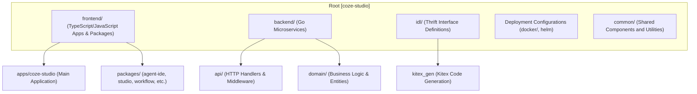
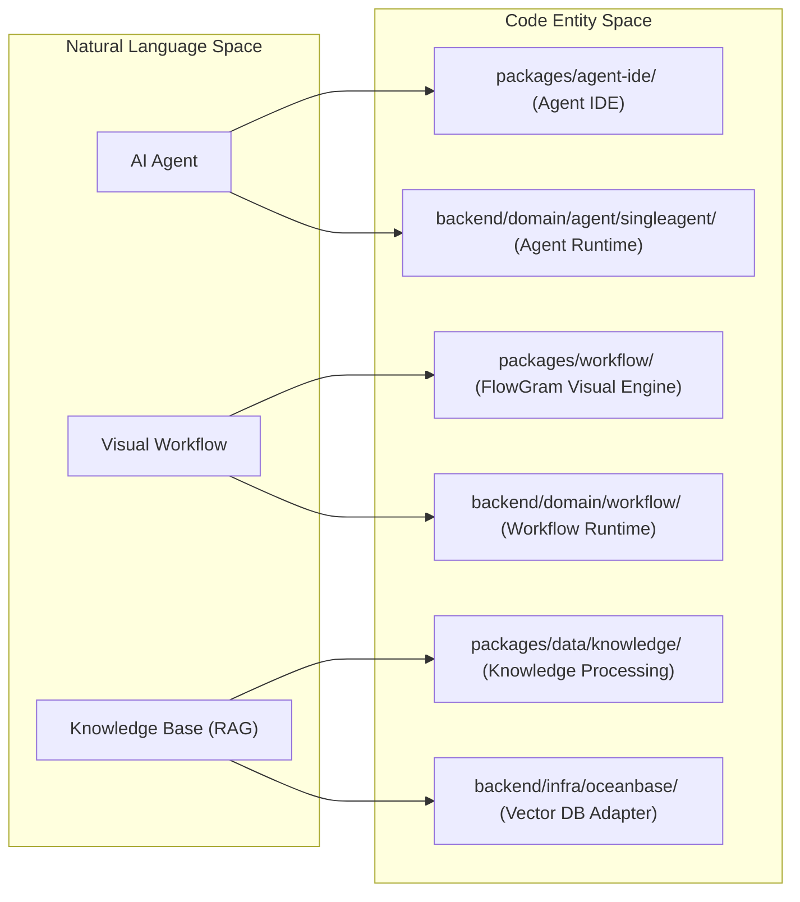
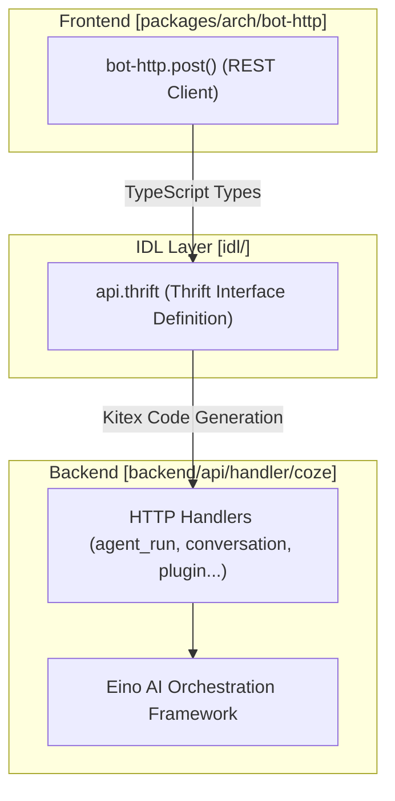

<!-- source: DeepWiki mcp.deepwiki.com · repo coze-dev/coze-studio · page 1 Overview · fetched 2026-10-29 -->

# Overview

<details>
<summary>Relevant source files</summary>

The following files were used as context for generating this wiki page:

- [CLAUDE.md](CLAUDE.md)
- [Makefile](Makefile)
- [README.md](README.md)
- [README.zh_CN.md](README.zh_CN.md)

</details>


Coze Studio is a comprehensive monorepo for building, managing, and deploying conversational AI agents. It provides an all-in-one development environment that integrates large language models (LLMs) with core agentic technologies such as prompts, Retrieval-Augmented Generation (RAG), plugins, and visual workflows. This platform supports developers in quickly creating, debugging, and deploying AI agents and applications through a low-code or no-code approach [README.md:18-27]().

The system architecture consists of a TypeScript and React frontend managed by **Rush.js** for monorepo workspace organization, a Go backend built with **Domain-Driven Design (DDD)** principles, and a **Thrift Interface Definition Language (IDL)** layer defining strict contracts between frontend and backend components [README.md:27-27]().

---

## Feature List

Coze Studio offers a rich set of core technologies and capabilities to support AI agent development:

| Module            | Features                                                                                   |
|-------------------|--------------------------------------------------------------------------------------------|
| **Model Service** | Manages model lists and integrations with popular AI providers such as OpenAI and Volcengine |
| **Agent Builder** | Enables creation, publishing, and management of AI agents. Supports orchestration using workflows and RAG resources |
| **Workflow Engine** | Provides a visual canvas for creating, modifying, and publishing complex workflows representing business logic |
| **Resources Management** | Includes creation and administration of various resources like plugins, knowledge bases, and databases |
| **API & SDK**      | Supplies OpenAPI endpoints for conversation and workflow management and Chat SDK for integrating agents into custom apps |

This modular functionality empowers developers to focus on AI's core value while leveraging a unified, professional-grade development environment [README.md:29-36]().

---

## Repository Structure

The monorepo layout is designed to clearly separate concerns between frontend, backend, interface definitions, infrastructure, and common resources:



This structure organizes the complexity of the platform, supporting rapid development and incremental builds, and facilitates collaboration across teams.

For a comprehensive discussion of the directory layout and Rush.js workspace configuration, see [Repository Structure](#1.1).

---

## Technology Stack

Coze Studio leverages modern, high-performance technologies to ensure scalability, developer productivity, and rich UI experiences:

- **Frontend**: React 18 with TypeScript, leveraging Rsbuild (Rspack-based) for efficient incremental builds, Zustand for state management, and the FlowGram visual workflow engine for workflow editing [README.md:75-85]().

- **Backend**: Go 1.24 following Domain-Driven Design principles, built on the Hertz HTTP framework for service API handling, with the Eino AI orchestration framework powering agent execution and knowledge retrieval [README.md:86-94]().

- **Infrastructure**: Containerized deployment using Docker and Kubernetes (via Helm charts). Middleware services include MySQL 8.4.5 as relational database, Redis 8 for caching, Elasticsearch 8 with SmartCN plugin for search, Milvus v2.5.10 for vector database, MinIO for object storage, NSQ as message queue, and etcd for configuration management [README.md:11,104-111]().

This technology stack allows Coze Studio to achieve high extensibility and operational robustness.

For detailed insights on all core technologies and frameworks, see [Technology Stack](#1.2).

---

## Quickstart Deployment

Coze Studio provides a streamlined Docker Compose deployment to quickly get started:

1. **Clone the repository:**

   ```bash
   git clone https://github.com/coze-dev/coze-studio.git
   ```

2. **Start services:**

   - On macOS or Linux:

     ```bash
     cd coze-studio
     make web
     ```

   - On Windows:

     ```bash
     cd coze-studio
     cp ./docker/.env.example ./docker/.env
     docker compose -f ./docker/docker-compose.yml up
     ```

3. **Access Coze Studio:**

   - Register at `http://localhost:8888/sign`.
   - Configure AI models at `http://localhost:8888/admin/#model-management` (requires image version ≥ 0.5.0).
   - Start using at `http://localhost:8888/`.

> **Warning:** For public network deployment, assess security risks such as SSRF, API privilege escalation, and Python execution environment exposure. See the [Quickstart guide](https://github.com/coze-dev/coze-studio/wiki/2.-Quickstart#security-risks-in-public-networks) for protection guidelines.

Sources: [README.md:46-71](), [Makefile:23-77]()

---

## Architectural Mapping: Natural Language Space to Code Entity Space

The diagrams below connect conceptual AI functionalities to their concrete code modules, facilitating developer navigation across natural language features and code artifacts.

### AI System Components to Code Packages


### Frontend Requests, Interface Definitions, and Backend Handlers



These mappings illustrate how front-end service requests traverse through IDL contracts into backend route handlers which then orchestrate AI logic with Eino [README.md:131-134]().

---

## Governance and Contribution

Coze Studio is licensed under the Apache-2.0 license, ensuring an open and transparent governance model. Code ownership is carefully managed via `.github/CODEOWNERS` files to maintain quality and responsibility boundaries across the sprawling codebase [README.md:10-12](), [.github/CODEOWNERS:1-20]().

For further developer resources and contribution workflows, explore the related sections:

- [Repository Structure](#1.1)
- [Technology Stack](#1.2)
- [CI/CD System](#3)
- [Development Environment](#6)
- [Contributing](#8)

---

This overview establishes the foundational understanding needed for deeper exploration into Coze Studio. See the linked child pages for detailed discussions on each technical aspect.

---

**Sources:**  
[README.md:18-36](), [README.md:75-135](), [Makefile:1-158](), [.github/CODEOWNERS:1-20]()

---

