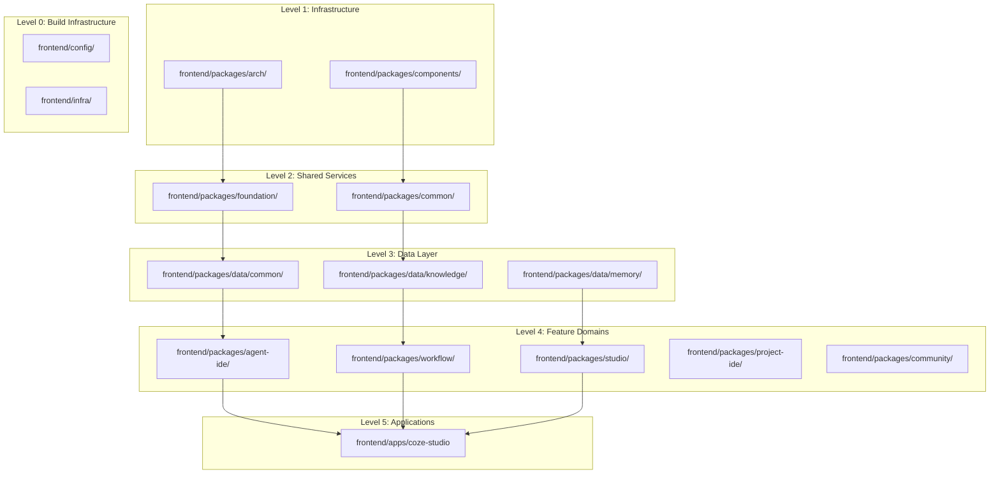
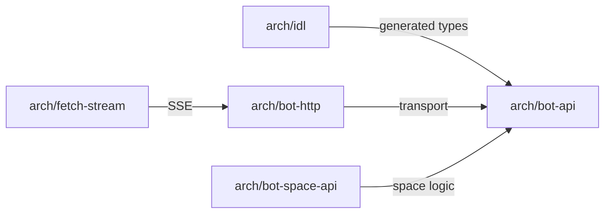
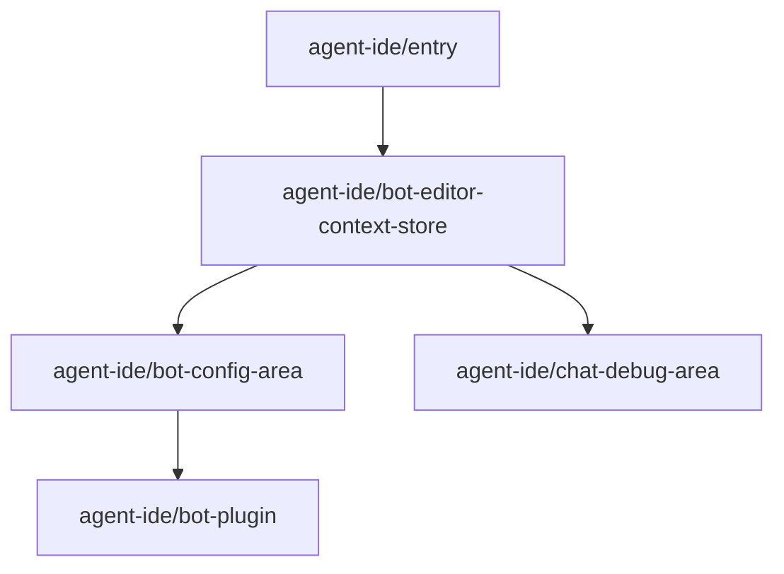
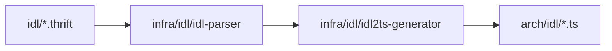

<!-- source: DeepWiki mcp.deepwiki.com · repo coze-dev/coze-studio · page 4.2 Package Organization · fetched 2026-10-29 -->

# Package Organization

<details>
<summary>Relevant source files</summary>

The following files were used as context for generating this wiki page:

- [.github/.licenserc.yaml](.github/.licenserc.yaml)
- [.github/CODEOWNERS](.github/CODEOWNERS)

</details>


This document details the organization of 170+ frontend packages in the Coze Studio monorepo located under `frontend/`. Packages are structured in a strict hierarchical architecture, with dependency rules enforced by Rush.js and ownership defined via `CODEOWNERS`.

**Directory Structure:**
```
frontend/
├── apps/                       # Application entry points (Level 5)
│   └── coze-studio/           # Main application
├── packages/                   # Feature and infrastructure packages
│   ├── agent-ide/             # Agent IDE domain (Level 4, 40+ packages)
│   ├── workflow/              # Workflow domain (Level 4, 20+ packages)
│   ├── studio/                # Studio domain (Level 4, 25+ packages)
│   ├── project-ide/           # Project IDE domain (Level 4, 13+ packages)
│   ├── community/             # Community domain (Level 4, 2 packages)
│   ├── data/                  # Data layer (Level 3, 20+ packages)
│   ├── common/                # Shared services (Level 2, 20+ packages)
│   ├── foundation/            # Foundation services (Level 2, 10+ packages)
│   ├── components/            # UI components (Level 1, 10+ packages)
│   ├── arch/                  # Architecture layer (Level 1, 30+ packages)
│   └── devops/                # DevOps tools (Level 0, 5 packages)
├── config/                     # Shared build configs (Level 0, 7 packages)
├── infra/                      # Build infrastructure (Level 0, 8+ packages)
└── common/                     # Package templates
    └── _templates/            # Scaffolding templates
```

**Organization Principles:**
- **Hierarchical Dependencies**: Lower-level packages cannot depend on higher-level packages.
- **Adapter Pattern**: 40+ adapter packages (suffixed with `-adapter`) enable dependency injection and platform abstraction, allowing the core logic to remain platform-agnostic [[.github/CODEOWNERS:18,35,38,45,51,53,56,60,69,75,80,107-108,122,128,131,142,151,153,156,160,165,167,172,174,179,183,185,187,191,196,198,201,203-204,208,210-214,219,222,224,226,230,233,237,242,248,265,267]]().
- **Domain Separation**: Feature domains like `agent-ide`, `workflow`, and `studio` are isolated modules.
- **Shared Infrastructure**: Common packages (`arch`, `foundation`, `common`, `data`) provide reusable services across domains.

**Sources:** [[.github/CODEOWNERS:1-278]]()

## Hierarchical Structure

The Coze Studio frontend follows a 5-layer architecture with strict dependency enforcement:

| Tier | Name | Location | Description |
| :--- | :--- | :--- | :--- |
| **Level 5** | Applications | `frontend/apps/coze-studio/` | Main application integrating all feature domains [[.github/CODEOWNERS:6]](). |
| **Level 4** | Feature Domains | `frontend/packages/{agent-ide, workflow, studio, project-ide, community}/` | High-level business logic and IDE features [[.github/CODEOWNERS:7-8,40,61,173,192,230]](). |
| **Level 3** | Data Layer | `frontend/packages/data/` | Knowledge management, memory systems, and data processing [[.github/CODEOWNERS:84,95,100,102,130]](). |
| **Level 2** | Shared Services | `frontend/packages/{foundation, common}/` | Account management, global state, chat UI, and workspace logic [[.github/CODEOWNERS:30,34,49,72,141]](). |
| **Level 1** | Architecture | `frontend/packages/{arch, components}/` | Core APIs, HTTP clients, state management, and base UI components [[.github/CODEOWNERS:9-12,21-22,26,28,32]](). |
| **Level 0** | Build & Config | `frontend/{config, infra}/` | Shared build configurations, IDL generation, and monorepo tooling [[.github/CODEOWNERS:13-16,104-106,144]](). |

**Package Hierarchy Diagram:**



**Sources:** [[.github/CODEOWNERS:1-278]]()

---

## Level 1: Infrastructure Layer

### Architecture Packages (arch)

Located in `frontend/packages/arch/`, these 30+ packages provide the foundational layer for API communication, state management, and logging.

**API & Communication Packages:**



| Package | Purpose | Location |
| :--- | :--- | :--- |
| `idl` | Generated TypeScript types from Thrift IDL [[.github/CODEOWNERS:26]]() | `frontend/packages/arch/idl/` |
| `bot-api` | Core API interface layer [[.github/CODEOWNERS:9]]() | `frontend/packages/arch/bot-api/` |
| `bot-http` | HTTP client wrapper with interceptors [[.github/CODEOWNERS:10]]() | `frontend/packages/arch/bot-http/` |
| `bot-store` | Core state management using MobX [[.github/CODEOWNERS:28]]() | `frontend/packages/arch/bot-store/` |
| `bot-error` | Centralized error handling and reporting [[.github/CODEOWNERS:29]]() | `frontend/packages/arch/bot-error/` |

**Sources:** [[.github/CODEOWNERS:9-12,26,28-29,31-32,36-39,43-44,51,53-55,78-82,101,111,113,125,135,143]]()

---

## Level 2: Shared Services Layer

### Foundation Packages (foundation)

Provides core application services like authentication and workspace management.

| Package | Purpose | Location |
| :--- | :--- | :--- |
| `account-base` | Core account and user logic [[.github/CODEOWNERS:141]]() | `frontend/packages/foundation/account-base/` |
| `space-store` | Workspace state management [[.github/CODEOWNERS:30]]() | `frontend/packages/foundation/space-store/` |
| `global-store` | Application-wide global state [[.github/CODEOWNERS:103]]() | `frontend/packages/foundation/global-store/` |
| `local-storage` | Typed local storage utilities [[.github/CODEOWNERS:34]]() | `frontend/packages/foundation/local-storage/` |

**Sources:** [[.github/CODEOWNERS:30,33-35,48,103,141-142,154,215-218,221-226]]()

### Common Packages (common)

Reusable UI components and business logic shared across IDEs.

**Chat Area Subsystem:**
The chat area is a complex subsystem with specialized packages for rendering and logic:
- `chat-core`: Core chat business logic [[.github/CODEOWNERS:49]]().
- `chat-uikit`: UI components for chat bubbles and inputs [[.github/CODEOWNERS:72]]().
- `chat-area`: Main chat container component [[.github/CODEOWNERS:83]]().
- `plugin-chat-background`: Customization for chat environments [[.github/CODEOWNERS:197]]().

**Sources:** [[.github/CODEOWNERS:45-46,49-50,56,59-60,72-74,83,88-89,114-122,188-191,197,229]]()

---

## Level 3: Data Layer

### Knowledge Management (data/knowledge)

Handles document processing and knowledge base integration.

| Package | Purpose |
| :--- | :--- |
| `knowledge-resource-processor-core` | Core logic for document parsing and processing [[.github/CODEOWNERS:100]](). |
| `knowledge-modal-base` | Base UI for knowledge base management modals [[.github/CODEOWNERS:95]](). |
| `common/stores` | State stores for knowledge resources [[.github/CODEOWNERS:102]](). |

**Sources:** [[.github/CODEOWNERS:95,100,102,124,126-129,133-134,136-137,238]]()

### Memory & Database (data/memory)

Manages the AI's long-term memory and database features.

- `database-creator`: UI for defining database schemas [[.github/CODEOWNERS:112]]().
- `llm-plugins`: Plugins for memory-related LLM operations [[.github/CODEOWNERS:84]]().
- `variables`: Variable management for agent state [[.github/CODEOWNERS:130]]().

**Sources:** [[.github/CODEOWNERS:84,112,123,130-132,239]]()

---

## Level 4: Feature Domains

### Agent IDE Domain (agent-ide)

The primary environment for building AI agents.



| Package | Purpose |
| :--- | :--- |
| `bot-editor-context-store` | Centralized state for the agent editor [[.github/CODEOWNERS:67]](). |
| `bot-config-area` | UI for configuring bot personality and tools [[.github/CODEOWNERS:159]](). |
| `model-manager` | Interface for selecting and configuring LLMs [[.github/CODEOWNERS:92]](). |
| `agent-publish` | Workflow for publishing agents to various platforms [[.github/CODEOWNERS:7]](). |

**Sources:** [[.github/CODEOWNERS:7-8,41-42,61-71,75-76,91-94,109-110,157-168,171-172,176-180,184-187,198-213]]()

### Workflow Domain (workflow)

Visual programming environment using node-based flows.

- `workflow/base`: Core engine for workflow execution [[.github/CODEOWNERS:192]]().
- `workflow/fabric-canvas`: Canvas rendering using Fabric.js [[.github/CODEOWNERS:250]]().
- `workflow/test-run-next`: Modern test execution and trace visualization [[.github/CODEOWNERS:253-256]]().

**Sources:** [[.github/CODEOWNERS:175,192-193,196,244,248-262,267]]()

---

## Level 0: Build Infrastructure

### IDL Code Generation (infra/idl)

Coze Studio uses a custom toolchain to convert Thrift IDL files into TypeScript.



- `idl-parser`: Parses Thrift syntax into an AST [[.github/CODEOWNERS:147]]().
- `idl2ts-generator`: Generates TypeScript code from the AST [[.github/CODEOWNERS:146]]().
- `idl2ts-cli`: Command-line interface for the generation process [[.github/CODEOWNERS:144]]().

**Sources:** [[.github/CODEOWNERS:144-150]]()

## Team Ownership

Ownership is strictly enforced via the `CODEOWNERS` file to ensure quality and architectural integrity.

| Team / Group | Primary Responsibilities |
| :--- | :--- |
| **Architecture** | `arch/`, `config/`, `infra/`, `foundation/` [[.github/CODEOWNERS:1-5,9-20]]() |
| **Agent IDE** | `packages/agent-ide/`, `packages/studio/` [[.github/CODEOWNERS:6-8,40-42]]() |
| **Workflow** | `packages/workflow/`, `common/flowgram-adapter/` [[.github/CODEOWNERS:59-60,192-193]]() |
| **Data/Knowledge** | `packages/data/knowledge/`, `packages/data/memory/` [[.github/CODEOWNERS:84,95,100,102]]() |

**Sources:** [[.github/CODEOWNERS:1-278]]()

---

