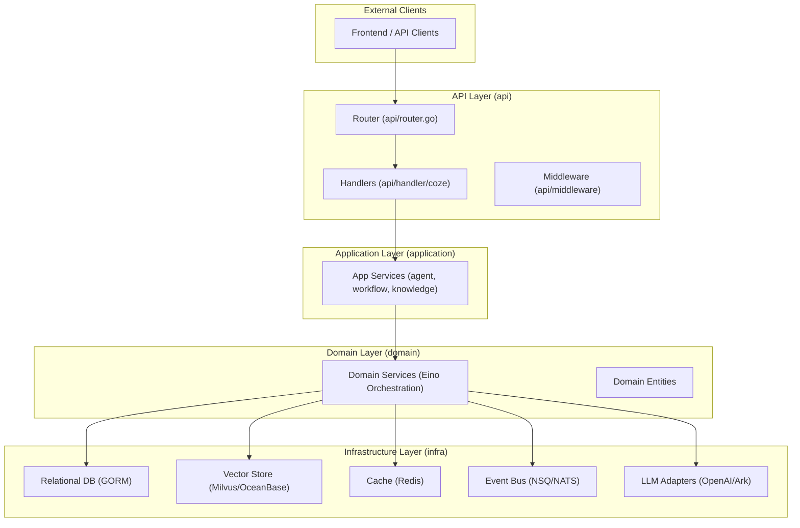
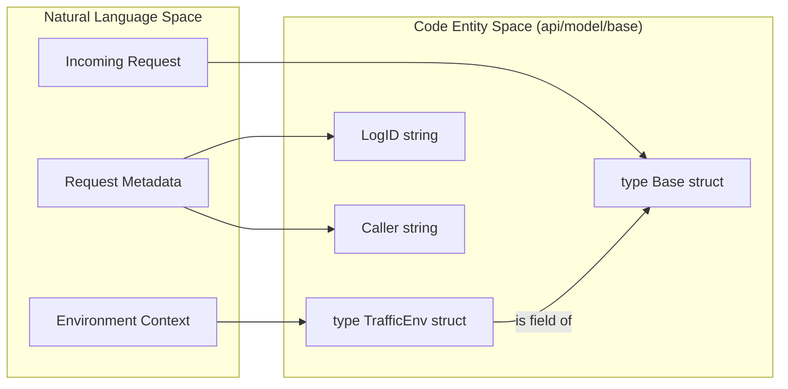
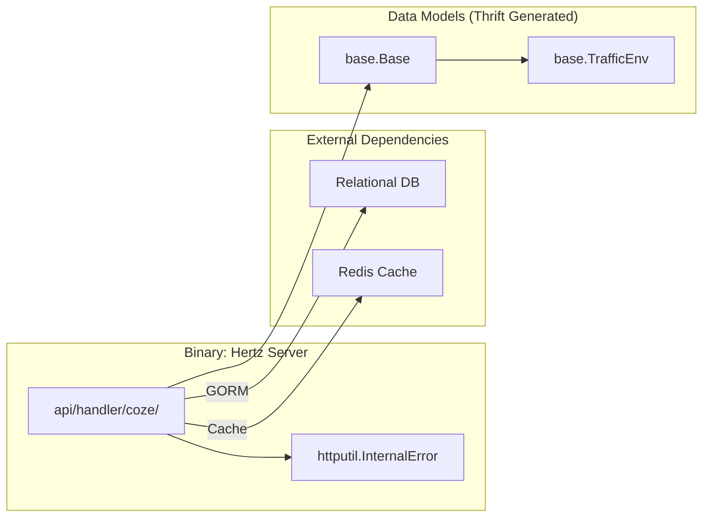

<!-- source: DeepWiki mcp.deepwiki.com · repo coze-dev/coze-studio · page 5 Backend System · fetched 2026-10-29 -->

# Backend System

Relevant source files

The following files were used as context for generating this wiki page:

- [backend/README.md](backend/README.md)
- [backend/api/handler/coze/base.go](backend/api/handler/coze/base.go)
- [backend/api/model/base/base.go](backend/api/model/base/base.go)

## Purpose and Scope

The Coze Studio backend is a high-performance, Go-based system designed to power the lifecycle of AI agents. Built on the **Hertz** HTTP framework and following **Domain-Driven Design (DDD)** principles, it orchestrates complex interactions between LLMs, vector databases, workflows, and traditional relational storage.

This page serves as a high-level entry point to the backend services. For deep technical details, refer to the following child pages:

*   **[Service Architecture](#5.1)**: Deep dive into the DDD layers (`api/`, `application/`, `domain/`, `infra/`) and the `main.go` entry point.
*   **[API Handlers and Models](#5.2)**: Documentation of the RESTful API layer, Thrift-generated models, and the `httputil` error handling framework.
*   **[Domain Services](#5.3)**: Details on core business logic including Agent execution, RAG pipelines (Knowledge), and the **Eino** AI orchestration framework.
*   **[Infrastructure Adapters](#5.4)**: Technical guide to the `infra/` layer, covering GORM, Redis, Elasticsearch, Vector Stores (Milvus/OceanBase), and the Python sandbox.
*   **[Build and Testing](#5.5)**: Compilation flags, unit testing with race detection, and CI/CD integration.

---

## System Architecture Overview

The backend is organized into a strictly layered architecture to separate technical concerns from business rules. It leverages the **Eino** framework for AI graph orchestration and **Hertz** for high-concurrency HTTP handling.

### Backend Layered Structure (DDD)

Sources: [backend/api/handler/coze/base.go:17-34]()

---

## Core Components

### 1. API Layer
The API layer handles HTTP entry points. Most handlers and models are generated via **Thrift IDL** to ensure strict contracts between the Go backend and the TypeScript frontend.
*   **Handlers**: Located in `backend/api/handler/coze/`, covering agents, conversations, and workflows.
*   **Models**: Found in `backend/api/model/`, providing type-safe request/response structures like the `TrafficEnv` and `Base` structs used for request context.
*   **Utility**: The `httputil` package provides standardized responses for `BadRequest` and `InternalError`.

### 2. Domain & Application Logic
The core "intelligence" resides here. The system uses **Eino** to build modular AI capabilities.
*   **Agent Domain**: Manages single-agent execution and multi-agent collaboration.
*   **Knowledge Domain**: Implements the RAG (Retrieval-Augmented Generation) pipeline, including document parsing and embedding.
*   **Workflow Domain**: A graph-based execution engine for complex logic chains.

### 3. Infrastructure & Adapters
The `infra/` layer contains concrete implementations for external dependencies.
*   **Persistence**: Uses GORM for MySQL/OceanBase and specialized clients for Milvus/VikingDB.
*   **Execution**: A Python sandbox (via Deno and `sandbox.py`) allows for safe execution of user-defined code nodes.

Sources: [backend/api/model/base/base.go:10-207](), [backend/api/handler/coze/base.go:24-33]()

---

## Technology Stack

| Category | Technology | Usage |
| :--- | :--- | :--- |
| **Language** | Go 1.24 | Core service logic |
| **HTTP Framework** | Hertz | High-performance HTTP server |
| **AI Orchestration** | Eino | Graph-based AI logic and LLM integration |
| **ORM** | GORM | Database abstraction and query building |
| **IDL / RPC** | Thrift / Kitex | Interface definition and code generation |
| **Scripting** | Python 3 | Document parsing and code sandbox |

---

## Runtime Environment

The backend is containerized using a multi-stage Alpine-based Dockerfile. It includes a Python environment specifically for heavy-duty document processing tasks like PDF and DOCX parsing.

### Code-to-Entity Mapping: Request Flow

The following diagram maps natural language concepts to specific Go entities defined in the backend models.

Sources: [backend/api/model/base/base.go:10-13](), [backend/api/model/base/base.go:200-207]()

### Runtime Service Topology

Sources: [backend/api/handler/coze/base.go:24-33](), [backend/api/model/base/base.go:10-21]()

---

## Development and Deployment

The backend supports several deployment modes:
1.  **Local Debug**: Using `go run main.go` with local infrastructure (MySQL, Redis) started via Docker Compose.
2.  **Docker Compose**: A full-stack deployment including the Go server and all middleware.
3.  **Kubernetes**: Production-grade deployment via Helm charts.

For detailed build instructions and CI/CD workflows, see **[Build and Testing](#5.5)**.

Sources: [backend/README.md:1-2]()

---

