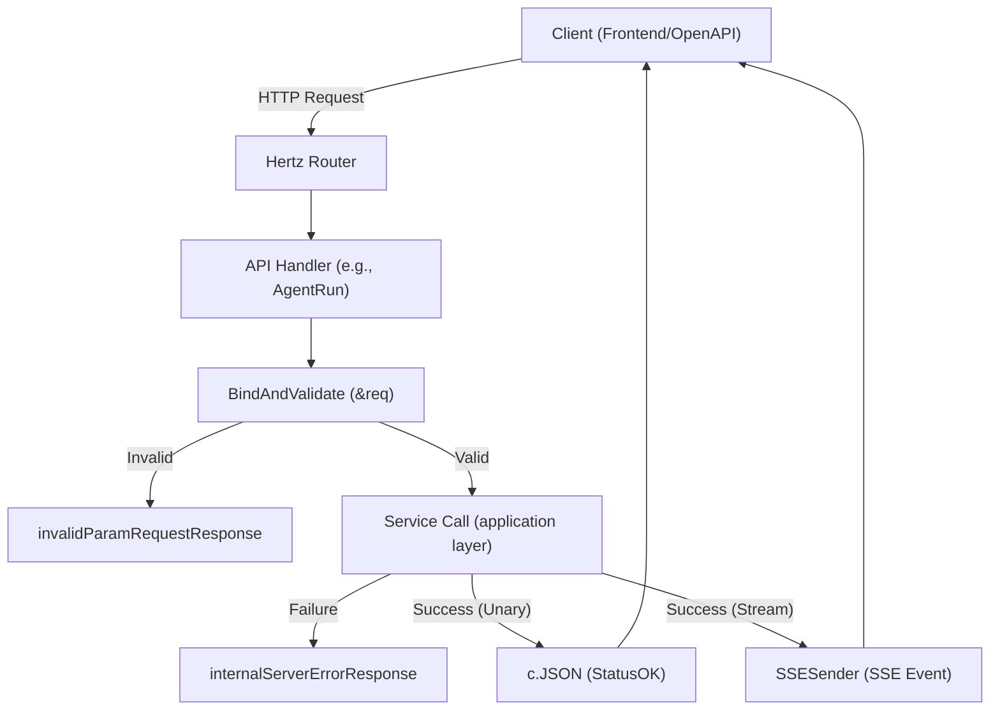
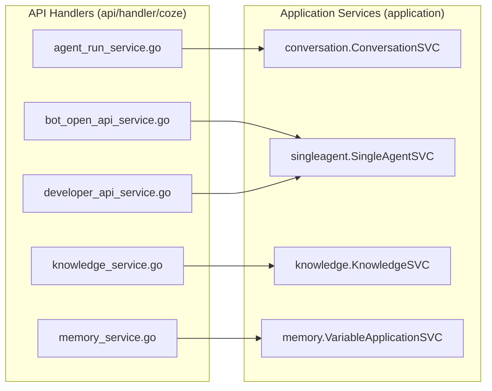

<!-- source: DeepWiki mcp.deepwiki.com · repo coze-dev/coze-studio · page 5.2 API Handlers and Models · fetched 2026-10-29 -->

# API Handlers and Models

<details>
<summary>Relevant source files</summary>

The following files were used as context for generating this wiki page:

- [backend/api/handler/coze/agent_run_service.go](backend/api/handler/coze/agent_run_service.go)
- [backend/api/handler/coze/bot_open_api_service.go](backend/api/handler/coze/bot_open_api_service.go)
- [backend/api/handler/coze/config_service.go](backend/api/handler/coze/config_service.go)
- [backend/api/handler/coze/conversation_service.go](backend/api/handler/coze/conversation_service.go)
- [backend/api/handler/coze/database_service.go](backend/api/handler/coze/database_service.go)
- [backend/api/handler/coze/developer_api_service.go](backend/api/handler/coze/developer_api_service.go)
- [backend/api/handler/coze/intelligence_service.go](backend/api/handler/coze/intelligence_service.go)
- [backend/api/handler/coze/knowledge_service.go](backend/api/handler/coze/knowledge_service.go)
- [backend/api/handler/coze/memory_service.go](backend/api/handler/coze/memory_service.go)
- [backend/api/handler/coze/message_service.go](backend/api/handler/coze/message_service.go)
- [backend/api/handler/coze/open_apiauth_service.go](backend/api/handler/coze/open_apiauth_service.go)
- [backend/api/handler/coze/passport_service.go](backend/api/handler/coze/passport_service.go)
- [backend/api/handler/coze/playground_service.go](backend/api/handler/coze/playground_service.go)
- [backend/api/handler/coze/plugin_develop_service.go](backend/api/handler/coze/plugin_develop_service.go)
- [backend/api/handler/coze/public_product_service.go](backend/api/handler/coze/public_product_service.go)
- [backend/api/handler/coze/resource_service.go](backend/api/handler/coze/resource_service.go)
- [backend/api/handler/coze/upload_service.go](backend/api/handler/coze/upload_service.go)
- [backend/api/handler/coze/workflow_service.go](backend/api/handler/coze/workflow_service.go)
- [backend/api/internal/httputil/error_resp.go](backend/api/internal/httputil/error_resp.go)

</details>


## Purpose and Scope

This page documents the backend API layer of Coze Studio. It covers the HTTP handlers located in `backend/api/handler/coze/`, the request/response models in `backend/api/model/`, and the standardized error handling mechanisms. This layer serves as the entry point for both the Coze Studio frontend and external Open API consumers, orchestrating calls to the application and domain layers using the **Hertz** HTTP framework.

## Overview

The API layer follows a structured pattern where handlers are responsible for:
1.  **Binding and Validation**: Parsing incoming requests into typed models using `c.BindAndValidate(&req)` and performing domain-specific parameter checks [backend/api/handler/coze/agent_run_service.go:45-54]().
2.  **Service Orchestration**: Invoking the appropriate application services (e.g., `ConversationSVC`, `SingleAgentSVC`, `DatabaseApplicationSVC`) [backend/api/handler/coze/conversation_service.go:49]().
3.  **Response Formatting**: Returning JSON responses via `c.JSON` or managing Server-Sent Events (SSE) for streaming AI interactions [backend/api/handler/coze/agent_run_service.go:56-60]().
4.  **Error Handling**: Utilizing standardized response helpers to translate internal errors into HTTP responses [backend/api/handler/coze/bot_open_api_service.go:58-61]().

## Request and Response Flow

The following diagram illustrates the data flow from an incoming HTTP request through the API handlers to the application services.

### API Request Pipeline

Sources: [backend/api/handler/coze/agent_run_service.go:41-72](), [backend/api/handler/coze/bot_open_api_service.go:42-61]()

## Key API Handlers

### 1. Agent Execution and Chat
These handlers manage the lifecycle of AI chats, including synchronous and streaming runs.

*   **`AgentRun`**: The primary endpoint for studio-based chat. It initializes an `SSESender` and calls `conversation.ConversationSVC.Run` [backend/api/handler/coze/agent_run_service.go:41-72]().
*   **`ChatV3`**: The Open API v3 entry point. It supports both synchronous (JSON) and asynchronous (SSE) modes based on the `Stream` parameter [backend/api/handler/coze/agent_run_service.go:91-139](). It includes a pre-processor to convert JSON parameters to strings if necessary [backend/api/handler/coze/agent_run_service.go:168-209]().
*   **`CancelChatApi`**: Allows users to interrupt an ongoing chat run [backend/api/handler/coze/agent_run_service.go:150-166]().

### 2. Knowledge and Database Management
Manages RAG (Retrieval-Augmented Generation) resources and structured storage for agents.

*   **`CreateDataset`**: Entry point for creating knowledge bases [backend/api/handler/coze/knowledge_service.go:36-51]().
*   **`AddDatabase`**: Registers a new database table for agent memory [backend/api/handler/coze/database_service.go:75-91]().
*   **`BindDatabase`**: Associates a specific database with an agent [backend/api/handler/coze/database_service.go:135-151]().

### 3. Developer and Bot Management
Handles the lifecycle of bot drafts and publishing.

*   **`DraftBotCreate`**: Creates a new bot draft in a specific workspace [backend/api/handler/coze/developer_api_service.go:49-90]().
*   **`PublishDraftBot`**: Deploys a bot draft to specific connectors [backend/api/handler/coze/developer_api_service.go:174-195]().
*   **`GetBotOnlineInfo`**: Retrieves the status and configuration of a published bot [backend/api/handler/coze/bot_open_api_service.go:97-113]().

### 4. Configuration and Intelligence
Provides system settings and search capabilities.

*   **`GetBasicConfiguration`**: Retrieves core server settings like `ServerHost` and `CodeRunnerType` [backend/api/handler/coze/config_service.go:29-40]().
*   **`UpdateKnowledgeConfig`**: Configures embedding models and dimensions for knowledge processing [backend/api/handler/coze/config_service.go:121-194]().
*   **`GetDraftIntelligenceList`**: Provides search functionality for projects and agents [backend/api/handler/coze/intelligence_service.go:39-55]().

## Data Models and Validation

Request and response models are defined in `backend/api/model/`. The handlers use Hertz's `BindAndValidate` method to enforce constraints.

**Manual Validation Example:**
In `AgentRun`, the handler ensures `BotID` is non-zero and `Scene` is provided before proceeding to the application layer [backend/api/handler/coze/agent_run_service.go:74-87]().

## Implementation Details: Streaming (SSE)

For AI interactions, Coze Studio utilizes Server-Sent Events (SSE). Handlers set specific headers to ensure real-time delivery without proxy buffering.

```go
sseSender := sseImpl.NewSSESender(sse.NewStream(c))
c.SetStatusCode(http.StatusOK)
c.Response.Header.Set("X-Accel-Buffering", "no")
```
Sources: [backend/api/handler/coze/agent_run_service.go:56-59]()

## Code Entity Mapping

The following diagram bridges the logical API domains to their implementation files and application service instances.

### Handler to Service Mapping

Sources: [backend/api/handler/coze/agent_run_service.go:60](), [backend/api/handler/coze/bot_open_api_service.go:106](), [backend/api/handler/coze/developer_api_service.go:83](), [backend/api/handler/coze/knowledge_service.go:45](), [backend/api/handler/coze/memory_service.go:45]()

## Summary Table of Handler Services

| Domain | Handler File | Primary Service Dependency |
| :--- | :--- | :--- |
| **Agent Execution** | `agent_run_service.go` | `conversation.ConversationSVC` |
| **Open API** | `bot_open_api_service.go` | `singleagent.SingleAgentSVC` |
| **Knowledge** | `knowledge_service.go` | `knowledge.KnowledgeSVC` |
| **Database** | `database_service.go` | `memory.DatabaseApplicationSVC` |
| **Developer API** | `developer_api_service.go` | `singleagent.SingleAgentSVC` |
| **Variables/KV** | `memory_service.go` | `memory.VariableApplicationSVC` |
| **Passport/User** | `passport_service.go` | `user.UserApplicationSVC` |

Sources: [backend/api/handler/coze/agent_run_service.go](), [backend/api/handler/coze/knowledge_service.go](), [backend/api/handler/coze/database_service.go](), [backend/api/handler/coze/memory_service.go](), [backend/api/handler/coze/passport_service.go]()

---

