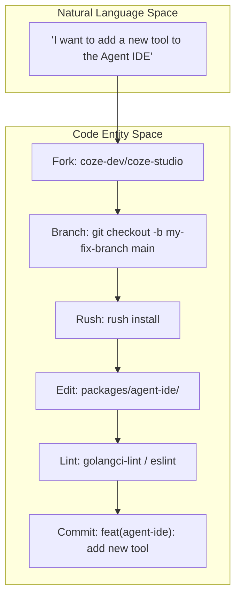
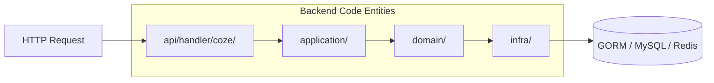

<!-- source: DeepWiki mcp.deepwiki.com · repo coze-dev/coze-studio · page 8.1 Getting Started with Contributing · fetched 2026-10-29 -->

# Getting Started with Contributing

Relevant source files

The following files were used as context for generating this wiki page:

- [AUTHORS](AUTHORS)
- [CODE_OF_CONDUCT.md](CODE_OF_CONDUCT.md)
- [CONTRIBUTING.md](CONTRIBUTING.md)

## Purpose and Scope

This document provides an introduction to contributing to Coze Studio, covering the prerequisites, communication channels, and initial steps for setting up a development environment. It outlines the standards for community interaction, security disclosures, and the basic workflow for making your first contribution. Coze Studio is a monorepo containing both frontend development environments and backend services for building conversational AI agents.

For detailed information about:
- Creating pull requests and PR validation requirements, see [8.2 Pull Request Process]().
- Reporting bugs and requesting features, see [8.3 Issue Reporting]().
- Code ownership and community standards, see [8.4 Community Guidelines]().
- Setting up your development environment, see [6.1 Initial Setup]().

---

## Community and Communication

Coze Studio maintains several channels for community interaction and support. Contributors are encouraged to engage through these platforms to discuss designs, report issues, or seek help.

### Communication Channels
- **GitHub Issues**: Primary location for bug reports and feature requests [CONTRIBUTING.md:10-17]().
- **Email**: For general inquiries and support, contact [opensource-studio@coze.cn](mailto:opensource-studio@coze.cn) [CONTRIBUTING.md:21-22]().
- **Discord/Telegram/Feishu**: Community discussion groups (refer to the main repository README for current links).

### Security Disclosures
If you discover a security vulnerability, **do not** report it via public GitHub issues. Instead, please send a detailed report to the security team at [opensource-studio@coze.cn](mailto:opensource-studio@coze.cn) to ensure a safe and coordinated disclosure process [CONTRIBUTING.md:18-19]().

### Code of Conduct
All participants in the Coze Studio community are expected to adhere to the **Contributor Covenant Code of Conduct**. We pledge to make participation a harassment-free experience for everyone [CODE_OF_CONDUCT.md:1-14]().

**Key Standards**:
*   Demonstrate empathy and kindness [CODE_OF_CONDUCT.md:20-20]().
*   Being respectful of differing opinions, viewpoints, and experiences [CODE_OF_CONDUCT.md:21-21]().
*   Focusing on what is best not just for individuals, but for the overall community [CODE_OF_CONDUCT.md:25-26]().
*   Unacceptable behavior includes sexualized language, trolling, insulting/derogatory comments, personal attacks, and public or private harassment [CODE_OF_CONDUCT.md:28-37]().

Enforcement is handled by community leaders who may issue warnings or bans for violations [CODE_OF_CONDUCT.md:39-49](). Reports of misconduct can be sent to [conduct@cloudwego.io](mailto:conduct@cloudwego.io) [CODE_OF_CONDUCT.md:59-63]().

Sources: [CONTRIBUTING.md:10-22](), [CODE_OF_CONDUCT.md:1-63]()

---

## Contribution Prerequisites

### Technical Stack
The repository is a monorepo requiring specific tools for local development.

| Layer | Technology | Requirement |
|-------|------------|-------------|
| **Frontend** | React, TypeScript, Rush.js, pnpm | Node.js version specified in `.nvmrc` |
| **Backend** | Go 1.24, Hertz, Eino | Compatibility with [Go Official](https://golang.org/project) [CONTRIBUTING.md:44-44]() |
| **Tooling** | Git, GitHub Actions | Familiarity with [GitHub Actions](https://github.com/features/actions) [CONTRIBUTING.md:46-47]() |

### Code Style Standards
Before submitting, ensure your code follows these guides:
- **Go**: [Effective Go](https://golang.org/doc/effective_go) and [Go Code Review Comments](https://github.com/golang/go/wiki/CodeReviewComments) [CONTRIBUTING.md:50-51]().
- **Linting**: Mandatory checking with `gofmt` and `golangci-lint` for backend code [CONTRIBUTING.md:45-45]().
- **Commits**: Follow [AngularJS Git Commit Message Conventions](https://docs.google.com/document/d/1QrDFcIiPjSLDn3EL15IJygNPiHORgU1_OOAqWjiDU5Y/edit). This is required for automated release note generation [CONTRIBUTING.md:35-36]().

Sources: [CONTRIBUTING.md:35-52]()

---

## First Steps for Contributors

### 1. Contribution Workflow
The project follows the **git-flow** branching model, also known as **FDD** (Feature-driven development) [CONTRIBUTING.md:6-7]().

**From Intent to Code Entity**
This diagram maps natural language intents to specific repository entities and commands.

### 2. Implementation and Data Flow
When contributing to backend logic, your code will typically flow through the DDD (Domain Driven Design) layers defined in the `backend/` directory.

**Backend Service Entity Flow**
This diagram associates logical layers with the directory structure used in the backend.

Sources: [CONTRIBUTING.md:1-42](), [AUTHORS:1-10]()

---

## Your First Pull Request

1.  **Search**: Check [GitHub Pull Requests](https://github.com/coze-dev/{project_name}/pulls) for existing work to avoid duplication [CONTRIBUTING.md:26-26]().
2.  **Issue**: Ensure there is an issue describing the problem or feature design before starting [CONTRIBUTING.md:27-27]().
3.  **Fork & Branch**: [Fork](https://docs.github.com/en/github/getting-started-with-github/fork-a-repo) the repository and create a branch: `git checkout -b my-fix-branch main` [CONTRIBUTING.md:28-31]().
4.  **Develop**: Create your patch with appropriate test cases [CONTRIBUTING.md:33-33]().
5.  **Commit**: Use descriptive messages following AngularJS conventions [CONTRIBUTING.md:35-35]().
6.  **Push & Submit**: Push to your fork and send a PR to `main` [CONTRIBUTING.md:37-41]().

### Adding to AUTHORS
If you have contributed in any way (including non-code contributions), you are encouraged to add your name to the `AUTHORS` file [AUTHORS:6-8]().
Format: `Name/Organization <email address>` [AUTHORS:4-4]().

Examples of current contributors include:
- `ByteDance Ltd. and/or its Affiliates` [AUTHORS:12-12]()
- `luohuaqing.2018 <luohuaqing.2018@bytedance.com>` [AUTHORS:14-14]()
- `lipandeng <lipandeng@bytedance.com>` [AUTHORS:15-15]()

Sources: [CONTRIBUTING.md:24-42](), [AUTHORS:1-49]()

---

## Summary of Guidelines

| Category | Requirement | Source |
|----------|-------------|--------|
| **Branching** | git-flow / FDD | [CONTRIBUTING.md:6-7]() |
| **Bugs** | Report via GitHub Issues; include reproduction code or [Golang Playground](https://play.golang.org) link | [CONTRIBUTING.md:10-17]() |
| **Security** | Email [opensource-studio@coze.cn](mailto:opensource-studio@coze.cn) | [CONTRIBUTING.md:18-19]() |
| **Commits** | AngularJS Convention (for auto-release notes) | [CONTRIBUTING.md:35-36]() |
| **Conduct** | Contributor Covenant 2.0 | [CODE_OF_CONDUCT.md:1-128]() |
| **Linting** | `gofmt` and `golangci-lint` required | [CONTRIBUTING.md:45-45]() |

Sources: [CONTRIBUTING.md:1-52](), [CODE_OF_CONDUCT.md:1-128](), [AUTHORS:1-49]()

---

