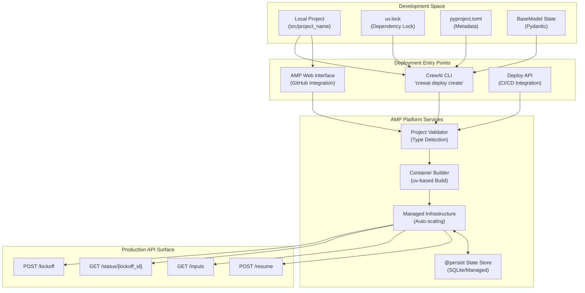
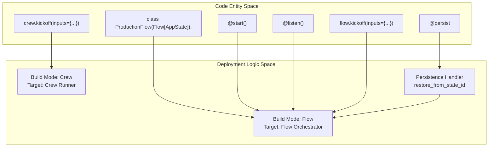

<!-- source: DeepWiki mcp.deepwiki.com · repo crewAIInc/crewAI · page 10.1 Deployment Architecture · fetched 2026-11-09 -->

# Deployment Architecture

Relevant source files

The following files were used as context for generating this wiki page:

- [docs/edge/ar/api-reference/inputs.mdx](docs/edge/ar/api-reference/inputs.mdx)
- [docs/edge/ar/api-reference/introduction.mdx](docs/edge/ar/api-reference/introduction.mdx)
- [docs/edge/ar/api-reference/kickoff.mdx](docs/edge/ar/api-reference/kickoff.mdx)
- [docs/edge/ar/api-reference/resume.mdx](docs/edge/ar/api-reference/resume.mdx)
- [docs/edge/ar/api-reference/status.mdx](docs/edge/ar/api-reference/status.mdx)

## Purpose and Scope

This document describes the technical architecture of the CrewAI AMP (Agent Management Platform) deployment system. It explains how the platform identifies project types (Crews vs. Flows), validates project structures, builds containerized environments, and exposes them via managed infrastructure and REST API endpoints.

CrewAI AMP serves as the production-grade hosting environment for autonomous agent teams, providing the necessary state management, persistence, and connectivity required for enterprise applications.

---

## System Overview

The CrewAI AMP deployment architecture transforms local development projects into production-ready "automations." The system supports two primary architectural patterns: standalone Crews and event-driven Flows. 

### High-Level Deployment Data Flow

**Sources:** [docs/edge/ar/api-reference/kickoff.mdx:1-6](), [docs/edge/ar/api-reference/inputs.mdx:1-6](), [docs/edge/ar/api-reference/status.mdx:1-6](), [docs/edge/ar/api-reference/resume.mdx:1-6]()

---

## Project Type Detection (Crew vs Flow)

The deployment system differentiates between project types to configure the correct entry point and container environment. This distinction is critical for how state is managed and how execution is orchestrated.

### Detection Logic and Requirements

| Aspect | Crew Project | Flow Project |
| :--- | :--- | :--- |
| **Primary Class** | `Crew` | `Flow[AppState]` |
| **Entry Point** | `crew.kickoff()` | `flow.kickoff()` |
| **State Management** | Task-based context | `Pydantic` `BaseModel` State |
| **Logic Type** | Linear/Hierarchical Process | Event-driven (@start, @listen) |
| **Persistence** | Session-based | `@persist` decorator for recovery |

### Mapping Code Entities to Deployment Logic

**Sources:** No direct code citations for this section in the provided files, but the concepts are foundational to CrewAI's architecture.

---

## Flow Deployment Architecture

When deploying a `Flow`, AMP optimizes for state persistence and long-running execution. 

1.  **State Persistence**: Using the `@persist` decorator, AMP saves the flow state to a managed database. This allows for recovery from failures or pausing for human intervention.
2.  **Asynchronous Execution**: For production workloads, AMP utilizes `kickoff_async` to prevent blocking the API surface while the agents execute.
3.  **State Hydration**: Deployed flows can be resumed or branched using `restore_from_state_id`, allowing a new execution to inherit state from a previous run.

**Sources:** No direct code citations for this section in the provided files, but the concepts are foundational to CrewAI's architecture.

---

## Container Build Pipeline

CrewAI AMP uses `uv` for high-performance dependency management. The build pipeline ensures that the production environment exactly matches the local development state.

### Build Stages
1.  **Project Identification**: Determines if the target is a standalone Crew or a Flow Orchestrator.
2.  **Dependency Resolution**: Processes `pyproject.toml` and `uv.lock` to build the container layer.
3.  **State Schema Validation**: For Flows, it validates the `Pydantic` `BaseModel` used for `AppState` to ensure API compatibility.
4.  **Environment Injection**: Maps secrets and environment variables defined in the AMP Dashboard to the runtime container.

**Sources:** No direct code citations for this section in the provided files, but the concepts are foundational to CrewAI's architecture.

---

## Managed Infrastructure and API Surface

Once deployed, the automation is exposed via a standardized REST API. This interface allows external systems to trigger agentic workflows and monitor their progress. Each deployed crew has a unique API endpoint, typically `https://your-crew-name.crewai.com` [docs/edge/ar/api-reference/introduction.mdx:58-62](). Authentication is handled via Bearer Tokens, which can be found in the CrewAI AMP dashboard [docs/edge/ar/api-reference/introduction.mdx:33-41]().

### REST API Endpoints

| Endpoint | Method | Description |
| :--- | :--- | :--- |
| `/inputs` | `GET` | Retrieves the required input schema (e.g., the `inputs` dictionary keys needed for `kickoff`) [docs/edge/ar/api-reference/inputs.mdx:1-8](). This helps in discovering the parameters expected by the crew [docs/edge/ar/api-reference/introduction.mdx:20-21](). |
| `/kickoff` | `POST` | Initiates the execution of the crew or flow with provided inputs. For Flows, this triggers the `@start` method. For Crews, it starts the process [docs/edge/ar/api-reference/kickoff.mdx:1-8](). It returns a `kickoff_id` to track the execution [docs/edge/ar/api-reference/introduction.mdx:23-26](). |
| `/status/{kickoff_id}` | `GET` | Provides real-time status updates of an execution, including task outputs and flow state transitions, using the `kickoff_id` [docs/edge/ar/api-reference/status.mdx:1-6](). This allows monitoring progress until completion [docs/edge/ar/api-reference/introduction.mdx:28-30](). |
| `/resume` | `POST` | Resumes a crew or flow execution, typically after human feedback or an interruption [docs/edge/ar/api-reference/resume.mdx:1-6](). |

### Typical Workflow
1.  **Discovery**: Call `GET /inputs` to understand what inputs your crew needs [docs/edge/ar/api-reference/introduction.mdx:66]().
2.  **Execution**: Send inputs via `POST /kickoff` to start processing [docs/edge/ar/api-reference/introduction.mdx:67]().
3.  **Monitoring**: Query `GET /status/{kickoff_id}` until completion [docs/edge/ar/api-reference/introduction.mdx:68]().
4.  **Results**: Extract final outputs from the completed response [docs/edge/ar/api-reference/introduction.mdx:69]().

### Error Handling
The API uses standard HTTP status codes for error reporting:
-   `200`: Success
-   `400`: Bad Request - incorrect input format
-   `401`: Unauthorized - invalid Bearer token
-   `404`: Not Found - resource does not exist
-   `422`: Validation Error - missing required inputs
-   `500`: Server Error - contact support
[docs/edge/ar/api-reference/introduction.mdx:73-83]()

### Infrastructure Features
-   **Observability**: Built-in tracing for all LLM calls and tool executions.
-   **Guardrails**: Deployed tasks respect defined `guardrail` functions, ensuring that outputs meet quality standards before being returned via the API.
-   **Structured Outputs**: The infrastructure handles the serialization of `output_pydantic` or `output_json` from tasks into the final API response.

**Sources:** [docs/edge/ar/api-reference/introduction.mdx:1-135](), [docs/edge/ar/api-reference/kickoff.mdx:1-6](), [docs/edge/ar/api-reference/inputs.mdx:1-6](), [docs/edge/ar/api-reference/status.mdx:1-6](), [docs/edge/ar/api-reference/resume.mdx:1-6]()

---

