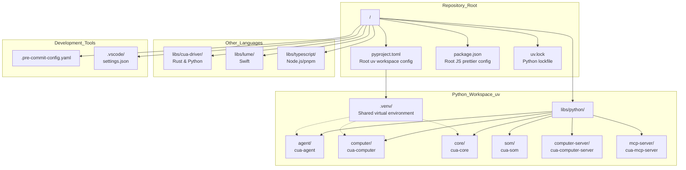
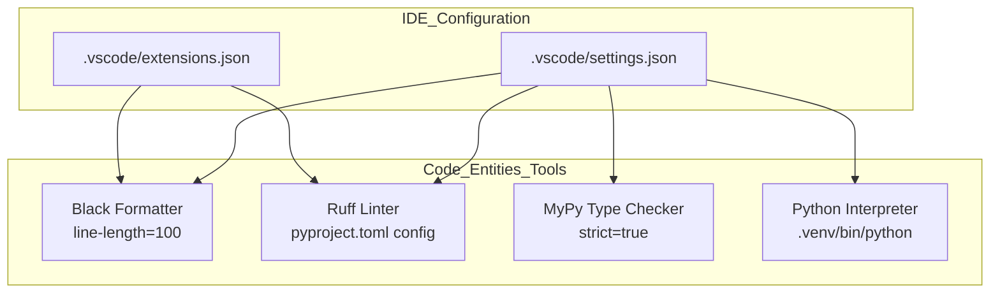
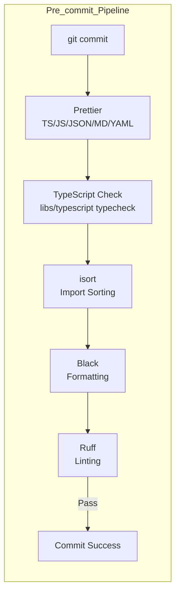

<!-- source: DeepWiki mcp.deepwiki.com · repo trycua/cua · page 14.1 Development Environment Setup · fetched 2026-10-29 -->

# Development Environment Setup

<details>
<summary>Relevant source files</summary>

The following files were used as context for generating this wiki page:

- [.editorconfig](.editorconfig)
- [.github/scripts/expect_verification_result.sh](.github/scripts/expect_verification_result.sh)
- [.github/scripts/tests/test_cua_driver_release_safety_wiring.py](.github/scripts/tests/test_cua_driver_release_safety_wiring.py)
- [.github/scripts/tests/test_update_cua_driver_installer_version.py](.github/scripts/tests/test_update_cua_driver_installer_version.py)
- [.github/scripts/tests/test_verify_cua_driver_release_signatures.py](.github/scripts/tests/test_verify_cua_driver_release_signatures.py)
- [.github/scripts/update_cua_driver_installer_version.py](.github/scripts/update_cua_driver_installer_version.py)
- [.github/scripts/verify_cua_driver_release_signatures.py](.github/scripts/verify_cua_driver_release_signatures.py)
- [.github/workflows/ci-cua-driver-release-signatures.yml](.github/workflows/ci-cua-driver-release-signatures.yml)
- [.github/workflows/cua-driver-release-signatures.yml](.github/workflows/cua-driver-release-signatures.yml)
- [.pre-commit-config.yaml](.pre-commit-config.yaml)
- [.prettierignore](.prettierignore)
- [.prettierrc.yaml](.prettierrc.yaml)
- [.vscode/extensions.json](.vscode/extensions.json)
- [.vscode/settings.json](.vscode/settings.json)
- [AGENTS.md](AGENTS.md)
- [CONTRIBUTING.md](CONTRIBUTING.md)
- [Development.md](Development.md)
- [libs/cua-driver/scripts/tests/test_install_version_fallback.py](libs/cua-driver/scripts/tests/test_install_version_fallback.py)
- [libs/cua-driver/tests/runners/windows-sandbox/README.md](libs/cua-driver/tests/runners/windows-sandbox/README.md)
- [libs/cua-driver/tests/runners/windows-sandbox/run-tests-in-sandbox.ps1](libs/cua-driver/tests/runners/windows-sandbox/run-tests-in-sandbox.ps1)
- [libs/cua-driver/tests/runners/windows-sandbox/sandbox-runner.ps1](libs/cua-driver/tests/runners/windows-sandbox/sandbox-runner.ps1)
- [libs/cua-driver/tests/runners/windows/README.md](libs/cua-driver/tests/runners/windows/README.md)
- [libs/cua-driver/tests/runners/windows/run-all.ps1](libs/cua-driver/tests/runners/windows/run-all.ps1)
- [nix/cua-driver/compositor/cua_compositor_patch.py](nix/cua-driver/compositor/cua_compositor_patch.py)
- [package.json](package.json)
- [pnpm-lock.yaml](pnpm-lock.yaml)
- [pyproject.toml](pyproject.toml)
- [scripts/ci/README.md](scripts/ci/README.md)

</details>


This document covers the setup of a local development environment for contributing to the Cua codebase. It includes installation of prerequisite tools, configuration of the Python and TypeScript workspaces, IDE setup, and pre-commit hook installation.

## Prerequisites

The Cua repository requires the following tools:

| Tool | Version | Purpose | Installation |
|------|---------|---------|--------------|
| **uv** | Latest | Python package manager and virtual environment manager | [astral.sh/uv](https://astral.sh/uv) |
| **pnpm** | 9.0.4+ | Node.js package manager for TypeScript packages | `npm install -g pnpm` |
| **Node.js** | 20+ | JavaScript runtime for TypeScript development and tooling | [nodejs.org](https://nodejs.org) |
| **Python** | 3.12+ | Python interpreter | [python.org](https://python.org) |
| **Rust** | Latest | Desktop driver development (`cua-driver`) | [rust-lang.org](https://www.rust-lang.org) |
| **Swift/Xcode** | Latest | macOS VM management tool development (`lume`) | Mac App Store |

**Sources:** [Development.md:36-42](), [pyproject.toml:11](), [package.json:9]()

## Monorepo Structure

The Cua repository is organized as a monorepo with Python and TypeScript packages managed by separate workspace systems. Rust and Swift components reside in their own subdirectories within `libs/`.

### Code Entity Space to Repository Structure

This diagram maps high-level system components to their specific code entities and locations in the filesystem.



**Key characteristics:**

- **Python packages** are managed via a `uv` workspace defined in `pyproject.toml` [pyproject.toml:68-77]().
- **TypeScript packages** use `pnpm` workspaces for JS-based logic and CLI tools [Development.md:48-50]().
- **Shared virtual environment** at `.venv/` contains the root workspace dependencies [Development.md:44-46]().
- **Pre-commit hooks** run formatters and linters automatically on commit [.pre-commit-config.yaml:1-50]().

**Sources:** [Development.md:9-18](), [pyproject.toml:68-77](), [package.json:1-10]()

## Python Workspace Setup

### Installing the Workspace

The Python workspace uses `uv` to manage packages and dependencies. All workspace members are linked to the shared environment.

```bash
# Clone the repository
git clone https://github.com/trycua/cua.git
cd cua

# Sync all workspace packages and development tools
uv sync --group dev
```

The `uv sync` command:
1. Reads workspace configuration from `pyproject.toml` [pyproject.toml:68-77]().
2. Creates or updates the shared `.venv/` virtual environment [Development.md:44-46]().
3. Links workspace members (e.g., `cua-agent`, `cua-computer`) [pyproject.toml:79-86]().
4. Installs development dependencies like `black`, `ruff`, and `mypy` [pyproject.toml:18-33]().

**Sources:** [Development.md:27-32](), [Development.md:60-61](), [pyproject.toml:68-86]()

## TypeScript Workspace Setup

The TypeScript packages use `pnpm` for dependency management. Run these commands within the specific component directories:

```bash
# Example for TypeScript SDKs
cd libs/typescript
pnpm install
```

**Sources:** [Development.md:48-50]()

## VSCode/Cursor Configuration

The repository includes settings to ensure consistent environments across developers.

### IDE Integration Map

This diagram associates IDE configuration files with the specific tools and behaviors they control.



**Key settings from `.vscode/settings.json`:**

- **Interpreter**: Points to `${workspaceFolder}/.venv` [.vscode/settings.json:3]().
- **Formatting**: Uses `ms-python.black-formatter` for Python [.vscode/settings.json:12]() and `esbenp.prettier-vscode` for TS/JS [.vscode/settings.json:15]().
- **Linting**: Ruff configuration is linked to `pyproject.toml` [.vscode/settings.json:17]().
- **Type Checking**: MyPy arguments are pulled from `pyproject.toml` [.vscode/settings.json:18-21]().

**Sources:** [.vscode/settings.json:1-25](), [pyproject.toml:88-117](), [.vscode/extensions.json:1-10]()

## Pre-commit Hooks

The repository uses pre-commit hooks to enforce code quality standards before commits are accepted.

### Installation and Pipeline

```bash
# Install pre-commit hooks
uv run pre-commit install
```

The pipeline defined in `.pre-commit-config.yaml` executes the following flow:



**Hook Details:**
- **Prettier**: Formats multi-language files [.pre-commit-config.yaml:2-10]().
- **TypeScript Check**: Runs `pnpm -C libs/typescript typecheck` [.pre-commit-config.yaml:14-19]().
- **isort**: Sorts Python imports using the Black profile [.pre-commit-config.yaml:21-27]().
- **Black**: Formats Python code [.pre-commit-config.yaml:29-34]().
- **Ruff**: Runs the linter with `--fix` enabled [.pre-commit-config.yaml:36-42]().

**Sources:** [.pre-commit-config.yaml:1-50](), [Development.md:62-74]()

## Code Formatting Standards

### Python Standards
- **Line Length**: 100 characters [pyproject.toml:89]().
- **Target Version**: Python 3.12 [pyproject.toml:90]().
- **Imports**: Sorted via `isort` using the Black profile [pyproject.toml:119]().
- **Types**: Strict MyPy checking with `disallow_untyped_defs = true` and `strict = true` [pyproject.toml:110-114]().

### TypeScript and Global Standards
- **Tool**: Prettier [package.json:7]().
- **Config**: 2-space indentation, single quotes, 100 character print width [.prettierrc.yaml:1-7]().

**Sources:** [pyproject.toml:88-121](), [.prettierrc.yaml:1-8]()

## Environment Variables

API keys are not required for ordinary builds and deterministic tests. Add credentials to a `.env.local` file (ignored by git) only for tests that call external providers [Development.md:52-54]().

```bash
# .env.local (Root)
ANTHROPIC_API_KEY=sk-ant-...
OPENAI_API_KEY=sk-...
```

**Sources:** [Development.md:52-54](), [.prettierignore:17]()

## AGENTS.md Conventions

The `AGENTS.md` file outlines conventions for agent-assisted contributions and general repository workflow. Key aspects include:

- **Contributor Authorship**: Follows `CONTRIBUTING.md` guidelines for preserving authorship, using `Co-authored-by` trailers, and GitHub-linked emails [AGENTS.md:3-13]().
- **Issue and Pull Request Workflow**: Adheres to the `CONTRIBUTING.md` and `MAINTAINERS.md` contracts for issue tracking, feature requests, and RFCs [AGENTS.md:18-23]().
- **Work Polling**: Agents should follow the polling ladder in `MAINTAINERS.md` and the `.agents/skills/poll-github-work/SKILL.md` skill when selecting work [AGENTS.md:44-47]().
- **Repository Layout**: Reinforces rules from `Development.md` and `TESTING.md`, emphasizing boundaries like `libs/cua` as the client library and `libs/cua-spacesd` as server-only [AGENTS.md:50-68]().
- **Cross-platform Cua Driver Behavior**: User-visible `cua-driver` behavior is treated as a cross-platform contract, with shared state and protocol semantics implemented in common crates [AGENTS.md:70-75]().
- **End-to-End Test Timing**: Full desktop matrix tests should be run once implementation is stable, immediately before a pull request is made ready or merged [AGENTS.md:83-95]().
- **Cua Driver Test Ownership**: Specifies rules for test ownership, hermeticity, and how desktop-bound suites are handled [AGENTS.md:111-129]().
- **Pull Request Titles**: Requires Conventional Commit titles for release entries, with specific formats for patch, minor, and breaking changes [AGENTS.md:97-106](). The `no-release` label can be used for non-releasing changes [AGENTS.md:107-108]().
- **Sandbox Releases**: Uses Release Please with independent `sandbox-vX.Y.Z` tags, requiring `fix(sandbox):` or `feat(sandbox):` for changes [AGENTS.md:109-113]().

**Sources:** [AGENTS.md:1-136](), [CONTRIBUTING.md:1-116](), [Development.md:1-97](), [scripts/ci/README.md:1-126]()

## RFC Process (rfcs)

The Request for Comments (RFC) process is used for significant changes to public contracts, compatibility policies, permission boundaries, or cross-component architecture [CONTRIBUTING.md:16]().

- **Initiation**: Start with the **Request for comments** GitHub issue form [CONTRIBUTING.md:73]().
- **Documentation**: Longer proposals and diagrams are stored in the `rfcs/` directory within the repository and link back to the discussion issue [CONTRIBUTING.md:74-75]().
- **Implementation**: Implementation should only begin after the recorded decision is made in `rfcs/README.md` [CONTRIBUTING.md:41]().

**Sources:** [CONTRIBUTING.md:16](), [CONTRIBUTING.md:41](), [CONTRIBUTING.md:73-75]()

## Verification Steps

After completing setup, verify your environment:

1. **Python Workspace**: Run `uv sync --group dev` [Development.md:61]().
2. **Formatting**: Run `uv run pre-commit run --all-files` [Development.md:68-69]().
3. **JS Formatting**: Run `pnpm prettier:check` from the root [package.json:3]().

**Sources:** [Development.md:60-81](), [package.json:1-5]()

---

