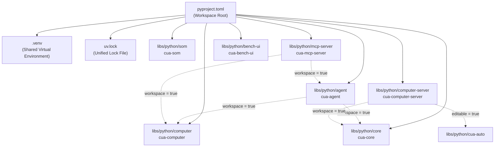
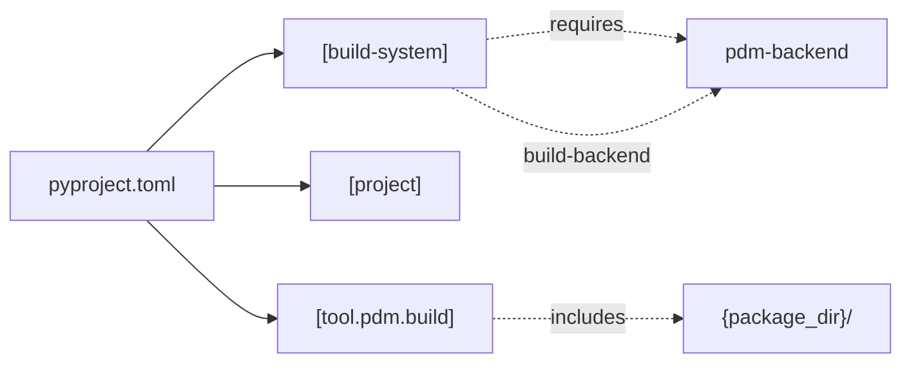

<!-- source: DeepWiki mcp.deepwiki.com · repo trycua/cua · page 14.2 Python Package Development · fetched 2026-10-29 -->

# Python Package Development

<details>
<summary>Relevant source files</summary>

The following files were used as context for generating this wiki page:

- [Makefile](Makefile)
- [examples/streaming/typescript-node/package-lock.json](examples/streaming/typescript-node/package-lock.json)
- [examples/streaming/typescript-web/package-lock.json](examples/streaming/typescript-web/package-lock.json)
- [libs/cua-bench-rl/uv.lock](libs/cua-bench-rl/uv.lock)
- [libs/cua-bench/uv.lock](libs/cua-bench/uv.lock)
- [libs/cua/python/uv.lock](libs/cua/python/uv.lock)
- [libs/python/agent/.bumpversion.cfg](libs/python/agent/.bumpversion.cfg)
- [libs/python/agent/README.md](libs/python/agent/README.md)
- [libs/python/agent/pyproject.toml](libs/python/agent/pyproject.toml)
- [libs/python/core/.bumpversion.cfg](libs/python/core/.bumpversion.cfg)
- [libs/python/core/README.md](libs/python/core/README.md)
- [libs/python/core/pyproject.toml](libs/python/core/pyproject.toml)
- [libs/python/cua-sandbox-apps/uv.lock](libs/python/cua-sandbox-apps/uv.lock)
- [libs/python/som/.bumpversion.cfg](libs/python/som/.bumpversion.cfg)
- [libs/python/som/README.md](libs/python/som/README.md)
- [libs/python/som/pyproject.toml](libs/python/som/pyproject.toml)
- [samples/openkoalabot-example-ts/package-lock.json](samples/openkoalabot-example-ts/package-lock.json)
- [uv.lock](uv.lock)

</details>


This document covers the Python package structure in the Cua monorepo, including the `uv` workspace configuration, individual package organization, dependency management, and version bumping with `bump2version`.

## Workspace Architecture

Cua uses a **uv workspace** to manage multiple Python packages in a single repository with a shared virtual environment. The workspace is defined in the root `pyproject.toml` and provides unified dependency resolution across all packages.

### Workspace Configuration


The root `pyproject.toml` explicitly lists the workspace members [uv.lock:14-19]().
The `uv.lock` file tracks the resolved dependencies for the entire workspace [uv.lock:1-6850]().

**Workspace Members and Sources**

The workspace configuration defines the Python packages as members and their source resolution strategy. The `tool.uv.sources` section in the root `pyproject.toml` and individual package `pyproject.toml` files allows for local, editable installs of inter-package dependencies.

| Configuration | Value | Purpose |
|--------------|-------|---------|
| `name` | `cua-workspace` | Root workspace identity [uv.lock:14-19]() |
| `tool.uv.workspace.members` | `["cua-agent", ...]` | Lists all packages included in the workspace [uv.lock:14-19]() |
| `tool.uv.sources.cua-agent` | `{ workspace = true }` | Resolves `cua-agent` from the workspace [libs/python/agent/pyproject.toml:6-7]() |
| `tool.uv.sources.cua-auto` | `{ path = "../cua-auto", editable = true }` | Resolves `cua-auto` from a local path as an editable install [libs/python/agent/pyproject.toml:6-7]() |
| `requires-python` | `"<3.14,>=3.12"` | Python version constraint for the workspace [uv.lock:3]() |

Sources: [libs/python/agent/pyproject.toml:1-134](), [uv.lock:1-6850]()

## Package Organization

The Cua Python ecosystem consists of packages organized in a layered architecture. Each package resides in its own directory under `libs/python/`.

### Package Directory Structure

```
libs/python/{package-name}/
├── pyproject.toml          # Package configuration
├── .bumpversion.cfg        # Versioning configuration
├── README.md               # Package documentation
├── {package_dir}/          # Source code directory (e.g., cua_agent)
│   ├── __init__.py
│   └── ...
└── tests/                  # Test directory
```

Sources: [libs/python/agent/pyproject.toml:133](), [libs/python/core/pyproject.toml:36]()

## Build System and Metadata

All Python packages in the Cua monorepo use `pdm-backend` as their build backend. This is specified in each package's `pyproject.toml` file.

### PDM Build Configuration



Sources: [libs/python/agent/pyproject.toml:1-3](), [libs/python/core/pyproject.toml:1-3]()

## Dependency Management

Cua uses a three-tier dependency structure: core dependencies, optional dependencies (extras), and development dependency groups.

### Core Dependencies

Core dependencies are installed by default.

| Package | Key Dependencies |
|---------|------------------|
| `cua-agent` | `litellm==1.86.2`, `pydantic>=2.6.4`, `httpx>=0.27.0`, `cua-core>=0.3.0,<0.4.0` [libs/python/agent/pyproject.toml:14-26]() |
| `cua-core` | `posthog>=3.20.0` [libs/python/core/pyproject.toml:15]() |
| `cua-som` | `torch>=2.2.1`, `ultralytics>=8.1.28`, `easyocr>=1.7.1`, `pydantic>=2.6.3` [libs/python/som/pyproject.toml:12-26]() |

Sources: [libs/python/agent/pyproject.toml:13-26](), [libs/python/core/pyproject.toml:13-15](), [libs/python/som/pyproject.toml:12-26]()

### Optional Dependencies (Extras)

Packages define "extras" for selective installation, particularly for heavy ML workloads or UI components.

| Package | Extra Name | Key Dependencies |
|---------|------------|------------------|
| `cua-agent` | `uitars-hf` | `accelerate`, `torch`, `transformers>=4.54.0` [libs/python/agent/pyproject.toml:47-51]() |
| `cua-agent` | `hud` | `hud-python==0.4.52`, `fastmcp>=3.2.0,<3.3.0` [libs/python/agent/pyproject.toml:83-86]() |
| `cua-agent` | `cloud` | `google-genai>=1.41.0`, `yaspin>=3.1.0`, `qwen-agent`, `qwen-vl-utils`, `Pillow>=10.0.0` [libs/python/agent/pyproject.toml:91-101]() |
| `cua-core` | `telemetry` | `opentelemetry-api`, `opentelemetry-sdk`, `opentelemetry-exporter-otlp-proto-http` [libs/python/core/pyproject.toml:27-31]() |

Sources: [libs/python/agent/pyproject.toml:29-125](), [libs/python/core/pyproject.toml:19-31]()

## Version Management with bump2version

Cua uses `bump2version` to manage semantic versioning. Each package maintains its own `.bumpversion.cfg` to handle specific tag prefixes and file replacements.

### Configuration Comparison

| Package | Current Version | Tag Pattern |
|---------|-----------------|-------------|
| `cua-agent` | `0.9.0` | `agent-v{new_version}` [libs/python/agent/.bumpversion.cfg:2-5]() |
| `cua-core` | `0.3.2` | `core-v{new_version}` [libs/python/core/.bumpversion.cfg:2-5]() |
| `cua-som` | `0.1.4` | (No explicit tag pattern shown, but `commit = True` and `tag = True` are set) [libs/python/som/.bumpversion.cfg:2-4]() |

Sources: [libs/python/agent/.bumpversion.cfg:1-10](), [libs/python/core/.bumpversion.cfg:1-10](), [libs/python/som/.bumpversion.cfg:1-10]()

## Development Workflow

### Editable Installs with `uv`

The `uv` tool is used for dependency management and installing packages in editable mode. This is crucial for local development, allowing changes in one package to be immediately reflected in others that depend on it. For example, `cua-agent` can depend on `cua-core` which is resolved from the workspace [libs/python/agent/pyproject.toml:22]().

To install development dependencies and set up pre-commit hooks, the following commands are used:
```bash
uv sync --group dev
uv run pre-commit install
```
This installs the `dev` dependency group defined in `libs/python/core/pyproject.toml` [libs/python/core/pyproject.toml:46-48]() and sets up Git hooks for code quality.

Sources: [libs/python/agent/pyproject.toml:22](), [libs/python/core/pyproject.toml:46-48]()

### Dependency Constraints

The root `uv.lock` file defines global dependency constraints to ensure consistency across the workspace [uv.lock:21-25]().

```toml
constraints = [
    { name = "fastmcp", specifier = ">=3.2.0,<3.3.0" },
    { name = "pytest", specifier = ">=9.0.3" },
    { name = "transformers", specifier = ">=5.0.0rc3" },
]
```
These constraints apply to all packages within the `uv` workspace.

Sources: [uv.lock:21-25]()

### Testing Strategy

Tests are categorized into unit and integration tests. The `pyproject.toml` files for individual packages configure `pytest` to discover tests. For example, `cua-core` specifies `testpaths = ["tests"]` and `python_files = "test_*.py"` [libs/python/core/pyproject.toml:40-43]().

Sources: [libs/python/core/pyproject.toml:40-43]()

---

