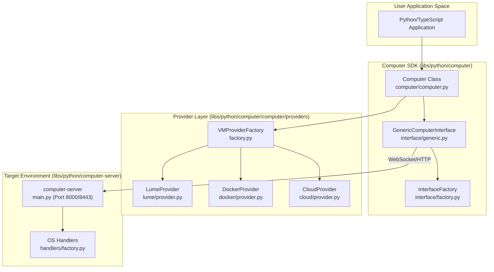
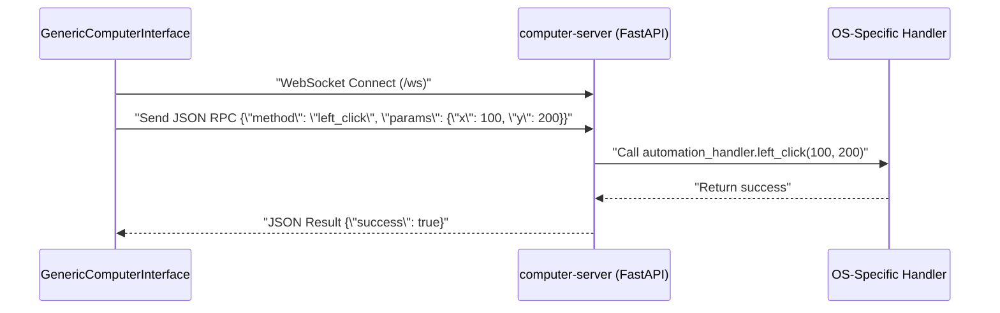
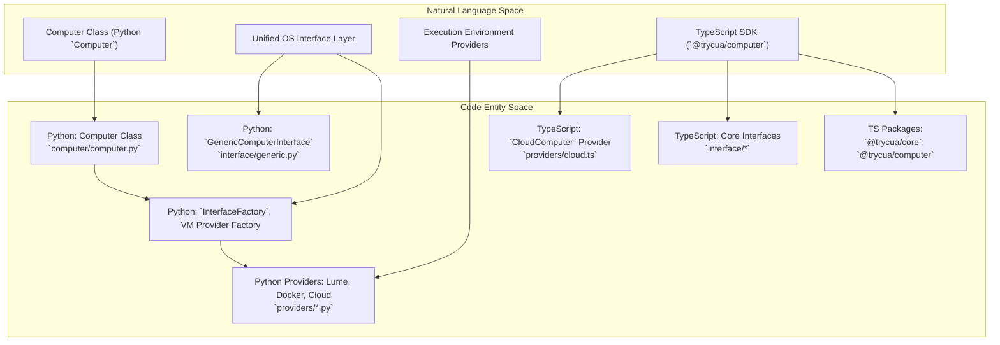

<!-- source: DeepWiki mcp.deepwiki.com · repo trycua/cua · page 3.1 Computer SDK · fetched 2026-10-29 -->

# Computer SDK

Relevant source files

The following files were used as context for generating this wiki page:

- [docs/content/docs/cua-sdk/reference/runtime-support.mdx](docs/content/docs/cua-sdk/reference/runtime-support.mdx)
- [libs/python/cua-sandbox/CHANGELOG.md](libs/python/cua-sandbox/CHANGELOG.md)
- [libs/python/cua-sandbox/README.md](libs/python/cua-sandbox/README.md)
- [libs/python/cua-sandbox/VERSION](libs/python/cua-sandbox/VERSION)
- [libs/python/cua-sandbox/cua_sandbox/__init__.py](libs/python/cua-sandbox/cua_sandbox/__init__.py)
- [libs/python/cua-sandbox/cua_sandbox/pool.py](libs/python/cua-sandbox/cua_sandbox/pool.py)
- [libs/python/cua-sandbox/cua_sandbox/sandbox.py](libs/python/cua-sandbox/cua_sandbox/sandbox.py)
- [libs/python/cua-sandbox/cua_sandbox/sync/__init__.py](libs/python/cua-sandbox/cua_sandbox/sync/__init__.py)
- [libs/python/cua-sandbox/cua_sandbox/transport/fleet.py](libs/python/cua-sandbox/cua_sandbox/transport/fleet.py)
- [libs/python/cua-sandbox/cua_sandbox/transport/fleet_cloud.py](libs/python/cua-sandbox/cua_sandbox/transport/fleet_cloud.py)
- [libs/python/cua-sandbox/pyproject.toml](libs/python/cua-sandbox/pyproject.toml)
- [libs/python/cua-sandbox/tests/test_fleet_cloud_client.py](libs/python/cua-sandbox/tests/test_fleet_cloud_client.py)
- [libs/python/cua-sandbox/tests/test_fleet_cloud_transport.py](libs/python/cua-sandbox/tests/test_fleet_cloud_transport.py)
- [libs/python/cua-sandbox/tests/test_fleet_sdk_distribution.py](libs/python/cua-sandbox/tests/test_fleet_sdk_distribution.py)
- [libs/python/cua-sandbox/tests/test_fleet_sdk_packaging.py](libs/python/cua-sandbox/tests/test_fleet_sdk_packaging.py)
- [libs/python/cua-sandbox/tests/test_fleet_transport.py](libs/python/cua-sandbox/tests/test_fleet_transport.py)
- [libs/python/cua-sandbox/tests/test_pool.py](libs/python/cua-sandbox/tests/test_pool.py)
- [libs/python/cua-sandbox/tests/test_sandbox_fleet_lifecycle.py](libs/python/cua-sandbox/tests/test_sandbox_fleet_lifecycle.py)
- [libs/python/cua-sandbox/tests/test_vm_cleanup.py](libs/python/cua-sandbox/tests/test_vm_cleanup.py)
- [libs/python/cua-sandbox/uv.lock](libs/python/cua-sandbox/uv.lock)

The Computer SDK provides a unified Python and TypeScript interface to control computers across multiple execution environments including virtual machines (VMs), containers, and host machines. It abstracts the low-level OS interactions into consistent APIs for mouse, keyboard, screen, clipboard, and file operations, enabling cross-platform automation workflows regardless of the underlying runtime or provider.

---

## Architecture Overview

The Computer SDK is architected into three primary layers:

1. **Computer Class**: Manages lifecycle, state, and connection of computer instances.
2. **Interface Layer**: Exposes unified OS-level interaction APIs over a communication channel (mostly WebSocket).
3. **Provider Abstraction**: Modular backends for VM/container/cloud/host environment provisioning and management.

These layers together enable seamless cross-platform automation while hiding provider details from user code.

**Figure:** Computer SDK Architecture depicting component and interaction separation.

Sources:  
[libs/python/computer/computer/computer.py:72-158](),  
[libs/python/computer/computer/interface/generic.py:23-57](),  
[libs/python/computer/computer/providers/factory.py:11-28]()

---

## Computer Class

The `Computer` class is the core entry point to initiate and manage computer instances. It encapsulates VM/container lifecycle, handles provider selection based on OS and runtime parameters, and initializes the interface used for OS-level interactions.

### Initialization Parameters

The constructor accepts multiple configuration options:

| Parameter                | Type                      | Default                      | Description                                                                                       |
|--------------------------|---------------------------|------------------------------|---------------------------------------------------------------------------------------------------|
| `os_type`                | `OSType`                  | `"macos"`                    | Operating system target: `"macos"`, `"linux"`, `"windows"`, or `"android"`.                        |
| `provider_type`          | `VMProviderType`          | `LUME`                       | Execution environment provider: e.g., `LUME`, `DOCKER`, `CLOUD`, or `QEMU`.                        |
| `image`                  | `Optional[str]`           | OS-dependent canonical image | VM/container image reference (e.g., `trycua/cua-ubuntu:latest`).                                   |
| `display`                | `Union[Display, str]`     | `"1024x768"`                 | Display resolution string like `"1024x768"`.                                                      |
| `use_host_computer_server` | `bool`                   | `False`                     | Whether to use the localhost computer-server instead of provisioning a VM or container.           |
| `api_key`                | `Optional[str]`           | `None`                      | API key for cloud providers; falls back to environment variable `CUA_API_KEY` if unset.            |
| `backend`                | `Literal["native", "vnc"]`| `"native"`                   | Backend for server communication (e.g., `"native"` for Spacesd, `"vnc"` for VNC fallback).          |

These options allow precise control over the environment startup and connection behavior.

Sources:  
[libs/python/computer/computer/computer.py:92-167](),  
[libs/python/computer/computer/providers/docker/provider.py:44-48]()

### Lifecycle Management

The `Computer` class uses `VMProviderFactory` to instantiate the relevant provider matching the configuration. Providers handle all lifecycle operations such as provisioning, starting, stopping, and destroying the VM or container [libs/python/computer/computer/computer.py:172-185]().

After the environment is started, the class initializes an `InterfaceFactory` which creates the `GenericComputerInterface` that enables communication with the `computer-server` inside the VM via WebSocket or HTTP [libs/python/computer/computer/computer.py:257-300]().

---

## Interface Layer

This layer unifies platform-specific OS automation commands into a single API surface. It forwards client commands as JSON requests over WebSocket to the running in-guest server (`computer-server`).

### Communication Flow

**Figure:** Command execution inside the Computer SDK interface layer.

This setup decouples the SDK from any particular OS implementation by routing commands through a standardized JSON-over-WebSocket protocol implemented by OS-native agents inside the guest.

Sources:  
[libs/python/computer/computer/interface/generic.py:108-153](),  
[libs/python/computer/computer/interface/generic.py:175-180]()

### Core Interface Methods

The unified interface is primarily implemented in `GenericComputerInterface`, extending `BaseComputerInterface`. It exposes core automation subcomponents:

| Category     | Key Methods                                        | Description                   |
|--------------|---------------------------------------------------|-------------------------------|
| **Mouse**    | `left_click()`, `right_click()`, `move_cursor()`, `drag_to()` | Pointer control actions        |
| **Keyboard** | `type_text()`, `press()`, `hotkey()`, `key_down()` | Text entry and key presses     |
| **Screen**   | `screenshot()`, `get_screen_size()`               | Visual feedback and geometry   |
| **Files**    | `read_text()`, `write_text()`, `read_bytes()`, `list_dir()` | Remote filesystem access       |
| **Clipboard**| `set_clipboard()`, `copy_to_clipboard()`           | OS clipboard manipulation      |

These abstractions facilitate scripting of rich computer-use scenarios via Python or TypeScript.

Sources:  
[libs/python/computer/computer/interface/generic.py:155-262](),  
[libs/python/computer/computer/interface/generic.py:278-354](),  
[libs/python/computer/computer/interface/generic.py:356-522]()

---

## Provider Abstraction

The provider abstraction separates environment lifecycle management into modular classes each implementing `BaseVMProvider`. This factory-based design supports cross-platform runtime selection transparently.

| Provider        | Implementation Class           | Runtime Environment                                  |
|-----------------|-------------------------------|----------------------------------------------------|
| **Lume**        | `LumeProvider`                | Local macOS VMs managed via Lume daemon (Swift, port 7777) |
| **Docker**      | `DockerProvider`              | Local Linux/Android container environments via Docker CLI  |
| **Cloud**       | `CloudProvider`               | Remote cloud VMs provisioned through Cua Cloud REST API     |
| **WindowsSandbox** | `WinSandboxProvider`         | Windows Sandbox integration using native Windows APIs        |

---

### Docker Provider Details

The `DockerProvider` class manages containers lifecycle via Docker CLI calls. It supports several image types:

- `cua-ubuntu` (Kasm-based container images)
- `cua-xfce` (XFCE desktop environment)
- QEMU-wrapped images for Linux, Windows, and Android

The provider selects the home directory based on image type, for example:

- Kasm images use `/home/kasm-user`
- XFCE images use `/home/cua`

It offers lifecycle APIs for container start, stop, exec, and networking adjustments, providing a consistent interface regardless of container platform [libs/python/computer/computer/providers/docker/provider.py:31-49](), [libs/python/computer/computer/providers/docker/provider.py:94-121]().

---

## TypeScript SDK

The TypeScript SDK (`@trycua/computer`) mirrors the Python SDK, sharing similar API structures for Node.js applications.

### Package Structure

- `@trycua/core`: Shared telemetry, utilities, and type definitions [libs/typescript/core/package.json:2-5]().
- `@trycua/computer`: Core `Computer` and interface layer implementations [libs/typescript/computer/package.json:2-5]().

### Cloud Provider Implementation

The TypeScript `CloudComputer` encapsulates connectivity to remote Fleet sandboxes. It manages an API session using UUIDs and hashes of the API key for telemetry consistency [libs/typescript/computer/src/computer/providers/cloud.ts:16-27]().

A key method `fetchAndCacheHost()` resolves the sandbox hostname through Fleet services and caches it for subsequent environment interface initialization, paralleling provider initialization logic in the Python `BaseComputer` class [libs/typescript/computer/src/computer/providers/cloud.ts:61-92](), [libs/typescript/computer/src/computer/providers/base.ts:21-63]().

---

## Summary Diagram Bridging Natural Language Terms to Code Entities

**Figure:** Mapping from natural language concepts of Computer SDK to specific Python and TypeScript code entities.

---

# Summary

The Computer SDK delivers a modular, provider-agnostic, and cross-platform interface for computer automation. It abstracts VM/container lifecycles through provider classes, exposes rich OS interaction APIs via a WebSocket/HTTP protocol to `computer-server` agents inside the VM, and has feature-parallel libraries in Python and TypeScript that make complex automated workflows consistent across operating systems and runtime environments.

This design enables developers to write automation scripts once and run them uniformly on local containers, local or cloud VMs, or Windows Sandboxes, leveraging a common API surface shielded from platform idiosyncrasies.

---

# References

- `Computer` class implementation: `libs/python/computer/computer/computer.py` [92-167](), [172-185](), [257-300]()
- Interface and generic implementation: `libs/python/computer/computer/interface/generic.py` [23-57](), [108-180](), [155-522]()
- Provider factory and providers: `libs/python/computer/computer/providers/factory.py` [11-28](), `docker/provider.py` [31-49](), [94-121](), `cloud/provider.py`
- TypeScript SDK cloud provider: `libs/typescript/computer/src/computer/providers/cloud.ts` [16-92]()
- Package JSON info for TypeScript SDK: `libs/typescript/core/package.json` [2-5](), `libs/typescript/computer/package.json` [2-5]()

---

