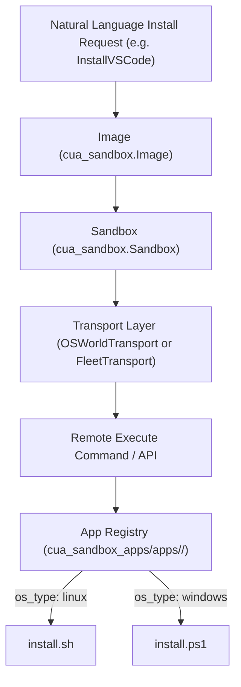
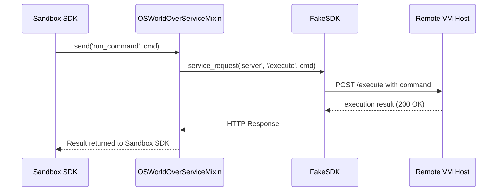
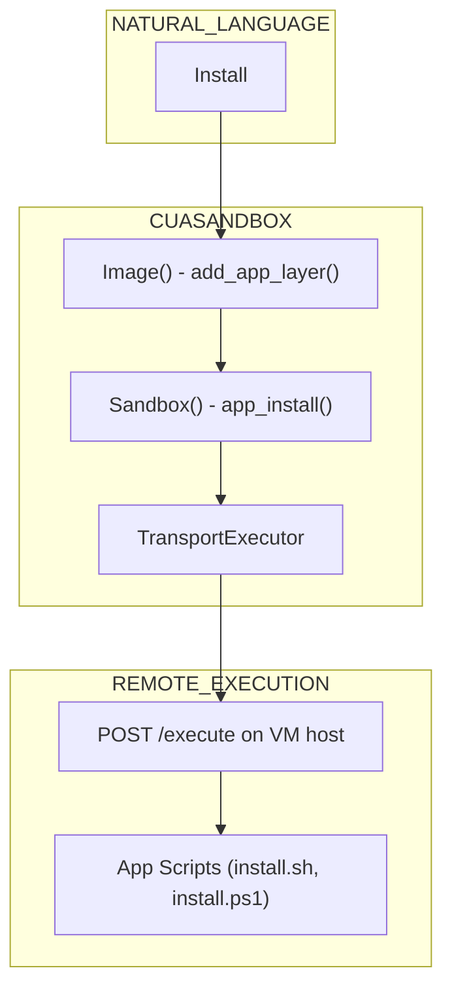
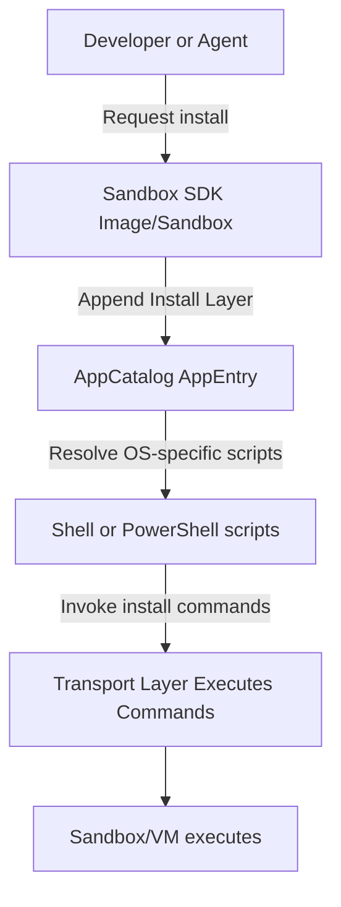

<!-- source: DeepWiki mcp.deepwiki.com · repo trycua/cua · page 3.7 Sandbox Apps Catalog · fetched 2026-10-29 -->

# Sandbox Apps Catalog

<details>
<summary>Relevant source files</summary>

The following files were used as context for generating this wiki page:

- [examples/streaming/typescript-node/package-lock.json](examples/streaming/typescript-node/package-lock.json)
- [examples/streaming/typescript-web/package-lock.json](examples/streaming/typescript-web/package-lock.json)
- [libs/cua-bench-rl/uv.lock](libs/cua-bench-rl/uv.lock)
- [libs/cua-bench/uv.lock](libs/cua-bench/uv.lock)
- [libs/cua/python/uv.lock](libs/cua/python/uv.lock)
- [libs/python/cua-sandbox-apps/uv.lock](libs/python/cua-sandbox-apps/uv.lock)
- [samples/openkoalabot-example-ts/package-lock.json](samples/openkoalabot-example-ts/package-lock.json)
- [uv.lock](uv.lock)

</details>


The `cua-sandbox-apps` package provides a universal application catalog and installer pipeline designed for the CUA sandbox environment. It encapsulates application definitions, installation logic, and platform-specific installation scripts to unify software provisioning across diverse operating systems including Linux, Windows, macOS, and Android. This package enables both image-time and runtime installation of complex software stacks, facilitating programmatic setup and execution by agents or developers within sandboxed environments.

---

## Overview

The central role of the catalog is to act as a registry of **App Entries**, each describing metadata, supported platforms, installation mechanisms, launch commands, and environment prerequisites. These entries are consumable by the `Image` builder and the `Sandbox` APIs to provision and manage applications consistently. The package integrates tightly with the `cua-sandbox` core, specifically contributing to image building, runtime app management, and transport layers, enabling robust sandbox lifecycle and software environment control.

The catalog system contains:

- **App Registry:** Directory-based application definitions per OS and platform.
- **Installer Pipeline:** Scripts and commands abstracted based on OS, executed via layers in the image or at runtime.
- **Install Method Schema:** Unified specification for installation commands and environment handling for different OSes.
- **Transport Layer Integration:** Routes commands to remote sandbox hosts or local ephemeral containers, facilitating remote execution and installation.

This package supports prebuilt app definitions, installation orchestration, and dynamic execution to create reproducible sandbox environments ready for automation and benchmarking.

Sources: [libs/python/cua-sandbox/cua_sandbox/image.py:111-140](), [libs/python/cua-sandbox/cua_sandbox/transport/osworld.py:34-62]()

---

## App Entry and Install Method Schema

Applications in the catalog are modeled as **AppEntry** objects stored in a structured directory format under `cua_sandbox_apps/apps/`. Each app ID folder contains subdirectories for supported `os_type` such as `linux`, `windows`, and `macos`. Within these, installation scripts (`install.sh`, `install.ps1`, etc.) and launch commands are provided.

The system resolves the appropriate OS-specific scripts and install methods dynamically based on the sandbox or image’s `os_type`. This enables uniform app requests at a high level to be translated into concrete installation steps suitable for the VM or container operating system.

### Install Methods

Install methods are defined as variations of the `InstallMethod` schema, representing a specific way to install apps based on platform conventions:

| Install Method      | OS        | Mechanism                         |
|---------------------|-----------|----------------------------------|
| `apt_install`       | Linux     | `sudo apt-get install <package>` |
| `brew_install`      | macOS     | `brew install <package>`          |
| `choco_install`     | Windows   | `choco install <package>`         |
| `winget_install`    | Windows   | `winget install <package>`        |
| `apk_install`       | Android   | `adb install <apk>`               |

These install methods are encapsulated as `AppLayer` objects appended to an `Image` or `Sandbox` at image build or runtime, respectively.

**App Entry Resolution Flow**



Sources: [libs/python/cua-sandbox/cua_sandbox/image.py:121-132](), [libs/python/cua-sandbox/cua_sandbox/transport/osworld.py:43-62]()

---

## Installation Pipeline: Image Build and Runtime

The catalog supports app installation at two key points:

### 1. Image-Time Installation

At image creation, apps are installed as layers appended to the image specification. The `Image` class includes methods like `apt_install()` which attach installation instructions as immutable layers during build time.

For example, the `apt_install()` method adds shell commands that will be run inside a Linux image build:

```python
def apt_install(package: str):
    # Adds a layer to install package using apt-get install
    ...
```

Multiple layers are composed sequentially to build complex environments.

### 2. Runtime Installation

For ephemeral or remote sandboxes, installation commands are executed via sandbox transports. The `Sandbox` class provides `app_install()` which invokes installation scripts through the transport API, running commands remotely in the live sandbox environment.

The transport layer manages interaction with the sandbox VM or container:

- Executes shell/PowerShell commands
- Sends HTTP `POST /execute` requests to the VM host server
- Captures results and output
- Retries and handles timeouts for robustness

This design enables dynamic customization of sandbox environments without requiring image rebuilds.

---

### Fleet and Cloud Transport Integration

In cloud or fleet deployments where sandboxes run remotely, transports encapsulate the request pipeline. The sandbox SDK issues method calls that bubble down to HTTP POST requests sent to fleet-managed VMs, invoking the remote command execution APIs.

**Fleet Provisioning Sequence**



This abstraction allows a unified interface despite heterogeneous underlying execution environments.

Sources: [libs/python/cua-sandbox/cua_sandbox/transport/osworld.py:34-62](), [libs/python/cua-sandbox/tests/test_osworld_fleet.py:91-123]()

---

## Prebuilt App Catalog

The `cua-sandbox-apps` catalog includes over 40 curated app entries covering a broad range of software categories:

| Category            | Examples                                    |
|---------------------|---------------------------------------------|
| Development Tools   | VS Code, Sublime Text, Git, Python, Node.js |
| Game Engines       | Godot, Unity Hub                             |
| Productivity       | Chrome, Firefox, LibreOffice                 |
| System Utilities    | Agent servers, benchmarking tools            |

Each entry contains metadata, install scripts by OS, and launch instructions, enabling developers and agents to reproducibly provision these environments for development, testing, or benchmarking across multiple platforms.

---

### Creator / Auditor Agent Pattern

A common usage pattern is the **Creator/Auditor** approach:

- The **Creator** agent provisions a sandbox with a desired software stack by invoking catalog install methods.
- The sandbox image supporting these apps is snapshot-enabled, allowing the frozen state (including installed apps) to be reused.
- The **Auditor** retrieves or boots from the snapshot and performs verification, testing, or benchmarking.

This pattern facilitates consistent software environments across ephemeral and persistent sessions.

Sources: [libs/python/cua-sandbox/cua_sandbox/image.py:133-140]()

---

## Technical Implementation Details

### Transport Reliability and Timeouts

App installations commonly require large downloads or long-running commands. The transport layers provide robust request semantics with retries and configurable timeouts to handle network instability and command execution timing.

Typical transport methods allow execution of shell commands with optional PTY support and diagnostic inspection:

```python
async def run_command(self, command: str, timeout: int = 300) -> Result:
    # Runs the command in the remote sandbox, handles output, errors, timeouts
    ...
```

The transport adaptors abstract remote call details behind a simple interface for higher-level image or sandbox logic.

### OCI-based Pinned Image References

To ensure consistent runtime environments between local development and cloud fleet sandboxes, the catalog references pinned OCI registry images internally:

- Linux base image: `cua-ubuntu-24.04` with explicit digest pinning
- Windows base image: `cua-windows-2022`

These pinned images serve as foundational layers upon which application layers install additional software.

### Shell Script and PowerShell Support

Installation scripts are provided as shell `install.sh` files for POSIX systems and PowerShell `install.ps1` scripts for Windows. The catalog infrastructure resolves and executes the appropriate script based on the sandbox OS:

```bash
# linux/install.sh example snippet
apt-get update && apt-get install -y <package>
```

```powershell
# windows/install.ps1 example snippet
choco install -y <package>
```

This polymorphic script support allows a single app entry to support multiple target OSes seamlessly.

---

# Summary Diagram: Natural Language Install Request to Execution



Sources: [libs/python/cua-sandbox/cua_sandbox/image.py:120-140](), [libs/python/cua-sandbox/cua_sandbox/transport/osworld.py:34-62]()

---

# Summary Diagram: Installation Pipeline Integration



Sources: [libs/python/cua-sandbox/cua_sandbox/image.py:111-138](), [libs/python/cua-sandbox/cua_sandbox/transport/osworld.py:43-62]()

---

# References

- App catalog definitions and `Image` integration: [libs/python/cua-sandbox/cua_sandbox/image.py:111-140]()
- Transport execution and fleet integration: [libs/python/cua-sandbox/cua_sandbox/transport/osworld.py:34-62]()
- Fleet remote execution usage tests: [libs/python/cua-sandbox/tests/test_osworld_fleet.py:91-123]()

---

This completes the technical documentation for the `cua-sandbox-apps` package, detailing the app catalog structure, installation pipeline, and transport integration for sandbox software provisioning.

---

