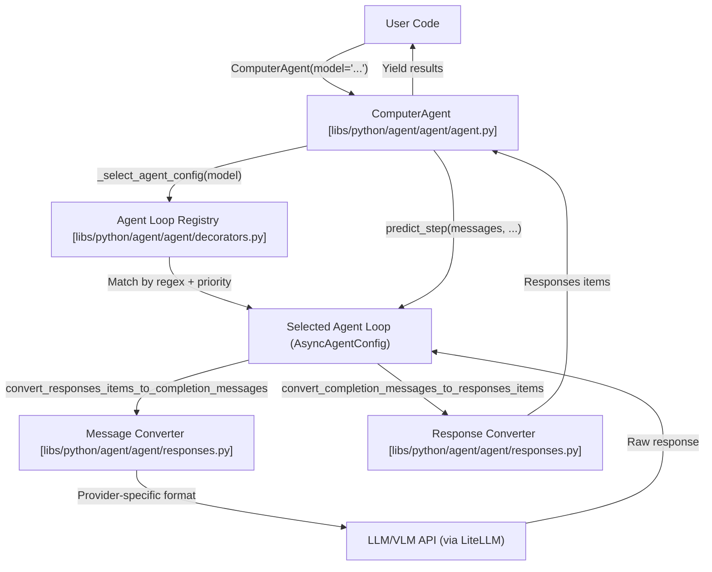
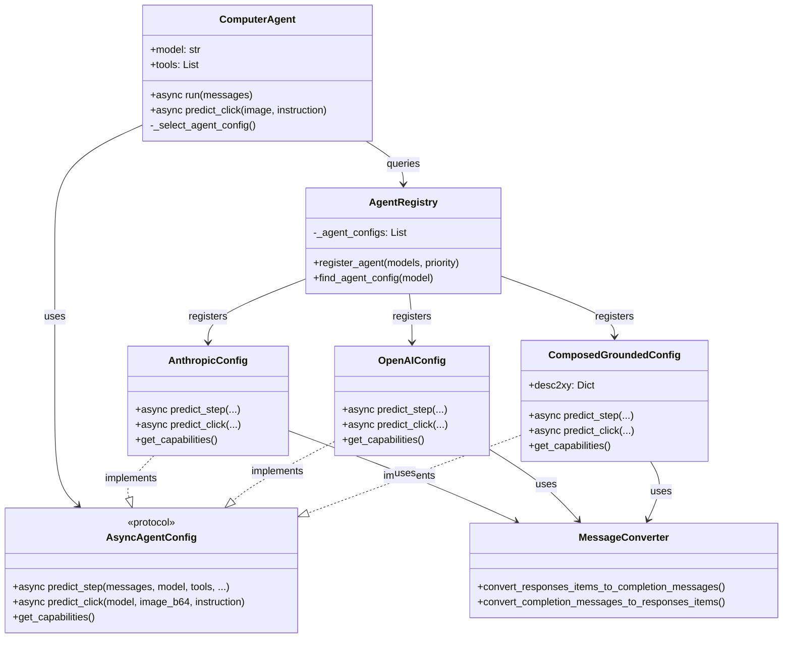

<!-- source: DeepWiki mcp.deepwiki.com · repo trycua/cua · page 7 Agent Intelligence System · fetched 2026-10-29 -->

# Agent Intelligence System

<details>
<summary>Relevant source files</summary>

The following files were used as context for generating this wiki page:

- [Makefile](Makefile)
- [libs/python/agent/.bumpversion.cfg](libs/python/agent/.bumpversion.cfg)
- [libs/python/agent/README.md](libs/python/agent/README.md)
- [libs/python/agent/pyproject.toml](libs/python/agent/pyproject.toml)
- [libs/python/core/.bumpversion.cfg](libs/python/core/.bumpversion.cfg)
- [libs/python/core/README.md](libs/python/core/README.md)
- [libs/python/core/pyproject.toml](libs/python/core/pyproject.toml)
- [libs/python/som/.bumpversion.cfg](libs/python/som/.bumpversion.cfg)
- [libs/python/som/README.md](libs/python/som/README.md)
- [libs/python/som/pyproject.toml](libs/python/som/pyproject.toml)

</details>


The Agent Intelligence System is the model integration layer of Cua that enables `ComputerAgent` to work with diverse vision-language models and large language models. This system provides a unified interface for connecting to 100+ model configurations through agent loops—modular implementations that handle model-specific API interactions, message format conversions, and response processing.

This document covers the architecture and components of the agent intelligence system. For detailed information about specific implementations, see:
- [Agent Loop Architecture](#7.1) for registration mechanisms and the `AsyncAgentConfig` protocol.
- [Native Computer-Use Models](#7.2) for all-in-one models like Claude and OpenAI.
- [Composed and Grounding Models](#7.3) for the two-stage grounding+planning pattern.
- [Local Model Adapters](#7.4) for running models locally with HuggingFace and MLX.
- [Message Format System](#7.5) for the Responses API message schema.
- [CUA-S1 Specialist Models](#7.6) for the CUA-S1 family of research models.

For information about the `ComputerAgent` class itself, see [ComputerAgent SDK](#3.3). For extension points like custom callbacks and tools, see [Extension Points](#9).

## System Architecture

The agent intelligence system consists of three main components:

1.  **Agent Loop Registry**: A global registry that maps model strings to agent loop implementations based on regex patterns and priorities.
2.  **Agent Loop Implementations**: Model-specific classes implementing the `AsyncAgentConfig` protocol to handle API interactions.
3.  **Message Format System**: Conversion utilities that translate between the internal Responses API format and provider-specific formats (e.g., Anthropic tool use, OpenAI function calling).

### High-Level Flow


Sources: `libs/python/agent/agent/agent.py`, `libs/python/agent/agent/decorators.py`, `libs/python/agent/agent/responses.py`

### Component Relationships


Sources: `libs/python/agent/agent/agent.py`, `libs/python/agent/agent/decorators.py`, `libs/python/agent/agent/responses.py`

## Agent Loop Selection

When `ComputerAgent` is initialized with a model string, it queries the agent loop registry to find the appropriate implementation. The selection process uses regex pattern matching with priority-based fallback.

### Registration Mechanism

Agent loops register themselves using the `@register_agent` decorator.

```python
@register_agent(models=r".*(^|)computer-use-preview", priority=0)
class OpenAIComputerUseConfig:
    async def predict_step(self, messages, model, tools, ...):
        # Implementation
        pass
```

The decorator parameters:
- `models`: Regex pattern to match against model strings.
- `priority`: Integer priority (higher values = higher priority, default=0).

Sources: `libs/python/agent/agent/decorators.py`

### Selection Algorithm

The selection process follows these steps:
1. All registered agent configs are filtered by regex pattern match against the model string.
2. Matching configs are sorted by priority (highest first).
3. The first matching config is returned.
4. If no matches, a generic configuration serves as the fallback.

Sources: `libs/python/agent/agent/decorators.py`, `libs/python/agent/agent/agent.py`

## Agent Loop Protocol

All agent loops implement the `AsyncAgentConfig` protocol, which defines two core methods and one metadata method.

### Core Methods

- **`predict_step`**: Executes one step of the agent loop, taking messages and returning actions/outputs.
- **`predict_click`**: Predicts click coordinates for a given instruction (grounding only).
- **`get_capabilities`**: Returns a list of supported capabilities (e.g., `"click"`, `"step"`).

Sources: `libs/python/agent/agent/agent.py`

## Message Format System

The agent intelligence system uses the **Responses API format** as its internal message representation. This is a standardized schema that all agent loops must consume and produce.

### Responses API Message Types

| Type | Description |
|------|-------------|
| `user` / `message` | User input with text or images. |
| `message` (assistant) | Assistant text output. |
| `reasoning` | Internal reasoning/thinking. |
| `computer_call` | Computer action to execute (click, type, etc.). |
| `computer_call_output` | Result of computer action (screenshot, error). |
| `function_call` | Custom function invocation. |
| `function_call_output` | Function execution result. |

Sources: `libs/python/agent/agent/responses.py`

### Message Conversion

The `responses.py` module provides utilities for converting between Responses API format and OpenAI-compatible completion messages used by LiteLLM:
- `convert_responses_items_to_completion_messages`
- `convert_completion_messages_to_responses_items`

Sources: `libs/python/agent/agent/responses.py`

## Composed Agent Architecture

The composed agent pattern enables combining specialized grounding models with powerful planning models using the syntax `grounding_model+planning_model`.

### Two-Stage Processing

1.  **Stage 1: Planning with Descriptions**: The planning model (e.g., GPT-4) generates actions using natural language element descriptions instead of coordinates.
2.  **Stage 2: Grounding to Coordinates**: A specialized grounding model (e.g., GTA, UI-TARS) converts those descriptions into specific `(x, y)` coordinates on the screen.

The `ComposedGroundedConfig` manages the `desc2xy` dictionary, which serves as a cache mapping element descriptions to coordinates across multiple steps.

Sources: `libs/python/agent/agent/responses.py`

## Local Model Adapters

For running models locally, Cua provides adapters that interface with specialized inference engines. The system supports local execution via optional dependencies for HuggingFace and Apple-Silicon optimized MLX.

These adapters handle:
- **Model Loading**: Efficient loading of weights using `accelerate`, `torch`, or `mlx-vlm`.
- **Image Processing**: resizing and padding for VLM input.
- **Coordinate Scaling**: Converting model-specific coordinate outputs back to screen space.

The `cua-agent` package's `pyproject.toml` defines optional dependencies for various local model adapters, including `uitars-mlx` for MLX-VLM on Apple Silicon, `uitars-hf` for HuggingFace models, `glm45v-hf`, `opencua-hf`, `internvl-hf`, and `moondream3`.
Sources: [libs/python/agent/pyproject.toml:43-74](), [libs/python/agent/pyproject.toml:103-112]()

---

