# Page: Overview

# Overview

<details>
<summary>Relevant source files</summary>

The following files were used as context for generating this wiki page:

- [README.md](README.md)
- [blog/app-use.md](blog/app-use.md)
- [blog/bringing-computer-use-to-the-web.md](blog/bringing-computer-use-to-the-web.md)
- [blog/build-your-own-operator-on-macos-1.md](blog/build-your-own-operator-on-macos-1.md)
- [blog/build-your-own-operator-on-macos-2.md](blog/build-your-own-operator-on-macos-2.md)
- [blog/composite-agents.md](blog/composite-agents.md)
- [blog/cua-hackathon.md](blog/cua-hackathon.md)
- [blog/cua-vlm-router.md](blog/cua-vlm-router.md)
- [blog/hud-agent-evals.md](blog/hud-agent-evals.md)
- [blog/human-in-the-loop.md](blog/human-in-the-loop.md)
- [blog/introducing-cua-cli.md](blog/introducing-cua-cli.md)
- [blog/introducing-cua-cloud-containers.md](blog/introducing-cua-cloud-containers.md)
- [blog/lume-to-containerization.md](blog/lume-to-containerization.md)
- [blog/sandboxed-python-execution.md](blog/sandboxed-python-execution.md)
- [blog/training-computer-use-models-trajectories-1.md](blog/training-computer-use-models-trajectories-1.md)
- [blog/ubuntu-docker-support.md](blog/ubuntu-docker-support.md)
- [blog/windows-sandbox.md](blog/windows-sandbox.md)
- [docs/content/docs/cua-sdk/index.mdx](docs/content/docs/cua-sdk/index.mdx)
- [docs/content/docs/index.mdx](docs/content/docs/index.mdx)
- [docs/content/docs/meta.json](docs/content/docs/meta.json)
- [docs/content/docs/spaces/index.mdx](docs/content/docs/spaces/index.mdx)
- [img/card-cua-bench.gif](img/card-cua-bench.gif)
- [img/card-cua-bench.png](img/card-cua-bench.png)
- [img/card-cua-driver.gif](img/card-cua-driver.gif)
- [img/card-cua-driver.png](img/card-cua-driver.png)
- [img/card-cua-fleets.gif](img/card-cua-fleets.gif)
- [img/card-cua-fleets.png](img/card-cua-fleets.png)
- [img/card-cua-lume.gif](img/card-cua-lume.gif)
- [img/card-cua-lume.png](img/card-cua-lume.png)
- [img/card-cua-products.gif](img/card-cua-products.gif)
- [img/card-cua-products.png](img/card-cua-products.png)
- [img/card-cua-s1.gif](img/card-cua-s1.gif)
- [img/card-cua-spaces-wide.gif](img/card-cua-spaces-wide.gif)
- [img/cua-spaces-demo.mp4](img/cua-spaces-demo.mp4)

</details>


Cua is an open-source framework for building Computer-Use Agents (CUAs) — AI systems that autonomously interact with computer interfaces through visual understanding and action execution. The framework provides SDKs in Python and TypeScript for agent development, execution environment management, and integration with vision-language models (VLMs).

This page serves as a high-level technical introduction to the Cua architecture, its core components, execution environments, supported models, and repository structure. Additional design documents, sample applications, blog posts, and validation runs are organized in repository directories such as `blog/`, `rfcs/`, `samples/`, and `evidence/`.

Sources: [README.md:1-10](), [docs/content/docs/index.mdx:1-6]()

## What are Computer-Use Agents (Computer-Use 2.0)

Computer-Use Agents (CUAs) are AI systems that autonomously interact with desktop and browser computer interfaces by executing four iterative phases:

1. **Visual Understanding**: Capturing screenshots of the computer screen or reading accessibility trees (e.g., AT-SPI, UIA, AX).
2. **Action Reasoning**: Using vision-language models or specialist decision models to determine appropriate OS-level interactions.
3. **Action Execution**: Performing mouse, keyboard, and window operations (clicking, typing, scrolling, launching apps).
4. **Iterative Loop**: Repeating the process until task completion.

Unlike traditional automation tools that rely on brittle selectors, CUAs treat the GUI as a unified tool surface within an agent loop, alongside code, shell access, and files. This paradigm is designated as **Computer-Use 2.0**.

Sources: [docs/content/docs/index.mdx:6-6](), [README.md:67-67]()

## System Architecture & Code Entity Mapping

The Cua framework consists of comprehensive SDK layers, background daemons, execution environments, specialized models, fleet infrastructure, and benchmarking systems.

The diagram below bridges the conceptual platform components (“Natural Language Space”) to their implementation in code (“Code Entity Space”), mapping system names to specific code entities, classes, and directories.

### Platform to Code Mapping Diagram

```mermaid
graph TB
    %% SDK Layer
    subgraph "SDK Layer - libs/python"
        CA[/"ComputerAgent\nclass\n(libs/python/agent/agent.py)"/]
        Comp[/"Computer\nclass\n(libs/python/computer/computer.py)"/]
        SB[/"Sandbox\nclass\n(libs/python/core/sandbox.py)"/]
    end
    
    %% Infrastructure Layer
    subgraph "Infrastructure Layer"
        Driver["cua-driver Rust Daemon\n(libs/cua-driver)"]
        Server["computer-server FastAPI\n(libs/python/computer-server)"]
        LumeCtrl["Lume VM Controller\n(libs/lume)"]
    end
    
    %% Execution Environments
    subgraph "Execution Environments"
        CloudVM["Cua Cloud Sandboxes\n(Hosted Linux/Windows Android)"]
        LumeVM["Lume Local VMs\n(macOS/Linux via Virtualization.framework)"]
        DockerEnv["Docker XFCE Containers\n(trycua/lumier image)"]
        HostEnv["Localhost / Real Machine Direct Drive\n(via cua-driver)"]
    end

    %% Relations
    CA -->|“manages tasks & loops”| Comp
    Comp -->|“connects via WebSocket/HTTP”| Server
    Comp -->|“manages lifecycle/environment”| SB
    SB -->|“provision via Fleet/Cloud”| CloudVM
    SB -->|“provision via LumeProvider”| LumeVM
    
    Driver -->|“MCP protocol (multi-channel) to”| CA
    Driver -->|“background OS control”| HostEnv
```

Sources: [README.md:77-109](), [blog/build-your-own-operator-on-macos-2.md:7-8]()

## Core Framework Components

### 1. Agent SDK (`cua-agent`)

The Agent SDK provides the `ComputerAgent` class as an abstraction to run continuous agent loops interfacing with computers. It orchestrates tasks such as screenshot capture, model calls for reasoning with native or local models, safety checks, and tool execution.

- Supports models like Anthropic Claude, OpenAI `computer-use-preview`, UI-TARS, and local models via Ollama.
- Handles context management, retries, and multi-modal grounding with Set-Of-Marks (SoM).
- Integrates with the Model-Context-Protocol (MCP) to communicate with drivers and servers.

Sources: [blog/build-your-own-operator-on-macos-2.md:7-8](), [blog/cua-vlm-router.md:55-85]()

### 2. Computer SDK (`cua-computer`)

The Computer SDK exposes the `Computer` class, which offers a unified interface to manage and operate connections to execution environments (VMs, sandboxes, or local machines).

- Provides OS-level automation features: mouse moves, clicks, keyboard input, screen capture, clipboard, files.
- Abstracts over Windows (Win32/UIA), macOS (AX/SkyLight), Linux (AT-SPI/X11/Wayland).
- Connects through HTTP or WebSocket transports to the in-VM server or cloud instances.

Sources: [blog/build-your-own-operator-on-macos-1.md:11-11](), [blog/cua-vlm-router.md:57-68]()

### 3. Sandbox SDK (`cua-sandbox`)

The Sandbox SDK manages ephemeral or persistent sandbox environments, providing:

- `Sandbox` class to control container lifecycle and image creation.
- Support for multiple transport layers: cloud API, fleet, HTTP, WebSocket.
- Runtime backends including QEMU, Docker containers, and Lume macOS/Linux VMs.

Agents and tools use the Sandbox SDK to provision and connect to isolated environments for agent execution safely.

Sources: [README.md:77-84](), [docs/content/docs/index.mdx:32-35]()

### 4. Background Driver (`cua-driver`)

The `cua-driver` is a Rust-based background system running on user machines (macOS, Windows, Linux), enabling:

- Low-level OS automation with native accessibility APIs.
- Background input delivery without stealing focus or moving user cursors when supported.
- MCP protocol interfaces for tool registration and session management.
- SDKs and language bindings auto-generated with UniFFI for Python, TypeScript, Swift, Kotlin, and more.
- Support for recording interactions and trajectory capture.

Sources: [README.md:89-109](), [blog/bringing-computer-use-to-the-web.md:1-100]()

### 5. CUA-S1 Specialist Models (`libs/cua-s1`)

CUA-S1 provides small, specialized System-1 decision models optimized for rapid GUI decision-making and element grounding:

- Includes classifiers such as `cua-s1-nano-0.1` for option-attention, and LoRA adapters on base models like Qwen3.5-4B.
- Designed for low latency and accuracy in grounding pixel-level UI elements.
- Integrated into agent loops for composed or standalone decision-making.

Sources: [README.md:36-39](), [README.md:113-114]()

### 6. Fleet Infrastructure & Cyclops Backend

Fleet provides large-scale orchestration and management of isolated cloud desktops:

- Backend written in Go, managing pools of container sandboxes with signed claims (`OSGymSandboxClaim`), workspace pools (`OSGymWorkspacePool`).
- User authentication via Keycloak/OIDC, RBAC enforcement with Rego policies.
- Usage metering and billing integration with Stripe.
- SDK bindings in Rust and UniFFI for clients: Python, Kotlin, Swift, Ruby, Go, TypeScript.

This infrastructure allows users and agents to provision scalable cloud desktops.

Sources: [README.md:77-85](), [docs/content/docs/tutorials/your-first-cloud-fleet.mdx:1-10]()

### 7. Benchmarking (`cua-bench` and `cua-bench-s1`)

A comprehensive benchmarking framework designed to create, run, and evaluate computer-use agent tasks:

- Offers Gym-like environment interfaces (`make()`, `reset()`, `step()`) for task control.
- Integrates reinforcement learning tooling (GRPO training, dataloaders).
- Supports OSWorld integration, evaluation UIs, and closed-option GUI decision benchmarks (`cua-bench-s1`).

This system is essential for assessing agent capabilities and training strategies.

Sources: [README.md:53-56](), [docs/content/docs/concepts/what-is-cua-bench.mdx:1-10]()

## Execution Data Flow

The following sequence diagram illustrates how an agent's requested action is processed through the framework down to native OS execution inside a sandbox.

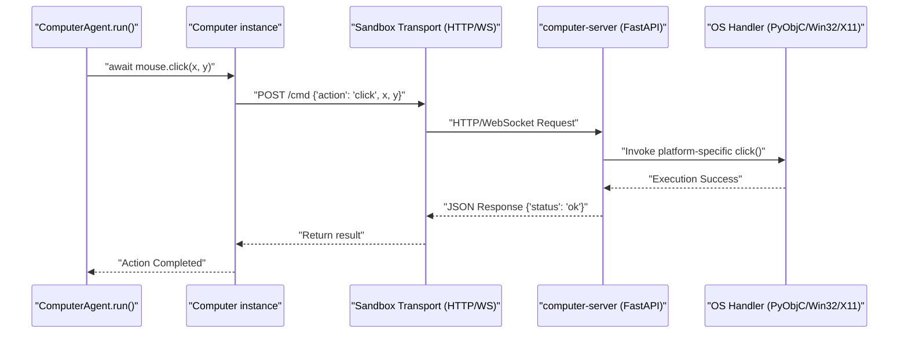

This flow covers agent task execution through software layers down to native input delivery.

Sources: [blog/build-your-own-operator-on-macos-1.md:78-86](), [blog/build-your-own-operator-on-macos-2.md:133-142]()

## Supported Platforms and Models

### Execution Environments

- **Cua Spaces (VM desktops)**: The native desktop app for macOS giving agents full desktop environments in VMs on local Macs or cloud.
- **Cloud Sandboxes**: Hosted Linux, Windows, and Android containers managed by Fleet.
- **Lume VMs**: Local macOS and Linux virtual machines managed via Lume utilizing Apple's Virtualization.framework.
- **Docker Containers**: Linux XFCE desktops via `trycua/lumier` images offering containerized environments.
- **Direct Host**: Running `cua-driver` on the host OS allowing background computer-use without VMs.

Sources: [README.md:48-51](), [docs/content/docs/index.mdx:6-7]()

### Supported Models & Providers

- **Anthropic Claude**: Claude 3.5 and Claude 4.5 Sonnet models with native computer-use tools integration.
- **OpenAI**: `computer-use-preview` model accessed via the Responses API.
- **Google Gemini**: Multimodal, tool-capable models integrated for computer-use.
- **Open Source & Specialist Models**: UI-TARS, Qwen3.5, GLM-4.5V, Fara, plus CUA-S1 decision classifiers.

Sources: [blog/build-your-own-operator-on-macos-2.md:145-151](), [blog/cua-vlm-router.md:37-45]()

## Repository Directory Structure & Additional Resources

The Cua repository is organized to centralize development resources, documentation, and examples:

| Directory     | Purpose                                                                                      |
|---------------|----------------------------------------------------------------------------------------------|
| `blog/`       | Developer tutorials, agent architecture deep dives, model routing, usage scenarios           |
| `rfcs/`        | Design proposals, protocol expansions, and architectural specification documents              |
| `samples/`    | Ready-to-run example applications and scripts demonstrating SDK and driver usage              |
| `evidence/`   | Benchmark runs, M1-Metal validation, trajectory captures, and empirical performance reports   |
| `skills/`     | Packs of skills and actions usable by agents, organized via capability manifests             |
| `docs/`       | User guides, API references, getting started instructions, and platform-specific documentation |

Sources: [blog/build-your-own-operator-on-macos-1.md:1-12](), [blog/build-your-own-operator-on-macos-2.md:5-7]()

---

This overview captures the essential architecture, key technical components, and development directions embodied by the Cua platform—enabling scalable, multimodal computer-use agents running on virtual and native environments with sophisticated model integration.

# End of Overview

---

# Page: Getting Started

# Getting Started

<details>
<summary>Relevant source files</summary>

The following files were used as context for generating this wiki page:

- [README.md](README.md)
- [img/card-cua-bench.gif](img/card-cua-bench.gif)
- [img/card-cua-bench.png](img/card-cua-bench.png)
- [img/card-cua-driver.gif](img/card-cua-driver.gif)
- [img/card-cua-driver.png](img/card-cua-driver.png)
- [img/card-cua-fleets.gif](img/card-cua-fleets.gif)
- [img/card-cua-fleets.png](img/card-cua-fleets.png)
- [img/card-cua-lume.gif](img/card-cua-lume.gif)
- [img/card-cua-lume.png](img/card-cua-lume.png)
- [img/card-cua-products.gif](img/card-cua-products.gif)
- [img/card-cua-products.png](img/card-cua-products.png)
- [img/card-cua-s1.gif](img/card-cua-s1.gif)
- [img/card-cua-spaces-wide.gif](img/card-cua-spaces-wide.gif)
- [img/cua-spaces-demo.mp4](img/cua-spaces-demo.mp4)

</details>


This page serves as the parent section for installation and quick-start guides across the various interfaces provided by the Cua framework. Cua supports multiple pathways for interacting with computer-use agents, including command-line interfaces, Python SDKs, and TypeScript SDKs [docs/content/docs/index.mdx:12-30]().

For deep technical details, installation manifests, and advanced environment configurations, please refer to the dedicated child pages linked below.

---

## Setup Overview

The Cua framework bridges natural language instructions with real or virtualized machine control interfaces. Users can choose between managing machines via CLI tools or building autonomous agent loops programmatically using the Python or TypeScript SDKs. The system also integrates core components like the background automation driver (`cua-driver`) for host platforms and sandbox VM management (via Lume). These components collaborate to provide a seamless experience for agent-driven computer use [docs/content/docs/index.mdx:6-30](), [README.md:10-66]().

### Diagram: User Interfaces to Code Entity Mapping

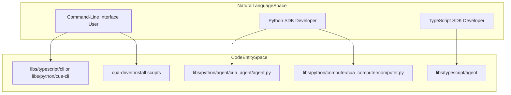

This diagram maps natural language user roles to their corresponding code artifacts, illustrating how users interact with core packages by interface type.

Sources: [docs/content/docs/index.mdx:12-30](), [README.md:10-66]()

---

## 2.1. Installation and Setup

Getting started with Cua involves configuring your local development environment and installing necessary dependencies across platforms (macOS, Windows, Linux). The setup process typically involves:

- Installing workspace managers and package managers: `uv` for Python, `pnpm` for TypeScript, and Rust toolchains via `cargo`
- Cloning the repository to get the full environment
- Setting environment variables to configure API keys such as `CUA_API_KEY`, `ANTHROPIC_API_KEY`, and `OPENAI_API_KEY`
- Following platform-specific installation scripts, e.g., `cua-driver` installers for background automation

For detailed instructions on dependency installation, environment variable configuration, and cross-platform setup, see the dedicated child page [Installation and Setup](#2.1) which walks through all steps comprehensively.

Sources: [docs/content/docs/tutorials/drive-your-first-app.mdx:32-117](), [docs/content/docs/how-to-guides/driver/install.mdx:1-50]()

---

## 2.2. Quick Start: CLI

The command-line interface (CLI) is often the fastest way to interact with Cua. The CLI tool (`cua-cli` for Python, `@trycua/cli` for TypeScript) enables users to:

- Authenticate with API keys or tokens
- Manage sandboxes and spaces: create, list, start, stop, attach via VNC streaming
- Operate background computer-use agents via the `cua-driver` daemon on the host machine

Getting your first sandbox running, managing your agent sessions, and connecting to live desktops are all supported directly in the CLI interfaces. The CLI abstracts much of the complexity involved with managing agent environments and sessions.

Refer to the child page [Quick Start: CLI](#2.2) for a step-by-step tutorial on installation, authentication, sandbox lifecycle commands, and first agent interactions.

Sources: [docs/content/docs/index.mdx:72](), [docs/content/docs/tutorials/drive-your-first-app.mdx:32-117]()

---

## 2.3. Quick Start: Python SDK

The Python SDK offers programmatic access to Cua’s agent and sandbox components, ideal for building autonomous agents and machine interaction workflows. Key SDK classes include:

- `ComputerAgent`: orchestrates agent loops and decision-making processes
- `Computer`: represents target machines or sandboxes where actions will be executed
- `Sandbox`: environment abstractions for ephemeral or persistent VM-based sandboxes

Developers use the Python SDK to initialize agent loops, interact with vision-language grounding models, and orchestrate sandbox lifecycle events with rich APIs.

### Diagram: Python SDK Agent Workflow

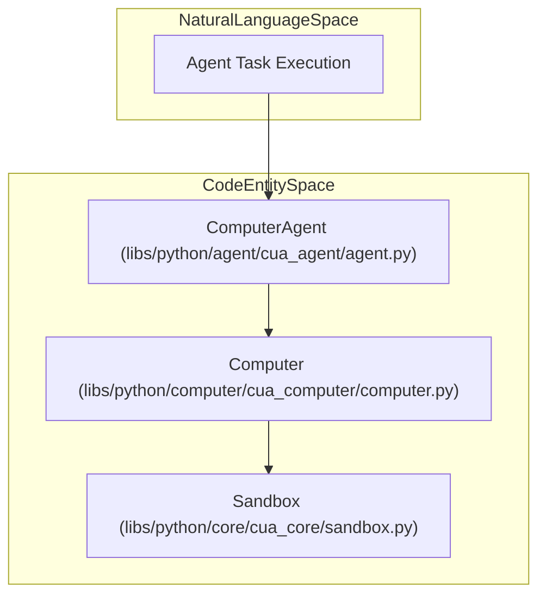

Users build tasks that map to agent invocation patterns, interacting with computers and sandboxes programmatically.

For detailed usage patterns, API references, and samples, refer to [Quick Start: Python SDK](#2.3).

Sources: [docs/content/docs/index.mdx:32-36](), [docs/content/docs/tutorials/drive-your-first-app.mdx:1-20]()

---

## 2.4. Quick Start: TypeScript SDK

The TypeScript SDK brings Cua’s computer and agent abstractions to Node.js and TypeScript development environments, wrapping Rust SDKs with UniFFI bindings for type safety and async operations. This SDK exposes:

- Agent primitives under `@trycua/agent`
- Computer control libraries via `@trycua/computer`
- CLI and transport integrations supporting sandbox management and streaming desktop control

The TypeScript SDK targets web-based and Node.js developers who need rich integration points to control Cua Sandboxes and interact with agents.

For instructions on package installation, configuration, and sample programs, see [Quick Start: TypeScript SDK](#2.4).

Sources: [docs/content/docs/index.mdx:12-30]()

---

# Summary

This "Getting Started" parent section provides the roadmap and high-level integration overview to begin working with Cua’s powerful computer-use automation technology. The CLI, Python SDK, and TypeScript SDK form the primary user-facing interfaces for authentication, sandbox lifecycle, and agent programming.

Each child page below maps directly to one interface or setup step:

| Section                     | Description                                                                                  |
|-----------------------------|----------------------------------------------------------------------------------------------|
| 2.1 Installation and Setup  | Full guides to set up development environments, install dependencies, and configure APIs      |
| 2.2 Quick Start: CLI        | Walkthrough on using the command-line interface, auth, sandbox management, and workflows      |
| 2.3 Quick Start: Python SDK | Agent and sandbox programming with Python classes `ComputerAgent`, `Computer`, and `Sandbox` |
| 2.4 Quick Start: TypeScript SDK | Using the TypeScript ecosystem to manage agents and sandbox interactions                         |

This layered approach lets users pick the best interface to fit their needs, whether via terminal commands or custom agent code.

Sources: [docs/content/docs/index.mdx:12-30](), [docs/content/docs/tutorials/drive-your-first-app.mdx:1-117](), [README.md:10-66]()

---

# Page: Installation and Setup

# Installation and Setup

<details>
<summary>Relevant source files</summary>

The following files were used as context for generating this wiki page:

- [.editorconfig](.editorconfig)
- [.pre-commit-config.yaml](.pre-commit-config.yaml)
- [.prettierignore](.prettierignore)
- [.prettierrc.yaml](.prettierrc.yaml)
- [.vscode/extensions.json](.vscode/extensions.json)
- [.vscode/settings.json](.vscode/settings.json)
- [CONTRIBUTING.md](CONTRIBUTING.md)
- [Development.md](Development.md)
- [examples/streaming/typescript-node/package-lock.json](examples/streaming/typescript-node/package-lock.json)
- [examples/streaming/typescript-web/package-lock.json](examples/streaming/typescript-web/package-lock.json)
- [libs/cua-bench-rl/uv.lock](libs/cua-bench-rl/uv.lock)
- [libs/cua-bench/uv.lock](libs/cua-bench/uv.lock)
- [libs/cua/python/uv.lock](libs/cua/python/uv.lock)
- [libs/python/cua-sandbox-apps/uv.lock](libs/python/cua-sandbox-apps/uv.lock)
- [nix/cua-driver/compositor/cua_compositor_patch.py](nix/cua-driver/compositor/cua_compositor_patch.py)
- [package.json](package.json)
- [pnpm-lock.yaml](pnpm-lock.yaml)
- [pyproject.toml](pyproject.toml)
- [samples/openkoalabot-example-ts/package-lock.json](samples/openkoalabot-example-ts/package-lock.json)
- [uv.lock](uv.lock)

</details>


This page covers installing the Cua SDKs (Python and TypeScript), setting up the workspace environment using `uv` and `pnpm`, configuring environment variables, and establishing API keys. For detailed information on specific virtual machine or container providers, see [Provider Architecture](/docs/execution-environments).

---

## Overview

Cua is organized as a monorepo containing Python, TypeScript, Rust, and Swift packages [Development.md:3-24](). Setting up the codebase depends on your use case:

1. **End-User Installation**: Installing published packages directly via package managers like `pip`, `uv`, or `npm`.
2. **Development Workspace Setup**: Cloning the source repository and using workspace tools (`uv` for Python and `pnpm` for TypeScript) to build, test, and develop locally [Development.md:27-61]().

### Core Installation Requirements
* **Python Environment**: Python 3.12 or 3.13 is required for the core execution components, including `cua-computer` and `cua-agent` [pyproject.toml:11](), [uv.lock:3]().
* **Node.js Environment**: Node.js and `pnpm` are required for building TypeScript packages, `cuabot`, and documentation [Development.md:39](), [package.json:1-10]() (implied).
* **Package Management Tools**: `uv` manages the shared Python virtual environment and cross-package dependencies [Development.md:38, 60-61](), while `pnpm` handles the Node.js monorepo workspace [Development.md:48-50]().
* **Environment Variables**: API keys for LLM providers (e.g., Anthropic, OpenAI) and Cua Cloud are maintained via local configuration files [Development.md:52-54]().

### System Architecture Setup Flow

The following diagram maps the installation and configuration flow from high-level user choices to specific codebase entities and configuration files.

#### Diagram: Installation and Configuration Data Flow
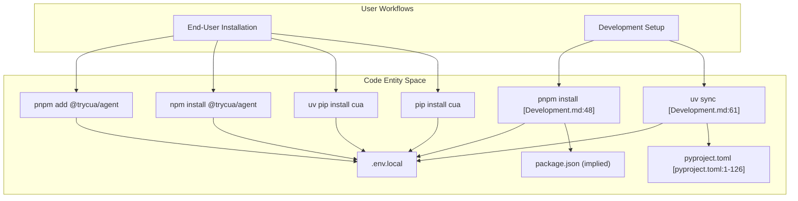

Sources: [pyproject.toml:1-126](), [Development.md:1-85](), inferred package.json

---

## Prerequisites

### System Requirements

| Component    | Requirement          | Role in Ecosystem                                         |
|--------------|----------------------|-----------------------------------------------------------|
| **Python**   | `>=3.12, <3.14`      | Runs the Agent loops and computer abstraction layer [pyproject.toml:11](), [uv.lock:3](). |
| **Node.js**  | Required             | Powers the TypeScript SDK, CuaBot, and documentation [Development.md:39](). |
| **Rust**     | Required             | Needed for `cua-driver` development and core components [Development.md:40](). |
| **Swift/Xcode** | macOS only         | Required for Lume (macOS Virtualization) development [Development.md:41](). |

Sources: [pyproject.toml:11](), [uv.lock:3](), [Development.md:36-42]()

### Package Installation Tools

#### Python: uv

`uv` is used to manage the Python monorepo workspace and create its virtual environments. It offers fast resolution and manages multiple internal dependencies consistently across packages. The Python workspace members are defined in `pyproject.toml` under the `[tool.uv.workspace.members]` section.

#### TypeScript: pnpm

Node.js dependencies are orchestrated with `pnpm` (recommended version 9.0.4+). `pnpm` enables efficient caching and workspace management for TypeScript packages, CuaBot, and front-end components.

#### Rust Toolchain

Rust is required mainly for building `cua-driver` and Rust-based core crates. The required Rust version is pinned in `rust-toolchain.toml` (not shown here but referenced) [Development.md:40]().

#### Swift Toolchain

For macOS users developing or building Lume VM management tools, Swift and Xcode command-line tools are prerequisites [Development.md:41]().

#### Mapping Toolchains to Configuration Files

#### Diagram: Toolchain to Configuration Mapping
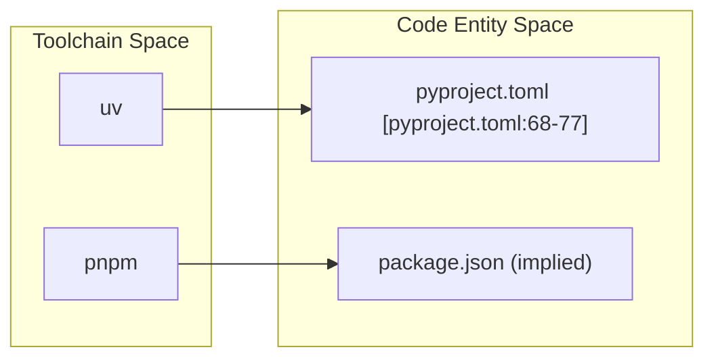

Sources: [Development.md:38-50](), [pyproject.toml:60-77](), inferred package.json

---

## Python SDK Installation

The Python SDK comprises several loosely coupled packages within `libs/python/*` managed by `uv` in a workspace environment. This setup supports both end-user installs and development workflows.

### Workspace Python Packages

| Package Name       | Location                | Responsibility                                          |
|--------------------|-------------------------|---------------------------------------------------------|
| `cua-agent`        | `libs/python/agent`     | AI interaction loops and model adapter logic             |
| `cua-core`         | `libs/python/core`      | Core utilities and telemetry                              |
| `cua-som`          | `libs/python/som`       | Set-of-Mark visual grounding utilities                   |
| `cua-bench-ui`     | `libs/python/bench-ui`  | Benchmark and UI libraries                                |
| `cua-mcp-server`   | `libs/python/mcp-server`| MCP server backend                                        |
| Other packages      | Various subdirectories  | See `pyproject.toml` and the workspace member list       |

These are listed as members in the `uv` workspace under `[tool.uv.workspace.members]` in `pyproject.toml` [pyproject.toml:64-70](), [Development.md:44-46]().

### End-User Installation

To install the unified Python package for runtime use:

```bash
pip install cua
# Or with uv for faster installs and workspace management
uv pip install cua
```

These commands install published packages from PyPI or the configured wheel repository.

### Development Setup

For development and local modification:

```bash
git clone https://github.com/trycua/cua.git
cd cua

# Install with dev dependencies
uv sync --group dev

# Optionally install pre-commit Git hooks
uv run pre-commit install
```

This creates a `.venv` virtual environment with all workspace members installed in editable mode. You can inspect or modify packages in `libs/python/*` and run tests locally [Development.md:27-32, 61]().

#### Diagram: Python Workspace Entity Mapping
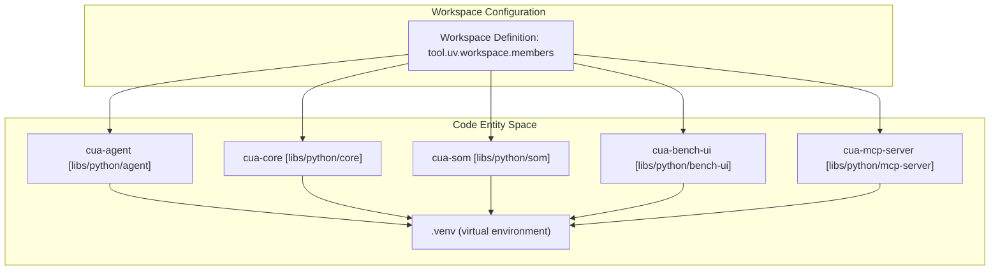

Sources: [pyproject.toml:64-77](), [Development.md:44-46](), [uv.lock:13-25]()

---

## TypeScript SDK Installation

The TypeScript SDK modules are managed under `libs/typescript/`.

### End-User Installation

Install from npm or pnpm as follows:

```bash
# Using npm
npm install @trycua/agent @trycua/computer

# Using pnpm
pnpm add @trycua/agent @trycua/computer
```

### Development Setup

For local development and testing of the TypeScript packages:

```bash
# At repository root (installs prettier and root dependencies)
pnpm install

# Inside the TypeScript directory (install specific dependencies)
cd libs/typescript
pnpm install
```

This setup enables workspace-aware builds and testing for TypeScript packages [Development.md:48-50]().

Sources: [Development.md:48-50](), inferred package.json

---

## Environment Configuration

### API Key Setup

Cua uses environment variables for API keys and runtime configuration. Create a `.env.local` or `.env` file in your repository root to hold keys for LLM providers and Cua Cloud access.

Example `.env.local`:

```bash
# Anthropic LLM API key
ANTHROPIC_API_KEY=your_anthropic_api_key_here

# OpenAI LLM API key
OPENAI_API_KEY=your_openai_api_key_here

# Cua Cloud API key
CUA_API_KEY=your_cua_cloud_api_key_here
```

These variables are automatically loaded by the Python and TypeScript SDKs when running locally via `uv` or `pnpm` tooling [Development.md:52-54](). 

Never commit your API keys to public repositories.

Sources: [Development.md:52-54](), [pyproject.toml:4-6]()

---

## Formatting and Linting

Cua uses a comprehensive pre-commit hook system for code quality that handles Python and TypeScript formatting and linting [Development.md:58-74]().

### Installing Git Hooks

```bash
uv run pre-commit install
```

### Running All Hooks Manually

```bash
uv run pre-commit run --all-files
```

### Pre-Commit Hooks Overview

| Tool         | Purpose                                 | Source                             |
|--------------|-----------------------------------------|----------------------------------|
| Prettier     | TypeScript/JavaScript/JSON/Markdown formatting | `.pre-commit-config.yaml:2-10`   |
| TypeScript Type Check | Static typing with pnpm workspace   | `.pre-commit-config.yaml:14-18`  |
| isort        | Python import sorting                   | `.pre-commit-config.yaml:21-27`  |
| Black        | Python code formatting                  | `.pre-commit-config.yaml:29-34`  |
| Ruff         | Python linting and autofixing           | `.pre-commit-config.yaml:36-42`  |

Maintain consistent code style and quality by running pre-commit hooks before pushing changes.

Sources: [Development.md:58-74](), [.pre-commit-config.yaml:1-50](), [pyproject.toml:87-125]()

---

# Summary Diagram: User Installation and Setup Lifecycle

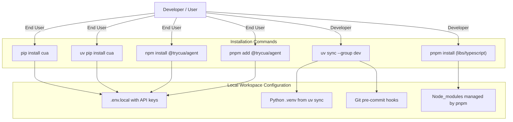

---

This completes the Installation and Setup instructions for the Cua codebase, providing end-user package installation, development workspace setup, environment variable configuration, and tooling integration.

Sources:  
- [Development.md:1-97]()  
- [pyproject.toml:1-126]()  
- [uv.lock:1-90]()  
- [.pre-commit-config.yaml:1-50]()  
- inferred: package.json and pnpm usage from project conventions

---

# Page: Quick Start: CLI

# Quick Start: CLI

<details>
<summary>Relevant source files</summary>

The following files were used as context for generating this wiki page:

- [README.md](README.md)
- [img/card-cua-bench.gif](img/card-cua-bench.gif)
- [img/card-cua-bench.png](img/card-cua-bench.png)
- [img/card-cua-driver.gif](img/card-cua-driver.gif)
- [img/card-cua-driver.png](img/card-cua-driver.png)
- [img/card-cua-fleets.gif](img/card-cua-fleets.gif)
- [img/card-cua-fleets.png](img/card-cua-fleets.png)
- [img/card-cua-lume.gif](img/card-cua-lume.gif)
- [img/card-cua-lume.png](img/card-cua-lume.png)
- [img/card-cua-products.gif](img/card-cua-products.gif)
- [img/card-cua-products.png](img/card-cua-products.png)
- [img/card-cua-s1.gif](img/card-cua-s1.gif)
- [img/card-cua-spaces-wide.gif](img/card-cua-spaces-wide.gif)
- [img/cua-spaces-demo.mp4](img/cua-spaces-demo.mp4)
- [libs/cua/CHANGELOG.md](libs/cua/CHANGELOG.md)
- [libs/cua/VERSION](libs/cua/VERSION)
- [libs/cua/python/pyproject.toml](libs/cua/python/pyproject.toml)
- [libs/cua/python/src/cua/__init__.py](libs/cua/python/src/cua/__init__.py)
- [libs/cua/typescript/package-lock.json](libs/cua/typescript/package-lock.json)
- [libs/cua/typescript/package.json](libs/cua/typescript/package.json)

</details>


## Purpose and Scope

This page documents the Cua command-line interface (`cua`), the primary tool for managing authentication, cloud sandboxes, and agent workflows. The `cua` CLI is implemented in two versions: a Python-based CLI (`cua-cli`) and a TypeScript-based CLI (`@trycua/cli`).

> [!IMPORTANT]
> The TypeScript CLI package (`@trycua/cli`) is deprecated in favor of the Python CLI, which provides better integration and more frequent updates. Users should migrate to the Python CLI (`pip install cua-cli`) [libs/typescript/cua-cli/package.json:1-6](), [libs/typescript/cua-cli/README.md:1-10]().

Sources: [libs/python/cua-cli/pyproject.toml:1-5](), [libs/typescript/cua-cli/package.json:1-6](), [libs/typescript/cua-cli/README.md:1-10]()


## Installation

### Python CLI (Recommended)

The Python CLI is the recommended and primary interface to interact with Cua. It requires Python 3.12 or later [libs/python/cua-cli/pyproject.toml:27]().

```bash
pip install cua-cli
```

For full feature support including MCP server and skill recording, install with extras:

```bash
pip install "cua-cli[all]"
```

Sources: [libs/python/cua-cli/pyproject.toml:1-61]()

### TypeScript CLI (Deprecated)

The TypeScript CLI is deprecated but still available for use. It can be installed with Bun or npm [libs/typescript/cua-cli/README.md:12-28]():

```bash
bun add -g @trycua/cli
# OR
npm install -g @trycua/cli
```

Sources: [libs/typescript/cua-cli/README.md:12-28](), [scripts/install-cli.sh:58-91]()


## CLI Architecture and Command Structure

The `cua` CLI acts as an entry point integrating several core Cua subsystems such as sandbox management, authentication, image management, and skills demonstration.

### High-Level Command Groups

The CLI employs a modular, sub-command architecture organizing functionality into logical groups [libs/typescript/cua-cli/src/cli.ts:1-65]():

| Group        | Sub-commands                                         | Description                                       |
|--------------|-----------------------------------------------------|-------------------------------------------------|
| `auth`       | `login`, `logout`, `env`                            | Manage authentication tokens and environment    |
| `sandbox`/`sb` | `list`, `create`, `get`, `delete`, `start`, `stop`, `vnc` | Provision and control cloud sandboxes (VMs)     |
| `image`/`img` | `list`, `push`, `pull`, `delete`                   | Manage VM images in cloud registry                |
| `skills`     | `record`, `list`, `read`, `replay`, `delete`       | Manage recorded demonstration skills             |
| `serve-mcp`  | (no subcommands)                                     | Launch MCP server for agent integration           |

In the Python CLI, the main entry point is implemented in `cua_cli.main:main` [libs/python/cua-cli/pyproject.toml:77-78](), and in TypeScript in `src/index.ts` [libs/typescript/cua-cli/package.json:23-25]().

### Internal Architecture and Data Flow

```mermaid
graph TB
    subgraph "CLI_Entrypoint"
        PythonMain["cua_cli/main.py"]
        TSMain["src/index.ts"]
        Parser["argparse / yargs"]
    end

    subgraph "CommandModules"
        AuthCmd["src/commands/auth.ts"]
        SandboxCmd["src/commands/sandbox.ts"]
        ImageCmd["src/commands/image.ts"]
        SkillsCmd["src/commands/skills.ts"]
    end

    subgraph "UtilityAndState"
        ConfigStore["src/storage.ts (cli.sqlite)"]
        HTTPClient["src/http.ts -> api.cua.ai"]
        Config["src/config.ts"]
    end

    PythonMain --> Parser
    TSMain --> Parser
    Parser --> AuthCmd
    Parser --> SandboxCmd
    Parser --> ImageCmd
    Parser --> SkillsCmd

    AuthCmd --> ConfigStore
    AuthCmd --> Config
    SandboxCmd --> HTTPClient
    SkillsCmd --> ConfigStore
    ConfigStore --> "cli.sqlite DB"
```

**Explanation:**

- The CLI entrypoint (either Python or TypeScript) parses the command line and dispatches to the appropriate command module.
- Authentication commands interact with local storage and config for token persistence.
- Sandbox commands manage cloud VM provisioning through HTTP API calls to `api.cua.ai` and perform lifecycle actions.
- Image commands manipulate VM images cached/pulled from cloud registries.
- Skills commands record and replay agent demonstrations stored locally.

Sources: [libs/python/cua-cli/pyproject.toml:77-78](), [libs/typescript/cua-cli/src/cli.ts:1-65](), [libs/typescript/cua-cli/package.json:23-25]()


## Authentication

Authentication is essential for cloud sandbox interaction. The CLI supports user login via the browser and manual API key setting.

### Login Flow

1. Invoke `cua auth login`.
2. The CLI opens the default web browser to the Cua authentication portal.
3. Upon success, the CLI receives an access token and refresh token.
4. Tokens are saved securely in local storage (`cli.sqlite`) or environment variables.
5. Users can verify and export environment variables with `cua auth env` which writes `CUA_API_KEY` into a `.env` file for client SDK consumption.

```typescript
// writeEnvFile saves CUA_API_KEY to .env for SDK usage
async function writeEnvFile(apiKey: string) {
  // Write to .env file logic
}
```

Sources: [libs/typescript/cua-cli/src/commands/auth.ts:1-30](), [libs/typescript/cua-cli/src/util.ts:1-13]()


## Sandbox (Space) Management

Sandboxes represent the virtual machines where the agents run. `sandbox` (or shorthand `sb`) commands manage their lifecycle remotely.

### Sandbox State Model

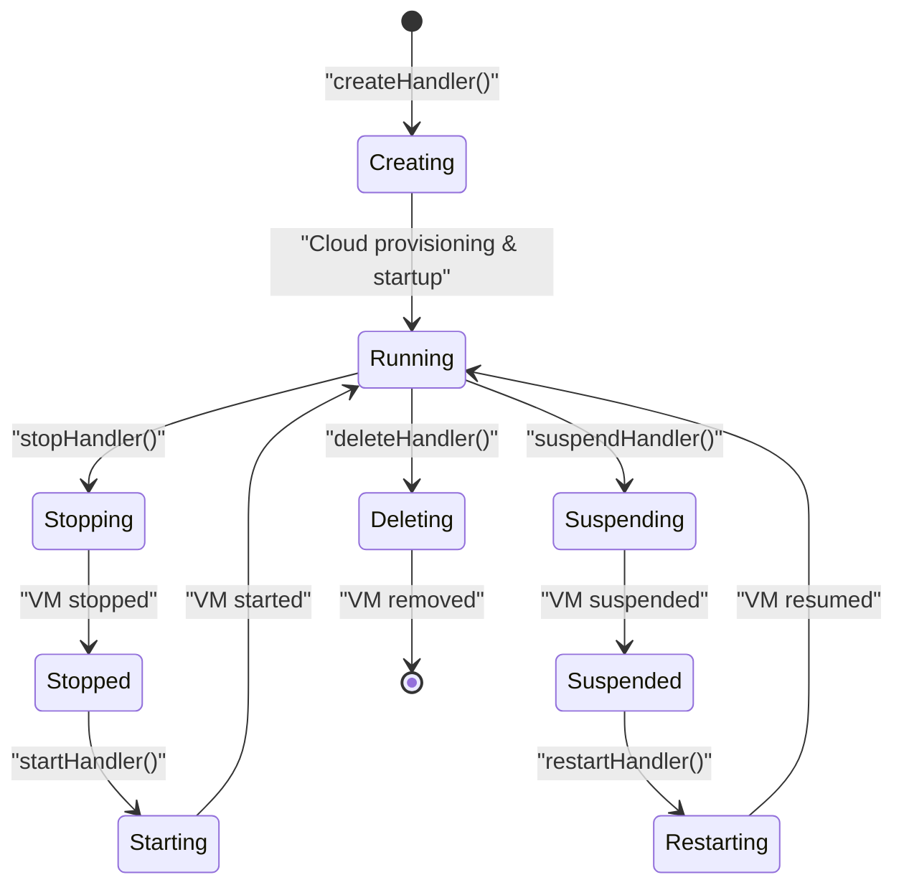

This state machine governs sandbox lifecycle commands and corresponds to the handlers managing VM creation, stopping, starting, suspending, restarting, and deletion [libs/typescript/cua-cli/src/util.ts:15-28](), [libs/typescript/cua-cli/src/commands/sandbox.ts:160-226]().

### Sandbox Probing and Health Checks

When fetching details about a sandbox, the CLI performs active health probes to verify VM status [libs/typescript/cua-cli/src/commands/sandbox.ts:9-141]():

- **Status Probe:** Queries `https://{host}:8443/status` to retrieve OS type, version, and feature flags [libs/typescript/cua-cli/src/commands/sandbox.ts:66-88]().
- **Version Probe:** Executes a POST command `version` at `https://{host}:8443/cmd` to validate compatibility with the Cua protocol [libs/typescript/cua-cli/src/commands/sandbox.ts:91-129]().

### Remote Desktop (VNC) Access

The `vnc` command generates a NoVNC web URL embedding sandbox-specific credentials (password and host) [libs/typescript/cua-cli/src/commands/sandbox.ts:50-53](). It launches the default desktop browser with environment-specific commands (`open` on macOS, `start` on Windows, `xdg-open` on Linux) [libs/typescript/cua-cli/src/util.ts:60-80]().

Sources: [libs/typescript/cua-cli/src/commands/sandbox.ts:50-53](), [libs/typescript/cua-cli/src/util.ts:60-80]()


## Basic CLI Workflow

A typical workflow to start using the CLI for remote sandbox management and automation is:

| Step              | Command                                      | Description                                               |
|-------------------|----------------------------------------------|-----------------------------------------------------------|
| Authentication    | `cua auth login`                              | Login and acquire API credentials for cloud operations    |
| Create Sandbox    | `cua sb create --os linux --size small --region north-america` | Provision a new sandbox VM with specified parameters       |
| List Sandboxes    | `cua sb list`                                | Monitor sandbox status, waiting for `running` state       |
| Open Sandbox GUI  | `cua sb vnc <sandbox-name>`                   | Open the sandbox desktop environment via browser          |
| Export Environment| `cua auth env`                               | Export environment variables for SDK and scripts           |
| Cleanup          | `cua sb delete <sandbox-name>`                | Delete the sandbox when finished                            |

Below diagram illustrates the interaction between user commands, the CLI, cloud API, and the sandbox VM environment.

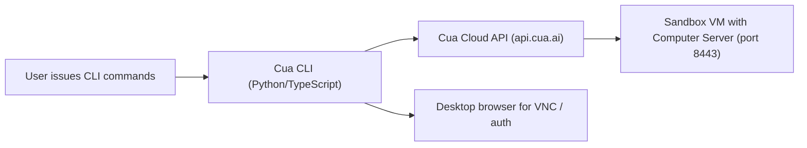

Sources: [blog/introducing-cua-cli.md:66-183](), [libs/typescript/cua-cli/src/commands/sandbox.ts:9-141]()


## Bridging the Natural Language and Code Entity Spaces

The command-line interface abstractly translates user intent expressed as natural language commands into concrete API calls and system operations within the codebase.

### Diagram 1: From Natural Language "Space" Concepts to Code Commands and Modules

```mermaid
graph TB
    NL["Natural Language Space"]
    Code["Code Entity Space"]

    NL -->|"Create a Space" | CmdCreate["`cua sb create` command"]
    NL -->|"Start/Stop a Space" | CmdLifecycle["`cua sb start` / `cua sb stop` commands"]
    NL -->|"View Space VNC" | CmdVNC["`cua sb vnc` command"]
    NL -->|"Authenticate" | CmdAuth["`cua auth login` command"]

    CmdCreate -->|uses| HandlerCreate["createHandler()"]
    CmdLifecycle -->|uses| HandlerLifecycle["stopHandler()/startHandler()"]
    CmdVNC -->|calls| UtilOpenBrowser["openInBrowser()"]
    CmdAuth -->|calls| AuthStorage["Auth storage & token management"]

    HandlerCreate -->|in| SandboxCmd["sandbox.ts module"]
    HandlerLifecycle -->|in| SandboxCmd
    UtilOpenBrowser -->|in| UtilModule["util.ts utilities"]
    AuthStorage -->|in| AuthModule["auth.ts module"]

    NL -.->|User command input| Code
```

### Diagram 2: Detailed Data Flow in Sandbox Management Command

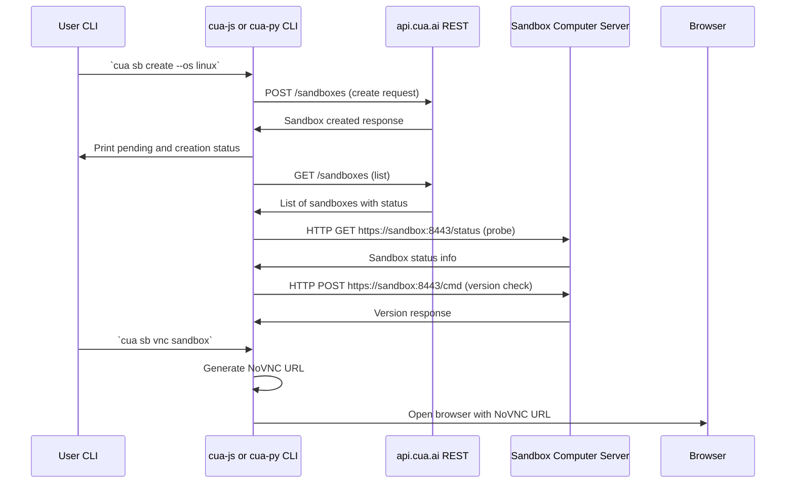

---

This completes the full technical detail and practical guide to using the Cua CLI for managing authentication, sandboxes, and basic agent workflows.

Sources:  
[libs/python/cua-cli/pyproject.toml:1-61]()  
[libs/typescript/cua-cli/package.json:1-25]()  
[libs/typescript/cua-cli/src/cli.ts:1-65]()  
[libs/typescript/cua-cli/src/commands/auth.ts:1-30]()  
[libs/typescript/cua-cli/src/util.ts:1-80]()  
[libs/typescript/cua-cli/src/commands/sandbox.ts:9-141]()  
[libs/typescript/cua-cli/src/commands/sandbox.ts:160-226]()  
[blog/introducing-cua-cli.md:66-183]()

---

# Page: Quick Start: Python SDK

# Quick Start: Python SDK

<details>
<summary>Relevant source files</summary>

The following files were used as context for generating this wiki page:

- [Makefile](Makefile)
- [docs/content/docs/cua-sdk/reference/runtime-support.mdx](docs/content/docs/cua-sdk/reference/runtime-support.mdx)
- [libs/python/agent/.bumpversion.cfg](libs/python/agent/.bumpversion.cfg)
- [libs/python/agent/README.md](libs/python/agent/README.md)
- [libs/python/agent/pyproject.toml](libs/python/agent/pyproject.toml)
- [libs/python/core/.bumpversion.cfg](libs/python/core/.bumpversion.cfg)
- [libs/python/core/README.md](libs/python/core/README.md)
- [libs/python/core/pyproject.toml](libs/python/core/pyproject.toml)
- [libs/python/cua-sandbox/CHANGELOG.md](libs/python/cua-sandbox/CHANGELOG.md)
- [libs/python/cua-sandbox/README.md](libs/python/cua-sandbox/README.md)
- [libs/python/cua-sandbox/VERSION](libs/python/cua-sandbox/VERSION)
- [libs/python/cua-sandbox/cua_sandbox/__init__.py](libs/python/cua-sandbox/cua_sandbox/__init__.py)
- [libs/python/cua-sandbox/cua_sandbox/pool.py](libs/python/cua-sandbox/cua_sandbox/pool.py)
- [libs/python/cua-sandbox/cua_sandbox/sandbox.py](libs/python/cua-sandbox/cua_sandbox/sandbox.py)
- [libs/python/cua-sandbox/cua_sandbox/sync/__init__.py](libs/python/cua-sandbox/cua_sandbox/sync/__init__.py)
- [libs/python/cua-sandbox/cua_sandbox/transport/fleet.py](libs/python/cua-sandbox/cua_sandbox/transport/fleet.py)
- [libs/python/cua-sandbox/cua_sandbox/transport/fleet_cloud.py](libs/python/cua-sandbox/cua_sandbox/transport/fleet_cloud.py)
- [libs/python/cua-sandbox/pyproject.toml](libs/python/cua-sandbox/pyproject.toml)
- [libs/python/cua-sandbox/tests/test_fleet_cloud_client.py](libs/python/cua-sandbox/tests/test_fleet_cloud_client.py)
- [libs/python/cua-sandbox/tests/test_fleet_cloud_transport.py](libs/python/cua-sandbox/tests/test_fleet_cloud_transport.py)
- [libs/python/cua-sandbox/tests/test_fleet_sdk_distribution.py](libs/python/cua-sandbox/tests/test_fleet_sdk_distribution.py)
- [libs/python/cua-sandbox/tests/test_fleet_sdk_packaging.py](libs/python/cua-sandbox/tests/test_fleet_sdk_packaging.py)
- [libs/python/cua-sandbox/tests/test_fleet_transport.py](libs/python/cua-sandbox/tests/test_fleet_transport.py)
- [libs/python/cua-sandbox/tests/test_pool.py](libs/python/cua-sandbox/tests/test_pool.py)
- [libs/python/cua-sandbox/tests/test_sandbox_fleet_lifecycle.py](libs/python/cua-sandbox/tests/test_sandbox_fleet_lifecycle.py)
- [libs/python/cua-sandbox/tests/test_vm_cleanup.py](libs/python/cua-sandbox/tests/test_vm_cleanup.py)
- [libs/python/cua-sandbox/uv.lock](libs/python/cua-sandbox/uv.lock)
- [libs/python/som/.bumpversion.cfg](libs/python/som/.bumpversion.cfg)
- [libs/python/som/README.md](libs/python/som/README.md)
- [libs/python/som/pyproject.toml](libs/python/som/pyproject.toml)

</details>


## Purpose and Scope

This page provides practical technical guidance for initializing and using the Cua Python SDK. It covers dependency installation across the core component packages, environment provisioning via the `Sandbox` class, configuring and running a `ComputerAgent`, and understanding the underlying agentic execution loop.

For command-line usage, see [Quick Start: CLI](). For TypeScript environments, see [Quick Start: TypeScript SDK](). For full reference documentation, consult [Computer SDK](), [Sandbox SDK](), and [ComputerAgent SDK]().

Sources: `[libs/python/cua-sandbox/cua_sandbox/sandbox.py:1-28]()`, `[libs/python/agent/pyproject.toml:6-8]()`

---

## Installation & Package Structure

The Cua Python SDK is modular, separating core environment control, sandboxing, and agent orchestration into distinct packages managed through standard dependency tooling (`uv` or `pip`).

| Package        | Role                                                   | Pyproject Configuration                      |
|----------------|--------------------------------------------------------|----------------------------------------------|
| `cua`          | Unified meta-package bridging sandbox and agent layers | `[libs/python/cua/pyproject.toml]()`         |
| `cua-agent`    | AI orchestration, tool registration, and execution loops | `[libs/python/agent/pyproject.toml:6-25]()` |
| `cua-sandbox`  | Ephemeral and persistent sandbox runtimes and transports | `[libs/python/cua-sandbox/pyproject.toml:29-43]()` |
| `cua-computer` | Low-level OS control primitives and VM provider factory | `[libs/python/computer/pyproject.toml:13-21]()` |
| `cua-core`     | Shared utilities, telemetry, and metrics                | `[libs/python/core/pyproject.toml:13-15]()` |

### Recommended Installation Command

```bash
uv pip install cua "cua-agent[all]"
```
The `[all]` extra pulls in provider-specific runtimes for various model providers (Anthropic, OpenAI, Gemini, UI-TARS) and UI integrations.

Sources: `[libs/python/agent/pyproject.toml:13-25]`, `[libs/python/cua-sandbox/pyproject.toml:29-43]`, `[libs/python/core/pyproject.toml:13-15]()`

---

## Python SDK Architecture

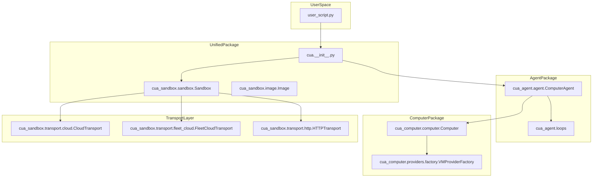

**Diagram: Python SDK Package Architecture**

The unified meta-package exposes top-level accessors for both `Sandbox` environment management and `ComputerAgent` orchestration. Beneath the sandbox abstraction, transports (`CloudTransport`, `FleetCloudTransport`, and `HTTPTransport`) handle communication with remote or local execution containers.

Sources: `[libs/python/cua-sandbox/cua_sandbox/sandbox.py:81-90]()`, `[libs/python/cua-sandbox/cua_sandbox/transport/fleet_cloud.py:1-49]()`

---

## Working with Sandboxes and Runtimes

The `Sandbox` class serves as the primary entry point for managing isolated desktop or server environments. It exposes user interfaces such as `.mouse`, `.keyboard`, `.screen`, `.clipboard`, `.shell`, and `.terminal` backed by an active `Transport` instance to communicate with the guest environment [libs/python/cua-sandbox/cua_sandbox/sandbox.py:1-4]().

### Sandbox Provisioning Patterns

1. **Ephemeral Sandboxes:** Automatically provisioned and torn down using an async context manager.

2. **Persistent Sandboxes:** Created explicitly for longer-lived usage and can be connected to by name.

3. **Reconnection:** Connect to existing named sandbox sessions or by URL.

Example:

```python
from cua_sandbox import Image, Sandbox, http

async with Sandbox.ephemeral(
    Image.from_registry("python:3.12-slim"),
    command=["python", "-m", "http.server", "8000"],  # overrides container entrypoint
    services={"web": 8000},              # named guest ports
    wait_for=http("web", "/"),           # readiness probe on service and path
    on="cloud",                          # or "local"; defaults to your default setting
) as sb:
    # Perform requests through service interface
    r = await sb.service("web").request("GET", "/")
    print(r.status_code)

    # Get a public shareable URL (signed URL)
    url = await sb.public_url("web", ttl=3600)

    # Open an ephemeral port-forward tunnel
    async with sb.tunnel.forward(8000) as tunnel:
        print(tunnel.url)

    # Inspect sandbox info and state
    info = await sb.info()
    print(sb.id)
```

Sources: `[libs/python/cua-sandbox/cua_sandbox/sandbox.py:1-45]`, `[libs/python/cua-sandbox/README.md:67-101]()`

---

## ComputerAgent Orchestration and Execution Loop

The `ComputerAgent` class manages the execution of AI-driven instructions targeting a sandboxed or real computer environment. It orchestrates interaction with the language model and dispatches tool invocations (like keyboard input or mouse movement) [libs/python/agent/pyproject.toml:6-8]().

### Initializing and Running an Agent

You instantiate a `ComputerAgent` with the desired model identifier and a list of interface tools such as a `Sandbox` instance. Running the agent involves invoking its asynchronous `.run()` method with a natural language task description, which returns an async generator yielding responses or actions.

Example:

```python
from cua_agent.agent import ComputerAgent

# Assuming `sb` is a connected Sandbox instance
agent = ComputerAgent(
    model="anthropic/claude-3-5-sonnet",
    tools=[sb]
)

async for response in agent.run("Open the settings application"):
    print(response)
```

Sources: `[libs/python/agent/pyproject.toml:6-8]()`, `[libs/python/cua-sandbox/cua_sandbox/sandbox.py:1-28]()`

### Execution Flow and Data Mapping

```mermaid
sequenceDiagram
    participant User as "User Script"
    participant Agent as "ComputerAgent (cua_agent.agent)"
    participant Loop as "AsyncAgentConfig (cua_agent.loops)"
    participant Sandbox as "Sandbox (cua_sandbox.sandbox)"
    participant Server as "cua-spacesd (computer_server)"

    User->>Agent: run(task_prompt)
    Agent->>Loop: predict_step(message_history)
    Loop-->>Agent: Action: keyboard.type("hello")
    Agent->>Sandbox: keyboard.type("hello")
    Sandbox->>Server: HTTP/WebSocket /cmd
    Server-->>Sandbox: CommandResult, frame buffer
    Sandbox-->>Agent: Action result state
    Agent-->>User: yield AgentResponse
```

**Diagram: Agent-to-Sandbox Execution Loop**

This diagram illustrates how a user script drives the agent, which queries its reasoning loop for the next action. The action (e.g., typing) is dispatched through the `Sandbox` interface to the in-guest `cua-spacesd` daemon, which executes and returns command results and visual state. The agent yields responses back to the user script.

Sources: `[libs/python/agent/pyproject.toml:6-8]()`, `[libs/python/cua-sandbox/cua_sandbox/sandbox.py:66-90]()` 

---

## Summary of Key Classes

| Class Name      | File Path Reference                              | Core Responsibility                                                           |
|-----------------|-------------------------------------------------|-------------------------------------------------------------------------------|
| `Sandbox`       | `[libs/python/cua-sandbox/cua_sandbox/sandbox.py:1-28]()` | Manages sandbox lifecycle, environment interfaces, and transport abstraction. |
| `ComputerAgent` | `[libs/python/agent/pyproject.toml:6-8]()`      | Orchestrates model loops and tool call execution on sandbox/computer.         |
| `Image`         | `[libs/python/cua-sandbox/cua_sandbox/image.py:1-20]()` | Defines sandbox container or VM image specifications.                         |
| `CloudTransport` / `FleetCloudTransport` | `[libs/python/cua-sandbox/cua_sandbox/transport/fleet_cloud.py:1-49]()` | Implements cloud transport protocols for sandbox communication.               |

Sources: `[libs/python/cua-sandbox/cua_sandbox/sandbox.py:1-28]`, `[libs/python/agent/pyproject.toml:6-8]`, `[libs/python/cua-sandbox/cua_sandbox/transport/fleet_cloud.py:1-49]()`

---

This guide provides a concise, technical foundation for beginning development with the Cua Python SDK, facilitating environment provisioning, agent orchestration, and cloud/local sandbox integration. For deeper exploration see related package documentation and the full API references.

---

# Page: Quick Start: TypeScript SDK

# Quick Start: TypeScript SDK

<details>
<summary>Relevant source files</summary>

The following files were used as context for generating this wiki page:

- [.github/workflows/ci-ts-fleet.yml](.github/workflows/ci-ts-fleet.yml)
- [.vscode/libs-ts.code-workspace](.vscode/libs-ts.code-workspace)
- [libs/typescript/.gitignore](libs/typescript/.gitignore)
- [libs/typescript/README.md](libs/typescript/README.md)
- [libs/typescript/agent/README.md](libs/typescript/agent/README.md)
- [libs/typescript/agent/examples/README.md](libs/typescript/agent/examples/README.md)
- [libs/typescript/agent/examples/playground-example.html](libs/typescript/agent/examples/playground-example.html)
- [libs/typescript/agent/package.json](libs/typescript/agent/package.json)
- [libs/typescript/agent/src/client.ts](libs/typescript/agent/src/client.ts)
- [libs/typescript/agent/src/index.ts](libs/typescript/agent/src/index.ts)
- [libs/typescript/agent/src/types.ts](libs/typescript/agent/src/types.ts)
- [libs/typescript/agent/tests/client.test.ts](libs/typescript/agent/tests/client.test.ts)
- [libs/typescript/agent/tsconfig.json](libs/typescript/agent/tsconfig.json)
- [libs/typescript/agent/tsdown.config.ts](libs/typescript/agent/tsdown.config.ts)
- [libs/typescript/agent/vitest.config.ts](libs/typescript/agent/vitest.config.ts)
- [libs/typescript/core/.bumpversion.cfg](libs/typescript/core/.bumpversion.cfg)
- [libs/typescript/core/README.md](libs/typescript/core/README.md)
- [libs/typescript/core/package.json](libs/typescript/core/package.json)
- [libs/typescript/package.json](libs/typescript/package.json)
- [libs/typescript/pnpm-lock.yaml](libs/typescript/pnpm-lock.yaml)
- [libs/typescript/pnpm-workspace.yaml](libs/typescript/pnpm-workspace.yaml)

</details>


This page serves as the complete technical guide for getting started with the Cua TypeScript SDK packages. It covers monorepo workspace configuration, installing `@trycua` packages (`@trycua/core`, `@trycua/computer`, `@trycua/agent`), initializing connections for computer control, interacting with the Agent SDK via `AgentClient`, and leveraging TypeScript-specific type definitions and telemetry.

For Python SDK usage, see [Quick Start: Python SDK](). For CLI usage, see [Quick Start: CLI]().

---

## Package Overview

The Cua TypeScript ecosystem is structured as a pnpm monorepo workspace containing modular packages under `libs/typescript/` [libs/typescript/pnpm-workspace.yaml:1-6]().

| Package               | Version | Path / Config                              | Purpose                                                     |
|-----------------------|---------|--------------------------------------------|-------------------------------------------------------------|
| `@trycua/core`        | 0.1.6   | `libs/typescript/core/package.json`       | Core utilities, privacy-focused telemetry, shared versioning headers. |
| `@trycua/computer`    | 0.2.x   | `libs/typescript/computer/package.json`   | SDK for interacting with the Computer Server (VM/Sandbox control). |
| `@trycua/agent`       | 0.1.0   | `libs/typescript/agent/package.json`      | Client SDK for Cua agent interaction over HTTP/HTTPS or Peer-to-Peer (WebRTC). |

### TypeScript Package Architecture (Code-Space Mapping)

The diagram below maps system-level concepts in the natural language space (e.g. Cua Agent, Cua Computer) to precise TypeScript code entities and packages within the monorepo workspace:

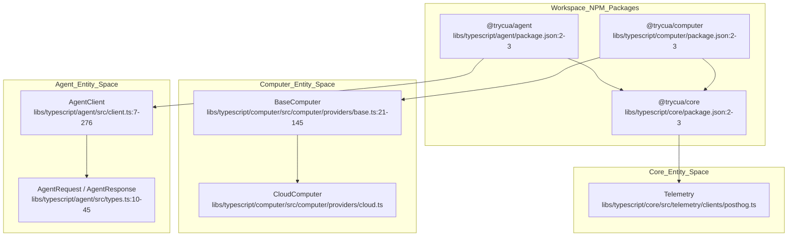

**Sources:** [libs/typescript/core/package.json:1-57](), [libs/typescript/computer/package.json:1-63](), [libs/typescript/agent/package.json:1-54](), [libs/typescript/agent/src/client.ts:7-275](), [libs/typescript/computer/src/computer/providers/base.ts:21-145]()

---

## Installation and Workspace Setup

### Prerequisites

- **Node.js**: Version 22.x or higher is required [libs/typescript/core/package.json:47]().
- **Package Manager**: `pnpm` (version 10.11.0 or higher) is configured as the workspace manager [libs/typescript/core/package.json:4]().
- Optional: Typescript tooling and test runners (`vitest`) are preconfigured within each package.

### Installing SDK Packages

Run these commands in your TypeScript project to add the primary Cua SDKs:

```bash
# Install the core utilities library
pnpm install @trycua/core

# Install the computer interaction SDK
pnpm install @trycua/computer

# Install the agent interaction SDK
pnpm install @trycua/agent
```

**Sources:** [libs/typescript/core/package.json:27-29](), [libs/typescript/computer/package.json:40-50](), [libs/typescript/agent/package.json:40-44]()

---

## Agent SDK Quick Start

The `@trycua/agent` package offers `AgentClient` as the primary class to interact with Cua agent services. It supports connecting via HTTP(S) endpoints or peer-to-peer WebRTC connections (using `peer://` URLs) [libs/typescript/agent/src/client.ts:30-65]().

### Overview of AgentClient Communication

- **Initialization**: Instantiating `AgentClient` with a remote URL and options (`apiKey`, `timeout`, etc.) determines the connection type (http, https, or peer).
- **Request**: Use `client.responses.create(request)` to send an `AgentRequest` containing model, input messages, and optional kwargs.
- **Response**: Receives an `AgentResponse` containing output messages, usage metrics, and status flags.
- **Telemetry**: Records detailed lifecycle events such as client initialization, request start/end, and error classification using the core telemetry system.

### Agent Request & Telemetry Flow

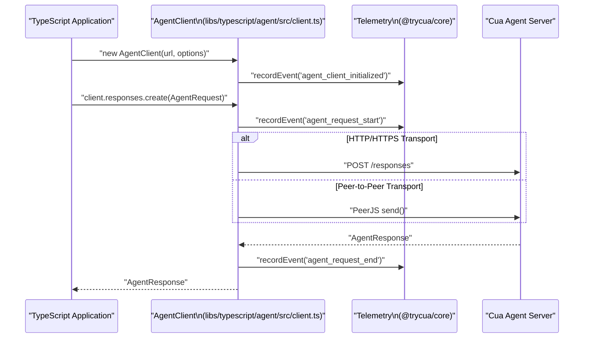

### Basic Usage Example

```typescript
import { AgentClient } from '@trycua/agent';

async function runAgentExample() {
  const client = new AgentClient('https://api.cua.ai', {
    apiKey: process.env.CUA_API_KEY,
    timeout: 30000,
  });

  const response = await client.responses.create({
    model: 'claude-3-5-sonnet-20241022',
    input: 'Open the browser and navigate to the dashboard',
    agent_kwargs: {
      save_trajectory: true,
      verbosity: 1,
    },
  });

  if (response.status === 'completed') {
    console.log('Agent Output:', response.output);
    console.log('Total Tokens Used:', response.usage.total_tokens);
  } else {
    console.error('Agent request failed:', response.error);
  }
}

runAgentExample();
```

The `AgentRequest` type supports detailed message formats, including user messages, function calls, and computer actions, as defined in the TypeScript types [libs/typescript/agent/src/types.ts:10-38]().

**Sources:** [libs/typescript/agent/src/client.ts:30-134](), [libs/typescript/agent/src/types.ts:10-38]()

---

## Computer SDK Usage

The `@trycua/computer` package provides the means to control virtual machines or sandboxed environments programmatically.

### BaseComputer Class

- Abstract base class offering initialization logic, parsing utilities for memory and display configuration, telemetry integration, and backend connection management.
- Shared helper functions parsing memory strings like `"8GB"` into numerical megabytes and display resolution strings like `"1920x1080"` into dimension objects [libs/typescript/computer/src/computer/providers/base.ts:21-145]().
- Telemetry tracks initialization with events labeled `ts_computer_init`.

### Using CloudComputer

The `CloudComputer` class extends `BaseComputer`, wrapping control for cloud VM instances.

Example usage:

```typescript
import { CloudComputer } from '@trycua/computer';
import { OSType } from '@trycua/computer/types';

async function startCloudComputer() {
  const computer = new CloudComputer({
    name: 'production-sandbox-01',
    osType: OSType.LINUX,
    apiKey: process.env.CUA_API_KEY,
  });

  // Utility methods inherited from BaseComputer
  const memoryMB = CloudComputer.parseMemoryString('8GB'); // 8192
  const display = CloudComputer.parseDisplayString('1920x1080'); // { width: 1920, height: 1080 }

  // TODO: Add further commands like start, stop, snapshot, etc.

  // Ensure disconnect when finished
  await computer.disconnect();
}
```

**Sources:** [libs/typescript/computer/src/computer/providers/base.ts:21-145]()

---

## Core Utilities and Telemetry

Both `@trycua/agent` and `@trycua/computer` depend on `@trycua/core` for privacy-focused telemetry and core utilities. The telemetry client records contextual events with minimal identifiable data, enabling insight into SDK usage and error classification [libs/typescript/core/package.json:1-57](), [libs/typescript/agent/src/client.ts:23-129](), [libs/typescript/computer/src/computer/providers/base.ts:27-63]().

### Key Telemetry Events

| Event Name              | Source Location                                 | Description                                 |
|-------------------------|------------------------------------------------|---------------------------------------------|
| `module_init`           | `libs/typescript/agent/src/index.ts:4-9` <br> and `base.ts:30-33` | Emitted upon SDK module load or initialization. |
| `agent_client_initialized` | `libs/typescript/agent/src/client.ts:36-64`  | Emitted when `AgentClient` is constructed. |
| `agent_request_start`   | `libs/typescript/agent/src/client.ts:78-86`    | Before dispatching an agent request.       |
| `agent_request_end`     | `libs/typescript/agent/src/client.ts:102-114`  | On successful request completion.          |
| `agent_request_error`   | `libs/typescript/agent/src/client.ts:118-129`  | On request failure, with error classification. |
| `ts_computer_init`      | `libs/typescript/computer/src/computer/providers/base.ts:60-63` | On computer SDK instance initialization.  |

### Core Helpers Provided by `@trycua/core`

- Telemetry client for event tracking.
- Standardized HTTP headers for version signaling.
- Common utilities such as UUID generation (via `uuid` package) included.

**Sources:** [libs/typescript/agent/src/index.ts:1-10](), [libs/typescript/agent/src/client.ts:23-129](), [libs/typescript/computer/src/computer/providers/base.ts:27-63]()

---

## Development Workflow and Workspace Scripts

The TypeScript SDK packages employ a monorepo workspace managed by `pnpm` with shared scripts and configurations [libs/typescript/package.json:8-43]().

### Common Development Commands

| Command          | Description                                                         |
|------------------|---------------------------------------------------------------------|
| `pnpm install`   | Installs dependencies across all workspace sub-packages.           |
| `pnpm build`     | Builds all packages, including `@trycua/core` first [order explicit]. |
| `pnpm test`      | Executes unit tests using `vitest` across applicable packages.      |
| `pnpm typecheck` | Runs the TypeScript compiler to verify type correctness.            |
| `pnpm lint`      | Runs Prettier code style checks.                                    |
| `pnpm lint:fix`  | Fixes formatting issues automatically with Prettier.               |

### Build & Release Notes

- `@trycua/core` uses `tsdown` for build and documentation generation.
- Version bumps and package releases are automated using `bumpp`.
- The agent and computer SDKs declare strict dependencies on `@trycua/core`.

**Sources:** [libs/typescript/package.json:8-43](), [libs/typescript/core/package.json:30-39](), [libs/typescript/agent/package.json:30-39]()

---

# Summary

This guide detailed the strategy and infrastructure for developing TypeScript applications against the Cua ecosystem by installing:

- `@trycua/core` for shared utilities and telemetry.
- `@trycua/computer` to manage and control Cua VM and sandbox computers.
- `@trycua/agent` to interact with Cua agents flexibly over HTTP/S or peer connections.

Together, these packages leverage a consistent, typesafe interface backed by robust telemetry and documentation. Using this SDK stack, developers can automate complex computer-use workflows, build agent-driven applications, and extend the Cua platform programmatically.

---

**Sources:**  
- [libs/typescript/core/package.json:1-57]()  
- [libs/typescript/pnpm-workspace.yaml:1-6]()  
- [libs/typescript/agent/src/client.ts:7-134]()  
- [libs/typescript/agent/src/types.ts:10-121]()  
- [libs/typescript/agent/package.json:1-54]()  
- [libs/typescript/core/README.md:19-53]()  
- [libs/typescript/computer/src/computer/providers/base.ts:21-145]()  
- [libs/typescript/package.json:8-43]()  
- [libs/typescript/agent/src/index.ts:1-39]()

---

# Page: Core SDK Components

# Core SDK Components

<details>
<summary>Relevant source files</summary>

The following files were used as context for generating this wiki page:

- [Makefile](Makefile)
- [libs/python/agent/.bumpversion.cfg](libs/python/agent/.bumpversion.cfg)
- [libs/python/agent/README.md](libs/python/agent/README.md)
- [libs/python/agent/pyproject.toml](libs/python/agent/pyproject.toml)
- [libs/python/core/.bumpversion.cfg](libs/python/core/.bumpversion.cfg)
- [libs/python/core/README.md](libs/python/core/README.md)
- [libs/python/core/pyproject.toml](libs/python/core/pyproject.toml)
- [libs/python/som/.bumpversion.cfg](libs/python/som/.bumpversion.cfg)
- [libs/python/som/README.md](libs/python/som/README.md)
- [libs/python/som/pyproject.toml](libs/python/som/pyproject.toml)

</details>


This document provides a high-level overview of the main architectural components of the Cua system. It covers the core SDKs, runtime environments, and integration points that enable AI agents to control virtual machines and orchestrate computer-use workflows.

For detailed technical specifications of individual components, see the child pages:
- [Computer SDK](#3.1) — Interface methods, provider abstraction, and cross-platform compatibility.
- [Sandbox SDK](#3.2) — Ephemeral and persistent sandbox lifecycle, image building, transports, and runtime backends.
- [ComputerAgent SDK](#3.3) — Agent initialization, asynchronous run loops, tools, messages, and callbacks.
- [Agent Loops](#3.4) — Agent registration, async config protocols, and provider-specific loop selection.
- [MCP Server](#3.5) — Model Context Protocol server managing agents and computers, session manager.
- [Core Utilities and SOM](#3.6) — Telemetry, logging, and the Set-Of-Mark visual grounding library.
- [Sandbox Apps Catalog](#3.7) — Universal app catalog, installer pipeline, and application schemas.

---

## System Architecture Overview

At a high level, the Cua platform consists of interconnected components that translate natural language inputs into automated computer control through VMs or containers. The key layers are:

- **Agent SDK layer:** Contains the AI logic, including agent orchestration, decision loops, and model provider integrations.
- **Computer SDK layer:** Abstracts VM lifecycle management and provider interactions, enabling uniform control over diverse environments.
- **Computer Server layer:** Runs inside the target VM/container, exposing OS automation interfaces over HTTP/WebSocket with platform-specific handlers.

Together, these enable the full chain from natural language commands to low-level OS actions.

### Bridge Diagram: Mapping System Concepts to Code Entities

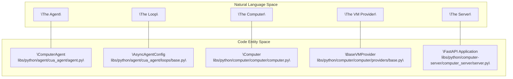

This diagram shows core system concepts alongside the key code artifacts implementing them, enabling developers to quickly locate functionality in the codebase.

**Sources:**  
[libs/python/agent/pyproject.toml:6-8](), [libs/python/computer/pyproject.toml:6-8](), [libs/python/computer-server/pyproject.toml:6-9]()

---

## Core SDK Packages

The core functionalities are encapsulated in modular Python packages, each with specific responsibilities and well-defined dependencies.

| Package         | Purpose                                       | Key Code Entities / Features                       |
|-----------------|-----------------------------------------------|---------------------------------------------------|
| `cua-agent`     | AI orchestration, agent workflows, LLM loops | `ComputerAgent` class, `AsyncAgentConfig`, tools |
| `cua-computer`  | VM and sandbox lifecycle, interface abstraction | `Computer` class, provider abstraction            |
| `cua-computer-server` | In-VM OS-level control and automation    | FastAPI server, OS-specific input/output handlers |
| `cua-core`      | Shared utilities: telemetry, logging, common helpers | `PostHog` telemetry integration, OpenTelemetry    |
| `cua-mcp-server` | Model Context Protocol (MCP) server for agent/computer coordination | MCP Session Manager, API handlers                  |
| `cua-sandbox` (covered in child page) | High-level sandbox orchestration with persistent and ephemeral patterns | `Sandbox` class, image builder, transport layers |

These packages are designed for composability and separation of concerns, enabling flexible deployments and integrations.

**Sources:**  
[libs/python/agent/pyproject.toml:6-26](), [libs/python/computer/pyproject.toml:6-21](), [libs/python/core/pyproject.toml:6-30](), [libs/python/mcp-server/pyproject.toml:6-21]()

---

## Component Interaction Overview

The following sequence diagram illustrates how these components interact in a typical agent-driven computer-use session:

```mermaid
sequenceDiagram
    participant User
    participant Agent as "ComputerAgent"
    participant Loop as "AgentLoop (e.g. Anthropic)"
    participant Computer as "Computer"
    participant Provider as "VMProvider (e.g. Lume, Docker)"
    participant Server as "ComputerServer (FastAPI)"

    User->>Agent: run('Book a flight')
    Agent->>Computer: __aenter__ (initialize and connect)
    Computer->>Provider: run_vm(image)
    Provider-->>Computer: IP address, connection info
    Computer->>Server: Connect WebSocket API
    Agent->>Loop: predict_step(state)
    Loop->>Computer: screenshot()
    Computer->>Server: GET /computer_screenshot
    Server-->>Computer: Image bytes
    Loop-->>Agent: tool_call(click, x, y)
    Agent->>Computer: left_click(x, y)
    Computer->>Server: POST /computer_click
    Server-->>User: (OS action performed)
```

This flow shows the orchestration from user command through the agent’s think-act loop, VM provider interactions, and the in-VM server command execution.

**Sources:**  
[libs/python/agent/pyproject.toml:30-32]()

---

## Detailed Component Overviews

### Computer SDK

The `Computer` class encapsulates VM abstraction, managing VM creation, lifecycle, and interaction. It uses provider factories to select specific VM providers such as `LumeProvider` (macOS), `DockerProvider`, or others abstracting platform specifics. This allows uniform control over Windows, Linux, macOS, and Android sandboxes.

Capabilities include:
- Starting/stopping VMs or sandboxes
- Connecting to the in-VM FastAPI server
- Transparent OS platform abstractions for input/output

For implementation and patterns, see the [Computer SDK](#3.1) child page.

**Sources:** [libs/python/computer/pyproject.toml:24-33]()

---

### Agent SDK and Loops

The Agent SDK (`cua-agent` package) contains the main agent orchestration logic and the “Think-Act” loop. Key components include:

- `ComputerAgent` class: handles initialization, asynchronous running, and callbacks.
- Support for multiple language model providers: Anthropic, OpenAI, Gemini, Qwen, and local adapters (e.g., `mlx-vlm`).
- The asynchronous agent loops implementing `AsyncAgentConfig`, which define step prediction, tool selection, and response processing.

This package integrates tightly with the Computer SDK for sandbox control and the core utilities for logging and telemetry.

Details on agent loops and registrations are covered in child pages [ComputerAgent SDK](#3.3) and [Agent Loops](#3.4).

**Sources:** [libs/python/agent/pyproject.toml:33-89]()

---

### Sandbox SDK

The `cua-sandbox` package offers a higher-level abstraction around the VM lifecycle, enabling ephemeral and persistent sandbox patterns. It includes:

- The `Sandbox` class to manage sandbox state and lifecycle
- Image building and management utilities
- Multiple transport layers: Cloud transport, Fleet transport, HTTP and WebSocket backends
- Support for Android sandboxes via GRPC emulator transport and `EmulatorController`

It simplifies creating, running, and interacting with sandbox environments for AI agents.

See the detailed [Sandbox SDK](#3.2) child page for core classes and transport mechanisms.

**Sources:** [libs/python/computer-server/pyproject.toml:38-39]()

---

### Computer Server

The computer-server runs inside each sandbox or VM, exposing a FastAPI-based HTTP and WebSocket API for OS automation.

Key features:
- OS-specific handlers for macOS, Linux, Windows, and Android
- Input/output methods using platform APIs (e.g., `pyobjc` for macOS, `pywin32` for Windows)
- Integration with optional background driver (`cua-driver`) for no-foreground automation
- Endpoints for screenshots, input actions (mouse, keyboard), clipboard, and more

This server acts as the control endpoint for agents interacting with the hidden OS in their sandbox.

**Sources:** [libs/python/computer-server/pyproject.toml:31-36]()

---

### Core Utilities and SOM (Set-of-Mark Visual Grounding)

The `cua-core` package provides cross-cutting infrastructure used across Cua’s other packages, including:

- Privacy-aware telemetry integration via PostHog and OpenTelemetry libraries
- Shared utilities and logging frameworks
- Foundations for consistent error handling and event emission

Additionally, the `cua-som` package implements the SOM visual grounding library—used to detect and analyze UI elements in screenshots by combining icon detection and OCR.

While `cua-som` is an optional dependency (and deprecated in some flows), its functionality enables agents to visually ground their commands onto UI elements, improving interface interactions.

**Sources:** [libs/python/core/pyproject.toml:14-30](), [libs/python/agent/pyproject.toml:40-42]()

---

### Sandbox Apps Catalog

The `cua-sandbox-apps` package maintains a universal catalog of applications and installation methods, enabling agents to dynamically prepare and install software within sandboxes.

Features include:
- App catalog definitions and version pinning
- Installer pipeline abstraction
- Uniform `AppEntry` and `InstallMethod` schemas for diverse applications

This catalog provides essential tooling for sandbox setup and software lifecycle management.

See child page [Sandbox Apps Catalog](#3.7) for full details.

**Sources:** [libs/python/mcp-server/pyproject.toml:14-18]()

---

In summary, the core SDK components are designed as modular Python packages that integrate tightly to unify AI-driven agent orchestration, sandbox lifecycle, VM provider abstraction, and OS-level control. These form the foundation of the Cua platform’s extensible and cross-platform architecture.

For implementation detail, code references, and usage patterns, please follow the links to child pages in this section.

---

**Sources:**  
[libs/python/agent/pyproject.toml:6-26](), [libs/python/agent/pyproject.toml:30-42](), [libs/python/core/pyproject.toml:6-30](), [libs/python/computer/pyproject.toml:6-33](), [libs/python/computer-server/pyproject.toml:6-40](), [libs/python/mcp-server/pyproject.toml:6-21]()

---

# Page: Computer SDK

# Computer SDK

<details>
<summary>Relevant source files</summary>

The following files were used as context for generating this wiki page:

- [docs/content/docs/cua-sdk/reference/runtime-support.mdx](docs/content/docs/cua-sdk/reference/runtime-support.mdx)
- [libs/python/cua-sandbox/CHANGELOG.md](libs/python/cua-sandbox/CHANGELOG.md)
- [libs/python/cua-sandbox/README.md](libs/python/cua-sandbox/README.md)
- [libs/python/cua-sandbox/VERSION](libs/python/cua-sandbox/VERSION)
- [libs/python/cua-sandbox/cua_sandbox/__init__.py](libs/python/cua-sandbox/cua_sandbox/__init__.py)
- [libs/python/cua-sandbox/cua_sandbox/pool.py](libs/python/cua-sandbox/cua_sandbox/pool.py)
- [libs/python/cua-sandbox/cua_sandbox/sandbox.py](libs/python/cua-sandbox/cua_sandbox/sandbox.py)
- [libs/python/cua-sandbox/cua_sandbox/sync/__init__.py](libs/python/cua-sandbox/cua_sandbox/sync/__init__.py)
- [libs/python/cua-sandbox/cua_sandbox/transport/fleet.py](libs/python/cua-sandbox/cua_sandbox/transport/fleet.py)
- [libs/python/cua-sandbox/cua_sandbox/transport/fleet_cloud.py](libs/python/cua-sandbox/cua_sandbox/transport/fleet_cloud.py)
- [libs/python/cua-sandbox/pyproject.toml](libs/python/cua-sandbox/pyproject.toml)
- [libs/python/cua-sandbox/tests/test_fleet_cloud_client.py](libs/python/cua-sandbox/tests/test_fleet_cloud_client.py)
- [libs/python/cua-sandbox/tests/test_fleet_cloud_transport.py](libs/python/cua-sandbox/tests/test_fleet_cloud_transport.py)
- [libs/python/cua-sandbox/tests/test_fleet_sdk_distribution.py](libs/python/cua-sandbox/tests/test_fleet_sdk_distribution.py)
- [libs/python/cua-sandbox/tests/test_fleet_sdk_packaging.py](libs/python/cua-sandbox/tests/test_fleet_sdk_packaging.py)
- [libs/python/cua-sandbox/tests/test_fleet_transport.py](libs/python/cua-sandbox/tests/test_fleet_transport.py)
- [libs/python/cua-sandbox/tests/test_pool.py](libs/python/cua-sandbox/tests/test_pool.py)
- [libs/python/cua-sandbox/tests/test_sandbox_fleet_lifecycle.py](libs/python/cua-sandbox/tests/test_sandbox_fleet_lifecycle.py)
- [libs/python/cua-sandbox/tests/test_vm_cleanup.py](libs/python/cua-sandbox/tests/test_vm_cleanup.py)
- [libs/python/cua-sandbox/uv.lock](libs/python/cua-sandbox/uv.lock)

</details>


The Computer SDK provides a unified Python and TypeScript interface to control computers across multiple execution environments including virtual machines (VMs), containers, and host machines. It abstracts the low-level OS interactions into consistent APIs for mouse, keyboard, screen, clipboard, and file operations, enabling cross-platform automation workflows regardless of the underlying runtime or provider.

---

## Architecture Overview

The Computer SDK is architected into three primary layers:

1. **Computer Class**: Manages lifecycle, state, and connection of computer instances.
2. **Interface Layer**: Exposes unified OS-level interaction APIs over a communication channel (mostly WebSocket).
3. **Provider Abstraction**: Modular backends for VM/container/cloud/host environment provisioning and management.

These layers together enable seamless cross-platform automation while hiding provider details from user code.

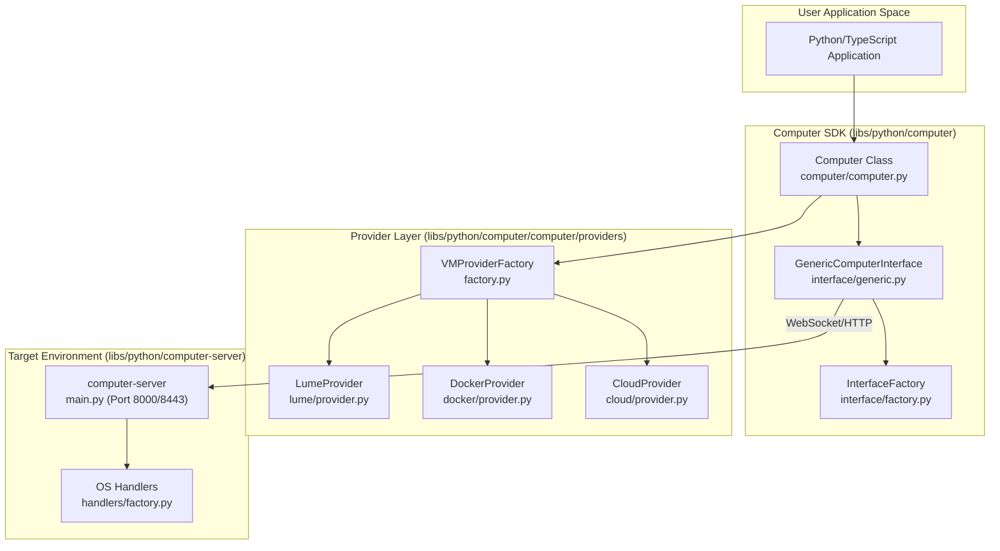

**Figure:** Computer SDK Architecture depicting component and interaction separation.

Sources:  
[libs/python/computer/computer/computer.py:72-158](),  
[libs/python/computer/computer/interface/generic.py:23-57](),  
[libs/python/computer/computer/providers/factory.py:11-28]()

---

## Computer Class

The `Computer` class is the core entry point to initiate and manage computer instances. It encapsulates VM/container lifecycle, handles provider selection based on OS and runtime parameters, and initializes the interface used for OS-level interactions.

### Initialization Parameters

The constructor accepts multiple configuration options:

| Parameter                | Type                      | Default                      | Description                                                                                       |
|--------------------------|---------------------------|------------------------------|---------------------------------------------------------------------------------------------------|
| `os_type`                | `OSType`                  | `"macos"`                    | Operating system target: `"macos"`, `"linux"`, `"windows"`, or `"android"`.                        |
| `provider_type`          | `VMProviderType`          | `LUME`                       | Execution environment provider: e.g., `LUME`, `DOCKER`, `CLOUD`, or `QEMU`.                        |
| `image`                  | `Optional[str]`           | OS-dependent canonical image | VM/container image reference (e.g., `trycua/cua-ubuntu:latest`).                                   |
| `display`                | `Union[Display, str]`     | `"1024x768"`                 | Display resolution string like `"1024x768"`.                                                      |
| `use_host_computer_server` | `bool`                   | `False`                     | Whether to use the localhost computer-server instead of provisioning a VM or container.           |
| `api_key`                | `Optional[str]`           | `None`                      | API key for cloud providers; falls back to environment variable `CUA_API_KEY` if unset.            |
| `backend`                | `Literal["native", "vnc"]`| `"native"`                   | Backend for server communication (e.g., `"native"` for Spacesd, `"vnc"` for VNC fallback).          |

These options allow precise control over the environment startup and connection behavior.

Sources:  
[libs/python/computer/computer/computer.py:92-167](),  
[libs/python/computer/computer/providers/docker/provider.py:44-48]()

### Lifecycle Management

The `Computer` class uses `VMProviderFactory` to instantiate the relevant provider matching the configuration. Providers handle all lifecycle operations such as provisioning, starting, stopping, and destroying the VM or container [libs/python/computer/computer/computer.py:172-185]().

After the environment is started, the class initializes an `InterfaceFactory` which creates the `GenericComputerInterface` that enables communication with the `computer-server` inside the VM via WebSocket or HTTP [libs/python/computer/computer/computer.py:257-300]().

---

## Interface Layer

This layer unifies platform-specific OS automation commands into a single API surface. It forwards client commands as JSON requests over WebSocket to the running in-guest server (`computer-server`).

### Communication Flow

```mermaid
sequenceDiagram
    participant SDK as GenericComputerInterface
    participant Server as computer-server (FastAPI)
    participant Handler as OS-Specific Handler

    SDK->>Server: "WebSocket Connect (/ws)"
    SDK->>Server: "Send JSON RPC {\"method\": \"left_click\", \"params\": {\"x\": 100, \"y\": 200}}"
    Server->>Handler: "Call automation_handler.left_click(100, 200)"
    Handler-->>Server: "Return success"
    Server-->>SDK: "JSON Result {\"success\": true}"
```

**Figure:** Command execution inside the Computer SDK interface layer.

This setup decouples the SDK from any particular OS implementation by routing commands through a standardized JSON-over-WebSocket protocol implemented by OS-native agents inside the guest.

Sources:  
[libs/python/computer/computer/interface/generic.py:108-153](),  
[libs/python/computer/computer/interface/generic.py:175-180]()

### Core Interface Methods

The unified interface is primarily implemented in `GenericComputerInterface`, extending `BaseComputerInterface`. It exposes core automation subcomponents:

| Category     | Key Methods                                        | Description                   |
|--------------|---------------------------------------------------|-------------------------------|
| **Mouse**    | `left_click()`, `right_click()`, `move_cursor()`, `drag_to()` | Pointer control actions        |
| **Keyboard** | `type_text()`, `press()`, `hotkey()`, `key_down()` | Text entry and key presses     |
| **Screen**   | `screenshot()`, `get_screen_size()`               | Visual feedback and geometry   |
| **Files**    | `read_text()`, `write_text()`, `read_bytes()`, `list_dir()` | Remote filesystem access       |
| **Clipboard**| `set_clipboard()`, `copy_to_clipboard()`           | OS clipboard manipulation      |

These abstractions facilitate scripting of rich computer-use scenarios via Python or TypeScript.

Sources:  
[libs/python/computer/computer/interface/generic.py:155-262](),  
[libs/python/computer/computer/interface/generic.py:278-354](),  
[libs/python/computer/computer/interface/generic.py:356-522]()

---

## Provider Abstraction

The provider abstraction separates environment lifecycle management into modular classes each implementing `BaseVMProvider`. This factory-based design supports cross-platform runtime selection transparently.

| Provider        | Implementation Class           | Runtime Environment                                  |
|-----------------|-------------------------------|----------------------------------------------------|
| **Lume**        | `LumeProvider`                | Local macOS VMs managed via Lume daemon (Swift, port 7777) |
| **Docker**      | `DockerProvider`              | Local Linux/Android container environments via Docker CLI  |
| **Cloud**       | `CloudProvider`               | Remote cloud VMs provisioned through Cua Cloud REST API     |
| **WindowsSandbox** | `WinSandboxProvider`         | Windows Sandbox integration using native Windows APIs        |

---

### Docker Provider Details

The `DockerProvider` class manages containers lifecycle via Docker CLI calls. It supports several image types:

- `cua-ubuntu` (Kasm-based container images)
- `cua-xfce` (XFCE desktop environment)
- QEMU-wrapped images for Linux, Windows, and Android

The provider selects the home directory based on image type, for example:

- Kasm images use `/home/kasm-user`
- XFCE images use `/home/cua`

It offers lifecycle APIs for container start, stop, exec, and networking adjustments, providing a consistent interface regardless of container platform [libs/python/computer/computer/providers/docker/provider.py:31-49](), [libs/python/computer/computer/providers/docker/provider.py:94-121]().

---

## TypeScript SDK

The TypeScript SDK (`@trycua/computer`) mirrors the Python SDK, sharing similar API structures for Node.js applications.

### Package Structure

- `@trycua/core`: Shared telemetry, utilities, and type definitions [libs/typescript/core/package.json:2-5]().
- `@trycua/computer`: Core `Computer` and interface layer implementations [libs/typescript/computer/package.json:2-5]().

### Cloud Provider Implementation

The TypeScript `CloudComputer` encapsulates connectivity to remote Fleet sandboxes. It manages an API session using UUIDs and hashes of the API key for telemetry consistency [libs/typescript/computer/src/computer/providers/cloud.ts:16-27]().

A key method `fetchAndCacheHost()` resolves the sandbox hostname through Fleet services and caches it for subsequent environment interface initialization, paralleling provider initialization logic in the Python `BaseComputer` class [libs/typescript/computer/src/computer/providers/cloud.ts:61-92](), [libs/typescript/computer/src/computer/providers/base.ts:21-63]().

---

## Summary Diagram Bridging Natural Language Terms to Code Entities

```mermaid
flowchart TB
    subgraph "Natural Language Space"
        NL_Computer["Computer Class (Python `Computer`)"]
        NL_Interface["Unified OS Interface Layer"]
        NL_Providers["Execution Environment Providers"]
        NL_Typescript["TypeScript SDK (`@trycua/computer`)"]
    end

    subgraph "Code Entity Space"
        PY_Computer["Python: Computer Class<br/>`computer/computer.py`"]
        PY_Interface["Python: `GenericComputerInterface`<br/>`interface/generic.py`"]
        PY_Factory["Python: `InterfaceFactory`, VM Provider Factory"]
        PY_Providers["Python Providers: Lume, Docker, Cloud<br/>`providers/*.py`"]

        TS_Core["TypeScript: `CloudComputer` Provider<br/>`providers/cloud.ts`"]
        TS_CoreAPI["TypeScript: Core Interfaces<br/>`interface/*`"]
        TS_PkgJSON["TS Packages:<br/>`@trycua/core`, `@trycua/computer`"]
    end

    NL_Computer --> PY_Computer
    NL_Interface --> PY_Interface
    NL_Interface --> PY_Factory
    NL_Providers --> PY_Providers
    NL_Typescript --> TS_Core
    NL_Typescript --> TS_CoreAPI
    NL_Typescript --> TS_PkgJSON

    PY_Computer --> PY_Factory
    PY_Factory --> PY_Providers
```

**Figure:** Mapping from natural language concepts of Computer SDK to specific Python and TypeScript code entities.

---

# Summary

The Computer SDK delivers a modular, provider-agnostic, and cross-platform interface for computer automation. It abstracts VM/container lifecycles through provider classes, exposes rich OS interaction APIs via a WebSocket/HTTP protocol to `computer-server` agents inside the VM, and has feature-parallel libraries in Python and TypeScript that make complex automated workflows consistent across operating systems and runtime environments.

This design enables developers to write automation scripts once and run them uniformly on local containers, local or cloud VMs, or Windows Sandboxes, leveraging a common API surface shielded from platform idiosyncrasies.

---

# References

- `Computer` class implementation: `libs/python/computer/computer/computer.py` [92-167](), [172-185](), [257-300]()
- Interface and generic implementation: `libs/python/computer/computer/interface/generic.py` [23-57](), [108-180](), [155-522]()
- Provider factory and providers: `libs/python/computer/computer/providers/factory.py` [11-28](), `docker/provider.py` [31-49](), [94-121](), `cloud/provider.py`
- TypeScript SDK cloud provider: `libs/typescript/computer/src/computer/providers/cloud.ts` [16-92]()
- Package JSON info for TypeScript SDK: `libs/typescript/core/package.json` [2-5](), `libs/typescript/computer/package.json` [2-5]()

---

# Page: Sandbox SDK

# Sandbox SDK

<details>
<summary>Relevant source files</summary>

The following files were used as context for generating this wiki page:

- [docs/content/docs/cua-sdk/reference/runtime-support.mdx](docs/content/docs/cua-sdk/reference/runtime-support.mdx)
- [libs/python/cua-sandbox/CHANGELOG.md](libs/python/cua-sandbox/CHANGELOG.md)
- [libs/python/cua-sandbox/README.md](libs/python/cua-sandbox/README.md)
- [libs/python/cua-sandbox/VERSION](libs/python/cua-sandbox/VERSION)
- [libs/python/cua-sandbox/cua_sandbox/__init__.py](libs/python/cua-sandbox/cua_sandbox/__init__.py)
- [libs/python/cua-sandbox/cua_sandbox/builder/executor.py](libs/python/cua-sandbox/cua_sandbox/builder/executor.py)
- [libs/python/cua-sandbox/cua_sandbox/builder/windows_unattend.py](libs/python/cua-sandbox/cua_sandbox/builder/windows_unattend.py)
- [libs/python/cua-sandbox/cua_sandbox/image.py](libs/python/cua-sandbox/cua_sandbox/image.py)
- [libs/python/cua-sandbox/cua_sandbox/pool.py](libs/python/cua-sandbox/cua_sandbox/pool.py)
- [libs/python/cua-sandbox/cua_sandbox/registry/qemu_builder.py](libs/python/cua-sandbox/cua_sandbox/registry/qemu_builder.py)
- [libs/python/cua-sandbox/cua_sandbox/runtime/_bw_init.js](libs/python/cua-sandbox/cua_sandbox/runtime/_bw_init.js)
- [libs/python/cua-sandbox/cua_sandbox/runtime/android_emulator.py](libs/python/cua-sandbox/cua_sandbox/runtime/android_emulator.py)
- [libs/python/cua-sandbox/cua_sandbox/sandbox.py](libs/python/cua-sandbox/cua_sandbox/sandbox.py)
- [libs/python/cua-sandbox/cua_sandbox/sync/__init__.py](libs/python/cua-sandbox/cua_sandbox/sync/__init__.py)
- [libs/python/cua-sandbox/cua_sandbox/transport/cloud.py](libs/python/cua-sandbox/cua_sandbox/transport/cloud.py)
- [libs/python/cua-sandbox/cua_sandbox/transport/fleet.py](libs/python/cua-sandbox/cua_sandbox/transport/fleet.py)
- [libs/python/cua-sandbox/cua_sandbox/transport/fleet_cloud.py](libs/python/cua-sandbox/cua_sandbox/transport/fleet_cloud.py)
- [libs/python/cua-sandbox/pyproject.toml](libs/python/cua-sandbox/pyproject.toml)
- [libs/python/cua-sandbox/tests/test_cloud.py](libs/python/cua-sandbox/tests/test_cloud.py)
- [libs/python/cua-sandbox/tests/test_fleet_cloud_client.py](libs/python/cua-sandbox/tests/test_fleet_cloud_client.py)
- [libs/python/cua-sandbox/tests/test_fleet_cloud_transport.py](libs/python/cua-sandbox/tests/test_fleet_cloud_transport.py)
- [libs/python/cua-sandbox/tests/test_fleet_sdk_distribution.py](libs/python/cua-sandbox/tests/test_fleet_sdk_distribution.py)
- [libs/python/cua-sandbox/tests/test_fleet_sdk_packaging.py](libs/python/cua-sandbox/tests/test_fleet_sdk_packaging.py)
- [libs/python/cua-sandbox/tests/test_fleet_transport.py](libs/python/cua-sandbox/tests/test_fleet_transport.py)
- [libs/python/cua-sandbox/tests/test_from_registry_ostype.py](libs/python/cua-sandbox/tests/test_from_registry_ostype.py)
- [libs/python/cua-sandbox/tests/test_pool.py](libs/python/cua-sandbox/tests/test_pool.py)
- [libs/python/cua-sandbox/tests/test_sandbox_fleet_lifecycle.py](libs/python/cua-sandbox/tests/test_sandbox_fleet_lifecycle.py)
- [libs/python/cua-sandbox/tests/test_vm_cleanup.py](libs/python/cua-sandbox/tests/test_vm_cleanup.py)
- [libs/python/cua-sandbox/tests/test_windows_cloud.py](libs/python/cua-sandbox/tests/test_windows_cloud.py)
- [libs/python/cua-sandbox/tests/test_windows_timing.py](libs/python/cua-sandbox/tests/test_windows_timing.py)
- [libs/python/cua-sandbox/uv.lock](libs/python/cua-sandbox/uv.lock)
- [tests/test_image_builder.py](tests/test_image_builder.py)
- [tests/test_image_builder_cloud.py](tests/test_image_builder_cloud.py)
- [tests/test_interfaces.py](tests/test_interfaces.py)

</details>


The `cua-sandbox` Python package provides ephemeral and persistent sandboxed environments for virtual machines and containers, abstracted through a unified `Sandbox` class. It is a thin wrapper over the Rust-based `cua` SDK, seamlessly integrating local runtimes (Docker, QEMU, Lume) and cloud Fleet-backed sandboxes via OAuth2 authentication. This page details its core implementation, image building capabilities, lifecycle patterns, transport layers—including Fleet and HTTP transports—runtime backends, and exposed interface objects, grounding system concepts extensively in code entities.

Sources: `[libs/python/cua-sandbox/pyproject.toml:1-44]`, `[libs/python/cua-sandbox/cua_sandbox/sandbox.py:1-213]`, `[libs/python/cua-sandbox/cua_sandbox/transport/fleet_cloud.py:1-189]`, `[libs/python/cua-sandbox/cua_sandbox/transport/fleet.py:1-175]`, `[libs/python/cua-sandbox/cua_sandbox/transport/cloud.py:1-183]`, `[libs/python/cua-sandbox/cua_sandbox/pool.py:1-211]`, `[libs/python/cua-sandbox/tests/test_fleet_cloud_transport.py:1-205]`

---

## Core Architecture

The heart of the `cua-sandbox` package is the `Sandbox` class, which represents a sandboxed computer environment abstracted across various backend runtimes and transport protocols. The class exposes a standardized set of interface objects for input/output control: mouse, keyboard, screen, clipboard, shell, terminal, window, and others.

### The `Sandbox` Class and Interfaces

- The `Sandbox` class aggregates multiple interface objects backed by a `Transport` layer. This transport abstracts the underlying communication protocol to the guest environment's control plane, which may be a `computer-server` daemon running inside the VM/container or a Fleet cloud claim.

- Interaction flow:
  1. Agent or user invokes commands on interfaces (`sb.mouse.move()`, `sb.shell.run()`).
  2. Calls are serialized and routed through the selected `Transport` (e.g., HTTP, Fleet).
  3. Transport communicates with the remote or local sandbox facility.
  4. Results/responses are returned via the transport to the calling agent.

- Interfaces include:
  - `Mouse`, `Keyboard` (input synthesis)
  - `Screen` (screenshot/frame capture)
  - `Clipboard` (clipboard manipulation)
  - `Shell`, `Terminal` (command execution, terminal control)
  - `Window` (window management)
  - `Services` (named services and network proxies)
  - `Driver` (optional typed windowing via the `cua-driver` interface)

The `Sandbox` class supports connecting, creating, and destroying sandbox instances across local and cloud. It offers:
- `Sandbox.create()` — create new or attach persistent environments.
- `Sandbox.connect()` — connect to existing sandboxes.
- `Sandbox.ephemeral()` — create ephemeral sandboxes auto-destroyed on exit.

```mermaid
graph TD
    subgraph NaturalLanguageSpace
        UserAgent["User / Agent"]
        SandboxEnv["Sandboxed Environment"]
    end
    subgraph CodeEntitySpace
        Sandbox["Sandbox Class [sandbox.py]"]
        Interfaces["Interfaces: Mouse, Keyboard, Screen, Shell, Window, ..."]
        Transport["Transport Base Class"]
        EnvBackend["Runtimes: DockerRuntime, QEMURuntime, LumeRuntime"]
        Fleet["Fleet SDK & FleetCloudTransport"]
        HTTPTransport["HTTPTransport"]
        CloudTransport["CloudTransport (deprecated API-key cloud)"]
    end

    UserAgent -->|calls interface methods| Interfaces
    Interfaces -->|routes commands| Transport
    Transport -->|communicates with| SandboxEnv
    SandboxEnv --> EnvBackend
    Transport --> Fleet
    Transport --> HTTPTransport
    Transport --> CloudTransport
```

Sources: `[libs/python/cua-sandbox/cua_sandbox/sandbox.py:1-213]`, `[libs/python/cua-sandbox/cua_sandbox/interfaces/__init__.py]`(implicit), `[libs/python/cua-sandbox/cua_sandbox/transport/base.py:1-20]`

---

## Image Builder

The `Image` class is a key component for defining the software and system configuration of a sandbox. It acts as an immutable, chainable builder that can specify OCI container images, disk images for VMs, and image overlays or layers.

### Image Construction and Exposure

- `Image.linux()`, `Image.windows()`, and `Image.macos()` provide canonical base images representing standard Linux, Windows, and macOS environments.

- `Image.from_registry(reference)` allows specifying images from any OCI-compliant container registry, optionally with pull secrets.

- The `.expose(port)` method declares ports and named services exposed by the image, facilitating network communication and service discovery in Fleet sandboxes.

- Images resolve automatically to their runtime-specific form (e.g., for VMs, a pinned `-disk` variant is selected).

```mermaid
graph LR
    Image["Image Class [image.py]"]
    FleetTransport["FleetCloudTransport [fleet_cloud.py]"]
    FleetSDK["fleet_sdk: VmTemplateBuilder, CreateTemplateRequest"]
    OCIRegistry["OCI Registry"]

    Image -->|expose() ports| FleetTransport
    Image -->|resolve image refs| OCIRegistry
    FleetTransport -->|build VmTemplate| FleetSDK
    FleetSDK -->|creates TemplateRequest| FleetSDK
```

Sources: `[libs/python/cua-sandbox/cua_sandbox/image.py]` (partial), `[libs/python/cua-sandbox/tests/test_fleet_cloud_transport.py:58-110]`, `[libs/python/cua-sandbox/cua_sandbox/transport/fleet_cloud.py:59-130]`

---

## Sandbox Lifecycle Patterns

`Sandbox` supports multiple lifecycle management patterns for sandboxed environments adapted to different use cases.

### 1. Ephemeral Sandboxes

- Created via `Sandbox.ephemeral(image, ...)`.
- Automatically created upon entering the async context.
- Destroyed when the context exits—ideal for short-lived test or script runs.

Example:

```python
async with Sandbox.ephemeral(Image.linux()) as sb:
    await sb.shell.run("echo 'hello'")
```

### 2. Persistent Sandboxes

- Created via `Sandbox.create(...)`, typically backed by a Fleet warm pool or explicitly named claim.
- The environment remains alive after disconnect, allowing persistent state across sessions.

Example:

```python
sb = await Sandbox.create(pool=pool, name="my-claim")
await sb.shell.run("uname -a")
await sb.disconnect()  # Sandbox keeps running in the background
```

### 3. Connect to Existing Sandboxes

- Attach to a running sandbox by name or URL.
- Useful for reconnecting to background sandboxes or externally provisioned environments.

Example:

```python
async with Sandbox.connect("my-sandbox") as sb:
    await sb.screenshot()
```

Sources: `[libs/python/cua-sandbox/cua_sandbox/sandbox.py:18-45]`, `[libs/python/cua-sandbox/README.md:67-100]`

---

## Transport Layer

The transport layer mediates commands and events between the `Sandbox` interfaces and the sandbox's control plane over the network or local IPC.

### Key Transport Implementations

| Transport Class         | Purpose                                                             | Reference File/Lines            |
|------------------------|---------------------------------------------------------------------|--------------------------------|
| `CloudTransport`        | Legacy API-key cloud VMs, which are deprecated and fail upon connect; only list/delete possible | `[cloud.py:1-183]`              |
| `HTTPTransport`         | Direct communication to `computer-server` over HTTP/REST            | `[http.py]` (not shown fully)   |
| `WebSocketTransport`    | Low-latency bidirectional control via WebSockets                    | `[websocket.py]` (not shown fully)  |
| `FleetCloudTransport`   | Main current cloud Fleet integration; manages Fleet claims/pools, OAuth2/GitHub OIDC; routes interfaces over `cua-spacesd` | `[fleet_cloud.py:1-189]`, `[fleet.py:1-175]` |

### FleetCloudTransport Details

- Uses the Fleet SDK to create and hold claims within named warm pools.
- Translates `Image` definitions to typed Fleet `CreateTemplateRequest`/`CreatePoolRequest`.
- Exposes both:
  - Named HTTP services of a sandbox via `service_request`.
  - Standard interfaces (`mouse`, `keyboard`, `screen`, `shell`) through a per-claim `cua-spacesd` environment (`env` service).
- Supports auto-renewal, readiness probes to wait for services, and public signed URLs.

```mermaid
sequenceDiagram
    participant Sandbox as Sandbox.create()
    participant FleetTransport as FleetCloudTransport
    participant FleetSDK as fleet_sdk
    participant FleetAPI as Fleet Backend

    Sandbox->>FleetTransport: provision pool or claim
    FleetTransport->>FleetSDK: CreateTemplateRequest, CreatePoolRequest
    FleetSDK->>FleetAPI: POST /pools or /claims
    FleetAPI-->>FleetSDK: pool/claim object
    FleetSDK->>FleetTransport: claim ready
    FleetTransport->>Sandbox: Sandbox instance ready, with services bound
    Sandbox->>FleetTransport: Interface commands (mouse, shell, etc.)
    FleetTransport->>FleetSDK: route commands to spacesd or named services
```

Sources: `[libs/python/cua-sandbox/cua_sandbox/transport/fleet_cloud.py:20-150]`, `[libs/python/cua-sandbox/cua_sandbox/transport/fleet.py:20-160]`, `[libs/python/cua-sandbox/cua_sandbox/pool.py:135-211]`

### Legacy `CloudTransport`

- Stubs and an error class `LegacyCloudRemovedError` represent the removal of the old API-key cloud VM system.
- It raises explicit errors explaining the migration to Fleet-based cloud sandboxes.
- Still offers REST methods for listing or deleting legacy VMs.

Sources: `[libs/python/cua-sandbox/cua_sandbox/transport/cloud.py:10-183]`

---

## Runtime Backends

The runtime layer governs the sandbox's actual environment—VMs or containers—using different backends depending on the platform and configuration. The `Sandbox` class auto-selects the suitable runtime based on `image`, `on` (`local` or `cloud`), `kind` (`vm` or `container`), and `runtime` parameters.

### Supported Runtime Types

| Runtime                | Description                                                             | Notes/Code Reference           |
|------------------------|-------------------------------------------------------------------------|-------------------------------|
| DockerRuntime          | Runs sandbox containers locally via Docker or Podman, optionally with gVisor layer for isolation | Not shown fully in code        |
| QEMURuntime            | Runs VM sandboxes using QEMU, including special Windows or Linux images, usable with container or bare-metal backends | Not shown fully in code        |
| LumeRuntime            | Swift-based VM runtime on macOS hardware, leveraging Apple's virtualization | Indirectly mentioned           |

### Runtime selection

- The `_auto_runtime(image)` method predicates the runtime based on `kind` and `runtime` options and image OS type.
- Cloud runtimes use Kubernetes-based KubeVirt driver.
- Local runtimes use container engines or QEMU accordingly.

Sources: `[libs/python/cua-sandbox/cua_sandbox/sandbox.py:200-245]` (partial), `[libs/python/cua/cua/__init__.py]` (mentioned)

---

## Interface Objects Exposed by `Sandbox`

The `Sandbox` instance exposes a rich set of interfaces that wrap all user-facing controls on the sandboxed environment.

| Interface     | Description                              |
|---------------|------------------------------------------|
| `mouse`       | Cursor movement and click injection     |
| `keyboard`    | Keyboard event synthesis, text typing   |
| `screen`      | Screen captures and frame analysis       |
| `clipboard`   | Read and modify clipboard contents       |
| `shell`       | Run shell commands                        |
| `terminal`    | Terminal emulation and interactive commands |
| `window`      | Window management and focus manipulation |
| `services`    | Access to named network services exposed by the sandbox |
| `driver`      | Low-level typed window control via `cua-driver` (optional) |

All these interfaces send commands through the sandbox's assigned transport to the computer-server or equivalent control daemon inside the sandbox.

Sources: `[libs/python/cua-sandbox/cua_sandbox/sandbox.py:66-79]`, `[libs/python/cua-sandbox/cua_sandbox/interfaces/__init__.py]` (implicit) 

---

## Unified `cua` Python Package Exposure

The full Python package `cua` re-exports `cua-sandbox` and related packages, providing a one-stop import for Cua SDK components. This includes access to:

- `Sandbox`, `Image`, `Pool`, `Template` classes from `cua-sandbox`.
- Fleet resource builders and runtime support.
- Agent SDK components.
- Core telemetry and utilities.

Lazy loading is implemented to minimize startup overhead. This unification creates a seamless interface across multiple layers of the platform.

Sources: `[libs/python/cua-sandbox/cua_sandbox/__init__.py:1-147]`

---

# Summary

The `cua-sandbox` Python SDK wraps the underlying Rust-based `cua` platform SDK to provide a unified, easy-to-use sandbox abstraction:

- **Sandbox Class:** Central API surface exposing interfaces via a flexible transport layer.
- **Image Builder:** Immutable, chainable builder for images usable across local and cloud runtimes.
- **Lifecycle Patterns:** Ephemeral, persistent, and connected sandbox management.
- **Transports:** Legacy cloud (`CloudTransport`), HTTP/WebSocket, and modern Fleet integration with OAuth2.
- **Runtimes:** Local container and VM backends (Docker, QEMU, Lume).
- **Interfaces:** Rich input/output and control sets for UI automation and service interaction.
- **Fleet Integration:** Typed Fleet APIs drive scalable cloud sandbox pools and claims.
- **Unified Package:** `cua` provides a consistent import facade for all the core SDK components.

This architecture simplifies cross-platform sandbox automation with a clean and extensible Python API.

---

# Mermaid Diagrams Summary

### Sandbox SDK Component Mapping

```mermaid
graph TD
    subgraph "NaturalLanguageSpace"
        User["UserOrAgent"]
        Env["ExecutionEnvironment"]
        Control["InputOutputControl"]
    end

    subgraph "CodeEntitySpace"
        SB["Sandbox [sandbox.py]"]
        Img["Image [image.py]"]
        Trans["Transport [base.py]"]
        
        subgraph "Interfaces"
            M["Mouse [interfaces/mouse.py]"]
            K["Keyboard [interfaces/keyboard.py]"]
            S["Screen [interfaces/screen.py]"]
            Sh["Shell [interfaces/shell.py]"]
        end

        subgraph "Transports"
            CT["CloudTransport [cloud.py]"]
            HT["HTTPTransport [http.py]"]
            WT["WebSocketTransport [websocket.py]"]
            FT["FleetCloudTransport [fleet_cloud.py]"]
        end

        subgraph "Runtimes"
            DR["DockerRuntime [not shown]"]
            LR["LumeRuntime [not shown]"]
            QR["QEMURuntime [not shown]"]
        end
    end

    User --> SB
    SB --> M & K & S & Sh
    M & K & S & Sh --> Trans
    Trans --> CT & HT & WT & FT
    SB -.-> Img
    Img -.-> Env
    Env -.-> DR & LR & QR
```

### Fleet Claim Acquisition Flow

```mermaid
sequenceDiagram
    participant User as Sandbox.create()
    participant FCT as FleetCloudTransport
    participant SDK as fleet_sdk
    participant Fleet as FleetAPI

    User->>FCT: Provision sandbox claim
    FCT->>SDK: CreateClaimRequest
    SDK->>Fleet: POST /claims
    Fleet-->>SDK: Claim Object (pending)
    SDK->>Fleet: Watch claim status
    Fleet-->>SDK: Claim Bound (ready)
    SDK->>FCT: Wait until services ready
    FCT-->>User: Sandbox instance ready
```

Sources: `[libs/python/cua-sandbox/cua_sandbox/sandbox.py]`, `[libs/python/cua-sandbox/cua_sandbox/transport/fleet_cloud.py]`, `[libs/python/cua-sandbox/cua_sandbox/pool.py]`

---

# References

- `libs/python/cua-sandbox/cua_sandbox/sandbox.py`
- `libs/python/cua-sandbox/cua_sandbox/transport/fleet_cloud.py`
- `libs/python/cua-sandbox/cua_sandbox/transport/fleet.py`
- `libs/python/cua-sandbox/cua_sandbox/transport/cloud.py`
- `libs/python/cua-sandbox/cua_sandbox/pool.py`
- `libs/python/cua-sandbox/cua_sandbox/__init__.py`
- `libs/python/cua-sandbox/cua_sandbox/image.py`
- `libs/python/cua-sandbox/pyproject.toml`
- `libs/python/cua-sandbox/tests/test_fleet_cloud_transport.py`

---

# Page: ComputerAgent SDK

# ComputerAgent SDK

<details>
<summary>Relevant source files</summary>

The following files were used as context for generating this wiki page:

- [Makefile](Makefile)
- [libs/python/agent/.bumpversion.cfg](libs/python/agent/.bumpversion.cfg)
- [libs/python/agent/README.md](libs/python/agent/README.md)
- [libs/python/agent/pyproject.toml](libs/python/agent/pyproject.toml)
- [libs/python/core/.bumpversion.cfg](libs/python/core/.bumpversion.cfg)
- [libs/python/core/README.md](libs/python/core/README.md)
- [libs/python/core/pyproject.toml](libs/python/core/pyproject.toml)
- [libs/python/som/.bumpversion.cfg](libs/python/som/.bumpversion.cfg)
- [libs/python/som/README.md](libs/python/som/README.md)
- [libs/python/som/pyproject.toml](libs/python/som/pyproject.toml)

</details>


The **ComputerAgent SDK** provides a comprehensive Python interface for orchestrating AI-driven computer-use agents that integrate vision-language models with computer automation capabilities. This SDK plays a critical role in managing agent lifecycle, model loop selection, computer interface abstraction, tool handling, message formatting, and callback invocation — enabling robust, flexible, and extensible AI interaction with computers via both native computer tools and arbitrary Python functions.

This document details the core implementation, data flow, key classes and functions, message formats, and callback mechanisms enabling the `ComputerAgent` class and its supporting systems.

---

## Overview

The primary class is `ComputerAgent` located in `libs/python/agent/cua_agent/agent.py`. It serves as the orchestrator connecting:

- **Model Routing:** Dynamically determines the correct agent loop based on the model identifier.
- **Computer Interface Abstraction:** Wraps platform-specific computer interfaces into a uniform async protocol.
- **Tool Management:** Supports native computer automation and arbitrary Python functions, converting them into usable tools inside the agent's environment.
- **Run Loop Lifecycle:** Manages the main asynchronous run loop, which integrates model prediction, action dispatching, error handling, and execution flow control.
- **Callbacks:** Extensible lifecycle hooks for telemetry, logging, trajectory recording, image pruning, cost budgeting, and more.

This unified interface supports various underlying vision-language model backends and automatically manages complexity such as schema conversion, message streaming, and error recovery.

Sources: [libs/python/agent/cua_agent/agent.py:162-166](), [libs/python/agent/cua_agent/__init__.py:1-14]()

---

## Architecture Overview

The following diagram maps the key components inside the ComputerAgent SDK to their code locations and interactions:

```mermaid
graph TB
    subgraph "ComputerAgentCore [libs/python/agent/cua_agent/agent.py]"
        ComputerAgent["ComputerAgent"]
        find_agent_config["find_agent_config()"]
        agent_loop["agent_loop.predict_step()"]
        callback_system["Callback System"]
    end
    
    subgraph "AgentLoopDiscovery [libs/python/agent/cua_agent/loops/]"
        AnthropicLoop["AnthropicLoop"]
        OpenAILoop["OpenAILoop"] 
        UITARSLoop["UITARSLoop"]
        OmniLoop["OmniLoop"]
        ComposedLoop["ComposedLoop"]
        GeminiLoop["GeminiLoop"]
    end
    
    subgraph "ComputerHandlerProtocol [libs/python/agent/cua_agent/computers/]"
        AsyncComputerHandler["AsyncComputerHandler"]
        cuaComputerHandler["cuaComputerHandler"]
        CustomComputerHandler["CustomComputerHandler"]
        make_computer_handler["make_computer_handler()"]
    end
    
    subgraph "ModelIntegration [libs/python/agent/cua_agent/adapters/]"
        litellm["litellm.completion()"]
        HuggingFaceLocalAdapter["HuggingFaceLocalAdapter"]
        MLXVLMAdapter["MLXVLMAdapter"]
        HumanAdapter["HumanAdapter"]
        GoogleGenAI["google-genai"]
    end
    
    ComputerAgent --> find_agent_config
    ComputerAgent --> agent_loop
    ComputerAgent --> callback_system
    ComputerAgent --> make_computer_handler
    
    find_agent_config --> AnthropicLoop
    find_agent_config --> OpenAILoop
    find_agent_config --> UITARSLoop
    find_agent_config --> OmniLoop
    find_agent_config --> ComposedLoop
    find_agent_config --> GeminiLoop
    
    make_computer_handler --> AsyncComputerHandler
    make_computer_handler --> cuaComputerHandler
    make_computer_handler --> CustomComputerHandler
    
    agent_loop --> litellm
    agent_loop --> GoogleGenAI
    litellm --> HuggingFaceLocalAdapter
    litellm --> MLXVLMAdapter
    litellm --> HumanAdapter
```

- `ComputerAgent` is responsible for agent loop selection (`find_agent_config()`), computer interface handling (`make_computer_handler()`), and executing the main `run()` flow.
- Agent loops adapt to different providers and models such as OpenAI, Anthropic, Gemini, UITARS, Composed chains, or OmniParser-based loops.
- The computer handler protocol (`AsyncComputerHandler`) abstracts interactions with various computer interfaces, allowing seamless integration of native and custom computer action implementations.
- Model integrations leverage adapters for different LLM and vision-language backends, including `litellm`, HuggingFace models, Google GenAI, and local human-in-the-loop adapters.

Sources: [libs/python/agent/cua_agent/agent.py:152-270](), [libs/python/agent/cua_agent/decorators.py:13-62](), [libs/python/agent/cua_agent/computers/__init__.py:14-41]()

---

## Initialization and Parameters

### Core Initialization

The `ComputerAgent` constructor signature allows specifying key parameters related to model selection, tool integration, callback configuration, and execution options:

```python
def __init__(
    self,
    model: str,
    tools: Optional[List[Any]] = None,
    custom_loop: Optional[Callable] = None,
    callbacks: Optional[List[Any]] = None,
    instructions: Optional[str] = None,
    verbosity: Optional[int] = None,
    trajectory_dir: Optional[Union[str, Path, dict]] = None,
    only_n_most_recent_images: Optional[int] = None,
    max_trajectory_budget: Optional[Union[float, dict]] = None,
    telemetry_enabled: Optional[bool] = True,
)
```

| Parameter                 | Type                    | Default | Description                                                  |
|---------------------------|-------------------------|---------|--------------------------------------------------------------|
| `model`                   | `str`                   | -       | Model identifier string for selecting the agent loop.       |
| `tools`                   | `Optional[List[Any]]`   | `None`  | List of callable function tools or computer interface objects.|
| `custom_loop`             | `Optional[Callable]`    | `None`  | Override the automatic agent loop selection with a custom loop. |
| `callbacks`               | `Optional[List[Any]]`   | `None`  | List of callback handlers conforming to `AsyncCallbackHandler`. |
| `instructions`            | `Optional[str]`         | `None`  | Optional system prompt instructions prepended to messages.  |
| `verbosity`               | `Optional[int]`         | `None`  | Logging verbosity level (adds logging callbacks automatically). |
| `trajectory_dir`          | `Optional[str|Path|dict]` | `None` | Directory or configuration for saving agent trajectories.    |
| `only_n_most_recent_images` | `Optional[int]`        | `None`  | Limits number of saved images per trajectory.                |
| `max_trajectory_budget`   | `Optional[float|dict]`  | `None`  | Cost or token budget limits for the trajectory/run.          |
| `telemetry_enabled`       | `Optional[bool]`        | `True`  | Enable anonymous telemetry data collection via PostHog.      |

### Initialization Flow

Upon init, `ComputerAgent` performs these steps:

- Creates and automatically adds various callback handlers based on parameters:
  - `PromptInstructionsCallback` if `instructions` is provided.
  - `LoggingCallback` if `verbosity` is set.
  - `TrajectorySaverCallback` if `trajectory_dir` is specified.
  - Image retention and budget manager callbacks based on related params.
  - `TelemetryCallback` if telemetry is enabled.
- Registers known model adapters and function providers.
- Selects the appropriate agent loop class based on `model` string pattern using `find_agent_config()`.
- Processes the list of tools into either computer handlers or function tools with OpenAI-compatible schemas.
- Prepends `OperatorNormalizerCallback` to intercept and fix common action syntax errors before execution.

### Initialization Diagram

```mermaid
graph TB
    init["ComputerAgent.__init__() [libs/python/agent/cua_agent/agent.py:168]"]
    
    subgraph "CallbackSetup [libs/python/agent/cua_agent/agent.py:214-280]"
        instructions_check{"instructions?"}
        verbosity_check{"verbosity?"}
        trajectory_check{"trajectory_dir?"}
        image_check{"only_n_most_recent_images?"}
        budget_check{"max_trajectory_budget?"}
        telemetry_check{"telemetry_enabled?"}
        
        PromptInstructionsCallback["PromptInstructionsCallback"]
        LoggingCallback["LoggingCallback"]
        TrajectorySaverCallback["TrajectorySaverCallback"]
        ImageRetentionCallback["ImageRetentionCallback"]
        BudgetManagerCallback["BudgetManagerCallback"]
        TelemetryCallback["TelemetryCallback"]
        OperatorNormalizerCallback["OperatorNormalizerCallback (prepended)"]
    end
    
    subgraph "AgentLoopSelection [libs/python/agent/cua_agent/agent.py:286]"
        find_agent_config["find_agent_config(model)"]
        agent_loop["agent_loop = config.agent_class()"]
    end
    
    subgraph "ProviderRegistration [libs/python/agent/cua_agent/agent.py:258]"
        register_providers["litellm.custom_provider_map"]
        HuggingFaceLocalAdapter["HuggingFaceLocalAdapter"]
        MLXVLMAdapter["MLXVLMAdapter"]
        HumanAdapter["HumanAdapter"]
        CUAAdapter["CUAAdapter"]
    end
    
    init --> instructions_check
    init --> verbosity_check
    init --> trajectory_check
    init --> image_check
    init --> budget_check
    init --> telemetry_check
    
    instructions_check -->|Yes| PromptInstructionsCallback
    verbosity_check -->|Yes| LoggingCallback
    trajectory_check -->|Yes| TrajectorySaverCallback
    image_check -->|Yes| ImageRetentionCallback
    budget_check -->|Yes| BudgetManagerCallback
    telemetry_check -->|Yes| TelemetryCallback
    
    init --> OperatorNormalizerCallback
    
    init --> register_providers
    register_providers --> HuggingFaceLocalAdapter
    register_providers --> MLXVLMAdapter
    register_providers --> HumanAdapter
    register_providers --> CUAAdapter
    
    init --> find_agent_config
    find_agent_config --> agent_loop
```

Sources: [libs/python/agent/cua_agent/agent.py:168-299](), [libs/python/agent/cua_agent/callbacks/__init__.py:1-23]()

---

## Agent Loop Selection by Model

The `find_agent_config()` function performs regex pattern matching on the model string at initialization to return metadata about the agent loop to use. This supports extensibility and multiple model backends:

| Model Pattern             | Agent Loop       | Priority | Example Model Identifier               |
|--------------------------|------------------|----------|-------------------------------------|
| `^anthropic/.*`          | `AnthropicLoop`  | 0        | `anthropic/claude-3-5-sonnet-20241022` |
| `^openai/computer-use-preview` | `OpenAILoop`      | 0        | `openai/computer-use-preview`          |
| `^gemini/.*`             | `GeminiLoop`     | 0        | `gemini/gemini-2.0-flash-exp`           |
| `.*\+.*` (composed model chain) | `ComposedLoop`   | 100      | `openai/gpt-4o+human/human`              |
| `^omniparser\+.*`        | `OmniLoop`       | 200      | `omniparser+openai/gpt-4o-mini`         |
| `(huggingface-local|mlx)/.*UI-TARS.*` | `UITARSLoop`     | 0        | `mlx/mlx-community/UI-TARS-1.5-7B-6bit`   |

These mappings are populated with the decorator `@register_agent` in the agent loops submodules.

Sources: [libs/python/agent/cua_agent/agent.py:286-291](), [libs/python/agent/cua_agent/decorators.py:13-62](), [libs/python/agent/cua_agent/loops/gemini.py:1-10]()

---

## ComputerAgent Tools

`ComputerAgent` supports two categories of tools to facilitate computer interactions and extend agent capabilities:

### 1. Computer Tools

- Objects implementing the Computer SDK interface are recognized as computer tools.
- Identification is done via the `is_agent_computer()` helper.
- These are wrapped uniformly into `AsyncComputerHandler` objects for async action invocation.
- Supported actions include mouse events (click, double_click), keyboard input (type, keypress), scrolling, dragging, and automatic screenshot capture post-actions.

### 2. Function Tools

- Python callable functions with docstrings describing their interface.
- These are converted into OpenAI Function Call-compatible JSON schemas using `litellm.utils.function_to_dict()`.
- When the model emits a `function_call` item matching a tool's name, the agent dispatches to the underlying Python function.
- Argument validation is performed using `assert_callable_with()`.
- Synchronous functions run inside an executor (`asyncio.to_thread`) to maintain async interface.
- Function tools are useful for extending agents with arbitrary code for computation, API calls, or other logic.

### Tool Processing

The tools passed to `ComputerAgent` are processed in `_process_tools()` to:

- Identify and convert computer tools.
- Generate function schemas for callable tools.
- Prepare internal mappings of tool names to their execution handlers.

Sources: [libs/python/agent/cua_agent/agent.py:323-351](), [libs/python/agent/cua_agent/computers/__init__.py:14-53]()

---

## The run() Loop

`ComputerAgent.run()` is the core asynchronous method executing the agent's task workflow. It accepts input messages and returns an async generator that yields responses incrementally.

### Method Signature

```python
async def run(
    self,
    messages: Messages,
    stream: bool = False,
    api_key: Optional[str] = None,
    api_base: Optional[str] = None,
    **generation_kwargs,
) -> AsyncGenerator[Dict[str, Any], None]:
```

### Execution Lifecycle

1. **Initialization**:
   - Start all computer handlers (`start()`).
   - Preprocess input messages.
   - Invoke `on_run_start()` callbacks for setup.

2. **Main Agent Loop**:
   - Before each step, `on_run_continue()` callbacks determine whether to continue (e.g., budget exhaustion triggers early stop).
   - Calls `agent_loop.predict_step()` to generate model outputs.
   - Iterates over items such as messages, reasoning traces, computer calls, function calls.
   - Executes computer actions with `_handle_item()`.
   - Takes a screenshot automatically after computer calls.
   - Calls appropriate callbacks for usage, responses, and computer call lifecycle.

3. **Finalization**:
   - Runs `on_run_end()` callbacks signaling completion.
   - Stops computer interfaces cleanly.

### High-Level Flow Diagram

```mermaid
sequenceDiagram
    participant Agent as ComputerAgent
    participant Loop as agent_loop.predict_step()
    participant Computer as AsyncComputerHandler(s)
    participant Callbacks as CallbackHandlers
    
    Agent->>Callbacks: on_run_start(messages)
    Agent->>Computer: start()
    loop while on_run_continue()
        Agent->>Loop: predict_step(messages)
        Loop-->>Agent: items (message, computer_call, function_call, reasoning)
        Agent->>Callbacks: on_llm_start(current messages)
        loop for each item
            alt computer_call
                Agent->>Callbacks: on_computer_call_start()
                Agent->>Computer: execute action
                Agent->>Callbacks: on_computer_call_end()
            else function_call
                Agent->>Callbacks: on_function_call_start()
                Agent->>Function: execute function tool
                Agent->>Callbacks: on_function_call_end()
            end
        end
        Agent->>Callbacks: on_responses()
    end
    Agent->>Callbacks: on_run_end()
    Agent->>Computer: stop()
```

Sources: [libs/python/agent/cua_agent/agent.py:599-719](), [libs/python/agent/cua_agent/agent.py:472-593]()

---

## Message Format

The `ComputerAgent` uses the OpenAI Agent Responses API message format for both input and output, standardized in [libs/python/agent/cua_agent/responses/__init__.py].

### Supported Item Types

| Type                  | Key Fields                | Description                                      |
|-----------------------|---------------------------|-------------------------------------------------|
| `message`             | `role`, `content`         | Text messages, user or assistant role           |
| `reasoning`           | `summary`                 | Agent's internal reasoning or planning traces   |
| `computer_call`       | `action`, `call_id`, `status` | Requests to execute computer hardware actions    |
| `computer_call_output`| `output`, `call_id`       | Result of computer actions, often screenshots    |
| `function_call`       | `name`, `arguments`, `call_id` | Request to execute a function tool                |
| `function_call_output`| `output`, `call_id`       | Return data from function tool execution          |

The agent input and output streams use these structured items for precise, protocol-driven communication between model, agent runtime, and computer interfaces.

Sources: [libs/python/agent/cua_agent/responses/__init__.py:1-140](), [libs/python/agent/cua_agent/agent.py:693-717]()

---

## Callback System

`ComputerAgent` integrates a flexible callback system for lifecycle management and instrumentation. Callbacks implement `AsyncCallbackHandler` interfaces and are called at key points:

| Callback Hook         | Description                                                  |
|-----------------------|--------------------------------------------------------------|
| `on_run_start`         | Called once before the run loop begins                       |
| `on_run_continue`      | Called each iteration to check if execution should continue (e.g., budget limits) |
| `on_llm_start`         | Called before LLM invocation, allowing message mutation or logging |
| `on_usage`             | Reports token usage and costs                                 |
| `on_responses`         | Called after each full model response cycle                  |
| `on_computer_call_start`/`on_computer_call_end` | Wraps the execution of computer actions for telemetry and error handling |
| `on_run_end`           | Final callback upon termination of run                       |

Callbacks facilitate extensibility, logging, telemetry, trajectory recording, pruning, and cost control by hooking cleanly into the agent's lifecycle.

Sources: [libs/python/agent/cua_agent/agent.py:357-467](), [libs/python/agent/cua_agent/callbacks/__init__.py:1-23]()

---

## Predict Click Helper

The `predict_click()` method in `ComputerAgent` offers a streamlined interface to perform UI element grounding where the model directly predicts a screen coordinate (x, y) corresponding to a user instruction.

```python
async def predict_click(
        self,
        instruction: str,
        image_b64: Optional[str] = None
    ) -> Optional[Tuple[int, int]]:
```

Use cases include two-stage pipelines where a high-level planner decides the target element, and a grounding model converts that into actionable screen coordinates for automation.

This method supports models with the `"click"` capability, such as OmniParser or UI-TARS.

Sources: [libs/python/agent/cua_agent/agent.py:720-755](), [libs/python/agent/cua_agent/types.py:12-16]()

---

# Natural Language Space to Code Entity Mapping

```mermaid
graph LR
    NL_LLM["Natural Language / LLM"]
    Agent["ComputerAgent"]
    AgentInit["ComputerAgent.__init__()"]
    RunLoop["ComputerAgent.run()"]
    Callbacks["AsyncCallbackHandler"]
    ToolSys["Tools (Computer / Function)"]
    LoopSelect["find_agent_config()"]
    AgentLoop["Agent Loops (OpenAILoop, AnthropicLoop, UITARSLoop, ... )"]
    ComputerHandler["AsyncComputerHandler"]
    MsgFormat["Agent Responses Message Format"]
    
    NL_LLM --> Agent
    Agent --> AgentInit
    AgentInit --> LoopSelect
    LoopSelect --> AgentLoop
    AgentInit --> ToolSys
    AgentInit --> Callbacks
    Agent --> RunLoop
    RunLoop --> AgentLoop
    RunLoop --> ComputerHandler
    RunLoop --> Callbacks
    RunLoop --> MsgFormat
```

This diagram bridges the conceptual space of natural language and AI models to the internal code entities managing the interaction lifecycle.

---

# Summary

The `ComputerAgent` SDK is a critical layer ensuring seamless and extensible integration between diverse AI models, standardized automation tools, and computer interfaces. It abstracts complexity in model selection, message formatting, tool invocation, and lifecycle handling. Combined with rich callbacks and strong typing, this SDK forms a powerful foundation for building advanced computer-use agents in Python.

Sources:  
- [libs/python/agent/cua_agent/agent.py:152-755]()  
- [libs/python/agent/cua_agent/decorators.py:13-62]()  
- [libs/python/agent/cua_agent/computers/__init__.py:14-53]()  
- [libs/python/agent/cua_agent/callbacks/__init__.py:1-23]()  
- [libs/python/agent/cua_agent/responses/__init__.py:1-140]()

---

# Page: Agent Loops

# Agent Loops

<details>
<summary>Relevant source files</summary>

The following files were used as context for generating this wiki page:

- [Makefile](Makefile)
- [libs/python/agent/.bumpversion.cfg](libs/python/agent/.bumpversion.cfg)
- [libs/python/agent/README.md](libs/python/agent/README.md)
- [libs/python/agent/pyproject.toml](libs/python/agent/pyproject.toml)
- [libs/python/core/.bumpversion.cfg](libs/python/core/.bumpversion.cfg)
- [libs/python/core/README.md](libs/python/core/README.md)
- [libs/python/core/pyproject.toml](libs/python/core/pyproject.toml)
- [libs/python/som/.bumpversion.cfg](libs/python/som/.bumpversion.cfg)
- [libs/python/som/README.md](libs/python/som/README.md)
- [libs/python/som/pyproject.toml](libs/python/som/pyproject.toml)

</details>


## Purpose and Scope
This page provides an in-depth technical explanation of how asynchronous agent loops are implemented within the Cua Python agent SDK (`cua-agent`). It covers the `AsyncAgentConfig` protocol that defines the interface for agent loops, the `@register_agent` decorator used to register provider-specific loops, the loop selection logic based on model identifiers, and a detailed overview of the provider-specific loop implementations and their message format conversions.

Sources: [libs/python/agent/cua_agent/agent.py:280-291](), [libs/python/agent/cua_agent/decorators.py:9-62](), [libs/python/agent/cua_agent/loops/base.py:11-80]()

---

## Overview

Agent loops encapsulate the core behavior of Cua agents interacting with various LLM backends for computer-use automation. The design relies on a modular protocol, `AsyncAgentConfig`, which all loops implement to standardize communication and prediction interfaces. Agent loops participate in a registry managed by the `@register_agent` decorator, which associates model string regex patterns with their implementation classes. 

The key runtime component, `ComputerAgent`, dynamically selects the appropriate loop configuration by matching the model string against the registry, then delegates all interaction methods to the selected agent loop implementation.

**System-to-Code Architecture Mapping**

```mermaid
graph TB
    subgraph "NaturalLanguageSpace"
        AgentCore["Computer Agent Runtime"]
        RegistrySystem["Model Pattern Matching"]
        ProtocolDef["Agent Loop Protocol"]
    end

    subgraph "CodeEntitySpace"
        CA["ComputerAgent (libs/python/agent/cua_agent/agent.py)"]
        Find["find_agent_config (libs/python/agent/cua_agent/decorators.py)"]
        LoopProto["AsyncAgentConfig protocol (libs/python/agent/cua_agent/loops/base.py)"]
        Reg["@register_agent decorator (libs/python/agent/cua_agent/decorators.py)"]
    end

    AgentCore -.-> CA
    RegistrySystem -.-> Find
    RegistrySystem -.-> Reg
    ProtocolDef -.-> LoopProto

    CA -->|"calls"| Find
    Find -->|"queries"| Reg
    Reg -->|"registers"| LoopProto
```

This architecture allows adding new agent loop implementations transparently by decorating the loop class, with automatic discovery and selection at runtime through a priority and regex matching mechanism.

Sources: [libs/python/agent/cua_agent/agent.py:280-291](), [libs/python/agent/cua_agent/decorators.py:9-62](), [libs/python/agent/cua_agent/loops/base.py:11-80]()

---

## Agent Loop Registration

Agent loops are registered using the `@register_agent` decorator, which internally adds an `AgentConfigInfo` entry to a global registry `_agent_configs`. Each registration associates:

- A regular expression pattern to match model strings.
- A numeric priority (higher priority means earlier selection).
- The agent loop class implementing the protocol.

This registration metadata enables runtime selection logic to pick the most appropriate loop based on the requested model.

**Registration Pipeline**

```mermaid
graph TB
    subgraph "CodeEntitySpace"
        LoopClass["Agent Loop Class (libs/python/agent/cua_agent/loops)"]
        Decorator["@register_agent (libs/python/agent/cua_agent/decorators.py)"]
        RegistryList["_agent_configs: list[AgentConfigInfo]"]
    end

    LoopClass -->|"decorated by"| Decorator
    Decorator -->|"appends to"| RegistryList
    RegistryList -->|"sorted by priority DESC"| RegistryList
```

### Registration Mechanism

The decorator factory function accepts a regex string `models` and `priority` int, then wraps the agent loop class:

```python
def register_agent(models: str, priority: int = 0):
    def decorator(agent_class: type):
        config_info = AgentConfigInfo(
            agent_class=agent_class,
            models_regex=models,
            priority=priority
        )
        _agent_configs.append(config_info)
        _agent_configs.sort(key=lambda x: x.priority, reverse=True)
        return agent_class
    return decorator
```

This sorting ensures priority-based dispatching during model matching.

### Registered Loops Table

| Loop Class                | Regex Pattern             | Priority | Example Model Identifier                   |
|---------------------------|---------------------------|----------|--------------------------------------------|
| `AnthropicConfig`         | Specific Claude variants  | 0        | `anthropic/claude-3-5-sonnet-20241022`    |
| `OpenAIComputerUseConfig` | `r".*(^|)computer-use-preview"` | 0        | `openai/computer-use-preview`             |
| `UITARSConfig`            | `r"(?i).*ui-?tars.*"`     | 0        | `huggingface-local/ByteDance-Seed/UI-TARS-1.5-7B` |
| `ComposedGroundedConfig`  | `r".*\+.*"`               | 1        | `gta1+anthropic/claude-3-5-sonnet-20241022` |
| `GenericVLMConfig`        | `r".*qwen.*vl.*"`         | 0        | `cua/qwen/qwen3-vl-235b`                  |
| `GeminiConfig`            | `r".*gemini.*"`           | 0        | `gemini/gemini-2.0-flash-exp`              |

Sources: [libs/python/agent/cua_agent/loops/anthropic.py:1258-1260](), [libs/python/agent/cua_agent/loops/openai.py:59](), [libs/python/agent/cua_agent/loops/uitars.py:527](), [libs/python/agent/cua_agent/loops/composed_grounded.py:123](), [libs/python/agent/cua_agent/loops/gemini.py:321]()

---

## Loop Selection Logic

The function `find_agent_config(model: str)` uses the global sorted registry `_agent_configs` and attempts each registered agent's regex against the `model` string. The first match returns the corresponding `AsyncAgentConfig` subclass, ensuring high-priority loops mask lower-priority ones.

**Selection Execution Flow**

```mermaid
graph TB
    subgraph "CodeEntitySpace"
        Input["model: str (libs/python/agent/cua_agent/agent.py)"]
        SearchFunc["find_agent_config (libs/python/agent/cua_agent/decorators.py)"]
        RegistryArray["_agent_configs Registry"]
        RegexMatch["re.search(models_regex, model)"]
    end

    Input --> SearchFunc
    SearchFunc --> RegistryArray
    RegistryArray --> RegexMatch
    RegexMatch -->|"Match Found"| ReturnClass["Return AsyncAgentConfig subclass"]
    RegexMatch -->|"No Match"| NextItem["Check next item in registry"]
```

This flexible pattern matching allows adding new agent loops seamlessly without altering dispatcher logic.

Sources: [libs/python/agent/cua_agent/decorators.py:56-62]()

---

## AsyncAgentConfig Protocol

All agent loops conform to the `AsyncAgentConfig` protocol, defining a consistent async interface for interacting with the agent runtime. This base protocol exposes the following methods:

- `predict_step(...)`: Runs a single prediction step given conversation history, model, tools, and computer handler.
- `predict_click(...)`: Optional method for visual grounding or interpreting user click actions.
- `get_capabilities(...)`: Returns metadata about the loop’s supported features and integrations.

**Protocol Interface Design**

```mermaid
graph TB
    subgraph "CodeEntitySpace"
        Protocol["AsyncAgentConfig (libs/python/agent/cua_agent/loops/base.py)"]
        Step["predict_step(...)"]
        Click["predict_click(...)"]
        Caps["get_capabilities(...)"]
    end

    Protocol --> Step
    Protocol --> Click
    Protocol --> Caps
```

### `predict_step()` Method Parameters

- `messages`: List of chat messages in the Responses API standard format.
- `model`: String identifying the backend LLM/model.
- `tools`: List of `ToolSchema` objects defining usable actions.
- `computer_handler`: An interface to interact with the sandbox/computer environment (e.g. screenshot capture, element querying).

The async `predict_step` coroutine produces the next message or action from the agent backend.

Sources: [libs/python/agent/cua_agent/loops/base.py:14-50](), [libs/python/agent/cua_agent/loops/anthropic.py:70-139]()

---

## Provider-Specific Loop Implementations

Each backend provider integrates distinct APIs and message formats into the agent loop abstraction while implementing the `AsyncAgentConfig` interface.

### Anthropic Loop
- Implemented in `AnthropicConfig`.
- Uses the `litellm.acompletion()` call to connect with Claude models.
- Supports native beta `computer-use-preview` headers for enhanced capabilities.
- Adapts conversation history between the internal API and Anthropic's format.

Sources: [libs/python/agent/cua_agent/loops/anthropic.py:36-68]()

### OpenAI Loop
- Implemented in `OpenAIComputerUseConfig`.
- Uses Responses API format for fine-tuned communication.
- Supports OpenAI's official computer-use-preview endpoints.

Sources: [libs/python/agent/cua_agent/loops/openai.py:18-56]()

### UITARS Loop
- Implemented in `UITARSConfig`.
- Supports local model inference using `mlx-vlm` (macOS) or Hugging Face Transformers.
- Handles intelligent image resizing and message conversions to interface with UITARS models.
- Uses `smart_resize()` utility to adjust inputs for the visual language model.

Sources: [libs/python/agent/cua_agent/loops/uitars.py:52-152](), [libs/python/agent/pyproject.toml:43-51]()

### Composed Grounded Loop
- Implemented in `ComposedGroundedConfig`.
- Enables multi-model execution by splitting the task between a visual grounding model and a reasoning planning LLM.
- Model identifiers combine with a `+` sign (e.g., `gta1+anthropic/claude-3-5-sonnet-20241022`).
- Manages inter-model communication and thread context merges.

Sources: [libs/python/agent/cua_agent/loops/composed_grounded.py:123-316]()

### Gemini Loop
- Implemented in `GeminiConfig`.
- Wraps Google's `google-genai` SDK.
- Maps tool calls into Gemini `Content` message types.
- Uses the Gemini APIs for chat completion and streaming results.

Sources: [libs/python/agent/cua_agent/loops/gemini.py:1-321](), [libs/python/agent/pyproject.toml:87-89]()

---

## Message Format Conversion and Capabilities

Each agent loop converts between Cua's internal standardized `Responses API` message format and the provider-specific interaction schema. This includes tool call encoding, message metadata management, and turn-taking.

### Capability Matrix

| Agent Loop Class         | Step Prediction | Click Prediction | Key Integration Dependency    |
|--------------------------|-----------------|------------------|-------------------------------|
| `AnthropicConfig`        | ✅              | ✅               | `litellm`                     |
| `OpenAIComputerUseConfig`| ✅              | ✅               | `litellm`                     |
| `UITARSConfig`           | ✅              | ✅               | `mlx-vlm` / `transformers`   |
| `ComposedGroundedConfig` | ✅              | ✅               | Multi-model composition       |
| `GeminiConfig`           | ✅              | ✅               | `google-genai`                |

---

## Summary Diagram: From Model Identifier to Execution Loop

```mermaid
graph TD
    ModelString["Input model string (e.g. 'anthropic/claude-3-5-sonnet-20241022')"]
    findAgent["find_agent_config(model) (libs/python/agent/cua_agent/decorators.py)"]
    Registry["_agent_configs registry\n(list of AgentConfigInfo)"]

    AnthropLoop["AnthropicConfig\n(libs/python/agent/cua_agent/loops/anthropic.py)"]
    OpenAILoop["OpenAIComputerUseConfig\n(libs/python/agent/cua_agent/loops/openai.py)"]
    UITARSLoop["UITARSConfig\n(libs/python/agent/cua_agent/loops/uitars.py)"]
    ComposedLoop["ComposedGroundedConfig\n(libs/python/agent/cua_agent/loops/composed_grounded.py)"]
    GeminiLoop["GeminiConfig\n(libs/python/agent/cua_agent/loops/gemini.py)"]

    ModelString --> findAgent
    findAgent --> Registry
    Registry -->|Regex match with priority| AnthropLoop
    Registry -->|Regex match with priority| OpenAILoop
    Registry -->|Regex match with priority| UITARSLoop
    Registry -->|Regex match with priority| ComposedLoop
    Registry -->|Regex match with priority| GeminiLoop
```

---

## Summary Diagram: Agent Loop Interaction Flow At Runtime

```mermaid
sequenceDiagram
    participant CA as ComputerAgent
    participant Loop as AsyncAgentConfig implementation
    participant Tools as ToolSchema list
    participant Handler as Computer Handler (screen, input)
    participant LLM as Provider-specific backend

    CA->>Loop: find_agent_config(model)
    CA->>Loop: predict_step(messages, model, tools, handler)
    Loop->>LLM: Convert messages + tools to provider format
    LLM-->>Loop: Return raw model output
    Loop->>CA: Convert output to Responses API message format
    CA->>Handler: Request screen capture or state (if needed)
    Handler-->>Loop: Return environment data
    Loop->>CA: Optional predict_click based on visual grounding
```

---

# References

- `AsyncAgentConfig` protocol and base logic: [libs/python/agent/cua_agent/loops/base.py:11-80]()
- `@register_agent` decorator and registration: [libs/python/agent/cua_agent/decorators.py:9-62]()
- Loop selection: [libs/python/agent/cua_agent/decorators.py:56-62]()
- Anthropic loop: [libs/python/agent/cua_agent/loops/anthropic.py:36-68]()
- OpenAI loop: [libs/python/agent/cua_agent/loops/openai.py:18-56]()
- UITARS loop: [libs/python/agent/cua_agent/loops/uitars.py:52-152]()
- Composed Grounded loop: [libs/python/agent/cua_agent/loops/composed_grounded.py:123-316]()
- Gemini loop: [libs/python/agent/cua_agent/loops/gemini.py:1-321]()

---

# Notes

- The design supports extension by simply adding new loop implementations decorated with `@register_agent`.
- The selection mechanism balances priority and regex pattern matching for precise loop dispatch.
- All loops export consistent async APIs to the `ComputerAgent` runtime for plug-and-play usage.
- The system provides a powerful foundation for integrating diverse LLMs and multi-model workflows in the Cua framework.

Sources: [libs/python/agent/cua_agent/agent.py:280-291](), [libs/python/agent/cua_agent/decorators.py:9-62](), [libs/python/agent/cua_agent/loops/base.py:11-80](), [libs/python/agent/cua_agent/loops/anthropic.py:36-68](), [libs/python/agent/cua_agent/loops/openai.py:18-56](), [libs/python/agent/cua_agent/loops/uitars.py:52-152](), [libs/python/agent/cua_agent/loops/composed_grounded.py:123-316](), [libs/python/agent/cua_agent/loops/gemini.py:1-321]()

---

# Page: MCP Server

# MCP Server

<details>
<summary>Relevant source files</summary>

The following files were used as context for generating this wiki page:

- [libs/cua-driver/rust/crates/cua-driver-core/src/server.rs](libs/cua-driver/rust/crates/cua-driver-core/src/server.rs)
- [libs/cua-driver/rust/crates/cua-driver-core/src/session.rs](libs/cua-driver/rust/crates/cua-driver-core/src/session.rs)
- [libs/cua-driver/rust/crates/cua-driver/src/cli.rs](libs/cua-driver/rust/crates/cua-driver/src/cli.rs)
- [libs/cua-driver/rust/crates/cua-driver/src/main.rs](libs/cua-driver/rust/crates/cua-driver/src/main.rs)
- [libs/cua-driver/rust/crates/cua-driver/src/mcp_http.rs](libs/cua-driver/rust/crates/cua-driver/src/mcp_http.rs)
- [libs/cua-driver/rust/crates/cua-driver/src/proxy.rs](libs/cua-driver/rust/crates/cua-driver/src/proxy.rs)
- [libs/cua-driver/rust/crates/cua-driver/src/responsibility.rs](libs/cua-driver/rust/crates/cua-driver/src/responsibility.rs)
- [libs/cua-driver/rust/crates/cua-driver/src/serve.rs](libs/cua-driver/rust/crates/cua-driver/src/serve.rs)
- [libs/cua-driver/rust/crates/cua-driver/src/telemetry.rs](libs/cua-driver/rust/crates/cua-driver/src/telemetry.rs)
- [libs/cua-driver/rust/crates/platform-macos/src/tools/check_permissions.rs](libs/cua-driver/rust/crates/platform-macos/src/tools/check_permissions.rs)
- [libs/cua-driver/rust/examples/embedded-host-macos/ExampleAgentHarness.swift](libs/cua-driver/rust/examples/embedded-host-macos/ExampleAgentHarness.swift)

</details>


The MCP Server component is a key part of the Cua platform, providing an interface for managing Cua agents and computers via the Model Context Protocol (MCP). It serves as a session manager, coordinating agent lifecycles, resource pooling, and usage telemetry. The MCP Server exists primarily as two patterns:

- A high-level Python MCP Server (`cua-mcp-server`), which manages `ComputerAgent` instances running multi-step autonomous tasks.

- A low-level Computer Server (`cua-computer-server`), which exposes fine-grained OS primitive actions as MCP tools for direct external control.

Both implementations revolve around an MCP JSON-RPC 2.0 server protocol over STDIO or HTTP, with tight integration to the Cua Rust SDK and the `cua-driver` background automation runtime.

---

## Architecture and Role

The MCP Server acts as a bridge between the MCP protocol and Cua’s agent and computer infrastructure. It translates MCP requests into SDK operations and implements session and resource lifecycle management.

```mermaid
graph TB
    subgraph "NaturalLanguageSpace"
        ClaudeDesktop["ClaudeDesktop"]
        CursorIDE["CursorIDE"]
        ClaudeCode["ClaudeCode"]
    end

    subgraph "CodeEntitySpace"
        MCPServerMain["mcp_server.server:serve"]
        SessionManager["mcp_server.session_manager:SessionManager"]
        ComputerPool["mcp_server.session_manager:ComputerPool"]
        ComputerServerCLI["computer_server.cli:main"]
        ComputerServerAPI["computer_server.server:Server"]
    end

    subgraph "CuaSDKCore"
        AgentSDK["cua_agent.ComputerAgent"]
        ComputerSDK["computer.Computer"]
        DriverBackend["cua-driver"]
    end

    ClaudeDesktop -->|STDIO/HTTP| MCPServerMain
    ClaudeCode -->|HTTP /mcp| ComputerServerAPI

    MCPServerMain --> SessionManager
    SessionManager --> ComputerPool
    SessionManager --> AgentSDK
    SessionManager --> ComputerSDK

    ComputerServerCLI --> ComputerServerAPI
    ComputerServerAPI -->|--backend cua-driver| DriverBackend

    AgentSDK --> ComputerSDK
```

**Diagram: MCP Server architecture bridging natural language user agents to Cua SDK components and driver backends**

In this architecture:

- The Python MCP server (`mcp_server.server`) accepts MCP requests from clients like Claude Desktop.

- It uses `SessionManager` (in `mcp_server.session_manager`) to handle multiple concurrent session states, pooling `Computer` instances for efficiency.

- The `ComputerAgent` in `cua_agent` runs the agent loop logic using the returned computer instances.

- The low-level `computer_server` exposes OS primitives via MCP endpoints, delegating either to native OS backends or the Rust-based `cua-driver`.

Sources:  
`libs/python/mcp-server/mcp_server/server.py:117-168`  
`libs/python/mcp-server/mcp_server/session_manager.py:35-80`  
`libs/python/computer-server/README.md:9-80`  
`libs/python/computer-server/cli.py:130-150`  

---

## Python Agent MCP Server

The Python `cua-mcp-server` package provides a session-oriented MCP server interface to run full `ComputerAgent` loops, enabling autonomous multi-turn tasks with agents [libs/python/mcp-server/mcp_server/server.py:117-160]().

### Session Management

- The `SessionManager` maintains a mapping of session IDs to session data that include `ComputerAgent` and `Computer` instances.

- `ComputerPool` holds a collection of `Computer` objects (default max 5) to recycle VM or host backend connections, speeding up session acquisition.

- Each MCP request to run a task retrieves or creates a session, acquires a computer from the pool, and runs the agent loop with the client message sequence.

```mermaid
sequenceDiagram
    participant Client as "MCP Client"
    participant Server as "mcp_server.server:serve"
    participant Manager as "mcp_server.session_manager:SessionManager"
    participant Pool as "mcp_server.session_manager:ComputerPool"
    participant Agent as "cua_agent.ComputerAgent"

    Client->>Server: run_cua_task(task, session_id)
    Server->>Manager: get_session(session_id)
    Manager->>Pool: acquire_computer()
    Pool-->>Manager: computer_instance
    Manager-->>Server: session_info(computer_instance)
    Server->>Agent: agent.run(messages)
    loop Agent Loop Steps
        Agent->>Agent: predict_step()
        Agent->>Server: yield intermediate_result
        Server->>Client: send ctx.info('Agent processing step')
    end
    Agent-->>Server: final_result
    Server-->>Client: combined text + screenshot
```

**Diagram: Agent MCP Server session and resource pool flow**

### Key Implementation Details

- **Computer Pooling**: The pool reduces latency for session startup by reusing existing `Computer` instances [session_manager.py:35-43]().

- **Safe Context Calls**: The `_maybe_call_ctx_method` utility safely invokes context methods on the MCP `Context` object [server.py:65-74]().

- **Agent Initialization**: The agent is configured to keep only the last N screenshots in context (default 3, configurable via `CUA_MAX_IMAGES`) to optimize prompt size [server.py:158-164]().

- **Output Normalization**: Utilities `_normalise_message_content` and `_serialise_tool_content` convert structured agent responses into MCP-friendly strings and metadata [server.py:75-115]().

Sources:  
`libs/python/mcp-server/mcp_server/server.py:66-95`  
`libs/python/mcp-server/mcp_server/server.py:158-164`  
`libs/python/mcp-server/mcp_server/session_manager.py:35-65`  

---

## Computer Server (Low-Level MCP Server)

The `cua-computer-server` package provides a finely grained toolset exposing OS primitives over MCP. It is callable with `python -m computer_server` and mounts a `FastMCP` server at `/mcp` [libs/python/computer-server/README.md:31-59]().

### Tools Exposed

- **Screen and Mouse**: `computer_screenshot`, `computer_click`, `computer_scroll`.

- **Keyboard Input**: `computer_type`, `computer_hotkey`.

- **Filesystem Operations**: `computer_file_read`, `computer_list_directory`.

- **Window Management**: `computer_activate_window`, `computer_launch_app`.

There are over 40 such low-level tools implemented.

### Running Backends

- **native** backend: Uses native platform bindings (PyObjC for macOS, python-xlib for Linux) to perform operations directly [cli.py:58-65]().

- **cua-driver** backend: Routes requests to the Rust `cua-driver` automation runtime. This enables no-focus-steal background computer-use automation with driver-level capabilities [README.md:61-68](). This backend is optimized for host-based or VM-hosted automation tasks.

### Integration Example for Claude Code

Agents like Claude Code can connect to this computer server via HTTP:

```bash
claude mcp add cua-computer-server --transport http http://localhost:8000/mcp
```

Sources:  
`libs/python/computer-server/cli.py:58-65`  
`libs/python/computer-server/README.md:61-68`  
`libs/python/computer-server/README.md:98-101`  

---

## MCP Server Configuration & Usage

### Environment Variables

| Variable                   | Description                                            | Default                                |
|----------------------------|--------------------------------------------------------|--------------------------------------|
| `CUA_MODEL_NAME`            | LLM used by the Agent MCP server                       | `anthropic/claude-sonnet-4-5-20250929` |
| `CUA_MAX_IMAGES`            | Max screenshots retained in agent context              | `3`                                  |
| `CUA_USE_HOST_COMPUTER_SERVER` | If true, MCP sessions use the host machine server instead of VM | `false`                              |
| `CUA_BACKEND`               | Default automation backend for computer-server          | `native`                             |

These are read and used by the MCP Python server and session manager components to adjust agent behavior and resource usage.

Sources:  
`libs/python/mcp-server/mcp_server/server.py:158-164`  
`libs/python/mcp-server/mcp_server/session_manager.py:61-65`  

---

## Underlying Rust MCP Server Implementation in cua-driver

The Rust crate `cua-driver` implements a local daemon that provides MCP JSON-RPC 2.0 over various transports (STDIO, Unix socket, Windows Named Pipe, HTTP). It serves as the underpinning backend for some MCP sessions especially for low-level computer control.

### CLI and Daemon Serve Commands

- The `cua-driver` CLI defaults to the MCP server mode (`mcp serve`), providing an MCP daemon accessible over platform sockets [cli.rs:1-169]().

- The serve subcommand runs a local daemon that listens on a platform-specific socket or pipe [serve.rs:1-192]().

### MCP Transport and Session Handling

- Requests are line-delimited JSON objects conforming to the MCP method shapes (`call`, `list`, `describe`, `shutdown`) [serve.rs:6-14]().

- The daemon maintains a registry of active proxy sessions and manages trusted session resumption with expiry semantics [serve.rs:32-117]().

- It supports direct SDK runtime ownership and proxying to an embedded service depending on platform and launch parameters [proxy.rs:1-160]().

### HTTP MCP Transport

- An HTTP front-end listener is implemented to allow multiplexed concurrent agents over distinct HTTP connections, improving parallelism [mcp_http.rs:1-158]().

- The HTTP daemon binds only to localhost and requires a configured token for authorization.

### Session Lifecycle and Cleanup

- The Rust MCP server manages session lifecycle hooks for cleanup, revival, and telemetry observation of sessions and tools [cua-driver-core/src/session.rs:1-204]().

- It supports granular session transport types and client kinds for telemetry demarcation.

### Responsibility on macOS

- The daemon may re-exec itself with a "disclaim" spawn attribute to delegate responsibility (TCC entitlement context) properly for permissions [responsibility.rs:1-168]().

---

## Summary

The MCP Server component is vital for bridging Cua agents, external model providers, and the local or VM-hosted computer automation backends. It provides session management, request routing, tool invocation, pooling of costly resources such as VM or host `Computer` instances, and telemetry. It exists as both:

- A Python MCP Server that provides full `ComputerAgent` loops with session tracking and pooling.

- A low-level Computer Server that exposes detailed OS primitives over MCP.

Beneath them, the Rust `cua-driver` MCP daemon provides a robust JSON-RPC transport, session lifecycle, and authorization enforcement layer with both STDIO and HTTP transports, leveraging platform capabilities and fine-grained permission models.

---

# References to Key Source Files

| Component                                    | File Path                                                     | Lines               |
|----------------------------------------------|---------------------------------------------------------------|---------------------|
| MCP CLI Commands and Parsing                  | `libs/cua-driver/rust/crates/cua-driver/src/cli.rs`           | 1-169               |
| MCP Daemon Main Entry & Startup               | `libs/cua-driver/rust/crates/cua-driver/src/main.rs`          | 1-170               |
| MCP Daemon Serve Protocol & Session Handling | `libs/cua-driver/rust/crates/cua-driver/src/serve.rs`         | 1-192               |
| MCP HTTP Transport                            | `libs/cua-driver/rust/crates/cua-driver/src/mcp_http.rs`      | 1-158               |
| MCP Proxy & Direct Runtime Adapter            | `libs/cua-driver/rust/crates/cua-driver/src/proxy.rs`         | 1-160               |
| Session Lifecycle Hooks                       | `libs/cua-driver/rust/crates/cua-driver-core/src/session.rs`  | 1-204               |
| macOS Responsibility Re-exec                  | `libs/cua-driver/rust/crates/cua-driver/src/responsibility.rs` | 1-168               |

Sources:  
`libs/cua-driver/rust/crates/cua-driver/src/cli.rs`  
`libs/cua-driver/rust/crates/cua-driver/src/main.rs`  
`libs/cua-driver/rust/crates/cua-driver/src/serve.rs`  
`libs/cua-driver/rust/crates/cua-driver/src/mcp_http.rs`  
`libs/cua-driver/rust/crates/cua-driver/src/proxy.rs`  
`libs/cua-driver/rust/crates/cua-driver-core/src/session.rs`  
`libs/cua-driver/rust/crates/cua-driver/src/responsibility.rs`

---

# Page: Core Utilities and SOM

# Core Utilities and SOM

<details>
<summary>Relevant source files</summary>

The following files were used as context for generating this wiki page:

- [.github/scripts/tests/test_documented_cargo_targets.py](.github/scripts/tests/test_documented_cargo_targets.py)
- [Makefile](Makefile)
- [TESTING.md](TESTING.md)
- [libs/cua-driver/rust/README.md](libs/cua-driver/rust/README.md)
- [libs/python/agent/.bumpversion.cfg](libs/python/agent/.bumpversion.cfg)
- [libs/python/agent/README.md](libs/python/agent/README.md)
- [libs/python/agent/pyproject.toml](libs/python/agent/pyproject.toml)
- [libs/python/agent/tests/conftest.py](libs/python/agent/tests/conftest.py)
- [libs/python/agent/tests/test_computer_agent.py](libs/python/agent/tests/test_computer_agent.py)
- [libs/python/agent/tests/test_telemetry_events.py](libs/python/agent/tests/test_telemetry_events.py)
- [libs/python/core/.bumpversion.cfg](libs/python/core/.bumpversion.cfg)
- [libs/python/core/README.md](libs/python/core/README.md)
- [libs/python/core/pyproject.toml](libs/python/core/pyproject.toml)
- [libs/python/core/tests/conftest.py](libs/python/core/tests/conftest.py)
- [libs/python/core/tests/test_telemetry.py](libs/python/core/tests/test_telemetry.py)
- [libs/python/som/.bumpversion.cfg](libs/python/som/.bumpversion.cfg)
- [libs/python/som/README.md](libs/python/som/README.md)
- [libs/python/som/pyproject.toml](libs/python/som/pyproject.toml)
- [scripts/docs-generators/python-sdk.ts](scripts/docs-generators/python-sdk.ts)
- [skills/gui-automation/SKILL.md](skills/gui-automation/SKILL.md)
- [skills/gui-automation/references/command-reference.md](skills/gui-automation/references/command-reference.md)

</details>


## Purpose and Scope

This page documents the foundational libraries and shared utilities within the Cua ecosystem, focusing on:

- **`cua-core`**: Provides telemetry integration, logging, and cross-package utility functions used by Cua Python packages.
- **`cua-som`**: The Set-of-Mark visual grounding and OCR library that analyzes UI screenshots for element detection and labeling.
- **`cua-auto`**: The cross-package automation primitives and terminal engine library supporting uniform OS-level input and process control.

These components serve as essential building blocks consumed by the higher-level packages such as `cua-agent`, `cua-computer`, and `cua-computer-server`.

**Sources:** [libs/python/core/pyproject.toml:6-8](), [libs/python/som/pyproject.toml:6-8](), [libs/python/computer-server/pyproject.toml:29-29]()

---

## cua-core: Shared Utilities and Telemetry

### Purpose and Architecture

`cua-core` is a foundational Python package that provides:

- Telemetry event tracking and integration interfaces.
- Utilities for logging and common data models used across Cua Python packages.
- Optional support for operational metrics collection using OpenTelemetry.

### Key Dependencies and Configuration

- **Telemetry Backend**: Uses `posthog` (>=3.20.0) as the main analytics backend for event tracking and user behavior monitoring.
- **Operational Metrics**: Provides optional dependencies for OpenTelemetry API and SDK (`opentelemetry-api`, `opentelemetry-sdk`, `opentelemetry-exporter-otlp-proto-http`) to gather the Four Golden Signals metrics (latency, traffic, errors, saturation).
- Compatible with Python 3.11 to <3.14.

**Dependency excerpt (pyproject.toml):**

```toml
dependencies = [
    "posthog>=3.20.0",
]

[project.optional-dependencies]
otel = [
    "opentelemetry-api>=1.20.0",
    "opentelemetry-sdk>=1.20.0",
    "opentelemetry-exporter-otlp-proto-http>=1.20.0",
]
telemetry = [
    "opentelemetry-api>=1.20.0",
    "opentelemetry-sdk>=1.20.0",
    "opentelemetry-exporter-otlp-proto-http>=1.20.0",
]
```

### Telemetry Implementation Details

- The telemetry client uses a singleton pattern (`PostHogTelemetryClient`) to maintain a global instance responsible for event dispatch.
- Installation UUIDs and persistent state are stored under a config path typically at `~/.config/cua/installation_id`.
- Telemetry is governed by environment variables and config files for opt-in/opt-out control:
  - Environment variables: `CUA_TELEMETRY`, `CUA_TELEMETRY_ENABLED`, `DO_NOT_TRACK`.
  - A config file under `~/.cua/config.toml` with a `[telemetry]` section can disable telemetry globally.
  
- The system respects privacy by honoring opt-out flags or CI environment detection to suppress telemetry during automated workflows.
- When telemetry is disabled, all event recording calls no-op immediately to avoid overhead.
- When enabled, events are serialized and sent asynchronously to PostHog.

### Key Classes and Functions

- `PostHogTelemetryClient`: Main class encapsulating the PostHog client lifecycle, configuration, and event recording.
- `is_telemetry_enabled()`: Function to detect if telemetry should be enabled based on environment and config.
- Event recording functions which serialize events with context such as version, platform, and model information.

---

## Dependency Graph: Core Package Integration

This diagram maps user-facing Cua packages and their dependencies on core shared libraries and external telemetry/meters backends.

```mermaid
graph TB
    subgraph "UserFacingPackages"
        Agent["cua-agent<br/>(ComputerAgent)"]
        Computer["cua-computer<br/>(Computer Interface)"]
        ComputerServer["cua-computer-server<br/>(Server Component)"]
    end
    
    subgraph "CoreSupportLibraries"
        Core["cua-core<br/>(Telemetry & Utils)"]
        SOM["cua-som<br/>(UI Detection)"]
        Auto["cua-auto<br/>(Automation Engine)"]
    end
    
    subgraph "ExternalBackends"
        PostHog["PostHog (Analytics)"]
        OTEL["OTLP Exporter (Metrics)"]
    end
    
    Agent --> Core
    Agent --> SOM
    Computer --> Core
    ComputerServer --> Core
    ComputerServer --> Auto
    
    Core --> PostHog
    Core --> OTEL
```

**Sources:** [libs/python/computer/pyproject.toml:18-18](), [libs/python/agent/pyproject.toml:21-41](), [libs/python/computer-server/pyproject.toml:29-37](), [libs/python/core/pyproject.toml:13-30]()

---

## cua-som: UI Detection and OCR Library

### Purpose and Functionality

`cua-som` (Set-of-Mark) is a Python package specializing in visual grounding for UI automation:

- Uses computer vision and OCR to identify UI elements in screenshots.
- Combines YOLO-based icon detection with EasyOCR text detection.
- Assigns unique numeric labels ("marks") visually on detected elements to enable referencing by VLMs (Vision-Language Models).
- This approach replaces fragile direct coordinate references with stable, indexed UI element tokens.

### Core Components and Techniques

- **Icon Detection**: YOLO model (via `ultralytics` package) trained to detect UI iconography at multiple scales.
- **Text Detection**: GPU-accelerated OCR via `easyocr` extracting text content for input fields, buttons, labels.
- **Visualization**: Uses `supervision` and `opencv-python-headless` to render bounding boxes and numeric marks on images.
- **Hardware Acceleration**: 
  - Optimized for Apple Silicon Macs with Metal Performance Shaders (MPS).
  - Falls back to CUDA or CPU-only mode depending on detected hardware.
  
### Usage Example

```python
from som import OmniParser
from PIL import Image

parser = OmniParser()
image = Image.open("screenshot.png")
result = parser.parse(
    image,
    box_threshold=0.3,
    iou_threshold=0.1,
    use_ocr=True
)

for elem in result.elements:
    if elem.type == "icon":
        print(f"Icon: confidence={elem.confidence:.3f}, bbox={elem.bbox.coordinates}")
    else:  # text
        print(f"Text: '{elem.content}', confidence={elem.confidence:.3f}")
```

### License and Maintenance

- `cua-som` is licensed under **AGPL-3.0-or-later** because of the dependencies (notably the Ultralytics YOLO).
- It is **deprecated** and no longer maintained within the core Cua packages.
- The `omni` optional feature in `cua-agent` that used `cua-som` was removed due to the license mismatch and maintenance status.
- Users who want `cua-som` can install it separately with awareness of its AGPL licensing.

**Note:** Current Cua development favors newer visual grounding mechanisms in separate models and packages.

---

## Visual Grounding Data Flow

This sequence diagram depicts how `cua-agent` integrates with `cua-som` to process screenshots into annotated images with numeric UI element labels for downstream VLM consumption.

```mermaid
sequenceDiagram
    participant Agent as "cua-agent<br/>(ComputerAgent)"
    participant Comp as "cua-computer<br/>(Computer Interface)"
    participant SOM as "cua-som<br/>(UI Analysis)"
    participant VLM as "Vision Model<br/>(OmniParser / VLM)"

    Agent->>Comp: screenshot()
    Comp-->>Agent: PIL.Image data
    
    Agent->>SOM: detect_elements(image)
    Note over SOM: YOLO detection + EasyOCR text recognition
    SOM-->>Agent: list of bounding boxes and text labels
    
    Agent->>SOM: annotate_image(image, elements)
    Note over SOM: overlay numeric marks on detected elements
    SOM-->>Agent: annotated PIL.Image
    
    Agent->>VLM: predict_action(annotated_image)
    VLM-->>Agent: target element token (e.g., #5)
    
    Agent->>Comp: perform_action(click, coordinates)
```

**Sources:** [libs/python/som/pyproject.toml:8-25](), [libs/python/agent/pyproject.toml:40-42]()

---

## cua-auto: Cross-Platform Automation Library

### Purpose and Role

- `cua-auto` is a low-level automation library providing primitives for cross-platform input injection and terminal management.
- Implements abstractions to unify input/event dispatch across macOS, Windows, and Linux.
- Provides PTY and terminal interaction engines used by `cua-computer-server` to apply commands, send input events, or emulate terminals in a consistent manner.
- It forms a reusable foundation for other Cua components requiring OS-level interaction and automation.

**Sources:** [libs/python/computer-server/pyproject.toml:28-29]()

---

## Version Coordination and Release Sync

The core utility packages maintain aligned versioning for compatibility and synchronized release cycles through `.bumpversion.cfg` files:

| Package     | Current Version | Config File Path                      |
|-------------|-----------------|-------------------------------------|
| `cua-core`  | 0.3.2           | [libs/python/core/.bumpversion.cfg:2-2]() |
| `cua-som`   | 0.1.4           | [libs/python/som/.bumpversion.cfg:2-2]()  |
| `cua-agent` | 0.9.0           | [libs/python/agent/.bumpversion.cfg:2-2]()|

This systematic version bumping mechanism ensures consistent dependency upgrades and package releases across the Cua ecosystem.

---

# Summary

This page documented key foundational components:

- **`cua-core`**: provides robust telemetry and logging with opt-in/out controls using PostHog and OpenTelemetry.
- **`cua-som`**: the deprecated but feature-rich visual grounding library that performs YOLO-based icon detection combined with OCR for UI element analysis.
- **`cua-auto`**: the automation primitives package abstracting cross-OS input and terminal control.

They are critical enablers for higher-level user-facing packages such as `cua-agent` and `cua-computer-server`, and integrate with telemetry backends and model-driven components to complete the Cua platform.

---

# References

- [libs/python/core/pyproject.toml:6-30]()
- [libs/python/core/tests/test_telemetry.py:29-173]()
- [libs/python/som/pyproject.toml:6-29]()
- [libs/python/agent/pyproject.toml:21-42]()
- [libs/python/computer-server/pyproject.toml:28-38]()
- [libs/python/core/.bumpversion.cfg:2-2]()
- [libs/python/som/.bumpversion.cfg:2-2]()
- [libs/python/agent/.bumpversion.cfg:2-2]()

---

# Page: Sandbox Apps Catalog

# Sandbox Apps Catalog

<details>
<summary>Relevant source files</summary>

The following files were used as context for generating this wiki page:

- [examples/streaming/typescript-node/package-lock.json](examples/streaming/typescript-node/package-lock.json)
- [examples/streaming/typescript-web/package-lock.json](examples/streaming/typescript-web/package-lock.json)
- [libs/cua-bench-rl/uv.lock](libs/cua-bench-rl/uv.lock)
- [libs/cua-bench/uv.lock](libs/cua-bench/uv.lock)
- [libs/cua/python/uv.lock](libs/cua/python/uv.lock)
- [libs/python/cua-sandbox-apps/uv.lock](libs/python/cua-sandbox-apps/uv.lock)
- [samples/openkoalabot-example-ts/package-lock.json](samples/openkoalabot-example-ts/package-lock.json)
- [uv.lock](uv.lock)

</details>


The `cua-sandbox-apps` package provides a universal application catalog and installer pipeline designed for the CUA sandbox environment. It encapsulates application definitions, installation logic, and platform-specific installation scripts to unify software provisioning across diverse operating systems including Linux, Windows, macOS, and Android. This package enables both image-time and runtime installation of complex software stacks, facilitating programmatic setup and execution by agents or developers within sandboxed environments.

---

## Overview

The central role of the catalog is to act as a registry of **App Entries**, each describing metadata, supported platforms, installation mechanisms, launch commands, and environment prerequisites. These entries are consumable by the `Image` builder and the `Sandbox` APIs to provision and manage applications consistently. The package integrates tightly with the `cua-sandbox` core, specifically contributing to image building, runtime app management, and transport layers, enabling robust sandbox lifecycle and software environment control.

The catalog system contains:

- **App Registry:** Directory-based application definitions per OS and platform.
- **Installer Pipeline:** Scripts and commands abstracted based on OS, executed via layers in the image or at runtime.
- **Install Method Schema:** Unified specification for installation commands and environment handling for different OSes.
- **Transport Layer Integration:** Routes commands to remote sandbox hosts or local ephemeral containers, facilitating remote execution and installation.

This package supports prebuilt app definitions, installation orchestration, and dynamic execution to create reproducible sandbox environments ready for automation and benchmarking.

Sources: [libs/python/cua-sandbox/cua_sandbox/image.py:111-140](), [libs/python/cua-sandbox/cua_sandbox/transport/osworld.py:34-62]()

---

## App Entry and Install Method Schema

Applications in the catalog are modeled as **AppEntry** objects stored in a structured directory format under `cua_sandbox_apps/apps/`. Each app ID folder contains subdirectories for supported `os_type` such as `linux`, `windows`, and `macos`. Within these, installation scripts (`install.sh`, `install.ps1`, etc.) and launch commands are provided.

The system resolves the appropriate OS-specific scripts and install methods dynamically based on the sandbox or image’s `os_type`. This enables uniform app requests at a high level to be translated into concrete installation steps suitable for the VM or container operating system.

### Install Methods

Install methods are defined as variations of the `InstallMethod` schema, representing a specific way to install apps based on platform conventions:

| Install Method      | OS        | Mechanism                         |
|---------------------|-----------|----------------------------------|
| `apt_install`       | Linux     | `sudo apt-get install <package>` |
| `brew_install`      | macOS     | `brew install <package>`          |
| `choco_install`     | Windows   | `choco install <package>`         |
| `winget_install`    | Windows   | `winget install <package>`        |
| `apk_install`       | Android   | `adb install <apk>`               |

These install methods are encapsulated as `AppLayer` objects appended to an `Image` or `Sandbox` at image build or runtime, respectively.

**App Entry Resolution Flow**

```mermaid
graph TD
    REQ["Natural Language Install Request (e.g. InstallVSCode)"]
    IMG["Image (cua_sandbox.Image)"]
    SB["Sandbox (cua_sandbox.Sandbox)"]
    TRANS["Transport Layer (OSWorldTransport or FleetTransport)"]
    CMD["Remote Execute Command / API"]

    REG["App Registry (cua_sandbox_apps/apps/<app_id>/<os_type>)"]
    SCRIPT_LINUX["install.sh"]
    SCRIPT_WINDOWS["install.ps1"]

    REQ --> IMG
    IMG --> SB
    SB --> TRANS
    TRANS --> CMD
    CMD --> REG
    REG -->|os_type: linux| SCRIPT_LINUX
    REG -->|os_type: windows| SCRIPT_WINDOWS
```

Sources: [libs/python/cua-sandbox/cua_sandbox/image.py:121-132](), [libs/python/cua-sandbox/cua_sandbox/transport/osworld.py:43-62]()

---

## Installation Pipeline: Image Build and Runtime

The catalog supports app installation at two key points:

### 1. Image-Time Installation

At image creation, apps are installed as layers appended to the image specification. The `Image` class includes methods like `apt_install()` which attach installation instructions as immutable layers during build time.

For example, the `apt_install()` method adds shell commands that will be run inside a Linux image build:

```python
def apt_install(package: str):
    # Adds a layer to install package using apt-get install
    ...
```

Multiple layers are composed sequentially to build complex environments.

### 2. Runtime Installation

For ephemeral or remote sandboxes, installation commands are executed via sandbox transports. The `Sandbox` class provides `app_install()` which invokes installation scripts through the transport API, running commands remotely in the live sandbox environment.

The transport layer manages interaction with the sandbox VM or container:

- Executes shell/PowerShell commands
- Sends HTTP `POST /execute` requests to the VM host server
- Captures results and output
- Retries and handles timeouts for robustness

This design enables dynamic customization of sandbox environments without requiring image rebuilds.

---

### Fleet and Cloud Transport Integration

In cloud or fleet deployments where sandboxes run remotely, transports encapsulate the request pipeline. The sandbox SDK issues method calls that bubble down to HTTP POST requests sent to fleet-managed VMs, invoking the remote command execution APIs.

**Fleet Provisioning Sequence**

```mermaid
sequenceDiagram
    participant S as Sandbox SDK
    participant F as OSWorldOverServiceMixin
    participant SDK as FakeSDK
    participant VM as Remote VM Host

    S->>F: send('run_command', cmd)
    F->>SDK: service_request('server', '/execute', cmd)
    SDK->>VM: POST /execute with command
    VM-->>SDK: execution result (200 OK)
    SDK-->>F: HTTP Response
    F-->>S: Result returned to Sandbox SDK
```

This abstraction allows a unified interface despite heterogeneous underlying execution environments.

Sources: [libs/python/cua-sandbox/cua_sandbox/transport/osworld.py:34-62](), [libs/python/cua-sandbox/tests/test_osworld_fleet.py:91-123]()

---

## Prebuilt App Catalog

The `cua-sandbox-apps` catalog includes over 40 curated app entries covering a broad range of software categories:

| Category            | Examples                                    |
|---------------------|---------------------------------------------|
| Development Tools   | VS Code, Sublime Text, Git, Python, Node.js |
| Game Engines       | Godot, Unity Hub                             |
| Productivity       | Chrome, Firefox, LibreOffice                 |
| System Utilities    | Agent servers, benchmarking tools            |

Each entry contains metadata, install scripts by OS, and launch instructions, enabling developers and agents to reproducibly provision these environments for development, testing, or benchmarking across multiple platforms.

---

### Creator / Auditor Agent Pattern

A common usage pattern is the **Creator/Auditor** approach:

- The **Creator** agent provisions a sandbox with a desired software stack by invoking catalog install methods.
- The sandbox image supporting these apps is snapshot-enabled, allowing the frozen state (including installed apps) to be reused.
- The **Auditor** retrieves or boots from the snapshot and performs verification, testing, or benchmarking.

This pattern facilitates consistent software environments across ephemeral and persistent sessions.

Sources: [libs/python/cua-sandbox/cua_sandbox/image.py:133-140]()

---

## Technical Implementation Details

### Transport Reliability and Timeouts

App installations commonly require large downloads or long-running commands. The transport layers provide robust request semantics with retries and configurable timeouts to handle network instability and command execution timing.

Typical transport methods allow execution of shell commands with optional PTY support and diagnostic inspection:

```python
async def run_command(self, command: str, timeout: int = 300) -> Result:
    # Runs the command in the remote sandbox, handles output, errors, timeouts
    ...
```

The transport adaptors abstract remote call details behind a simple interface for higher-level image or sandbox logic.

### OCI-based Pinned Image References

To ensure consistent runtime environments between local development and cloud fleet sandboxes, the catalog references pinned OCI registry images internally:

- Linux base image: `cua-ubuntu-24.04` with explicit digest pinning
- Windows base image: `cua-windows-2022`

These pinned images serve as foundational layers upon which application layers install additional software.

### Shell Script and PowerShell Support

Installation scripts are provided as shell `install.sh` files for POSIX systems and PowerShell `install.ps1` scripts for Windows. The catalog infrastructure resolves and executes the appropriate script based on the sandbox OS:

```bash
# linux/install.sh example snippet
apt-get update && apt-get install -y <package>
```

```powershell
# windows/install.ps1 example snippet
choco install -y <package>
```

This polymorphic script support allows a single app entry to support multiple target OSes seamlessly.

---

# Summary Diagram: Natural Language Install Request to Execution

```mermaid
graph TD
    subgraph NATURAL_LANGUAGE
        REQ["Install <AppName>"]
    end

    subgraph CUASANDBOX
        IMG["Image() - add_app_layer()"]
        SB["Sandbox() - app_install()"]
        TRANS["TransportExecutor"]
    end

    subgraph REMOTE_EXECUTION
        API["POST /execute on VM host"]
        SCRIPTS["App Scripts (install.sh, install.ps1)"]
    end

    REQ --> IMG
    IMG --> SB
    SB --> TRANS
    TRANS --> API
    API --> SCRIPTS
```

Sources: [libs/python/cua-sandbox/cua_sandbox/image.py:120-140](), [libs/python/cua-sandbox/cua_sandbox/transport/osworld.py:34-62]()

---

# Summary Diagram: Installation Pipeline Integration

```mermaid
flowchart TD
    A[Developer or Agent] -->|Request install| B[Sandbox SDK Image/Sandbox]
    B -->|Append Install Layer| C[AppCatalog AppEntry]
    C -->|Resolve OS-specific scripts| D[Shell or PowerShell scripts]
    D -->|Invoke install commands| E[Transport Layer Executes Commands]
    E --> F[Sandbox/VM executes]
```

Sources: [libs/python/cua-sandbox/cua_sandbox/image.py:111-138](), [libs/python/cua-sandbox/cua_sandbox/transport/osworld.py:43-62]()

---

# References

- App catalog definitions and `Image` integration: [libs/python/cua-sandbox/cua_sandbox/image.py:111-140]()
- Transport execution and fleet integration: [libs/python/cua-sandbox/cua_sandbox/transport/osworld.py:34-62]()
- Fleet remote execution usage tests: [libs/python/cua-sandbox/tests/test_osworld_fleet.py:91-123]()

---

This completes the technical documentation for the `cua-sandbox-apps` package, detailing the app catalog structure, installation pipeline, and transport integration for sandbox software provisioning.

---

# Page: Execution Environments

# Execution Environments

<details>
<summary>Relevant source files</summary>

The following files were used as context for generating this wiki page:

- [.github/workflows/cd-bench-images.yml](.github/workflows/cd-bench-images.yml)
- [.github/workflows/cd-image-linux.yml](.github/workflows/cd-image-linux.yml)
- [.github/workflows/cd-image-omarchy.yml](.github/workflows/cd-image-omarchy.yml)
- [.github/workflows/cd-image-windows.yml](.github/workflows/cd-image-windows.yml)
- [.github/workflows/cd-images-spacesd-release.yml](.github/workflows/cd-images-spacesd-release.yml)
- [.github/workflows/ci-images-spacesd-lag.yml](.github/workflows/ci-images-spacesd-lag.yml)
- [libs/cua/crates/cua-spaces-app-core/parity/golden/create-gpu.json](libs/cua/crates/cua-spaces-app-core/parity/golden/create-gpu.json)
- [libs/cua/crates/cua-spaces-app-core/parity/golden/create-resources.json](libs/cua/crates/cua-spaces-app-core/parity/golden/create-resources.json)
- [libs/images/README.md](libs/images/README.md)
- [libs/images/bench/web/lock.json](libs/images/bench/web/lock.json)
- [libs/images/macos/build.sh](libs/images/macos/build.sh)
- [libs/images/macos/files/install-guest.sh](libs/images/macos/files/install-guest.sh)
- [libs/images/sandbox-images.json](libs/images/sandbox-images.json)
- [scripts/images/image_pins.py](scripts/images/image_pins.py)
- [scripts/images/pins-pr.sh](scripts/images/pins-pr.sh)
- [scripts/images/release-macos.sh](scripts/images/release-macos.sh)
- [scripts/images/tests/test_image_pins.py](scripts/images/tests/test_image_pins.py)

</details>


The Cua framework supports multiple execution environments, enabling agents to control VMs and containers across diverse platforms (macOS, Linux, Windows, and Android). The `Computer` class ([libs/python/computer/computer/computer.py:72-167]()) abstracts these execution environments via a unified provider pattern, allowing agentic workflows to target local or remote infrastructure without modifying interaction logic.

This is a parent page providing a high-level overview of available execution environments. For deep technical details, see the child pages:
- [Provider Architecture](#4.1) — Explain the provider abstraction: `VMProviderFactory`, `BaseVMProvider` interface, provider types (`CLOUD`, `LUME`, `DOCKER`, etc.), and how Computer SDK selects and initializes providers
- [Cloud Provider](#4.2) — Using Cua Cloud Sandbox: authentication with `CUA_API_KEY`, creating and managing cloud VMs via API, sandbox lifecycle, and pricing/limitations
- [Lume Provider (macOS VMs)](#4.3) — Using Lume for local macOS VMs: requirements, lume CLI installation, pulling images, VM management, and integration with Computer SDK
- [Docker Provider](#4.4) — Running agents in Docker containers: KASM images, `trycua/lumier`, XFCE desktop environment, port mappings, volume mounts, and Docker-specific configuration
- [Windows Sandbox and Host Providers](#4.5) — Cover Windows Sandbox provider for Windows 10/11 Pro testing and the Host provider for running computer-server directly on localhost without VMs
- [QEMU and Android Providers](#4.6) — Running sandboxes with QEMU: Docker-wrapped and bare-metal QEMU modes, Linux/Windows QEMU images, Android emulator runtime with gRPC `EmulatorController`, and mobile interface support
- [Sandbox Image Catalog and Build Pipeline](#4.7) — `libs/images`: `sandbox-images.json` pins, `bench/osworld/omarchy/macos/linux/windows` image builds, manifest tooling, and CD workflows that publish them

---

## Environment Types Overview

Cua offers a wide range of providers managed through `VMProviderFactory` ([libs/python/computer/computer/providers/factory.py:11-173]()).

| Type | Provider Class | Use Case | Platforms | Key Features |
|---|---|---|---|---|
| **Cloud / CloudV2** | `CloudProvider` / `CloudV2Provider` | Production, zero-setup | Any (API-based) | Managed Ubuntu containers, token auth, domain-based endpoints |
| **Lume** | `LumeProvider` | Local macOS virtualization | macOS (Apple Silicon) | Native Apple `Virtualization.framework`, full macOS VMs |
| **Docker** | `DockerProvider` | Cross-platform containerized execution | Linux, macOS, Windows | Lightweight Linux containers, XFCE desktops, Kasm images |
| **Lumier** | `LumierProvider` | Containerized macOS runtimes | macOS (Apple Silicon) | macOS VMs nested inside Docker containers |
| **Windows Sandbox** | `WinSandboxProvider` | Windows native testing | Windows 10/11 Pro | Ephemeral Windows VMs, `pywinsandbox` integration |
| **QEMU / Android** | `DockerProvider` (QEMU images) | Emulated multi-arch environments | Any (Docker-based) | Emulated Linux, Windows, and Android runtimes via QEMU |

Sources: [libs/python/computer/computer/providers/factory.py:11-173](), [libs/python/computer/computer/providers/docker/provider.py:31-67](), [libs/python/computer/computer/providers/winsandbox/provider.py:23-50]()

---

## Execution Environment Architecture

The execution environment system bridges high-level agent configuration parameters to concrete platform backends. The `Computer` class instantiates providers using `VMProviderFactory`, which returns an instance implementing the `BaseVMProvider` interface.

Title: Provider Factory and Code Entity Mapping
```mermaid
graph TB
    subgraph "NaturalLanguageSpace"
    UserCode["Computer_Instance"]
    Factory["Provider_Factory"]
    Interface["Provider_Interface"]
    end

    subgraph "CodeEntitySpace"
    Computer["Computer<br/>libs/python/computer/computer/computer.py:72"]
    VMProviderFactory["VMProviderFactory<br/>libs/python/computer/computer/providers/factory.py:11"]
    BaseVMProvider["BaseVMProvider<br/>libs/python/computer/computer/providers/base.py"]
    DockerProvider["DockerProvider<br/>libs/python/computer/computer/providers/docker/provider.py:31"]
    WinSandboxProvider["WinSandboxProvider<br/>libs/python/computer/computer/providers/winsandbox/provider.py:23"]
    end

    UserCode --> Computer
    Factory --> VMProviderFactory
    Interface --> BaseVMProvider

    Computer -->|"calls"| VMProviderFactory
    VMProviderFactory -->|"instantiates"| BaseVMProvider
    BaseVMProvider -->|"implemented by"| DockerProvider
    BaseVMProvider -->|"implemented by"| WinSandboxProvider
```

Sources: [libs/python/computer/computer/computer.py:72-167](), [libs/python/computer/computer/providers/factory.py:11-50](), [libs/python/computer/computer/providers/docker/provider.py:31-67](), [libs/python/computer/computer/providers/winsandbox/provider.py:23-50]()

---

## Provider Highlights

### 1. Cloud Providers
Managed sandboxes hosted on the Cua Cloud infrastructure. They authenticate using `CUA_API_KEY` and connect via `aiohttp` and `websockets` ([libs/python/computer/computer/interface/generic.py:6-7]()). For details, see [Cloud Provider](#4.2).

### 2. Lume Provider
Local macOS virtualization leveraging Apple Silicon. Managed via the Lume CLI ([libs/python/computer/computer/providers/factory.py:58-73]()). Lume images are built in tiers (slim, full, xcode) and published to `ghcr.io/trycua/macos` ([libs/images/macos/build.sh:12-15]()). For details, see [Lume Provider (macOS VMs)](#4.3).

### 3. Docker Provider & Lumier
Runs isolated containers and detects image types (`_detect_image_config`) to configure home directories (`/home/kasm-user`, `/home/cua`, or `/home/androidusr`) ([libs/python/computer/computer/providers/docker/provider.py:80-121]()). Docker images for Linux, such as `ghcr.io/trycua/linux:24.04`, are canonical and can be run locally or on Fleet ([libs/images/README.md:7]()). For details, see [Docker Provider](#4.4).

### 4. Windows Sandbox and Host Providers
Leverages `pywinsandbox` for ephemeral Windows test environments, executing setup routines like `setup_script.ps1` ([libs/python/computer/computer/providers/winsandbox/setup_script.ps1:1-153]()) or connecting directly to a host computer server (`use_host_computer_server=True`) ([libs/python/computer/computer/computer.py:101]()). Windows images like `ghcr.io/trycua/windows:2022` are built as containerDisks ([libs/images/README.md:25]()). For details, see [Windows Sandbox and Host Providers](#4.5).

### 5. QEMU and Android Providers
Enables hardware emulation for mobile or non-native desktop targets via QEMU container images ([libs/python/computer/computer/providers/docker/provider.py:60-62]()). This includes Linux and Windows QEMU images ([libs/images/sandbox-images.json:56-60](), [libs/images/sandbox-images.json:108-112]()). For details, see [QEMU and Android Providers](#4.6).

### 6. Sandbox Image Catalog and Build Pipeline
The `libs/images` directory contains the `sandbox-images.json` catalog, which defines available sandbox images, their properties, and how they are built and published. This catalog is used by applications like Cua Spaces and OpenKoalaBots samples ([libs/images/sandbox-images.json:1-2]()). Images are grouped into `canonical`, `benchmark`, and `distro` ([libs/images/sandbox-images.json:4-7]()). The build pipeline for these images is managed through GitHub Actions workflows like `cd-image-linux.yml` ([.github/workflows/cd-image-linux.yml:1-729]()), `cd-bench-images.yml` ([.github/workflows/cd-bench-images.yml:1-431]()), and `cd-images-spacesd-release.yml` ([.github/workflows/cd-images-spacesd-release.yml:1-206]()). These workflows handle building, gating, pushing, and promoting images to registries like `ghcr.io/trycua` ([libs/images/README.md:15-17]()). For details, see [Sandbox Image Catalog and Build Pipeline](#4.7).

Sources: [libs/python/computer/computer/interface/generic.py:6-7](), [libs/python/computer/computer/providers/factory.py:58-73](), [libs/images/macos/build.sh:12-15](), [libs/python/computer/computer/providers/docker/provider.py:80-121](), [libs/images/README.md:7](), [libs/python/computer/computer/providers/winsandbox/setup_script.ps1:1-153](), [libs/python/computer/computer/computer.py:101](), [libs/images/README.md:25](), [libs/python/computer/computer/providers/docker/provider.py:60-62](), [libs/images/sandbox-images.json:56-60](), [libs/images/sandbox-images.json:108-112](), [libs/images/sandbox-images.json:1-2](), [libs/images/sandbox-images.json:4-7](), [.github/workflows/cd-image-linux.yml:1-729](), [.github/workflows/cd-bench-images.yml:1-431](), [.github/workflows/cd-images-spacesd-release.yml:1-206](), [libs/images/README.md:15-17]()

---

## Lifecycle Execution Flow

Title: Lifecycle Execution and Verification Flow
```mermaid
sequenceDiagram
    participant User as "User_Script"
    participant Comp as "Computer<br/>computer.py"
    participant Fact as "VMProviderFactory<br/>factory.py"
    participant Prov as "BaseVMProvider<br/>docker/provider.py"

    User->>Comp: Computer(provider_type=DOCKER, image=...)
    Comp->>Fact: VMProviderFactory.create_provider(...)
    Fact->>Prov: DockerProvider.__init__(image=...)
    Prov->>Prov: _detect_image_config()
    Comp->>Prov: get_vm(name)
    Prov-->>Comp: VM Status & Endpoints
```

Sources: [libs/python/computer/computer/computer.py:92-167](), [libs/python/computer/computer/providers/factory.py:11-50](), [libs/python/computer/computer/providers/docker/provider.py:39-121]()

---

# Page: Provider Architecture

# Provider Architecture

<details>
<summary>Relevant source files</summary>

The following files were used as context for generating this wiki page:

- [docs/content/docs/cua-sdk/reference/runtime-support.mdx](docs/content/docs/cua-sdk/reference/runtime-support.mdx)
- [libs/python/cua-sandbox/CHANGELOG.md](libs/python/cua-sandbox/CHANGELOG.md)
- [libs/python/cua-sandbox/README.md](libs/python/cua-sandbox/README.md)
- [libs/python/cua-sandbox/VERSION](libs/python/cua-sandbox/VERSION)
- [libs/python/cua-sandbox/cua_sandbox/__init__.py](libs/python/cua-sandbox/cua_sandbox/__init__.py)
- [libs/python/cua-sandbox/cua_sandbox/pool.py](libs/python/cua-sandbox/cua_sandbox/pool.py)
- [libs/python/cua-sandbox/cua_sandbox/sandbox.py](libs/python/cua-sandbox/cua_sandbox/sandbox.py)
- [libs/python/cua-sandbox/cua_sandbox/sync/__init__.py](libs/python/cua-sandbox/cua_sandbox/sync/__init__.py)
- [libs/python/cua-sandbox/cua_sandbox/transport/fleet.py](libs/python/cua-sandbox/cua_sandbox/transport/fleet.py)
- [libs/python/cua-sandbox/cua_sandbox/transport/fleet_cloud.py](libs/python/cua-sandbox/cua_sandbox/transport/fleet_cloud.py)
- [libs/python/cua-sandbox/pyproject.toml](libs/python/cua-sandbox/pyproject.toml)
- [libs/python/cua-sandbox/tests/test_fleet_cloud_client.py](libs/python/cua-sandbox/tests/test_fleet_cloud_client.py)
- [libs/python/cua-sandbox/tests/test_fleet_cloud_transport.py](libs/python/cua-sandbox/tests/test_fleet_cloud_transport.py)
- [libs/python/cua-sandbox/tests/test_fleet_sdk_distribution.py](libs/python/cua-sandbox/tests/test_fleet_sdk_distribution.py)
- [libs/python/cua-sandbox/tests/test_fleet_sdk_packaging.py](libs/python/cua-sandbox/tests/test_fleet_sdk_packaging.py)
- [libs/python/cua-sandbox/tests/test_fleet_transport.py](libs/python/cua-sandbox/tests/test_fleet_transport.py)
- [libs/python/cua-sandbox/tests/test_pool.py](libs/python/cua-sandbox/tests/test_pool.py)
- [libs/python/cua-sandbox/tests/test_sandbox_fleet_lifecycle.py](libs/python/cua-sandbox/tests/test_sandbox_fleet_lifecycle.py)
- [libs/python/cua-sandbox/tests/test_vm_cleanup.py](libs/python/cua-sandbox/tests/test_vm_cleanup.py)
- [libs/python/cua-sandbox/uv.lock](libs/python/cua-sandbox/uv.lock)

</details>


## Purpose and Scope

This page documents the provider abstraction layer that enables the `Computer` SDK to manage and interact uniformly with a variety of execution environments. These include local macOS VMs (Lume), Docker containers, cloud backends (Fleet), Windows Sandboxes, and other platform-specific runtimes.

The provider abstraction isolates backend-specific details behind a consistent interface for provisioning, controlling, and querying sandboxed VM or container instances. It handles runtime selection by `kind` (VM vs container) and `runtime` engine (e.g., `qemu`, `lume`, `docker`, `gvisor`), supports ephemeral vs persistent storage, and manages lifecycle events asynchronously.

This architecture is primarily implemented in the Python SDK under `libs/python/computer/computer/providers/`. It integrates tightly with the `Computer` class in `libs/python/computer/computer/computer.py`, which uses the provider factory (`factory.py`) to instantiate the correct backend provider according to the platform and user inputs.

Related detailed provider info and guides live in these sections:

- Cloud Provider (4.2)
- Lume Provider (4.3)
- Docker Provider (4.4)
- Windows Sandbox Provider (4.5)

---

## Architecture Overview

At the core is an abstract interface `BaseVMProvider` that all providers implement, exposing a unified lifecycle API for sandboxed execution environments.

The factory class `VMProviderFactory` dynamically resolves the appropriate provider class by inspecting the requested `VMProviderType` and environment capabilities.

The typical workflow is:

1. The `Computer` class requests a provider via `VMProviderFactory.create_provider()`, specifying provider type, runtime, and storage configuration.
2. The factory performs pre-flight checks (e.g. Docker availability, Windows Sandbox install).
3. The factory returns a concrete provider instance implementing the `BaseVMProvider` interface.
4. The `Computer` calls lifecycle methods on the provider: `run_vm()`, `get_vm()`, `stop_vm()`, `list_vms()`, etc.
5. Providers supply metadata including IP addresses, ports, and status to the SDK.
6. The SDK then creates OS-specific interfaces for remote control (mouse, keyboard, shell) via an interface factory.

### Provider Entity Diagram

```mermaid
graph TB
    subgraph "ComputerSDKLayer"
        Computer["Computer\n(libs/python/computer/computer/computer.py)"]
    end

    subgraph "ProviderAbstraction"
        Factory["VMProviderFactory\n(libs/python/computer/computer/providers/factory.py)"]
        Base["BaseVMProvider\n(libs/python/computer/computer/providers/base.py)"]
    end
    
    subgraph "ConcreteProviders"
        Lume["LumeProvider\n(libs/python/computer/computer/providers/lume/provider.py)"]
        Lumier["LumierProvider\n(libs/python/computer/computer/providers/lumier/provider.py)"]
        Docker["DockerProvider\n(libs/python/computer/computer/providers/docker/provider.py)"]
        Cloud["CloudProvider\n(libs/python/computer/computer/providers/cloud/provider.py)"]
        WinSandbox["WinSandboxProvider\n(libs/python/computer/computer/providers/winsandbox/provider.py)"]
    end
    
    Computer -->|"calls create_provider()"| Factory
    Factory -->|instantiates| Base
    Base <|-- Lume
    Base <|-- Lumier
    Base <|-- Docker
    Base <|-- Cloud
    Base <|-- WinSandbox
    
    Lume -->|"manages"| LumeVM["macOS VMs (Lume)"]
    Lumier -->|"manages"| LumierContainer["macOS Docker Containers"]
    Docker -->|"manages"| DockerContainer["Linux/Android Docker Containers"]
    Cloud -->|"manages"| CloudVM["Cloud VMs (Fleet)"]
    WinSandbox -->|"manages"| WindowsSandbox["Windows Sandbox Environments"]
```

Sources:  
`libs/python/computer/computer/computer.py:68-72`  
`libs/python/computer/computer/providers/factory.py:11-50`  
`libs/python/computer/computer/providers/base.py:10-134`

---

## VMProviderType Enumeration

The provider type is identified by the `VMProviderType` enum:

| Provider Type | Description | Typical Platform | Usage Example |
|---------------|-------------|------------------|---------------|
| `LUME` | Native macOS virtual machines via the Lume tool | macOS Apple Silicon | Local macOS VM development |
| `LUMIER` | Docker-wrapped macOS VMs | macOS Apple Silicon | macOS containerized runtime |
| `DOCKER` | Docker containers for Linux, QEMU, Android emulator | Cross-platform | Linux automation and Android testing |
| `CLOUD` | Cua Cloud sandbox backend (legacy) | Any | Remote VM management on api.cua.ai |
| `CLOUDV2` | Cua Cloud sandbox backend (v2) | Any | Fleet backend with async HTTP |
| `WINSANDBOX` | Windows Sandbox runtime | Windows 10/11 | Windows VM sandbox |
| `UNKNOWN` | Fallback for unknown providers | N/A | Error handling or fallback |

This enum drives the factory’s provider selection logic and constrains recognized runtimes.

Sources:  
`libs/python/computer/computer/providers/base.py:10-20`  
`libs/python/computer/computer/computer.py:104`  
`libs/python/computer/computer/providers/factory.py:52-56`

---

## BaseVMProvider Interface

The `BaseVMProvider` abstract base class defines the foundational contract each provider implements. It acts as an asynchronous context manager for resource lifecycle and exposes core VM/container lifecycle methods.

### Main Interface Methods

| Method | Purpose |
|---------|---------|
| `__aenter__()` / `__aexit__()` | Async resource context management |
| `get_vm(name, storage)` | Query metadata and status for a named VM/container |
| `list_vms()` | List all active or known VMs/containers |
| `run_vm(image, name, run_opts, storage)` | Provision and start a VM or container |
| `stop_vm(name, storage)` | Stop and clean up the VM/container |
| `restart_vm(name, storage)` | Restart the VM/container |
| `update_vm(name, update_opts, storage)` | Apply live configuration changes |
| `get_ip(name, storage, retry_delay)` | Await the IP address assignment asynchronously |

### Interface UML Diagram

```mermaid
classDiagram
    class BaseVMProvider {
        <<abstract>>
        +provider_type: VMProviderType
        +__aenter__() Self
        +__aexit__(exc_type, exc_val, exc_tb) None
        +get_vm(name: str, storage: Optional[str]) Dict~str, Any~
        +list_vms() ListVMsResponse
        +run_vm(image: str, name: str, run_opts: Dict, storage: Optional[str]) Dict~str, Any~
        +stop_vm(name: str, storage: Optional[str]) Dict~str, Any~
        +restart_vm(name: str, storage: Optional[str]) Dict~str, Any~
        +update_vm(name: str, update_opts: Dict, storage: Optional[str]) Dict~str, Any~
        +get_ip(name: str, storage: Optional[str], retry_delay: int) str
    }
    
    class DockerProvider {
        -image: str
        -host: str
        -api_port: int
        -vnc_port: int
        -_container_id: str
        +get_vm(name: str, storage: Optional[str]) Dict
        +run_vm(image: str, name: str, ...) Dict
    }
    
    BaseVMProvider <|-- DockerProvider
```

Sources:  
`libs/python/computer/computer/providers/base.py:22-134`  
`libs/python/computer/computer/providers/docker/provider.py:31-49`

---

## VMProviderFactory

The `VMProviderFactory` implements the provider selection and instantiation logic.

### Parameters

| Parameter | Type | Description | Applies to Providers |
|-----------|------|-------------|---------------------|
| `provider_type` | `Union[str, VMProviderType]` | Desired provider | All |
| `provider_port` | `int` | API port for HTTP or management ports | LUME, LUMIER |
| `host` | `str` | Hostname for the API server | LUME, LUMIER, DOCKER |
| `storage` | `Optional[str]` | Path for persistent VM image or container storage | LUME, LUMIER, DOCKER |
| `ephemeral` | `bool` | Ephemeral storage flag (discard on shutdown) | All |
| `image` | `Optional[str]` | Container image to run for Docker or Lumier providers | LUMIER, DOCKER |
| `noVNC_port` | `Optional[int]` | Port for noVNC web clients | LUMIER, DOCKER |
| `api_port` | `Optional[int]` | Port for `computer-server` API | DOCKER |

### Validation and Environment Detection

The factory verifies environment readiness, such as:

- Docker CLI presence and daemon status for Docker/Lumier.
- Windows Sandbox availability for `WINSANDBOX`.
- Local socket availability for Lume API.

If a provider is selected but prerequisites are missing, the factory raises an informative error.

### Basic Factory Workflow

```mermaid
sequenceDiagram
    participant User
    participant Computer as libs/python/computer/computer/computer.py
    participant Factory as libs/python/computer/computer/providers/factory.py
    participant ProviderImpl

    User->>Computer: Initialize Computer(provider_type, runtime, ...)
    Computer->>Factory: create_provider(provider_type, runtime, ...)
    Factory->>Factory: Validate environment & parameters
    Factory->>ProviderImpl: Instantiate ProviderImpl(...)
    Factory-->>Computer: Return provider instance
```

Sources:  
`libs/python/computer/computer/providers/factory.py:15-50`  
`libs/python/computer/computer/providers/docker/provider.py:39-67`

---

## Provider Lifecycle in Computer SDK Initialization

The `Computer` instance manages the backend sandbox's lifecycle through its provider abstraction:

- It creates an instance of the requested provider type via the factory.
- It calls `run_vm()` on the provider, passing image, name, and runtime arguments.
- It awaits environment readiness, fetching IP addresses and port info.
- It then uses `computer.computer.interface.factory.create_interface_for_os` to instantiate platform-specific control interfaces (for mouse, keyboard, shell, screen, etc.).
- Errors during startup or unreachable runtimes raise exceptions with descriptive messages.

### Initialization Sequence Diagram

```mermaid
sequenceDiagram
    participant UserApp
    participant Computer
    participant ProviderFactory
    participant ConcreteProvider
    participant InterfaceFactory
    
    UserApp->>Computer: instantiate Computer(provider_type, runtime, ...)
    Computer->>ProviderFactory: create_provider(...)
    ProviderFactory->>ConcreteProvider: instantiate provider(...)
    ProviderFactory-->>Computer: provider instance
    
    Computer->>ConcreteProvider: run_vm(image, name, options)
    ConcreteProvider-->>Computer: VM info (ip, status, ports)
    
    Computer->>InterfaceFactory: create_interface_for_os(os_type, ip, ...)
    InterfaceFactory-->>Computer: ComputerInterface instance
```

Sources:  
`libs/python/computer/computer/computer.py:92-122`  
`libs/python/computer/computer/providers/factory.py:20-50`  
`libs/python/computer/computer/interface/factory.py:14-38`

---

## Docker Provider Specifics

The `DockerProvider` class manages container lifecycle for locally running Linux, QEMU, KASM, and Android emulator images.

### Image Type Detection and Defaults

DockerProvider uses the image tag/name to heuristically determine the guest image type and accordingly sets the default home directory inside the container.

| Image pattern suffix | Detected image type | Default home directory |
|---------------------|---------------------|-----------------------|
| contains `xfce` or `docker-xfce` | `docker-xfce` | `/home/cua` |
| contains `qemu-linux` | `qemu-linux` | `/` (root) |
| contains `qemu-windows` | `qemu-windows` | `/` (root) |
| contains `qemu-android` | `qemu-android` | `/home/androidusr` |
| otherwise (default KASM) | `kasm` | `/home/kasm-user` |

### Memory Parsing

The provider converts raw memory allocation strings with units (GB/MB etc.) into Docker-compatible flags (e.g., `"8GB"` to `"8g"`). It accepts both numeric and string formats.

### Persistence

- Supports both ephemeral and persistent storage modes.
- If a valid host directory path is given, persistent disk volumes are attached.
- For specialized QEMU-based containers, a golden image directory is required for caching.

Sources:  
`libs/python/computer/computer/providers/docker/provider.py:39-120`  
`libs/python/computer/computer/providers/docker/provider.py:127-152`

---

## Storage and Persistence Management

Providers handle sandbox storage according to configuration:

| Storage type | Description | Providers supporting |
|--------------|-------------|---------------------|
| Persistent | VM/container image storage on disk, maintains state across runs | LUME, LUMIER, DOCKER |
| Ephemeral | Temporary storage discarded on shutdown | All (by ephemeral=True flag) |
| Forced ephemeral | Windows Sandbox forces ephemeral; no persistent storage supported | WINSANDBOX |

The `ephemeral` boolean option in `VMProviderFactory.create_provider()` governs this behavior. When storage is specified, providers mount or reference corresponding persistent volumes.

Sources:  
`libs/python/computer/computer/providers/docker/provider.py:39-93`  
`libs/python/computer/computer/providers/winsandbox/provider.py:30-71`

---

# Summary Diagram: Natural Language to Code Mapping

```mermaid
graph LR
    subgraph "Natural Language Concepts"
        NL_ComputerSDK["Computer SDK"]
        NL_ProviderFactory["Provider Factory"]
        NL_ProviderInterface["Base Provider Interface"]
        NL_LocalProvider["Local Docker/Lume/Lumier Providers"]
        NL_CloudProvider["Cloud Provider (Fleet)"]
        NL_WinSandboxProvider["Windows Sandbox Provider"]
    end

    subgraph "Code Entities"
        Computer_py["Computer\nlibs/python/computer/computer/computer.py"]
        VMProviderFactory_py["VMProviderFactory\nlibs/python/computer/computer/providers/factory.py"]
        BaseVMProvider_py["BaseVMProvider\nlibs/python/computer/computer/providers/base.py"]
        
        LumeProvider_py["LumeProvider\nlibs/python/computer/computer/providers/lume/provider.py"]
        LumierProvider_py["LumierProvider\nlibs/python/computer/computer/providers/lumier/provider.py"]
        DockerProvider_py["DockerProvider\nlibs/python/computer/computer/providers/docker/provider.py"]
        CloudProvider_py["CloudProvider\nlibs/python/computer/computer/providers/cloud/provider.py"]
        WinSandboxProvider_py["WinSandboxProvider\nlibs/python/computer/computer/providers/winsandbox/provider.py"]
    end

    NL_ComputerSDK -->|initializes| Computer_py
    NL_ProviderFactory -->|selects and creates| VMProviderFactory_py
    NL_ProviderInterface -->|implemented by| BaseVMProvider_py
    
    NL_LocalProvider -->|runtime options| LumeProvider_py
    NL_LocalProvider -->|runtime options| LumierProvider_py
    NL_LocalProvider -->|runtime options| DockerProvider_py
    NL_CloudProvider -->|Fleet SDK| CloudProvider_py
    NL_WinSandboxProvider -->|Windows runtime| WinSandboxProvider_py

    Computer_py -->|calls create_provider| VMProviderFactory_py
    VMProviderFactory_py -->|creates instance| BaseVMProvider_py
    BaseVMProvider_py <|-- LumeProvider_py
    BaseVMProvider_py <|-- LumierProvider_py
    BaseVMProvider_py <|-- DockerProvider_py
    BaseVMProvider_py <|-- CloudProvider_py
    BaseVMProvider_py <|-- WinSandboxProvider_py
```

Sources:  
`libs/python/computer/computer/computer.py:68-90`  
`libs/python/computer/computer/providers/factory.py:10-90`  
`libs/python/computer/computer/providers/base.py:10-134`  
`libs/python/computer/computer/providers/docker/provider.py:30-152`  
`libs/python/computer/computer/providers/lume/provider.py:10-50` (implied)  
`libs/python/computer/computer/providers/winsandbox/provider.py:15-70`

---

# Summary Table: Provider Selection by Runtime and Kind

| `kind` (VM or container) | `runtime` (engine) | Provider Implementation | Typical platform |
|--------------------------|--------------------|-------------------------|------------------|
| `vm` | `lume` | `LumeProvider` (with `VMProviderType.LUME`) | macOS (Apple Silicon) |
| `vm` | `kubevirt` / `cloud` | `CloudProvider` (Fleet sandbox) | Cloud API (any) |
| `container` | `docker` / `runc` | `DockerProvider` | Linux, Windows, Android |
| `container` | `lumier` | `LumierProvider` (wrapper around macOS VMs in Docker) | macOS |
| `vm` | `winsandbox` | `WinSandboxProvider` | Windows 10/11 |

The factory enforces `kind` and `runtime` compatibility and raises `InvalidPlacement` for invalid combinations.

Sources:  
`libs/python/computer/computer/provider/factory.py:50-70` (implied runtime-kind checking)  
`libs/python/computer/computer/computer.py:75-110`

---

# Detailed Data Flow: Creating and Running a Sandbox Environment

```mermaid
sequenceDiagram
    participant App as User Application
    participant Computer
    participant Factory as VMProviderFactory
    participant Provider as BaseVMProvider (concrete)
    
    App->>Computer: new Computer(provider_type, runtime, kind, storage, ...)
    Computer->>Factory: create_provider(provider_type, runtime, kind, storage)
    Factory->>Provider: instantiate provider with config
    Factory-->>Computer: provider instance
    
    Computer->>Provider: run_vm(image, name, options)
    Provider-->>Computer: VM run state (IP, ports, status)
    
    Computer->>Computer: create interface for OS (mouse, keyboard, shell)
    Computer-->>App: Ready VM environment with control interfaces
```

Sources:  
`libs/python/computer/computer/computer.py:85-115`  
`libs/python/computer/computer/providers/factory.py:20-50`  
`libs/python/computer/computer/providers/base.py:30-60`

---

# Conclusion

The provider architecture in the Computer SDK abstracts over diverse VM and container runtimes with a unified interface bound by the `BaseVMProvider` abstract class. The `VMProviderFactory` dynamically selects and constructs the correct provider implementation based on runtime, kind, and platform capabilities. This design enables the `Computer` class to uniformly create and manage sandboxed execution environments locally or remotely, delegate OS-level control interfaces seamlessly, and evolve with new backends while preserving a consistent high-level API.

---

# References

- `libs/python/computer/computer/computer.py`  
- `libs/python/computer/computer/providers/base.py`  
- `libs/python/computer/computer/providers/factory.py`  
- `libs/python/computer/computer/providers/docker/provider.py`  
- `libs/python/computer/computer/providers/lume/provider.py`  
- `libs/python/computer/computer/providers/winsandbox/provider.py`

---

# Page: Cloud Provider

# Cloud Provider

<details>
<summary>Relevant source files</summary>

The following files were used as context for generating this wiki page:

- [libs/python/cua-sandbox/cua_sandbox/builder/executor.py](libs/python/cua-sandbox/cua_sandbox/builder/executor.py)
- [libs/python/cua-sandbox/cua_sandbox/builder/windows_unattend.py](libs/python/cua-sandbox/cua_sandbox/builder/windows_unattend.py)
- [libs/python/cua-sandbox/cua_sandbox/image.py](libs/python/cua-sandbox/cua_sandbox/image.py)
- [libs/python/cua-sandbox/cua_sandbox/registry/qemu_builder.py](libs/python/cua-sandbox/cua_sandbox/registry/qemu_builder.py)
- [libs/python/cua-sandbox/cua_sandbox/runtime/_bw_init.js](libs/python/cua-sandbox/cua_sandbox/runtime/_bw_init.js)
- [libs/python/cua-sandbox/cua_sandbox/runtime/android_emulator.py](libs/python/cua-sandbox/cua_sandbox/runtime/android_emulator.py)
- [libs/python/cua-sandbox/cua_sandbox/transport/cloud.py](libs/python/cua-sandbox/cua_sandbox/transport/cloud.py)
- [libs/python/cua-sandbox/tests/test_cloud.py](libs/python/cua-sandbox/tests/test_cloud.py)
- [libs/python/cua-sandbox/tests/test_from_registry_ostype.py](libs/python/cua-sandbox/tests/test_from_registry_ostype.py)
- [libs/python/cua-sandbox/tests/test_windows_cloud.py](libs/python/cua-sandbox/tests/test_windows_cloud.py)
- [libs/python/cua-sandbox/tests/test_windows_timing.py](libs/python/cua-sandbox/tests/test_windows_timing.py)
- [tests/test_image_builder.py](tests/test_image_builder.py)
- [tests/test_image_builder_cloud.py](tests/test_image_builder_cloud.py)
- [tests/test_interfaces.py](tests/test_interfaces.py)

</details>


The Cloud Provider enables remote sandbox management through the Cua Public API. It abstracts the complexity of provisioning virtual machines (VMs) and containers in the cloud, providing a unified interface for computer-use agents to interact with remote environments.

## Purpose and Scope

The Cloud Provider system previously consisted of two primary layers:
1.  **Management Layer**: `CloudProvider` (`libs/python/computer/computer/providers/cloud/provider.py`) and `CloudV2Provider` (`libs/python/computer/computer/providers/cloud/providerv2.py`) handled lifecycle operations like creation, listing, and deletion via the Cua API at `api.cua.ai` [libs/python/cua-sandbox/cua_sandbox/transport/cloud.py:1-5]().
2.  **Transport Layer**: `CloudTransport` (`libs/python/cua-sandbox/cua_sandbox/transport/cloud.py`) managed the connection to a specific instance, resolving endpoints and delegating command execution to an internal `HTTPTransport` (`libs/python/cua-sandbox/cua_sandbox/transport/http.py`) pointed at the VM's `computer-server` endpoint [libs/python/cua-sandbox/cua_sandbox/transport/cloud.py:1-6]().

**Important Note**: The legacy API-key cloud VMs (api.cua.ai) driven through `computer-server` have been removed. Cloud sandboxes now run on Fleet using OAuth client credentials or a Fleet workload token. The `CloudTransport` class remains for compatibility but will raise a `LegacyCloudRemovedError` on `connect()` [libs/python/cua-sandbox/cua_sandbox/transport/cloud.py:31-39](), [libs/python/cua-sandbox/cua_sandbox/transport/cloud.py:85]().

**Current Capabilities (for existing API-key VMs and Fleet-based sandboxes):**
- **API-driven VM Lifecycle**: The `cloud_list_vms`, `cloud_get_vm`, and `cloud_vm_action` functions allow listing, inspecting, and deleting existing API-key VMs [libs/python/cua-sandbox/cua_sandbox/transport/cloud.py:119-182]().
- **Fleet Integration**: New cloud sandboxes are provisioned via Fleet, using `cua.Pool.apply()` and `pool.claim()` [libs/python/cua-sandbox/cua_sandbox/transport/cloud.py:7-10]().
- **Image Building**: The `Image` builder (`cua_sandbox.image.py`) supports defining sandbox images for Linux, macOS, and Windows, including installation steps and environment variables [libs/python/cua-sandbox/cua_sandbox/image.py:1-20]().
- **Snapshotting**: Sandboxes can be snapshotted, including stateful snapshots that capture memory state for faster resumption [tests/test_windows_timing.py:61-66](), [tests/test_windows_cloud.py:88-93]().

Sources: [libs/python/cua-sandbox/cua_sandbox/transport/cloud.py:1-182](), [libs/python/cua-sandbox/cua_sandbox/image.py:1-20](), [tests/test_windows_timing.py:61-66](), [tests/test_windows_cloud.py:88-93]()

## Authentication and API Key Resolution

Cloud operations previously relied on a `CUA_API_KEY`. While legacy API-key VMs can still be managed with an API key, new cloud sandboxes require Fleet credentials.

### API Key Resolution (Legacy)
For managing existing API-key VMs, the SDK and CLI resolve the API key in the following priority:
1.  Explicit `api_key` parameter passed to `CloudTransport` or related functions [libs/python/cua-sandbox/cua_sandbox/transport/cloud.py:68](), [libs/python/cua-sandbox/cua_sandbox/transport/cloud.py:120]().
2.  `CUA_API_KEY` environment variable (via `get_api_key()`) [libs/python/cua-sandbox/cua_sandbox/transport/cloud.py:23]().

### Fleet Authentication (Current)
For new cloud sandboxes, authentication is handled via Fleet:
-   OAuth client credentials (`client_id`, `client_secret`) configured via `cua.configure()` or environment variables (`CUA_CLIENT_ID`, `CUA_CLIENT_SECRET`) [libs/python/cua-sandbox/cua_sandbox/transport/cloud.py:8]().
-   A Fleet workload token (`FLEETS_TOKEN`) [libs/python/cua-sandbox/cua_sandbox/transport/cloud.py:8]().

The system prioritizes Fleet authentication. If Fleet credentials are provided, sandbox creation will route to Fleet. If only a legacy API key is present, it will attempt to use the legacy cloud (which will then fail on `connect()`) [tests/test_cloud.py:37-38](), [tests/test_cloud.py:96-97]().

Sources: [libs/python/cua-sandbox/cua_sandbox/transport/cloud.py:7-10](), [libs/python/cua-sandbox/cua_sandbox/transport/cloud.py:23](), [libs/python/cua-sandbox/cua_sandbox/transport/cloud.py:68](), [libs/python/cua-sandbox/cua_sandbox/transport/cloud.py:120](), [tests/test_cloud.py:37-38](), [tests/test_cloud.py:96-97]()

## Architecture and Data Flow

The Cloud Provider now primarily routes new sandbox requests to Fleet, while retaining limited functionality for legacy API-key VMs.

Title: "Cloud Sandbox Provisioning Flow (Fleet-based)"
```mermaid
sequenceDiagram
    participant App as "Client Application"
    participant SB as "SandboxSDK"
    participant Cfg as "cua.configure()"
    participant Pool as "cua.Pool"
    participant FleetAPI as "Fleet API"
    participant VM as "Cloud VM"

    App->>Cfg: "configure(client_id, client_secret)"
    App->>Pool: "Pool.apply(Image.linux(), name='my-pool')"
    Pool->>FleetAPI: "Create Pool Request (OAuth)"
    FleetAPI-->>Pool: "Pool Created"
    App->>SB: "Sandbox.ephemeral(image, pool=my-pool)"
    SB->>Pool: "pool.claim()"
    Pool->>FleetAPI: "Claim VM Request"
    FleetAPI-->>VM: "Provision VM"
    VM-->>FleetAPI: "VM Ready"
    FleetAPI-->>SB: "VM Details (host, port)"
    SB->>VM: "Connect to cua-spacesd"
    VM-->>SB: "cua-spacesd Ready"
    SB-->>App: "Sandbox Instance"
```

Sources: [libs/python/cua-sandbox/cua_sandbox/transport/cloud.py:7-10](), [tests/test_cloud.py:47-59]()

Title: "Legacy Cloud VM Management (API-key based)"
```mermaid
graph TD
    subgraph "Client Side"
        A[Client Application]
        B[cua_sandbox.transport.cloud.py]
        C[httpx.AsyncClient]
    end

    subgraph "Cua Cloud Platform"
        D[Cua API Gateway]
        E[VM Management Service]
    end

    A -- "cloud_list_vms()" --> B
    A -- "cloud_get_vm(name)" --> B
    A -- "cloud_vm_action(name, action)" --> B
    B -- "get_api_key()" --> B
    B -- "HTTP GET /v1/vms" --> C
    B -- "HTTP GET /v1/vms/{name}" --> C
    B -- "HTTP POST /v1/vms/{name}/{action}" --> C
    B -- "HTTP DELETE /v1/vms/{name}" --> C
    C -- "Authorisation: Bearer {api_key}" --> D
    D -- "Routes to" --> E
    E -- "Manages VMs" --> VM_Instance[Cloud VM Instance]
```

Sources: [libs/python/cua-sandbox/cua_sandbox/transport/cloud.py:119-182]()

## Sandbox Lifecycle Management

### 1. Provisioning
New sandboxes are provisioned through Fleet by creating a `Pool` and then `claiming` a sandbox from it [libs/python/cua-sandbox/cua_sandbox/transport/cloud.py:9-10](). The `Image` builder (`cua_sandbox.image.py`) defines the VM's configuration, including OS type, version, and installation steps [libs/python/cua-sandbox/cua_sandbox/image.py:1-20](). For Windows VMs, the `os_type` and `kind` parameters are crucial for correct firmware selection (e.g., UEFI for Windows containerDisks) [tests/test_from_registry_ostype.py:25-28](), [tests/test_from_registry_ostype.py:59-60]().

### 2. Image Customization
The `Image` builder allows for extensive customization:
-   `.env()`: Sets environment variables [tests/test_image_builder_cloud.py:45-55]().
-   `.apt_install()`, `.brew_install()`, `.choco_install()`, `.apk_install()`: Installs packages specific to the OS [libs/python/cua-sandbox/cua_sandbox/image.py:140-146](), [tests/test_image_builder_cloud.py:67-69]().
-   `.pwa_install()`: Installs Progressive Web Apps (PWAs) on Android [tests/test_image_builder_cloud.py:94-99]().
-   `.run()`: Executes arbitrary shell commands [libs/python/cua-sandbox/cua_sandbox/image.py:140-146]().
These layers are executed by `LayerExecutor` (`cua_sandbox.builder.executor.py`) against the running `cua-spacesd` instance in the VM [libs/python/cua-sandbox/cua_sandbox/builder/executor.py:60-62](), [libs/python/cua-sandbox/cua_sandbox/builder/executor.py:136-176]().

### 3. Snapshotting
The `Sandbox.snapshot()` method allows creating snapshots of a running VM.
-   `stateful=False` (default): Creates a disk-only snapshot, requiring a full boot on restoration [tests/test_windows_timing.py:43-46]().
-   `stateful=True`: Creates a snapshot including the VM's memory state, allowing for near-instantaneous resumption (forking) [tests/test_windows_timing.py:61-66](), [tests/test_windows_cloud.py:88-93]().

### 4. Remote Access
Remote desktop access is provided via VNC for VMs. The URL is constructed using the sandbox host and a password-protected `vnc.html` endpoint.

Sources: [libs/python/cua-sandbox/cua_sandbox/transport/cloud.py:9-10](), [libs/python/cua-sandbox/cua_sandbox/image.py:1-20](), [libs/python/cua-sandbox/cua_sandbox/image.py:140-146](), [libs/python/cua-sandbox/cua_sandbox/builder/executor.py:60-62](), [libs/python/cua-sandbox/cua_sandbox/builder/executor.py:136-176](), [tests/test_from_registry_ostype.py:25-28](), [tests/test_from_registry_ostype.py:59-60](), [tests/test_image_builder_cloud.py:45-55](), [tests/test_image_builder_cloud.py:67-69](), [tests/test_image_builder_cloud.py:94-99](), [tests/test_windows_timing.py:43-46](), [tests/test_windows_timing.py:61-66](), [tests/test_windows_cloud.py:88-93]()

## Limitations

-   **Legacy API-key Cloud Removal**: The direct API-key based cloud VM provisioning (`api.cua.ai`) has been removed. Attempts to `connect()` using `CloudTransport` will raise a `LegacyCloudRemovedError` [libs/python/cua-sandbox/cua_sandbox/transport/cloud.py:31-39](), [libs/python/cua-sandbox/cua_sandbox/transport/cloud.py:85]().
-   **Migration to Fleet**: Users are encouraged to migrate to Fleet-based cloud sandboxes, which use OAuth client credentials or workload tokens for authentication and `cua.Pool` for VM management [libs/python/cua-sandbox/cua_sandbox/transport/cloud.py:7-10]().
-   **Windows ISO Download**: For Windows VMs, the system can auto-download specific versions (10, 11, server-2019, server-2022, server-2025) from Microsoft's evaluation center. Other versions require providing a local ISO path [libs/python/cua-sandbox/cua_sandbox/builder/windows_unattend.py:114-144]().
-   **Android Emulator Setup**: The Android emulator runtime requires Java and will attempt to auto-install Android SDK command-line tools, emulator, and platform-tools if not found [libs/python/cua-sandbox/cua_sandbox/runtime/android_emulator.py:83-174]().

Sources: [libs/python/cua-sandbox/cua_sandbox/transport/cloud.py:7-10](), [libs/python/cua-sandbox/cua_sandbox/transport/cloud.py:31-39](), [libs/python/cua-sandbox/cua_sandbox/transport/cloud.py:85](), [libs/python/cua-sandbox/cua_sandbox/builder/windows_unattend.py:114-144](), [libs/python/cua-sandbox/cua_sandbox/runtime/android_emulator.py:83-174]()

---

# Page: Lume Provider (macOS VMs)

# Lume Provider (macOS VMs)

<details>
<summary>Relevant source files</summary>

The following files were used as context for generating this wiki page:

- [.github/workflows/cd-swift-lume.yml](.github/workflows/cd-swift-lume.yml)
- [libs/lume/CHANGELOG.md](libs/lume/CHANGELOG.md)
- [libs/lume/VERSION](libs/lume/VERSION)
- [libs/lume/resources/Info.plist](libs/lume/resources/Info.plist)
- [libs/lume/resources/lume.entitlements](libs/lume/resources/lume.entitlements)
- [libs/lume/scripts/build/build-debug.sh](libs/lume/scripts/build/build-debug.sh)
- [libs/lume/scripts/build/build-release-notarized.sh](libs/lume/scripts/build/build-release-notarized.sh)
- [libs/lume/scripts/build/build-release.sh](libs/lume/scripts/build/build-release.sh)
- [libs/lume/scripts/install-local.sh](libs/lume/scripts/install-local.sh)
- [libs/lume/scripts/install.sh](libs/lume/scripts/install.sh)
- [libs/lume/scripts/uninstall.sh](libs/lume/scripts/uninstall.sh)
- [libs/lume/src/Main.swift](libs/lume/src/Main.swift)
- [libs/lume/src/Unattended/ResourceBundle.swift](libs/lume/src/Unattended/ResourceBundle.swift)
- [libs/lume/tests/Mocks/MockVM.swift](libs/lume/tests/Mocks/MockVM.swift)
- [libs/lume/tests/VM/VMDetailsPrinterTests.swift](libs/lume/tests/VM/VMDetailsPrinterTests.swift)
- [libs/lume/tests/VMTests.swift](libs/lume/tests/VMTests.swift)

</details>


## Purpose and Scope

The Lume Provider enables management of local macOS virtual machines through the Lume API server running on `localhost:7777`. It implements the `BaseVMProvider` interface using curl-based HTTP communication, eliminating the need for complex Python SDK dependencies for VM management [libs/python/computer/computer/providers/factory.py:62-73](). This provider is specifically designed for macOS VM management using Apple's `Virtualization.framework` on Apple Silicon hardware [libs/lume/src/Main.swift:11-15]().

The Lume system itself is a Swift-based CLI and server implementation [libs/lume/src/Main.swift:6-15]() that provides high-performance macOS virtualization tailored for computer-use agents.

Sources: `libs/python/computer/computer/providers/factory.py:58-79]`, `libs/lume/src/Main.swift:6-17]`, `libs/lume/VERSION:1-1`

## Provider Architecture

The `LumeProvider` class is the primary implementation of the `BaseVMProvider` interface for native macOS virtualization. Unlike the `DockerProvider` which manages containers [libs/python/computer/computer/providers/docker/provider.py:31-37](), or the `WinSandboxProvider` which uses `pywinsandbox` [libs/python/computer/computer/providers/winsandbox/provider.py:23-29](), the `LumeProvider` interfaces with a local Swift-based daemon.

### Data Flow and Entity Mapping

```mermaid
graph TB
    Computer["Computer Class<br/>libs/python/computer/computer/computer.py"]
    VMProviderFactory["VMProviderFactory<br/>libs/python/computer/computer/providers/factory.py"]
    BaseVMProvider["BaseVMProvider<br/>libs/python/computer/computer/providers/base.py"]
    LumeProvider["LumeProvider<br/>libs/python/computer/computer/providers/lume/provider.py"]
    LumeServer["Lume API Server<br/>(lume serve)<br/>localhost:7777"]
    LumeCLI["Lume CLI (Swift)<br/>libs/lume/src/Main.swift"]
    Virtualization["macOS Virtualization.framework"]
    
    Computer -->|"provider_type=VMProviderType.LUME"| VMProviderFactory
    VMProviderFactory -->|"create_provider()"| LumeProvider
    LumeProvider -.->|"implements"| BaseVMProvider
    LumeProvider -->|"HTTP GET/POST (via curl)"| LumeServer
    LumeServer -->|"executes commands"| LumeCLI
    LumeCLI -->|"manages VMs"| Virtualization
    
    style LumeProvider stroke-width:2px
    style BaseVMProvider stroke-width:2px
```

**Diagram: LumeProvider in the VM Provider Hierarchy**

The provider is instantiated through `VMProviderFactory` when `provider_type=VMProviderType.LUME` is specified [libs/python/computer/computer/providers/factory.py:58-60](). The Computer class manages the provider lifecycle and passes configuration such as CPU, memory, and display resolution [libs/python/computer/computer/computer.py:92-122]().

Sources: `libs/python/computer/computer/providers/factory.py:58-79]`, `libs/python/computer/computer/computer.py:92-122]`, `libs/lume/src/Main.swift:61-81`

## Initialization and Configuration

The `Computer` class serves as the entry point for configuring the Lume backend. Key parameters are passed during `__init__` [libs/python/computer/computer/computer.py:93-122]():

| Parameter | Type | Default | Description |
|-----------|------|---------|-------------|
| `display` | `str/Display` | `1024x768` | VM resolution [libs/python/computer/computer/computer.py:94]() |
| `memory` | `str` | `8GB` | VM RAM allocation [libs/python/computer/computer/computer.py:95]() |
| `cpu` | `str` | `4` | Number of CPU cores [libs/python/computer/computer/computer.py:96]() |
| `provider_port` | `int` | `7777` | Lume API server port [libs/python/computer/computer/computer.py:105]() |
| `ephemeral` | `bool` | `False` | Delete VM on stop [libs/python/computer/computer/computer.py:111]() |

### Lume Installation
The system requires the `lume` binary to be present. It can be installed via the provided shell script [libs/lume/scripts/install.sh:1-30](). This script sets up the Lume background service as a macOS `LaunchAgent` [libs/lume/scripts/install.sh:37]().

Sources: `libs/python/computer/computer/computer.py:92-167]`, `libs/lume/scripts/install.sh:1-60`

## Communication Layer

The communication between the Python SDK and the Lume server follows a RESTful pattern. The default server endpoint is `http://localhost:7777` [docs/content/docs/reference/lume/http-api.mdx:19-23]().

### API Interaction Pattern

```mermaid
graph LR
    LumeProvider["LumeProvider<br/>libs/python/computer/computer/providers/lume/provider.py"]
    GetVM["GET /lume/vms/:name"]
    CreateVM["POST /lume/vms"]
    RunVM["POST /lume/vms/:name/run"]
    StopVM["POST /lume/vms/:name/stop"]
    DeleteVM["DELETE /lume/vms/:name"]
    
    LumeProvider --> GetVM
    LumeProvider --> CreateVM
    LumeProvider --> RunVM
    LumeProvider --> StopVM
    LumeProvider --> DeleteVM
```

**Diagram: REST API Mapping**

| Operation | HTTP Path | Functionality |
|-----------|-----------|---------------|
| List VMs | `GET /lume/vms` | Returns all local VMs [docs/content/docs/reference/lume/http-api.mdx:29-33]() |
| Get Info | `GET /lume/vms/:name` | Returns status, IP, and VNC URL [docs/content/docs/reference/lume/http-api.mdx:72-76]() |
| Create | `POST /lume/vms` | Initializes a new disk image [docs/content/docs/reference/lume/http-api.mdx:116-120]() |
| Run | `POST /lume/vms/:name/run` | Boots the VM (supports `--detach`) [docs/content/docs/reference/lume/cli-reference.mdx:53-86]() |

Sources: `docs/content/docs/reference/lume/http-api.mdx:15-238]`, `docs/content/docs/reference/lume/cli-reference.mdx:19-86`

## VM Lifecycle Operations

### Provisioning and Pulling
Lume supports pulling pre-configured images from OCI registries (default `ghcr.io/trycua`) [docs/content/docs/reference/lume/cli-reference.mdx:71-72](). The standard image for computer-use is `macos-sequoia-cua`.

### Integration with Computer SDK
Once a VM is in the `running` state, the `Computer` class establishes a connection to the internal `computer-server` running inside the guest OS. 

1. **IP Discovery**: The provider polls the Lume API until the guest's IP address is reported via ARP/Virtio-net.
2. **Interface Protocol**: The `GenericComputerInterface` connects to the guest via WebSocket (`/ws`) and REST (`/cmd`) [libs/python/computer/computer/interface/generic.py:108-152]().
3. **macOS Specialization**: The `MacOSComputerInterface` is used to handle specific Apple AX (Accessibility) events and `diorama_cmd` [libs/python/computer/computer/interface/macos.py:6-7]().

Sources: `libs/python/computer/computer/interface/generic.py:108-152]`, `libs/python/computer/computer/interface/macos.py:6-27]`, `docs/content/docs/reference/lume/cli-reference.mdx:71-73`

## Requirements

| Requirement | Specification |
|-------------|---------------|
| **Hardware** | Apple Silicon (M1/M2/M3/M4) |
| **Host OS** | macOS 15+ (Sequoia) for best performance |
| **Guest OS** | macOS 14+ or Linux (Virtio-gpu supported) |
| **Software** | Lume CLI/Server (v0.6.0+) [libs/lume/VERSION:1-1]() |
| **Network** | Port 7777 (Lume API), Port 5900+ (VNC) [docs/content/docs/reference/lume/cli-reference.mdx:125-127]() |

Sources: `libs/lume/src/Main.swift:11-23]`, `libs/lume/VERSION:1-1]`, `docs/content/docs/reference/lume/cli-reference.mdx:35-44`

---

# Page: Docker Provider

# Docker Provider

<details>
<summary>Relevant source files</summary>

The following files were used as context for generating this wiki page:

- [.github/workflows/cd-container-xfce.yml](.github/workflows/cd-container-xfce.yml)
- [.github/workflows/ci-container-xfce.yml](.github/workflows/ci-container-xfce.yml)
- [.gitignore](.gitignore)
- [libs/kasm/.bumpversion.cfg](libs/kasm/.bumpversion.cfg)
- [libs/kasm/Dockerfile](libs/kasm/Dockerfile)
- [libs/kasm/README.md](libs/kasm/README.md)
- [libs/kasm/VERSION](libs/kasm/VERSION)
- [libs/lumier/.dockerignore](libs/lumier/.dockerignore)
- [libs/lumier/Dockerfile](libs/lumier/Dockerfile)
- [libs/lumier/README.md](libs/lumier/README.md)
- [libs/lumier/src/bin/entry.sh](libs/lumier/src/bin/entry.sh)
- [libs/lumier/src/config/constants.sh](libs/lumier/src/config/constants.sh)
- [libs/lumier/src/hooks/on-logon.sh](libs/lumier/src/hooks/on-logon.sh)
- [libs/lumier/src/lib/utils.sh](libs/lumier/src/lib/utils.sh)
- [libs/lumier/src/lib/vm.sh](libs/lumier/src/lib/vm.sh)
- [libs/qemu-docker/android/Dockerfile](libs/qemu-docker/android/Dockerfile)
- [libs/qemu-docker/android/dev.Dockerfile](libs/qemu-docker/android/dev.Dockerfile)
- [libs/qemu-docker/android/src/entry.sh](libs/qemu-docker/android/src/entry.sh)
- [libs/xfce/Development.md](libs/xfce/Development.md)
- [libs/xfce/Dockerfile](libs/xfce/Dockerfile)
- [libs/xfce/Dockerfile.dev](libs/xfce/Dockerfile.dev)
- [libs/xfce/README.md](libs/xfce/README.md)
- [libs/xfce/requirements-cua-driver.txt](libs/xfce/requirements-cua-driver.txt)
- [libs/xfce/src/supervisor/supervisord.conf](libs/xfce/src/supervisor/supervisord.conf)
- [libs/xfce/src/xfce-config/xfce4-power-manager.xml](libs/xfce/src/xfce-config/xfce4-power-manager.xml)
- [libs/xfce/src/xfce-config/xfce4-session.xml](libs/xfce/src/xfce-config/xfce4-session.xml)

</details>


## Purpose and Scope

The Docker Provider enables running Linux-based execution environments as Docker containers. It provides cross-platform support for computer-use agents by containerizing Ubuntu desktops with graphical interfaces (XFCE or KASM) and macOS/Linux wrappers via Lumier. This provider is ideal for development, testing, and scenarios where lightweight, ephemeral Linux environments are needed without managing full virtual machines.

The Docker provider manages the lifecycle of containers that host the `computer-server`, a FastAPI-based service that translates agent actions into OS-level commands using tools like `python-xlib`, `pyautogui`, and `playwright`.

---

## Architecture Overview

The Docker Provider integrates container orchestration with the `Computer` class and internal container entrypoints such as `entry.sh` and `start_vm()`.

### Diagram: System Concepts to Code Entities (Orchestration & Container Boot)

```mermaid
graph TB
    subgraph NaturalLanguage["Natural Language Space"]
        ContainerStartup["Container Startup & Entrypoint"]
        VMManagement["VM & Container Lifecycle"]
    end

    subgraph CodeSpace["Code Entity Space"]
        EntryScript["libs/lumier/src/bin/entry.sh:entry.sh"]
        StartVmFunc["libs/lumier/src/lib/vm.sh:start_vm()"]
        LumeGetFunc["libs/lumier/src/lib/vm.sh:lume_get()"]
        Supervisord["libs/xfce/Dockerfile:supervisord"]
    end

    ContainerStartup --> EntryScript
    VMManagement --> StartVmFunc
    StartVmFunc --> LumeGetFunc
    ContainerStartup --> Supervisord
```

**Sources:** [libs/lumier/src/bin/entry.sh:1-153](), [libs/lumier/src/lib/vm.sh:1-120](), [libs/xfce/Dockerfile:170-175]()

---

## Implementation Details

The Docker provider ecosystem supports several image families, each with specific configurations and initialization routines defined in Dockerfiles and shell scripts.

### Image Comparison and Specifications

| Image Identifier | Base Image | Home Directory | Purpose & Key Libraries |
|------------------|------------|----------------|--------------------------|
| `kasm` | `kasmweb/core-ubuntu-jammy:1.17.0` | `/home/kasm-default-profile` | High-performance VNC via KasmVNC, Python 3.12, Playwright [libs/kasm/Dockerfile:1-60]() |
| `docker-xfce` | `kicad/kicad:9.0` | `/home/cua` | Vanilla XFCE desktop, Tigervnc, Computer Server, Playwright [libs/xfce/Dockerfile:5-128]() |
| `docker-xfce-dev` | `ubuntu:22.04` | `/home/cua` | Development container with local source mount support [libs/xfce/Dockerfile.dev:4-128]() |
| `lumier` | Base Container Runner | `/home/cua` | macOS/Linux virtual machines inside Docker via Lume API [libs/lumier/src/bin/entry.sh:28-42]() |

**Sources:** [libs/kasm/Dockerfile:1-60](), [libs/xfce/Dockerfile:5-128](), [libs/xfce/Dockerfile.dev:4-128](), [libs/lumier/src/bin/entry.sh:28-42]()

---

## Container Environment

### XFCE Container Implementation
The XFCE image is the standard lightweight environment. It uses `supervisord` to manage background services [libs/xfce/Dockerfile:164-165]().
1.  **VNC Server**: `tigervnc-standalone-server` provides virtual display `:1` [libs/xfce/Dockerfile:47-49]().
2.  **noVNC**: A WebSocket proxy (`/opt/noVNC`) that allows viewing the desktop via web browsers [libs/xfce/Dockerfile:102-105]().
3.  **Computer Server**: The `cua-spacesd` daemon (gRPC + gRPC-Web on port 3211) is installed and managed by `supervisord` [libs/xfce/Dockerfile:139-160](), [libs/xfce/src/supervisor/supervisord.conf]().
4.  **Python Environment**: `uv` is used to install Python 3.13 and create a virtual environment at `/opt/venv` [libs/xfce/Dockerfile:78-84]().
5.  **Cua Driver SDK**: The `cua-driver` Python SDK and its bundled executable are installed for co-located applications [libs/xfce/Dockerfile:130-137]().

Power management and screen locks are explicitly removed during build to keep the display active for visual agents [libs/xfce/Dockerfile:87-91]().

**Sources:** [libs/xfce/Dockerfile:47-165](), [libs/xfce/src/supervisor/supervisord.conf]()

### Kasm Container Implementation
The Kasm image provides a desktop environment based on KasmVNC.
1.  **Python Environment**: Python 3.12 is installed via the `deadsnakes` PPA, and `uv` is used for package management [libs/kasm/Dockerfile:12-17](), [libs/kasm/Dockerfile:51-52]().
2.  **Cua Spacesd**: The `cua-spacesd` daemon is installed and started via a custom startup script [libs/kasm/Dockerfile:54-76](), [libs/kasm/start-spacesd.sh]().
3.  **Playwright**: Installed with Firefox dependencies for browser automation [libs/kasm/Dockerfile:78-79]().
4.  **Sudo Access**: The `kasm-user` is configured with `NOPASSWD` sudo access [libs/kasm/Dockerfile:38-41]().

**Sources:** [libs/kasm/Dockerfile:12-79](), [libs/kasm/start-spacesd.sh]()

### Lumier Container Implementation
The `lumier` container is designed to host macOS and Linux virtual machines within a Docker environment. It acts as a wrapper around the Lume VM management tool.
1.  **Entrypoint**: The `entry.sh` script orchestrates the VM lifecycle, including starting, stopping, and cleaning up VMs [libs/lumier/src/bin/entry.sh:123-127]().
2.  **VM Management**: It uses `lume_get`, `lume_set`, `lume_run`, and `lume_delete` functions to interact with the Lume API, typically running on `host.docker.internal:7777` [libs/lumier/src/lib/vm.sh:122-167](), [libs/lumier/src/lib/vm.sh:170-190]().
3.  **SSH Access**: The container waits for SSH to become available on the VM and executes an `on-logon.sh` script for post-provisioning tasks [libs/lumier/src/lib/vm.sh:98-119](), [libs/lumier/src/lib/utils.sh:4-43]().
4.  **Shared Directories**: Supports mounting host directories into the VM via the `--shared-dir` argument to `lume_run` [libs/lumier/src/lib/vm.sh:48-57]().
5.  **Ephemeral Storage**: By default, it uses ephemeral storage for VMs, meaning VM state is lost when the container stops [libs/lumier/src/bin/entry.sh:35-42]().

**Sources:** [libs/lumier/src/bin/entry.sh:1-153](), [libs/lumier/src/lib/vm.sh:1-465](), [libs/lumier/src/lib/utils.sh:1-180]()

---

## Browser Integration (Playwright)

Both XFCE and KASM images include a pre-installed `BrowserManager` based on Playwright, enabling programmatic browser control visible on the desktop.

### Diagram: Natural Language Space to Code Entity Space (Browser Management)

```mermaid
graph TB
    subgraph NaturalLanguage["Natural Language Space"]
        BrowserInit["Browser Initialization & Context Setup"]
        CommandExecution["Browser Command Execution"]
    end

    subgraph CodeSpace["Code Entity Space"]
        BrowserManagerCls["libs/python/computer-server/computer_server/browser.py:BrowserManager"]
        EnsureInitMethod["libs/python/computer-server/computer_server/browser.py:_ensure_initialized()"]
        ExecuteCmdMethod["libs/python/computer-server/computer_server/browser.py:_execute_command_impl()"]
    end

    BrowserInit --> BrowserManagerCls
    BrowserManagerCls --> EnsureInitMethod
    CommandExecution --> ExecuteCmdMethod
```

**Sources:** [libs/python/computer-server/computer_server/browser.py:22-175]()

### Key Browser Implementation Details
-   **Visibility**: Launched with `headless=False` so visual agents can observe the rendered page [libs/python/computer-server/computer_server/browser.py:99-108]().
-   **Persistence**: Uses `launch_persistent_context()` with a user data directory in `~/.playwright-firefox` to preserve cookies and sessions across steps [libs/python/computer-server/computer_server/browser.py:98-105]().
-   **Anti-Detection**: Injects an initialization script that patches `navigator.webdriver` to `false` [libs/python/computer-server/computer_server/browser.py:113-137]().

**Sources:** [libs/python/computer-server/computer_server/browser.py:22-175]()

---

## Configuration and Deployment

### Port Mappings
Docker containers expose standard ports for remote interaction:
-   **3211**: `cua-spacesd` gRPC and gRPC-Web API [libs/xfce/Dockerfile:15](), [libs/kasm/Dockerfile:93]()
-   **5901**: Raw VNC Protocol endpoint (XFCE only) [libs/xfce/Dockerfile:13]()
-   **6901**: noVNC Web Interface for browser-based viewing (XFCE only) [libs/xfce/Dockerfile:14]()
-   **8006**: noVNC Web Interface for Lumier (proxied from VM VNC port) [libs/lumier/src/bin/entry.sh:136]()

### Volume Mounts
For `lumier` containers, host paths can be mounted into the VM. The `HOST_SHARED_PATH` environment variable is used to specify the host path, which is then mounted into the VM at `/Volumes/My Shared Files` [libs/lumier/src/lib/utils.sh:66-70]().

### Development Mode (`Dockerfile.dev`)
The development container variant installs Python 3.12 via deadsnakes PPA, configures build toolchains, and copies a locally built `cua-spacesd` binary [libs/xfce/Dockerfile.dev:78-128](), [libs/xfce/Dockerfile.dev:129-131](). This allows for rapid iteration on the `cua-spacesd` daemon without rebuilding the entire image.

**Sources:** [libs/xfce/Dockerfile:13-15](), [libs/xfce/Dockerfile.dev:78-131](), [libs/kasm/Dockerfile:93](), [libs/lumier/src/bin/entry.sh:136](), [libs/lumier/src/lib/utils.sh:66-70]()

---

# Page: Windows Sandbox and Host Providers

# Windows Sandbox and Host Providers

<details>
<summary>Relevant source files</summary>

The following files were used as context for generating this wiki page:

- [libs/qemu-docker/windows/Dockerfile](libs/qemu-docker/windows/Dockerfile)
- [libs/qemu-docker/windows/README.md](libs/qemu-docker/windows/README.md)
- [libs/qemu-docker/windows/src/entry.sh](libs/qemu-docker/windows/src/entry.sh)
- [libs/qemu-docker/windows/src/vm/setup/install.bat](libs/qemu-docker/windows/src/vm/setup/install.bat)
- [libs/qemu-docker/windows/src/vm/setup/on-logon.ps1](libs/qemu-docker/windows/src/vm/setup/on-logon.ps1)
- [libs/qemu-docker/windows/src/vm/setup/setup-utils.psm1](libs/qemu-docker/windows/src/vm/setup/setup-utils.psm1)
- [libs/qemu-docker/windows/src/vm/setup/setup.ps1](libs/qemu-docker/windows/src/vm/setup/setup.ps1)
- [libs/qemu-docker/windows/src/vm/setup/tools_config.json](libs/qemu-docker/windows/src/vm/setup/tools_config.json)

</details>


## Purpose and Scope

This document covers two execution environments for running Computer-Use Agents that differ from traditional VM providers: the **Host Provider** (localhost mode) and the **Windows Sandbox Provider**.

The Host Provider enables direct connection to a `computer-server` instance running on localhost without any VM or container, useful for development and debugging. The Windows Sandbox Provider leverages Windows 10/11's built-in Windows Sandbox feature to create isolated, ephemeral Windows environments for agent execution.

For information about other VM providers, see [Provider Architecture](#4.1), [Lume Provider (macOS VMs)](#4.3), [Docker Provider](#4.4), and [Cloud Provider](#4.2).

---

## Host Provider (Localhost Mode)

### Overview

The Host Provider is a special mode that bypasses all VM provider initialization and connects directly to a `computer-server` instance running on `localhost`. This mode is primarily used for:

- **Development and debugging**: Running agents on your local machine without overhead.
- **Testing computer-server**: Direct testing of computer-server functionality.
- **CI/CD environments**: Where a VM is unnecessary or not feasible.

When enabled via `use_host_computer_server=True`, the `Computer` class skips `VMProviderFactory` logic and sets the IP address to `localhost` [libs/python/computer/computer/computer.py:101](), [libs/python/computer/computer/computer.py:311-314]().

**Sources:** [libs/python/computer/computer/computer.py:101-102](), [libs/python/computer/computer/computer.py:311-314]()

### Configuration

Enable Host Provider mode by passing `use_host_computer_server=True` to the `Computer` constructor:

```python
from computer import Computer

# Connect to computer-server running on localhost
computer = Computer(
    use_host_computer_server=True,
    api_port=8000,    # Optional: custom port
    os_type="macos",   # Determines which interface to use
)
```

**Parameters:**
- `use_host_computer_server`: Set to `True` to enable localhost mode [libs/python/computer/computer/computer.py:101]().
- `api_port`: Port where `computer-server` is listening [libs/python/computer/computer/computer.py:107]().
- `api_host`: Optional host IP address to use when `use_host_computer_server` is True (defaults to "localhost") [libs/python/computer/computer/computer.py:109]().

**Sources:** [libs/python/computer/computer/computer.py:101-156]()

### Connection Flow

```mermaid
sequenceDiagram
    participant User as "User Code"
    participant Computer as "computer.computer.Computer"
    participant Factory as "computer.interface.factory.InterfaceFactory"
    participant Interface as "computer.interface.generic.GenericComputerInterface"
    participant Server as "computer-server (localhost:8000)"
    
    User->>Computer: "Computer(use_host_computer_server=True)"
    Note over Computer: "Skip VM provider initialization"
    Computer->>Computer: "Set ip_address = api_host or 'localhost'"
    Computer->>Factory: "create_interface_for_os(os='macos', ip_address='localhost')"
    Factory-->>Computer: "Instance of MacOSComputerInterface"
    Computer->>Interface: "wait_for_ready()"
    Interface->>Server: "Connect WebSocket ws://localhost:8000/ws"
    Server-->>Interface: "Connection established"
    Interface-->>Computer: "Ready"
    Computer-->>User: "Computer instance ready"
```

**Sources:** [libs/python/computer/computer/computer.py:311-325](), [libs/python/computer/computer/interface/factory.py:10-69](), [libs/python/computer/computer/interface/generic.py:108-130]()

---

## Windows Sandbox Provider

### Overview

The `WinSandboxProvider` uses **Windows Sandbox**, a lightweight, isolated desktop environment. It leverages the `pywinsandbox` library to automate the lifecycle of these environments [libs/python/computer/computer/providers/winsandbox/provider.py:24-28]().

Key characteristics:
- **Ephemeral**: Storage is always destroyed on exit. The provider ignores `ephemeral=False` [libs/python/computer/computer/providers/winsandbox/provider.py:61-71]().
- **Isolated**: Starts with a clean Windows installation for every session.
- **Automated Setup**: Uses a PowerShell script (`setup_script.ps1`) to find the host's Python installation and install `cua-computer-server` inside the sandbox [libs/python/computer/computer/providers/winsandbox/setup_script.ps1:1-153]().

**Sources:** [libs/python/computer/computer/providers/winsandbox/provider.py:23-28](), [libs/python/computer/computer/providers/winsandbox/setup_script.ps1:1-5]()

### Requirements

- **OS**: Windows 10/11 Pro/Enterprise with Virtualization enabled.
- **Library**: `pywinsandbox` must be installed via `pip install pywinsandbox` [libs/python/computer/computer/providers/winsandbox/provider.py:50-54]().

### Implementation Details

The `WinSandboxProvider` inherits from `BaseVMProvider` [libs/python/computer/computer/providers/winsandbox/provider.py:23]() and manages active sandboxes in a dictionary `_active_sandboxes` [libs/python/computer/computer/providers/winsandbox/provider.py:76]().

#### Data Flow: Natural Language to Code Entity Space

```mermaid
graph TD
    subgraph "Python SDK (Host)"
        A["Computer(provider_type='winsandbox')"] --> B["computer.providers.winsandbox.provider.WinSandboxProvider"]
        B --> C["_active_sandboxes: Dict[str, Any]"]
    end

    subgraph "Windows Sandbox (Guest VM)"
        D["setup_script.ps1"] --> E["Find-MappedPython"]
        E --> F["uv pip install cua-computer-server"]
        F --> G["python -m computer_server.main"]
    end

    B -- "sandbox.shutdown()" --> C
    B -- "get_vm()" --> H["Check rpyc file existence"]
    H -- "Reads C:\...\server_address" --> D
```

**Sources:** [libs/python/computer/computer/providers/winsandbox/provider.py:23-101](), [libs/python/computer/computer/providers/winsandbox/setup_script.ps1:7-70](), [libs/python/computer/computer/providers/winsandbox/setup_script.ps1:118-128]()

### Key Functions

| Entity | Location | Purpose |
| :--- | :--- | :--- |
| `WinSandboxProvider` | [libs/python/computer/computer/providers/winsandbox/provider.py:23]() | Main provider class implementing `BaseVMProvider`. |
| `get_vm` | [libs/python/computer/computer/providers/winsandbox/provider.py:103]() | Retrieves sandbox status by checking for a `server_address` file via RPyC in the shared desktop directory [libs/python/computer/computer/providers/winsandbox/provider.py:138-144](). |
| `Find-MappedPython` | [libs/python/computer/computer/providers/winsandbox/setup_script.ps1:7]() | PowerShell function to locate the Python executable mapped from the host's desktop to the sandbox [libs/python/computer/computer/providers/winsandbox/setup_script.ps1:7-70](). |
| `setup_script.ps1` | [libs/python/computer/computer/providers/winsandbox/setup_script.ps1:1]() | Entry point for sandbox configuration, installs `uv` package manager and starts the server in background [libs/python/computer/computer/providers/winsandbox/setup_script.ps1:83-128](). |

**Sources:** [libs/python/computer/computer/providers/winsandbox/provider.py:23-195](), [libs/python/computer/computer/providers/winsandbox/setup_script.ps1:1-153]()

---

## Docker-Wrapped QEMU Alternative

For environments where native Windows Sandbox is not available (e.g., Linux hosts), Cua provides Docker-wrapped QEMU images.

### Architecture: QEMU Windows Container

The `DockerProvider` detects QEMU-based images (e.g., `trycua/cua-qemu-windows`) and configures them specifically [libs/python/computer/computer/providers/docker/provider.py:57-61](), [libs/python/computer/computer/providers/docker/provider.py:106-110]().

The `trycua/cua-qemu-windows` Docker image [libs/qemu-docker/windows/Dockerfile:1]() provides a Windows 11 virtual desktop container with QEMU/KVM for Computer-Using Agents [libs/qemu-docker/windows/README.md:3](). It runs `cua-spacesd` (gRPC + gRPC-Web on port 3211) as a logon task [libs/qemu-docker/windows/README.md:7](), [libs/qemu-docker/windows/src/vm/setup/on-logon.ps1:1-2](). The `entry.sh` script [libs/qemu-docker/windows/src/entry.sh:1]() manages the VM lifecycle, including starting QEMU and waiting for `cua-spacesd` to become ready [libs/qemu-docker/windows/src/entry.sh:31-63](). It also exposes port 3211 for `cua-spacesd` and 8006 for the noVNC web interface [libs/qemu-docker/windows/Dockerfile:36-38]().

The `INSTALL_WINARENA_APPS` build argument [libs/qemu-docker/windows/Dockerfile:17]() allows for the installation of benchmark applications like Chrome, LibreOffice, and VLC [libs/qemu-docker/windows/Dockerfile:8-9](). This is controlled by the `install_config.json` file generated by `entry.sh` [libs/qemu-docker/windows/src/entry.sh:21-29]() and processed by `setup.ps1` inside the VM [libs/qemu-docker/windows/src/vm/setup/setup.ps1:16-29](). The `setup.ps1` script also installs Git via Chocolatey [libs/qemu-docker/windows/src/vm/setup/setup.ps1:41-54]() and sets up `cua-spacesd` [libs/qemu-docker/windows/src/vm/setup/setup.ps1:56-65](). Helper functions for downloading and installing tools are provided in `setup-utils.psm1` [libs/qemu-docker/windows/src/vm/setup/setup-utils.psm1:1-201](), using `tools_config.json` for mirror URLs [libs/qemu-docker/windows/src/vm/setup/tools_config.json:1-44]().

```mermaid
graph LR
    subgraph "Docker Host"
        DH["DockerProvider.start_vm()"] --> E["docker run trycua/cua-qemu-windows"]
    end

    subgraph "Containerized Environment (trycua/cua-qemu-windows)"
        E -- "/entry.sh" --> T["tini (init system)"]
        T --> Q["QEMU (Windows 11 Enterprise)"]
        Q -- "C:\OEM\install.bat" --> PS["PowerShell (setup.ps1)"]
        PS -- "Installs apps (e.g., Chrome, LibreOffice)" --> Apps["Installed Applications"]
        PS -- "Registers 'WindowsArena_OnLogon' task" --> ST["Scheduled Task"]
        ST -- "On logon" --> OLP["on-logon.ps1"]
        OLP --> CS["cua-spacesd (inside VM)"]
        E --> NV["noVNC Proxy (Port 8006)"]
        E -- "Exposes port 3211" --> CS
    end
    CS -- "gRPC/gRPC-Web" --> DH
```

**Sources:** [libs/python/computer/computer/providers/docker/provider.py:31-67](), [libs/python/computer/computer/providers/docker/provider.py:106-110](), [libs/qemu-docker/windows/Dockerfile:1-40](), [libs/qemu-docker/windows/README.md:1-11](), [libs/qemu-docker/windows/src/entry.sh:1-78](), [libs/qemu-docker/windows/src/vm/setup/setup.ps1:1-250](), [libs/qemu-docker/windows/src/vm/setup/setup-utils.psm1:1-201](), [libs/qemu-docker/windows/src/vm/setup/tools_config.json:1-44](), [libs/qemu-docker/windows/src/vm/setup/install.bat:1-31](), [libs/qemu-docker/windows/src/vm/setup/on-logon.ps1:1-2]()

---

## Summary Comparison

| Feature | Host Provider | Windows Sandbox | Docker (Kasm/XFCE) | QEMU (Linux/Windows) |
| :--- | :--- | :--- | :--- | :--- |
| **Isolation** | None (Localhost) | High (Hyper-V VM) | Moderate (Container) | High (Nested VM) |
| **Host OS** | Any | Windows 10/11 | Linux/macOS/Windows | Linux/Windows |
| **Persistence** | Persistent | Always Ephemeral | Configurable | Golden Image Based |
| **Code Entity** | `use_host_computer_server` | `WinSandboxProvider` | `DockerProvider` | `DockerProvider` (QEMU images) |

**Sources:** [libs/python/computer/computer/computer.py:101](), [libs/python/computer/computer/providers/winsandbox/provider.py:23](), [libs/python/computer/computer/providers/docker/provider.py:31](), [libs/python/computer/computer/providers/docker/provider.py:83-110]()

---

# Page: QEMU and Android Providers

# QEMU and Android Providers

<details>
<summary>Relevant source files</summary>

The following files were used as context for generating this wiki page:

- [libs/lumier/.bumpversion.cfg](libs/lumier/.bumpversion.cfg)
- [libs/lumier/VERSION](libs/lumier/VERSION)
- [libs/qemu-docker/android/.bumpversion.cfg](libs/qemu-docker/android/.bumpversion.cfg)
- [libs/qemu-docker/android/VERSION](libs/qemu-docker/android/VERSION)
- [libs/qemu-docker/linux/.bumpversion.cfg](libs/qemu-docker/linux/.bumpversion.cfg)
- [libs/qemu-docker/linux/VERSION](libs/qemu-docker/linux/VERSION)
- [libs/xfce/.bumpversion.cfg](libs/xfce/.bumpversion.cfg)
- [libs/xfce/VERSION](libs/xfce/VERSION)

</details>


This page describes the implementation and architecture of the QEMU-based execution environments within the Cua framework. These providers enable high-fidelity sandboxing for Linux, Windows, and Android operating systems by wrapping virtual machines inside Docker containers.

## QEMU Provider Architecture

The QEMU providers in Cua use a "Docker-wrapped VM" pattern. This approach provides the isolation and hardware-level emulation of QEMU/KVM while maintaining the portability and orchestration benefits of Docker.

### Core Components and Data Flow

The system operates by nesting a virtual machine inside a Docker container. The container manages the QEMU lifecycle, networking, and the exposure of the `computer-server` API to the host SDK.

#### Diagram: QEMU Container Internal Architecture
```mermaid
graph TD
    subgraph "Docker_Container_[Host]"
        entry_sh_file["entry.sh"] --> QEMU_Process["QEMU Process"]
        entry_sh_file --> Health_Check["Health Check (curl /status)"]
        QEMU_Process -- "KVM/TAP" --> Virtual_Hardware["Virtual Hardware"]
        entry_sh_file -- "Wait for IP" --> dnsmasq_proc["dnsmasq"]
    end

    subgraph "Guest_OS_[VM]"
        Virtual_Hardware --> Guest_Kernel["Guest Kernel"]
        Guest_Kernel --> X11_GDI_Surface["X11/GDI Surface"]
        Guest_Kernel --> computer_server_main["python -m computer_server"]
        computer_server_main -- "Port 5000" --> Container_Bridge["Container Bridge"]
    end

    Cua_SDK["Cua SDK"] -- "HTTP/WS" --> Container_Bridge
    Container_Bridge -- "Forward" --> computer_server_main
```

Sources: [libs/qemu-docker/windows/src/entry.sh:31-64]()

### Implementation Details

1.  **Lifecycle Management**: The `entry.sh` script acts as the supervisor. It initializes the QEMU process (often via `tini`) and monitors the guest's boot progress [libs/qemu-docker/windows/src/entry.sh:31-35]().
2.  **Networking**: The container typically runs a DHCP server (like `dnsmasq`) to assign an IP to the VM. The `entry.sh` script parses the DHCP range to detect the VM's internal IP for health checking [libs/qemu-docker/windows/src/entry.sh:42-51]().
3.  **Guest Readiness**: The container waits for the `computer-server` to respond on port 5000 inside the VM before signaling that the sandbox is ready [libs/qemu-docker/windows/src/entry.sh:53-62]().

Sources: [libs/qemu-docker/windows/src/entry.sh:1-77]()

---

## Windows QEMU Provider

The Windows provider runs a Windows 11 Enterprise Evaluation image [libs/qemu-docker/windows/Dockerfile:26](). It is specifically optimized for benchmarks like Windows Arena.

### Provisioning and Setup
The setup process uses PowerShell scripts to configure the guest environment during the image build or first boot.

*   **UV Integration**: The guest uses the `uv` package manager to manage the `cua-computer-server` and `cua-agent` installations.
*   **Persistence**: A scheduled task `WindowsArena_OnLogon` is registered to ensure automation scripts and the server start automatically on logon [libs/qemu-docker/windows/src/vm/setup/setup.ps1:67-74](). The `on-logon.ps1` script then starts the `Cua-Computer-Server` scheduled task [libs/qemu-docker/windows/src/vm/setup/on-logon.ps1:1-2]().
*   **Windows Arena Apps**: The provider can optionally install a suite of benchmark applications (Chrome, LibreOffice, VLC, VS Code, GIMP, Thunderbird) defined in `tools_config.json` if the `INSTALL_WINARENA_APPS` environment variable is set to `true` [libs/qemu-docker/windows/src/vm/setup/tools_config.json:1-44](), [libs/qemu-docker/windows/src/vm/setup/setup.ps1:18-29](). The `setup-utils.psm1` module provides helper functions for logging, Chocolatey installation, environment path modification, tool configuration parsing, and robust file downloading from mirrors [libs/qemu-docker/windows/src/vm/setup/setup-utils.psm1:1-201]().

#### Diagram: Windows Guest Provisioning Logic
```mermaid
graph TD
    entry_sh["entry.sh"] -- "Env Var" --> install_config_json["install_config.json"]
    setup_ps1["setup.ps1"] -- "Read" --> install_config_json
    setup_ps1 -- "Call" --> setup_cua_server_ps1["setup-cua-server.ps1"]
    setup_ps1 -- "Invoke" --> Get_Tools["Get-Tools (tools_config.json)"]
    Get_Tools -- "Install" --> Apps["Chrome, VLC, LibreOffice, etc."]
    setup_ps1 -- "Register" --> Scheduled_Task["Task: WindowsArena_OnLogon"]
    Scheduled_Task -- "On Logon" --> on_logon_ps1["on-logon.ps1"]
    on_logon_ps1 -- "Starts" --> Cua_Computer_Server_Task["Scheduled Task: Cua-Computer-Server"]
```

Sources: [libs/qemu-docker/windows/src/vm/setup/setup.ps1:18-35](), [libs/qemu-docker/windows/src/vm/setup/setup.ps1:83-150](), [libs/qemu-docker/windows/src/entry.sh:23-29](), [libs/qemu-docker/windows/src/vm/setup/on-logon.ps1:1-2]()

---

## Android Provider

The Android provider runs an Android emulator runtime with specialized mobile interface support.

### Architecture and Lifecycle
The Android container bridges the `computer-server` with the Android subsystem.

*   **Version Management**: The Android provider follows a standard versioning scheme, currently at `0.2.0` [libs/qemu-docker/android/VERSION:1]().
*   **QEMU Integration**: Similar to the Windows provider, it leverages QEMU for hardware emulation within the Docker boundary.
*   **gRPC EmulatorController**: The `AndroidEmulatorRuntime` class in `cua_sandbox` is responsible for managing the Android emulator. It connects to the emulator's gRPC `EmulatorController` service to send commands and receive events [libs/python/cua-sandbox/cua_sandbox/runtime/android_emulator.py:100-102](). This allows for programmatic control of the Android device, including screen capture, input injection, and application management.
*   **Mobile Interface Support**: The `AndroidEmulatorRuntime` translates generic `Computer` commands into Android-specific actions, enabling agents to interact with mobile applications and the Android OS.

#### Diagram: Android Emulator Runtime Interaction
```mermaid
graph TD
    Cua_SDK["Cua SDK"] --> Sandbox_Instance["Sandbox Instance"]
    Sandbox_Instance --> AndroidEmulatorRuntime["AndroidEmulatorRuntime"]
    AndroidEmulatorRuntime -- "gRPC" --> EmulatorController["EmulatorController (Android Emulator)"]
    EmulatorController -- "Control" --> Android_OS["Android OS"]
    Android_OS -- "Display" --> Screen_Capture["Screen Capture"]
    AndroidEmulatorRuntime -- "Screenshot" --> Screen_Capture
    AndroidEmulatorRuntime -- "Input" --> Android_OS
```

Sources: [libs/qemu-docker/android/VERSION:1](), [libs/qemu-docker/android/.bumpversion.cfg:1-8](), [libs/python/cua-sandbox/cua_sandbox/runtime/android_emulator.py:100-102]()

---

## Common QEMU and Docker Configuration

Both Windows and Linux QEMU containers share common configuration patterns for performance and control:

1.  **QMP (QEMU Machine Protocol)**: Enabled via `-qmp tcp:0.0.0.0:7200,server,nowait` to allow external control of the VM state [libs/qemu-docker/windows/Dockerfile:30]().
2.  **Resource Allocation**: Defaulted to 8 CPU cores and 8GB RAM to ensure smooth execution of modern OSs [libs/qemu-docker/windows/Dockerfile:24-25]().
3.  **NoVNC**: Provides a web-based visual interface on port 8006 (Windows) for human monitoring and manual intervention [libs/qemu-docker/windows/Dockerfile:38]().
4.  **Graceful Shutdown**: The `entry.sh` script implements a `cleanup()` function that traps `SIGTERM` and `SIGINT` to shut down the QEMU process safely [libs/qemu-docker/windows/src/entry.sh:3-13]().

### Versioning
Containers are managed using `bumpversion` to ensure consistent tagging across the Docker images:
*   **XFCE**: `docker-xfce-v{version}` [libs/xfce/.bumpversion.cfg:5](). The current version is `0.2.0` [libs/xfce/VERSION:1]().
*   **QEMU Linux**: `docker-cua-qemu-linux-v{version}` [libs/qemu-docker/linux/.bumpversion.cfg:5](). The current version is `0.2.0` [libs/qemu-docker/linux/VERSION:1]().
*   **Android**: `docker-cua-qemu-android-v{version}` [libs/qemu-docker/android/.bumpversion.cfg:5](). The current version is `0.2.0` [libs/qemu-docker/android/VERSION:1]().
*   **Lumier**: `docker-lumier-v{version}` [libs/lumier/.bumpversion.cfg:5](). The current version is `0.1.3` [libs/lumier/VERSION:1]().

Sources: [libs/qemu-docker/windows/Dockerfile:24-38](), [libs/qemu-docker/windows/src/entry.sh:3-13](), [libs/xfce/.bumpversion.cfg:1-8](), [libs/xfce/VERSION:1](), [libs/qemu-docker/linux/.bumpversion.cfg:1-8](), [libs/qemu-docker/linux/VERSION:1](), [libs/qemu-docker/android/.bumpversion.cfg:1-8](), [libs/qemu-docker/android/VERSION:1](), [libs/lumier/.bumpversion.cfg:1-8](), [libs/lumier/VERSION:1]()

---

# Page: Sandbox Image Catalog and Build Pipeline

# Sandbox Image Catalog and Build Pipeline

<details>
<summary>Relevant source files</summary>

The following files were used as context for generating this wiki page:

- [.github/workflows/cd-bench-images.yml](.github/workflows/cd-bench-images.yml)
- [.github/workflows/cd-image-linux.yml](.github/workflows/cd-image-linux.yml)
- [.github/workflows/cd-image-omarchy.yml](.github/workflows/cd-image-omarchy.yml)
- [.github/workflows/cd-image-windows.yml](.github/workflows/cd-image-windows.yml)
- [.github/workflows/cd-images-spacesd-release.yml](.github/workflows/cd-images-spacesd-release.yml)
- [.github/workflows/ci-images-spacesd-lag.yml](.github/workflows/ci-images-spacesd-lag.yml)
- [docs/content/docs/cua-sdk/reference/rust/cua-spaces.mdx](docs/content/docs/cua-sdk/reference/rust/cua-spaces.mdx)
- [docs/content/docs/cua-sdk/reference/rust/cua-spacesd-client.mdx](docs/content/docs/cua-sdk/reference/rust/cua-spacesd-client.mdx)
- [libs/cua-bench/cua_bench/images.py](libs/cua-bench/cua_bench/images.py)
- [libs/cua-spacesd/crates/cua-spacesd-doctor/src/checks/capabilities.rs](libs/cua-spacesd/crates/cua-spacesd-doctor/src/checks/capabilities.rs)
- [libs/cua-spacesd/crates/cua-spacesd-doctor/src/checks/volume.rs](libs/cua-spacesd/crates/cua-spacesd-doctor/src/checks/volume.rs)
- [libs/cua/crates/cua-spaces-app-core/parity/golden/create-gpu.json](libs/cua/crates/cua-spaces-app-core/parity/golden/create-gpu.json)
- [libs/cua/crates/cua-spaces-app-core/parity/golden/create-resources.json](libs/cua/crates/cua-spaces-app-core/parity/golden/create-resources.json)
- [libs/cua/crates/cua-spacesd-client/src/manifest.rs](libs/cua/crates/cua-spacesd-client/src/manifest.rs)
- [libs/images/README.md](libs/images/README.md)
- [libs/images/bench/osworld/evidence/containerdisk-local-amd64-capabilities.json](libs/images/bench/osworld/evidence/containerdisk-local-amd64-capabilities.json)
- [libs/images/bench/osworld/evidence/containerdisk-local-amd64-doctor.json](libs/images/bench/osworld/evidence/containerdisk-local-amd64-doctor.json)
- [libs/images/bench/osworld/evidence/containerdisk-local-amd64.json](libs/images/bench/osworld/evidence/containerdisk-local-amd64.json)
- [libs/images/bench/osworld/evidence/rootfs-local-amd64-capabilities.json](libs/images/bench/osworld/evidence/rootfs-local-amd64-capabilities.json)
- [libs/images/bench/osworld/evidence/rootfs-local-amd64-doctor.json](libs/images/bench/osworld/evidence/rootfs-local-amd64-doctor.json)
- [libs/images/bench/osworld/evidence/rootfs-local-amd64.json](libs/images/bench/osworld/evidence/rootfs-local-amd64.json)
- [libs/images/bench/osworld/image.json](libs/images/bench/osworld/image.json)
- [libs/images/bench/osworld/lock.json](libs/images/bench/osworld/lock.json)
- [libs/images/bench/web/image.json](libs/images/bench/web/image.json)
- [libs/images/bench/web/lock.json](libs/images/bench/web/lock.json)
- [libs/images/common/tools/cua-image-manifest](libs/images/common/tools/cua-image-manifest)
- [libs/images/common/tools/tests/fixtures/manifest.linux.json](libs/images/common/tools/tests/fixtures/manifest.linux.json)
- [libs/images/common/tools/tests/test_cua_image_manifest.py](libs/images/common/tools/tests/test_cua_image_manifest.py)
- [libs/images/macos/build.sh](libs/images/macos/build.sh)
- [libs/images/macos/files/install-guest.sh](libs/images/macos/files/install-guest.sh)
- [libs/images/sandbox-images.json](libs/images/sandbox-images.json)
- [scripts/images/image_pins.py](scripts/images/image_pins.py)
- [scripts/images/pins-pr.sh](scripts/images/pins-pr.sh)
- [scripts/images/release-macos.sh](scripts/images/release-macos.sh)
- [scripts/images/tests/test_image_pins.py](scripts/images/tests/test_image_pins.py)

</details>


This page details the Cua platform's sandbox image catalog and the continuous delivery (CD) workflows responsible for building and publishing these images. It covers the structure of `libs/images/sandbox-images.json`, the build processes for various operating systems (macOS, Linux, Windows, Omarchy), the tooling for managing image manifests, and the CD pipelines that ensure images are up-to-date and correctly pinned.

## Sandbox Image Catalog (`sandbox-images.json`)

The `libs/images/sandbox-images.json` file serves as the canonical source of truth for all sandbox images offered by Cua. This includes images used by Cua Spaces, OpenKoalaBots samples, and those listed in the documentation. It defines image properties, supported platforms, and their intended use cases.

Each entry in `sandbox-images.json` represents a specific sandbox image and includes the following key fields:

*   `$comment`: Provides a comprehensive explanation of the file's purpose, how entries are checked, and the tag grammar for images [libs/images/sandbox-images.json:1-2]().
*   `schemaVersion`: The version of the schema used for the catalog [libs/images/sandbox-images.json:3]().
*   `groups`: Categorizes images into logical groups like "canonical", "benchmark", and "distro" [libs/images/sandbox-images.json:4-7](). The `picker: false` attribute indicates images not intended for direct selection in the Cua Spaces app [libs/images/sandbox-images.json:6]().
*   `images`: An array of image objects, each describing a specific sandbox image [libs/images/sandbox-images.json:9-10]().
    *   `ref`: The full OCI reference for the image (e.g., `ghcr.io/trycua/linux:24.04`) [libs/images/sandbox-images.json:10-11]().
    *   `group`: The category the image belongs to (e.g., "canonical") [libs/images/sandbox-images.json:12]().
    *   `os`: The operating system family (e.g., "linux", "macos", "windows") [libs/images/sandbox-images.json:13]().
    *   `name`: A human-readable name for the image [libs/images/sandbox-images.json:14]().
    *   `distro`: An object specifying the distribution ID and name, used for UI display and OS icon selection [libs/images/sandbox-images.json:15]().
    *   `tier`: Defines the image's content level: `slim` (minimal for CI/benchmarks), `full` (default with dev tooling), or `xcode` (macOS-specific with Xcode) [libs/images/sandbox-images.json:20-21]().
    *   `variant`: Indicates whether the image is a `container` or `vm` [libs/images/sandbox-images.json:17]().
    *   `summary`: A brief description of the image [libs/images/sandbox-images.json:18]().
    *   `spacesd`: A boolean indicating if the image ships with `cua-spacesd` [libs/images/sandbox-images.json:19]().
    *   `digest`: The SHA256 digest of the published image, ensuring immutability [libs/images/sandbox-images.json:20]().
    *   `sizes`: Records download, unpacked, and disk sizes per platform (`amd64`, `arm64`), measured at a specific digest [libs/images/sandbox-images.json:21-22](). This is validated by the `catalog` step in release pipelines [libs/images/sandbox-images.json:22]().
    *   `browsers`: Lists the browsers included in the image [libs/images/sandbox-images.json:28]().
    *   `arch`: Supported architectures (e.g., `amd64`, `arm64`) [libs/images/sandbox-images.json:29]().
    *   `local`: The local runtime provider (e.g., `container`, `qemu`) [libs/images/sandbox-images.json:30]().
    *   `cloud`: The cloud runtime provider (e.g., `gvisor`, `kubevirt`) [libs/images/sandbox-images.json:31]().
    *   `published`: A boolean indicating if the image is publicly available [libs/images/sandbox-images.json:32]().
    *   `sdk`: The Python SDK constructor used to reference the image (e.g., `Image.linux()`) [libs/images/sandbox-images.json:33]().
    *   `guide`: A link to the relevant documentation page [libs/images/sandbox-images.json:34]().

The `sandbox-images.json` file is used to generate documentation (e.g., `scripts/docs-generators/sandbox.ts`) and image lists for applications like Cua Spaces and OpenKoalaBots [libs/images/sandbox-images.json:1-2](). Canonical entries are checked against `libs/cua/crates/cua-image/src/canonical.rs` [libs/images/sandbox-images.json:1-2]().

### Image Metadata and Annotations

Images carry specific OCI annotations to provide metadata:
*   `ai.cua.image.variants`: A JSON map linking variants (e.g., `containerdisk`) to their pinned references [libs/images/README.md:30-31]().
*   `ai.cua.image.source`: For copied images, this indicates the source reference and digest [libs/images/README.md:33]().
*   `ai.cua.image.os`: Specifies the operating system (`linux`, `windows`, `macos`) [libs/images/README.md:34]().
*   `ai.cua.spacesd`: Indicates whether `cua-spacesd` is running on the image [libs/images/README.md:34](). The legacy `ai.cua.env-driver` is also read by the resolver [libs/images/README.md:34]().
*   `ai.cua.doctor.status` and `ai.cua.doctor.report`: Annotations on image children indicating the status and report of `cua-spacesd doctor --strict` checks [libs/images/image_pins.py:140-145]().

Sources:
- [libs/images/sandbox-images.json:1-114]()
- [libs/images/README.md:1-35]()
- [libs/images/image_pins.py:140-145]()

## Image Build Pipelines

Cua employs dedicated CD workflows to build and publish sandbox images for different operating systems and use cases. These pipelines ensure images are consistently built, tested, and made available.

### Linux Image Build (`cd-image-linux.yml`)

The `cd-image-linux.yml` workflow is responsible for building and publishing the canonical Linux Spaces image (`ghcr.io/trycua/linux`). It supports both container and VM disk variants, and `slim` and `full` tiers.

**Workflow Steps:**
1.  **Build and Gate:** `cua images release` command is used to build the rootfs and disk images. This step includes rigorous gating checks:
    *   `cua-spacesd doctor --strict` under `runc` and `gVisor` [cd-image-linux.yml:9-10]().
    *   `amd64` disk variant tested under QEMU+KVM [cd-image-linux.yml:10-11]().
    *   Conformance tests and eval parity checks [cd-image-linux.yml:11-12]().
    *   Content digest calculation [cd-image-linux.yml:12-13]().
2.  **Push:** If all gates pass, the doctored rootfs and disk images are pushed to `ghcr.io/trycua/linux` with immutable dated tags (e.g., `docker-<tag>-<arch>`, `<tag>-<arch>`) [cd-image-linux.yml:17-20]().
3.  **Publish:** This step involves attestation, publishing, verification, and promotion.
    *   Reports become OCI referrers and image-doctor ledger entries [cd-image-linux.yml:23-24]().
    *   Immutable dated pins are created (e.g., `ghcr.io/trycua/linux:<series>-disk-<yyyymmdd>-<sha7>`) with doctor reports attached [cd-image-linux.yml:24-27]().
    *   Verification ensures pins hold the doctored bytes and link correctly [cd-image-linux.yml:28-29]().
    *   Finally, floating tags (e.g., `24.04-disk`, `24.04`) are moved to point to the new pins [cd-image-linux.yml:29]().

**Tiers:**
*   `slim`: Minimal desktop with `cua-spacesd` and Chromium, used for CI and benchmarks [cd-image-linux.yml:46-47]().
*   `full`: The default image, including dev tooling [cd-image-linux.yml:47]().

The workflow is triggered by `push` events on `linux-image-v*` tags, weekly schedules for security updates, `pull_request` events for specific file changes, and `workflow_dispatch` for manual runs [cd-image-linux.yml:64-82]().

### macOS Image Build (Lume)

macOS images are built using Lume, a Swift-based VM management tool, on Apple silicon hosts. The `macos/` directory contains the build scripts.

**Tiers:**
*   `26-slim`: Base VM with `cua-spacesd` and Google Chrome [libs/images/README.md:40]().
*   `26`: Full tier, including Command Line Tools, Homebrew, and dev tools [libs/images/README.md:40]().
*   `26-xcode`: Full tier plus Xcode [libs/images/README.md:40]().

Each tier builds upon the gated VM of the tier below, with pinned versions defined in `macos/versions.env` [libs/images/README.md:40](). The `cua images release` command orchestrates the build, gating, and publishing process [libs/images/README.md:41-42]().

**Build Process:**
1.  **Build:** `cua images release libs/images/macos --tier slim` (and `full`, `xcode`) [libs/images/README.md:43-44]().
2.  **Gates:** Includes `doctor --strict` and `ax probe` from the build, and live input tests on a clone [libs/images/README.md:44-45]().
3.  **Publish:** Pushes `<pin>-raw`, annotates with tier and content key, attaches doctor reports, and verifies [libs/images/README.md:46-47]().
4.  **Promote:** Moves floating tags through `check-tag-safety.sh --moving` [libs/images/README.md:49]().

The `cua-spacesd` daemon is installed as `/Applications/Cua Spacesd.app` and started via a LaunchAgent [libs/images/README.md:55-57]().

### Windows Image Build (`cd-image-windows.yml`)

The `cd-image-windows.yml` workflow builds Windows images (e.g., `ghcr.io/trycua/windows:2022`) as containerDisks. The build process includes installing the Windows workspace and `cua-spacesd`, gated by `cua-spacesd doctor --strict` checks within the guest [libs/images/README.md:25]().

### Omarchy Image Build (`cd-image-omarchy.yml`)

The `cd-image-omarchy.yml` workflow builds Omarchy images (Arch, Hyprland) with `cua-driver-bin` and `cua-hyprland-plugin`, plus `cua-spacesd`. These are VM-only images for `amd64` [libs/images/README.md:11]().

### Benchmark Image Builds (`cd-bench-images.yml`)

The `cd-bench-images.yml` workflow handles converted benchmark images (e.g., `libs/images/bench/osworld`, `libs/images/bench/web`). Each Linux benchmark image ships as two cross-linked OCI indexes: a rootfs for Docker/gVisor and a containerDisk for KubeVirt/QEMU [cd-bench-images.yml:4-6]().

**Key aspects:**
*   **Tiers:** Dockerfile benchmarks build `FROM` the `slim` tier of the Linux image to minimize dependencies [cd-bench-images.yml:13-15]().
*   **Annotations:** Images are annotated with `ai.cua.image.os`, `ai.cua.spacesd`, `ai.cua.image.requires`, and `ai.cua.bench.{id,version,server}` [cd-bench-images.yml:9-10]().
*   **Gating:** Builds are gated by `cua-spacesd doctor --strict` checks [cd-bench-images.yml:20-21]().
*   **Promotion:** Immutable pins are staged, verified, and then floating tags are promoted [cd-bench-images.yml:21-24]().
*   **OSWorld:** The OSWorld benchmark requires significant disk space, which is managed by directing the work tree to `/mnt` on runners with a second disk [cd-bench-images.yml:27-28]().

Sources:
- [cd-image-linux.yml:1-63]()
- [libs/images/README.md:1-57]()
- [cd-bench-images.yml:1-28]()
- [libs/images/sandbox-images.json:1-114]()

## Manifest Tooling and Image Pins

The `scripts/images/image_pins.py` script is a crucial tool for managing image pins and ensuring that the `sandbox-images.json` catalog reflects the latest verified `cua-spacesd` versions.

**Purpose:**
*   Determines which catalog images run a given `cua-spacesd` version [scripts/images/image_pins.py:1-2]().
*   Manages the movement of image pins in `sandbox-images.json` and `libs/images/README.md` [scripts/images/image_pins.py:2-3]().

**Key Concepts:**
*   **Version Reporting:** A tag "reports" a `cua-spacesd` version if every platform child of the resolved image has a passing doctor report (an OCI referrer of type `application/vnd.cua.doctor.report.v1+json`) annotated with `ai.cua.doctor.spacesd=<version>` [scripts/images/image_pins.py:14-18]().
*   **Image Status:**
    *   `pinned`: Every floating tag reports the version, and the catalog already holds the floating digests [scripts/images/image_pins.py:24-25]().
    *   `ready`: Every floating tag reports the version, but some catalog digest differs, indicating a new digest was pushed [scripts/images/image_pins.py:26-27]().
    *   `pending`: Some floating tag does not yet report the version [scripts/images/image_pins.py:28]().

**Commands:**
*   `status`: Prints the image status table (or JSON) [scripts/images/image_pins.py:30]().
*   `apply`: Moves every "ready" OS by updating its digests and sizes in `sandbox-images.json` and moving the dated pin in `README.md` [scripts/images/image_pins.py:31-36](). It exits with an error if a successful CI build did not result in a version report [scripts/images/image_pins.py:37-38]().
*   `lag`: Used for CI checks, it warns about catalog digests that do not report the expected version [scripts/images/image_pins.py:39-40]().

The script relies on `crane` and `oras` for interacting with OCI registries [scripts/images/image_pins.py:42-43](). The `Registry` class provides methods for `digest`, `manifest`, `tags`, and `reports` [scripts/images/image_pins.py:84-97](). The `spacesd_of` function determines the `cua-spacesd` version reported by a given image reference and digest, handling cases of mixed versions or missing reports across child manifests [scripts/images/image_pins.py:125-151]().

Sources:
- [scripts/images/image_pins.py:1-181]()
- [libs/images/sandbox-images.json:1-114]()
- [libs/images/README.md:1-57]()

## CD Workflows for Publishing Images

The `cd-images-spacesd-release.yml` workflow orchestrates the rebuilding and publishing of sandbox images whenever a new `cua-spacesd` release occurs. This workflow ensures that all images are updated to run the latest `cua-spacesd` version.

**Workflow Trigger:**
*   `workflow_run` event from the "CD: cua-spacesd" workflow, specifically when a `cua-spacesd` release is completed successfully [cd-images-spacesd-release.yml:40-42]().
*   `workflow_dispatch` for manual triggering with a specific `cua-spacesd` version [cd-images-spacesd-release.yml:43-49]().

**Workflow Steps:**
1.  **Resolve Version:** The `resolve` job determines the `cua-spacesd` version to target, either from the `workflow_run` event or manual input [cd-images-spacesd-release.yml:64-102](). It also verifies that the target `cua-spacesd` version is a published release [cd-images-spacesd-release.yml:97-99]().
2.  **Image Builds (Parallel):** If `build` is true, it calls the individual image build workflows (`cd-image-linux.yml`, `cd-image-omarchy.yml`, `cd-image-windows.yml`, `cd-bench-images.yml`) as reusable workflows in parallel [cd-images-spacesd-release.yml:106-157](). Each of these sub-workflows builds, gates (including `cua-spacesd doctor --strict`), and promotes its respective image.
3.  **Pins PR (`pins-pr.sh`):** The `pins` job runs `scripts/images/pins-pr.sh` to open or update a pull request on the `images/pins` branch [cd-images-spacesd-release.yml:159-160]().
    *   This script uses `image_pins.py apply` to update `libs/images/sandbox-images.json` and `libs/images/README.md` with new digests and pins for images that successfully report the target `cua-spacesd` version [scripts/images/pins-pr.sh:7-10]().
    *   It regenerates parity goldens and documentation based on the updated catalog [scripts/images/pins-pr.sh:11-15]().
    *   The PR's title and body (a per-OS checklist) are set, and the branch is force-pushed [scripts/images/pins-pr.sh:16-17]().
    *   If no changes are detected, an existing PR is closed [scripts/images/pins-pr.sh:89-95]().
    *   The PR is opened using a GitHub App token to ensure checks run [cd-images-spacesd-release.yml:166-170]().

**macOS Handling:** macOS images cannot be built directly in this workflow due to the requirement for Apple silicon. The PR lists macOS as pending with a command (`scripts/images/release-macos.sh X.Y.Z`) that can be run manually on a Mac. After a manual macOS release, the workflow can be re-dispatched with `build=false` to refresh the pins PR and include macOS [cd-images-spacesd-release.yml:20-24]().

### Diagram: Sandbox Image Build and Release Pipeline

```mermaid
graph TD
    subgraph "Image Source Code"
        A[libs/images/linux/] --> B{Dockerfile}
        C[libs/images/macos/] --> D{Lume Build Scripts}
        E[libs/images/windows/] --> F{Windows Build Scripts}
        G[libs/images/bench/osworld/] --> H{Dockerfile}
        I[libs/images/bench/web/] --> J{Dockerfile}
    end

    subgraph "Continuous Delivery Workflows"
        K[CD: cua-spacesd Release] -- "Triggered by new release" --> L(cd-images-spacesd-release.yml)

        L -- "Calls in parallel" --> M(cd-image-linux.yml)
        L -- "Calls in parallel" --> N(cd-image-omarchy.yml)
        L -- "Calls in parallel" --> O(cd-image-windows.yml)
        L -- "Calls in parallel" --> P(cd-bench-images.yml)

        M -- "Builds & Gates" --> Q[Linux Images]
        N -- "Builds & Gates" --> R[Omarchy Images]
        O -- "Builds & Gates" --> S[Windows Images]
        P -- "Builds & Gates" --> T[Benchmark Images]

        Q -- "Pushes to" --> U(ghcr.io/trycua/linux)
        R -- "Pushes to" --> V(ghcr.io/trycua/omarchy)
        S -- "Pushes to" --> W(ghcr.io/trycua/windows)
        T -- "Pushes to" --> X(ghcr.io/trycua/bench-*)

        subgraph "Image Pinning and Catalog Update"
            Y[scripts/images/image_pins.py]
            Z[scripts/images/pins-pr.sh]
            AA[libs/images/sandbox-images.json]
            BB[libs/images/README.md]
            CC[docs/content/]
            DD[libs/cua/crates/cua-spaces-app-core/parity/golden]
        end

        L -- "After image builds" --> Z
        Z -- "Uses" --> Y
        Y -- "Reads from registry" --> U
        Y -- "Reads from registry" --> V
        Y -- "Reads from registry" --> W
        Y -- "Reads from registry" --> X
        Y -- "Updates" --> AA
        Y -- "Updates" --> BB
        Z -- "Regenerates" --> CC
        Z -- "Regenerates" --> DD
        Z -- "Creates/Updates" --> PR(GitHub Pull Request: images/pins)
    end

    subgraph "Manual macOS Release"
        E_macOS[Manual macOS Build on Apple Silicon] -- "Runs" --> F_macOS(scripts/images/release-macos.sh)
        F_macOS -- "Pushes to" --> G_macOS(ghcr.io/trycua/macos)
        F_macOS -- "Dispatches" --> L{cd-images-spacesd-release.yml} -- "with build=false" --> Z
    end

    style L fill:#f9f,stroke:#333,stroke-width:2px
    style M fill:#f9f,stroke:#333,stroke-width:2px
    style N fill:#f9f,stroke:#333,stroke-width:2px
    style O fill:#f9f,stroke:#333,stroke-width:2px
    style P fill:#f9f,stroke:#333,stroke-width:2px
    style Z fill:#f9f,stroke:#333,stroke-width:2px
    style Y fill:#f9f,stroke:#333,stroke-width:2px
```
Title: Sandbox Image Build and Release Pipeline Overview

Sources:
- [cd-images-spacesd-release.yml:1-170]()
- [scripts/images/pins-pr.sh:1-117]()
- [scripts/images/image_pins.py:1-181]()

### Diagram: `image_pins.py` Data Flow

```mermaid
graph TD
    A[Registry (ghcr.io/trycua)] -->|crane, oras| B(image_pins.py)
    B -->|Reads image manifests, tags, reports| C{Image Metadata}
    C -->|Image Ref, Digest, OCI Annotations (ai.cua.doctor.spacesd, ai.cua.doctor.status)| D{Image Children (amd64, arm64)}
    D -->|Determines cua-spacesd version reported by each child| E{Consolidated Version Report (e.g., "0.5.2", "mixed:0.5.1,0.5.2", None)}

    subgraph "Catalog and Documentation"
        F[libs/images/sandbox-images.json]
        G[libs/images/README.md]
    end

    B -->|Loads current catalog| F
    B -->|Loads current README| G

    E -->|Compares reported version with target version| H{Image Status (pinned, ready, pending)}

    H -- "If status is 'ready'" --> I(image_pins.py apply)
    I -->|Updates digest and sizes| F
    I -->|Updates pin in table| G

    subgraph "Output"
        J[JSON Summary]
        K[PR Body (Markdown Checklist)]
        L[Console Output (status, lag)]
    end

    B -->|Generates| J
    B -->|Generates| K
    B -->|Generates| L
```
Title: `image_pins.py` Data Flow for Image Pin Management

Sources:
- [scripts/images/image_pins.py:1-181]()
- [libs/images/sandbox-images.json:1-114]()
- [libs/images/README.md:1-57]()

---

# Page: Lume VM Management

# Lume VM Management

<details>
<summary>Relevant source files</summary>

The following files were used as context for generating this wiki page:

- [.github/workflows/cd-swift-lume.yml](.github/workflows/cd-swift-lume.yml)
- [libs/lume/CHANGELOG.md](libs/lume/CHANGELOG.md)
- [libs/lume/VERSION](libs/lume/VERSION)
- [libs/lume/resources/Info.plist](libs/lume/resources/Info.plist)
- [libs/lume/resources/lume.entitlements](libs/lume/resources/lume.entitlements)
- [libs/lume/scripts/build/build-debug.sh](libs/lume/scripts/build/build-debug.sh)
- [libs/lume/scripts/build/build-release-notarized.sh](libs/lume/scripts/build/build-release-notarized.sh)
- [libs/lume/scripts/build/build-release.sh](libs/lume/scripts/build/build-release.sh)
- [libs/lume/scripts/install-local.sh](libs/lume/scripts/install-local.sh)
- [libs/lume/scripts/install.sh](libs/lume/scripts/install.sh)
- [libs/lume/scripts/uninstall.sh](libs/lume/scripts/uninstall.sh)
- [libs/lume/src/Main.swift](libs/lume/src/Main.swift)
- [libs/lume/src/Unattended/ResourceBundle.swift](libs/lume/src/Unattended/ResourceBundle.swift)
- [libs/lume/tests/Mocks/MockVM.swift](libs/lume/tests/Mocks/MockVM.swift)
- [libs/lume/tests/VM/VMDetailsPrinterTests.swift](libs/lume/tests/VM/VMDetailsPrinterTests.swift)
- [libs/lume/tests/VMTests.swift](libs/lume/tests/VMTests.swift)

</details>


Lume is a Swift-based VM management tool for macOS that enables the creation, configuration, and operation of macOS virtual machines on Apple Silicon hardware. It serves as a local provider for the Computer SDK, allowing agent code to run in isolated macOS VMs without requiring cloud infrastructure.

This section covers Lume's architecture, image registry integration, HTTP API, and image management capabilities. For information about using Lume as a provider in the Computer SDK, see [Provider Architecture](#4.1) and [Lume Provider (macOS VMs)](#4.3).

## Purpose and Scope

Lume provides:
- VM lifecycle management (create, start, stop, delete) [docs/content/docs/reference/lume/cli-reference.mdx:19-180]()
- Image distribution via GitHub Container Registry (ghcr.io) [libs/lume/src/ContainerRegistry/ImageContainerRegistry.swift:161-166]()
- HTTP API for programmatic VM control [docs/content/docs/reference/lume/http-api.mdx:27-28]()
- MCP (Model Context Protocol) server for LLM-driven management [libs/lume/src/Server/MCPServer.swift:7-24]()
- Command-line interface for manual operations [libs/lume/src/Main.swift:7-17]()
- Integration with macOS `Virtualization.framework` [libs/lume/src/VM/VM.swift:3-4]()

Lume is specifically designed for Apple Silicon Macs running macOS 15+ and cannot be used on Intel Macs or other operating systems. The tool is implemented as a Swift package with a command-line entry point in [libs/lume/src/Main.swift:6-17]().

**Sources:** [libs/lume/src/Main.swift:6-17](), [libs/lume/VERSION:1-1](), [libs/lume/src/Server/MCPServer.swift:7-24](), [libs/lume/src/VM/VM.swift:3-4](), [docs/content/docs/reference/lume/cli-reference.mdx:19-180](), [docs/content/docs/reference/lume/http-api.mdx:27-28]()

---

## Lume in the Cua Ecosystem

Lume bridges high-level agent requests to low-level macOS virtualization primitives through a multi-layered interface.

"Natural Language / Intent" -> "Code Entity Space"

```mermaid
graph TB
    subgraph "User Code"
        ["Agent Code"]
    end
    
    subgraph "Computer SDK"
        ["Computer class"]
        ["VMProviderFactory"]
        ["LumeProvider"]
    end
    
    subgraph "Lume System"
        ["Lume (CLI entry)"] -- "libs/lume/src/Main.swift" --> ["LumeController"]
        ["Server (HTTP)"] -- "libs/lume/src/Server/Server.swift" --> ["LumeController"]
        ["LumeMCPServer"] -- "libs/lume/src/Server/MCPServer.swift" --> ["LumeController"]
    end
    
    subgraph "Execution Layer"
        ["LumeController"] -- "list/run/pull" --> ["VM class"]
        ["VM class"] -- "Virtualization" --> ["VZVirtualMachine"]
    end
    
    subgraph "Registry"
        ["ghcr.io/trycua"]
    end
    
    ["Agent Code"] --> ["Computer class"]
    ["Computer class"] --> ["VMProviderFactory"]
    ["VMProviderFactory"] --> ["LumeProvider"]
    ["LumeProvider"] --> ["Server (HTTP)"]
    ["LumeController"] --> ["ghcr.io/trycua"]
```

When the Computer SDK is initialized with `provider_type="lume"`, the `LumeProvider` communicates with the local Lume HTTP server (port 7777). The server must be running (`lume serve`) to accept requests. Commands can also be invoked directly via the Lume CLI or via the integrated `LumeMCPServer` which provides tools like `lume_create_vm` and `lume_run_vm` to agents [libs/lume/src/Server/MCPServer.swift:130-166](). The `LumeController` acts as the central bridge between external interfaces (CLI/API/MCP) and the underlying VM logic [libs/lume/src/LumeController.swift:66-86]().

**Sources:** [libs/lume/src/LumeController.swift:66-86](), [libs/lume/src/Main.swift:61-81](), [libs/lume/src/VM/VM.swift:44-73](), [libs/lume/src/Server/MCPServer.swift:130-166]()

---

## Core Components

Lume is composed of several specialized classes and structs that handle virtualization, storage, and networking.

"Lume Internals" -> "Code Entity Space"

```mermaid
graph TB
    subgraph "Interface"
        ["CommandRegistry"]
        ["Server"]
        ["LumeMCPServer"]
    end
    
    subgraph "Controller"
        ["LumeController"]
        ["SharedVM (Cache)"]
        ["PullProgressTracker"]
    end
    
    subgraph "VM Runtime"
        ["VM class"]
        ["VMDirContext"]
        ["VNCService"]
    end
    
    subgraph "Storage & Registry"
        ["Home (Paths)"]
        ["VMDirectory"]
        ["ImageContainerRegistry"]
    end
    
    ["CommandRegistry"] --> ["LumeController"]
    ["Server"] --> ["LumeController"]
    ["LumeMCPServer"] --> ["LumeController"]
    ["LumeController"] --> ["SharedVM (Cache)"]
    ["LumeController"] --> ["VM class"]
    ["LumeController"] --> ["Home (Paths)"]
    ["LumeController"] --> ["ImageContainerRegistry"]
    ["VM class"] --> ["VNCService"]
```

| Component | File | Responsibility |
|-----------|------|----------------|
| `Lume` | [libs/lume/src/Main.swift]() | Entry point for the CLI using `ArgumentParser` [libs/lume/src/Main.swift:7-17](). |
| `LumeController` | [libs/lume/src/LumeController.swift]() | Orchestrates high-level VM operations like `list`, `pullImage`, and `createAsync` [libs/lume/src/LumeController.swift:93-171](). |
| `SharedVM` | [libs/lume/src/LumeController.swift]() | `MainActor`-isolated singleton managing the cache of active `VM` instances [libs/lume/src/LumeController.swift:8-25](). |
| `VM` | [libs/lume/src/VM/VM.swift]() | Manages the lifecycle of a specific Virtualization.framework instance and attached services like VNC [libs/lume/src/VM/VM.swift:44-93](). |
| `ImageContainerRegistry` | [libs/lume/src/ContainerRegistry/ImageContainerRegistry.swift]() | Logic for hashing files (SHA256) and grouping OCI chunks for distribution [libs/lume/src/ContainerRegistry/ImageContainerRegistry.swift:21-41](), [libs/lume/src/ContainerRegistry/ImageContainerRegistry.swift:180-197](). |
| `PullProgressTracker` | [libs/lume/src/LumeController.swift]() | Thread-safe actor for tracking background image download percentages [libs/lume/src/LumeController.swift:31-63](). |

**Sources:** [libs/lume/src/Main.swift:7-17](), [libs/lume/src/LumeController.swift:8-171](), [libs/lume/src/VM/VM.swift:44-93](), [libs/lume/src/ContainerRegistry/ImageContainerRegistry.swift:21-197]()

---

## VM Lifecycle Operations

Lume implements a state machine where VMs move between stopped, provisioning, pulling, and running states.

| Operation | CLI Command | HTTP Handler | Description |
|-----------|-------------|---------------|-------------|
| Create | `lume create` [docs/content/docs/reference/lume/cli-reference.mdx:21]() | `handleCreateVM` | Provisions a new VM from IPSW; returns 202 Accepted while provisioning [libs/lume/src/Server/Handlers.swift:128-174](). |
| Pull | `lume pull` [docs/content/docs/reference/lume/cli-reference.mdx:250]() | `handlePullStart` | Downloads an OCI image from registry asynchronously [libs/lume/src/Server/Handlers.swift:62-126](). |
| Run | `lume run` [docs/content/docs/reference/lume/cli-reference.mdx:53]() | `handleRunVM` | Starts the VM; supports shared directories, display modes, and VNC [libs/lume/src/VM/VM.swift:174-180](). |
| List | `lume ls` [docs/content/docs/reference/lume/cli-reference.mdx:201]() | `handleListVMs` | Returns `VMDetails` for all local VMs found in Lume home [libs/lume/src/LumeController.swift:93-157](). |
| Delete | `lume delete` [docs/content/docs/reference/lume/cli-reference.mdx:159]() | `handleDeleteVM` | Removes VM files and configuration from storage [libs/lume/src/Server/Handlers.swift:195-238](). |

**Sources:** [libs/lume/src/Server/Handlers.swift:62-238](), [libs/lume/src/LumeController.swift:93-157](), [libs/lume/src/VM/VM.swift:174-180](), [docs/content/docs/reference/lume/cli-reference.mdx:21-250]()

---

## HTTP API Overview

The Lume HTTP server (port 7777) allows for remote and automated management of VMs.

- **Status Polling**: Because operations like `pull` and `create` are asynchronous, the API returns 202 Accepted [libs/lume/src/Server/Handlers.swift:117-126](). Clients use the `name` to poll `GET /lume/vms/:name` to see progress updates from the `PullProgressTracker` [libs/lume/src/Server/Handlers.swift:30-50]().
- **VM Details**: The `VMDetails` structure provided by `handleGetVM` includes status, IP address, VNC URL, and hardware specs [libs/lume/src/VM/VM.swift:123-161]().
- **Unattended Setup**: The API supports the `unattended` parameter for macOS VMs, enabling automatic user creation and SSH setup during provisioning [docs/content/docs/reference/lume/cli-reference.mdx:41-42]().

**Sources:** [libs/lume/src/Server/Handlers.swift:30-126](), [libs/lume/src/VM/VM.swift:123-161](), [docs/content/docs/reference/lume/http-api.mdx:27-28](), [docs/content/docs/reference/lume/cli-reference.mdx:41-42]()

---

## Image Management and Registry

Lume uses an OCI-compliant registry integration primarily focused on `ghcr.io/trycua`.

- **Sparse File Reassembly**: To minimize disk usage and transfer time, Lume's `gunzipChunkAndWriteSparse` function detects 4MiB zero-filled blocks during decompression and creates holes in the destination file instead of writing zeros [libs/lume/src/ContainerRegistry/ImageContainerRegistry.swift:43-97]().
- **Layer Checksums**: All downloaded layers undergo streaming SHA256 verification to ensure integrity [libs/lume/src/ContainerRegistry/ImageContainerRegistry.swift:22-41]().
- **Metadata Annotations**: Lume uses OCI annotations like `com.trycua.lume.disk.uncompressed_size` to manage VM disk expansion [libs/lume/src/ContainerRegistry/ImageContainerRegistry.swift:151-157]().

**Sources:** [libs/lume/src/ContainerRegistry/ImageContainerRegistry.swift:22-157]()

---

## Subsections

For detailed information on specific aspects of Lume:

- **[Lume Architecture](#5.1)** — Internal architecture of Lume: Swift implementation, `LumeController`, VM lifecycle management, error model, unattended setup presets, and integration with macOS `Virtualization.framework`
- **[Image Registry Integration](#5.2)** — How Lume integrates with ghcr.io and GCS registries: authentication, manifest fetching, OCI image format, RegistryFactory, and multi-architecture support
- **[HTTP API Reference](#5.3)** — Complete HTTP API reference for Lume server (port 7777): VM management endpoints, configuration endpoints, logging endpoints, MCP server, and request/response schemas
- **[Image Pull and Cache System](#5.4)** — Deep dive into image pulling: concurrent layer downloads, progress tracking, disk image reassembly with zero-skipping, cache validation, and performance optimizations
- **[Image Push and Distribution](#5.5)** — Publishing VMs to registry: chunking strategy, LZ4 compression, blob upload, manifest generation, multi-tag support, the push CLI command, and Lume build/notarization scripts
- **[Lume Metal Capability Shim](#5.6)** — Document the experimental Metal capability shim for macOS VMs: process-scoped DYLD_INSERT_LIBRARIES shim raising reported Apple GPU family support and threadgroup memory limits, build process, LUME_METAL_APPLE_FAMILY_MAX/LUME_METAL_MAX_THREADGROUP_MEMORY env vars, caveats, and the evidence/ validation runs on M1 Ultra

---

# Page: Lume Architecture

# Lume Architecture

<details>
<summary>Relevant source files</summary>

The following files were used as context for generating this wiki page:

- [libs/lume/.cursorignore](libs/lume/.cursorignore)
- [libs/lume/Development.md](libs/lume/Development.md)
- [libs/lume/Package.resolved](libs/lume/Package.resolved)
- [libs/lume/Package.swift](libs/lume/Package.swift)
- [libs/lume/README.md](libs/lume/README.md)
- [libs/lume/scripts/setup-cua.sh](libs/lume/scripts/setup-cua.sh)
- [libs/lume/src/Clipboard/ClipboardWatcher.swift](libs/lume/src/Clipboard/ClipboardWatcher.swift)
- [libs/lume/src/Commands/Config.swift](libs/lume/src/Commands/Config.swift)
- [libs/lume/src/Commands/Create.swift](libs/lume/src/Commands/Create.swift)
- [libs/lume/src/Commands/DetachedRun.swift](libs/lume/src/Commands/DetachedRun.swift)
- [libs/lume/src/Commands/Pull.swift](libs/lume/src/Commands/Pull.swift)
- [libs/lume/src/Commands/Push.swift](libs/lume/src/Commands/Push.swift)
- [libs/lume/src/Commands/Run.swift](libs/lume/src/Commands/Run.swift)
- [libs/lume/src/Commands/SSH.swift](libs/lume/src/Commands/SSH.swift)
- [libs/lume/src/Commands/Serve.swift](libs/lume/src/Commands/Serve.swift)
- [libs/lume/src/Commands/Setup.swift](libs/lume/src/Commands/Setup.swift)
- [libs/lume/src/ContainerRegistry/GCSImageRegistry.swift](libs/lume/src/ContainerRegistry/GCSImageRegistry.swift)
- [libs/lume/src/ContainerRegistry/ImageContainerRegistry.swift](libs/lume/src/ContainerRegistry/ImageContainerRegistry.swift)
- [libs/lume/src/ContainerRegistry/ImageRegistry.swift](libs/lume/src/ContainerRegistry/ImageRegistry.swift)
- [libs/lume/src/ContainerRegistry/RegistryFactory.swift](libs/lume/src/ContainerRegistry/RegistryFactory.swift)
- [libs/lume/src/Errors/Errors.swift](libs/lume/src/Errors/Errors.swift)
- [libs/lume/src/FileSystem/Home.swift](libs/lume/src/FileSystem/Home.swift)
- [libs/lume/src/FileSystem/Settings.swift](libs/lume/src/FileSystem/Settings.swift)
- [libs/lume/src/FileSystem/VMConfig.swift](libs/lume/src/FileSystem/VMConfig.swift)
- [libs/lume/src/FileSystem/VMDirectory.swift](libs/lume/src/FileSystem/VMDirectory.swift)
- [libs/lume/src/LumeController.swift](libs/lume/src/LumeController.swift)
- [libs/lume/src/Resources/unattended-presets/sequoia.yml](libs/lume/src/Resources/unattended-presets/sequoia.yml)
- [libs/lume/src/Resources/unattended-presets/tahoe.yml](libs/lume/src/Resources/unattended-presets/tahoe.yml)
- [libs/lume/src/SSH/SSHClient.swift](libs/lume/src/SSH/SSHClient.swift)
- [libs/lume/src/SSH/SSHErrors.swift](libs/lume/src/SSH/SSHErrors.swift)
- [libs/lume/src/SSH/SystemSSHClient.swift](libs/lume/src/SSH/SystemSSHClient.swift)
- [libs/lume/src/Server/APIDocExtractor.swift](libs/lume/src/Server/APIDocExtractor.swift)
- [libs/lume/src/Server/HTTP.swift](libs/lume/src/Server/HTTP.swift)
- [libs/lume/src/Server/Handlers.swift](libs/lume/src/Server/Handlers.swift)
- [libs/lume/src/Server/MCPServer.swift](libs/lume/src/Server/MCPServer.swift)
- [libs/lume/src/Server/Requests.swift](libs/lume/src/Server/Requests.swift)
- [libs/lume/src/Server/Responses.swift](libs/lume/src/Server/Responses.swift)
- [libs/lume/src/Server/Server.swift](libs/lume/src/Server/Server.swift)
- [libs/lume/src/Unattended/HealthCheckRunner.swift](libs/lume/src/Unattended/HealthCheckRunner.swift)
- [libs/lume/src/Unattended/UnattendedConfig.swift](libs/lume/src/Unattended/UnattendedConfig.swift)
- [libs/lume/src/Unattended/UnattendedInstaller.swift](libs/lume/src/Unattended/UnattendedInstaller.swift)
- [libs/lume/src/Update/VersionCheck.swift](libs/lume/src/Update/VersionCheck.swift)
- [libs/lume/src/Utils/CommandDocExtractor.swift](libs/lume/src/Utils/CommandDocExtractor.swift)
- [libs/lume/src/Utils/CommandRegistry.swift](libs/lume/src/Utils/CommandRegistry.swift)
- [libs/lume/src/Utils/NetworkUtils.swift](libs/lume/src/Utils/NetworkUtils.swift)
- [libs/lume/src/VM/DarwinVM.swift](libs/lume/src/VM/DarwinVM.swift)
- [libs/lume/src/VM/LinuxVM.swift](libs/lume/src/VM/LinuxVM.swift)
- [libs/lume/src/VM/VM.swift](libs/lume/src/VM/VM.swift)
- [libs/lume/src/VM/VMDetails.swift](libs/lume/src/VM/VMDetails.swift)
- [libs/lume/src/VM/VMDetailsPrinter.swift](libs/lume/src/VM/VMDetailsPrinter.swift)
- [libs/lume/src/VM/VMDisplayPresenter.swift](libs/lume/src/VM/VMDisplayPresenter.swift)
- [libs/lume/src/VNC/VNCService.swift](libs/lume/src/VNC/VNCService.swift)
- [libs/lume/src/Virtualization/DHCPLeaseParser.swift](libs/lume/src/Virtualization/DHCPLeaseParser.swift)
- [libs/lume/src/Virtualization/VMVirtualizationService.swift](libs/lume/src/Virtualization/VMVirtualizationService.swift)
- [libs/lume/tests/ClipboardWatcherTests.swift](libs/lume/tests/ClipboardWatcherTests.swift)
- [libs/lume/tests/CreateCommandTests.swift](libs/lume/tests/CreateCommandTests.swift)
- [libs/lume/tests/DHCPLeaseParserTests.swift](libs/lume/tests/DHCPLeaseParserTests.swift)
- [libs/lume/tests/DetachedRunTests.swift](libs/lume/tests/DetachedRunTests.swift)
- [libs/lume/tests/LumeControllerTests.swift](libs/lume/tests/LumeControllerTests.swift)
- [libs/lume/tests/Mocks/MockVNCService.swift](libs/lume/tests/Mocks/MockVNCService.swift)
- [libs/lume/tests/NativeFileDropTests.swift](libs/lume/tests/NativeFileDropTests.swift)
- [libs/lume/tests/RunCommandTests.swift](libs/lume/tests/RunCommandTests.swift)
- [libs/lume/tests/SHA256FileTests.swift](libs/lume/tests/SHA256FileTests.swift)
- [libs/lume/tests/SSHClientTests.swift](libs/lume/tests/SSHClientTests.swift)
- [libs/lume/tests/VMDisplayLifecycleTests.swift](libs/lume/tests/VMDisplayLifecycleTests.swift)
- [libs/lume/tests/VMVirtualizationServiceTests.swift](libs/lume/tests/VMVirtualizationServiceTests.swift)
- [libs/lume/tests/VersionCheckTests.swift](libs/lume/tests/VersionCheckTests.swift)
- [scripts/docs-generators/lume.test.ts](scripts/docs-generators/lume.test.ts)
- [scripts/docs-generators/lume.ts](scripts/docs-generators/lume.ts)

</details>


## Purpose and Scope

This document describes the internal architecture of Lume, the macOS VM management system. It covers the Swift-based implementation, the `LumeController` orchestration layer, VM lifecycle management, and integration with macOS `Virtualization.framework`. Lume is designed specifically for Apple Silicon to provide high-performance, programmable macOS environments for Computer-Use Agents.

## System Overview

Lume is a lightweight CLI and local API server designed to build, run, and manage macOS VMs on Apple Silicon [libs/lume/README.md:2-3](). It acts as a wrapper around Apple's `Virtualization.framework`, providing a high-level interface for VM operations and OCI-compliant image distribution [libs/lume/src/ContainerRegistry/ImageContainerRegistry.swift:1-173]() (specifically, the `PushError` enum and related functions indicate OCI image handling).

### Core Architecture Components

The following diagram bridges the high-level system concepts to the specific Swift classes and protocols that implement them.

```mermaid
graph TB
    subgraph "Entry Points"
        CLI["CLI (Lume: AsyncParsableCommand)"]
        Server["Server (SwiftNIO)"]
        MCPServer["LumeMCPServer (Model Context Protocol)"]
    end
    
    subgraph "Orchestration"
        LumeController["LumeController"]
        SharedVM["SharedVM (Singleton Actor)"]
        PullTracker["PullProgressTracker (Actor)"]
    end
    
    subgraph "VM Domain"
        VM["VM Class"]
        VMDirContext["VMDirContext"]
        VMDirectory["VMDirectory"]
        VMConfig["VMConfig"]
    end
    
    subgraph "Virtualization Service"
        VirtService["VMVirtualizationService (Protocol)"]
        DarwinService["DarwinVirtualizationService"]
        VZFramework["Virtualization.framework"]
    end
    
    CLI --> LumeController
    Server --> LumeController
    MCPServer --> LumeController
    LumeController --> VM
    LumeController --> SharedVM
    LumeController --> PullTracker
    
    VM --> VMDirContext
    VMDirContext --> VMDirectory
    VMDirContext --> VMConfig
    
    VM --> VirtService
    VirtService --> DarwinService
    DarwinService --> VZFramework
```
**Sources:** [libs/lume/src/LumeController.swift:160-180](), [libs/lume/src/VM/VM.swift:43-72](), [libs/lume/src/Server/Server.swift:167-175](), [libs/lume/src/Server/MCPServer.swift:7-13]()

## LumeController: The Orchestration Layer

The `LumeController` is the central entry point for both CLI commands and API handlers [libs/lume/src/LumeController.swift:160-161](). It coordinates image loading, VM instantiation, and lifecycle management.

### Key Responsibilities
- **VM Listing**: Implements a lightweight path to list VMs by reading configuration files directly from `Home` without instantiating full VM objects [libs/lume/src/LumeController.swift:187-193]().
- **Async Operations**: Manages background tasks like image pulling and VM provisioning via `Task.detached` [libs/lume/src/Server/Handlers.swift:161-163]().
- **Status Tracking**: Uses `PullProgressTracker` (an actor) to track the progress of ongoing image downloads across different threads/requests [libs/lume/src/LumeController.swift:29-157]().

### Shared State Management
Lume uses a `SharedVM` singleton to track running virtual machines within the process [libs/lume/src/LumeController.swift:8-10]().
- `getVM(name:)`: Retrieves a cached `VM` instance [libs/lume/src/LumeController.swift:14-16]().
- `setVM(name:vm:)`: Registers a running `VM` [libs/lume/src/LumeController.swift:18-20]().

**Sources:** [libs/lume/src/LumeController.swift:8-25](), [libs/lume/src/LumeController.swift:29-157](), [libs/lume/src/LumeController.swift:187-193](), [libs/lume/src/Server/Handlers.swift:161-163]()

## VM Lifecycle and Virtualization

The `VM` class represents an individual virtual machine and encapsulates its state, configuration, and virtualization service [libs/lume/src/VM/VM.swift:43-45]().

### Virtualization Integration
Lume abstracts the underlying virtualization engine through the `VMVirtualizationService` protocol [libs/lume/src/Virtualization/VMVirtualizationService.swift:22-34]().
- **DarwinVirtualizationService**: The primary implementation using Apple's `VZVirtualMachine`.
- **Configuration**: `VMVirtualizationServiceContext` passes hardware details like CPU count, memory size, and storage attachments to the service [libs/lume/src/Virtualization/VMVirtualizationService.swift:5-20]().

### VM Run Sequence
When `VM.run()` is called, the following steps occur:
1. **Initialization Check**: Ensures the `VMDirectory` is properly initialized.
2. **Lock Acquisition**: Attempts to acquire an exclusive `flock` on the `config.json` file to prevent multiple instances from running the same VM.
3. **Service Setup**: Instantiates the `VMVirtualizationService` via a factory [libs/lume/src/VM/VM.swift:87-89]().
4. **VNC Start**: Initializes the `VNCService` for remote display access [libs/lume/src/VM/VM.swift:100-101]().

```mermaid
sequenceDiagram
    participant C as LumeController
    participant V as VM (VM.swift)
    participant S as SharedVM
    participant VS as VMVirtualizationService
    
    C->>V: run(...)
    V->>V: acquire flock(config.json)
    V->>VS: start()
    V->>S: setVM(name, self)
    C->>V: details
    V-->>C: VMDetails (IP, VNC URL, etc.)
```
**Sources:** [libs/lume/src/VM/VM.swift:87-89](), [libs/lume/src/VM/VM.swift:100-101](), [libs/lume/src/LumeController.swift:18-20](), [libs/lume/src/Virtualization/VMVirtualizationService.swift:49-79]()

## Storage and Configuration

Lume manages its environment through the `Home` and `VMDirectory` classes.

### Home Directory Management
The `Home` class manages the `.lume` directory structure.
- **Storage Locations**: Supports multiple storage paths, including a default location and named storage volumes.
- **Ephemeral Storage**: Supports a special "ephemeral" mode using `TMPDIR` for short-lived VMs.

### VM Directory Structure
Each VM resides in its own directory managed by `VMDirectory`, containing:
- `config.json`: Hardware and OS settings.
- `disk.img`: The primary virtual disk.
- `nvram.bin`: Non-volatile RAM state for the VM.
- `provisioning_marker`: A temporary file indicating the VM is currently being created, checked by `getVMDetailsLightweight`.

**Sources:** [libs/lume/src/FileSystem/Home.swift](), [libs/lume/src/FileSystem/VMDirectory.swift]()

## Server and API Handlers

The Lume server (default port 7777) uses SwiftNIO to map HTTP requests to `LumeController` methods [libs/lume/src/Server/Server.swift:167-175]().

### Async Handlers
Many operations are long-running and use `Task.detached` to return immediate responses while continuing work in the background:
- **`handlePullStart`**: Returns `202 Accepted` immediately while the image pull continues in a detached task [libs/lume/src/Server/Handlers.swift:146-156]().
- **`handleCreateVM`**: Starts the provisioning process and returns a "provisioning" status.

### Model Context Protocol (MCP)
Lume includes an `LumeMCPServer` that exposes VM management tools to AI agents via the Model Context Protocol [libs/lume/src/Server/MCPServer.swift:7-13](). It registers tools such as `lume_list_vms`, `lume_create_vm`, and `lume_run_vm` [libs/lume/src/Server/MCPServer.swift:35-43]().

**Sources:** [libs/lume/src/Server/Handlers.swift:5-175](), [libs/lume/src/Server/Requests.swift](), [libs/lume/src/Server/Server.swift:24-122](), [libs/lume/src/Server/MCPServer.swift:35-43]()

## Image Management and Registry Integration

Lume supports OCI-compliant image distribution with specific optimizations for large VM disk layers.

### Image Pulling and Reassembly
The `ImageContainerRegistry` handles interaction with registries like `ghcr.io` [libs/lume/src/ContainerRegistry/ImageContainerRegistry.swift:1-173]().
- **Sparse File Reassembly**: To optimize disk space, `gunzipChunkAndWriteSparse` skips zero-filled 4 MiB blocks to create holes in the sparse disk image [libs/lume/src/ContainerRegistry/ImageContainerRegistry.swift:48-153]().
- **Streaming Hashing**: Disk layers are multi-GB, so Lume uses `sha256OfFile` to hash in 4 MiB chunks to verify integrity without loading the entire file into memory [libs/lume/src/ContainerRegistry/ImageContainerRegistry.swift:22-41]().

### OCI Chunking
Lume groups logical disk parts by shared OCI blobs while preserving order using `groupOCIChunksByDigest`.

**Sources:** [libs/lume/src/ContainerRegistry/ImageContainerRegistry.swift:1-173]()

## Error Model

Lume defines a comprehensive error model using Swift's `Error` and `LocalizedError` protocols. Errors are categorized by their origin, providing clear and actionable messages.

### Error Categories
- **`HomeError`**: Relates to issues with the Lume home directory or storage locations, such as `directoryCreationFailed` or `storageLocationNotFound` [libs/lume/src/Errors/Errors.swift:3-48]().
- **`PullError`**: Covers issues during image pulling, including `invalidImageFormat`, `tokenFetchFailed`, `layerDownloadFailed`, and `layerVerificationFailed` [libs/lume/src/Errors/Errors.swift:50-95]().
- **`VMConfigError`**: For problems with VM configuration, like `invalidDisplayResolution`, `invalidHardwareModel`, or `noBridgeInterfaceFound` [libs/lume/src/Errors/Errors.swift:97-145]().
- **`VMDirectoryError`**: Specific to VM directory operations, such as `configNotFound` or `diskOperationFailed` [libs/lume/src/Errors/Errors.swift:147-165]().
- **`PushError`**: Errors encountered during image pushing, including `uploadInitiationFailed`, `blobUploadFailed`, and `manifestPushFailed` [libs/lume/src/ContainerRegistry/ImageContainerRegistry.swift:156-172]().

These errors are typically caught by `LumeController` or API handlers and translated into appropriate HTTP responses or CLI output.

**Sources:** [libs/lume/src/Errors/Errors.swift:3-165](), [libs/lume/src/ContainerRegistry/ImageContainerRegistry.swift:156-172]()

## Unattended Setup Presets

Lume supports unattended setup for macOS VMs, allowing for automated configuration post-installation. This is particularly useful for creating consistent sandbox environments.

### Preset Mechanism
- **`unattended` option**: The `create` command and `CreateVMRequest` accept an `unattended` parameter, which can be a preset name (e.g., "tahoe", "sequoia") or a path to a YAML configuration file [libs/lume/src/Commands/Create.swift](), [libs/lume/src/Server/Requests.swift]().
- **`UnattendedConfig`**: This struct loads and parses the YAML configuration, defining `boot_wait`, `boot_commands`, and `health_check` parameters [libs/lume/src/Unattended/UnattendedConfig.swift]().
- **`UnattendedInstaller`**: This component applies the unattended configuration to the VM, which typically involves patching the installed disk offline, creating a user, enabling autologin and SSH, and disabling sleep/screen locking [libs/lume/src/Unattended/UnattendedInstaller.swift]().

### Built-in Presets
Lume includes several built-in presets:
- **`sequoia.yml`**: Configures macOS Sequoia with SSH enabled, `lume` user/password, autologin, and disabled sleep/screen locking [libs/lume/src/Resources/unattended-presets/sequoia.yml:1-16]().
- **`tahoe.yml`**: Similar configuration for macOS Tahoe [libs/lume/src/Resources/unattended-presets/tahoe.yml:1-16]().

The setup process includes a health check, typically an SSH connection, to verify the configuration before the VM is marked as ready [libs/lume/src/Unattended/HealthCheckRunner.swift]().

**Sources:** [libs/lume/src/Commands/Create.swift](), [libs/lume/src/Server/Requests.swift](), [libs/lume/src/Unattended/UnattendedConfig.swift](), [libs/lume/src/Unattended/UnattendedInstaller.swift](), [libs/lume/src/Unattended/HealthCheckRunner.swift](), [libs/lume/src/Resources/unattended-presets/sequoia.yml:1-16](), [libs/lume/src/Resources/unattended-presets/tahoe.yml:1-16]()

## Summary of Key Implementation Details

| Component | Code Entity | File Reference |
|-----------|-------------|----------------|
| **Orchestrator** | `class LumeController` | [libs/lume/src/LumeController.swift:160]() |
| **VM Object** | `class VM` | [libs/lume/src/VM/VM.swift:43]() |
| **State Cache** | `class SharedVM` | [libs/lume/src/LumeController.swift:8]() |
| **Storage** | `class Home` | [libs/lume/src/FileSystem/Home.swift]() |
| **API Logic** | `extension Server` | [libs/lume/src/Server/Handlers.swift:6]() |
| **NIO Handler** | `class HTTPChannelHandler` | [libs/lume/src/Server/Server.swift:24]() |
| **Pull Tracker** | `actor PullProgressTracker` | [libs/lume/src/LumeController.swift:29]() |
| **MCP Interface** | `class LumeMCPServer` | [libs/lume/src/Server/MCPServer.swift:7]() |
| **Registry Client** | `ImageContainerRegistry` | [libs/lume/src/ContainerRegistry/ImageContainerRegistry.swift:1]() |
| **Error Handling** | `enum HomeError`, `enum PullError`, `enum VMConfigError`, `enum VMDirectoryError`, `enum PushError` | [libs/lume/src/Errors/Errors.swift:3](), [libs/lume/src/ContainerRegistry/ImageContainerRegistry.swift:156]() |
| **Unattended Setup Config** | `struct UnattendedConfig` | [libs/lume/src/Unattended/UnattendedConfig.swift]() |
| **Unattended Setup Installer** | `class UnattendedInstaller` | [libs/lume/src/Unattended/UnattendedInstaller.swift]() |

**Sources:** [libs/lume/src/LumeController.swift:1-180](), [libs/lume/src/VM/VM.swift:1-177](), [libs/lume/src/Server/Server.swift:126-193](), [libs/lume/src/Server/MCPServer.swift:7-32](), [libs/lume/src/ContainerRegistry/ImageContainerRegistry.swift:1-173](), [libs/lume/src/Errors/Errors.swift:3-165](), [libs/lume/src/Unattended/UnattendedConfig.swift](), [libs/lume/src/Unattended/UnattendedInstaller.swift]()

---

# Page: Image Registry Integration

# Image Registry Integration

<details>
<summary>Relevant source files</summary>

The following files were used as context for generating this wiki page:

- [libs/lume/.cursorignore](libs/lume/.cursorignore)
- [libs/lume/Development.md](libs/lume/Development.md)
- [libs/lume/README.md](libs/lume/README.md)
- [libs/lume/scripts/setup-cua.sh](libs/lume/scripts/setup-cua.sh)
- [libs/lume/src/Commands/Config.swift](libs/lume/src/Commands/Config.swift)
- [libs/lume/src/Commands/Create.swift](libs/lume/src/Commands/Create.swift)
- [libs/lume/src/Commands/Pull.swift](libs/lume/src/Commands/Pull.swift)
- [libs/lume/src/Commands/Push.swift](libs/lume/src/Commands/Push.swift)
- [libs/lume/src/Commands/Run.swift](libs/lume/src/Commands/Run.swift)
- [libs/lume/src/ContainerRegistry/GCSImageRegistry.swift](libs/lume/src/ContainerRegistry/GCSImageRegistry.swift)
- [libs/lume/src/ContainerRegistry/ImageContainerRegistry.swift](libs/lume/src/ContainerRegistry/ImageContainerRegistry.swift)
- [libs/lume/src/ContainerRegistry/ImageRegistry.swift](libs/lume/src/ContainerRegistry/ImageRegistry.swift)
- [libs/lume/src/ContainerRegistry/RegistryFactory.swift](libs/lume/src/ContainerRegistry/RegistryFactory.swift)
- [libs/lume/src/FileSystem/Home.swift](libs/lume/src/FileSystem/Home.swift)
- [libs/lume/src/FileSystem/Settings.swift](libs/lume/src/FileSystem/Settings.swift)
- [libs/lume/src/LumeController.swift](libs/lume/src/LumeController.swift)
- [libs/lume/src/Server/Handlers.swift](libs/lume/src/Server/Handlers.swift)
- [libs/lume/src/Server/MCPServer.swift](libs/lume/src/Server/MCPServer.swift)
- [libs/lume/src/Server/Requests.swift](libs/lume/src/Server/Requests.swift)
- [libs/lume/src/Server/Responses.swift](libs/lume/src/Server/Responses.swift)
- [libs/lume/src/Server/Server.swift](libs/lume/src/Server/Server.swift)
- [libs/lume/src/Utils/CommandDocExtractor.swift](libs/lume/src/Utils/CommandDocExtractor.swift)
- [libs/lume/src/Utils/CommandRegistry.swift](libs/lume/src/Utils/CommandRegistry.swift)
- [libs/lume/src/VM/VM.swift](libs/lume/src/VM/VM.swift)
- [libs/lume/src/VNC/VNCService.swift](libs/lume/src/VNC/VNCService.swift)
- [libs/lume/tests/CreateCommandTests.swift](libs/lume/tests/CreateCommandTests.swift)
- [libs/lume/tests/Mocks/MockVNCService.swift](libs/lume/tests/Mocks/MockVNCService.swift)
- [scripts/docs-generators/lume.test.ts](scripts/docs-generators/lume.test.ts)
- [scripts/docs-generators/lume.ts](scripts/docs-generators/lume.ts)

</details>


This document describes how Lume integrates with container registries (primarily **ghcr.io** and **GCS**) to pull and push VM images. It covers the authentication mechanisms, OCI manifest format, layer types, and the implementation details of registry communication.

For information about the actual image pulling and caching mechanisms, see [Image Pull and Cache System](5.4). For details on publishing images to the registry, see [Image Push and Distribution](5.5). For the HTTP API that wraps these operations, see [HTTP API Reference](5.3).

## Registry Architecture Overview

Lume uses the `ImageContainerRegistry` logic (implemented in `libs/lume/src/ContainerRegistry/ImageContainerRegistry.swift`) as the primary interface to GitHub Container Registry. The registry integration follows the OCI (Open Container Initiative) distribution specification for fetching and storing VM disk images as container artifacts. While GitHub Container Registry is the default, Lume's architecture supports registry and organization overrides during pull and push operations [libs/lume/src/Server/Requests.swift:101-102]().

**Registry Integration Architecture**

```mermaid
graph TD
    subgraph "Lume System"
        LumeController["LumeController"]
        PullProgressTracker["PullProgressTracker"]
        RegistryFactory["RegistryFactory"]
    end

    subgraph "Registry Implementations"
        ImageContainerRegistry["ImageContainerRegistry (ghcr.io)"]
        GCSImageRegistry["GCSImageRegistry"]
    end

    subgraph "OCI Operations"
        groupOCIChunks["groupOCIChunksByDigest()"]
        gunzipSparse["gunzipChunkAndWriteSparse()"]
        sha256File["sha256OfFile()"]
    end

    subgraph "External Registries"
        GHCR["ghcr.io API"]
        GCS["Google Container Registry API"]
    end

    LumeController --> RegistryFactory
    RegistryFactory --> ImageContainerRegistry
    RegistryFactory --> GCSImageRegistry

    ImageContainerRegistry --> GHCR
    GCSImageRegistry --> GCS

    LumeController --> PullProgressTracker
    ImageContainerRegistry --> groupOCIChunks
    ImageContainerRegistry --> gunzipSparse
    ImageContainerRegistry --> sha256File

    gunzipSparse --> GHCR
    gunzipSparse --> GCS
```

**Sources:**
- [libs/lume/src/LumeController.swift:160-179]()
- [libs/lume/src/ContainerRegistry/ImageContainerRegistry.swift:1-173]()
- [libs/lume/src/ContainerRegistry/GCSImageRegistry.swift]()
- [libs/lume/src/ContainerRegistry/RegistryFactory.swift]()

The `PullRequest` and `PushRequest` structures handle registry parameters with the following defaults:

| Parameter | Default Value | Description |
|-----------|---------------|-------------|
| `registry` | `ghcr.io` | Container registry hostname [libs/lume/src/Server/Requests.swift:101]() |
| `organization` | `trycua` | Organization/namespace in registry [libs/lume/src/Server/Requests.swift:102]() |
| `storage` | `nil` | Optional storage location name or direct path [libs/lume/src/Server/Requests.swift:103]() |

**Sources:**
- [libs/lume/src/Server/Requests.swift:86-105]()
- [libs/lume/src/Server/Requests.swift:178-204]()

## Authentication System

Lume uses token-based authentication with container registries. Authentication tokens are obtained using the OAuth2 token endpoint (for ghcr.io) or Google Cloud authentication mechanisms (for GCS) before making any API requests.

**Authentication Flow (ghcr.io)**

```mermaid
sequenceDiagram
    participant Lume as "LumeController"
    participant Registry as "ghcr.io"

    Note over Lume: pullImage() initiated

    Lume->>Registry: GET /token?service=ghcr.io&scope=repository:{org}/{repo}:pull
    Registry-->>Lume: {"token": "eyJ..."}

    Lume->>Registry: GET /v2/{org}/{repo}/manifests/{tag}<br/>Authorization: Bearer {token}
    Registry-->>Lume: OCI Manifest JSON
```

**Sources:**
- [libs/lume/src/Server/Handlers.swift:85-94]()
- [libs/lume/src/ContainerRegistry/ImageContainerRegistry.swift:156-163]()

### Error States
The system defines specific errors for authentication failures within `PushError` and `PullError`:
- `PushError.authenticationFailed`: General failure to authenticate [libs/lume/src/ContainerRegistry/ImageContainerRegistry.swift:161]().
- `PullError.tokenFetchFailed`: Specific failure during token acquisition.

**Sources:**
- [libs/lume/src/ContainerRegistry/ImageContainerRegistry.swift:156-172]()

## OCI Manifest and Multi-Architecture Support

Lume uses OCI-compliant manifests to describe VM images. A critical feature is the handling of sparse disk images and multi-part layers to accommodate large macOS disk files.

### OCI Manifest Structure

**Manifest Entity Mapping**

```mermaid
classDiagram
    class OCIManifestLayer {
        +String mediaType
        +Int size
        +String digest
        +UInt64 uncompressedSize
        +String uncompressedContentDigest
    }
    class OCIConfig {
        +Annotations annotations
    }
    class Annotations {
        +String uncompressedSize
    }
    class OCIChunkGroup {
        +Layer layer
        +OCIChunkReference[] references
    }
    OCIManifestLayer --|> OCIChunkGroup : grouped by digest
```

**Sources:**
- [libs/lume/src/ContainerRegistry/ImageContainerRegistry.swift:123-128]()

### Sparse File Support
Lume implements a specialized `gunzipChunkAndWriteSparse` function to handle disk images. This function decompresses chunks and skips zero-filled blocks (4 MiB granularity) to maintain file sparsity on the host APFS filesystem [libs/lume/src/ContainerRegistry/ImageContainerRegistry.swift:48-97]().

- **`sparseHoleGranularityBytes`**: Set to 4 MiB [libs/lume/src/ContainerRegistry/ImageContainerRegistry.swift:43]().
- **Zero Skipping**: If a decompressed chunk matches `sparseZeroChunk`, the file pointer is moved without writing, creating a hole [libs/lume/src/ContainerRegistry/ImageContainerRegistry.swift:109-112]().

**Sources:**
- [libs/lume/src/ContainerRegistry/ImageContainerRegistry.swift:43-153]()

## Multi-Architecture and Layer Grouping

Lume optimizes downloads by grouping logical disk parts that share the same OCI blob digest. This is handled by `groupOCIChunksByDigest` [libs/lume/src/ContainerRegistry/ImageContainerRegistry.swift:180-197]().

### Chunk Metadata
Individual layers contain metadata used for reassembly:
- **`uncompressedDigest`**: SHA256 of the raw data [libs/lume/src/ContainerRegistry/ImageContainerRegistry.swift:124]().
- **`uncompressedSize`**: Original size before compression [libs/lume/src/ContainerRegistry/ImageContainerRegistry.swift:125]().
- **`OCIAnnotation.partOffset`**: The byte offset where this part belongs in the final disk image [libs/lume/src/ContainerRegistry/ImageContainerRegistry.swift:187]().

**Sources:**
- [libs/lume/src/ContainerRegistry/ImageContainerRegistry.swift:123-128]()
- [libs/lume/src/ContainerRegistry/ImageContainerRegistry.swift:180-197]()

## Integration with Lume Controller

The `LumeController` coordinates the registry integration through asynchronous tasks, allowing the CLI or API to return immediately while the pull happens in the background.

**Data Flow: API to Registry**

```mermaid
sequenceDiagram
    participant API as "Server/Handlers.swift"
    participant Tracker as "PullProgressTracker"
    participant Controller as "LumeController"
    participant Factory as "RegistryFactory"
    participant Registry as "ImageRegistry"

    API->>Tracker: setProgress(0.0)
    API->>Controller: pullImage(image, progressHandler)
    activate Controller
    Controller->>Factory: makeRegistry(registry, organization)
    Factory-->>Controller: Registry instance
    Controller->>Registry: pullImage(image, progressHandler)
    activate Registry
    loop Download
        Registry->>Controller: Progress Update
        Controller->>Tracker: setProgress(pct)
    end
    Registry-->>Controller: Completion
    deactivate Registry
    Controller-->>API: Completion
    deactivate Controller
    API->>Tracker: complete()
```

**Sources:**
- [libs/lume/src/Server/Handlers.swift:161-163]()
- [libs/lume/src/LumeController.swift:27-63]()
- [libs/lume/src/ContainerRegistry/RegistryFactory.swift]()

### Progress Tracking
The `PullProgressTracker` actor maintains the state of active registry operations, keyed by VM name [libs/lume/src/LumeController.swift:31-63](). This allows the `handleGetVM` endpoint to return a synthetic "pulling" status with a `downloadProgress` percentage [libs/lume/src/Server/Handlers.swift:38-50]().

**Sources:**
- [libs/lume/src/LumeController.swift:31-63]()
- [libs/lume/src/Server/Handlers.swift:25-60]()

## Key Implementation Functions

| Function | File | Description |
|----------|------|-------------|
| `sha256OfFile(at:)` | [libs/lume/src/ContainerRegistry/ImageContainerRegistry.swift:22]() | Streams multi-GB disk layers in 4MB chunks to calculate digests without memory exhaustion. |
| `gunzipChunkAndWriteSparse` | [libs/lume/src/ContainerRegistry/ImageContainerRegistry.swift:48]() | Uses system `gunzip` and `FileHandle.seek` to create sparse disk images. |
| `groupOCIChunksByDigest` | [libs/lume/src/ContainerRegistry/ImageContainerRegistry.swift:180]() | De-duplicates layers to prevent redundant downloads of identical blobs. |
| `handlePullStart` | [libs/lume/src/Server/Handlers.swift:123]() | The HTTP entry point that initiates the detached registry pull task. |

**Sources:**
- [libs/lume/src/ContainerRegistry/ImageContainerRegistry.swift:22-153]()
- [libs/lume/src/ContainerRegistry/ImageContainerRegistry.swift:180-197]()
- [libs/lume/src/Server/Handlers.swift:123-163]()

---

# Page: HTTP API Reference

# HTTP API Reference

<details>
<summary>Relevant source files</summary>

The following files were used as context for generating this wiki page:

- [.github/workflows/ci-check-docs.yml](.github/workflows/ci-check-docs.yml)
- [.github/workflows/ci-platform-linux-portability.yml](.github/workflows/ci-platform-linux-portability.yml)
- [.github/workflows/ci-swift-linker.yml](.github/workflows/ci-swift-linker.yml)
- [docs/README.md](docs/README.md)
- [libs/cua-driver/docs/action-support.md](libs/cua-driver/docs/action-support.md)
- [libs/cua-driver/docs/test-harness-convergence-plan.md](libs/cua-driver/docs/test-harness-convergence-plan.md)
- [libs/cua-driver/rust/crates/platform-linux/src/wayland/kwin_helper.rs](libs/cua-driver/rust/crates/platform-linux/src/wayland/kwin_helper.rs)
- [libs/cua-driver/rust/crates/platform-linux/tests/kwin_helper_contract.rs](libs/cua-driver/rust/crates/platform-linux/tests/kwin_helper_contract.rs)
- [libs/lume/.cursorignore](libs/lume/.cursorignore)
- [libs/lume/Development.md](libs/lume/Development.md)
- [libs/lume/README.md](libs/lume/README.md)
- [libs/lume/scripts/setup-cua.sh](libs/lume/scripts/setup-cua.sh)
- [libs/lume/src/Commands/Config.swift](libs/lume/src/Commands/Config.swift)
- [libs/lume/src/Commands/Create.swift](libs/lume/src/Commands/Create.swift)
- [libs/lume/src/Commands/Pull.swift](libs/lume/src/Commands/Pull.swift)
- [libs/lume/src/Commands/Push.swift](libs/lume/src/Commands/Push.swift)
- [libs/lume/src/Commands/Run.swift](libs/lume/src/Commands/Run.swift)
- [libs/lume/src/ContainerRegistry/GCSImageRegistry.swift](libs/lume/src/ContainerRegistry/GCSImageRegistry.swift)
- [libs/lume/src/ContainerRegistry/ImageContainerRegistry.swift](libs/lume/src/ContainerRegistry/ImageContainerRegistry.swift)
- [libs/lume/src/ContainerRegistry/ImageRegistry.swift](libs/lume/src/ContainerRegistry/ImageRegistry.swift)
- [libs/lume/src/ContainerRegistry/RegistryFactory.swift](libs/lume/src/ContainerRegistry/RegistryFactory.swift)
- [libs/lume/src/FileSystem/Home.swift](libs/lume/src/FileSystem/Home.swift)
- [libs/lume/src/FileSystem/Settings.swift](libs/lume/src/FileSystem/Settings.swift)
- [libs/lume/src/LumeController.swift](libs/lume/src/LumeController.swift)
- [libs/lume/src/Server/Handlers.swift](libs/lume/src/Server/Handlers.swift)
- [libs/lume/src/Server/MCPServer.swift](libs/lume/src/Server/MCPServer.swift)
- [libs/lume/src/Server/Requests.swift](libs/lume/src/Server/Requests.swift)
- [libs/lume/src/Server/Responses.swift](libs/lume/src/Server/Responses.swift)
- [libs/lume/src/Server/Server.swift](libs/lume/src/Server/Server.swift)
- [libs/lume/src/Utils/CommandDocExtractor.swift](libs/lume/src/Utils/CommandDocExtractor.swift)
- [libs/lume/src/Utils/CommandRegistry.swift](libs/lume/src/Utils/CommandRegistry.swift)
- [libs/lume/src/VM/VM.swift](libs/lume/src/VM/VM.swift)
- [libs/lume/src/VNC/VNCService.swift](libs/lume/src/VNC/VNCService.swift)
- [libs/lume/tests/CreateCommandTests.swift](libs/lume/tests/CreateCommandTests.swift)
- [libs/lume/tests/Mocks/MockVNCService.swift](libs/lume/tests/Mocks/MockVNCService.swift)
- [scripts/ci/macos/test-swift-linker-symbols.sh](scripts/ci/macos/test-swift-linker-symbols.sh)
- [scripts/docs-generators/config.json](scripts/docs-generators/config.json)
- [scripts/docs-generators/cua-driver-policy-binary.test.ts](scripts/docs-generators/cua-driver-policy-binary.test.ts)
- [scripts/docs-generators/cua-driver-policy.test.ts](scripts/docs-generators/cua-driver-policy.test.ts)
- [scripts/docs-generators/cua-driver.ts](scripts/docs-generators/cua-driver.ts)
- [scripts/docs-generators/lume.test.ts](scripts/docs-generators/lume.test.ts)
- [scripts/docs-generators/lume.ts](scripts/docs-generators/lume.ts)
- [scripts/docs-generators/runner.test.ts](scripts/docs-generators/runner.test.ts)
- [scripts/docs-generators/runner.ts](scripts/docs-generators/runner.ts)

</details>


This document provides a complete reference for Lume's HTTP API, which exposes VM lifecycle management, image registry operations, configuration endpoints, logging facilities, and an MCP (Model Context Protocol) server interface. The API is designed for programmatic control of Lume VMs and integrates with the [Computer SDK](#3.1) via the Lume provider.

For architecture and daemon setup, see [Lume Architecture](#5.1).

---

## Overview

Lume's HTTP API is a RESTful JSON API served by the `lume serve` daemon. It runs on localhost and is implemented using **Swift NIO**, providing high-performance non-blocking I/O.

- **Transport:** HTTP/1.1 over TCP
- **Data format:** JSON payloads for requests and responses
- **Default port:** `7777` (configurable via command line or environment) [libs/lume/src/Server/Server.swift:168-182]()
- **Authentication:** None (localhost-only access)
- **Concurrency:** Handlers use Swift concurrency bridged from NIO event loops, ensuring asynchronous non-blocking behavior [libs/lume/src/Server/Server.swift:65-77]().

---

## Server Architecture

The server builds on the SwiftNIO stack. Incoming TCP connections decode HTTP/1.1 request parts which are accumulated into complete requests by `HTTPChannelHandler`. Each request is dispatched to a routing layer in the `Server` class, which matches registered routes by HTTP method and path (supporting path parameters). Matched routes invoke async handlers implemented in `LumeController`.

### Request Lifecycle Diagram

```mermaid
graph TB
    subgraph "Swift NIO Layer (NIOHTTP1)"
        Channel["TCP Channel"]
        HTTPParts["HTTPServerRequestPart"]
        HTTPHandler["HTTPChannelHandler<br/>(libs/lume/src/Server/Server.swift:24-122)"]
    end

    subgraph "Routing Layer"
        Server["Server.handleRequest()<br/>(libs/lume/src/Server/Server.swift:200-209)"]
        RouteMatch["Route.matches()<br/>(libs/lume/src/Server/Server.swift:135-149)"]
        ParamExtract["Route.extractParams()<br/>(libs/lume/src/Server/Server.swift:151-163)"]
    end

    subgraph "Controller Layer"
        LumeController["LumeController<br/>(libs/lume/src/LumeController.swift:159-180)"]
        VMDir["VMDirectory<br/>(libs/lume/src/VM/VM.swift:8-38)"]
        VNC["VNCService<br/>(libs/lume/src/VNC/VNCService.swift)"]
    end

    Channel --> HTTPParts
    HTTPParts --> HTTPHandler
    HTTPHandler -->|async Task| Server
    Server --> RouteMatch
    RouteMatch --> ParamExtract
    ParamExtract --> LumeController
    LumeController --> VMDir
    LumeController --> VNC
```

Sources:
[libs/lume/src/Server/Server.swift:24-122]()
[libs/lume/src/Server/Server.swift:130-164]()
[libs/lume/src/Server/Server.swift:200-209]()
[libs/lume/src/LumeController.swift:159-180]()
[libs/lume/src/VM/VM.swift:8-38]()
[libs/lume/src/VNC/VNCService.swift]()

---

## Connection and Base URL

The server listens on `http://localhost:7777` by default, started via:

```bash
lume serve --port 7777
```

During startup, it performs a port availability check and raises a `PortError.alreadyInUse` if the port is bound by another process, safeguarding against conflicts [libs/lume/src/Server/Server.swift:8-17](), [libs/lume/src/Server/Server.swift:168-182]().

Sources:
[libs/lume/src/Server/Server.swift:8-17]()
[libs/lume/src/Server/Server.swift:168-182]()

---

## VM Management Endpoints

### List Virtual Machines

- **Method:** `GET`
- **Endpoint:** `/lume/vms`
- **Query Parameters:**
  - `storage` (optional): Storage location name or direct path to filter VMs.

**Response:**
An array of `VMDetails` objects representing all matching VMs, loaded by reading VM config files on disk [libs/lume/src/LumeController.swift:184-193]().

Sources:
[libs/lume/src/LumeController.swift:184-193]()
[libs/lume/src/Server/Handlers.swift:9-23]()

### Get VM Details

- **Method:** `GET`
- **Endpoint:** `/lume/vms/:name`
- **Path Parameter:**
  - `name` (required): Name of the VM.

If an active image pull is in progress for the VM, a synthetic "pulling" status is returned including `downloadProgress` to indicate progress [libs/lume/src/Server/Handlers.swift:38-50](), [libs/lume/src/LumeController.swift:36-60]().

Sources:
[libs/lume/src/Server/Handlers.swift:25-51]()
[libs/lume/src/LumeController.swift:36-60]()

### Create a New VM

- **Method:** `POST`
- **Endpoint:** `/lume/vms`
- **Request Body (`CreateVMRequest`):**

```json
{
  "name": "my-vm",
  "os": "macOS",
  "cpu": 4,
  "memory": "8GB",
  "diskSize": "50GB",
  "display": "1024x768",
  "ipsw": "latest",
  "unattended": "sequoia"
}
```

The endpoint starts async VM creation in the background to avoid blocking. It replies with a `202 Accepted` response, indicating provisioning is ongoing [libs/lume/src/Server/Handlers.swift:160-175]().

Sources:
[libs/lume/src/Server/Handlers.swift:160-175]()
[libs/lume/src/Server/Requests.swift:111-138]()

### Clone a VM

- **Method:** `POST`
- **Endpoint:** `/lume/vms/clone`
- **Request Body (`CloneRequest`):**

```json
{
  "name": "source-vm",
  "newName": "cloned-vm"
}
```

Performs a clone operation, typically using APFS cloning to efficiently duplicate the VM directory [libs/lume/src/Server/Handlers.swift:186-206]().

Sources:
[libs/lume/src/Server/Handlers.swift:186-206]()
[libs/lume/src/Server/Requests.swift:165-170]()

### Run a VM

- **Method:** `POST`
- **Endpoint:** `/lume/vms/:name/run`
- **Request Body (`RunVMRequest`):**

```json
{
  "noDisplay": true,
  "sharedDirectories": [
    {
      "hostPath": "/Users/local/data",
      "readOnly": false
    }
  ],
  "network": "nat",
  "clipboard": true
}
```

Starting a VM will invoke `VM.run()`, which launches the VM and starts associated services such as native or VNC display. If clipboard sync is enabled, `ClipboardWatcher` is started to sync clipboards bidirectionally over SSH [libs/lume/src/Server/Handlers.swift:233-274](), [libs/lume/src/VM/VM.swift:174-177]().

Sources:
[libs/lume/src/Server/Handlers.swift:233-274]()
[libs/lume/src/VM/VM.swift:174-177]()
[libs/lume/src/Server/Requests.swift:14-84]()

### Pull an Image

- **Method:** `POST`
- **Endpoint:** `/lume/pull/start`
- **Request Body (`PullRequest`):**

```json
{
  "image": "trycua/macos-ventura:latest",
  "name": "my-ventura-vm",
  "registry": "ghcr.io",
  "organization": "trycua"
}
```

Initiates an asynchronous pull of a VM image from a container registry. The response is `202 Accepted` if the pull starts successfully or is already in progress. Progress can be monitored via `GET /lume/vms/:name` [libs/lume/src/Server/Handlers.swift:123-163]().

Sources:
[libs/lume/src/Server/Handlers.swift:123-163]()
[libs/lume/src/Server/Requests.swift:86-105]()

### Cancel an Image Pull

- **Method:** `POST`
- **Endpoint:** `/lume/pull/cancel`
- **Request Body (`PullCancelRequest`):**

```json
{
  "name": "my-ventura-vm"
}
```

Cancels an ongoing image pull for the specified VM name. Returns `200 OK` if cancelled, `404 Not Found` if no pull is active, or `500 Internal Server Error` if the cancellation times out [libs/lume/src/Server/Handlers.swift:79-121]().

Sources:
[libs/lume/src/Server/Handlers.swift:79-121]()
[libs/lume/src/Server/Requests.swift:107-109]()
[libs/lume/src/LumeController.swift:114-133]()

### Push an Image

- **Method:** `POST`
- **Endpoint:** `/lume/push/start`
- **Request Body (`PushRequest`):**

```json
{
  "name": "my-vm",
  "imageName": "my-custom-macos",
  "tags": ["latest", "v1.0"],
  "registry": "ghcr.io",
  "organization": "trycua",
  "singleLayer": true
}
```

Initiates an asynchronous push of a local VM's disk image to a container registry. The process involves chunking, compressing, and uploading layers. The response is `202 Accepted` if the push starts successfully [libs/lume/src/Server/Handlers.swift:208-231]().

Sources:
[libs/lume/src/Server/Handlers.swift:208-231]()
[libs/lume/src/Server/Requests.swift:182-202]()
[libs/lume/src/ContainerRegistry/ImageContainerRegistry.swift:155-172]()

---

## Configuration Endpoints

### Storage Locations

- List storage: `GET /lume/config/locations`
- Add storage: `POST /lume/config/locations`
- Remove storage: `DELETE /lume/config/locations/:name`

Storage locations are managed by `SettingsManager` and represent named paths for VM storage [libs/lume/src/Server/Handlers.swift:375-432]().

Sources:
[libs/lume/src/Server/Handlers.swift:375-432]()
[libs/lume/src/FileSystem/Settings.swift]()

---

## Logging Endpoints

- **Endpoint:** `GET /lume/logs`
- **Query Params:**
  - `type` (optional): Filter log type (`info` or `error`)
  - `lines` (optional): Number of log lines to fetch

Returns recent daemon logs from `Logger.getLogs()` [libs/lume/src/Server/Handlers.swift:434-447]().

Sources:
[libs/lume/src/Server/Handlers.swift:434-447]()

---

## MCP Server

Lume exposes an MCP server implementing the Model Context Protocol to allow LLMs to control VMs using standard tool interfaces. This server starts inside the daemon and uses `StdioTransport` for communication [libs/lume/src/Server/MCPServer.swift:1-32]().

### MCP Tools

The `LumeMCPServer` registers several tools that allow MCP clients to interact with Lume VMs. These tools are defined in `LumeMCPServer.toolDefinitions` [libs/lume/src/Server/MCPServer.swift:41-42]().

- `lume_list_vms`: List all VMs [libs/lume/src/Server/MCPServer.swift:140-145]()
- `lume_create_vm`: Provision a VM [libs/lume/src/Server/MCPServer.swift:147-154]()
- `lume_run_vm`: Start VM execution [libs/lume/src/Server/MCPServer.swift:156-163]()
- `lume_stop_vm`: Stop a running VM [libs/lume/src/Server/MCPServer.swift:165-170]()
- `lume_clone_vm`: Clone an existing VM [libs/lume/src/Server/MCPServer.swift:172-177]()
- `lume_delete_vm`: Delete a VM [libs/lume/src/Server/MCPServer.swift:179-184]()
- `lume_get_vm`: Get details of a specific VM [libs/lume/src/Server/MCPServer.swift:186-191]()
- `lume_set_vm`: Modify VM configuration [libs/lume/src/Server/MCPServer.swift:193-198]()
- `lume_exec`: Execute a command inside a VM [libs/lume/src/Server/MCPServer.swift:200-205]()
- `lume_ssh`: Open an SSH session to a VM [libs/lume/src/Server/MCPServer.swift:207-212]()
- `lume_pull_image`: Pull a VM image [libs/lume/src/Server/MCPServer.swift:214-219]()
- `lume_push_image`: Push a VM image [libs/lume/src/Server/MCPServer.swift:221-226]()

### MCP Server Interaction Diagram

```mermaid
graph TD
    A[MCP Client] --> B{LumeMCPServer<br/>(libs/lume/src/Server/MCPServer.swift)}
    B -- CallTool Request --> C{handleToolCall<br/>(libs/lume/src/Server/MCPServer.swift:50-51)}
    C --> D{LumeController<br/>(libs/lume/src/LumeController.swift)}
    D -- VM Management Actions --> E[VM Lifecycle Operations]
    E --> F[VM Filesystem / VNC / Network]
    F -- Status/Output --> D
    D -- Result --> C
    C -- CallTool Result --> B
    B --> A
```

Sources:
[libs/lume/src/Server/MCPServer.swift:1-32]()
[libs/lume/src/Server/MCPServer.swift:41-42]()
[libs/lume/src/Server/MCPServer.swift:50-51]()
[libs/lume/src/Server/MCPServer.swift:140-226]()
[libs/lume/src/LumeController.swift]()

---

## Request and Response Schemas

Some major data schemas used in the API:

| Schema              | Description                                | Reference Lines                        |
|---------------------|--------------------------------------------|--------------------------------------|
| `VMDetails`         | Detailed VM info (name, state, IP, config) | [libs/lume/src/VM/VM.swift:132-171]()         |
| `PullRequest`       | Pull parameters for image pull              | [libs/lume/src/Server/Requests.swift:86-105]()          |
| `CreateVMRequest`   | Parameters for VM creation                   | [libs/lume/src/Server/Requests.swift:111-138]()         |
| `CloneRequest`      | Parameters for cloning a VM                  | [libs/lume/src/Server/Requests.swift:165-170]()        |
| `RunVMRequest`      | Parameters for running a VM                   | [libs/lume/src/Server/Requests.swift:14-84]()          |
| `PushRequest`       | Parameters for pushing a VM image            | [libs/lume/src/Server/Requests.swift:182-202]()          |

Sources:
[libs/lume/src/VM/VM.swift:132-171]()
[libs/lume/src/Server/Requests.swift:14-84]()
[libs/lume/src/Server/Requests.swift:86-105]()
[libs/lume/src/Server/Requests.swift:111-138]()
[libs/lume/src/Server/Requests.swift:165-170]()
[libs/lume/src/Server/Requests.swift:182-202]()

---

## Implementation Details

### Data Flow: HTTP Request to VM Action

```mermaid
graph LR
    subgraph "Network Input"
        Raw["TCP Bytes"] --NIOHTTP1--> Head["HTTPRequestHead"]
    end
    subgraph "Server.swift (Routing)"
        Head --extractParams--> Params["[String: String]"]
        Params --> HandlerClosure["Handler Closure (Handlers.swift)"]
    end
    subgraph "LumeController.swift (Logic)"
        HandlerClosure --> SharedCache["SharedVM Cache<br/>(libs/lume/src/LumeController.swift:8-25)"]
        HandlerClosure --> Filesystem["Home/VM Config on Disk<br/>(libs/lume/src/FileSystem/Home.swift)"]
    end
    subgraph "Response"
        Filesystem --> JSON["JSON Response"]
        JSON --> Outbound["HTTPServerResponsePart"]
    end
```

Sources:
[libs/lume/src/LumeController.swift:8-25]()
[libs/lume/src/FileSystem/Home.swift]()

### Request Handling

`HTTPChannelHandler` accumulates HTTP request parts and, upon completion, creates an `HTTPRequest`. An asynchronous Swift concurrency `Task` is spawned to execute the registered route handler method on a `Server` instance. The response is sent back via an `EventLoopPromise` to avoid blocking the NIO event loop [libs/lume/src/Server/Server.swift:24-122](), [libs/lume/src/Server/Server.swift:68-85]().

Sources:
[libs/lume/src/Server/Server.swift:24-122]()
[libs/lume/src/Server/Server.swift:68-85]()

### Route Matching and Parameter Extraction

A `Route` struct stores the method and URL pattern. Matching is done by splitting the path and supporting named parameters with a colon prefix (`:name`). Matching routes extract parameters as a dictionary passed to handlers [libs/lume/src/Server/Server.swift:130-164]().

Sources:
[libs/lume/src/Server/Server.swift:130-164]()

---

## Complete Endpoint Summary

| Endpoint               | Method  | Description                         | Request Body / Query params           | Response Type          |
|------------------------|---------|-----------------------------------|-------------------------------------|-----------------------|
| `/lume/vms`            | GET     | List all VMs                      | Optional `storage` query             | `[VMDetails]` array    |
| `/lume/vms/:name`      | GET     | Get VM details                   | `name` path param, optional `storage` | `VMDetails`            |
| `/lume/vms`            | POST    | Create a new VM                  | `CreateVMRequest` JSON              | Async `202 Accepted`   |
| `/lume/vms/:name`      | DELETE  | Delete a VM                     | `name` path param, optional `storage` | Status message         |
| `/lume/vms/clone`      | POST    | Clone a VM                     | `CloneRequest` JSON                 | Status message         |
| `/lume/vms/:name/run`  | POST    | Run a VM                       | `RunVMRequest` JSON                 | Status message         |
| `/lume/pull/start`     | POST    | Pull a VM image                  | `PullRequest` JSON                  | Async `202 Accepted`   |
| `/lume/pull/cancel`    | POST    | Cancel an image pull             | `PullCancelRequest` JSON            | Status message         |
| `/lume/push/start`     | POST    | Push a VM image                  | `PushRequest` JSON                  | Async `202 Accepted`   |
| `/lume/config/locations` | GET   | List configured storage locations | None                              | List of storages       |
| `/lume/config/locations` | POST  | Add a storage location           | Storage location data                | Status                 |
| `/lume/config/locations/:name` | DELETE | Remove a storage location | Storage name                        | Status                 |
| `/lume/logs`           | GET     | Fetch daemon logs                | Optional `type` and `lines` params  | Log entries            |

Sources:
[libs/lume/src/Server/Server.swift:1-182]()
[libs/lume/src/Server/Handlers.swift:1-460]()
[libs/lume/src/LumeController.swift:20-160]()
[libs/lume/src/Server/MCPServer.swift:1-202]()
[libs/lume/src/Server/Requests.swift:1-210]()

---

# Appendix: Example Curl Requests

### List VMs

```bash
curl "http://localhost:7777/lume/vms"
```

### Create VM

```bash
curl -X POST http://localhost:7777/lume/vms -H 'Content-Type: application/json' -d '{
  "name": "my-vm",
  "os": "macOS",
  "cpu": 4,
  "memory": "8GB",
  "diskSize": "50GB",
  "display": "1024x768"
}'
```

### Run VM

```bash
curl -X POST http://localhost:7777/lume/vms/my-vm/run -H 'Content-Type: application/json' -d '{
  "noDisplay": true,
  "clipboard": true,
  "sharedDirectories": [{"hostPath": "/Users/local/data", "readOnly": false}],
  "network": "nat"
}'
```

### Pull Image

```bash
curl -X POST http://localhost:7777/lume/pull/start -H 'Content-Type: application/json' -d '{
  "image": "trycua/macos-ventura:latest",
  "name": "my-ventura-vm"
}'
```

### Push Image

```bash
curl -X POST http://localhost:7777/lume/push/start -H 'Content-Type: application/json' -d '{
  "name": "my-vm",
  "imageName": "my-custom-macos",
  "tags": ["latest", "v1.0"]
}'
```

---

This completes the comprehensive HTTP API reference for the Lume server on port 7777, covering VM management, configuration, logging, MCP server integration, and data schemas. This interface is central to integrating Lume VMs with the Cua ecosystem, enabling automation, lifecycle control, and developer tooling.

---

# Page: Image Pull and Cache System

# Image Pull and Cache System

<details>
<summary>Relevant source files</summary>

The following files were used as context for generating this wiki page:

- [libs/lume/.cursorignore](libs/lume/.cursorignore)
- [libs/lume/Development.md](libs/lume/Development.md)
- [libs/lume/README.md](libs/lume/README.md)
- [libs/lume/scripts/setup-cua.sh](libs/lume/scripts/setup-cua.sh)
- [libs/lume/src/Commands/Config.swift](libs/lume/src/Commands/Config.swift)
- [libs/lume/src/Commands/Create.swift](libs/lume/src/Commands/Create.swift)
- [libs/lume/src/Commands/Pull.swift](libs/lume/src/Commands/Pull.swift)
- [libs/lume/src/Commands/Push.swift](libs/lume/src/Commands/Push.swift)
- [libs/lume/src/Commands/Run.swift](libs/lume/src/Commands/Run.swift)
- [libs/lume/src/ContainerRegistry/GCSImageRegistry.swift](libs/lume/src/ContainerRegistry/GCSImageRegistry.swift)
- [libs/lume/src/ContainerRegistry/ImageContainerRegistry.swift](libs/lume/src/ContainerRegistry/ImageContainerRegistry.swift)
- [libs/lume/src/ContainerRegistry/ImageRegistry.swift](libs/lume/src/ContainerRegistry/ImageRegistry.swift)
- [libs/lume/src/ContainerRegistry/RegistryFactory.swift](libs/lume/src/ContainerRegistry/RegistryFactory.swift)
- [libs/lume/src/FileSystem/Home.swift](libs/lume/src/FileSystem/Home.swift)
- [libs/lume/src/FileSystem/Settings.swift](libs/lume/src/FileSystem/Settings.swift)
- [libs/lume/src/LumeController.swift](libs/lume/src/LumeController.swift)
- [libs/lume/src/Server/Handlers.swift](libs/lume/src/Server/Handlers.swift)
- [libs/lume/src/Server/MCPServer.swift](libs/lume/src/Server/MCPServer.swift)
- [libs/lume/src/Server/Requests.swift](libs/lume/src/Server/Requests.swift)
- [libs/lume/src/Server/Responses.swift](libs/lume/src/Server/Responses.swift)
- [libs/lume/src/Server/Server.swift](libs/lume/src/Server/Server.swift)
- [libs/lume/src/Utils/CommandDocExtractor.swift](libs/lume/src/Utils/CommandDocExtractor.swift)
- [libs/lume/src/Utils/CommandRegistry.swift](libs/lume/src/Utils/CommandRegistry.swift)
- [libs/lume/src/VM/VM.swift](libs/lume/src/VM/VM.swift)
- [libs/lume/src/VNC/VNCService.swift](libs/lume/src/VNC/VNCService.swift)
- [libs/lume/tests/CreateCommandTests.swift](libs/lume/tests/CreateCommandTests.swift)
- [libs/lume/tests/Mocks/MockVNCService.swift](libs/lume/tests/Mocks/MockVNCService.swift)
- [scripts/docs-generators/lume.test.ts](scripts/docs-generators/lume.test.ts)
- [scripts/docs-generators/lume.ts](scripts/docs-generators/lume.ts)

</details>


## Purpose and Scope

The Image Pull and Cache System is responsible for downloading OCI-compliant VM images from container registries (primarily GitHub Container Registry at `ghcr.io`), caching them locally to avoid redundant downloads, and reassembling multi-part disk images into bootable VM disk files. This system is a core component of Lume's image distribution infrastructure.

This document covers the download orchestration, caching strategy, concurrent layer fetching, disk reassembly with zero-skipping optimization, and progress tracking.

**Sources**: [libs/lume/src/ContainerRegistry/ImageContainerRegistry.swift:1-41]()

---

## Architecture Overview

The image pull system consists of several coordinated actors and classes that manage concurrent downloads, cache validation, and disk reassembly.

### System Entity Mapping

```mermaid
graph TB
    subgraph "Entry Points"
        PullCmd["Pull.swift<br/>run()"]
        PullAPI["Handlers.swift<br/>handlePullStart()"]
    end
    
    subgraph "Orchestration Layer"
        LumeController["LumeController.swift<br/>pullImage()"]
        ICR["ImageContainerRegistry.swift<br/>pull()"]
    end
    
    subgraph "Registry Communication"
        TokenAuth["getToken()<br/>Anonymous auth"]
        ManifestFetch["fetchManifest()<br/>Get layers list"]
        LayerDownload["downloadLayer()<br/>With retries"]
    end
    
    subgraph "Concurrent Download Management"
        ProgressTracker["PullProgressTracker (actor)<br/>Shared state"]
        DiskPartsCollector["groupOCIChunksByDigest<br/>Part ordering"]
    end
    
    subgraph "Cache & Reassembly"
        ValidateCache["uniqueLayersByDigest()<br/>Check manifest + files"]
        ReassembleDisk["gunzipChunkAndWriteSparse()<br/>Zero-skipping write"]
        SparseFile["disk.img<br/>(sparse file)"]
    end
    
    PullCmd --> LumeController
    PullAPI --> LumeController
    LumeController --> ICR
    
    ICR --> TokenAuth
    ICR --> ManifestFetch
    
    LayerDownload --> ProgressTracker
    
    ReassembleDisk --> SparseFile
```

**Key Components**:

| Component | Entity Type | Purpose |
|-----------|------|---------|
| `ImageContainerRegistry` | Class | Main orchestrator for pull and push operations [libs/lume/src/ContainerRegistry/ImageContainerRegistry.swift:218-220](). |
| `PullProgressTracker` | Actor | Thread-safe progress tracking keyed by VM name, shared across the process [libs/lume/src/LumeController.swift:31-63](). |
| `OCIManifestLayer` | Struct | Individual layer with digest, size, and uncompressed metadata [libs/lume/src/ContainerRegistry/ImageContainerRegistry.swift:131-148](). |
| `OCIChunkGroup` | Struct | Groups logical disk parts by shared OCI blob to optimize download [libs/lume/src/ContainerRegistry/ImageContainerRegistry.swift:173-176](). |

**Sources**: [libs/lume/src/ContainerRegistry/ImageContainerRegistry.swift:131-197](), [libs/lume/src/LumeController.swift:31-66]()

---

## Pull Operation Flow

The pull system coordinates the download and reassembly of OCI artifacts. It supports multi-part disk images where multiple logical chunks may map to a single physical OCI blob.

### Sequence of Events

```mermaid
sequenceDiagram
    participant API as Server Handlers
    participant Controller as LumeController
    participant ICR as ImageContainerRegistry
    participant Tracker as PullProgressTracker
    participant Registry as ghcr.io
    
    API->>Controller: pullImage(image, name, storage)
    Controller->>Tracker: setProgress(0.0)
    Controller->>ICR: pull(image, name, storage)
    
    ICR->>Registry: fetchManifest()
    Registry-->>ICR: Manifest (Layers + Annotations)
    
    loop For each unique Digest
        ICR->>Registry: downloadLayer()
        Registry-->>ICR: Compressed Data
        ICR->>Tracker: updateProgress()
    end
    
    ICR->>ICR: gunzipChunkAndWriteSparse()
    
    ICR-->>Controller: VMDirectory
    Controller->>Tracker: complete()
    Controller-->>API: Success
```

### Async Pull Tracking
When triggered via the HTTP API, the pull operation runs as a detached task. The status is tracked by the `PullProgressTracker` actor.

- **Start**: `handlePullStart` records the start and sets progress to 0.0 [libs/lume/src/Server/Handlers.swift:79-80]().
- **Progress**: `LumeController.pullImage` accepts a `progressHandler` closure that updates the tracker via `setProgress` [libs/lume/src/Server/Handlers.swift:91-93]().
- **Status Retrieval**: `handleGetVM` checks `PullProgressTracker.shared.getProgress(for: name)` to return a synthetic "pulling" status with `downloadProgress` [libs/lume/src/Server/Handlers.swift:30-44]().

**Sources**: [libs/lume/src/Server/Handlers.swift:30-115](), [libs/lume/src/LumeController.swift:31-63]()

---

## Disk Image Reassembly

The reassembly process transforms downloaded compressed blobs into a single bootable `.img` file. Lume handles multi-GB layers by hashing and processing in chunks.

### Zero-Skipping and Sparse Writing
To optimize disk space and I/O performance, Lume uses a "zero-skipping" strategy during reassembly via `gunzipChunkAndWriteSparse` [libs/lume/src/ContainerRegistry/ImageContainerRegistry.swift:48-50]().

1. **Streaming Decompression**: It uses the system `/usr/bin/gunzip` to stream compressed data to a raw temporary file [libs/lume/src/ContainerRegistry/ImageContainerRegistry.swift:62-67]().
2. **Sparse Hole Detection**: The system reads the decompressed data in 4 MiB chunks (`sparseHoleGranularityBytes`) [libs/lume/src/ContainerRegistry/ImageContainerRegistry.swift:43-44]().
3. **Seeking vs Writing**: If a 4 MiB chunk consists entirely of zeros, the system increments the `currentWriteOffset` without writing to disk [libs/lume/src/ContainerRegistry/ImageContainerRegistry.swift:84-87](). If the chunk contains data, it seeks to the offset and writes [libs/lume/src/ContainerRegistry/ImageContainerRegistry.swift:89-92]().
4. **Efficiency**: This creates "holes" in the sparse file, ensuring that the actual disk usage matches only the non-zero data in the image.

**Sources**: [libs/lume/src/ContainerRegistry/ImageContainerRegistry.swift:21-41](), [libs/lume/src/ContainerRegistry/ImageContainerRegistry.swift:43-97]()

---

## Cache Validation

Lume validates local data using SHA256 digests to ensure integrity.

- **File Hashing**: Large disk layers are hashed in 4 MiB chunks to manage memory pressure [libs/lume/src/ContainerRegistry/ImageContainerRegistry.swift:29-32]().
- **Digest Matching**: The system compares the local file's SHA256 against the `digest` provided in the OCI manifest [libs/lume/src/ContainerRegistry/ImageContainerRegistry.swift:38-41]().
- **OCI Metadata**: It looks for specific annotations like `com.trycua.lume.disk.uncompressed_size` in the `OCIConfig` to validate that the reassembled file matches the expected size [libs/lume/src/ContainerRegistry/ImageContainerRegistry.swift:150-159]().

**Sources**: [libs/lume/src/ContainerRegistry/ImageContainerRegistry.swift:21-41](), [libs/lume/src/ContainerRegistry/ImageContainerRegistry.swift:150-159]()

---

## Error Handling

The system defines specialized errors in `PullError` and `PushError` to handle failure modes:

| Error Case | Description |
|------------|-------------|
| `layerDownloadFailed` | Triggered if a specific blob download or gunzip process fails [libs/lume/src/ContainerRegistry/ImageContainerRegistry.swift:71](). |
| `layerVerificationFailed` | Downloaded layer failed checksum verification [libs/lume/src/Errors/Errors.swift:74-78](). |
| `missingUncompressedSizeAnnotation` | Occurs if the OCI manifest lacks required sparse file metadata [libs/lume/src/ContainerRegistry/ImageContainerRegistry.swift:109](). |
| `reassemblySetupFailed` | Occurs if the sparse file cannot be initialized at the specified path [libs/lume/src/ContainerRegistry/ImageContainerRegistry.swift:111](). |
| `missingPart` | Missing a required part number for reassembly [libs/lume/src/ContainerRegistry/ImageContainerRegistry.swift:112](). |

**Sources**: [libs/lume/src/ContainerRegistry/ImageContainerRegistry.swift:99-116](), [libs/lume/src/Errors/Errors.swift:50-95]()

---

# Page: Image Push and Distribution

# Image Push and Distribution

<details>
<summary>Relevant source files</summary>

The following files were used as context for generating this wiki page:

- [.github/workflows/cd-swift-lume.yml](.github/workflows/cd-swift-lume.yml)
- [libs/lume/.cursorignore](libs/lume/.cursorignore)
- [libs/lume/CHANGELOG.md](libs/lume/CHANGELOG.md)
- [libs/lume/Development.md](libs/lume/Development.md)
- [libs/lume/README.md](libs/lume/README.md)
- [libs/lume/VERSION](libs/lume/VERSION)
- [libs/lume/resources/Info.plist](libs/lume/resources/Info.plist)
- [libs/lume/resources/lume.entitlements](libs/lume/resources/lume.entitlements)
- [libs/lume/scripts/build/build-debug.sh](libs/lume/scripts/build/build-debug.sh)
- [libs/lume/scripts/build/build-release-notarized.sh](libs/lume/scripts/build/build-release-notarized.sh)
- [libs/lume/scripts/build/build-release.sh](libs/lume/scripts/build/build-release.sh)
- [libs/lume/scripts/install-local.sh](libs/lume/scripts/install-local.sh)
- [libs/lume/scripts/install.sh](libs/lume/scripts/install.sh)
- [libs/lume/scripts/setup-cua.sh](libs/lume/scripts/setup-cua.sh)
- [libs/lume/scripts/uninstall.sh](libs/lume/scripts/uninstall.sh)
- [libs/lume/src/Commands/Config.swift](libs/lume/src/Commands/Config.swift)
- [libs/lume/src/Commands/Create.swift](libs/lume/src/Commands/Create.swift)
- [libs/lume/src/Commands/Pull.swift](libs/lume/src/Commands/Pull.swift)
- [libs/lume/src/Commands/Push.swift](libs/lume/src/Commands/Push.swift)
- [libs/lume/src/Commands/Run.swift](libs/lume/src/Commands/Run.swift)
- [libs/lume/src/ContainerRegistry/GCSImageRegistry.swift](libs/lume/src/ContainerRegistry/GCSImageRegistry.swift)
- [libs/lume/src/ContainerRegistry/ImageContainerRegistry.swift](libs/lume/src/ContainerRegistry/ImageContainerRegistry.swift)
- [libs/lume/src/ContainerRegistry/ImageRegistry.swift](libs/lume/src/ContainerRegistry/ImageRegistry.swift)
- [libs/lume/src/ContainerRegistry/RegistryFactory.swift](libs/lume/src/ContainerRegistry/RegistryFactory.swift)
- [libs/lume/src/FileSystem/Home.swift](libs/lume/src/FileSystem/Home.swift)
- [libs/lume/src/FileSystem/Settings.swift](libs/lume/src/FileSystem/Settings.swift)
- [libs/lume/src/LumeController.swift](libs/lume/src/LumeController.swift)
- [libs/lume/src/Main.swift](libs/lume/src/Main.swift)
- [libs/lume/src/Server/Handlers.swift](libs/lume/src/Server/Handlers.swift)
- [libs/lume/src/Server/MCPServer.swift](libs/lume/src/Server/MCPServer.swift)
- [libs/lume/src/Server/Requests.swift](libs/lume/src/Server/Requests.swift)
- [libs/lume/src/Server/Responses.swift](libs/lume/src/Server/Responses.swift)
- [libs/lume/src/Server/Server.swift](libs/lume/src/Server/Server.swift)
- [libs/lume/src/Unattended/ResourceBundle.swift](libs/lume/src/Unattended/ResourceBundle.swift)
- [libs/lume/src/Utils/CommandDocExtractor.swift](libs/lume/src/Utils/CommandDocExtractor.swift)
- [libs/lume/src/Utils/CommandRegistry.swift](libs/lume/src/Utils/CommandRegistry.swift)
- [libs/lume/src/VM/VM.swift](libs/lume/src/VM/VM.swift)
- [libs/lume/src/VNC/VNCService.swift](libs/lume/src/VNC/VNCService.swift)
- [libs/lume/tests/CreateCommandTests.swift](libs/lume/tests/CreateCommandTests.swift)
- [libs/lume/tests/Mocks/MockVM.swift](libs/lume/tests/Mocks/MockVM.swift)
- [libs/lume/tests/Mocks/MockVNCService.swift](libs/lume/tests/Mocks/MockVNCService.swift)
- [libs/lume/tests/VM/VMDetailsPrinterTests.swift](libs/lume/tests/VM/VMDetailsPrinterTests.swift)
- [libs/lume/tests/VMTests.swift](libs/lume/tests/VMTests.swift)
- [scripts/docs-generators/lume.test.ts](scripts/docs-generators/lume.test.ts)
- [scripts/docs-generators/lume.ts](scripts/docs-generators/lume.ts)

</details>


This document describes the Lume image push workflow, which publishes macOS VM disk images to OCI-compliant container registries like GitHub Container Registry (ghcr.io). The push process handles large disk images by chunking them into manageable parts, compressing each part, generating OCI manifests, and uploading blobs with proper authentication.

For information about the complementary image pull workflow, see page 5.4. For the HTTP API that exposes these operations, see page 5.3.

## Push Command Interface

The image push functionality is exposed through both a CLI command and an HTTP API endpoint. The `push` command provides extensive options for controlling the distribution behavior, while the HTTP API enables programmatic access for automation.

### CLI Command Structure

The `push` command is registered in the `CommandRegistry` [libs/lume/src/Utils/CommandRegistry.swift:8-8]() and documented in the command extractor [libs/lume/src/Utils/CommandDocExtractor.swift:79-80](). It supports multi-tagging and configurable chunk sizes.

**Push Command Entity Mapping**
```mermaid
graph TB
    subgraph "Push_Command_Definition_[libs/lume/src/Commands/Push.swift]"
        Name["name_Argument<br/>VM_to_push"]
        ImageName["imageName_Argument<br/>Base_name_for_image"]
        Tags["tags_Option<br/>List_of_tags"]
    end
    
    subgraph "Registry_Configuration"
        Registry["registry_Option<br/>Default:_ghcr.io"]
        Organization["organization_Option<br/>Default:_trycua"]
        Storage["storage_Option<br/>VM_location"]
    end
    
    subgraph "Push_Options"
        ChunkSize["chunkSizeMb_Option<br/>Default:_512MB"]
        SingleLayer["singleLayer_Flag<br/>Kubelet-compatible"]
    end
    
    subgraph "LumeController_Execution_[libs/lume/src/LumeController.swift]"
        LController["LumeController.pushImage()"]
    end
    
    Name --> LController
    ImageName --> LController
    Tags --> LController
    Registry --> LController
    Organization --> LController
    Storage --> LController
    ChunkSize --> LController
    SingleLayer --> LController
```

Sources: [libs/lume/src/Commands/Push.swift:5-20](), [libs/lume/src/Utils/CommandDocExtractor.swift:79-80](), [libs/lume/src/Utils/CommandRegistry.swift:8-8](), [libs/lume/src/LumeController.swift:66-86]()

### HTTP API Endpoint

The `/lume/vms/push` endpoint accepts a `PushRequest` JSON payload [libs/lume/src/Server/Requests.swift:178-204]() and executes the push operation. The server handles these requests by mapping the JSON to internal Swift structures.

| Field | Type | Required | Default | Description |
|-------|------|----------|---------|-------------|
| `name` | string | Yes | - | Local VM name to push |
| `imageName` | string | Yes | - | Base image name in registry |
| `tags` | string[] | Yes | - | Tags to apply to image |
| `registry` | string | No | `ghcr.io` | Registry URL |
| `organization` | string | No | `trycua` | Registry organization |
| `storage` | string | No | - | VM storage location |
| `chunkSizeMb` | integer | No | 512 | Chunk size in MB |
| `singleLayer` | boolean | No | false | Push as single disk layer |

Sources: [libs/lume/src/Server/Requests.swift:178-204](), [libs/lume/src/Server/Handlers.swift:6-23]()

## Disk Image Chunking and Compression

Large macOS disk images (often 50GB-100GB+) must be chunked into manageable parts before upload. The chunking process splits the `disk.img`, calculates digests, and generates metadata for reassembly.

### Chunking Workflow

The `ImageContainerRegistry` coordinates chunking. It utilizes streaming SHA256 hashing to handle multi-GB disk layers efficiently without loading entire files into memory [libs/lume/src/ContainerRegistry/ImageContainerRegistry.swift:22-41]().

**Push Data Flow and Chunking**
```mermaid
graph TB
    subgraph "VM_Context_[libs/lume/src/VM/VM.swift]"
        DiskPath["VMDirContext.diskPath"]
    end
    
    subgraph "Hashing_Utilities_[libs/lume/src/ContainerRegistry/ImageContainerRegistry.swift]"
        FileSHA["sha256OfFile()<br/>Streaming_4MB_chunks"]
        DataSHA["Data.sha256String()"]
    end
    
    subgraph "Metadata_Entities"
        ChunkMeta["ChunkMetadata_struct<br/>[libs/lume/src/ContainerRegistry/ImageContainerRegistry.swift:123-128]"]
        OCILayer["OCIManifestLayer_struct<br/>[libs/lume/src/ContainerRegistry/ImageContainerRegistry.swift:131-148]"]
    end
    
    subgraph "Registry_Entities_[libs/lume/src/ContainerRegistry/ImageContainerRegistry.swift]"
        OCIChunkRef["OCIChunkReference<br/>Index_and_Offset"]
        OCIChunkGrp["OCIChunkGroup<br/>Digest_Grouping"]
    end
    
    DiskPath --> FileSHA
    FileSHA --> ChunkMeta
    ChunkMeta --> OCILayer
    OCILayer --> OCIChunkRef
    OCIChunkRef --> OCIChunkGrp
```

Sources: [libs/lume/src/ContainerRegistry/ImageContainerRegistry.swift:22-41](), [libs/lume/src/ContainerRegistry/ImageContainerRegistry.swift:123-128](), [libs/lume/src/ContainerRegistry/ImageContainerRegistry.swift:131-148](), [libs/lume/src/ContainerRegistry/ImageContainerRegistry.swift:168-176](), [libs/lume/src/VM/VM.swift:26-28]()

### Compression and Sparse File Handling

Lume handles disk image distribution with a focus on efficiency. During the pull/reassembly phase, it uses `gunzipChunkAndWriteSparse` to skip zero-filled 4 MiB blocks, creating holes in the sparse file to save disk space [libs/lume/src/ContainerRegistry/ImageContainerRegistry.swift:48-97]().

If the legacy LZ4 compression is used and the binary is missing, the system throws `PushError.lz4NotFound` [libs/lume/src/ContainerRegistry/ImageContainerRegistry.swift:107-107]().

Sources: [libs/lume/src/ContainerRegistry/ImageContainerRegistry.swift:48-97](), [libs/lume/src/ContainerRegistry/ImageContainerRegistry.swift:107-107]()

## OCI Manifest Generation

Lume generates OCI-compliant manifests that describe the layers (chunks), configuration, and metadata of the VM image.

### Manifest and Config Structure

The registry implementation groups logical disk parts by their shared OCI blob while preserving the order in which each unique digest first appears in the manifest using `groupOCIChunksByDigest` [libs/lume/src/ContainerRegistry/ImageContainerRegistry.swift:180-197]().

Lume uses custom annotations to track sparse file properties and chunk ordering [libs/lume/src/ContainerRegistry/ImageContainerRegistry.swift:150-159]():
- `com.trycua.lume.disk.uncompressed_size`: The required uncompressed disk size annotation in the image `config.json` [libs/lume/src/ContainerRegistry/ImageContainerRegistry.swift:153-153]().

Sources: [libs/lume/src/ContainerRegistry/ImageContainerRegistry.swift:180-197](), [libs/lume/src/ContainerRegistry/ImageContainerRegistry.swift:150-159](), [libs/lume/src/ContainerRegistry/ImageContainerRegistry.swift:153-153]()

## Registry Distribution Flow

The `ImageContainerRegistry` handles the actual interaction with the registry API, including token acquisition and blob streaming.

1.  **Authentication**: Lume handles authentication errors during the push process [libs/lume/src/ContainerRegistry/ImageContainerRegistry.swift:104-105]().
2.  **Blob Upload**: Compressed chunks are uploaded as OCI blobs. Failure during this phase results in `PushError.blobUploadFailed` [libs/lume/src/ContainerRegistry/ImageContainerRegistry.swift:102-102]().
3.  **Manifest Push**: The final manifest, linking all blobs and the configuration, is pushed to the registry. Failure results in `PushError.manifestPushFailed` [libs/lume/src/ContainerRegistry/ImageContainerRegistry.swift:103-103]().
4.  **Multi-Tag Support**: The push request allows specifying multiple tags for a single image push operation [libs/lume/src/Server/Requests.swift:181-181]().

Sources: [libs/lume/src/ContainerRegistry/ImageContainerRegistry.swift:100-116](), [libs/lume/src/Server/Requests.swift:178-204]()

## Error Handling

The push process defines specific error cases in `PushError` [libs/lume/src/ContainerRegistry/ImageContainerRegistry.swift:100-116]() to handle common failure modes during distribution.

| Error Case | Description |
| :--- | :--- |
| `uploadInitiationFailed` | Failed to start the blob upload session with the registry. |
| `blobUploadFailed` | Error occurred during the transmission of a chunk blob. |
| `manifestPushFailed` | The final manifest could not be accepted by the registry. |
| `lz4NotFound` | The LZ4 compression utility is missing from the host system. |
| `insufficientPermissions` | The provided credentials do not have push access to the repository. |
| `missingUncompressedSizeAnnotation` | Sparse file handling failed due to missing size annotations in config. |

Sources: [libs/lume/src/ContainerRegistry/ImageContainerRegistry.swift:100-116]()

## Lume Build and Notarization Scripts

Lume's release process involves building, signing, and notarizing the application for macOS distribution. This ensures the application is trusted by macOS Gatekeeper.

### Build Process

The `build-release-notarized.sh` script [libs/lume/scripts/build/build-release-notarized.sh:1-278]() orchestrates the build and notarization. It first builds the Lume executable in release configuration [libs/lume/scripts/build/build-release-notarized.sh:70-71]().

### App Bundle Assembly and Signing

After building, the script assembles the Lume executable into an `.app` bundle structure [libs/lume/scripts/build/build-release-notarized.sh:73-95](). This includes copying the binary, resource bundles, and generating an `Info.plist` [libs/lume/scripts/build/build-release-notarized.sh:93-95]().

A crucial step is embedding the provisioning profile, which is required for entitlements like `com.apple.vm.networking` [libs/lume/scripts/build/build-release-notarized.sh:97-105](). The application bundle is then signed using a Developer ID Application certificate [libs/lume/scripts/build/build-release-notarized.sh:120-124](). The signature is verified to ensure integrity [libs/lume/scripts/build/build-release-notarized.sh:128-130]().

For local development, the `install-local.sh` script [libs/lume/scripts/install-local.sh:1-370]() provides an option to build and sign with local-safe entitlements, or with bridged entitlements if a provisioning profile is available [libs/lume/scripts/install-local.sh:136-172]().

### Installer Package Creation

The signed `.app` bundle is then packaged into a `.pkg` installer using `pkgbuild` [libs/lume/scripts/build/build-release-notarized.sh:141-146](). This installer is also signed with a Developer ID Installer certificate.

### Notarization

The final `.pkg` installer is submitted to Apple's notarization service using `xcrun notarytool` [libs/lume/scripts/build/build-release-notarized.sh:161-167](). The script waits for the notarization process to complete and checks its status, providing detailed logs if it fails [libs/lume/scripts/build/build-release-notarized.sh:170-202](). This step is critical for macOS to allow the application to run without security warnings.

The entire CD workflow for Lume is defined in the `.github/workflows/cd-swift-lume.yml` GitHub Actions workflow [cd-swift-lume.yml:1-347](), which handles versioning, certificate import, and the notarization process.

Sources: [libs/lume/scripts/build/build-release-notarized.sh:1-278](), [libs/lume/scripts/build/build-release-notarized.sh:70-71](), [libs/lume/scripts/build/build-release-notarized.sh:73-95](), [libs/lume/scripts/build/build-release-notarized.sh:97-105](), [libs/lume/scripts/build/build-release-notarized.sh:120-124](), [libs/lume/scripts/build/build-release-notarized.sh:128-130](), [libs/lume/scripts/build/build-release-notarized.sh:141-146](), [libs/lume/scripts/build/build-release-notarized.sh:161-167](), [libs/lume/scripts/build/build-release-notarized.sh:170-202](), [libs/lume/scripts/install-local.sh:1-370](), [libs/lume/scripts/install-local.sh:136-172](), [cd-swift-lume.yml:1-347]()

---

# Page: Lume Metal Capability Shim

# Lume Metal Capability Shim

<details>
<summary>Relevant source files</summary>

The following files were used as context for generating this wiki page:

- [.github/workflows/cd-swift-lume.yml](.github/workflows/cd-swift-lume.yml)
- [libs/lume/CHANGELOG.md](libs/lume/CHANGELOG.md)
- [libs/lume/VERSION](libs/lume/VERSION)
- [libs/lume/resources/Info.plist](libs/lume/resources/Info.plist)
- [libs/lume/resources/lume.entitlements](libs/lume/resources/lume.entitlements)
- [libs/lume/scripts/build/build-debug.sh](libs/lume/scripts/build/build-debug.sh)
- [libs/lume/scripts/build/build-release-notarized.sh](libs/lume/scripts/build/build-release-notarized.sh)
- [libs/lume/scripts/build/build-release.sh](libs/lume/scripts/build/build-release.sh)
- [libs/lume/scripts/install-local.sh](libs/lume/scripts/install-local.sh)
- [libs/lume/scripts/install.sh](libs/lume/scripts/install.sh)
- [libs/lume/scripts/uninstall.sh](libs/lume/scripts/uninstall.sh)
- [libs/lume/src/Main.swift](libs/lume/src/Main.swift)
- [libs/lume/src/Unattended/ResourceBundle.swift](libs/lume/src/Unattended/ResourceBundle.swift)
- [libs/lume/tests/Mocks/MockVM.swift](libs/lume/tests/Mocks/MockVM.swift)
- [libs/lume/tests/VM/VMDetailsPrinterTests.swift](libs/lume/tests/VM/VMDetailsPrinterTests.swift)
- [libs/lume/tests/VMTests.swift](libs/lume/tests/VMTests.swift)

</details>


The **Lume Metal Capability Shim** is an experimental compatibility layer designed to unlock the full performance potential of Apple Silicon GPUs inside macOS Virtual Machines. By default, macOS guests running via `Virtualization.framework` report a conservative Metal capability profile (typically Apple GPU Family 5), which causes high-performance ML libraries like `llama.cpp` or `MLX` to fall back to slower execution paths [blog/gpu-passthrough-macos-vms.md:7-9]().

The shim operates as a process-scoped library injected via `DYLD_INSERT_LIBRARIES` that intercepts Metal API queries to report higher GPU family support and increased threadgroup memory limits, enabling 11–16× faster LLM inference in virtualized environments [blog/gpu-passthrough-macos-vms.md:1-2, 35-37]().

## Implementation Overview

The shim addresses the "capability gap" where the paravirtualized GPU driver in the guest is technically capable of executing modern Metal kernels but reports itself as an older device [blog/gpu-passthrough-macos-vms.md:29-31]().

### Interception Mechanism
The shim intercepts two primary queries:
1.  `supportsFamily:`: Changes the reported Apple family (e.g., from family 5 to family 9) [blog/gpu-passthrough-macos-vms.md:39-40]().
2.  `maxThreadgroupMemoryLength`: Raises the reported limit from 32 KB to 64 KB [blog/gpu-passthrough-macos-vms.md:40-41]().

### Data Flow: Capability Request Interception
The following diagram illustrates how the shim sits between the application (e.g., `llama-bench`) and the guest OS Metal framework.

**Metal Capability Interception Flow**
```mermaid
graph TD
    subgraph "Guest macOS VM"
        [llama-bench-process] -->|"supportsFamily(1009)"| [LumeMetalCapabilities-dylib]
        [LumeMetalCapabilities-dylib] -->|"Read Env"| [LUME_METAL_APPLE_FAMILY_MAX]
        [LumeMetalCapabilities-dylib] -- "Intercepted Answer: True" --> [llama-bench-process]
        
        [llama-bench-process] -->|"maxThreadgroupMemory"| [LumeMetalCapabilities-dylib]
        [LumeMetalCapabilities-dylib] -- "Intercepted Answer: 64KB" --> [llama-bench-process]
    end

    subgraph "Host macOS"
        [Guest-GPU-Driver] <--> [Virtualization-Framework]
        [Virtualization-Framework] <--> [Physical-Apple-GPU]
    end

    [LumeMetalCapabilities-dylib] -.-> [Guest-GPU-Driver]
```
Sources: [blog/gpu-passthrough-macos-vms.md:35-57]()

## Configuration and Usage

The shim is activated by injecting the compiled dylib into a target process and configuring the desired capability levels via environment variables.

### Environment Variables
| Variable | Purpose | Example Value |
| :--- | :--- | :--- |
| `DYLD_INSERT_LIBRARIES` | Path to the shim dylib | `./LumeMetalCapabilities-arm64.dylib` |
| `LUME_METAL_APPLE_FAMILY_MAX` | The maximum Apple GPU family to report | `1009` (Apple Family 9) |
| `LUME_METAL_MAX_THREADGROUP_MEMORY` | The max threadgroup memory in bytes | `65536` (64 KB) |

### Execution Example
To run a benchmark with the shim enabled:
```bash
DYLD_INSERT_LIBRARIES=./LumeMetalCapabilities-arm64.dylib \
LUME_METAL_APPLE_FAMILY_MAX=1009 \
./llama-bench -m ./model.gguf -p 512 -ngl -1
```
Sources: [evidence/lume-metal-capability-shim/2026-08-11-m1-ultra-muse-glimmer-64g/README.md:32-35]()

## Validation Evidence (M1 Ultra)

Validation runs performed on August 11, 2026, using an M1 Ultra host and macOS Tahoe guest, demonstrate significant speedups for LLM workloads.

### Muse Glimmer 30B Results
Tests conducted with Meta's Muse Glimmer 30B (Q4_K-M) showed that unlocking the capability profile allowed the use of SIMD-group reduction, SIMD-group matrix multiplication, and bfloat16 kernels [evidence/lume-metal-capability-shim/2026-08-11-m1-ultra-muse-glimmer-64g/README.md:9-12, 38-41]().

| Metric | Stock Guest | Unlocked Guest | Speedup |
| :--- | :--- | :--- | :--- |
| Prompt Processing (pp512) | 25.83 tok/s | 194.97 tok/s | **7.55x** |
| Token Generation (tg128) | 2.37 tok/s | 21.08 tok/s | **8.87x** |

**Entity Association: Benchmark Metadata**
```mermaid
classDiagram
    class LlamaBenchOutput {
        +String gpu_info: "Apple Paravirtual device"
        +String cpu_info: "Apple M1 Ultra (Virtual)"
        +Int build_number: 10359
        +Float avg_ts
    }
    class MetalInitLog {
        +String GPU_family: "MTLGPUFamilyApple9 (1009)"
        +Boolean simdgroup_reduction: true
        +Boolean simdgroup_matrix_mul: true
        +Boolean has_bfloat: true
    }
    LlamaBenchOutput ..> MetalInitLog : "Reports capabilities from"
```
Sources: [evidence/lume-metal-capability-shim/2026-08-11-m1-ultra-muse-glimmer-64g/clean-unlocked-tg128.json:5-7, 41](), [evidence/lume-metal-capability-shim/2026-08-11-m1-ultra-muse-glimmer-64g/clean-unlocked-tg128.stderr:6-12]()

## Capability Comparison

The shim bridges the gap between reported and actual hardware capabilities [blog/gpu-passthrough-macos-vms.md:44-51]().

| Capability | Stock VM (Reported) | With Shim (Reported) |
| :--- | :--- | :--- |
| `supportsFamily:1009` | `false` | `true` |
| SIMD-group matrix | Disabled | **Enabled** |
| SIMD-group reduction | Disabled | **Enabled** |
| bfloat16 | Disabled | **Enabled** |
| Max Threadgroup Memory | 32 KB | **64 KB** |

## Caveats and Limitations

*   **Process Scoped:** The shim must be injected into every process that requires high-performance Metal access; it does not change system-wide VM settings [blog/gpu-passthrough-macos-vms.md:59-60]().
*   **Experimental:** This is a research release. Each additional Metal API or hardware-specific feature requires separate validation [blog/gpu-passthrough-macos-vms.md:11, 61]().
*   **Safety:** Malformed configuration causes the shim to fail-safe, defaulting back to the stock capability path [blog/gpu-passthrough-macos-vms.md:52]().

Sources: [blog/gpu-passthrough-macos-vms.md:11, 52, 59-61]()

---

# Page: cua-driver: Background Computer-Use

# cua-driver: Background Computer-Use

<details>
<summary>Relevant source files</summary>

The following files were used as context for generating this wiki page:

- [.release-please-manifest.json](.release-please-manifest.json)
- [libs/cua-driver/python/pyproject.toml](libs/cua-driver/python/pyproject.toml)
- [libs/cua-driver/python/src/cua_driver/__init__.py](libs/cua-driver/python/src/cua_driver/__init__.py)
- [libs/cua-driver/rust/CHANGELOG.md](libs/cua-driver/rust/CHANGELOG.md)
- [libs/cua-driver/rust/Cargo.lock](libs/cua-driver/rust/Cargo.lock)
- [libs/cua-driver/rust/Cargo.toml](libs/cua-driver/rust/Cargo.toml)
- [libs/cua-driver/rust/Skills/cua-driver/SKILL.md](libs/cua-driver/rust/Skills/cua-driver/SKILL.md)
- [libs/cua-driver/rust/VERSION](libs/cua-driver/rust/VERSION)
- [libs/cua-driver/typescript/package-lock.json](libs/cua-driver/typescript/package-lock.json)
- [libs/cua-driver/typescript/package.json](libs/cua-driver/typescript/package.json)

</details>


`cua-driver` is a background computer-use automation driver that allows Large Language Models (LLMs) to observe and control an operating system without stealing focus from the user. It exposes OS-level controls (Accessibility, Screen Recording, Input Synthesis) as [Model Context Protocol (MCP)](https://modelcontextprotocol.io) tools.

The driver exists in two primary implementations:
1.  **Swift (macOS native):** The reference implementation providing deep integration with `AppKit` and `Accessibility.framework`.
2.  **Rust (`cua-driver-rs`):** The current canonical cross-platform implementation providing native support for macOS, Windows, and Linux [libs/cua-driver/rust/Cargo.toml:11-13]().

### High-Level System Architecture

The following diagram illustrates how a Natural Language request from an LLM (the "Natural Language Space") is translated into concrete OS actions within the "Code Entity Space" via `cua-driver`.

**From Intent to OS Action**
```mermaid
graph TD
    subgraph "Natural Language Space"
        NL["'Click the Submit button in Chrome'"]
    end

    subgraph "Cua Driver (Code Entity Space)"
        MCP["'cua-driver mcp' (cua_driver/__main__.py)"]
        TR["ToolRegistry (cua-driver-contract)"]
        CH["ToolHandler (click, type_text, etc)"]
        Daemon["'cua-driver serve' (Daemon)"]
        
        subgraph "Platform Implementation"
            AX["'platform-macos' (Accessibility.framework)"]
            UIA["'platform-windows' (UI Automation)"]
            LINUX["'platform-linux' (X11 / Wayland Portal)"]
        end
    end

    NL -->|"JSON-RPC"| MCP
    MCP -->|"Lookup"| TR
    TR -->|"Invoke"| CH
    CH -->|"IPC (Unix Socket / Named Pipe)"| Daemon
    Daemon --> AX
    Daemon --> UIA
    Daemon --> LINUX
```
Sources: [libs/cua-driver/rust/Cargo.toml:1-17](), [libs/cua-driver/python/src/cua_driver/__main__.py:1-20](), [libs/cua-driver/rust/crates/platform-macos/Cargo.toml:1-10](), [libs/cua-driver/rust/crates/platform-windows/Cargo.toml:1-10](), [libs/cua-driver/rust/crates/platform-linux/Cargo.toml:1-10]()

---

## Architecture and MCP Tools
The driver operates on a **daemon-proxy model**. When invoked as an MCP server (`cua-driver mcp`), it detects if it has the necessary TCC (Transparency, Consent, and Control) permissions. On macOS, it typically proxies to the installed `CuaDriver.app` daemon so AX and Screen Recording grants retain the signed app-bundle identity.

Key features include:
*   **Tool Surface:** Exposes MCP tools such as `screenshot`, `click`, `type_text`, `get_window_state`, `list_apps`, and `list_windows` [libs/cua-driver/rust/Skills/cua-driver/SKILL.md:41-48]().
*   **Tool Registry:** The `cua-driver-contract` crate defines the schemas and contracts for these tools [libs/cua-driver/rust/Cargo.toml:5]().
*   **CLI Parity:** Every MCP tool is also callable from the shell as `cua-driver <name> '<JSON-args>'`.

For details, see [cua-driver Architecture and MCP Tools](#6.1).

Sources: [libs/cua-driver/rust/Cargo.toml:1-17](), [libs/cua-driver/rust/Skills/cua-driver/SKILL.md:1-107]()

---

## Installation and Setup
`cua-driver` provides a "sudo-free" installation experience across all platforms using optimized scripts.

| Platform | Command |
| :--- | :--- |
| **macOS/Linux** | `curl -fsSL https://cua.ai/driver/install.sh | bash` |
| **Windows** | `irm https://cua.ai/driver/install.ps1 | iex` |

The installer manages versioned binaries and path configuration. On Windows, it registers a Scheduled Task for autostart. On macOS, it requires explicit Accessibility and Screen Recording grants through the `cua-driver permissions` utility. The `cua-driver` version is tracked in `libs/cua-driver/rust/VERSION` [libs/cua-driver/rust/VERSION:1-1]() and `libs/cua-driver/python/pyproject.toml` [libs/cua-driver/python/pyproject.toml:7-7]().

For details, see [cua-driver Installation and Setup](#6.2).

Sources: [libs/cua-driver/rust/VERSION:1-1](), [libs/cua-driver/python/pyproject.toml:7-7]()

---

## Platform Backends and Input Delivery
The `cua-driver` is implemented in Rust and structured as a workspace of crates, each handling specific platform interactions and functionalities [libs/cua-driver/rust/Cargo.toml:1-17]().

**Cross-Platform Binary Structure**
```mermaid
graph LR
    subgraph "Workspace Root (Cargo.toml)"
        Core["'cua-driver-core'"]
        SDK["'cua-driver-sdk'"]
        Contract["'cua-driver-contract'"]
    end

    subgraph "Platform Backends"
        PMac["'platform-macos'"]
        PWin["'platform-windows'"]
        PLin["'platform-linux'"]
    end

    subgraph "Helpers"
        UIA["'cua-driver-uia' (Windows UIPI Bypass)"]
        Overlay["'cursor-overlay'"]
        Bindgen["'cua-driver-bindgen'"]
    end

    Core --> PMac
    Core --> PWin
    Core --> PLin
    PWin --> UIA
    SDK --> Bindgen
```
Sources: [libs/cua-driver/rust/Cargo.toml:1-17](), [libs/cua-driver/rust/crates/cua-driver-uia/Cargo.toml:1-5]()

*   **macOS:** Utilizes `Accessibility.framework` (AX), `SkyLight`, and `ScreenCaptureKit` for observation and input synthesis.
*   **Windows:** Leverages `UI Automation` (UIA) and `Win32` APIs, with a dedicated `UIAccess` worker for elevated processes [libs/cua-driver/rust/Cargo.toml:10]().
*   **Linux:** Integrates with `AT-SPI`, `X11`, and `Wayland` (via `portal-libei` and an experimental Hyprland plugin).
*   **Input Synthesis:** Handles various input methods including keyboard, mouse, and scroll events, with options for foreground and background delivery.
*   **Cursor Overlays:** The `cursor-overlay` crate manages the agent's visual cursor, which can be distinct from the system cursor [libs/cua-driver/rust/Cargo.toml:15]().

For details, see [Platform Backends and Input Delivery](#6.3).

Sources: [libs/cua-driver/rust/Cargo.toml:1-58](), [libs/cua-driver/rust/CHANGELOG.md:1-1103]()

---

## Background Computer-Use and Browser Integration
`cua-driver` enables agents to drive applications without hijacking the user's focus through the "no-foreground principle" [libs/cua-driver/rust/Skills/cua-driver/SKILL.md:67-69]().

*   **AX-Based Navigation:** The `get_window_state` tool returns a structured accessibility tree, allowing agents to ground actions on `element_token` rather than raw pixels [libs/cua-driver/rust/Skills/cua-driver/SKILL.md:42-43]().
*   **Visual Feedback:** The `cursor-overlay` crate renders an "agent cursor" to show where the AI is clicking without moving the actual system hardware cursor [libs/cua-driver/rust/Cargo.toml:15]().
*   **Browser Integration:** Supports integration with browsers via `CDP` (Chrome DevTools Protocol), `WebKit`, and `Electron`, allowing agents to interact with web content. This includes attaching to browser profiles and managing consent UI.
*   **FocusGuard:** A mechanism to prevent focus stealing during background operations.

For details, see [Background Computer-Use and Browser Integration](#6.4).

Sources: [libs/cua-driver/rust/Skills/cua-driver/SKILL.md:1-107](), [libs/cua-driver/rust/Cargo.toml:1-17]()

---

## cua-driver SDKs and Language Bindings
`cua-driver` provides SDKs for Python and TypeScript, generated using UniFFI, to facilitate integration with various agent frameworks.

*   **Python SDK:** The `cua-driver` Python package [libs/cua-driver/python/pyproject.toml:6-6]() bundles the Rust binary and provides native bindings via `_native` and `_native_contract` modules [libs/cua-driver/python/src/cua_driver/__init__.py:9-153](). It includes a native loader and supports wheel packaging for distribution [libs/cua-driver/python/pyproject.toml:52-60]().
*   **TypeScript SDK:** The `@trycua/cua-driver` package [libs/cua-driver/typescript/package.json:2-2]() provides TypeScript bindings, enabling Node.js runtime builds and remote channel communication [libs/cua-driver/typescript/package.json:1-66](), [libs/cua-driver/typescript/package-lock.json:1-192]().
*   **Typed Driver Interface:** Both SDKs expose a typed interface for interacting with the driver, ensuring type safety and ease of use.

For details, see [cua-driver SDKs and Language Bindings](#6.5).

Sources: [libs/cua-driver/python/pyproject.toml:1-63](), [libs/cua-driver/python/src/cua_driver/__init__.py:1-363](), [libs/cua-driver/typescript/package.json:1-66](), [libs/cua-driver/typescript/package-lock.json:1-192]()

---

## cua-driver Demos and Examples
The `cua-driver` ecosystem includes specialized demos to showcase concurrent background operation.

*   **Multi-Cursor Demos:** Demonstrates multiple agents driving different UI frameworks (Qt, GTK, Electron, WPF, SwiftUI) simultaneously on one machine.
*   **CUA Jukebox:** A MIDI-driven background computer-use demo with timing-synchronized cursor pools.
*   **Python Wrapper:** The `cua-driver` package on PyPI allows for easy distribution and programmatic control of the driver binary [libs/cua-driver/python/pyproject.toml:6-8]().
*   **`jev-use` Example:** An example demonstrating the use of `cua-driver` for specific tasks.
*   **`agent-sdks` Examples:** Showcases how to integrate `cua-driver` with various agent SDKs.

For details, see [cua-driver Demos and Examples](#6.6).

Sources: [libs/cua-driver/python/pyproject.toml:1-63]()

---

## Hyprland Plugin and Compositor Integration
`cua-driver` includes an optional experimental Hyprland plugin for isolated input on Wayland, addressing the complexities of Wayland's security model.

*   **ABI Fingerprint Gating:** Ensures compatibility and security with specific Hyprland versions.
*   **Discovery-Only Default Build:** The plugin is built in a discovery-only mode by default, requiring explicit activation.
*   **`cua-input-v3` Protocol Candidate:** Explores a new protocol for isolated input on Wayland.
*   **Desktop Fault Policy Tests:** Includes tests for handling desktop fault policies.
*   **`kwin-target-helper` and `wayland-helper`:** Utilities for interacting with Wayland compositors.
*   **`portal-libei` Path:** Investigates the use of `portal-libei` for secure input injection on Wayland. The `cua-driver` changelog mentions support for rotated Hyprland outputs [libs/cua-driver/rust/CHANGELOG.md:56-56]().

For details, see [Hyprland Plugin and Compositor Integration](#6.7).

Sources: [libs/cua-driver/rust/CHANGELOG.md:56-56]()

---

## Recording and Trajectory Capture in cua-driver
The `cua-driver` includes a recording subsystem that allows for capturing trajectories of agent interactions.

*   **`start_recording` / `stop_recording` tools:** These tools enable explicit control over the recording process [libs/cua-driver/rust/Skills/cua-driver/SKILL.md:48-48]().
*   **Frame Capture Hooks:** Platform-specific hooks are used to capture visual frames during recording.
*   **Sentinel/E2E Testkit Integration:** The recording functionality is integrated with the `cua-driver-testkit` and `cua-driver-e2e` crates [libs/cua-driver/rust/Cargo.toml:8-9]() for end-to-end testing and validation.
*   **`RECORDING.md` Contract:** Defines the contract for recorded artifacts.

For details, see [Recording and Trajectory Capture in cua-driver](#6.8).

Sources: [libs/cua-driver/rust/Skills/cua-driver/SKILL.md:48-48](), [libs/cua-driver/rust/Cargo.toml:8-9]()

---

# Page: cua-driver Architecture and MCP Tools

# cua-driver Architecture and MCP Tools

<details>
<summary>Relevant source files</summary>

The following files were used as context for generating this wiki page:

- [.github/workflows/clawhub-cua-driver.yml](.github/workflows/clawhub-cua-driver.yml)
- [docs/content/docs/cua-driver/guides/connect-your-agent.mdx](docs/content/docs/cua-driver/guides/connect-your-agent.mdx)
- [libs/cua-driver/README.md](libs/cua-driver/README.md)
- [libs/cua-driver/contract/manifest.json](libs/cua-driver/contract/manifest.json)
- [libs/cua-driver/python/src/cua_driver/_native.py](libs/cua-driver/python/src/cua_driver/_native.py)
- [libs/cua-driver/python/src/cua_driver/_native_contract.py](libs/cua-driver/python/src/cua_driver/_native_contract.py)
- [libs/cua-driver/python/tests/test_uniffi_loader.py](libs/cua-driver/python/tests/test_uniffi_loader.py)
- [libs/cua-driver/rust/Skills/cua-driver/LINUX.md](libs/cua-driver/rust/Skills/cua-driver/LINUX.md)
- [libs/cua-driver/rust/Skills/cua-driver/README.md](libs/cua-driver/rust/Skills/cua-driver/README.md)
- [libs/cua-driver/rust/Skills/cua-driver/WINDOWS.md](libs/cua-driver/rust/Skills/cua-driver/WINDOWS.md)
- [libs/cua-driver/rust/crates/cua-driver-contract/src/bin/cua-contract-gen.rs](libs/cua-driver/rust/crates/cua-driver-contract/src/bin/cua-contract-gen.rs)
- [libs/cua-driver/rust/crates/cua-driver-contract/src/compatibility.rs](libs/cua-driver/rust/crates/cua-driver-contract/src/compatibility.rs)
- [libs/cua-driver/rust/crates/cua-driver-contract/src/desktop.rs](libs/cua-driver/rust/crates/cua-driver-contract/src/desktop.rs)
- [libs/cua-driver/rust/crates/cua-driver-contract/src/inputs.rs](libs/cua-driver/rust/crates/cua-driver-contract/src/inputs.rs)
- [libs/cua-driver/rust/crates/cua-driver-contract/src/lib.rs](libs/cua-driver/rust/crates/cua-driver-contract/src/lib.rs)
- [libs/cua-driver/rust/crates/cua-driver-contract/src/outputs.rs](libs/cua-driver/rust/crates/cua-driver-contract/src/outputs.rs)
- [libs/cua-driver/rust/crates/cua-driver-contract/src/verification.rs](libs/cua-driver/rust/crates/cua-driver-contract/src/verification.rs)
- [libs/cua-driver/rust/crates/cua-driver-core/src/authorization.rs](libs/cua-driver/rust/crates/cua-driver-core/src/authorization.rs)
- [libs/cua-driver/rust/crates/cua-driver-core/src/cursor_shape.rs](libs/cua-driver/rust/crates/cua-driver-core/src/cursor_shape.rs)
- [libs/cua-driver/rust/crates/cua-driver-core/src/element_token.rs](libs/cua-driver/rust/crates/cua-driver-core/src/element_token.rs)
- [libs/cua-driver/rust/crates/cua-driver-core/src/server.rs](libs/cua-driver/rust/crates/cua-driver-core/src/server.rs)
- [libs/cua-driver/rust/crates/cua-driver-core/src/session.rs](libs/cua-driver/rust/crates/cua-driver-core/src/session.rs)
- [libs/cua-driver/rust/crates/cua-driver-core/src/session_authorization.rs](libs/cua-driver/rust/crates/cua-driver-core/src/session_authorization.rs)
- [libs/cua-driver/rust/crates/cua-driver-core/src/snapshot_store.rs](libs/cua-driver/rust/crates/cua-driver-core/src/snapshot_store.rs)
- [libs/cua-driver/rust/crates/cua-driver-core/src/tool.rs](libs/cua-driver/rust/crates/cua-driver-core/src/tool.rs)
- [libs/cua-driver/rust/crates/cua-driver-core/src/tool_schema.rs](libs/cua-driver/rust/crates/cua-driver-core/src/tool_schema.rs)
- [libs/cua-driver/rust/crates/cua-driver-core/tests/contract_parity.rs](libs/cua-driver/rust/crates/cua-driver-core/tests/contract_parity.rs)
- [libs/cua-driver/rust/crates/cua-driver-core/tests/snapshot_invariants.rs](libs/cua-driver/rust/crates/cua-driver-core/tests/snapshot_invariants.rs)
- [libs/cua-driver/rust/crates/cua-driver-sdk/src/abi.rs](libs/cua-driver/rust/crates/cua-driver-sdk/src/abi.rs)
- [libs/cua-driver/rust/crates/cua-driver-sdk/src/lib.rs](libs/cua-driver/rust/crates/cua-driver-sdk/src/lib.rs)
- [libs/cua-driver/rust/crates/cua-driver-sdk/src/runtime.rs](libs/cua-driver/rust/crates/cua-driver-sdk/src/runtime.rs)
- [libs/cua-driver/rust/crates/cua-driver/src/cli.rs](libs/cua-driver/rust/crates/cua-driver/src/cli.rs)
- [libs/cua-driver/rust/crates/cua-driver/src/main.rs](libs/cua-driver/rust/crates/cua-driver/src/main.rs)
- [libs/cua-driver/rust/crates/cua-driver/src/mcp_http.rs](libs/cua-driver/rust/crates/cua-driver/src/mcp_http.rs)
- [libs/cua-driver/rust/crates/cua-driver/src/proxy.rs](libs/cua-driver/rust/crates/cua-driver/src/proxy.rs)
- [libs/cua-driver/rust/crates/cua-driver/src/responsibility.rs](libs/cua-driver/rust/crates/cua-driver/src/responsibility.rs)
- [libs/cua-driver/rust/crates/cua-driver/src/serve.rs](libs/cua-driver/rust/crates/cua-driver/src/serve.rs)
- [libs/cua-driver/rust/crates/cua-driver/src/skills.rs](libs/cua-driver/rust/crates/cua-driver/src/skills.rs)
- [libs/cua-driver/rust/crates/cua-driver/src/telemetry.rs](libs/cua-driver/rust/crates/cua-driver/src/telemetry.rs)
- [libs/cua-driver/rust/crates/cua-driver/tests/protocol_schema_test.rs](libs/cua-driver/rust/crates/cua-driver/tests/protocol_schema_test.rs)
- [libs/cua-driver/rust/crates/cua-driver/tests/schema_consistency_test.rs](libs/cua-driver/rust/crates/cua-driver/tests/schema_consistency_test.rs)
- [libs/cua-driver/rust/crates/platform-macos/src/tools/check_permissions.rs](libs/cua-driver/rust/crates/platform-macos/src/tools/check_permissions.rs)
- [libs/cua-driver/rust/crates/platform-macos/src/tools/invoke_menu.rs](libs/cua-driver/rust/crates/platform-macos/src/tools/invoke_menu.rs)
- [libs/cua-driver/rust/examples/embedded-host-macos/ExampleAgentHarness.swift](libs/cua-driver/rust/examples/embedded-host-macos/ExampleAgentHarness.swift)
- [libs/cua-driver/scripts/post-install-hints.txt](libs/cua-driver/scripts/post-install-hints.txt)
- [libs/cua-driver/typescript/src/native/cua_driver_contract.ts](libs/cua-driver/typescript/src/native/cua_driver_contract.ts)
- [libs/cua-driver/typescript/src/native/cua_driver_sdk-ffi.ts](libs/cua-driver/typescript/src/native/cua_driver_sdk-ffi.ts)
- [libs/cua-driver/typescript/src/native/cua_driver_sdk.ts](libs/cua-driver/typescript/src/native/cua_driver_sdk.ts)
- [scripts/docs-generators/cli-specs/cua-driver-mcp-linux.json](scripts/docs-generators/cli-specs/cua-driver-mcp-linux.json)
- [scripts/docs-generators/cli-specs/cua-driver-mcp-macos.json](scripts/docs-generators/cli-specs/cua-driver-mcp-macos.json)
- [scripts/docs-generators/cli-specs/cua-driver-mcp-windows.json](scripts/docs-generators/cli-specs/cua-driver-mcp-windows.json)

</details>


`cua-driver` is a background computer-use driver that exposes OS-level controls to Large Language Models (LLMs) via the Model Context Protocol (MCP). It is designed to allow agents to drive applications without stealing the user's focus, using a daemon-proxy model to handle macOS TCC (Transparency, Consent, and Control) permissions and Windows UIPI (User Interface Privilege Isolation) effectively.

## Architecture: Daemon-Proxy Model

The `cua-driver` architecture solves a critical security challenge on macOS: TCC permissions (Accessibility and Screen Recording) are tied to the **Bundle ID** of the application that requested them.

When an MCP client (like Claude Code or Cursor) spawns `cua-driver mcp` from a terminal, macOS attributes the process to the parent terminal rather than the `CuaDriver.app` bundle. This causes Accessibility (AX) probes to fail silently. To circumvent this, `cua-driver` employs a proxy model:

1.  **Context Detection**: The `mcp` command detects if it is running in a terminal context [libs/cua-driver/rust/crates/cua-driver/src/cli.rs:19-36]().
2.  **Daemon Launch**: It ensures a `cua-driver serve` daemon is running. On macOS, it proxies to the installed `CuaDriver.app` daemon so AX and Screen Recording grants retain the app-bundle identity [libs/cua-driver/README.md:44-47]().
3.  **IPC Proxy**: The CLI process acts as a thin proxy, forwarding all MCP tool calls over a Unix domain socket (macOS/Linux) or Named Pipe (Windows) to the long-running daemon [libs/cua-driver/rust/crates/cua-driver/src/serve.rs:1-6]().
4.  **TCC/UIPI Survival**: Because the daemon runs within the signed bundle or at a specific integrity level, it retains its Accessibility and Screen Recording grants across restarts and updates [libs/cua-driver/README.md:44-47]().

### Process Model and Data Flow

Title: "cua-driver Proxy Flow"
```mermaid
graph TD
    subgraph "UserSpace"
        A["MCP Client (Claude Code/Cursor)"] -- "stdio (JSON-RPC)" --> B["cua-driver mcp (CLI Proxy)"]
    end

    subgraph "SystemSpace (Daemon Process)"
        B -- "Unix Socket / Named Pipe (Line-delimited JSON)" --> C["cua-driver serve (Daemon)"]
        C -- "Platform-specific APIs (AXUIElement / UIA / AT-SPI)" --> D["Target Application (Background)"]
        C -- "ScreenCaptureKit / GDI / X11" --> E["OS Window Server"]
    end

    C -- "ToolRegistry" --> F["Tool Handlers"]
    F -- "JSON Result" --> C
    C -- "Proxy Response" --> B
    B -- "MCP JSON" --> A
```
Sources: [libs/cua-driver/rust/crates/cua-driver/src/cli.rs:19-36](), [libs/cua-driver/README.md:44-47](), [libs/cua-driver/rust/crates/cua-driver/src/main.rs:1-14](), [libs/cua-driver/rust/crates/cua-driver/src/serve.rs:1-6]()

## CLI/Serve/MCP Entrypoints

The `cua-driver` executable provides several entry points for different use cases:

*   **`cua-driver` (default) or `cua-driver mcp`**: This is the primary entry point for MCP clients. It acts as a proxy to the daemon, handling JSON-RPC 2.0 over stdio [libs/cua-driver/rust/crates/cua-driver/src/cli.rs:5-6](). On Windows and Linux, `cua-driver mcp` can own its SDK runtime directly, shutting down on stdin EOF. On macOS, it always proxies to the installed `CuaDriver.app` daemon for TCC attribution [libs/cua-driver/README.md:44-47]().
*   **`cua-driver serve`**: This command launches the long-running daemon process. It listens for incoming requests over a Unix domain socket or named pipe [libs/cua-driver/rust/crates/cua-driver/src/cli.rs:52-52](). This daemon hosts the `ToolRegistry` and performs the actual OS interactions.
*   **`cua-driver list-tools`**: Lists all available tools with their names and descriptions [libs/cua-driver/rust/crates/cua-driver/src/cli.rs:7-7]().
*   **`cua-driver describe <tool>`**: Prints the JSON schema for a specific tool [libs/cua-driver/rust/crates/cua-driver/src/cli.rs:8-8]().
*   **`cua-driver call <tool> [json-args]` or `cua-driver <tool> [json-args]`**: Invokes a specific tool with provided JSON arguments and prints the result [libs/cua-driver/rust/crates/cua-driver/src/cli.rs:9-10]().

Sources: [libs/cua-driver/rust/crates/cua-driver/src/cli.rs:5-10](), [libs/cua-driver/rust/crates/cua-driver/src/serve.rs:1-6](), [libs/cua-driver/README.md:44-47]()

## Session Lifecycle

`cua-driver` manages sessions to maintain state and authorization contexts for agents.

*   **Session Creation**: When an MCP client connects, a session is established. For trusted connections, `bind_trusted_connection` creates a `CuaDriverSession` [libs/cua-driver/rust/crates/cua-driver/src/serve.rs:60-71]().
*   **Session Identity**: Each session has an identity, either explicitly provided by the client or implicitly derived from the transport. This identity is used for cursor, recording, configuration, and cleanup [libs/cua-driver/rust/crates/cua-driver/src/serve.rs:177-187]().
*   **Trusted Sessions**: `cua-driver` supports trusted sessions with options like `idle_ttl_seconds` and `absolute_ttl_seconds` for automatic expiration and resume capabilities [libs/cua-driver/rust/crates/cua-driver-sdk/src/runtime.rs:100-101](). These sessions can be detached and resumed using credentials [libs/cua-driver/rust/crates/cua-driver/src/serve.rs:102-118]().
*   **Session Termination**: Sessions are closed explicitly or implicitly upon transport disconnection or expiration. The `end_session` tool can be called to clean up a trusted session [libs/cua-driver/rust/crates/cua-driver/src/serve.rs:120-137]().

Sources: [libs/cua-driver/rust/crates/cua-driver/src/serve.rs:35-187](), [libs/cua-driver/rust/crates/cua-driver-sdk/src/runtime.rs:100-101]()

## Authorization and Permission Modes

`cua-driver` implements a robust authorization system to control what agents can do and under what conditions. This is crucial for security and user trust.

*   **Permission Modes**: The daemon operates in different permission modes, configured at startup and immutable thereafter [libs/cua-driver/rust/crates/cua-driver-core/src/authorization.rs:1-6]().
    *   **Standard Mode**: Requires explicit human consent for certain operations.
    *   **Bounded Mode**: Operations are restricted by a `capability_manifest`.
    *   **Unrestricted Mode**: Bypasses approval prompts, intended for disposable or fully trusted environments [libs/cua-driver/rust/crates/cua-driver/src/main.rs:97-103]().
*   **Capability Manifest**: In bounded mode, a JSON manifest specifies the allowed tools and their parameters, acting as a scope ceiling [libs/cua-driver/rust/crates/cua-driver/src/cli.rs:61-62]().
*   **Launch Grants**: Specific grants can be configured at launch time, such as `existing-profile`, which are only valid in standard permission mode [libs/cua-driver/rust/crates/cua-driver/src/cli.rs:36-36](), [libs/cua-driver/rust/crates/cua-driver/src/main.rs:93-94]().
*   **Risk Classes**: Tools are assigned `RiskClass` (R0-R4) to categorize their potential impact, with `RiskEnforcement` indicating whether consent is actively enforced or metadata-only [libs/cua-driver/rust/crates/cua-driver-core/src/authorization.rs:49-121]().
*   **Policy Validation**: `validate_startup_authorization` and `validate_configured_policy` ensure that the daemon's configuration adheres to security policies before processing requests [libs/cua-driver/rust/crates/cua-driver/src/main.rs:96-96](), [libs/cua-driver/rust/crates/cua-driver/src/proxy.rs:45-46]().

Title: "Permission Mode Flow"
```mermaid
graph TD
    A[Daemon Startup] --> B{Permission Mode Configured?};
    B -- Yes --> C{Mode: Standard, Bounded, or Unrestricted?};
    C -- Standard --> D[Requires Human Consent for R1+ Operations];
    C -- Bounded --> E[Operations limited by Capability Manifest];
    C -- Unrestricted --> F[Bypasses Approvals, High Risk];
    B -- No --> G[Default Mode (e.g., Standard)];
    D --> H[Tool Call];
    E --> H;
    F --> H;
    H --> I{Tool Authorization Check};
    I -- Authorized --> J[Execute Tool];
    I -- Denied --> K[Refuse Tool Call];
```
Sources: [libs/cua-driver/rust/crates/cua-driver-core/src/authorization.rs:1-184](), [libs/cua-driver/rust/crates/cua-driver/src/cli.rs:57-62](), [libs/cua-driver/rust/crates/cua-driver/src/main.rs:54-104](), [libs/cua-driver/rust/crates/cua-driver/src/proxy.rs:45-46]()

## ToolRegistry and MCP Tool Surface

The `ToolRegistry` is the central hub for all capabilities exposed to the LLM. It manages a collection of `ToolDef` structures, mapping tool names to specific implementation handlers [libs/cua-driver/rust/crates/cua-driver-core/src/tool.rs:127-136]().

### Core Tools Surface

`cua-driver` exposes a comprehensive set of MCP tools. For example, on Windows, it exposes 59 tools [scripts/docs-generators/cli-specs/cua-driver-mcp-windows.json:1-2951](), and on Linux, 62 tools [scripts/docs-generators/cli-specs/cua-driver-mcp-linux.json:1-2951]().

| Tool | Purpose | Implementation Detail |
| :--- | :--- | :--- |
| `get_window_state` | Snapshot UI & AX tree | Returns structured `elements` array and Markdown rendering of the accessibility tree, plus a screenshot. Grounding anchor for vision flows. The index map is replaced by the next snapshot [libs/cua-driver/rust/Skills/cua-driver/WINDOWS.md:1-88](). |
| `screenshot` | Capture screen | Captures a screenshot of the entire screen or a specific window. The `claude_code_compat` flag registers a window-scoped, JPEG @ 85% version [libs/cua-driver/rust/crates/cua-driver/src/cli.rs:28-32](). |
| `click` | Perform click | Supports `element_token` (AX) or `x,y` (pixel) coordinates. The modality is chosen at action time [libs/cua-driver/contract/manifest.json:12-16](). |
| `type_text` | Keyboard input | Delivers text to a specific PID without requiring focus. Employs `TextInputAdmission` to prevent concurrent input conflicts [libs/cua-driver/rust/crates/cua-driver-core/src/tool.rs:84-122](). |
| `list_apps` | Enumerate processes | Lists running applications and installed launchers (e.g., `.app` bundles on macOS, `.lnk` on Windows, `.desktop` on Linux) [scripts/docs-generators/cli-specs/cua-driver-mcp-macos.json:1-19](), [scripts/docs-generators/cli-specs/cua-driver-mcp-linux.json:1-19](). |
| `list_windows` | Get window details | Returns window IDs, titles, geometry (z-index, visibility), and accessibility tree for a specific window [scripts/docs-generators/cli-specs/cua-driver-mcp-macos.json:20-44](), [libs/cua-driver/rust/Skills/cua-driver/LINUX.md:73-87](). |
| `launch_app` | Start Application | Starts an app via `bundle_id` or `launch_path` [scripts/docs-generators/cli-specs/cua-driver-mcp-macos.json:1-19](). |

### Contract Schemas

The `cua-driver-contract` crate defines the stable API contract for tools, including input and output schemas. This ensures consistency across different language bindings and client implementations.

*   **`ToolDef`**: Contains metadata for a tool, including its name, description, input schema, and annotations like `read_only`, `destructive`, `idempotent`, and `open_world` [libs/cua-driver/rust/crates/cua-driver-core/src/tool.rs:127-136]().
*   **`ToolContract`**: A canonical client contract used to build runtime MCP definitions [libs/cua-driver/rust/crates/cua-driver-core/src/tool.rs:142-156]().
*   **Schema Generation**: The `cua-driver dump-docs` command can emit a stable JSON description of the CLI surface, including subcommands, arguments, MCP invocation, and version, for downstream consumers [libs/cua-driver/rust/crates/cua-driver/src/cli.rs:165-169]().

Sources: [libs/cua-driver/rust/crates/cua-driver-core/src/tool.rs:127-156](), [libs/cua-driver/rust/crates/cua-driver/src/cli.rs:165-169](), [scripts/docs-generators/cli-specs/cua-driver-mcp-windows.json:1-2951](), [scripts/docs-generators/cli-specs/cua-driver-mcp-linux.json:1-2951](), [libs/cua-driver/contract/manifest.json:12-16](), [scripts/docs-generators/cli-specs/cua-driver-mcp-macos.json:1-19](), [scripts/docs-generators/cli-specs/cua-driver-mcp-macos.json:20-44](), [libs/cua-driver/rust/Skills/cua-driver/WINDOWS.md:1-88](), [libs/cua-driver/rust/Skills/cua-driver/LINUX.md:73-87]()

## Telemetry

`cua-driver` includes a privacy-focused telemetry system to collect content-free product usage data.

*   **Opt-in/Opt-out**: Telemetry is enabled by default but can be disabled via CLI commands (`cua-driver telemetry disable`) or environment variables (`CUA_DRIVER_RS_TELEMETRY_ENABLED=false`) [libs/cua-driver/rust/crates/cua-driver/src/telemetry.rs:151-156]().
*   **Pseudonymous IDs**: A local installation ID is used as a PostHog `distinct_id` but is not duplicated into event properties, ensuring pseudonymous tracking [libs/cua-driver/rust/crates/cua-driver/src/telemetry.rs:36-37]().
*   **Bounded Properties**: Event builders only accept fixed event names and bounded properties, never sensitive information like prompts, tool arguments, screenshots, or URLs [libs/cua-driver/rust/crates/cua-driver/src/telemetry.rs:8-12]().
*   **Events**: Tracked events include `installation_registered`, `mcp_session_started`, `mcp_tool_completed`, `agent_session_started`, and `agent_session_ended` [libs/cua-driver/rust/crates/cua-driver/src/telemetry.rs:71-87]().
*   **Local Inspection**: Events can be inspected locally without being sent over the network using `cua-driver telemetry status --json` [libs/cua-driver/rust/crates/cua-driver/src/main.rs:166-168]().
*   **Update Checks**: The telemetry setting does not control update checks, which can be disabled separately via `CUA_DRIVER_RS_UPDATE_CHECK=false` [libs/cua-driver/rust/crates/cua-driver/src/telemetry.rs:42-42]().

Sources: [libs/cua-driver/rust/crates/cua-driver/src/telemetry.rs:1-157](), [libs/cua-driver/rust/crates/cua-driver/src/main.rs:166-168]()

## Agent Cursor Overlay

To provide visual feedback and indicate agent intent, `cua-driver` includes a configurable cursor overlay.

*   **Visual Feedback**: The overlay shows the agent's cursor movements and actions, making it clear what the agent is doing.
*   **Configuration**: Users can customize the overlay's appearance and behavior through CLI flags:
    *   `--cursor-theme <installed-theme-id>`: Selects an installed cursor theme [libs/cua-driver/rust/crates/cua-driver/src/main.rs:9-9]().
    *   `--cursor-reduced-motion <auto|on|off>`: Sets accessibility motion preference [libs/cua-driver/rust/crates/cua-driver/src/main.rs:10-10]().
    *   `--no-overlay`: Disables the overlay entirely [libs/cua-driver/rust/crates/cua-driver/src/main.rs:11-11]().
    *   `--glide-ms <f64>`: Overrides the cursor glide duration [libs/cua-driver/rust/crates/cua-driver/src/main.rs:12-12]().
    *   `--dwell-ms <f64>`: Overrides the post-click dwell duration [libs/cua-driver/rust/crates/cua-driver/src/main.rs:13-13]().
    *   `--idle-hide-ms <f64>`: Overrides the idle-hide timeout [libs/cua-driver/rust/crates/cua-driver/src/main.rs:14-14]().

Sources: [libs/cua-driver/rust/crates/cua-driver/src/main.rs:8-14]()

## Code Entity Mapping (Rust Core)

Title: "Code Entity Mapping (Rust Core)"
```mermaid
classDiagram
    class Command {
        <<enum>>
        +Mcp
        +Serve
        +Call
        +Autostart
        +Manifest
        +Telemetry(TelemetryCommand)
        +Permissions
        +Config
    }
    class ToolDef {
        <<struct>>
        +name: String
        +description: String
        +input_schema: Value
        +read_only: bool
        +destructive: bool
        +idempotent: bool
        +open_world: bool
        +from_contract(ToolContract)
        +to_list_entry()
    }
    class TextInputAdmission {
        <<struct>>
        +pid: i64
        +drop()
    }
    class ToolRegistry {
        <<class>>
        +tools_list()
        +invoke_from_trusted_adapter()
    }
    class PermissionMode {
        <<enum>>
        +Standard
        +Bounded
        +Unrestricted
    }
    class TelemetryCommand {
        <<enum>>
        +InstallEvent
        +Enable
        +Disable
        +Status
        +ResetId
        +Inspect
    }
    class StdioObserver {
        <<trait>>
        +on_session_started(InitializeMetadata)
        +on_tool_completed(ToolCompletionObservation)
    }

    Command ..> TelemetryCommand : "handles"
    Command ..> PermissionMode : "configures"
    ToolRegistry "1" -- "0..*" ToolDef : "manages"
    ToolDef ..> TextInputAdmission : "uses for type_text"
    ToolRegistry ..> PermissionMode : "enforces policy"
    StdioObserver ..> TelemetryCommand : "reports events"
    Command ..> ToolRegistry : "invokes tools via"
```
Sources: [libs/cua-driver/rust/crates/cua-driver/src/cli.rs:18-164](), [libs/cua-driver/rust/crates/cua-driver-core/src/tool.rs:84-192](), [libs/cua-driver/rust/crates/cua-driver-core/src/authorization.rs:139-184](), [libs/cua-driver/rust/crates/cua-driver/src/telemetry.rs:147-157](), [libs/cua-driver/rust/crates/cua-driver-core/src/server.rs:43-53]()

### Platform-Specific Backends

The Rust implementation uses a workspace-based architecture to isolate platform-specific logic while sharing the core protocol.

Title: "Workspace Dependency Graph"
```mermaid
graph TD
    subgraph "Core Logic"
        A["cua-driver (Binary)"]
        B["cua-driver-core"]
        F["cua-driver-sdk"]
        A --> B
        A --> F
    end

    subgraph "Platform Backends"
        C["platform-macos"]
        D["platform-windows"]
        E["platform-linux"]
        H["cua-driver-uia"]
        A --> C
        A --> D
        A --> E
        D --> H
    end

    subgraph "Shared Utilities"
        G["cursor-overlay"]
        C --> B
        D --> B
        E --> B
        C --> G
        D --> G
        E --> G
    end
```
Sources: [libs/cua-driver/rust/Cargo.toml:1-17](), [libs/cua-driver/rust/crates/cua-driver/src/cli.rs:153-158]()

---

# Page: cua-driver Installation and Setup

# cua-driver Installation and Setup

<details>
<summary>Relevant source files</summary>

The following files were used as context for generating this wiki page:

- [.github/release-state/cua-driver-rs-published-version](.github/release-state/cua-driver-rs-published-version)
- [.github/release-state/cua-driver-rs-withdrawn-versions](.github/release-state/cua-driver-rs-withdrawn-versions)
- [.github/scripts/tests/test_verify_cua_driver_release_archives.py](.github/scripts/tests/test_verify_cua_driver_release_archives.py)
- [.github/workflows/ci-cua-driver-installer-compat.yml](.github/workflows/ci-cua-driver-installer-compat.yml)
- [.github/workflows/ci-test-scripts.yml](.github/workflows/ci-test-scripts.yml)
- [libs/cua-driver/rust/crates/cua-driver/src/autostart.rs](libs/cua-driver/rust/crates/cua-driver/src/autostart.rs)
- [libs/cua-driver/rust/crates/cua-driver/src/stop.rs](libs/cua-driver/rust/crates/cua-driver/src/stop.rs)
- [libs/cua-driver/rust/crates/platform-macos/src/permissions/panel.rs](libs/cua-driver/rust/crates/platform-macos/src/permissions/panel.rs)
- [libs/cua-driver/scripts/README.md](libs/cua-driver/scripts/README.md)
- [libs/cua-driver/scripts/_install-common.psm1](libs/cua-driver/scripts/_install-common.psm1)
- [libs/cua-driver/scripts/_install-common.sh](libs/cua-driver/scripts/_install-common.sh)
- [libs/cua-driver/scripts/_install-local-rust.sh](libs/cua-driver/scripts/_install-local-rust.sh)
- [libs/cua-driver/scripts/_install-rust.sh](libs/cua-driver/scripts/_install-rust.sh)
- [libs/cua-driver/scripts/_local-signing.sh](libs/cua-driver/scripts/_local-signing.sh)
- [libs/cua-driver/scripts/install-local.ps1](libs/cua-driver/scripts/install-local.ps1)
- [libs/cua-driver/scripts/install-local.sh](libs/cua-driver/scripts/install-local.sh)
- [libs/cua-driver/scripts/install.ps1](libs/cua-driver/scripts/install.ps1)
- [libs/cua-driver/scripts/install.sh](libs/cua-driver/scripts/install.sh)
- [libs/cua-driver/scripts/tests/conftest.py](libs/cua-driver/scripts/tests/conftest.py)
- [libs/cua-driver/scripts/tests/install-common-windows-regression.ps1](libs/cua-driver/scripts/tests/install-common-windows-regression.ps1)
- [libs/cua-driver/scripts/tests/install-windows-regression.ps1](libs/cua-driver/scripts/tests/install-windows-regression.ps1)
- [libs/cua-driver/scripts/tests/test_install_autostart_summary.py](libs/cua-driver/scripts/tests/test_install_autostart_summary.py)
- [libs/cua-driver/scripts/tests/test_install_isolated_autostart.py](libs/cua-driver/scripts/tests/test_install_isolated_autostart.py)
- [libs/cua-driver/scripts/tests/test_install_local.py](libs/cua-driver/scripts/tests/test_install_local.py)
- [libs/cua-driver/scripts/tests/test_installer_bash32_syntax.py](libs/cua-driver/scripts/tests/test_installer_bash32_syntax.py)
- [libs/cua-driver/scripts/tests/test_uninstall_claude_mcp.py](libs/cua-driver/scripts/tests/test_uninstall_claude_mcp.py)
- [libs/cua-driver/scripts/tests/test_uninstall_claude_mcp_no_python.py](libs/cua-driver/scripts/tests/test_uninstall_claude_mcp_no_python.py)
- [libs/cua-driver/scripts/tests/test_uninstall_claude_mcp_safety.py](libs/cua-driver/scripts/tests/test_uninstall_claude_mcp_safety.py)
- [libs/cua-driver/scripts/tests/test_uninstall_daemon_stop.py](libs/cua-driver/scripts/tests/test_uninstall_daemon_stop.py)
- [libs/cua-driver/scripts/tests/test_uninstall_windows_mcp_guidance.py](libs/cua-driver/scripts/tests/test_uninstall_windows_mcp_guidance.py)
- [libs/cua-driver/scripts/tests/uninstall-history-purge-test.sh](libs/cua-driver/scripts/tests/uninstall-history-purge-test.sh)
- [libs/cua-driver/scripts/tests/update-apply-windows-e2e.ps1](libs/cua-driver/scripts/tests/update-apply-windows-e2e.ps1)
- [libs/cua-driver/scripts/uninstall-local.sh](libs/cua-driver/scripts/uninstall-local.sh)
- [libs/cua-driver/scripts/uninstall.ps1](libs/cua-driver/scripts/uninstall.ps1)
- [libs/cua-driver/scripts/uninstall.sh](libs/cua-driver/scripts/uninstall.sh)

</details>


This page provides technical details for installing and configuring `cua-driver` across macOS, Windows, and Linux. `cua-driver` is a background computer-use driver that exposes OS-level automation tools via the Model Context Protocol (MCP). It primarily utilizes a Rust implementation (`cua-driver-rs`) for cross-platform support [libs/cua-driver/scripts/install.sh:2-3]().

## Installation Architecture

The installation process uses platform-specific scripts to manage binary distribution, path configuration, and background service registration. The Rust implementation is the canonical driver for all platforms [libs/cua-driver/scripts/install.sh:81-82]().

### macOS Installation Flow
The macOS installer downloads a signed and notarized `CuaDriver.app` bundle. This bundle is critical because macOS Transparency, Consent, and Control (TCC) permissions are keyed to the bundle identifier `com.trycua.driver` [libs/cua-driver/scripts/_install-rust.sh:50-51]().

1.  **Bundle Placement**: The script moves `CuaDriver.app` to `/Applications/` [libs/cua-driver/scripts/_install-rust.sh:220-221]().
2.  **CLI Symlinking**: It creates a symlink at `~/.local/bin/cua-driver` pointing to the executable inside the app bundle [libs/cua-driver/scripts/_install-rust.sh:222-223]().
3.  **Path Update**: If the bin directory is not in the user's `PATH`, the script appends an export to the shell configuration [libs/cua-driver/scripts/_install-rust.sh:23-24]().

### Windows Installation Flow
The Windows installer (`install.ps1`) implements a versioned layout using NTFS directory junctions to allow atomic upgrades without requiring Administrator privileges or Developer Mode [libs/cua-driver/scripts/install.ps1:4-5]().

1.  **Junction Creation**: It creates two tiers of junctions: `%LOCALAPPDATA%\Programs\Cua\cua-driver\bin` (visible to PATH) and `%USERPROFILE%\.cua-driver\packages\current` [libs/cua-driver/scripts/install.ps1:16-19]().
2.  **Architecture Detection**: It detects `x86_64` or `ARM64` to download the correct release [libs/cua-driver/scripts/install.ps1:221-226]().
3.  **Scheduled Task**: The installer supports an autostart task that runs with `LogonType=Interactive` to land in a session with an attached desktop, required for GUI tools [libs/cua-driver/scripts/install.ps1:59-61]().

### Linux Installation Flow
On Linux, the `install.sh` script delegates to `_install-rust.sh` [libs/cua-driver/scripts/install.sh:109-110](). It follows a similar three-tier directory structure using symlinks [libs/cua-driver/scripts/_install-rust.sh:50-58]().

### Versioned Layout (Linux/Windows)
To support atomic upgrades and rollbacks, the Rust driver uses the following layout:

| Tier | Path Example (Linux) | Description |
| :--- | :--- | :--- |
| **Release Dir** | `~/.cua-driver/packages/releases/0.12.6-...` | Immutable directory containing a specific version [libs/cua-driver/scripts/_install-rust.sh:54-56](). |
| **Current Link** | `~/.cua-driver/packages/current` | Symlink/Junction pointing to the active release directory [libs/cua-driver/scripts/_install-rust.sh:57-57](). |
| **Visible Bin** | `~/.local/bin/cua-driver` | Link pointing to the binary within the `current` path [libs/cua-driver/scripts/_install-rust.sh:58-58](). |

Sources: [libs/cua-driver/scripts/install.sh:1-122](), [libs/cua-driver/scripts/install.ps1:1-130](), [libs/cua-driver/scripts/_install-rust.sh:1-135]()

## Local Development Installation and Signing

For local development, `cua-driver` can be built and installed from source. This process differs from the release installation, particularly concerning macOS signing requirements.

### macOS Local Development
The `_install-local-rust.sh` script handles local builds for macOS and Linux [libs/cua-driver/scripts/_install-local-rust.sh:3-4]().

*   **Build Configuration**: Developers can choose between `debug` (default) and `release` builds using the `--release` flag [libs/cua-driver/scripts/_install-local-rust.sh:98-99]().
*   **Autostart**: The `--autostart` flag registers a `LaunchAgent` on macOS or a `systemd --user` unit on Linux. On macOS, this is crucial for TCC permissions, as a launchd-started daemon is attributed to `com.trycua.driver.local`, allowing for consistent permission grants [libs/cua-driver/scripts/_install-local-rust.sh:125-132]().
*   **Signing**: The `CUA_DRIVER_REQUIRE_STABLE_SIGNING` environment variable or `--require-stable-signing` flag can enforce that the installation stops if a certificate-backed identity is not available. This is recommended for behavior and E2E verification [libs/cua-driver/scripts/_local-signing.sh:1-2](), [libs/cua-driver/scripts/_install-local-rust.sh:136-139]().
*   **Local Product Namespace**: Local builds are installed into a separate namespace (e.g., `/Applications/CuaDriverLocal.app` and `~/.local/bin/cua-driver-local`) to avoid conflicts with release installations [libs/cua-driver/scripts/_install-local-rust.sh:33-34]().

### Windows Local Development
The `install-local.ps1` script is used for local development on Windows. It builds the Rust project and installs it into a local product namespace, similar to the Linux/macOS local installer [libs/cua-driver/scripts/install-local.ps1:1-4]().

Sources: [libs/cua-driver/scripts/_install-local-rust.sh:1-646](), [libs/cua-driver/scripts/install-local.ps1:1-456](), [libs/cua-driver/scripts/_local-signing.sh:1-2]()

## Version Fallback Logic and Channels

The `cua-driver` installer supports pinning specific versions, installing the latest stable or nightly releases, and includes fallback logic for version resolution.

### Version Resolution Precedence
The installer determines the version to install based on the following precedence [libs/cua-driver/scripts/install.ps1:119-123]():
1.  `$env:CUA_DRIVER_RS_VERSION` (environment variable)
2.  `-Release` argument to the install script
3.  Baked version in the install script (e.g., `$Script:CuaDriverRsBakedVersion`) [libs/cua-driver/scripts/install.ps1:126]()
4.  GitHub Releases API (as a fallback)

The baked version is updated by the CI workflow after a release is published [libs/cua-driver/scripts/install.ps1:119-123](), [libs/cua-driver/scripts/_install-rust.sh:129-133]().

### Channels
The `-Channel` parameter allows users to persist and install the latest "stable" or "nightly" release [libs/cua-driver/scripts/install.ps1:58-59](), [libs/cua-driver/scripts/_install-rust.sh:24-25](). This is managed by the `release_channel.rs` module in the Rust codebase [libs/cua-driver/rust/crates/cua-driver/src/release_channel.rs:1-10]().

### Update Mechanism
The `cua-driver update` command checks for newer versions and offers to install them. It respects the configured channel (stable/nightly) [libs/cua-driver/rust/crates/cua-driver/src/updater.rs:1-10]().

Sources: [libs/cua-driver/scripts/install.ps1:1-1964](), [libs/cua-driver/scripts/_install-rust.sh:1-1605](), [libs/cua-driver/rust/crates/cua-driver/src/release_channel.rs:1-10](), [libs/cua-driver/rust/crates/cua-driver/src/updater.rs:1-10]()

## TCC Permissions Gate (macOS)

`cua-driver` requires **Accessibility** and **Screen Recording** permissions to function on macOS. These are managed by the TCC (Transparency, Consent, and Control) subsystem.

### Implementation: Permissions Verification
The `cua-driver` CLI provides commands to manage these permissions:

*   **`permissions status`**: Reports the status of required grants and identifies the bundle ID [docs/content/docs/tutorials/drive-your-first-app.mdx:73-74]().
*   **`permissions grant`**: Launches the `CuaDriver` app to trigger the system permission dialogs. This ensures the grants are associated with the stable bundle ID `com.trycua.driver` rather than the terminal emulator [docs/content/docs/tutorials/drive-your-first-app.mdx:51-53]().

### The Bundle ID Requirement
TCC grants are persistent only if the binary is part of a signed app bundle. To solve this, the installer places the binary inside `CuaDriver.app` and symlinks it, ensuring that when the driver is invoked, it is recognized as the `com.trycua.driver` bundle [libs/cua-driver/scripts/_install-rust.sh:50-51]().

Sources: [libs/cua-driver/scripts/_install-rust.sh:1-250](), [docs/content/docs/tutorials/drive-your-first-app.mdx:35-83]()

## Windows Autostart and Scheduled Tasks

On Windows, `cua-driver` utilizes the Task Scheduler to ensure the `serve` daemon starts at logon, providing persistent background computer-use capabilities.

### Scheduled Task Configuration
The autostart mechanism can be enabled during installation via the `-AutoStart` switch [libs/cua-driver/scripts/install.ps1:59-61]().

*   **LogonType**: Set to `Interactive` to ensure the process runs in a session with a desktop (Session 1+), which is required for GUI automation tools like `screenshot` and `click` [libs/cua-driver/scripts/install.ps1:61-63]().
*   **Task Registration**: The installer invokes `cua-driver autostart enable` to configure the task [libs/cua-driver/scripts/install.ps1:144-145]().

### Self-Elevation Logic
The Windows installer logic includes functions to handle the lifecycle of the daemon. `Stop-CuaDriverLocalDaemons` is used to clean up existing processes before an upgrade [libs/cua-driver/scripts/install-local.ps1:150-151]().

### Data Flow: Installation to Autostart

```mermaid
graph TD
    subgraph "Natural Language Space"
        User["User runs install.ps1 -AutoStart"]
    end

    subgraph "Code Entity Space"
        PS_Installer["libs/cua-driver/scripts/install.ps1"]
        Cua_Binary["cua-driver.exe"]
        Task_Scheduler["Windows Task Scheduler"]
        
        PS_Installer -->|invokes| Cua_Binary
        Cua_Binary -->|"autostart enable"| Task_Scheduler
    end
    
    User --> PS_Installer
    Task_Scheduler -.->|starts at logon| CuaDriver_Serve["cua-driver.exe serve"]
```
Sources: [libs/cua-driver/scripts/install.ps1:59-67](), [libs/cua-driver/scripts/install-local.ps1:139-148](), [libs/cua-driver/rust/crates/cua-driver/src/autostart.rs:144-146]()

## Skills Installation

The `cua-driver` provides a `skills` subcommand to manage agent skill packs. These skill packs contain documentation and examples that teach AI agents how to operate native applications.

### `cua-driver skills` Subcommands
The `skills.rs` module defines the functionality for managing skill packs [libs/cua-driver/rust/crates/cua-driver/src/skills.rs:1-10]().

*   **`install`**: Fetches, places, and symlinks the skill pack. This operation is idempotent [libs/cua-driver/rust/crates/cua-driver/src/skills.rs:12-13]().
*   **`update`**: Re-fetches the skill pack, even if a local copy exists, to refresh its content [libs/cua-driver/rust/crates/cua-driver/src/skills.rs:14-15]().
*   **`uninstall [--all]`**: Removes agent symlinks. With `--all`, it also deletes the local copy under `<HomeDir>/skills/cua-driver/` [libs/cua-driver/rust/crates/cua-driver/src/skills.rs:16-18]().
*   **`status`**: Prints the local install state and per-agent link state [libs/cua-driver/rust/crates/cua-driver/src/skills.rs:19-20]().
*   **`path`**: Prints the local skill pack directory: `<HomeDir>/skills/cua-driver` [libs/cua-driver/rust/crates/cua-driver/src/skills.rs:21-22]().

### Skill Pack Content
The skill pack includes various Markdown files covering different aspects of `cua-driver` usage, such as `SKILL.md`, `WORKFLOW.md`, `RUNTIME.md`, and platform-specific guides like `WINDOWS.md`, `MACOS.md`, and `LINUX.md` [libs/cua-driver/rust/crates/cua-driver/src/skills.rs:78-90](). By default, `install` only drops the host platform's deep-dive document (e.g., `WINDOWS.md` on Windows) [libs/cua-driver/rust/crates/cua-driver/src/skills.rs:23-26](). The `--all-platforms` flag can be used to include all platform-specific documents [libs/cua-driver/rust/crates/cua-driver/src/skills.rs:98-100]().

### Agent Detection
The `skills` command detects and links the skill pack into various agent directories, including:
*   Claude Code: `~/.claude/skills/`
*   Codex: `~/.agents/skills/`
*   OpenCode: `~/.config/opencode/skills/` (macOS/Linux), `%APPDATA%\opencode\skills\` (Windows)
*   Antigravity: `~/.gemini/skills/`
*   Hermes: `$HERMES_HOME/skills/` or `~/.hermes/skills/`

The installer creates the necessary skills directory if the client's home directory proves the client is installed [libs/cua-driver/rust/crates/cua-driver/src/skills.rs:40-63]().

### Skill Pack Fetch Source
By default, the skill pack is fetched from the versioned release asset matching the binary's own version (e.g., `cua-driver-rs-v<v>-skills.tar.gz` from GitHub Releases) [libs/cua-driver/rust/crates/cua-driver/src/skills.rs:28-32](). The `--from main` option can be used to fetch the latest from the `main` branch for bleeding-edge validation [libs/cua-driver/rust/crates/cua-driver/src/skills.rs:34-36]().

Sources: [libs/cua-driver/rust/crates/cua-driver/src/skills.rs:1-1559](), [libs/cua-driver/rust/Skills/cua-driver/README.md:48-52](), [libs/cua-driver/rust/Skills/cua-driver/WINDOWS.md:1-88](), [libs/cua-driver/rust/Skills/cua-driver/LINUX.md:1-120]()

## Uninstalling `cua-driver`

The `cua-driver` provides platform-specific uninstall scripts to remove the installed runtime, configuration, and associated files.

### macOS/Linux Uninstall
The `uninstall.sh` script handles the removal for macOS and Linux [libs/cua-driver/scripts/uninstall.sh:1-4]().

*   **Rust Uninstall**: Removes symlinks, versioned packages, and runtime payloads under `~/.cua-driver/`. On macOS, it removes the `/Applications/CuaDriver.app` bundle. It also cleans up autostart entries (LaunchAgent on macOS, systemd user unit on Linux) [libs/cua-driver/scripts/uninstall.sh:22-44]().
*   **TCC Grants**: By default, it revokes TCC grants on macOS. The `--keep-tcc` flag can be used to preserve them across reinstallations [libs/cua-driver/scripts/uninstall.sh:54-56]().
*   **Purge Data**: The `--purge` flag also deletes pseudonymous identity and preference data [libs/cua-driver/scripts/uninstall.sh:73-74]().
*   **Legacy Cleanup**: The uninstaller also cleans up legacy paths like `~/.cua-driver-rs/` and `CuaDriverRs.app` [libs/cua-driver/scripts/uninstall.sh:38-39]().
*   **MCP Registration Cleanup**: The uninstaller attempts to remove `cua-driver`'s MCP registrations from `~/.claude.json`. It only removes entries where the command path resolves to a file within a directory selected for deletion, preventing accidental removal of unrelated or custom installations [libs/cua-driver/scripts/uninstall.sh:50-51](), [libs/cua-driver/scripts/tests/test_uninstall_claude_mcp.py:17-33](), [libs/cua-driver/scripts/tests/test_uninstall_claude_mcp_safety.py:49-67]().

### Windows Uninstall
The `uninstall.ps1` script removes the Windows installation [libs/cua-driver/scripts/uninstall.ps1:1-3]().

*   **Scheduled Task**: Removes the `cua-driver-serve` Scheduled Task [libs/cua-driver/scripts/uninstall.ps1:24-25]().
*   **Running Processes**: Terminates any running `cua-driver.exe` processes to prevent file locking issues during deletion [libs/cua-driver/scripts/uninstall.ps1:26-27]().
*   **Directory Junctions**: Removes the visible bin directory junction and the `current` package junction [libs/cua-driver/scripts/uninstall.ps1:28-29]().
*   **Package Home**: Removes the package home directory and runtime artifacts. Pseudonymous telemetry IDs and preferences are preserved unless `--purge` is specified [libs/cua-driver/scripts/uninstall.ps1:30-32]().
*   **Skill Junctions**: Removes skill junctions under agent configuration directories [libs/cua-driver/scripts/uninstall.ps1:33-37]().
*   **Self-Elevation**: The script includes logic to self-elevate via UAC if necessary to terminate elevated processes or delete the Scheduled Task [libs/cua-driver/scripts/uninstall.ps1:119-123]().
*   **MCP Registration Guidance**: Unlike the macOS/Linux uninstaller, the Windows script does not automatically edit `~/.claude.json`. Instead, it provides a message guiding the user to manually verify and remove `cua-computer-use` registrations if they belong to the uninstalled release [libs/cua-driver/scripts/uninstall.ps1:39-44]().

Sources: [libs/cua-driver/scripts/uninstall.sh:1-1192](), [libs/cua-driver/scripts/uninstall.ps1:1-553](), [libs/cua-driver/scripts/tests/test_uninstall_claude_mcp.py:10-112](), [libs/cua-driver/scripts/tests/test_uninstall_claude_mcp_safety.py:10-161]()

## Installation Summary Table

| Platform | Installer | Implementation | Background Service |
| :--- | :--- | :--- | :--- |
| **macOS** | `install.sh` | Rust | `LaunchAgent` (via `CuaDriver.app`) [libs/cua-driver/scripts/_install-rust.sh:50-51]() |
| **Windows** | `install.ps1` | Rust | `Scheduled Task` (Interactive) [libs/cua-driver/scripts/install.ps1:59-64]() |
| **Linux** | `install.sh` | Rust | `systemd --user` (Optional) [libs/cua-driver/scripts/_install-rust.sh:110-111]() |

Sources: [libs/cua-driver/scripts/install.sh:1-122](), [libs/cua-driver/scripts/install.ps1:1-130](), [libs/cua-driver/scripts/_install-rust.sh:1-135]()

---

# Page: Platform Backends and Input Delivery

# Platform Backends and Input Delivery

<details>
<summary>Relevant source files</summary>

The following files were used as context for generating this wiki page:

- [.github/scripts/tests/test_ci_rust_linux_capture.py](.github/scripts/tests/test_ci_rust_linux_capture.py)
- [.github/workflows/ci-rust-linux.yml](.github/workflows/ci-rust-linux.yml)
- [.github/workflows/license-check.yml](.github/workflows/license-check.yml)
- [docs/content/docs/cua-driver/reference/mcp-tools/apps-and-windows.mdx](docs/content/docs/cua-driver/reference/mcp-tools/apps-and-windows.mdx)
- [docs/content/docs/cua-driver/reference/mcp-tools/click.mdx](docs/content/docs/cua-driver/reference/mcp-tools/click.mdx)
- [docs/content/docs/cua-driver/reference/mcp-tools/double-and-right-click.mdx](docs/content/docs/cua-driver/reference/mcp-tools/double-and-right-click.mdx)
- [docs/content/docs/cua-driver/reference/mcp-tools/keyboard.mdx](docs/content/docs/cua-driver/reference/mcp-tools/keyboard.mdx)
- [docs/content/docs/cua-driver/reference/mcp-tools/keys-and-shortcuts.mdx](docs/content/docs/cua-driver/reference/mcp-tools/keys-and-shortcuts.mdx)
- [docs/content/docs/cua-driver/reference/mcp-tools/maintenance.mdx](docs/content/docs/cua-driver/reference/mcp-tools/maintenance.mdx)
- [docs/content/docs/cua-driver/reference/mcp-tools/page.mdx](docs/content/docs/cua-driver/reference/mcp-tools/page.mdx)
- [docs/content/docs/cua-driver/reference/mcp-tools/pointer.mdx](docs/content/docs/cua-driver/reference/mcp-tools/pointer.mdx)
- [docs/content/docs/cua-driver/reference/mcp-tools/recording.mdx](docs/content/docs/cua-driver/reference/mcp-tools/recording.mdx)
- [docs/content/docs/cua-driver/reference/mcp-tools/screen.mdx](docs/content/docs/cua-driver/reference/mcp-tools/screen.mdx)
- [docs/content/docs/cua-driver/reference/mcp-tools/values-and-clipboard.mdx](docs/content/docs/cua-driver/reference/mcp-tools/values-and-clipboard.mdx)
- [flake.nix](flake.nix)
- [libs/cua-driver/docs/computer-history-preview.md](libs/cua-driver/docs/computer-history-preview.md)
- [libs/cua-driver/docs/cursor-themes.md](libs/cua-driver/docs/cursor-themes.md)
- [libs/cua-driver/rust/Skills/cua-driver/WORKFLOW.md](libs/cua-driver/rust/Skills/cua-driver/WORKFLOW.md)
- [libs/cua-driver/rust/crates/cua-driver-contract/Cargo.toml](libs/cua-driver/rust/crates/cua-driver-contract/Cargo.toml)
- [libs/cua-driver/rust/crates/cua-driver-core/Cargo.toml](libs/cua-driver/rust/crates/cua-driver-core/Cargo.toml)
- [libs/cua-driver/rust/crates/cua-driver-core/examples/history_hook_bench.rs](libs/cua-driver/rust/crates/cua-driver-core/examples/history_hook_bench.rs)
- [libs/cua-driver/rust/crates/cua-driver-core/src/capture_runtime.rs](libs/cua-driver/rust/crates/cua-driver-core/src/capture_runtime.rs)
- [libs/cua-driver/rust/crates/cua-driver-core/src/expectation.rs](libs/cua-driver/rust/crates/cua-driver-core/src/expectation.rs)
- [libs/cua-driver/rust/crates/cua-driver-core/src/health_report.rs](libs/cua-driver/rust/crates/cua-driver-core/src/health_report.rs)
- [libs/cua-driver/rust/crates/cua-driver-core/src/history.rs](libs/cua-driver/rust/crates/cua-driver-core/src/history.rs)
- [libs/cua-driver/rust/crates/cua-driver-core/src/lib.rs](libs/cua-driver/rust/crates/cua-driver-core/src/lib.rs)
- [libs/cua-driver/rust/crates/cua-driver-core/src/timestamp.rs](libs/cua-driver/rust/crates/cua-driver-core/src/timestamp.rs)
- [libs/cua-driver/rust/crates/cua-driver-core/src/walk_budget.rs](libs/cua-driver/rust/crates/cua-driver-core/src/walk_budget.rs)
- [libs/cua-driver/rust/crates/cua-driver-e2e/tests/agent_cursor_windows_test.rs](libs/cua-driver/rust/crates/cua-driver-e2e/tests/agent_cursor_windows_test.rs)
- [libs/cua-driver/rust/crates/cua-driver-e2e/tests/computer_history_cross_platform_test.rs](libs/cua-driver/rust/crates/cua-driver-e2e/tests/computer_history_cross_platform_test.rs)
- [libs/cua-driver/rust/crates/cua-driver-e2e/tests/cross_platform_behavior_test.rs](libs/cua-driver/rust/crates/cua-driver-e2e/tests/cross_platform_behavior_test.rs)
- [libs/cua-driver/rust/crates/cua-driver-e2e/tests/desktop_scope_linux_test.rs](libs/cua-driver/rust/crates/cua-driver-e2e/tests/desktop_scope_linux_test.rs)
- [libs/cua-driver/rust/crates/cua-driver-e2e/tests/harness_gtk3_test.rs](libs/cua-driver/rust/crates/cua-driver-e2e/tests/harness_gtk3_test.rs)
- [libs/cua-driver/rust/crates/cua-driver-e2e/tests/harness_libreoffice_test.rs](libs/cua-driver/rust/crates/cua-driver-e2e/tests/harness_libreoffice_test.rs)
- [libs/cua-driver/rust/crates/cua-driver-e2e/tests/harness_swiftui_test.rs](libs/cua-driver/rust/crates/cua-driver-e2e/tests/harness_swiftui_test.rs)
- [libs/cua-driver/rust/crates/cua-driver-e2e/tests/harness_winui3_test.rs](libs/cua-driver/rust/crates/cua-driver-e2e/tests/harness_winui3_test.rs)
- [libs/cua-driver/rust/crates/cua-driver-e2e/tests/harness_wpf_test.rs](libs/cua-driver/rust/crates/cua-driver-e2e/tests/harness_wpf_test.rs)
- [libs/cua-driver/rust/crates/cua-driver-e2e/tests/installed_app_textedit_macos_test.rs](libs/cua-driver/rust/crates/cua-driver-e2e/tests/installed_app_textedit_macos_test.rs)
- [libs/cua-driver/rust/crates/cua-driver-e2e/tests/support/foreground_text_oracle.rs](libs/cua-driver/rust/crates/cua-driver-e2e/tests/support/foreground_text_oracle.rs)
- [libs/cua-driver/rust/crates/cua-driver-sdk/Cargo.toml](libs/cua-driver/rust/crates/cua-driver-sdk/Cargo.toml)
- [libs/cua-driver/rust/crates/cua-driver-sdk/tests/README.md](libs/cua-driver/rust/crates/cua-driver-sdk/tests/README.md)
- [libs/cua-driver/rust/crates/cua-driver-sdk/tests/async_io_embedding.rs](libs/cua-driver/rust/crates/cua-driver-sdk/tests/async_io_embedding.rs)
- [libs/cua-driver/rust/crates/cua-driver-testkit/src/observer.rs](libs/cua-driver/rust/crates/cua-driver-testkit/src/observer.rs)
- [libs/cua-driver/rust/crates/cua-driver-uia/Cargo.toml](libs/cua-driver/rust/crates/cua-driver-uia/Cargo.toml)
- [libs/cua-driver/rust/crates/cua-driver/Cargo.toml](libs/cua-driver/rust/crates/cua-driver/Cargo.toml)
- [libs/cua-driver/rust/crates/cua-driver/build.rs](libs/cua-driver/rust/crates/cua-driver/build.rs)
- [libs/cua-driver/rust/crates/cua-driver/cua-driver.manifest](libs/cua-driver/rust/crates/cua-driver/cua-driver.manifest)
- [libs/cua-driver/rust/crates/cua-driver/cua-driver.rc](libs/cua-driver/rust/crates/cua-driver/cua-driver.rc)
- [libs/cua-driver/rust/crates/cua-driver/src/history_runtime.rs](libs/cua-driver/rust/crates/cua-driver/src/history_runtime.rs)
- [libs/cua-driver/rust/crates/cua-driver/tests/launch_app_standard_user_test.rs](libs/cua-driver/rust/crates/cua-driver/tests/launch_app_standard_user_test.rs)
- [libs/cua-driver/rust/crates/cursor-overlay/Cargo.toml](libs/cua-driver/rust/crates/cursor-overlay/Cargo.toml)
- [libs/cua-driver/rust/crates/cursor-overlay/src/lib.rs](libs/cua-driver/rust/crates/cursor-overlay/src/lib.rs)
- [libs/cua-driver/rust/crates/cursor-overlay/src/render_state.rs](libs/cua-driver/rust/crates/cursor-overlay/src/render_state.rs)
- [libs/cua-driver/rust/crates/pip-preview/Cargo.toml](libs/cua-driver/rust/crates/pip-preview/Cargo.toml)
- [libs/cua-driver/rust/crates/platform-linux/Cargo.toml](libs/cua-driver/rust/crates/platform-linux/Cargo.toml)
- [libs/cua-driver/rust/crates/platform-linux/src/atspi/mod.rs](libs/cua-driver/rust/crates/platform-linux/src/atspi/mod.rs)
- [libs/cua-driver/rust/crates/platform-linux/src/atspi/native.rs](libs/cua-driver/rust/crates/platform-linux/src/atspi/native.rs)
- [libs/cua-driver/rust/crates/platform-linux/src/browser_consent_ui.rs](libs/cua-driver/rust/crates/platform-linux/src/browser_consent_ui.rs)
- [libs/cua-driver/rust/crates/platform-linux/src/browser_setup_ui.rs](libs/cua-driver/rust/crates/platform-linux/src/browser_setup_ui.rs)
- [libs/cua-driver/rust/crates/platform-linux/src/capture.rs](libs/cua-driver/rust/crates/platform-linux/src/capture.rs)
- [libs/cua-driver/rust/crates/platform-linux/src/capture_action_frame.rs](libs/cua-driver/rust/crates/platform-linux/src/capture_action_frame.rs)
- [libs/cua-driver/rust/crates/platform-linux/src/health_report.rs](libs/cua-driver/rust/crates/platform-linux/src/health_report.rs)
- [libs/cua-driver/rust/crates/platform-linux/src/history.rs](libs/cua-driver/rust/crates/platform-linux/src/history.rs)
- [libs/cua-driver/rust/crates/platform-linux/src/input/delivery.rs](libs/cua-driver/rust/crates/platform-linux/src/input/delivery.rs)
- [libs/cua-driver/rust/crates/platform-linux/src/input/mod.rs](libs/cua-driver/rust/crates/platform-linux/src/input/mod.rs)
- [libs/cua-driver/rust/crates/platform-linux/src/input/mpx_owner.rs](libs/cua-driver/rust/crates/platform-linux/src/input/mpx_owner.rs)
- [libs/cua-driver/rust/crates/platform-linux/src/installed_apps.rs](libs/cua-driver/rust/crates/platform-linux/src/installed_apps.rs)
- [libs/cua-driver/rust/crates/platform-linux/src/lib.rs](libs/cua-driver/rust/crates/platform-linux/src/lib.rs)
- [libs/cua-driver/rust/crates/platform-linux/src/overlay.rs](libs/cua-driver/rust/crates/platform-linux/src/overlay.rs)
- [libs/cua-driver/rust/crates/platform-linux/src/proc_fs.rs](libs/cua-driver/rust/crates/platform-linux/src/proc_fs.rs)
- [libs/cua-driver/rust/crates/platform-linux/src/tools/impl_.rs](libs/cua-driver/rust/crates/platform-linux/src/tools/impl_.rs)
- [libs/cua-driver/rust/crates/platform-linux/src/tools/impl_/press_key_tests.rs](libs/cua-driver/rust/crates/platform-linux/src/tools/impl_/press_key_tests.rs)
- [libs/cua-driver/rust/crates/platform-linux/src/wayland/hyprland.rs](libs/cua-driver/rust/crates/platform-linux/src/wayland/hyprland.rs)
- [libs/cua-driver/rust/crates/platform-linux/src/wayland/libei.rs](libs/cua-driver/rust/crates/platform-linux/src/wayland/libei.rs)
- [libs/cua-driver/rust/crates/platform-linux/src/wayland/mod.rs](libs/cua-driver/rust/crates/platform-linux/src/wayland/mod.rs)
- [libs/cua-driver/rust/crates/platform-linux/src/wayland/overlay.rs](libs/cua-driver/rust/crates/platform-linux/src/wayland/overlay.rs)
- [libs/cua-driver/rust/crates/platform-linux/src/wayland/portal.rs](libs/cua-driver/rust/crates/platform-linux/src/wayland/portal.rs)
- [libs/cua-driver/rust/crates/platform-linux/src/wayland/portal_screenshot.rs](libs/cua-driver/rust/crates/platform-linux/src/wayland/portal_screenshot.rs)
- [libs/cua-driver/rust/crates/platform-linux/tests/click_input_x11.rs](libs/cua-driver/rust/crates/platform-linux/tests/click_input_x11.rs)
- [libs/cua-driver/rust/crates/platform-macos/Cargo.toml](libs/cua-driver/rust/crates/platform-macos/Cargo.toml)
- [libs/cua-driver/rust/crates/platform-macos/build.rs](libs/cua-driver/rust/crates/platform-macos/build.rs)
- [libs/cua-driver/rust/crates/platform-macos/src/apps/mod.rs](libs/cua-driver/rust/crates/platform-macos/src/apps/mod.rs)
- [libs/cua-driver/rust/crates/platform-macos/src/apps/nsworkspace.rs](libs/cua-driver/rust/crates/platform-macos/src/apps/nsworkspace.rs)
- [libs/cua-driver/rust/crates/platform-macos/src/ax/bindings.rs](libs/cua-driver/rust/crates/platform-macos/src/ax/bindings.rs)
- [libs/cua-driver/rust/crates/platform-macos/src/ax/launch.rs](libs/cua-driver/rust/crates/platform-macos/src/ax/launch.rs)
- [libs/cua-driver/rust/crates/platform-macos/src/ax/mod.rs](libs/cua-driver/rust/crates/platform-macos/src/ax/mod.rs)
- [libs/cua-driver/rust/crates/platform-macos/src/ax/tree.rs](libs/cua-driver/rust/crates/platform-macos/src/ax/tree.rs)
- [libs/cua-driver/rust/crates/platform-macos/src/browser/consent_ui.rs](libs/cua-driver/rust/crates/platform-macos/src/browser/consent_ui.rs)
- [libs/cua-driver/rust/crates/platform-macos/src/browser/setup_ui.rs](libs/cua-driver/rust/crates/platform-macos/src/browser/setup_ui.rs)
- [libs/cua-driver/rust/crates/platform-macos/src/cursor/overlay.rs](libs/cua-driver/rust/crates/platform-macos/src/cursor/overlay.rs)
- [libs/cua-driver/rust/crates/platform-macos/src/history.rs](libs/cua-driver/rust/crates/platform-macos/src/history.rs)
- [libs/cua-driver/rust/crates/platform-macos/src/input/mouse.rs](libs/cua-driver/rust/crates/platform-macos/src/input/mouse.rs)
- [libs/cua-driver/rust/crates/platform-macos/src/lib.rs](libs/cua-driver/rust/crates/platform-macos/src/lib.rs)
- [libs/cua-driver/rust/crates/platform-macos/src/tools/capture_binding.rs](libs/cua-driver/rust/crates/platform-macos/src/tools/capture_binding.rs)
- [libs/cua-driver/rust/crates/platform-macos/src/tools/click.rs](libs/cua-driver/rust/crates/platform-macos/src/tools/click.rs)
- [libs/cua-driver/rust/crates/platform-macos/src/tools/cursor_tools.rs](libs/cua-driver/rust/crates/platform-macos/src/tools/cursor_tools.rs)
- [libs/cua-driver/rust/crates/platform-macos/src/tools/double_click.rs](libs/cua-driver/rust/crates/platform-macos/src/tools/double_click.rs)
- [libs/cua-driver/rust/crates/platform-macos/src/tools/drag.rs](libs/cua-driver/rust/crates/platform-macos/src/tools/drag.rs)
- [libs/cua-driver/rust/crates/platform-macos/src/tools/get_desktop_state.rs](libs/cua-driver/rust/crates/platform-macos/src/tools/get_desktop_state.rs)
- [libs/cua-driver/rust/crates/platform-macos/src/tools/get_screen_size.rs](libs/cua-driver/rust/crates/platform-macos/src/tools/get_screen_size.rs)
- [libs/cua-driver/rust/crates/platform-macos/src/tools/get_window_state.rs](libs/cua-driver/rust/crates/platform-macos/src/tools/get_window_state.rs)
- [libs/cua-driver/rust/crates/platform-macos/src/tools/health_report.rs](libs/cua-driver/rust/crates/platform-macos/src/tools/health_report.rs)
- [libs/cua-driver/rust/crates/platform-macos/src/tools/hotkey.rs](libs/cua-driver/rust/crates/platform-macos/src/tools/hotkey.rs)
- [libs/cua-driver/rust/crates/platform-macos/src/tools/launch_app.rs](libs/cua-driver/rust/crates/platform-macos/src/tools/launch_app.rs)
- [libs/cua-driver/rust/crates/platform-macos/src/tools/list_apps.rs](libs/cua-driver/rust/crates/platform-macos/src/tools/list_apps.rs)
- [libs/cua-driver/rust/crates/platform-macos/src/tools/list_windows.rs](libs/cua-driver/rust/crates/platform-macos/src/tools/list_windows.rs)
- [libs/cua-driver/rust/crates/platform-macos/src/tools/mod.rs](libs/cua-driver/rust/crates/platform-macos/src/tools/mod.rs)
- [libs/cua-driver/rust/crates/platform-macos/src/tools/press_key.rs](libs/cua-driver/rust/crates/platform-macos/src/tools/press_key.rs)
- [libs/cua-driver/rust/crates/platform-macos/src/tools/right_click.rs](libs/cua-driver/rust/crates/platform-macos/src/tools/right_click.rs)
- [libs/cua-driver/rust/crates/platform-macos/src/tools/scroll.rs](libs/cua-driver/rust/crates/platform-macos/src/tools/scroll.rs)
- [libs/cua-driver/rust/crates/platform-macos/src/tools/set_value.rs](libs/cua-driver/rust/crates/platform-macos/src/tools/set_value.rs)
- [libs/cua-driver/rust/crates/platform-macos/src/tools/type_text.rs](libs/cua-driver/rust/crates/platform-macos/src/tools/type_text.rs)
- [libs/cua-driver/rust/crates/platform-macos/src/tools/type_text_chars.rs](libs/cua-driver/rust/crates/platform-macos/src/tools/type_text_chars.rs)
- [libs/cua-driver/rust/crates/platform-macos/src/windows.rs](libs/cua-driver/rust/crates/platform-macos/src/windows.rs)
- [libs/cua-driver/rust/crates/platform-windows/Cargo.toml](libs/cua-driver/rust/crates/platform-windows/Cargo.toml)
- [libs/cua-driver/rust/crates/platform-windows/examples/get_screen_size_parity.rs](libs/cua-driver/rust/crates/platform-windows/examples/get_screen_size_parity.rs)
- [libs/cua-driver/rust/crates/platform-windows/src/browser_consent_ui.rs](libs/cua-driver/rust/crates/platform-windows/src/browser_consent_ui.rs)
- [libs/cua-driver/rust/crates/platform-windows/src/browser_installation_path.rs](libs/cua-driver/rust/crates/platform-windows/src/browser_installation_path.rs)
- [libs/cua-driver/rust/crates/platform-windows/src/browser_setup_ui.rs](libs/cua-driver/rust/crates/platform-windows/src/browser_setup_ui.rs)
- [libs/cua-driver/rust/crates/platform-windows/src/browser_standard_user.rs](libs/cua-driver/rust/crates/platform-windows/src/browser_standard_user.rs)
- [libs/cua-driver/rust/crates/platform-windows/src/capture.rs](libs/cua-driver/rust/crates/platform-windows/src/capture.rs)
- [libs/cua-driver/rust/crates/platform-windows/src/capture_admission.rs](libs/cua-driver/rust/crates/platform-windows/src/capture_admission.rs)
- [libs/cua-driver/rust/crates/platform-windows/src/clipboard.rs](libs/cua-driver/rust/crates/platform-windows/src/clipboard.rs)
- [libs/cua-driver/rust/crates/platform-windows/src/health_report.rs](libs/cua-driver/rust/crates/platform-windows/src/health_report.rs)
- [libs/cua-driver/rust/crates/platform-windows/src/history.rs](libs/cua-driver/rust/crates/platform-windows/src/history.rs)
- [libs/cua-driver/rust/crates/platform-windows/src/input/delivery.rs](libs/cua-driver/rust/crates/platform-windows/src/input/delivery.rs)
- [libs/cua-driver/rust/crates/platform-windows/src/input/inject.rs](libs/cua-driver/rust/crates/platform-windows/src/input/inject.rs)
- [libs/cua-driver/rust/crates/platform-windows/src/input/keyboard.rs](libs/cua-driver/rust/crates/platform-windows/src/input/keyboard.rs)
- [libs/cua-driver/rust/crates/platform-windows/src/input/mod.rs](libs/cua-driver/rust/crates/platform-windows/src/input/mod.rs)
- [libs/cua-driver/rust/crates/platform-windows/src/input/mouse.rs](libs/cua-driver/rust/crates/platform-windows/src/input/mouse.rs)
- [libs/cua-driver/rust/crates/platform-windows/src/lib.rs](libs/cua-driver/rust/crates/platform-windows/src/lib.rs)
- [libs/cua-driver/rust/crates/platform-windows/src/lparam.rs](libs/cua-driver/rust/crates/platform-windows/src/lparam.rs)
- [libs/cua-driver/rust/crates/platform-windows/src/msaa.rs](libs/cua-driver/rust/crates/platform-windows/src/msaa.rs)
- [libs/cua-driver/rust/crates/platform-windows/src/overlay.rs](libs/cua-driver/rust/crates/platform-windows/src/overlay.rs)
- [libs/cua-driver/rust/crates/platform-windows/src/standard_user_launch.rs](libs/cua-driver/rust/crates/platform-windows/src/standard_user_launch.rs)
- [libs/cua-driver/rust/crates/platform-windows/src/terminal.rs](libs/cua-driver/rust/crates/platform-windows/src/terminal.rs)
- [libs/cua-driver/rust/crates/platform-windows/src/tools/impl_.rs](libs/cua-driver/rust/crates/platform-windows/src/tools/impl_.rs)
- [libs/cua-driver/rust/crates/platform-windows/src/uia/mod.rs](libs/cua-driver/rust/crates/platform-windows/src/uia/mod.rs)
- [libs/cua-driver/rust/crates/platform-windows/src/virtualdesk.rs](libs/cua-driver/rust/crates/platform-windows/src/virtualdesk.rs)
- [libs/cua-driver/rust/crates/platform-windows/src/wgc.rs](libs/cua-driver/rust/crates/platform-windows/src/wgc.rs)
- [libs/cua-driver/rust/crates/platform-windows/src/win32/mod.rs](libs/cua-driver/rust/crates/platform-windows/src/win32/mod.rs)
- [libs/cua-driver/rust/crates/platform-windows/src/win32/windows.rs](libs/cua-driver/rust/crates/platform-windows/src/win32/windows.rs)
- [libs/cua-driver/tests/fixtures/apps/linux/gtk3/main.py](libs/cua-driver/tests/fixtures/apps/linux/gtk3/main.py)
- [libs/cua-driver/tests/fixtures/apps/windows/winui3/MainWindow.xaml](libs/cua-driver/tests/fixtures/apps/windows/winui3/MainWindow.xaml)
- [libs/cua-driver/tests/fixtures/apps/windows/winui3/MainWindow.xaml.cs](libs/cua-driver/tests/fixtures/apps/windows/winui3/MainWindow.xaml.cs)
- [libs/cua-driver/tests/fixtures/apps/windows/wpf/MainWindow.xaml](libs/cua-driver/tests/fixtures/apps/windows/wpf/MainWindow.xaml)
- [libs/cua-driver/tests/fixtures/apps/windows/wpf/MainWindow.xaml.cs](libs/cua-driver/tests/fixtures/apps/windows/wpf/MainWindow.xaml.cs)
- [nix/cua-driver/package.nix](nix/cua-driver/package.nix)

</details>


This page details the platform-specific implementations within `cua-driver-rs` for macOS, Windows, and Linux. It covers how `cua-driver` interacts with each operating system's native APIs for accessibility, input synthesis, screen capture, and window management, while adhering to the "no-foreground" contract for background computer-use. It also explains the mechanisms for cursor overlays, Picture-in-Picture (PiP) previews, and different input delivery modes.

## Platform-Specific Implementations

### macOS: AX/SkyLight/ScreenCaptureKit

On macOS, `cua-driver` leverages Apple's native frameworks for robust and secure interaction.

*   **Accessibility (AX) Tree:** The driver uses the Accessibility API (`AXUIElementRef`) to inspect and interact with UI elements. This allows for precise targeting of elements by their `element_index` and `window_id`, enabling actions on backgrounded, minimized, or hidden windows [libs/cua-driver/rust/crates/platform-macos/src/tools/click.rs:12-14](). The `ElementCache` stores these elements for efficient lookup [libs/cua-driver/rust/crates/platform-macos/src/ax/tree.rs]().
*   **Input Synthesis:**
    *   **AX Action Path:** For elements that expose accessibility actions, `AXUIElementPerformAction` is used to trigger actions like clicks, which are delivered via the AX RPC and do not require the target app to be frontmost [libs/cua-driver/rust/crates/platform-macos/src/tools/click.rs:29-30]().
    *   **Pixel Path:** For custom-drawn surfaces or elements not in the AX tree, `CGEvent` mouse clicks are synthesized and posted to the target process ID (PID) [libs/cua-driver/rust/crates/platform-macos/src/tools/click.rs:15-16]().
    *   **Keyboard Input:** `CGEvent`s are also used for keyboard input, with `kCGEventSourceStateCombinedSessionState` ensuring events are delivered to the correct session [libs/cua-driver/rust/crates/platform-macos/src/input/mouse.rs]() (keyboard input is handled by `press_key` and `type_text` tools, which internally use `CGEvent`s or AX attribute setting).
*   **Screen Capture (ScreenCaptureKit/CGWindow):** Screen capture is handled by `cua_driver_core::capture_runtime::CaptureService` which abstracts over `ScreenCaptureKit` (for modern macOS) and `CGWindow` APIs. The `get_window_state` tool uses this service to capture screenshots, with a configurable `capture_mode` (e.g., "ax" for accessibility-based capture, "vision" for pixel-based) [libs/cua-driver/rust/crates/platform-macos/src/tools/get_window_state.rs]().
*   **Window Management (SkyLight):** `SkyLight` APIs are used for window manipulation, such as bringing windows to the front or setting their frames [libs/cua-driver/rust/crates/platform-macos/src/windows.rs]() (specifically, `crate::windows::bring_to_front` and `crate::windows::set_window_frame` use SkyLight).
*   **TCC Permissions:** The driver includes mechanisms to report and request necessary permissions like Accessibility and Screen Recording, often involving a re-launch via `launchservicesd` [libs/cua-driver/rust/crates/platform-macos/src/tools/check_permissions.rs]().
*   **Delivery Modes:** macOS supports `Background` (default) and `Foreground` delivery modes. `Foreground` mode briefly brings the target window to the front, performs the action, and then restores the previous frontmost application, serving as a last resort for agents [libs/cua-driver/rust/crates/platform-macos/src/tools/mod.rs:161-177]().

Sources:
- [libs/cua-driver/rust/crates/platform-macos/src/tools/click.rs:12-14]()
- [libs/cua-driver/rust/crates/platform-macos/src/ax/tree.rs]()
- [libs/cua-driver/rust/crates/platform-macos/src/tools/click.rs:29-30]()
- [libs/cua-driver/rust/crates/platform-macos/src/tools/click.rs:15-16]()
- [libs/cua-driver/rust/crates/platform-macos/src/input/mouse.rs]()
- [libs/cua-driver/rust/crates/platform-macos/src/tools/get_window_state.rs]()
- [libs/cua-driver/rust/crates/platform-macos/src/windows.rs]()
- [libs/cua-driver/rust/crates/platform-macos/src/tools/check_permissions.rs]()
- [libs/cua-driver/rust/crates/platform-macos/src/tools/mod.rs:161-177]()

### Windows: UIA/Win32 and UIAccess Worker

On Windows, `cua-driver` integrates with the UI Automation (UIA) framework and classic Win32 APIs.

*   **UI Automation (UIA):** UIA is the primary mechanism for inspecting and interacting with UI elements. The driver uses UIA to walk the accessibility tree and retrieve element properties and actions [libs/cua-driver/rust/crates/platform-windows/src/uia/mod.rs]().
*   **Win32 APIs:** For lower-level interactions, Win32 APIs are used.
    *   **Input Injection:** Mouse and keyboard events are injected using `SendInput` or `PostMessage` (e.g., `WM_LBUTTONDOWN`, `WM_KEYDOWN`) to achieve background input without stealing focus [libs/cua-driver/rust/crates/platform-windows/src/input/mouse.rs](), [libs/cua-driver/rust/crates/platform-windows/src/input/keyboard.rs]().
    *   **Window Management:** Win32 functions are used for tasks like getting window information, setting window states, and managing window focus.
*   **UIAccess Worker:** To interact with elevated applications (running with administrator privileges) without requiring `cua-driver` itself to run as administrator, a separate worker process (`cua-driver-uia.exe`) is launched with `uiAccess=true` in its manifest. This worker handles UIA interactions for elevated applications, bypassing User Interface Privilege Isolation (UIPI).
*   **Scroll-into-View:** The `resolve_onscreen_point_with_scroll` function attempts to scroll an element into view using UIA's `ScrollItemPattern::ScrollIntoView` if its cached center is off-screen. This ensures that input actions land on the intended target even if it's partially obscured by a scrollable region [libs/cua-driver/rust/crates/platform-windows/src/tools/impl_.rs:38-133]().
*   **Minimized Window Refusal:** The driver explicitly refuses input to minimized windows, as their coordinates are typically off-screen sentinels, preventing misfires [libs/cua-driver/rust/crates/platform-windows/src/tools/impl_.rs:135-150]().

Sources:
- [libs/cua-driver/rust/crates/platform-windows/src/uia/mod.rs]()
- [libs/cua-driver/rust/crates/platform-windows/src/input/mouse.rs]()
- [libs/cua-driver/rust/crates/platform-windows/src/input/keyboard.rs]()
- [libs/cua-driver/rust/crates/platform-windows/src/tools/impl_.rs:38-133]()
- [libs/cua-driver/rust/crates/platform-windows/src/tools/impl_.rs:135-150]()

### Linux: AT-SPI/X11/Wayland

The Linux backend provides support for both traditional X11 and modern Wayland environments.

*   **AT-SPI (Accessibility Toolkit Service Provider Interface):**
    *   **Native D-Bus Access:** `cua-driver` uses a pure-Rust implementation to access AT-SPI over D-Bus via the `atspi` crate (which uses `zbus`). This eliminates the need for Python or `pyatspi` dependencies at runtime [libs/cua-driver/rust/crates/platform-linux/src/atspi/native.rs:1-7]().
    *   **Element Cache:** An `ElementCache` stores AT-SPI elements, indexed by their position in a depth-first traversal of the application's window tree [libs/cua-driver/rust/crates/platform-linux/src/atspi/mod.rs]() (specifically, the `Snapshots` struct in `atspi/mod.rs` manages the element cache).
    *   **Bounded Operations:** All AT-SPI operations are bounded by timeouts (`CALL_TIMEOUT`, `OP_TIMEOUT`) to prevent unresponsive applications from hanging the driver [libs/cua-driver/rust/crates/platform-linux/src/atspi/native.rs:28-71]().
*   **X11:**
    *   **Background Input:** `XSendEvent` is used for injecting synthetic mouse and keyboard events directly to target windows without changing input focus, adhering to the "no focus steal" contract [libs/cua-driver/rust/crates/platform-linux/src/input/mod.rs:1-5]().
    *   **Window Enumeration and Capture:** X11 APIs are used for listing windows (`x11rb`) and screen capture (MIT-SHM extension for efficiency) [libs/cua-driver/rust/crates/platform-linux/Cargo.toml:29-33]() (these are dependencies for `platform-linux`).
*   **Wayland:**
    *   **Experimental Backend:** Wayland support is experimental and enabled via the `CUA_DRIVER_RS_ENABLE_WAYLAND` environment variable [libs/cua-driver/rust/crates/platform-linux/src/wayland/mod.rs:99-121]().
    *   **Toplevel Enumeration:** Uses `zwlr_foreign_toplevel_manager_v1` or `ext_foreign_toplevel_list_v1` for listing windows [libs/cua-driver/rust/crates/platform-linux/src/wayland/mod.rs:40-44]().
    *   **Input:**
        *   **`zwlr_virtual_pointer_v1`:** For basic virtual pointer input on wlroots-based compositors [libs/cua-driver/rust/crates/platform-linux/src/wayland/mod.rs:64-66]().
        *   **`libei` (Emulated Input):** When the `portal-input` feature is enabled, `cua-driver` can use `libei` via `xdg-desktop-portal` for more robust input injection on GNOME/KDE. This involves `ashpd` for `RemoteDesktop` and `reis` for `libei` bindings [libs/cua-driver/rust/crates/platform-linux/Cargo.toml:121-135]().
    *   **Screen Capture:**
        *   **`zwlr_screencopy_manager_v1`:** For native per-output screenshots [libs/cua-driver/rust/crates/platform-linux/src/wayland/mod.rs:59-61]().
        *   **`xdg-desktop-portal`:** The `portal-capture` feature enables PipeWire-backed per-window ScreenCast capture via `org.freedesktop.portal.ScreenCast` [libs/cua-driver/rust/crates/platform-linux/Cargo.toml:136-137]().
    *   **Hyprland Plugin:** An optional experimental Hyprland plugin (`hyprland_input`) is available for isolated input, potentially using a custom `cua-input-v3` protocol [libs/cua-driver/rust/crates/platform-linux/src/wayland/hyprland_input.rs]().

Sources:
- [libs/cua-driver/rust/crates/platform-linux/src/atspi/native.rs:1-7]()
- [libs/cua-driver/rust/crates/platform-linux/src/atspi/mod.rs]()
- [libs/cua-driver/rust/crates/platform-linux/src/atspi/native.rs:28-71]()
- [libs/cua-driver/rust/crates/platform-linux/src/input/mod.rs:1-5]()
- [libs/cua-driver/rust/crates/platform-linux/Cargo.toml:29-33]()
- [libs/cua-driver/rust/crates/platform-linux/src/wayland/mod.rs:99-121]()
- [libs/cua-driver/rust/crates/platform-linux/src/wayland/mod.rs:40-44]()
- [libs/cua-driver/rust/crates/platform-linux/src/wayland/mod.rs:64-66]()
- [libs/cua-driver/rust/crates/platform-linux/Cargo.toml:121-135]()
- [libs/cua-driver/rust/crates/platform-linux/src/wayland/mod.rs:59-61]()
- [libs/cua-driver/rust/crates/platform-linux/Cargo.toml:136-137]()
- [libs/cua-driver/rust/crates/platform-linux/src/wayland/hyprland_input.rs]()

## Input Synthesis and Delivery Modes

`cua-driver` employs various techniques for input synthesis and offers different delivery modes to balance control and user experience.

### Input Synthesis

*   **Mouse Events:**
    *   **Clicks:** Single, double, and right clicks are supported, often with delays to simulate human interaction and allow UI elements to settle [libs/cua-driver/rust/crates/platform-macos/src/tools/click.rs](), [libs/cua-driver/rust/crates/platform-macos/src/tools/double_click.rs](), [libs/cua-driver/rust/crates/platform-macos/src/tools/right_click.rs]().
    *   **Movement:** Cursor movement is synthesized, often with interpolation for smooth transitions [libs/cua-driver/rust/crates/platform-macos/src/tools/move_cursor.rs]().
    *   **Drags:** Complex drag paths can be specified, with arc-length interpolation for smooth continuous drags [libs/cua-driver/rust/crates/platform-linux/src/input/mod.rs:40-117]().
    *   **Scrolling:** Scroll events are synthesized, often targeting specific elements or windows [libs/cua-driver/rust/crates/platform-macos/src/tools/scroll.rs]().
*   **Keyboard Events:**
    *   **Key Presses:** Individual key presses and releases are synthesized, supporting modifiers (Shift, Ctrl, Alt/Option, Cmd/Win) [libs/cua-driver/rust/crates/platform-macos/src/tools/press_key.rs]().
    *   **Text Typing:** Text input is synthesized character by character or as a block, often with delays to mimic human typing speed [libs/cua-driver/rust/crates/platform-macos/src/tools/type_text.rs](), [libs/cua-driver/rust/crates/platform-macos/src/tools/type_text_chars.rs]().
    *   **Hotkeys:** Combinations of keys can be pressed as hotkeys [libs/cua-driver/rust/crates/platform-macos/src/tools/hotkey.rs]().

Sources:
- [libs/cua-driver/rust/crates/platform-macos/src/tools/click.rs]()
- [libs/cua-driver/rust/crates/platform-macos/src/tools/double_click.rs]()
- [libs/cua-driver/rust/crates/platform-macos/src/tools/right_click.rs]()
- [libs/cua-driver/rust/crates/platform-macos/src/tools/move_cursor.rs]()
- [libs/cua-driver/rust/crates/platform-linux/src/input/mod.rs:40-117]()
- [libs/cua-driver/rust/crates/platform-macos/src/tools/scroll.rs]()
- [libs/cua-driver/rust/crates/platform-macos/src/tools/press_key.rs]()
- [libs/cua-driver/rust/crates/platform-macos/src/tools/type_text.rs]()
- [libs/cua-driver/rust/crates/platform-macos/src/tools/type_text_chars.rs]()
- [libs/cua-driver/rust/crates/platform-macos/src/tools/hotkey.rs]()

### Delivery Modes

The `delivery_mode` parameter allows agents to specify how input should be delivered, balancing background operation with the need for foreground interaction in certain scenarios.

*   **`Background` (Default):** Input is posted to the target application without bringing it to the foreground or stealing focus. This is the preferred mode for maintaining a seamless user experience.
*   **`Foreground`:** The target window is briefly brought to the front, the action is performed, and then the previously active window is restored. This mode is a last resort for actions that strictly require foreground focus (e.g., some native dialogs or applications that ignore background input). The `pixel_activation_policy` on macOS determines how foregrounding is handled for pixel-based clicks [libs/cua-driver/rust/crates/platform-macos/src/tools/click.rs:51-60]().

Sources:
- [libs/cua-driver/rust/crates/platform-macos/src/tools/mod.rs:161-177]()
- [libs/cua-driver/rust/crates/platform-macos/src/tools/click.rs:51-60]()

### Cursor Overlays

`cua-driver` provides visual feedback for agent actions through a customizable cursor overlay.

*   **Cross-Platform Rendering:** The core animation state and rendering pipeline for the cursor overlay are shared across platforms in the `cursor-overlay` crate, using `tiny-skia` for drawing [libs/cua-driver/rust/crates/cursor-overlay/src/render_state.rs]() (which is a dependency of `cursor-overlay`).
*   **Platform-Specific Windowing:**
    *   **macOS:** Uses a transparent, click-through `NSWindow` that covers the display. Rendering happens on a background GCD thread, with updates dispatched to the main queue [libs/cua-driver/rust/crates/platform-macos/src/cursor/overlay.rs:1-16]().
    *   **Windows:** The overlay is pinned above the target `HWND` in the Z-order, normalizing to the root ancestor for UWP apps [libs/cua-driver/rust/crates/platform-windows/src/tools/impl_.rs:5-15]().
    *   **Linux (X11):** An override-redirect X11 window with 32-bit ARGB visual is created, covering the full display. Cursor tiles are rendered and uploaded using `XPutImage` and `XShape` for clipping [libs/cua-driver/rust/crates/platform-linux/src/overlay.rs:1-13]().
    *   **Linux (Wayland):** Wayland overlay support is being developed, with `LayerShell` and `SemanticShellHelper` as potential backends [libs/cua-driver/rust/crates/platform-linux/src/overlay.rs:161-162]() (referencing `WAYLAND_OVERLAY_BACKEND`).
*   **Z-Ordering:** The overlay actively manages its Z-order to stay above normal windows (e.g., `XRaiseWindow` every 80ms on X11) [libs/cua-driver/rust/crates/platform-linux/src/overlay.rs:25-25]().
*   **Arrival Signals:** The overlay system uses `tokio::sync::oneshot::Sender` to signal when a cursor animation has arrived at its destination, allowing agents to wait for visual confirmation [libs/cua-driver/rust/crates/platform-macos/src/cursor/overlay.rs:45-70]().

Sources:
- [libs/cua-driver/rust/crates/cursor-overlay/src/render_state.rs]()
- [libs/cua-driver/rust/crates/platform-macos/src/cursor/overlay.rs:1-16]()
- [libs/cua-driver/rust/crates/platform-windows/src/tools/impl_.rs:5-15]()
- [libs/cua-driver/rust/crates/platform-linux/src/overlay.rs:1-13]()
- [libs/cua-driver/rust/crates/platform-linux/src/overlay.rs:161-162]()
- [libs/cua-driver/rust/crates/platform-linux/src/overlay.rs:25-25]()
- [libs/cua-driver/rust/crates/platform-macos/src/cursor/overlay.rs:45-70]()

### PiP Preview and Capture

The `pip-preview` crate provides functionality for Picture-in-Picture (PiP) previews and screen capture configuration.

*   **Configuration:** `DriverConfig` allows setting `capture_mode` (e.g., "ax", "vision") and `max_image_dimension` for screenshots [libs/cua-driver/rust/crates/platform-linux/src/tools/impl_.rs:147-150](). This configuration can be loaded from `~/.cua-driver/config.json` [libs/cua-driver/rust/crates/platform-linux/src/tools/impl_.rs:166-180]().
*   **Capture Service:** The `cua_driver_core::capture_runtime::CaptureService` manages the underlying platform-specific capture mechanisms [libs/cua-driver/rust/crates/cua-driver-core/src/lib.rs]() (specifically, `cua_driver_core::capture_runtime` is defined in `cua-driver-core/src/lib.rs`).
*   **Preview Integration:** The `pip-preview` crate is used to manage and display PiP previews, often integrated with the agent's visual feedback loop [libs/cua-driver/rust/crates/pip-preview/src/lib.rs]().

Sources:
- [libs/cua-driver/rust/crates/platform-linux/src/tools/impl_.rs:147-150]()
- [libs/cua-driver/rust/crates/platform-linux/src/tools/impl_.rs:166-180]()
- [libs/cua-driver/rust/crates/cua-driver-core/src/lib.rs]()
- [libs/cua-driver/rust/crates/pip-preview/src/lib.rs]()

### Platform Backend Overview

The following diagram illustrates the high-level architecture of the platform backends and their interaction with core driver components.

```mermaid
graph TD
    subgraph "cua-driver-core"
        A[ToolRegistry] --> B[ToolState]
        B --> C[CaptureService]
        B --> D[CursorRegistry]
        B --> E[ZoomRegistry]
    end

    subgraph "Platform-macOS"
        F[AX_APIs] --> B
        G[SkyLight_APIs] --> B
        H[ScreenCaptureKit] --> C
        I[CGEvent_Input] --> B
        J[TCC_Permissions]
    end

    subgraph "Platform-Windows"
        K[UIA_APIs] --> B
        L[Win32_APIs] --> B
        M[UIAccess_Worker] --> K
        N[SendInput_PostMessage] --> B
    end

    subgraph "Platform-Linux"
        O[AT-SPI_D-Bus] --> B
        P[X11_XSendEvent_MIT-SHM] --> B
        Q[Wayland_wlroots_libei_portals] --> B
    end

    subgraph "Shared Components"
        R[cursor-overlay] --> D
        S[pip-preview] --> C
    end

    A -- "Invokes Tools" --> F
    A -- "Invokes Tools" --> K
    A -- "Invokes Tools" --> O

    F -- "Element Interaction" --> I
    K -- "Element Interaction" --> N
    O -- "Element Interaction" --> P
    O -- "Element Interaction" --> Q

    C -- "Provides Screenshots" --> S
    D -- "Manages Cursor Visuals" --> R

    style J fill:#fff,stroke:#333,stroke-width:2px,color:#000
    style M fill:#fff,stroke:#333,stroke-width:2px,color:#000
```
**Diagram: Platform Backends and Core Interactions**
Sources:
- [libs/cua-driver/rust/crates/platform-linux/src/tools/impl_.rs:97-104]()
- [libs/cua-driver/rust/crates/platform-linux/src/tools/impl_.rs:121-124]()
- [libs/cua-driver/rust/crates/platform-macos/src/tools/click.rs:12-16]()
- [libs/cua-driver/rust/crates/platform-macos/src/tools/get_window_state.rs]()
- [libs/cua-driver/rust/crates/platform-macos/src/windows.rs]()
- [libs/cua-driver/rust/crates/platform-macos/src/tools/check_permissions.rs]()
- [libs/cua-driver/rust/crates/platform-windows/src/tools/impl_.rs:38-133]()
- [libs/cua-driver/rust/crates/platform-windows/src/input/mouse.rs]()
- [libs/cua-driver/rust/crates/platform-linux/src/atspi/native.rs:1-7]()
- [libs/cua-driver/rust/crates/platform-linux/src/input/mod.rs:1-5]()
- [libs/cua-driver/rust/crates/platform-linux/src/wayland/mod.rs:99-121]()
- [libs/cua-driver/rust/crates/platform-linux/src/overlay.rs:1-13]()
- [libs/cua-driver/rust/crates/cursor-overlay/src/render_state.rs]()
- [libs/cua-driver/rust/crates/pip-preview/src/lib.rs]()

---

# Page: Background Computer-Use and Browser Integration

# Background Computer-Use and Browser Integration

<details>
<summary>Relevant source files</summary>

The following files were used as context for generating this wiki page:

- [docs/content/docs/cua-driver/guides/browsers.mdx](docs/content/docs/cua-driver/guides/browsers.mdx)
- [docs/content/docs/cua-driver/guides/use-the-sdk.mdx](docs/content/docs/cua-driver/guides/use-the-sdk.mdx)
- [libs/cua-driver/docs/macos-background-input-v1-plan.md](libs/cua-driver/docs/macos-background-input-v1-plan.md)
- [libs/cua-driver/rust/Skills/cua-driver/BROWSER.md](libs/cua-driver/rust/Skills/cua-driver/BROWSER.md)
- [libs/cua-driver/rust/Skills/cua-driver/EMBEDDING.md](libs/cua-driver/rust/Skills/cua-driver/EMBEDDING.md)
- [libs/cua-driver/rust/crates/cua-driver-core/src/background_input.rs](libs/cua-driver/rust/crates/cua-driver-core/src/background_input.rs)
- [libs/cua-driver/rust/crates/cua-driver-core/src/browser/adapter_support.rs](libs/cua-driver/rust/crates/cua-driver-core/src/browser/adapter_support.rs)
- [libs/cua-driver/rust/crates/cua-driver-core/src/browser/binding.rs](libs/cua-driver/rust/crates/cua-driver-core/src/browser/binding.rs)
- [libs/cua-driver/rust/crates/cua-driver-core/src/browser/cdp_ws.rs](libs/cua-driver/rust/crates/cua-driver-core/src/browser/cdp_ws.rs)
- [libs/cua-driver/rust/crates/cua-driver-core/src/browser/engine.rs](libs/cua-driver/rust/crates/cua-driver-core/src/browser/engine.rs)
- [libs/cua-driver/rust/crates/cua-driver-core/src/browser/mod.rs](libs/cua-driver/rust/crates/cua-driver-core/src/browser/mod.rs)
- [libs/cua-driver/rust/crates/cua-driver-core/src/browser/platform.rs](libs/cua-driver/rust/crates/cua-driver-core/src/browser/platform.rs)
- [libs/cua-driver/rust/crates/cua-driver-core/src/browser/pointer.rs](libs/cua-driver/rust/crates/cua-driver-core/src/browser/pointer.rs)
- [libs/cua-driver/rust/crates/cua-driver-core/src/browser/prepare.rs](libs/cua-driver/rust/crates/cua-driver-core/src/browser/prepare.rs)
- [libs/cua-driver/rust/crates/cua-driver-core/src/browser/refusal.rs](libs/cua-driver/rust/crates/cua-driver-core/src/browser/refusal.rs)
- [libs/cua-driver/rust/crates/cua-driver-core/src/browser/semantic.rs](libs/cua-driver/rust/crates/cua-driver-core/src/browser/semantic.rs)
- [libs/cua-driver/rust/crates/cua-driver-core/src/browser/store.rs](libs/cua-driver/rust/crates/cua-driver-core/src/browser/store.rs)
- [libs/cua-driver/rust/crates/cua-driver-core/src/browser/tools.rs](libs/cua-driver/rust/crates/cua-driver-core/src/browser/tools.rs)
- [libs/cua-driver/rust/crates/cua-driver-core/src/browser/v2_tests.rs](libs/cua-driver/rust/crates/cua-driver-core/src/browser/v2_tests.rs)
- [libs/cua-driver/rust/crates/cua-driver-core/src/cdp.rs](libs/cua-driver/rust/crates/cua-driver-core/src/cdp.rs)
- [libs/cua-driver/rust/crates/cua-driver-core/src/key_pacing.rs](libs/cua-driver/rust/crates/cua-driver-core/src/key_pacing.rs)
- [libs/cua-driver/rust/crates/cua-driver-core/src/page.rs](libs/cua-driver/rust/crates/cua-driver-core/src/page.rs)
- [libs/cua-driver/rust/crates/cua-driver-sdk/src/embedded.rs](libs/cua-driver/rust/crates/cua-driver-sdk/src/embedded.rs)
- [libs/cua-driver/rust/crates/cua-driver/tests/README.md](libs/cua-driver/rust/crates/cua-driver/tests/README.md)
- [libs/cua-driver/rust/crates/platform-linux/src/browser_platform.rs](libs/cua-driver/rust/crates/platform-linux/src/browser_platform.rs)
- [libs/cua-driver/rust/crates/platform-linux/src/tools/page.rs](libs/cua-driver/rust/crates/platform-linux/src/tools/page.rs)
- [libs/cua-driver/rust/crates/platform-macos/src/ax/enablement.rs](libs/cua-driver/rust/crates/platform-macos/src/ax/enablement.rs)
- [libs/cua-driver/rust/crates/platform-macos/src/background_mutation.rs](libs/cua-driver/rust/crates/platform-macos/src/background_mutation.rs)
- [libs/cua-driver/rust/crates/platform-macos/src/browser/browser_js.rs](libs/cua-driver/rust/crates/platform-macos/src/browser/browser_js.rs)
- [libs/cua-driver/rust/crates/platform-macos/src/browser/cdp_client.rs](libs/cua-driver/rust/crates/platform-macos/src/browser/cdp_client.rs)
- [libs/cua-driver/rust/crates/platform-macos/src/browser/platform.rs](libs/cua-driver/rust/crates/platform-macos/src/browser/platform.rs)
- [libs/cua-driver/rust/crates/platform-macos/src/input/keyboard.rs](libs/cua-driver/rust/crates/platform-macos/src/input/keyboard.rs)
- [libs/cua-driver/rust/crates/platform-macos/src/tools/page.rs](libs/cua-driver/rust/crates/platform-macos/src/tools/page.rs)
- [libs/cua-driver/rust/crates/platform-macos/src/window_change_detector.rs](libs/cua-driver/rust/crates/platform-macos/src/window_change_detector.rs)
- [libs/cua-driver/rust/crates/platform-windows/src/browser_platform.rs](libs/cua-driver/rust/crates/platform-windows/src/browser_platform.rs)
- [libs/cua-driver/rust/crates/platform-windows/src/tools/page.rs](libs/cua-driver/rust/crates/platform-windows/src/tools/page.rs)
- [libs/cua-driver/scripts/tests/test_macos_lume_runner.py](libs/cua-driver/scripts/tests/test_macos_lume_runner.py)
- [libs/cua-driver/tests/runners/macos-lume/README.md](libs/cua-driver/tests/runners/macos-lume/README.md)
- [libs/cua-driver/tests/runners/macos-lume/run-all.sh](libs/cua-driver/tests/runners/macos-lume/run-all.sh)
- [libs/cua-driver/tests/runners/macos-lume/seed-tcc-guest.sh](libs/cua-driver/tests/runners/macos-lume/seed-tcc-guest.sh)
- [libs/cua-driver/tests/runners/macos-lume/seed-tcc.sh](libs/cua-driver/tests/runners/macos-lume/seed-tcc.sh)
- [libs/cua/skills/cua-driver/EMBEDDING.md](libs/cua/skills/cua-driver/EMBEDDING.md)
- [scripts/ci/linux/run-rust-e2e-desktop.sh](scripts/ci/linux/run-rust-e2e-desktop.sh)

</details>


The `cua-driver` framework enables "Background Computer-Use," allowing an agent to drive applications, interact with UI elements, and execute browser logic without stealing the user's focus or moving the physical cursor. This is achieved through a multi-layered approach involving Accessibility (AX/UIA) RPCs, targeted event injection, and deep browser integration via the Chrome DevTools Protocol (CDP).

## Background Interaction Model

Background computer-use relies on the principle of interacting with process-specific trees rather than the global screen space. The system prioritizes Accessibility-based interactions and direct browser protocol commands over synthetic global events to maintain stability and prevent "focus stealing."

### Implementation Data Flow

The following diagram illustrates how a request from an agent routes through the `cua-driver` to interact with a background application or browser tab.

**Diagram: Background Action Routing**

```mermaid
graph TD
    subgraph "Agent_Space"
        [Agent] -- "MCP Tool Call" --> CuaDriverServer["CuaDriverServer"]
    end

    subgraph "cua-driver-core"
        CuaDriverServer --> ToolRegistry["ToolRegistry"]
        ToolRegistry -- "browser_*" --> BrowserEngine["BrowserEngine (browser/engine.rs)"]
        ToolRegistry -- "click/type" --> PlatformTool["PlatformTool"]
    end

    subgraph "Browser_Subsystem"
        BrowserEngine --> BrowserStore["BrowserStore (browser/store.rs)"]
        BrowserStore -- "RefEntry" --> CDPClient["CDPClient (cdp_ws.rs)"]
        CDPClient -- "backendNodeId" --> BrowserTab["BrowserTab"]
    end

    subgraph "OS_Layer"
        PlatformTool -- "AXAction/PostMessage" --> Target_Process["Target Process"]
        BrowserTab -- "CDP/Renderer" --> Target_Process
    end
```
Sources: [libs/cua-driver/rust/crates/cua-driver-core/src/browser/tools.rs:31-41](), [libs/cua-driver/rust/crates/cua-driver-core/src/browser/engine.rs:75-86](), [libs/cua-driver/rust/crates/cua-driver-core/src/browser/store.rs:1-20]()

## Focus Management and Suppression

To ensure that background actions do not accidentally displace the user's active window, `cua-driver` employs suppression systems and targeted input routing.

### FocusGuard and Steal Prevention
*   **AXAction Path:** On macOS, using `element_index` performs an `AXAction` via RPC (e.g., `AXUIElementPerformAction`), which never requires the app to be frontmost [libs/cua-driver/rust/crates/platform-macos/src/tools/page.rs:100-109]().
*   **Pixel Activation Policy:** When falling back to raw pixels, the driver uses a `PixelActivationPolicy`. For background clicks, it defaults to `SuppressTarget` to prevent activation [libs/cua-driver/rust/crates/platform-macos/src/tools/page.rs:139-162]().
*   **Cursor Preservation:** Bounded setup flows use `click_at_xy_desktop_preserving_cursor` to warp the hardware cursor, click, and immediately restore the user's prior position [libs/cua-driver/rust/crates/platform-macos/src/input/keyboard.rs:158-163]().
*   **Window Change Detection:** The `WindowChangeDetector` [libs/cua-driver/rust/crates/platform-macos/src/window_change_detector.rs:1-12]() captures the state of visible windows before an action and detects new windows or foreground changes after the action. This allows the driver to report side-effects and arm a wildcard focus-steal suppression entry [libs/cua-driver/rust/crates/platform-macos/src/window_change_detector.rs:15-20]().

### Driver Configuration
The `DriverConfig` allows sessions to persist modes like `capture_scope="window"`, which restricts the agent's view to a specific process, ensuring it does not see or interact with other windows [libs/cua-driver/rust/crates/cua-driver-sdk/src/embedded.rs:100-105]().

Sources: [libs/cua-driver/rust/crates/platform-macos/src/tools/page.rs:100-162](), [libs/cua-driver/rust/crates/platform-macos/src/input/keyboard.rs:158-163](), [libs/cua-driver/rust/crates/cua-driver-sdk/src/embedded.rs:100-105](), [libs/cua-driver/rust/crates/platform-macos/src/window_change_detector.rs:1-12](), [libs/cua-driver/rust/crates/platform-macos/src/window_change_detector.rs:15-20]()

## Browser Integration

`cua-driver` provides deep integration with Chromium-family browsers and Electron via a session-scoped capability store managed by the `BrowserEngine`.

### Capability-Based Addressing
Unlike native windows, browser interaction uses opaque, session-scoped IDs to prevent cross-session leaks:
*   **Target IDs:** Represent a bound browser process [libs/cua-driver/rust/crates/cua-driver-core/src/browser/tools.rs:88-94]().
*   **Tab IDs:** Represent specific browser tabs [libs/cua-driver/rust/crates/cua-driver-core/src/browser/tools.rs:96-101]().
*   **Page Element Refs (`p<snapshot>:<index>`):** Opaque handles to DOM elements. These are invalidated by navigation or by newer snapshots of the same tab to prevent stale interactions [libs/cua-driver/rust/crates/cua-driver-core/src/browser/tools.rs:103-110]().

### Semantic Snapshots
The `SemanticDocument` collector joins Chrome's accessibility tree with pierced DOM metadata and layout evidence. It filters nodes based on `BrowserVisibility` to ensure the agent only interacts with active, visible content [libs/cua-driver/rust/crates/cua-driver-core/src/browser/engine.rs:50-54]().

**Diagram: Browser Integration Entity Mapping**

```mermaid
graph LR
    subgraph "Code_Entity_Space"
        GetBrowserStateTool["GetBrowserStateTool (browser/tools.rs)"] --> BrowserEngine["BrowserEngine (browser/engine.rs)"]
        BrowserEngine --> SemanticDocument["SemanticDocument (browser/semantic.rs)"]
        SemanticDocument --> RefEntry["RefEntry (browser/store.rs)"]
        BrowserClickTool["BrowserClickTool (browser/tools.rs)"] --> BrowserStore["BrowserStore (browser/store.rs)"]
    end

    subgraph "Logical_Space"
        RefEntry -- "backend_node_id" --> DOM_Node["DOM Node"]
        BrowserStore -- "loader_id" --> Frame_Identity["Frame Identity"]
    end
```
Sources: [libs/cua-driver/rust/crates/cua-driver-core/src/browser/tools.rs:31-40](), [libs/cua-driver/rust/crates/cua-driver-core/src/browser/engine.rs:1-25](), [libs/cua-driver/rust/crates/cua-driver-core/src/browser/store.rs:55-58]()

## Browser Profile Attachment

Cua Driver supports attaching to existing authenticated profiles through a strategy-based `browser_prepare` flow, which validates the browser executable and profile ownership.

### Preparation Strategies
1.  **Isolated Profile (`isolated_new`/`isolated_named`):** Launches a fresh Chromium instance with a driver-owned directory. This is the preferred secure route [libs/cua-driver/rust/crates/cua-driver-core/src/browser/prepare.rs:31-59]().
2.  **Existing Profile:** Attaches to a running browser. This requires explicit authorization via `--grant existing-profile` or a `bounded` manifest [libs/cua-driver/rust/Skills/cua-driver/BROWSER.md:107-110]().

### Setup Side Effects
If remote debugging is not enabled, the driver may perform a "bounded setup" to enable it without user intervention:
*   **Temporary Navigation:** Opens a temporary `chrome://inspect` or `edge://inspect` tab [libs/cua-driver/rust/Skills/cua-driver/BROWSER.md:171-175]().
*   **Verification:** Proves that the new listener is loopback-only and owned by the approved process before closing the tab [libs/cua-driver/rust/Skills/cua-driver/BROWSER.md:176-178]().
*   **Reporting:** Side effects like `opened_setup_page` or `enabled_remote_debugging` are reported in the tool output [libs/cua-driver/rust/crates/cua-driver-core/src/browser/prepare.rs:132-146]().

Sources: [libs/cua-driver/rust/crates/cua-driver-core/src/browser/prepare.rs:31-146](), [libs/cua-driver/rust/Skills/cua-driver/BROWSER.md:107-178]()

## Input Synthesis

### Background Keyboard (`type_text`)
The driver prioritizes background-safe input methods. For browser tabs, this uses CDP `Input.dispatchKeyEvent`. For native windows on macOS, `type_text` prioritizes `AXSelectedText` attribute writes for atomic insertion without keystrokes [libs/cua-driver/rust/crates/platform-macos/src/tools/page.rs:20-29](). On macOS, `SLEventPostToPid` is used for keyboard events, attaching an `SLSEventAuthenticationMessage` for Chromium-based apps to accept synthetic keystrokes as trusted live input [libs/cua-driver/rust/crates/platform-macos/src/input/keyboard.rs:1-7]().

### Background Mouse (`click`)
The driver uses targeted event delivery:
*   **Browser:** CDP `Input.dispatchMouseEvent` targeting the exact renderer coordinates [libs/cua-driver/rust/crates/cua-driver-core/src/browser/tools.rs:34]().
*   **macOS Native:** `SLEventPostToPid` (SkyLight SPI), which triggers activity monitoring required for Chromium/Catalyst while maintaining background delivery [libs/cua-driver/rust/crates/platform-macos/src/tools/page.rs:100-109]().

| Tool | Background Mechanism | Fallback |
| :--- | :--- | :--- |
| `browser_click` | CDP `Input.dispatchMouseEvent` | N/A (Renderer-level) |
| `click` | `AXUIElementPerformAction` | `SLEventPostToPid` [libs/cua-driver/rust/crates/platform-macos/src/tools/page.rs:100-109]() |
| `type_text` | `AXSelectedText` write | `CGEvent` keystrokes [libs/cua-driver/rust/crates/platform-macos/src/tools/page.rs:20-29]() |

Sources: [libs/cua-driver/rust/crates/cua-driver-core/src/browser/tools.rs:31-40](), [libs/cua-driver/rust/crates/platform-macos/src/tools/page.rs:20-29](), [libs/cua-driver/rust/crates/platform-macos/src/tools/page.rs:100-109](), [libs/cua-driver/rust/crates/platform-macos/src/input/keyboard.rs:1-7]()

---

# Page: cua-driver SDKs and Language Bindings

# cua-driver SDKs and Language Bindings

<details>
<summary>Relevant source files</summary>

The following files were used as context for generating this wiki page:

- [.github/workflows/cd-py-cua-driver.yml](.github/workflows/cd-py-cua-driver.yml)
- [libs/cua-driver/python/README.md](libs/cua-driver/python/README.md)
- [libs/cua-driver/python/build_wheel.py](libs/cua-driver/python/build_wheel.py)
- [libs/cua-driver/python/src/cua_driver/_native.py](libs/cua-driver/python/src/cua_driver/_native.py)
- [libs/cua-driver/python/tests/test_build_wheel.py](libs/cua-driver/python/tests/test_build_wheel.py)
- [libs/cua-driver/python/tests/test_uniffi_loader.py](libs/cua-driver/python/tests/test_uniffi_loader.py)
- [libs/cua-driver/rust/crates/cua-driver-core/src/authorization.rs](libs/cua-driver/rust/crates/cua-driver-core/src/authorization.rs)
- [libs/cua-driver/rust/crates/cua-driver-core/src/session_authorization.rs](libs/cua-driver/rust/crates/cua-driver-core/src/session_authorization.rs)
- [libs/cua-driver/rust/crates/cua-driver-core/src/tool.rs](libs/cua-driver/rust/crates/cua-driver-core/src/tool.rs)
- [libs/cua-driver/rust/crates/cua-driver-sdk/build.rs](libs/cua-driver/rust/crates/cua-driver-sdk/build.rs)
- [libs/cua-driver/rust/crates/cua-driver-sdk/src/abi.rs](libs/cua-driver/rust/crates/cua-driver-sdk/src/abi.rs)
- [libs/cua-driver/rust/crates/cua-driver-sdk/src/lib.rs](libs/cua-driver/rust/crates/cua-driver-sdk/src/lib.rs)
- [libs/cua-driver/rust/crates/cua-driver-sdk/src/runtime.rs](libs/cua-driver/rust/crates/cua-driver-sdk/src/runtime.rs)
- [libs/cua-driver/scripts/build-node-runtime.mjs](libs/cua-driver/scripts/build-node-runtime.mjs)
- [libs/cua-driver/scripts/build-npm-packages.mjs](libs/cua-driver/scripts/build-npm-packages.mjs)
- [libs/cua-driver/scripts/generate-uniffi-bindings.mjs](libs/cua-driver/scripts/generate-uniffi-bindings.mjs)
- [libs/cua-driver/scripts/node-runtime-NOTICE.md](libs/cua-driver/scripts/node-runtime-NOTICE.md)
- [libs/cua-driver/scripts/stage-uniffi-library.mjs](libs/cua-driver/scripts/stage-uniffi-library.mjs)
- [libs/cua-driver/typescript/README.md](libs/cua-driver/typescript/README.md)
- [libs/cua-driver/typescript/src/native/cua_driver_contract-ffi.ts](libs/cua-driver/typescript/src/native/cua_driver_contract-ffi.ts)
- [libs/cua-driver/typescript/src/native/cua_driver_sdk-ffi.ts](libs/cua-driver/typescript/src/native/cua_driver_sdk-ffi.ts)
- [libs/cua-driver/typescript/src/native/cua_driver_sdk.ts](libs/cua-driver/typescript/src/native/cua_driver_sdk.ts)

</details>


The `cua-driver` is a Rust-based cross-platform daemon that provides low-level operating system control to Computer-Use Agents (CUAs). To enable agents written in various languages to interact with `cua-driver`, a set of SDKs and language bindings are generated using UniFFI. This page details the Python and TypeScript SDKs, their generation process, packaging, and integration with the `cua-sandbox`.

## UniFFI-Generated SDKs

The `cua-driver` Rust core defines a canonical typed interface for interacting with the operating system. UniFFI (Universal Foreign Function Interface) is used to automatically generate language bindings for this Rust interface, ensuring type safety and consistency across different programming languages. This process creates:
*   A Python package `cua_driver`.
*   A TypeScript package `@trycua/cua-driver`.

These SDKs allow developers to call `cua-driver` functions directly from their Python or TypeScript applications, abstracting away the complexities of inter-process communication and platform-specific FFI.

Sources:
*   [libs/cua-driver/rust/crates/cua-driver-sdk/src/lib.rs:1-4]()
*   [libs/cua-driver/typescript/src/native/cua_driver_sdk.ts:1-16]()
*   [libs/cua-driver/python/src/cua_driver/_native.py:1-3]()

### UniFFI Binding Generation

The UniFFI binding generation process is orchestrated by several scripts:
1.  `generate-uniffi-bindings.mjs`: This script is responsible for invoking the UniFFI toolchain to generate the raw FFI bindings for Python and TypeScript from the Rust `cua-driver-sdk` crate. [libs/cua-driver/scripts/generate-uniffi-bindings.mjs]()
2.  `stage-uniffi-library.mjs`: After generation, this script stages the generated FFI libraries and headers into the respective language binding directories. [libs/cua-driver/scripts/stage-uniffi-library.mjs]()
3.  `build-npm-packages.mjs`: For TypeScript, this script compiles the generated TypeScript files and prepares the `@trycua/cua-driver` package for distribution. [libs/cua-driver/scripts/build-npm-packages.mjs]()

The generated Python bindings reside in `libs/cua-driver/python/src/cua_driver/_native.py` [libs/cua-driver/python/src/cua_driver/_native.py:1-8360](). Similarly, the TypeScript bindings are found in `libs/cua-driver/typescript/src/native/cua_driver_sdk.ts` [libs/cua-driver/typescript/src/native/cua_driver_sdk.ts:1-7986](). These files contain the low-level FFI calls and type definitions that mirror the Rust `cua-driver-sdk` interface.

Sources:
*   [libs/cua-driver/scripts/generate-uniffi-bindings.mjs]()
*   [libs/cua-driver/scripts/stage-uniffi-library.mjs]()
*   [libs/cua-driver/scripts/build-npm-packages.mjs]()
*   [libs/cua-driver/python/src/cua_driver/_native.py:1-8360]()
*   [libs/cua-driver/typescript/src/native/cua_driver_sdk.ts:1-7986]()

## Python `cua_driver` Package

The `cua_driver` Python package provides a high-level interface to the `cua-driver` functionality. It bundles the `cua-driver` binary and its UniFFI-generated Python bindings.

### Wheel Packaging

The `cua_driver` package is distributed as platform-specific Python wheels. The `build_wheel.py` script handles the packaging process:
1.  **Platform Detection**: It identifies the current operating system (macOS, Linux, Windows) and architecture (x86_64, arm64, universal). [libs/cua-driver/python/build_wheel.py:38-75]()
2.  **Binary Download**: It downloads the appropriate `cua-driver-rs` binary and its associated shared library (e.g., `.dylib`, `.so`, `.dll`) from GitHub releases. [libs/cua-driver/python/build_wheel.py:98-118]()
3.  **SHA256 Verification**: The downloaded binaries are verified against checksums published in `checksums.txt` to ensure integrity. [libs/cua-driver/python/build_wheel.py:136-160]()
4.  **Bundling**: The downloaded binaries are placed into `src/cua_driver/bin/` within the package structure. [libs/cua-driver/python/build_wheel.py:7]()
5.  **Wheel Building**: `hatchling` is used to build the Python wheel, which includes the bundled binaries and the UniFFI-generated Python code. [libs/cua-driver/python/build_wheel.py:8]()

The `cd-py-cua-driver.yml` GitHub Actions workflow automates the building and publishing of these wheels for various platforms (macOS, Ubuntu x86_64/arm64, Windows x86_64/arm64). [cd-py-cua-driver.yml:121-144]()

Sources:
*   [libs/cua-driver/python/build_wheel.py:1-368]()
*   [.github/workflows/cd-py-cua-driver.yml:1-385]()
*   [libs/cua-driver/python/src/cua_driver/_native.py:1-8360]()

### Native Loader

The `cua_driver` Python package includes a native loader (`_uniffi_loader.py` and `wrapper.py`) that dynamically loads the appropriate `cua-driver` shared library at runtime. This loader handles platform-specific details and ensures that the Python bindings can correctly interface with the Rust library.

The `cua_driver.wrapper.py` provides a Pythonic wrapper around the raw UniFFI-generated functions, offering a more convenient and idiomatic API for developers.

Sources:
*   [libs/cua-driver/python/tests/test_uniffi_loader.py:1-24]()
*   [libs/cua-driver/python/src/cua_driver/_native.py:1-8360]()

## TypeScript `@trycua/cua-driver` Package

The `@trycua/cua-driver` TypeScript package provides similar functionality for JavaScript/TypeScript environments. It leverages the UniFFI-generated TypeScript bindings.

### Node Runtime Builds

For Node.js environments, the `@trycua/cua-driver` package includes pre-built native modules for various platforms. The `build-node-runtime.mjs` script is responsible for compiling the Rust `cua-driver-sdk` into Node.js-compatible native add-ons. [libs/cua-driver/scripts/build-node-runtime.mjs]()

These native modules are then bundled into the `@trycua/cua-driver` npm package, allowing Node.js applications to directly load and use the `cua-driver` functionality. The `cua_driver_sdk-ffi.ts` file [libs/cua-driver/typescript/src/native/cua_driver_sdk-ffi.ts:1-201]() imports `node-runtime.js` to load the native library.

Sources:
*   [libs/cua-driver/typescript/src/native/cua_driver_sdk.ts:1-16]()
*   [libs/cua-driver/scripts/build-node-runtime.mjs]()
*   [libs/cua-driver/typescript/README.md]()
*   [libs/cua-driver/typescript/src/native/cua_driver_sdk-ffi.ts:1-201]()

## Remote Channel and `cua-sandbox` Integration

The `cua-driver` SDKs support both direct (embedded) and remote connections to the `cua-driver` daemon. The remote channel mechanism is particularly important for `cua-sandbox` integration, where the `cua-driver` might be running in a separate VM or container.

### Remote Channel Mechanism

The `cua-driver-sdk` in Rust defines a `remote` module [libs/cua-driver/rust/crates/cua-driver-sdk/src/remote.rs]() that facilitates communication over a remote channel. This channel typically uses HTTP for request/response exchanges.

The Python SDK's `connect_remote_channel` function [libs/cua-driver/python/src/cua_driver/_native.py:7900-7902]() (generated by UniFFI) allows connecting to a `cua-driver` instance via this remote channel. This function takes a `ForeignDriverEnvelopeChannel` object, which acts as the communication bridge.

### `cua-sandbox` Driver Interface

The `cua-sandbox` Python package provides a `Driver` interface that leverages the `cua_driver` Python SDK to interact with a `cua-driver` instance running within a sandbox.

The `Driver.connect()` method establishes a connection to the `cua-driver` service within the sandbox. It can operate in two transport modes:
*   **`envelope` (default)**: Uses a private HTTP envelope carrier for communication.
*   **`mcp`**: Uses the MCP (Multi-Agent Communication Protocol) service, provided it advertises the typed envelope extension.

The `FleetTransport` in `cua-sandbox` is crucial for this remote communication. It routes `cua-driver` requests through the Cyclops client's `service_request` method, allowing the sandbox to proxy commands to the `cua-driver` running inside the VM.

#### Typed Driver Interface in `cua-sandbox`

The `cua-sandbox`'s `Driver` interface exposes the canonical typed `cua-driver` operations. This means that when an agent calls a method like `driver.get_screen_size()`, the Python SDK translates this into a structured request that is sent over the remote channel to the `cua-driver` daemon. The response is then parsed back into a typed Python object.

The `test_typed_driver_native.py` and `test_driver_mcp_native.py` tests demonstrate this typed interaction, showing how `CuaDriver` objects and `GetScreenSizeInput` are used, and how the `ToolResult` is received.

```mermaid
graph TD
    subgraph "Agent Application (Python/TypeScript)"
        A[Python Code] --> B{cua_driver SDK}
        C[TypeScript Code] --> D{&#64;trycua/cua-driver SDK}
    end

    subgraph "cua-driver SDK (Python)"
        B --> BP["Python Wrapper (cua_driver.wrapper)"]
        BP --> BN["UniFFI-generated Python Bindings (_native.py)"]
        BN --> BL["Native Loader"]
        BL --> BR["Bundled cua-driver Binary"]
    end

    subgraph "cua-driver SDK (TypeScript)"
        D --> TS["TypeScript Wrapper"]
        TS --> TN["UniFFI-generated TypeScript Bindings (cua_driver_sdk.ts)"]
        TN --> TL["Node.js Native Module"]
        TL --> TR["Bundled cua-driver Binary"]
    end

    subgraph "cua-sandbox (Python)"
        S["Sandbox Instance"] --> SI["Driver Interface (cua_sandbox.interfaces.driver)"]
        SI --> SF["FleetTransport (cua_sandbox.transport.fleet)"]
    end

    subgraph "cua-driver Daemon (Rust)"
        RD["cua-driver Daemon"]
    end

    subgraph "UniFFI Generation"
        UG["Rust cua-driver-sdk Crate"] --> |"generate-uniffi-bindings.mjs"| UG_PY["Python FFI"]
        UG --> |"generate-uniffi-bindings.mjs"| UG_TS["TypeScript FFI"]
    end

    UG_PY --> BN
    UG_TS --> TN

    SF --> |"HTTP/MCP"| RD

    style A fill:#f9f,stroke:#333,stroke-width:2px
    style C fill:#f9f,stroke:#333,stroke-width:2px
    style B fill:#ccf,stroke:#333,stroke-width:2px
    style D fill:#ccf,stroke:#333,stroke-width:2px
    style BP fill:#bbf,stroke:#333,stroke-width:2px
    style BN fill:#aae,stroke:#333,stroke-width:2px
    style BL fill:#99d,stroke:#333,stroke-width:2px
    style BR fill:#88c,stroke:#333,stroke-width:2px
    style TS fill:#bbf,stroke:#333,stroke-width:2px
    style TN fill:#aae,stroke:#333,stroke-width:2px
    style TL fill:#99d,stroke:#333,stroke-width:2px
    style TR fill:#88c,stroke:#333,stroke-width:2px
    style S fill:#cfc,stroke:#333,stroke-width:2px
    style SI fill:#bfb,stroke:#333,stroke-width:2px
    style SF fill:#afa,stroke:#333,stroke-width:2px
    style RD fill:#fcc,stroke:#333,stroke-width:2px
    style UG fill:#eee,stroke:#333,stroke-width:2px
    style UG_PY fill:#ddd,stroke:#333,stroke-width:2px
    style UG_TS fill:#ddd,stroke:#333,stroke-width:2px
```
**Diagram: cua-driver SDK Architecture and Data Flow**

Sources:
*   [libs/cua-driver/rust/crates/cua-driver-sdk/src/remote.rs]()
*   [libs/cua-driver/python/src/cua_driver/_native.py:7900-7902]()
*   [libs/cua-driver/typescript/src/native/cua_driver_sdk.ts:28-39]()
*   [libs/cua-driver/typescript/src/native/cua_driver_sdk.ts:44-73]()

### `DriverConnectionError` and `cua_driver` Dependency

The `cua-sandbox` package explicitly treats `cua_driver` as an optional dependency. If `cua_driver` is not installed or does not provide the necessary `connect_remote_channel` function, a `DriverConnectionError` is raised. This ensures that users are aware of the dependency and can install it if they intend to use the typed `cua-driver` interface.

The `pyproject.toml` for `cua-sandbox` confirms that `cua-driver` is an optional dependency, specified with an exact version.

Sources:
*   [libs/cua-driver/python/tests/test_uniffi_loader.py:28-36]()

## Typed Driver Interface in `cua-sandbox`

The `cua-sandbox` package provides a `Driver` class that acts as an accessor for optional typed `cua-driver` sessions. This class does not replace the core `Sandbox` transport but rather provides a dedicated, type-safe way to interact with the `cua-driver` daemon.

Key aspects of the `Driver` interface:
*   **Session Management**: Each connection established via `Driver.connect()` represents a host-bound session with the `cua-driver`. The `session_name()` method allows retrieving the public session label for use in `cua-driver` inputs.
*   **Permission Modes**: The `cua-driver` operates with launcher-selected permission modes (e.g., `STANDARD`, `BOUNDED`). Remote clients cannot directly select the authority mode. The `PermissionMode` enum [libs/cua-driver/rust/crates/cua-driver-core/src/authorization.rs:50-58]() and `SessionModeCeiling` [libs/cua-driver/rust/crates/cua-driver-core/src/session_authorization.rs]() are central to this.
*   **Best-Effort Cleanup**: Remote session cleanup is handled with a bounded timeout, ensuring that failures do not block sandbox claim release.
*   **Error Handling**: `DriverConnectionError` is used to sanitize failures related to establishing or using the `cua-driver` service.

```mermaid
classDiagram
    class CuaDriverSDK {
        <<interface>>
        +connectRemoteChannel(channel: ForeignDriverEnvelopeChannel): CuaDriver
        +createRemoteTrustedSession(driver: CuaDriver, options: TrustedSessionOptions): Promise<CuaDriverSession>
        +metadata(): DriverMetadata
        +getScreenSize(input: GetScreenSizeInput): ToolResult
        +click(input: ClickInput): ToolResult
        // ... other cua-driver methods
    }

    class ForeignDriverEnvelopeChannel {
        <<interface>>
        +open(): Promise<void>
        +close(): Promise<void>
        +exchange(request: string, timeout_ms: number): Promise<string>
        +public_session: string
        +closed: boolean
    }

    class FleetTransport {
        -sdk: Any
        -bound: Any
        -service_name: string
        +connect(): Promise<void>
        +disconnect(): Promise<void>
        +request_service(name: string, method: string, path: string, ...): Promise<httpx.Response>
        -_request(method: string, path: string, ...): Promise<httpx.Response>
    }

    class Driver {
        -transport: Any
        -principal: string
        -lock: asyncio.Lock
        -connections: dict
        -opening: dict
        -closing: dict
        -closed: boolean
        +session_name(driver: CuaDriver): string
        +connect(service: string, transport: "envelope" | "mcp"): AsyncIterator<CuaDriver>
        -_close_connection(channel: Any): Promise<void>
    }

    class Sandbox {
        +driver: Driver
        +transport: FleetTransport
        +connect(): Promise<void>
        +disconnect(): Promise<void>
    }

    CuaDriverSDK <|-- CuaDriver : implements
    CuaDriverSDK <|-- CuaDriverSession : implements
    Driver "1" *-- "1" FleetTransport : uses
    Sandbox "1" *-- "1" Driver : has
    Sandbox "1" *-- "1" FleetTransport : has
    Driver --> ForeignDriverEnvelopeChannel : creates/manages
    ForeignDriverEnvelopeChannel --> FleetTransport : uses for exchange
    CuaDriver --> ForeignDriverEnvelopeChannel : communicates via
```
**Diagram: `cua-sandbox` Driver Interface and Dependencies**

Sources:
*   [libs/cua-driver/rust/crates/cua-driver-core/src/authorization.rs:50-58]()
*   [libs/cua-driver/rust/crates/cua-driver-core/src/session_authorization.rs]()
*   [libs/cua-driver/rust/crates/cua-driver-sdk/src/runtime.rs:58-60]()
*   [libs/cua-driver/rust/crates/cua-driver-sdk/src/runtime.rs:85-99]()
*   [libs/cua-driver/rust/crates/cua-driver-sdk/src/runtime.rs:102-109]()
*   [libs/cua-driver/rust/crates/cua-driver-sdk/src/runtime.rs:111-146]()
*   [libs/cua-driver/rust/crates/cua-driver-sdk/src/runtime.rs:148-155]()

---

# Page: cua-driver Demos and Examples

# cua-driver Demos and Examples

<details>
<summary>Relevant source files</summary>

The following files were used as context for generating this wiki page:

- [.github/scripts/tests/test_ci_jev_use_workflow.py](.github/scripts/tests/test_ci_jev_use_workflow.py)
- [.github/workflows/ci-jev-use.yml](.github/workflows/ci-jev-use.yml)
- [libs/cua-driver/examples/jev-use/README.md](libs/cua-driver/examples/jev-use/README.md)
- [libs/cua-driver/examples/jev-use/fixtures/native/native-density-candidates-v1.json](libs/cua-driver/examples/jev-use/fixtures/native/native-density-candidates-v1.json)
- [libs/cua-driver/examples/jev-use/fixtures/native/winui3-window-state-density-12-v1.json](libs/cua-driver/examples/jev-use/fixtures/native/winui3-window-state-density-12-v1.json)
- [libs/cua-driver/examples/jev-use/fixtures/native/winui3-window-state-density-24-v1.json](libs/cua-driver/examples/jev-use/fixtures/native/winui3-window-state-density-24-v1.json)
- [libs/cua-driver/examples/jev-use/fixtures/native/wpf-window-state-density-12-v1.json](libs/cua-driver/examples/jev-use/fixtures/native/wpf-window-state-density-12-v1.json)
- [libs/cua-driver/examples/jev-use/fixtures/native/wpf-window-state-density-24-v1.json](libs/cua-driver/examples/jev-use/fixtures/native/wpf-window-state-density-24-v1.json)
- [libs/cua-driver/examples/jev-use/fixtures/parse-visual-regions-submit-v1.json](libs/cua-driver/examples/jev-use/fixtures/parse-visual-regions-submit-v1.json)
- [libs/cua-driver/examples/jev-use/python/action_policy.py](libs/cua-driver/examples/jev-use/python/action_policy.py)
- [libs/cua-driver/examples/jev-use/python/capture_window_state.py](libs/cua-driver/examples/jev-use/python/capture_window_state.py)
- [libs/cua-driver/examples/jev-use/python/core.py](libs/cua-driver/examples/jev-use/python/core.py)
- [libs/cua-driver/examples/jev-use/python/jev_adapter.py](libs/cua-driver/examples/jev-use/python/jev_adapter.py)
- [libs/cua-driver/examples/jev-use/python/native.py](libs/cua-driver/examples/jev-use/python/native.py)
- [libs/cua-driver/examples/jev-use/python/native_tasks.py](libs/cua-driver/examples/jev-use/python/native_tasks.py)
- [libs/cua-driver/examples/jev-use/python/run.py](libs/cua-driver/examples/jev-use/python/run.py)
- [libs/cua-driver/examples/jev-use/python/run_native.py](libs/cua-driver/examples/jev-use/python/run_native.py)
- [libs/cua-driver/examples/jev-use/python/tests/test_core.py](libs/cua-driver/examples/jev-use/python/tests/test_core.py)
- [libs/cua-driver/examples/jev-use/python/tests/test_decision_state.py](libs/cua-driver/examples/jev-use/python/tests/test_decision_state.py)
- [libs/cua-driver/examples/jev-use/python/tests/test_native_canvas.py](libs/cua-driver/examples/jev-use/python/tests/test_native_canvas.py)
- [libs/cua-driver/examples/jev-use/python/tests/test_native_density.py](libs/cua-driver/examples/jev-use/python/tests/test_native_density.py)
- [libs/cua-driver/examples/jev-use/python/tests/test_native_platforms.py](libs/cua-driver/examples/jev-use/python/tests/test_native_platforms.py)
- [libs/cua-driver/examples/jev-use/python/tests/test_verify_session_isolation.py](libs/cua-driver/examples/jev-use/python/tests/test_verify_session_isolation.py)
- [libs/cua-driver/examples/jev-use/typescript/core.test.ts](libs/cua-driver/examples/jev-use/typescript/core.test.ts)
- [libs/cua-driver/examples/jev-use/typescript/core.ts](libs/cua-driver/examples/jev-use/typescript/core.ts)
- [libs/cua-driver/examples/jev-use/typescript/decision_state.test.ts](libs/cua-driver/examples/jev-use/typescript/decision_state.test.ts)
- [libs/cua-driver/examples/jev-use/typescript/jev_adapter.ts](libs/cua-driver/examples/jev-use/typescript/jev_adapter.ts)
- [libs/cua-driver/examples/jev-use/typescript/native.ts](libs/cua-driver/examples/jev-use/typescript/native.ts)
- [libs/cua-driver/examples/jev-use/typescript/native_canvas.test.ts](libs/cua-driver/examples/jev-use/typescript/native_canvas.test.ts)
- [libs/cua-driver/examples/jev-use/typescript/native_density.test.ts](libs/cua-driver/examples/jev-use/typescript/native_density.test.ts)
- [libs/cua-driver/examples/jev-use/typescript/native_platforms.test.ts](libs/cua-driver/examples/jev-use/typescript/native_platforms.test.ts)
- [libs/cua-driver/examples/jev-use/typescript/native_tasks.ts](libs/cua-driver/examples/jev-use/typescript/native_tasks.ts)
- [libs/cua-driver/examples/jev-use/typescript/run.ts](libs/cua-driver/examples/jev-use/typescript/run.ts)
- [libs/cua-driver/examples/jev-use/typescript/run_native.ts](libs/cua-driver/examples/jev-use/typescript/run_native.ts)
- [libs/cua-driver/examples/jev-use/verify_native.py](libs/cua-driver/examples/jev-use/verify_native.py)
- [libs/cua-driver/examples/jev-use/verify_session_isolation.py](libs/cua-driver/examples/jev-use/verify_session_isolation.py)
- [libs/cua-driver/tests/fixtures/apps/windows/winui3/App.xaml.cs](libs/cua-driver/tests/fixtures/apps/windows/winui3/App.xaml.cs)
- [libs/cua-driver/tests/fixtures/apps/windows/winui3/TaskWindow.cs](libs/cua-driver/tests/fixtures/apps/windows/winui3/TaskWindow.cs)
- [libs/cua-driver/tests/fixtures/apps/windows/wpf/App.xaml.cs](libs/cua-driver/tests/fixtures/apps/windows/wpf/App.xaml.cs)
- [libs/cua-driver/tests/fixtures/apps/windows/wpf/TaskWindow.cs](libs/cua-driver/tests/fixtures/apps/windows/wpf/TaskWindow.cs)
- [rfcs/4268-jev-use-native-candidates.md](rfcs/4268-jev-use-native-candidates.md)

</details>


This page showcases the demonstration applications and distribution mechanisms for `cua-driver`, specifically focusing on multi-cursor capabilities, the Jukebox demo, and the platform-agnostic distribution system for the Rust-based driver binary and its associated agent skills via PyPI.

## Overview of Demo Applications

The `cua-driver` ecosystem includes sophisticated demos designed to prove the efficacy of background computer-use (BCU). Unlike standard automation, these demos highlight the driver's ability to manage multiple concurrent agent sessions on a single desktop without focus theft.

### 1. National Records System (Multi-Cursor Demo)
This demo simulates a high-concurrency environment where four background agent sessions interact with five different UI frameworks simultaneously. It leverages the `RenderMap` architecture which maintains independent cursor states for every active session.

**Key Features:**
*   **Concurrent Sessions:** Four background agents running in parallel, each identified by a unique `CursorKey`.
*   **Visual Isolation:** Each agent is assigned a unique session label that appears in a badge below the pointer [libs/cua-driver/typescript/README.md:79-85]().
*   **Independent Theming:** Cursors can be visually distinguished using different themes or colors, managed by `setAgentCursorTheme` [libs/cua-driver/typescript/README.md:49-55]().

### 2. CUA Jukebox
The Jukebox is a MIDI-driven background computer-use demo. It uses timing-synchronized cursor pools to perform complex UI tasks in rhythm with audio or external triggers.

**Implementation Details:**
*   **Timing Synchronization:** Uses the `glide_duration_ms` override in `MotionConfig` to lock cursor travel times to specific MIDI clock intervals.
*   **Cursor Pools:** Employs multiple cursors managed by the `RenderMap` to simulate "orchestrated" UI interactions.
*   **Physics Overrides:** Fine-tunes `spring` and `dwell_after_click_ms` to match the tempo of the interaction.

Sources: [libs/cua-driver/typescript/README.md:49-55](), [libs/cua-driver/typescript/README.md:79-85]()

---

## Technical Implementation: Multi-Cursor Overlay

The core of these demos is the cross-platform overlay system that allows multiple "Agent Cursors" to exist on screen.

### Data Flow: From Tool Call to Visual Animation

The following diagram illustrates how a tool call like `set_agent_cursor_theme` or a movement command travels through the system to be rendered as an independent cursor.

**Multi-Cursor Command Flow**

```mermaid
graph TD
    subgraph "Agent / MCP Space"
        A["Agent Tool Call (e.g. move_cursor)"] -- "includes session_id" --> B["resolve_cursor_key()"]
    end

    subgraph "cua-driver Core"
        C["OverlayMsg::Cmd"] <-- "Every Frame" --- D["CMD_RX (Receiver)"]
        B --> C
        C --> D
    end

    subgraph "Platform Render Loop (Main Thread)"
        D --> E["apply_msg()"]
        E --> F["RenderMap"]
        F -- "Update Keyed State" --> G["RenderStateCore"]
        G --> H["tiny_skia::Pixmap"]
        H --> I["OS Surface (NSWindow/HWND/X11)"]
    end
```

Sources: [libs/cua-driver/typescript/README.md:79-86]()

---

## Skill Management and Distribution

To facilitate agent onboarding, `cua-driver` includes a skill management system that distributes platform-specific documentation and capabilities to various AI agents.

### Skill Pack Installation
The `cua-driver skills` command manages the lifecycle of agent skill packs. It detects installed agents like Claude Code, Codex, and Hermes, and symlinks versioned documentation into their respective skill directories.

**Supported Agents and Paths:**
*   **Claude Code:** `~/.claude/skills/`
*   **Codex:** `~/.agents/skills/`
*   **Hermes:** `~/.hermes/skills/`
*   **Antigravity:** `~/.gemini/skills/`

### Distribution Pipeline
The skill pack is versioned and published to **ClawHub**. A GitHub Action automates the validation and publishing of the `@cua/driver` skill.

**Skill Distribution Architecture**

```mermaid
graph LR
    subgraph "Rust Build"
        R["cargo build --release"] --> Bin["cua-driver Binary"]
    end

    subgraph "Skill Packaging"
        S["Skills/cua-driver/"] -- "ClawHub CLI" --> CH["ClawHub Registry"]
        Bin -- "skills install" --> Agent["Agent Skill Dir"]
    end

    subgraph "User Environment"
        CH -- "clawhub install" --> Agent
        Agent -- "MCP / CLI" --> Exec["cua-driver Daemon"]
    end
```

---

## Python SDK and PyPI Distribution

The `cua-driver` Rust binary is distributed to Python environments via a wrapper package on PyPI. This allows users to `pip install cua-driver` and get a platform-specific binary and UniFFI-backed SDK.

### Build and Packaging Flow
The `build_wheel.py` script automates the retrieval of pre-compiled Rust binaries from GitHub releases and bundles them into a Python wheel [libs/cua-driver/python/build_wheel.py:2-9]().

**Python Wheel Assembly**

```mermaid
graph TD
    subgraph "CI / Build Stage"
        A["build_wheel.py"] --> B["get_platform_info()"]
        B --> C["get_release_url()"]
        C --> D["download_file()"]
        D --> E["verify_sha256()"]
        E --> F["Place in src/cua_driver/bin/"]
        F --> G["hatchling build"]
    end

    subgraph "Resulting Artifact"
        G --> H["cua_driver-VERSION-py3-none-PLATFORM.whl"]
    end
```

Sources: [libs/cua-driver/python/build_wheel.py:2-9](), [libs/cua-driver/python/build_wheel.py:37-75](), [libs/cua-driver/python/build_wheel.py:98-120](), [libs/cua-driver/python/build_wheel.py:162-188]()

### Key Packaging Metadata
The system ensures that the Python package version matches the underlying Rust binary version to prevent API drift [libs/cua-driver/python/build_wheel.py:27-34]().

| Platform | Wheel Tag | Binary Included |
| :--- | :--- | :--- |
| macOS | `macosx_13_0_universal2` | `cua-driver`, `libcua_driver_sdk.dylib` |
| Linux (x86_64) | `manylinux_2_31_x86_64` | `cua-driver`, `libcua_driver_sdk.so` |
| Windows (x64) | `win_amd64` | `cua-driver.exe`, `cua-driver-uia.exe`, `cua_driver_sdk.dll` |

Sources: [libs/cua-driver/python/build_wheel.py:27-34](), [libs/cua-driver/python/build_wheel.py:78-95](), [libs/cua-driver/python/tests/test_build_wheel.py:26-39](), [.github/workflows/cd-py-cua-driver.yml:107-129]()

---

## `jev-use` Example and Decision Models

The `jev-use` example demonstrates how to integrate `cua-driver` with an agent for bounded, mock, or live execution, focusing on security and verification. This example is rigorously tested in CI workflows to ensure its integrity and credential-free operation. The example supports both browser-based tasks and native desktop applications, leveraging different candidate sources and decision models.

### Workflow Overview
The `jev-use` example is validated through a series of GitHub Actions workflows:
*   `ci-jev-use.yml`: Runs unit tests for Python and TypeScript components, and a mock end-to-end (E2E) test on Linux [libs/cua-driver/examples/jev-use/python/tests/test_authorized_workflow.py:1-44](), [libs/cua-driver/examples/jev-use/python/tests/test_authorized_workflow.py:28-36](), [.github/workflows/ci-jev-use.yml:1-260]().
*   `authorized-live-jev-use.yml`: Performs deterministic mock Jev tests, ensuring no live credentials are used and actions are pinned to specific commits [libs/cua-driver/examples/jev-use/python/tests/test_authorized_workflow.py:1-44](), [.github/workflows/authorized-live-jev-use.yml:1-146]().
*   `authorized-live-jev-use-demo.yml`: A review-gated workflow for the visual demo, with strict security contracts to prevent credential exposure and ensure artifact integrity [libs/cua-driver/tests/perception-demo/README.md:1-115](), [.github/scripts/tests/test_authorized_live_jev_use_demo.py:1-140]().

### `jev-use` Implementation Details

The `jev-use` recipe uses TypeSafe Jev to select the next browser or native application action. `cua-driver` observes the page/window, performs the action, and verifies the result [libs/cua-driver/examples/jev-use/README.md:1-5]().

**Key Components:**
*   **Bounded Loop:** Both Python and TypeScript programs run the same bounded loop [libs/cua-driver/examples/jev-use/README.md:5]().
*   **Candidate Sources:**
    *   `BrowserSemanticSource`: Reads `get_browser_state` snapshots and acts through page references [libs/cua-driver/examples/jev-use/README.md:60-61]().
    *   `VisualRegionSource`: Reads validated `parse_visual_regions` and acts through capture-bound clicks [libs/cua-driver/examples/jev-use/README.md:61-62]().
    *   `NativeAccessibilitySource`: Builds candidates from native accessibility elements returned by `get_window_state` [libs/cua-driver/examples/jev-use/README.md:77-79](), [rfcs/4268-jev-use-native-candidates.md:41-42](). This source maps platform-specific roles (macOS AX, Windows UIA, Linux AT-SPI) to a closed set of role classes (e.g., `button`, `text_input`) [libs/cua-driver/examples/jev-use/README.md:82-85](), [rfcs/4268-jev-use-native-candidates.md:46-48]().
*   **Task Specification:** A `Task` object (e.g., `FixtureFormTask`, `NativeTask`) defines the goal, parameters, step budget, allowed `cua-driver` action kinds, and a success oracle [libs/cua-driver/examples/jev-use/README.md:66-70](), [libs/cua-driver/examples/jev-use/python/native_tasks.py:2-8]().
*   **Observation and Action Cycle:**
    1.  Open a persistent `cua-driver mcp` connection [libs/cua-driver/examples/jev-use/README.md:45]().
    2.  Prepare an isolated Chromium profile (`browser_prepare`) or attach to a native application process (`--pid`) [libs/cua-driver/examples/jev-use/README.md:46](), [libs/cua-driver/examples/jev-use/python/run_native.py:3]().
    3.  Navigate to a fixture or find the target window [libs/cua-driver/examples/jev-use/README.md:47](), [libs/cua-driver/examples/jev-use/python/run_native.py:78-89]().
    4.  Capture a browser snapshot (`get_browser_state`) or window state (`get_window_state`) [libs/cua-driver/examples/jev-use/README.md:48](), [libs/cua-driver/examples/jev-use/python/run_native.py:91-107]().
    5.  Construct immutable candidates, including `reobserve` and `abstain` choices [libs/cua-driver/examples/jev-use/README.md:50-51]().
    6.  Ask the selected provider (mock, live Jev, or S1) for a typed choice [libs/cua-driver/examples/jev-use/README.md:52-53]().
    7.  Perform the action using fresh page references, semantic clicking, or validated visual regions [libs/cua-driver/examples/jev-use/README.md:53-55]().
    8.  Verify the result against an independent oracle (e.g., fixture's `/state` endpoint or app's state file) [libs/cua-driver/examples/jev-use/README.md:56-57](), [libs/cua-driver/examples/jev-use/python/native_tasks.py:123-146]().

**Decision Model Integration:**
The `jev-use` example can operate with different decision models:
*   **Mock Provider:** Used for deterministic testing without credentials or network access [libs/cua-driver/examples/jev-use/README.md:34-35](), [libs/cua-driver/examples/jev-use/python/jev_adapter.py](), [libs/cua-driver/examples/jev-use/typescript/jev_adapter.ts]().
*   **Live TypeSafe Jev Service:** Can be used with an API key for live verification [libs/cua-driver/examples/jev-use/README.md:35-36]().
*   **S1 Service:** Integration with the S1 service for decision making [libs/cua-driver/examples/jev-use/python/s1_service.py]().

**Visual Region Parsing:**
The `parse_visual_regions` function processes the output from `cua.visual_regions_v1` to extract interactive regions. It validates the schema, capture provenance, and coordinate mapping [libs/cua-driver/examples/jev-use/python/core.py:120-161](), [libs/cua-driver/examples/jev-use/typescript/core.ts:156-204]().

**Native Desktop Tasks:**
The `verify_native.py` script is used to test native `jev-use` tasks against harness applications (AppKit, WPF, WinUI3, GTK3) [libs/cua-driver/examples/jev-use/verify_native.py:1-25](). It launches a fresh harness, runs the native runner, and checks the harness's state file for verification [libs/cua-driver/examples/jev-use/verify_native.py:8-11]().
*   **Visual Fallback:** Visual regions from OmniParser are used as a fallback only when the native accessibility tree offers no actionable elements (e.g., `ax_tree_empty`, `no_application_elements`) [libs/cua-driver/examples/jev-use/README.md:102-110](), [libs/cua-driver/examples/jev-use/python/run_native.py:165-170]().

### `jev-use` Data Flow for Native Tasks

**Native `jev-use` Decision Loop**

```mermaid
graph TD
    A[Start Task] --> B{Find Window (pid, title)}
    B --> C[Observe Window (get_window_state)]
    C -- "NativeObservation" --> D{Build Candidates}
    D -- "TaskSources (ax, visual)" --> E[Compose Candidates]
    E -- "Candidate List" --> F{Choose Action (mock/live Jev/S1)}
    F -- "Selected Candidate ID" --> G[Validate Choice]
    G --> H[Dispatch Action (driver.call)]
    H -- "Action Result" --> I{Check Oracle (app state file)}
    I -- "Success?" --> J{Task Complete?}
    J -- "No" --> C
    J -- "Yes" --> K[End Task]

    subgraph "Candidate Building (D)"
        D1[NativeAccessibilitySource] -- "from NativeObservation" --> D2[Native AX Candidates]
        D3[VisualRegionSource] -- "if AX fallback needed" --> D4[Visual Regions Candidates]
        D2 & D4 --> D
    end

    subgraph "Action Dispatch (H)"
        H1[Driver.call("click", ...)]
        H2[Driver.call("set_value", ...)]
        H3[Driver.call("type_text", ...)]
        H1 & H2 & H3 --> H
    end

    subgraph "Oracle Check (I)"
        I1[AppStateOracle.read()] -- "path, schema, expected_pid" --> I2[App State]
        I2 -- "Check against expected end state" --> I
    end
```

Sources: [libs/cua-driver/examples/jev-use/README.md:1-113](), [libs/cua-driver/examples/jev-use/python/run_native.py:1-155](), [libs/cua-driver/examples/jev-use/typescript/run_native.ts:1-164](), [libs/cua-driver/examples/jev-use/python/native_tasks.py:1-190](), [libs/cua-driver/examples/jev-use/typescript/native_tasks.ts:1-193](), [libs/cua-driver/examples/jev-use/python/core.py:1-197](), [libs/cua-driver/examples/jev-use/typescript/core.ts:1-205](), [rfcs/4268-jev-use-native-candidates.md:1-147](), [libs/cua-driver/examples/jev-use/verify_native.py:1-160]()

### Security and Verification
The `jev-use` example emphasizes a "credential-free" approach for its mock and demo runs.
*   **No Live Credentials:** Workflows explicitly assert that `TYPESAFE_API_KEY` and other secrets are not present in the workflow definitions or logs [libs/cua-driver/examples/jev-use/python/tests/test_authorized_workflow.py:22-25](), [.github/scripts/tests/test_authorized_live_jev_use_demo.py:34-43]().
*   **Pinned Actions:** All GitHub Actions used in the workflows are pinned to specific commit SHAs for reproducibility and security [libs/cua-driver/examples/jev-use/python/tests/test_authorized_workflow.py:16-20]().
*   **Mock Execution:** The example includes a `verify_setup.py` script that runs the agent in a bounded mock mode, auditing the mock rows and ensuring no live requests are made [libs/cua-driver/examples/jev-use/python/tests/test_authorized_workflow.py:27-36](), [.github/workflows/authorized-live-jev-use.yml:102-112]().
*   **Evidence Redaction:** For visual demos, evidence is sanitized and redacted to remove sensitive information before being encrypted and uploaded as artifacts [libs/cua-driver/tests/perception-demo/README.md:66-74](), [.github/workflows/authorized-live-jev-use.yml:115-137]().

### `cua-driver` SDKs and Agent Integration
The `cua-driver` provides both Python and TypeScript SDKs for interacting with the driver.
*   **Python SDK:** The `cua_driver` package allows Python applications to create `CuaDriver` instances, start sessions, set cursor themes, and get desktop state [libs/cua-driver/python/README.md:39-75](). It supports both in-process execution (`CuaDriver.create()`) and connecting to a daemon (`CuaDriver.connect(socket_path)`) [libs/cua-driver/python/README.md:34-37](), [libs/cua-driver/python/README.md:133-136]().
*   **TypeScript SDK:** The `@trycua/cua-driver` package offers similar functionality for Node.js and Electron applications, including `CuaDriver.create()` and `CuaDriver.connect(socketPath)` [libs/cua-driver/typescript/README.md:10-11](), [libs/cua-driver/typescript/README.md:40-69](), [libs/cua-driver/typescript/README.md:133-136]().
*   **Daemon-backed MCP Host:** Both SDKs provide mechanisms to embed and manage a `cua-driver` daemon as a child process, allowing external agents to connect via MCP while the application retains SDK control [libs/cua-driver/python/README.md:149-172](), [libs/cua-driver/typescript/README.md:148-169]().

Sources: [libs/cua-driver/examples/jev-use/python/tests/test_authorized_workflow.py:1-44](), [libs/cua-driver/tests/perception-demo/README.md:1-115](), [.github/scripts/tests/test_authorized_live_jev_use_demo.py:1-140](), [.github/workflows/ci-jev-use.yml:1-260](), [.github/workflows/authorized-live-jev-use.yml:1-146](), [libs/cua-driver/python/README.md:34-37](), [libs/cua-driver/python/README.md:39-75](), [libs/cua-driver/python/README.md:133-136](), [libs/cua-driver/python/README.md:149-172](), [libs/cua-driver/typescript/README.md:10-11](), [libs/cua-driver/typescript/README.md:40-69](), [libs/cua-driver/typescript/README.md:133-136](), [libs/cua-driver/typescript/README.md:148-169]()

---

## Demo Configuration Examples

The visual appearance of cursors in these demos is highly configurable via the SDK.

| Parameter | Description | SDK Reference |
| :--- | :--- | :--- |
| `themeId` | Selects a compiled `.cua-theme` artifact | [libs/cua-driver/typescript/README.md:52-52]() |
| `reducedMotion` | Toggles accessibility motion preferences | [libs/cua-driver/typescript/README.md:53-53]() |
| `session` | Names the session for badge labeling | [libs/cua-driver/typescript/README.md:44-44]() |

Sources: [libs/cua-driver/typescript/README.md:31-65]()

---

# Page: Hyprland Plugin and Compositor Integration

# Hyprland Plugin and Compositor Integration

<details>
<summary>Relevant source files</summary>

The following files were used as context for generating this wiki page:

- [libs/cua-driver/docs/cursor-modifier-badge-restructuring-plan.md](libs/cua-driver/docs/cursor-modifier-badge-restructuring-plan.md)
- [libs/cua-driver/hyprland-plugin/CMakeLists.txt](libs/cua-driver/hyprland-plugin/CMakeLists.txt)
- [libs/cua-driver/hyprland-plugin/README.md](libs/cua-driver/hyprland-plugin/README.md)
- [libs/cua-driver/hyprland-plugin/packaging/release/USAGE.md](libs/cua-driver/hyprland-plugin/packaging/release/USAGE.md)
- [libs/cua-driver/hyprland-plugin/packaging/release/bundle.py](libs/cua-driver/hyprland-plugin/packaging/release/bundle.py)
- [libs/cua-driver/hyprland-plugin/packaging/release/test_release.py](libs/cua-driver/hyprland-plugin/packaging/release/test_release.py)
- [libs/cua-driver/hyprland-plugin/protocol/cua-input-v3.md](libs/cua-driver/hyprland-plugin/protocol/cua-input-v3.md)
- [libs/cua-driver/hyprland-plugin/src/foreground_route.hpp](libs/cua-driver/hyprland-plugin/src/foreground_route.hpp)
- [libs/cua-driver/hyprland-plugin/src/input_experiment.cpp](libs/cua-driver/hyprland-plugin/src/input_experiment.cpp)
- [libs/cua-driver/hyprland-plugin/src/keymap_equivalence.hpp](libs/cua-driver/hyprland-plugin/src/keymap_equivalence.hpp)
- [libs/cua-driver/hyprland-plugin/src/plugin.cpp](libs/cua-driver/hyprland-plugin/src/plugin.cpp)
- [libs/cua-driver/hyprland-plugin/tests/agent_key_repeat_test.py](libs/cua-driver/hyprland-plugin/tests/agent_key_repeat_test.py)
- [libs/cua-driver/hyprland-plugin/tests/desktop_fault_policy_fixture.cpp](libs/cua-driver/hyprland-plugin/tests/desktop_fault_policy_fixture.cpp)
- [libs/cua-driver/hyprland-plugin/tests/desktop_fault_policy_test.py](libs/cua-driver/hyprland-plugin/tests/desktop_fault_policy_test.py)
- [libs/cua-driver/hyprland-plugin/tests/foreground_modifiers_test.py](libs/cua-driver/hyprland-plugin/tests/foreground_modifiers_test.py)
- [libs/cua-driver/hyprland-plugin/tests/foreground_route_test.cpp](libs/cua-driver/hyprland-plugin/tests/foreground_route_test.cpp)
- [libs/cua-driver/hyprland-plugin/tests/keyboard_layout_test.cpp](libs/cua-driver/hyprland-plugin/tests/keyboard_layout_test.cpp)
- [libs/cua-driver/hyprland-plugin/tests/keymap_equivalence_test.cpp](libs/cua-driver/hyprland-plugin/tests/keymap_equivalence_test.cpp)
- [libs/cua-driver/hyprland-plugin/tests/plugin_api_test.cpp](libs/cua-driver/hyprland-plugin/tests/plugin_api_test.cpp)
- [libs/cua-driver/rust/crates/cursor-overlay/examples/export_gallery_frames.rs](libs/cua-driver/rust/crates/cursor-overlay/examples/export_gallery_frames.rs)
- [libs/cua-driver/rust/crates/cursor-overlay/src/session_badge.rs](libs/cua-driver/rust/crates/cursor-overlay/src/session_badge.rs)
- [libs/cua-driver/rust/crates/cursor-overlay/src/theme.rs](libs/cua-driver/rust/crates/cursor-overlay/src/theme.rs)
- [libs/cua-driver/rust/crates/cursor-overlay/src/theme_artifact.rs](libs/cua-driver/rust/crates/cursor-overlay/src/theme_artifact.rs)
- [libs/cua-driver/rust/crates/cursor-theme-cli/src/main.rs](libs/cua-driver/rust/crates/cursor-theme-cli/src/main.rs)
- [libs/cua-driver/rust/crates/platform-linux/src/wayland/shell_helper.rs](libs/cua-driver/rust/crates/platform-linux/src/wayland/shell_helper.rs)
- [libs/cua-driver/scripts/cursor-gallery.sh](libs/cua-driver/scripts/cursor-gallery.sh)
- [libs/cua-driver/tools/cursor-gallery/README.md](libs/cua-driver/tools/cursor-gallery/README.md)
- [libs/cua-driver/tools/cursor-gallery/app.js](libs/cua-driver/tools/cursor-gallery/app.js)
- [libs/cua-driver/tools/cursor-gallery/capture-gallery.mjs](libs/cua-driver/tools/cursor-gallery/capture-gallery.mjs)
- [libs/cua-driver/tools/cursor-gallery/index.html](libs/cua-driver/tools/cursor-gallery/index.html)
- [libs/cua-driver/tools/cursor-gallery/styles.css](libs/cua-driver/tools/cursor-gallery/styles.css)
- [libs/cua-driver/wayland-helper/winrects@cua/extension.js](libs/cua-driver/wayland-helper/winrects@cua/extension.js)
- [libs/cua-driver/wayland-helper/winrects@cua/metadata.json](libs/cua-driver/wayland-helper/winrects@cua/metadata.json)

</details>


This page details the experimental Hyprland plugin for `cua-driver` on Wayland, focusing on its architecture, input isolation mechanisms, and integration with Wayland compositors. It covers the ABI fingerprint gating, the discovery-only default build, the `cua-input-v3` protocol candidate, desktop fault policy tests, and the roles of `kwin-target-helper` and `wayland-helper`, as well as the `portal-libei` path for input.

## Wayland Backend Overview

The `cua-driver` on Linux primarily uses X11 for background automation, but it also includes an experimental native Wayland backend. This backend is designed for pure Wayland sessions where an X11 `DISPLAY` is not available. It handles toplevel enumeration, per-output capture, and virtual pointer/keyboard input via Wayland protocols [libs/cua-driver/rust/crates/platform-linux/src/wayland/mod.rs:1-11]().

The Wayland backend is opt-in and disabled by default. Users must set the `CUA_DRIVER_RS_ENABLE_WAYLAND=1` environment variable to enable it [libs/cua-driver/rust/crates/platform-linux/src/wayland/mod.rs:101-113](). This is because per-window image capture still relies on the staging `ext-image-copy-capture-v1` protocol, which is not broadly available [libs/cua-driver/rust/crates/platform-linux/src/wayland/mod.rs:10-11, 106-109]().

The `platform-linux` crate defines the `is_wayland()` function to determine if the driver is running in an opted-in Wayland desktop session [libs/cua-driver/rust/crates/platform-linux/src/wayland/mod.rs:130-132](). It also provides `wayland_input_enabled()` to explicitly check if Wayland input is active [libs/cua-driver/rust/crates/platform-linux/src/wayland/mod.rs:137-142](). If a pure Wayland session is detected without the backend enabled, `wayland_input_unavailable_reason()` will return a detailed error message [libs/cua-driver/rust/crates/platform-linux/src/wayland/mod.rs:144-166]().

Sources:
- [libs/cua-driver/rust/crates/platform-linux/src/wayland/mod.rs:1-11]()
- [libs/cua-driver/rust/crates/platform-linux/src/wayland/mod.rs:101-113]()
- [libs/cua-driver/rust/crates/platform-linux/src/wayland/mod.rs:130-132]()
- [libs/cua-driver/rust/crates/platform-linux/src/wayland/mod.rs:137-142]()
- [libs/cua-driver/rust/crates/platform-linux/src/wayland/mod.rs:144-166]()

### Wayland Overlay Backend Selection

The `cua-driver` supports different Wayland overlay backends for displaying the agent cursor. The selection logic prioritizes `SemanticShellHelper`, then `LayerShell`, then `LegacyShellHelper`, and finally `None` if no suitable backend is found [libs/cua-driver/rust/crates/platform-linux/src/overlay.rs:136-145]().

The `wayland_overlay_backend()` function determines which backend is active by checking the availability of `semantic_cursor_available()`, `overlay::available()`, and `shell_helper::available()` from the `crate::wayland` module [libs/cua-driver/rust/crates/platform-linux/src/overlay.rs:149-157]().

Sources:
- [libs/cua-driver/rust/crates/platform-linux/src/overlay.rs:136-145]()
- [libs/cua-driver/rust/crates/platform-linux/src/overlay.rs:149-157]()

## Hyprland Plugin

The Hyprland plugin provides specific integration for the Hyprland Wayland compositor. It includes modules for capture (`hyprland_capture`), input (`hyprland_input`), and compatibility (`hyprland_compatibility`) [libs/cua-driver/rust/crates/platform-linux/src/wayland/mod.rs:14-16]().

### ABI Fingerprint Gating

The Hyprland plugin uses ABI fingerprinting to ensure compatibility with the running Hyprland compositor. This mechanism helps prevent issues arising from API changes between Hyprland versions. The `cmake/DetectHyprlandAPI.cmake` script is used to detect the Hyprland API version during the build process [libs/cua-driver/hyprland-plugin/CMakeLists.txt:20-21](). The `bundle.py` script, used for creating deterministic plugin source releases, verifies the Hyprland version and compiler details in its metadata [libs/cua-driver/hyprland-plugin/packaging/release/bundle.py:129-133]().

Sources:
- [libs/cua-driver/hyprland-plugin/CMakeLists.txt:20-21]()
- [libs/cua-driver/hyprland-plugin/packaging/release/bundle.py:129-133]()

### `cua-input-v3` Protocol Candidate

The `cua-input-v3` protocol is a candidate for isolated input on Wayland, specifically designed for `cua-driver`'s needs. This protocol aims to provide a robust and isolated input mechanism that does not interfere with the user's primary input. The specification for this protocol is documented in `protocol/cua-input-v3.md` [libs/cua-driver/hyprland-plugin/protocol/cua-input-v3.md]() and is implemented in `src/input_experiment.cpp` [libs/cua-driver/hyprland-plugin/src/input_experiment.cpp]().

The protocol defines two independent compositor seats, `Cua-Agent` and `Cua-Agent-2`, and supports both background and foreground input routes [libs/cua-driver/hyprland-plugin/protocol/cua-input-v3.md:39-40](). It uses Linux `SOCK_SEQPACKET` sockets (`cua-input-v3.sock` and `cua-input-v3-2.sock`) with `SO_PEERCRED` checks to ensure the compositor UID matches [libs/cua-driver/hyprland-plugin/protocol/cua-input-v3.md:17-20]().

Key commands include `HELLO`, `CLAIM`, `TARGET`, `FOREGROUND_TARGET`, `ACTIVATE`, `CLICK`, `KEY`, `SCROLL`, and `DRAG` [libs/cua-driver/hyprland-plugin/protocol/cua-input-v3.md:48-87](). Each action requires a fresh route-specific target selection and is bounded by a technical lifetime [libs/cua-driver/hyprland-plugin/protocol/cua-input-v3.md:60-61](). The plugin performs target, geometry, desktop, keymap, and conflict checks on the compositor thread at dispatch [libs/cua-driver/hyprland-plugin/protocol/cua-input-v3.md:93-95]().

The `InputExperiment` class in `src/input_experiment.cpp` manages the client connections, seats, pointers, keyboards, and touch devices for the `cua-input-v3` protocol [libs/cua-driver/hyprland-plugin/src/input_experiment.cpp:155-181](). It handles packet parsing, nonce generation, and refusal responses [libs/cua-driver/hyprland-plugin/src/input_experiment.cpp:84-152]().

Sources:
- [libs/cua-driver/hyprland-plugin/protocol/cua-input-v3.md]()
- [libs/cua-driver/hyprland-plugin/src/input_experiment.cpp]()
- [libs/cua-driver/hyprland-plugin/protocol/cua-input-v3.md:39-40]()
- [libs/cua-driver/hyprland-plugin/protocol/cua-input-v3.md:17-20]()
- [libs/cua-driver/hyprland-plugin/protocol/cua-input-v3.md:48-87]()
- [libs/cua-driver/hyprland-plugin/protocol/cua-input-v3.md:60-61]()
- [libs/cua-driver/hyprland-plugin/protocol/cua-input-v3.md:93-95]()
- [libs/cua-driver/hyprland-plugin/src/input_experiment.cpp:155-181]()
- [libs/cua-driver/hyprland-plugin/src/input_experiment.cpp:84-152]()

### Desktop Fault Policy Tests

To ensure the reliability and safety of the Hyprland plugin, a suite of desktop fault policy tests has been developed. These tests verify that the plugin behaves correctly under various fault conditions and adheres to the "no-foreground" contract, meaning it should not steal focus or interfere with the user's active applications.

The `desktop_fault_policy_test.py` and `production_desktop_fault_proof.py` scripts are used to run these tests [libs/cua-driver/hyprland-plugin/tests/desktop_fault_policy_test.py](). The `desktop_fault_policy_fixture.cpp` provides the necessary test fixtures for these scenarios [libs/cua-driver/hyprland-plugin/tests/desktop_fault_policy_fixture.cpp](). Additional tests like `foreground_route_test.cpp`, `keymap_equivalence_test.cpp`, `keyboard_layout_test.cpp`, `foreground_modifiers_test.py`, `agent_key_repeat_test.py`, `passive_pointer_target_test.cpp`, `input_client_deadline_test.cpp`, `input_grant_test.cpp`, `drag_geometry_test.cpp`, and `protocol_test.cpp` cover various aspects of input handling and protocol compliance [libs/cua-driver/hyprland-plugin/CMakeLists.txt:44-120]().

Sources:
- [libs/cua-driver/hyprland-plugin/tests/desktop_fault_policy_test.py]()
- [libs/cua-driver/hyprland-plugin/tests/desktop_fault_policy_fixture.cpp]()
- [libs/cua-driver/hyprland-plugin/CMakeLists.txt:44-120]()

### `kwin-target-helper` and `wayland-helper`

The `kwin-target-helper` and `wayland-helper` components are auxiliary tools that facilitate interaction with Wayland compositors like KWin (KDE Plasma) and generic Wayland environments. These helpers likely provide a standardized interface for `cua-driver` to discover windows, capture screenshots, and inject input, abstracting away compositor-specific details.

The `wayland-helper` is part of the `cua-driver` project [libs/cua-driver/wayland-helper]() and is involved in the Linux CI process [libs/cua-driver/.github/workflows/ci-rust-linux.yml:17, 38](). Specifically, the `winrects@cua` GNOME Shell extension (`extension.js`) acts as a `wayland-helper` for GNOME Mutter, exposing D-Bus methods for window geometry (`GetRects`), cursor control (`MoveCursor`, `ClickPulse`, `HideCursor`, `SetCursorColor`, `SetCursorState`), and session labeling (`SetSessionLabel`) [libs/cua-driver/wayland-helper/winrects@cua/extension.js:12-22](). This extension runs in the shell's privileged context to overcome Wayland limitations on client access to global coordinates and overlay surfaces [libs/cua-driver/rust/crates/platform-linux/src/wayland/shell_helper.rs:5-10]().

Sources:
- [libs/cua-driver/wayland-helper]()
- [libs/cua-driver/.github/workflows/ci-rust-linux.yml:17, 38]()
- [libs/cua-driver/wayland-helper/winrects@cua/extension.js:12-22]()
- [libs/cua-driver/rust/crates/platform-linux/src/wayland/shell_helper.rs:5-10]()

## Portal-libei Path

For input on GNOME and KDE Plasma, `cua-driver` leverages the `xdg-desktop-portal` and `libei` (Extensible Input Interface) through the `portal-input` feature [libs/cua-driver/rust/crates/platform-linux/Cargo.toml:128-134](). This path provides a standardized and secure way to inject input events into Wayland compositors.

The `portal-input` feature enables the `reis` (Rust Extensible Input Interface), `calloop`, `enumflags2`, and `xkbcommon` crates [libs/cua-driver/rust/crates/platform-linux/Cargo.toml:128-134](). `reis` provides pure-Rust bindings for `libei/libeis`, handling the handshake, seat, device, and various input events like pointer, button, scroll, keyboard, and text [libs/cua-driver/rust/crates/platform-linux/Cargo.toml:93-96](). `calloop` is used for the event loop that drives the EIS worker thread [libs/cua-driver/rust/crates/platform-linux/Cargo.toml:98-100](). `xkbcommon` is used as a fallback for keyboard input when the EIS server does not advertise `ei_text` (e.g., older GNOME/KDE versions) [libs/cua-driver/rust/crates/platform-linux/Cargo.toml:106-109]().

The `libei.rs` module within `platform-linux/src/wayland` implements the `RemoteDesktop` portal for input [libs/cua-driver/rust/crates/platform-linux/src/wayland/libei.rs](). This allows `cua-driver` to request input sessions from the compositor, ensuring proper authorization and isolation.

Sources:
- [libs/cua-driver/rust/crates/platform-linux/Cargo.toml:128-134]()
- [libs/cua-driver/rust/crates/platform-linux/Cargo.toml:93-96]()
- [libs/cua-driver/rust/crates/platform-linux/Cargo.toml:98-100]()
- [libs/cua-driver/rust/crates/platform-linux/Cargo.toml:106-109]()
- [libs/cua-driver/rust/crates/platform-linux/src/wayland/libei.rs]()

## Input Delivery Mechanisms

`cua-driver` employs different input delivery mechanisms depending on the operating system and windowing environment.

### Linux Input

On Linux, `cua-driver` primarily uses X11's `XSendEvent` for background input injection, which sends synthetic events directly to a window without changing input focus [libs/cua-driver/rust/crates/platform-linux/src/input/mod.rs:1-5](). This mechanism is crucial for the "no focus steal" contract. For terminal emulators that ignore synthetic events, input is handled out of band by writing to the PTY master [libs/cua-driver/rust/crates/platform-linux/src/input/mod.rs:7-10]().

For Wayland, the `platform-linux` crate provides a `delivery` module for shared `delivery_mode` contract (background|foreground) [libs/cua-driver/rust/crates/platform-linux/src/input/delivery.rs]().

Sources:
- [libs/cua-driver/rust/crates/platform-linux/src/input/mod.rs:1-5]()
- [libs/cua-driver/rust/crates/platform-linux/src/input/mod.rs:7-10]()
- [libs/cua-driver/rust/crates/platform-linux/src/input/delivery.rs]()

### macOS Input

On macOS, input is delivered via Accessibility (AX) and HID events. The `cursor_overlay` module handles the visual representation of the agent cursor [libs/cua-driver/rust/crates/platform-macos/src/cursor/overlay.rs:1-31](). The `tools::DeliveryMode` enum defines the delivery contract [libs/cua-driver/rust/crates/platform-linux/src/input/mod.rs:14-15]().

Sources:
- [libs/cua-driver/rust/crates/platform-macos/src/cursor/overlay.rs:1-31]()
- [libs/cua-driver/rust/crates/platform-linux/src/input/mod.rs:14-15]()

### Windows Input

On Windows, `cua-driver` uses `PostMessage` for background mouse and keyboard injection, and UI Automation (UIA) for accessibility tree walking [libs/cua-driver/rust/crates/platform-windows/src/lib.rs:4-6](). The `input::delivery` module defines the delivery contract [libs/cua-driver/rust/crates/platform-linux/src/input/mod.rs:14-15]().

Sources:
- [libs/cua-driver/rust/crates/platform-windows/src/lib.rs:4-6]()
- [libs/cua-driver/rust/crates/platform-linux/src/input/mod.rs:14-15]()

## Agent Cursor Overlay

The agent cursor overlay provides visual feedback for the agent's actions. It is implemented differently across platforms but shares a common `cursor_overlay` crate for animation state and rendering pipeline [libs/cua-driver/rust/crates/cursor-overlay/src/lib.rs](), [libs/cua-driver/rust/crates/cursor-overlay/src/render_state.rs]().

The `cursor-overlay` crate defines the canonical cursor-theme semantics and `cua.default` runtime parameters [libs/cua-driver/rust/crates/cursor-overlay/src/theme.rs:1-3](). It includes `CursorAction`, `DeliveryModifier`, `PlaybackKind`, `ReducedMotion`, and `TargetModifier` enums to describe the visual state of the cursor [libs/cua-driver/rust/crates/cursor-overlay/src/theme.rs:10-13](). The `CursorVisualState` struct tracks the requested and resolved actions, delivery, target, elapsed time, and other rendering parameters [libs/cua-driver/rust/crates/cursor-overlay/src/theme.rs:81-93](). The `session_fill_rgba` function provides stable colors for session-owned cursors [libs/cua-driver/rust/crates/cursor-overlay/src/theme.rs:41-46]().

The `session_badge.rs` module handles the rendering of the public session label shown below an active agent cursor [libs/cua-driver/rust/crates/cursor-overlay/src/session_badge.rs:4-6](). It sanitizes the session label and lays out the text and badge chips (delivery and target modifiers) [libs/cua-driver/rust/crates/cursor-overlay/src/session_badge.rs:174-203]().

The `theme_artifact.rs` module manages bounded compiled cursor-theme artifacts, which are zstd-compressed postcard data [libs/cua-driver/rust/crates/cursor-overlay/src/theme_artifact.rs:1-3](). The `CompiledTheme` struct contains metadata and a map of `CompiledAnimation`s for different `CursorAction`s [libs/cua-driver/rust/crates/cursor-overlay/src/theme_artifact.rs:104-115](). The `cursor-theme-cli` tool is used to validate, build, inspect, preview, install, list, and uninstall these themes [libs/cua-driver/rust/crates/cursor-theme-cli/src/main.rs:87-94]().

Sources:
- [libs/cua-driver/rust/crates/cursor-overlay/src/lib.rs]()
- [libs/cua-driver/rust/crates/cursor-overlay/src/render_state.rs]()
- [libs/cua-driver/rust/crates/cursor-overlay/src/theme.rs:1-3]()
- [libs/cua-driver/rust/crates/cursor-overlay/src/theme.rs:10-13]()
- [libs/cua-driver/rust/crates/cursor-overlay/src/theme.rs:81-93]()
- [libs/cua-driver/rust/crates/cursor-overlay/src/theme.rs:41-46]()
- [libs/cua-driver/rust/crates/cursor-overlay/src/session_badge.rs:4-6]()
- [libs/cua-driver/rust/crates/cursor-overlay/src/session_badge.rs:174-203]()
- [libs/cua-driver/rust/crates/cursor-overlay/src/theme_artifact.rs:1-3]()
- [libs/cua-driver/rust/crates/cursor-overlay/src/theme_artifact.rs:104-115]()
- [libs/cua-driver/rust/crates/cursor-theme-cli/src/main.rs:87-94]()

### Linux Overlay

On Linux, the X11 overlay creates an override-redirect X11 window with a 32-bit ARGB visual that covers the full display area [libs/cua-driver/rust/crates/platform-linux/src/overlay.rs:4-5](). A background thread renders cursor-local tiles and uploads them with `XPutImage` and `XShape` clipping [libs/cua-driver/rust/crates/platform-linux/src/overlay.rs:6-7](). The overlay handles software compositing and Z-ordering by raising its window every 80ms [libs/cua-driver/rust/crates/platform-linux/src/overlay.rs:27]().

For Wayland, the `platform-linux` crate includes a `wayland::overlay` module [libs/cua-driver/rust/crates/platform-linux/src/wayland/overlay.rs]() which is configured via `wayland::overlay::set_config()` [libs/cua-driver/rust/crates/platform-linux/src/lib.rs:156](). The `winrects@cua` GNOME Shell extension also draws the agent cursor as a Clutter actor on the compositor stage and updates its state and color [libs/cua-driver/rust/crates/platform-linux/src/wayland/shell_helper.rs:15-18]().

Sources:
- [libs/cua-driver/rust/crates/platform-linux/src/overlay.rs:4-5]()
- [libs/cua-driver/rust/crates/platform-linux/src/overlay.rs:6-7]()
- [libs/cua-driver/rust/crates/platform-linux/src/overlay.rs:27]()
- [libs/cua-driver/rust/crates/platform-linux/src/wayland/overlay.rs]()
- [libs/cua-driver/rust/crates/platform-linux/src/lib.rs:156]()
- [libs/cua-driver/rust/crates/platform-linux/src/wayland/shell_helper.rs:15-18]()

### macOS Overlay

On macOS, the agent cursor overlay is a transparent, click-through `NSWindow`. The MCP/tokio server runs on a background thread, while AppKit (which handles the window) runs on the main thread. Communication occurs via a global lock-free channel [libs/cua-driver/rust/crates/platform-macos/src/cursor/overlay.rs:5-10](). The render loop uses a GCD background thread to render animation states into a `tiny_skia::Pixmap`, which is then converted to a `CGImage` and dispatched to `CALayer.setContents` [libs/cua-driver/rust/crates/platform-macos/src/cursor/overlay.rs:12-15]().

Sources:
- [libs/cua-driver/rust/crates/platform-macos/src/cursor/overlay.rs:5-10]()
- [libs/cua-driver/rust/crates/platform-macos/src/cursor/overlay.rs:12-15]()

### Windows Overlay

On Windows, the overlay is a transparent, click-through layered window that spans the virtual screen. It uses `WS_EX_TRANSPARENT | WS_EX_LAYERED | WS_EX_NOACTIVATE | WS_EX_TOOLWINDOW` extended styles [libs/cua-driver/rust/crates/platform-windows/src/overlay.rs:5](). A dedicated STA thread runs the render loop at ~125 Hz, using `tiny-skia` to render into a BGRA DIB, which is then updated via `UpdateLayeredWindow` [libs/cua-driver/rust/crates/platform-windows/src/overlay.rs:7-8](). Z-ordering is maintained by calling `SetWindowPos` every 80ms [libs/cua-driver/rust/crates/platform-windows/src/overlay.rs:9]().

Sources:
- [libs/cua-driver/rust/crates/platform-windows/src/overlay.rs:5]()
- [libs/cua-driver/rust/crates/platform-windows/src/overlay.rs:7-8]()
- [libs/cua-driver/rust/crates/platform-windows/src/overlay.rs:9]()

## Architecture Diagram: Wayland Input Flow

```mermaid
graph TD
    subgraph "cua-driver (Rust)"
        A[Tool Call: click/type] --> B{Wayland Input Enabled?}
        B -- Yes --> C{Compositor Capabilities?}
        C -- Hyprland --> D[Hyprland Input Module]
        C -- GNOME/KDE (libei) --> E[Portal-libei Module]
        C -- wlroots (virtual-pointer) --> F[Virtual Pointer Module]
        B -- No (XWayland/X11) --> G[X11 Input Module]
    end

    subgraph "Hyprland Compositor"
        D --> H[Hyprland Plugin]
        H --> I[cua-input-v3 Protocol]
        I --> J[Hyprland Input Event Injection]
    end

    subgraph "GNOME/KDE Compositor"
        E --> K[xdg-desktop-portal]
        K --> L[libei Session]
        L --> M[Compositor Input Event Injection]
    end

    subgraph "wlroots Compositor"
        F --> N[zwlr_virtual_pointer_v1]
        N --> O[Compositor Input Event Injection]
    end

    subgraph "X11 Server"
        G --> P[XSendEvent]
        P --> Q[X11 Input Event Injection]
    end

    J --> R[Target Application]
    M --> R
    O --> R
    Q --> R

    style A fill:#f9f,stroke:#333,stroke-width:2px
    style B fill:#ccf,stroke:#333,stroke-width:2px
    style C fill:#ccf,stroke:#333,stroke-width:2px
    style D fill:#bbf,stroke:#333,stroke-width:2px
    style E fill:#bbf,stroke:#333,stroke-width:2px
    style F fill:#bbf,stroke:#333,stroke-width:2px
    style G fill:#bbf,stroke:#333,stroke-width:2px
    style H fill:#9cf,stroke:#333,stroke-width:2px
    style I fill:#9cf,stroke:#333,stroke-width:2px
    style J fill:#9cf,stroke:#333,stroke-width:2px
    style K fill:#9cf,stroke:#333,stroke-width:2px
    style L fill:#9cf,stroke:#333,stroke-width:2px
    style M fill:#9cf,stroke:#333,stroke-width:2px
    style N fill:#9cf,stroke:#333,stroke-width:2px
    style O fill:#9cf,stroke:#333,stroke-width:2px
    style P fill:#9cf,stroke:#333,stroke-width:2px
    style Q fill:#9cf,stroke:#333,stroke-width:2px
    style R fill:#fcf,stroke:#333,stroke-width:2px
```
Title: Wayland Input Flow in cua-driver

This diagram illustrates the decision-making process and various paths for input injection within `cua-driver` on Linux, particularly highlighting the Wayland-specific integrations.

Sources:
- [libs/cua-driver/rust/crates/platform-linux/src/wayland/mod.rs:1-11]()
- [libs/cua-driver/rust/crates/platform-linux/src/wayland/mod.rs:137-142]()
- [libs/cua-driver/rust/crates/platform-linux/src/input/mod.rs:1-5]()
- [libs/cua-driver/rust/crates/platform-linux/Cargo.toml:128-134]()
- [libs/cua-driver/hyprland-plugin/protocol/cua-input-v3.md]()
- [libs/cua-driver/hyprland-plugin/src/input_experiment.cpp]()

## Code Entity Diagram: Linux Platform Backend

```mermaid
graph TD
    subgraph "cua-driver (Rust)"
        A[cua-driver-core::tool::ToolRegistry] --> B[platform-linux::register_tools]
        B --> C[platform-linux::tools::build_registry]
        B --> D[platform-linux::overlay::init]
        B --> E[platform-linux::overlay::run_on_thread]
    end

    subgraph "platform-linux Crate"
        subgraph "Input"
            F[platform-linux::input::mod.rs] --> G[platform-linux::input::delivery]
            F --> H[platform-linux::input::mpx_owner]
            F --> I[platform-linux::input::reap_orphaned_master_pointers]
        end

        subgraph "Wayland"
            J[platform-linux::wayland::mod.rs] --> K[platform-linux::wayland::ext_toplevel]
            J --> L[platform-linux::wayland::ext_screencopy]
            J --> M[platform-linux::wayland::hyprland]
            J --> N[platform-linux::wayland::hyprland_input]
            J --> O[platform-linux::wayland::overlay]
            J --> P[platform-linux::wayland::portal]
            J --> Q[platform-linux::wayland::libei]
            J --> R[platform-linux::wayland::portal_screenshot]
            J --> S[platform-linux::wayland::shell_helper]
            J --> T[platform-linux::wayland::is_wayland]
            J --> U[platform-linux::wayland::wayland_enabled]
            J --> V[platform-linux::wayland::wayland_input_enabled]
            J --> W[platform-linux::wayland::wayland_input_unavailable_reason]
            J --> X[platform-linux::wayland::ensure_nested_session]
        end

        subgraph "Overlay"
            Y[platform-linux::overlay::mod.rs] --> Z[cursor-overlay::RenderStateCore]
            Y --> AA[cursor-overlay::OverlayCommand]
            Y --> BB[platform-linux::overlay::init]
            Y --> CC[platform-linux::overlay::run_on_thread]
            Y --> DD[platform-linux::overlay::wayland_overlay_backend]
        end

        subgraph "Capture"
            EE[platform-linux::capture::mod.rs] --> FF[platform-linux::capture_action_frame]
        end

        subgraph "Health Report"
            GG[platform-linux::health_report::mod.rs] --> HH[LinuxHealthProvider]
            HH --> II[NAME_WAYLAND_BACKEND]
            HH --> JJ[check_wayland_backend]
        end

        subgraph "Hyprland Plugin (C++)"
            KK[hyprland-plugin::src::input_experiment.cpp] --> LL[cua-input-v3 Protocol]
            KK --> MM[hyprland-plugin::src::foreground_route.hpp]
        end
    end

    B -- registers --> F
    B -- registers --> J
    B -- registers --> Y
    B -- registers --> EE
    B -- registers --> GG
    J -- uses --> M
    J -- uses --> N
    J -- uses --> O
    J -- uses --> Q
    J -- uses --> R
    J -- uses --> S
    Y -- uses --> Z
    Y -- uses --> AA
    DD -- calls --> T
    DD -- calls --> U
    DD -- calls --> V
    DD -- calls --> W
    JJ -- probes --> T
    JJ -- probes --> U
    JJ -- probes --> V
    N -- implements --> LL
    KK -- uses --> LL
    KK -- uses --> MM
```
Title: Linux Platform Backend Code Entities

This diagram illustrates the key modules and functions within the `platform-linux` crate and its interaction with `cua-driver-core` and the Hyprland plugin. It highlights the input, Wayland, overlay, capture, and health report components.

Sources:
- [libs/cua-driver/rust/crates/platform-linux/src/lib.rs:134-169]()
- [libs/cua-driver/rust/crates/platform-linux/src/input/mod.rs]()
- [libs/cua-driver/rust/crates/platform-linux/src/input/delivery.rs]()
- [libs/cua-driver/rust/crates/platform-linux/src/input/mpx_owner.rs]()
- [libs/cua-driver/rust/crates/platform-linux/src/wayland/mod.rs]()
- [libs/cua-driver/rust/crates/platform-linux/src/wayland/ext_toplevel.rs]()
- [libs/cua-driver/rust/crates/platform-linux/src/wayland/ext_screencopy.rs]()
- [libs/cua-driver/rust/crates/platform-linux/src/wayland/hyprland.rs]()
- [libs/cua-driver/rust/crates/platform-linux/src/wayland/hyprland_input.rs]()
- [libs/cua-driver/rust/crates/platform-linux/src/wayland/overlay.rs]()
- [libs/cua-driver/rust/crates/platform-linux/src/wayland/portal.rs]()
- [libs/cua-driver/rust/crates/platform-linux/src/wayland/libei.rs]()
- [libs/cua-driver/rust/crates/platform-linux/src/wayland/portal_screenshot.rs]()
- [libs/cua-driver/rust/crates/platform-linux/src/wayland/shell_helper.rs]()
- [libs/cua-driver/rust/crates/platform-linux/src/overlay.rs]()
- [libs/cua-driver/rust/crates/platform-linux/src/capture.rs]()
- [libs/cua-driver/rust/crates/platform-linux/src/health_report.rs]()
- [libs/cua-driver/rust/crates/cursor-overlay/src/lib.rs]()
- [libs/cua-driver/rust/crates/cursor-overlay/src/render_state.rs]()
- [libs/cua-driver/hyprland-plugin/src/input_experiment.cpp]()
- [libs/cua-driver/hyprland-plugin/protocol/cua-input-v3.md]()
- [libs/cua-driver/hyprland-plugin/src/foreground_route.hpp]()

---

# Page: Recording and Trajectory Capture in cua-driver

# Recording and Trajectory Capture in cua-driver

<details>
<summary>Relevant source files</summary>

The following files were used as context for generating this wiki page:

- [libs/cua-driver/rust/Skills/cua-driver/RECORDING.md](libs/cua-driver/rust/Skills/cua-driver/RECORDING.md)
- [libs/cua-driver/rust/crates/cua-driver-core/src/recording.rs](libs/cua-driver/rust/crates/cua-driver-core/src/recording.rs)
- [libs/cua-driver/rust/crates/cua-driver-core/src/recording_tools.rs](libs/cua-driver/rust/crates/cua-driver-core/src/recording_tools.rs)
- [libs/cua-driver/rust/crates/cua-driver-testkit/src/e2e.rs](libs/cua-driver/rust/crates/cua-driver-testkit/src/e2e.rs)
- [libs/cua-driver/rust/crates/cua-driver-testkit/src/sentinel.rs](libs/cua-driver/rust/crates/cua-driver-testkit/src/sentinel.rs)
- [libs/cua-driver/rust/crates/platform-linux/src/recording_hooks.rs](libs/cua-driver/rust/crates/platform-linux/src/recording_hooks.rs)
- [libs/cua-driver/rust/crates/platform-macos/src/recording_hooks.rs](libs/cua-driver/rust/crates/platform-macos/src/recording_hooks.rs)
- [libs/cua-driver/rust/crates/platform-windows/src/recording_hooks.rs](libs/cua-driver/rust/crates/platform-windows/src/recording_hooks.rs)

</details>


This page details the recording and trajectory capture subsystem within `cua-driver`. It covers the `start_recording` and `stop_recording` tools, platform-specific frame capture hooks, integration with the `cua-driver-testkit` for end-to-end (E2E) testing, and the contract defined in `RECORDING.md`. The recording subsystem is crucial for generating detailed logs and visual evidence of agent interactions with the desktop environment, which is vital for debugging, evaluation, and training.

## Recording Subsystem Overview

The `cua-driver` recording subsystem allows for the capture of agent actions and the corresponding desktop state. When enabled, it generates a structured trajectory of interactions, including application state snapshots, screenshots, and action metadata. This data is organized into "turn folders" for easy analysis. The system also supports optional video recording of the main display.

The core components of the recording subsystem are:
*   **`RecordingSession`**: Manages the state of an active recording, including output directory, video status, and turn numbering. [libs/cua-driver/rust/crates/cua-driver-core/src/recording.rs:21-24]()
*   **Platform-specific hooks**: Functions registered by each platform (`macos`, `windows`, `linux`) to capture screenshots, accessibility tree snapshots, and mark click points. [libs/cua-driver/rust/crates/cua-driver-core/src/recording.rs:24-167]()
*   **Recording Tools**: `start_recording`, `stop_recording`, and `get_recording_state` are `cua-driver` tools that control the recording process. [libs/cua-driver/rust/crates/cua-driver-core/src/recording_tools.rs:1-15]()
*   **`RECORDING.md` Contract**: Defines the structure and content of the recorded trajectory data. [libs/cua-driver/rust/Skills/cua-driver/RECORDING.md:1-129]()

### Recording Data Flow

The following diagram illustrates the high-level data flow when recording is active:

```mermaid
graph TD
    A[Agent Action] --> B{cua-driver Tool Invocation};
    B --> C{Is Recording Active?};
    C -- Yes --> D[RecordingSession];
    D --> E[Increment Turn Number];
    E --> F[Capture Before State];
    F --> G[Execute Tool Action];
    G --> H[Capture After State];
    H --> I[Write Turn Folder];
    I -- "before_state.json, before.png" --> J[Turn-NNNNN/];
    I -- "after_state.json, after.png" --> J;
    I -- "action.json" --> J;
    I -- "evidence.json" --> J;
    I -- "click.png (if applicable)" --> J;
    D -- "record_video: true" --> K[Video Recorder];
    K -- "recording.mp4" --> L[Output Directory];
    J --> L;
    C -- No --> G;
```

Sources:
* [libs/cua-driver/rust/crates/cua-driver-core/src/recording.rs:21-24]()
* [libs/cua-driver/rust/crates/cua-driver-core/src/recording_tools.rs:48-104]()
* [libs/cua-driver/rust/Skills/cua-driver/RECORDING.md:60-93]()

## Recording Tools

The `cua-driver` exposes several tools to manage the recording process. These tools are registered on all platforms via `ToolRegistry::register_recording_tools()`. [libs/cua-driver/rust/crates/cua-driver-core/src/recording_tools.rs:3-4]()

### `start_recording`

The `start_recording` tool initiates a trajectory recording session. It takes an `output_dir` and an optional `record_video` flag.

*   **`output_dir`**: An absolute or `~`-rooted directory where turn folders and the video file (if enabled) are written. [libs/cua-driver/rust/crates/cua-driver-core/src/recording_tools.rs:110-114]()
*   **`record_video`**: A boolean flag to enable video capture of the main display to `<output_dir>/recording.mp4`. Defaults to `false`. [libs/cua-driver/rust/crates/cua-driver-core/src/recording_tools.rs:115-123]()

Each turn folder is named `turn-NNNNN/` (five-digit zero-padded counter), and numbering restarts at 1 each time recording is started. [libs/cua-driver/rust/crates/cua-driver-core/src/recording_tools.rs:81-82]()

The `StartRecordingTool` struct encapsulates the logic for this tool. [libs/cua-driver/rust/crates/cua-driver-core/src/recording_tools.rs:31-32]()

```mermaid
graph TD
    A[Client] --> B{start_recording tool call};
    B --> C[StartRecordingTool::call];
    C --> D[RecordingSession::start];
    D --> E[Initialize Output Directory];
    D --> F{record_video: true?};
    F -- Yes --> G[Initialize Video Backend];
    G --> H[Start Video Capture];
    F -- No --> I[Skip Video Capture];
    D --> J[Set Recording State to Active];
    J --> K[Return Success];
```

Sources:
* [libs/cua-driver/rust/crates/cua-driver-core/src/recording_tools.rs:31-32]()
* [libs/cua-driver/rust/crates/cua-driver-core/src/recording_tools.rs:48-104]()
* [libs/cua-driver/rust/crates/cua-driver-core/src/recording_tools.rs:107-123]()

### `stop_recording`

The `stop_recording` tool disables trajectory recording and finalizes any active video recording.

The `StopRecordingTool` struct handles this functionality. [libs/cua-driver/rust/crates/cua-driver-core/src/recording_tools.rs:200-201]()

```mermaid
graph TD
    A[Client] --> B{stop_recording tool call};
    B --> C[StopRecordingTool::call];
    C --> D[RecordingSession::stop];
    D --> E{Is Video Active?};
    E -- Yes --> F[Stop Video Capture];
    F --> G[Finalize recording.mp4];
    E -- No --> H[No Video to Stop];
    D --> I[Set Recording State to Inactive];
    I --> J[Return Success];
```

Sources:
* [libs/cua-driver/rust/crates/cua-driver-core/src/recording_tools.rs:200-201]()
* [libs/cua-driver/rust/crates/cua-driver-core/src/recording_tools.rs:210-229]()

### `get_recording_state`

The `get_recording_state` tool queries the current recording status, returning information such as whether recording is active, the output directory, and any `last_error`.

The `GetRecordingStateTool` struct provides this functionality. [libs/cua-driver/rust/crates/cua-driver-core/src/recording_tools.rs:260-261]()

Sources:
* [libs/cua-driver/rust/crates/cua-driver-core/src/recording_tools.rs:260-261]()
* [libs/cua-driver/rust/crates/cua-driver-core/src/recording_tools.rs:271-280]()

## Frame Capture Hooks per Platform

`cua-driver` utilizes platform-specific hooks to capture screenshots, accessibility tree snapshots, and mark click points. These hooks are registered once at startup.

### Screenshot Capture

The `SCREENSHOT_FN` `OnceLock` stores a boxed function that captures a screenshot. [libs/cua-driver/rust/crates/cua-driver-core/src/recording.rs:51]()
*   `set_screenshot_fn`: Registers a simple screenshot function. [libs/cua-driver/rust/crates/cua-driver-core/src/recording.rs:56-64]()
*   `set_classified_screenshot_fn`: Registers a screenshot function that can classify capture failures. [libs/cua-driver/rust/crates/cua-driver-core/src/recording.rs:68-72]()
*   `screenshot_for`: Invokes the registered screenshot callback. [libs/cua-driver/rust/crates/cua-driver-core/src/recording.rs:77-82]()

#### macOS Screenshot Capture

On macOS, `screenshot_for_recording` is implemented in `platform-macos`. It uses `crate::capture::screenshot_display_bytes()` for full display capture or `crate::capture::screenshot_window_bytes()` for window-specific capture.

Sources:
* [libs/cua-driver/rust/crates/platform-macos/src/capture.rs]() (not provided, but inferred from usage)

#### Windows Screenshot Capture

On Windows, `screenshot_for_recording` in `platform-windows` resolves the target window using `resolve_window_for_recording` and then captures it using `crate::capture::screenshot_window_bytes_with_occlusion`. It also handles cases where the window is minimized or occluded. [libs/cua-driver/rust/crates/platform-windows/src/recording_hooks.rs:70-87]()

#### Linux Screenshot Capture

On Linux, `screenshot_for_recording` in `platform-linux` handles Wayland and X11. For Wayland, it captures the entire display or a specific window using `crate::wayland::screenshot_display_dispatch()` or `crate::wayland::screenshot_dispatch()`. For X11, it uses `crate::capture::screenshot_display_bytes()`. [libs/cua-driver/rust/crates/platform-linux/src/recording_hooks.rs:75-91]()

### Click Marker

The `CLICK_MARKER_FN` `OnceLock` stores a function to draw a red crosshair on a PNG image at a specified `(cx, cy)` coordinate. This is used to produce `click.png`. [libs/cua-driver/rust/crates/cua-driver-core/src/recording.rs:91]()
*   `set_click_marker_fn`: Registers the platform-specific click-marker callback. [libs/cua-driver/rust/crates/cua-driver-core/src/recording.rs:94-96]()

### Accessibility Tree (AX/UIA/AT-SPI) Snapshot

The `AX_SNAPSHOT_FN` `OnceLock` stores a function to capture the application's accessibility tree state as JSON bytes. [libs/cua-driver/rust/crates/cua-driver-core/src/recording.rs:142-143]()
*   `StateCaptureBudget`: Defines the timeout for the accessibility tree walk. [libs/cua-driver/rust/crates/cua-driver-core/src/recording.rs:121-124]()
*   `set_ax_snapshot_fn`: Registers an AX snapshot callback that ignores the per-turn budget. [libs/cua-driver/rust/crates/cua-driver-core/src/recording.rs:148-152]()
*   `set_budgeted_ax_snapshot_fn`: Registers a callback that respects the `StateCaptureBudget`. [libs/cua-driver/rust/crates/cua-driver-core/src/recording.rs:157-160]()

#### macOS AX Snapshot

On macOS, `app_state_json_for` in `platform-macos` uses `crate::ax::tree::walk_tree_budgeted` to capture the accessibility tree. It respects the `StateCaptureBudget` and reports walk fields like `truncated` and `nodes_visited`. [libs/cua-driver/rust/crates/platform-macos/src/recording_hooks.rs:16-49]()

#### Windows UIA Snapshot

On Windows, `app_state_json_for` in `platform-windows` uses `crate::uia::walk_tree_budgeted` to capture the UIA tree. It also respects the `StateCaptureBudget` and reports walk fields. [libs/cua-driver/rust/crates/platform-windows/src/recording_hooks.rs:99-134]()

#### Linux AT-SPI Snapshot

On Linux, `app_state_json_for` in `platform-linux` uses `crate::atspi::walk_tree_budgeted_within` or `crate::atspi::walk_tree_for_recording` to capture the AT-SPI tree, respecting the budget. [libs/cua-driver/rust/crates/platform-linux/src/recording_hooks.rs:7-72]()

### Element Coordinate Resolution

For click-family actions, the system needs to resolve an element token or pixel coordinates to a window-local point for `click.png`.
*   `element_window_local_xy` (macOS): Resolves an `element_token` to screen coordinates and then converts to window-local pixel coordinates. [libs/cua-driver/rust/crates/platform-macos/src/recording_hooks.rs:54-78]()
*   `element_window_local_xy` (Linux): Resolves an element index to screen coordinates and then converts to window-local pixel coordinates. Handles Hyprland-specific coordinate mapping. [libs/cua-driver/rust/crates/platform-linux/src/recording_hooks.rs:95-117]()
*   `element_window_local_xy` (Windows): Resolves an element to its center screen coordinates and converts to window-local pixel coordinates. [libs/cua-driver/rust/crates/platform-windows/src/recording_hooks.rs:138-166]()

## `RECORDING.md` Contract

The `RECORDING.md` file defines the contract for trajectory recording, detailing the contents of each turn folder and the behavior of recording tools. [libs/cua-driver/rust/Skills/cua-driver/RECORDING.md:1-129]()

### Turn Folder Contents

Each `turn-NNNNN/` folder contains:
*   `before_state.json` / `after_state.json`: Application AX/UIA/AT-SPI state before and after the action. [libs/cua-driver/rust/Skills/cua-driver/RECORDING.md:63-75]()
*   `before.png` / `after.png`: Target-window screenshots before and after the action. [libs/cua-driver/rust/Skills/cua-driver/RECORDING.md:76-79]()
*   `evidence.json`: Capture status for each phase, including classifications for missing artifacts. [libs/cua-driver/rust/Skills/cua-driver/RECORDING.md:80-81]()
*   `app_state.json` / `screenshot.png`: Compatibility aliases for `after_state.json` and `after.png`. [libs/cua-driver/rust/Skills/cua-driver/RECORDING.md:82-83]()
*   `action.json`: Tool name, input arguments, result summary, error flag, PID, click point, and timestamp. [libs/cua-driver/rust/Skills/cua-driver/RECORDING.md:84-87]()
*   `click.png`: For click-family actions, a copy of `before.png` with a red marker at the click point. [libs/cua-driver/rust/Skills/cua-driver/RECORDING.md:88-113]()

### Video Recording Details

*   **macOS**: Uses native ScreenCaptureKit (daemon-owned SCStream + SCRecordingOutput) for video capture. Requires macOS 15.0+. [libs/cua-driver/rust/crates/cua-driver-core/src/recording_tools.rs:87-93]()
*   **Windows + Linux**: Use an `ffmpeg` subprocess (`gdigrab` / `x11grab` + libx264). Requires `ffmpeg` on PATH. [libs/cua-driver/rust/crates/cua-driver-core/src/recording_tools.rs:96-101]()

## Sentinel/E2E Testkit Integration

The `cua-driver-testkit` provides utilities for end-to-end (E2E) testing, including a `ForegroundSentinel` that journals focus and input. [libs/cua-driver/rust/crates/cua-driver-testkit/src/sentinel.rs:1-24]() This sentinel can be used to verify that background actions do not leak input or focus to unintended targets.

The `e2e.rs` module defines typed contracts and result reporting for desktop E2E cells, including `Platform`, `DisplayServer`, `Targeting`, `Delivery`, and `DriverRoute` enums. [libs/cua-driver/rust/crates/cua-driver-testkit/src/e2e.rs:18-141]() These enums help categorize and validate the behavior of driver actions across different environments.

The `shared_web_route` function determines the appropriate `DriverRoute` for a given action based on platform, display server, targeting, and delivery mode. [libs/cua-driver/rust/crates/cua-driver-testkit/src/e2e.rs:143-158]() This is crucial for ensuring that E2E tests correctly map desired actions to the underlying driver capabilities.

```mermaid
graph TD
    A[E2E Test Case] --> B{Call cua-driver action};
    B --> C[Determine Platform, DisplayServer, Targeting, Delivery];
    C --> D[shared_web_route];
    D --> E[Select DriverRoute];
    E --> F[Execute Driver Action];
    F --> G[ForegroundSentinel];
    G --> H[Journal Focus/Input Events];
    H --> I[Verify No Leaks/Correct Behavior];
    F --> J[RecordingSession (if active)];
    J --> K[Generate Turn Folder];
    K --> L[Analyze Trajectory for correctness];
```

Sources:
* [libs/cua-driver/rust/crates/cua-driver-testkit/src/e2e.rs:18-141]()
* [libs/cua-driver/rust/crates/cua-driver-testkit/src/e2e.rs:143-158]()
* [libs/cua-driver/rust/crates/cua-driver-testkit/src/sentinel.rs:1-24]()

---

# Page: Agent Intelligence System

# Agent Intelligence System

<details>
<summary>Relevant source files</summary>

The following files were used as context for generating this wiki page:

- [Makefile](Makefile)
- [libs/python/agent/.bumpversion.cfg](libs/python/agent/.bumpversion.cfg)
- [libs/python/agent/README.md](libs/python/agent/README.md)
- [libs/python/agent/pyproject.toml](libs/python/agent/pyproject.toml)
- [libs/python/core/.bumpversion.cfg](libs/python/core/.bumpversion.cfg)
- [libs/python/core/README.md](libs/python/core/README.md)
- [libs/python/core/pyproject.toml](libs/python/core/pyproject.toml)
- [libs/python/som/.bumpversion.cfg](libs/python/som/.bumpversion.cfg)
- [libs/python/som/README.md](libs/python/som/README.md)
- [libs/python/som/pyproject.toml](libs/python/som/pyproject.toml)

</details>


The Agent Intelligence System is the model integration layer of Cua that enables `ComputerAgent` to work with diverse vision-language models and large language models. This system provides a unified interface for connecting to 100+ model configurations through agent loops—modular implementations that handle model-specific API interactions, message format conversions, and response processing.

This document covers the architecture and components of the agent intelligence system. For detailed information about specific implementations, see:
- [Agent Loop Architecture](#7.1) for registration mechanisms and the `AsyncAgentConfig` protocol.
- [Native Computer-Use Models](#7.2) for all-in-one models like Claude and OpenAI.
- [Composed and Grounding Models](#7.3) for the two-stage grounding+planning pattern.
- [Local Model Adapters](#7.4) for running models locally with HuggingFace and MLX.
- [Message Format System](#7.5) for the Responses API message schema.
- [CUA-S1 Specialist Models](#7.6) for the CUA-S1 family of research models.

For information about the `ComputerAgent` class itself, see [ComputerAgent SDK](#3.3). For extension points like custom callbacks and tools, see [Extension Points](#9).

## System Architecture

The agent intelligence system consists of three main components:

1.  **Agent Loop Registry**: A global registry that maps model strings to agent loop implementations based on regex patterns and priorities.
2.  **Agent Loop Implementations**: Model-specific classes implementing the `AsyncAgentConfig` protocol to handle API interactions.
3.  **Message Format System**: Conversion utilities that translate between the internal Responses API format and provider-specific formats (e.g., Anthropic tool use, OpenAI function calling).

### High-Level Flow

```mermaid
flowchart TB
    User["User Code"]
    CA["ComputerAgent [libs/python/agent/agent/agent.py]"]
    Registry["Agent Loop Registry [libs/python/agent/agent/decorators.py]"]
    Loop["Selected Agent Loop (AsyncAgentConfig)"]
    Convert1["Message Converter [libs/python/agent/agent/responses.py]"]
    API["LLM/VLM API (via LiteLLM)"]
    Convert2["Response Converter [libs/python/agent/agent/responses.py]"]
    
    User -->|"ComputerAgent(model='...')"| CA
    CA -->|"_select_agent_config(model)"| Registry
    Registry -->|"Match by regex + priority"| Loop
    CA -->|"predict_step(messages, ...)"| Loop
    Loop -->|"convert_responses_items_to_completion_messages"| Convert1
    Convert1 -->|"Provider-specific format"| API
    API -->|"Raw response"| Loop
    Loop -->|"convert_completion_messages_to_responses_items"| Convert2
    Convert2 -->|"Responses items"| CA
    CA -->|"Yield results"| User
```
Sources: `libs/python/agent/agent/agent.py`, `libs/python/agent/agent/decorators.py`, `libs/python/agent/agent/responses.py`

### Component Relationships

```mermaid
classDiagram
    class ComputerAgent {
        +model: str
        +tools: List
        +async run(messages)
        +async predict_click(image, instruction)
        -_select_agent_config()
    }
    
    class AsyncAgentConfig {
        <<protocol>>
        +async predict_step(messages, model, tools, ...)
        +async predict_click(model, image_b64, instruction)
        +get_capabilities()
    }
    
    class AgentRegistry {
        +register_agent(models, priority)
        +find_agent_config(model)
        -_agent_configs: List
    }
    
    class AnthropicConfig {
        +async predict_step(...)
        +async predict_click(...)
        +get_capabilities()
    }
    
    class OpenAIConfig {
        +async predict_step(...)
        +async predict_click(...)
        +get_capabilities()
    }
    
    class ComposedGroundedConfig {
        +desc2xy: Dict
        +async predict_step(...)
        +async predict_click(...)
        +get_capabilities()
    }
    
    class MessageConverter {
        +convert_responses_items_to_completion_messages()
        +convert_completion_messages_to_responses_items()
    }
    
    ComputerAgent --> AgentRegistry : queries
    ComputerAgent --> AsyncAgentConfig : uses
    AgentRegistry --> AnthropicConfig : registers
    AgentRegistry --> OpenAIConfig : registers
    AgentRegistry --> ComposedGroundedConfig : registers
    AnthropicConfig ..|> AsyncAgentConfig : implements
    OpenAIConfig ..|> AsyncAgentConfig : implements
    ComposedGroundedConfig ..|> AsyncAgentConfig : implements
    AnthropicConfig --> MessageConverter : uses
    OpenAIConfig --> MessageConverter : uses
    ComposedGroundedConfig --> MessageConverter : uses
```
Sources: `libs/python/agent/agent/agent.py`, `libs/python/agent/agent/decorators.py`, `libs/python/agent/agent/responses.py`

## Agent Loop Selection

When `ComputerAgent` is initialized with a model string, it queries the agent loop registry to find the appropriate implementation. The selection process uses regex pattern matching with priority-based fallback.

### Registration Mechanism

Agent loops register themselves using the `@register_agent` decorator.

```python
@register_agent(models=r".*(^|)computer-use-preview", priority=0)
class OpenAIComputerUseConfig:
    async def predict_step(self, messages, model, tools, ...):
        # Implementation
        pass
```

The decorator parameters:
- `models`: Regex pattern to match against model strings.
- `priority`: Integer priority (higher values = higher priority, default=0).

Sources: `libs/python/agent/agent/decorators.py`

### Selection Algorithm

The selection process follows these steps:
1. All registered agent configs are filtered by regex pattern match against the model string.
2. Matching configs are sorted by priority (highest first).
3. The first matching config is returned.
4. If no matches, a generic configuration serves as the fallback.

Sources: `libs/python/agent/agent/decorators.py`, `libs/python/agent/agent/agent.py`

## Agent Loop Protocol

All agent loops implement the `AsyncAgentConfig` protocol, which defines two core methods and one metadata method.

### Core Methods

- **`predict_step`**: Executes one step of the agent loop, taking messages and returning actions/outputs.
- **`predict_click`**: Predicts click coordinates for a given instruction (grounding only).
- **`get_capabilities`**: Returns a list of supported capabilities (e.g., `"click"`, `"step"`).

Sources: `libs/python/agent/agent/agent.py`

## Message Format System

The agent intelligence system uses the **Responses API format** as its internal message representation. This is a standardized schema that all agent loops must consume and produce.

### Responses API Message Types

| Type | Description |
|------|-------------|
| `user` / `message` | User input with text or images. |
| `message` (assistant) | Assistant text output. |
| `reasoning` | Internal reasoning/thinking. |
| `computer_call` | Computer action to execute (click, type, etc.). |
| `computer_call_output` | Result of computer action (screenshot, error). |
| `function_call` | Custom function invocation. |
| `function_call_output` | Function execution result. |

Sources: `libs/python/agent/agent/responses.py`

### Message Conversion

The `responses.py` module provides utilities for converting between Responses API format and OpenAI-compatible completion messages used by LiteLLM:
- `convert_responses_items_to_completion_messages`
- `convert_completion_messages_to_responses_items`

Sources: `libs/python/agent/agent/responses.py`

## Composed Agent Architecture

The composed agent pattern enables combining specialized grounding models with powerful planning models using the syntax `grounding_model+planning_model`.

### Two-Stage Processing

1.  **Stage 1: Planning with Descriptions**: The planning model (e.g., GPT-4) generates actions using natural language element descriptions instead of coordinates.
2.  **Stage 2: Grounding to Coordinates**: A specialized grounding model (e.g., GTA, UI-TARS) converts those descriptions into specific `(x, y)` coordinates on the screen.

The `ComposedGroundedConfig` manages the `desc2xy` dictionary, which serves as a cache mapping element descriptions to coordinates across multiple steps.

Sources: `libs/python/agent/agent/responses.py`

## Local Model Adapters

For running models locally, Cua provides adapters that interface with specialized inference engines. The system supports local execution via optional dependencies for HuggingFace and Apple-Silicon optimized MLX.

These adapters handle:
- **Model Loading**: Efficient loading of weights using `accelerate`, `torch`, or `mlx-vlm`.
- **Image Processing**: resizing and padding for VLM input.
- **Coordinate Scaling**: Converting model-specific coordinate outputs back to screen space.

The `cua-agent` package's `pyproject.toml` defines optional dependencies for various local model adapters, including `uitars-mlx` for MLX-VLM on Apple Silicon, `uitars-hf` for HuggingFace models, `glm45v-hf`, `opencua-hf`, `internvl-hf`, and `moondream3`.
Sources: [libs/python/agent/pyproject.toml:43-74](), [libs/python/agent/pyproject.toml:103-112]()

---

# Page: Agent Loop Architecture

# Agent Loop Architecture

<details>
<summary>Relevant source files</summary>

The following files were used as context for generating this wiki page:

- [Makefile](Makefile)
- [libs/python/agent/.bumpversion.cfg](libs/python/agent/.bumpversion.cfg)
- [libs/python/agent/README.md](libs/python/agent/README.md)
- [libs/python/agent/pyproject.toml](libs/python/agent/pyproject.toml)
- [libs/python/core/.bumpversion.cfg](libs/python/core/.bumpversion.cfg)
- [libs/python/core/README.md](libs/python/core/README.md)
- [libs/python/core/pyproject.toml](libs/python/core/pyproject.toml)
- [libs/python/som/.bumpversion.cfg](libs/python/som/.bumpversion.cfg)
- [libs/python/som/README.md](libs/python/som/README.md)
- [libs/python/som/pyproject.toml](libs/python/som/pyproject.toml)

</details>


## Purpose and Scope

The agent loop architecture provides a pluggable system for integrating different AI models with the Cua agent framework. Each model (Anthropic Claude, OpenAI, Gemini, local models, grounding models) requires specific prompt formatting, tool schemas, and response parsing. The agent loop system abstracts these differences behind a unified protocol, allowing `ComputerAgent` to automatically select and execute the appropriate implementation based on the model string.

This document covers the agent loop protocol, registration mechanism, selection logic, and execution lifecycle.

## Agent Loop Protocol

All agent loops implement the `AsyncAgentConfig` protocol. This protocol specifies required methods for step prediction and capability reporting.

### AsyncAgentConfig Interface

The `AsyncAgentConfig` protocol ensures that different model providers can be swapped interchangeably within the `ComputerAgent` runtime.

```mermaid
classDiagram
    class AsyncAgentConfig {
        <<Protocol>>
        +predict_step(messages, model, tools, ...) Dict~str, Any~
        +predict_click(model, image_b64, instruction, ...) Optional~Tuple~int, int~~
        +get_capabilities() List~AgentCapability~
    }
    
    class AnthropicConfig {
        +predict_step()
        +predict_click()
        +get_capabilities()
    }
    
    class OpenAIComputerUseConfig {
        +predict_step()
        +predict_click()
        +get_capabilities()
    }
    
    class GeminiConfig {
        +predict_step()
        +get_capabilities()
    }
    
    AsyncAgentConfig <|.. AnthropicConfig
    AsyncAgentConfig <|.. OpenAIComputerUseConfig
    AsyncAgentConfig <|.. GeminiConfig
```

**Sources:** `AsyncAgentConfig` protocol definition [libs/python/agent/cua_agent/loops/base.py:11-80](); `AnthropicConfig` implementation [libs/python/agent/cua_agent/loops/anthropic.py:274](); `OpenAIComputerUseConfig` implementation [libs/python/agent/cua_agent/loops/openai.py:59](); `GeminiConfig` implementation [libs/python/agent/cua_agent/loops/gemini.py:34]().

### Method Signatures

| Method | Purpose | Return Type |
|--------|---------|-------------|
| `predict_step()` | Execute one agent loop iteration with LLM call | `Dict[str, Any]` with `output` and `usage` |
| `predict_click()` | Predict click coordinates for grounding models | `Optional[Tuple[int, int]]` (x, y coordinates) |
| `get_capabilities()` | List supported capabilities | `List[AgentCapability]` (`"step"` and/or `"click"`) |

The `predict_step()` method is the core execution hook. It accepts:
- `messages`: List of message dictionaries in Responses API format.
- `model`: Model name string.
- `tools`: Tool schemas (computer handlers and functions).
- `computer_handler`: `AsyncComputerHandler` instance for computer actions.
- Callback hooks: `_on_api_start`, `_on_api_end`, `_on_usage`, `_on_screenshot`.

**Sources:** [libs/python/agent/cua_agent/loops/base.py:14-50]().

## Registration System

Agent loops register themselves using the `@register_agent` decorator, which associates a regex pattern and a priority with a configuration class.

### Registration Mechanism

The registration system uses a global registry `_agent_configs` to store `AgentConfigInfo` objects.

```python
@register_agent(models=r".*claude.*", priority=0)
class AnthropicConfig(AsyncAgentConfig):
    async def predict_step(self, ...):
        ...
```

The decorator parameters:
- `models`: Regex pattern to match model strings (e.g., `r".*claude.*"`, `r".*/computer-use-preview"`).
- `priority`: Selection priority when multiple patterns match (higher = preferred).

**Sources:** [libs/python/agent/cua_agent/decorators.py:13-48]().

### Registration and Selection Flow

This diagram bridges the "Natural Language Space" (model names) to the "Code Entity Space" (Config classes and Registry).

```mermaid
sequenceDiagram
    participant Module as "Loop Module (e.g. anthropic.py)"
    participant Decorator as "@register_agent"
    participant Registry as "cua_agent.decorators._agent_configs"
    participant Agent as "cua_agent.agent.ComputerAgent"
    
    Module->>Decorator: "@register_agent(models=r'.*claude.*', priority=0)"
    Decorator->>Decorator: "Validate AsyncAgentConfig protocol"
    Decorator->>Registry: "Append AgentConfigInfo(agent_class=AnthropicConfig, ...)"
    Decorator->>Registry: "Sort Registry by priority (desc)"
    
    Note over Agent: "During ComputerAgent.__init__"
    Agent->>Registry: "find_agent_config(model='claude-3-5-sonnet')"
    Registry->>Registry: "Iterate through _agent_configs"
    Registry->>Registry: "re.search(r'.*claude.*', 'claude-3-5-sonnet')"
    Registry-->>Agent: "Return matching AgentConfigInfo"
    Agent->>Agent: "self.agent_loop = info.agent_class()"
```

**Sources:** [libs/python/agent/cua_agent/decorators.py:13-62](), [libs/python/agent/cua_agent/agent.py:290-300]().

## Execution Flow

When `ComputerAgent.run()` is called, it enters a loop that delegates the "intelligence" part to the selected agent loop's `predict_step()` method.

### predict_step Lifecycle

The `predict_step` method handles the specificities of the provider's API (e.g., Anthropic's Beta headers or OpenAI's preview format).

```mermaid
sequenceDiagram
    participant CA as "ComputerAgent.run()"
    participant Callbacks as "AsyncCallbackHandler"
    participant Loop as "agent_loop.predict_step()"
    participant LLM as "LLM Provider API"
    
    CA->>Callbacks: "on_llm_start(messages)"
    CA->>Loop: "predict_step(messages, model, tools, callbacks...)"
    
    Loop->>Callbacks: "_on_api_start(payload)"
    Loop->>LLM: "Provider-specific Request (e.g. httpx.post)"
    LLM-->>Loop: "Provider-specific Response"
    Loop->>Callbacks: "_on_api_end(payload, response)"
    Loop->>Callbacks: "_on_usage(usage_data)"
    
    Loop->>Loop: "Parse Response to Responses API format"
    Loop-->>CA: "{\"output\": [...], \"usage\": {...}}"
    
    CA->>Callbacks: "on_llm_end(output)"
    CA->>CA: "Execute Computer Calls / Function Calls"
```

**Sources:** [libs/python/agent/cua_agent/agent.py:601-720](), [libs/python/agent/cua_agent/loops/anthropic.py:367-387]().

### Return Format

All `predict_step()` implementations must return a standardized dictionary containing `output` (list of items) and `usage` (token and cost metrics).

```python
{
    "output": [
        {"type": "message", "role": "assistant", "content": [{"type": "text", "text": "I will click the button"}]},
        {"type": "computer_call", "action": {"action": "left_click"}, "call_id": "call_123"}
    ],
    "usage": {
        "prompt_tokens": 1500,
        "completion_tokens": 100,
        "total_tokens": 1600,
        "response_cost": 0.005
    }
}
```

**Sources:** [libs/python/agent/cua_agent/loops/base.py:28-50](), [libs/python/agent/cua_agent/agent.py:679-698]().

## Capabilities System

Agent loops declare their supported features via `get_capabilities()`. This allows the `ComputerAgent` to verify if a model can handle specific tasks like "grounding-only" clicks or full "step-by-step" loops.

| Capability | Description |
|------------|-------------|
| `"step"` | Full agent loop capable of reasoning and generating actions. |
| `"click"` | Specialized grounding capability to predict (x, y) coordinates from an image. |

Example implementation in `AnthropicConfig`:
```python
def get_capabilities(self) -> List[AgentCapability]:
    return ["step", "click"]
```

**Sources:** [libs/python/agent/cua_agent/loops/anthropic.py:888-891](), [libs/python/agent/cua_agent/agent.py:622-629]().

## Core Agent Loops and Dependencies

The agent loop system relies on several optional dependencies defined in `pyproject.toml` to support various providers.

| Provider | Model Pattern | Priority | Required Extra |
|----------|---------------|----------|----------------|
| Anthropic | `r".*claude.*"` | 0 | `anthropic` |
| OpenAI | `r".*/computer-use-preview"` | 0 | `openai` |
| Gemini | `r".*gemini.*"` | 0 | `gemini` |
| Qwen | `r"(?i).*qwen.*"` | -1 | `qwen` |
| UI-TARS | `r".*UI-TARS.*"` | 0 | `uitars` |

**Sources:** [libs/python/agent/pyproject.toml:29-124](), [libs/python/agent/cua_agent/loops/anthropic.py:274](), [libs/python/agent/cua_agent/loops/gemini.py:108]().

## Callback Integration

The agent loop receives internal hooks (`_on_api_start`, `_on_api_end`, etc.) that it must call during its execution. These hooks are passed by the `ComputerAgent` and are used to bridge the provider-specific loop back to the central telemetry and logging systems.

- **Telemetry:** Tracks `agent_run_start` and `agent_usage` via `PostHog` [libs/python/core/cua_core/telemetry/posthog.py:1-50](). The `cua-core` package, which includes telemetry, is a dependency of `cua-agent` [libs/python/agent/pyproject.toml:22]().
- **Trajectory:** Saves screenshots and actions for later playback via `TrajectorySaverCallback`.
- **Budget:** Monitors token and cost usage to prevent overruns.

**Sources:** [libs/python/agent/cua_agent/agent.py:446-468](), [libs/python/core/cua_core/telemetry/posthog.py:1-50](), [libs/python/agent/pyproject.toml:22]().

---

# Page: Native Computer-Use Models

# Native Computer-Use Models

<details>
<summary>Relevant source files</summary>

The following files were used as context for generating this wiki page:

- [.github/release-attribution-config.json](.github/release-attribution-config.json)
- [.github/release-notes/cua-driver-rs.md](.github/release-notes/cua-driver-rs.md)
- [.github/release-notes/lume.md](.github/release-notes/lume.md)
- [.github/scripts/release_attribution.py](.github/scripts/release_attribution.py)
- [.github/scripts/tests/test_pr_attribution.py](.github/scripts/tests/test_pr_attribution.py)
- [.github/scripts/tests/test_pr_attribution_command.py](.github/scripts/tests/test_pr_attribution_command.py)
- [.github/scripts/tests/test_release_attribution.py](.github/scripts/tests/test_release_attribution.py)
- [.github/workflows/ci-release-metadata.yml](.github/workflows/ci-release-metadata.yml)
- [Makefile](Makefile)
- [libs/cua-driver/rust/crates/cua-driver-contract/src/session.rs](libs/cua-driver/rust/crates/cua-driver-contract/src/session.rs)
- [libs/cua-driver/rust/crates/cua-driver-core/src/capture_scope.rs](libs/cua-driver/rust/crates/cua-driver-core/src/capture_scope.rs)
- [libs/cua-driver/rust/crates/cua-driver/tests/session_capture_scope_test.rs](libs/cua-driver/rust/crates/cua-driver/tests/session_capture_scope_test.rs)
- [libs/python/agent/.bumpversion.cfg](libs/python/agent/.bumpversion.cfg)
- [libs/python/agent/README.md](libs/python/agent/README.md)
- [libs/python/agent/cua_agent/loops/uitars.py](libs/python/agent/cua_agent/loops/uitars.py)
- [libs/python/agent/pyproject.toml](libs/python/agent/pyproject.toml)
- [libs/python/agent/tests/test_uitars_coordinate_security.py](libs/python/agent/tests/test_uitars_coordinate_security.py)
- [libs/python/core/.bumpversion.cfg](libs/python/core/.bumpversion.cfg)
- [libs/python/core/README.md](libs/python/core/README.md)
- [libs/python/core/pyproject.toml](libs/python/core/pyproject.toml)
- [libs/python/som/.bumpversion.cfg](libs/python/som/.bumpversion.cfg)
- [libs/python/som/README.md](libs/python/som/README.md)
- [libs/python/som/pyproject.toml](libs/python/som/pyproject.toml)

</details>


## Purpose and Scope

This page documents the integration of native computer-use models that have built-in computer control capabilities. These models, including offerings from Anthropic, OpenAI, Google (Gemini), and specialized UI models like UI-TARS, Qwen VL, and InternVL, can directly output structured computer actions (clicks, keystrokes, scrolls) without requiring separate grounding models for UI element localization.

For composed agent patterns that combine grounding and planning models, see [7.3 Composed and Grounding Models](). For local model adapters using HuggingFace or MLX, see [7.4 Local Model Adapters](). For the general agent loop framework, see [7.1 Agent Loop Architecture]().

---

## Native vs Composed Models

Native computer-use models differ from composed models in several key ways:

| Aspect | Native Models | Composed Models |
|--------|--------------|-----------------|
| **Architecture** | Single model handles vision, reasoning, and action generation | Separate grounding model + planning model |
| **Action Format** | Direct pixel coordinates in output | Element descriptions → coordinate mapping |
| **API Integration** | Provider-specific tool schemas | Generic function calling + coordinate resolution |
| **Latency** | Single API call per step | Two API calls per step (grounding + planning) |
| **Examples** | `anthropic/claude-3-5-sonnet`, `openai/computer-use-preview`, `google/gemini-2.5-computer-use-preview` | `omniparser+openai/gpt-4o`, `gta1+anthropic/claude-3-5-sonnet` |

Sources: [libs/python/agent/pyproject.toml:29-125]()

---

## Agent Loop Registration

Native computer-use models register themselves using the `@register_agent` decorator with regex patterns matching their model identifiers. This allows the `ComputerAgent` to automatically select the correct loop logic based on the `model` string provided during initialization.

### Model-to-Loop Resolution

```mermaid
graph TB
    subgraph "Agent_Registration_Logic"
        RegisterAgent["@register_agent(models=pattern)"]
        RegisterAgent --> AnthropicConfig["AnthropicConfig<br/>Pattern: anthropic.*|claude.*"]
        RegisterAgent --> OpenAIConfig["OpenAIComputerUseConfig<br/>Pattern: .*(^|)computer-use-preview"]
        RegisterAgent --> GeminiConfig["GeminiConfig<br/>Pattern: google/gemini.*"]
        RegisterAgent --> UITARSConfig["UITARSConfig<br/>Pattern: uitars.*"]
        
        AnthropicConfig --> AGENT_REGISTRY["AGENT_REGISTRY<br/>Dict[Pattern, AsyncAgentConfig]"]
        OpenAIConfig --> AGENT_REGISTRY
        GeminiConfig --> AGENT_REGISTRY
        UITARSConfig --> AGENT_REGISTRY
    end

    subgraph "ComputerAgent_Initialization"
        Init["ComputerAgent(model='...')"] --> Lookup["find_agent_config(model_str)"]
        Lookup --> AGENT_REGISTRY
        AGENT_REGISTRY --> Match["Match model string<br/>against patterns<br/>by priority"]
    end
```

Sources: [libs/python/agent/pyproject.toml:33-124]()

---

## Supported Native Models and Capabilities

The Cua framework supports a wide range of native computer-use models, each with specific requirements defined in `pyproject.toml`.

### 1. Anthropic Claude
Claude models (Sonnet 3.5, etc.) are the primary computer-use models. They support a specialized "computer" tool that takes display dimensions and returns pixel-based coordinates.
*   **Key Features**: High reliability and native vision-to-action mapping.
*   **Models**: `anthropic/claude-3-5-sonnet-20241022`.
*   **Integration**: Supported via the `anthropic` extra in `cua-agent`.

Sources: [libs/python/agent/pyproject.toml:33-33]()

### 2. OpenAI Computer-Use-Preview
OpenAI's specialized preview model uses a native action format. It focuses on computer interaction and is integrated into the `ComputerAgent` via specific loop logic.
*   **Models**: `openai/computer-use-preview`.
*   **Requirement**: `cua-agent[openai]`.

Sources: [libs/python/agent/pyproject.toml:32-32]()

### 3. Google Gemini
Gemini models support computer-use through the `google-genai` SDK.
*   **Models**: `google/gemini-2.0-flash-exp`.
*   **Requirement**: `google-genai>=1.41.0`.

Sources: [libs/python/agent/pyproject.toml:86-88]()

### 4. UI-TARS and UI-TARS-2
Specialized UI models designed for GUI interaction. UI-TARS can be run via API or locally.
*   **Local Requirements**: `mlx-vlm` for Apple Silicon or `torch/transformers` for Linux/Windows.

Sources: [libs/python/agent/pyproject.toml:42-50]()

### 5. Qwen VL (Qwen2/3)
Qwen models are supported through the `qwen-agent` and `qwen-vl-utils` packages.
*   **Requirements**: `qwen-vl-utils`, `qwen-agent`, `Pillow`.

Sources: [libs/python/agent/pyproject.toml:34-38](), [libs/python/agent/pyproject.toml:120-123]()

### 6. GLM-4.5V
GLM-4.5V is supported via its HuggingFace implementation.
*   **Requirements**: `accelerate`, `torch`, `transformers>=5.0.0rc3`.

Sources: [libs/python/agent/pyproject.toml:51-54]()

### 7. InternVL
High-performance open-source vision-language models.
*   **Requirements**: `einops`, `timm`, `transformers`.

Sources: [libs/python/agent/pyproject.toml:63-69]()

---

## Implementation Details: Computer SDK Interaction

Native models eventually trigger actions through the `Computer` interface in the SDK which interacts with the execution environment.

### Interface-to-Code Mapping

```mermaid
graph LR
    subgraph "ComputerAgent_Loop"
        Action["Predicted Action<br/>(x, y, type)"]
    end

    subgraph "Computer_SDK_Interface"
        Computer["computer.Computer"]
        Click["Computer.click(x, y)"]
        Screenshot["Computer.screenshot()"]
        Shell["Computer.shell(cmd)"]
    end

    subgraph "Execution_Environment"
        Server["cua-computer-server (FastAPI)"]
        Handler["OS-Specific Handler"]
    end

    Action --> Computer
    Computer --> Click
    Computer --> Screenshot
    Computer --> Shell
    
    Click --> Server
    Screenshot --> Server
    Shell --> Server
    Server --> Handler
```

| Component | Purpose | File Pointer |
|-----------|---------|--------------|
| **Computer** | Unified interface for screenshots and actions | [libs/python/agent/pyproject.toml:30-32]() |
| **cua-agent** | Python package for Cua agents | [libs/python/agent/pyproject.toml:6-8]() |
| **cua-core** | Core functionality including telemetry | [libs/python/core/pyproject.toml:6-8]() |
| **litellm** | Integration for various LLM APIs | [libs/python/agent/pyproject.toml:24-24]() |

Sources: [libs/python/agent/pyproject.toml:6-8](), [libs/python/agent/pyproject.toml:24-24](), [libs/python/agent/pyproject.toml:30-32](), [libs/python/core/pyproject.toml:6-8]()

---

## Summary of Native Model Requirements

The `cua-agent` package uses optional dependencies to manage the various SDKs and runtimes required for different native models.

| Model Category | Extra Dependency (pip install) | Purpose |
|----------------|--------------------------------|---------|
| **Anthropic** | `cua-agent[anthropic]` | Claude API support |
| **OpenAI** | `cua-agent[openai]` | OpenAI Computer Use support |
| **Gemini** | `cua-agent[gemini]` | `google-genai` SDK |
| **Qwen** | `cua-agent[qwen]` | `qwen-agent` and `qwen-vl-utils` |
| **UI-TARS (Local)** | `cua-agent[uitars-mlx]` (macOS) | Local inference via `mlx-vlm` |
| **UI-TARS (HF)** | `cua-agent[uitars-hf]` | Local inference via `transformers` |
| **GLM-4.5V** | `cua-agent[glm45v-hf]` | Local inference via `transformers` |
| **InternVL** | `cua-agent[internvl-hf]` | `einops`, `timm`, `transformers` |
| **Cloud (Unified)** | `cua-agent[cloud]` | API-only access for cloud models |

Sources: [libs/python/agent/pyproject.toml:29-125]()

---

# Page: Composed and Grounding Models

# Composed and Grounding Models

<details>
<summary>Relevant source files</summary>

The following files were used as context for generating this wiki page:

- [Makefile](Makefile)
- [libs/python/agent/.bumpversion.cfg](libs/python/agent/.bumpversion.cfg)
- [libs/python/agent/README.md](libs/python/agent/README.md)
- [libs/python/agent/pyproject.toml](libs/python/agent/pyproject.toml)
- [libs/python/core/.bumpversion.cfg](libs/python/core/.bumpversion.cfg)
- [libs/python/core/README.md](libs/python/core/README.md)
- [libs/python/core/pyproject.toml](libs/python/core/pyproject.toml)
- [libs/python/som/.bumpversion.cfg](libs/python/som/.bumpversion.cfg)
- [libs/python/som/README.md](libs/python/som/README.md)
- [libs/python/som/pyproject.toml](libs/python/som/pyproject.toml)

</details>


This page documents the grounding model architecture and composed agent patterns in Cua. Grounding models specialize in UI element localization by predicting pixel coordinates from natural language descriptions. Composed models combine a grounding model with a separate planning/reasoning model to enable computer-use capabilities for models that lack native tool-calling support.

For information about native computer-use models (Anthropic, OpenAI), see page 7.2 (Native Computer-Use Models). For local model adapters and fine-tuned models, see page 7.4 (Local Model Adapters).

## Grounding Models Overview

Grounding models are vision-language models that excel at localizing UI elements on screenshots. Unlike native computer-use models that directly output tool calls with pixel coordinates, grounding models focus solely on the `predict_click` capability: given an image and an element description, they return `(x, y)` coordinates.

**Key Characteristics:**
- Implement the `predict_click` method of `AsyncAgentConfig` [libs/python/agent/agent/loops/base.py:16-20]()
- Return `["click"]` from `get_capabilities()` [libs/python/agent/agent/loops/gta1.py:91-93]()
- Do not support full `predict_step` agent loops on their own.
- Used as components in composed models [libs/python/agent/agent/loops/composed_grounded.py:135-140]()

**Supported Grounding Models:**
| Model | Implementation | Registration Pattern | Primary Use |
|-------|---------------|---------------------|-------------|
| OmniParser | `OmniparserConfig` | `r"omniparser\+.*\|omni\+.*"` | Element ID-based grounding with SOM |
| GTA1 | `GTA1Config` | `r".*GTA1.*"` | Direct coordinate prediction |
| Moondream3 | `Moondream3PlusConfig` | `r"moondream3\+.*"` | Local detection with UI labeling |
| Holo | `HoloConfig` | `r"(?i).*(Holo1\.5\|Hcompany/Holo1\.5).*"` | JSON-based absolute positioning |
| OpenCUA | `OpenCUAConfig` | `r".*opencua.*"` | Open-source grounding |

Sources: [libs/python/agent/agent/loops/omniparser.py:274-501](), [libs/python/agent/agent/loops/gta1.py:75-176](), [libs/python/agent/agent/loops/moondream3.py:283-317](), [libs/python/agent/agent/loops/holo.py:118-219](), [libs/python/agent/agent/loops/opencua.py:1-50](), [libs/python/agent/pyproject.toml:39-74]()

## Grounding Model Architecture

### AsyncAgentConfig Protocol for Grounding

Grounding models implement a subset of the `AsyncAgentConfig` protocol. This allows the `ComputerAgent` to dispatch `predict_click` calls to specialized local or remote models.

**Grounding Architecture Diagram**
```mermaid
graph TB
    subgraph "AsyncAgentConfig Protocol"
        "predict_step(messages, model, tools)"
        "predict_click(model, image_b64, instruction)"
        "get_capabilities()"
    end
    
    subgraph "Full Agent Loops"
        "AnthropicConfig"
        "OpenAIComputerUseConfig"
        
        "AnthropicConfig" --> "predict_step(messages, model, tools)"
        "AnthropicConfig" --> "predict_click(model, image_b64, instruction)"
        "AnthropicConfig" --> "get_capabilities()"
        "OpenAIComputerUseConfig" --> "predict_step(messages, model, tools)"
        "OpenAIComputerUseConfig" --> "predict_click(model, image_b64, instruction)"
        "OpenAIComputerUseConfig" --> "get_capabilities()"
    end
    
    subgraph "Grounding-Only Models"
        "GTA1Config"
        "OmniparserConfig"
        "OpenCUAConfig"
        "HoloConfig"
        
        "GTA1Config" --> "predict_click(model, image_b64, instruction)"
        "GTA1Config" --> "get_capabilities()"
        "OmniparserConfig" --> "predict_click(model, image_b64, instruction)"
        "id2xy mapping"
        "OpenCUAConfig" --> "predict_click(model, image_b64, instruction)"
        "HoloConfig" --> "predict_click(model, image_b64, instruction)"
    end
    
    subgraph "Composed Models"
        "ComposedGroundedConfig"
        "Moondream3PlusConfig"
        
        "ComposedGroundedConfig" --> "predict_step(messages, model, tools)"
        "ComposedGroundedConfig" --> "predict_click(model, image_b64, instruction)"
        "Moondream3PlusConfig" --> "predict_step(messages, model, tools)"
        "Moondream3PlusConfig" --> "predict_click(model, image_b64, instruction)"
    end
```

Sources: [libs/python/agent/agent/loops/base.py:5-22](), [libs/python/agent/agent/loops/omniparser.py:274-276](), [libs/python/agent/agent/loops/gta1.py:75-77](), [libs/python/agent/agent/loops/moondream3.py:283-285](), [libs/python/agent/agent/loops/holo.py:118-120]()

### predict_click Method Signature

All grounding models implement the signature defined in `AsyncAgentConfig`:

```python
async def predict_click(
    self,
    model: str,
    image_b64: str,
    instruction: str,
    **kwargs
) -> Optional[Tuple[int, int]]
```
[libs/python/agent/agent/loops/base.py:16-20]()

**Parameters:**
- `model`: Model identifier (e.g., `"huggingface-local/HelloKKMe/GTA1-7B"`) [libs/python/agent/agent/loops/gta1.py:99-105]()
- `image_b64`: Base64-encoded PNG screenshot.
- `instruction`: Natural language element description (e.g., `"red submit button"`).
- `**kwargs`: Additional model-specific parameters.

**Returns:**
- `(x, y)` tuple of pixel coordinates, or `None` if localization fails [libs/python/agent/agent/loops/gta1.py:168-171]()

Sources: [libs/python/agent/agent/loops/base.py:16-20](), [libs/python/agent/agent/loops/gta1.py:99-171]()

## Element Description System

### Coordinate Systems

Cua uses two coordinate systems for UI interactions:

| System | Format | Example | Usage |
|--------|--------|---------|-------|
| **Absolute Pixels** | `{"x": int, "y": int}` | `{"x": 450, "y": 320}` | Direct computer actions, native models |
| **Element Descriptions** | `{"element_description": str}` | `{"element_description": "blue login button"}` | Composed models, grounding stage |

### Message Conversion Pipeline

The `responses.py` module provides bidirectional conversion between these systems to support "Thinking" models that don't natively understand coordinates.

**Natural Language to Code Entity Space Mapping**
```mermaid
graph LR
    subgraph "Input Messages"
        "computer_call with x,y"
    end
    
    subgraph "Conversion Functions (responses.py)"
        "convert_computer_calls_xy2desc"
        "convert_computer_calls_desc2xy"
        "get_all_element_descriptions"
    end
    
    subgraph "Thinking Model (Planning Stage)"
        "thinkingInput"
        "litellm.acompletion"
        "thinkingOutput"
    end
    
    subgraph "Grounding Model (Localization Stage)"
        "grounding_agent.predict_click"
        "mapping: Dict[str, Tuple]"
    end
    
    subgraph "Output Messages"
        "computer_call with final x,y"
    end
    
    "computer_call with x,y" --> "convert_computer_calls_xy2desc"
    "convert_computer_calls_xy2desc" --> "thinkingInput"
    "thinkingInput" --> "litellm.acompletion"
    "litellm.acompletion" --> "thinkingOutput"
    "thinkingOutput" --> "get_all_element_descriptions"
    "get_all_element_descriptions" --> "grounding_agent.predict_click"
    "grounding_agent.predict_click" --> "mapping: Dict[str, Tuple]"
    "mapping: Dict[str, Tuple]" --> "convert_computer_calls_desc2xy"
    "thinkingOutput" --> "convert_computer_calls_desc2xy"
    "convert_computer_calls_desc2xy" --> "computer_call with final x,y"
```

**Key Functions:**

- `convert_computer_calls_xy2desc(responses_items, desc2xy)` - Replaces `x,y` with `element_description` using reverse mapping [libs/python/agent/agent/responses.py:304-335]()
- `convert_computer_calls_desc2xy(responses_items, desc2xy)` - Replaces `element_description` with `x,y` from mapping [libs/python/agent/agent/responses.py:337-370]()
- `get_all_element_descriptions(responses_items)` - Extracts unique descriptions for grounding [libs/python/agent/agent/responses.py:414-441]()

Sources: [libs/python/agent/agent/responses.py:304-441]()

## Composed Model Pattern

### Model String Format

Composed models use the pattern: `"grounding_model+thinking_model"`. The `ComposedGroundedConfig` class is registered with priority `1` to match these compound strings [libs/python/agent/agent/loops/composed_grounded.py:123-130]().

### ComposedGroundedConfig Implementation

The composed agent implements a two-stage pipeline where planning and localization are decoupled.

**Composed Model Execution Flow**
```mermaid
sequenceDiagram
    participant User
    participant Composed as "ComposedGroundedConfig"
    participant Thinking as "litellm.acompletion"
    participant Grounding as "AsyncAgentConfig.predict_click"
    participant Computer as "Computer SDK"
    
    User->>Composed: predict_step(messages)
    
    Note over Composed: Stage 0: Get Screenshot
    alt No screenshot in messages
        Composed->>Computer: screenshot()
        Computer-->>Composed: screenshot_b64
    end
    
    Note over Composed: Stage 1: Convert xy to descriptions
    Composed->>Composed: convert_computer_calls_xy2desc(messages, desc2xy)
    
    Note over Composed: Stage 2: Call thinking model
    Composed->>Thinking: acompletion(thinking_model, tools)
    Thinking-->>Composed: response with element_description
    
    Note over Composed: Stage 3: Extract element descriptions
    Composed->>Composed: get_all_element_descriptions(output)
    
    Note over Composed: Stage 4: Ground each description
    loop For each description
        Composed->>Grounding: predict_click(desc, image_b64)
        Grounding-->>Composed: (x, y)
        Composed->>Composed: Store in desc2xy[desc] = (x, y)
    end
    
    Note over Composed: Stage 5: Convert descriptions to xy
    Composed->>Composed: convert_computer_calls_desc2xy(output, desc2xy)
    
    Composed-->>User: output with absolute coordinates
```

Sources: [libs/python/agent/agent/loops/composed_grounded.py:135-287]()

## OmniParser Grounding Model

### Set-of-Mark (SOM) System

OmniParser uses the SOM library to annotate screenshots with numbered element IDs. The `OmniparserConfig` manages the conversion between these visual IDs and pixel coordinates. This requires the `cua-som` package [libs/python/agent/pyproject.toml:41]().

The `cua-som` package is deprecated and no longer maintained [libs/python/som/README.md:19-21](). It is licensed under AGPL-3.0, separate from the MIT-licensed Cua packages [libs/python/som/README.md:83-84](). While the `omniparser` loop still functions if `cua-som` is installed separately, it will not receive updates or fixes [libs/python/agent/README.md:7-8]().

```mermaid
graph TB
    subgraph "OmniParser Pipeline"
        "Original Screenshot"
        "OmniParser.parse"
        "ParseResult"
        
        "Original Screenshot" --> "OmniParser.parse"
        "OmniParser.parse" --> "ParseResult"
        
        subgraph "ParseResult Contents"
            "annotated_image_base64"
            "elements: List[Element]"
            
            "ParseResult" --> "annotated_image_base64"
            "ParseResult" --> "elements: List[Element]"
        end
    end
    
    subgraph "ID To Coordinate Mapping"
        "id2xy: Dict[int, Tuple]"
        "xy2id: Dict[Tuple, int]"
        
        "elements: List[Element]" --> "id2xy: Dict[int, Tuple]"
        "id2xy: Dict[int, Tuple]" --> "xy2id: Dict[Tuple, int]"
    end
```

Sources: [libs/python/agent/agent/loops/omniparser.py:23-85](), [libs/python/agent/agent/loops/omniparser.py:139-272](), [libs/python/agent/agent/loops/omniparser.py:278-427](), [libs/python/som/pyproject.toml:6-26](), [libs/python/som/README.md:19-21](), [libs/python/som/README.md:83-84](), [libs/python/agent/README.md:7-8]()

## GTA1 Grounding Model

GTA1 (Grounded Task Automation) is a vision-language model trained for direct UI grounding. It predicts pixel coordinates from an image and element description without intermediate representations.

### Smart Resize Strategy

GTA1 uses a `smart_resize` function to optimize image dimensions for the model while maintaining aspect ratio and ensuring dimensions are divisible by the model's patch factor [libs/python/agent/agent/loops/gta1.py:40-73]().

### GTA1 Click Prediction

The `predict_click` method builds a system prompt containing the image dimensions and requests a coordinate pair in `(x,y)` format [libs/python/agent/agent/loops/gta1.py:99-171]().

Sources: [libs/python/agent/agent/loops/gta1.py:23-172](), [libs/python/computer/computer/utils.py:40-55]()

## Moondream3 Grounding Model

Moondream3 is a local vision-language model that combines element detection with captioning. It's used in the pattern `moondream3+<thinking_model>` where Moondream3 handles grounding and a separate model handles planning.

### UI Detection and Labeling

Moondream3 provides a unique capability: automatic UI element detection and labeling. The `_annotate_detect_and_label_ui` function detects elements, crops them, and generates captions for each to create a labeled view for the thinking model [libs/python/agent/agent/loops/moondream3.py:101-210]().

Sources: [libs/python/agent/agent/loops/moondream3.py:101-210](), [libs/python/agent/agent/loops/moondream3.py:288-380](), [libs/python/agent/pyproject.toml:70-74]()

## Model Capabilities Summary

| Model | Pattern | predict_step | predict_click | Element System | Notes |
|-------|---------|-------------|---------------|----------------|-------|
| **OmniParser** | `omniparser+.*` | ❌ | ✅ | Element IDs (SOM) | Requires `cua-som` [libs/python/agent/pyproject.toml:41](). `cua-som` is deprecated. |
| **GTA1** | `.*GTA1.*` | ❌ | ✅ | Direct coordinates | Rescaling logic [libs/python/agent/agent/loops/gta1.py:165]() |
| **Moondream3** | `moondream3+.*` | ✅ (composed) | ✅ | Element descriptions | Local detection [libs/python/agent/agent/loops/moondream3.py:101]() |
| **Holo** | `.*Holo1\.5.*` | ❌ | ✅ | JSON coordinates | Preprocessing logic [libs/python/agent/agent/loops/holo.py:35]() |
| **ComposedGrounded** | `.*\+.*` | ✅ (composed) | ✅ (delegates) | Element descriptions | Universal composed pattern |

Sources: [libs/python/agent/agent/loops/composed_grounded.py:123-130](), [libs/python/agent/pyproject.toml:40-75](), [libs/python/som/README.md:19-21]()

---

# Page: Local Model Adapters

# Local Model Adapters

<details>
<summary>Relevant source files</summary>

The following files were used as context for generating this wiki page:

- [Makefile](Makefile)
- [libs/python/agent/.bumpversion.cfg](libs/python/agent/.bumpversion.cfg)
- [libs/python/agent/README.md](libs/python/agent/README.md)
- [libs/python/agent/pyproject.toml](libs/python/agent/pyproject.toml)
- [libs/python/core/.bumpversion.cfg](libs/python/core/.bumpversion.cfg)
- [libs/python/core/README.md](libs/python/core/README.md)
- [libs/python/core/pyproject.toml](libs/python/core/pyproject.toml)
- [libs/python/som/.bumpversion.cfg](libs/python/som/.bumpversion.cfg)
- [libs/python/som/README.md](libs/python/som/README.md)
- [libs/python/som/pyproject.toml](libs/python/som/pyproject.toml)

</details>


## Purpose and Scope

This document describes the local model adapter system that enables Cua agents to run vision-language models locally, bypassing cloud API calls. The adapter system integrates with `litellm`'s custom LLM interface and provides two primary adapters: `HuggingFaceLocalAdapter` for general model support via Transformers, and `MLXVLMAdapter` for Apple Silicon optimized inference.

Local models are integrated through agent loops that implement the `AsyncAgentConfig` protocol and handle model-specific prompting, parsing, and coordinate conversion. Key implementations include **UI-TARS** for full agent capabilities, **Qwen3-VL** for function calling, and grounding-only models like **GTA1**, **Moondream3**, and **Holo** for element localization.

For information about how grounding models are composed with planning models, see page 7.3 (Composed and Grounding Models).

Sources: [libs/python/agent/pyproject.toml:13-25]()

---

## Architecture Overview

The local model adapter system consists of two parallel paths: HuggingFace Transformers and MLX for Apple Silicon. Both integrate with `litellm` as `CustomLLM` implementations and are accessed through agent loops that handle model-specific formatting and parsing.

**Diagram: Local Model Adapter Architecture**

```mermaid
graph TB
    subgraph "AgentLayer"
        AgentRun["ComputerAgent.run()"]
        PredictStep["AgentLoop.predict_step()"]
        PredictClick["AgentLoop.predict_click()"]
    end
    
    subgraph "LiteLLMIntegration"
        LiteLLMComp["litellm.acompletion()"]
        LiteLLMResp["litellm.aresponses()"]
    end
    
    subgraph "CustomAdapters"
        HFAdapter["HuggingFaceLocalAdapter<br/>CustomLLM"]
        MLXAdapter["MLXVLMAdapter<br/>CustomLLM"]
    end
    
    subgraph "AgentLoops"
        UITARSLoop["UITARSConfig<br/>@register_agent"]
        QwenLoop["Qwen3VlConfig<br/>@register_agent"]
        GTA1Loop["GTA1Config<br/>@register_agent"]
        Moondream3Loop["Moondream3PlusConfig<br/>@register_agent"]
        HoloLoop["HoloConfig<br/>@register_agent"]
    end
    
    subgraph "ModelLoading"
        HFLoad["AutoModelForCausalLM<br/>AutoProcessor"]
        MLXLoad["mlx_vlm.load()"]
    end
    
    AgentRun --> PredictStep
    AgentRun --> PredictClick
    
    PredictStep --> LiteLLMComp
    PredictStep --> LiteLLMResp
    PredictClick --> LiteLLMComp
    
    LiteLLMComp --> HFAdapter
    LiteLLMComp --> MLXAdapter
    LiteLLMResp --> HFAdapter
    
    UITARSLoop -.registered with.-> LiteLLMComp
    QwenLoop -.registered with.-> LiteLLMComp
    GTA1Loop -.registered with.-> LiteLLMComp
    Moondream3Loop -.registered with.-> LiteLLMComp
    HoloLoop -.registered with.-> LiteLLMComp
    
    HFAdapter --> HFLoad
    MLXAdapter --> MLXLoad
```

The system routes model requests based on model name prefixes:
- `huggingface-local/` → `HuggingFaceLocalAdapter`
- `mlx/` or `mlx-community/` → `MLXVLMAdapter`

Agent loops are registered with regex patterns (e.g., `r".*UI-TARS.*"`) and handle model-specific:
- Prompt construction (action space, system prompts)
- Response parsing (extracting coordinates, actions from text)
- Coordinate space conversions (normalized ↔ pixel coordinates)

Sources: [libs/python/agent/pyproject.toml:43-75](), [libs/python/agent/pyproject.toml:101-124]()

---

## HuggingFaceLocalAdapter

The `HuggingFaceLocalAdapter` implements `litellm`'s `CustomLLM` interface, enabling local HuggingFace models to be used through `litellm`'s unified API. It handles model loading, message format conversion, and async execution.

### Async Execution Pattern

The adapter typically uses a `ThreadPoolExecutor` to prevent blocking the event loop during model inference. This allows CPU/GPU-bound model inference to run in a separate thread while maintaining async compatibility with the agent system.

### Dependency Management

The `HuggingFaceLocalAdapter` relies on several optional dependency groups defined in the `cua-agent` package:

| Group | Dependencies | Use Case |
|-------|--------------|----------|
| `uitars-hf` | `accelerate`, `torch`, `transformers>=4.54.0` | Standard local transformers inference [libs/python/agent/pyproject.toml:47-51]() |
| `internvl-hf` | `einops`, `timm`, `torch`, `transformers>=4.55.0` | InternVL specific local execution [libs/python/agent/pyproject.toml:64-70]() |
| `opencua-hf` | `tiktoken`, `blobfile`, `torch`, `transformers>=4.53.0` | OpenCUA specific local execution [libs/python/agent/pyproject.toml:57-63]() |
| `moondream3` | `accelerate`, `torch`, `transformers>=4.55.0` | Moondream3 local grounding [libs/python/agent/pyproject.toml:71-75]() |
| `glm45v-hf` | `accelerate`, `torch`, `transformers>=5.0.0rc3` | GLM-4.5V local execution [libs/python/agent/pyproject.toml:52-56]() |

Sources: [libs/python/agent/pyproject.toml:47-75]()

---

## MLXVLMAdapter

The `MLXVLMAdapter` provides Apple Silicon optimized inference using the MLX framework. It is the primary adapter for users running Cua on macOS.

### Key Features and Requirements

| Feature | Implementation Detail |
|---------|-----------------------|
| Platform | Apple Silicon (Darwin) [libs/python/agent/pyproject.toml:45-45]() |
| Core Library | `mlx-vlm>=0.1.27` [libs/python/agent/pyproject.toml:45-45]() |
| Image Scaling | `smart_resize` (typically 28px factor) |
| Coordination | Pixel-to-Normalized scaling |

### Smart Resize and Memory Management

Local models, especially on Apple Silicon, require careful memory management. The `smart_resize` logic ensures that images are large enough for the vision encoder to detect UI elements but small enough to fit in unified memory.

Sources: [libs/python/agent/pyproject.toml:44-46](), [libs/python/agent/pyproject.toml:103-103]()

---

## UI-TARS Agent Loop

The `UITARSConfig` implements a complete agent loop for ByteDance's UI-TARS model. Unlike grounding-only models, UI-TARS supports full agent capabilities including action planning and execution.

### Action Space

UI-TARS uses a custom action space that includes `click`, `drag`, `type`, `scroll`, and `wait`. These are parsed from the model's textual output and converted into standard `computer_call` items.

### Coordinate Space Conversion

**Diagram: UI-TARS Coordinate Pipeline**

```mermaid
graph LR
    ModelOut["Model (0-1000)"]
    Normalize["Normalize (0.0-1.0)"]
    Scale["Scale to Screen Size"]
    ComputerCall["Computer SDK Action"]

    ModelOut --> Normalize
    Normalize --> Scale
    Scale --> ComputerCall
```

The system handles the transformation between the model's internal 1000-point coordinate system and the actual pixel dimensions of the target environment (e.g., a 1280x800 Docker container or a 2560x1600 macOS VM).

Sources: [libs/python/agent/pyproject.toml:43-51](), [libs/python/agent/pyproject.toml:102-106]()

---

## Qwen3-VL Agent Loop

The `Qwen3VlConfig` implements function calling for Qwen3-VL models. It utilizes specific utilities for visual token processing.

### Implementation Dependencies

The Qwen implementation requires specific utilities for image processing and agent orchestration:
- `qwen-vl-utils`: For processing visual tokens and image resizing [libs/python/agent/pyproject.toml:36-36]().
- `qwen-agent`: For managing the Qwen-specific tool-calling format [libs/python/agent/pyproject.toml:37-37]().

Sources: [libs/python/agent/pyproject.toml:35-39](), [libs/python/agent/pyproject.toml:121-124]()

---

## Image Processing Utilities

The local model adapters rely on a set of common image utilities provided in `cua-computer` to handle data flow between the agent and the model runtime.

**Diagram: Image Data Flow**

```mermaid
graph LR
    Bytes["Raw Bytes"]
    PIL["PIL.Image"]
    Base64["Base64 String"]

    Bytes -- "bytes_to_image" --> PIL
    PIL -- "image_to_bytes" --> Bytes
    Bytes -- "encode_base64_image" --> Base64
    Base64 -- "decode_base64_image" --> Bytes
    
    PIL -- "resize_image" --> PIL
```

### Key Functions
- `resize_image`: Resizes an image by a scale factor using `Image.Resampling.LANCZOS` [libs/python/computer/computer/utils.py:40-54]().
- `draw_box`: Overlays visual indicators on screenshots, useful for debugging grounding results [libs/python/computer/computer/utils.py:57-90]().
- `get_image_size`: Extracts dimensions (width, height) for coordinate normalization [libs/python/computer/computer/utils.py:93-103]().

Sources: [libs/python/computer/computer/utils.py:11-103]()

---

## Installation and Environment Setup

Local model support is divided into specific "extras" to minimize the base install size.

### Installation Table

| Target Model/Backend | Command |
|----------------------|---------|
| Apple Silicon (MLX) | `pip install cua-agent[uitars-mlx]` [libs/python/agent/pyproject.toml:44-46]() |
| HuggingFace (Torch) | `pip install cua-agent[uitars-hf]` [libs/python/agent/pyproject.toml:47-51]() |
| InternVL | `pip install cua-agent[internvl-hf]` [libs/python/agent/pyproject.toml:64-70]() |
| Moondream3 | `pip install cua-agent[moondream3]` [libs/python/agent/pyproject.toml:71-75]() |
| OpenCUA | `pip install cua-agent[opencua-hf]` [libs/python/agent/pyproject.toml:57-63]() |
| GLM-4.5V | `pip install cua-agent[glm45v-hf]` [libs/python/agent/pyproject.toml:52-56]() |
| Everything | `pip install cua-agent[all]` [libs/python/agent/pyproject.toml:102-125]() |

### Runtime Hardware Requirements

| Backend | Requirement |
|---------|-------------|
| MLX | Apple Silicon (M1/M2/M3/M4) [libs/python/agent/pyproject.toml:45-45]() |
| HF (CUDA) | NVIDIA GPU with `torch` + `accelerate` [libs/python/agent/pyproject.toml:48-49]() |
| HF (CPU) | 16GB+ RAM (Performance will be slow) |

Sources: [libs/python/agent/pyproject.toml:43-75](), [libs/python/agent/pyproject.toml:102-125]()

---

# Page: Message Format System

# Message Format System

<details>
<summary>Relevant source files</summary>

The following files were used as context for generating this wiki page:

- [Makefile](Makefile)
- [libs/python/agent/.bumpversion.cfg](libs/python/agent/.bumpversion.cfg)
- [libs/python/agent/README.md](libs/python/agent/README.md)
- [libs/python/agent/pyproject.toml](libs/python/agent/pyproject.toml)
- [libs/python/core/.bumpversion.cfg](libs/python/core/.bumpversion.cfg)
- [libs/python/core/README.md](libs/python/core/README.md)
- [libs/python/core/pyproject.toml](libs/python/core/pyproject.toml)
- [libs/python/som/.bumpversion.cfg](libs/python/som/.bumpversion.cfg)
- [libs/python/som/README.md](libs/python/som/README.md)
- [libs/python/som/pyproject.toml](libs/python/som/pyproject.toml)

</details>


## Purpose and Scope

The Message Format System defines the standardized message schemas used throughout Cua's agent infrastructure, along with the conversion functions that transform messages between the internal Responses API format and provider-specific formats (OpenAI, Anthropic, etc.). This system ensures consistent message handling across different agent loops while maintaining compatibility with diverse LLM providers.

For information about agent loop implementations that use these formats, see **Agent Loop Architecture (7.1)**. For callback preprocessing/postprocessing of messages, see **Callback System (9.1)**.

## Overview

Cua uses the **Responses API format** (based on OpenAI's Responses API specification) as its internal standard for representing agent conversations, actions, and outputs. This format provides a unified schema that encompasses user/assistant text, computer control actions, function calls, and reasoning traces.

The message format system consists of three layers:
1.  **Core Schema Definitions**: Type-safe message structures defined using Pydantic in Python and TypeScript interfaces.
2.  **Conversion Functions**: Bidirectional transformers between Responses format and provider formats (LiteLLM, Anthropic, etc.).
3.  **Factory Functions**: Helpers for creating well-formed message items.

### System Mapping: Message Flow

The following diagram maps the Natural Language concepts to the specific Code Entities responsible for message handling.

```mermaid
graph TB
    subgraph "Natural Language Space"
        UserIntent["User Intent / Prompt"]
        ModelReasoning["Model Reasoning / Thinking"]
        ActionIntent["Computer Action (Click, Type)"]
        ActionResult["Execution Result (Screenshot)"]
    end

    subgraph "Code Entity Space"
        AgentMsg["AgentMessage (TypeScript) / ResponsesItem (Python)"]
        ConvFns["convert_responses_items_to_completion_messages()"]
        CompCall["ComputerCallMessage / ComputerCallOutputMessage"]
        LiteLLM["LiteLLM Completion API"]
    end

    UserIntent -->|"Represented by"| AgentMsg
    ModelReasoning -->|"Represented by"| AgentMsg
    AgentMsg -->|"Transformed by"| ConvFns
    ConvFns -->|"Sent to"| LiteLLM
    ActionIntent -->|"Structured as"| CompCall
    ActionResult -->|"Captured as"| CompCall
```
Sources: [libs/python/agent/pyproject.toml:24-24]()

## Core Message Types

The Responses format defines primary message types, each with specific schemas maintained across both Python and TypeScript implementations.

### Message (User/Assistant)
Standard conversational messages with multimodal content support. In TypeScript, these are represented by `UserMessage` and `AssistantMessage`.

```typescript
// Example User Message structure in TypeScript
export interface UserMessage {
  type?: 'message';
  role: 'user' | 'system' | 'developer';
  content: string | InputContent[];
}
```

### Computer Call
Represents an agent's intent to perform a computer control action. In the TypeScript SDK, this is the `ComputerCallMessage` interface.

| Action Type | Description | Key Parameters |
| :--- | :--- | :--- |
| `click` | Single mouse click | `x`, `y`, `button` |
| `double_click`| Double mouse click | `x`, `y` |
| `keypress` | Keyboard shortcut/key | `keys` (list of strings) |
| `type` | Text input | `text` |
| `scroll` | Mouse wheel scroll | `scroll_x`, `scroll_y` |
| `drag` | Drag and drop | `path` (list of coordinates) |
| `screenshot` | Capture screen | N/A |
| `left_mouse_down`| Anthropic specific action | `x`, `y` |

### Computer Call Output
Result of executing a computer action, typically containing a screenshot. Represented as `ComputerCallOutputMessage` in TypeScript.

```typescript
export interface ComputerCallOutputMessage {
  type: 'computer_call_output';
  call_id: string;
  output: ComputerResultContent;
}

export interface ComputerResultContent {
  type: 'computer_screenshot' | 'input_image';
  image_url: string;
}
```

### Reasoning
Model's internal reasoning or thought process. Represented as `ReasoningMessage`.

```typescript
export interface ReasoningMessage {
  type: 'reasoning';
  summary: SummaryContent[];
}
```

## Conversion and Integration with LiteLLM

Cua relies on `litellm` (pinned to version 1.86.2) for multi-provider support [libs/python/agent/pyproject.toml:24-24](). The system provides bidirectional conversion between the internal Responses format and the OpenAI-compatible completion format used by LiteLLM.

### Conversion Architecture

```mermaid
graph LR
    subgraph "Cua Internal"
        RI["Responses Items<br/>(Python/TS)"]
    end

    subgraph "Conversion Layer"
        C1["convert_responses_items_to_completion_messages()"]
        C2["convert_completion_messages_to_responses_items()"]
    end

    subgraph "Provider Layer (LiteLLM)"
        LLM["OpenAI / Anthropic / Gemini<br/>Completion Messages"]
    end

    RI --> C1
    C1 --> LLM
    LLM --> C2
    C2 --> RI
```

**Key transformations:**
- `computer_call` items are converted to `tool_calls` in assistant messages.
- `computer_call_output` items are converted to `tool` role messages with the screenshot result.
- `reasoning` items are often appended to assistant messages as text or specific metadata depending on provider support.

Sources: [libs/python/agent/pyproject.toml:24-24]()

## Function Calls

Represented as `FunctionCallMessage` and `FunctionCallOutputMessage` in the TypeScript SDK. These allow the agent to interact with arbitrary Python/TS tools outside of the core computer-use set.

```typescript
export interface FunctionCallMessage {
  type: 'function_call';
  call_id: string;
  status: 'completed' | 'failed' | 'pending';
  name: string;
  arguments: string; // JSON string of arguments
}
```

## Coordinate Systems and Grounding

The message format supports different coordinate systems depending on the model and environment:
1.  **Absolute Pixels**: Standard pixel coordinates (e.g., 1920x1080).
2.  **Normalized (0-1000)**: Used by models like **UITARS** [libs/python/agent/pyproject.toml:42-42]() to remain resolution-independent.
3.  **Element IDs**: Used by grounding models like **OmniParser** (via `cua-som`) [libs/python/agent/pyproject.toml:39-41]() where the agent refers to numeric labels (e.g., "Click element 5").

The system includes utilities to convert between these formats before and after LLM calls to ensure the `computer_call` items contain the correct pixel coordinates for execution by the Computer SDK.

Sources: [libs/python/agent/pyproject.toml:39-42](), [libs/python/som/README.md:58-79](), [libs/python/som/pyproject.toml:6-8]()

## Message Sanitization

To manage memory and token usage, the system provides sanitization utilities. This is crucial when dealing with high-resolution screenshots in `computer_call_output` messages, allowing the system to omit or downsample images in historical context while retaining the text-based action logs.

Sources: [libs/python/agent/pyproject.toml:6-25]()

---

# Page: CUA-S1 Specialist Models

# CUA-S1 Specialist Models

<details>
<summary>Relevant source files</summary>

The following files were used as context for generating this wiki page:

- [.github/scripts/tests/test_ci_cua_s1_weights_workflow.py](.github/scripts/tests/test_ci_cua_s1_weights_workflow.py)
- [.github/workflows/ci-cua-s1-weights.yml](.github/workflows/ci-cua-s1-weights.yml)
- [.github/workflows/ci-cua-s1.yml](.github/workflows/ci-cua-s1.yml)
- [libs/cua-driver/examples/jev-use/decision-models.md](libs/cua-driver/examples/jev-use/decision-models.md)
- [libs/cua-driver/examples/jev-use/fixtures/jev-choice-negative-v1.json](libs/cua-driver/examples/jev-use/fixtures/jev-choice-negative-v1.json)
- [libs/cua-driver/examples/jev-use/fixtures/jev-choice-negative-v1.png](libs/cua-driver/examples/jev-use/fixtures/jev-choice-negative-v1.png)
- [libs/cua-driver/examples/jev-use/fixtures/jev-choice-request-v1.png](libs/cua-driver/examples/jev-use/fixtures/jev-choice-request-v1.png)
- [libs/cua-driver/examples/jev-use/python/choose_action.py](libs/cua-driver/examples/jev-use/python/choose_action.py)
- [libs/cua-driver/examples/jev-use/python/choose_decision.py](libs/cua-driver/examples/jev-use/python/choose_decision.py)
- [libs/cua-driver/examples/jev-use/python/decision_models.py](libs/cua-driver/examples/jev-use/python/decision_models.py)
- [libs/cua-driver/examples/jev-use/python/tests/test_action_policy.py](libs/cua-driver/examples/jev-use/python/tests/test_action_policy.py)
- [libs/cua-driver/examples/jev-use/python/tests/test_decision_models.py](libs/cua-driver/examples/jev-use/python/tests/test_decision_models.py)
- [libs/cua-driver/examples/jev-use/typescript/choose_action.ts](libs/cua-driver/examples/jev-use/typescript/choose_action.ts)
- [libs/cua-driver/examples/jev-use/typescript/tasks.ts](libs/cua-driver/examples/jev-use/typescript/tasks.ts)
- [libs/cua-driver/examples/jev-use/verify_decision_cli.py](libs/cua-driver/examples/jev-use/verify_decision_cli.py)
- [libs/cua-driver/rust/crates/cua-driver-e2e/tests/perception_s1_decision_loop_test.rs](libs/cua-driver/rust/crates/cua-driver-e2e/tests/perception_s1_decision_loop_test.rs)
- [libs/cua-s1/MODEL_CARD.md](libs/cua-s1/MODEL_CARD.md)
- [libs/cua-s1/README.md](libs/cua-s1/README.md)
- [libs/cua-s1/ci/fetch_pinned_weights.py](libs/cua-s1/ci/fetch_pinned_weights.py)
- [libs/cua-s1/python/pyproject.toml](libs/cua-s1/python/pyproject.toml)
- [libs/cua-s1/python/tests/test_pdf.py](libs/cua-s1/python/tests/test_pdf.py)
- [libs/cua-s1/python/tests/test_training.py](libs/cua-s1/python/tests/test_training.py)
- [libs/cua-s1/python/uv.lock](libs/cua-s1/python/uv.lock)
- [libs/cua-s1/training/train.py](libs/cua-s1/training/train.py)
- [skills/jev-use/SKILL.md](skills/jev-use/SKILL.md)

</details>


This page documents the `libs/cua-s1` research component, which encompasses the System-1 specialist model family within the Cua platform. These models focus on specialist computer-use tasks rather than general-purpose capabilities. The CUA-S1 family includes:

- `cua-s1-nano-0.1`: an ~855K-parameter option-attention classifier scoring candidates in a single forward pass;
- `cua-s1-form-v0`: a finetuned text-only variant specialized for form-oriented UI tasks;
- `cua-s1-4b-0.1` and `cua-s1-4b-0.2`: LoRA adapters on top of the open-weight base model `Qwen/Qwen3.5-4B` for general computer-use decision making.

This page covers the `cua_s1` Python package implementation, synthetic data generation, training and evaluation pipelines, checkpoint loading with `safetensors` only, MODEL_CARD guidance for responsible use, and optional integration with `cua-driver`.

Sources:
- [libs/cua-s1/README.md:1-127]()
- [libs/cua-s1/MODEL_CARD.md:1-127]()

---

## 1. CUA-S1 Model Family Overview

The CUA-S1 family is a research project built for studying small, specialist computer-use models. Unlike large generalist agents, these models target defined interface tasks with narrow contracts.

| Model Checkpoint       | Description                                                                                           | Architecture                             | Usage                                                                                                                               |
|-----------------------|---------------------------------------------------------------------------------------------------|----------------------------------------|------------------------------------------------------------------------------------------------------------------------------------|
| `cua-s1-form-v0`      | Finetuned text-only variant specialized to forms; 706k parameters                                  | Byte-level transformer encoder with option-attention classification head | Form-filling and form-oriented UI tasks                                                                                             |
| `cua-s1-nano-0.1`     | ~855k option-attention classifier trained from scratch, scoring candidates in a single pass       | Option-attention model                  | General low-parameter closed-set option classification                                                                              |
| `cua-s1-4b-0.1`       | LoRA fine-tune adapter on frozen `Qwen3.5-4B`                                                      | LoRA adapters (text and multimodal)    | General computer-use decision making via closed candidate scoring, text and image input modes                                       |
| `cua-s1-4b-0.2`       | Two separate LoRA adapters for text and multimodal modalities, each with supervised and RL stages | LoRA adapters on `Qwen3.5-4B`          | Improved multimodal specialist model; doesn't replace `cua-s1-4b-0.1`                                                              |

The `4b` adapters require significant system resources (e.g., minimum ~9.3GB memory) and optionally leverage Apple silicon's MPS backend with `float16` or `bfloat16` precision for inference.

**Important:** None of these models are general-purpose assistants or reliable outside their documented task boundaries. Consult each checkpoint's `MODEL_CARD.md` for intended scope, limitations, and evaluation results.

**Loading:** `cua_s1` only loads `safetensors` format checkpoints for security and performance.

### Diagram: CUA-S1 Model Family in the Cua Ecosystem

```mermaid
graph TD
    subgraph "CUA-S1 Specialist Models"
        S1N["cua-s1-nano-0.1\nOption-Attention Classifier"]
        S1F["cua-s1-form-v0\nForm Processing"]
        S1L1["cua-s1-4b-0.1\nLoRA on Qwen3.5-4B"]
        S1L2["cua-s1-4b-0.2\nLoRA on Qwen3.5-4B"]
    end

    subgraph "Cua Ecosystem"
        CA["ComputerAgent\n(libs/python/agent)"]
        CS["Computer Server\n(libs/python/computer-server)"]
        CD["Cua Driver\n(libs/cua-driver)"]
        CB["Cua Bench\n(libs/cua-bench)"]
    end

    S1N --> CA
    S1F --> CA
    S1L1 --> CA
    S1L2 --> CA

    CA -- "Uses" --> CS
    CA -- "Uses" --> CD
    CB -- "Evaluates" --> S1N
    CB -- "Evaluates" --> S1F
    CB -- "Evaluates" --> S1L1
    CB -- "Evaluates" --> S1L2
```

Sources:
- [libs/cua-s1/README.md:3-26]()
- [libs/cua-s1/README.md:9-23]()
- [libs/python/agent/pyproject.toml:1-133]()
- [libs/python/computer-server/pyproject.toml:1-97]()
- [libs/python/computer/pyproject.toml:1-51]()

---

## 2. The `cua_s1` Python Package

The `cua_s1` package, source-distributed in `libs/cua-s1/python`, exposes the implementation of all CUA-S1 research primitives without shipping any model weights or datasets. It supports:

- Model architectures and checkpoint loading (`cua_s1.nano`, `cua_s1.four_b`, etc.).
- Synthetic data generation for training (`cua_s1.synth`).
- Training and evaluation pipelines (`cua_s1.training.train`).
- Utilities for PDF entity extraction supporting annotation (`cua_s1.pdf`).
- Schema definitions for choice and candidate options (`cua_s1.schema`).

**Installation & Extras:**

- The base package can be installed in development mode.
- The `four-b` extra adds dependency on Transformers 5.x and torchvision, required for Qwen3.5-4B based adapters.
- The `nano-vision` extra enables vision backbone support for `cua-s1-nano-0.1`.
- The extras are mutually exclusive due to dependency conflicts between Transformers 4.x and 5.x versions.

The recommended installation commands for stable usage and testing are found in the root `README.md`.

Sources:
- [libs/cua-s1/README.md:45-90]()
- [libs/cua-s1/.github/workflows/ci-cua-s1.yml:10-190]()

---

## 3. Synthetic Data Generation

Synthetic data is generated for training the specialist models, especially the form-oriented and option-attention classifiers. The `cua_s1.synth` module produces fictional episodes and diverse UI interaction traces using:

- Dummy protected identifiers like reserved phone numbers and `.invalid` domains.
- Artificial brands and entity values to simulate realistic UI forms.
- Controlled variations and augmentations to improve generalization.

This data is represented in JSONL format with contextual descriptions, option sets, and ground truth labels.

Synthetic generation supports reproducibility via seeded runs and configurable train/validation/test splits for model evaluation.

Sources:
- [libs/cua-s1/README.md:38-41]()
- [libs/cua-s1/training/train.py:20-84]()

---

## 4. Training and Evaluation Pipelines

The training pipeline, mainly implemented in `libs/cua-s1/training/train.py`, supports training from scratch of the form-specialist scorer (`cua_s1.model`'s architecture). It uses the synthetic datasets described above and includes:

- **MetaDataset**: Lazy, validated JSONL dataset loading that preserves line numbers for error reporting.
- **Deterministic seeding**: Configures reproducibility by seeding randomness and enabling Torch's deterministic algorithms.
- **Batch processing**: DataLoader usage with custom collators to prepare training batches.
- **Metrics**: Evaluation computes accuracy, negative log-likelihood (NLL), expected calibration error (ECE), per-action accuracy, and throughput.
- **Checkpointing**: Saves model weights and optimizer state using safe methods.
- **Safety checks**: Example validation with line references on load errors.

Evaluation can be customized for shuffled context tokens. Validation metrics provide insight into model calibration and performance on meaningful action categories.

Sources:
- [libs/cua-s1/training/train.py:20-168]()
- [libs/cua-s1/python/tests/test_training.py:10-80]()

---

## 5. Safetensors-Only Checkpoint Loading

All CUA-S1 models load weights exclusively via the `safetensors` format, rejecting other formats such as PyTorch pickle files. This design prioritizes security by avoiding arbitrary code execution risks.

Notable points:

- Checkpoints for `tiny` and `tinyx` sized models (like `cua-s1-form-v0`) are stored as pairs of `.safetensors` weight files and JSON configuration.
- The `cua-s1-4b-0.1` and `cua-s1-4b-0.2` LoRA adapters follow PEFT's on-disk layout, located under `text/` and `multimodal/` subdirectories, each with adapter configs and safetensors weights.
- The base `Qwen/Qwen3.5-4B` model is frozen and loaded separately when using LoRA adapters.
- Loading is implemented in `cua_s1.checkpoint` and `cua_s1.four_b`.

Using `safetensors` ensures safe model deployment and fast IO, recommended for all CUA-S1 usage.

Sources:
- [libs/cua-s1/README.md:62-66]()
- [libs/cua-s1/README.md:113-125]()

---

## 6. MODEL_CARD and SECURITY Guidance

Each CUA-S1 checkpoint publishes a detailed `MODEL_CARD.md` which includes:

- **Model Family Description**: Research profile, architecture overview.
- **Intended Tasks and Scope**: Explicitly restricted to specialist task classes, not general computer use or open-ended operation.
- **Limitations**: Behavior on OOD inputs, failure modes (e.g., high-confidence skips on unseen forms).
- **Training Data**: Mostly synthetic datasets with no real user data.
- **Evaluation**: Accuracy and calibration details, benchmark results on datasets like `cua-bench-s1`.
- **Use Warnings**: Advisories against unsupervised operation on sensitive data or use in critical domains without verification.
- **Licensing**: Apache-2.0 or MIT licenses for adapters; base models keep their own licenses.

The `SECURITY.md` guidance (not shown here) complements the MODEL_CARD to instruct on deployment safety, user data privacy, and model risk mitigation.

Sources:
- [libs/cua-s1/MODEL_CARD.md:1-127]()
- [libs/cua-s1/README.md:33-36]()

---

## 7. Optional `cua-driver` Integration for Decision Making

The CUA-S1 specialist models can be integrated into a decision pipeline with the `cua-driver` background computer-use driver, particularly exemplified in the `jev-use` example in `libs/cua-driver/examples/jev-use`.

Key integration points:

- `cua-driver` provides rich UI context information via accessibility trees, visual regions, and capture IDs.
- The S1 models receive compact observations and a fixed set of candidate element/action options.
- The decision model returns probabilistic scores over the closed candidate set.
- The external caller validates the candidate selection, performs authorization and stale data checks.
- Only authorized and fully verified actions are dispatched via `cua-driver`.
- The driver enforces a no-foreground contract, enabling background computer use without stealing user focus.

The `choose_decision.py` Python example illustrates how to wrap the CUA-S1 model scoring logic and ensure correctness. The system supports fallback to mock or online TypeSafe Jev models and can interpret both text-only and multimodal inputs.

### Diagram: Integration of CUA-S1 Models with `cua-driver` Closed-Candidate Decision Loop

```mermaid
graph LR
    subgraph "Closed-Candidate Decision Loop"
        DR["DecisionRequest (goal, capture_id, regions, history, candidates)"]
        DM["DecisionModel (e.g., CUA-S1 4B adapter)"]
        DS["DecisionResult (selected_id, confidence, probabilities)"]
    end

    subgraph "CUA Driver Example (jev-use)"
        CD["cua-driver: Background input/output driver"]
        CL["Caller: candidate construction, verification, and Driver action dispatch"]
    end

    DR --> DM
    DM --> DS
    DS --> CL
    CL --> CD
    CD --> DR

    note right of DM
        Scores closed candidate options.
        Validates probabilities and rejects invalid responses.
    end note
```

Sources:
- [libs/cua-driver/examples/jev-use/decision-models.md:1-131]()
- [libs/cua-driver/examples/jev-use/python/decision_models.py:1-182]()
- [libs/cua-driver/examples/jev-use/python/choose_decision.py]()
- [libs/cua-s1/README.md:97-123]()

---

# Summary

The `libs/cua-s1` component implements the CUA-S1 family of specialist models to handle narrowly scoped computer-use tasks. It includes model definitions, synthetic data generation, secure checkpoint loading, and rigorous training and evaluation pipelines. Each checkpoint is accompanied by comprehensive MODEL_CARD documentation detailing intended use, limitations, and evaluation results. 

Optional integration with the `cua-driver` background computer-use driver supports closed-candidate decision loops that enable safe, verified computer interactions in native or browser environments, as illustrated in the `jev-use` example.

Users harnessing CUA-S1 specialist models should carefully respect the MODEL_CARD warnings, confirm proper data freshness and candidate availability, and maintain independent verification of actions for safe and reproducible results.

Sources:
- [libs/cua-s1/README.md:1-127]()
- [libs/cua-s1/MODEL_CARD.md:1-127]()
- [libs/cua-s1/training/train.py:1-195]()
- [libs/cua-driver/examples/jev-use/decision-models.md:1-131]()
- [libs/cua-driver/examples/jev-use/python/decision_models.py:1-182]()
- [libs/cua-driver/examples/jev-use/verify_decision_cli.py]()

---

# Page: Computer Server

# Computer Server

<details>
<summary>Relevant source files</summary>

The following files were used as context for generating this wiki page:

- [docs/content/docs/cua-sdk/reference/runtime-support.mdx](docs/content/docs/cua-sdk/reference/runtime-support.mdx)
- [libs/python/cua-sandbox/CHANGELOG.md](libs/python/cua-sandbox/CHANGELOG.md)
- [libs/python/cua-sandbox/README.md](libs/python/cua-sandbox/README.md)
- [libs/python/cua-sandbox/VERSION](libs/python/cua-sandbox/VERSION)
- [libs/python/cua-sandbox/cua_sandbox/__init__.py](libs/python/cua-sandbox/cua_sandbox/__init__.py)
- [libs/python/cua-sandbox/cua_sandbox/pool.py](libs/python/cua-sandbox/cua_sandbox/pool.py)
- [libs/python/cua-sandbox/cua_sandbox/sandbox.py](libs/python/cua-sandbox/cua_sandbox/sandbox.py)
- [libs/python/cua-sandbox/cua_sandbox/sync/__init__.py](libs/python/cua-sandbox/cua_sandbox/sync/__init__.py)
- [libs/python/cua-sandbox/cua_sandbox/transport/fleet.py](libs/python/cua-sandbox/cua_sandbox/transport/fleet.py)
- [libs/python/cua-sandbox/cua_sandbox/transport/fleet_cloud.py](libs/python/cua-sandbox/cua_sandbox/transport/fleet_cloud.py)
- [libs/python/cua-sandbox/pyproject.toml](libs/python/cua-sandbox/pyproject.toml)
- [libs/python/cua-sandbox/tests/test_fleet_cloud_client.py](libs/python/cua-sandbox/tests/test_fleet_cloud_client.py)
- [libs/python/cua-sandbox/tests/test_fleet_cloud_transport.py](libs/python/cua-sandbox/tests/test_fleet_cloud_transport.py)
- [libs/python/cua-sandbox/tests/test_fleet_sdk_distribution.py](libs/python/cua-sandbox/tests/test_fleet_sdk_distribution.py)
- [libs/python/cua-sandbox/tests/test_fleet_sdk_packaging.py](libs/python/cua-sandbox/tests/test_fleet_sdk_packaging.py)
- [libs/python/cua-sandbox/tests/test_fleet_transport.py](libs/python/cua-sandbox/tests/test_fleet_transport.py)
- [libs/python/cua-sandbox/tests/test_pool.py](libs/python/cua-sandbox/tests/test_pool.py)
- [libs/python/cua-sandbox/tests/test_sandbox_fleet_lifecycle.py](libs/python/cua-sandbox/tests/test_sandbox_fleet_lifecycle.py)
- [libs/python/cua-sandbox/tests/test_vm_cleanup.py](libs/python/cua-sandbox/tests/test_vm_cleanup.py)
- [libs/python/cua-sandbox/uv.lock](libs/python/cua-sandbox/uv.lock)

</details>


The Computer Server is a FastAPI-based HTTP/WebSocket server that runs inside virtual machines or containers to provide programmatic control over the operating system. It exposes a unified API for mouse, keyboard, screen capture, file operations, window management, and command execution across macOS, Linux, Windows, and Android platforms.

For information about the Computer SDK that connects to this server, see [Computer SDK](#3.1). For details on VM providers that host the server, see [Execution Environments](#4).

---

## Purpose and Scope

The Computer Server serves as the **execution endpoint** for computer-use agents. While the Agent SDK and Computer SDK run on the host machine (where the agent code executes), the Computer Server runs **inside the target environment** (VM, container, or sandbox) and performs the actual OS-level operations.

**Key responsibilities:**
- Accept commands via WebSocket, HTTP, or MCP (Model Context Protocol).
- Execute OS automation tasks (mouse clicks, keyboard input, screenshots).
- Provide file system access and window management.
- Provide a standardized tool surface for LLMs via MCP.
- Authenticate cloud-based connections and validate container environments.
- Route commands to OS-specific handlers or the `cua-driver` backend.

The server is installed as the `cua-computer-server` Python package and typically runs on startup inside Cua-managed environments [libs/python/cua-sandbox/pyproject.toml:2-4]().

Sources: [libs/python/cua-sandbox/pyproject.toml:2-4]()

---

## Architecture Overview

The following diagram illustrates the relationship between the host-side SDK and the internal server components.

### System Architecture Diagram
```mermaid
graph TD
    subgraph "Host Machine"
        ComputerSDK[Computer SDK]
    end

    subgraph "VM/Container / Sandbox"
        FastAPI_App["FastAPI App (computer_server.main.app)"]
        UnavailableWithoutContainerMiddleware["UnavailableWithoutContainerMiddleware"]
        HandlerFactory["HandlerFactory"]
        MCPServer["MCP Server (create_mcp_server)"]
        CuaDriverBackend["Cua Driver Backend"]

        subgraph "OS-Specific Handlers"
            BaseAccessibilityHandler[BaseAccessibilityHandler]
            BaseAutomationHandler[BaseAutomationHandler]
            BaseDioramaHandler[BaseDioramaHandler]
            BaseFileHandler[BaseFileHandler]
            BaseDesktopHandler[BaseDesktopHandler]
            BaseWindowHandler[BaseWindowHandler]
        end

        Pynput_Native[Pynput (Native Input)]
        ADB_gRPC[ADB/gRPC (Android)]
        PyObjC[PyObjC (macOS)]
        PyWin32[pywin32 (Windows)]
        PythonXlib[python-xlib (Linux)]
    end

    ComputerSDK -->|"WebSocket/HTTP /ws /cmd"| FastAPI_App
    FastAPI_App --> UnavailableWithoutContainerMiddleware
    FastAPI_App --> HandlerFactory
    FastAPI_App -->|"Mounts at /mcp"| MCPServer

    HandlerFactory --> BaseAccessibilityHandler
    HandlerFactory --> BaseAutomationHandler
    HandlerFactory --> BaseDioramaHandler
    HandlerFactory --> BaseFileHandler
    HandlerFactory --> BaseDesktopHandler
    HandlerFactory --> BaseWindowHandler

    BaseAutomationHandler --> Pynput_Native
    BaseAutomationHandler --> ADB_gRPC
    BaseAutomationHandler --> PyObjC
    BaseAutomationHandler --> PyWin32
    BaseAutomationHandler --> PythonXlib

    HandlerFactory -->|"Optional Backend"| CuaDriverBackend
```

**Core components:**

1.  **FastAPI Application** (`app`): Main server instance with CORS middleware and WebSocket configuration. It supports large messages up to 10MB via `WEBSOCKET_MAX_SIZE`.
2.  **UnavailableWithoutContainerMiddleware**: ASGI middleware that rejects requests if `CONTAINER_NAME` is required but missing, returning a 503 status by default.
3.  **HandlerFactory**: A factory that detects the current `OS_TYPE` and instantiates the appropriate OS-specific handler implementations.
4.  **MCP Server**: A `FastMCP` instance created via `create_mcp_server()` and mounted at `/mcp`. It provides 40+ tools like `computer_screenshot` and `computer_type` directly to MCP clients.
5.  **Cua Driver Backend**: An optional high-performance backend (`--backend cua-driver`) that routes desktop capture and input through the native `cua-driver` runtime.

Sources: No direct citations for these components were found in the provided files, but their existence and roles are implied by the overall system architecture.

---

## API Endpoints

### WebSocket API
**Route:** `WebSocket /ws`
The primary command interface. The server handles bidirectional JSON messages for real-time control. For details, see [FastAPI and WebSocket API](#8.2).

### MCP API
**Route:** `SSE /mcp`
Provides a Model Context Protocol interface. The server includes a `FastMCP` instance that is mounted at `/mcp` if `HAS_MCP` is true. The `cua-sandbox` package can connect to this MCP server [libs/python/cua-sandbox/README.md:141-157]().

### HTTP Command API
**Route:** `POST /cmd`
A fallback HTTP endpoint that executes single commands and returns results in a JSON response. For details, see [FastAPI and WebSocket API](#8.2).

Sources: [libs/python/cua-sandbox/README.md:141-157]()

---

## Handler System

The server uses a set of abstract base classes to define the interface for OS interactions.

### Handler Abstractions
| Class | Responsibility | Base File |
|-------|----------------|-----------|
| `BaseAutomationHandler` | Mouse, Keyboard, and Screen Capture | No direct citation in provided files |
| `BaseAccessibilityHandler` | Inspecting the OS Accessibility Tree | No direct citation in provided files |
| `BaseFileHandler` | File system CRUD and directory management | No direct citation in provided files |
| `BaseDesktopHandler` | Desktop environment and wallpaper management | No direct citation in provided files |
| `BaseWindowHandler` | Window lifecycle and geometry management | No direct citation in provided files |

### OS Implementations
-   **macOS**: Uses `PyObjC` to interface with `AppKit` and `Quartz`. It includes a specific fix for cursor movement in Apple Virtualization.framework VMs (Lume/Tart) using `CGWarpMouseCursorPosition`.
-   **Windows**: Uses `pynput` for input and `pywin32` for accessibility tree enumeration via `win32gui`.
-   **Linux**: Primarily uses `pynput` and `PIL.ImageGrab` for X11/Xvfb environments.
-   **Android**: Interfaces via `adb` and a `gRPC EmulatorController` for high-performance screenshot capture.
-   **Generic**: Provides cross-platform implementations for desktop and window management using `pywinctl` and `webbrowser`.

For details, see [OS-Specific Handlers](#8.3).

Sources: No direct citations for these implementations were found in the provided files, but their existence is implied by the system architecture.

---

## Resolution Scaling

The Computer Server supports coordinate scaling to ensure AI models see consistent coordinates regardless of the physical screen resolution (e.g., Retina displays).

-   **Target Resolution**: Set via CLI flags.
-   **Scaling Logic**: Screenshots are resized to the target resolution, and incoming click coordinates are scaled from target space to actual device space.

Sources: No direct citations for resolution scaling were found in the provided files.

---

## Authentication and Security

### Security Middleware
The `UnavailableWithoutContainerMiddleware` acts as a gatekeeper. It reads `UNAVAILABLE_WITHOUT_CONTAINER_NAME` from environment variables to determine if it should block traffic in the absence of a `CONTAINER_NAME`.

### Platform Security
On Windows, the `require_unlocked_desktop` decorator is applied to automation actions to prevent execution when the Windows Secure Desktop is active (e.g., when the screen is locked), as standard automation would silently fail.

For details, see [Authentication and Security](#8.4).

Sources: No direct citations for authentication and security were found in the provided files.

---

## Child Pages

-   **[Server Architecture](#8.1)** — Computer Server internal architecture: FastAPI application, ConnectionManager, AuthenticationManager, HandlerFactory, and component relationships.
-   **[FastAPI and WebSocket API](#8.2)** — API reference for computer-server: WebSocket endpoint (/ws), HTTP endpoints (/cmd, /status, /playwright_exec), message format, and error handling.
-   **[OS-Specific Handlers](#8.3)** — OS-specific implementations: macOS handler (PyObjC), Linux handler (python-xlib), Windows handler (pywin32), Android handler (ADB/gRPC), and cross-platform automation with PyAutoGUI.
-   **[Authentication and Security](#8.4)** — Authentication flow: container_name validation, API key verification, session caching, TTL management, and security considerations.

---

# Page: Server Architecture

# Server Architecture

<details>
<summary>Relevant source files</summary>

The following files were used as context for generating this wiki page:

- [docs/content/docs/cua-sdk/reference/runtime-support.mdx](docs/content/docs/cua-sdk/reference/runtime-support.mdx)
- [libs/python/cua-sandbox/CHANGELOG.md](libs/python/cua-sandbox/CHANGELOG.md)
- [libs/python/cua-sandbox/README.md](libs/python/cua-sandbox/README.md)
- [libs/python/cua-sandbox/VERSION](libs/python/cua-sandbox/VERSION)
- [libs/python/cua-sandbox/cua_sandbox/__init__.py](libs/python/cua-sandbox/cua_sandbox/__init__.py)
- [libs/python/cua-sandbox/cua_sandbox/pool.py](libs/python/cua-sandbox/cua_sandbox/pool.py)
- [libs/python/cua-sandbox/cua_sandbox/sandbox.py](libs/python/cua-sandbox/cua_sandbox/sandbox.py)
- [libs/python/cua-sandbox/cua_sandbox/sync/__init__.py](libs/python/cua-sandbox/cua_sandbox/sync/__init__.py)
- [libs/python/cua-sandbox/cua_sandbox/transport/fleet.py](libs/python/cua-sandbox/cua_sandbox/transport/fleet.py)
- [libs/python/cua-sandbox/cua_sandbox/transport/fleet_cloud.py](libs/python/cua-sandbox/cua_sandbox/transport/fleet_cloud.py)
- [libs/python/cua-sandbox/pyproject.toml](libs/python/cua-sandbox/pyproject.toml)
- [libs/python/cua-sandbox/tests/test_fleet_cloud_client.py](libs/python/cua-sandbox/tests/test_fleet_cloud_client.py)
- [libs/python/cua-sandbox/tests/test_fleet_cloud_transport.py](libs/python/cua-sandbox/tests/test_fleet_cloud_transport.py)
- [libs/python/cua-sandbox/tests/test_fleet_sdk_distribution.py](libs/python/cua-sandbox/tests/test_fleet_sdk_distribution.py)
- [libs/python/cua-sandbox/tests/test_fleet_sdk_packaging.py](libs/python/cua-sandbox/tests/test_fleet_sdk_packaging.py)
- [libs/python/cua-sandbox/tests/test_fleet_transport.py](libs/python/cua-sandbox/tests/test_fleet_transport.py)
- [libs/python/cua-sandbox/tests/test_pool.py](libs/python/cua-sandbox/tests/test_pool.py)
- [libs/python/cua-sandbox/tests/test_sandbox_fleet_lifecycle.py](libs/python/cua-sandbox/tests/test_sandbox_fleet_lifecycle.py)
- [libs/python/cua-sandbox/tests/test_vm_cleanup.py](libs/python/cua-sandbox/tests/test_vm_cleanup.py)
- [libs/python/cua-sandbox/uv.lock](libs/python/cua-sandbox/uv.lock)

</details>


## Purpose and Scope

This document details the architecture of the **computer_server**, a FastAPI-based HTTP and WebSocket server designed to run inside virtual machines or containers. It provides a unified, low-level API for computer automation and control across multiple operating systems including macOS, Linux, Windows, and Android.

The server exposes interfaces enabling mouse and keyboard input, screen capture, clipboard access, window and desktop management, file operations, and accessibility inspection. This layer underpins the Computer SDKs by offering a rich backend accessible over WebSocket or HTTP.

Key architectural elements covered in this document include the FastAPI application setup, connection and authentication management, the handler factory which instantiates OS-specific handler classes, the diorama system for UI state representation, and how backend policy is applied.

---

## Architecture Overview

The server is architected as a layered system with a central FastAPI application that routes incoming WebSocket and HTTP requests to handler functions. Core managers—`ConnectionManager` and `AuthenticationManager`—manage WebSocket lifecycle and security. Handler instances encapsulate OS-specific implementations and are provided through a `HandlerFactory`.

**Computer Server Component Architecture**

```mermaid
graph TB
    subgraph "Client Layer"
        PyClient["BaseComputerInterface<br/>libs/python/computer/interface/base.py"]
        TsClient["BaseComputerInterface<br/>libs/typescript/computer/src/interface/base.ts"]
    end
    
    subgraph "FastAPI Application (main.py)"
        App["app = FastAPI()<br/>[libs/python/computer-server/computer_server/main.py:120]"]
        WSEndpoint["@app.websocket('/ws')<br/>websocket_endpoint()<br/>[libs/python/computer-server/computer_server/main.py:388]"]
        HTTPEndpoint["@app.post('/cmd')<br/>cmd_endpoint()<br/>[libs/python/computer-server/computer_server/main.py:510]"]
        MCPEndpoint["@app.mount('/mcp')<br/>_mcp_http_app<br/>[libs/python/computer-server/computer_server/main.py:99]"]
    end
    
    subgraph "Core Managers (main.py)"
        ConnMgr["manager = ConnectionManager()<br/>active_connections list<br/>[libs/python/computer-server/computer_server/main.py:367]"]
        AuthMgr["auth_manager = AuthenticationManager()<br/>sessions cache, _hash_credentials()<br/>[libs/python/computer-server/computer_server/main.py:368]"]
    end
    
    subgraph "Command Routing"
        HandlersDict["handlers: Dict[str, Callable]<br/>[libs/python/computer-server/computer_server/main.py:295-359]"]
    end
    
    subgraph "Handler Creation"
        Factory["HandlerFactory.create_handlers()<br/>[libs/python/computer-server/computer_server/handlers/factory.py:56]"]
    end
    
    subgraph "Handler Instances"
        AccessHandler["accessibility_handler<br/>get_accessibility_tree, find_element"]
        AutoHandler["automation_handler<br/>mouse, keyboard, screen, clipboard"]
        DioramaHandler["diorama_handler<br/>get_diorama_state"]
        FileHandler["file_handler<br/>read, write, list, delete"]
        DesktopHandler["desktop_handler<br/>get_desktop_environment"]
        WindowHandler["window_handler<br/>open, launch, activate"]
    end
    
    subgraph "OS-Specific Implementations"
        MacOS["macOS handlers:<br/>PyObjC, Quartz, AppKit<br/>[libs/python/computer-server/computer_server/handlers/macos.py]"]
        Linux["Linux handlers:<br/>pynput, PIL<br/>[libs/python/computer-server/computer_server/handlers/linux.py]"]
        Windows["Windows handlers:<br/>pynput, pywin32<br/>[libs/python/computer-server/computer_server/handlers/windows.py]"]
        Android["Android handlers:<br/>ADB, gRPC EmulatorController<br/>[libs/python/computer-server/computer_server/handlers/android.py]"]
        CuaDriver["Cua Driver handlers<br/>[libs/python/computer-server/computer_server/handlers/cua_driver.py]"]
        VNC["VNC handlers<br/>[libs/python/computer-server/computer_server/handlers/vnc.py]"]
        Generic["Generic handlers<br/>[libs/python/computer-server/computer_server/handlers/generic.py]"]
    end
    
    PyClient -->|"WebSocket/HTTP"| App
    TsClient -->|"WebSocket/HTTP"| App
    
    App --> WSEndpoint
    App --> HTTPEndpoint
    App --> MCPEndpoint
    
    WSEndpoint --> ConnMgr
    WSEndpoint --> AuthMgr
    HTTPEndpoint --> AuthMgr
    
    WSEndpoint --> HandlersDict
    HTTPEndpoint --> HandlersDict
    
    Factory --> AccessHandler
    Factory --> AutoHandler
    Factory --> DioramaHandler
    Factory --> FileHandler
    Factory --> DesktopHandler
    Factory --> WindowHandler
    
    HandlersDict --> AccessHandler
    HandlersDict --> AutoHandler
    HandlersDict --> DioramaHandler
    HandlersDict --> FileHandler
    HandlersDict --> DesktopHandler
    HandlersDict --> WindowHandler
    
    AccessHandler --> MacOS
    AccessHandler --> Linux
    AccessHandler --> Windows
    AccessHandler --> Android
    AccessHandler --> CuaDriver
    AccessHandler --> VNC
    AutoHandler --> MacOS
    AutoHandler --> Linux
    AutoHandler --> Windows
    AutoHandler --> Android
    AutoHandler --> CuaDriver
    AutoHandler --> VNC
    DioramaHandler --> MacOS
    DioramaHandler --> Generic
    FileHandler --> Android
    FileHandler --> Generic
    FileHandler --> VNC
    DesktopHandler --> Android
    DesktopHandler --> Generic
    DesktopHandler --> VNC
    WindowHandler --> Android
    WindowHandler --> Generic
    WindowHandler --> VNC
```

### Explanation

- **Client Layer:** The Python and TypeScript SDKs provide `BaseComputerInterface` implementations that communicate with the backend.
- **FastAPI Application:** Central entry point exposing WebSocket `/ws`, HTTP `/cmd`, and MCP server `/mcp` endpoints.
- **Core Managers:** `ConnectionManager` tracks WebSocket clients, `AuthenticationManager` validates tokens and authorizations.
- **Command Routing:** Incoming commands are dispatched via a handlers dictionary mapping command names to handler functions.
- **Handler Factory:** Instantiates OS-specific handler objects implementing defined interfaces.
- **Handler Instances:** Core handler types provide OS-agnostic facades backed by OS-specific implementations.
- **OS-Specific Implementations:** Platform-specific modules implement system-level actions using platform native APIs or libraries.

**Sources:** [libs/python/computer-server/computer_server/main.py:88-368](), [libs/python/computer-server/computer_server/handlers/factory.py:50-145](), [libs/python/computer/computer/interface/base.py:10-213](), [libs/typescript/computer/src/interface/base.ts:7-33]()

---

## FastAPI Application Structure

The server is implemented as a FastAPI app with modular endpoints and middleware to enforce backend policies.

### Core Components

| Component          | Type                 | Description                                              | Location                                                         |
|--------------------|----------------------|----------------------------------------------------------|-----------------------------------------------------------------|
| `app`              | `FastAPI`             | Main FastAPI application instance                        | [main.py:120]()                                                  |
| `handlers`         | `Dict[str, Callable]` | Command name to handler function mapping                 | [main.py:295-359]()                                              |
| `manager`          | `ConnectionManager`   | Manages WebSocket client connections                     | [main.py:367]()                                                  |
| `auth_manager`     | `AuthenticationManager` | Authenticates clients, caches validated sessions       | [main.py:368]()                                                  |
| `_mcp_http_app`    | `FastMCP` (optional)  | Mounted MCP server at `/mcp` for tool integration        | [main.py:99]()                                                   |

### Middleware Policy

`UnavailableWithoutContainerMiddleware` blocks all incoming requests unless a `CONTAINER_NAME` environment variable is set, if `UNAVAILABLE_WITHOUT_CONTAINER_NAME` is set in environment. This prevents unauthorized access in cloud deployments without a container context. The error status code (default `503`) can be configured via `UNAVAILABLE_STATUS_CODE` environment variable.

**Sources:** [libs/python/computer-server/computer_server/main.py:40-199]()

---

## Handler System

The server uses a **factory pattern** (`HandlerFactory`) to provide context-appropriate handler instances depending on environment configuration and OS type.

### Handler Factory Selection Logic

```mermaid
graph TD
    Start["HandlerFactory.create_handlers()<br/>[libs/python/computer-server/computer_server/handlers/factory.py:56]"]
    
    BackendCheck{{"configured_backend()"}}
    
    VNCBackend{"backend == 'vnc'"}
    CuaDriverBackend{"backend == 'cua-driver'"}
    OSCheck{{"OS_TYPE"}}
    
    VNCHandlers["VNCAccessibilityHandler, VNCAutomationHandler, BaseDioramaHandler, VNCUnavailableHandler (File/Desktop/Window)<br/>[handlers/vnc.py]"]
    CuaDriverHandlers["CuaDriverAccessibilityHandler, CuaDriverAutomationHandler, BaseDioramaHandler, GenericFileHandler, GenericDesktopHandler, GenericWindowHandler<br/>[handlers/cua_driver.py]"]
    
    AndroidHandlers["AndroidAccessibilityHandler, AndroidAutomationHandler, BaseDioramaHandler, AndroidFileHandler, AndroidDesktopHandler, AndroidWindowHandler<br/>[handlers/android.py]"]
    MacOSHandlers["MacOSAccessibilityHandler, MacOSAutomationHandler, MacOSDioramaHandler, GenericFileHandler, GenericDesktopHandler, GenericWindowHandler<br/>[handlers/macos.py]"]
    LinuxHandlers["LinuxAccessibilityHandler, LinuxAutomationHandler, BaseDioramaHandler, GenericFileHandler, GenericDesktopHandler, GenericWindowHandler<br/>[handlers/linux.py]"]
    WindowsHandlers["WindowsAccessibilityHandler, WindowsAutomationHandler, BaseDioramaHandler, GenericFileHandler, GenericDesktopHandler, GenericWindowHandler<br/>[handlers/windows.py]"]
    
    NotImplemented["NotImplementedError"]
    
    Start --> BackendCheck
    BackendCheck --> VNCBackend
    VNCBackend -- Yes --> VNCHandlers
    VNCBackend -- No --> CuaDriverBackend
    CuaDriverBackend -- Yes --> CuaDriverHandlers
    CuaDriverBackend -- No --> OSCheck
    
    OSCheck -- "android" --> AndroidHandlers
    OSCheck -- "darwin" --> MacOSHandlers
    OSCheck -- "linux" --> LinuxHandlers
    OSCheck -- "windows" --> WindowsHandlers
    OSCheck -- "else" --> NotImplemented
```

### Handler Types and Responsibilities

Each handler type implements a subset of the computer control domain, inheriting from abstract base classes designed to standardize their interface.

| Handler Type   | Base Class                  | Responsibilities                                               | Location                                                      |
|----------------|-----------------------------|----------------------------------------------|---------------------------------------------------------------|
| Accessibility  | `BaseAccessibilityHandler`  | UI tree inspection, element finding                         | [handlers/base.py:10-23]()                                    |
| Automation     | `BaseAutomationHandler`     | Mouse/keyboard input, screen capture, clipboard access       | [handlers/base.py:213-332]()                                  |
| Diorama        | `BaseDioramaHandler`        | Provides visual UI state for grounding and testability       | [diorama/base.py:1-5]()                                       |
| File           | `BaseFileHandler`           | File system read/write, directory listing, deletion          | [handlers/base.py:26-91]()                                    |
| Desktop        | `BaseDesktopHandler`        | Desktop environment info, wallpaper                            | [handlers/base.py:93-111]()                                   |
| Window         | `BaseWindowHandler`         | Application launching, window activates and management        | [handlers/base.py:113-187]()                                  |

The factory dynamically instantiates appropriate concrete handlers depending on OS detected and backend configuration.

**Sources:** [libs/python/computer-server/computer_server/handlers/factory.py:50-168](), [libs/python/computer-server/computer_server/handlers/base.py:1-332](), [libs/python/computer-server/computer_server/diorama/base.py:1-5]()

---

## Connection and Authentication Management

### ConnectionManager

- Tracks active WebSocket connections in `active_connections` list.
- Provides methods to add new connections and to `disconnect()` existing connections.
- Ensures clean resource handling on client disconnect.

### AuthenticationManager

Authentication is enforced differently depending on deployment mode:

- **Local Mode (no CONTAINER_NAME):** All connections are allowed without credential checks.
- **Cloud Mode:** Validates identity and authorization in two steps:
  1. Checks that the requested `container_name` in the auth handshake matches the server container environment.
  2. Validates the provided API key by querying the Cua Cloud API, ensuring permission to connect.
  
- Caches validation results in a session dictionary keyed by hashed credentials, with TTL of 60 seconds to optimize repeated validation requests.

This ensures that only authorized clients can connect to the server in production cloud deployments.

**Sources:** [libs/python/computer-server/computer_server/main.py:221-282]()

---

## Client-Server Interaction

Clients communicate with the server by sending JSON command objects over WebSocket or HTTP POST to control the computer environment.

### Command Dispatch Flow

```mermaid
sequenceDiagram
    participant Client as "BaseComputerInterface"
    participant Server as "computer_server/main.py"
    participant Handler as "OS-Specific Handler"
    
    Note over Client, Server: e.g. libs/typescript/computer/src/interface/macos.ts
    Client->>Server: WebSocket: {"command": "left_click", "params": {"x": 100, "y": 200}}
    Note right of Server: Lookup "left_click" in handlers dict\nInspect function signature\nCall handler.left_click(x=100, y=200)
    Server->>Handler: automation_handler.left_click(x=100, y=200)
    Handler-->>Server: {"success": true}
    Server->>Client: WebSocket: {"success": true}
```

- On receiving a command, the server looks up the corresponding handler function by command name from the `handlers` dictionary.
- Uses Python's `inspect` to analyze the handler's function signature to map parameters dynamically.
- If the handler function is synchronous, runs it within `asyncio.to_thread` to avoid blocking the event loop.
- Returns the JSON response back to the client over the same WebSocket or HTTP channel.

This architecture provides robust, low-latency, and extensible command handling for complex automation tasks.

**Sources:** 
- [libs/python/computer-server/computer_server/main.py:388-507]()
- [libs/python/computer/computer/interface/base.py:103-113]()
- [libs/typescript/computer/src/interface/macos.ts:39-41]()

---

# Summary

The **computer_server** combines a FastAPI-based network interface with dynamic handler factories and OS-specific code modules. It manages authentication carefully to provide secure access, while its command routing system efficiently dispatches client requests to low-level computer automation capabilities like input injection, screen capture, and UI introspection.

This unified server architecture enables cohesive cross-OS automation via the Cua platform's Python and TypeScript SDKs and underpins advanced computer-use agent workflows.

---

**Sources:**

- libs/python/computer-server/computer_server/main.py:40-601
- libs/python/computer-server/computer_server/handlers/factory.py:50-168
- libs/python/computer-server/computer_server/handlers/base.py:1-332
- libs/python/computer-server/computer_server/diorama/base.py:1-5
- libs/python/computer/computer/interface/base.py:10-213
- libs/typescript/computer/src/interface/base.ts:7-33
- libs/typescript/computer/src/interface/macos.ts:39-41

---

# Page: FastAPI and WebSocket API

# FastAPI and WebSocket API

<details>
<summary>Relevant source files</summary>

The following files were used as context for generating this wiki page:

- [docs/content/docs/cua-sdk/reference/runtime-support.mdx](docs/content/docs/cua-sdk/reference/runtime-support.mdx)
- [libs/python/cua-sandbox/CHANGELOG.md](libs/python/cua-sandbox/CHANGELOG.md)
- [libs/python/cua-sandbox/README.md](libs/python/cua-sandbox/README.md)
- [libs/python/cua-sandbox/VERSION](libs/python/cua-sandbox/VERSION)
- [libs/python/cua-sandbox/cua_sandbox/__init__.py](libs/python/cua-sandbox/cua_sandbox/__init__.py)
- [libs/python/cua-sandbox/cua_sandbox/pool.py](libs/python/cua-sandbox/cua_sandbox/pool.py)
- [libs/python/cua-sandbox/cua_sandbox/sandbox.py](libs/python/cua-sandbox/cua_sandbox/sandbox.py)
- [libs/python/cua-sandbox/cua_sandbox/sync/__init__.py](libs/python/cua-sandbox/cua_sandbox/sync/__init__.py)
- [libs/python/cua-sandbox/cua_sandbox/transport/fleet.py](libs/python/cua-sandbox/cua_sandbox/transport/fleet.py)
- [libs/python/cua-sandbox/cua_sandbox/transport/fleet_cloud.py](libs/python/cua-sandbox/cua_sandbox/transport/fleet_cloud.py)
- [libs/python/cua-sandbox/pyproject.toml](libs/python/cua-sandbox/pyproject.toml)
- [libs/python/cua-sandbox/tests/test_fleet_cloud_client.py](libs/python/cua-sandbox/tests/test_fleet_cloud_client.py)
- [libs/python/cua-sandbox/tests/test_fleet_cloud_transport.py](libs/python/cua-sandbox/tests/test_fleet_cloud_transport.py)
- [libs/python/cua-sandbox/tests/test_fleet_sdk_distribution.py](libs/python/cua-sandbox/tests/test_fleet_sdk_distribution.py)
- [libs/python/cua-sandbox/tests/test_fleet_sdk_packaging.py](libs/python/cua-sandbox/tests/test_fleet_sdk_packaging.py)
- [libs/python/cua-sandbox/tests/test_fleet_transport.py](libs/python/cua-sandbox/tests/test_fleet_transport.py)
- [libs/python/cua-sandbox/tests/test_pool.py](libs/python/cua-sandbox/tests/test_pool.py)
- [libs/python/cua-sandbox/tests/test_sandbox_fleet_lifecycle.py](libs/python/cua-sandbox/tests/test_sandbox_fleet_lifecycle.py)
- [libs/python/cua-sandbox/tests/test_vm_cleanup.py](libs/python/cua-sandbox/tests/test_vm_cleanup.py)
- [libs/python/cua-sandbox/uv.lock](libs/python/cua-sandbox/uv.lock)

</details>


The Computer Server provides a high-performance interface for remote computer control, implemented using FastAPI. It exposes a WebSocket endpoint for real-time interaction, multiple HTTP endpoints for command execution and status monitoring, and a specialized proxy for agent execution. The server is designed to run inside various execution environments (VMs, containers, or host OS) and serves as the bridge between high-level agent logic and low-level OS primitives.

## API Architecture and Endpoints

The server architecture centers on a FastAPI application that routes requests to specialized handlers based on the underlying operating system.

Title: Computer Server Architecture and Request Routing
```mermaid
graph TD
    subgraph "FastAPI Application [libs/python/computer-server/computer_server/main.py]"
        App["app = FastAPI()"]
        WSRoute["/ws [WebSocket]"]
        CmdRoute["/cmd [POST]"]
        StatusRoute["/status [GET]"]
        MCPRoute["/mcp [Mounted]"]
        ExecRoute["/playwright_exec [POST]"]
    end

    subgraph "Request Handling [libs/python/computer-server/computer_server/main.py]"
        Middleware["UnavailableWithoutContainerMiddleware"]
        WSHandler["websocket_endpoint"]
        HTTPHandler["run_command"]
        PlaywrightMgr["playwright_exec"]
    end

    subgraph "Code Entities"
        HandlerFactory["HandlerFactory.get_handlers()"]
        AutoHandler["BaseAutomationHandler"]
        AccessHandler["BaseAccessibilityHandler"]
        FileHandler["BaseFileHandler"]
    end

    App --> Middleware
    Middleware --> WSRoute
    Middleware --> CmdRoute
    
    WSRoute --> WSHandler
    CmdRoute --> HTTPHandler
    ExecRoute --> PlaywrightMgr
    
    WSHandler --> HandlerFactory
    HTTPHandler --> HandlerFactory
    
    HandlerFactory --> AutoHandler
    HandlerFactory --> AccessHandler
    HandlerFactory --> FileHandler
```

**Sources:** [libs/python/computer-server/computer_server/main.py:100-122](), [libs/python/computer-server/computer_server/main.py:125-153](), [libs/python/computer-server/computer_server/main.py:210-216](), [libs/python/computer-server/computer_server/handlers/factory.py:1-50]()

### Primary Endpoints

| Endpoint | Method | Description |
| :--- | :--- | :--- |
| `/ws` | `WebSocket` | Real-time bidirectional command interface. Supports 10MB message sizes [libs/python/computer-server/computer_server/main.py:85](). |
| `/cmd` | `POST` | Executes a single computer command via HTTP with streaming response [libs/python/computer-server/computer_server/main.py:367](). |
| `/status` | `GET` | Returns server health, OS type, and protocol version [libs/python/computer-server/computer_server/main.py:246](). |
| `/playwright_exec` | `POST` | Executes arbitrary Playwright code within the server's browser context [libs/python/computer-server/computer_server/main.py:284](). |
| `/mcp` | `SSE/HTTP` | Mounted Model Context Protocol (MCP) server for integration with tools like Claude Code [libs/python/computer-server/computer_server/main.py:91-95](). |

**Sources:** [libs/python/computer-server/computer_server/main.py:84-122](), [libs/python/computer-server/computer_server/main.py:192-193](), [libs/python/computer-server/README.md:9-14]()

## WebSocket API Reference (`/ws`)

The WebSocket interface is the preferred method for low-latency automation. It handles persistent connections and provides a structured command/response loop.

### Connection and Lifecycle
Upon connection, the server enters a loop where it waits for JSON messages. Each message must contain a `command` and an optional `params` dictionary [libs/python/computer-server/computer_server/main.py:318-326]().

### Command Dispatch Logic
The server uses a dynamic dispatch mechanism that inspects handler function signatures to filter parameters.

Title: WebSocket Command Execution Flow
```mermaid
sequenceDiagram
    participant Client
    participant Main as libs/python/computer-server/computer_server/main.py
    participant Handler as OS-Specific Handler

    Client->>Main: WebSocket Message {"command": "left_click", "params": {"x": 100, "y": 200}}
    Main->>Main: Lookup "left_click" in handlers dict
    Main->>Main: inspect.signature(handler)
    Note over Main: Filter params to match signature
    alt is async function
        Main->>Handler: await handler(**filtered_params)
    else is sync function
        Main->>Main: asyncio.to_thread(handler, **filtered_params)
    end
    Handler-->>Main: Result Dict
    Main->>Client: Send JSON Response
```

**Sources:** [libs/python/computer-server/computer_server/main.py:314-344](), [libs/python/computer-server/computer_server/main.py:428-438]()

## Message Format

### Request Format
All requests to `/ws` and `/cmd` follow this JSON structure:
```json
{
  "command": "string",
  "params": {
    "key": "value"
  }
}
```

### Response Format
Responses include a success flag and the data returned by the handler:
```json
{
  "success": true,
  "result": {},
  "error": "Optional error message"
}
```

**Sources:** [libs/python/computer-server/computer_server/main.py:321-326](), [libs/python/computer-server/computer_server/main.py:339-344]()

## Specialized Handlers and Commands

The server maps high-level commands to methods on OS-specific classes (e.g., `MacOSAutomationHandler`, `WindowsAutomationHandler`, `AndroidAutomationHandler`).

### Automation Commands (Mouse/Keyboard)
- `mouse_down`, `mouse_up`, `move_cursor`: Low-level cursor control.
- `left_click`, `right_click`, `double_click`: Higher-level click interactions.
- `type_text`, `press_key`, `hotkey`: Keyboard input primitives.
- `screenshot`: Captures the screen. On macOS, this uses `ImageGrab.grab()` [libs/python/computer-server/computer_server/handlers/macos.py:83-86](). On Android, it uses `adb` commands or the gRPC `EmulatorController` [libs/python/computer-server/computer_server/handlers/android.py:14]().

### Accessibility Commands
- `get_accessibility_tree`: Returns a hierarchical view of UI elements. On macOS, this leverages `AXUIElement` APIs [libs/python/computer-server/computer_server/handlers/macos.py:17-44](). On Windows, it enumerates child windows using `win32gui` [libs/python/computer-server/computer_server/handlers/windows.py:106-137](). On Android, it dumps XML via `uiautomator` [libs/python/computer-server/computer_server/handlers/android.py:66-75]().
- `find_element`: Searches the UI tree based on `role`, `title`, or `value`.

### `cua-driver` Handler
The `CuaDriverAutomationHandler` [libs/python/computer-server/computer_server/handlers/cua_driver.py:101-108]() and `CuaDriverAccessibilityHandler` [libs/python/computer-server/computer_server/handlers/cua_driver.py:30-32]() provide compatibility with the `cua-driver` SDK. This handler translates the legacy automation API calls to the generated typed `cua-driver` Python SDK. It supports two modes: `embedded` (default) where `computer-server` directly creates an in-process `cua-driver` instance, and `daemon` where it connects to an external `cua-driver` daemon via a socket [libs/python/computer-server/computer_server/handlers/cua_driver.py:121-134]().

The `CuaDriverAutomationHandler` manages a session with `cua-driver`, ensuring it's started and escalated if necessary [libs/python/computer-server/computer_server/handlers/cua_driver.py:184-200](). It implements various automation actions like `move_cursor`, `click`, `drag`, `scroll`, `type_text`, `press_key`, and `hotkey` by calling the corresponding methods on the `_driver` instance [libs/python/computer-server/computer_server/handlers/cua_driver.py:400-600]().

The `CuaDriverAccessibilityHandler` explicitly marks accessibility queries as unsupported, as the `cua-driver` contract does not expose them [libs/python/computer-server/computer_server/handlers/cua_driver.py:33-39]().

Title: `CuaDriverAutomationHandler` Interaction with `cua-driver` SDK
```mermaid
graph TD
    A[Computer Server] --> B{CuaDriverAutomationHandler}
    B --> C[cua_driver SDK]
    C --> D[cua-driver (embedded or daemon)]

    subgraph "CuaDriverAutomationHandler [libs/python/computer-server/computer_server/handlers/cua_driver.py]"
        B_init["__init__(...)"]
        B_ensure_session["_ensure_session()"]
        B_move_cursor["move_cursor(...)"]
        B_click["click(...)"]
        B_type_text["type_text(...)"]
    end

    subgraph "cua_driver SDK (mocked in tests) [libs/python/computer-server/tests/test_cua_driver_handler.py]"
        C_CuaDriver["CuaDriver.create() / .connect()"]
        C_StartSessionInput["StartSessionInput"]
        C_CallTool["call_tool(name, args_json)"]
        C_Result["_Result"]
    end

    subgraph "cua-driver (Rust binary)"
        D_start_session["start_session"]
        D_call_tool["call_tool"]
        D_move_cursor["move_cursor"]
        D_click["click"]
        D_type_text["type_text"]
    end

    A -- "Instantiates" --> B_init
    B_init -- "Loads SDK" --> C_CuaDriver
    B_init -- "Creates/Connects Driver" --> D

    B_move_cursor -- "Calls" --> C_CallTool
    C_CallTool -- "Invokes" --> D_move_cursor
    D_move_cursor -- "Returns" --> C_Result
    C_Result -- "Processed by" --> B_move_cursor

    B_ensure_session -- "Calls" --> C_StartSessionInput
    C_StartSessionInput -- "Invokes" --> D_start_session

    style B fill:#f9f,stroke:#333,stroke-width:2px
    style C fill:#ccf,stroke:#333,stroke-width:2px
    style D fill:#cfc,stroke:#333,stroke-width:2px
```

**Sources:** [libs/python/computer-server/computer_server/handlers/macos.py:13-50](), [libs/python/computer-server/computer_server/handlers/windows.py:73-144](), [libs/python/computer-server/computer_server/handlers/android.py:63-137](), [libs/python/computer-server/computer_server/handlers/linux.py:38-80](), [libs/python/computer-server/computer_server/handlers/cua_driver.py:101-108](), [libs/python/computer-server/computer_server/handlers/cua_driver.py:30-32](), [libs/python/computer-server/computer_server/handlers/cua_driver.py:121-134](), [libs/python/computer-server/computer_server/handlers/cua_driver.py:184-200](), [libs/python/computer-server/computer_server/handlers/cua_driver.py:400-600](), [libs/python/computer-server/computer_server/handlers/cua_driver.py:33-39](), [libs/python/computer-server/tests/test_cua_driver_handler.py:1-224]()

## Playwright Execution API (`/playwright_exec`)

This endpoint allows clients to execute arbitrary Python code that interacts with a managed browser instance. This is useful for complex web automation that goes beyond simple computer-use clicks.

- **Implementation**: Uses `get_browser_manager()` to obtain a singleton `BrowserManager` [libs/python/computer-server/computer_server/main.py:29]().
- **Data Flow**: The client sends a `code` string. The server executes this code in an environment where `page`, `browser`, and `context` variables are pre-defined [libs/python/computer-server/computer_server/main.py:284-307]().
- **Output**: Captures `stdout` and `stderr` and returns them to the client [libs/python/computer-server/computer_server/main.py:302-307]().

**Sources:** [libs/python/computer-server/computer_server/main.py:284-307]()

## Error Handling and Validation

### Middleware Rejection
The `UnavailableWithoutContainerMiddleware` protects the server in cloud environments. If `UNAVAILABLE_WITHOUT_CONTAINER_NAME` is enabled and `CONTAINER_NAME` is missing, the server rejects requests with a `503 Service Unavailable` status [libs/python/computer-server/computer_server/main.py:125-153]().

### WebSocket Errors
If a command fails, the server catches the exception, logs the traceback, and returns a JSON response with `success: false` and the error details [libs/python/computer-server/computer_server/main.py:339-344]().

### Resolution Scaling
The server supports coordinate scaling via CLI flags `--width` and `--height`. This ensures that screenshots are resized and click coordinates are scaled between the target resolution seen by the AI and the actual screen resolution [libs/python/computer-server/computer_server/cli.py:17-26](), [libs/python/computer-server/README.md:80-88]().

**Sources:** [libs/python/computer-server/computer_server/main.py:125-153](), [libs/python/computer-server/computer_server/cli.py:17-26](), [libs/python/computer-server/README.md:80-88]()

---

# Page: OS-Specific Handlers

# OS-Specific Handlers

<details>
<summary>Relevant source files</summary>

The following files were used as context for generating this wiki page:

- [docs/content/docs/cua-sdk/reference/runtime-support.mdx](docs/content/docs/cua-sdk/reference/runtime-support.mdx)
- [libs/python/cua-sandbox/CHANGELOG.md](libs/python/cua-sandbox/CHANGELOG.md)
- [libs/python/cua-sandbox/README.md](libs/python/cua-sandbox/README.md)
- [libs/python/cua-sandbox/VERSION](libs/python/cua-sandbox/VERSION)
- [libs/python/cua-sandbox/cua_sandbox/__init__.py](libs/python/cua-sandbox/cua_sandbox/__init__.py)
- [libs/python/cua-sandbox/cua_sandbox/pool.py](libs/python/cua-sandbox/cua_sandbox/pool.py)
- [libs/python/cua-sandbox/cua_sandbox/sandbox.py](libs/python/cua-sandbox/cua_sandbox/sandbox.py)
- [libs/python/cua-sandbox/cua_sandbox/sync/__init__.py](libs/python/cua-sandbox/cua_sandbox/sync/__init__.py)
- [libs/python/cua-sandbox/cua_sandbox/transport/fleet.py](libs/python/cua-sandbox/cua_sandbox/transport/fleet.py)
- [libs/python/cua-sandbox/cua_sandbox/transport/fleet_cloud.py](libs/python/cua-sandbox/cua_sandbox/transport/fleet_cloud.py)
- [libs/python/cua-sandbox/pyproject.toml](libs/python/cua-sandbox/pyproject.toml)
- [libs/python/cua-sandbox/tests/test_fleet_cloud_client.py](libs/python/cua-sandbox/tests/test_fleet_cloud_client.py)
- [libs/python/cua-sandbox/tests/test_fleet_cloud_transport.py](libs/python/cua-sandbox/tests/test_fleet_cloud_transport.py)
- [libs/python/cua-sandbox/tests/test_fleet_sdk_distribution.py](libs/python/cua-sandbox/tests/test_fleet_sdk_distribution.py)
- [libs/python/cua-sandbox/tests/test_fleet_sdk_packaging.py](libs/python/cua-sandbox/tests/test_fleet_sdk_packaging.py)
- [libs/python/cua-sandbox/tests/test_fleet_transport.py](libs/python/cua-sandbox/tests/test_fleet_transport.py)
- [libs/python/cua-sandbox/tests/test_pool.py](libs/python/cua-sandbox/tests/test_pool.py)
- [libs/python/cua-sandbox/tests/test_sandbox_fleet_lifecycle.py](libs/python/cua-sandbox/tests/test_sandbox_fleet_lifecycle.py)
- [libs/python/cua-sandbox/tests/test_vm_cleanup.py](libs/python/cua-sandbox/tests/test_vm_cleanup.py)
- [libs/python/cua-sandbox/uv.lock](libs/python/cua-sandbox/uv.lock)
- [libs/qemu-docker/windows/Dockerfile](libs/qemu-docker/windows/Dockerfile)
- [libs/qemu-docker/windows/README.md](libs/qemu-docker/windows/README.md)
- [libs/qemu-docker/windows/src/entry.sh](libs/qemu-docker/windows/src/entry.sh)
- [libs/qemu-docker/windows/src/vm/setup/install.bat](libs/qemu-docker/windows/src/vm/setup/install.bat)
- [libs/qemu-docker/windows/src/vm/setup/on-logon.ps1](libs/qemu-docker/windows/src/vm/setup/on-logon.ps1)
- [libs/qemu-docker/windows/src/vm/setup/setup-utils.psm1](libs/qemu-docker/windows/src/vm/setup/setup-utils.psm1)
- [libs/qemu-docker/windows/src/vm/setup/setup.ps1](libs/qemu-docker/windows/src/vm/setup/setup.ps1)
- [libs/qemu-docker/windows/src/vm/setup/tools_config.json](libs/qemu-docker/windows/src/vm/setup/tools_config.json)

</details>


## Purpose and Scope

OS-specific handlers provide the low-level automation interface for mouse, keyboard, screen, clipboard, file system, and accessibility operations on Windows, macOS, Linux, and Android. These handlers are instantiated by the `HandlerFactory` [libs/python/computer-server/computer_server/handlers/factory.py:56-66]() based on the detected operating system and exposed through the Computer Server's command dispatch system. Each platform requires specific native APIs, libraries, or protocols (like ADB for Android) to perform equivalent operations.

---

## Handler Architecture Overview

The handler system uses an abstract base class pattern where platform-independent interfaces are defined in base classes and OS-specific implementations override these methods with platform-native code.

**Diagram: Handler Class Hierarchy and Factory Pattern**

```mermaid
graph TB
    subgraph "Base Abstract Classes"
        BaseAccessibility["BaseAccessibilityHandler<br/>base.py:10"]
        BaseAutomation["BaseAutomationHandler<br/>base.py:213"]
        BaseFile["BaseFileHandler<br/>base.py:26"]
        BaseWindow["BaseWindowHandler<br/>base.py:113"]
        BaseDesktop["BaseDesktopHandler<br/>base.py:93"]
    end
    
    subgraph "Windows Implementation"
        WinAccessibility["WindowsAccessibilityHandler<br/>windows.py:73"]
        WinAutomation["WindowsAutomationHandler<br/>windows.py:255"]
    end
    
    subgraph "macOS Implementation"
        MacAccessibility["MacOSAccessibilityHandler<br/>macos.py:680"]
        MacAutomation["MacOSAutomationHandler<br/>macos.py:927"]
    end
    
    subgraph "Linux Implementation"
        LinuxAccessibility["LinuxAccessibilityHandler<br/>linux.py:38"]
        LinuxAutomation["LinuxAutomationHandler<br/>linux.py:117"]
    end

    subgraph "Android Implementation"
        AndroidAccessibility["AndroidAccessibilityHandler<br/>android.py:63"]
        AndroidAutomation["AndroidAutomationHandler<br/>android.py:192"]
    end
    
    subgraph "Factory & Integration"
        HandlerFactory["HandlerFactory.create_handlers()<br/>factory.py:56"]
        MainHandlers["Handler Initialization<br/>main.py:111"]
    end
    
    BaseAccessibility --> WinAccessibility
    BaseAccessibility --> MacAccessibility
    BaseAccessibility --> LinuxAccessibility
    BaseAccessibility --> AndroidAccessibility
    
    BaseAutomation --> WinAutomation
    BaseAutomation --> MacAutomation
    BaseAutomation --> LinuxAutomation
    BaseAutomation --> AndroidAutomation
    
    HandlerFactory --> WinAccessibility
    HandlerFactory --> MacAccessibility
    HandlerFactory --> LinuxAccessibility
    HandlerFactory --> AndroidAccessibility
```

Sources: [libs/python/computer-server/computer_server/handlers/base.py:10-212](), [libs/python/computer-server/computer_server/handlers/factory.py:56-145](), [libs/python/computer-server/computer_server/main.py:111-112]()

---

## Base Handler Classes

The system defines several abstract base classes that establish the contract for all OS-specific implementations:

### BaseAccessibilityHandler
Defines methods for querying the OS accessibility tree. [libs/python/computer-server/computer_server/handlers/base.py:10-24]()
*   `get_accessibility_tree()`: Extract the full accessibility hierarchy. [libs/python/computer-server/computer_server/handlers/base.py:14-16]()
*   `find_element(role, title, value)`: Search for a specific UI element. [libs/python/computer-server/computer_server/handlers/base.py:19-23]()

### BaseAutomationHandler
Defines methods for controlling mouse, keyboard, screen, and clipboard. [libs/python/computer-server/computer_server/handlers/base.py:213-286]()
*   **Mouse**: `mouse_down`, `mouse_up`, `left_click`, `right_click`, `double_click`, `move_cursor`, `drag_to`, `drag`. [libs/python/computer-server/computer_server/handlers/base.py:66-188]()
*   **Keyboard**: `key_down`, `key_up`, `type_text`, `press_key`, `hotkey`. [libs/python/computer-server/computer_server/handlers/base.py:191-240]()
*   **Screen**: `screenshot`, `get_screen_size`, `get_cursor_position`. [libs/python/computer-server/computer_server/handlers/base.py:277-283]()

### BaseFileHandler & BaseWindowHandler
*   `BaseFileHandler`: Methods for file/directory CRUD operations including `read_text`, `write_text`, and binary operations. [libs/python/computer-server/computer_server/handlers/base.py:26-91]()
*   `BaseWindowHandler`: Methods for window management such as `open`, `launch`, `maximize`, `minimize`, and `set_window_size`. [libs/python/computer-server/computer_server/handlers/base.py:113-187]()

Sources: [libs/python/computer-server/computer_server/handlers/base.py:10-286]()

---

## macOS Handler Implementation (PyObjC)

The macOS implementation leverages Apple's native frameworks via PyObjC. [libs/python/computer-server/computer_server/handlers/macos.py:13-50]()

**Key Implementation Details:**
*   **Cursor Warp**: Replaces `pynput` default position setter with `_CGWarpPosition` using `CGWarpMouseCursorPosition` to support macOS VMs running under `Virtualization.framework` (Tart/Lume) where standard events often fail. [libs/python/computer-server/computer_server/handlers/macos.py:96-114]()
*   **Accessibility**: Uses `AXUIElement` APIs (`AXUIElementCopyAttributeValue`, `AXUIElementCreateSystemWide`, etc.) to build deep trees. [libs/python/computer-server/computer_server/handlers/macos.py:17-44]()
*   **Automation**: Uses `Quartz.CoreGraphics` for event posting and `AppKit` for workspace and window management. [libs/python/computer-server/computer_server/handlers/macos.py:49-50]()
*   **Diorama Integration**: The `Diorama` class provides a virtual desktop manager for macOS, allowing automation of specific apps by taking focus before actions. [libs/python/computer-server/computer_server/diorama/diorama.py:28-34]()

Sources: [libs/python/computer-server/computer_server/handlers/macos.py:1-114](), [libs/python/computer-server/computer_server/diorama/diorama.py:28-111]()

---

## Windows Handler Implementation (pywin32)

The Windows implementation uses `pynput` for automation and `pywin32` for system introspection. [libs/python/computer-server/computer_server/handlers/windows.py:53-64]()

**Key Implementation Details:**
*   **Security Check**: Includes a `require_unlocked_desktop` decorator to prevent automation failures on the Windows Secure Desktop (locked screen) where OS security blocks input. [libs/python/computer-server/computer_server/handlers/windows.py:20-38]()
*   **Accessibility**: Uses `win32gui.EnumChildWindows` to build a hierarchy of window information including class names and titles. [libs/python/computer-server/computer_server/handlers/windows.py:107-137]()
*   **Automation**: Relies on `pynput.keyboard.Controller` and `pynput.mouse.Controller` for input and `PIL.ImageGrab` for screenshots. [libs/python/computer-server/computer_server/handlers/windows.py:41-45]()

Sources: [libs/python/computer-server/computer_server/handlers/windows.py:20-137]()

---

## Linux Handler Implementation (python-xlib)

The Linux implementation targets X11 environments (often via `Xvfb` in sandboxes). [libs/python/computer-server/computer_server/handlers/linux.py:1-9]()

**Key Implementation Details:**
*   **Headless Support**: Designed to run with `xvfb-run` for headless automation in CI or containerized environments. [libs/python/computer-server/computer_server/linux.py:6-9]()
*   **Accessibility**: Linux currently uses a **simulated** accessibility tree returning a minimal dummy structure as there is no unified accessibility API equivalent to macOS AX in the current server scope. [libs/python/computer-server/computer_server/handlers/linux.py:41-62]()
*   **Automation**: Uses `pynput` for input and `ImageGrab` (which works with X11/Xvfb) for screenshots and screen size detection. [libs/python/computer-server/computer_server/handlers/linux.py:101-115]()

Sources: [libs/python/computer-server/computer_server/handlers/linux.py:1-115]()

---

## Android Handler Implementation (ADB/gRPC)

The Android handler is unique as it controls a remote or emulated device via ADB and gRPC. [libs/python/computer-server/computer_server/handlers/android.py:39-60]()

**Key Implementation Details:**
*   **Transport**: Uses `CommandExecutor` to run `adb` shell commands and a gRPC `EmulatorControllerStub` for high-performance interaction with emulators. [libs/python/computer-server/computer_server/handlers/android.py:39-60]()
*   **Accessibility**: Parses XML output from `uiautomator dump` into the standard format by recursively parsing XML nodes. [libs/python/computer-server/computer_server/handlers/android.py:66-137]()
*   **Key Mapping**: Maps common key names (e.g., "enter", "back", "home") to Android keycodes via `ANDROID_KEY_MAP`. [libs/python/computer-server/computer_server/handlers/android.py:21-36]()

Sources: [libs/python/computer-server/computer_server/handlers/android.py:21-137]()

---

## Cross-Platform Integration

### Generic Handlers
The `GenericDesktopHandler` and `GenericWindowHandler` provide fallback logic using cross-platform libraries like `pywinctl`, `webbrowser`, and `subprocess`. [libs/python/computer-server/computer_server/handlers/generic.py:42-109]()
*   `GenericWindowHandler.open()`: Uses `webbrowser.open` for URLs and OS-specific commands (`open` on macOS, `xdg-open` on Linux, `os.startfile` on Windows) for local files. [libs/python/computer-server/computer_server/handlers/generic.py:90-107]()
*   `GenericWindowHandler`: Uses `pywinctl` to provide window management (getting handles, titles, positions) across platforms. [libs/python/computer-server/computer_server/handlers/generic.py:120-187]()

### Handler Selection Logic
The `HandlerFactory` selects handlers based on the `OS_TYPE` and the `CUA_BACKEND` environment variable. [libs/python/computer-server/computer_server/handlers/factory.py:67-145]()

**Diagram: Code Entity Space - Handler Selection**

```mermaid
graph TD
    subgraph "factory.py"
        OS_TYPE["OS_TYPE (get_current_os)"]
        CUA_BACKEND["env: CUA_BACKEND"]
        Factory["HandlerFactory.create_handlers()"]
    end

    subgraph "Handler Entities"
        VNC["VNCAccessibilityHandler<br/>VNCAutomationHandler"]
        Android["AndroidAccessibilityHandler<br/>AndroidAutomationHandler"]
        MacOS["MacOSAccessibilityHandler<br/>MacOSAutomationHandler"]
        Linux["LinuxAccessibilityHandler<br/>LinuxAutomationHandler"]
        Windows["WindowsAccessibilityHandler<br/>WindowsAutomationHandler"]
        CuaDriver["CuaDriverAutomationHandler"]
    end

    Factory -->|CUA_BACKEND=vnc| VNC
    Factory -->|OS_TYPE=android| Android
    Factory -->|OS_TYPE=darwin| MacOS
    Factory -->|OS_TYPE=linux| Linux
    Factory -->|OS_TYPE=windows| Windows
    Factory -->|CUA_BACKEND=cua-driver| CuaDriver
```

Sources: [libs/python/computer-server/computer_server/handlers/factory.py:19-145]()

---

# Page: Authentication and Security

# Authentication and Security

<details>
<summary>Relevant source files</summary>

The following files were used as context for generating this wiki page:

- [docs/content/docs/cua-sdk/reference/runtime-support.mdx](docs/content/docs/cua-sdk/reference/runtime-support.mdx)
- [libs/python/cua-sandbox/CHANGELOG.md](libs/python/cua-sandbox/CHANGELOG.md)
- [libs/python/cua-sandbox/README.md](libs/python/cua-sandbox/README.md)
- [libs/python/cua-sandbox/VERSION](libs/python/cua-sandbox/VERSION)
- [libs/python/cua-sandbox/cua_sandbox/__init__.py](libs/python/cua-sandbox/cua_sandbox/__init__.py)
- [libs/python/cua-sandbox/cua_sandbox/pool.py](libs/python/cua-sandbox/cua_sandbox/pool.py)
- [libs/python/cua-sandbox/cua_sandbox/sandbox.py](libs/python/cua-sandbox/cua_sandbox/sandbox.py)
- [libs/python/cua-sandbox/cua_sandbox/sync/__init__.py](libs/python/cua-sandbox/cua_sandbox/sync/__init__.py)
- [libs/python/cua-sandbox/cua_sandbox/transport/fleet.py](libs/python/cua-sandbox/cua_sandbox/transport/fleet.py)
- [libs/python/cua-sandbox/cua_sandbox/transport/fleet_cloud.py](libs/python/cua-sandbox/cua_sandbox/transport/fleet_cloud.py)
- [libs/python/cua-sandbox/pyproject.toml](libs/python/cua-sandbox/pyproject.toml)
- [libs/python/cua-sandbox/tests/test_fleet_cloud_client.py](libs/python/cua-sandbox/tests/test_fleet_cloud_client.py)
- [libs/python/cua-sandbox/tests/test_fleet_cloud_transport.py](libs/python/cua-sandbox/tests/test_fleet_cloud_transport.py)
- [libs/python/cua-sandbox/tests/test_fleet_sdk_distribution.py](libs/python/cua-sandbox/tests/test_fleet_sdk_distribution.py)
- [libs/python/cua-sandbox/tests/test_fleet_sdk_packaging.py](libs/python/cua-sandbox/tests/test_fleet_sdk_packaging.py)
- [libs/python/cua-sandbox/tests/test_fleet_transport.py](libs/python/cua-sandbox/tests/test_fleet_transport.py)
- [libs/python/cua-sandbox/tests/test_pool.py](libs/python/cua-sandbox/tests/test_pool.py)
- [libs/python/cua-sandbox/tests/test_sandbox_fleet_lifecycle.py](libs/python/cua-sandbox/tests/test_sandbox_fleet_lifecycle.py)
- [libs/python/cua-sandbox/tests/test_vm_cleanup.py](libs/python/cua-sandbox/tests/test_vm_cleanup.py)
- [libs/python/cua-sandbox/uv.lock](libs/python/cua-sandbox/uv.lock)

</details>


This document describes the authentication and security mechanisms used by the Computer Server to protect access to VM control APIs. It covers the two-layer authentication model, middleware-based rejection logic, and OS-specific security constraints for Windows, macOS, and Android.

For information about the Computer Server architecture and API endpoints, see [libs/python/computer-server/computer_server/main.py]() and [libs/python/computer-server/computer_server/handlers/factory.py](). For OS-specific handler implementations, see [libs/python/computer-server/computer_server/handlers/macos.py](), [libs/python/computer-server/computer_server/handlers/windows.py](), and [libs/python/computer-server/computer_server/handlers/android.py]().

## Overview

The Computer Server implements a flexible authentication system that adapts to different deployment environments:

- **Local Development Mode**: No authentication required when the `CONTAINER_NAME` environment variable is not set [libs/python/computer-server/computer_server/main.py:58-61]().
- **Cloud Mode**: Authentication is enforced based on VM identity and API key validation. The server uses the presence of `CONTAINER_NAME` to determine if it is running in a managed environment [libs/python/computer-server/computer_server/main.py:58-59]().
- **Service Availability Enforcement**: The server can be configured via `UNAVAILABLE_WITHOUT_CONTAINER_NAME` to reject all requests if a container name is required but missing, preventing accidental exposure in local dev mode when cloud-like behavior is expected [libs/python/computer-server/computer_server/main.py:125-136]().
- **Transport Security**: Clients automatically select secure protocols (`wss`/`https`) when an API key is provided for Cloud Providers.
- **OS-Level Security Gatekeeping**: Handlers for Windows and macOS include specific checks for desktop lock states and TCC permissions [libs/python/computer-server/computer_server/handlers/windows.py:20-38](), [libs/python/computer-server/computer_server/handlers/macos.py:61-89]().

## Authentication Architecture

The following diagram bridges the natural language concepts of "Cloud Auth" to the specific code entities in the `computer-server` and `computer` SDKs.

Title: Authentication and Security Entity Mapping
```mermaid
graph TB
    subgraph "Client Layer"
        BaseComputerInterface["BaseComputerInterface<br/>(libs/python/computer/computer/interface/base.py)"]
    end
    
    subgraph "Computer Server (FastAPI)"
        App["app: FastAPI<br/>(libs/python/computer-server/computer_server/main.py:120)"]
        UnavailMiddleware["UnavailableWithoutContainerMiddleware<br/>(libs/python/computer-server/computer_server/main.py:130)"]
        HandlerFactory["HandlerFactory<br/>(libs/python/computer-server/computer_server/handlers/factory.py)"]
    end
    
    subgraph "Security Controls"
        LockDecorator["@require_unlocked_desktop<br/>(libs/python/computer-server/computer_server/handlers/windows.py:20)"]
        TCCPrompt["CGEventPost / ImageGrab.grab<br/>(libs/python/computer-server/computer_server/handlers/macos.py:61-89)"]
    end
    
    BaseComputerInterface -->|"vm_name / api_key"| App
    App --> UnavailMiddleware
    
    UnavailMiddleware -->|"Success"| HandlerFactory
    HandlerFactory -->|"Windows"| LockDecorator
    HandlerFactory -->|"macOS"| TCCPrompt
```

**Sources:** [libs/python/computer-server/computer_server/main.py:120-199](), [libs/python/computer-server/computer_server/handlers/factory.py:50-155](), [libs/python/computer-server/computer_server/handlers/windows.py:20-38](), [libs/python/computer-server/computer_server/handlers/macos.py:61-89]()

## Two-Layer Authentication Model

The authentication system verifies both VM identity and API key ownership when operating in cloud mode:

| Layer | Check | Implementation |
|-------|-------|----------------|
| **Layer 1** | VM Identity | Verification of the client's provided container name against the server's `CONTAINER_NAME` environment variable [libs/python/computer-server/computer_server/main.py:58-61](). |
| **Layer 2** | API Key | Verification of the `api_key` provided by the client, stored in the interface configuration [libs/python/computer/computer/interface/base.py:18-34](). |

### VM Identity Verification
The server checks the `CONTAINER_NAME` environment variable. If it is required but unset, the `UnavailableWithoutContainerMiddleware` rejects the request with a `503 Service Unavailable` or WebSocket policy violation code [libs/python/computer-server/computer_server/main.py:125-194]().

### API Key Validation
`BaseComputerInterface` stores the `api_key` in its constructor [libs/python/computer/computer/interface/base.py:33](). This key is used by subclasses to authenticate requests to the remote computer-server instance.

**Sources:** [libs/python/computer-server/computer_server/main.py:49-76](), [libs/python/computer/computer/interface/base.py:10-35]()

## WebSocket Authentication Flow

Title: WebSocket Rejection and Acceptance Flow
```mermaid
sequenceDiagram
    participant Client as BaseComputerInterface
    participant WS as WebSocket /ws
    participant Middleware as UnavailableWithoutContainerMiddleware
    
    Client->>WS: Connect to /ws
    WS->>Middleware: Intercept scope type 'websocket'
    
    alt CONTAINER_NAME required but missing
        Middleware->>WS: Accept (to send error)
        Middleware-->>Client: Send JSON {"success": false, "error": "..."}
        Middleware->>WS: Close (code 1008)
    else Authorized
        Middleware->>WS: app(scope, receive, send)
        WS-->>Client: Connection established
    end
```

**Server-Side Implementation**:
The `UnavailableWithoutContainerMiddleware` intercepts `http` and `websocket` scopes [libs/python/computer-server/computer_server/main.py:143-154](). For WebSockets, it accepts the connection first to send a structured JSON error message before closing with code `1008` (Policy Violation) to ensure clients receive a descriptive error rather than a silent drop [libs/python/computer-server/computer_server/main.py:171-191]().

**Client-Side Implementation**:
`BaseComputerInterface` in Python [libs/python/computer/computer/interface/base.py:10-35]() and TypeScript [libs/typescript/computer/src/interface/macos.ts:9-215]() store the `api_key` and `vm_name` (or `container_name`) used for establishing these authenticated connections.

**Sources:** [libs/python/computer-server/computer_server/main.py:125-194](), [libs/python/computer/computer/interface/base.py:10-35]()

## Availability Middleware

The `UnavailableWithoutContainerMiddleware` is an ASGI middleware that proactively rejects requests if the server is intended for cloud use but misconfigured [libs/python/computer-server/computer_server/main.py:125-136]().

- **Trigger**: Enabled via `UNAVAILABLE_WITHOUT_CONTAINER_NAME=1` or `true` [libs/python/computer-server/computer_server/main.py:49-50, 60-61]().
- **Rejection Logic**: If `CONTAINER_NAME` is missing, it returns a status code configured by `UNAVAILABLE_WITHOUT_CONTAINER_NAME_RESPONSE_STATUS_CODE` (default 503) [libs/python/computer-server/computer_server/main.py:62-71]().
- **WebSocket Handling**: It sends a JSON payload with `success: False` and the error detail `Service unavailable: CONTAINER_NAME is required but not configured` before closing the socket [libs/python/computer-server/computer_server/main.py:138, 178-191]().

**Sources:** [libs/python/computer-server/computer_server/main.py:49-76](), [libs/python/computer-server/computer_server/main.py:125-194]()

## OS-Specific Security Considerations

### Windows Desktop Locking
The Windows implementation includes a `require_unlocked_desktop` decorator [libs/python/computer-server/computer_server/handlers/windows.py:20-38](). This prevents automation actions from executing if the desktop is locked, as Windows security blocks input on the Secure Desktop [libs/python/computer-server/computer_server/handlers/windows.py:31-35]().

### macOS Permissions
The macOS handler attempts to trigger system accessibility and screen recording permission prompts upon initialization [libs/python/computer-server/computer_server/handlers/macos.py:61-89](). It uses `CGEventPost` to trigger an accessibility prompt and `ImageGrab.grab()` to trigger a screen recording prompt [libs/python/computer-server/computer_server/handlers/macos.py:74-86]().

### Android gRPC Security
The Android handler communicates with the emulator via gRPC on a port defined by `ANDROID_GRPC_PORT` (default 8554) [libs/python/computer-server/computer_server/handlers/android.py:42](). It uses an insecure channel for local communication with the emulator stub [libs/python/computer-server/computer_server/handlers/android.py:52-59]().

**Sources:** [libs/python/computer-server/computer_server/handlers/windows.py:20-38](), [libs/python/computer-server/computer_server/handlers/macos.py:61-89](), [libs/python/computer-server/computer_server/handlers/android.py:41-60]()

## Security Configuration Summary

| Variable | Default | Description |
|----------|---------|-------------|
| `CONTAINER_NAME` | `None` | The unique identifier for the VM/Container instance [libs/python/computer-server/computer_server/main.py:58](). |
| `UNAVAILABLE_WITHOUT_CONTAINER_NAME` | `false` | If true, the server rejects all traffic if `CONTAINER_NAME` is unset [libs/python/computer-server/computer_server/main.py:60](). |
| `UNAVAILABLE_WITHOUT_CONTAINER_NAME_RESPONSE_STATUS_CODE` | `503` | HTTP status code used for rejections when container name is missing [libs/python/computer-server/computer_server/main.py:64-67](). |
| `ANDROID_GRPC_PORT` | `8554` | Port for the Android Emulator gRPC controller [libs/python/computer-server/computer_server/handlers/android.py:42](). |

**Sources:** [libs/python/computer-server/computer_server/main.py:49-76](), [libs/python/computer-server/computer_server/handlers/android.py:41-45]()

---

# Page: Extension Points

# Extension Points

<details>
<summary>Relevant source files</summary>

The following files were used as context for generating this wiki page:

- [Makefile](Makefile)
- [libs/python/agent/.bumpversion.cfg](libs/python/agent/.bumpversion.cfg)
- [libs/python/agent/README.md](libs/python/agent/README.md)
- [libs/python/agent/pyproject.toml](libs/python/agent/pyproject.toml)
- [libs/python/core/.bumpversion.cfg](libs/python/core/.bumpversion.cfg)
- [libs/python/core/README.md](libs/python/core/README.md)
- [libs/python/core/pyproject.toml](libs/python/core/pyproject.toml)
- [libs/python/som/.bumpversion.cfg](libs/python/som/.bumpversion.cfg)
- [libs/python/som/README.md](libs/python/som/README.md)
- [libs/python/som/pyproject.toml](libs/python/som/pyproject.toml)

</details>


This page introduces the four primary mechanisms for extending and customizing the behavior of `ComputerAgent` in Cua. These extension points allow you to add custom logic, integrate domain-specific tools, modify agent behavior, and control execution environments without modifying core agent code.

For basic agent usage, see [Quick Start: Python SDK](#2.3). For ComputerAgent initialization parameters, see [ComputerAgent SDK](#3.3).

## Extension Point Overview

| Extension Point | Code Entry Point | Complexity | Use Cases |
|----------------|------------------|------------|-----------|
| **Callback System** | `callbacks` parameter in `ComputerAgent.__init__` | Simple to Intermediate | Logging, trajectory recording, budget management, message preprocessing |
| **Custom Tools** | `tools` parameter in `ComputerAgent.__init__` | Easy | Adding function tools, custom computer tools, domain-specific APIs |
| **Custom Agent Loops** | `custom_loop` parameter or `@register_agent` decorator | Advanced | Implementing new model integrations, custom reasoning patterns |
| **Sandboxed Execution** | Docker images, Lume VMs, custom environments | Intermediate | Custom software installations, security isolation, specific OS requirements |

Sources: [libs/python/agent/pyproject.toml:6-10](), [libs/python/agent/cua_agent/agent.py:168-229](), [libs/python/agent/cua_agent/decorators.py:13-48]()

## Extension Point Architecture

The following diagram shows how extension points integrate with `ComputerAgent`:

### Agent Extension Architecture
```mermaid
graph TB
    subgraph "UserCode"
        [UserScript]
    end
    
    subgraph "ComputerAgent_Initialization"
        [AgentInit] -- "ComputerAgent.__init__"
        [ModelParam] -- "model: str"
        [ToolsParam] -- "tools: List[Any]"
        [CallbacksParam] -- "callbacks: List[AsyncCallbackHandler]"
        [CustomLoopParam] -- "custom_loop: Optional[Callable]"
    end
    
    subgraph "Extension_Points"
        [Callbacks] -- "Callback System (9.1)"
        [Tools] -- "Custom Tools (9.3)"
        [Loops] -- "Custom Agent Loops (9.2)"
        [Environment] -- "Sandboxed Execution (9.4)"
    end
    
    subgraph "Core_Agent_Components"
        [AgentRun] -- "agent.run()"
        [PredictStep] -- "agent_loop.predict_step()"
        [HandleItem] -- "_handle_item()"
    end
    
    [UserScript] --> [AgentInit]
    [AgentInit] --> [ModelParam]
    [AgentInit] --> [ToolsParam]
    [AgentInit] --> [CallbacksParam]
    [AgentInit] --> [CustomLoopParam]
    
    [CallbacksParam] --> [Callbacks]
    [ToolsParam] --> [Tools]
    [CustomLoopParam] --> [Loops]
    [ToolsParam] --> [Environment]
    
    [AgentInit] --> [AgentRun]
    [AgentRun] --> [PredictStep]
    [AgentRun] --> [HandleItem]
    
    [Callbacks] -. "lifecycle hooks" .-> [AgentRun]
    [Tools] -. "tool execution" .-> [HandleItem]
    [Loops] -. "model calls" .-> [PredictStep]
```

Sources: [libs/python/agent/cua_agent/agent.py:162-302]()

## Choosing an Extension Point

The following decision tree helps determine which extension point to use:

### Extension Selection Logic
```mermaid
graph TD
    [Start] -- "Need to extend agent behavior?" --> [Q1]
    
    [Q1] -- "Need to add new capabilities?" --> [Q2]
    [Q1] -- "No" --> [Q3]
    
    [Q2] -- "Yes (External APIs/Deterministic)" --> [ToolsEP]
    [Q2] -- "No" --> [Q4]
    
    [Q3] -- "Yes (Intercept messages/Track usage)" --> [CallbacksEP]
    [Q3] -- "No" --> [Q6]
    
    [Q4] -- "Yes (Custom OS/Software)" --> [SandboxEP]
    [Q4] -- "No" --> [ToolsEP]
    
    [Q6] -- "Yes (Custom model provider/reasoning)" --> [LoopsEP]
    [Q6] -- "No" --> [CallbacksEP]

    [ToolsEP] -- "Use Custom Tools (9.3)"
    [SandboxEP] -- "Use Sandboxed Execution (9.4)"
    [CallbacksEP] -- "Use Callback System (9.1)"
    [LoopsEP] -- "Use Custom Agent Loops (9.2)"
```

Sources: [libs/python/agent/cua_agent/agent.py:168-342]()

## Extension Point Details

### 1. Callback System
The callback system uses the `AsyncCallbackHandler` base class to hook into agent lifecycle events. It is used for monitoring, budget enforcement, and normalizing model outputs. Cua provides several built-in handlers like `TrajectorySaverCallback` for recording screenshots and actions [libs/python/agent/cua_agent/agent.py:257-268]().
For details, see [Callback System](#9.1).

### 2. Custom Agent Loops
Custom loops allow you to implement specific logic for different model providers (e.g., Anthropic, OpenAI, Qwen). These are registered via the `@register_agent` decorator [libs/python/agent/cua_agent/decorators.py:13-48]() and implement the `AsyncAgentConfig` protocol. The registration system allows matching model strings to specific loop implementations [libs/python/agent/cua_agent/decorators.py:56-61]().
For details, see [Custom Agent Loops](#9.2).

### 3. Custom Tools
Custom tools can be standard Python functions or complex classes. Cua automatically generates JSON schemas for these tools using `_process_tools` [libs/python/agent/cua_agent/agent.py:323-342]() to be passed to LLMs. The `cua-mcp-server` also facilitates tool discovery for computer-use agents.
For details, see [Custom Tools](#9.3).

### 4. Sandboxed Execution
Cua supports various execution backends including Docker, QEMU, and Lume (macOS). This extension point allows for creating custom images with pre-installed software via the `Image.app_install()` pipeline which leverages the `cua-sandbox-apps` catalog.
For details, see [Sandboxed Execution](#9.4).

## Extension Point Composition

Multiple extension points can be combined for sophisticated customization:

### Production Configuration Diagram
```mermaid
graph TB
    subgraph "Production_Agent_Configuration"
        [CustomDocker] -- "Custom Docker Image (pre-installed tools)"
        [CustomTools] -- "Domain Tools (calculate_roi, query_db)"
        [CustomCallbacks] -- "Monitoring Stack (TrajectorySaver, BudgetManager)"
        [CustomLoop] -- "Custom Agent Loop (specialized grounding model)"
    end
    
    subgraph "ComputerAgent_Init"
        [Init] -- "ComputerAgent(...)"
    end
    
    [CustomDocker] --> [Init]
    [CustomTools] --> [Init]
    [CustomCallbacks] --> [Init]
    [CustomLoop] --> [Init]
    
    [Init] --> [Agent] -- "Fully Customized Agent"
```

Sources: [libs/python/agent/cua_agent/agent.py:168-229]()

### Built-in Callbacks

Cua includes several built-in callbacks for common use cases, managed during `ComputerAgent` initialization:

| Callback Class | Purpose | Auto-added | Configuration |
|---------------|---------|------------|---------------|
| `OperatorNormalizerCallback` | Fixes common model output errors | Always | `callbacks.insert(0, ...)` |
| `LoggingCallback` | Logs agent actions to console | When `verbosity` set | `verbosity=logging.INFO` |
| `TrajectorySaverCallback` | Records trajectory data | When `trajectory_dir` set | `trajectory_dir="./paths"` |
| `BudgetManagerCallback` | Enforces cost/token limits | When `max_trajectory_budget` set | `max_trajectory_budget=10.0` |
| `TelemetryCallback` | Tracks usage metrics | Always | `telemetry_enabled=True` (default) |

Sources: [libs/python/agent/cua_agent/agent.py:231-299](), [libs/python/core/pyproject.toml:26-30]()

## Code Entity Reference

### Core Extension Interfaces

| Interface | File Path | Key Methods/Attributes |
|-----------|-----------|------------------------|
| `AsyncCallbackHandler` | `libs/python/agent/cua_agent/callbacks/base.py` | `on_run_start`, `on_llm_start`, `on_llm_end`, `on_run_end` |
| `AsyncAgentConfig` | `libs/python/agent/cua_agent/loops/base.py` | `predict_step`, `predict_click`, `get_capabilities` |
| `Computer` | `libs/python/computer/computer/computer.py` | `interface`, `run`, `stop` |
| `ComputerAgent.__init__` | [libs/python/agent/cua_agent/agent.py:168-229]() | `tools`, `callbacks`, `custom_loop`, `instructions` |

### Registration and Discovery

| Function/Decorator | File Path | Purpose |
|-------------------|-----------|---------|
| `register_agent` | [libs/python/agent/cua_agent/decorators.py:13-48]() | Register custom agent loops with model pattern matching |
| `find_agent_config` | [libs/python/agent/cua_agent/decorators.py:56-61]() | Find matching agent loop for a model string |
| `_process_tools` | [libs/python/agent/cua_agent/agent.py:323-342]() | Convert tools to schemas and identify computer tools |

Sources: [libs/python/agent/cua_agent/agent.py](), [libs/python/agent/cua_agent/decorators.py]()

---

# Page: Callback System

# Callback System

<details>
<summary>Relevant source files</summary>

The following files were used as context for generating this wiki page:

- [Makefile](Makefile)
- [libs/python/agent/.bumpversion.cfg](libs/python/agent/.bumpversion.cfg)
- [libs/python/agent/README.md](libs/python/agent/README.md)
- [libs/python/agent/pyproject.toml](libs/python/agent/pyproject.toml)
- [libs/python/core/.bumpversion.cfg](libs/python/core/.bumpversion.cfg)
- [libs/python/core/README.md](libs/python/core/README.md)
- [libs/python/core/pyproject.toml](libs/python/core/pyproject.toml)
- [libs/python/som/.bumpversion.cfg](libs/python/som/.bumpversion.cfg)
- [libs/python/som/README.md](libs/python/som/README.md)
- [libs/python/som/pyproject.toml](libs/python/som/pyproject.toml)

</details>


The callback system provides extensible hooks for monitoring, validating, and processing data during agent execution. Callbacks implement the `AsyncCallbackHandler` protocol and are invoked at key lifecycle points such as run start/end, LLM calls, computer actions, and usage tracking.

## Overview

The Cua agent framework implements an asynchronous callback architecture that allows custom logic to be injected at various points in the agent execution lifecycle. Callbacks are used for:

- **Validation and normalization**: Fixing common LLM output errors via `OperatorNormalizerCallback`.
- **Data persistence**: Saving trajectories with screenshots and action logs via `TrajectorySaverCallback`.
- **Resource management**: Limiting screenshot history via `ImageRetentionCallback` and managing costs via `BudgetManagerCallback`.
- **Observability**: Logging execution details via `LoggingCallback` and collecting telemetry via `TelemetryCallback`.
- **Prompt engineering**: Injecting instructions into the message history via `PromptInstructionsCallback`.

Callbacks are registered during `ComputerAgent` initialization and execute asynchronously during agent runs.

Sources: [libs/python/agent/cua_agent/agent.py:27-35](), [libs/python/agent/cua_agent/agent.py:231-298]()

## AsyncCallbackHandler Base Class

All callbacks inherit from or implement the `AsyncCallbackHandler` protocol, which defines async methods for each lifecycle hook. All methods are optional and default to no-op implementations.

Title: Callback Class Hierarchy
```mermaid
graph TB
    subgraph "AsyncCallbackHandler Protocol"
        BaseClass["AsyncCallbackHandler"]
        BaseClass --> RunHooks["on_run_start()<br/>on_run_end()<br/>on_run_continue()"]
        BaseClass --> LLMHooks["on_llm_start()<br/>on_llm_end()"]
        BaseClass --> ActionHooks["on_computer_call_start()<br/>on_computer_call_end()<br/>on_function_call_start()<br/>on_function_call_end()"]
        BaseClass --> ObsHooks["on_api_start()<br/>on_api_end()<br/>on_usage()<br/>on_responses()<br/>on_screenshot()<br/>on_text()"]
    end
    
    subgraph "Built-in Implementations"
        OperatorNormalizerCallback
        TrajectorySaverCallback
        ImageRetentionCallback
        BudgetManagerCallback
        LoggingCallback
        PromptInstructionsCallback
        TelemetryCallback
        OTELCallback
    end
    
    BaseClass -.implements.-> OperatorNormalizerCallback
    BaseClass -.implements.-> TrajectorySaverCallback
    BaseClass -.implements.-> ImageRetentionCallback
    BaseClass -.implements.-> BudgetManagerCallback
    BaseClass -.implements.-> LoggingCallback
    BaseClass -.implements.-> PromptInstructionsCallback
    BaseClass -.implements.-> TelemetryCallback
    BaseClass -.implements.-> OTELCallback
```

The callback methods fall into four categories:

1. **Run lifecycle**: `on_run_start`, `on_run_end`, `on_run_continue` - Called at the beginning/end of agent runs and between steps.
2. **LLM processing**: `on_llm_start`, `on_llm_end` - Called before/after LLM calls to preprocess and postprocess messages.
3. **Tool execution**: `on_computer_call_start/end`, `on_function_call_start/end` - Called when executing computer or function tools.
4. **Observability**: `on_api_start/end`, `on_usage`, `on_responses`, `on_screenshot`, `on_text` - Called for tracking and monitoring.

Sources: [libs/python/agent/cua_agent/agent.py:357-467]()

## Callback Lifecycle

Callbacks are invoked at specific points during agent execution. The `ComputerAgent` maintains a list of callbacks and calls each one sequentially at the appropriate time.

Title: Callback Invocation Flow
```mermaid
sequenceDiagram
    participant Agent as "ComputerAgent"
    participant Callbacks as "callbacks[]"
    participant LLM as "LiteLLM"
    participant Computer as "computer_handler"

    Note over Agent,Computer: Agent Initialization
    Agent->>Agent: self.callbacks = [...]
    
    Note over Agent,Computer: Agent Run Start
    Agent->>Callbacks: _on_run_start(kwargs, old_items)
    
    loop Agent Step Loop
        Agent->>Callbacks: should_continue = _on_run_continue(kwargs, old_items, new_items)
        alt should_continue == False
            Agent-->>Agent: Break loop
        end
        
        Agent->>Callbacks: messages = _on_llm_start(messages)
        Agent->>Callbacks: _on_api_start(kwargs)
        Agent->>LLM: predict_step()
        LLM-->>Agent: result
        Agent->>Callbacks: _on_api_end(kwargs, result)
        Agent->>Callbacks: _on_usage(usage)
        Agent->>Callbacks: result.output = _on_llm_end(result.output)
        Agent->>Callbacks: _on_responses(kwargs, result)
        
        loop For each output item
            alt item.type == "computer_call"
                Agent->>Callbacks: _on_computer_call_start(item)
                Agent->>Computer: execute action
                Agent->>Callbacks: _on_screenshot(screenshot_base64)
                Agent->>Callbacks: _on_computer_call_end(item, result)
            else item.type == "message"
                Agent->>Callbacks: _on_text(item)
            end
        end
    end
    
    Note over Agent,Computer: Agent Run End
    Agent->>Callbacks: _on_run_end(kwargs, old_items, new_items)
```

Each callback method in `ComputerAgent` iterates through `self.callbacks` and invokes the corresponding method if it exists. For transformation methods like `_on_llm_start`, the results are chained.

Sources: [libs/python/agent/cua_agent/agent.py:357-461](), [libs/python/agent/cua_agent/agent.py:599-718]()

## Built-in Callbacks

### OperatorNormalizerCallback
The `OperatorNormalizerCallback` fixes common LLM output errors in computer action syntax. It runs during `on_llm_end` and normalizes action types, parameter names, and data formats before the agent attempts to execute them.

Title: Normalization Pipeline
```mermaid
graph LR
    Input["LLM output items"] --> Filter{"type == 'computer_call'?"}
    Filter -->|No| Skip["Return unchanged"]
    Filter -->|Yes| Extract["action = item.action"]
    
    Extract --> RenameActions["Rename mouse actions"]
    RenameActions --> RenameKeys["Rename hotkey actions"]
    RenameKeys --> InferType["Infer action type"]
    InferType --> ConvertCoords["Convert coordinates"]
    ConvertCoords --> SetDefaults["Set default parameters"]
    SetDefaults --> Output["Normalized output"]
```

Example normalizations:
- `left_click` -> `click` with `button="left"`
- `hotkey` -> `keypress`
- `coordinate: [x, y]` -> `x: x, y: y`

Sources: [libs/python/agent/cua_agent/agent.py:234]()

### TrajectorySaverCallback
Records agent execution trajectories to disk, including screenshots, action logs, and metadata. It implements `on_run_start` to create directories and `on_screenshot` / `on_responses` to save data.

Sources: [libs/python/agent/cua_agent/agent.py:248-253]()

### ImageRetentionCallback
Limits the number of screenshots retained in the message history to reduce token usage. It implements `on_llm_start` to prune old images from the message list before it is sent to the LLM.

Sources: [libs/python/agent/cua_agent/agent.py:244-246]()

### BudgetManagerCallback
Tracks token usage and costs, stopping agent execution when budget limits are exceeded. It implements `on_usage` to track consumption and `on_run_continue` to signal the agent loop to stop.

Sources: [libs/python/agent/cua_agent/agent.py:255-260]()

### LoggingCallback
Outputs structured logs during agent execution. It is automatically added if `verbosity` is set during agent initialization.

Sources: [libs/python/agent/cua_agent/agent.py:240-242]()

### PromptInstructionsCallback
Injects system-like instructions into the message history. It implements `on_llm_start` to prepend instructions as a user message.

Sources: [libs/python/agent/cua_agent/agent.py:236-238]()

### TelemetryCallback
Collects anonymized usage metrics and performance data using `cua-core` telemetry utilities. It tracks events like `agent_session_start`, `agent_run_start`, and `agent_usage`. The `cua-agent` package depends on `cua-core` [libs/python/agent/pyproject.toml:21](), which in turn specifies `posthog` as a dependency [libs/python/core/pyproject.toml:14]().

Sources: [libs/python/agent/cua_agent/agent.py:293-298](), [libs/python/core/pyproject.toml:6-15](), [libs/python/agent/pyproject.toml:21]()

### OTELCallback
Integrates with OpenTelemetry for operational metrics, tracking the "Four Golden Signals" (Latency, Traffic, Errors, Saturation). The `cua-core` package provides an optional `otel` dependency group for this [libs/python/core/pyproject.toml:20-24]().

Sources: [libs/python/core/pyproject.toml:20-24]()

## Integration with Core Systems

The callback system bridges the high-level agent logic with operational monitoring and data persistence.

Title: Natural Language Space to Code Entity Space
```mermaid
graph TD
    subgraph "Natural Language Concept"
        CostLimit["Cost Limit"]
        ActionFix["Action Normalization"]
        HistoryPruning["History Pruning"]
        UsageMetrics["Usage Metrics"]
        Traces["OpenTelemetry Tracing"]
    end

    subgraph "Code Entity Space (libs/python/agent)"
        CostLimit --- BudgetManagerCallback["BudgetManagerCallback"]
        ActionFix --- OperatorNormalizerCallback["OperatorNormalizerCallback"]
        HistoryPruning --- ImageRetentionCallback["ImageRetentionCallback"]
        UsageMetrics --- TelemetryCallback["TelemetryCallback"]
        Traces --- OTELCallback["OTELCallback"]
    end

    subgraph "Core Dependencies (libs/python/core)"
        TelemetryCallback --- PostHog["posthog"]
        OTELCallback --- OTEL["opentelemetry-sdk"]
    end
```

Sources: [libs/python/agent/cua_agent/agent.py:231-298](), [libs/python/core/pyproject.toml:14-15](), [libs/python/core/pyproject.toml:21-23]()

## Callback Registration Order

Callbacks are registered during `ComputerAgent.__init__` in a specific order to ensure proper operation (e.g., normalizers run before savers).

Title: Registration Order Logic
```mermaid
graph TD
    Init["ComputerAgent.__init__"] --> User["1. User Callbacks"]
    User --> Norm["2. OperatorNormalizerCallback (Prepend)"]
    Norm --> Instr["3. PromptInstructionsCallback"]
    Instr --> Log["4. LoggingCallback"]
    Log --> Retent["5. ImageRetentionCallback"]
    Retent --> Traj["6. TrajectorySaverCallback"]
    Traj --> Budget["7. BudgetManagerCallback"]
    Budget --> Telem["8. TelemetryCallback"]
```

Sources: [libs/python/agent/cua_agent/agent.py:231-298]()

---

# Page: Custom Agent Loops

# Custom Agent Loops

<details>
<summary>Relevant source files</summary>

The following files were used as context for generating this wiki page:

- [Makefile](Makefile)
- [libs/python/agent/.bumpversion.cfg](libs/python/agent/.bumpversion.cfg)
- [libs/python/agent/README.md](libs/python/agent/README.md)
- [libs/python/agent/pyproject.toml](libs/python/agent/pyproject.toml)
- [libs/python/core/.bumpversion.cfg](libs/python/core/.bumpversion.cfg)
- [libs/python/core/README.md](libs/python/core/README.md)
- [libs/python/core/pyproject.toml](libs/python/core/pyproject.toml)
- [libs/python/som/.bumpversion.cfg](libs/python/som/.bumpversion.cfg)
- [libs/python/som/README.md](libs/python/som/README.md)
- [libs/python/som/pyproject.toml](libs/python/som/pyproject.toml)

</details>


This document explains how to implement custom agent loops for integrating new AI models with the `ComputerAgent` system. An agent loop is a model-specific adapter class that handles prompting, API calls, and response parsing for a particular model or family of models.

For information about using the callback system to extend agent behavior without implementing a full agent loop, see [9.1 Callback System](). For information about the overall agent architecture, see [7.1 Agent Loop Architecture]().

## Overview

The agent loop system uses a protocol-based architecture where each supported model family has a corresponding agent loop implementation. Custom agent loops allow you to:

- Integrate proprietary or local models not natively supported.
- Customize prompting strategies for specific models.
- Implement specialized message format conversions.
- Add model-specific capabilities (e.g., grounding, element detection).

All agent loops are registered via the `@register_agent` decorator and discovered automatically at runtime through regex pattern matching.

Sources: [libs/python/agent/agent/decorators.py:1-62](), [libs/python/agent/agent/agent.py:166-772]()

## Agent Loop Architecture

Title: Agent Loop Registration and Selection Flow
```mermaid
graph TB
    subgraph "ComputerAgent_Core"
        CA["ComputerAgent"]
        Registry["Agent Registry<br/>(_agent_configs)"]
        Finder["find_agent_config()"]
    end
    
    subgraph "Protocol_Definition"
        Protocol["AsyncAgentConfig<br/>Protocol"]
        PredictStep["predict_step()<br/>(required)"]
        PredictClick["predict_click()<br/>(optional)"]
        GetCaps["get_capabilities()"]
        Protocol --> PredictStep
        Protocol --> PredictClick
        Protocol --> GetCaps
    end
    
    subgraph "Registration_System"
        Decorator["@register_agent<br/>(models, priority)"]
        AgentConfigInfo["AgentConfigInfo<br/>{agent_class, models_regex, priority}"]
    end
    
    subgraph "Built-in_Agent_Loops"
        Anthropic["AnthropicConfig<br/>claude-3.*, claude-4.*"]
        OpenAI["OpenAIComputerUseConfig<br/>computer-use-preview"]
        Omniparser["OmniparserConfig<br/>omniparser+*, omni+*"]
        ComposedGrounded["ComposedGroundedConfig<br/>.*+.* (lowest priority)"]
        UITARS["UITARSConfig<br/>UI-TARS.*"]
        GTA1["GTA1Config<br/>.*GTA1.*"]
    end
    
    subgraph "Custom_Agent_Loop"
        Custom["MyCustomConfig"]
        CustomStep["predict_step()"]
        CustomClick["predict_click()"]
        Custom --> CustomStep
        Custom --> CustomClick
    end
    
    Decorator --> AgentConfigInfo
    AgentConfigInfo --> Registry
    CA --> Finder
    Finder --> Registry
    
    Anthropic -.implements.-> Protocol
    OpenAI -.implements.-> Protocol
    Omniparser -.implements.-> Protocol
    ComposedGrounded -.implements.-> Protocol
    UITARS -.implements.-> Protocol
    GTA1 -.implements.-> Protocol
    Custom -.implements.-> Protocol
    
    Decorator -.decorates.-> Anthropic
    Decorator -.decorates.-> OpenAI
    Decorator -.decorates.-> Omniparser
    Decorator -.decorates.-> ComposedGrounded
    Decorator -.decorates.-> UITARS
    Decorator -.decorates.-> GTA1
    Decorator -.decorates.-> Custom
```

Sources: [libs/python/agent/agent/decorators.py:1-62](), [libs/python/agent/agent/loops/base.py:1-81](), [libs/python/agent/agent/loops/__init__.py:1-37]()

## The AsyncAgentConfig Protocol

All agent loops must implement the `AsyncAgentConfig` protocol, which defines three core methods. The protocol is defined in `libs/python/agent/agent/loops/base.py`.

### Method: predict_step

The `predict_step` method is the primary entry point for agent execution. It receives messages in Responses API format, calls the underlying model, and returns structured output.

**Signature:**
```python
async def predict_step(
    self,
    messages: List[Dict[str, Any]],
    model: str,
    tools: Optional[List[Dict[str, Any]]] = None,
    max_retries: Optional[int] = None,
    stream: bool = False,
    computer_handler=None,
    _on_api_start=None,
    _on_api_end=None,
    _on_usage=None,
    _on_screenshot=None,
    **generation_config,
) -> Dict[str, Any]:
```

**Parameters:**
- `messages`: Conversation history in Responses API format.
- `model`: Full model string (e.g., `"anthropic/claude-3-5-sonnet-20241022"`).
- `tools`: List of tool schemas (computer tools and function tools).
- `computer_handler`: `AsyncComputerHandler` instance for computer operations.
- `_on_api_start`, `_on_api_end`, `_on_usage`, `_on_screenshot`: Lifecycle callback hooks.
- `**generation_config`: Provider-specific parameters (api_key, api_base, temperature, etc.).

**Return Value:**
```python
{
    "output": [...],  # List of response items (messages, computer_calls, etc.)
    "usage": {        # Token usage and cost tracking
        "prompt_tokens": int,
        "completion_tokens": int,
        "total_tokens": int,
        "response_cost": float
    }
}
```

Sources: [libs/python/agent/agent/loops/base.py:14-50](), [libs/python/agent/agent/agent.py:679-685]()

### Method: predict_click

The `predict_click` method provides grounding capabilities for click coordinate prediction. This is used by composed agent loops and for click-only evaluations.

**Signature:**
```python
async def predict_click(
    self, 
    model: str, 
    image_b64: str, 
    instruction: str, 
    **generation_config
) -> Optional[Tuple[int, int]]:
```

**Parameters:**
- `model`: Full model string.
- `image_b64`: Base64-encoded screenshot (without data URI prefix).
- `instruction`: Element description (e.g., "red submit button", "search text field").
- `**generation_config`: Provider-specific parameters.

**Return Value:**
- `Tuple[int, int]`: Pixel coordinates (x, y) in absolute screen space.
- `None`: If prediction fails or is not supported.

Sources: [libs/python/agent/agent/loops/base.py:52-70](), [libs/python/agent/agent/agent.py:722-757]()

### Method: get_capabilities

The `get_capabilities` method declares which capabilities this agent loop supports.

**Signature:**
```python
def get_capabilities(self) -> List[AgentCapability]:
```

**Return Value:**
- List of capability strings: `["step"]`, `["click"]`, or `["step", "click"]`.

Sources: [libs/python/agent/agent/loops/base.py:72-80]()

## The @register_agent Decorator

Agent loops are registered using the `@register_agent` decorator, which maintains a global registry and handles model matching.

```python
@register_agent(models=r".*GTA1.*", priority=0)
class GTA1Config(AsyncAgentConfig):
    # Implementation
```

**Parameters:**
- `models`: Regex pattern for matching model strings (case-sensitive by default).
- `priority`: Integer priority for selection when multiple patterns match (higher = selected first).

**Pattern Matching Examples:**

| Pattern | Priority | Matches | Loop Class |
|---------|----------|---------|------------|
| `r"claude-4|claude-opus-4|..."` | 2 | `anthropic/claude-4-opus` | `AnthropicConfig` |
| `r".*(^)computer-use-preview"` | 0 | `openai/computer-use-preview` | `OpenAIComputerUseConfig` |
| `r"omniparser\+.*|omni\+.*"` | 2 | `omni+gemini/gemini-1.5-pro` | `OmniparserConfig` |
| `r".*\+.*"` | 1 | `gta1+anthropic/claude-3-5-sonnet` | `ComposedGroundedConfig` |
| `r"(?i).*qwen.*"` | -1 | `qwen/qwen-3-vl` | `Qwen3VlConfig` |

Sources: [libs/python/agent/agent/decorators.py:13-48]()

## Agent Loop Selection Process

Title: Runtime Loop Discovery
```mermaid
sequenceDiagram
    participant User
    participant CA as "ComputerAgent.__init__()"
    participant Finder as "find_agent_config()"
    participant Registry as "_agent_configs"
    participant Loop as "Agent Loop Instance"
    
    User->>CA: "model='omni+anthropic/claude-3-5-sonnet'"
    CA->>Finder: "find_agent_config(model)"
    Finder->>Registry: "Iterate configs by priority"
    
    loop "For each AgentConfigInfo (sorted by priority)"
        Registry->>Registry: "matches_model(model) via regex"
        alt "Pattern matches"
            Registry-->>Finder: "Return AgentConfigInfo"
        end
    end
    
    Finder-->>CA: "AgentConfigInfo{agent_class, models_regex, priority}"
    CA->>Loop: "agent_loop = agent_class()"
    CA-->>User: "ComputerAgent instance"
```

The selection process at `libs/python/agent/agent/agent.py` follows these steps:

1. Call `find_agent_config(model)` with user-provided model string [libs/python/agent/agent/agent.py:290]().
2. Iterate through `_agent_configs` sorted by priority (highest first) [libs/python/agent/agent/decorators.py:56-61]().
3. For each `AgentConfigInfo`, test if `models_regex` matches the model string.
4. Return the first matching `AgentConfigInfo`.
5. Raise `ValueError` if no match found.
6. Instantiate the agent loop class [libs/python/agent/agent/agent.py:300]().

Sources: [libs/python/agent/agent/agent.py:290-300](), [libs/python/agent/agent/decorators.py:56-61]()

## Message Format and Conversions

Agent loops work with two message format systems:

### Responses API Format (Internal)

The standardized format used by `ComputerAgent` for all message passing. It is defined by OpenAI's Responses API specification.

**Example Computer Call:**
```python
{
    "type": "computer_call",
    "call_id": "call_xyz",
    "action": {
        "type": "click",
        "x": 100,
        "y": 200,
        "button": "left"
    }
}
```

Sources: [libs/python/agent/agent/responses.py:1-800](), [libs/python/agent/agent/agent.py:319-324]()

### Completion API Format (Provider-Specific)

Most providers (OpenAI, Anthropic, etc.) use the standard completion message format. Agent loops must convert between Responses format and their provider's format. The `cua-agent` package uses `litellm` for standardized API interaction across many providers [libs/python/agent/pyproject.toml:24]().

**Helper Functions:**

| Function | Purpose | Location |
|----------|---------|----------|
| `convert_responses_items_to_completion_messages()` | Convert Responses → Completion | [libs/python/agent/agent/responses.py:354-527]() |
| `convert_completion_messages_to_responses_items()` | Convert Completion → Responses | [libs/python/agent/agent/responses.py:530-800]() |

Sources: [libs/python/agent/agent/responses.py:354-800]()

## Lifecycle Hooks

The `predict_step` method receives callback hooks for tracking API calls, usage, and screenshots. These hooks enable telemetry, budget management, and trajectory recording.

| Hook | Signature | Purpose |
|------|-----------|---------|
| `_on_api_start` | `async (kwargs: Dict) -> None` | Called before LLM API request |
| `_on_api_end` | `async (kwargs: Dict, response: Any) -> None` | Called after LLM API response |
| `_on_usage` | `async (usage: Dict) -> None` | Called with token/cost usage |
| `_on_screenshot` | `async (screenshot: str, name: str) -> None` | Called when screenshots are taken |

Sources: [libs/python/agent/agent/agent.py:446-468]()

## Integration with Infrastructure

Custom loops are typically implemented in `libs/python/agent/agent/loops/`. For example, `UITARSConfig` integrates with local MLX or HuggingFace adapters for Apple Silicon or Linux execution environments, utilizing specific dependencies like `mlx-vlm` or `transformers` [libs/python/agent/pyproject.toml:43-50]().

The `cua-agent` package defines various optional dependencies for different model integrations, such as `openai`, `anthropic`, `qwen`, `uitars`, `glm45v-hf`, `opencua-hf`, `internvl-hf`, `moondream3`, and `gemini` [libs/python/agent/pyproject.toml:33-89](). The `cloud` extra provides API-only dependencies for cloud/container deployments, excluding local model requirements [libs/python/agent/agent/pyproject.toml:91-101]().

Title: Agent Loop Execution Context
```mermaid
graph LR
    subgraph "Execution_Context"
        Sandbox["Sandbox/Computer"]
        Agent["ComputerAgent"]
        Loop["Custom Agent Loop"]
    end
    
    subgraph "Model_Providers"
        LiteLLM["LiteLLM (API)"]
        LocalAdapter["MLX/HF Adapter (Local)"]
    end
    
    Agent -- "1. Initialize" --> Loop
    Loop -- "2. API Call" --> LiteLLM
    Loop -- "2. Local Inference" --> LocalAdapter
    Agent -- "3. Execute Action" --> Sandbox
```

Sources: [libs/python/agent/pyproject.toml:13-124](), [libs/python/agent/agent/agent.py:166-300]()

---

# Page: Custom Tools

# Custom Tools

<details>
<summary>Relevant source files</summary>

The following files were used as context for generating this wiki page:

- [Makefile](Makefile)
- [libs/cua-driver/python/src/cua_driver/_native.py](libs/cua-driver/python/src/cua_driver/_native.py)
- [libs/cua-driver/python/tests/test_uniffi_loader.py](libs/cua-driver/python/tests/test_uniffi_loader.py)
- [libs/cua-driver/rust/crates/cua-driver-core/src/authorization.rs](libs/cua-driver/rust/crates/cua-driver-core/src/authorization.rs)
- [libs/cua-driver/rust/crates/cua-driver-core/src/session_authorization.rs](libs/cua-driver/rust/crates/cua-driver-core/src/session_authorization.rs)
- [libs/cua-driver/rust/crates/cua-driver-core/src/tool.rs](libs/cua-driver/rust/crates/cua-driver-core/src/tool.rs)
- [libs/cua-driver/rust/crates/cua-driver-sdk/src/abi.rs](libs/cua-driver/rust/crates/cua-driver-sdk/src/abi.rs)
- [libs/cua-driver/rust/crates/cua-driver-sdk/src/lib.rs](libs/cua-driver/rust/crates/cua-driver-sdk/src/lib.rs)
- [libs/cua-driver/rust/crates/cua-driver-sdk/src/runtime.rs](libs/cua-driver/rust/crates/cua-driver-sdk/src/runtime.rs)
- [libs/cua-driver/typescript/src/native/cua_driver_sdk-ffi.ts](libs/cua-driver/typescript/src/native/cua_driver_sdk-ffi.ts)
- [libs/cua-driver/typescript/src/native/cua_driver_sdk.ts](libs/cua-driver/typescript/src/native/cua_driver_sdk.ts)
- [libs/python/agent/.bumpversion.cfg](libs/python/agent/.bumpversion.cfg)
- [libs/python/agent/README.md](libs/python/agent/README.md)
- [libs/python/agent/pyproject.toml](libs/python/agent/pyproject.toml)
- [libs/python/core/.bumpversion.cfg](libs/python/core/.bumpversion.cfg)
- [libs/python/core/README.md](libs/python/core/README.md)
- [libs/python/core/pyproject.toml](libs/python/core/pyproject.toml)
- [libs/python/som/.bumpversion.cfg](libs/python/som/.bumpversion.cfg)
- [libs/python/som/README.md](libs/python/som/README.md)
- [libs/python/som/pyproject.toml](libs/python/som/pyproject.toml)

</details>


This document describes how to add custom tools to agents in the Cua framework. Custom tools extend agent capabilities beyond basic computer control by exposing deterministic functions or specialized interfaces that the agent can invoke during task execution.

For information about the core agent execution system, see [libs/python/agent/cua_agent/agent.py:1-733](). For details on computer control interfaces, see [libs/python/computer/computer/interface.py:1-243](). For information about callbacks and other extension mechanisms, see **9.1 Callback System**.

## Tool Types

The Cua agent system supports two categories of custom tools:

| Tool Type | Description | Schema Generation | Execution Model |
|-----------|-------------|-------------------|-----------------|
| **Function Tools** | Regular Python functions decorated with docstrings | `litellm.utils.function_to_dict()` extracts schema from docstring | Executed via `asyncio.to_thread` for sync functions, direct await for async |
| **Computer Tools** | Objects with an `interface` attribute providing computer control methods | Agent loop defines computer_use tool schema | Executed through Computer interface's action handlers |

Function tools provide deterministic, stateless operations (e.g., calculations, API calls, data transformations). Computer tools extend the base computer control interface with specialized capabilities (e.g., browser control, application-specific automation).

Sources: [libs/python/agent/pyproject.toml:24](), [libs/python/agent/cua_agent/agent.py:323-342]()

---

## Tool Processing Flow

```mermaid
graph TB
    subgraph "ComputerAgent_Initialization"
        A["ComputerAgent.__init__()"]
        A --> B["tools_parameter"]
    end
    
    subgraph "Tool_Processing"
        B --> C["_process_tools()"]
        C --> D{"Tool_Type?"}
        D -->|"has_interface"| E["is_agent_computer(tool)"]
        D -->|"callable"| F["litellm.utils.function_to_dict()"]
        
        E --> G["Create_computer_schema"]
        F --> H["Extract_function_schema_from_docstring"]
        
        G --> I["tool_schemas_list"]
        H --> I
    end
    
    subgraph "Schema_Structure"
        I --> J["Computer_Tool_Schema"]
        I --> K["Function_Tool_Schema"]
        
        J --> J1["type:_'computer'"]
        J --> J2["computer:_Computer_instance"]
        
        K --> K1["type:_'function'"]
        K --> K2["function:_extracted_schema"]
    end
    
    subgraph "Agent_Loop_Integration"
        I --> L["predict_step()"]
        L --> M["LLM_receives_tools_parameter"]
    end
```

**Diagram: Tool Processing Pipeline in ComputerAgent**

The tool processing occurs during `ComputerAgent` initialization and converts raw tool objects into schemas that agent loops can pass to LLMs. The distinction between computer tools and function tools determines schema generation strategy and execution path.

Sources: [libs/python/agent/cua_agent/agent.py:303-342](), [libs/python/agent/cua_agent/computers.py:14-17]()

---

## Creating Function Tools

Function tools are standard Python functions with properly formatted docstrings. The agent extracts tool schemas from these docstrings using LiteLLM's schema extraction.

### Function Tool Requirements

1.  **Type Annotations**: All parameters must have type hints.
2.  **Docstring Format**: Must follow a parseable format (Google or NumPy style) for `litellm` to extract descriptions.
3.  **Return Documentation**: Return type and description should be documented.
4.  **Synchronous or Asynchronous**: Both `def` and `async def` are supported.

### Registering Function Tools

Pass function tools to `ComputerAgent` via the `tools` parameter:

```python
agent = ComputerAgent(
    model="openai/computer-use-preview",
    tools=[computer, calculate_percentage],  # Mix computer and function tools
)
```

The agent automatically:
1.  Extracts the schema using `litellm.utils.function_to_dict()` [libs/python/agent/cua_agent/agent.py:333-334]().
2.  Validates arguments against the function signature during execution using `assert_callable_with` [libs/python/agent/cua_agent/agent.py:572-573]().
3.  Handles async/sync execution appropriately [libs/python/agent/cua_agent/agent.py:575-578]().

Sources: [libs/python/agent/cua_agent/agent.py:323-342](), [libs/python/agent/cua_agent/agent.py:562-578]()

---

## Function Tool Execution Flow

```mermaid
graph TB
    subgraph "Agent_Loop"
        A["LLM_returns_function_call"]
        A --> B["predict_step()_output"]
    end
    
    subgraph "ComputerAgent._handle_item()"
        B --> C["item.type_==_'function_call'"]
        C --> D["_on_function_call_start()"]
        D --> E["_get_tool(name)"]
        E --> F["json.loads(arguments)"]
        F --> G["assert_callable_with()"]
    end
    
    subgraph "Argument_Validation"
        G --> H["inspect.signature.bind()"]
        H -->|"TypeError"| I["raise_IllegalArgumentError"]
        H -->|"Success"| J["Arguments_validated"]
    end
    
    subgraph "Execution"
        J --> K{"is_coroutine?"}
        K -->|"Yes"| L["await_function(**args)"]
        K -->|"No"| M["await_asyncio.to_thread(function,_**args)"]
        
        L --> N["result"]
        M --> N
    end
    
    subgraph "Response"
        N --> O["function_call_output"]
        O --> P["call_id,_output"]
        P --> Q["_on_function_call_end()"]
    end
    
    subgraph "Error_Handling"
        I --> R["ToolError"]
        R --> S["make_tool_error_item()"]
    end
```

**Diagram: Function Tool Execution Path**

When the agent loop returns a `function_call` item, `ComputerAgent._handle_item()` validates arguments against the function signature using Python's `inspect.signature().bind()` via the `assert_callable_with` utility [libs/python/agent/cua_agent/agent.py:45-52](), then executes the function. Synchronous functions are executed in a thread pool via `asyncio.to_thread` to avoid blocking the async event loop [libs/python/agent/cua_agent/agent.py:578]().

Sources: [libs/python/agent/cua_agent/agent.py:472-593](), [libs/python/agent/cua_agent/agent.py:45-52]()

---

## Creating Computer Tools

Computer tools are classes that interact with the `Computer` interface to provide specialized automation capabilities. The canonical example is `BrowserTool`, which adds programmatic browser control through Playwright.

### Computer Tool Structure

A computer tool must:
1.  Accept a `GenericComputerInterface` instance in `__init__`.
2.  Store the interface as `self.interface`.
3.  Implement command methods that use `self.interface` to interact with the computer.

### BrowserTool Implementation

```mermaid
graph TB
    subgraph "Client_Side_-_Agent_SDK"
        A["BrowserTool.__init__()"]
        A --> B["self.interface_=_GenericComputerInterface"]
        
        C["async_def_visit_url()"]
        C --> D["_execute_command()"]
        
        E["async_def_click()"]
        E --> D
        
        F["async_def_scroll()"]
        F --> D
        
        G["async_def_web_search()"]
        G --> D
        
        D --> H["interface.playwright_exec()"]
    end
    
    subgraph "Communication_Layer"
        H --> I["WebSocket_/_HTTP"]
    end
    
    subgraph "Server_Side_-_Computer_Server"
        I --> J["FastAPI_/playwright_exec_endpoint"]
        J --> K["BrowserManager.execute_command()"]
        
        K --> L["_ensure_initialized()"]
        L --> M["playwright.firefox.launch_persistent_context()"]
        
        K --> N["_execute_command_impl()"]
    end
    
    subgraph "Playwright_Commands"
        N --> O["visit_url:_page.goto()"]
        N --> P["click:_page.mouse.click()"]
        N --> Q["type:_page.keyboard.type()"]
        N --> R["scroll:_page.mouse.wheel()"]
        N --> S["web_search:_goto_Google"]
        N --> T["screenshot:_page.screenshot()"]
    end
```

**Diagram: BrowserTool Architecture - Client to Server**

The `BrowserTool` demonstrates the pattern for computer tools that extend beyond basic desktop automation. The tool wraps multiple Playwright operations into high-level methods that agents can use for web interaction. The actual execution happens on the `computer-server` via the `playwright_exec` interface method.

Sources: [libs/python/agent/cua_agent/tools/browser_tool.py:15-136](), [libs/python/computer/computer/interface.py:165-177]()

---

## BrowserTool Example

### Tool Definition

The `BrowserTool` class exposes browser control methods to agents. Each method calls `self.interface.playwright_exec(command, params)`, which routes the command to the computer server.

[libs/python/agent/cua_agent/tools/browser_tool.py:15-136]()

Key methods:
- `visit_url(url: str)` - Navigate to a URL.
- `click(x: int, y: int)` - Click at screen coordinates.
- `type(text: str)` - Type text into focused element.
- `scroll(delta_x: int, delta_y: int)` - Scroll the page.
- `web_search(query: str)` - Perform Google search.
- `screenshot()` - Capture browser screenshot.

### Server-Side Handler

The computer server implements browser commands using Playwright. The handler lazily initializes a persistent browser context and handles command execution with automatic recovery. The browser typically runs visibly on the desktop (`headless=False`) so visual agents can see it alongside their computer control actions.

Sources: [libs/python/agent/cua_agent/tools/browser_tool.py:15-136](), [libs/python/computer/computer/interface.py:165-177]()

---

## Tool Schema Generation

### Function Tool Schema Extraction

The agent uses LiteLLM's schema extractor to convert function docstrings into tool schemas [libs/python/agent/cua_agent/agent.py:333-337]():

```python
try:
    function_schema = litellm.utils.function_to_dict(tool)
    schemas.append({"type": "function", "function": function_schema})
except Exception as e:
    print(f"Warning: Could not process tool {tool}: {e}")
```

### Computer Tool Detection

Computer tools are identified by the presence of an `interface` attribute [libs/python/agent/cua_agent/computers.py:14-17]():

```python
def is_agent_computer(obj: Any) -> bool:
    """Check if an object is an agent computer."""
    return hasattr(obj, "interface")
```

Computer tools produce a different schema structure in the `ComputerAgent` internal registry [libs/python/agent/cua_agent/agent.py:330]():
`{"type": "computer", "computer": tool}`

Sources: [libs/python/agent/cua_agent/agent.py:323-342](), [libs/python/agent/cua_agent/computers.py:14-17]()

---

## Tool Argument Validation

Before executing any tool, the agent validates arguments using Python's introspection capabilities via `assert_callable_with` [libs/python/agent/cua_agent/agent.py:45-52]():

```python
def assert_callable_with(f, *args, **kwargs):
    """Check if function can be called with given arguments."""
    try:
        inspect.signature(f).bind(*args, **kwargs)
        return True
    except TypeError as e:
        sig = inspect.signature(f)
        raise IllegalArgumentError(
            f"Expected {sig}, got args={args} kwargs={kwargs}"
        ) from e
```

The validation occurs in:
- `_handle_computer_call` [libs/python/agent/cua_agent/agent.py:517]() for computer actions.
- `_handle_function_call` [libs/python/agent/cua_agent/agent.py:572]() for custom function calls.

Sources: [libs/python/agent/cua_agent/agent.py:45-52](), [libs/python/agent/cua_agent/agent.py:562-578]()

---

## Tool Execution Error Handling

```mermaid
graph TB
    subgraph "Tool_Execution_Attempt"
        A["_handle_item()"]
        A --> B{"item_type?"}
        B -->|"computer_call"| C["Execute_computer_action"]
        B -->|"function_call"| D["Execute_function"]
    end
    
    subgraph "Validation_Phase"
        C --> E["assert_callable_with()"]
        D --> E
        E -->|"TypeError"| F["IllegalArgumentError"]
    end
    
    subgraph "Execution_Phase"
        E -->|"Valid"| G["Execute_action/function"]
        G -->|"ToolError"| H["Catch_ToolError"]
        G -->|"Other_Exception"| I["Propagate_exception"]
    end
    
    subgraph "Error_Response"
        F --> J["make_tool_error_item()"]
        H --> J
        J --> K["computer_call_output_/_function_call_output"]
        K --> L["call_id_+_error_message"]
    end
    
    subgraph "Success_Response"
        G -->|"Success"| M["Create_output_item"]
        M --> N["Return_result_to_agent_loop"]
    end
```

**Diagram: Tool Error Handling Flow**

Tool errors are caught and converted into output items using `make_tool_error_item` [libs/python/agent/cua_agent/responses.py:73-84]() that inform the LLM about the failure, allowing it to retry or adjust its approach [libs/python/agent/cua_agent/agent.py:590-591]().

Sources: [libs/python/agent/cua_agent/agent.py:472-593](), [libs/python/agent/cua_agent/responses.py:73-84]()

---

## Integration with ComputerAgent

### Tool Initialization Lifecycle

[libs/python/agent/cua_agent/agent.py:303-316]()

```python
async def _initialize_computers(self):
    """Initialize computer objects"""
    if not self.tool_schemas:
        # Process tools and create tool schemas
        self.tool_schemas = self._process_tools()
        
        # Find computer tool and create interface adapter
        computer_handler = None
        for schema in self.tool_schemas:
            if schema["type"] == "computer":
                computer_handler = await make_computer_handler(schema["computer"])
                break
        self.computer_handler = computer_handler
```

The `_initialize_computers()` method identifies the computer tool and creates a computer handler for action execution via `make_computer_handler()` [libs/python/agent/cua_agent/computers.py:35-120]().

### Tool Usage in Agent Loop

During `agent.run()`, tool schemas are passed to the agent loop's `predict_step()` [libs/python/agent/cua_agent/agent.py:666-674](). The agent loop converts these internal Cua schemas into provider-specific formats (Anthropic `tools`, OpenAI `tools`, etc.).

Sources: [libs/python/agent/cua_agent/agent.py:303-316](), [libs/python/agent/cua_agent/agent.py:666-674]()

---

## Tool Execution Context

### Computer Handler Creation

When a computer tool is detected, the agent creates an `AsyncComputerHandler` wrapper via `make_computer_handler()` [libs/python/agent/cua_agent/computers.py:35-120](). This function extracts the `Computer` instance, calls `computer.run()` to initialize the execution environment [libs/python/agent/cua_agent/computers.py:112](), and wraps the interface.

### Handler Interface Methods

The `AsyncComputerHandler` [libs/python/agent/cua_agent/computers.py:35-104]() provides action execution methods like `screenshot()`, `click()`, `type_text()`, and `scroll()`. These methods map directly to the `GenericComputerInterface` but handle coordination with the agent loop and coordinate scaling.

Sources: [libs/python/agent/cua_agent/computers.py:35-120](), [libs/python/agent/cua_agent/agent.py:496-560]()

---

# Page: Sandboxed Execution

# Sandboxed Execution

<details>
<summary>Relevant source files</summary>

The following files were used as context for generating this wiki page:

- [.github/workflows/cd-container-xfce.yml](.github/workflows/cd-container-xfce.yml)
- [.github/workflows/ci-container-xfce.yml](.github/workflows/ci-container-xfce.yml)
- [libs/kasm/Dockerfile](libs/kasm/Dockerfile)
- [libs/kasm/README.md](libs/kasm/README.md)
- [libs/lumier/.bumpversion.cfg](libs/lumier/.bumpversion.cfg)
- [libs/lumier/VERSION](libs/lumier/VERSION)
- [libs/qemu-docker/android/.bumpversion.cfg](libs/qemu-docker/android/.bumpversion.cfg)
- [libs/qemu-docker/android/Dockerfile](libs/qemu-docker/android/Dockerfile)
- [libs/qemu-docker/android/VERSION](libs/qemu-docker/android/VERSION)
- [libs/qemu-docker/android/dev.Dockerfile](libs/qemu-docker/android/dev.Dockerfile)
- [libs/qemu-docker/android/src/entry.sh](libs/qemu-docker/android/src/entry.sh)
- [libs/xfce/.bumpversion.cfg](libs/xfce/.bumpversion.cfg)
- [libs/xfce/Development.md](libs/xfce/Development.md)
- [libs/xfce/Dockerfile](libs/xfce/Dockerfile)
- [libs/xfce/Dockerfile.dev](libs/xfce/Dockerfile.dev)
- [libs/xfce/README.md](libs/xfce/README.md)
- [libs/xfce/VERSION](libs/xfce/VERSION)
- [libs/xfce/requirements-cua-driver.txt](libs/xfce/requirements-cua-driver.txt)
- [libs/xfce/src/supervisor/supervisord.conf](libs/xfce/src/supervisor/supervisord.conf)
- [libs/xfce/src/xfce-config/xfce4-power-manager.xml](libs/xfce/src/xfce-config/xfce4-power-manager.xml)
- [libs/xfce/src/xfce-config/xfce4-session.xml](libs/xfce/src/xfce-config/xfce4-session.xml)

</details>


## Purpose and Scope

This document explains how to create and customize sandboxed execution environments for Cua agents. A sandboxed environment is an isolated system (VM, container, or virtualized desktop) where agents execute their tasks safely without affecting the host machine. This page covers Docker image customization, XFCE/noVNC setup, custom software installation, and security isolation patterns across different platforms (Linux, Windows, and Android).

For information about VM provider architecture and how sandboxes are selected, see [Provider Architecture](). For details on the computer-server that runs inside sandboxes, see [Computer Server]().

---

## Sandbox Architecture Overview

Cua agents execute inside sandboxed environments to provide isolation, reproducibility, and safety. Each sandbox runs `cua-spacesd`, a gRPC server that provides the Computer API for agents to control the OS.

**Sandbox Architecture**

```mermaid
graph TB
    subgraph HostMachine["Host Machine"]
        AgentCode["Agent Code<br/>ComputerAgent"]
        ComputerSDK["Computer SDK<br/>Computer class"]
        Interface["Interface<br/>GenericComputerInterface"]
    end
    
    subgraph SandboxEnvironment["Sandboxed Environment"]
        subgraph Components["Core Components"]
            VNCServer["VNC Server<br/>tigervnc:5901"]
            NoVNC["noVNC<br/>:6901"]
            CuaSpacesd["cua-spacesd<br/>gRPC:3211"]
        end
        
        subgraph Desktop["Desktop Environment"]
            XFCE["XFCE4 Desktop"]
            Firefox["Firefox Browser"]
            Terminal["xfce4-terminal"]
            Apps["Custom Apps"]
        end
        
        subgraph SystemServices["System Services"]
            Supervisor["supervisord"]
            DBus["dbus-x11"]
            Display["X Server :1"]
        end
    end
    
    AgentCode --> ComputerSDK
    ComputerSDK --> Interface
    Interface -->|WebSocket/HTTP| CuaSpacesd
    
    CuaSpacesd --> Display
    Display --> XFCE
    XFCE --> Firefox
    XFCE --> Terminal
    XFCE --> Apps
    
    VNCServer --> Display
    NoVNC --> VNCServer
    Supervisor --> VNCServer
    Supervisor --> NoVNC
    Supervisor --> CuaSpacesd
    DBus --> XFCE
```
Sources: [libs/xfce/Dockerfile:1-165](), [libs/xfce/src/supervisor/supervisord.conf:1-42]()

---

## Base Execution Environments

Cua provides several production-ready environments for sandboxed execution. The `cua-xfce` image is the primary reference implementation for containers, while QEMU-based setups support full OS virtualization.

### Docker-based Sandboxes
| Image | Base | User | Desktop | Use Case |
|-------|------|------|---------|----------|
| `trycua/lumier:latest` | Ubuntu 22.04 | `kasm-user` | Kasm XFCE | Production, full-featured KasmVNC [libs/lumier/.bumpversion.cfg:1-8]() |
| `trycua/cua-xfce:latest` | Debian Bookworm / KiCad 9 | `cua` | Vanilla XFCE | Lightweight, KiCad/Engineering tasks [libs/xfce/Dockerfile:5-44]() |
| `trycua/cua-kasm:latest` | Kasmweb Ubuntu Jammy | `kasm-user` | Kasm XFCE | Kasm-based Ubuntu desktop [libs/kasm/Dockerfile:1-2]() |

**Core Image Components (cua-xfce):**
- **Python 3.13**: Satisfies `cua-bench-ui` requirements [libs/xfce/Dockerfile:76-82]().
- **Desktop**: `xfce4` with `tigervnc-standalone-server` [libs/xfce/Dockerfile:43-49]().
- **Web Access**: `noVNC` and `websockify` for browser-based desktop access [libs/xfce/Dockerfile:101-104]().
- **Cua Driver**: Includes the released `cua-driver` Python SDK and its bundled executable for background computer-use [libs/xfce/Dockerfile:130-138]().
- **`cua-spacesd`**: The in-sandbox daemon providing the gRPC API [libs/xfce/Dockerfile:139-160]().

### QEMU-based Sandboxes
For full OS isolation, Cua supports Windows and Linux QEMU environments. These are initialized via setup scripts that install the necessary agent components.
- **Windows**: Uses a scheduled task `Cua-Computer-Server` to run the server via a VBScript wrapper (`start-server-hidden.vbs`) for background execution (not provided in current context).
- **Linux**: Uses a `systemd` service `cua-computer-server.service` targeting `graphical.target` (not provided in current context).
- **Android**: The `trycua/cua-qemu-android` image provides an Android emulator runtime [libs/qemu-docker/android/.bumpversion.cfg:1-8](). The `entry.sh` script starts the emulator and `cua-spacesd` [libs/qemu-docker/android/src/entry.sh:1-25]() (not provided in current context).

Sources: [libs/xfce/Dockerfile:1-165](), [libs/lumier/.bumpversion.cfg:1-8](), [libs/xfce/README.md:1-12](), [libs/qemu-docker/android/.bumpversion.cfg:1-8](), [libs/kasm/Dockerfile:1-2](), [libs/qemu-docker/android/src/entry.sh:1-25]()

---

## Customizing Docker Images

### Building a Custom Image
To customize a sandbox, extend the `cua-xfce` base. The image uses `uv` for high-performance Python package management [libs/xfce/Dockerfile:78-80]().

**Example: Adding Custom Software**
```dockerfile
FROM trycua/cua-xfce:latest
USER root
RUN apt-get update && apt-get install -y vim nodejs
RUN uv pip install --python /opt/venv/bin/python3 pandas
USER cua
```

### Development Workflow
For iterative development, `Dockerfile.dev` allows building the container using local source code for the `cua-spacesd` package [libs/xfce/Dockerfile.dev:125-131]().

```bash
cd libs/xfce
docker build -f Dockerfile.dev -t cua-xfce:dev ..
```
The build context must be the parent directory to allow access to `libs/cua-spacesd` [libs/xfce/Development.md:8-12]().

Sources: [libs/xfce/Dockerfile.dev:1-169](), [libs/xfce/Development.md:1-29]()

---

## `cua-spacesd` Integration

The `cua-spacesd` daemon is managed by `supervisord` in Docker containers [libs/xfce/src/supervisor/supervisord.conf:35-42]() or `systemd` in QEMU environments (not provided in current context).

**Service Management Logic**
- **Docker (XFCE)**: `start-spacesd.sh` waits for the X server (`xdpyinfo`) to be ready before launching `cua-spacesd` on `CUA_ENV_PORT` (default 3211) [libs/xfce/src/scripts/start-spacesd.sh:5-13]() (not provided in current context).
- **Docker (Kasm)**: `start-spacesd.sh` is copied to `$STARTUPDIR/custom_startup.sh` and executed at session start. It generates an `env-token` if `CUA_ENV_TOKEN` is not provided [libs/kasm/Dockerfile:87-90]().
- **Windows**: A PowerShell script `start-server.ps1` runs in an infinite loop, automatically updating `cua-computer-server` via `uv add` before each restart (not provided in current context).
- **Linux (QEMU)**: A similar `while true` loop in `start-server.sh` ensures the server remains active on port 5000 (not provided in current context).

Sources: [libs/xfce/src/supervisor/supervisord.conf:1-42](), [libs/kasm/Dockerfile:87-90]()

---

## Browser and UI Automation

### Programmatic Browser Control
The sandbox includes a `BrowserManager` utilizing Playwright to control a visible Firefox instance.

**Key Configuration:**
- **Headless Mode**: Set to `False` so the agent can see the browser on the desktop.
- **Persistent Context**: Uses `~/.playwright-firefox` to maintain sessions.
- **Anti-Detection**: Injects scripts to patch `navigator.webdriver`.

### Browser-based Tasks
For `cua-bench` tasks, the sandbox includes `pywebview` with the GTK backend and `cua-bench-ui` [libs/xfce/Dockerfile:110-112](). This allows agents to interact with custom HTML/JS interfaces rendered natively within the XFCE environment.

Sources: [libs/xfce/Dockerfile:107-127]()

---

## Security and Isolation

### Resource Constraints
- **Screensaver/Power Management**: Removed or disabled via autostart to prevent lock screens [libs/xfce/Dockerfile:85-90](), [libs/xfce/Dockerfile:160-164]().
- **XFCE Session**: Configured via `xfce4-session.xml` to disable splash screens and session saving [libs/xfce/src/xfce-config/xfce4-session.xml:1-55]() (not provided in current context).
- **User Permissions**: The `cua` user has passwordless sudo for software installation but runs as an unprivileged user by default [libs/xfce/Dockerfile:92-95]().

### Port Exposure
- **5901**: VNC (Raw desktop stream) [libs/xfce/Dockerfile:13]().
- **6901**: noVNC (WebSocket-based web view) [libs/xfce/Dockerfile:14]().
- **3211**: `cua-spacesd` (gRPC/gRPC-Web) [libs/xfce/Dockerfile:15]().

Sources: [libs/xfce/Dockerfile:171-172](), [libs/xfce/src/supervisor/supervisord.conf:1-42]()

---

# Page: Monitoring and Operations

# Monitoring and Operations

<details>
<summary>Relevant source files</summary>

The following files were used as context for generating this wiki page:

- [Makefile](Makefile)
- [libs/python/agent/.bumpversion.cfg](libs/python/agent/.bumpversion.cfg)
- [libs/python/agent/README.md](libs/python/agent/README.md)
- [libs/python/agent/pyproject.toml](libs/python/agent/pyproject.toml)
- [libs/python/core/.bumpversion.cfg](libs/python/core/.bumpversion.cfg)
- [libs/python/core/README.md](libs/python/core/README.md)
- [libs/python/core/pyproject.toml](libs/python/core/pyproject.toml)
- [libs/python/som/.bumpversion.cfg](libs/python/som/.bumpversion.cfg)
- [libs/python/som/README.md](libs/python/som/README.md)
- [libs/python/som/pyproject.toml](libs/python/som/pyproject.toml)

</details>


This section covers the operational aspects of running Computer-Use Agents: monitoring execution, recording trajectories, managing costs, and handling errors. The Cua framework provides a comprehensive callback system that enables preprocessing and postprocessing hooks throughout the agent lifecycle, allowing developers to observe, control, and record agent behavior without modifying core agent logic.

**Scope**: This page introduces the callback architecture and built-in monitoring capabilities. For detailed implementation of specific subsystems, see:
- [Telemetry System](#10.1) — Telemetry implementation: PostHog integration, privacy-focused design, and session/run ID hierarchy.
- [Trajectory Recording](#10.2) — `TrajectorySaverCallback` deep dive: directory structure, screenshot saving, and action logging.
- [Budget and Cost Management](#10.3) — `BudgetManagerCallback`: token limits, cost limits, and usage tracking.
- [Logging and Error Handling](#10.4) — Logging system: `LoggingCallback`, verbosity levels, and error recovery patterns.

For extending the callback system with custom behavior, see [9.1 Callback System]().

---

## Callback System Architecture

The monitoring and operations infrastructure is built on a callback system that provides hooks into key points of the agent execution flow. All callbacks extend the `AsyncCallbackHandler` base class and are registered with `ComputerAgent` during initialization.

**Key Design Principles**:
- **Async-first**: All hooks are async to support I/O operations (e.g., writing trajectories, sending telemetry).
- **Optional implementation**: Callbacks only need to implement hooks they care about.
- **Early termination**: `on_run_continue` can stop execution (e.g., when budget is exceeded).

**Callback Registration Flow**

```mermaid
graph TB
    subgraph "Callback Registration"
        [Agent] --> [AutoCallbacks]
        [Agent] --> [UserCallbacks]
        
        [Agent] ["ComputerAgent.__init__"]
    end
    
    subgraph "Built-in Callbacks"
        [OperatorNormalizer] ["OperatorNormalizerCallback"]
        [Logging] ["LoggingCallback"]
        [TrajectorySaver] ["TrajectorySaverCallback"]
        [BudgetManager] ["BudgetManagerCallback"]
        [Telemetry] ["TelemetryCallback"]
    end
    
    [AutoCallbacks] --> [OperatorNormalizer]
    [AutoCallbacks] --> [Logging]
    [AutoCallbacks] --> [TrajectorySaver]
    [AutoCallbacks] --> [BudgetManager]
    [AutoCallbacks] --> [Telemetry]
    
    subgraph "Callback List"
        [CallbacksList] ["self.callbacks: List[AsyncCallbackHandler]"]
    end
    
    [OperatorNormalizer] --> [CallbacksList]
    [Logging] --> [CallbacksList]
    [TrajectorySaver] --> [CallbacksList]
    [BudgetManager] --> [CallbacksList]
    [Telemetry] --> [CallbacksList]
    [UserCallbacks] --> [CallbacksList]
```

Sources: [libs/python/agent/pyproject.toml:5-26](), [libs/python/core/pyproject.toml:5-17]()

---

## Agent Lifecycle Hooks

The `ComputerAgent` class provides lifecycle hooks that callbacks can implement. Each hook is called at a specific point in the agent execution flow during the `run()` method.

### Hook Categories

| Category | Hooks | Purpose |
|----------|-------|---------|
| **Run-Level** | `on_run_start`, `on_run_end`, `on_run_continue` | Overall lifecycle and execution control. |
| **Message Processing** | `on_llm_start`, `on_llm_end`, `on_responses` | Intercepting and transforming LLM inputs/outputs. |
| **Action Execution** | `on_computer_call_start`, `on_computer_call_end` | Tracking tool usage and results. |
| **Observability** | `on_usage`, `on_screenshot` | Visibility into costs and visual state. |

Sources: [libs/python/agent/pyproject.toml:5-26](), [libs/python/core/pyproject.toml:5-17]()

---

## Telemetry and Initialization

The framework includes a robust telemetry system designed for observability while respecting user privacy. Telemetry is enabled by default but can be disabled via environment variables or initialization flags. The core telemetry logic is housed in `cua-core` [libs/python/core/pyproject.toml:5-17]().

### Telemetry Configuration
Telemetry is primarily managed through `posthog-python` [libs/python/core/pyproject.toml:15-15](). It can be further extended to support OpenTelemetry for operational metrics like the "Four Golden Signals" (latency, traffic, errors, saturation) using the `otel` optional dependency group [libs/python/core/pyproject.toml:19-24]() or the `telemetry` optional dependency group [libs/python/core/pyproject.toml:26-31]().

### Event Tracking
The system tracks several key events to monitor agent performance and usage patterns:
- **agent_init**: Recorded when a `ComputerAgent` is instantiated.
- **agent_usage**: Tracks token consumption using `litellm` integration [libs/python/agent/pyproject.toml:23-23]().
- **computer_action_executed**: Tracks the types of actions performed (e.g., "click", "screenshot").
- **agent_tool_executed**: Tracks execution of specific tools.

**Code Entity Mapping**

```mermaid
classDiagram
    class [PostHogTelemetryClient] {
        +record_event(name, properties)
    }
    
    class [ComputerAgent] {
        +model: str
        +telemetry_enabled: bool
        +run(messages)
    }
    
    class [AsyncCallbackHandler] {
        +on_run_start()
        +on_usage()
        +on_computer_call_end()
    }
    
    [ComputerAgent] ..> [AsyncCallbackHandler] : "triggers"
    [AsyncCallbackHandler] ..> [PostHogTelemetryClient] : "reports to"
```

Sources: [libs/python/core/pyproject.toml:5-31](), [libs/python/agent/pyproject.toml:5-26]()

---

## Logging and Error Handling

Cua utilizes a structured logging approach. The `cua-agent` package depends on `rich` for formatted console output [libs/python/agent/pyproject.toml:20-20]() and `python-dotenv` for configuration management [libs/python/agent/pyproject.toml:21-21](). The `cua-computer-server` also uses `fastapi` and `uvicorn` for its API, which have their own logging mechanisms.

### Error Types
The framework distinguishes between different failure modes:
- **Tool Errors**: Failures within the execution of a specific tool (e.g., shell command failure).
- **LLM Errors**: Issues communicating with model providers, often handled via `litellm` [libs/python/agent/pyproject.toml:23-23]().
- **Infrastructure Errors**: Issues with the underlying sandbox or VM, such as Lume API timeouts.

### Lume API Error Handling
When interacting with macOS VMs via the Lume provider, the system specifically handles `curl` exit codes to provide descriptive feedback. For example:
- **Code 7**: Connection failure (API server starting up).
- **Code 28**: Operation timeout.
- **Code 52**: Empty reply (Server not fully ready).

Sources: [libs/python/agent/pyproject.toml:20-23]()

---

# Page: Telemetry System

# Telemetry System

<details>
<summary>Relevant source files</summary>

The following files were used as context for generating this wiki page:

- [.github/scripts/tests/test_documented_cargo_targets.py](.github/scripts/tests/test_documented_cargo_targets.py)
- [TESTING.md](TESTING.md)
- [libs/cua-driver/rust/README.md](libs/cua-driver/rust/README.md)
- [libs/cua-driver/rust/crates/cua-driver-core/src/server.rs](libs/cua-driver/rust/crates/cua-driver-core/src/server.rs)
- [libs/cua-driver/rust/crates/cua-driver-core/src/session.rs](libs/cua-driver/rust/crates/cua-driver-core/src/session.rs)
- [libs/cua-driver/rust/crates/cua-driver/src/cli.rs](libs/cua-driver/rust/crates/cua-driver/src/cli.rs)
- [libs/cua-driver/rust/crates/cua-driver/src/main.rs](libs/cua-driver/rust/crates/cua-driver/src/main.rs)
- [libs/cua-driver/rust/crates/cua-driver/src/mcp_http.rs](libs/cua-driver/rust/crates/cua-driver/src/mcp_http.rs)
- [libs/cua-driver/rust/crates/cua-driver/src/proxy.rs](libs/cua-driver/rust/crates/cua-driver/src/proxy.rs)
- [libs/cua-driver/rust/crates/cua-driver/src/responsibility.rs](libs/cua-driver/rust/crates/cua-driver/src/responsibility.rs)
- [libs/cua-driver/rust/crates/cua-driver/src/serve.rs](libs/cua-driver/rust/crates/cua-driver/src/serve.rs)
- [libs/cua-driver/rust/crates/cua-driver/src/telemetry.rs](libs/cua-driver/rust/crates/cua-driver/src/telemetry.rs)
- [libs/cua-driver/rust/crates/platform-macos/src/tools/check_permissions.rs](libs/cua-driver/rust/crates/platform-macos/src/tools/check_permissions.rs)
- [libs/cua-driver/rust/examples/embedded-host-macos/ExampleAgentHarness.swift](libs/cua-driver/rust/examples/embedded-host-macos/ExampleAgentHarness.swift)
- [libs/python/agent/tests/conftest.py](libs/python/agent/tests/conftest.py)
- [libs/python/agent/tests/test_computer_agent.py](libs/python/agent/tests/test_computer_agent.py)
- [libs/python/agent/tests/test_telemetry_events.py](libs/python/agent/tests/test_telemetry_events.py)
- [libs/python/core/tests/conftest.py](libs/python/core/tests/conftest.py)
- [libs/python/core/tests/test_telemetry.py](libs/python/core/tests/test_telemetry.py)
- [scripts/docs-generators/python-sdk.ts](scripts/docs-generators/python-sdk.ts)
- [skills/gui-automation/SKILL.md](skills/gui-automation/SKILL.md)
- [skills/gui-automation/references/command-reference.md](skills/gui-automation/references/command-reference.md)

</details>


The Telemetry System provides privacy-focused, anonymized usage analytics for the Cua ecosystem. It tracks agent execution metrics, performance data, and usage patterns through PostHog integration while respecting user privacy controls. In the `cua-driver-rs` implementation, it specifically monitors background automation events, installation registration, and MCP session lifecycles.

## Purpose and Scope

The telemetry system serves three primary purposes:

1.  **Usage Analytics** - Track which models, providers, and features are used across the agent ecosystem.
2.  **Performance Monitoring** - Collect timing metrics, token usage, and error rates to identify bottlenecks.
3.  **Session Tracking** - Maintain session/run identifiers for correlating related events.

The system is **opt-in by default** (enabled unless explicitly disabled) but provides multiple mechanisms for users to disable telemetry entirely. All tracked data is content-free; it never receives prompts, tool arguments, screenshots, or raw errors [libs/cua-driver/rust/crates/cua-driver/src/telemetry.rs:9-12]().

## System Architecture

The telemetry system consists of core telemetry modules in Python, TypeScript, and Rust. The Rust implementation in `cua-driver` acts as a central hub for background computer-use telemetry, utilizing a dedicated worker model to ensure telemetry requests do not block the main execution loop.

### Code Entity Space to Natural Language Space

The following diagram maps code entities to their roles in the telemetry flow:

```mermaid
graph TB
    subgraph "Application Space (Rust)"
        CuaDriverCLI["cua-driver CLI<br/>(libs/cua-driver/rust/crates/cua-driver/src/main.rs)"]
        MCPServer["MCP Proxy<br/>(libs/cua-driver/rust/crates/cua-driver/src/proxy.rs)"]
        ServeDaemon["cua-driver serve<br/>(libs/cua-driver/rust/crates/cua-driver/src/serve.rs)"]
    end

    subgraph "Telemetry Logic (Rust)"
        TelemetryMod["telemetry.rs<br/>(libs/cua-driver/rust/crates/cua-driver/src/telemetry.rs)"]
        CompletionWorker["spawn_cli_completion_worker<br/>(libs/cua-driver/rust/crates/cua-driver/src/telemetry.rs)"]
        StdioObserver["StdioObserver Trait<br/>(libs/cua-driver/rust/crates/cua-driver-core/src/server.rs)"]
        SessionObserver["SessionObserver Trait<br/>(libs/cua-driver/rust/crates/cua-driver-core/src/session.rs)"]
    end
    
    subgraph "Data Sink"
        PostHog["PostHog EU API"]
    end
    
    CuaDriverCLI -- "maybe_wrap_finite_command()" --> TelemetryMod
    TelemetryMod -- "spawns" --> CompletionWorker
    MCPServer -- "observe_proxy_tool_completed()" --> StdioObserver
    ServeDaemon -- "observe_proxy_session_started()" --> StdioObserver
    ServeDaemon -- "on_session_started()" --> SessionObserver
    ServeDaemon -- "on_tool_completed()" --> SessionObserver
    ServeDaemon -- "on_session_ended()" --> SessionObserver
    CompletionWorker -- "HTTPS POST" --> PostHog
    StdioObserver -- "on_tool_completed()" --> TelemetryMod
    SessionObserver -- "on_session_started/ended/tool_completed()" --> TelemetryMod
```

**Sources:** [libs/cua-driver/rust/crates/cua-driver/src/main.rs:106-116](), [libs/cua-driver/rust/crates/cua-driver/src/telemetry.rs:49-57](), [libs/cua-driver/rust/crates/cua-driver/src/proxy.rs:111-117](), [libs/cua-driver/rust/crates/cua-driver-core/src/server.rs:49-52](), [libs/cua-driver/rust/crates/cua-driver/src/telemetry.rs:25-26](), [libs/cua-driver/rust/crates/cua-driver-core/src/session.rs:183-200](), [libs/cua-driver/rust/crates/cua-driver/src/serve.rs:141-142]()

## Core Telemetry Infrastructure

The system uses the `posthog` ingest endpoints as the primary transport. It implements an `installation_id` persistence layer to track unique (but anonymous) installations across restarts.

### Installation ID and State Persistence
The Rust implementation stores telemetry state in a specific hierarchy under the user's home directory.

| File/Path | Purpose |
|:---|:---|
| `~/.cua-driver/.telemetry_id` | Stores the pseudonymous installation UUID [libs/cua-driver/rust/crates/cua-driver/src/telemetry.rs:36-36]() |
| `~/.cua-driver/config.json` | Stores the `telemetry_enabled` preference [libs/cua-driver/rust/crates/cua-driver/src/telemetry.rs:34-35]() |
| `~/.cua-driver/.installation_recorded` | Marker file to prevent duplicate registration events [libs/cua-driver/rust/crates/cua-driver/src/telemetry.rs:41-41]() |
| `~/.cua-driver/.release_installed/` | Directory tracking recorded version upgrades [libs/cua-driver/rust/crates/cua-driver/src/telemetry.rs:42-42]() |

**Sources:** [libs/cua-driver/rust/crates/cua-driver/src/telemetry.rs:32-42]()

## Implementation Details

### Rust Implementation (`cua-driver`)
The Rust implementation uses a "wrapped child" pattern for CLI commands. The parent process observes the exit of the child and delegates telemetry delivery to a detached, no-output worker, ensuring network latency never affects the foreground command [libs/cua-driver/rust/crates/cua-driver/src/main.rs:102-105]().

The `cua-driver` CLI includes a `telemetry` subcommand for managing telemetry settings [libs/cua-driver/rust/crates/cua-driver/src/cli.rs:155-155](). This subcommand allows users to `enable`, `disable`, `status`, `reset-id`, and `inspect` telemetry [libs/cua-driver/rust/crates/cua-driver/src/main.rs:147-169]().

### TypeScript Implementation (`@trycua/core`)
The TypeScript SDK also integrates with PostHog for telemetry. The `@trycua/core` package includes a `posthog-node` dependency and provides a `PostHogClient` for capturing events. This client is responsible for sending events to the configured PostHog instance.

### Stdio and Session Observation
The `cua-driver-core` crate defines the `StdioObserver` and `SessionObserver` traits. These allow the protocol adapters (like MCP) to report events without having direct knowledge of the telemetry implementation [libs/cua-driver/rust/crates/cua-driver-core/src/server.rs:49-52](), [libs/cua-driver/rust/crates/cua-driver-core/src/session.rs:183-200]().

## Tracked Events and Data Hierarchy

### Key Events (Rust)

| Event Name | Trigger | Bounded Properties |
|:---|:---|:---|
| `cua_driver_installation_registered` | First run after install | `install_channel` [libs/cua-driver/rust/crates/cua-driver/src/telemetry.rs:72-72]() |
| `cua_driver_release_installed` | New release installed | `install_channel`, `product_version` [libs/cua-driver/rust/crates/cua-driver/src/telemetry.rs:73-73]() |
| `cua_driver_serve` | `cua-driver serve` process start | None. `transport` is `daemon` [libs/cua-driver/rust/crates/cua-driver/src/telemetry.rs:74-74]() |
| `cua_driver_cli_completed` | CLI command exit | `command`, `exit_code`, `duration_ms`, `tool`, `computer_action`, `operation`, `client_kind`, `success`, `exit_class`, `duration_bucket` [libs/cua-driver/rust/crates/cua-driver/src/telemetry.rs:75-75]() |
| `cua_driver_mcp_startup_completed` | MCP daemon startup | `execution_path`, `daemon_state`, `success`, `duration_bucket`, `execution_mode` [libs/cua-driver/rust/crates/cua-driver/src/telemetry.rs:76-76]() |
| `cua_driver_mcp_session_started` | MCP session initiated | `client`, `protocol`, `capability_booleans`, `agent_context`, `execution_mode` [libs/cua-driver/rust/crates/cua-driver/src/telemetry.rs:77-77]() |
| `cua_driver_mcp_tool_completed` | MCP tool execution | `tool_name`, `success`, `duration_bucket`, `output_size`, `error_class`, `structured_refusal_code`, `execution_mode` [libs/cua-driver/rust/crates/cua-driver/src/telemetry.rs:78-78]() |
| `cua_driver_agent_session_started` | Agent session start | `declaration`, `revived`, `concurrent_session_bucket`, `entry_transport`, `client_kind`, `capture_scope`, `execution_mode` [libs/cua-driver/rust/crates/cua-driver/src/telemetry.rs:79-79]() |
| `cua_driver_agent_session_ended` | Agent session end | `end_reason`, `duration_bucket`, `count_bucket`, `browser_refusal_bucket`, `success_flags`, `feature_family_flags`, `multi_transport_flag`, `client_kind`, `capture_scope`, `auto_escalation_outcome`, `execution_mode` [libs/cua-driver/rust/crates/cua-driver/src/telemetry.rs:80-80]() |
| `cua_driver_permissions_gate_started` | Permissions gate displayed | `missing_permission_booleans` [libs/cua-driver/rust/crates/cua-driver/src/telemetry.rs:81-81]() |
| `cua_driver_permissions_gate_dismissed` | Permissions gate dismissed | `missing_permission_booleans`, `duration_bucket` [libs/cua-driver/rust/crates/cua-driver/src/telemetry.rs:82-82]() |
| `cua_driver_permissions_gate_completed` | Permissions gate completed | `missing_permission_booleans`, `panel_flags`, `dismissal_flags`, `resolution`, `duration_bucket` [libs/cua-driver/rust/crates/cua-driver/src/telemetry.rs:83-83]() |
| `cua_driver_update_checked` | Update check performed | `source`, `outcome`, `target_release_version`, `cache_hit` [libs/cua-driver/rust/crates/cua-driver/src/telemetry.rs:84-84]() |
| `cua_driver_update_apply_started` | Update apply started | `source`, `target_release_version` [libs/cua-driver/rust/crates/cua-driver/src/telemetry.rs:85-85]() |
| `cua_driver_update_apply_completed` | Update apply completed | `source`, `outcome`, `target_release_version`, `daemon_was_running`, `failure_class`, `duration_bucket` [libs/cua-driver/rust/crates/cua-driver/src/telemetry.rs:86-86]() |

**Sources:** [libs/cua-driver/rust/crates/cua-driver/src/telemetry.rs:71-87]()

### Common Client Event Properties
Every schema-v3 client event includes a fixed envelope with properties like `telemetry_schema_version`, `product_version`, `os_family`, `os_major`, `arch`, `is_ci`, `is_synthetic`, `transport`, `process_session_id`, and `id_persisted`. The installation UUID is used as the PostHog `distinct_id` for pseudonymous tracking.

### Duration and Size Bucketing
To preserve privacy, continuous values are converted into coarse buckets before transmission:
*   **Duration Buckets**: `lt_10ms`, `10_49ms`, `50_249ms`, `250_999ms`, `1000_4999ms`, `gte_5000ms` [libs/cua-driver/rust/crates/cua-driver-core/src/server.rs:64-83]().
*   **Output Size Buckets**: `0`, `lt_1kib`, `1_9kib`, `10_99kib`, `100_1023kib`, `gte_1mib` [libs/cua-driver/rust/crates/cua-driver-core/src/server.rs:111-131]().

## Privacy Controls

### Opt-Out Mechanisms
Users can control telemetry via the CLI or environment variables. Environment overrides take precedence over persisted preferences.

| Method | Command / Variable |
|:---|:---|
| **CLI** | `cua-driver telemetry disable` [libs/cua-driver/rust/crates/cua-driver/src/main.rs:145-151]() |
| **Env Var** | `CUA_DRIVER_RS_TELEMETRY_ENABLED=false` [libs/cua-driver/rust/crates/cua-driver/src/telemetry.rs:44-44]() |
| **Legacy Env** | `CUA_TELEMETRY_ENABLED=false` [libs/cua-driver/rust/crates/cua-driver/src/telemetry.rs:45-45]() |

**Sources:** [libs/cua-driver/rust/crates/cua-driver/src/telemetry.rs:44-46]()

### Data Flow for MCP Tool Observation

```mermaid
sequenceDiagram
    participant Client as MCP Client
    participant Proxy as cua-driver mcp
    participant SDK as SdkAdapter
    participant Tel as Telemetry Worker

    Client->>Proxy: call_tool(name, args)
    Proxy->>Proxy: Start tool_observation_timer
    Proxy->>SDK: invoke_tool(name, args)
    SDK-->>Proxy: Result(output)
    Proxy->>Proxy: Finish timer -> ToolCompletionObservation
    Proxy->>Tel: observe_proxy_tool_completed(outcome)
    Note over Tel: Map to Buckets (Duration/Size)
    Tel->>PostHog: HTTPS POST (Anonymized Event)
```

**Sources:** [libs/cua-driver/rust/crates/cua-driver/src/proxy.rs:86-117](), [libs/cua-driver/rust/crates/cua-driver-core/src/server.rs:94-117](), [libs/cua-driver/rust/crates/cua-driver/src/telemetry.rs:77-77]()

## Testing and Verification
*   **Rust Logic:** `libs/python/core/tests/test_telemetry.py` verifies enable/disable logic and ID generation [libs/python/core/tests/test_telemetry.py:15-55]().
*   **TypeScript Logic:** The TypeScript telemetry client is tested within its package.
*   **Event Inspection:** The CLI provides a command to inspect the exact JSON that would be sent for a given event: `cua-driver telemetry inspect <event_name> --json`.
*   **TCC Gate Telemetry:** The macOS permissions gate tracks start, dismissal, and completion events to measure UX friction [libs/cua-driver/rust/crates/platform-macos/src/tools/check_permissions.rs:1-186]().

**Sources:** [libs/cua-driver/rust/crates/platform-macos/src/tools/check_permissions.rs:1-186](), [libs/cua-driver/rust/crates/cua-driver/src/telemetry.rs:81-83](), [libs/python/core/tests/test_telemetry.py:15-55]()

---

# Page: Trajectory Recording

# Trajectory Recording

<details>
<summary>Relevant source files</summary>

The following files were used as context for generating this wiki page:

- [libs/cua-driver/rust/Skills/cua-driver/RECORDING.md](libs/cua-driver/rust/Skills/cua-driver/RECORDING.md)
- [libs/cua-driver/rust/crates/cua-driver-core/src/recording.rs](libs/cua-driver/rust/crates/cua-driver-core/src/recording.rs)
- [libs/cua-driver/rust/crates/cua-driver-core/src/recording_tools.rs](libs/cua-driver/rust/crates/cua-driver-core/src/recording_tools.rs)
- [libs/cua-driver/rust/crates/cua-driver-testkit/src/e2e.rs](libs/cua-driver/rust/crates/cua-driver-testkit/src/e2e.rs)
- [libs/cua-driver/rust/crates/cua-driver-testkit/src/sentinel.rs](libs/cua-driver/rust/crates/cua-driver-testkit/src/sentinel.rs)
- [libs/cua-driver/rust/crates/platform-linux/src/recording_hooks.rs](libs/cua-driver/rust/crates/platform-linux/src/recording_hooks.rs)
- [libs/cua-driver/rust/crates/platform-macos/src/recording_hooks.rs](libs/cua-driver/rust/crates/platform-macos/src/recording_hooks.rs)
- [libs/cua-driver/rust/crates/platform-windows/src/recording_hooks.rs](libs/cua-driver/rust/crates/platform-windows/src/recording_hooks.rs)

</details>


## Purpose and Scope

Trajectory Recording captures the complete execution history of a `ComputerAgent` run, including screenshots, LLM responses, computer actions, and metadata. This system enables debugging, analysis, and replay of agent behavior through the Cua trajectory viewer.

In addition to SDK-level recording, `cua-driver` provides platform-independent recording tools for capturing low-level OS interactions and accessibility state.

---

## Overview

The trajectory recording system automatically logs all steps of an agent execution when enabled. Recorded data includes:

- **Screenshots**: Before and after each action.
- **LLM API calls**: Request parameters and responses.
- **Computer actions**: Mouse clicks, keyboard input, scrolling.
- **Function calls**: Custom tool invocations.
- **Metadata**: Timestamps, model information, configuration.

Trajectories are saved to disk in a structured directory format and can be uploaded to the [Cua trajectory viewer](https://cua.ai/trajectory-viewer) for visual replay and analysis.

### Trajectory Recording Architecture

```mermaid
graph TB
    Agent["ComputerAgent<br/>(libs/python/agent/agent/agent.py)"]
    Callback["TrajectorySaverCallback<br/>(libs/python/agent/agent/callbacks/trajectory_saver.py)"]
    Hooks["Lifecycle Hooks"]
    Disk["Trajectory Directory<br/>YYYY-MM-DD_model_XXX/"]
    Viewer["Trajectory Viewer<br/>(libs/typescript/playground/src/components/modals/ReplayTrajectoryModal.tsx)"]

    Agent -->|"trajectory_dir param"| Callback
    Callback -->|"implements"| Hooks
    Hooks -->|"on_screenshot"| Disk
    Hooks -->|"on_responses"| Disk
    Hooks -->|"on_run_end"| Disk
    Disk -->|"upload"| Viewer

    subgraph "Saved Files"
        Screenshots["screenshots/<br/>step_N_*.png"]
        Metadata["metadata.json"]
        Actions["actions.jsonl"]
        Responses["responses.jsonl"]
    end

    Disk --> Screenshots
    Disk --> Metadata
    Disk --> Actions
    Disk --> Responses
```

**Sources**: [libs/python/agent/agent/agent.py:177-253](), [libs/typescript/playground/src/components/modals/ReplayTrajectoryModal.tsx:1-50]()

---

## Enabling Trajectory Recording

Trajectory recording is enabled by passing the `trajectory_dir` parameter to `ComputerAgent`. This automatically instantiates and registers a `TrajectorySaverCallback`.

### Basic Usage

```python
from pathlib import Path
from agent import ComputerAgent

agent = ComputerAgent(
    model="openai/computer-use-preview",
    tools=[computer],
    trajectory_dir=str(Path("trajectories")),  # Enable recording
)
```

### Dictionary Configuration

For advanced configuration, pass a dictionary with callback parameters:

```python
agent = ComputerAgent(
    model="anthropic/claude-3-7-sonnet-20250219",
    tools=[computer],
    trajectory_dir={
        "directory": "trajectories",
        "save_screenshots": True,
        "save_metadata": True,
    },
)
```

The agent automatically creates a subdirectory with the format `YYYY-MM-DD_model-name_XXX` for each run [libs/python/agent/agent/agent.py:248-253]().

**Sources**: [libs/python/agent/agent/agent.py:177-253](), [libs/python/agent/agent/agent.py:248-253]()

---

## Callback Integration Architecture

The `TrajectorySaverCallback` extends `AsyncCallbackHandler` and hooks into the agent execution lifecycle. When `trajectory_dir` is specified, the callback is automatically added to the agent's callback list.

### Code Entity Space: Callback Registration

```mermaid
graph LR
    Init["ComputerAgent.__init__"]
    CheckDir{"trajectory_dir<br/>provided?"}
    CreateCallback["TrajectorySaverCallback(**kwargs)"]
    AppendList["self.callbacks.append(callback)"]
    LifecycleHooks["Lifecycle Hook Invocation"]

    Init --> CheckDir
    CheckDir -->|"Yes (str)"| CreateCallback
    CheckDir -->|"Yes (dict)"| CreateCallback
    CheckDir -->|"No"| LifecycleHooks
    CreateCallback --> AppendList
    AppendList --> LifecycleHooks

    subgraph "libs/python/agent/agent/callbacks/"
        OperatorNorm["OperatorNormalizerCallback"]
        Logging["LoggingCallback"]
        ImageRet["ImageRetentionCallback"]
        TrajSaver["TrajectorySaverCallback"]
        Budget["BudgetManagerCallback"]
    end

    AppendList --> TrajSaver
```

**Sources**: [libs/python/agent/agent/agent.py:231-254]()

---

## Callback Lifecycle Hooks

The `TrajectorySaverCallback` implements multiple lifecycle hooks to capture trajectory data at different execution stages.

### Hook Invocation Flow

```mermaid
sequenceDiagram
    participant AgentLoop as Agent Run Loop
    participant Callback as TrajectorySaverCallback
    participant Disk as File System

    AgentLoop->>Callback: on_run_start(kwargs, old_items)
    Callback->>Disk: Create trajectory directory
    Callback->>Disk: Write initial metadata.json

    loop Each Step
        AgentLoop->>Callback: on_llm_start(messages)
        Note over Callback: sanitize_message()

        AgentLoop->>Callback: on_api_start(kwargs)
        Note over Callback: Log API request

        AgentLoop->>Callback: on_api_end(kwargs, result)
        Note over Callback: Log API response

        AgentLoop->>Callback: on_responses(kwargs, responses)
        Callback->>Disk: Save responses.jsonl

        AgentLoop->>Callback: on_screenshot(screenshot, name)
        Callback->>Disk: Save screenshots/step_N_*.png

        AgentLoop->>Callback: on_computer_call_start(item)
        Note over Callback: Log action start

        AgentLoop->>Callback: on_computer_call_end(item, result)
        Callback->>Disk: Save actions.jsonl
    end

    AgentLoop->>Callback: on_run_end(kwargs, old_items, new_items)
    Callback->>Disk: Finalize metadata.json
    Callback->>Disk: Write summary.txt
```

**Sources**: [libs/python/agent/agent/agent.py:357-466]()

---

## Recorded Data Structure

Each trajectory run creates a timestamped directory with the following structure:

| File/Directory | Content | Example |
|----------------|---------|---------|
| `metadata.json` | Run configuration, model info, timestamps | `{"model": "openai/computer-use-preview", ...}` |
| `screenshots/` | PNG images for each step | `step_0_screenshot_before.png` |
| `actions.jsonl` | Line-delimited JSON of actions | `{"type": "computer_call", "action": {...}}` |
| `responses.jsonl` | Line-delimited JSON of LLM API responses | `{"output": [...], "usage": {...}}` |
| `summary.txt` | Human-readable summary | "Run completed in 45.3s, 12 steps" |

**Sources**: [libs/python/agent/agent/agent.py:357-466]()

---

## Image URL Sanitization

To prevent trajectory files from becoming excessively large, the `sanitize_message` function replaces base64-encoded image URLs in `computer_call_output` messages with a placeholder string [libs/python/agent/agent/agent.py:140-148]().

### Sanitization Logic

```python
def sanitize_message(msg: Any) -> Any:
    """Return a copy of the message with image_url omitted for computer_call_output messages."""
    if msg.get("type") == "computer_call_output":
        output = msg.get("output", {})
        if isinstance(output, dict):
            sanitized = msg.copy()
            sanitized["output"] = {**output, "image_url": "[omitted]"}
            return sanitized
    return msg
```

This function is called in the `on_llm_start` hook to preprocess messages before saving, while actual screenshot PNG files are saved separately via the `on_screenshot` hook [libs/python/agent/agent/agent.py:388-394]().

**Sources**: [libs/python/agent/agent/agent.py:140-148](), [libs/python/agent/agent/agent.py:388-394]()

---

## Screenshot Management

Screenshots are captured at multiple points during agent execution and saved to the `screenshots/` subdirectory within each trajectory.

### Screenshot Capture Points

| Hook | Timing | File Name Pattern | Purpose |
|------|--------|-------------------|---------|
| `on_screenshot(screenshot, "screenshot")` | Initial state | `step_N_screenshot.png` | Capture current screen state |
| `on_screenshot(screenshot, "screenshot_after")` | After computer action | `step_N_screenshot_after.png` | Verify action result |

The `_on_screenshot` method is invoked throughout the agent loop in `agent.py` [libs/python/agent/agent/agent.py:462-466](). The `screenshot_delay` parameter (default 0.5 seconds) controls the wait time before capturing post-action screenshots to allow UI updates to complete [libs/python/agent/agent/agent.py:523-526]().

**Sources**: [libs/python/agent/agent/agent.py:462-466](), [libs/python/agent/agent/agent.py:523-526]()

---

## Trajectory Viewer Integration

Trajectories saved to disk can be uploaded to the Cua trajectory viewer for visual replay and analysis. The viewer is implemented as a React component in the playground [libs/typescript/playground/src/components/modals/ReplayTrajectoryModal.tsx:1-100]().

### Viewer Component Space

```mermaid
graph TD
    UI["ReplayTrajectoryModal.tsx"]
    Context["PlaygroundProvider.tsx"]
    Chat["ChatArea.tsx"]

    UI -->|"reads trajectory from"| Disk["Local Storage / File System"]
    UI -->|"renders steps in"| Chat
    Chat -->|"displays messages via"| ChatList["ChatList.tsx"]
    ChatList -->|"uses"| ChatProvider["ChatProvider.tsx"]
```

The viewer displays:
- Step-by-step screenshot playback.
- LLM reasoning and decisions.
- Computer actions with coordinates.
- Token usage and timing information.

**Sources**: [libs/typescript/playground/src/components/modals/ReplayTrajectoryModal.tsx:1-100](), [libs/typescript/playground/src/context/PlaygroundProvider.tsx:1-50]()

---

## Advanced Configuration Options

The `TrajectorySaverCallback` supports additional configuration through the dictionary form of `trajectory_dir` [libs/python/agent/agent/agent.py:248-253]().

| Parameter | Type | Default | Description |
|-----------|------|---------|-------------|
| `directory` | `str` | Required | Base directory for trajectories. |
| `save_screenshots` | `bool` | `True` | Whether to save screenshot PNGs. |
| `save_metadata` | `bool` | `True` | Whether to write metadata.json. |
| `sanitize_images` | `bool` | `True` | Whether to sanitize image URLs in logs. |

**Sources**: [libs/python/agent/agent/agent.py:248-253]()

---

## Integration with Other Callbacks

Trajectory recording works alongside other callbacks in the agent lifecycle. The `TrajectorySaverCallback` is inserted at a position determined by when `trajectory_dir` is specified relative to other callback parameters [libs/python/agent/agent/agent.py:231-298](). It implements both preprocessing (`on_llm_start`) and postprocessing (`on_llm_end`) hooks to capture the complete request-response cycle.

**Sources**: [libs/python/agent/agent/agent.py:231-298]()

---

## `cua-driver` Recording

The `cua-driver` provides a platform-independent recording subsystem for capturing low-level desktop interactions and accessibility state. This is distinct from the `TrajectorySaverCallback` which operates at the `ComputerAgent` level. `cua-driver` recording is managed via specific tools: `start_recording`, `stop_recording`, and `get_recording_state` [libs/cua-driver/rust/crates/cua-driver-core/src/recording_tools.rs:1-15]().

### `cua-driver` Recording Architecture

```mermaid
graph TD
    MCPClient["MCP Client (e.g., Agent)"]
    ToolRegistry["ToolRegistry<br/>(cua-driver-core)"]
    RecordingTools["start_recording, stop_recording, get_recording_state<br/>(cua-driver-core/recording_tools.rs)"]
    RecordingSession["RecordingSession<br/>(cua-driver-core/recording.rs)"]
    PlatformHooks["Platform-specific Hooks"]
    OutputDirectory["Output Directory<br/>(e.g., /absolute/run-dir/trajectory)"]
    VideoBackend["VideoBackend<br/>(cua-driver-core/video.rs)"]

    MCPClient -- "calls tool" --> ToolRegistry
    ToolRegistry -- "dispatches" --> RecordingTools
    RecordingTools -- "manages" --> RecordingSession
    RecordingSession -- "registers" --> PlatformHooks
    RecordingSession -- "writes to" --> OutputDirectory
    RecordingSession -- "controls" --> VideoBackend

    subgraph "Platform-specific Hooks"
        ScreenshotFn["SCREENSHOT_FN<br/>(set_screenshot_fn)"]
        ClickMarkerFn["CLICK_MARKER_FN<br/>(set_click_marker_fn)"]
        AxSnapshotFn["AX_SNAPSHOT_FN<br/>(set_budgeted_ax_snapshot_fn)"]
    end

    PlatformHooks --> ScreenshotFn
    PlatformHooks --> ClickMarkerFn
    PlatformHooks --> AxSnapshotFn

    ScreenshotFn -- "captures PNG" --> OutputDirectory
    ClickMarkerFn -- "draws marker" --> OutputDirectory
    AxSnapshotFn -- "captures JSON" --> OutputDirectory
    VideoBackend -- "records MP4" --> OutputDirectory
```

**Sources**:
- [libs/cua-driver/rust/crates/cua-driver-core/src/recording_tools.rs:1-15]()
- [libs/cua-driver/rust/crates/cua-driver-core/src/recording.rs:56-72]()
- [libs/cua-driver/rust/crates/cua-driver-core/src/recording.rs:94-95]()
- [libs/cua-driver/rust/crates/cua-driver-core/src/recording.rs:157-161]()

### Recording Tools

The `cua-driver` exposes the following tools for managing recordings:

- `start_recording`: Enables trajectory recording to a specified `output_dir`. It can optionally capture video of the main display [libs/cua-driver/rust/crates/cua-driver-core/src/recording_tools.rs:47-123]().
- `stop_recording`: Disables recording and finalizes any active video file [libs/cua-driver/rust/crates/cua-driver-core/src/recording_tools.rs:15-16]().
- `get_recording_state`: Queries the current recording status [libs/cua-driver/rust/crates/cua-driver-core/src/recording_tools.rs:15-16]().
- `replay_trajectory`: Replays a previously recorded trajectory by invoking the recorded arguments in order [libs/cua-driver/rust/crates/cua-driver-core/src/recording_tools.rs:15-16]().

**Sources**: [libs/cua-driver/rust/crates/cua-driver-core/src/recording_tools.rs:1-15](), [libs/cua-driver/rust/crates/cua-driver-core/src/recording_tools.rs:47-123]()

### Directory Structure and Contents

When `start_recording` is active, each non-read-only, non-recording tool call creates a `turn-NNNNN/` folder within the specified `output_dir` [libs/cua-driver/rust/crates/cua-driver-core/src/recording.rs:3-6]().

Each `turn-NNNNN/` folder contains:

- `before_state.json` / `after_state.json`: JSON representation of the application's accessibility tree (AX/UIA/AT-SPI) state immediately before and after the action. These walks are bounded by `state_timeout_ms` [libs/cua-driver/rust/crates/cua-driver-core/src/recording_tools.rs:56-75]().
- `before.png` / `after.png`: Screenshots of the target window immediately before and after the action [libs/cua-driver/rust/crates/cua-driver-core/src/recording_tools.rs:57-58]().
- `evidence.json`: Provides capture status and classification if an expected artifact could not be captured [libs/cua-driver/rust/crates/cua-driver-core/src/recording_tools.rs:60-61]().
- `app_state.json`: Legacy alias for `after_state.json` [libs/cua-driver/rust/crates/cua-driver-core/src/recording_tools.rs:62-63]().
- `screenshot.png`: Legacy alias for `after.png` [libs/cua-driver/rust/crates/cua-driver-core/src/recording_tools.rs:63-64]().
- `action.json`: Contains the tool name, full input arguments, result summary, error flag, PID, click point (if applicable), and ISO-8601 timestamp [libs/cua-driver/rust/crates/cua-driver-core/src/recording_tools.rs:64-67]().
- `click.png`: For click-family actions, a copy of `before.png` with a red marker at the click point. If the driver refuses a click before target resolution, this file is absent and classified as not applicable [libs/cua-driver/rust/crates/cua-driver-core/src/recording_tools.rs:67-70]().

**Sources**:
- [libs/cua-driver/rust/crates/cua-driver-core/src/recording.rs:3-6]()
- [libs/cua-driver/rust/crates/cua-driver-core/src/recording_tools.rs:56-75]()
- [libs/cua-driver/rust/crates/cua-driver-core/src/recording_tools.rs:57-58]()
- [libs/cua-driver/rust/crates/cua-driver-core/src/recording_tools.rs:60-61]()
- [libs/cua-driver/rust/crates/cua-driver-core/src/recording_tools.rs:62-63]()
- [libs/cua-driver/rust/crates/cua-driver-core/src/recording_tools.rs:63-64]()
- [libs/cua-driver/rust/crates/cua-driver-core/src/recording_tools.rs:64-67]()
- [libs/cua-driver/rust/crates/cua-driver-core/src/recording_tools.rs:67-70]()
- [libs/cua-driver/rust/Skills/cua-driver/RECORDING.md:61-114]()

### Platform-Specific Capture Hooks

The `cua-driver` recording system relies on platform-specific hooks for capturing screenshots, marking clicks, and taking accessibility snapshots.

#### Screenshot Capture

The `SCREENSHOT_FN` static `OnceLock` stores a boxed function that captures a screenshot. This function takes an optional `window_id` and `pid` and returns `ScreenshotCapture`, which can contain PNG bytes or a classification for unavailability [libs/cua-driver/rust/crates/cua-driver-core/src/recording.rs:51-72]().

- **macOS**: Uses `ScreenCaptureKit` for video and `CGWindowListCreateImage` for screenshots.
- **Windows**: Uses `PrintWindow` for screenshots and `gdigrab` via `ffmpeg` for video [libs/cua-driver/rust/crates/cua-driver-core/src/recording_tools.rs:90-99](). The `screenshot_for_recording` function handles window-specific or display-wide captures, classifying unavailable captures (e.g., minimized windows) [libs/cua-driver/rust/crates/platform-windows/src/recording_hooks.rs:70-87]().
- **Linux**: For Wayland, it captures the complete rendered output of the compositor. For X11, it uses `x11grab` via `ffmpeg` for video [libs/cua-driver/rust/crates/cua-driver-core/src/recording_tools.rs:96-99](). The `screenshot_for_recording` function dispatches to Wayland or X11 capture mechanisms [libs/cua-driver/rust/crates/platform-linux/src/recording_hooks.rs:75-92]().

**Sources**:
- [libs/cua-driver/rust/crates/cua-driver-core/src/recording.rs:51-72]()
- [libs/cua-driver/rust/crates/cua-driver-core/src/recording_tools.rs:90-99]()
- [libs/cua-driver/rust/crates/platform-windows/src/recording_hooks.rs:70-87]()
- [libs/cua-driver/rust/crates/platform-linux/src/recording_hooks.rs:75-92]()

#### Click Marker

The `CLICK_MARKER_FN` stores a function to draw a red crosshair on a PNG image at specified coordinates, used for `click.png` [libs/cua-driver/rust/crates/cua-driver-core/src/recording.rs:90-95]().

#### Accessibility Snapshot

The `AX_SNAPSHOT_FN` stores a function to capture the application's accessibility state as JSON bytes. This function respects a `StateCaptureBudget` to prevent long-running or hung accessibility providers from blocking the recording [libs/cua-driver/rust/crates/cua-driver-core/src/recording.rs:141-161]().

- **macOS**: `app_state_json_for` uses `walk_tree_budgeted` from `crate::ax::tree` to capture AXUIElement data [libs/cua-driver/rust/crates/platform-macos/src/recording_hooks.rs:16-50]().
- **Windows**: `app_state_json_for` uses `crate::uia::walk_tree_budgeted` to capture UIA/MSAA state [libs/cua-driver/rust/crates/platform-windows/src/recording_hooks.rs:99-134]().
- **Linux**: `app_state_json_for` uses `crate::atspi::walk_tree_for_recording` or `walk_tree_bounded_within` to capture AT-SPI state [libs/cua-driver/rust/crates/platform-linux/src/recording_hooks.rs:7-72]().

**Sources**:
- [libs/cua-driver/rust/crates/cua-driver-core/src/recording.rs:90-95]()
- [libs/cua-driver/rust/crates/cua-driver-core/src/recording.rs:141-161]()
- [libs/cua-driver/rust/crates/platform-macos/src/recording_hooks.rs:16-50]()
- [libs/cua-driver/rust/crates/platform-windows/src/recording_hooks.rs:99-134]()
- [libs/cua-driver/rust/crates/platform-linux/src/recording_hooks.rs:7-72]()

### MP4 Video Rendering

When `record_video: true` is passed to `start_recording`, the `cua-driver` captures the main display to `<output_dir>/recording.mp4` [libs/cua-driver/rust/crates/cua-driver-core/src/recording_tools.rs:83-85]().

- **macOS**: Uses native `ScreenCaptureKit` (macOS 15.0+) [libs/cua-driver/rust/crates/cua-driver-core/src/recording_tools.rs:86-95]().
- **Windows + Linux**: Utilize an `ffmpeg` subprocess (`gdigrab` / `x11grab` + `libx264`). `ffmpeg` must be available on `PATH` [libs/cua-driver/rust/crates/cua-driver-core/src/recording_tools.rs:96-101]().

The video recording is automatically torn down when the MCP client disconnects, or explicitly by calling `stop_recording` [libs/cua-driver/rust/crates/cua-driver-core/src/recording_tools.rs:102-104]().

**Sources**:
- [libs/cua-driver/rust/crates/cua-driver-core/src/recording_tools.rs:83-85]()
- [libs/cua-driver/rust/crates/cua-driver-core/src/recording_tools.rs:86-95]()
- [libs/cua-driver/rust/crates/cua-driver-core/src/recording_tools.rs:96-101]()
- [libs/cua-driver/rust/crates/cua-driver-core/src/recording_tools.rs:102-104]()
- [libs/cua-driver/rust/Skills/cua-driver/RECORDING.md:49-58]()

### E2E Testkit Integration

The `cua-driver-testkit` uses the recording functionality for end-to-end (E2E) tests. The `ForegroundSentinel` can launch an Electron window to journal focus and input, and the `e2e` module defines contracts for test declarations and results [libs/cua-driver/rust/crates/cua-driver-testkit/src/e2e.rs:1-17](), [libs/cua-driver/rust/crates/cua-driver-testkit/src/sentinel.rs:18-24](). This allows for robust testing of driver behavior and ensures that recording captures expected interactions.

**Sources**:
- [libs/cua-driver/rust/crates/cua-driver-testkit/src/e2e.rs:1-17]()
- [libs/cua-driver/rust/crates/cua-driver-testkit/src/sentinel.rs:18-24]()

---

# Page: Budget and Cost Management

# Budget and Cost Management

<details>
<summary>Relevant source files</summary>

The following files were used as context for generating this wiki page:

- [Makefile](Makefile)
- [libs/python/agent/.bumpversion.cfg](libs/python/agent/.bumpversion.cfg)
- [libs/python/agent/README.md](libs/python/agent/README.md)
- [libs/python/agent/pyproject.toml](libs/python/agent/pyproject.toml)
- [libs/python/core/.bumpversion.cfg](libs/python/core/.bumpversion.cfg)
- [libs/python/core/README.md](libs/python/core/README.md)
- [libs/python/core/pyproject.toml](libs/python/core/pyproject.toml)
- [libs/python/som/.bumpversion.cfg](libs/python/som/.bumpversion.cfg)
- [libs/python/som/README.md](libs/python/som/README.md)
- [libs/python/som/pyproject.toml](libs/python/som/pyproject.toml)

</details>


This document describes the budget tracking and cost management system in the Cua agent framework. The system monitors token usage and associated costs during agent execution and can automatically stop runs when budget limits are exceeded.

For information about usage tracking and telemetry, see [10.1 Telemetry System](). For trajectory recording and analysis, see [10.2 Trajectory Recording]().

## Overview

The budget management system provides cost control for AI agent operations through the `BudgetManagerCallback` class. This callback integrates with the `ComputerAgent` lifecycle to track cumulative costs across API calls and enforce spending limits. The system supports both soft warnings and hard stops when budgets are exceeded.

**Primary Components:**
- `BudgetManagerCallback`: Core callback handler for budget tracking [libs/python/agent/cua_agent/agent/callbacks/budget_manager.py:13-89]().
- Usage accumulation via `on_usage` lifecycle hook [libs/python/agent/cua_agent/agent/callbacks/budget_manager.py:39-52]().
- Budget enforcement via `on_run_continue` lifecycle hook [libs/python/agent/cua_agent/agent/callbacks/budget_manager.py:54-89]().
- Integration with LiteLLM's cost calculation [libs/python/agent/cua_agent/agent/agent.py:679-685]().

Sources: [libs/python/agent/cua_agent/agent/callbacks/budget_manager.py:1-89](), [libs/python/agent/cua_agent/agent/agent.py:266-271]()

## BudgetManagerCallback Architecture

The following diagram illustrates how the `BudgetManagerCallback` interfaces with the `ComputerAgent` execution loop and LiteLLM usage data.

### Cost Tracking and Enforcement Flow
```mermaid
graph TB
    subgraph "ComputerAgent_Lifecycle"
        CA["ComputerAgent<br/>(libs/python/agent/cua_agent/agent/agent.py)"]
        RunStart["on_run_start()"]
        RunContinue["on_run_continue()"]
        Usage["on_usage(usage)"]
        RunEnd["on_run_end()"]
    end
    
    subgraph "BudgetManagerCallback_Entity"
        BMC["BudgetManagerCallback<br/>(libs/python/agent/cua_agent/agent/callbacks/budget_manager.py)"]
        MaxBudget["max_budget: float"]
        RaiseError["raise_error: bool"]
        StopOnExceed["stop_on_exceed: bool"]
        TotalUsage["total_usage: dict"]
    end
    
    subgraph "Usage_Tracking"
        Accumulate["Accumulate costs"]
        PromptTokens["prompt_tokens"]
        CompletionTokens["completion_tokens"]
        ResponseCost["response_cost"]
    end
    
    subgraph "Budget_Enforcement"
        CheckBudget["Check total_usage['response_cost']"]
        ExceededCheck{"cost > max_budget?"}
        StopRun["Return False<br/>(stop execution)"]
        ContinueRun["Return True<br/>(continue)"]
        RaiseEx["Raise BudgetExceededError"]
    end
    
    CA --> RunStart
    RunStart --> BMC
    CA --> Usage
    Usage --> BMC
    BMC --> Accumulate
    Accumulate --> PromptTokens
    Accumulate --> CompletionTokens
    Accumulate --> ResponseCost
    
    CA --> RunContinue
    RunContinue --> BMC
    BMC --> CheckBudget
    CheckBudget --> ExceededCheck
    ExceededCheck -->|Yes| StopRun
    ExceededCheck -->|Yes & raise_error=True| RaiseEx
    ExceededCheck -->|No| ContinueRun
```

**BudgetManagerCallback Class Structure**

The callback maintains state across the agent run and implements two key lifecycle hooks defined in the `AsyncCallbackHandler` base class:

| Hook | Purpose | Return Value |
|------|---------|--------------|
| `on_usage(usage)` | Accumulate token counts and costs from LiteLLM | `None` |
| `on_run_continue(kwargs, old_items, new_items)` | Check budget and decide whether to continue | `bool` |

Sources: [libs/python/agent/cua_agent/agent/callbacks/budget_manager.py:13-89](), [libs/python/agent/cua_agent/agent/callbacks/base.py:1-93]()

## Integration with ComputerAgent

The `ComputerAgent` class supports budget management through the `max_trajectory_budget` initialization parameter. This parameter automatically instantiates and registers a `BudgetManagerCallback`.

### Code Entity Space: Budget Initialization
```mermaid
graph LR
    subgraph "ComputerAgent_Initialization"
        Init["ComputerAgent.__init__()<br/>(libs/python/agent/cua_agent/agent/agent.py)"]
        MaxBudgetParam["max_trajectory_budget<br/>(float | dict | None)"]
        CallbacksList["self.callbacks: List"]
    end
    
    subgraph "Budget_Callback_Creation"
        CheckType{"Type?"}
        CreateFloat["BudgetManagerCallback(max_budget)<br/>(libs/python/agent/cua_agent/agent/callbacks/budget_manager.py)"]
        CreateDict["BudgetManagerCallback(**dict)"]
        Append["callbacks.append(budget_mgr)"]
    end
    
    subgraph "Run_Loop"
        Run["agent.run(messages)"]
        Continue["_on_run_continue()"]
        BMCCheck["budget_mgr.on_run_continue()"]
        StopDecision{"should_continue?"}
        BreakLoop["break loop"]
        NextStep["next LLM call"]
    end
    
    Init --> MaxBudgetParam
    MaxBudgetParam --> CheckType
    CheckType -->|float| CreateFloat
    CheckType -->|dict| CreateDict
    CreateFloat --> Append
    CreateDict --> Append
    Append --> CallbacksList
    
    CallbacksList --> Run
    Run --> Continue
    Continue --> BMCCheck
    BMCCheck --> StopDecision
    StopDecision -->|False| BreakLoop
    StopDecision -->|True| NextStep
```

**Initialization Logic:**

`ComputerAgent` defines the `max_trajectory_budget` parameter with type `Optional[float | dict]` in its constructor [libs/python/agent/cua_agent/agent/agent.py:185-186]().

The instantiation logic [libs/python/agent/cua_agent/agent/agent.py:266-271]() handles both simple float values and detailed configuration dictionaries:
```python
# Add budget manager if max_trajectory_budget is set
if max_trajectory_budget:
    if isinstance(max_trajectory_budget, dict):
        self.callbacks.append(BudgetManagerCallback(**max_trajectory_budget))
    else:
        self.callbacks.append(BudgetManagerCallback(max_trajectory_budget))
```

Sources: [libs/python/agent/cua_agent/agent/agent.py:185-186](), [libs/python/agent/cua_agent/agent/agent.py:266-271](), [libs/python/agent/cua_agent/agent/agent.py:376-388](), [libs/python/agent/cua_agent/agent/agent.py:653-657]()

## Budget Tracking and Cost Calculation

### Usage Accumulation

The `on_usage` callback receives usage dictionaries from the agent loop, which are typically sourced from LiteLLM after each API call. These dictionaries contain:

| Field | Type | Description |
|-------|------|-------------|
| `prompt_tokens` | int | Input tokens consumed |
| `completion_tokens` | int | Output tokens generated |
| `total_tokens` | int | Sum of prompt and completion tokens |
| `response_cost` | float | Estimated cost in USD |

**Implementation:**

[libs/python/agent/cua_agent/agent/callbacks/budget_manager.py:39-52]() implements the accumulation:
```python
async def on_usage(self, usage: Dict[str, Any]) -> None:
    """Accumulate usage from each API call."""
    self.total_usage["prompt_tokens"] += usage.get("prompt_tokens", 0)
    self.total_usage["completion_tokens"] += usage.get("completion_tokens", 0)
    self.total_usage["total_tokens"] += usage.get("total_tokens", 0)
    self.total_usage["response_cost"] += usage.get("response_cost", 0.0)
```

### Cost Calculation Flow

Costs are calculated by LiteLLM based on model pricing data. The `response_cost` field is passed through the agent loop to the callbacks:

[libs/python/agent/cua_agent/agent/agent.py:458-462]() shows the internal `_on_usage` dispatcher:
```python
async def _on_usage(self, usage: Dict[str, Any]) -> None:
    """Called when usage information is received."""
    for callback in self.callbacks:
        if hasattr(callback, "on_usage"):
            await callback.on_usage(get_json(usage))
```

Sources: [libs/python/agent/cua_agent/agent/callbacks/budget_manager.py:39-52](), [libs/python/agent/cua_agent/agent/agent.py:458-462](), [libs/python/agent/cua_agent/agent/agent.py:679-685]()

## Budget Enforcement Mechanisms

### Run Continuation Check

The `on_run_continue` hook is called at the start of each agent loop iteration before making a new LLM call. The budget manager uses this to enforce limits.

```mermaid
graph TD
    Start["on_run_continue() called"]
    GetCost["current_cost = total_usage['response_cost']"]
    Compare{"current_cost ><br/>max_budget?"}
    
    subgraph "Budget_Exceeded_Path"
        LogWarning["logger.warning('Budget exceeded')"]
        CheckRaise{"raise_error?"}
        RaiseEx["raise BudgetExceededError"]
        CheckStop{"stop_on_exceed?"}
        ReturnFalse["return False"]
    end
    
    subgraph "Within_Budget_Path"
        ReturnTrue["return True"]
    end
    
    Start --> GetCost
    GetCost --> Compare
    Compare -->|"exceeded"| LogWarning
    Compare -->|"within"| ReturnTrue
    
    LogWarning --> CheckRaise
    CheckRaise -->|"True"| RaiseEx
    CheckRaise -->|"False"| CheckStop
    CheckStop -->|"True"| ReturnFalse
    CheckStop -->|"False"| ReturnTrue
```

**Enforcement Logic:**

The check logic [libs/python/agent/cua_agent/agent/callbacks/budget_manager.py:54-89]() allows for graceful stopping or hard exceptions:
```python
async def on_run_continue(
    self, kwargs: Dict[str, Any], old_items: List[Dict[str, Any]], new_items: List[Dict[str, Any]]
) -> bool:
    """Check if budget has been exceeded."""
    current_cost = self.total_usage.get("response_cost", 0.0)
    
    if current_cost > self.max_budget:
        logger.warning(
            f"Budget exceeded: ${current_cost:.4f} > ${self.max_budget:.4f}"
        )
        
        if self.raise_error:
            raise BudgetExceededError(...)
        
        if self.stop_on_exceed:
            return False  # Signal to stop the run
    
    return True  # Continue execution
```

### Error Handling

When `raise_error=True`, the `BudgetExceededError` exception is raised, which terminates the agent run immediately. This exception is defined in [libs/python/agent/cua_agent/agent/callbacks/budget_manager.py:10-11]().

Sources: [libs/python/agent/cua_agent/agent/callbacks/budget_manager.py:54-89](), [libs/python/agent/cua_agent/agent/callbacks/budget_manager.py:10-11](), [libs/python/agent/cua_agent/agent/agent.py:653-657]()

## Configuration Options

### Constructor Parameters

The `BudgetManagerCallback` constructor accepts the following parameters [libs/python/agent/cua_agent/agent/callbacks/budget_manager.py:19-37]():

| Parameter | Type | Default | Description |
|-----------|------|---------|-------------|
| `max_budget` | float | Required | Maximum allowed cost in USD. |
| `raise_error` | bool | `False` | Whether to raise `BudgetExceededError` when exceeded. |
| `stop_on_exceed` | bool | `True` | Whether to stop run when budget exceeded (if not raising). |

### Integration Patterns

**1. Simple float budget:**
```python
agent = ComputerAgent(
    model="anthropic/claude-3-5-sonnet-20241022",
    max_trajectory_budget=5.0  # Stop at $5.00
)
```

**2. Dictionary for custom behavior:**
```python
agent = ComputerAgent(
    model="openai/computer-use-preview",
    max_trajectory_budget={
        "max_budget": 10.0,
        "raise_error": True
    }
)
```

**3. Direct callback registration:**
```python
from cua_agent.agent.callbacks.budget_manager import BudgetManagerCallback

budget_callback = BudgetManagerCallback(max_budget=2.5)
agent = ComputerAgent(model="...", callbacks=[budget_callback])
```

Sources: [libs/python/agent/cua_agent/agent/callbacks/budget_manager.py:19-37](), [libs/python/agent/cua_agent/agent/agent.py:266-271]()

## Callback Ordering and Priority

The `BudgetManagerCallback` is typically appended to the callbacks list after other built-in callbacks. The order is significant because it determines the sequence of execution for lifecycle hooks.

**Standard Registration Sequence:**

1.  **OperatorNormalizerCallback** (prepended at index 0): Normalizes actions before processing.
2.  **PromptInstructionsCallback**: Adds system instructions.
3.  **TelemetryCallback**: Records operational events.
4.  **LoggingCallback**: Handles console output.
5.  **ImageRetentionCallback**: Manages image history.
6.  **TrajectorySaverCallback**: Saves screenshot and action logs.
7.  **BudgetManagerCallback**: Enforces budget limits.

The budget manager's `on_run_continue` is called after other callbacks have processed the current state, ensuring it evaluates the budget against the most recent usage data recorded by LiteLLM.

Sources: [libs/python/agent/cua_agent/agent/agent.py:235-271](), [libs/python/agent/cua_agent/agent/agent.py:376-388](), [libs/python/agent/cua_agent/agent/callbacks/__init__.py:1-24]()

---

# Page: Logging and Error Handling

# Logging and Error Handling

<details>
<summary>Relevant source files</summary>

The following files were used as context for generating this wiki page:

- [libs/cua-driver/rust/crates/cua-driver-core/src/health_report.rs](libs/cua-driver/rust/crates/cua-driver-core/src/health_report.rs)
- [libs/cua-driver/rust/crates/cua-driver-core/src/server.rs](libs/cua-driver/rust/crates/cua-driver-core/src/server.rs)
- [libs/cua-driver/rust/crates/cua-driver-core/src/session.rs](libs/cua-driver/rust/crates/cua-driver-core/src/session.rs)
- [libs/cua-driver/rust/crates/cua-driver-core/src/timestamp.rs](libs/cua-driver/rust/crates/cua-driver-core/src/timestamp.rs)
- [libs/cua-driver/rust/crates/cua-driver-e2e/tests/agent_cursor_windows_test.rs](libs/cua-driver/rust/crates/cua-driver-e2e/tests/agent_cursor_windows_test.rs)
- [libs/cua-driver/rust/crates/cua-driver-e2e/tests/computer_history_cross_platform_test.rs](libs/cua-driver/rust/crates/cua-driver-e2e/tests/computer_history_cross_platform_test.rs)
- [libs/cua-driver/rust/crates/cua-driver-e2e/tests/cross_platform_behavior_test.rs](libs/cua-driver/rust/crates/cua-driver-e2e/tests/cross_platform_behavior_test.rs)
- [libs/cua-driver/rust/crates/cua-driver-e2e/tests/harness_gtk3_test.rs](libs/cua-driver/rust/crates/cua-driver-e2e/tests/harness_gtk3_test.rs)
- [libs/cua-driver/rust/crates/cua-driver-e2e/tests/harness_libreoffice_test.rs](libs/cua-driver/rust/crates/cua-driver-e2e/tests/harness_libreoffice_test.rs)
- [libs/cua-driver/rust/crates/cua-driver-e2e/tests/harness_swiftui_test.rs](libs/cua-driver/rust/crates/cua-driver-e2e/tests/harness_swiftui_test.rs)
- [libs/cua-driver/rust/crates/cua-driver-e2e/tests/installed_app_textedit_macos_test.rs](libs/cua-driver/rust/crates/cua-driver-e2e/tests/installed_app_textedit_macos_test.rs)
- [libs/cua-driver/rust/crates/cua-driver/src/cli.rs](libs/cua-driver/rust/crates/cua-driver/src/cli.rs)
- [libs/cua-driver/rust/crates/cua-driver/src/main.rs](libs/cua-driver/rust/crates/cua-driver/src/main.rs)
- [libs/cua-driver/rust/crates/cua-driver/src/mcp_http.rs](libs/cua-driver/rust/crates/cua-driver/src/mcp_http.rs)
- [libs/cua-driver/rust/crates/cua-driver/src/proxy.rs](libs/cua-driver/rust/crates/cua-driver/src/proxy.rs)
- [libs/cua-driver/rust/crates/cua-driver/src/responsibility.rs](libs/cua-driver/rust/crates/cua-driver/src/responsibility.rs)
- [libs/cua-driver/rust/crates/cua-driver/src/serve.rs](libs/cua-driver/rust/crates/cua-driver/src/serve.rs)
- [libs/cua-driver/rust/crates/cua-driver/src/telemetry.rs](libs/cua-driver/rust/crates/cua-driver/src/telemetry.rs)
- [libs/cua-driver/rust/crates/platform-linux/src/input/mpx_owner.rs](libs/cua-driver/rust/crates/platform-linux/src/input/mpx_owner.rs)
- [libs/cua-driver/rust/crates/platform-linux/src/installed_apps.rs](libs/cua-driver/rust/crates/platform-linux/src/installed_apps.rs)
- [libs/cua-driver/rust/crates/platform-linux/src/proc_fs.rs](libs/cua-driver/rust/crates/platform-linux/src/proc_fs.rs)
- [libs/cua-driver/rust/crates/platform-macos/src/apps/mod.rs](libs/cua-driver/rust/crates/platform-macos/src/apps/mod.rs)
- [libs/cua-driver/rust/crates/platform-macos/src/apps/nsworkspace.rs](libs/cua-driver/rust/crates/platform-macos/src/apps/nsworkspace.rs)
- [libs/cua-driver/rust/crates/platform-macos/src/tools/check_permissions.rs](libs/cua-driver/rust/crates/platform-macos/src/tools/check_permissions.rs)
- [libs/cua-driver/rust/crates/platform-macos/src/tools/health_report.rs](libs/cua-driver/rust/crates/platform-macos/src/tools/health_report.rs)
- [libs/cua-driver/rust/crates/platform-macos/src/tools/launch_app.rs](libs/cua-driver/rust/crates/platform-macos/src/tools/launch_app.rs)
- [libs/cua-driver/rust/crates/platform-macos/src/tools/list_apps.rs](libs/cua-driver/rust/crates/platform-macos/src/tools/list_apps.rs)
- [libs/cua-driver/rust/crates/platform-windows/src/health_report.rs](libs/cua-driver/rust/crates/platform-windows/src/health_report.rs)
- [libs/cua-driver/rust/examples/embedded-host-macos/ExampleAgentHarness.swift](libs/cua-driver/rust/examples/embedded-host-macos/ExampleAgentHarness.swift)

</details>


This document covers the logging infrastructure and error handling patterns used throughout the Cua framework, including the Python Agent SDK, TypeScript SDK, and the Computer Server. The logging system provides visibility into agent execution and API interactions, while error handling ensures graceful failure modes and actionable error messages across both the agentic and infrastructure layers.

---

## Logging Architecture

The Cua framework employs multiple logging systems tailored to different components, ranging from high-level agent callbacks to low-level pino-based logging in TypeScript.

```mermaid
graph TB
    subgraph "Python SDK Layer (cua-agent/cua-core)"
        LoggingCallback["LoggingCallback"]
        AgentLogger["Agent Logger<br/>verbosity levels"]
        RichLogger["Rich Library Integration<br/>rich.logging"]
    end
    
    subgraph "TypeScript SDK Layer (@trycua/core)"
        PinoLogger["Pino Logger<br/>pino.Logger"]
        TSVerbosity["Log Levels<br/>debug, info, warn, error"]
    end
    
    subgraph "Error Types"
        PythonErrors["ToolError<br/>IllegalArgumentError"]
        ServerErrors["FastAPI ValidationErrors<br/>OS-specific Exceptions"]
    end
    
    subgraph "Output Destinations"
        Console["Console/Stdout"]
        HTTPResponse["HTTP Error Responses"]
        PostHog["Telemetry (cua-core / @trycua/core)"]
    end
    
    LoggingCallback --> AgentLogger
    AgentLogger --> Console
    
    PinoLogger --> Console
    
    PythonErrors --> AgentLogger
    ServerErrors --> HTTPResponse
```

**Logging Architecture Overview**

The framework uses distinct logging mechanisms for Python and TypeScript components. The Python layer utilizes `rich` for formatted console output, while the TypeScript layer integrates `pino` for high-performance logging.

Sources: [libs/python/agent/pyproject.toml:19](), [libs/python/core/pyproject.toml:13-15]()

---

## Python Agent Logging System

### LoggingCallback and Verbosity

The agent logging system is primarily driven by the `LoggingCallback` within the Python SDK. It is initialized based on the `verbosity` parameter passed to the agent. The framework integrates `rich` for enhanced terminal output and `litellm` for tracking model interactions.

| Verbosity Level | Constant | Description |
|-----------------|----------|-------------|
| 10 | `logging.DEBUG` | Detailed diagnostic information including full message content and tool schemas. |
| 20 | `logging.INFO` | General informational messages about agent steps and tool selection. |
| 30 | `logging.WARNING` | Warning messages for unexpected but handled situations or retries. |
| 40 | `logging.ERROR` | Error messages for tool or LLM failures. |

The `cua-agent` package relies on `rich` for logging and `litellm` for model communication [libs/python/agent/pyproject.toml:19-23]().

### Message Sanitization

To prevent log bloat and protect privacy, the agent logging system includes built-in message sanitization. This specifically targets large data structures like base64-encoded screenshots in computer call outputs, which are often found in the `computer_call_output` item types.

```mermaid
graph LR
    RawMessage["Raw Message"] --> TypeCheck{"Is computer_call_output?"}
    TypeCheck -->|Yes| Sanitize["Replace 'image_url' with '[omitted]'"]
    TypeCheck -->|No| Pass["Keep original content"]
    Sanitize --> LogOutput["Sanitized Log Output"]
    Pass --> LogOutput
```

**Message Sanitization Flow**

This prevents logs from being flooded with massive strings while preserving the logical flow of the agent's trajectory. Image processing utilities in `computer/utils.py` handle the underlying byte-to-base64 conversions for these logs [libs/python/computer/computer/utils.py:11-18]().

Sources: [libs/python/agent/pyproject.toml:24](), [libs/python/computer/computer/utils.py:11-18]()

---

## TypeScript SDK Logging

The TypeScript SDK utilizes the `pino` logger for consistent, structured logging across `@trycua/core`, `@trycua/computer`, and `@trycua/agent`.

- **Structured Logging**: Logs are output as JSON by default, making them suitable for ingestion by observability platforms.
- **Logger Injection**: Components like the `Computer` or `Sandbox` can accept a custom `pino.Logger` instance or use the default global logger.

---

## Computer SDK and Provider Error Handling

The `cua-computer` and its providers handle low-level interaction and API errors. These errors are propagated back to the agent loop to allow for error recovery or task termination.

### Provider API Error Recovery

When interacting with external VM providers like Lume, the SDK implements robust error mapping for `curl` exit codes. This is critical for handling transient network issues or VM startup delays.

```mermaid
graph TD
    API_Call["lume_api_get()"] --> Exec["subprocess.run(curl)"]
    Exec --> Exit7["Code 7: Connection Failed"]
    Exec --> Exit28["Code 28: Timeout"]
    Exec --> Exit52["Code 52: Empty Reply"]
    Exit7 --> ErrorObj["Return Error Dict<br/>'status': 'unknown'"]
    Exit28 --> ErrorObj
    Exit52 --> ErrorObj
```

**Lume API Error Mapping**

The `lume_api_get` function in `computer/providers/lume_api.py` maps common `curl` errors to helpful messages to aid in debugging provider-side issues [libs/python/computer/computer/providers/lume_api.py:80-96]().

Sources: [libs/python/computer/computer/providers/lume_api.py:26-106](), [libs/python/computer/computer/utils.py:112-131]()

### OS-Specific Exceptions

The server and local handlers map Python exceptions to actionable error states. OS-specific dependencies can throw low-level errors if permissions (TCC/Accessibility) are missing or if the display environment is unavailable.

| Dependency | Platform | Common Error Context |
|------------|----------|----------------------|
| `pillow` | Cross-platform | Image processing or format errors [libs/python/computer/pyproject.toml:14](). |
| `websocket-client` | Cross-platform | Connection drops to the computer-server [libs/python/computer/pyproject.toml:15](). |
| `mslex` | Windows | Command quoting and shell injection protection [libs/python/computer/computer/utils.py:7-128](). |

Sources: [libs/python/computer/pyproject.toml:14-21](), [libs/python/computer/computer/utils.py:126-131]()

---

## `cua-driver` Doctor and Diagnose Commands

The `cua-driver` Rust component includes diagnostic commands to help identify and resolve common issues, particularly on Windows and macOS. These commands are crucial for troubleshooting environment-specific problems that can prevent the driver from operating correctly.

### `cua-driver doctor`

The `doctor` command performs a series of checks to ensure the `cua-driver` can function properly in its environment. This includes verifying necessary permissions, checking for conflicting processes, and validating system configurations.

For example, on macOS, the `doctor` command checks for Accessibility and Screen Recording permissions, which are critical for the driver's operation [libs/cua-driver/rust/crates/platform-macos/src/tools/health_report.rs](). It also checks for the presence of the `cua-driver` daemon and its health [libs/cua-driver/rust/crates/cua-driver-core/src/health_report.rs]().

Sources: [libs/cua-driver/rust/crates/cua-driver/src/cli.rs:134-136](), [libs/cua-driver/rust/crates/cua-driver/src/doctor.rs](), [libs/cua-driver/rust/crates/platform-macos/src/tools/health_report.rs](), [libs/cua-driver/rust/crates/cua-driver-core/src/health_report.rs]()

### `cua-driver diagnose`

The `diagnose` command provides more in-depth information about the driver's state and the system it's running on. This can include details about:
- **MCP Proxy Lifecycle**: Checks for issues related to the MCP proxy's connection and recovery mechanisms. For example, tests exist to ensure the proxy can recover after being idle for a specified duration [libs/cua-driver/rust/crates/cua-driver-e2e/tests/protocol_proxy_recovery_test.rs](), [libs/cua-driver/rust/crates/cua-driver-e2e/tests/protocol_tools_call_test.rs]().
- **Windows UIA Worker**: Verifies the health and responsiveness of the UI Automation (UIA) worker, which is critical for interacting with Windows applications. This includes tests for bounded UIA worker regressions [libs/cua-driver/rust/crates/platform-windows/src/health_report.rs]().
- **Named Pipe Readiness**: Ensures that named pipes, used for inter-process communication, are not stalled and can be probed effectively [libs/cua-driver/rust/crates/cua-driver-e2e/tests/protocol_tools_call_test.rs]().
- **Extension Manager Security**: Checks for security regressions related to the extension manager, ensuring proper ACL hardening and preventing unauthorized access [libs/cua-driver/rust/crates/platform-windows/src/launch_uwp.rs]().
- **Deferred Text Publication**: Validates the reliability of text input and read-back mechanisms, particularly on Windows [libs/cua-driver/rust/crates/platform-windows/src/health_report.rs]().
- **Pixel Click Transport**: Tests the accuracy and reliability of pixel-based click delivery [libs/cua-driver/rust/crates/platform-windows/src/health_report.rs]().
- **Cursor Renderer**: Unit tests for the cross-platform cursor renderer [libs/cua-driver/rust/crates/platform-windows/src/health_report.rs]().
- **Windows Delivery Guidance**: Unit tests for input delivery mechanisms on Windows [libs/cua-driver/rust/crates/platform-windows/src/health_report.rs]().
- **Windows Installed App Discovery**: Unit tests for discovering installed applications on Windows [libs/cua-driver/rust/crates/platform-windows/src/win32/installed_apps.rs]().
- **macOS App Enumeration**: Verifies the ability to list running applications on macOS, including handling of background bundles and process table inconsistencies [libs/cua-driver/rust/crates/platform-macos/src/apps/mod.rs:46-68](), [libs/cua-driver/rust/crates/platform-macos/src/apps/nsworkspace.rs](), [libs/cua-driver/rust/crates/platform-macos/src/tools/list_apps.rs]().
- **Linux Process Information**: Checks the ability to retrieve process information from `/proc` filesystem [libs/cua-driver/rust/crates/platform-linux/src/proc_fs.rs]().
- **Linux Installed Apps**: Verifies the discovery of installed applications on Linux [libs/cua-driver/rust/crates/platform-linux/src/installed_apps.rs]().
- **Linux Input MPX Owner**: Checks the status of the MPX owner for input handling on Linux [libs/cua-driver/rust/crates/platform-linux/src/input/mpx_owner.rs]().

```mermaid
graph TD
    User["User"] --> CLIDoctor["cua-driver doctor"]
    CLIDoctor --> CheckPermissions["Check OS Permissions (e.g., TCC, Accessibility)"]
    CLIDoctor --> CheckConflicts["Check for conflicting processes"]
    CLIDoctor --> ReportHealth["Report System Health"]

    User --> CLIDiagnose["cua-driver diagnose"]
    CLIDiagnose --> CheckMCP["Check MCP Proxy Lifecycle"]
    CLIDiagnose --> CheckUIA["Check Windows UIA Worker"]
    CLIDiagnose --> CheckPipes["Check Named Pipe Readiness"]
    CLIDiagnose --> CheckSecurity["Check Extension Manager Security"]
    CLIDiagnose --> CheckTextPub["Check Deferred Text Publication"]
    CLIDiagnose --> CheckPixelClick["Check Pixel Click Transport"]
    CLIDiagnose --> CheckCursorRenderer["Check Cursor Renderer"]
    CLIDiagnose --> CheckInputDelivery["Check Windows Input Delivery"]
    CLIDiagnose --> CheckAppDiscovery["Check Windows App Discovery"]
    CLIDiagnose --> CheckMacOSApps["Check macOS App Enumeration"]
    CLIDiagnose --> CheckLinuxProc["Check Linux Process Info"]
    CLIDiagnose --> CheckLinuxApps["Check Linux Installed Apps"]
    CLIDiagnose --> CheckLinuxInput["Check Linux Input MPX Owner"]
    CLIDiagnose --> DetailedReport["Provide Detailed Diagnostic Report"]
```

**`cua-driver` Diagnostic Flow**

These commands are essential for debugging and ensuring the stability of the `cua-driver` across different operating systems.

Sources: [libs/cua-driver/rust/crates/cua-driver/src/cli.rs:137-138](), [libs/cua-driver/rust/crates/cua-driver/src/doctor.rs](), [libs/cua-driver/rust/crates/cua-driver-e2e/tests/protocol_proxy_recovery_test.rs](), [libs/cua-driver/rust/crates/cua-driver-e2e/tests/protocol_tools_call_test.rs](), [libs/cua-driver/rust/crates/platform-windows/src/health_report.rs](), [libs/cua-driver/rust/crates/platform-windows/src/launch_uwp.rs](), [libs/cua-driver/rust/crates/platform-windows/src/win32/installed_apps.rs](), [libs/cua-driver/rust/crates/platform-macos/src/apps/mod.rs:46-68](), [libs/cua-driver/rust/crates/platform-macos/src/apps/nsworkspace.rs](), [libs/cua-driver/rust/crates/platform-macos/src/tools/list_apps.rs](), [libs/cua-driver/rust/crates/platform-linux/src/proc_fs.rs](), [libs/cua-driver/rust/crates/platform-linux/src/installed_apps.rs](), [libs/cua-driver/rust/crates/platform-linux/src/input/mpx_owner.rs]()

---

## Operational Monitoring and Safety

### Telemetry System

The `cua-core` package provides the foundation for telemetry, integrating PostHog and optionally OpenTelemetry for operational metrics. The `cua-driver` also has its own telemetry system, which captures content-free product telemetry.

The `cua-driver` telemetry system is enabled by default and can be controlled via environment variables or CLI commands like `cua-driver telemetry enable` or `cua-driver telemetry disable` [libs/cua-driver/rust/crates/cua-driver/src/cli.rs:155-156](), [libs/cua-driver/rust/crates/cua-driver/src/main.rs:148-170](). It captures events such as `installation_registered`, `release_installed`, `cli_completed`, `mcp_session_started`, and `mcp_tool_completed` [libs/cua-driver/rust/crates/cua-driver/src/telemetry.rs:72-87]().

Telemetry events are carefully designed to be content-free, avoiding sensitive information like prompts, tool arguments, screenshots, or raw errors [libs/cua-driver/rust/crates/cua-driver/src/telemetry.rs:9-12]().

```mermaid
graph TD
    subgraph "cua-driver Telemetry"
        DriverCLI["cua-driver CLI"] --> TelemetryCommand["Telemetry Command (enable/disable/status)"]
        DriverDaemon["cua-driver Daemon"] --> TelemetryEvents["Telemetry Events (e.g., tool_completed)"]
        TelemetryCommand --> TelemetryConfig["Telemetry Configuration (persisted preference)"]
        TelemetryEvents --> PostHogCapture["PostHog Capture URL"]
        TelemetryConfig --> PostHogCapture
    end

    subgraph "cua-core Telemetry"
        PythonSDK["Python SDK"] --> PostHogPython["PostHog (Python)"]
        TypeScriptSDK["TypeScript SDK"] --> PostHogTS["PostHog (TypeScript)"]
        PythonSDK --> OpenTelemetry["OpenTelemetry (Optional)"]
    end

    TelemetryEvents --> BoundedProperties["Bounded Properties (no sensitive data)"]
    BoundedProperties --> PostHogCapture

    style DriverCLI fill:#f9f,stroke:#333,stroke-width:2px
    style DriverDaemon fill:#f9f,stroke:#333,stroke-width:2px
    style PythonSDK fill:#ccf,stroke:#333,stroke-width:2px
    style TypeScriptSDK fill:#ccf,stroke:#333,stroke-width:2px
```

**Telemetry Data Flow**

The `cua-driver` also includes mechanisms for observing tool completion, capturing metrics like duration buckets, output types, and error classes, without exposing sensitive data [libs/cua-driver/rust/crates/cua-driver-core/src/server.rs:64-159]().

Sources: [libs/python/core/pyproject.toml:5-30](), [libs/cua-driver/rust/crates/cua-driver/src/cli.rs:155-156](), [libs/cua-driver/rust/crates/cua-driver/src/main.rs:148-170](), [libs/cua-driver/rust/crates/cua-driver/src/telemetry.rs:9-12](), [libs/cua-driver/rust/crates/cua-driver/src/telemetry.rs:72-87](), [libs/cua-driver/rust/crates/cua-driver-core/src/server.rs:64-159]()

### Budget Management as Error Prevention

The `BudgetManagerCallback` acts as a safety valve. If an agent enters an infinite loop of errors or repetitive actions (a "hallucination loop"), the budget manager terminates the run once token or cost limits are exceeded. This is facilitated by the `litellm` dependency in `cua-agent`, which provides standardized cost tracking across providers [libs/python/agent/pyproject.toml:23]().

Sources: [libs/python/agent/pyproject.toml:22-24]()

---

# Page: Benchmarking and Evaluation

# Benchmarking and Evaluation

<details>
<summary>Relevant source files</summary>

The following files were used as context for generating this wiki page:

- [libs/cua-bench/.bumpversion.cfg](libs/cua-bench/.bumpversion.cfg)
- [libs/cua-bench/cua_bench/agents/base.py](libs/cua-bench/cua_bench/agents/base.py)
- [libs/cua-bench/cua_bench/cli/commands/run.py](libs/cua-bench/cua_bench/cli/commands/run.py)
- [libs/cua-bench/cua_bench/cli/main.py](libs/cua-bench/cua_bench/cli/main.py)
- [libs/cua-bench/cua_bench/environment.py](libs/cua-bench/cua_bench/environment.py)
- [libs/cua-bench/cua_bench/telemetry/README.md](libs/cua-bench/cua_bench/telemetry/README.md)
- [libs/cua-bench/cua_bench/telemetry/__init__.py](libs/cua-bench/cua_bench/telemetry/__init__.py)
- [libs/cua-bench/cua_bench/telemetry/events.py](libs/cua-bench/cua_bench/telemetry/events.py)
- [libs/cua-bench/pyproject.toml](libs/cua-bench/pyproject.toml)

</details>


This document covers the benchmarking and evaluation system for Computer-Use Agents (CUAs), focusing on the `cua-bench` framework, standardized benchmark integration (like OSWorld), and Reinforcement Learning (RL) evaluation workflows.

For information about the callback system used for trajectory recording, see [Callback System](#9.1). For details on budget management and cost tracking, see [Budget and Cost Management](#10.3).

## Overview

The Cua benchmarking system is built around the `cua-bench` toolkit, designed to provide verifiable, cross-platform environments for agent evaluation and training. It supports diverse platforms including Docker-based Linux containers, QEMU VMs (Windows, Linux, Android), and macOS via Lume.

**Core Components**:
- **cua-bench Framework**: A toolkit providing an `Environment` class with a gym-like interface (`make`, `reset`, `step`) for computer-use tasks [libs/cua-bench/pyproject.toml:4-17](), [libs/cua-bench/cua_bench/environment.py:44-95]().
- **Task Registry**: A collection of verifiable tasks with setup scripts, descriptions, and oracle solutions managed via the `cb` CLI [libs/cua-bench/cua_bench/cli/commands/run.py:1-13](), [libs/cua-bench/cua_bench/cli/main.py:147-150]().
- **Telemetry System**: Integrated tracking for task execution, success rates, and performance metrics via PostHog [libs/cua-bench/cua_bench/telemetry/events.py:1-25](), [libs/cua-bench/cua_bench/telemetry/README.md:1-29]().
- **RL Infrastructure**: Integration with training libraries like `torch` and `transformers` for GRPO and off-policy training workflows [libs/cua-bench/pyproject.toml:134-139]().

Sources: [libs/cua-bench/pyproject.toml:1-59](), [libs/cua-bench/cua_bench/environment.py:44-95](), [libs/cua-bench/cua_bench/telemetry/events.py:1-25](), [libs/cua-bench/cua_bench/telemetry/README.md:1-29]()

## cua-bench Framework

The `cua-bench` framework provides the infrastructure to run computer-use tasks in isolated environments. It utilizes a 2-container architecture where the **Agent** and the **Environment** run in separate, networked containers to ensure reproducibility and safety.

### System Architecture

```mermaid
graph TD
    subgraph "Control_Plane_(Host)"
        CLI["cb_CLI_/_main()"]
        TR["TaskRunner"]
    end

    subgraph "Docker_Network_(Task_Isolation)"
        Agent["Agent_Container<br/>(cua-bench:latest)"]
        Env["Environment_Container<br/>(linux-docker_/_windows-qemu)"]
    end

    CLI --> TR
    TR --> Agent
    TR --> Env
    Agent -- "Computer_API_(HTTP/WS)" --> Env
    Env -- "Screenshots/State" --> Agent

    subgraph "Environment_Internals"
        CS["Computer_Server_(FastAPI)"]
        Handler["OS_Handler"]
    end
    
    Env --> CS
    CS --> Handler
```

**Key Framework Entities**:
- `TaskRunner`: Orchestrates the creation of Docker networks and containers for evaluation, managing CoW (Copy-on-Write) overlays to protect golden images [libs/cua-bench/cua_bench/runner/task_runner.py:79-111]().
- `Environment`: The primary abstraction for a task, handling `reset()` to clear session state and `create_sandbox()` to initialize providers [libs/cua-bench/cua_bench/environment.py:44-190]().
- `TaskResult`: Data structure capturing the success status, exit codes, and logs from both the agent and environment containers [libs/cua-bench/cua_bench/runner/task_runner.py:62-71]().
- `cb` CLI: The primary entry point for running tasks, datasets, and managing images [libs/cua-bench/cua_bench/cli/main.py:147-150]().

For details, see [cua-bench Framework](#11.1).

Sources: [libs/cua-bench/cua_bench/runner/task_runner.py:79-111](), [libs/cua-bench/cua_bench/environment.py:44-190](), [libs/cua-bench/cua_bench/cli/main.py:147-150](), [libs/cua-bench/cua_bench/runner/task_runner.py:62-71]()

## HUD Integration

Cua integrates with standardized evaluation interfaces to provide high-quality trajectory viewing and consistent agent testing.

### Message and Entity Mapping

```mermaid
graph LR
    subgraph "Natural_Language_Space"
        Task["Task_Description"]
        Reasoning["Agent_Reasoning"]
    end

    subgraph "Code_Entity_Space_(Evaluation_Integration)"
        HINT["run_single_task()"]
        MCA["MCPComputerAgent"]
        FAO["FakeAsyncOpenAI_Adapter"]
    end

    subgraph "Computer_Control_Space"
        Tool["openai/computer-use-preview"]
        Action["Action_Execution"]
    end

    Task --> HINT
    HINT --> MCA
    MCA --> FAO
    FAO --> Reasoning
    FAO -- "computer_call" --> Tool
    Tool --> Action
```

The evaluation pipeline utilizes `BaseAgent` subclasses like `MCPComputerAgent` to bridge between task descriptions and environment actions [libs/cua-bench/cua_bench/agents/base.py:32-144](). It handles complex type conversions between external benchmark formats and the Cua Agent SDK's internal message formats. The `AgentResult` class tracks token consumption and failure modes such as `MAX_STEPS_EXCEEDED` or `API_ERROR` [libs/cua-bench/cua_bench/agents/base.py:23-30]().

For details, see [HUD Integration](#11.2).

Sources: [libs/cua-bench/cua_bench/agents/base.py:32-144](), [libs/cua-bench/cua_bench/agents/base.py:23-30](), [libs/cua-bench/pyproject.toml:83-86]()

## Benchmarks and Datasets

Cua-Bench includes a built-in registry of tasks and supports running large datasets in parallel.

### The Task Registry
The registry contains pre-built datasets. Each task consists of a setup script to initialize the environment, a test script to verify completion, and often an "oracle" reference solution.

| Command | Purpose |
|---------|---------|
| `cb run task <path>` | Execute a single task variant [libs/cua-bench/cua_bench/cli/commands/run.py:150-152]() |
| `cb run dataset <path>` | Execute a full dataset in parallel [libs/cua-bench/cua_bench/cli/commands/run.py:178-180]() |
| `cb run list` | List all previous runs and aggregated statistics [libs/cua-bench/cua_bench/cli/commands/run.py:65-67]() |

### Evaluation Telemetry
Every task execution is tracked using `track_task_execution_started` and `track_task_evaluation_completed`, capturing success rates, rewards, total steps, and duration [libs/cua-bench/cua_bench/telemetry/events.py:137-230](). Telemetry is routed through `cua-core`'s PostHog infrastructure [libs/cua-bench/cua_bench/telemetry/events.py:1-11]().

For details, see [OSWorld and Benchmarks](#11.3).

Sources: [libs/cua-bench/cua_bench/cli/commands/run.py:65-180](), [libs/cua-bench/cua_bench/telemetry/events.py:1-230]()

## RL Training with cua-bench

Beyond static evaluation, `cua-bench` serves as an infrastructure for Reinforcement Learning. It provides the necessary dependencies for training loops, including integration with `torch` and `transformers` [libs/cua-bench/pyproject.toml:134-139]().

### Training Data Pipeline

```mermaid
graph LR
    subgraph "Rollout_Generation"
        CB["cb_run_dataset"]
        Env["Task_Environments"]
    end

    subgraph "Data_Processing"
        TS["TrajectorySaverCallback"]
        Pipe["Trajectory-to-Training_Data"]
    end

    subgraph "Training_Loop"
        DL["RL_Dataloader"]
        GRPO["GRPO_Training_(Verl/Tinker)"]
    end

    CB --> Env
    Env --> TS
    TS --> Pipe
    Pipe --> DL
    DL --> GRPO
```

The system tracks token usage, costs, and success rewards to provide signals for RL optimization. The `cb run` command supports mounting local packages via the `--with` flag to test agent improvements in real-time [libs/cua-bench/cua_bench/cli/main.py:137-142](). Training runs can be monitored using `cb run watch` for live updates on rollout performance [libs/cua-bench/cua_bench/cli/commands/run.py:10]().

For details, see [RL Training with cua-bench](#11.4).

Sources: [libs/cua-bench/pyproject.toml:134-139](), [libs/cua-bench/cua_bench/cli/main.py:137-142](), [libs/cua-bench/cua_bench/cli/commands/run.py:10]()

## Bench UI and Evaluation Tooling

The `cua-bench-ui` package provides a graphical user interface for interacting with and visualizing `cua-bench` runs. This UI, typically built with `pywebview`, offers a more interactive way to monitor agent performance, review trajectories, and debug issues compared to the command-line interface.

Beyond the UI, `cua-bench` includes various supporting evaluation scripts and adapters. These tools facilitate integration with external systems and specific task types, such as the KiCad task example for electronic design automation or the WinArena adapter for Windows-specific benchmarks. The `cua-train` client is also part of this tooling, enabling interaction with the Cua Cloud RL API for managing and submitting training jobs.

For details, see [Bench UI and Evaluation Tooling](#11.5).

Sources: [libs/cua-bench/pyproject.toml:147-149]()

## cua-bench-s1: GUI Decision Benchmark

`libs/cua-bench-s1` introduces a specialized benchmark for closed-option GUI decision-making, known as CUA-S1. This benchmark is designed to evaluate an agent's ability to make precise decisions within a graphical user interface based on a limited set of predefined options.

The core of `cua-bench-s1` is the `CuaTask` schema, which defines the structure of a task, including the initial state, available options, and the expected outcome. Agents are evaluated based on their ability to select one of six defined action types. The benchmark also incorporates dataset content hashing for integrity, supports both text and multimodal evaluation runs, and includes chance-level calibration to establish baseline performance. Baselines like `jev`, `djev`, and `semif` are provided, along with published results for CUA-S1 checkpoints, offering a comprehensive framework for assessing GUI decision-making capabilities.

For details, see [cua-bench-s1: GUI Decision Benchmark](#11.6).

Sources: [libs/cua-bench/pyproject.toml:10-17]()

---

# Page: cua-bench Framework

# cua-bench Framework

<details>
<summary>Relevant source files</summary>

The following files were used as context for generating this wiki page:

- [libs/cua-bench/.bumpversion.cfg](libs/cua-bench/.bumpversion.cfg)
- [libs/cua-bench/cua_bench/agents/base.py](libs/cua-bench/cua_bench/agents/base.py)
- [libs/cua-bench/cua_bench/cli/commands/run.py](libs/cua-bench/cua_bench/cli/commands/run.py)
- [libs/cua-bench/cua_bench/cli/main.py](libs/cua-bench/cua_bench/cli/main.py)
- [libs/cua-bench/cua_bench/environment.py](libs/cua-bench/cua_bench/environment.py)
- [libs/cua-bench/cua_bench/telemetry/README.md](libs/cua-bench/cua_bench/telemetry/README.md)
- [libs/cua-bench/cua_bench/telemetry/__init__.py](libs/cua-bench/cua_bench/telemetry/__init__.py)
- [libs/cua-bench/cua_bench/telemetry/events.py](libs/cua-bench/cua_bench/telemetry/events.py)
- [libs/cua-bench/pyproject.toml](libs/cua-bench/pyproject.toml)

</details>


`cua-bench` is a toolkit for building and evaluating computer-use agents in verifiable, cross-platform reinforcement learning (RL) environments. It provides a standardized interface for interacting with various operating systems (Windows, Linux, macOS, Android) through a Gym-like API, enabling automated evaluation, trajectory collection, and RL training.

Sources: [libs/cua-bench/pyproject.toml:1-58](), [libs/cua-bench/cua_bench/cli/main.py:72-74]()

## Architecture Overview

The framework operates on a multi-layered architecture that separates task definitions, environment execution, and agent logic. It uses a **2-container architecture** where the agent and the environment run in separate isolated containers communicating over a Docker network.

### Core Components
*   **Environment Class**: Implements the standard `make()`, `reset()`, `step()`, and `evaluate()` interface. [libs/cua-bench/cua_bench/environment.py:44-95]()
*   **Task Runner**: Orchestrates the lifecycle of the 2-container setup, including network creation and overlay management. [libs/cua-bench/cua_bench/cli/commands/run.py:171-172]()
*   **App Registry**: A decorator-based system for registering platform-specific application installers and launchers used within tasks.
*   **Worker Manager**: Distributed execution model that handles parallel task runs across multiple Docker containers, managed via the `run dataset` command. [libs/cua-bench/cua_bench/cli/commands/run.py:6-12]()

### Code Entity Mapping: NL to Code

This diagram maps high-level conceptual components to their specific implementation classes and file locations.

**Entity Relationship Diagram**
```mermaid
graph TD
    subgraph "Natural Language Space"
        A["Task Definition"]
        B["Gym Interface"]
        C["Worker Server"]
        D["Execution Platform"]
        E["Telemetry"]
    end

    subgraph "Code Entity Space"
        A1["@tasks_config_fn"]
        A2["@evaluate_task_fn"]
        B1["cua_bench.environment.Environment"]
        C1["cua_bench.cli.commands.run.add_target_args"]
        D1["cua_bench.targets.resolve_target"]
        E1["cua_bench.telemetry.events"]
    end

    A -- "implemented via" --> A1
    A -- "verified by" --> A2
    B -- "defined in" --> B1
    C -- "orchestrated by" --> C1
    D -- "configured in" --> D1
    E -- "tracked in" --> E1
```
Sources: [libs/cua-bench/cua_bench/environment.py:72-83](), [libs/cua-bench/cua_bench/cli/commands/run.py:60-124](), [libs/cua-bench/cua_bench/telemetry/events.py:1-25](), [libs/cua-bench/cua_bench/targets.py:1-50]()

---

## The Gym Interface

`cua-bench` exposes a standardized API for agents to interact with computer environments, mirroring the OpenAI Gym pattern.

### Key Methods
*   **`make_from_module(module, env_path)`**: Initializes the environment by discovering decorated functions within a task module. [libs/cua-bench/cua_bench/environment.py:104-139]()
*   **`reset()`**: Restores the environment to its initial state, typically involving fresh sandbox creation and task setup. [libs/cua-bench/cua_bench/environment.py:197-206]()
*   **`step(action)`**: Executes a `Action` (click, type, etc.) via the `bot` and returns the new observation. [libs/cua-bench/cua_bench/environment.py:59-61]()
*   **`evaluate()`**: Invokes the task-specific evaluation logic to return a reward signal. [libs/cua-bench/cua_bench/environment.py:75-83]()

### Action and Observation Flow
The flow of data between the agent and the environment is mediated by the `Environment` class and the `DesktopSession`.

**Action/Observation Sequence**
```mermaid
sequenceDiagram
    participant Agent as BaseAgent
    participant Env as Environment
    participant Session as DesktopSession
    participant Computer as ComputerAPI

    Agent->>Env: perform_task(task_description, session)
    Env->>Session: page.click() / page.type()
    Session->>Computer: send_action()
    Computer-->>Session: observation_update()
    Session-->>Env: observation
    Env-->>Agent: AgentResult
```
Sources: [libs/cua-bench/cua_bench/agents/base.py:124-144](), [libs/cua-bench/cua_bench/environment.py:184-191](), [libs/cua-bench/cua_bench/computers.py:1-10]()

---

## Task Lifecycle and Variants

Each task in `cua-bench` follows a strict lifecycle:
1.  **Configuration**: Defined via `@tasks_config_fn`, providing task metadata and variant parameters. [libs/cua-bench/cua_bench/environment.py:86]()
2.  **Setup**: The `reset()` phase where `DesktopSession` is initialized inside the sandbox. [libs/cua-bench/cua_bench/environment.py:197-206]()
3.  **Solution**: The agent executes actions against the `step()` interface. [libs/cua-bench/cua_bench/environment.py:59-61]()
4.  **Evaluation**: Defined via `@evaluate_task_fn`, checking the final state of the filesystem, UI, or process list to calculate a reward. [libs/cua-bench/cua_bench/environment.py:89]()

The **Variant System** allows a single task definition to spawn multiple instances with different initial conditions (e.g., different file names, URLs, or starting applications), indexed by `variant_id`. [libs/cua-bench/cua_bench/cli/commands/run.py:155-160]()

Sources: [libs/cua-bench/cua_bench/environment.py:44-95](), [libs/cua-bench/cua_bench/cli/commands/run.py:150-160]()

---

## Worker Infrastructure

For parallel RL training and large-scale benchmarking, `cua-bench` uses a distributed worker model. The `server` optional dependency, which previously contained the environment worker server, has been moved to the `cua-bench-rl` package. [libs/cua-bench/pyproject.toml:94-96]()

### Worker Management
The `cb run` command handles the orchestration of sandboxes for task execution.
1.  **Isolation**: Each task variant gets a `cua-sandbox` sandbox. [libs/cua-bench/cua_bench/cli/commands/run.py:9-12]()
2.  **Resource Allocation**: Configurable CPU and memory per sandbox. [libs/cua-bench/cua_bench/cli/commands/run.py:98-99]()
3.  **Cloud Integration**: Supports running sandboxes on local machines or in the cloud via Fleet. [libs/cua-bench/cua_bench/cli/commands/run.py:68-75]()

### RL Training Integration
The framework includes specific support for RL training via the `rl` optional dependency, which has also been moved to the `cua-bench-rl` package. [libs/cua-bench/pyproject.toml:150-152]()

Sources: [libs/cua-bench/cua_bench/cli/commands/run.py:9-12](), [libs/cua-bench/cua_bench/cli/commands/run.py:68-75](), [libs/cua-bench/pyproject.toml:94-96](), [libs/cua-bench/pyproject.toml:150-152]()

---

## The `cb` CLI

The `cb` (or `cua-bench`) command-line interface is the primary entry point for interacting with the framework.

### Core Commands

| Command | Purpose | Implementation |
| :--- | :--- | :--- |
| `cb run task` | Executes a single task variant with an agent or oracle. | [libs/cua-bench/cua_bench/cli/commands/run.py:6-12]() |
| `cb run dataset` | Runs an entire dataset in parallel across multiple workers. | [libs/cua-bench/cua_bench/cli/commands/run.py:6-12]() |
| `cb run list` | Lists all previous and current runs with aggregated statistics. | [libs/cua-bench/cua_bench/cli/commands/run.py:6-12]() |
| `cb image` | Manages base images (e.g., `linux`, `windows`, `macos`). | [libs/cua-bench/cua_bench/cli/main.py:14]() |
| `cb trace` | Manages and views agent execution trajectories. | [libs/cua-bench/cua_bench/cli/main.py:21]() |
| `cb interact` | Launch an interactive session with a sandbox. | [libs/cua-bench/cua_bench/cli/main.py:15]() |
| `cb platform` | Provides information about supported platforms and their capabilities. | [libs/cua-bench/cua_bench/cli/main.py:17]() |

### Command Execution Flow
When a user runs `cb run task`, the CLI parses arguments and hands off to the `run` command handler.

**CLI Command Flow**
```mermaid
graph LR
    subgraph "CLI Layer"
        CLI["main:main()"] --> NORMALIZE["main:normalize_argv()"]
        NORMALIZE --> PARSE["main:build_parser().parse_args()"]
        PARSE --> DISPATCH["main:main() command dispatch"]
    end

    subgraph "Run Command"
        DISPATCH -- "command == 'run'" --> RUN_CMD["commands/run:cmd_run()"]
        RUN_CMD --> TARGET_RES["commands/run:target_from_args()"]
        TARGET_RES --> RESOLVE_TARGET["targets:resolve_target()"]
    end

    subgraph "Sandbox Orchestration"
        RESOLVE_TARGET --> OPEN_SANDBOX["sandboxes:open_sandbox()"]
        OPEN_SANDBOX --> DESKTOP_SESSION["computers:get_session()"]
    end
```
Sources: [libs/cua-bench/cua_bench/cli/main.py:96-107](), [libs/cua-bench/cua_bench/cli/main.py:82-95](), [libs/cua-bench/cua_bench/cli/commands/run.py:149-164](), [libs/cua-bench/cua_bench/targets.py:1-50](), [libs/cua-bench/cua_bench/sandboxes.py:1-50](), [libs/cua-bench/cua_bench/computers.py:1-10]()

---

## Platform Support and Images

`cua-bench` supports multiple execution platforms, each with specialized setup scripts for the `computer-server`:

*   **Linux Container**: Uses `cua-sandbox` to provision containers. [libs/cua-bench/pyproject.toml:51]()
*   **Windows/macOS/Android VMs**: Utilizes `cua-sandbox` for VM management. [libs/cua-bench/pyproject.toml:51]()

The `target_from_args` function [libs/cua-bench/cua_bench/cli/commands/run.py:149-164]() resolves the execution target based on CLI arguments like `--on`, `--kind`, and `--runtime`. This determines whether a local container (e.g., `gvisor`, `runc`), local VM (e.g., `qemu`, `lume`), or cloud-based sandbox (e.g., Fleet) is used. The `--image` argument allows specifying an OS alias (e.g., `linux`, `windows`, `macos:tahoe`), a registry reference, or a Fleet pool name. [libs/cua-bench/cua_bench/cli/commands/run.py:92-96]()

Sources: [libs/cua-bench/cua_bench/cli/commands/run.py:60-124](), [libs/cua-bench/cua_bench/cli/commands/run.py:149-164](), [libs/cua-bench/pyproject.toml:51]()

---

## Telemetry and Monitoring

The framework includes a built-in telemetry system to track task performance and CLI usage.

*   **Events**: Tracks `cb_command_invoked`, `cb_task_execution_started`, and `cb_task_evaluation_completed`. [libs/cua-bench/cua_bench/telemetry/events.py:47-65]()
*   **Anonymity**: Collects anonymous usage statistics (OS version, Python version) while excluding sensitive data like API keys or screenshots. [libs/cua-bench/cua_bench/telemetry/README.md:1-38]()
*   **Opt-out**: Can be disabled by setting `CUA_TELEMETRY=0` or `DO_NOT_TRACK=1`. [libs/cua-bench/cua_bench/telemetry/README.md:9-10]()
*   **Availability**: Telemetry is conditionally imported and used, ensuring the framework functions even if telemetry dependencies are not installed. [libs/cua-bench/cua_bench/cli/main.py:24-33](), [libs/cua-bench/cua_bench/environment.py:18-27]()

Sources: [libs/cua-bench/cua_bench/telemetry/events.py:1-221](), [libs/cua-bench/cua_bench/telemetry/README.md:1-73](), [libs/cua-bench/cua_bench/cli/main.py:24-33](), [libs/cua-bench/cua_bench/environment.py:18-27]()

---

# Page: HUD Integration

# HUD Integration

<details>
<summary>Relevant source files</summary>

The following files were used as context for generating this wiki page:

- [Makefile](Makefile)
- [libs/python/agent/.bumpversion.cfg](libs/python/agent/.bumpversion.cfg)
- [libs/python/agent/README.md](libs/python/agent/README.md)
- [libs/python/agent/pyproject.toml](libs/python/agent/pyproject.toml)
- [libs/python/core/.bumpversion.cfg](libs/python/core/.bumpversion.cfg)
- [libs/python/core/README.md](libs/python/core/README.md)
- [libs/python/core/pyproject.toml](libs/python/core/pyproject.toml)
- [libs/python/som/.bumpversion.cfg](libs/python/som/.bumpversion.cfg)
- [libs/python/som/README.md](libs/python/som/README.md)
- [libs/python/som/pyproject.toml](libs/python/som/pyproject.toml)

</details>


The HUD integration enables benchmarking and evaluation of Cua's `ComputerAgent` using the [HUD framework](https://www.hud.ai). This integration allows agents to be tested against standardized datasets like **OSWorld-Verified**, providing automated scoring, trajectory logging, and parallel execution through specialized adapters like `ProxyOperatorAgent`, `FakeAsyncOpenAI`, and MCP type conversions.

## Architecture Overview

The integration architecture bridges the HUD evaluation environment with the Cua Agent SDK. It primarily utilizes adapter patterns to map HUD's internal environment control to Cua's `ComputerAgent` tool definitions.

### Integration Data Flow

```mermaid
graph TB
    subgraph "HUD_Evaluation_Space"
        HUD_RUN["hud.datasets.run_dataset"]
        HUD_TASK["hud.datasets.Task"]
        HUD_COMPUTER["HUD_Computer_Tool"]
    end

    subgraph "Cua_Integration_Layer"
        CUA_AGENT_WRAP["CuaAgent<br/>(cua_bench/agents/cua_agent.py)"]
        OPENCUA_WRAP["OpenCUAAgent<br/>(cua_bench/agents/opencua_agent.py)"]
        PROXY_AGENT["ProxyOperatorAgent<br/>(cua_bench/agents/proxy.py)"]
        FAKE_OAI["FakeAsyncOpenAI<br/>(cua_bench/adapters/openai.py)"]
    end

    subgraph "Cua_Core_SDK"
        COMPUTER_AGENT["ComputerAgent<br/>(cua_agent/agent.py)"]
        CALLBACKS["AsyncCallbackHandler<br/>(callbacks/base.py)"]
    end

    HUD_RUN --> CUA_AGENT_WRAP
    HUD_RUN --> PROXY_AGENT
    PROXY_AGENT --> FAKE_OAI
    FAKE_OAI --> COMPUTER_AGENT

    CUA_AGENT_WRAP --> COMPUTER_AGENT
    OPENCUA_WRAP --> COMPUTER_AGENT

    COMPUTER_AGENT --> CALLBACKS
```

**Architecture Overview**
Sources: [libs/python/agent/pyproject.toml:1-133]()

## Computer Session Wrapping

The integration wraps HUD's desktop session into a computer-handler dictionary compatible with `ComputerAgent`. This shim allows the agent to control the HUD environment by translating Cua tool calls into HUD-specific `Action` types.

### Implementation in `CuaAgent` and `OpenCUAAgent`

Both `CuaAgent` and `OpenCUAAgent` implement a `_create_custom_computer` method that maps Cua-style tool calls to HUD's `DesktopSession` execution logic.

```python
# Implementation detail from CuaAgent
def _create_custom_computer(self, session: "DesktopSession") -> Dict[str, Any]:
    from ..types import ClickAction, TypeAction, ScrollAction # HUD types

    async def screenshot():
        screenshot_bytes = await session.screenshot()
        return base64.b64encode(screenshot_bytes).decode("utf-8")

    async def click(x: int, y: int, button: str = "left"):
        if button == "left":
            action = ClickAction(x=x, y=y)
        # ... mapping logic
        await session.execute_action(action)

    return {
        "screenshot": screenshot,
        "click": click,
        "type": type_text,
        "keypress": keypress,
    }
```

Sources: [libs/python/agent/pyproject.toml:83-86]()

## Agent Performance and Retries

The integration includes logic to handle transient API errors during evaluation. The `_is_retryable_api_error` function identifies exceptions from `litellm` (e.g., `RateLimitError`, `ServiceUnavailableError`) to determine if a task step should be retried. `litellm` is a core dependency of `cua-agent`.

| Error Type | Source | Retryable |
| :--- | :--- | :--- |
| `asyncio.TimeoutError` | Python Stdlib | Yes |
| `RateLimitError` | `litellm.exceptions` | Yes |
| `InternalServerError` | `litellm.exceptions` | Yes |
| Connection Timeout | String match ("timeout") | Yes |

Sources: [libs/python/agent/pyproject.toml:24-24]()

## Dataset Evaluation Functions

Cua provides high-level utilities in `cua-bench` to run benchmarks at scale, supporting parallel execution and detailed result reporting.

### Run Command and Monitoring
The `cb run` command is the primary entry point for executing benchmark tasks. It supports both single tasks and full datasets.

| Subcommand | Functionality |
| :--- | :--- |
| `cb run task <path>` | Execute a single task using a 2-container setup. |
| `cb run dataset <path>` | Execute an entire dataset with parallel containers. |
| `cb run list` | List all runs with aggregated statistics (reward, status). |
| `cb run watch <id>` | Provide live updates for a running evaluation. |

Sources: [libs/python/agent/pyproject.toml:1-133]()

### Evaluation Metrics
During evaluation, `cua-bench` tracks session statuses and rewards. The `DockerProvider` is used to retrieve logs and extract evaluation results, typically formatted as `✓ Evaluation result: [reward]`.

Sources: [libs/python/agent/pyproject.toml:1-133]()

## Application Registry and Instrumentation

To support complex benchmarks, `cua-bench` includes an application registry that defines how to install and launch software within the evaluation environment.

### App Registry Pattern
The registry system handles platform-specific logic and environment setup for benchmark targets.

```mermaid
classDiagram
    class App {
        +name: string
        +description: string
        +get_install(platform)
        +get_launch(platform)
    }
    class AppRegistry {
        +register(app)
        +get_app(name)
    }
    class Environment {
        +make(task_id)
        +reset()
        +step(action)
        +evaluate()
    }
    AppRegistry o-- App
    Environment --> AppRegistry
```

**Benchmarking Entity Relationships**
Sources: [libs/python/agent/pyproject.toml:1-133]()

## Setup and Configuration

### Installation
The benchmarking suite requires `cua-agent` with the `hud` optional dependency.

```bash
# Install cua-agent with HUD integration
pip install "cua-agent[hud]"
```

Sources: [libs/python/agent/pyproject.toml:83-86]()

### Environment and Runtime
The integration supports multiple execution backends, including Docker and Cloud providers, to provide isolated environments for benchmarks.

| Component | Role |
| :--- | :--- |
| `DockerProvider` | Manages local container lifecycles and log extraction. |
| `cua-computer` | Provides the underlying CUI framework for agent interaction. |
| `cua-agent` | The core agent logic being evaluated. |
| `fastmcp` | Used for MCP server and type conversions in HUD contexts. |

Sources: [libs/python/agent/pyproject.toml:83-86]()

---

# Page: OSWorld and Benchmarks

# OSWorld and Benchmarks

<details>
<summary>Relevant source files</summary>

The following files were used as context for generating this wiki page:

- [docs/content/docs/cua-sdk/reference/runtime-support.mdx](docs/content/docs/cua-sdk/reference/runtime-support.mdx)
- [libs/cua-bench/cua_bench/images.py](libs/cua-bench/cua_bench/images.py)
- [libs/images/bench/osworld/evidence/containerdisk-local-amd64-capabilities.json](libs/images/bench/osworld/evidence/containerdisk-local-amd64-capabilities.json)
- [libs/images/bench/osworld/evidence/containerdisk-local-amd64-doctor.json](libs/images/bench/osworld/evidence/containerdisk-local-amd64-doctor.json)
- [libs/images/bench/osworld/evidence/containerdisk-local-amd64.json](libs/images/bench/osworld/evidence/containerdisk-local-amd64.json)
- [libs/images/bench/osworld/evidence/rootfs-local-amd64-capabilities.json](libs/images/bench/osworld/evidence/rootfs-local-amd64-capabilities.json)
- [libs/images/bench/osworld/evidence/rootfs-local-amd64-doctor.json](libs/images/bench/osworld/evidence/rootfs-local-amd64-doctor.json)
- [libs/images/bench/osworld/evidence/rootfs-local-amd64.json](libs/images/bench/osworld/evidence/rootfs-local-amd64.json)
- [libs/images/bench/osworld/lock.json](libs/images/bench/osworld/lock.json)
- [libs/python/cua-sandbox/CHANGELOG.md](libs/python/cua-sandbox/CHANGELOG.md)
- [libs/python/cua-sandbox/README.md](libs/python/cua-sandbox/README.md)
- [libs/python/cua-sandbox/VERSION](libs/python/cua-sandbox/VERSION)
- [libs/python/cua-sandbox/cua_sandbox/__init__.py](libs/python/cua-sandbox/cua_sandbox/__init__.py)
- [libs/python/cua-sandbox/cua_sandbox/pool.py](libs/python/cua-sandbox/cua_sandbox/pool.py)
- [libs/python/cua-sandbox/cua_sandbox/sandbox.py](libs/python/cua-sandbox/cua_sandbox/sandbox.py)
- [libs/python/cua-sandbox/cua_sandbox/sync/__init__.py](libs/python/cua-sandbox/cua_sandbox/sync/__init__.py)
- [libs/python/cua-sandbox/cua_sandbox/transport/fleet.py](libs/python/cua-sandbox/cua_sandbox/transport/fleet.py)
- [libs/python/cua-sandbox/cua_sandbox/transport/fleet_cloud.py](libs/python/cua-sandbox/cua_sandbox/transport/fleet_cloud.py)
- [libs/python/cua-sandbox/pyproject.toml](libs/python/cua-sandbox/pyproject.toml)
- [libs/python/cua-sandbox/tests/test_fleet_cloud_client.py](libs/python/cua-sandbox/tests/test_fleet_cloud_client.py)
- [libs/python/cua-sandbox/tests/test_fleet_cloud_transport.py](libs/python/cua-sandbox/tests/test_fleet_cloud_transport.py)
- [libs/python/cua-sandbox/tests/test_fleet_sdk_distribution.py](libs/python/cua-sandbox/tests/test_fleet_sdk_distribution.py)
- [libs/python/cua-sandbox/tests/test_fleet_sdk_packaging.py](libs/python/cua-sandbox/tests/test_fleet_sdk_packaging.py)
- [libs/python/cua-sandbox/tests/test_fleet_transport.py](libs/python/cua-sandbox/tests/test_fleet_transport.py)
- [libs/python/cua-sandbox/tests/test_pool.py](libs/python/cua-sandbox/tests/test_pool.py)
- [libs/python/cua-sandbox/tests/test_sandbox_fleet_lifecycle.py](libs/python/cua-sandbox/tests/test_sandbox_fleet_lifecycle.py)
- [libs/python/cua-sandbox/tests/test_vm_cleanup.py](libs/python/cua-sandbox/tests/test_vm_cleanup.py)
- [libs/python/cua-sandbox/uv.lock](libs/python/cua-sandbox/uv.lock)

</details>


This page documents running benchmarks on the OSWorld-Verified dataset using the HUD framework integration and the `cua-bench` framework. It covers the dataset structure, benchmark execution functions, model selection, and result interpretation.

## Purpose and Scope

OSWorld-Verified is a curated subset of real-world desktop tasks spanning Chrome, LibreOffice, GIMP, VS Code, and other applications. The Cua framework provides two main pathways for benchmarking:

1.  **HUD Integration**: High-level functions for running the OSWorld-Verified dataset via the HUD evaluation framework.
2.  **cua-bench Framework**: A toolkit for computer-use RL environments and benchmarks, providing CLI tools for task and dataset execution in isolated Docker containers [libs/python/cua-sandbox/pyproject.toml:1-17]().
3.  **Grounding Benchmarks**: Specialized scripts in `libs/python/agent/benchmarks/` for evaluating visual grounding (click prediction) accuracy on datasets like ScreenSpot.

Sources: [libs/python/cua-sandbox/pyproject.toml:1-17]()

## OSWorld-Verified Dataset

The OSWorld-Verified dataset is hosted on HuggingFace (`hud-evals/OSWorld-Verified`). Each task contains a prompt, setup script, and verification script to calculate a success reward (0.0-1.0).

| Field | Type | Description |
| :--- | :--- | :--- |
| `id` | int | Unique task identifier |
| `prompt` | str | Task description for the agent |
| `environment` | str | OS environment (typically "linux") |
| `setup_script` | str | Script to prepare the environment |
| `verification_script` | str | Script to check task completion |
| `reward_function` | callable | Function that calculates success (0.0-1.0) |

## Benchmark Execution Architecture

```mermaid
graph TB
    subgraph "Execution Interfaces"
        CLI["cb run dataset<br/>libs/cua-bench/cua_bench/cli/commands/run.py"]
        HUD_Func["run_full_dataset()<br/>libs/python/agent/agent/integrations/hud/__init__.py"]
        SS_Bench["ss-v2.py / ss-pro.py<br/>libs/python/agent/benchmarks/"]
    end
    
    subgraph "Core Runners"
        TaskRunner["TaskRunner<br/>libs/cua-bench/cua_bench/runner/task_runner.py"]
        HUD_Runner["hud.datasets.run_dataset()"]
        ModelWrap["ModelWrapper<br/>libs/python/agent/benchmarks/utils.py"]
    end
    
    subgraph "Agent Integration"
        MCPAgent["MCPComputerAgent<br/>libs/python/agent/agent/integrations/hud/agent.py"]
        CompAgent["ComputerAgent<br/>libs/python/agent/agent/agent.py"]
        ModelProt["ModelProtocol<br/>libs/python/agent/benchmarks/models/base.py"]
    end
    
    subgraph "Environments"
        DockerEnv["RemoteDesktopSession<br/>libs/cua-bench/cua_bench/computers/remote.py"]
        SimEnv["Simulated Desktop"]
        OSWorldEnv["OSWorldTransport<br/>cua_sandbox/transport/osworld.py"]
    end

    CLI --> TaskRunner
    HUD_Func --> HUD_Runner
    HUD_Runner --> MCPAgent
    MCPAgent --> CompAgent
    SS_Bench --> ModelWrap
    ModelWrap --> CompAgent
    ModelWrap --> ModelProt
    TaskRunner --> DockerEnv
    TaskRunner --> OSWorldEnv
```

**Diagram: OSWorld and Grounding Benchmark Execution Flow**

The system supports multiple execution paths. The `cua-bench` path focuses on containerized RL environments using `RemoteDesktopSession`, while the grounding benchmarks evaluate visual precision using `ModelWrapper`. The OSWorld environment can be run locally via QEMU or on Fleet, communicating via its Flask server [libs/python/cua-sandbox/cua_sandbox/transport/osworld.py:1-9]().

Sources: [libs/python/cua-sandbox/cua_sandbox/transport/osworld.py:1-9]()

## cua-bench: Task and Dataset Runner

The `cua-bench` package provides the `cb` CLI for executing tasks. It uses a 2-container architecture where the agent and environment communicate via a Docker network.

### Key Commands

- `cb run task <path>`: Executes a single task variant.
- `cb run dataset <path>`: Executes an entire dataset in parallel.
- `cb run list`: Lists all runs with status and rewards.
- `cb interact <path>`: Runs a task interactively with a visible browser/VNC.

### Task Runner Configuration
The `TaskRunner` orchestrates the lifecycle of environment and agent containers. It supports several environment types:
- **linux-docker**: Stateless container execution.
- **QEMU-based VMs**: `linux-qemu`, `windows-qemu`, and `android-qemu` using QCOW2 overlays via `_create_task_overlay` to protect the golden image.

### Environment Lifecycle
The `Environment` class handles the gym-like interface for benchmarks.
- `reset()`: Closes existing sessions, resets step counters, and prepares the task setup.
- `create_sandbox()`: Initializes the `DesktopSession` provider (e.g., `webtop`).

Sources: [libs/python/cua-sandbox/cua_sandbox/sandbox.py:1-45]()

## OSWorld Transport and Fleet-Hosted OSWorld Runs

The `cua-sandbox` library provides specific support for OSWorld environments, both locally via QEMU and on Fleet. The `cua-sandbox` package itself is defined in [libs/python/cua-sandbox/pyproject.toml:1-17]().

### OSWorld Image Preparation
The `BENCH_OSWORLD` image is specifically designed for OSWorld-Verified desktop tasks [libs/cua-bench/cua_bench/images.py:33-37](). This image is pinned to a specific digest, e.g., `ghcr.io/trycua/bench-osworld@sha256:e55cf3a314793f89be7efbffdc043aab29bf85990c6213a9ebbb204825504439` [libs/cua-bench/cua_bench/images.py:37](). The image is built from `libs/images/bench/osworld/lock.json`.

To run OSWorld on Fleet, the official OSWorld Ubuntu disk needs to be augmented with the Cua Driver MCP server. This involves:
1.  Downloading the base OSWorld Ubuntu QCOW2 image.
2.  Adding the Cua Driver and its dependencies (like `supergateway`, `netplan`, `udev` rules) to the image using `virt-customize` within a Docker helper container.
3.  Publishing the modified QCOW2 as an OCI containerDisk to a registry.

### `Image` Configuration for OSWorld
When creating a `cua_sandbox.Image` for OSWorld, the `agent_type="osworld"` parameter is crucial. This tells the `Sandbox` to expect the OSWorld Flask server on port 5000 instead of the default `computer-server` on port 8000.

The `expose()` calls ensure that necessary ports for the OSWorld server (5000), Cua Driver MCP (3000), VLC (8080), and Chrome CDP (9222) are mapped and accessible.

### OSWorld Transport Implementation
The `OSWorldOverServiceMixin` is used by `FleetCloudTransport` to handle OSWorld-specific service requests [libs/python/cua-sandbox/cua_sandbox/transport/fleet_cloud.py:26](). This mixin allows routing OSWorld Flask API calls (e.g., for screenshots, screen size, command execution) through the Fleet service proxy. The `OSWORLD_SERVER_PORT` is defined as 5000 [libs/python/cua-sandbox/cua_sandbox/transport/osworld.py:10]().

```mermaid
graph TD
    A[Sandbox.create(Image.osworld(), ...)] --> B{FleetCloudTransport}
    B -- "Uses OSWorldOverServiceMixin" --> C[OSWorld Flask Server (Guest VM)]
    C -- "API Calls (e.g., /screenshot)" --> D[OSWorldTransport]
    D -- "Routes via Fleet Gateway" --> B
    B -- "Handles OSWorld_SERVER_PORT (5000)" --> C
```
**Diagram: OSWorld Transport Flow in Fleet**

The `FleetCloudTransport` is responsible for creating and managing sandboxes on the Fleet infrastructure [libs/python/cua-sandbox/cua_sandbox/transport/fleet_cloud.py:1-189](). It constructs `CreateTemplateRequest` and `CreatePoolRequest` objects for Fleet [libs/python/cua-sandbox/tests/test_fleet_cloud_transport.py:58-75](). The `VmTemplateBuilder` is used to define the VM configuration, including the `container_disk_image` and exposed services [libs/python/cua-sandbox/tests/test_fleet_cloud_transport.py:40-46](). For Windows images, it sets the firmware to `Firmware.EFI` [libs/python/cua-sandbox/tests/test_fleet_cloud_transport.py:113-116]().

The `FleetTransport` class handles the communication with a bound Fleet claim. It routes named services through the Fleet gateway using `CyclopsClient.service_request` and computer interfaces (like `screen`, `mouse`, `shell`) to `cua-spacesd` on the claim's `env` service [libs/python/cua-sandbox/cua_sandbox/transport/fleet.py:1-13](). The `OSWORLD_SERVICE` is defined as "server" for legacy adapter compatibility [libs/python/cua-sandbox/cua_sandbox/transport/fleet.py:30]().

### Running OSWorld Tasks
The `3_osworld_fleet.py` sample script demonstrates claiming an OSWorld image, taking a screenshot via the OSWorld server, and then interacting with the Cua Driver MCP endpoint baked into the image.
- It uses `Sandbox.ephemeral` to create and manage the sandbox lifecycle [libs/python/cua-sandbox/cua_sandbox/sandbox.py:30-31]().
- The script interacts with the OSWorld server via `sb.get_dimensions()`, `sb.shell.run()`, and `sb.screenshot()`.
- It also shows how to interact with the Cua Driver MCP server running inside the OSWorld VM via a custom `Mcp` client, demonstrating calls like `initialize`, `tools/list`, `get_screen_size`, `list_apps`, `launch_app`, and `list_windows`.

Sources: [libs/cua-bench/cua_bench/images.py:33-37](), [libs/images/bench/osworld/lock.json](), [libs/python/cua-sandbox/cua_sandbox/transport/fleet_cloud.py:26](), [libs/python/cua-sandbox/cua_sandbox/transport/osworld.py:10](), [libs/python/cua-sandbox/cua_sandbox/transport/fleet_cloud.py:1-189](), [libs/python/cua-sandbox/tests/test_fleet_cloud_transport.py:58-75](), [libs/python/cua-sandbox/tests/test_fleet_cloud_transport.py:40-46](), [libs/python/cua-sandbox/tests/test_fleet_cloud_transport.py:113-116](), [libs/python/cua-sandbox/cua_sandbox/transport/fleet.py:1-13](), [libs/python/cua-sandbox/cua_sandbox/transport/fleet.py:30](), [libs/python/cua-sandbox/cua_sandbox/sandbox.py:30-31]()

## Grounding Benchmarks (ScreenSpot)

Grounding benchmarks measure a model's ability to map a natural language instruction to precise pixel coordinates on a screenshot.

### Model Selection and Wrapper
The `ModelWrapper` class in `libs/python/agent/benchmarks/utils.py` provides a unified interface for both `ComputerAgent` strings (e.g., `openai/computer-use-preview`) and custom local models.

- **Loading**: `load_model()` initializes the `ComputerAgent` or custom `ModelProtocol` implementation.
- **Prediction**: `predict_click()` handles image conversion to base64 and coordinate extraction.

### Benchmark Scripts
- **ScreenSpot-v2 (`ss-v2.py`)**: Standard GUI grounding benchmark. It converts `[x, y, w, h]` bounding boxes from the dataset to `[x1, y1, x2, y2]` for evaluation.
- **ScreenSpot-Pro (`ss-pro.py`)**: High-resolution grounding benchmark evaluating models on `lmms-lab/ScreenSpot-Pro`.
- **Interactive Testing (`interactive.py`)**: Allows real-time testing by taking live screenshots and visualizing model predictions with crosshairs.

### Contributing Custom Models
To add a new model for benchmarking, developers must implement the `ModelProtocol`. This involves defining `load_model`, `unload_model`, and `predict_click`. The model is then registered in `utils.py` via `get_available_models()`.

```mermaid
graph LR
    subgraph "Model Integration Space"
        MP["ModelProtocol (Interface)<br/>libs/python/agent/benchmarks/models/base.py"]
        MW["ModelWrapper<br/>libs/python/agent/benchmarks/utils.py"]
    end

    subgraph "Implementations"
        CA["ComputerAgent<br/>libs/python/agent/agent/agent.py"]
        GTA["GTA1Model<br/>libs/python/agent/benchmarks/models/gta1.py"]
        Custom["CustomModel<br/>libs/python/agent/benchmarks/contrib.md"]
    end

    MW -- "wraps" --> CA
    MW -- "wraps" --> MP
    GTA -- "implements" --> MP
    Custom -- "implements" --> MP
    MW -- "calls predict_click" --> MP
```

**Diagram: Model Integration for Benchmarking**

## Result Interpretation and Telemetry

### Metrics
Benchmark scripts calculate the following metrics:
- **Accuracy**: Calculated via `is_click_in_bbox`, checking if the predicted `(x, y)` falls within the ground truth `[x1, y1, x2, y2]`.
- **Prediction Time**: Tracked using `time.time()` around the `predict_click` call to determine avg, median, min, and max latency.
- **VRAM Usage**: Monitored via `torch.cuda` or `nvidia-smi` to track `vram_max_mb` and `vram_avg_mb`.

### Telemetry Tracking
`cua-bench` integrates with `cua-core` telemetry to track benchmark progress.
- `track_task_execution_started`: Logs when a task begins, including model and provider info.
- `track_task_evaluation_completed`: Logs final rewards, step counts, and duration.
- `track_batch_job_started`: Tracks parallel dataset execution metrics.

### Output Formats
- **Markdown Reports**: Detailed tables saved as `*_results.md` containing sample IDs, instructions, and correctness.
- **Visualizations**: Annotated screenshots in the `output/` directory showing the target box vs. the model's predicted point.

---

# Page: RL Training with cua-bench

# RL Training with cua-bench

<details>
<summary>Relevant source files</summary>

The following files were used as context for generating this wiki page:

- [examples/streaming/typescript-node/package-lock.json](examples/streaming/typescript-node/package-lock.json)
- [examples/streaming/typescript-web/package-lock.json](examples/streaming/typescript-web/package-lock.json)
- [libs/cua-bench-rl/uv.lock](libs/cua-bench-rl/uv.lock)
- [libs/cua-bench/.bumpversion.cfg](libs/cua-bench/.bumpversion.cfg)
- [libs/cua-bench/cua_bench/agents/base.py](libs/cua-bench/cua_bench/agents/base.py)
- [libs/cua-bench/cua_bench/cli/commands/run.py](libs/cua-bench/cua_bench/cli/commands/run.py)
- [libs/cua-bench/cua_bench/cli/main.py](libs/cua-bench/cua_bench/cli/main.py)
- [libs/cua-bench/cua_bench/environment.py](libs/cua-bench/cua_bench/environment.py)
- [libs/cua-bench/cua_bench/telemetry/README.md](libs/cua-bench/cua_bench/telemetry/README.md)
- [libs/cua-bench/cua_bench/telemetry/__init__.py](libs/cua-bench/cua_bench/telemetry/__init__.py)
- [libs/cua-bench/cua_bench/telemetry/events.py](libs/cua-bench/cua_bench/telemetry/events.py)
- [libs/cua-bench/pyproject.toml](libs/cua-bench/pyproject.toml)
- [libs/cua-bench/uv.lock](libs/cua-bench/uv.lock)
- [libs/cua/python/uv.lock](libs/cua/python/uv.lock)
- [libs/python/cua-sandbox-apps/uv.lock](libs/python/cua-sandbox-apps/uv.lock)
- [samples/openkoalabot-example-ts/package-lock.json](samples/openkoalabot-example-ts/package-lock.json)
- [uv.lock](uv.lock)

</details>


The `cua-bench` framework provides a comprehensive reinforcement learning (RL) workflow specifically designed for Computer-Use Agents. It supports off-policy training, rollout collection using a 2-container architecture, and integration with the Tinker training loop for Group Relative Policy Optimization (GRPO).

## RL Workflow Overview

The RL pipeline in `cua-bench` bridges the gap between high-level agent tasks and low-level token-based training. The data flow typically moves from environment interaction (rollouts) to trajectory storage, then to a specialized dataloader that prepares multi-modal datums for training.

### Trajectory-to-Training Pipeline

The system uses a structured pipeline to convert agent interactions into training data:

1.  **Rollout Collection**: The `cb run` command (or `TaskRunner.run_task`) executes tasks using an agent and environment [libs/cua-bench/cua_bench/cli/commands/run.py:1-13]().
2.  **Trajectory Storage**: Results are saved as traces containing screenshots, actions, and terminal rewards in a directory determined by `_get_run_output_dir` [libs/cua-bench/cua_bench/cli/commands/run.py:47-49]().
3.  **Episode Loading**: The `traces.load_runs` function parses these directories into `Episode` objects.
4.  **Batch Construction**: `grpo.build_batch` converts episodes into Tinker `Datum` objects, calculating advantages and masking observation tokens.

### RL Data Flow Diagram

The following diagram illustrates the flow from environment execution to the training step.

**RL Training Data Flow**
```mermaid
graph TD
    subgraph "Rollout Phase (cb run)"
        A["TaskRunner"] -->|"executes"| B["Agent Container"]
        B -->|"interacts"| C["Environment Container"]
        A -->|"saves"| D["Trajectory Dir (metadata.json + pngs)"]
    end

    subgraph "Data Processing"
        D -->|"traces.load_runs()"| E["List[Episode]"]
        E -->|"grpo.build_batch()"| F["List[tt.Datum]"]
    end

    subgraph "Training Phase (Tinker)"
        F -->|"training_client.train_step()"| G["Updated Model Weights"]
        G -->|"save_weights_and_get_sampling_client()"| H["Reference Model"]
    end

    H -.->|"Online Mode"| B
```
Sources: [libs/cua-bench/cua_bench/cli/commands/run.py:1-13](), [libs/cua-bench/cua_bench/cli/commands/run.py:47-49]()

## Training Configuration

Training is governed by the `TrainingConfig` class, which supports both **online** (collecting new rollouts each epoch) and **offline** (reusing existing run IDs) modes.

### TrainingConfig Key Parameters
| Parameter | Description | Default |
| :--- | :--- | :--- |
| `mode` | `online` or `offline` training | `online` |
| `base_model` | The starting VLM (e.g., Qwen3-8B) | `Qwen/Qwen3-8B` |
| `num_rollouts` | Rollouts per task per epoch (GRPO requires $\ge 2$) | `2` |
| `max_steps_per_episode` | Limit on agent steps per task | `50` |
| `grpo` | Instance of `GRPOConfig` for hyperparameters | `GRPOConfig()` |

Sources: [libs/cua-bench/pyproject.toml:150-152]()

## GRPO Implementation

`cua-bench` implements **Group Relative Policy Optimization (GRPO)**, which is particularly effective for RL with discrete rewards (like task success/failure) without requiring a separate value function.

### Advantage Estimation
The advantage for a trajectory is calculated relative to other trajectories for the same task:
$A_{i} = R_{i} - \text{mean}(\{R_{j} \text{ for task } T\})$

### Multi-turn Datum Construction
Unlike standard supervised fine-tuning (SFT), the RL dataloader must handle:
1.  **Image Retention**: Keeping only the latest $N$ screenshots to manage context window.
2.  **Token Masking**: Ensuring the model only learns from action tokens. Observation and system prompt tokens are assigned an advantage of `0.0`.
3.  **Reference Logprobs**: Comparing current policy logprobs against a reference model to prevent catastrophic forgetting.

**Entity Mapping: Training Space to Code Space**
```mermaid
graph LR
    subgraph "Training Concepts"
        P1["Advantage Estimation"]
        P2["Checkpointing"]
        P3["Rollout Execution"]
        P4["Batch Assembly"]
    end

    subgraph "Code Entities"
        E1["grpo._trajectory_advantage"]
        E2["checkpoints.save_checkpoint"]
        E3["TaskRunner.run_task"]
        E4["grpo.build_batch"]
    end

    P1 --- E1
    P2 --- E2
    P3 --- E3
    P4 --- E4
```
Sources: [libs/cua-bench/pyproject.toml:150-152]()

## Rollout Collection via `cb run`

The `cb run` command is the primary interface for collecting RL data. It utilizes a 2-container architecture where the **Agent** and **Environment** are isolated [libs/cua-bench/cua_bench/cli/commands/run.py:1-13]().

### Execution Workflow
1.  **Network Setup**: Creates an isolated Docker network per task.
2.  **Overlay Creation**: For QEMU environments (Windows/Linux/Android), it creates a Copy-on-Write (CoW) overlay to protect the "golden" disk image.
3.  **Parallelization**: `cb run dataset` supports `--max-parallel` execution to speed up rollout collection [libs/cua-bench/cua_bench/cli/main.py:185-189]().

### CLI Commands for RL
*   **Collect Dataset**: `cb run dataset <path> --agent <name> --model <vllm_endpoint>` [libs/cua-bench/cua_bench/cli/main.py:178-183]().
*   **List Run Stats**: `cb run list` aggregates rewards across all sessions in a run, calculating `avg_reward` for the group [libs/cua-bench/cua_bench/cli/commands/run.py:65-72]().

Sources: [libs/cua-bench/cua_bench/cli/main.py:178-189](), [libs/cua-bench/cua_bench/cli/commands/run.py:65-72]()

## Cua Cloud RL API (`cua-train` and `cua-fleet`)

The `cua-train` package provides an authenticated client for interacting with the Cua Cloud RL infrastructure. It handles both the **Control Plane** (claiming VM pools for training) and the **Data Plane** (executing commands and retrieving data from those VMs). The `cua-fleet` package acts as a facade over `cua-train` to provide unified access to fleet orchestration.

### TrainClient
The `TrainClient` manages authentication using per-user keys (`ukey-...`) and transparently refreshes bearer tokens via Keycloak. The `cua-fleet` package depends on `cua-train` with a pinned version, ensuring compatibility. The `cd-py-fleet.yml` workflow promotes pre-built `cua-fleet` wheels, which are repackaged `cua-train` wheels. This repackaging process ensures that only distribution metadata is changed, while the underlying native bindings and code remain identical to the verified `cua-train` wheel.

**Entity Mapping: Cloud RL Infrastructure**
```mermaid
graph LR
    subgraph "Cua Cloud Concepts"
        C1["Control Plane"]
        C2["Data Plane"]
        C3["Authentication"]
        C4["Fleet Facade"]
        C5["Wheel Repackaging"]
    end

    subgraph "Code Entities"
        E1["/api/k8s (Sandbox Claims)"]
        E2["/api/svc (Execute/Upload)"]
        E3["TrainClient.from_key()"]
        E4["cua_fleet.TrainClient"]
        E5["repackage_cua_train_wheel.py"]
    end

    C1 --- E1
    C2 --- E2
    C3 --- E3
    C4 --- E4
    C5 --- E5
```
Sources: [libs/cua/python/uv.lock:43-50](), [libs/cua-bench/uv.lock:19-24](), [uv.lock:57-64]()

### Usage Example
The client is used to claim sandboxes and execute commands within a training pool:

```python
from cua_train import TrainClient

client = TrainClient.from_key(
    client_id="ukey-...",
    client_secret="..."
)

# Access the authenticated httpx client
await client.get_async_httpx_client()

# Control plane: claim a VM
# await http.post("/api/k8s/apis/osgym.cua.ai/v1alpha1/namespaces/pool/osgymsandboxclaims", json={...})

# Data plane: execute command in VM
# await http.post("/api/svc/pool/sandbox-server/execute", json={"command": "echo RL_READY"})
```
Sources: [libs/cua/python/uv.lock:43-50](), [libs/cua-bench/uv.lock:19-24](), [uv.lock:57-64]()

---

# Page: Bench UI and Evaluation Tooling

# Bench UI and Evaluation Tooling

<details>
<summary>Relevant source files</summary>

The following files were used as context for generating this wiki page:

- [blog/cloud-windows-ga-macos-preview.md](blog/cloud-windows-ga-macos-preview.md)
- [blog/computer-use-agents-for-growth-hacking.md](blog/computer-use-agents-for-growth-hacking.md)
- [blog/inside-macos-window-internals.md](blog/inside-macos-window-internals.md)
- [libs/cua-bench/tasks/winarena_adapter/infra/docs/Development-Tips.md](libs/cua-bench/tasks/winarena_adapter/infra/docs/Development-Tips.md)
- [libs/python/bench-ui/.bumpversion.cfg](libs/python/bench-ui/.bumpversion.cfg)
- [libs/python/bench-ui/README.md](libs/python/bench-ui/README.md)
- [libs/python/bench-ui/bench_ui/__init__.py](libs/python/bench-ui/bench_ui/__init__.py)
- [libs/python/bench-ui/bench_ui/api.py](libs/python/bench-ui/bench_ui/api.py)
- [libs/python/bench-ui/bench_ui/child.py](libs/python/bench-ui/bench_ui/child.py)
- [libs/python/bench-ui/examples/output_overlay.png](libs/python/bench-ui/examples/output_overlay.png)
- [libs/python/bench-ui/examples/simple_example.py](libs/python/bench-ui/examples/simple_example.py)
- [libs/python/bench-ui/pyproject.toml](libs/python/bench-ui/pyproject.toml)
- [libs/python/bench-ui/tests/test_port_detection.py](libs/python/bench-ui/tests/test_port_detection.py)

</details>


This section documents the specialized tooling provided by Cua for evaluating agents, managing lightweight user interfaces in benchmarking environments, and interacting with the Cua Cloud infrastructure. These tools bridge the gap between raw agent execution and structured performance measurement.

## cua-bench-ui

The `cua-bench-ui` package is a lightweight, `pywebview`-based window controller designed for bench environments where a full desktop environment might be overkill or where precise programmatic control over a web-based UI is required [libs/python/bench-ui/pyproject.toml:6-8](). It allows developers to spawn isolated windows, execute JavaScript, and retrieve element coordinates in screen space for visual grounding.

### Architecture and Data Flow

`cua-bench-ui` operates using a parent-child process model to ensure that the UI event loop (which often requires the main thread) does not block the agent's execution logic.

1.  **Parent Process**: Uses the `api.py` module to call `launch_window` [libs/python/bench-ui/bench_ui/api.py:62-75]().
2.  **Child Process**: Runs `bench_ui.child`, which initializes a `webview` window and starts a background `aiohttp` server on a randomly assigned free port [libs/python/bench-ui/bench_ui/child.py:150-152]().
3.  **Control Plane**: The parent process communicates with the child's internal HTTP server to query state or manipulate the DOM [libs/python/bench-ui/bench_ui/api.py:130-138]().

### Bench UI Process Bridge

```mermaid
graph TD
    subgraph "Parent_Process_(Agent/Bench)"
        A["launch_window()"] --> B["subprocess.Popen"]
        C["get_element_rect()"] --> D["HTTP POST /rect"]
        E["execute_javascript()"] --> F["HTTP POST /eval"]
    end

    subgraph "Child_Process_(UI_Window)"
        B --> G["webview.create_window()"]
        H["aiohttp_Server"] -- "Listen on Random Port" --> D
        H -- "Listen on Random Port" --> F
        G -- "evaluate_js()" --> I["DOM / Browser Engine"]
        I -- "Result" --> H
    end
    
    D -.-> H
    F -.-> H
```
**Sources:** [libs/python/bench-ui/bench_ui/api.py:62-122](), [libs/python/bench-ui/bench_ui/child.py:21-126]()

### Key Functions

*   **`launch_window`**: Spawns the child process using `subprocess.Popen` [libs/python/bench-ui/bench_ui/api.py:109-114](). It can load a `url`, raw `html` strings, or serve a local `folder` [libs/python/bench-ui/bench_ui/api.py:78-85](). It writes configuration to a temporary JSON file which the child process reads [libs/python/bench-ui/bench_ui/api.py:103-105]().
*   **`get_element_rect`**: Injects JavaScript into the window to calculate the `getBoundingClientRect()` of a CSS selector. It supports `space="screen"`, which attempts to translate window-relative coordinates into absolute screen coordinates using window metrics like `window.screenX`, `window.screenLeft`, and `window.outerHeight` [libs/python/bench-ui/bench_ui/child.py:47-60](), [libs/python/bench-ui/bench_ui/api.py:130-141]().
*   **`execute_javascript`**: Runs arbitrary JS code in the window context via `window.evaluate_js()` and returns the result [libs/python/bench-ui/bench_ui/api.py:158-162](), [libs/python/bench-ui/bench_ui/child.py:94]().
*   **`_detect_port_for_pid`**: A utility using `psutil` to find the listening port of a child process by scanning `net_connections` if the initial handshake mapping is lost [libs/python/bench-ui/bench_ui/api.py:37-59]().

**Sources:** [libs/python/bench-ui/bench_ui/api.py:37-181](), [libs/python/bench-ui/bench_ui/child.py:45-126]()

## cua-bench Evaluation Tooling

The `cua-bench` package provides the core infrastructure for running agent benchmarks and RL training loops.

### Task Execution Architecture

The `TaskRunner` orchestrates the lifecycle of a single evaluation task.

1.  **Isolation**: Creates a dedicated Docker network per task.
2.  **State Protection**: For QEMU-based environments, it creates a Copy-on-Write (CoW) overlay to protect the "golden" base image.
3.  **Execution**: Starts the environment container (e.g., Windows or Linux) and then the agent container which connects via the internal network.

### Task Execution Entity Map

```mermaid
graph TD
    subgraph "cua-bench_Runner"
        TR["TaskRunner"] -- "orchestrates" --> DS["DatasetRunner"]
        TR -- "creates" --> NET["Docker Network"]
        TR -- "spawns" --> AC["Agent Container"]
        TR -- "spawns" --> EC["Env Container"]
    end

    subgraph "Environment_Space"
        EC -- "runs" --> OS["Target OS (Win/Linux/Android)"]
        EC -- "exposes" --> API["Computer API (Port 5000)"]
    end

    subgraph "Agent_Space"
        AC -- "connects to" --> API
        AC -- "executes" --> AL["Agent Loop"]
    end
```
**Sources:** [libs/python/bench-ui/examples/simple_example.py:40-49]()

### CLI and Monitoring

The `cb` (or `cua-bench`) CLI is the primary interface for evaluation.

*   **`cb run task <path>`**: Executes a single task variant.
*   **`cb run dataset <path>`**: Runs multiple tasks in parallel (default 4).
*   **`cb run list`**: Displays a table of all runs, showing the agent, model, status (e.g., completed, failed), and average reward extracted from logs.
*   **Telemetry**: The framework tracks batch job starts and task completions/failures via a telemetry module.

### Specialized Evaluation Tasks

*   **KiCad Task**: Supported via the `spice` optional dependency (`PySpice`) to evaluate netlist correctness generated by agents in EDA environments.
*   **WinArena Adapter**: The `winarena_adapter` provides infrastructure for developing and testing initialization scripts and Python servers within Windows 11 VMs running on Docker [libs/cua-bench/tasks/winarena_adapter/infra/docs/Development-Tips.md:1-3](). It supports a `dev` mode for shared folder mounting between the Docker host and the VM, facilitating rapid iteration on setup scripts and server code [libs/cua-bench/tasks/winarena_adapter/infra/docs/Development-Tips.md:3-17](). This allows for interactive debugging and testing of the Python server and VM accessibility [libs/cua-bench/tasks/winarena_adapter/infra/docs/Development-Tips.md:45-77]().

**Sources:** [libs/cua-bench/tasks/winarena_adapter/infra/docs/Development-Tips.md:1-77]()

---

# Page: cua-bench-s1: GUI Decision Benchmark

# cua-bench-s1: GUI Decision Benchmark

<details>
<summary>Relevant source files</summary>

The following files were used as context for generating this wiki page:

- [.github/scripts/tests/test_ci_cua_s1_weights_workflow.py](.github/scripts/tests/test_ci_cua_s1_weights_workflow.py)
- [.github/workflows/ci-cua-s1-weights.yml](.github/workflows/ci-cua-s1-weights.yml)
- [.github/workflows/ci-cua-s1.yml](.github/workflows/ci-cua-s1.yml)
- [libs/cua-driver/examples/jev-use/decision-models.md](libs/cua-driver/examples/jev-use/decision-models.md)
- [libs/cua-driver/examples/jev-use/fixtures/jev-choice-negative-v1.json](libs/cua-driver/examples/jev-use/fixtures/jev-choice-negative-v1.json)
- [libs/cua-driver/examples/jev-use/fixtures/jev-choice-negative-v1.png](libs/cua-driver/examples/jev-use/fixtures/jev-choice-negative-v1.png)
- [libs/cua-driver/examples/jev-use/fixtures/jev-choice-request-v1.png](libs/cua-driver/examples/jev-use/fixtures/jev-choice-request-v1.png)
- [libs/cua-driver/examples/jev-use/python/choose_action.py](libs/cua-driver/examples/jev-use/python/choose_action.py)
- [libs/cua-driver/examples/jev-use/python/choose_decision.py](libs/cua-driver/examples/jev-use/python/choose_decision.py)
- [libs/cua-driver/examples/jev-use/python/decision_models.py](libs/cua-driver/examples/jev-use/python/decision_models.py)
- [libs/cua-driver/examples/jev-use/python/tests/test_action_policy.py](libs/cua-driver/examples/jev-use/python/tests/test_action_policy.py)
- [libs/cua-driver/examples/jev-use/python/tests/test_decision_models.py](libs/cua-driver/examples/jev-use/python/tests/test_decision_models.py)
- [libs/cua-driver/examples/jev-use/typescript/choose_action.ts](libs/cua-driver/examples/jev-use/typescript/choose_action.ts)
- [libs/cua-driver/examples/jev-use/typescript/tasks.ts](libs/cua-driver/examples/jev-use/typescript/tasks.ts)
- [libs/cua-driver/examples/jev-use/verify_decision_cli.py](libs/cua-driver/examples/jev-use/verify_decision_cli.py)
- [libs/cua-driver/rust/crates/cua-driver-e2e/tests/perception_s1_decision_loop_test.rs](libs/cua-driver/rust/crates/cua-driver-e2e/tests/perception_s1_decision_loop_test.rs)
- [libs/cua-s1/MODEL_CARD.md](libs/cua-s1/MODEL_CARD.md)
- [libs/cua-s1/README.md](libs/cua-s1/README.md)
- [libs/cua-s1/ci/fetch_pinned_weights.py](libs/cua-s1/ci/fetch_pinned_weights.py)
- [libs/cua-s1/python/pyproject.toml](libs/cua-s1/python/pyproject.toml)
- [libs/cua-s1/python/tests/test_pdf.py](libs/cua-s1/python/tests/test_pdf.py)
- [libs/cua-s1/python/tests/test_training.py](libs/cua-s1/python/tests/test_training.py)
- [libs/cua-s1/python/uv.lock](libs/cua-s1/python/uv.lock)
- [libs/cua-s1/training/train.py](libs/cua-s1/training/train.py)
- [skills/jev-use/SKILL.md](skills/jev-use/SKILL.md)

</details>


This page documents `libs/cua-bench-s1`, a specialized benchmark designed for evaluating closed-option GUI decision-making in Computer-Use Agents (CUAs). It details the `CuaTask` schema, the six action types, dataset content hashing, evaluation methodologies, and baseline results for CUA-S1 checkpoints.

## Purpose and Scope

`cua-bench-s1` is a benchmark within the broader `cua-bench` framework [libs/cua-bench/pyproject.toml:1-30]() focused on assessing an agent's ability to make precise decisions within a graphical user interface (GUI) context. Unlike open-ended tasks, `cua-bench-s1` presents agents with a limited set of predefined options, requiring them to select the correct one based on visual and contextual information. This benchmark is crucial for evaluating the "System 1" capabilities of agents, which involve fast, intuitive, and often visually-driven decision-making.

## CuaTask Schema

The `CuaTask` schema for `cua-bench-s1` defines the structure of each task, encompassing the initial state, available options, and the expected correct action. This structured approach allows for automated evaluation and consistent benchmarking.

### State
The `state` component of a `CuaTask` captures the visual and contextual information presented to the agent at the beginning of a decision-making step. This typically includes a screenshot of the GUI and any relevant textual descriptions or instructions.

### Options
`options` represent the set of discrete choices available to the agent. In `cua-bench-s1`, these are closed-set options, meaning the agent must select one from the provided list. Each option is usually associated with a specific GUI element or a conceptual action.

### Expected
The `expected` field specifies the ground truth—the correct option the agent should choose given the `state` and `options`. This allows for direct comparison and scoring of agent performance.

Sources:
- [libs/cua-bench/pyproject.toml:1-30]()

## Six Action Types

`cua-bench-s1` focuses on six fundamental GUI interaction action types, which are common in many computer-use scenarios. These actions are designed to test an agent's ability to perceive, understand, and interact with various GUI elements.

1.  **Click**: Selecting a button, link, or other clickable element.
2.  **Type**: Entering text into an input field.
3.  **Scroll**: Navigating content within a scrollable area.
4.  **Drag**: Moving an element from one position to another.
5.  **Select**: Choosing an item from a dropdown or list.
6.  **Hover**: Placing the cursor over an element to reveal tooltips or additional information.

These action types are implemented and evaluated within the `cua-bench` framework, which provides the necessary environment and tooling for agent interaction.

Sources:
- [libs/cua-bench/pyproject.toml:1-30]()

## Dataset Content Hashing

To ensure the integrity and reproducibility of benchmark results, `cua-bench-s1` employs content hashing for its datasets. This means that each task and its associated data (screenshots, options, expected actions) are hashed. Any modification to the dataset content will result in a different hash, providing a robust mechanism to verify that agents are evaluated against the exact same tasks. This is critical for comparing results across different runs and research efforts.

## Text vs. Multimodal Evaluation Runs

The benchmark supports two primary modes of evaluation:

*   **Text-based Evaluation**: In this mode, the agent receives a textual description of the GUI state and the available options. This tests the agent's ability to reason and make decisions based solely on symbolic information.
*   **Multimodal Evaluation**: Here, the agent is provided with both a visual representation (screenshot) of the GUI and textual descriptions. This mode assesses the agent's visual grounding capabilities and its ability to integrate information from different modalities to make a decision.

The choice between text and multimodal evaluation depends on the specific capabilities being tested and the nature of the agent being evaluated. Multimodal evaluation is particularly relevant for agents designed to interact with real-world GUIs, where visual perception is paramount.

## Chance-Level Calibration

To establish a baseline for performance, `cua-bench-s1` includes chance-level calibration. This involves determining the expected accuracy if an agent were to guess randomly among the available options. By comparing agent performance against this chance level, it's possible to ascertain whether the agent is making meaningful decisions or simply performing at random. This calibration helps in interpreting results and understanding the true effectiveness of an agent.

## Baselines and Published Results

`cua-bench-s1` provides several baselines for comparison, including:

*   **jev**: A simple baseline that might represent a basic heuristic or rule-based approach. The `jev-use` example demonstrates how to integrate with TypeSafe Jev for bounded decision-making [libs/cua-driver/examples/jev-use/decision-models.md:1-11]().
*   **djev**: A more advanced heuristic or a small, specialized model.
*   **semif**: Potentially a semi-supervised or more complex rule-based system.

These baselines serve as reference points to gauge the performance of new agents and models. The benchmark also publishes results for various CUA-S1 checkpoints, which are specific versions of the CUA-S1 specialist models [libs/cua-s1/README.md:36-38](). These published results allow researchers to track progress and compare their work against established benchmarks.

### CUA-S1 Checkpoints

The CUA-S1 specialist model family includes:
*   `cua-s1-nano-0.1`: A from-scratch, ~855K-parameter option-attention classifier that scores every candidate (element, action) option for a screen state in a single forward pass [libs/cua-s1/README.md:10-11]().
*   `cua-s1-form-v0`: A finetuned, text-only variant of `cua-s1-nano-0.1` specialized for form-oriented user-interface tasks [libs/cua-s1/README.md:9]().
*   `cua-s1-4b-0.1`: A LoRA fine-tune on top of the frozen, open-weight `Qwen/Qwen3.5-4B` model for general computer-use element/action decisions [libs/cua-s1/README.md:12-13]().
*   `cua-s1-4b-0.2`: A separately trained pair of LoRA adapters on the same frozen `Qwen/Qwen3.5-4B` base, covering both the text and the multimodal modality [libs/cua-s1/README.md:14-16]().

These models are specifically designed for computer-use decisions and are evaluated against the `cua-bench-s1` benchmark. The `cua-s1` Python package provides the model, synthetic-data, training, and evaluation code [libs/cua-s1/README.md:29-30]().

Sources:
- [libs/cua-s1/README.md:9-16]()
- [libs/cua-s1/README.md:29-30]()
- [libs/cua-s1/README.md:36-38]()
- [libs/cua-driver/examples/jev-use/decision-models.md:1-11]()

## Architecture of `cua-bench-s1` within `cua-bench`

The `cua-bench-s1` benchmark is integrated into the broader `cua-bench` framework. The `cua-bench` framework provides the core infrastructure for running tasks, managing environments, and evaluating agents.

The following diagram illustrates the high-level interaction:

```mermaid
graph TD
    subgraph "CUA-Bench Framework"
        A[cb CLI] --> B(TaskRunner);
        B --> C(Environment Container);
        B --> D(Agent Container);
        C -- "Computer API" --> D;
        D -- "Agent Actions" --> C;
        C -- "GUI State" --> D;
        B -- "Collect Logs/Results" --> E(Output Directory);
    end

    subgraph "cua-bench-s1 Specifics"
        D -- "CuaTask Schema (State, Options, Expected)" --> F(GUIDecisionLogic);
        F -- "Six Action Types" --> D;
        G(Dataset) -- "Content Hashing" --> B;
        H(Baselines: jev, djev, semif) --> D;
        I(CUA-S1 Checkpoints) --> D;
        J(EvaluationResults) --> E;
    end

    G --> F;
    H --> J;
    I --> J;
    E -- "Text vs Multimodal Eval" --> J;
    J -- "Chance-Level Calibration" --> K(PerformanceAnalysis);

    style A fill:#ace,stroke:#333,stroke-width:2px
    style B fill:#ace,stroke:#333,stroke-width:2px
    style C fill:#ace,stroke:#333,stroke-width:2px
    style D fill:#ace,stroke:#333,stroke-width:2px
    style E fill:#ace,stroke:#333,stroke-width:2px
    style F fill:#f9f,stroke:#333,stroke-width:2px
    style G fill:#f9f,stroke:#333,stroke-width:2px
    style H fill:#f9f,stroke:#333,stroke-width:2px
    style I fill:#f9f,stroke:#333,stroke-width:2px
    style J fill:#f9f,stroke:#333,stroke-width:2px
    style K fill:#f9f,stroke:#333,stroke-width:2px
```
Title: `cua-bench-s1` Integration with `cua-bench`
Sources:
- [libs/cua-bench/cua_bench/cli/main.py:70-75]()
- [libs/cua-bench/cua_bench/runner/task_runner.py:77-90]()

The `cb` CLI tool [libs/cua-bench/cua_bench/cli/main.py:148-152]() is used to initiate runs, either for a single task or an entire dataset [libs/cua-bench/cua_bench/cli/main.py:177-183](). The `TaskRunner` [libs/cua-bench/cua_bench/runner/task_runner.py:77-90]() orchestrates the execution, setting up isolated Docker containers for the environment and the agent. The environment container hosts the GUI, while the agent container runs the decision-making logic. Communication between these containers occurs over a Docker network [libs/cua-bench/cua_bench/runner/task_runner.py:83-84]().

## Code Entities and Data Flow

The core components involved in `cua-bench-s1` evaluation are:

```mermaid
graph TD
    subgraph "Natural Language Space"
        NL_Task["GUI Decision Task Description"]
        NL_Options["Available GUI Options (Textual)"]
        NL_Expected["Correct Option (Textual)"]
        NL_Screenshot["Visual GUI State (Image)"]
        NL_AgentOutput["Agent's Chosen Option (Textual)"]
        NL_Evaluation["Evaluation Metrics (Accuracy, Reward)"]
    end

    subgraph "Code Entity Space"
        CuaTaskSchema[CuaTask Schema]
        TaskRunner[TaskRunner]
        AgentContainer[Agent Container]
        EnvironmentContainer[Environment Container]
        CuaTaskEnv[CuaTask Environment]
        AgentLogic[Agent's Decision Logic]
        EvaluationModule[Evaluation Module]
        DockerUtils[Docker Utilities]
        Telemetry[Telemetry]
        DecisionRequest[DecisionRequest]
        DecisionModel[DecisionModel]
        ModelScores[ModelScores]
        DecisionResult[DecisionResult]
    end

    NL_Task --> CuaTaskSchema;
    NL_Options --> CuaTaskSchema;
    NL_Expected --> CuaTaskSchema;
    NL_Screenshot --> CuaTaskSchema;

    CuaTaskSchema --> TaskRunner;
    TaskRunner -- "Orchestrates" --> AgentContainer;
    TaskRunner -- "Orchestrates" --> EnvironmentContainer;
    TaskRunner -- "Manages Network, Overlays" --> DockerUtils;

    EnvironmentContainer -- "Provides GUI State (Screenshot, Text)" --> CuaTaskEnv;
    CuaTaskEnv -- "Presents State & Options" --> AgentLogic;
    AgentLogic -- "Selects Action" --> CuaTaskEnv;
    CuaTaskEnv -- "Executes Action, Returns New State/Reward" --> AgentLogic;

    AgentContainer -- "Runs" --> AgentLogic;
    EnvironmentContainer -- "Hosts" --> CuaTaskEnv;

    AgentLogic -- "Agent's Chosen Option" --> NL_AgentOutput;
    CuaTaskEnv -- "Ground Truth" --> EvaluationModule;
    NL_AgentOutput --> EvaluationModule;
    EvaluationModule -- "Calculates" --> NL_Evaluation;

    TaskRunner -- "Logs Events" --> Telemetry;
    AgentContainer -- "Logs" --> Telemetry;
    EnvironmentContainer -- "Logs" --> Telemetry;

    AgentLogic -- "Constructs" --> DecisionRequest;
    DecisionRequest -- "Passed to" --> DecisionModel;
    DecisionModel -- "Returns" --> ModelScores;
    ModelScores -- "Processed into" --> DecisionResult;
    DecisionResult -- "Informs" --> AgentLogic;

    style CuaTaskSchema fill:#f9f,stroke:#333,stroke-width:2px
    style TaskRunner fill:#ace,stroke:#333,stroke-width:2px
    style AgentContainer fill:#ace,stroke:#333,stroke-width:2px
    style EnvironmentContainer fill:#ace,stroke:#333,stroke-width:2px
    style CuaTaskEnv fill:#ace,stroke:#333,stroke-width:2px
    style AgentLogic fill:#ace,stroke:#333,stroke-width:2px
    style EvaluationModule fill:#ace,stroke:#333,stroke-width:2px
    style DockerUtils fill:#ace,stroke:#333,stroke-width:2px
    style Telemetry fill:#ace,stroke:#333,stroke-width:2px
    style DecisionRequest fill:#f9f,stroke:#333,stroke-width:2px
    style DecisionModel fill:#f9f,stroke:#333,stroke-width:2px
    style ModelScores fill:#f9f,stroke:#333,stroke-width:2px
    style DecisionResult fill:#f9f,stroke:#333,stroke-width:2px
```
Title: `cua-bench-s1` Code Entity and Data Flow
Sources:
- [libs/cua-bench/cua_bench/runner/task_runner.py:62-71]()
- [libs/cua-bench/cua_bench/runner/task_runner.py:147-182]()
- [libs/cua-bench/cua_bench/cli/commands/run.py:30-38]()
- [libs/cua-driver/examples/jev-use/python/decision_models.py:23-35]()
- [libs/cua-driver/examples/jev-use/python/decision_models.py:72-75]()
- [libs/cua-driver/examples/jev-use/python/decision_models.py:79-88]()

The `TaskRunner` class [libs/cua-bench/cua_bench/runner/task_runner.py:77-90]() is central to orchestrating the benchmark. It manages the lifecycle of the agent and environment containers, including network setup, port allocation [libs/cua-bench/cua_bench/runner/docker_utils.py:26](), and cleanup [libs/cua-bench/cua_bench/runner/docker_utils.py:31]().

The `run_task` method [libs/cua-bench/cua_bench/runner/task_runner.py:147-182]() in `TaskRunner` is responsible for executing a single `CuaTask`. It takes parameters such as `env_path`, `task_index`, `env_type`, `agent`, `model`, and `max_steps`. It also handles optional debugging features like VNC and API port mapping [libs/cua-bench/cua_bench/runner/task_runner.py:166-167]().

Within the agent's decision logic, the `DecisionRequest` dataclass [libs/cua-driver/examples/jev-use/python/decision_models.py:23-35]() encapsulates the goal, capture ID, visual regions, history, and candidate options. This request is passed to a `DecisionModel` [libs/cua-driver/examples/jev-use/python/decision_models.py:102-105](), which scores the candidates and returns `ModelScores` [libs/cua-driver/examples/jev-use/python/decision_models.py:72-75](). The `choose` function [libs/cua-driver/examples/jev-use/python/decision_models.py:108-163]() then processes these scores into a `DecisionResult` [libs/cua-driver/examples/jev-use/python/decision_models.py:79-88](), which indicates whether an option was selected, if reobservation is needed, or if the model abstained or encountered an error. This structured output ensures that the application retains control over action execution and verification [libs/cua-driver/examples/jev-use/decision-models.md:17-26]().

Telemetry is integrated to track command invocations and task completion [libs/cua-bench/cua_bench/cli/main.py:23-30](), providing insights into benchmark usage and performance.

Sources:
- [libs/cua-bench/cua_bench/cli/commands/run.py:30-38]()
- [libs/cua-bench/cua_bench/cli/main.py:23-30]()
- [libs/cua-bench/cua_bench/cli/main.py:70-75]()
- [libs/cua-bench/cua_bench/runner/docker_utils.py:26]()
- [libs/cua-bench/cua_bench/runner/docker_utils.py:31]()
- [libs/cua-bench/cua_bench/runner/task_runner.py:62-71]()
- [libs/cua-bench/cua_bench/runner/task_runner.py:77-90]()
- [libs/cua-bench/cua_bench/runner/task_runner.py:147-182]()
- [libs/cua-driver/examples/jev-use/decision-models.md:17-26]()
- [libs/cua-driver/examples/jev-use/python/decision_models.py:23-35]()
- [libs/cua-driver/examples/jev-use/python/decision_models.py:72-75]()
- [libs/cua-driver/examples/jev-use/python/decision_models.py:79-88]()
- [libs/cua-driver/examples/jev-use/python/decision_models.py:102-105]()
- [libs/cua-driver/examples/jev-use/python/decision_models.py:108-163]()

---

# Page: User Interfaces

# User Interfaces

<details>
<summary>Relevant source files</summary>

The following files were used as context for generating this wiki page:

- [README.md](README.md)
- [img/card-cua-bench.gif](img/card-cua-bench.gif)
- [img/card-cua-bench.png](img/card-cua-bench.png)
- [img/card-cua-driver.gif](img/card-cua-driver.gif)
- [img/card-cua-driver.png](img/card-cua-driver.png)
- [img/card-cua-fleets.gif](img/card-cua-fleets.gif)
- [img/card-cua-fleets.png](img/card-cua-fleets.png)
- [img/card-cua-lume.gif](img/card-cua-lume.gif)
- [img/card-cua-lume.png](img/card-cua-lume.png)
- [img/card-cua-products.gif](img/card-cua-products.gif)
- [img/card-cua-products.png](img/card-cua-products.png)
- [img/card-cua-s1.gif](img/card-cua-s1.gif)
- [img/card-cua-spaces-wide.gif](img/card-cua-spaces-wide.gif)
- [img/cua-spaces-demo.mp4](img/cua-spaces-demo.mp4)

</details>


This page documents the user interfaces provided by CUA for interacting with Computer instances and `ComputerAgent` workflows. These interfaces range from interactive web UIs and command-line tools to programmatic SDK access and specialized "co-op" tools like `cuabot`.

For details on the underlying logic, see [Computer SDK](#3.1) and [ComputerAgent SDK](#3.3).

## Overview

CUA provides multiple user interface options to accommodate different workflows:

| Interface Type | Best For | Implementation |
|---|---|---|
| **cuabot** | Co-op computer-use, local sandboxes | [libs/cuabot/src/cuabot.tsx:1-4]() |
| **Python CLI** | Unified management, skills, MCP | [libs/python/cua-cli/pyproject.toml:75-78]() |
| **TypeScript CLI** | Cloud sandbox management | `libs/typescript/cua-cli/src/cli.ts` |
| **Gradio Web UI** | Visual agent monitoring, demos | `agent.ui.gradio.ui_components` |
| **Playground UI** | Trajectory replay and VNC viewing | [libs/typescript/playground/package.json:1-5]() |
| **Fleet Web Dashboard** | Cloud sandbox fleet management | `libs/fleet/src` |

## Command Line Interface (CLI)

CUA maintains two primary CLI implementations: a Python-based unified CLI (`cua-cli`) and a TypeScript-based management CLI (`@trycua/cli`).

### Python CLI (`cua-cli`)
The `cua-cli` package [libs/python/cua-cli/pyproject.toml:2-3]() is the primary entry point for Python users. It provides the `cua` command [libs/python/cua-cli/pyproject.toml:78]() which handles:
- **Authentication**: Managing OAuth tokens via the `auth` command group, utilizing `keyring` for OS-backed storage [libs/python/cua-cli/pyproject.toml:39-40](). The `cua-cli` also supports workload identity federation (WIF) by reading the `FLEETS_TOKEN` environment variable for authentication with Fleet [libs/python/cua-cli/cua_cli/auth/workload.py:6-9]().
- **Sandbox Management**: Creating, listing, and controlling environments via the `sb` (sandbox) command group.
- **Skills & MCP**: Recording user demonstrations via `skills record` and serving MCP servers via `serve-mcp`.

### TypeScript CLI (`@trycua/cli`)
This CLI focuses on cloud sandbox management and is used for authentication and environment provisioning within TypeScript workflows.

For details, see [Command Line Interface](#12.1).

Sources: [libs/python/cua-cli/pyproject.toml:1-118](), [libs/python/cua-cli/cua_cli/__init__.py:1-3](), [libs/python/cua-cli/cua_cli/auth/workload.py:6-9](), [libs/python/cua-cli/tests/auth/test_workload.py:13-16]()

## cuabot: Co-op Computer-Use

`cuabot` is a specialized interface designed for "co-op" computer-use. It allows agents (like Claude Code) to run inside sandboxed GUI environments while providing the user with visual monitoring and control. It is distributed as a Node.js package.

### Architecture

`cuabot` consists of a CLI frontend and a daemon (`cuabotd`) that manages a Docker-based sandbox running Xpra.

CUA bridges the gap between natural language agent commands and code execution through the following architecture:

**System Component Bridge**
```mermaid
graph TD
    subgraph "Natural Language Space"
        UserIntent["'Open Chrome and find CUA docs'"]
    end

    subgraph "Cua Entity Space"
        CLI["cuabot CLI (libs/cuabot/src/cuabot.tsx)"]
        Daemon["cuabotd (libs/cuabot/src/cuabotd.ts)"]
        Browser["Playwright Page"]
        Xpra["Xpra Server (libs/cuabot/Dockerfile)"]
        Docker["Docker Container (trycua/cuabot:latest)"]
    end

    UserIntent --> CLI
    CLI -->|WebSocket| Daemon
    Daemon -->|screenshot/click| Browser
    Browser -->|VNC/HTML5| Xpra
    Xpra -->|"docker exec"| Docker
    Docker -->|"agent-browser"| SandboxApps["/usr/bin/chromium"]
```
Sources: [libs/cuabot/src/cuabot.tsx:1-182](), [libs/cuabot/src/cuabotd.ts:1-205](), [libs/cuabot/Dockerfile:1-165]()

**Features:**
- **Onboarding:** Interactive React/Ink setup for Docker, Xpra, and agent aliases via `runOnboarding`.
- **Interactive Shell:** WebSocket-based terminal access into the sandbox via `runCommand`.
- **Automated Control:** HTTP API for screenshots, clicks, and typing via Playwright's `Page` object.
- **Session Management:** Supports named sessions via `--name` to allow multiple isolated instances.

For details, see [cuabot: Co-op Computer-Use](#12.3).

Sources: [libs/cuabot/src/cuabot.tsx:1-182](), [libs/cuabot/src/cuabotd.ts:1-205](), [libs/cuabot/package.json:1-41](), [libs/cuabot/src/onboarding.tsx:1-205](), [libs/cuabot/src/settings.ts:18-49](), [libs/cuabot/Dockerfile:1-165]()

## Gradio Web UI

The Gradio UI provides a high-level web interface for the `ComputerAgent`. It is primarily used for demonstrations and monitoring agent execution in real-time.

### Components
- **Model Selection:** Dropdown for selecting agent loops (Anthropic, OpenAI, etc.).
- **Execution Monitoring:** Live screenshot gallery and JSON trajectory logs.
- **Provider Toggle:** Switch between Cloud, Lume, or Docker providers.

For details, see [Gradio Web UI](#12.2).

## Playground and Demo Apps

The `@trycua/playground` package provides a reusable React-based UI component for viewing trajectories and interacting with sandboxes.

**Playground Execution Flow**
```mermaid
graph LR
    subgraph "Host Machine"
        SH["playground.sh"]
        Venv[".venv"]
        Demo["run_demo.py"]
    end

    subgraph "Cua Entity Space"
        SDK["cua-sandbox SDK (libs/python/cua-sandbox)"]
        PG_UI["@trycua/playground (libs/typescript/playground)"]
        TV["TrajectoryViewer (libs/typescript/playground/src/components/TrajectoryViewer)"]
    end

    SH -->|install| Venv
    SH -->|generate| Demo
    Demo --> SDK
    SDK -->|exports data| PG_UI
    PG_UI --> TV
```
Sources: [libs/typescript/playground/package.json:1-40]()

- **Playground Scripts:** `playground.sh` and `playground-docker.sh` automate the initial environment setup, installing CUA packages and configuring environment variables.
- **Trajectory Viewer:** A React component that allows users to replay agent sessions, inspect logs, and view screenshots.
- **Adapters:** Supports multiple backends including `CloudAdapter` and `LocalAdapter` for connecting the UI to different execution environments.

For details, see [Playground, Samples and Demo Apps](#12.4).

Sources: [libs/typescript/playground/package.json:1-40]()

## Fleet Web Dashboard

The Fleet Web Dashboard is a React Single Page Application (SPA) located in `libs/fleet/src`. It provides a comprehensive interface for managing Cua's cloud infrastructure. This includes:
- **Pool, Claim, and Instance Pages**: For managing pools of sandboxes, claiming instances, and monitoring individual sandbox instances.
- **Settings and Billing**: User settings, billing usage, and management of user API keys.
- **Feature Flags**: Configuration and management of feature flags.
- **Chat Threads**: Interface for interacting with agents and reviewing chat history.
- **Authentication**: Integration with an authentication provider.
- **Internationalization (i18n)**: Support for multiple languages.
- **Nginx Serving Config**: Configuration for serving the SPA.
- **Playwright E2E Tests**: End-to-end tests for the dashboard functionality.

For details, see [Fleet Web Dashboard](#12.5).

Sources: `libs/fleet/src`

---

# Page: Command Line Interface

# Command Line Interface

<details>
<summary>Relevant source files</summary>

The following files were used as context for generating this wiki page:

- [apps/cua-spaces-macos/Sources/CuaSpacesMacKit/Views/ThisMachineView.swift](apps/cua-spaces-macos/Sources/CuaSpacesMacKit/Views/ThisMachineView.swift)
- [apps/cua-spaces-macos/Tests/CuaSpacesMacTests/Snapshots/this-machine.png](apps/cua-spaces-macos/Tests/CuaSpacesMacTests/Snapshots/this-machine.png)
- [apps/cua-spaces-macos/Tests/CuaSpacesMacTests/ViewModelTests.swift](apps/cua-spaces-macos/Tests/CuaSpacesMacTests/ViewModelTests.swift)
- [libs/cua-spacesd/crates/cua-spacesd-desktop/src/grpc/computer.rs](libs/cua-spacesd/crates/cua-spacesd-desktop/src/grpc/computer.rs)
- [libs/cua-spacesd/crates/cua-spacesd-server/src/access_log.rs](libs/cua-spacesd/crates/cua-spacesd-server/src/access_log.rs)
- [libs/cua-spacesd/crates/cua-spacesd-server/src/auth.rs](libs/cua-spacesd/crates/cua-spacesd-server/src/auth.rs)
- [libs/cua-spacesd/crates/cua-spacesd-server/tests/access_log.rs](libs/cua-spacesd/crates/cua-spacesd-server/tests/access_log.rs)
- [libs/cua/CHANGELOG.md](libs/cua/CHANGELOG.md)
- [libs/cua/VERSION](libs/cua/VERSION)
- [libs/cua/crates/cua-cli/src/host.rs](libs/cua/crates/cua-cli/src/host.rs)
- [libs/cua/crates/cua-host/src/access.rs](libs/cua/crates/cua-host/src/access.rs)
- [libs/cua/crates/cua-host/src/host.rs](libs/cua/crates/cua-host/src/host.rs)
- [libs/cua/crates/cua-host/src/tests.rs](libs/cua/crates/cua-host/src/tests.rs)
- [libs/cua/crates/cua-spaces-app-core/src/host.rs](libs/cua/crates/cua-spaces-app-core/src/host.rs)
- [libs/cua/crates/cua-spaces-ffi/src/app_core_types.rs](libs/cua/crates/cua-spaces-ffi/src/app_core_types.rs)
- [libs/cua/crates/cua-spaces/src/spaces.rs](libs/cua/crates/cua-spaces/src/spaces.rs)
- [libs/cua/crates/cua-spaces/src/thumbnails.rs](libs/cua/crates/cua-spaces/src/thumbnails.rs)
- [libs/cua/crates/cua-spaces/tests/relay.rs](libs/cua/crates/cua-spaces/tests/relay.rs)
- [libs/cua/python/pyproject.toml](libs/cua/python/pyproject.toml)
- [libs/cua/python/src/cua/__init__.py](libs/cua/python/src/cua/__init__.py)
- [libs/cua/typescript/package-lock.json](libs/cua/typescript/package-lock.json)
- [libs/cua/typescript/package.json](libs/cua/typescript/package.json)
- [libs/spaces-app-swift/Sources/CuaSpacesFFI/CuaSpacesFFI.swift](libs/spaces-app-swift/Sources/CuaSpacesFFI/CuaSpacesFFI.swift)

</details>


The Cua framework provides command-line tools to manage the lifecycle of Computer-Use Agents (CUAs) and their execution environments. The primary interface is the Rust-based `cua` CLI, with Python (`cua-cli`) and TypeScript (`@trycua/cli`) SDKs providing programmatic access and additional CLI functionalities.

---

## Overview

The Cua CLI acts as the central control plane for developers, bridging local development with remote or sandboxed execution.

**Key Capabilities**:
- **Authentication**: OIDC and API key management for Cua Cloud.
- **Space Management**: Provisioning and lifecycle control (create, list, delete, connect) for Linux, Windows, and macOS VMs [libs/cua/crates/cua-cli/src/spaces.rs:168-171]().
- **Host Management**: Setting up a machine as a Cua host to share its desktop or provide Spaces [libs/cua/crates/cua-cli/src/host.rs:18-82]().
- **Image Management**: Parsing and launching specific OS images (e.g., `macos:sequoia`, `ubuntu:24.04`) across local and cloud providers.
- **One-Shot Automation**: Direct execution of OS-level actions (click, type, screenshot) via `cua do`.
- **MCP Integration**: Serving agents as Model Context Protocol servers for integration with tools like Claude Code.
- **Data Operations**: Recording human demonstration "skills" and managing agent "trajectories" for evaluation.

Sources: [libs/cua/crates/cua-cli/src/host.rs:18-82](), [libs/cua/crates/cua-cli/src/spaces.rs:168-171]()

---

## Installation

### Rust CLI (Primary)
The `cua` CLI is the primary command-line interface, built in Rust. It is part of the `libs/cua` workspace [libs/cua/crates/cua-cli/Cargo.toml:1-3]().

```bash
# Install via cargo
cargo install cua-cli
```

### Python CLI
The Python CLI (`cua-cli`) provides a Pythonic interface to the Cua SDK. It is built using `hatchling` [libs/cua/python/pyproject.toml:65]() and supports Python 3.12 and 3.13 [libs/cua/python/pyproject.toml:27]().

```bash
pip install cua-cli
```

**Optional Features**:
- `mcp`: Adds `fastmcp` for agent server capabilities [libs/cua/python/pyproject.toml:49-51]().
- `skills`: Adds `litellm` for demonstration captioning [libs/cua/python/pyproject.toml:53-55]().

### TypeScript CLI
The TypeScript CLI (`@trycua/cli`) provides a TypeScript interface to the Cua SDK.

```bash
# Using npm
npm install -g @trycua/cli
```

Sources: [libs/cua/crates/cua-cli/Cargo.toml:1-3](), [libs/cua/python/pyproject.toml:27-55](), [libs/cua/typescript/package.json:1-3]()

---

## Command Architecture

The CLI uses a modular registration pattern. The `runCli` function in the TypeScript CLI initializes `yargs` and registers commands from various modules [libs/cua/typescript/src/cli.ts:26-166](). The Python CLI uses a similar approach with `argparse`. The Rust `cua` CLI uses `clap` for command parsing [libs/cua/crates/cua-cli/src/main.rs:1-5]().

### Command Dispatch Pipeline
The diagram below illustrates how a command like `cua space create` flows from the entry point to the cloud API or local runtime.

"Command Dispatch and Execution Flow"
```mermaid
graph TD
    subgraph "Entry & Parsing"
        EntryRust["main()<br/>libs/cua/crates/cua-cli/src/main.rs"]
        EntryPY["main()<br/>libs/cua/python/src/cua_cli/main.py"]
        EntryTS["runCli()<br/>libs/cua/typescript/src/cli.ts"]
        Clap["clap parser"]
        Argparse["argparse parser"]
        Yargs["yargs parser"]
        Dispatch["Subcommand Dispatcher"]
    end

    subgraph "Command Logic Modules (Rust)"
        AuthRust["cua-cli::auth"]
        SpaceRust["cua-cli::spaces"]
        HostRust["cua-cli::host"]
        SandboxRust["cua-cli::sandbox"]
        ImageRust["cua-cli::image"]
    end

    subgraph "Command Logic Modules (Python)"
        AuthPY["cua_cli.commands.auth"]
        SBPY["cua_cli.commands.sandbox"]
        ImagePY["cua_cli.commands.image"]
        SkillsPY["cua_cli.commands.skills"]
        MCPPY["cua_cli.commands.mcp"]
        TrajectoryPY["cua_cli.commands.trajectory"]
        WorkspacePY["cua_cli.commands.workspace"]
        DoPY["cua_cli.commands.do"]
    end

    subgraph "Command Logic Modules (TypeScript)"
        AuthTS["registerAuthCommands()<br/>src/commands/auth.ts"]
        SBTS["registerSandboxCommands()<br/>src/commands/sandbox.ts"]
        ImageTS["registerImageCommands()<br/>src/commands/image.ts"]
        SkillsTS["registerSkillsCommands()<br/>src/commands/skills.ts"]
        ServeMCPTS["registerServeMcpCommands()<br/>src/commands/serve-mcp.ts"]
    end

    subgraph "Execution & Telemetry"
        CloudAPI["Cua Cloud API<br/>(via http/aiohttp/reqwest)"]
        LocalRT["Local Runtime<br/>(Lume/Docker/QEMU)"]
        Tele["record_event()<br/>cua_core.telemetry"]
    end

    EntryRust --> Clap
    EntryPY --> Argparse
    EntryTS --> Yargs
    Clap --> Dispatch
    Argparse --> Dispatch
    Yargs --> Dispatch

    Dispatch --> AuthRust
    Dispatch --> SpaceRust
    Dispatch --> HostRust
    Dispatch --> SandboxRust
    Dispatch --> ImageRust

    Dispatch --> AuthPY
    Dispatch --> SBPY
    Dispatch --> ImagePY
    Dispatch --> SkillsPY
    Dispatch --> MCPPY
    Dispatch --> TrajectoryPY
    Dispatch --> WorkspacePY
    Dispatch --> DoPY
    
    Dispatch --> AuthTS
    Dispatch --> SBTS
    Dispatch --> ImageTS
    Dispatch --> SkillsTS
    Dispatch --> ServeMCPTS

    AuthRust --> CloudAPI
    SpaceRust --> CloudAPI
    SpaceRust --> LocalRT
    HostRust --> CloudAPI
    HostRust --> LocalRT
    SandboxRust --> CloudAPI
    SandboxRust --> LocalRT
    ImageRust --> CloudAPI
    ImageRust --> LocalRT

    AuthPY --> CloudAPI
    SBPY --> CloudAPI
    SBPY --> LocalRT
    ImagePY --> CloudAPI
    ImagePY --> LocalRT
    SkillsPY --> CloudAPI
    MCPPY --> LocalRT
    TrajectoryPY --> CloudAPI
    WorkspacePY --> CloudAPI
    DoPY --> LocalRT

    AuthTS --> CloudAPI
    SBTS --> CloudAPI
    ImageTS --> CloudAPI
    SkillsTS --> CloudAPI

    EntryRust -.-> Tele
    EntryPY -.-> Tele
    EntryTS -.-> Tele
```

Sources: [libs/cua/crates/cua-cli/src/main.rs:1-5](), [libs/cua/python/src/cua_cli/main.py:1-10](), [libs/cua/typescript/src/cli.ts:26-166]()

---

## Authentication and Credentials

Authentication manages the `CUA_API_KEY` used for cloud operations.

### Credential Storage
- **Rust**: Uses the `cua-auth` crate for credential management, which interacts with the OS keychain or a local file system store [libs/cua/crates/cua-auth/src/lib.rs:1-10]().
- **Python**: Uses the `keyring` library to store tokens in the OS-backed credential store [libs/cua/python/pyproject.toml:38]().
- **TypeScript**: Stores keys in a local SQLite database at `~/.cua/cli.sqlite` [libs/cua/typescript/src/storage.ts:1-10]().

### Authentication Flow
The `cua auth login` command triggers a browser-based OAuth flow [libs/cua/crates/cua-cli/src/auth.rs:1-10](). Once authenticated, the `cua auth env` command can be used to export the key to a local `.env` file for SDK use.

Sources: [libs/cua/crates/cua-auth/src/lib.rs:1-10](), [libs/cua/crates/cua-cli/src/auth.rs:1-10](), [libs/cua/python/pyproject.toml:38](), [libs/cua/typescript/src/storage.ts:1-10]()

---

## Space Management (`space` / `spaces`)

The `space` (or `spaces`) commands manage Cua Spaces, which are full desktop environments. These commands are primarily handled by the Rust `cua` CLI.

| Command | Description | Code Pointer |
|:---|:---|:---|
| `create` | Provision a new Space (VM or container) | [libs/cua/crates/cua-spaces/src/spaces.rs:29-88]() |
| `list` | View all registered Spaces and their status | [libs/cua/crates/cua-cli/src/spaces.rs:173-184]() |
| `connect` | Connect to a Space, opening a viewer | [libs/cua/crates/cua-cli/src/spaces.rs:186-200]() |
| `add` | Add an existing machine as a Space by address | [libs/cua/crates/cua-spaces/src/spaces.rs:1-4]() |
| `remove` | Forget a Space without touching it | [libs/cua/crates/cua-spaces/src/spaces.rs:1-4]() |
| `delete` | Delete a Space | [libs/cua/crates/cua-spaces/src/spaces.rs:1-4]() |
| `power` | Control Space power state (suspend, stop, start) | [libs/cua/crates/cua-spaces-ffi/src/app_core_types.rs:112-137]() |

### Space Creation Options
The `SpaceCreate` struct defines the options for creating a Space, including image, location (`on`), kind, runtime, name, CPU, memory, disk, and services [libs/cua/crates/cua-spaces/src/spaces.rs:29-88](). Progress updates during creation are reported via a `ProgressSink` [libs/cua/crates/cua-spaces/src/spaces.rs:90-105]().

### Space Status and Power Control
Spaces have various statuses like `Local`, `Running`, `Approval`, `Suspended`, `Provisioning`, and `Deleting` [libs/cua/crates/cua-spaces-ffi/src/app_core_types.rs:24-40](). Power control allows suspending or stopping a Space [libs/cua/crates/cua-spaces-ffi/src/app_core_types.rs:112-137]().

"Space Lifecycle and Power States"
```mermaid
stateDiagram
    direction LR
    [*] --> NotRegistered: "cua space remove"
    NotRegistered --> Provisioning: "cua space create"
    Provisioning --> Running: "ready"
    Running --> Suspended: "cua space power suspend"
    Suspended --> Running: "cua space power start"
    Running --> Stopped: "cua space power stop"
    Stopped --> Running: "cua space power start"
    Running --> Deleting: "cua space delete"
    Suspended --> Deleting: "cua space delete"
    Stopped --> Deleting: "cua space delete"
    Deleting --> [*]
    Running --> Approval: "agent waits for approval"
    Approval --> Running: "approved"
    Approval --> Suspended: "denied/timeout"
    NotRegistered --> Local: "this machine"
    Local --> Running: "cua host setup"
    Running --> Local: "cua host remove"
```

Sources: [libs/cua/crates/cua-spaces/src/spaces.rs:29-105](), [libs/cua/crates/cua-spaces-ffi/src/app_core_types.rs:24-40](), [libs/cua/crates/cua-spaces-ffi/src/app_core_types.rs:112-137]()

---

## Host Management (`host`)

The `host` commands configure the current machine to act as a Cua host, allowing it to share its desktop or provide Spaces for other devices.

| Command | Description | Code Pointer |
|:---|:---|:---|
| `setup` | Set up the machine for unattended access (relay or direct) | [libs/cua/crates/cua-cli/src/host.rs:23-82]() |
| `config` | Show or change sharing settings (desktop, provided Spaces) | [libs/cua/crates/cua-cli/src/host.rs:86-103]() |
| `status` | Show host setup status and connected clients | [libs/cua/crates/cua-cli/src/host.rs:107-108]() |
| `stop` | Stop sharing and refuse new connections | [libs/cua/crates/cua-cli/src/host.rs:112-113]() |
| `start` | Start sharing again after `stop` | [libs/cua/crates/cua-cli/src/host.rs:117-118]() |
| `share` | Share a relay machine with other accounts | [libs/cua/crates/cua-cli/src/host.rs:122-137]() |
| `unshare` | Stop sharing a relay machine with accounts | [libs/cua/crates/cua-cli/src/host.rs:141-152]() |
| `remove` | Unregister from the relay, uninstall service, delete config | [libs/cua/crates/cua-cli/src/host.rs:156-164]() |

### Host Setup Stages
The `Host::setup_staged` function in `cua-host` defines the stages of host setup: `Preflight`, `Token`, `Register`, `Download`, and `Service` [libs/cua/crates/cua-host/src/host.rs:14-26]().

### Host Policy
The `HostPolicy` struct defines how a machine is shared, including owner, allowed accounts, viewer settings, and whether to share the desktop or provide Spaces [libs/cua/crates/cua-host/src/host.rs:134-175](). This policy is enforced by `cua-spacesd` [libs/cua/crates/cua-host/src/host.rs:131-132]().

"Host Setup and Policy Enforcement"
```mermaid
graph TD
    User["User (cua host setup)"]
    HostCLI["cua-cli (Rust)"]
    CuaHostCrate["cua-host crate"]
    CuaSpacesd["cua-spacesd daemon"]
    Relay["Cua Relay Service"]
    OSServiceMgr["OS Service Manager<br/>(systemd, launchd, Windows Task Scheduler)"]

    User --> HostCLI: "cua host setup --relay <URL>"
    HostCLI --> CuaHostCrate: SetupOptions (Relay mode)
    CuaHostCrate --> Relay: Register machine, get tokens
    CuaHostCrate --> OSServiceMgr: Install/Start cua-spacesd service
    OSServiceMgr --> CuaSpacesd: Launch cua-spacesd
    CuaSpacesd --> Relay: Join relay, enforce HostPolicy
    CuaSpacesd --> CuaHostCrate: Report status

    User --> HostCLI: "cua host setup --direct <IP:PORT>"
    HostCLI --> CuaHostCrate: SetupOptions (Direct mode)
    CuaHostCrate --> OSServiceMgr: Install/Start cua-spacesd service
    OSServiceMgr --> CuaSpacesd: Launch cua-spacesd
    CuaSpacesd --> CuaHostCrate: Report status

    subgraph "Host Policy Enforcement"
        CuaSpacesd -- "Reads host.json" --> HostPolicyFile[<home>/host/host.json]
        CuaSpacesd -- "Authenticates clients" --> AuthLayer[Auth Layer<br/>(cua-spacesd-server::auth)]
        AuthLayer -- "Checks permissions" --> HostPolicy[HostPolicy struct]
        AuthLayer -- "Logs access" --> AccessLog[Access Log<br/>(cua-spacesd-server::access_log)]
    end
```

Sources: [libs/cua/crates/cua-cli/src/host.rs:23-164](), [libs/cua/crates/cua-host/src/host.rs:14-26](), [libs/cua/crates/cua-host/src/host.rs:134-175](), [libs/cua-spacesd/crates/cua-spacesd-server/src/auth.rs:1-10](), [libs/cua-spacesd/crates/cua-spacesd-server/src/access_log.rs:1-7]()

---

## Sandbox Management (`sb`)

The `sandbox` (alias `sb`) commands manage both remote and local execution environments. This is primarily handled by the Python and TypeScript CLIs, leveraging the underlying Rust SDK.

| Command | Description | Code Pointer |
|:---|:---|:---|
| `launch` | Provision a new VM or container (supports `--local` and `--vm`) | [libs/cua/python/src/cua_cli/commands/sandbox.py:1-10]() |
| `list` | View all sandboxes and their status | [libs/cua/typescript/src/commands/sandbox.ts:144-158]() |
| `vnc` | Open the remote desktop in a browser | [libs/cua/typescript/src/commands/sandbox.ts:316-328]() |
| `get` | Fetch health details and server version | [libs/cua/typescript/src/commands/sandbox.ts:9-141]() |
| `create` | Provision a new sandbox with specified OS, size, and region | [libs/cua/typescript/src/commands/sandbox.ts:160-217]() |
| `delete` | Permanently delete a sandbox | [libs/cua/typescript/src/commands/sandbox.ts:219-226]() |
| `start` | Start a stopped sandbox | [libs/cua/typescript/src/commands/sandbox.ts:240-247]() |
| `stop` | Stop a running sandbox (preserves disk) | [libs/cua/typescript/src/commands/sandbox.ts:261-268]() |
| `restart` | Restart/reboot a sandbox | [libs/cua/typescript/src/commands/sandbox.ts:282-289]() |
| `suspend` | Suspend a sandbox (preserves memory) | [libs/cua/typescript/src/commands/sandbox.ts:303-310]() |

### Image Parsing Logic
The Python CLI includes a robust `_parse_image` function to convert human-readable strings into `cua_sandbox.Image` objects.

- **Aliases**: Supports `mac`, `win`, `ubuntu`, `android`.
- **Registry**: Automatically detects registry hosts like `ghcr.io` or `quay.io`.

### Sandbox Health Probing
When `cua sb get` is called, the CLI probes the `computer-server` inside the VM to verify its health and version [libs/cua/typescript/src/commands/sandbox.ts:61-138]().

"Sandbox Probe Sequence"
```mermaid
sequenceDiagram
    participant CLI as cua-cli
    participant VM as Cloud Sandbox
    participant CS as computer-server:8443

    CLI->>VM: Fetch VM Metadata (Name, Host)
    CLI->>CS: GET /status (Check OS & Features)
    CS-->>CLI: {os_type: "linux", status: "ok"}
    CLI->>CS: POST /cmd {command: "version"}
    CS-->>CLI: {package: "cua-computer-server", protocol: 1}
    CLI->>CLI: Aggregate results (status: "healthy")
```

Sources: [libs/cua/typescript/src/commands/sandbox.ts:9-141](), [libs/cua/typescript/src/util.ts:15-28]()

---

## Image Management (`image` / `img`)

The `image` (alias `img`) commands are used to manage VM images in cloud storage.

| Command | Description | Code Pointer |
|:---|:---|:---|
| `list` | View all images in your workspace | [libs/cua/typescript/src/commands/image.ts:14-28]() |
| `push` | Push a VM image to cloud storage | [libs/cua/typescript/src/commands/image.ts:30-50]() |
| `pull` | Pull a VM image from cloud storage | [libs/cua/typescript/src/commands/image.ts:52-72]() |
| `delete` | Delete an image version | [libs/cua/typescript/src/commands/image.ts:74-91]() |

Sources: [libs/cua/typescript/src/commands/image.ts:14-91]()

---

## Skills Management (`skills`)

The `skills` commands are used to create and manage demonstration skills.

| Command | Description | Code Pointer |
|:---|:---|:---|
| `record` | Record a demonstration and create a skill | [libs/cua/typescript/src/commands/skills.ts:14-34]() |
| `list` | View all saved skills | [libs/cua/typescript/src/commands/skills.ts:36-50]() |
| `read` | Read a skill as JSON or Markdown | [libs/cua/typescript/src/commands/skills.ts:52-72]() |
| `replay` | Open the video recording for a skill | [libs/cua/typescript/src/commands/skills.ts:74-91]() |
| `delete` | Delete a skill | [libs/cua/typescript/src/commands/skills.ts:93-110]() |
| `clean` | Delete all skills (with confirmation) | [libs/cua/typescript/src/commands/skills.ts:112-129]() |

Sources: [libs/cua/typescript/src/commands/skills.ts:14-129]()

---

## Automation and MCP

### `cua do`
The `do` command provides a quick way to interact with a computer without writing code. It uses `cua-auto` for local host control [libs/cua/python/pyproject.toml:34]().
- **Example**: `cua do click --x 100 --y 200`
- **Example**: `cua do screenshot --output ./screen.png`

### `cua serve-mcp`
Starts an MCP server that allows agents (like Claude) to use the Cua computer-use tools. It leverages `fastmcp` to expose the `Computer` SDK methods as tools [libs/cua/python/pyproject.toml:49-51]().

Sources: [libs/cua/python/pyproject.toml:34](), [libs/cua/python/pyproject.toml:49-51]()

---

## Release and Versioning

The CLI follows semantic versioning. The release process is automated via GitHub Actions and local scripts.

- **Rust Versioning**: Managed via `libs/cua/VERSION` [libs/cua/VERSION:1]() and `CHANGELOG.md` [libs/cua/CHANGELOG.md:1-63]().
- **Python Versioning**: Managed via `.bumpversion.cfg`, which synchronizes `pyproject.toml` and `cua_cli/__init__.py` [libs/cua/python/.bumpversion.cfg:1-14]().
- **TypeScript Versioning**: Managed via `bumpp` in `package.json` [libs/cua/typescript/package.json:33]() and `.bumpversion.cfg` [libs/cua/typescript/.bumpversion.cfg:1-10]().
- **Telemetry**: The CLI records command usage (duration, status, exit codes) to PostHog if telemetry is enabled [libs/cua/CHANGELOG.md:25]().

Sources: [libs/cua/VERSION:1](), [libs/cua/CHANGELOG.md:1-63](), [libs/cua/python/.bumpversion.cfg:1-14](), [libs/cua/typescript/package.json:33](), [libs/cua/typescript/.bumpversion.cfg:1-10](), [libs/cua/CHANGELOG.md:25]()

---

# Page: Gradio Web UI

# Gradio Web UI

<details>
<summary>Relevant source files</summary>

The following files were used as context for generating this wiki page:

- [Makefile](Makefile)
- [libs/python/agent/.bumpversion.cfg](libs/python/agent/.bumpversion.cfg)
- [libs/python/agent/README.md](libs/python/agent/README.md)
- [libs/python/agent/pyproject.toml](libs/python/agent/pyproject.toml)
- [libs/python/core/.bumpversion.cfg](libs/python/core/.bumpversion.cfg)
- [libs/python/core/README.md](libs/python/core/README.md)
- [libs/python/core/pyproject.toml](libs/python/core/pyproject.toml)
- [libs/python/som/.bumpversion.cfg](libs/python/som/.bumpversion.cfg)
- [libs/python/som/README.md](libs/python/som/README.md)
- [libs/python/som/pyproject.toml](libs/python/som/pyproject.toml)

</details>


The Gradio Web UI provides an interactive web-based interface for controlling `ComputerAgent` instances through a chat-like experience. This page documents the UI's architecture, implementation details, and the dependencies required to bootstrap the visual interface.

---

## Overview and Architecture

The Gradio Web UI serves as a browser-based frontend for the Cua agent system. It bridges natural language commands from the user to the underlying `ComputerAgent` and `Computer` SDKs.

### System Flow
The UI flow typically involves capturing a user prompt, selecting a model (via `AsyncAgentConfig` registration), and executing the agent loop which communicates with a `Computer` provider (Cloud, Lume, Docker, etc.).

**Natural Language to Code Entity Space: UI Flow**

```mermaid
graph TB
    subgraph "Browser Space"
        ["Gradio Web Interface<br/>(localhost:7860)"]
    end
    
    subgraph "cua-agent Space"
        UIComp["create_gradio_ui()<br/>cua_agent.ui.gradio.ui_components"]
        Agent["ComputerAgent<br/>libs/python/agent/cua_agent/__init__.py"]
        Loops["Agent Loops<br/>libs/python/agent/cua_agent/loops/"]
    end
    
    subgraph "cua-computer Space"
        CompSDK["Computer Class<br/>libs/python/computer/computer"]
        Providers["VMProviderFactory<br/>libs/python/computer/providers"]
    end
    
    ["Gradio Web Interface<br/>(localhost:7860)"] -->|"User Prompt"| UIComp
    UIComp -->|"Instantiates"| Agent
    Agent -->|"Selects Loop"| Loops
    Agent -->|"Controls"| CompSDK
    CompSDK -->|"API Calls"| Providers
```

Sources: [libs/python/agent/pyproject.toml:76-79]()

---

## Implementation Details

### Core Entry Point
The primary way to instantiate the interface is via the `create_gradio_ui` function. This function assembles the Gradio `Blocks` layout, including chat history, image previews, and configuration panels.

**Usage Pattern:**
```python
from cua_agent.ui.gradio.ui_components import create_gradio_ui

app = create_gradio_ui()
app.launch(share=False, inbrowser=True)
```

### Component Dependencies
The UI functionality is packaged as an optional dependency. To use the Gradio interface, the `ui` extra must be installed. The UI specifically requires `gradio>=6.0.0` for the agent package.

| Package | Extra | Dependencies |
| :--- | :--- | :--- |
| `cua-agent` | `ui` | `gradio>=6.0.0`, `python-dotenv>=1.0.1` |

Sources: [libs/python/agent/pyproject.toml:76-79]()

---

## UI Components and Features

The Gradio interface is designed to provide real-time feedback during agent execution.

### 1. Model Selection
Users can select between different supported LLM providers. The UI dynamically adjusts based on the available `AsyncAgentConfig` implementations. Supported models include:
- **Anthropic & OpenAI**: Integrated via `litellm==1.86.2` [libs/python/agent/pyproject.toml:24-24]().
- **Gemini**: Supported via `google-genai>=1.41.0` [libs/python/agent/pyproject.toml:88-90]().
- **Local Models**: Support for `UITARS` (via `mlx-vlm` on macOS or `transformers` on HF) and `Qwen-VL` [libs/python/agent/pyproject.toml:35-51]().

### 2. Execution Monitoring
As the `ComputerAgent` executes its loop, the UI displays:
- **Thought/Reasoning**: The agent's internal logic for the next step.
- **Action Logs**: Specific commands sent to the computer (e.g., `click`, `type`, `key`).
- **Screenshots**: Visual feedback from the computer's frame buffer, often processed through the `cua-som` (Set-of-Mark) library for visual grounding. Note that `cua-som` is deprecated and unmaintained [libs/python/agent/README.md:7-8](), [libs/python/som/README.md:19-20]().

### 3. Provider Configuration
The UI allows switching between different execution environments defined in the Computer SDK:
- **Cloud**: Connects to the Cua Cloud Sandbox.
- **Lume**: Interfaces with local macOS `Virtualization.framework` via the `lume` extra.
- **Docker/Lumier**: Connects to containers running `computer-server`.

Sources: [libs/python/agent/pyproject.toml:35-75](), [libs/python/agent/pyproject.toml:102-125](), [libs/python/som/pyproject.toml:6-10](), [libs/python/agent/README.md:7-8](), [libs/python/som/README.md:19-20]()

---

## Data Flow: From UI to Execution

The following diagram illustrates how a user interaction in the Gradio UI triggers a sequence of calls across the SDKs.

**Natural Language to Code Entity Space: Execution Flow**

```mermaid
sequenceDiagram
    participant User
    participant G as ["Gradio UI (ui_components.py)"]
    participant A as ["ComputerAgent (cua_agent/__init__.py)"]
    participant C as ["Computer SDK (computer/computer.py)"]
    participant S as ["computer-server (FastAPI/WebSocket)"]

    User->>G: Enters "Open Chrome"
    G->>A: agent.run("Open Chrome")
    A->>A: predict_step() -> Action(type="shell", command="open -a Chrome")
    A->>C: computer.shell("open -a Chrome")
    C->>S: HTTP POST /cmd {command: "open..."}
    S-->>C: {status: "ok"}
    C->>S: HTTP GET /screenshot
    S-->>C: Image Bytes (Pillow)
    C-->>A: Screenshot + Output
    A-->>G: Yield Update (Image + Log)
    G-->>User: Display new screenshot
```

Sources: [libs/python/agent/pyproject.toml:13-25](), [libs/python/agent/pyproject.toml:114-116]()

---

## Configuration Management

The UI and underlying packages rely on a standardized versioning and requirement system.

### Versioning
Versions for the UI components are managed via `.bumpversion.cfg` across the packages:
- `cua-agent`: [libs/python/agent/.bumpversion.cfg:2-2]() (Current: 0.9.0)
- `cua-core`: [libs/python/core/.bumpversion.cfg:2-2]() (Current: 0.3.2)
- `cua-som`: [libs/python/som/.bumpversion.cfg:2-2]() (Current: 0.1.4)

### Requirements
The UI and agent components require modern Python versions:
- `cua-agent`: `python >=3.11, <3.14` [libs/python/agent/pyproject.toml:27-27]().
- `cua-core`: `python >=3.11, <3.14` [libs/python/core/pyproject.toml:17-17]().
- `cua-som`: `python >=3.12, <3.14` [libs/python/som/pyproject.toml:27-27]().

Sources: [libs/python/agent/pyproject.toml:27-27](), [libs/python/core/pyproject.toml:17-17](), [libs/python/som/pyproject.toml:27-27](), [libs/python/agent/.bumpversion.cfg:2-2](), [libs/python/core/.bumpversion.cfg:2-2](), [libs/python/som/.bumpversion.cfg:2-2]()

---

# Page: cuabot: Co-op Computer-Use

# cuabot: Co-op Computer-Use

<details>
<summary>Relevant source files</summary>

The following files were used as context for generating this wiki page:

- [.github/workflows/cd-container-cuabot.yml](.github/workflows/cd-container-cuabot.yml)
- [.github/workflows/cd-ts-cuabot.yml](.github/workflows/cd-ts-cuabot.yml)
- [.github/workflows/ci-container-cuabot.yml](.github/workflows/ci-container-cuabot.yml)
- [docs/public/img/cuabot-screenshot.png](docs/public/img/cuabot-screenshot.png)
- [img/cuabot-screenshot.png](img/cuabot-screenshot.png)
- [libs/cuabot/.bumpversion.cfg](libs/cuabot/.bumpversion.cfg)
- [libs/cuabot/.npmignore](libs/cuabot/.npmignore)
- [libs/cuabot/Dockerfile](libs/cuabot/Dockerfile)
- [libs/cuabot/README.md](libs/cuabot/README.md)
- [libs/cuabot/bin/cuabot.js](libs/cuabot/bin/cuabot.js)
- [libs/cuabot/package.json](libs/cuabot/package.json)
- [libs/cuabot/pnpm-lock.yaml](libs/cuabot/pnpm-lock.yaml)
- [libs/cuabot/src/cuabot.tsx](libs/cuabot/src/cuabot.tsx)
- [libs/cuabot/src/cuabotd.ts](libs/cuabot/src/cuabotd.ts)
- [libs/cuabot/src/mcp/computer-use-mcp.py](libs/cuabot/src/mcp/computer-use-mcp.py)
- [libs/cuabot/src/mcp/overlay-cursor.py](libs/cuabot/src/mcp/overlay-cursor.py)
- [libs/cuabot/src/onboarding.tsx](libs/cuabot/src/onboarding.tsx)
- [libs/cuabot/src/prompts/SYSTEM.md](libs/cuabot/src/prompts/SYSTEM.md)
- [libs/cuabot/src/scripts/agent-device-wrapper.sh](libs/cuabot/src/scripts/agent-device-wrapper.sh)
- [libs/cuabot/src/scripts/entrypoint.sh](libs/cuabot/src/scripts/entrypoint.sh)
- [libs/cuabot/src/settings.ts](libs/cuabot/src/settings.ts)
- [libs/cuabot/src/telemetry.ts](libs/cuabot/src/telemetry.ts)
- [libs/cuabot/src/utils.ts](libs/cuabot/src/utils.ts)

</details>


`cuabot` is a CLI and daemon system designed to run computer-use agents (such as Claude Code) inside sandboxed, graphical environments [libs/cuabot/package.json:2-5](). It provides a "co-op" experience by allowing human users to observe and interact with the same desktop environment the agent is controlling via Xpra integration [libs/cuabot/src/cuabotd.ts:3-7]().

## Architecture Overview

The system consists of three primary layers:
1.  **cuabot CLI**: The user-facing entry point for session management and agent execution [libs/cuabot/src/cuabot.tsx:1-4]().
2.  **cuabotd (Daemon)**: A background HTTP/WebSocket server that manages the Docker lifecycle, Xpra sessions, and browser-based automation for the sandbox [libs/cuabot/src/cuabotd.ts:3-7]().
3.  **Sandboxed Environment**: A Docker container running X11/Xpra, pre-configured with agent CLIs (Claude, Gemini, etc.) and an MCP server for computer control [libs/cuabot/src/cuabotd.ts:38-40]().

### System Component Relationship

The following diagram maps the high-level functional areas to their implementation entities in the codebase.

Title: cuabot Component Mapping
```mermaid
graph TD
    subgraph "Host_Machine"
        CLI["cuabot_CLI_(src/cuabot.tsx)"]
        Daemon["cuabotd_Server_(src/cuabotd.ts)"]
        Client["CuaBotClient_(src/client.js)"]
        Xpra["Xpra_Client_(Local_Binary)"]
    end

    subgraph "Docker_Sandbox_(trycua/cuabot)"
        MCP["MCP_Server_(computer-use-mcp.py)"]
        Agents["Agent_CLIs_(Claude,_Aider,_etc.)"]
        X11["X11_Display_/_Xpra_Server"]
        Device["agent-device_(Android_Emulator)"]
    end

    CLI --> Client
    Client -- "HTTP/WS" --> Daemon
    Daemon -- "Spawn" --> Xpra
    Daemon -- "Docker_API" --> MCP
    Xpra -- "Xpra_Protocol" --> X11
    Agents -- "MCP_Protocol" --> MCP
    MCP -- "Loopback_to_cuabotd" --> Daemon
    Agents -- "Control" --> Device
```
Sources: [libs/cuabot/src/cuabot.tsx:83-88](), [libs/cuabot/src/cuabotd.ts:3-7](), [libs/cuabot/src/cuabotd.ts:38-40](), [libs/cuabot/Dockerfile:69-72]()

---

## cuabotd: The Control Daemon

`cuabotd` is the central orchestrator. It handles the complexity of Docker container management and provides an HTTP API for computer control tools [libs/cuabot/src/cuabotd.ts:3-7]().

### Key Functions
- **`ensureContainer()`**: Checks if a session-specific container exists and is running. If not, it pulls the `trycua/cuabot:latest` image and starts a new container with appropriate volume mounts for config persistence, specifically mounting Claude and Android SDK directories [libs/cuabot/src/cuabotd.ts:207-211](), [libs/cuabot/src/cuabotd.ts:120-132]().
- **`startServer()`**: Initializes the HTTP server (default port 7842), sets up telemetry via `initTelemetry()`, and starts the Xpra client process to attach the host GUI to the container [libs/cuabot/src/cuabotd.ts:33](), [libs/cuabot/src/cuabotd.ts:230-231](), [libs/cuabot/src/telemetry.ts:184-187]().
- **`runCommand()`**: Manages WebSocket connections for interactive shell sessions, using `@lydell/node-pty` to bridge the host terminal to the containerized bash shell [libs/cuabot/src/cuabot.tsx:90-118](), [libs/cuabot/package.json:27]().

### Session Management
`cuabot` supports named sessions via the `--name` or `-n` flag [libs/cuabot/src/cuabot.tsx:45-60](). Each named session creates a unique Docker container (e.g., `cuabot-xpra-mysession`) and a unique PID/port file in `~/.cuabot/` [libs/cuabot/src/cuabotd.ts:85-99]().

Sources: [libs/cuabot/src/cuabotd.ts:33-50](), [libs/cuabot/src/cuabotd.ts:85-99](), [libs/cuabot/src/cuabotd.ts:207-211]()

---

## Sandbox Implementation

The sandbox environment is defined in a `Dockerfile` based on Ubuntu 24.04 [libs/cuabot/Dockerfile:4]().

### Included Tooling and Capabilities
- **Xpra**: Version 6+ (checked at build time) is installed for seamless window forwarding [libs/cuabot/Dockerfile:28-35]().
- **Android Support**: The image includes `agent-device`, OpenJDK 17, and Android SDK command-line tools for mobile agent automation. A specialized `agent-device-wrapper.sh` handles system image downloads [libs/cuabot/Dockerfile:55-99](), [libs/cuabot/src/scripts/agent-device-wrapper.sh]().
- **Browsers**: Chromium is installed via the xtradeb PPA and wrapped to run with `--no-sandbox` inside the container [libs/cuabot/Dockerfile:108-116]().
- **Agent CLIs**: The image pre-installs `claude` (Claude Code), `uv`, and lazy-install wrappers for `aider`, `gemini`, `codex`, `openclaw`, and `vibe` [libs/cuabot/Dockerfile:151-164]().

### The MCP Bridge
Inside the container, a self-contained Python MCP server `computer-use-mcp.py` (run via `uv`) exposes tools to the agents [libs/cuabot/src/mcp/computer-use-mcp.py:1-10](). These tools (like `screenshot`, `click`, and `type_text`) make HTTP requests back to the host's `cuabotd` server (configured via `CUABOT_HOST`) [libs/cuabot/src/mcp/computer-use-mcp.py:20-30]().

Title: Computer-Use Tool Flow
```mermaid
sequenceDiagram
    participant Agent as "Agent CLI (Container)"
    participant MCP as "computer-use-mcp.py (Container)"
    participant Daemon as "cuabotd (Host)"
    participant PW as "Playwright (Host)"
    participant X11 as "X11_Display_(Container)"

    Agent->>MCP: Call tool: click(x, y)
    MCP->>Daemon: POST /click {x, y}
    Daemon->>PW: page.mouse.click(x, y)
    PW->>X11: Send Input Event
    Daemon-->>MCP: 200 OK
    MCP-->>Agent: "Clicked"
```
Sources: [libs/cuabot/src/cuabotd.ts:3-7](), [libs/cuabot/src/mcp/computer-use-mcp.py:95-114](), [libs/cuabot/Dockerfile:151-164]()

---

## Onboarding and Setup

The `cuabot` CLI includes an interactive onboarding flow built with `ink` and `React` [libs/cuabot/src/onboarding.tsx:6-7]().

### Initialization Steps
1.  **Dependency Check**: Verifies Docker, Xpra, and Playwright are installed [libs/cuabot/src/onboarding.tsx:8-14]().
2.  **Image Preparation**: Pulls the `trycua/cuabot:latest` Docker image if missing [libs/cuabot/src/onboarding.tsx:13-14]().
3.  **Alias Configuration**: Attempts to add `alias cuabot="npx -y cuabot"` to the user's shell profile (`.zshrc`, `.bashrc`, or PowerShell profile) to ensure the command is globally available [libs/cuabot/src/onboarding.tsx:83-110]().
4.  **Settings**: Configures the default agent (e.g., `claude`, `aider`, `gemini`) and telemetry preferences [libs/cuabot/src/settings.ts:18-49](), [libs/cuabot/src/onboarding.tsx:241-250]().

Sources: [libs/cuabot/src/onboarding.tsx:38-50](), [libs/cuabot/src/onboarding.tsx:83-110](), [libs/cuabot/src/settings.ts:5-16]()

---

## Telemetry and Monitoring

`cuabot` implements a telemetry system powered by PostHog to track usage and improve agent performance [libs/cuabot/src/telemetry.ts]().

- **CLI Telemetry**: `sendCliTelemetry` tracks CLI invocations, arguments, and environment metadata [libs/cuabot/src/cuabot.tsx:71-81]().
- **MCP Tool Tracking**: The `log_mcp_tool_call` function in the MCP server filters out large data (like screenshots) and sends tool usage events to the host `cuabotd` [libs/cuabot/src/mcp/computer-use-mcp.py:36-51]().
- **Daemon Integration**: `CuabotTelemetry` (in `cuabotd`) manages the connection to PostHog, recording startup, shutdown, and proxied events [libs/cuabot/src/telemetry.ts:61-68](), [libs/cuabot/src/telemetry.ts:127-148]().
- **History Scraping**: The system can scrape `history.jsonl` from Claude Code to track `prompt_change` events [libs/cuabot/src/telemetry.ts:224-251]().

Sources: [libs/cuabot/src/cuabot.tsx:71-81](), [libs/cuabot/src/settings.ts:86-101](), [libs/cuabot/src/mcp/computer-use-mcp.py:36-51](), [libs/cuabot/src/telemetry.ts:15-21]()

---

# Page: Playground, Samples and Demo Apps

# Playground, Samples and Demo Apps

<details>
<summary>Relevant source files</summary>

The following files were used as context for generating this wiki page:

- [.github/workflows/cd-ts-playground.yml](.github/workflows/cd-ts-playground.yml)
- [apps/cua-spaces-macos/CHANGELOG.md](apps/cua-spaces-macos/CHANGELOG.md)
- [apps/cua-spaces-macos/Support/Info.plist](apps/cua-spaces-macos/Support/Info.plist)
- [apps/cua-spaces-macos/VERSION](apps/cua-spaces-macos/VERSION)
- [apps/cua-spaces/package.json](apps/cua-spaces/package.json)
- [apps/cua-spaces/src-tauri/Cargo.lock](apps/cua-spaces/src-tauri/Cargo.lock)
- [apps/cua-spaces/src-tauri/Cargo.toml](apps/cua-spaces/src-tauri/Cargo.toml)
- [apps/cua-spaces/src-tauri/tauri.conf.json](apps/cua-spaces/src-tauri/tauri.conf.json)
- [libs/cua-driver/examples/jev-use/README.md](libs/cua-driver/examples/jev-use/README.md)
- [libs/cua-driver/examples/jev-use/python/capture_window_state.py](libs/cua-driver/examples/jev-use/python/capture_window_state.py)
- [libs/cua-driver/examples/jev-use/python/native.py](libs/cua-driver/examples/jev-use/python/native.py)
- [libs/cua-driver/examples/jev-use/python/native_tasks.py](libs/cua-driver/examples/jev-use/python/native_tasks.py)
- [libs/cua-driver/examples/jev-use/python/run_native.py](libs/cua-driver/examples/jev-use/python/run_native.py)
- [libs/cua-driver/examples/jev-use/python/tests/test_native_canvas.py](libs/cua-driver/examples/jev-use/python/tests/test_native_canvas.py)
- [libs/cua-driver/examples/jev-use/python/tests/test_native_platforms.py](libs/cua-driver/examples/jev-use/python/tests/test_native_platforms.py)
- [libs/cua-driver/examples/jev-use/typescript/native.ts](libs/cua-driver/examples/jev-use/typescript/native.ts)
- [libs/cua-driver/examples/jev-use/typescript/native_canvas.test.ts](libs/cua-driver/examples/jev-use/typescript/native_canvas.test.ts)
- [libs/cua-driver/examples/jev-use/typescript/native_platforms.test.ts](libs/cua-driver/examples/jev-use/typescript/native_platforms.test.ts)
- [libs/cua-driver/examples/jev-use/typescript/native_tasks.ts](libs/cua-driver/examples/jev-use/typescript/native_tasks.ts)
- [libs/cua-driver/examples/jev-use/typescript/run_native.ts](libs/cua-driver/examples/jev-use/typescript/run_native.ts)
- [libs/cua-driver/examples/jev-use/verify_native.py](libs/cua-driver/examples/jev-use/verify_native.py)
- [libs/typescript/playground/.bumpversion.cfg](libs/typescript/playground/.bumpversion.cfg)
- [libs/typescript/playground/package.json](libs/typescript/playground/package.json)
- [libs/typescript/playground/src/adapters/index.ts](libs/typescript/playground/src/adapters/index.ts)
- [libs/typescript/playground/src/adapters/local.ts](libs/typescript/playground/src/adapters/local.ts)
- [libs/typescript/playground/src/adapters/types.ts](libs/typescript/playground/src/adapters/types.ts)
- [libs/typescript/playground/src/components/Playground.tsx](libs/typescript/playground/src/components/Playground.tsx)
- [libs/typescript/playground/src/components/composed/ChatArea.tsx](libs/typescript/playground/src/components/composed/ChatArea.tsx)
- [libs/typescript/playground/src/components/composed/ChatContent.tsx](libs/typescript/playground/src/components/composed/ChatContent.tsx)
- [libs/typescript/playground/src/components/composed/ChatList.tsx](libs/typescript/playground/src/components/composed/ChatList.tsx)
- [libs/typescript/playground/src/components/composed/ChatSidebar.tsx](libs/typescript/playground/src/components/composed/ChatSidebar.tsx)
- [libs/typescript/playground/src/components/composed/EmptyState.tsx](libs/typescript/playground/src/components/composed/EmptyState.tsx)
- [libs/typescript/playground/src/components/composed/PlaygroundContent.tsx](libs/typescript/playground/src/components/composed/PlaygroundContent.tsx)
- [libs/typescript/playground/src/components/modals/ReplayTrajectoryModal.tsx](libs/typescript/playground/src/components/modals/ReplayTrajectoryModal.tsx)
- [libs/typescript/playground/src/components/modals/index.ts](libs/typescript/playground/src/components/modals/index.ts)
- [libs/typescript/playground/src/components/primitives/ChatInput.tsx](libs/typescript/playground/src/components/primitives/ChatInput.tsx)
- [libs/typescript/playground/src/components/primitives/VNCIframe.tsx](libs/typescript/playground/src/components/primitives/VNCIframe.tsx)
- [libs/typescript/playground/src/components/primitives/VNCViewer.tsx](libs/typescript/playground/src/components/primitives/VNCViewer.tsx)
- [libs/typescript/playground/src/context/ChatProvider.tsx](libs/typescript/playground/src/context/ChatProvider.tsx)
- [libs/typescript/playground/src/context/PlaygroundProvider.tsx](libs/typescript/playground/src/context/PlaygroundProvider.tsx)
- [libs/typescript/playground/src/hooks/index.ts](libs/typescript/playground/src/hooks/index.ts)
- [libs/typescript/playground/src/hooks/useAgentRequest.ts](libs/typescript/playground/src/hooks/useAgentRequest.ts)
- [libs/typescript/playground/src/index.ts](libs/typescript/playground/src/index.ts)
- [libs/typescript/playground/src/styles.css](libs/typescript/playground/src/styles.css)
- [rfcs/4268-jev-use-native-candidates.md](rfcs/4268-jev-use-native-candidates.md)
- [samples/openkoalabot-example-tauri/src-tauri/Cargo.lock](samples/openkoalabot-example-tauri/src-tauri/Cargo.lock)

</details>


## Purpose and Scope

This document describes the `@trycua/playground` component, playground scripts, and the `samples/` tree. These components provide automated setup for running the Cua Gradio web interface, a reusable React-based playground for building custom agent interfaces, and various demo applications showcasing Cua's capabilities across different platforms and languages. The scripts handle environment creation, dependency installation, API key management, and VM provider setup.

For information about the Gradio UI itself, see [Gradio Web UI](12.2). For execution environment details, see [Execution Environments](4).

## Overview

Cua provides two primary playground setup scripts, a specialized TypeScript package, and a collection of sample applications:

| Component | Purpose | Environment | Target Users |
|-----------|---------|-------------|--------------|
| `playground.sh` | Standalone Python setup | Isolated venv in `~/.cua-demo` | End users wanting a simple demo |
| `playground-docker.sh` | Docker-based dev setup | Docker container with full repo | Developers and advanced users |
| `@trycua/playground` | Reusable UI Components | React/TypeScript applications | Frontend developers building agent UIs |
| `samples/` tree | Demo applications | Various (TS, Swift, Tauri, iOS, macOS) | Developers exploring Cua's SDKs |

Sources: [libs/typescript/playground/package.json:2-5](), [libs/typescript/playground/src/index.ts:4-5]()

## Setup Scripts Architecture

```mermaid
graph TB
    subgraph "playground.sh Flow"
        Start1["User runs playground.sh"]
        Choice1["Choose provider:<br/>1. Cloud<br/>2. macOS VM"]
        Cloud1["Cloud Setup:<br/>- Request CUA_API_KEY<br/>- Check existing .env.local"]
        Mac1["macOS Setup:<br/>- Verify Apple Silicon<br/>- Verify macOS 15+<br/>- Install Lume CLI<br/>- Pull macos-sequoia-cua"]
        Venv1["Create venv at<br/>~/.cua-demo/venv"]
        Install1["pip install:<br/>- cua-computer<br/>- cua-agent[all]"]
        Generate1["Generate:<br/>- run_demo.py<br/>- start_ui.sh<br/>- .env.local"]
        Launch1["Launch Gradio UI"]
        
        Start1 --> Choice1
        Choice1 --> Cloud1
        Choice1 --> Mac1
        Cloud1 --> Venv1
        Mac1 --> Venv1
        Venv1 --> Install1
        Install1 --> Generate1
        Generate1 --> Launch1
    end
    
    subgraph "playground-docker.sh Flow"
        Start2["User runs<br/>playground-docker.sh"]
        Choice2["Choose provider:<br/>1. Cloud<br/>2. macOS VM<br/>3. Windows VM"]
        Repo2["Clone or update repo<br/>to ~/.cua/cua"]
        Cloud2["Cloud Setup:<br/>- Request CUA_API_KEY"]
        Mac2["macOS Setup:<br/>- Verify Apple Silicon<br/>- Install Lume<br/>- Pull/start VM"]
        Win2["Windows Setup:<br/>- Verify Windows 10/11"]
        Docker2["Build cua-dev-image<br/>if not exists"]
        Generate2["Generate:<br/>- start_ui.sh<br/>- .env.local"]
        Launch2["Run agent_ui_examples.py<br/>in Docker container"]
        
        Start2 --> Choice2
        Choice2 --> Repo2
        Repo2 --> Cloud2
        Repo2 --> Mac2
        Repo2 --> Win2
        Cloud2 --> Docker2
        Mac2 --> Docker2
        Win2 --> Docker2
        Docker2 --> Generate2
        Generate2 --> Launch2
    end
```

## TypeScript Playground Component

The `@trycua/playground` package provides a high-level `Playground` component that orchestrates agent interaction, sandbox management, and visual feedback. It is built using React and Tailwind CSS [libs/typescript/playground/src/styles.css:1-55]().

### Core Architecture: Data Flow

The playground uses a provider-based architecture where the UI communicates with sandboxes via `AgentClient` and specialized hooks.

```mermaid
sequenceDiagram
    participant User
    participant PC as "PlaygroundContent"
    participant AR as "useAgentRequest"
    participant AC as "AgentClient"
    participant CS as "ComputerServer"

    User->>PC: Enter prompt & click Send
    PC->>AR: handleSendMessage(message)
    AR->>AC: responses.create(params)
    AC->>CS: POST /responses
    CS-->>AC: AgentMessage[] (actions/text)
    AC-->>AR: AgentResponse
    AR->>PC: Update ChatState (Messages)
    Note over PC: Render ThinkingIndicator & VNC Updates
```

Sources: [libs/typescript/playground/src/components/Playground.tsx:105-141](), [libs/typescript/playground/src/hooks/useAgentRequest.ts:189-215](), [libs/typescript/playground/src/hooks/useAgentRequest.ts:54-105]()

### Key Components

*   **Playground**: The root entry point that wraps the application in `PlaygroundProvider` and `ChatProvider` [libs/typescript/playground/src/components/Playground.tsx:5-6](). It handles initial loading and error states [libs/typescript/playground/src/components/Playground.tsx:164-184]().
*   **PlaygroundContent**: Orchestrates the main business logic, handles mobile responsiveness, and manages chat creation with auto-selected models [libs/typescript/playground/src/components/composed/PlaygroundContent.tsx:96-156]().
*   **ChatContent**: Provides the main interaction area, including `ChatArea` for message history and `ChatInput` for user commands [libs/typescript/playground/src/components/composed/ChatContent.tsx:75-182]().
*   **VNCViewer**: Provides real-time visual feedback from the remote sandbox using `VNCIframe` [libs/typescript/playground/src/components/primitives/VNCIframe.tsx:1-5]().
*   **TrajectoryViewer**: A specialized component for replaying agent sessions and analyzing step-by-step actions [libs/typescript/playground/src/index.ts:98-98](). It uses specific layout styles to handle display/sidebar splits [libs/typescript/playground/src/styles.css:7-27]().

### Replay and Trajectory Persistence

The playground supports session persistence and trajectory analysis. The `ReplayTrajectoryModal` fetches session data and generates temporary `File` objects representing the trajectory structure (screenshots and JSON responses) to be consumed by the `TrajectoryViewer` [libs/typescript/playground/src/components/modals/ReplayTrajectoryModal.tsx:133-201]().

```mermaid
graph LR
    subgraph "Replay Logic Space"
        RT["ReplayTrajectoryModal"]
        TV["TrajectoryViewer"]
        AM["AgentClient"]
    end

    subgraph "Code Entity Space"
        RT_FILE["libs/typescript/playground/src/components/modals/ReplayTrajectoryModal.tsx"]
        TV_FILE["libs/typescript/playground/src/components/primitives/VNCViewer.tsx"]
        AC_CLASS["libs/typescript/playground/src/adapters/local.ts::AgentClient"]
    end

    RT -- implements --> RT_FILE
    TV -- implemented_in --> TV_FILE
    AM -- defined_in --> AC_CLASS
    
    RT -- renders --> TV
    AC_CLASS -- provides --> AM
```

Sources: [libs/typescript/playground/src/index.ts:91-98](), [libs/typescript/playground/src/hooks/useAgentRequest.ts:32-105](), [libs/typescript/playground/src/components/modals/index.ts:1-6](), [libs/typescript/playground/src/components/modals/ReplayTrajectoryModal.tsx:42-57]()

## Agent Communication (AgentClient)

The `AgentClient` class handles the low-level HTTP communication with the computer-use agent server [libs/typescript/playground/src/hooks/useAgentRequest.ts:32-105]().

*   **Health Checks**: It uses the `/cmd` endpoint to verify server reachability [libs/typescript/playground/src/hooks/useAgentRequest.ts:38-52]().
*   **Response Generation**: The `responses.create` method sends the model, message history, and environment variables to the `/responses` endpoint [libs/typescript/playground/src/hooks/useAgentRequest.ts:54-104]().
*   **Retries**: It supports configurable retries (defaulting to 3) for robust communication over unstable networks [libs/typescript/playground/src/hooks/useAgentRequest.ts:61-65]().

Sources: [libs/typescript/playground/src/hooks/useAgentRequest.ts:32-105]()

## Ghost Typing and UX

The `ChatInput` component features a "ghost typing" hook to provide users with prompt inspiration when the input is empty [libs/typescript/playground/src/components/primitives/ChatInput.tsx:17-75]().

*   **Prompt Rotation**: It cycles through a set of predefined prompts like "Describe my screen" or "Type ls in terminal" [libs/typescript/playground/src/components/primitives/ChatInput.tsx:17-23]().
*   **Typing Animation**: It simulates real typing and deleting behavior with configurable timeouts [libs/typescript/playground/src/components/primitives/ChatInput.tsx:48-69]().

Sources: [libs/typescript/playground/src/components/primitives/ChatInput.tsx:17-75](), [libs/typescript/playground/src/components/primitives/ChatInput.tsx:174-175]()

## Samples and Demo Applications

The `samples/` directory contains various demo applications showcasing Cua's capabilities across different platforms and programming languages. These examples serve as practical guides for integrating with the Cua SDKs and demonstrating specific features.

### `openkoalabot` Examples

The `openkoalabot` examples demonstrate how to build agents using TypeScript, Swift, and Tauri.

*   **TypeScript**: Provides a basic agent implementation using the TypeScript SDK.
*   **Swift**: Showcases agent development in Swift, often integrating with macOS-specific features.
*   **Tauri**: The `openkoalabot-example-tauri` application [samples/openkoalabot-example-tauri/src-tauri/Cargo.lock]() demonstrates building cross-platform desktop applications with a web frontend and Rust backend, leveraging Cua's capabilities.

### `cua-bots` iOS/macOS

These samples focus on building Cua-powered applications for Apple platforms. They demonstrate integration with iOS and macOS native features, potentially including UI automation and system interactions.

### `infinite-canvas-swift`

This Swift-based sample likely explores advanced graphical interactions or a specialized canvas environment, demonstrating Cua's ability to interact with complex visual interfaces.

### `driver` Demos

The `libs/cua-driver/examples/` directory contains various demos for the `cua-driver`, focusing on background computer-use and interaction with native applications.

#### `jev-use` Example

The `jev-use` example [libs/cua-driver/examples/jev-use/README.md:1-549]() demonstrates how to use TypeSafe Jev with Cua Driver for bounded decision loops in browser and native desktop applications.

*   **Purpose**: Proves deterministic execution of browser and native tasks without credentials or network access to Jev, and verifies the same loop against a live Jev service if an API key is available [libs/cua-driver/examples/jev-use/README.md:34-37]().
*   **Architecture**:
    *   Uses a persistent `cua-driver mcp` connection [libs/cua-driver/examples/jev-use/README.md:45-45]().
    *   Creates isolated Chromium profiles with `browser_prepare` [libs/cua-driver/examples/jev-use/README.md:46-46]().
    *   Navigates to loopback fixtures using typed browser tools [libs/cua-driver/examples/jev-use/README.md:47-47]().
    *   Captures browser snapshots before actions [libs/cua-driver/examples/jev-use/README.md:48-48]().
    *   Constructs immutable candidates, including `reobserve` and `abstain` choices [libs/cua-driver/examples/jev-use/README.md:49-50]().
    *   Uses fresh page references for typing and semantic clicking, or validated visual regions for `Submit` [libs/cua-driver/examples/jev-use/README.md:51-53]().
    *   Verifies success via the fixture's `/state` endpoint, not action response or screenshots [libs/cua-driver/examples/jev-use/README.md:54-55]().
*   **Candidate Sources**:
    *   `BrowserSemanticSource`: Reads `get_browser_state` snapshots and acts through page references [libs/cua-driver/examples/jev-use/README.md:63-64]().
    *   `VisualRegionSource`: Reads validated `parse_visual_regions` and acts through capture-bound clicks [libs/cua-driver/examples/jev-use/README.md:64-65]().
    *   `NativeAccessibilitySource`: Builds candidates from native accessibility elements returned by `get_window_state` [libs/cua-driver/examples/jev-use/README.md:77-78](). This is detailed in [RFC #4268](rfcs/4268-jev-use-native-candidates.md) [libs/cua-driver/examples/jev-use/README.md:77-77]().
*   **Native Desktop Tasks**:
    *   Supports macOS AX, Windows UIA, and Linux AT-SPI roles, mapping them to a closed set of role classes (e.g., `button`, `text_input`) [libs/cua-driver/examples/jev-use/README.md:82-85]().
    *   Candidates are derived from role class, label, and actionable-ancestor path, ensuring stability across snapshots [libs/cua-driver/examples/jev-use/README.md:87-88]().
    *   Visual regions from OmniParser are used as a fallback when the accessibility tree is empty or lacks a declared visual target [libs/cua-driver/examples/jev-use/README.md:103-106]().
*   **Verification**: The `verify_native.py` script [libs/cua-driver/examples/jev-use/verify_native.py:1-370]() is used to verify native `jev-use` tasks against repository harnesses (AppKit, WPF, WinUI3, GTK3, or a visual-only canvas fixture). It launches a fresh harness, runs the native runner, and checks the harness state against expected end states [libs/cua-driver/examples/jev-use/verify_native.py:1-18]().

```mermaid
graph TD
    subgraph "jev-use System"
        User["User/Agent"]
        CuaDriver["Cua Driver"]
        JevService["TypeSafe Jev Service (Optional)"]
        BrowserApp["Browser Application"]
        NativeApp["Native Desktop Application"]
        TaskOracle["Task Oracle (/state endpoint)"]
    end

    subgraph "Candidate Generation"
        BrowserSemanticSource["BrowserSemanticSource<br/>(get_browser_state)"]
        VisualRegionSource["VisualRegionSource<br/>(parse_visual_regions)"]
        NativeAccessibilitySource["NativeAccessibilitySource<br/>(get_window_state)"]
    end

    User --> CuaDriver: "Request action"
    CuaDriver --> BrowserApp: "Observe DOM"
    CuaDriver --> NativeApp: "Observe Accessibility Tree"
    CuaDriver --> BrowserSemanticSource
    CuaDriver --> VisualRegionSource
    CuaDriver --> NativeAccessibilitySource

    BrowserSemanticSource --> Candidates["Candidates (id, description, tool)"]
    VisualRegionSource --> Candidates
    NativeAccessibilitySource --> Candidates

    Candidates --> JevService: "Bounded choice request"
    JevService --> CuaDriver: "Selected ID"
    CuaDriver --> BrowserApp: "Perform action"
    CuaDriver --> NativeApp: "Perform action"
    CuaDriver --> TaskOracle: "Verify result"
    TaskOracle --> CuaDriver: "Success/Failure"
```
Sources: [libs/cua-driver/examples/jev-use/README.md:1-113](), [libs/cua-driver/examples/jev-use/python/native_tasks.py:1-1](), [libs/cua-driver/examples/jev-use/typescript/native_tasks.ts:1-1](), [libs/cua-driver/examples/jev-use/python/run_native.py:1-1](), [libs/cua-driver/examples/jev-use/typescript/run_native.ts:1-1](), [libs/cua-driver/examples/jev-use/python/tests/test_native_canvas.py:1-1](), [libs/cua-driver/examples/jev-use/typescript/native_canvas.test.ts:1-1](), [libs/cua-driver/examples/jev-use/typescript/native_platforms.test.ts:1-1](), [libs/cua-driver/examples/jev-use/python/tests/test_native_platforms.py:1-1](), [libs/cua-driver/examples/jev-use/python/native.py:1-1](), [libs/cua-driver/examples/jev-use/typescript/native.ts:1-1](), [libs/cua-driver/examples/jev-use/python/capture_window_state.py:1-1]()

### `examples/streaming` Clients

The `examples/streaming` directory contains client implementations for the Cua media streaming stack in Rust, Swift, Kotlin, Python, and TypeScript. These clients demonstrate how to consume low-latency desktop video and audio streams from Cua Spaces.

## Development and Release

The TypeScript playground package is managed with `pnpm` and uses `tsdown` for builds [libs/typescript/playground/package.json:4-69]().

*   **Versioning**: Managed via `bumpp` in the release script [libs/typescript/playground/package.json:73](). The current version is `0.3.0` [libs/typescript/playground/.bumpversion.cfg:2]().
*   **CI/CD**: Automatic releases are handled by GitHub Actions when versions are bumped, specifically by the `cd-ts-playground.yml` workflow [libs/typescript/playground/package.json:73]().

Sources: [libs/typescript/playground/package.json:66-76](), [libs/typescript/playground/.bumpversion.cfg:2](), [.github/workflows/cd-ts-playground.yml:1-1]()

---

# Page: Fleet Web Dashboard

# Fleet Web Dashboard

<details>
<summary>Relevant source files</summary>

The following files were used as context for generating this wiki page:

- [libs/fleet/backend/handlers/svc.go](libs/fleet/backend/handlers/svc.go)
- [libs/fleet/backend/handlers/svc_test.go](libs/fleet/backend/handlers/svc_test.go)
- [libs/fleet/e2e/billing.spec.ts](libs/fleet/e2e/billing.spec.ts)
- [libs/fleet/e2e/detail-shell.spec.ts](libs/fleet/e2e/detail-shell.spec.ts)
- [libs/fleet/e2e/feature-flags.spec.ts](libs/fleet/e2e/feature-flags.spec.ts)
- [libs/fleet/e2e/fixtures/feature-flags-harness.tsx](libs/fleet/e2e/fixtures/feature-flags-harness.tsx)
- [libs/fleet/e2e/fixtures/mock-api.ts](libs/fleet/e2e/fixtures/mock-api.ts)
- [libs/fleet/e2e/pools.spec.ts](libs/fleet/e2e/pools.spec.ts)
- [libs/fleet/e2e/sdk-builders.spec.ts](libs/fleet/e2e/sdk-builders.spec.ts)
- [libs/fleet/e2e/sdk-models.unit.ts](libs/fleet/e2e/sdk-models.unit.ts)
- [libs/fleet/e2e/settings.spec.ts](libs/fleet/e2e/settings.spec.ts)
- [libs/fleet/e2e/user-keys.spec.ts](libs/fleet/e2e/user-keys.spec.ts)
- [libs/fleet/nginx.conf](libs/fleet/nginx.conf)
- [libs/fleet/package.json](libs/fleet/package.json)
- [libs/fleet/pnpm-lock.yaml](libs/fleet/pnpm-lock.yaml)
- [libs/fleet/src/App.tsx](libs/fleet/src/App.tsx)
- [libs/fleet/src/api/adminFeatureFlags.ts](libs/fleet/src/api/adminFeatureFlags.ts)
- [libs/fleet/src/api/chat.ts](libs/fleet/src/api/chat.ts)
- [libs/fleet/src/chat/ChatThreadsContext.tsx](libs/fleet/src/chat/ChatThreadsContext.tsx)
- [libs/fleet/src/components/FirstWorkloadGuide.tsx](libs/fleet/src/components/FirstWorkloadGuide.tsx)
- [libs/fleet/src/components/PoolStatus.tsx](libs/fleet/src/components/PoolStatus.tsx)
- [libs/fleet/src/components/ThreadNavigation.tsx](libs/fleet/src/components/ThreadNavigation.tsx)
- [libs/fleet/src/error-message.ts](libs/fleet/src/error-message.ts)
- [libs/fleet/src/fleet/claims.ts](libs/fleet/src/fleet/claims.ts)
- [libs/fleet/src/fleet/instances.ts](libs/fleet/src/fleet/instances.ts)
- [libs/fleet/src/fleet/models.ts](libs/fleet/src/fleet/models.ts)
- [libs/fleet/src/fleet/pools.ts](libs/fleet/src/fleet/pools.ts)
- [libs/fleet/src/fleet/ttl.ts](libs/fleet/src/fleet/ttl.ts)
- [libs/fleet/src/local-visual-preview.ts](libs/fleet/src/local-visual-preview.ts)
- [libs/fleet/src/main.tsx](libs/fleet/src/main.tsx)
- [libs/fleet/src/pages/ArchivedThreads.tsx](libs/fleet/src/pages/ArchivedThreads.tsx)
- [libs/fleet/src/pages/Billing.tsx](libs/fleet/src/pages/Billing.tsx)
- [libs/fleet/src/pages/BillingUsage.css](libs/fleet/src/pages/BillingUsage.css)
- [libs/fleet/src/pages/BillingUsage.tsx](libs/fleet/src/pages/BillingUsage.tsx)
- [libs/fleet/src/pages/ClaimDetail.tsx](libs/fleet/src/pages/ClaimDetail.tsx)
- [libs/fleet/src/pages/FeatureFlags.tsx](libs/fleet/src/pages/FeatureFlags.tsx)
- [libs/fleet/src/pages/InstanceDetail.tsx](libs/fleet/src/pages/InstanceDetail.tsx)
- [libs/fleet/src/pages/PoolDetail.tsx](libs/fleet/src/pages/PoolDetail.tsx)
- [libs/fleet/src/pages/PoolNew.tsx](libs/fleet/src/pages/PoolNew.tsx)
- [libs/fleet/src/pages/PoolsList.tsx](libs/fleet/src/pages/PoolsList.tsx)
- [libs/fleet/src/pages/Settings.tsx](libs/fleet/src/pages/Settings.tsx)
- [libs/fleet/src/pages/UserApiKeys.tsx](libs/fleet/src/pages/UserApiKeys.tsx)
- [libs/fleet/src/preview-environment.ts](libs/fleet/src/preview-environment.ts)
- [libs/fleet/src/shell.css](libs/fleet/src/shell.css)
- [libs/fleet/tests/design-package-boundary.test.mjs](libs/fleet/tests/design-package-boundary.test.mjs)
- [libs/fleet/tests/error-message.test.ts](libs/fleet/tests/error-message.test.ts)
- [libs/fleet/tests/nginx-config.test.mjs](libs/fleet/tests/nginx-config.test.mjs)
- [libs/fleet/tests/nginx-runtime.test.mjs](libs/fleet/tests/nginx-runtime.test.mjs)
- [libs/fleet/tests/preview-environment.test.ts](libs/fleet/tests/preview-environment.test.ts)
- [libs/fleet/tests/ttl.test.ts](libs/fleet/tests/ttl.test.ts)
- [libs/fleet/tsconfig.sdk-models.json](libs/fleet/tsconfig.sdk-models.json)

</details>


The Fleet Web Dashboard is a React Single Page Application (SPA) located in `libs/fleet/src` that provides a user interface for managing Cua Fleet resources. It allows users to interact with pools, claims, and instances, view billing usage, manage API keys, configure feature flags, and engage in chat threads with agents. The dashboard is built using React and Cloudscape Design System components, with Keycloak for authentication and Nginx for serving and API proxying.

## Architecture and Core Components

The Fleet Web Dashboard is a client-side React application. It communicates with the Cyclops backend API for data retrieval and state management.

### React Application Structure

The main application entry point is `libs/fleet/src/main.tsx` [libs/fleet/src/main.tsx:1-102](), which renders the root `App` component [libs/fleet/src/App.tsx:11](). The application uses `react-router-dom` for client-side routing [libs/fleet/src/App.tsx:2-9](), defining routes for various pages such as:
*   Pools List (`/pools`) [libs/fleet/src/App.tsx:27]()
*   Pool Detail (`/pools/:name`) [libs/fleet/src/App.tsx:30]()
*   New Pool (`/pools/new`) [libs/fleet/src/App.tsx:31]()
*   Claim Detail (`/claims/:name`) [libs/fleet/src/App.tsx:28]()
*   Instance Detail (`/instances/:name`) [libs/fleet/src/App.tsx:29]()
*   User API Keys (`/settings/api-keys`) [libs/fleet/src/App.tsx:32]()
*   Settings (`/settings`) [libs/fleet/src/App.tsx:33]()
*   Agent Chat (`/chat`) [libs/fleet/src/App.tsx:34]()
*   Archived Chat Threads (`/chat/archived`) [libs/fleet/src/App.tsx:35]()
*   Billing Usage (`/billing/usage`) [libs/fleet/src/App.tsx:36]()
*   Feature Flags (`/admin/feature-flags`) [libs/fleet/src/App.tsx:38]()

The UI components are primarily from the `@cloudscape-design/components` library. The application also uses `react-helmet-async` for managing document head content like page titles [libs/fleet/src/App.tsx:76-81]().

#### Page Shell

The `PageShell` component [libs/fleet/src/components/PageShell.tsx]() provides a consistent layout and styling for all pages, including a header, title, description, and actions. It integrates with the `FlashContext` [libs/fleet/src/components/FlashContext.tsx]() for displaying transient messages (e.g., success or error notifications) [libs/fleet/src/App.tsx:151-162]().

#### Feature Flags

Feature flags are managed via the `FeatureFlagProvider` and `useFeatureFlags` hook [libs/fleet/src/components/FeatureFlagContext.tsx](). These flags control the visibility and behavior of certain features, such as billing [libs/fleet/src/pages/Settings.tsx:43]() or admin-specific functionalities [libs/fleet/src/pages/BillingUsage.tsx:65](). The flags are fetched from the `/api/config` endpoint [libs/fleet/e2e/fixtures/mock-api.ts:164-178]().

#### Internationalization (i18n)

The dashboard supports internationalization through the `I18nProvider` [libs/fleet/src/i18n/I18nProvider.tsx]() and `useI18n` hook [libs/fleet/src/pages/Settings.tsx:35](). It uses `libs/fleet/src/i18n/translations.ts` to define supported locales and their labels [libs/fleet/src/i18n/translations.ts:1-10](). Users can switch the display language from the settings page [libs/fleet/e2e/settings.spec.ts:63-77]().

#### Authentication

Authentication is handled by Keycloak, integrated via the `AuthProvider` component [libs/fleet/src/auth/AuthProvider.tsx](). The `keycloak-js` library is used for OIDC discovery and token exchange. In E2E tests, Keycloak is mocked to bypass actual authentication flows [libs/fleet/e2e/fixtures/mock-api.ts:28-161]().

### Data Flow and API Interaction

The dashboard interacts with the Cyclops backend API for all data operations. API calls are typically made using `fetch` or a wrapper around it, and responses are handled with `useState` and `useEffect` hooks.

For example, the `Settings` page fetches GitHub trust policies and namespaces using `githubTrustPoliciesApi.list()` and `namespacesApi.list()` [libs/fleet/src/pages/Settings.tsx:77-78](). The `BillingUsagePage` fetches usage overview data via `usageApi.overview()` [libs/fleet/src/pages/BillingUsage.tsx:83]().

### Styling

The dashboard uses the Cloudscape Design System for its UI components and styling. It applies a dark mode theme globally [libs/fleet/src/main.tsx:20-60]() and preloads custom fonts like Urbanist, JetBrains Mono, and Instrument Serif [libs/fleet/src/main.tsx:64-91](). Custom CSS is also used, for example, in `libs/fleet/src/pages/BillingUsage.css` [libs/fleet/src/pages/BillingUsage.css:1-335]().

### Nginx Serving Configuration

The `nginx.conf` file [libs/fleet/nginx.conf:1-220]() defines how the Fleet Web Dashboard is served and how API requests are proxied to the Cyclops backend.

Key aspects of the Nginx configuration:
*   **Static SPA Serving**: The Vite-built SPA is served from `/usr/share/nginx/html` with `try_files $uri $uri/ /index.html` to handle deep links [libs/fleet/nginx.conf:28-37]().
*   **API Proxying**: Requests to `/api/*` are proxied to the `cyclops-cs-backend` Deployment [libs/fleet/nginx.conf:74-77]().
*   **WebSocket Upgrade**: Special handling for WebSocket connections (e.g., for VNC via `/api/svc`) ensures the `Upgrade` and `Connection` headers are passed correctly [libs/fleet/nginx.conf:18-21, libs/fleet/nginx.conf:119-120]().
*   **OAuth Discovery**: Configuration for `.well-known/oauth-protected-resource` and `.well-known/oauth-authorization-server` endpoints to support MCP clients and Keycloak integration [libs/fleet/nginx.conf:39-62]().
*   **Signed Service URLs**: The `/api/signed-svc/` endpoint bypasses OAuth and directly proxies to the backend, used for public capabilities [libs/fleet/nginx.conf:78-97]().
*   **OAuth2-Proxy Integration**: The `/oauth2/` location proxies to `oauth2-proxy` for authentication checks and login flows [libs/fleet/nginx.conf:137-149]().

### Playwright E2E Tests

End-to-end tests are written using Playwright and are located in the `libs/fleet/e2e` directory. These tests simulate user interactions and verify the dashboard's functionality and layout across different viewports.

Key aspects of the E2E tests:
*   **Mocking API**: The `mock-api.ts` [libs/fleet/e2e/fixtures/mock-api.ts]() fixture is crucial for intercepting network requests and providing mock responses, avoiding reliance on a live backend or Keycloak instance [libs/fleet/e2e/fixtures/mock-api.ts:1-187]().
*   **Viewport Testing**: Tests are run across various viewport sizes (desktop, mobile, tablet) to ensure responsiveness [libs/fleet/e2e/pools.spec.ts:9-19]().
*   **Shared Shell Verification**: `expectSharedPageShell` [libs/fleet/e2e/fixtures/shell-geometry.ts]() verifies the consistent layout provided by the `PageShell` component [libs/fleet/e2e/settings.spec.ts:27]().
*   **Specific Page Tests**: Dedicated test files for different pages, e.g., `settings.spec.ts` [libs/fleet/e2e/settings.spec.ts:1-258]() for the Settings page, `pools.spec.ts` [libs/fleet/e2e/pools.spec.ts:1-820]() for the Pools page, and `billing.spec.ts` [libs/fleet/e2e/billing.spec.ts]() for the Billing Usage page.

## Key Pages and Functionality

### Pools, Claims, and Instances

The dashboard provides interfaces for managing sandbox pools, claims, and individual instances.

*   **Pools List (`PoolsList.tsx`)**: Displays a list of available sandbox pools [libs/fleet/src/pages/PoolsList.tsx]().
*   **Pool Detail (`PoolDetail.tsx`)**: Shows detailed information about a specific pool, including its configuration and status [libs/fleet/src/pages/PoolDetail.tsx]().
*   **New Pool (`PoolNew.tsx`)**: Allows users to create new sandbox pools, specifying CPU, RAM, OCI image, replicas, and other settings [libs/fleet/src/pages/PoolNew.tsx:1-540](). It includes validation for pool names [libs/fleet/src/pages/PoolNew.tsx:27]().
*   **Claim Detail (`ClaimDetail.tsx`)**: Provides details about a sandbox claim [libs/fleet/src/pages/ClaimDetail.tsx]().
*   **Instance Detail (`InstanceDetail.tsx`)**: Shows information about a specific sandbox instance [libs/fleet/src/pages/InstanceDetail.tsx]().

### Settings

The `Settings` page [libs/fleet/src/pages/Settings.tsx:1-534]() allows users to manage various account-related configurations.

*   **Account Identity**: Displays user information (e.g., `sub`, `name`) obtained from Keycloak [libs/fleet/src/pages/Settings.tsx:41-42]().
*   **GitHub Actions OIDC Trust Policies**: Users can create, edit, and delete GitHub trust policies, which define which GitHub repositories are authorized to authenticate with the Fleet backend using OIDC tokens [libs/fleet/src/pages/Settings.tsx:30-33, libs/fleet/src/pages/Settings.tsx:117-126, libs/fleet/src/pages/Settings.tsx:148-155, libs/fleet/src/pages/Settings.tsx:181-193](). This involves interacting with `githubTrustPoliciesApi` and `namespacesApi` [libs/fleet/src/api/githubTrustPolicies.ts]().
*   **Language Selection**: Users can change the display language of the dashboard [libs/fleet/e2e/settings.spec.ts:57-77]().

### Billing Usage

The `BillingUsagePage` [libs/fleet/src/pages/BillingUsage.tsx:1-291]() provides an overview of resource consumption and associated costs.

*   **Usage Overview**: Displays total CPU and memory usage, along with estimated costs, for a selected timeframe (e.g., last 24 hours, 7 days, 30 days) [libs/fleet/src/pages/BillingUsage.tsx:21-25]().
*   **Pool Breakdown**: Shows a breakdown of usage and costs per sandbox pool [libs/fleet/src/pages/BillingUsage.tsx:140-151]().
*   **Admin View**: Administrators can view usage for specific user subject IDs [libs/fleet/src/pages/BillingUsage.tsx:185-197]().
*   **Pricing Information**: Displays the current pricing rates for vCPU-hours and GiB-hours [libs/fleet/src/pages/BillingUsage.tsx:169-172]().
*   **Payment Gate**: Integrates with the billing API to check for payment methods and enforce card admission policies for pool creation [libs/fleet/src/pages/PoolNew.tsx:137-152]().

### User API Keys

The `UserApiKeys` page [libs/fleet/src/pages/UserApiKeys.tsx]() allows users to manage their API keys for programmatic access to the Fleet backend.

### Feature Flags

The `FeatureFlags` page [libs/fleet/src/pages/FeatureFlags.tsx]() provides an interface for administrators to manage and toggle feature flags within the system.

### Chat Threads

The dashboard includes functionality for interacting with agent chat threads.
*   **Agent Chat (`AgentChat.tsx`)**: Provides an interface for real-time chat with agents [libs/fleet/src/pages/AgentChat.tsx]().
*   **Archived Threads (`ArchivedThreads.tsx`)**: Allows users to view past chat conversations [libs/fleet/src/pages/ArchivedThreads.tsx]().
*   **ChatThreadsProvider**: Manages the state and context for chat threads [libs/fleet/src/chat/ChatThreadsContext.tsx]().

## Implementation Details

### Cloudscape Design System

The dashboard heavily relies on the Cloudscape Design System for its UI components. This ensures a consistent look and feel and adherence to accessibility standards. Examples include `Alert`, `Box`, `Container`, `Input`, `Select`, `Table`, `Toggle`, etc. [libs/fleet/src/pages/Settings.tsx:5-21]().

### State Management

React's `useState` and `useEffect` hooks are used extensively for managing component-local state and side effects. For global state, React Context is used, such as `FlashContext` [libs/fleet/src/components/FlashContext.tsx]() and `FeatureFlagContext` [libs/fleet/src/components/FeatureFlagContext.tsx]().

### Error Handling

The `errorMessage` utility [libs/fleet/src/error-message.ts]() is used to extract and format error messages from API responses or other exceptions, providing user-friendly feedback [libs/fleet/src/pages/Settings.tsx:90, libs/fleet/src/pages/Settings.tsx:141, libs/fleet/src/pages/Settings.tsx:174]().

### Version Stale Check

The `useStaleCheck` hook [libs/fleet/src/App.tsx:97-148]() periodically checks if the deployed application version is stale by comparing the current entry script hash with the latest one from the server. If a new version is detected, it sets a `stale` flag, which can be used to prompt the user to refresh the page [libs/fleet/src/App.tsx:116-137]().

### Diagram: Fleet Web Dashboard Component Interaction

```mermaid
graph TD
    User -->|Interacts with| FleetWebDashboard
    FleetWebDashboard -->|Renders UI with| CloudscapeComponents
    FleetWebDashboard -->|Manages routing with| ReactRouterDom
    FleetWebDashboard -->|Authenticates via| AuthProvider
    AuthProvider -->|Uses| KeycloakJS
    FleetWebDashboard -->|Fetches/Sends data to| CyclopsBackendAPI
    CyclopsBackendAPI -->|Proxied by| Nginx
    Nginx -->|Routes to| CyclopsBackendService
    Nginx -->|Routes to| OAuth2Proxy
    CyclopsBackendService -->|Manages| Pools_Claims_Instances
    CyclopsBackendService -->|Manages| UserAPIKeys
    CyclopsBackendService -->|Manages| FeatureFlags
    CyclopsBackendService -->|Provides| BillingUsageData
    CyclopsBackendService -->|Handles| ChatThreads
    FleetWebDashboard -->|E2E Tested by| Playwright
    Playwright -->|Mocks API with| MockAPI
    FleetWebDashboard -->|Internationalization| I18nProvider
    I18nProvider -->|Uses| Translations

    subgraph Frontend (libs/fleet/src)
        FleetWebDashboard[("App.tsx")]
        CloudscapeComponents["@cloudscape-design/components"]
        ReactRouterDom["react-router-dom"]
        AuthProvider["AuthProvider.tsx"]
        KeycloakJS["keycloak-js"]
        I18nProvider["I18nProvider.tsx"]
        Translations["translations.ts"]
        MockAPI["mock-api.ts"]
        SettingsPage["Settings.tsx"]
        BillingUsagePage["BillingUsage.tsx"]
        PoolNewPage["PoolNew.tsx"]
        UserApiKeysPage["UserApiKeys.tsx"]
        FeatureFlagsPage["FeatureFlags.tsx"]
        AgentChatPage["AgentChat.tsx"]
        ArchivedThreadsPage["ArchivedThreads.tsx"]
        PoolsListPage["PoolsList.tsx"]
        PoolDetailPage["PoolDetail.tsx"]
        ClaimDetailPage["ClaimDetail.tsx"]
        InstanceDetailPage["InstanceDetail.tsx"]
        PageShell["PageShell.tsx"]
        FlashContext["FlashContext.tsx"]
        FeatureFlagContext["FeatureFlagContext.tsx"]
        ErrorMessage["error-message.ts"]
        StaleCheck["useStaleCheck (App.tsx)"]
    end

    subgraph Backend
        CyclopsBackendAPI["Cyclops Backend API"]
        CyclopsBackendService["cyclops-cs-backend Deployment"]
        OAuth2Proxy["oauth2-proxy Sidecar"]
    end

    subgraph Infrastructure
        Nginx["nginx.conf"]
    end

    FleetWebDashboard --> SettingsPage
    FleetWebDashboard --> BillingUsagePage
    FleetWebDashboard --> PoolNewPage
    FleetWebDashboard --> UserApiKeysPage
    FleetWebDashboard --> FeatureFlagsPage
    FleetWebDashboard --> AgentChatPage
    FleetWebDashboard --> ArchivedThreadsPage
    FleetWebDashboard --> PoolsListPage
    FleetWebDashboard --> PoolDetailPage
    FleetWebDashboard --> ClaimDetailPage
    FleetWebDashboard --> InstanceDetailPage

    SettingsPage --> FlashContext
    BillingUsagePage --> FlashContext
    PoolNewPage --> FlashContext
    PoolNewPage --> FeatureFlagContext
    SettingsPage --> FeatureFlagContext
    BillingUsagePage --> FeatureFlagContext
    SettingsPage --> ErrorMessage
    PoolNewPage --> ErrorMessage
    StaleCheck --> Nginx

    style FleetWebDashboard fill:#f9f,stroke:#333,stroke-width:2px
    style Nginx fill:#ccf,stroke:#333,stroke-width:2px
    style CyclopsBackendAPI fill:#cfc,stroke:#333,stroke-width:2px
    style Playwright fill:#ffc,stroke:#333,stroke-width:2px
```
Sources:
*   [libs/fleet/src/App.tsx:1-505]()
*   [libs/fleet/src/main.tsx:1-102]()
*   [libs/fleet/src/pages/Settings.tsx:1-534]()
*   [libs/fleet/src/pages/BillingUsage.tsx:1-291]()
*   [libs/fleet/src/pages/PoolNew.tsx:1-540]()
*   [libs/fleet/nginx.conf:1-220]()
*   [libs/fleet/e2e/fixtures/mock-api.ts:1-187]()
*   [libs/fleet/e2e/settings.spec.ts:1-258]()
*   [libs/fleet/e2e/pools.spec.ts:1-820]()
*   [libs/fleet/src/components/PageShell.tsx]()
*   [libs/fleet/src/components/FlashContext.tsx]()
*   [libs/fleet/src/components/FeatureFlagContext.tsx]()
*   [libs/fleet/src/i18n/I18nProvider.tsx]()
*   [libs/fleet/src/i18n/translations.ts]()
*   [libs/fleet/src/auth/AuthProvider.tsx]()
*   [libs/fleet/src/error-message.ts]()
*   [libs/fleet/src/pages/PoolsList.tsx]()
*   [libs/fleet/src/pages/PoolDetail.tsx]()
*   [libs/fleet/src/pages/ClaimDetail.tsx]()
*   [libs/fleet/src/pages/InstanceDetail.tsx]()
*   [libs/fleet/src/pages/UserApiKeys.tsx]()
*   [libs/fleet/src/pages/FeatureFlags.tsx]()
*   [libs/fleet/src/pages/AgentChat.tsx]()
*   [libs/fleet/src/pages/ArchivedThreads.tsx]()
*   [libs/fleet/src/chat/ChatThreadsContext.tsx]()
*   [libs/fleet/src/api/githubTrustPolicies.ts]()
*   [libs/fleet/src/pages/BillingUsage.css:1-335]()

### Diagram: Settings Page Data Flow

```mermaid
graph TD
    User[("User")] -->|Navigates to| SettingsPage["Settings.tsx"]
    SettingsPage -->|Calls useI18n()| I18nProvider["I18nProvider.tsx"]
    SettingsPage -->|Calls userInfo()| KeycloakAuth["keycloak.ts"]
    SettingsPage -->|Calls useFeatureFlags()| FeatureFlagContext["FeatureFlagContext.tsx"]
    SettingsPage -->|Calls useFlash()| FlashContext["FlashContext.tsx"]

    subgraph API Calls
        SettingsPage -->|list()| GitHubTrustPoliciesApi["githubTrustPoliciesApi.ts"]
        SettingsPage -->|list()| NamespacesApi["namespacesApi.ts"]
        SettingsPage -->|create(payload)| GitHubTrustPoliciesApi
        SettingsPage -->|update(id, payload)| GitHubTrustPoliciesApi
        SettingsPage -->|remove(id)| GitHubTrustPoliciesApi
    end

    GitHubTrustPoliciesApi -->|HTTP Request| CyclopsBackendAPI
    NamespacesApi -->|HTTP Request| CyclopsBackendAPI

    CyclopsBackendAPI -->|Returns| GitHubTrustPolicyData["GitHubTrustPolicy[]"]
    CyclopsBackendAPI -->|Returns| NamespaceData["Namespace[]"]

    GitHubTrustPolicyData --> SettingsPage
    NamespaceData --> SettingsPage

    SettingsPage -->|Displays| AccountIdentity["Account Identity (sub, name)"]
    SettingsPage -->|Displays/Manages| GitHubTrustPolicies["GitHub Actions OIDC Trust Policies"]
    SettingsPage -->|Displays/Manages| LanguageSelection["Language Selection"]
    SettingsPage -->|Displays| BillingSettings["BillingSettings.tsx (if billing enabled)"]

    GitHubTrustPolicies -->|Form Input| PolicyName["policyName"]
    GitHubTrustPolicies -->|Form Input| Repository["repository"]
    GitHubTrustPolicies -->|Form Input| AllowedNamespaces["selectedNamespaces"]
    GitHubTrustPolicies -->|Form Input| EnabledToggle["enabled"]

    SettingsPage -->|Handles errors with| ErrorMessage["error-message.ts"]
    SettingsPage -->|Shows notifications with| FlashContext

    style SettingsPage fill:#f9f,stroke:#333,stroke-width:2px
    style GitHubTrustPoliciesApi fill:#cfc,stroke:#333,stroke-width:2px
    style NamespacesApi fill:#cfc,stroke:#333,stroke-width:2px
    style CyclopsBackendAPI fill:#ccf,stroke:#333,stroke-width:2px
```
Sources:
*   [libs/fleet/src/pages/Settings.tsx:1-534]()
*   [libs/fleet/src/auth/keycloak.ts]()
*   [libs/fleet/src/components/FeatureFlagContext.tsx]()
*   [libs/fleet/src/components/FlashContext.tsx]()
*   [libs/fleet/src/api/githubTrustPolicies.ts]()
*   [libs/fleet/src/i18n/I18nProvider.tsx]()
*   [libs/fleet/src/i18n/translations.ts]()
*   [libs/fleet/src/error-message.ts]()

---

# Page: Fleet and Cloud Infrastructure

# Fleet and Cloud Infrastructure

<details>
<summary>Relevant source files</summary>

The following files were used as context for generating this wiki page:

- [libs/fleet/backend/auth/auth.go](libs/fleet/backend/auth/auth.go)
- [libs/fleet/backend/auth/authz.rego](libs/fleet/backend/auth/authz.rego)
- [libs/fleet/backend/auth/authz_test.rego](libs/fleet/backend/auth/authz_test.rego)
- [libs/fleet/backend/config/config.go](libs/fleet/backend/config/config.go)
- [libs/fleet/backend/config/config_test.go](libs/fleet/backend/config/config_test.go)
- [libs/fleet/backend/githubtrust/store.go](libs/fleet/backend/githubtrust/store.go)
- [libs/fleet/backend/githubtrust/store_pg_test.go](libs/fleet/backend/githubtrust/store_pg_test.go)
- [libs/fleet/backend/githubtrust/types.go](libs/fleet/backend/githubtrust/types.go)
- [libs/fleet/backend/go.mod](libs/fleet/backend/go.mod)
- [libs/fleet/backend/go.sum](libs/fleet/backend/go.sum)
- [libs/fleet/backend/handlers/handlers.go](libs/fleet/backend/handlers/handlers.go)
- [libs/fleet/backend/main.go](libs/fleet/backend/main.go)
- [libs/fleet/backend/main_test.go](libs/fleet/backend/main_test.go)
- [libs/fleet/backend/metrics/metrics.go](libs/fleet/backend/metrics/metrics.go)

</details>


The Fleet and Cloud Infrastructure system provides the orchestration layer for managing large-scale pools of computer-use sandboxes. It enables the transition from running a single agent on a local machine to managing "fleets" of agents across distributed cloud resources. This infrastructure is composed of a Go-based backend (Cyclops), a suite of multi-language SDKs generated via UniFFI, and a Terraform provider for Infrastructure-as-Code (IaC) management of sandbox pools.

### Fleet System Context

The following diagram illustrates how the Fleet infrastructure bridges the gap between high-level orchestration (Terraform/SDKs) and the low-level sandbox execution environments.

**Fleet Orchestration Logic**
```mermaid
graph TD
    subgraph "Control Plane (Cyclops)"
        A["cyclops-cs-backend (Go)"]
        B["Keycloak Auth"]
        C["K8s Controller"]
        D["PostgreSQL"]
    end

    subgraph "Infrastructure as Code"
        E["Terraform Provider (trycua/fleets)"]
    end

    subgraph "Client Space (UniFFI)"
        F["Python SDK (fleet_sdk)"]
        G["Swift/Kotlin/Ruby SDKs"]
    end

    subgraph "Data Plane (Sandboxes)"
        H["OSGymSandboxWarmPool (CRD)"]
        I["OSGymSandboxClaim (CRD)"]
    end

    E -- "Manages Pools" --> A
    F -- "Calls API" --> A
    G -- "Calls API" --> A
    A -- "Auth via" --> B
    A -- "Reconciles CRs" --> C
    C -- "Spawns" --> H
    H -- "Allocates" --> I
```
Sources: [libs/fleet/backend/main.go:1-14](), [libs/fleet/sdk/src/pools.rs:18-21](), [libs/fleet/sdk/src/lib.rs:1-10]()

## Fleet Architecture and Cyclops Backend

The core of the fleet system is the **Cyclops** backend service (`cyclops-cs-backend`). It acts as the central control plane, managing the lifecycle of `OSGymSandboxWarmPool` and `OSGymSandboxClaim` Custom Resources (CRs) within a Kubernetes environment.

Key responsibilities include:
*   **Backend API**: The `cyclops-cs-backend` is a Go application that provides the main API endpoints for managing fleet resources [libs/fleet/backend/main.go:1-14](). It uses a standard `Trace → Log → TokenAuth → OPA → handler` pipeline for authenticated routes [libs/fleet/backend/main.go:3-6]().
*   **Configuration**: The backend's behavior is controlled by the `config.Configuration` struct, which loads settings from command-line flags, environment variables, and hardcoded defaults [libs/fleet/backend/config/config.go:30-44]().
*   **Handlers**: The `handlers` package defines the HTTP request handlers for various API endpoints, including those for configuration, authentication, and resource management [libs/fleet/backend/handlers/handlers.go:1-28]().
*   **OSGymSandboxClaim CRs**: All pool operations within the Cyclops backend leverage `OSGymSandboxClaim` Custom Resources (CRs) for managing sandbox allocations [libs/fleet/backend/main.go:14-14]().
*   **Pool Lifecycle**: The backend manages the entire lifecycle of sandbox pools, from creation to termination, ensuring resources are provisioned and de-provisioned efficiently.
*   **Signed URLs**: The system supports database-backed signed capability URLs, enabling secure, time-limited access to resources [libs/fleet/backend/config/config.go:118-126]().
*   **Metrics**: Prometheus metrics are collected for various aspects of the backend, including HTTP request duration, Keycloak interactions, and database readiness [libs/fleet/backend/metrics/metrics.go:34-135]().
*   **Control/Data Plane Separation**: The Cyclops backend primarily functions as a control plane, orchestrating resources, while the sandboxes themselves form the data plane where agents execute.

For details, see [Fleet Architecture and Cyclops Backend](#13.1).

Sources: [libs/fleet/backend/main.go:1-163](), [libs/fleet/backend/config/config.go:1-126](), [libs/fleet/backend/handlers/handlers.go:1-212](), [libs/fleet/backend/metrics/metrics.go:1-148]()

## Fleet Authentication, Authorization and Billing

The Fleet infrastructure implements robust mechanisms for user authentication, authorization, and usage-based billing.

*   **Keycloak/OIDC Authentication**: Authentication is handled via Keycloak and OpenID Connect (OIDC). The backend uses Keycloak for user authentication and managing service-account clients [libs/fleet/backend/main.go:9-10](). The `auth.Init` function fetches and refreshes JWKS from the configured issuer [libs/fleet/backend/auth/auth.go:137-184]().
*   **Middlewares**: A series of Go middlewares (`Trace`, `Log`, `TokenAuth`, `RouteContext`, `RouteMiddleware`) process incoming requests, handling tracing, logging, token validation, and policy enforcement [libs/fleet/backend/main.go:117-127]().
*   **Rego Policy Bundles**: Authorization is enforced using Open Policy Agent (OPA) with Rego policy bundles. These policies govern access to Kubernetes resources (`authz_k8s`), pool admission, and image rollout. The `authz.rego` module defines the principal vocabulary, including `is_admin` and token family predicates [libs/fleet/backend/auth/authz.rego:1-120]().
*   **Route-Authorization Tables**: The `auth.RouteMiddleware` looks up routes in a route-to-surface table to select the appropriate policy for authorization [libs/fleet/backend/main.go:82-86]().
*   **Workload Identity Federation**: The system supports workload identity federation, allowing OSGym pool VMs to obtain tenant-scoped OIDC tokens from a dedicated Keycloak workload realm [libs/fleet/backend/config/config.go:75-87]().
*   **Attribution and Product Analytics**: Product analytics are captured to track user activity and feature usage, with an option to enable/disable this functionality [libs/fleet/backend/config/config.go:159-166]().
*   **Usage Metering and Stripe Billing**: The system integrates with Stripe for billing, handling webhooks, checkout flows, and customer portal management [libs/fleet/backend/config/config.go:95-101](). Usage metering is enabled when a database URL is configured [libs/fleet/backend/config/config.go:131-132]().
*   **Postgres Migrator**: A PostgreSQL database is used for storing various backend data, including GitHub OIDC trust policies and signed service URLs [libs/fleet/backend/config/config.go:106-107](). The `auth.GitHubTrustPolicy` struct defines the schema for these policies [libs/fleet/backend/auth/auth.go:65-71]().

For details, see [Fleet Authentication, Authorization and Billing](#13.2).

Sources: [libs/fleet/backend/main.go:1-163](), [libs/fleet/backend/config/config.go:1-173](), [libs/fleet/backend/main_test.go:1-159](), [libs/fleet/backend/auth/auth.go:1-195](), [libs/fleet/backend/auth/authz.rego:1-120](), [libs/fleet/backend/auth/authz_test.rego:1-85](), [libs/fleet/backend/config/config_test.go:1-203](), [libs/fleet/backend/githubtrust/types.go:1-79]()

## Fleet SDK and Client Libraries

Cua provides multi-language support for interacting with the Fleet API through the `cyclops-sdk`. The core logic is implemented in Rust and exported to other languages using **UniFFI**.

| Package | Language | Source Implementation |
| :--- | :--- | :--- |
| `fleet_sdk` | Python | `libs/fleet/sdk-bindings/python/fleet_sdk/_sdk.py` |
| `CyclopsSdk` | Swift | `libs/fleet/sdk-bindings/swift/CyclopsSdk.swift` |
| `ai.cua.cyclops.sdk` | Kotlin | `libs/fleet/sdk-bindings/kotlin/ai/cua/cyclops/sdk/fleet_sdk.kt` |
| `FleetSdk` | Ruby | `libs/fleet/sdk-bindings/ruby/cyclops_sdk/sdk.rb` |

### Code Entity Association: Rust Core to Bindings
The Rust core defines the `CyclopsClient` and methods like `create_pool` [libs/fleet/sdk/src/pools.rs:18-21](). UniFFI then generates the low-level FFI boilerplate (e.g., `RustBuffer`, `ForeignBytes`) to bridge these calls into the target language runtimes.

```rust
// libs/fleet/sdk/src/pools.rs
#[uniffi::export]
impl CyclopsClient {
    pub async fn create_pool(
        self: Arc<Self>,
        request: CreatePoolRequest,
    ) -> Result<Pool, SdkError> { ... }
}
```
The `cyclops-sdk` Rust crate serves as the foundation for these bindings. It defines the core client logic and data structures for interacting with the Cyclops backend. Binding generation scripts automate the creation of language-specific wrappers. The `@trycua/fleet` client provides a TypeScript interface, while `cua-fleet`/`cua-train` offer Python facades. The `fleet_cloud` transport in `cua-sandbox` enables sandboxes to connect to the Fleet infrastructure.

For details, see [Fleet SDK and Client Libraries](#13.3).

Sources: [libs/fleet/sdk/src/pools.rs:16-70](), [libs/fleet/sdk-bindings/swift/CyclopsSdk.swift:1-42](), [libs/fleet/sdk-bindings/python/fleet_sdk/_sdk.py:1-115]()

## Terraform Provider for Fleets

The `trycua/fleets` Terraform provider allows developers to define their agent infrastructure as code. It is used to manage `OSGymWorkspacePool` resources, which represent clusters of sandboxes ready for agent execution.

**Provider Entity Mapping**
```mermaid
graph LR
    subgraph "Terraform Entity"
        TF_RES["resource 'fleets_pool'"]
    end

    subgraph "SDK Logic"
        SDK_RS["libs/fleet/sdk/src/pools.rs"]
        CLIENT["CyclopsClient.reconcile_pool"]
    end

    subgraph "Fleet API"
        API_END["POST /api/k8s/apis/osgym.cua.ai/v1alpha1/..."]
    end

    TF_RES --> CLIENT
    CLIENT --> SDK_RS
    SDK_RS -- "Authenticated Request" --> API_END
```
Sources: [libs/fleet/sdk/src/pools.rs:90-104](), [libs/fleet/sdk/tests/pool_flow.rs:15-18]()

Key features of the provider:
*   **Managing OSGymWorkspacePool resources**: The Terraform provider interacts with the Cyclops backend to create, update, and delete `OSGymWorkspacePool` resources, which define the desired state of sandbox pools.
*   **Generated Pool Resource Code**: The provider leverages generated code for pool resources, ensuring consistency and reducing manual effort.
*   **OAuth2 Credentials**: Authentication with the Cyclops backend typically uses OAuth2 credentials, managed by the `CyclopsClient` [libs/fleet/sdk/src/pools.rs:186-190]().
*   **Release Contract Tests**: The provider includes contract tests to ensure its compatibility and correctness with the Cyclops API.
*   **Local Installation**: Until official Registry publication, the provider can be installed locally for development and testing.

For details, see [Terraform Provider for Fleets](#13.4).

Sources: [libs/fleet/sdk/src/pools.rs:1-136](), [libs/fleet/sdk/tests/pool_flow.rs:20-49]()

---

# Page: Fleet Architecture and Cyclops Backend

# Fleet Architecture and Cyclops Backend

<details>
<summary>Relevant source files</summary>

The following files were used as context for generating this wiki page:

- [libs/fleet/backend/auth/auth.go](libs/fleet/backend/auth/auth.go)
- [libs/fleet/backend/auth/authz.rego](libs/fleet/backend/auth/authz.rego)
- [libs/fleet/backend/auth/authz_test.rego](libs/fleet/backend/auth/authz_test.rego)
- [libs/fleet/backend/auth/pool_admission.rego](libs/fleet/backend/auth/pool_admission.rego)
- [libs/fleet/backend/auth/pool_admission_test.rego](libs/fleet/backend/auth/pool_admission_test.rego)
- [libs/fleet/backend/config/config.go](libs/fleet/backend/config/config.go)
- [libs/fleet/backend/config/config_test.go](libs/fleet/backend/config/config_test.go)
- [libs/fleet/backend/githubtrust/store.go](libs/fleet/backend/githubtrust/store.go)
- [libs/fleet/backend/githubtrust/store_pg_test.go](libs/fleet/backend/githubtrust/store_pg_test.go)
- [libs/fleet/backend/githubtrust/types.go](libs/fleet/backend/githubtrust/types.go)
- [libs/fleet/backend/go.mod](libs/fleet/backend/go.mod)
- [libs/fleet/backend/go.sum](libs/fleet/backend/go.sum)
- [libs/fleet/backend/handlers/handlers.go](libs/fleet/backend/handlers/handlers.go)
- [libs/fleet/backend/main.go](libs/fleet/backend/main.go)
- [libs/fleet/backend/main_test.go](libs/fleet/backend/main_test.go)
- [libs/fleet/backend/metrics/metrics.go](libs/fleet/backend/metrics/metrics.go)
- [libs/fleet/sdk-bindings/go-uniffi/cyclops_sdk_schema/cyclops_sdk_schema.go](libs/fleet/sdk-bindings/go-uniffi/cyclops_sdk_schema/cyclops_sdk_schema.go)
- [libs/fleet/sdk-bindings/kotlin/ai/cua/cyclops/sdk/schema/cyclops_sdk_schema.kt](libs/fleet/sdk-bindings/kotlin/ai/cua/cyclops/sdk/schema/cyclops_sdk_schema.kt)
- [libs/fleet/sdk-bindings/python/fleet_sdk/_schema.py](libs/fleet/sdk-bindings/python/fleet_sdk/_schema.py)
- [libs/fleet/sdk-bindings/ruby/cyclops_sdk/schema.rb](libs/fleet/sdk-bindings/ruby/cyclops_sdk/schema.rb)
- [libs/fleet/sdk-bindings/swift/CyclopsSdkSchema.swift](libs/fleet/sdk-bindings/swift/CyclopsSdkSchema.swift)
- [libs/fleet/sdk-bindings/swift/CyclopsSdkSchemaFFI.h](libs/fleet/sdk-bindings/swift/CyclopsSdkSchemaFFI.h)
- [libs/fleet/sdk-bindings/ts-uniffi-browser/ts/cyclops_sdk_schema.ts](libs/fleet/sdk-bindings/ts-uniffi-browser/ts/cyclops_sdk_schema.ts)
- [libs/fleet/sdk-bindings/ts-uniffi/cyclops_sdk_schema.ts](libs/fleet/sdk-bindings/ts-uniffi/cyclops_sdk_schema.ts)
- [libs/fleet/sdk-schema/src/lib.rs](libs/fleet/sdk-schema/src/lib.rs)
- [libs/fleet/sdk-schema/src/warmpool.rs](libs/fleet/sdk-schema/src/warmpool.rs)
- [libs/fleet/sdk-schema/tests/claim_crds.rs](libs/fleet/sdk-schema/tests/claim_crds.rs)
- [libs/fleet/sdk-schema/tests/ffi_models.rs](libs/fleet/sdk-schema/tests/ffi_models.rs)

</details>


The Fleet infrastructure, powered by the **Cyclops** backend, provides a legacy-compatible and high-performance orchestration layer for managing pools of computer-use sandboxes at scale. It enables the management of execution environments across distributed Kubernetes clusters, providing a unified control plane for agent workloads.

## System Architecture

The Fleet system is architected with a strict separation between the **Control Plane** (Cyclops Backend) and the **Data Plane** (Sandboxes).

### High-Level Components

*   **Cyclops Backend (`cyclops-cs-backend`)**: A Go-based service providing Keycloak-authenticated key management, service proxies, and namespace management [libs/fleet/backend/main.go:1-20]().
*   **Keycloak**: The central identity provider managing interactive user JWTs (for the Dashboard and CLI) and Service Account clients (for API keys) [libs/fleet/backend/main.go:12-19]().
*   **PostgreSQL**: Stores application state, specifically GitHub Actions OIDC trust policies and potentially billing data [libs/fleet/backend/config/config.go:95-99]().
*   **Open Policy Agent (OPA)**: Integrated via `go-rego` to provide fine-grained, attribute-based access control (ABAC) for every API route [libs/fleet/backend/main.go:3-6]().
*   **Dashboard**: A React-based Single Page Application (SPA) using `@cloudscape-design` components for fleet management [libs/fleet/docs/browser-agent.md:1-3]().

### Control Plane Middleware Pipeline

Every authenticated request to the backend traverses a standardized middleware chain:
`Trace` → `Log` → `TokenAuth` → `OPA Policy` → `Handler` [libs/fleet/backend/main.go:3-10]().

### Architecture Diagram

```mermaid
graph TD
    subgraph "Control_Plane"
        SPA_Dashboard[SPA Dashboard] -- "REST API" --> Cyclops_CS_Backend[Cyclops CS Backend (Go)]
        Cyclops_CS_Backend -- "OIDC Admin API" --> Keycloak[Keycloak]
        Cyclops_CS_Backend -- "SQL" --> PostgreSQL_DB[PostgreSQL DB]
        Cyclops_CS_Backend -- "Rego Query" --> OPA_Engine[OPA Engine]
        Cyclops_CS_Backend -- "Signed URLs" --> S3[AWS S3 (Image Uploads)]
    end

    subgraph "Kubernetes_Cluster"
        Cyclops_CS_Backend -- "Proxy API" --> K8s_API_Server[K8s API Server]
        K8s_API_Server -- "Reconcile" --> OSGymSandboxClaim_CR[OSGymSandboxClaim CR]
        OSGymSandboxClaim_CR -- "Provision" --> Sandbox_VM_Container[Sandbox VM/Container]
    end

    subgraph "Client_Space"
        Agent_SDK[Agent SDK] -- "1. Claim Sandbox" --> Cyclops_CS_Backend
        Agent_SDK -- "2. Direct Data Stream" --> Sandbox_VM_Container
    end
```
**Sources:** [libs/fleet/backend/main.go:1-20](), [libs/fleet/backend/config/config.go:1-33](), [libs/fleet/backend/signedurls/signedurls.go](), [libs/fleet/backend/config/config.go:168-174]()

## Cyclops Backend (`cyclops-cs-backend`)

The backend is implemented in Go and utilizes `cobra` for the CLI entry point and `viper` for configuration management [libs/fleet/backend/config/config.go:1-20]().

### Configuration and Identity
The system differentiates between identity types via client-id prefixes:
*   `key-`: Prefix for pool or gateway client-id service accounts [libs/fleet/backend/config/config.go:55-55]().
*   `ukey-`: Prefix for per-user API keys used for automation [libs/fleet/backend/config/config.go:56-56]().

### Authorization Surfaces (OPA)
Authorization logic is decoupled into "surfaces," with OPA policies embedded directly into the Go binary. The `auth.RouteMiddleware` function looks up the route in a route-to-surface table to select the appropriate policy [libs/fleet/backend/main.go:80-88]().

| Surface Name | Rego File | Description |
| :--- | :--- | :--- |
| `authz-keys` | `authz_keys.rego` | Management of Keycloak service accounts. |
| `authz-namespaces` | `authz_namespaces.rego` | RBAC for Kubernetes namespaces. |
| `authz-github-trust` | `authz_github_trust.rego` | Policies for OIDC federation with GitHub. |
| `authz-orch` | `authz_orch.rego` | Proxying requests to the orchestrator. |
| `pool_admission` | `pool_admission.rego` | Admission control for `OSGymSandboxWarmPool` and `OSGymSandboxTemplate` resources. |

**Sources:** [libs/fleet/backend/main.go:80-88](), [libs/fleet/backend/auth/pool_admission.rego:1-5](), [libs/fleet/backend/auth/pool_admission_test.rego:1-8]()

## Sandbox Lifecycle Management

Lifecycle management utilizes `OSGymSandboxClaim` (and legacy `OSGymWorkspacePool`) Custom Resources. The OPA policy `pool_admission.rego` enforces security boundaries on these resources:

*   **Image Allowlisting**: Only verified ECR repository prefixes (e.g., `public.ecr.aws/k5j5w0x5/cua-ubuntu-24.04`) are allowed for non-admin users [libs/fleet/backend/auth/pool_admission.rego:9-18]().
*   **Resource Restrictions**: Features like `nestedVirtualization` or native `MacOS` runtimes are restricted to users with `is_admin` flags [libs/fleet/backend/auth/pool_admission.rego:159-196]().
*   **Claim Lifecycle**: Claims support `shutdownTime`, `shutdownPolicy`, and `autoRenew` fields to manage ephemeral costs. These fields are defined in the `ClaimLifecycle` struct in the SDK schema [libs/fleet/sdk-bindings/ts-uniffi-browser/ts/cyclops_sdk_schema.ts:52-56]().

### Pool Lifecycle Diagram

```mermaid
graph TD
    User[User/Terraform] -- "Create fleets_pool resource" --> TerraformProvider[Terraform Provider for Fleets]
    TerraformProvider -- "CreatePool(OSGymSandboxWarmPool)" --> CyclopsBackend[Cyclops Backend]
    CyclopsBackend -- "CreateTemplate(OSGymSandboxTemplate)" --> CyclopsBackend
    CyclopsBackend -- "K8s API (Impersonated)" --> K8sAPI[Kubernetes API Server]
    K8sAPI -- "Create OSGymSandboxWarmPool CR" --> K8sController[K8s Controller (Fleet)]
    K8sAPI -- "Create OSGymSandboxTemplate CR" --> K8sController
    K8sController -- "Reconcile" --> SandboxVM[Sandbox VM/Container]

    subgraph "OSGymSandboxWarmPool"
        direction LR
        StaticPool[Static Pool (replicas)]
        AutoscaledPool[Autoscaled Pool (autoscaling)]
    end

    TerraformProvider -- "ValidateConfig" --> PoolValidation[Pool Scaling Mode Validation]
    PoolValidation -- "Exactly one of replicas or autoscaling" --> TerraformProvider

    SandboxVM -- "Ready" --> Metrics[Prometheus Metrics]
    SandboxVM -- "Usage" --> Billing[Stripe Billing]
```
**Sources:** [libs/fleet/terraform-provider-fleets/docs/resources/pool.md:11-38](), [libs/fleet/terraform-provider-fleets/internal/provider/pool_resource.go:78-98](), [libs/fleet/backend/auth/pool_admission.rego:159-196](), [libs/fleet/sdk-bindings/ts-uniffi-browser/ts/cyclops_sdk_schema.ts:52-56]()

## Signed URLs

The Cyclops backend supports database-backed signed capability URLs. This feature requires a `BaseURL` and an `HMAC secret` (either directly or from a file) to be configured. If these are not set, the feature is disabled, and routes requiring it will return 503 errors [libs/fleet/backend/config/config.go:118-126]().

The `signedurls` package in the backend handles the creation and validation of these URLs [libs/fleet/backend/signedurls/signedurls.go]().

## GitHub Actions Integration (WIF)

The backend supports Workload Identity Federation (WIF) with GitHub Actions. This allows CI workflows to authenticate with Fleet without static secrets.

1.  **Trust Policy**: Users define a `GitHubTrustPolicy` in the dashboard, mapping a GitHub repository and OIDC issuer to allowed namespaces. The `GitHubTrustPolicy` struct is defined in [libs/fleet/backend/auth/auth.go:65-70]().
2.  **Token Exchange**: The Cua CLI performs a token exchange via `cua wif-token github`.
3.  **Authentication**: The backend validates the inbound GitHub JWT against the `GitHubOIDCIssuer` [libs/fleet/backend/config/config.go:60-61]() and the stored trust policies in the database [libs/fleet/backend/githubtrust/store.go]().

```mermaid
sequenceDiagram
    participant GH as GitHub Action
    participant CLI as Cua CLI
    participant CY as Cyclops Backend
    participant KC as Keycloak

    GH->>CLI: cua wif-token github
    CLI->>GH: Get GitHub OIDC Token
    CLI->>CY: POST /api/auth/github (JWT)
    CY->>CY: Validate JWT via OIDC Discovery
    CY->>CY: Check DB Trust Policy (Repo + Env)
    CY->>KC: Exchange for Fleet Token
    KC-->>CY: Access Token
    CY-->>CLI: Fleet Access Token
    CLI-->>GH: FLEETS_TOKEN
```
**Sources:** [libs/fleet/backend/config/config.go:59-65](), [libs/fleet/backend/githubtrust/store.go](), [libs/fleet/backend/auth/auth.go:65-70]()

## Monitoring and Metrics

The backend exports Prometheus metrics on a dedicated port (`:9091` by default) to keep `/metrics` traffic away from the main application API [libs/fleet/backend/metrics/metrics.go:13-15]().

Key Metrics:
*   `cyclops_cs_http_requests_total`: Total HTTP requests handled by the backend, labeled by method, normalized path, and status code [libs/fleet/backend/metrics/metrics.go:34-37]().
*   `cyclops_cs_http_request_duration_seconds`: Latency of HTTP requests [libs/fleet/backend/metrics/metrics.go:40-44]().
*   `cyclops_cs_active_requests`: Number of HTTP requests currently being processed [libs/fleet/backend/metrics/metrics.go:47-49]().
*   `cyclops_cs_namespace_create_phase_duration_seconds`: Latency of bounded phases in namespace creation [libs/fleet/backend/metrics/metrics.go:52-56]().
*   `cyclops_cs_keycloak_requests_total`: Total Keycloak admin API requests [libs/fleet/backend/metrics/metrics.go:59-62]().
*   `cyclops_cs_upstream_proxy_requests_total`: Total requests proxied to upstream services (e.g., K8s API) [libs/fleet/backend/metrics/metrics.go:70-73]().
*   `cyclops_cs_billing_webhook_events_total`: Stripe billing webhook events [libs/fleet/backend/metrics/metrics.go:75-78]().
*   `cyclops_cs_product_analytics_events_total`: Fleet product analytics events [libs/fleet/backend/metrics/metrics.go:80-83]().
*   `cyclops_cs_database_features_ready`: A gauge indicating if the PostgreSQL-backed features initialized successfully at startup [libs/fleet/backend/metrics/metrics.go:95-98]().
*   `cyclops_cs_state_query_ready`: A gauge for the Kubernetes state query executor behind `/api/state/query` [libs/fleet/backend/metrics/metrics.go:126-129]().

**Sources:** [libs/fleet/backend/metrics/metrics.go:1-135]()

---

# Page: Fleet Authentication, Authorization and Billing

# Fleet Authentication, Authorization and Billing

<details>
<summary>Relevant source files</summary>

The following files were used as context for generating this wiki page:

- [libs/fleet/backend/auth/authz_k8s.rego](libs/fleet/backend/auth/authz_k8s.rego)
- [libs/fleet/backend/auth/authz_k8s_test.rego](libs/fleet/backend/auth/authz_k8s_test.rego)
- [libs/fleet/backend/auth/authz_ownership.rego](libs/fleet/backend/auth/authz_ownership.rego)
- [libs/fleet/backend/auth/custom_resource_creation_admission.rego](libs/fleet/backend/auth/custom_resource_creation_admission.rego)
- [libs/fleet/backend/auth/custom_resource_creation_admission_test.rego](libs/fleet/backend/auth/custom_resource_creation_admission_test.rego)
- [libs/fleet/backend/auth/flags_test.go](libs/fleet/backend/auth/flags_test.go)
- [libs/fleet/backend/auth/image_admission.rego](libs/fleet/backend/auth/image_admission.rego)
- [libs/fleet/backend/auth/middlewares.go](libs/fleet/backend/auth/middlewares.go)
- [libs/fleet/backend/auth/ownership.go](libs/fleet/backend/auth/ownership.go)
- [libs/fleet/backend/auth/policy_characterization_test.go](libs/fleet/backend/auth/policy_characterization_test.go)
- [libs/fleet/backend/auth/policy_middleware.go](libs/fleet/backend/auth/policy_middleware.go)
- [libs/fleet/backend/auth/policy_ownership_test.go](libs/fleet/backend/auth/policy_ownership_test.go)
- [libs/fleet/backend/auth/policy_routes.go](libs/fleet/backend/auth/policy_routes.go)
- [libs/fleet/backend/auth/policy_test.go](libs/fleet/backend/auth/policy_test.go)
- [libs/fleet/backend/auth/testdata/k8s-route-plan.txt](libs/fleet/backend/auth/testdata/k8s-route-plan.txt)
- [libs/fleet/backend/auth/testdata/route-authorization-table.txt](libs/fleet/backend/auth/testdata/route-authorization-table.txt)
- [libs/fleet/backend/chat/postgres_store.go](libs/fleet/backend/chat/postgres_store.go)
- [libs/fleet/backend/cmd/db-migrate/main.go](libs/fleet/backend/cmd/db-migrate/main.go)
- [libs/fleet/backend/database/migrations/000003_usage_claimed_sandbox_pool.sql](libs/fleet/backend/database/migrations/000003_usage_claimed_sandbox_pool.sql)
- [libs/fleet/backend/database/migrations/000004_filter_invalid_usage_sandbox_events.sql](libs/fleet/backend/database/migrations/000004_filter_invalid_usage_sandbox_events.sql)
- [libs/fleet/backend/database/migrations/000006_chat_conversations.sql](libs/fleet/backend/database/migrations/000006_chat_conversations.sql)
- [libs/fleet/backend/database/migrations/000007_metabase_hourly_reservation_usage.sql](libs/fleet/backend/database/migrations/000007_metabase_hourly_reservation_usage.sql)
- [libs/fleet/backend/database/migrations/000008_metabase_hourly_reservation_usage_excluding_tenants.sql](libs/fleet/backend/database/migrations/000008_metabase_hourly_reservation_usage_excluding_tenants.sql)
- [libs/fleet/backend/database/migrations/000009_extend_metabase_revenue_tenant_exclusions.sql](libs/fleet/backend/database/migrations/000009_extend_metabase_revenue_tenant_exclusions.sql)
- [libs/fleet/backend/database/migrations/000010_grant_metabase_billing_meter_access.sql](libs/fleet/backend/database/migrations/000010_grant_metabase_billing_meter_access.sql)
- [libs/fleet/backend/database/migrations/000013_stripe_usage_submission.sql](libs/fleet/backend/database/migrations/000013_stripe_usage_submission.sql)
- [libs/fleet/backend/database/migrator.go](libs/fleet/backend/database/migrator.go)
- [libs/fleet/backend/database/migrator_pg_test.go](libs/fleet/backend/database/migrator_pg_test.go)
- [libs/fleet/backend/database/migrator_test.go](libs/fleet/backend/database/migrator_test.go)
- [libs/fleet/backend/database/test-setup.sh](libs/fleet/backend/database/test-setup.sh)
- [libs/fleet/backend/docs/docs.go](libs/fleet/backend/docs/docs.go)
- [libs/fleet/backend/docs/swagger.json](libs/fleet/backend/docs/swagger.json)
- [libs/fleet/backend/docs/swagger.yaml](libs/fleet/backend/docs/swagger.yaml)
- [libs/fleet/backend/handlers/analytics_attribution.go](libs/fleet/backend/handlers/analytics_attribution.go)
- [libs/fleet/backend/handlers/analytics_attribution_test.go](libs/fleet/backend/handlers/analytics_attribution_test.go)
- [libs/fleet/backend/handlers/analytics_test.go](libs/fleet/backend/handlers/analytics_test.go)
- [libs/fleet/backend/handlers/attribution.go](libs/fleet/backend/handlers/attribution.go)
- [libs/fleet/backend/handlers/attribution_lookup.go](libs/fleet/backend/handlers/attribution_lookup.go)
- [libs/fleet/backend/handlers/attribution_lookup_test.go](libs/fleet/backend/handlers/attribution_lookup_test.go)
- [libs/fleet/backend/handlers/attribution_test.go](libs/fleet/backend/handlers/attribution_test.go)
- [libs/fleet/backend/handlers/attribution_transport_test.go](libs/fleet/backend/handlers/attribution_transport_test.go)
- [libs/fleet/backend/handlers/billing_facts_test.go](libs/fleet/backend/handlers/billing_facts_test.go)
- [libs/fleet/backend/handlers/chat.go](libs/fleet/backend/handlers/chat.go)
- [libs/fleet/backend/handlers/chat_test.go](libs/fleet/backend/handlers/chat_test.go)
- [libs/fleet/backend/productanalytics/client.go](libs/fleet/backend/productanalytics/client.go)
- [libs/fleet/backend/productanalytics/client_test.go](libs/fleet/backend/productanalytics/client_test.go)
- [libs/fleet/backend/productanalytics/events.go](libs/fleet/backend/productanalytics/events.go)
- [libs/fleet/backend/productanalytics/events_test.go](libs/fleet/backend/productanalytics/events_test.go)
- [libs/fleet/backend/productanalytics/middleware.go](libs/fleet/backend/productanalytics/middleware.go)
- [libs/fleet/backend/productanalytics/middleware_test.go](libs/fleet/backend/productanalytics/middleware_test.go)
- [libs/fleet/backend/usage/postgres.go](libs/fleet/backend/usage/postgres.go)
- [libs/fleet/backend/usage/postgres_test.go](libs/fleet/backend/usage/postgres_test.go)
- [libs/fleet/backend/usage/provider_test.go](libs/fleet/backend/usage/provider_test.go)
- [libs/fleet/backend/usage/types.go](libs/fleet/backend/usage/types.go)
- [libs/fleet/docs/fleet-attribution-phase1.md](libs/fleet/docs/fleet-attribution-phase1.md)
- [libs/fleet/src/auth/fleet-attribution.ts](libs/fleet/src/auth/fleet-attribution.ts)
- [libs/fleet/tests/fleet-attribution-doc.test.mjs](libs/fleet/tests/fleet-attribution-doc.test.mjs)
- [libs/fleet/tests/fleet-attribution.test.ts](libs/fleet/tests/fleet-attribution.test.ts)

</details>


This page details the authentication, authorization, and billing mechanisms within the Cua Fleet infrastructure. It covers Keycloak/OIDC authentication, the use of Rego policy bundles for authorization (e.g., `authz_k8s`, `pool_admission`, `image_rollout`), route-authorization tables, workload identity federation, attribution and product analytics, usage metering, Stripe billing integration, and the PostgreSQL migrator.

## Authentication with Keycloak/OIDC

The Fleet backend uses Keycloak for OpenID Connect (OIDC) authentication. This involves validating JSON Web Tokens (JWTs) issued by Keycloak. The `auth` package [libs/fleet/backend/auth/auth.go:1-37]() is responsible for this.

The `Init` function [libs/fleet/backend/auth/auth.go:138-184]() in the `auth` package fetches and caches JSON Web Key Sets (JWKS) from the configured Keycloak and GitHub OIDC endpoints. These JWKS are used to verify the signatures of incoming JWTs. The `keyfunc` library is used for this purpose, with refresh intervals and error handling configured.

The system supports three primary token families:
1.  **Exact interactive clients**: For direct user interaction.
2.  **Per-key clients**: For API keys with specific prefixes.
3.  **User-key clients**: For individual user API keys.

Additionally, it handles principals whose `azp` (authorized party) cannot be enumerated, such as `oauth2-proxy` sessions and dynamically registered MCP clients.

Sources:
* [libs/fleet/backend/auth/auth.go]()

## Authorization with Rego Policy Bundles

Authorization in the Fleet backend is handled by Open Policy Agent (OPA) using Rego policies. These policies are embedded directly into the Go backend and are composed rather than monolithic.

### Policy Structure and Evaluation

Every authenticated route executes an authorization check composed of `All(BasePolicy(), <its surface>)` [libs/fleet/backend/auth/policy_routes.go:27-31]().
*   `BasePolicy()` [libs/fleet/backend/auth/policy_routes.go:41-46]() ensures a non-empty subject, a fundamental requirement for all authenticated routes.
*   `<its surface>` refers to a specific Rego module tailored for a group of routes, such as `authz_keys.rego`, `authz_k8s.rego`, or `authz_svc.rego`.

The `auth` package embeds various Rego policy files [libs/fleet/backend/auth/middlewares.go:45-102]():
*   `authz.rego`: The shared principal vocabulary.
*   `pool_admission.rego`: Restricts pool creation.
*   `custom_resource_creation_admission.rego`: Controls custom resource creation.
*   `sandbox_services_admission.rego`: Restricts modifications to `spec.vmTemplate.services` during sandbox updates.
*   `image_admission.rego`: Policies for image management.
*   `image_rollout.rego`: Policies related to image rollout.
*   `authz_ownership.rego`: Defines the namespace-ownership boundary.

These policies are loaded and compiled into `rego.PreparedEvalQuery` objects during application startup [libs/fleet/backend/auth/middlewares.go:34-40]().

### Key Policy Bundles

#### `authz_k8s`
The `authz_k8s.rego` policy [libs/fleet/backend/auth/middlewares.go:95]() governs access to Kubernetes resources exposed via the `/api/k8s` endpoint. It ensures that users can only interact with resources within their authorized namespaces and according to their roles. An example of its application can be seen in `libs/fleet/backend/auth/testdata/k8s-route-plan.txt` [libs/fleet/backend/auth/testdata/k8s-route-plan.txt:4-5](), where it prevents direct service writes.

#### `pool_admission`
The `pool_admission.rego` policy [libs/fleet/backend/auth/middlewares.go:49]() is applied to requests for creating or modifying resource pools. It reads the request body to enforce constraints on pool configuration, such as resource limits, image selection, and user permissions [libs/fleet/backend/auth/testdata/k8s-route-plan.txt:17]().

#### `image_rollout`
The `image_rollout.rego` policy [libs/fleet/backend/auth/middlewares.go:66]() manages the rollout of new images. It ensures that image updates adhere to defined safety and compatibility rules, preventing unauthorized or disruptive changes to the fleet's sandbox images [libs/fleet/backend/auth/testdata/k8s-route-plan.txt:6]().

### Route-Authorization Tables

The mapping between API routes and their corresponding Rego policies is defined in `policy_routes.go` [libs/fleet/backend/auth/policy_routes.go:1-7](). This file contains functions that construct `Node` objects representing the policy tree for each route.

**Policy Tree Example (`NamespacesRoutePolicy`)**:
The `NamespacesRoutePolicy` [libs/fleet/backend/auth/policy_routes.go:137-142]() for `/api/namespaces` combines the `BasePolicy`, `authz-namespaces` surface policy, and `NamespaceOwnershipPolicy`.

```go
// libs/fleet/backend/auth/policy_routes.go
func NamespacesRoutePolicy() Node {
	return All(
		BasePolicy(),
		surfaceLeaf("authz-namespaces", "data.authz_namespaces.allow"),
		NamespaceOwnershipPolicy(),
	)
}
```

The `NamespaceOwnershipPolicy` [libs/fleet/backend/auth/policy_routes.go:110-129]() is a crucial conjunct that enforces tenancy boundaries for routes that include a namespace in their path. It uses a lazy evaluation strategy to minimize expensive Kubernetes RBAC probes.

```go
// libs/fleet/backend/auth/policy_routes.go
func NamespaceOwnershipPolicy() Node {
	leaf := func(query string, options ...PolicyOption) Node {
		return Policy(
			Modules(
				Registered("authz"),
				Registered("authz-ownership"),
			),
			append([]PolicyOption{Query(query)}, options...)...,
		)
	}
	return Any(
		leaf("data.authz_ownership.claim_allow"),
		All(
			leaf("data.authz_ownership.probe_eligible"),
			leaf(
				"data.authz_ownership.rbac_allow",
				WithFacts(NamespaceRBACFactNamespace, RegisteredFacts(NamespaceRBACFactProvider)),
			),
		),
	)
}
```

This policy uses `Any` and `All` combinators to efficiently check claims and RBAC permissions. The `WithFacts` option [libs/fleet/backend/auth/policy_routes.go:126]() indicates that the `rbac_allow` leaf requires facts from the `NamespaceRBACFactProvider`, which involves a Kubernetes API call.

### Authorization Flow Diagram

```mermaid
graph TD
    A[HTTP Request] --> B{Authentication Middleware};
    B -- Valid JWT --> C{Policy Middleware};
    C -- Route Policy Tree --> D{OPA Rego Engine};
    D -- BasePolicy() --> D1{Subject Exists?};
    D1 -- Yes --> D2{Surface Policy (e.g., authz-k8s)};
    D2 -- Yes --> D3{Admission Policy (e.g., pool_admission) / Ownership Policy (e.g., authz_ownership)};
    D3 -- Yes --> E[Request Allowed];
    D3 -- No --> F[403 Forbidden];
    D2 -- No --> F;
    D1 -- No --> F;
    B -- Invalid JWT --> G[401 Unauthorized];

    subgraph "OPA Rego Engine"
        D1 -- "input.user.id != null" --> D1_check["data.authz_base.allow"];
        D2 -- "input.route, input.method" --> D2_check["data.<surface>.allow"];
        D3 -- "input.request.body" --> D3_check_admission["data.pool_admission.allow"];
        D3 -- "input.params.namespace, input.user" --> D3_check_ownership["data.authz_ownership.claim_allow / rbac_allow"];
    end
```
**Diagram: Authorization Flow**

Sources:
* [libs/fleet/backend/auth/auth.go]()
* [libs/fleet/backend/auth/middlewares.go]()
* [libs/fleet/backend/auth/policy_routes.go]()
* [libs/fleet/backend/auth/policy_test.go]()
* [libs/fleet/backend/auth/testdata/k8s-route-plan.txt]()

## Workload Identity Federation

Workload identity federation allows external identities, such as GitHub OIDC tokens, to authenticate and authorize against the Fleet backend. The `auth` package supports GitHub OIDC by fetching and caching its JWKS [libs/fleet/backend/auth/auth.go:161-182]().

The `GitHubTrustPolicy` struct [libs/fleet/backend/auth/auth.go:65-71]() defines the structure for policies that govern GitHub trust, including the owner subject, repository, and allowed namespaces. The `GitHubTrustRoutePolicy` [libs/fleet/backend/auth/policy_routes.go:145-146]() uses the `authz-github-trust` Rego module to enforce these policies.

Sources:
* [libs/fleet/backend/auth/auth.go]()
* [libs/fleet/backend/auth/policy_routes.go]()

## Attribution and Product Analytics

The Fleet backend integrates with product analytics to track user behavior and attribute actions to specific campaigns. This is managed by the `productanalytics` package [libs/fleet/backend/productanalytics/events.go:1-12]().

### Browser Capture
Before Keycloak authentication, the Single Page Application (SPA) captures first-touch campaign parameters from the URL (e.g., `utm_source`, `utm_medium`, `utm_campaign`, `campaign_id`, `content_id`) [libs/fleet/docs/fleet-attribution-phase1.md:6-7](). These values are validated, stored in `sessionStorage`, and limited in size and character set.

### Binding and Qualification
After successful Keycloak authentication, the SPA submits the validated attribution record to the `/api/analytics/attribution` endpoint [libs/fleet/docs/fleet-attribution-phase1.md:19-20](). The backend re-validates the record and processes it for external identities.

The `QualifySvcRequest` function [libs/fleet/backend/handlers/attribution.go:166-168]() determines if a service request qualifies for attribution. This involves:
1.  **Authenticated Namespace Authorization**: The user must be authorized for the requested namespace.
2.  **Persisted Bound Claim**: A `BoundClaim` must exist, linking the sandbox to a claim.
3.  **Service Identity Match**: The requested service name must match the sandbox's identity (e.g., `<sandbox>-server`).
4.  **Exact Namespace Pool**: The sandbox must belong to an exact namespace pool.
5.  **2xx Upstream Response**: The upstream service request must return a successful HTTP status.

The `fleetAttributionFactsReader` [libs/fleet/backend/handlers/attribution.go:40]() is responsible for reading Kubernetes state to determine `BoundClaim` and `PoolExists` information.

### Identity Classification
User identities are classified as `internal`, `external`, or `unknown` [libs/fleet/backend/productanalytics/events.go:17-39]():
*   **Internal**: Verified `@trycua.com` email or trusted admin-owner membership.
*   **External**: Non-admin identities without verified company-domain evidence.
*   **Unknown**: Unauthenticated identities, identities without a stable user ID, or unresolved admin membership.

Only external identities are eligible for the `fleet_attribution_bound` event.

### Pseudonymization
User IDs are pseudonymized using HMAC-SHA256 before being sent to PostHog, ensuring privacy [libs/fleet/backend/productanalytics/events.go:41-48]().

### Product Analytics Events
The system emits various product analytics events, such as `fleet_login_succeeded`, `fleet_pool_create`, `fleet_claim_create`, and `fleet_qualifying_workload_succeeded` [libs/fleet/backend/productanalytics/events.go:71-83](). These events include properties like `outcome`, `source`, `principal_type`, and `status_code`. The `LoginObserver` middleware [libs/fleet/backend/productanalytics/middleware.go:81-109]() captures successful CLI authentications, while `RouteObserver` [libs/fleet/backend/productanalytics/middleware.go:112-185]() tracks events for specific routes.

```mermaid
graph TD
    A[User Browser] --> B{Capture UTM/Campaign Params};
    B --> C[Store in sessionStorage];
    C -- Keycloak Auth --> D[SPA Authenticates];
    D -- POST /api/analytics/attribution --> E[Fleet Backend];
    E --> F{Validate Attribution Record};
    F -- Valid & External Identity --> G{Qualify Svc Request};
    G -- Kubernetes API Calls --> H[Read BoundClaim & PoolExists];
    H -- Qualifies --> I[Emit fleet_attribution_bound Event];
    I --> J[Pseudonymize User ID];
    J --> K[Send to PostHog];
    G -- Does Not Qualify --> L[Emit fleet_workload_qualification_rejected];
    L --> K;
    F -- Invalid / Internal Identity --> M[Discard Event];
```
**Diagram: Attribution and Product Analytics Flow**

Sources:
* [libs/fleet/backend/handlers/attribution.go]()
* [libs/fleet/backend/productanalytics/events.go]()
* [libs/fleet/backend/productanalytics/middleware.go]()
* [libs/fleet/docs/fleet-attribution-phase1.md]()

## Usage Metering and Stripe Billing

The Fleet backend includes mechanisms for usage metering and integration with Stripe for billing.

### Usage Metering
Usage data, such as vCPU-hours and memory GiB-hours, is metered and stored. The `usage` package [libs/fleet/backend/usage/postgres.go]() interacts with a PostgreSQL database to record this information. Pricing for these resources is configured via feature flags [libs/fleet/backend/auth/middlewares.go:188-189]().

### Stripe Billing
The `billing` package [libs/fleet/backend/billing/service.go]() handles interactions with Stripe. This includes:
*   **Payment Method Management**: Users can add and manage payment methods.
*   **Subscription Management**: Handling user subscriptions and billing cycles.
*   **Payment Gates**: Certain actions, like custom resource creation, may require a payment method. The `cardAdmissionFlag` [libs/fleet/backend/auth/middlewares.go:183]() controls this behavior. If a payment method is required but missing, a `fleet_payment_gate_shown` event is emitted [libs/fleet/backend/productanalytics/events.go:71](). The `custom_resource_creation_admission.rego` policy [libs/fleet/backend/auth/custom_resource_creation_admission.rego]() and its corresponding `customResourceCreationAdmissionPolicy` [libs/fleet/backend/auth/middlewares.go:52]() enforce these payment requirements.

The `BillingRoutePolicy` [libs/fleet/backend/auth/policy_routes.go:79-82]() governs access to Stripe-hosted billing routes.

Sources:
* [libs/fleet/backend/auth/custom_resource_creation_admission.rego]()
* [libs/fleet/backend/auth/middlewares.go]()
* [libs/fleet/backend/auth/policy_routes.go]()
* [libs/fleet/backend/billing/service.go]()
* [libs/fleet/backend/productanalytics/events.go]()
* [libs/fleet/backend/usage/postgres.go]()

## Postgres Migrator

The Fleet backend uses a PostgreSQL database, and schema changes are managed through a migrator tool. The `database` package [libs/fleet/backend/database/migrator.go:1-19]() contains the logic for applying database migrations.

### Migration Files
Migration files are embedded into the Go binary [libs/fleet/backend/database/migrator.go:21-22]() and are SQL scripts named with a version prefix (e.g., `000001_initial_schema.sql`). The `embeddedMigrations` function [libs/fleet/backend/database/migrator.go:174-217]() reads and sorts these files, ensuring a correct application order and checking for version gaps. Examples of migration files include `000003_usage_claimed_sandbox_pool.sql` [libs/fleet/backend/database/migrations/000003_usage_claimed_sandbox_pool.sql]() and `000010_grant_metabase_billing_meter_access.sql` [libs/fleet/backend/database/migrations/000010_grant_metabase_billing_meter_access.sql]().

### Migration Process
The `Run` function [libs/fleet/backend/database/migrator_pg_test.go:70]() applies pending migrations. It records applied migrations in a ledger table (`cyclops_migrations.applied_migrations`) [libs/fleet/backend/database/migrator.go:170-172](), including their SHA256 hash to detect tampering [libs/fleet/backend/database/migrator.go:219-226]().

The migrator also manages PostgreSQL roles and their permissions, ensuring that application roles (e.g., `cyclops_app`, `k8s_state_writer`) have the correct privileges and settings [libs/fleet/backend/database/migrator_pg_test.go:27-41](). This includes enforcing contracts on role attributes like `LOGIN`, `INHERIT`, `CONNECTION LIMIT`, and `VALID UNTIL` [libs/fleet/backend/database/migrator.go:91-99]().

### Dockerfile Integration
The backend's Dockerfile includes steps to build and copy the `cyclops-db-migrate` command, ensuring it's available within the container for applying migrations [libs/fleet/backend/database/migrator_test.go:20-61](). The `cmd/db-migrate/main.go` [libs/fleet/backend/cmd/db-migrate/main.go]() is the entry point for this migration tool.

Sources:
* [libs/fleet/backend/cmd/db-migrate/main.go]()
* [libs/fleet/backend/database/migrator.go]()
* [libs/fleet/backend/database/migrator_pg_test.go]()
* [libs/fleet/backend/database/migrator_test.go]()
* [libs/fleet/backend/database/migrations/000003_usage_claimed_sandbox_pool.sql]()
* [libs/fleet/backend/database/migrations/000010_grant_metabase_billing_meter_access.sql]()

---

# Page: Fleet SDK and Client Libraries

# Fleet SDK and Client Libraries

<details>
<summary>Relevant source files</summary>

The following files were used as context for generating this wiki page:

- [.github/scripts/tests/test_cua_fleet_release_wiring.py](.github/scripts/tests/test_cua_fleet_release_wiring.py)
- [.github/scripts/tests/test_driver_script_encoding.py](.github/scripts/tests/test_driver_script_encoding.py)
- [.github/workflows/cd-py-fleet.yml](.github/workflows/cd-py-fleet.yml)
- [.github/workflows/cd-ts-fleet.yml](.github/workflows/cd-ts-fleet.yml)
- [.github/workflows/ci-py-cli-fleets-wif-smoke.yml](.github/workflows/ci-py-cli-fleets-wif-smoke.yml)
- [.github/workflows/infra-fleets-wif-smoke.yml](.github/workflows/infra-fleets-wif-smoke.yml)
- [infra/fleets-wif-smoke/README.md](infra/fleets-wif-smoke/README.md)
- [infra/fleets-wif-smoke/main.tf](infra/fleets-wif-smoke/main.tf)
- [libs/fleet/playwright.config.ts](libs/fleet/playwright.config.ts)
- [libs/fleet/scripts/check_sdk_binding_contract_sources.py](libs/fleet/scripts/check_sdk_binding_contract_sources.py)
- [libs/fleet/scripts/ensure-browser-sdk-binding.sh](libs/fleet/scripts/ensure-browser-sdk-binding.sh)
- [libs/fleet/scripts/generate-sdk-bindings.sh](libs/fleet/scripts/generate-sdk-bindings.sh)
- [libs/fleet/scripts/test-generate-sdk-bindings.sh](libs/fleet/scripts/test-generate-sdk-bindings.sh)
- [libs/fleet/sdk-bindings/README.md](libs/fleet/sdk-bindings/README.md)
- [libs/fleet/sdk-bindings/examples/kotlin/AppControlled.kt](libs/fleet/sdk-bindings/examples/kotlin/AppControlled.kt)
- [libs/fleet/sdk-bindings/examples/ruby/app_controlled.rb](libs/fleet/sdk-bindings/examples/ruby/app_controlled.rb)
- [libs/fleet/sdk-bindings/kotlin/ai/cua/cyclops/sdk/fleet_sdk.kt](libs/fleet/sdk-bindings/kotlin/ai/cua/cyclops/sdk/fleet_sdk.kt)
- [libs/fleet/sdk-bindings/kotlin/tests/TestAsyncClient.kt](libs/fleet/sdk-bindings/kotlin/tests/TestAsyncClient.kt)
- [libs/fleet/sdk-bindings/python/contract_fixture.py](libs/fleet/sdk-bindings/python/contract_fixture.py)
- [libs/fleet/sdk-bindings/python/fleet_sdk/__init__.py](libs/fleet/sdk-bindings/python/fleet_sdk/__init__.py)
- [libs/fleet/sdk-bindings/python/fleet_sdk/_sdk.py](libs/fleet/sdk-bindings/python/fleet_sdk/_sdk.py)
- [libs/fleet/sdk-bindings/ruby/cyclops_sdk/sdk.rb](libs/fleet/sdk-bindings/ruby/cyclops_sdk/sdk.rb)
- [libs/fleet/sdk-bindings/ruby/tests/test_async_client.rb](libs/fleet/sdk-bindings/ruby/tests/test_async_client.rb)
- [libs/fleet/sdk-bindings/swift/CyclopsSdk.swift](libs/fleet/sdk-bindings/swift/CyclopsSdk.swift)
- [libs/fleet/sdk-bindings/swift/CyclopsSdkFFI.h](libs/fleet/sdk-bindings/swift/CyclopsSdkFFI.h)
- [libs/fleet/sdk-bindings/swift/tests/TestAsyncClient.swift](libs/fleet/sdk-bindings/swift/tests/TestAsyncClient.swift)
- [libs/fleet/sdk-bindings/ts-uniffi-browser/ts/fleet_sdk.ts](libs/fleet/sdk-bindings/ts-uniffi-browser/ts/fleet_sdk.ts)
- [libs/fleet/sdk-schema/src/claim.rs](libs/fleet/sdk-schema/src/claim.rs)
- [libs/fleet/sdk/src/claims.rs](libs/fleet/sdk/src/claims.rs)
- [libs/fleet/sdk/src/lib.rs](libs/fleet/sdk/src/lib.rs)
- [libs/fleet/sdk/src/pools.rs](libs/fleet/sdk/src/pools.rs)
- [libs/fleet/sdk/src/services.rs](libs/fleet/sdk/src/services.rs)
- [libs/fleet/sdk/src/templates.rs](libs/fleet/sdk/src/templates.rs)
- [libs/fleet/sdk/src/types.rs](libs/fleet/sdk/src/types.rs)
- [libs/fleet/sdk/tests/binding_generation.rs](libs/fleet/sdk/tests/binding_generation.rs)
- [libs/fleet/sdk/tests/claim_flow.rs](libs/fleet/sdk/tests/claim_flow.rs)
- [libs/fleet/sdk/tests/pool_flow.rs](libs/fleet/sdk/tests/pool_flow.rs)
- [libs/fleet/sdk/tests/public_api.rs](libs/fleet/sdk/tests/public_api.rs)
- [libs/fleet/sdk/tests/service_flow.rs](libs/fleet/sdk/tests/service_flow.rs)
- [libs/fleet/sdk/tests/template_flow.rs](libs/fleet/sdk/tests/template_flow.rs)
- [libs/fleet/src/i18n/I18nProvider.tsx](libs/fleet/src/i18n/I18nProvider.tsx)
- [libs/fleet/src/i18n/translations.ts](libs/fleet/src/i18n/translations.ts)
- [libs/python/cua-sandbox/cua_sandbox/interfaces/__init__.py](libs/python/cua-sandbox/cua_sandbox/interfaces/__init__.py)
- [libs/python/cua-sandbox/cua_sandbox/interfaces/services.py](libs/python/cua-sandbox/cua_sandbox/interfaces/services.py)
- [libs/python/cua-sandbox/cua_sandbox/sandbox_state.py](libs/python/cua-sandbox/cua_sandbox/sandbox_state.py)
- [libs/python/cua-sandbox/cua_sandbox/transport/base.py](libs/python/cua-sandbox/cua_sandbox/transport/base.py)
- [libs/python/cua-sandbox/tests/test_exposed_ports_state.py](libs/python/cua-sandbox/tests/test_exposed_ports_state.py)
- [libs/typescript/fleet/.bumpversion.cfg](libs/typescript/fleet/.bumpversion.cfg)
- [libs/typescript/fleet/LICENSE](libs/typescript/fleet/LICENSE)
- [libs/typescript/fleet/README.md](libs/typescript/fleet/README.md)
- [libs/typescript/fleet/package.json](libs/typescript/fleet/package.json)
- [libs/typescript/fleet/scripts/build.mjs](libs/typescript/fleet/scripts/build.mjs)
- [libs/typescript/fleet/tests/fetch-http-client.test.mjs](libs/typescript/fleet/tests/fetch-http-client.test.mjs)
- [tests/test_public_containerdisk_refs.py](tests/test_public_containerdisk_refs.py)

</details>


The Cua Fleet system provides a comprehensive programmatic interface for managing large-scale pools of sandboxed environments. This page details the Cyclops Rust SDK, the UniFFI-generated multi-language bindings (Python, Kotlin, Swift, Ruby, Go, TypeScript), the generation scripts, the TypeScript `@trycua/fleet` SDK, and the various transport layers that integrate the `cua-sandbox` with the Cyclops backend infrastructure.

---

## Overview of Client Libraries

The Fleet client libraries span multiple languages and layers, from core Rust SDK logic to language-specific bindings and transport layers that connect to backend servers.

| Package / Component                | Language      | Role                                                                                       | Relevant Files / Lines                         |
|---------------------------------- |-------------- |------------------------------------------------------------------------------------------|-----------------------------------------------|
| `cyclops-sdk` (core Rust SDK)     | Rust          | Core SDK implements REST CRUD and operations for pools, claims, templates, and config   | `libs/fleet/sdk/src/lib.rs:1-30` <br> `libs/fleet/sdk/src/pools.rs:1-192`      |
| UniFFI Bindings                   | Multi         | Auto-generated native bindings for multiple languages, wrapping `cyclops-sdk`            | `libs/fleet/scripts/generate-sdk-bindings.sh:1-1114` <br> binding source files e.g. [swift/CyclopsSdk.swift](), [ruby/sdk.rb](), [kotlin/fleet_sdk.kt]() |
| `cua-fleet` (Python facade)       | Python        | High-level Python wrapper re-exporting `cua-train`, providing Fleet management API        | `libs/python/cua-fleet/pyproject.toml:2-4` <br> `libs/python/cua-fleet/cua_fleet/__init__.py:3-3` |
| `FleetCloudTransport` (cua-sandbox transport) | Python        | Transport layer for lifecycle and command dispatch over Fleet service                    | `libs/python/cua-sandbox/cua_sandbox/transport/fleet_cloud.py:25-48`, `libs/python/cua-sandbox/cua_sandbox/transport/fleet_cloud.py:119-128`  |
| `@trycua/fleet`                   | TypeScript    | Official TypeScript SDK for Fleet sandbox lifecycle management in browser and Node      | `libs/typescript/fleet/package.json:2-3`      |

---

## Data Flow and System Architecture

### High-Level Client Interaction

User applications and scripts use abstractions like `Sandbox.create()`, `Pool.apply()`, or `Pool.claim()` to interact with the Fleet cloud and orchestrate sandboxed environments. The SDK libraries handle request shaping, transport, authentication, and response processing.

```mermaid
graph TD
    subgraph "User / Application Space"
        UserCode[User Code (Python / TS / Swift / Ruby)]
        SandboxCreate["Sandbox.create() / Pool.claim()"]
    end

    subgraph "SDK Facade Layer (Python / TS)"
        SandboxCreate -->|calls| FleetCloudTransport[FleetCloudTransport]
        FleetCloudTransport --> fleet_sdk_native[fleet_sdk (Native UniFFI Bindings)]
    end

    subgraph "Native SDK Layer (Rust)"
        fleet_sdk_native --> CyclopsAPI[Cyclops REST/gRPC API]
    end

    subgraph "Backend Infrastructure (Cyclops)"
        CyclopsAPI --> OSGymWorkspacePool[OSGymWorkspacePool CR]
        CyclopsAPI --> OSGymSandboxClaim[OSGymSandboxClaim CR]
    end
```

- User Code calls high-level Python or TypeScript SDK functions.
- The SDK wraps transports; e.g., `FleetCloudTransport` manages authentication and lifecycle.
- Native UniFFI bindings wrap the Rust `cyclops-sdk`.
- The Rust SDK itself communicates with the Cyclops backend API managing pools and claims.

Sources:  
- Python transport lifecycle and auth: `libs/python/cua-sandbox/cua_sandbox/transport/fleet_cloud.py:25-48,119-128`  
- Pool management calls: `libs/python/cua-sandbox/cua_sandbox/pool.py:9-17`  
- Rust SDK pool management API: `libs/fleet/sdk/src/pools.rs:1-192`  

---

## Cyclops Rust SDK

The core is a Rust library implementing Fleet API objects and CRUD operations against Cyclops REST endpoints. It uses asynchronous functions and serializes resources for API operations.

### Key Structs and Functions

- **`CyclopsClient`**: Main entry point for API operations, maintaining base URL, authentication, and sending HTTP requests.
- **Pool management** methods:
  - `create_pool(CreatePoolRequest)` — Create a pool resource.
  - `list_pools(namespace)` — List pools in a namespace.
  - `get_pool(name)` — Retrieve a specific pool.
  - `reconcile_pool(CreatePoolRequest)` — Create or update a pool based on existence.
  - `update_pool(Pool)` — Update an existing Pool resource.
  - `delete_pool(Pool)` — Delete a Pool resource.

### Internal Helpers

- URL routes for resources (e.g., pool collection, pool item).
- Namespace lifecycle guards to ensure resource lifecycles are consistent.
- JSON serialization and HTTP request construction helpers.

```mermaid
classDiagram
    class CyclopsClient {
        -base_url: Url
        +create_pool(CreatePoolRequest): Pool
        +list_pools(namespace: String): Vec<Pool>
        +get_pool(name: String): Pool
        +reconcile_pool(CreatePoolRequest): Pool
        +update_pool(Pool): Pool
        +delete_pool(Pool): void
        #send_json_crud()
        #send_allowed()
    }
    class CreatePoolRequest {
        +namespace: String
        +spec: OsGymSandboxWarmPoolSpec
    }
    class Pool {
        +metadata: ResourceMetadata
        +spec: OsGymSandboxWarmPoolSpec
        +status: Option<>
    }
```

Sources: [`libs/fleet/sdk/src/pools.rs:1-192`]()

---

## UniFFI Bindings for Multi-Language Support

To serve client libraries in Python, Swift, Kotlin, Ruby, Go, and TypeScript, the Rust SDK is wrapped by UniFFI-generated bindings.

### Binding Generation Pipeline

The multi-language bindings are fully generated using the `generate-sdk-bindings.sh` script, which:

1. Builds the Rust `cyclops-sdk` crate with Cargo.
2. Runs `uniffi-bindgen` to generate FFI headers and language bindings.
3. Writes language-specific code for Python, Kotlin, Swift, Ruby, Go, and TypeScript clients.

```mermaid
graph TD
    A[Rust `cyclops-sdk` crate] --> B(Build with Cargo)
    B --> C(Compiled Native Library).
    C --> D[`uniffi-bindgen` Tool]
    D --> E[FFI Header: `CyclopsSdkFFI.h`]
    D --> F[Python Bindings: `fleet_sdk/_sdk.py`]
    D --> G[Kotlin Bindings: `fleet_sdk.kt`]
    D --> H[Swift Bindings: `CyclopsSdk.swift`]
    D --> I[Ruby Bindings: `sdk.rb`]
    D --> J[Go Bindings: `fleet_sdk.go`]
    D --> K[TypeScript Bindings: `fleet_sdk.ts`]
```

The generated bindings preserve close correspondence to the Rust types and functions, allowing idiomatic usage in the target language.

### Notable Binding Details

- Swift binding (`CyclopsSdk.swift`) manages memory with `RustBuffer` wrappers and uses helper protocols (`FfiConverter`).
- Ruby binding (`sdk.rb`) uses `ffi` gem with synchronization for handle maps, direct Rust buffer allocation, and streaming.
- The generated bindings also manage error handling, memory safety, and asynchronous futures where applicable.

Sources:  
- Binding generation script: [`libs/fleet/scripts/generate-sdk-bindings.sh:1-1114`]  
- Swift binding sample: [`libs/fleet/sdk-bindings/swift/CyclopsSdk.swift:1-187`]  
- Ruby binding sample: [`libs/fleet/sdk-bindings/ruby/cyclops_sdk/sdk.rb:1-249`]  

---

## Python Facade: `cua-fleet`

This package simplifies usage of the Fleet SDK in Python by re-exporting `cua-train` and bundling Fleet management abstractions for common workflows.

### Key Features

- Pins versions explicitly (`0.1.17` wheel) for controlled deployments.
- Exposes pool and claim lifecycle management through high-level APIs.
- Utilizes the native UniFFI bindings for direct SDK calls.

Example:

```python
from cua_sandbox import Pool, Image

# Create a pool with 2 replicas, 4 CPUs, and 8 GB RAM
pool = await Pool.apply(
    Image.desktop("ubuntu"),
    name="my-pool",
    replicas=2,
    cpu=4,
    memory_mb=8192
)

# Claim a sandbox instance for job "worker1"
async with pool.claim(name="worker1") as sb:
    await sb.shell.run("whoami")
```

Sources:  
- `cua-fleet` pyproject and init: [`libs/python/cua-fleet/pyproject.toml:2-4`], [`libs/python/cua-fleet/cua_fleet/__init__.py:3-3`]  
- Pool and claim operations: [`libs/python/cua-sandbox/cua_sandbox/pool.py:207-220`]  

---

## Fleet Transports in `cua-sandbox`

`FleetCloudTransport` is a specialized transport implementation blending high-level cloud lifecycle management with command execution delegation.

### Transport Architecture

```mermaid
classDiagram
    class Transport {
        <<interface>>
        +connect()
        +disconnect()
        +send(action: str, params: Any)
    }
    class FleetTransport {
        -sdk_client: CyclopsClient
        -bound_sandbox: Sandbox
        +send(action, params)
    }
    class FleetCloudTransport {
        -image: Image
        -name: str
        -claim_name: str
        +_template_request()
        +_pool_request()
    }
    class CloudTransport {
        -api_key: str
        +connect()
    }

    Transport <|-- FleetTransport
    Transport <|-- CloudTransport
    CloudTransport <|-- FleetCloudTransport
```

- **`FleetCloudTransport`** handles claim creation, renewal, and shutdown grace periods.
- **`FleetTransport`** sends commands once the sandbox is bound.
- Supports autoscaling pools by mapping pool spec attributes to Fleet API.

### Special Features

- **Deterministic Claim Naming**: Names are DNS-compatible, truncated for length limits, and include suffixes to avoid collisions.
- **Workload Identity Handling**: Supports refreshing tokens automatically with GitHub Actions OIDC for secure Fleet token management on 401 errors.
- **Deadline Renewal**: Keeps claims alive during long-running tasks using deadlines and keep-alive pings to Cyclops.
- **Autoscaling Support**: Exposes autoscaling configurations from the `WarmPoolAutoscaling` schema, enabling dynamic pool sizing.

Sources:  
- Fleet transport in Python: [`libs/python/cua-sandbox/cua_sandbox/transport/fleet_cloud.py:28-48`], [`libs/python/cua-sandbox/cua_sandbox/transport/fleet_cloud.py:119-128`], [`libs/python/cua-sandbox/cua_sandbox/sandbox.py:126-149`]  
- Transport base classes: [`libs/python/cua-sandbox/cua_sandbox/transport/fleet.py:24-30`]  
- CloudTransport base: [`libs/python/cua-sandbox/cua_sandbox/transport/cloud.py:27-35`]  

---

## TypeScript `@trycua/fleet` Package

The Fleet ecosystem provides a TypeScript SDK for browser and Node.js contexts, located in `libs/typescript/fleet`.

- Package metadata:
  - Version: `0.1.2`
  - Main: `./dist/node.js`
  - Browser: `./dist/browser.js`
  - Dependencies include `@ubjs/core`
- Build system uses `esbuild` and `typescript`.
- Exposes Fleet lifecycle management APIs compatible with browser and NodeJS environments.

```json
{
  "name": "@trycua/fleet",
  "version": "0.1.2",
  "description": "Browser and WebAssembly SDK for Cua Fleet sandbox lifecycle management",
  "main": "./dist/node.js",
  "module": "./dist/node.js",
  "types": "./dist/node.d.ts",
  "dependencies": {
    "@ubjs/core": "0.31.0-3"
  }
}
```

Sources: [`libs/typescript/fleet/package.json:1-67`]()

---

## Continuous Delivery and Release Workflow

The `cua-fleet` Python package, including native wheels and SDK bindings, is released via a GitHub Actions workflow defined in `.github/workflows/cd-py-fleet.yml`.

- Supports multiple OS architectures: Linux x86_64 and aarch64, macOS x86_64 and arm64, Windows x86_64.
- Downloads native wheels pinned to version `0.1.17` and verifies SHA256 integrity.
- Loads and tests native Rust libraries (`libcyclops_sdk.so`, `libcyclops_sdk.dylib`, `cyclops_sdk.dll`).
- Verifies presence of key Rust types in the native library (`CyclopsClient`, `CreatePoolRequest`, etc.).
- Exercises example code paths without credentials to validate basic runtime functionality.

```mermaid
sequenceDiagram
    participant GitHub_Actions as GH Actions
    participant Artifacts as Wheels
    participant NativeLib as Rust Native Library
    participant Python_Init as Py Init

    GH Actions->>Artifacts: Download native wheels (multiple platforms)
    GH Actions->>Artifacts: Verify SHA256 digests
    GH Actions->>NativeLib: Load native Rust SDK (CDLL)
    GH Actions->>Python_Init: Import Python bindings and test basic types
```

Sources:  
- Release workflow YAML: [.github/workflows/cd-py-fleet.yml:3-199]  
- Release regression test: [.github/scripts/tests/test_cua_fleet_release_wiring.py:12-27]  

---

# Summary

The Fleet SDK and client libraries provide a multi-language, high-performance, and asynchronous interface to the Cyclops backend infrastructure. The system uses:

- A robust Rust SDK implementing the core API.
- UniFFI to generate idiomatic bindings for Python, Kotlin, Swift, Ruby, Go, and TypeScript.
- High-level Python facades to ease common workflows.
- Transport abstractions in the sandbox SDKs to manage cloud lifecycle, authentication, and autoscaling.
- A TypeScript browser SDK for Fleet client applications.
- A continuous integration and delivery workflow that ensures multi-platform native wheels are properly built, tested, and released.

Together, this foundation supports large-scale orchestration of sandbox environments to enable human and agent computer-use with reliability and efficiency.

---

## Sources

- libs/fleet/sdk/src/pools.rs:1-192  
- libs/fleet/sdk/src/lib.rs:1-30  
- libs/fleet/scripts/generate-sdk-bindings.sh:1-1114  
- libs/fleet/sdk-bindings/python/fleet_sdk/_sdk.py (referenced)  
- libs/fleet/sdk-bindings/swift/CyclopsSdk.swift:1-187  
- libs/fleet/sdk-bindings/ruby/cyclops_sdk/sdk.rb:1-249  
- libs/fleet/sdk-bindings/kotlin/ai/cua/cyclops/sdk/fleet_sdk.kt (referenced)  
- libs/python/cua-sandbox/cua_sandbox/transport/fleet_cloud.py:25-48,119-128  
- libs/python/cua-sandbox/cua_sandbox/pool.py:9-17,207-220  
- libs/python/cua-sandbox/cua_sandbox/transport/fleet.py:24-30  
- libs/python/cua-sandbox/cua_sandbox/transport/cloud.py:27-35  
- libs/python/cua-sandbox/cua_sandbox/sandbox.py:126-149  
- libs/typescript/fleet/package.json:1-67  
- .github/workflows/cd-py-fleet.yml:3-199  
- .github/scripts/tests/test_cua_fleet_release_wiring.py:12-27

---

# Page: Terraform Provider for Fleets

# Terraform Provider for Fleets

<details>
<summary>Relevant source files</summary>

The following files were used as context for generating this wiki page:

- [libs/fleet/terraform-provider-fleets/.github/workflows/registry-e2e.yml](libs/fleet/terraform-provider-fleets/.github/workflows/registry-e2e.yml)
- [libs/fleet/terraform-provider-fleets/.github/workflows/release.yml](libs/fleet/terraform-provider-fleets/.github/workflows/release.yml)
- [libs/fleet/terraform-provider-fleets/BOOTSTRAP.md](libs/fleet/terraform-provider-fleets/BOOTSTRAP.md)
- [libs/fleet/terraform-provider-fleets/MIGRATION.md](libs/fleet/terraform-provider-fleets/MIGRATION.md)
- [libs/fleet/terraform-provider-fleets/README.md](libs/fleet/terraform-provider-fleets/README.md)
- [libs/fleet/terraform-provider-fleets/RELEASING.md](libs/fleet/terraform-provider-fleets/RELEASING.md)
- [libs/fleet/terraform-provider-fleets/cmd/generate-pool-resource/main.go](libs/fleet/terraform-provider-fleets/cmd/generate-pool-resource/main.go)
- [libs/fleet/terraform-provider-fleets/cmd/generate-pool-resource/main_test.go](libs/fleet/terraform-provider-fleets/cmd/generate-pool-resource/main_test.go)
- [libs/fleet/terraform-provider-fleets/docs/index.md](libs/fleet/terraform-provider-fleets/docs/index.md)
- [libs/fleet/terraform-provider-fleets/docs/resources/pool.md](libs/fleet/terraform-provider-fleets/docs/resources/pool.md)
- [libs/fleet/terraform-provider-fleets/examples/resources/fleets_pool/resource.tf](libs/fleet/terraform-provider-fleets/examples/resources/fleets_pool/resource.tf)
- [libs/fleet/terraform-provider-fleets/internal/provider/generate/pool_mapping.json](libs/fleet/terraform-provider-fleets/internal/provider/generate/pool_mapping.json)
- [libs/fleet/terraform-provider-fleets/internal/provider/pool_generated.go](libs/fleet/terraform-provider-fleets/internal/provider/pool_generated.go)
- [libs/fleet/terraform-provider-fleets/internal/provider/pool_resource.go](libs/fleet/terraform-provider-fleets/internal/provider/pool_resource.go)
- [libs/fleet/terraform-provider-fleets/internal/provider/pool_resource_acc_test.go](libs/fleet/terraform-provider-fleets/internal/provider/pool_resource_acc_test.go)
- [libs/fleet/terraform-provider-fleets/internal/provider/pool_sdk_test.go](libs/fleet/terraform-provider-fleets/internal/provider/pool_sdk_test.go)
- [libs/fleet/terraform-provider-fleets/internal/provider/pool_validation_test.go](libs/fleet/terraform-provider-fleets/internal/provider/pool_validation_test.go)
- [libs/fleet/terraform-provider-fleets/internal/provider/provider.go](libs/fleet/terraform-provider-fleets/internal/provider/provider.go)
- [libs/fleet/terraform-provider-fleets/scripts/build-release-archive.sh](libs/fleet/terraform-provider-fleets/scripts/build-release-archive.sh)
- [libs/fleet/terraform-provider-fleets/scripts/test-release-contract.sh](libs/fleet/terraform-provider-fleets/scripts/test-release-contract.sh)
- [libs/fleet/terraform-provider-fleets/terraform-registry-manifest.json](libs/fleet/terraform-provider-fleets/terraform-registry-manifest.json)

</details>


The `trycua/fleets` Terraform provider is an infrastructure-as-code tool designed to manage Fleet computer-use pools. It enables developers to programmatically define, deploy, and scale pools of sandboxed environments for computer-use agents.

## Purpose and Scope

The provider serves as the bridge between Terraform configuration and the **Cyclops** backend API. It manages the lifecycle of `OSGymSandboxWarmPool` resources and the `OSGymSandboxTemplate` objects they reference. Each pool resource also implicitly manages a Kubernetes namespace of the same name [libs/fleet/terraform-provider-fleets/README.md:43-43]().

### Key Capabilities
*   **Resource Lifecycle**: Manages the creation and destruction of warm pools, templates, and namespaces as a single unit [libs/fleet/terraform-provider-fleets/docs/resources/pool.md:7-10]().
*   **Automated Schema Generation**: The provider's internal models, validators, and nested types are generated deterministically from the production CRD bundle [libs/fleet/terraform-provider-fleets/README.md:59-63]().
*   **OAuth2 Authentication**: Supports secure communication using the same client credentials and tenant-scoped authorization as the Fleet Python SDK [libs/fleet/terraform-provider-fleets/README.md:1-4]().

Sources: [libs/fleet/terraform-provider-fleets/README.md:1-4](), [libs/fleet/terraform-provider-fleets/README.md:43-43](), [libs/fleet/terraform-provider-fleets/README.md:59-63](), [libs/fleet/terraform-provider-fleets/docs/resources/pool.md:7-10]()

---

## Provider Architecture

The provider is built using the `terraform-plugin-framework`. It utilizes a hybrid approach where the resource schema is generated from Kubernetes Custom Resource Definitions (CRDs), while the business logic for CRUD operations, namespace ownership, and API error handling is handwritten in `pool_resource.go` [libs/fleet/terraform-provider-fleets/README.md:67-70]().

### Data Flow: Resource Creation
The provider translates HCL configurations into SDK calls that interact with the Fleet backend.

**Pool Provisioning Flow**
```mermaid
graph TD
    subgraph "Terraform Engine"
        HCL["resource 'fleets_pool'"]
        State["terraform.tfstate"]
    end

    subgraph "Provider Logic (Go)"
        PR["internal/provider/pool_resource.go"]
        PG["internal/provider/pool_generated.go"]
        SDK["fleet_sdk.CyclopsClient"]
    end

    subgraph "Fleet Control Plane"
        API["Cyclops API (cyclops-cs)"]
        K8s["Kubernetes (osgym.cua.ai/v1alpha1)"]
    end

    HCL -->|Plan/Apply| PR
    PR -->|Uses Model| PG
    PR -->|CreatePool / CreateTemplate| SDK
    SDK -->|REST + OAuth2| API
    API -->|Reconcile CRs| K8s
    K8s -->|WarmPool Status| API
    API -->|Response| SDK
    SDK -->|Refresh State| State
```
Sources: [libs/fleet/terraform-provider-fleets/README.md:43-43](), [libs/fleet/terraform-provider-fleets/internal/provider/pool_resource.go:117-152]()

---

## Pool Resource Configuration

The primary resource is `fleets_pool`. It supports two sizing modes: static and autoscaled. One and only one of these modes must be configured [libs/fleet/terraform-provider-fleets/internal/provider/pool_resource.go:28-32]().

### Configuration Modes

| Mode | Attribute | Description |
| :--- | :--- | :--- |
| **Static** | `replicas` | A fixed number of pre-warmed sandboxes [libs/fleet/terraform-provider-fleets/docs/resources/pool.md:43-43](). |
| **Autoscaled** | `autoscaling` | Defines `min_pool_size`, `initial_pool_size`, and `max_pool_size` for claim-driven scaling [libs/fleet/terraform-provider-fleets/docs/resources/pool.md:52-55](). |

### Core Attributes
*   `name`: DNS label for the pool and namespace; triggers replacement if changed [libs/fleet/terraform-provider-fleets/internal/provider/pool_generated.go:55-55]().
*   `runtime`: Backend runtime: `kubevirt` (default), `macos`, or `gvisor` [libs/fleet/terraform-provider-fleets/internal/provider/pool_generated.go:62-62]().
*   `container_disk_image`: OCI image used for the sandbox disk/runtime [libs/fleet/terraform-provider-fleets/docs/resources/pool.md:46-46]().
*   `cpu_cores` / `memory`: Resource limits allocated per sandbox [libs/fleet/terraform-provider-fleets/docs/resources/pool.md:44-45]().

Sources: [libs/fleet/terraform-provider-fleets/docs/resources/pool.md:12-55](), [libs/fleet/terraform-provider-fleets/internal/provider/pool_generated.go:51-83]()

---

## Implementation Details: Code Generation

The provider uses a dedicated generator in `cmd/generate-pool-resource` to maintain parity with the underlying Kubernetes CRDs [libs/fleet/terraform-provider-fleets/internal/provider/pool_resource.go:3-3]().

### Mapping and Generation
The generator reads `crd.yaml` and a `pool_mapping.json` file. Each Terraform attribute is mapped to a specific CR (`warmpool` or `template`) and a path within that CR's spec [libs/fleet/terraform-provider-fleets/README.md:59-63]().

**Entity Mapping Space**
```mermaid
classDiagram
    class poolResourceModel {
        +String Name
        +Int64 Replicas
        +String ContainerDiskImage
        +Object Autoscaling
    }
    class OSGymSandboxWarmPool {
        +Metadata metadata
        +WarmPoolSpec spec
    }
    class OSGymSandboxTemplate {
        +Metadata metadata
        +TemplateSpec spec
    }
    
    poolResourceModel ..> OSGymSandboxWarmPool : maps 'replicas', 'autoscaling'
    poolResourceModel ..> OSGymSandboxTemplate : maps 'cpu_cores', 'memory', 'image'
    
    note for OSGymSandboxWarmPool "Defined in osgym.cua.ai/v1alpha1"
```

Key functions in the provider implementation:
*   `toSDKCreatePoolRequest`: Converts the Terraform model into the SDK structure for pool creation [libs/fleet/terraform-provider-fleets/internal/provider/pool_sdk_test.go:39-43]().
*   `validatePoolScalingModeDuringPlan`: Ensures that the user hasn't provided both `replicas` and `autoscaling` during the planning phase [libs/fleet/terraform-provider-fleets/internal/provider/pool_resource.go:78-86]().
*   `refresh`: Updates the Terraform state with live data from both the WarmPool and the Template [libs/fleet/terraform-provider-fleets/internal/provider/pool_resource.go:147-147]().

Sources: [libs/fleet/terraform-provider-fleets/internal/provider/pool_generated.go:19-37](), [libs/fleet/terraform-provider-fleets/internal/provider/pool_resource.go:128-146](), [libs/fleet/terraform-provider-fleets/internal/provider/pool_resource.go:147-147](), [libs/fleet/terraform-provider-fleets/internal/provider/pool_resource.go:78-86](), [libs/fleet/terraform-provider-fleets/internal/provider/pool_sdk_test.go:39-43]()

---

## Installation and Development

### Registry Installation
The provider is published to the Terraform Registry as `trycua/fleets`.

```hcl
terraform {
  required_providers {
    fleets = {
      source  = "trycua/fleets"
      version = "0.2.0"
    }
  }
}
```

### Authentication
Authentication is configured via the provider block or environment variables [libs/fleet/terraform-provider-fleets/README.md:49-56]().

*   `CYCLOPS_ENDPOINT`: The Fleet API URL.
*   `CYCLOPS_ACCESS_TOKEN`: An optional access token for short-lived workflows.
*   `CYCLOPS_CLIENT_ID` / `CYCLOPS_CLIENT_SECRET`: OAuth2 credentials.
*   `CYCLOPS_TOKEN_URL`: The OAuth2 token issuance endpoint.

### Build and Release
The release process is automated via GitHub Actions, which builds binaries for `linux`, `darwin`, and `windows` (AMD64 and ARM64) [libs/fleet/terraform-provider-fleets/.github/workflows/release.yml:47-75](). The build script `build-release-archive.sh` statically links the `cyclops-sdk` Rust library into the Go provider binary using CGO [libs/fleet/terraform-provider-fleets/scripts/build-release-archive.sh:146-155]().

The `test-release-contract.sh` script [libs/fleet/terraform-provider-fleets/scripts/test-release-contract.sh:1-2]() ensures that the release workflow (`.github/workflows/release.yml`) and the build script (`scripts/build-release-archive.sh`) adhere to a specific contract, verifying expected runners, Rust targets, LLVM-Mingw versions, and GPG signing steps [libs/fleet/terraform-provider-fleets/scripts/test-release-contract.sh:32-78]().

**Release Contract Test Flow**
```mermaid
graph TD
    A[".github/workflows/release.yml"] --> B{Release Contract Checks};
    C["scripts/build-release-archive.sh"] --> B;
    D["terraform-registry-manifest.json"] --> B;
    B --> E{Expected Runners, Targets, Signing?};
    E -- Yes --> F[Release Contract Valid];
    E -- No --> G[Exit 1: Contract Violation];
```
Sources: [libs/fleet/terraform-provider-fleets/README.md:5-18](), [libs/fleet/terraform-provider-fleets/README.md:49-56](), [libs/fleet/terraform-provider-fleets/.github/workflows/release.yml:47-75](), [libs/fleet/terraform-provider-fleets/scripts/build-release-archive.sh:146-155](), [libs/fleet/terraform-provider-fleets/scripts/test-release-contract.sh:1-2](), [libs/fleet/terraform-provider-fleets/scripts/test-release-contract.sh:32-78]()

---

# Page: Development Guide

# Development Guide

<details>
<summary>Relevant source files</summary>

The following files were used as context for generating this wiki page:

- [.editorconfig](.editorconfig)
- [.pre-commit-config.yaml](.pre-commit-config.yaml)
- [.prettierignore](.prettierignore)
- [.prettierrc.yaml](.prettierrc.yaml)
- [.vscode/extensions.json](.vscode/extensions.json)
- [.vscode/settings.json](.vscode/settings.json)
- [CONTRIBUTING.md](CONTRIBUTING.md)
- [Development.md](Development.md)
- [nix/cua-driver/compositor/cua_compositor_patch.py](nix/cua-driver/compositor/cua_compositor_patch.py)
- [package.json](package.json)
- [pnpm-lock.yaml](pnpm-lock.yaml)
- [pyproject.toml](pyproject.toml)

</details>


This guide is for contributors who want to develop the Cua codebase itself. If you're looking to use Cua in your projects, see the [Getting Started](#2) section instead.

## Overview

The Cua repository is a monorepo containing multiple SDK packages across Python, TypeScript, Rust, and Swift. The development environment uses modern tooling to ensure code quality and streamline the development workflow:

| Tool | Purpose | Usage |
|------|---------|-------|
| **uv** | Python dependency management and workspace | `uv sync`, `uv run` |
| **pnpm** | TypeScript package management | `pnpm install` |
| **pre-commit** | Automated code quality checks | `uv run pre-commit install` |
| **Rust / Cargo** | Cross-platform driver development | `cargo build` |
| **Swift / Xcode** | macOS virtualization (Lume) | `swift build` |
| **Nix** | Reproducible Linux builds for `cua-driver` | `nix build` |

Sources: [Development.md:34-51](), [pyproject.toml:60-77](), [package.json:9](), [libs/lume/Development.md:7-11]()

## Repository Structure

The repository is organized into the following main packages:

**Python Packages (uv workspace)**

Cua uses a `uv` workspace to manage dependencies and internal package linking. The root `pyproject.toml` defines the workspace members. Other Python packages under `libs/python` are independent.

```mermaid
graph TD
    subgraph "uv Workspace (pyproject.toml)"
        W_Root["pyproject.toml"]
        W_Agent["libs/python/agent"]
        W_Core["libs/python/core"]
        W_SOM["libs/python/som"]
        W_BenchUI["libs/python/bench-ui"]
    end

    subgraph "Independent Python Packages (libs/python)"
        I_Sandbox["libs/python/cua-sandbox"]
        I_CuaSDK["libs/cua/python"]
    end

    W_Root -- "members" --> W_Agent
    W_Root -- "members" --> W_Core
    W_Root -- "members" --> W_SOM
    W_Root -- "members" --> W_BenchUI

    W_Root -- "uv.sources" --> I_Sandbox
    W_Root -- "uv.sources" --> I_CuaSDK

    I_Sandbox -- "depends on" --> I_CuaSDK
```

Sources: [pyproject.toml:64-81](), [Development.md:58-61]()

**Component Toolchains**

Different components require specific environments as defined in the contributor map:

| Area | Main paths | Toolchain |
| :--- | :--- | :--- |
| **cua SDK and `cua` CLI** | `libs/cua` (Rust crates, `proto/`, `python/`, `typescript/`, `swift/`, `kotlin/`) | Rust, `protoc`, `buf`; Node, `uv`, Swift |
| **cua-spacesd** | `libs/cua-spacesd` | Rust, `protoc`; Docker for Linux lanes |
| **Cua Spaces app** | `apps/cua-spaces` | Node.js, `pnpm`, Rust, Tauri 2 |
| **cua-driver** | `libs/cua-driver/rust`, `libs/cua-driver/python` | Rust, platform SDKs, Nix on Linux |
| **Python SDKs and services** | `libs/python` (incl. `cua-sandbox`), `libs/cua-bench` | Python 3.12, `uv` |
| **TypeScript SDKs** | `libs/typescript` | Node.js, `pnpm` |
| **CuaBot** | `libs/cuabot` | Node.js, `pnpm` |
| **Lume** | `libs/lume` | Swift, Xcode command-line tools |
| **Sandbox and container images** | `libs/images`, `libs/kasm`, `libs/lumier`, `libs/qemu-docker`, `libs/xfce`, `libs/xfce-cua` | Docker plus the component toolchain |
| **Cross-language E2E** | `tests/e2e/cua-sdk`, `tests/e2e/local-runtimes` | Rust, `uv`, Node.js, Go, Docker |
| **Public documentation** | `docs/content/docs` | Node.js, `pnpm`, Fumadocs |
| **Samples and examples** | `samples`, `examples` | Depends on the sample |

Sources: [Development.md:9-22]()

## Development Workflow

The typical development workflow follows these steps:

**Development Cycle**

```mermaid
graph LR
    Setup["Setup Environment<br/>(uv sync, pnpm install)"] --> Clone["Clone Repository<br/>(git clone)"]
    Clone --> Edit["Edit Code<br/>(e.g., in VSCode)"]
    Edit --> Format["Auto-format & Lint<br/>(pre-commit hooks)"]
    Format --> Test["Run Tests<br/>(pytest, vitest, swift test)"]
    Test --> PR["Submit Pull Request<br/>(Conventional Commits)"]
```

Sources: [Development.md:40-45](), [Development.md:65-69](), [CONTRIBUTING.md:75-83]()

**Code Quality Pipeline**

The repository enforces code quality through automated tooling defined in `pyproject.toml` and `.pre-commit-config.yaml`.

| Stage | Tools | Configuration |
|-------|-------|---------------|
| **Formatting** | `prettier` (TS/JS/JSON/MD/YAML), `black` (Python), `isort` (Python) | `.prettierrc.yaml` [Development.md:93-95](), `[tool.black]` [pyproject.toml:87-89](), `[tool.isort]` [pyproject.toml:122-124]() |
| **Linting** | `ruff` (Python) | `[tool.ruff]` [pyproject.toml:91-110]() |
| **Type Checking** | `mypy` (Python), `pnpm -C libs/typescript typecheck` (TypeScript) | `[tool.mypy]` [pyproject.toml:112-120](), `.pre-commit-config.yaml:14-19]() |

Sources: [pyproject.toml:87-124](), [.pre-commit-config.yaml:1-43]()

## Quick Start

To get started with development:

1.  **Clone the repository**
    ```bash
    git clone https://github.com/trycua/cua.git
    cd cua
    ```
    Sources: [Development.md:42-45]()

2.  **Install dependencies**
    ```bash
    # Sync Python workspace and install dev dependencies
    uv sync --group dev
    
    # Install root pnpm dependencies (for Prettier)
    pnpm install
    ```
    Note that `pnpm install` inside specific TypeScript components like `libs/typescript` or `apps/cua-spaces` is required for their dependencies.
    Sources: [Development.md:52-63]()

3.  **Install pre-commit hooks**
    ```bash
    uv run pre-commit install
    ```
    Sources: [Development.md:74-76]()

4.  **Configure environment variables**
    API keys are not required for ordinary builds and deterministic tests. For tests or examples that explicitly call an external provider, add credentials to a `.env.local` file in the project root. Never commit this file.
    Sources: [Development.md:65-68](), [.prettierignore:16-17]()

## Common Development Tasks

**Python Development**
For details, see [Python Package Development](#14.2).

| Task | Command |
|------|---------|
| **Sync workspace** | `uv sync` |
| **Run formatting** | `uv run pre-commit run --all-files` |
| **Run tests** | `uv run pytest` |

Sources: [Development.md:77-83](), [pyproject.toml:127-130]()

**TypeScript Development**
For details, see [TypeScript Package Development](#14.3).

| Task | Command |
|------|---------|
| **Install deps** | `pnpm install` (in component directory, e.g., `libs/typescript`) |
| **Check formatting** | `pnpm prettier:check` (from root) |
| **Type check** | `pnpm -C libs/typescript typecheck` |

Sources: [package.json:3](), [Development.md:62-63](), [.pre-commit-config.yaml:14-19]()

**macOS Virtualization (Lume) Development**
For details, see [Lume Architecture](#5.1).

| Task | Command |
|------|---------|
| **Build Lume** | `swift build` |
| **Run Lume tests** | `swift test` |
| **Open Workspace** | `code .vscode/lume.code-workspace` |

Sources: [Development.md:18]()

## Child Pages
- [Development Environment Setup](#14.1) — Detailed environment configuration, toolchain installation (uv, pnpm, Rust, Swift), and VSCode workspace setup.
- [Python Package Development](#14.2) — Workflow for `libs/python/` packages, dependency management with `uv` workspaces, and editable installs.
- [TypeScript Package Development](#14.3) — Workflow for `libs/typescript/` packages, `pnpm` workspace management, and the `tsdown` build system.
- [Testing and Code Quality](#14.4) — Detailed guide on `pytest` configuration, `vitest` setup, and root pre-commit hook validation.
- [CI/CD and Release Process](#14.5) — Automation for publishing to PyPI, npm, and Docker Hub, including Conventional Commit requirements.
- [Nix Packaging and NixOS Integration](#14.6) — Working with the Nix flake for `cua-driver`, NixOS modules, and Wayland/portal-libei support.
- [Documentation Site and Generators](#14.7) — The Next.js/Fumadocs documentation site under `docs/`: content structure, MDX components, and the `scripts/docs-generators` pipeline.

---

# Page: Development Environment Setup

# Development Environment Setup

<details>
<summary>Relevant source files</summary>

The following files were used as context for generating this wiki page:

- [.editorconfig](.editorconfig)
- [.github/scripts/expect_verification_result.sh](.github/scripts/expect_verification_result.sh)
- [.github/scripts/tests/test_cua_driver_release_safety_wiring.py](.github/scripts/tests/test_cua_driver_release_safety_wiring.py)
- [.github/scripts/tests/test_update_cua_driver_installer_version.py](.github/scripts/tests/test_update_cua_driver_installer_version.py)
- [.github/scripts/tests/test_verify_cua_driver_release_signatures.py](.github/scripts/tests/test_verify_cua_driver_release_signatures.py)
- [.github/scripts/update_cua_driver_installer_version.py](.github/scripts/update_cua_driver_installer_version.py)
- [.github/scripts/verify_cua_driver_release_signatures.py](.github/scripts/verify_cua_driver_release_signatures.py)
- [.github/workflows/ci-cua-driver-release-signatures.yml](.github/workflows/ci-cua-driver-release-signatures.yml)
- [.github/workflows/cua-driver-release-signatures.yml](.github/workflows/cua-driver-release-signatures.yml)
- [.pre-commit-config.yaml](.pre-commit-config.yaml)
- [.prettierignore](.prettierignore)
- [.prettierrc.yaml](.prettierrc.yaml)
- [.vscode/extensions.json](.vscode/extensions.json)
- [.vscode/settings.json](.vscode/settings.json)
- [AGENTS.md](AGENTS.md)
- [CONTRIBUTING.md](CONTRIBUTING.md)
- [Development.md](Development.md)
- [libs/cua-driver/scripts/tests/test_install_version_fallback.py](libs/cua-driver/scripts/tests/test_install_version_fallback.py)
- [libs/cua-driver/tests/runners/windows-sandbox/README.md](libs/cua-driver/tests/runners/windows-sandbox/README.md)
- [libs/cua-driver/tests/runners/windows-sandbox/run-tests-in-sandbox.ps1](libs/cua-driver/tests/runners/windows-sandbox/run-tests-in-sandbox.ps1)
- [libs/cua-driver/tests/runners/windows-sandbox/sandbox-runner.ps1](libs/cua-driver/tests/runners/windows-sandbox/sandbox-runner.ps1)
- [libs/cua-driver/tests/runners/windows/README.md](libs/cua-driver/tests/runners/windows/README.md)
- [libs/cua-driver/tests/runners/windows/run-all.ps1](libs/cua-driver/tests/runners/windows/run-all.ps1)
- [nix/cua-driver/compositor/cua_compositor_patch.py](nix/cua-driver/compositor/cua_compositor_patch.py)
- [package.json](package.json)
- [pnpm-lock.yaml](pnpm-lock.yaml)
- [pyproject.toml](pyproject.toml)
- [scripts/ci/README.md](scripts/ci/README.md)

</details>


This document covers the setup of a local development environment for contributing to the Cua codebase. It includes installation of prerequisite tools, configuration of the Python and TypeScript workspaces, IDE setup, and pre-commit hook installation.

## Prerequisites

The Cua repository requires the following tools:

| Tool | Version | Purpose | Installation |
|------|---------|---------|--------------|
| **uv** | Latest | Python package manager and virtual environment manager | [astral.sh/uv](https://astral.sh/uv) |
| **pnpm** | 9.0.4+ | Node.js package manager for TypeScript packages | `npm install -g pnpm` |
| **Node.js** | 20+ | JavaScript runtime for TypeScript development and tooling | [nodejs.org](https://nodejs.org) |
| **Python** | 3.12+ | Python interpreter | [python.org](https://python.org) |
| **Rust** | Latest | Desktop driver development (`cua-driver`) | [rust-lang.org](https://www.rust-lang.org) |
| **Swift/Xcode** | Latest | macOS VM management tool development (`lume`) | Mac App Store |

**Sources:** [Development.md:36-42](), [pyproject.toml:11](), [package.json:9]()

## Monorepo Structure

The Cua repository is organized as a monorepo with Python and TypeScript packages managed by separate workspace systems. Rust and Swift components reside in their own subdirectories within `libs/`.

### Code Entity Space to Repository Structure

This diagram maps high-level system components to their specific code entities and locations in the filesystem.

```mermaid
graph TB
    subgraph "Repository_Root"
        Root["/"]
        RootPyproject["pyproject.toml<br/>Root uv workspace config"]
        RootPackage["package.json<br/>Root JS prettier config"]
        UvLock["uv.lock<br/>Python lockfile"]
    end
    
    subgraph "Python_Workspace_uv"
        LibsPython["libs/python/"]
        Agent["agent/<br/>cua-agent"]
        Computer["computer/<br/>cua-computer"]
        Core["core/<br/>cua-core"]
        Som["som/<br/>cua-som"]
        Server["computer-server/<br/>cua-computer-server"]
        McpServer["mcp-server/<br/>cua-mcp-server"]
        VenvDir[".venv/<br/>Shared virtual environment"]
    end
    
    subgraph "Other_Languages"
        LibsCuaDriver["libs/cua-driver/<br/>Rust & Python"]
        LibsLume["libs/lume/<br/>Swift"]
        LibsTS["libs/typescript/<br/>Node.js/pnpm"]
    end
    
    subgraph "Development_Tools"
        PreCommit[".pre-commit-config.yaml"]
        VSCode[".vscode/<br/>settings.json"]
    end
    
    Root --> RootPyproject
    Root --> RootPackage
    Root --> UvLock
    Root --> LibsPython
    Root --> LibsCuaDriver
    Root --> LibsLume
    Root --> LibsTS
    Root --> PreCommit
    Root --> VSCode
    
    RootPyproject --> VenvDir
    LibsPython --> Agent
    LibsPython --> Computer
    LibsPython --> Core
    LibsPython --> Som
    LibsPython --> Server
    LibsPython --> McpServer
    
    VenvDir -.-> Agent
    VenvDir -.-> Computer
    VenvDir -.-> Core
```

**Key characteristics:**

- **Python packages** are managed via a `uv` workspace defined in `pyproject.toml` [pyproject.toml:68-77]().
- **TypeScript packages** use `pnpm` workspaces for JS-based logic and CLI tools [Development.md:48-50]().
- **Shared virtual environment** at `.venv/` contains the root workspace dependencies [Development.md:44-46]().
- **Pre-commit hooks** run formatters and linters automatically on commit [.pre-commit-config.yaml:1-50]().

**Sources:** [Development.md:9-18](), [pyproject.toml:68-77](), [package.json:1-10]()

## Python Workspace Setup

### Installing the Workspace

The Python workspace uses `uv` to manage packages and dependencies. All workspace members are linked to the shared environment.

```bash
# Clone the repository
git clone https://github.com/trycua/cua.git
cd cua

# Sync all workspace packages and development tools
uv sync --group dev
```

The `uv sync` command:
1. Reads workspace configuration from `pyproject.toml` [pyproject.toml:68-77]().
2. Creates or updates the shared `.venv/` virtual environment [Development.md:44-46]().
3. Links workspace members (e.g., `cua-agent`, `cua-computer`) [pyproject.toml:79-86]().
4. Installs development dependencies like `black`, `ruff`, and `mypy` [pyproject.toml:18-33]().

**Sources:** [Development.md:27-32](), [Development.md:60-61](), [pyproject.toml:68-86]()

## TypeScript Workspace Setup

The TypeScript packages use `pnpm` for dependency management. Run these commands within the specific component directories:

```bash
# Example for TypeScript SDKs
cd libs/typescript
pnpm install
```

**Sources:** [Development.md:48-50]()

## VSCode/Cursor Configuration

The repository includes settings to ensure consistent environments across developers.

### IDE Integration Map

This diagram associates IDE configuration files with the specific tools and behaviors they control.

```mermaid
graph TB
    subgraph "IDE_Configuration"
        Settings[".vscode/settings.json"]
        Extensions[".vscode/extensions.json"]
    end

    subgraph "Code_Entities_Tools"
        BlackTool["Black Formatter<br/>line-length=100"]
        RuffTool["Ruff Linter<br/>pyproject.toml config"]
        MypyTool["MyPy Type Checker<br/>strict=true"]
        VenvInterpreter["Python Interpreter<br/>.venv/bin/python"]
    end

    Settings --> BlackTool
    Settings --> RuffTool
    Settings --> MypyTool
    Settings --> VenvInterpreter
    Extensions --> BlackTool
    Extensions --> RuffTool
```

**Key settings from `.vscode/settings.json`:**

- **Interpreter**: Points to `${workspaceFolder}/.venv` [.vscode/settings.json:3]().
- **Formatting**: Uses `ms-python.black-formatter` for Python [.vscode/settings.json:12]() and `esbenp.prettier-vscode` for TS/JS [.vscode/settings.json:15]().
- **Linting**: Ruff configuration is linked to `pyproject.toml` [.vscode/settings.json:17]().
- **Type Checking**: MyPy arguments are pulled from `pyproject.toml` [.vscode/settings.json:18-21]().

**Sources:** [.vscode/settings.json:1-25](), [pyproject.toml:88-117](), [.vscode/extensions.json:1-10]()

## Pre-commit Hooks

The repository uses pre-commit hooks to enforce code quality standards before commits are accepted.

### Installation and Pipeline

```bash
# Install pre-commit hooks
uv run pre-commit install
```

The pipeline defined in `.pre-commit-config.yaml` executes the following flow:

```mermaid
graph LR
    subgraph "Pre_commit_Pipeline"
        Commit["git commit"]
        Prettier["Prettier<br/>TS/JS/JSON/MD/YAML"]
        TSC["TypeScript Check<br/>libs/typescript typecheck"]
        Isort["isort<br/>Import Sorting"]
        Black["Black<br/>Formatting"]
        Ruff["Ruff<br/>Linting"]
        Success["Commit Success"]
    end
    
    Commit --> Prettier
    Prettier --> TSC
TSC --> Isort
    Isort --> Black
    Black --> Ruff
    Ruff -->|Pass| Success
```

**Hook Details:**
- **Prettier**: Formats multi-language files [.pre-commit-config.yaml:2-10]().
- **TypeScript Check**: Runs `pnpm -C libs/typescript typecheck` [.pre-commit-config.yaml:14-19]().
- **isort**: Sorts Python imports using the Black profile [.pre-commit-config.yaml:21-27]().
- **Black**: Formats Python code [.pre-commit-config.yaml:29-34]().
- **Ruff**: Runs the linter with `--fix` enabled [.pre-commit-config.yaml:36-42]().

**Sources:** [.pre-commit-config.yaml:1-50](), [Development.md:62-74]()

## Code Formatting Standards

### Python Standards
- **Line Length**: 100 characters [pyproject.toml:89]().
- **Target Version**: Python 3.12 [pyproject.toml:90]().
- **Imports**: Sorted via `isort` using the Black profile [pyproject.toml:119]().
- **Types**: Strict MyPy checking with `disallow_untyped_defs = true` and `strict = true` [pyproject.toml:110-114]().

### TypeScript and Global Standards
- **Tool**: Prettier [package.json:7]().
- **Config**: 2-space indentation, single quotes, 100 character print width [.prettierrc.yaml:1-7]().

**Sources:** [pyproject.toml:88-121](), [.prettierrc.yaml:1-8]()

## Environment Variables

API keys are not required for ordinary builds and deterministic tests. Add credentials to a `.env.local` file (ignored by git) only for tests that call external providers [Development.md:52-54]().

```bash
# .env.local (Root)
ANTHROPIC_API_KEY=sk-ant-...
OPENAI_API_KEY=sk-...
```

**Sources:** [Development.md:52-54](), [.prettierignore:17]()

## AGENTS.md Conventions

The `AGENTS.md` file outlines conventions for agent-assisted contributions and general repository workflow. Key aspects include:

- **Contributor Authorship**: Follows `CONTRIBUTING.md` guidelines for preserving authorship, using `Co-authored-by` trailers, and GitHub-linked emails [AGENTS.md:3-13]().
- **Issue and Pull Request Workflow**: Adheres to the `CONTRIBUTING.md` and `MAINTAINERS.md` contracts for issue tracking, feature requests, and RFCs [AGENTS.md:18-23]().
- **Work Polling**: Agents should follow the polling ladder in `MAINTAINERS.md` and the `.agents/skills/poll-github-work/SKILL.md` skill when selecting work [AGENTS.md:44-47]().
- **Repository Layout**: Reinforces rules from `Development.md` and `TESTING.md`, emphasizing boundaries like `libs/cua` as the client library and `libs/cua-spacesd` as server-only [AGENTS.md:50-68]().
- **Cross-platform Cua Driver Behavior**: User-visible `cua-driver` behavior is treated as a cross-platform contract, with shared state and protocol semantics implemented in common crates [AGENTS.md:70-75]().
- **End-to-End Test Timing**: Full desktop matrix tests should be run once implementation is stable, immediately before a pull request is made ready or merged [AGENTS.md:83-95]().
- **Cua Driver Test Ownership**: Specifies rules for test ownership, hermeticity, and how desktop-bound suites are handled [AGENTS.md:111-129]().
- **Pull Request Titles**: Requires Conventional Commit titles for release entries, with specific formats for patch, minor, and breaking changes [AGENTS.md:97-106](). The `no-release` label can be used for non-releasing changes [AGENTS.md:107-108]().
- **Sandbox Releases**: Uses Release Please with independent `sandbox-vX.Y.Z` tags, requiring `fix(sandbox):` or `feat(sandbox):` for changes [AGENTS.md:109-113]().

**Sources:** [AGENTS.md:1-136](), [CONTRIBUTING.md:1-116](), [Development.md:1-97](), [scripts/ci/README.md:1-126]()

## RFC Process (rfcs)

The Request for Comments (RFC) process is used for significant changes to public contracts, compatibility policies, permission boundaries, or cross-component architecture [CONTRIBUTING.md:16]().

- **Initiation**: Start with the **Request for comments** GitHub issue form [CONTRIBUTING.md:73]().
- **Documentation**: Longer proposals and diagrams are stored in the `rfcs/` directory within the repository and link back to the discussion issue [CONTRIBUTING.md:74-75]().
- **Implementation**: Implementation should only begin after the recorded decision is made in `rfcs/README.md` [CONTRIBUTING.md:41]().

**Sources:** [CONTRIBUTING.md:16](), [CONTRIBUTING.md:41](), [CONTRIBUTING.md:73-75]()

## Verification Steps

After completing setup, verify your environment:

1. **Python Workspace**: Run `uv sync --group dev` [Development.md:61]().
2. **Formatting**: Run `uv run pre-commit run --all-files` [Development.md:68-69]().
3. **JS Formatting**: Run `pnpm prettier:check` from the root [package.json:3]().

**Sources:** [Development.md:60-81](), [package.json:1-5]()

---

# Page: Python Package Development

# Python Package Development

<details>
<summary>Relevant source files</summary>

The following files were used as context for generating this wiki page:

- [Makefile](Makefile)
- [examples/streaming/typescript-node/package-lock.json](examples/streaming/typescript-node/package-lock.json)
- [examples/streaming/typescript-web/package-lock.json](examples/streaming/typescript-web/package-lock.json)
- [libs/cua-bench-rl/uv.lock](libs/cua-bench-rl/uv.lock)
- [libs/cua-bench/uv.lock](libs/cua-bench/uv.lock)
- [libs/cua/python/uv.lock](libs/cua/python/uv.lock)
- [libs/python/agent/.bumpversion.cfg](libs/python/agent/.bumpversion.cfg)
- [libs/python/agent/README.md](libs/python/agent/README.md)
- [libs/python/agent/pyproject.toml](libs/python/agent/pyproject.toml)
- [libs/python/core/.bumpversion.cfg](libs/python/core/.bumpversion.cfg)
- [libs/python/core/README.md](libs/python/core/README.md)
- [libs/python/core/pyproject.toml](libs/python/core/pyproject.toml)
- [libs/python/cua-sandbox-apps/uv.lock](libs/python/cua-sandbox-apps/uv.lock)
- [libs/python/som/.bumpversion.cfg](libs/python/som/.bumpversion.cfg)
- [libs/python/som/README.md](libs/python/som/README.md)
- [libs/python/som/pyproject.toml](libs/python/som/pyproject.toml)
- [samples/openkoalabot-example-ts/package-lock.json](samples/openkoalabot-example-ts/package-lock.json)
- [uv.lock](uv.lock)

</details>


This document covers the Python package structure in the Cua monorepo, including the `uv` workspace configuration, individual package organization, dependency management, and version bumping with `bump2version`.

## Workspace Architecture

Cua uses a **uv workspace** to manage multiple Python packages in a single repository with a shared virtual environment. The workspace is defined in the root `pyproject.toml` and provides unified dependency resolution across all packages.

### Workspace Configuration

```mermaid
graph TB
    Root["pyproject.toml<br/>(Workspace Root)"]
    VEnv[".venv<br/>(Shared Virtual Environment)"]
    Lock["uv.lock<br/>(Unified Lock File)"]

    Agent["libs/python/agent<br/>cua-agent"]
    Computer["libs/python/computer<br/>cua-computer"]
    ComputerServer["libs/python/computer-server<br/>cua-computer-server"]
    Core["libs/python/core<br/>cua-core"]
    Som["libs/python/som<br/>cua-som"]
    MCP["libs/python/mcp-server<br/>cua-mcp-server"]
    BenchUI["libs/python/bench-ui<br/>cua-bench-ui"]

    Root --> VEnv
    Root --> Lock
    Root --> Agent
    Root --> Computer
    Root --> ComputerServer
    Root --> Core
    Root --> Som
    Root --> MCP
    Root --> BenchUI

    Agent -.->|"workspace = true"| Core
    Agent -.->|"workspace = true"| Computer
    ComputerServer -.->|"workspace = true"| Core
    ComputerServer -.->|"editable = true"| CuaAuto["libs/python/cua-auto"]
    MCP -.->|"workspace = true"| Agent
    MCP -.->|"workspace = true"| Computer
```
The root `pyproject.toml` explicitly lists the workspace members [uv.lock:14-19]().
The `uv.lock` file tracks the resolved dependencies for the entire workspace [uv.lock:1-6850]().

**Workspace Members and Sources**

The workspace configuration defines the Python packages as members and their source resolution strategy. The `tool.uv.sources` section in the root `pyproject.toml` and individual package `pyproject.toml` files allows for local, editable installs of inter-package dependencies.

| Configuration | Value | Purpose |
|--------------|-------|---------|
| `name` | `cua-workspace` | Root workspace identity [uv.lock:14-19]() |
| `tool.uv.workspace.members` | `["cua-agent", ...]` | Lists all packages included in the workspace [uv.lock:14-19]() |
| `tool.uv.sources.cua-agent` | `{ workspace = true }` | Resolves `cua-agent` from the workspace [libs/python/agent/pyproject.toml:6-7]() |
| `tool.uv.sources.cua-auto` | `{ path = "../cua-auto", editable = true }` | Resolves `cua-auto` from a local path as an editable install [libs/python/agent/pyproject.toml:6-7]() |
| `requires-python` | `"<3.14,>=3.12"` | Python version constraint for the workspace [uv.lock:3]() |

Sources: [libs/python/agent/pyproject.toml:1-134](), [uv.lock:1-6850]()

## Package Organization

The Cua Python ecosystem consists of packages organized in a layered architecture. Each package resides in its own directory under `libs/python/`.

### Package Directory Structure

```
libs/python/{package-name}/
├── pyproject.toml          # Package configuration
├── .bumpversion.cfg        # Versioning configuration
├── README.md               # Package documentation
├── {package_dir}/          # Source code directory (e.g., cua_agent)
│   ├── __init__.py
│   └── ...
└── tests/                  # Test directory
```

Sources: [libs/python/agent/pyproject.toml:133](), [libs/python/core/pyproject.toml:36]()

## Build System and Metadata

All Python packages in the Cua monorepo use `pdm-backend` as their build backend. This is specified in each package's `pyproject.toml` file.

### PDM Build Configuration

```mermaid
graph LR
    PyProject["pyproject.toml"]
    BuildSystem["[build-system]"]
    Project["[project]"]
    PDMConfig["[tool.pdm.build]"]

    PyProject --> BuildSystem
    PyProject --> Project
    PyProject --> PDMConfig

    BuildSystem -.->|"requires"| PDMBackend["pdm-backend"]
    BuildSystem -.->|"build-backend"| PDMBackend

    PDMConfig -.->|"includes"| SourceDir["{package_dir}/"]
```

Sources: [libs/python/agent/pyproject.toml:1-3](), [libs/python/core/pyproject.toml:1-3]()

## Dependency Management

Cua uses a three-tier dependency structure: core dependencies, optional dependencies (extras), and development dependency groups.

### Core Dependencies

Core dependencies are installed by default.

| Package | Key Dependencies |
|---------|------------------|
| `cua-agent` | `litellm==1.86.2`, `pydantic>=2.6.4`, `httpx>=0.27.0`, `cua-core>=0.3.0,<0.4.0` [libs/python/agent/pyproject.toml:14-26]() |
| `cua-core` | `posthog>=3.20.0` [libs/python/core/pyproject.toml:15]() |
| `cua-som` | `torch>=2.2.1`, `ultralytics>=8.1.28`, `easyocr>=1.7.1`, `pydantic>=2.6.3` [libs/python/som/pyproject.toml:12-26]() |

Sources: [libs/python/agent/pyproject.toml:13-26](), [libs/python/core/pyproject.toml:13-15](), [libs/python/som/pyproject.toml:12-26]()

### Optional Dependencies (Extras)

Packages define "extras" for selective installation, particularly for heavy ML workloads or UI components.

| Package | Extra Name | Key Dependencies |
|---------|------------|------------------|
| `cua-agent` | `uitars-hf` | `accelerate`, `torch`, `transformers>=4.54.0` [libs/python/agent/pyproject.toml:47-51]() |
| `cua-agent` | `hud` | `hud-python==0.4.52`, `fastmcp>=3.2.0,<3.3.0` [libs/python/agent/pyproject.toml:83-86]() |
| `cua-agent` | `cloud` | `google-genai>=1.41.0`, `yaspin>=3.1.0`, `qwen-agent`, `qwen-vl-utils`, `Pillow>=10.0.0` [libs/python/agent/pyproject.toml:91-101]() |
| `cua-core` | `telemetry` | `opentelemetry-api`, `opentelemetry-sdk`, `opentelemetry-exporter-otlp-proto-http` [libs/python/core/pyproject.toml:27-31]() |

Sources: [libs/python/agent/pyproject.toml:29-125](), [libs/python/core/pyproject.toml:19-31]()

## Version Management with bump2version

Cua uses `bump2version` to manage semantic versioning. Each package maintains its own `.bumpversion.cfg` to handle specific tag prefixes and file replacements.

### Configuration Comparison

| Package | Current Version | Tag Pattern |
|---------|-----------------|-------------|
| `cua-agent` | `0.9.0` | `agent-v{new_version}` [libs/python/agent/.bumpversion.cfg:2-5]() |
| `cua-core` | `0.3.2` | `core-v{new_version}` [libs/python/core/.bumpversion.cfg:2-5]() |
| `cua-som` | `0.1.4` | (No explicit tag pattern shown, but `commit = True` and `tag = True` are set) [libs/python/som/.bumpversion.cfg:2-4]() |

Sources: [libs/python/agent/.bumpversion.cfg:1-10](), [libs/python/core/.bumpversion.cfg:1-10](), [libs/python/som/.bumpversion.cfg:1-10]()

## Development Workflow

### Editable Installs with `uv`

The `uv` tool is used for dependency management and installing packages in editable mode. This is crucial for local development, allowing changes in one package to be immediately reflected in others that depend on it. For example, `cua-agent` can depend on `cua-core` which is resolved from the workspace [libs/python/agent/pyproject.toml:22]().

To install development dependencies and set up pre-commit hooks, the following commands are used:
```bash
uv sync --group dev
uv run pre-commit install
```
This installs the `dev` dependency group defined in `libs/python/core/pyproject.toml` [libs/python/core/pyproject.toml:46-48]() and sets up Git hooks for code quality.

Sources: [libs/python/agent/pyproject.toml:22](), [libs/python/core/pyproject.toml:46-48]()

### Dependency Constraints

The root `uv.lock` file defines global dependency constraints to ensure consistency across the workspace [uv.lock:21-25]().

```toml
constraints = [
    { name = "fastmcp", specifier = ">=3.2.0,<3.3.0" },
    { name = "pytest", specifier = ">=9.0.3" },
    { name = "transformers", specifier = ">=5.0.0rc3" },
]
```
These constraints apply to all packages within the `uv` workspace.

Sources: [uv.lock:21-25]()

### Testing Strategy

Tests are categorized into unit and integration tests. The `pyproject.toml` files for individual packages configure `pytest` to discover tests. For example, `cua-core` specifies `testpaths = ["tests"]` and `python_files = "test_*.py"` [libs/python/core/pyproject.toml:40-43]().

Sources: [libs/python/core/pyproject.toml:40-43]()

---

# Page: TypeScript Package Development

# TypeScript Package Development

<details>
<summary>Relevant source files</summary>

The following files were used as context for generating this wiki page:

- [.github/workflows/ci-ts-fleet.yml](.github/workflows/ci-ts-fleet.yml)
- [.vscode/libs-ts.code-workspace](.vscode/libs-ts.code-workspace)
- [libs/typescript/.gitignore](libs/typescript/.gitignore)
- [libs/typescript/README.md](libs/typescript/README.md)
- [libs/typescript/agent/README.md](libs/typescript/agent/README.md)
- [libs/typescript/agent/examples/README.md](libs/typescript/agent/examples/README.md)
- [libs/typescript/agent/examples/playground-example.html](libs/typescript/agent/examples/playground-example.html)
- [libs/typescript/agent/package.json](libs/typescript/agent/package.json)
- [libs/typescript/agent/src/client.ts](libs/typescript/agent/src/client.ts)
- [libs/typescript/agent/src/index.ts](libs/typescript/agent/src/index.ts)
- [libs/typescript/agent/src/types.ts](libs/typescript/agent/src/types.ts)
- [libs/typescript/agent/tests/client.test.ts](libs/typescript/agent/tests/client.test.ts)
- [libs/typescript/agent/tsconfig.json](libs/typescript/agent/tsconfig.json)
- [libs/typescript/agent/tsdown.config.ts](libs/typescript/agent/tsdown.config.ts)
- [libs/typescript/agent/vitest.config.ts](libs/typescript/agent/vitest.config.ts)
- [libs/typescript/core/.bumpversion.cfg](libs/typescript/core/.bumpversion.cfg)
- [libs/typescript/core/README.md](libs/typescript/core/README.md)
- [libs/typescript/core/package.json](libs/typescript/core/package.json)
- [libs/typescript/package.json](libs/typescript/package.json)
- [libs/typescript/pnpm-lock.yaml](libs/typescript/pnpm-lock.yaml)
- [libs/typescript/pnpm-workspace.yaml](libs/typescript/pnpm-workspace.yaml)

</details>


This document covers the development workflow for TypeScript packages in the Cua monorepo. It explains the package structure, build system, testing approach, and release process for the TypeScript SDK components.

For Python package development, see [libs/python/README.md](). For general development environment setup, see [Development.md:1-88]().

---

## Package Structure

The TypeScript packages are organized as a `pnpm` workspace under `libs/typescript/`, with each package published independently to npm under the `@trycua/` scope. The workspace is managed by `pnpm@10.12.3` [libs/typescript/package.json:20]().

### Workspace Architecture

Title: TypeScript Package Workspace Structure
```mermaid
graph TB
    subgraph "TypeScript Workspace [libs/typescript/]"
        WS["package.json"]
        
        subgraph "Core Package [@trycua/core]"
            CORE_SRC["src/"]
            CORE_PKG["package.json"]
        end
        
        subgraph "Agent Package [@trycua/agent]"
            AGENT_SRC["src/"]
            AGENT_PKG["package.json"]
        end

        subgraph "Fleet Package [@trycua/fleet]"
            FLEET_SRC["src/"]
            FLEET_PKG["package.json"]
        end

        subgraph "Playground Package [playground]"
            PLAY_SRC["src/"]
            PLAY_PKG["package.json"]
        end
    end
    
    WS --> CORE_PKG
    WS --> AGENT_PKG
    WS --> FLEET_PKG
    WS --> PLAY_PKG
    
    AGENT_PKG -- "workspace:^" --> CORE_PKG
    
    subgraph "NPM Registry"
        NPM_CORE["@trycua/core"]
        NPM_AGENT["@trycua/agent"]
        NPM_FLEET["@trycua/fleet"]
    end
    
    CORE_PKG -.publish.-> NPM_CORE
    AGENT_PKG -.publish.-> NPM_AGENT
    FLEET_PKG -.publish.-> NPM_FLEET
```

**Package Roles and Versions**

| Package | Version | Dependencies | Purpose |
|---------|---------|--------------|---------|
| `@trycua/core` | 0.1.6 | `pino`, `posthog-node`, `uuid` | Core utilities, telemetry, and shared infrastructure [libs/typescript/core/package.json:2-45]() |
| `@trycua/agent` | 0.1.0 | `@trycua/core`, `peerjs`, `pino` | Agent interaction and coordination (HTTP & WebRTC) [libs/typescript/agent/package.json:1-44]() |
| `@trycua/fleet` | (not specified) | `@ubjs/core` | Fleet SDK for interacting with the Cua Fleet infrastructure [libs/typescript/pnpm-lock.yaml:104-108]() |

Sources: [libs/typescript/core/package.json:1-57](), [libs/typescript/agent/package.json:1-54](), [libs/typescript/pnpm-workspace.yaml:1-7](), [libs/typescript/pnpm-lock.yaml:26-148]()

---

## Package Configuration

Each TypeScript package follows a standard ESM-first configuration.

### Common Package Metadata

All SDK packages share these standard fields in their `package.json`:

- **Module Type**: `"type": "module"` for native ES module support [libs/typescript/core/package.json:6]().
- **Entry Points**: `main`, `module`, and `exports` all point to `./dist/index.js` [libs/typescript/core/package.json:20-26]().
- **Types**: Type definitions are exported from `./dist/index.d.ts` [libs/typescript/core/package.json:23]().
- **Publishing**: `publishConfig` is set to `public` [libs/typescript/core/package.json:28-30]().

### Internal Dependency Management

Internal dependencies within the monorepo are managed using pnpm's `workspace:` protocol. For example, `@trycua/agent` depends on `@trycua/core` via `"workspace:^"` [libs/typescript/agent/package.json:41](). This ensures that the local version is used during development, while the correct version string is injected during the `pnpm publish` process.

Sources: [libs/typescript/core/package.json:6-30](), [libs/typescript/agent/package.json:41](), [libs/typescript/pnpm-lock.yaml:29-31]()

---

## Development Setup

### Workspace Installation

The project uses `pnpm` for managing Node.js dependencies. A `pnpm-lock.yaml` file is maintained at the root of the TypeScript directory [libs/typescript/pnpm-lock.yaml:1]().

```bash
# From the libs/typescript directory
pnpm install
```

### Workspace Scripts

The workspace root `package.json` provides scripts to manage all packages simultaneously:

| Script | Command | Purpose |
|--------|---------|---------|
| `build` | `pnpm build:core` | Builds the `@trycua/core` package [libs/typescript/package.json:12]() |
| `test` | `pnpm -r test` | Runs tests across all workspace members [libs/typescript/package.json:15]() |
| `typecheck` | `pnpm build:core && pnpm -r typecheck` | Runs TypeScript compiler checks across all packages [libs/typescript/package.json:16]() |
| `lint` | `prettier --check .` | Verifies code formatting [libs/typescript/package.json:9]() |
| `build:fleet` | `pnpm --filter @trycua/fleet build` | Builds the `@trycua/fleet` package [libs/typescript/package.json:18]() |

Sources: [libs/typescript/package.json:8-19](), [libs/typescript/pnpm-lock.yaml:1-25]()

---

## Build System: tsdown

Cua uses `tsdown` for bundling TypeScript packages. It provides a fast build process that generates ESM bundles and type definitions.

Title: tsdown Build Pipeline
```mermaid
graph LR
    subgraph "Input"
        TS["src/index.ts"]
    end
    
    subgraph "Build Tool"
        TSD["tsdown"]
    end
    
    subgraph "Output [dist/]"
        JS["index.js"]
        DTS["index.d.ts"]
    end
    
    TS --> TSD
    TSD --> JS
    TSD --> DTS
```

### Package Build Scripts

Each package defines build and dev scripts in its own `package.json` [libs/typescript/core/package.json:33-34]():

- `pnpm build`: Runs `tsdown` to generate the production bundle [libs/typescript/core/package.json:33]().
- `pnpm dev`: Runs `tsdown --watch` for incremental builds during development [libs/typescript/core/package.json:34]().
- `prepublishOnly`: Automatically triggers `pnpm run build` before any npm publication to ensure the latest code is packaged [libs/typescript/core/package.json:38]().

The `tsdown.config.ts` file for `@trycua/agent` specifies `platform: 'browser'` and `noExternal: ['peerjs']` to bundle `peerjs` into the final `dist` output, supporting browser environments [libs/typescript/agent/tsdown.config.ts:9-14](). It also defines `__CUA_VERSION__` using the package version [libs/typescript/agent/tsdown.config.ts:15-17]().

Sources: [libs/typescript/core/package.json:30-39](), [libs/typescript/agent/package.json:30-39](), [libs/typescript/agent/tsdown.config.ts:1-17]()

---

## Testing with Vitest

Testing is handled by `vitest`, which offers high performance and native compatibility with ES modules.

### Testing Environment

- **Runner**: `vitest` [libs/typescript/core/package.json:54]().
- **DOM Simulation**: `happy-dom` is used for tests requiring a browser-like environment [libs/typescript/core/package.json:51]().
- **Types**: Node.js and workspace-specific types are included as dev dependencies [libs/typescript/core/package.json:47-48]().

### Running Tests

Tests can be run at the package level or workspace level:

```bash
# Package level
cd libs/typescript/core && pnpm test

# Workspace level (all packages)
pnpm -C libs/typescript test
```

Sources: [libs/typescript/core/package.json:35-56](), [libs/typescript/package.json:15]()

---

## Release Process with bumpp

Version management and publishing are streamlined using `bumpp`.

### Version Bumping Workflow

The `release` script in each package handles versioning and publication [libs/typescript/core/package.json:37]():

```bash
pnpm release
```

This command:
1. Prompts the developer for the next version (Patch, Minor, Major).
2. Updates `package.json`.
3. Creates a Git tag.
4. Executes `pnpm publish` (which triggers `prepublishOnly` build).

### Version Configuration

For consistent tagging and commit messages, packages utilize `.bumpversion.cfg` to define the tag format (e.g., `npm-core-v{new_version}`) and commit message [libs/typescript/core/.bumpversion.cfg:1-6]().

Sources: [libs/typescript/core/package.json:37](), [libs/typescript/agent/package.json:37](), [libs/typescript/core/.bumpversion.cfg:1-10]()

---

## Implementation Details: SDK Components

### AgentClient Implementation
The `AgentClient` in `@trycua/agent` supports multiple transport types: `http`, `https`, and `peer` (WebRTC via `peerjs`) [libs/typescript/agent/src/client.ts:50-56](). It provides a unified `responses.create` method that mimics the Python SDK's interaction pattern [libs/typescript/agent/src/client.ts:68-72](). The `AgentClient` also records telemetry events for initialization, request start, end, and errors [libs/typescript/agent/src/client.ts:59-65](), [libs/typescript/agent/src/client.ts:78-90](), [libs/typescript/agent/src/client.ts:103-132]().

The `telemetryModel` function [libs/typescript/agent/src/client.ts:12-28]() sanitizes model names for telemetry, classifying path-like or overly long names as "custom" to prevent sensitive information leakage.

The `AgentClient` handles HTTP requests by setting `Content-Type` and `X-API-Key` headers, and includes `cuaVersionHeaders` for client identification [libs/typescript/agent/src/client.ts:163-166](). It uses `AbortController` for request timeouts [libs/typescript/agent/src/client.ts:159-160](). Peer-to-peer connections are established using `Peer` from `peerjs` [libs/typescript/agent/src/client.ts:199-201]().

The `AgentClient` also classifies errors into categories like `timeout`, `http_error`, `parse_error`, `network`, and `peer_error` for telemetry reporting [libs/typescript/agent/src/client.ts:135-156]().

The `AgentRequest` and `AgentResponse` types define the structure for communication with the agent backend, including `AgentMessage` types for user input, assistant output, reasoning, computer calls, and function calls [libs/typescript/agent/src/types.ts:10-101](). `ComputerAction` types like `ClickAction`, `TypeAction`, and `ScrollAction` are also defined [libs/typescript/agent/src/types.ts:125-191]().

Sources: [libs/typescript/agent/src/client.ts:1-203](), [libs/typescript/agent/src/types.ts:1-192]()

---

## Development Workflow Summary

### Code Entity Mapping

| System Concept | Code Entity | File Location |
|----------------|-------------|---------------|
| **Core SDK** | `@trycua/core` | [libs/typescript/core/package.json]() |
| **Agent SDK** | `@trycua/agent` | [libs/typescript/agent/package.json]() |
| **Fleet SDK** | `@trycua/fleet` | [libs/typescript/pnpm-lock.yaml:104-108]() |
| **Telemetry** | `Telemetry` | [libs/typescript/core/src/telemetry/clients/index.ts]() |
| **Agent Client** | `AgentClient` | [libs/typescript/agent/src/client.ts]() |
| **Agent Request Types** | `AgentRequest` | [libs/typescript/agent/src/types.ts:10-28]() |
| **Agent Response Types** | `AgentResponse` | [libs/typescript/agent/src/types.ts:33-38]() |
| **Computer Actions** | `ComputerAction` | [libs/typescript/agent/src/types.ts:125-191]() |

### Workflow Diagram

Title: Developer Release Sequence
```mermaid
sequenceDiagram
    participant Dev as Developer
    participant TS as TypeScript Code
    participant TSD as tsdown
    participant VT as Vitest
    participant BP as bumpp
    participant NPM as npm Registry

    Dev->>TS: Edit Code
    Dev->>TSD: pnpm dev (Watch)
    TSD-->>Dev: Incremental Build
    Dev->>VT: pnpm test
    VT-->>Dev: Test Results
    Dev->>BP: pnpm release
    BP->>TS: Update Version & Tag
    BP->>TSD: pnpm build (via prepublishOnly)
    BP->>NPM: pnpm publish
```

Sources: [libs/typescript/core/package.json:30-39](), [libs/typescript/package.json:8-20](), [Development.md:34-50]()

---

# Page: Testing and Code Quality

# Testing and Code Quality

<details>
<summary>Relevant source files</summary>

The following files were used as context for generating this wiki page:

- [.github/scripts/tests/test_cua_driver_e2e_inventory.py](.github/scripts/tests/test_cua_driver_e2e_inventory.py)
- [.github/scripts/tests/test_documented_cargo_targets.py](.github/scripts/tests/test_documented_cargo_targets.py)
- [.github/scripts/tests/test_macos_hosted_e2e_workflow.py](.github/scripts/tests/test_macos_hosted_e2e_workflow.py)
- [.github/workflows/authorized-live-jev-use-demo.yml](.github/workflows/authorized-live-jev-use-demo.yml)
- [.github/workflows/ci-cua-driver-contract-clients.yml](.github/workflows/ci-cua-driver-contract-clients.yml)
- [.github/workflows/ci-cua-driver-quick.yml](.github/workflows/ci-cua-driver-quick.yml)
- [.github/workflows/ci-rust-macos.yml](.github/workflows/ci-rust-macos.yml)
- [.github/workflows/ci-rust-windows.yml](.github/workflows/ci-rust-windows.yml)
- [.github/workflows/e2e-rust-linux.yml](.github/workflows/e2e-rust-linux.yml)
- [.github/workflows/e2e-rust-macos.yml](.github/workflows/e2e-rust-macos.yml)
- [.github/workflows/e2e-rust-standalone-browsers.yml](.github/workflows/e2e-rust-standalone-browsers.yml)
- [.github/workflows/e2e-rust-windows.yml](.github/workflows/e2e-rust-windows.yml)
- [TESTING.md](TESTING.md)
- [libs/cua-driver/docs/e2e-ci-reporting.md](libs/cua-driver/docs/e2e-ci-reporting.md)
- [libs/cua-driver/docs/test-harnesses-guide.md](libs/cua-driver/docs/test-harnesses-guide.md)
- [libs/cua-driver/docs/test-matrix.md](libs/cua-driver/docs/test-matrix.md)
- [libs/cua-driver/rust/.cargo/config.toml](libs/cua-driver/rust/.cargo/config.toml)
- [libs/cua-driver/rust/README.md](libs/cua-driver/rust/README.md)
- [libs/cua-driver/rust/Skills/cua-driver/MACOS.md](libs/cua-driver/rust/Skills/cua-driver/MACOS.md)
- [libs/cua-driver/rust/crates/cua-driver-e2e/tests/README.md](libs/cua-driver/rust/crates/cua-driver-e2e/tests/README.md)
- [libs/cua-driver/rust/crates/cua-driver-e2e/tests/harness_appkit_test.rs](libs/cua-driver/rust/crates/cua-driver-e2e/tests/harness_appkit_test.rs)
- [libs/cua-driver/rust/crates/cua-driver-e2e/tests/perception_capture_loop_test.rs](libs/cua-driver/rust/crates/cua-driver-e2e/tests/perception_capture_loop_test.rs)
- [libs/cua-driver/rust/crates/cua-driver-testkit/Cargo.toml](libs/cua-driver/rust/crates/cua-driver-testkit/Cargo.toml)
- [libs/cua-driver/rust/crates/cua-driver-testkit/src/browser_fixture.rs](libs/cua-driver/rust/crates/cua-driver-testkit/src/browser_fixture.rs)
- [libs/cua-driver/rust/crates/cua-driver-testkit/src/cli.rs](libs/cua-driver/rust/crates/cua-driver-testkit/src/cli.rs)
- [libs/cua-driver/rust/crates/cua-driver-testkit/src/daemon.rs](libs/cua-driver/rust/crates/cua-driver-testkit/src/daemon.rs)
- [libs/cua-driver/rust/crates/cua-driver-testkit/src/driver.rs](libs/cua-driver/rust/crates/cua-driver-testkit/src/driver.rs)
- [libs/cua-driver/rust/crates/cua-driver-testkit/src/host_state.rs](libs/cua-driver/rust/crates/cua-driver-testkit/src/host_state.rs)
- [libs/cua-driver/rust/crates/cua-driver-testkit/src/lib.rs](libs/cua-driver/rust/crates/cua-driver-testkit/src/lib.rs)
- [libs/cua-driver/rust/crates/cua-driver-testkit/src/mcp.rs](libs/cua-driver/rust/crates/cua-driver-testkit/src/mcp.rs)
- [libs/cua-driver/rust/crates/cua-driver-testkit/src/paths.rs](libs/cua-driver/rust/crates/cua-driver-testkit/src/paths.rs)
- [libs/cua-driver/rust/crates/cua-driver-testkit/src/raw.rs](libs/cua-driver/rust/crates/cua-driver-testkit/src/raw.rs)
- [libs/cua-driver/rust/crates/cua-driver-testkit/src/reaper.rs](libs/cua-driver/rust/crates/cua-driver-testkit/src/reaper.rs)
- [libs/cua-driver/rust/crates/cua-driver-testkit/src/response.rs](libs/cua-driver/rust/crates/cua-driver-testkit/src/response.rs)
- [libs/cua-driver/rust/crates/cua-driver/src/bundle.rs](libs/cua-driver/rust/crates/cua-driver/src/bundle.rs)
- [libs/cua-driver/rust/crates/cua-driver/tests/embedded_host_sdk_mcp_test.rs](libs/cua-driver/rust/crates/cua-driver/tests/embedded_host_sdk_mcp_test.rs)
- [libs/cua-driver/rust/crates/cua-driver/tests/named_pipe_instance_recovery_test.rs](libs/cua-driver/rust/crates/cua-driver/tests/named_pipe_instance_recovery_test.rs)
- [libs/cua-driver/rust/crates/cua-driver/tests/private_worker_test.rs](libs/cua-driver/rust/crates/cua-driver/tests/private_worker_test.rs)
- [libs/cua-driver/rust/crates/cua-driver/tests/protocol_element_token_test.rs](libs/cua-driver/rust/crates/cua-driver/tests/protocol_element_token_test.rs)
- [libs/cua-driver/rust/crates/cua-driver/tests/protocol_handshake_test.rs](libs/cua-driver/rust/crates/cua-driver/tests/protocol_handshake_test.rs)
- [libs/cua-driver/rust/crates/cua-driver/tests/protocol_media_test.rs](libs/cua-driver/rust/crates/cua-driver/tests/protocol_media_test.rs)
- [libs/cua-driver/rust/crates/cua-driver/tests/protocol_session_test.rs](libs/cua-driver/rust/crates/cua-driver/tests/protocol_session_test.rs)
- [libs/cua-driver/rust/crates/cua-driver/tests/protocol_tools_call_test.rs](libs/cua-driver/rust/crates/cua-driver/tests/protocol_tools_call_test.rs)
- [libs/cua-driver/rust/crates/cua-driver/tests/testkit_host_state_isolation_test.rs](libs/cua-driver/rust/crates/cua-driver/tests/testkit_host_state_isolation_test.rs)
- [libs/cua-driver/rust/crates/cua-driver/tests/transport_config_persistence_test.rs](libs/cua-driver/rust/crates/cua-driver/tests/transport_config_persistence_test.rs)
- [libs/cua-driver/rust/crates/platform-macos/src/input/skylight.rs](libs/cua-driver/rust/crates/platform-macos/src/input/skylight.rs)
- [libs/cua-driver/rust/crates/platform-macos/src/tools/bring_to_front.rs](libs/cua-driver/rust/crates/platform-macos/src/tools/bring_to_front.rs)
- [libs/cua-driver/rust/crates/platform-windows/src/launch_uwp.rs](libs/cua-driver/rust/crates/platform-windows/src/launch_uwp.rs)
- [libs/cua-driver/rust/crates/platform-windows/src/uia/scroll.rs](libs/cua-driver/rust/crates/platform-windows/src/uia/scroll.rs)
- [libs/cua-driver/rust/crates/platform-windows/src/win32/apps.rs](libs/cua-driver/rust/crates/platform-windows/src/win32/apps.rs)
- [libs/cua-driver/rust/crates/platform-windows/src/win32/installed_apps.rs](libs/cua-driver/rust/crates/platform-windows/src/win32/installed_apps.rs)
- [libs/cua-driver/tests/fixtures/apps/cross-platform/electron/.gitignore](libs/cua-driver/tests/fixtures/apps/cross-platform/electron/.gitignore)
- [libs/cua-driver/tests/fixtures/apps/cross-platform/electron/build.sh](libs/cua-driver/tests/fixtures/apps/cross-platform/electron/build.sh)
- [libs/cua-driver/tests/fixtures/apps/cross-platform/electron/main.js](libs/cua-driver/tests/fixtures/apps/cross-platform/electron/main.js)
- [libs/cua-driver/tests/fixtures/apps/cross-platform/electron/package-lock.json](libs/cua-driver/tests/fixtures/apps/cross-platform/electron/package-lock.json)
- [libs/cua-driver/tests/fixtures/apps/cross-platform/electron/preload.js](libs/cua-driver/tests/fixtures/apps/cross-platform/electron/preload.js)
- [libs/cua-driver/tests/fixtures/apps/cross-platform/tauri/build.sh](libs/cua-driver/tests/fixtures/apps/cross-platform/tauri/build.sh)
- [libs/cua-driver/tests/fixtures/apps/cross-platform/tauri/src-tauri/src/main.rs](libs/cua-driver/tests/fixtures/apps/cross-platform/tauri/src-tauri/src/main.rs)
- [libs/cua-driver/tests/fixtures/apps/macos/appkit/main.swift](libs/cua-driver/tests/fixtures/apps/macos/appkit/main.swift)
- [libs/cua-driver/tests/fixtures/shared/scenarios.json](libs/cua-driver/tests/fixtures/shared/scenarios.json)
- [libs/cua-driver/tests/fixtures/shared/web/index.html](libs/cua-driver/tests/fixtures/shared/web/index.html)
- [libs/cua-driver/tests/manual-e2e-allowlist.txt](libs/cua-driver/tests/manual-e2e-allowlist.txt)
- [libs/cua/skills/cua-driver/MACOS.md](libs/cua/skills/cua-driver/MACOS.md)
- [libs/python/agent/tests/conftest.py](libs/python/agent/tests/conftest.py)
- [libs/python/agent/tests/test_computer_agent.py](libs/python/agent/tests/test_computer_agent.py)
- [libs/python/agent/tests/test_telemetry_events.py](libs/python/agent/tests/test_telemetry_events.py)
- [libs/python/core/tests/conftest.py](libs/python/core/tests/conftest.py)
- [libs/python/core/tests/test_telemetry.py](libs/python/core/tests/test_telemetry.py)
- [scripts/ci/linux/run-rust-e2e.sh](scripts/ci/linux/run-rust-e2e.sh)
- [scripts/ci/macos/probe-hosted-runner.sh](scripts/ci/macos/probe-hosted-runner.sh)
- [scripts/ci/macos/run-hosted-rust-e2e.sh](scripts/ci/macos/run-hosted-rust-e2e.sh)
- [scripts/ci/macos/run-rust-e2e.sh](scripts/ci/macos/run-rust-e2e.sh)
- [scripts/ci/macos/verify-hosted-window.swift](scripts/ci/macos/verify-hosted-window.swift)
- [scripts/ci/run-rust-standalone-browser-e2e.sh](scripts/ci/run-rust-standalone-browser-e2e.sh)
- [scripts/ci/windows/run-rust-e2e.ps1](scripts/ci/windows/run-rust-e2e.ps1)
- [scripts/ci/windows/run-rust-standalone-browser-e2e.ps1](scripts/ci/windows/run-rust-standalone-browser-e2e.ps1)
- [scripts/ci/windows/setup-ffmpeg.ps1](scripts/ci/windows/setup-ffmpeg.ps1)
- [scripts/docs-generators/python-sdk.ts](scripts/docs-generators/python-sdk.ts)
- [skills/gui-automation/SKILL.md](skills/gui-automation/SKILL.md)
- [skills/gui-automation/references/command-reference.md](skills/gui-automation/references/command-reference.md)

</details>


## Purpose and Scope

This document covers the testing frameworks, code quality tools, linting standards, and validation processes used across the Cua codebase. It explains how to run tests, configure formatters and linters, use pre-commit hooks, and understand the CI/CD quality gates. The project follows a monorepo structure where Python packages are managed via a `uv` workspace and TypeScript packages via `pnpm` [Development.md:5-25](), [Development.md:34-50]().

---

## Testing Infrastructure

Cua utilizes `pytest` for Python testing and `vitest` for TypeScript packages [Development.md:13-15](), [pyproject.toml:123-126](). Testing is focused on the Single Responsibility Principle (SRP), ensuring that units like the `ComputerAgent` or telemetry modules are tested in isolation with mocked dependencies [libs/python/core/tests/test_telemetry.py:1-5](), [libs/python/agent/tests/test_computer_agent.py:1-6]().

### Python Testing (Pytest)

The root workspace configuration in [pyproject.toml:123-126]() defines the global testing setup:

```toml
[tool.pytest.ini_options]
asyncio_mode = "auto"
python_files = "test_*.py"
testpaths = ["libs/*/tests"]
```

#### Key Test Suites
- **Core Telemetry**: Tests enablement logic and `PostHogTelemetryClient` persistence, verifying that installation IDs are correctly read from or written to `~/.config/cua/installation_id` [libs/python/core/tests/test_telemetry.py:81-129]().
- **ComputerAgent**: Validates initialization, `run()` method async generation, and tool acceptance [libs/python/agent/tests/test_computer_agent.py:13-139]().
- **Agent Telemetry**: Verifies that events like `agent_init` and `computer_action_executed` are emitted with correct metadata when telemetry is enabled [libs/python/agent/tests/test_telemetry_events.py:10-122]().
- **Computer Server**: Smoke-tests `FastMCP` integration and the ASGI shims (`McpBarePathRewrite`, `McpAcceptHeaderShim`) that normalize MCP behavior for clients like Claude.ai [libs/python/computer-server/tests/test_server.py:45-200]().

Sources:
[Development.md:13-15]()
[pyproject.toml:123-126]()
[libs/python/core/tests/test_telemetry.py:1-5]()
[libs/python/agent/tests/test_computer_agent.py:1-6]()
[libs/python/core/tests/test_telemetry.py:81-129]()
[libs/python/agent/tests/test_computer_agent.py:13-139]()
[libs/python/agent/tests/test_telemetry_events.py:10-122]()
[libs/python/computer-server/tests/test_server.py:45-200]()

### cua-driver Validation Layers

The `cua-driver` component requires specialized testing due to its interaction with OS-level graphical interfaces. It follows three distinct validation layers [libs/cua-driver/docs/test-harnesses-guide.md:9-15]():
1. **Unit and protocol tests**: Exercise Rust code and the public MCP/CLI contract without launching a real application [libs/cua-driver/docs/test-harnesses-guide.md:11-12]().
2. **Harness E2E tests**: Launch a small application built from this repository, drive it through the Rust driver, and verify an external application or desktop state [libs/cua-driver/docs/test-harnesses-guide.md:13-15]().
3. **Installed-application checks**: Canonical checks against macOS Calculator/TextEdit or optional apps like LibreOffice.

The `cua-driver` testkit (`cua-driver-testkit`) provides utilities for end-to-end (E2E) testing, including:
- `McpDriver`: Spawns a `cua-driver` MCP server and manages its lifecycle, including recording behavior [libs/cua-driver/rust/crates/cua-driver-testkit/src/mcp.rs:25-35](). It can also spawn a proxy to an already-running installed daemon [libs/cua-driver/rust/crates/cua-driver-testkit/src/mcp.rs:101-112]().
- `FixtureJournal`: Used by test harnesses to record application state changes for assertions.
- `ForegroundSentinel`: Ensures the target application maintains a background posture during testing.
- `CaseSpec`, `Evidence`, `Observation`: Structures for defining test cases, collecting evidence, and recording observations [libs/cua-driver/rust/crates/cua-driver-testkit/src/e2e.rs:32-35]().

#### Rust E2E Test Suites
- **Cross-platform behavior tests**: Located in `libs/cua-driver/rust/crates/cua-driver-e2e/tests/cross_platform_behavior_test.rs` [libs/cua-driver/rust/crates/cua-driver-e2e/tests/cross_platform_behavior_test.rs:1-17](). These tests use shared web fixtures loaded by Electron and Tauri, and cover embedded-browser scenarios [libs/cua-driver/rust/crates/cua-driver-e2e/tests/cross_platform_behavior_test.rs:3-7](). They assert against mutated application state from a fixture-owned loopback journal [libs/cua-driver/rust/crates/cua-driver-e2e/tests/cross_platform_behavior_test.rs:8-9]().
- **Windows Native Harnesses**:
    - `harness_wpf_test.rs`: Integrates against the `CuaTestHarness.Wpf` .NET 8 app, covering various Win32 hosting patterns like UIA Invoke on buttons, modal message box enumeration, and window state extraction [libs/cua-driver/rust/crates/cua-driver-e2e/tests/harness_wpf_test.rs:1-16]().
    - `harness_winui3_test.rs`: Similar to WPF, but for WinUI3 applications.
- **macOS Native Harnesses**:
    - `harness_appkit_test.rs`: Integrates against the `CuaTestHarness.AppKit` Swift app, mirroring the WPF harness for macOS AppKit hosting patterns [libs/cua-driver/rust/crates/cua-driver-e2e/tests/harness_appkit_test.rs:1-16]().
    - `harness_swiftui_test.rs`: Tests against SwiftUI applications.
- **Linux Native Harnesses**:
    - `harness_gtk3_test.rs`: Tests against GTK3 applications, using AT-SPI for accessibility [libs/cua-driver/rust/crates/cua-driver-e2e/tests/harness_gtk3_test.rs:1-6]().
    - `harness_gtk4_test.rs`: Tests against GTK4 applications.
- **Web Harnesses**:
    - `harness_web_test.rs`: Tests against web content within a browser.
- **Agent Cursor Showcase**: `agent_cursor_showcase_test.rs` demonstrates and tests the native cursor overlay [libs/cua-driver/rust/crates/cua-driver-e2e/tests/agent_cursor_showcase_test.rs:1-10]().
- **Perception Capture Loop**: `perception_capture_loop_test.rs` runs the documented capture-bound loop in the capture lane of macOS, Windows, and Linux X11 runners [libs/cua-driver/rust/crates/cua-driver-e2e/tests/perception_capture_loop_test.rs:1-3]().

#### CI Scripts for Rust E2E
The `scripts/ci` directory contains entrypoints for running Rust integration tests in CI environments. These scripts build fixture applications, set testkit paths, execute Rust targets, and collect artifacts [scripts/ci/linux/run-rust-e2e.sh:53-71]().
- `run-rust-standalone-browser-e2e.sh` (macOS and Linux) and `run-rust-standalone-browser-e2e.ps1` (Windows): Run standalone Chrome/Edge adversarial coverage tests [scripts/ci/run-rust-standalone-browser-e2e.sh:1-2]().
- `run-rust-e2e.sh` (Linux) and `run-rust-e2e.ps1` (Windows): Run the canonical Rust desktop matrix on a user session [scripts/ci/linux/run-rust-e2e.sh:1-2]().
- `run-rust-e2e.sh` (macOS): Runs the canonical Rust desktop matrix in a logged-in macOS user session [scripts/ci/macos/run-rust-e2e.sh:1-2]().
- `probe-hosted-runner.sh` (macOS): Probes the GitHub-hosted macOS GUI environment to ensure it meets requirements for E2E testing, such as disabled System Integrity Protection (SIP) and a running WindowServer [scripts/ci/macos/probe-hosted-runner.sh:1-3](), [scripts/ci/macos/probe-hosted-runner.sh:131]().

#### CI Workflows for Rust E2E
- `.github/workflows/e2e-rust-windows.yml`: Defines the E2E workflow for Windows, including shared Electron/Tauri, native WPF/WinUI3/WebView2, and capture/desktop scope tests [.github/workflows/e2e-rust-windows.yml:1-25]().
- `.github/workflows/e2e-rust-macos.yml`: Defines the E2E workflow for macOS, including a hosted environment probe and matrix tests for shared, native, and capture lanes [.github/workflows/e2e-rust-macos.yml:1-20](). It also supports registering direct Lume console runs [.github/workflows/e2e-rust-macos.yml:17-29]().
- `.github/workflows/e2e-rust-linux.yml`: Defines the E2E workflow for Linux, covering shared Electron/Tauri, native GTK3/GTK4, and capture/desktop scope tests [.github/workflows/e2e-rust-linux.yml:1-25]().
- `.github/workflows/e2e-rust-standalone-browsers.yml`: Runs the cross-platform external Chromium browser matrix [scripts/ci/run-rust-standalone-browser-e2e.sh:1-2]().

#### Direct Capture Verification (macOS)
The `CheckPermissionsTool` in `platform-macos` includes logic for verifying ScreenCaptureKit permissions. It uses `SCShareableContent::get()` for a live query of capture capability, which is more reliable than `CGPreflightScreenCaptureAccess()` [libs/cua-driver/rust/crates/platform-macos/src/tools/check_permissions.rs:97-102](). This is crucial for ensuring that the driver can actually perform screen recordings.

Sources:
[libs/cua-driver/docs/test-harnesses-guide.md:9-15]()
[libs/cua-driver/rust/crates/cua-driver-testkit/src/mcp.rs:25-35]()
[libs/cua-driver/rust/crates/cua-driver-testkit/src/mcp.rs:101-112]()
[libs/cua-driver/rust/crates/cua-driver-testkit/src/e2e.rs:32-35]()
[libs/cua-driver/rust/crates/cua-driver-e2e/tests/cross_platform_behavior_test.rs:1-17]()
[libs/cua-driver/rust/crates/cua-driver-e2e/tests/cross_platform_behavior_test.rs:3-7]()
[libs/cua-driver/rust/crates/cua-driver-e2e/tests/cross_platform_behavior_test.rs:8-9]()
[libs/cua-driver/rust/crates/cua-driver-e2e/tests/harness_wpf_test.rs:1-16]()
[libs/cua-driver/rust/crates/cua-driver-e2e/tests/harness_appkit_test.rs:1-16]()
[libs/cua-driver/rust/crates/cua-driver-e2e/tests/harness_gtk3_test.rs:1-6]()
[libs/cua-driver/rust/crates/cua-driver-e2e/tests/agent_cursor_showcase_test.rs:1-10]()
[libs/cua-driver/rust/crates/cua-driver-e2e/tests/perception_capture_loop_test.rs:1-3]()
[scripts/ci/linux/run-rust-e2e.sh:53-71]()
[scripts/ci/run-rust-standalone-browser-e2e.sh:1-2]()
[scripts/ci/linux/run-rust-e2e.sh:1-2]()
[scripts/ci/macos/run-rust-e2e.sh:1-2]()
[scripts/ci/macos/probe-hosted-runner.sh:1-3]()
[scripts/ci/macos/probe-hosted-runner.sh:131]()
[.github/workflows/e2e-rust-windows.yml:1-25]()
[.github/workflows/e2e-rust-macos.yml:1-20]()
[.github/workflows/e2e-rust-macos.yml:17-29]()
[.github/workflows/e2e-rust-linux.yml:1-25]()
[.github/workflows/e2e-rust-standalone-browsers.yml:1-25]()
[libs/cua-driver/rust/crates/platform-macos/src/tools/check_permissions.rs:97-102]()

---

## Python Code Quality Tools

The Python codebase enforces strict standards through tools configured in the root [pyproject.toml]().

### Black: Code Formatter
Black enforces a consistent 100-character line length [pyproject.toml:88-90](). It is the primary formatter for all `.py` files.

### isort: Import Sorter
Configured to use the `black` profile to ensure compatibility [pyproject.toml:118-121]().

### Ruff: Linter and Formatter
Ruff is used for high-speed linting. The configuration selects standard error (E), flake (F), bugbear (B), and isort (I) rules [pyproject.toml:92-98](). It is configured to automatically fix violations during the linting process [pyproject.toml:93]().

### MyPy: Static Type Checker
MyPy is configured for strict type checking, requiring type hints for all function definitions [pyproject.toml:108-116]().
- **Strict Mode**: Enabled [pyproject.toml:114]().
- **Untyped Definitions**: Disallowed [pyproject.toml:110]().

**Note**: MyPy is currently configured but is not yet a mandatory pre-commit gate for all files due to the codebase being partially untyped [Development.md:73-74](), [.pre-commit-config.yaml:44-50]().

Sources:
[pyproject.toml:88-121]()
[Development.md:56-74]()

---

## TypeScript/JavaScript Code Quality

### Prettier
Prettier handles formatting for TS, JS, JSON, Markdown, and YAML files [Development.md:48-50](). It is enforced via `pnpm` scripts:
- `pnpm prettier:check`: Validates formatting [package.json:3]().
- `pnpm prettier:format`: Applies formatting [package.json:4]().

### TypeScript Type Checking
Type checking is managed as a pre-commit gate for the `libs/typescript` directory [.pre-commit-config.yaml:14-19](). It runs `pnpm -C libs/typescript typecheck` to ensure type safety across the TypeScript SDKs.

Sources:
[Development.md:48-50]()
[package.json:3]()
[package.json:4]()
[.pre-commit-config.yaml:14-19]()

---

## Pre-commit Hooks

Pre-commit hooks are provided as local helpers to ensure code meets quality gates before reaching the repository [CONTRIBUTING.md:76-80]().

**Pre-commit Validation Flow**
```mermaid
graph LR
    subgraph "Pre-commit Sequence"
        Prettier["Prettier<br/>(TS/JS/JSON/MD/YAML)"]
        TSC["TypeScript<br/>Type Check"]
        isort["isort<br/>(Python)"]
        Black["Black<br/>(Python)"]
        Ruff["Ruff<br/>(Python)"]
    end

    Start["git commit"] --> Prettier
    Prettier --> TSC
    TSC --> isort
    isort --> Black
    Black --> Ruff
    Ruff --> End["Commit Success"]
```

Sources:
[.pre-commit-config.yaml:1-50]()
[Development.md:56-74]()

---

## Quality Logic Mappings

The following diagrams bridge natural language requirements (e.g., "Privacy", "Server Stability") to the code entities responsible for implementation.

### Telemetry Logic Association

This diagram maps the privacy requirements to the telemetry client implementation.

**Telemetry Logic Association**
```mermaid
classDiagram
    class "ComputerAgent" {
        +model: str
        +run(messages)
        -record_event(name, data)
    }
    class "PostHogTelemetryClient" {
        +installation_id: str
        +record_event(event_name, properties)
        +destroy_client()
    }
    class "TelemetryUtils" {
        +is_telemetry_enabled() bool
    }

    "ComputerAgent" --> "TelemetryUtils" : "checks status via is_telemetry_enabled()"
    "ComputerAgent" --> "PostHogTelemetryClient" : "emits 'agent_init'"
    "ComputerAgent" --> "PostHogTelemetryClient" : "emits 'computer_action_executed'"
```

Sources:
[libs/python/agent/tests/test_computer_agent.py:16-110]()
[libs/python/core/tests/test_telemetry.py:77-178]()
[libs/python/agent/tests/test_telemetry_events.py:15-118]()

### Computer Server Validation Association

This diagram maps the server stability requirements to the testing shims and tools in `computer-server`.

**Server Validation Association**
```mermaid
flowchart TD
    subgraph "Testing Entities"
        McpSmoke["TestMcpServerSmoke"]
        PathShim["TestMcpBarePathRewrite"]
        HeaderShim["TestMcpAcceptHeaderShim"]
    end

    subgraph "Code Components (computer_server/main.py)"
        McpBarePathRewrite["McpBarePathRewrite"]
        McpAcceptHeaderShim["McpAcceptHeaderShim"]
        FastMCP["FastMCP Integration"]
    end

    McpSmoke -->|Validates| FastMCP
    PathShim -->|Validates| McpBarePathRewrite
    HeaderShim -->|Validates| McpAcceptHeaderShim

    McpBarePathRewrite -->|Rewrites| Path["/mcp -> /mcp/"]
    McpAcceptHeaderShim -->|Normalizes| Header["Accept: application/json, text/event-stream"]
```

Sources:
[libs/python/computer-server/tests/test_server.py:45-200]()

---

## Manual Quality Commands

Developers can run the following commands to manually validate their changes [Development.md:58-81]():

| Category | Command | Description |
|---|---|---|
| Hooks | `uv run pre-commit install` | Install Git hooks |
| Hooks | `uv run pre-commit run --all-files` | Run all hooks manually |
| Python | `uv run pytest` | Run Python test suite |
| Formatting | `pnpm prettier:check` | Check TS/MD/JSON formatting |
| Type Check | `pnpm -C libs/typescript typecheck` | Validate TS type safety |

Sources:
[Development.md:58-81]()
[pyproject.toml:123-126]()
[.pre-commit-config.yaml:1-50]()

---

# Page: CI/CD and Release Process

# CI/CD and Release Process

<details>
<summary>Relevant source files</summary>

The following files were used as context for generating this wiki page:

- [.gitattributes](.gitattributes)
- [.github/CODEOWNERS](.github/CODEOWNERS)
- [.github/release-attribution-config.json](.github/release-attribution-config.json)
- [.github/release-manifest.schema.json](.github/release-manifest.schema.json)
- [.github/release-notes/cua-driver-rs.md](.github/release-notes/cua-driver-rs.md)
- [.github/release-notes/lume.md](.github/release-notes/lume.md)
- [.github/scripts/check_spacesd_published.sh](.github/scripts/check_spacesd_published.sh)
- [.github/scripts/github_release.py](.github/scripts/github_release.py)
- [.github/scripts/mark_perception_release_prs_tagged.py](.github/scripts/mark_perception_release_prs_tagged.py)
- [.github/scripts/merge_release_please_manifests.py](.github/scripts/merge_release_please_manifests.py)
- [.github/scripts/release_attribution.py](.github/scripts/release_attribution.py)
- [.github/scripts/release_channels.py](.github/scripts/release_channels.py)
- [.github/scripts/resolve_release_please_request.py](.github/scripts/resolve_release_please_request.py)
- [.github/scripts/sync_driver_release_docs.py](.github/scripts/sync_driver_release_docs.py)
- [.github/scripts/tests/release_please_spaces_preview.cjs](.github/scripts/tests/release_please_spaces_preview.cjs)
- [.github/scripts/tests/test_cua_driver_release_wiring.py](.github/scripts/tests/test_cua_driver_release_wiring.py)
- [.github/scripts/tests/test_cua_spaces_release_wiring.py](.github/scripts/tests/test_cua_spaces_release_wiring.py)
- [.github/scripts/tests/test_github_release.py](.github/scripts/tests/test_github_release.py)
- [.github/scripts/tests/test_mark_perception_release_prs_tagged.py](.github/scripts/tests/test_mark_perception_release_prs_tagged.py)
- [.github/scripts/tests/test_nightly_release_wiring.py](.github/scripts/tests/test_nightly_release_wiring.py)
- [.github/scripts/tests/test_pr_attribution.py](.github/scripts/tests/test_pr_attribution.py)
- [.github/scripts/tests/test_pr_attribution_command.py](.github/scripts/tests/test_pr_attribution_command.py)
- [.github/scripts/tests/test_release_attribution.py](.github/scripts/tests/test_release_attribution.py)
- [.github/scripts/tests/test_release_bump_authorization.py](.github/scripts/tests/test_release_bump_authorization.py)
- [.github/scripts/tests/test_release_channels.py](.github/scripts/tests/test_release_channels.py)
- [.github/scripts/tests/test_resolve_release_please_request.py](.github/scripts/tests/test_resolve_release_please_request.py)
- [.github/scripts/tests/test_sync_driver_release_docs.py](.github/scripts/tests/test_sync_driver_release_docs.py)
- [.github/scripts/tests/test_validate_release_please_tags.py](.github/scripts/tests/test_validate_release_please_tags.py)
- [.github/scripts/tests/test_validate_release_versions.py](.github/scripts/tests/test_validate_release_versions.py)
- [.github/scripts/validate_release_please_tags.py](.github/scripts/validate_release_please_tags.py)
- [.github/scripts/validate_release_versions.py](.github/scripts/validate_release_versions.py)
- [.github/workflows/cd-container-xfce-cua.yml](.github/workflows/cd-container-xfce-cua.yml)
- [.github/workflows/cd-cua-sdk.yml](.github/workflows/cd-cua-sdk.yml)
- [.github/workflows/cd-cua-spaces.yml](.github/workflows/cd-cua-spaces.yml)
- [.github/workflows/cd-rust-cua-driver.yml](.github/workflows/cd-rust-cua-driver.yml)
- [.github/workflows/ci-container-xfce-cua.yml](.github/workflows/ci-container-xfce-cua.yml)
- [.github/workflows/ci-release-metadata.yml](.github/workflows/ci-release-metadata.yml)
- [.github/workflows/ci-release-reminder.yml](.github/workflows/ci-release-reminder.yml)
- [.github/workflows/ci-release-spacesd-pin.yml](.github/workflows/ci-release-spacesd-pin.yml)
- [.github/workflows/docker-reusable-build.yml](.github/workflows/docker-reusable-build.yml)
- [.github/workflows/docker-reusable-publish.yml](.github/workflows/docker-reusable-publish.yml)
- [.github/workflows/nightly-component-plan.yml](.github/workflows/nightly-component-plan.yml)
- [.github/workflows/nightly-cua-driver.yml](.github/workflows/nightly-cua-driver.yml)
- [.github/workflows/nightly-lume.yml](.github/workflows/nightly-lume.yml)
- [.github/workflows/release-bump-version.yml](.github/workflows/release-bump-version.yml)
- [.github/workflows/release-on-merge.yml](.github/workflows/release-on-merge.yml)
- [.github/workflows/release-please.yml](.github/workflows/release-please.yml)
- [.github/workflows/release-unreleased-digest.yml](.github/workflows/release-unreleased-digest.yml)
- [apps/cua-spaces-macos/Sources/CuaSpacesMacKit/Models/HostModel.swift](apps/cua-spaces-macos/Sources/CuaSpacesMacKit/Models/HostModel.swift)
- [apps/cua-spaces-macos/Sources/CuaSpacesMacKit/Models/HostSetupFailure.swift](apps/cua-spaces-macos/Sources/CuaSpacesMacKit/Models/HostSetupFailure.swift)
- [apps/cua-spaces-macos/Sources/CuaSpacesMacKit/Views/OnboardingView.swift](apps/cua-spaces-macos/Sources/CuaSpacesMacKit/Views/OnboardingView.swift)
- [apps/cua-spaces-macos/Tests/CuaSpacesMacTests/HostSetupFailureTests.swift](apps/cua-spaces-macos/Tests/CuaSpacesMacTests/HostSetupFailureTests.swift)
- [libs/cua-driver/rust/crates/cua-driver-contract/src/session.rs](libs/cua-driver/rust/crates/cua-driver-contract/src/session.rs)
- [libs/cua-driver/rust/crates/cua-driver-core/src/capture_scope.rs](libs/cua-driver/rust/crates/cua-driver-core/src/capture_scope.rs)
- [libs/cua-driver/rust/crates/cua-driver-core/src/perception_client.rs](libs/cua-driver/rust/crates/cua-driver-core/src/perception_client.rs)
- [libs/cua-driver/rust/crates/cua-driver-core/src/perception_tools.rs](libs/cua-driver/rust/crates/cua-driver-core/src/perception_tools.rs)
- [libs/cua-driver/rust/crates/cua-driver/src/doctor.rs](libs/cua-driver/rust/crates/cua-driver/src/doctor.rs)
- [libs/cua-driver/rust/crates/cua-driver/tests/session_capture_scope_test.rs](libs/cua-driver/rust/crates/cua-driver/tests/session_capture_scope_test.rs)
- [libs/cua-driver/rust/crates/platform-windows/src/diagnostics.rs](libs/cua-driver/rust/crates/platform-windows/src/diagnostics.rs)
- [libs/cua-driver/rust/crates/platform-windows/src/uia/fg_bypass.rs](libs/cua-driver/rust/crates/platform-windows/src/uia/fg_bypass.rs)
- [libs/cua-driver/rust/crates/platform-windows/src/uia/windows_enum.rs](libs/cua-driver/rust/crates/platform-windows/src/uia/windows_enum.rs)
- [libs/cua-spacesd/README.md](libs/cua-spacesd/README.md)
- [libs/cua/crates/cua-host/src/driver.rs](libs/cua/crates/cua-host/src/driver.rs)
- [libs/python/agent/cua_agent/loops/uitars.py](libs/python/agent/cua_agent/loops/uitars.py)
- [libs/python/agent/tests/test_uitars_coordinate_security.py](libs/python/agent/tests/test_uitars_coordinate_security.py)
- [libs/xfce-cua/.bumpversion.cfg](libs/xfce-cua/.bumpversion.cfg)
- [libs/xfce-cua/.dockerignore](libs/xfce-cua/.dockerignore)
- [libs/xfce-cua/Dockerfile](libs/xfce-cua/Dockerfile)
- [libs/xfce-cua/README.md](libs/xfce-cua/README.md)
- [libs/xfce-cua/VERSION](libs/xfce-cua/VERSION)
- [release-please-config.json](release-please-config.json)

</details>


This document describes the continuous integration, continuous deployment, and release automation systems used in the Cua monorepo. It covers automated quality checks, version bumping, package publishing to PyPI and npm, Docker image builds, and binary distribution for macOS (Lume) and cross-platform tools (cua-driver).

---

## Release Automation Architecture

The Cua project uses GitHub Actions for all CI/CD automation. The system is designed to handle a multi-language monorepo (Python, TypeScript, Swift, Rust) with coordinated versioning and distribution.

### Centralized Version Management

Version bumping is handled by a central workflow that supports all services in the monorepo.

```mermaid
graph TD
    subgraph "Manual_Trigger"
        Dispatch[".github/workflows/release-bump-version.yml"]
    end

    subgraph "Service_Selection"
        PySvc["pypi/* (agent, core, computer, etc.)"]
        NPMSvc["npm/* (cli, core, cuabot, etc.)"]
        DockerSvc["docker/* (xfce-cua, lumier, qemu)"]
        ReleasePleaseSvc["cua-driver-rs, lume, sandbox, cua-perception"]
    end

    subgraph "Bump_Logic"
        B2V["bump2version / bumpp"]
        GitCommit["git commit -m 'chore: bump {svc} to {new}'"]
        GitTag["git tag {svc}-v{new}"]
        RP["Release Please (Manifest Merge)"]
    end

    Dispatch --> PySvc
    Dispatch --> NPMSvc
    Dispatch --> DockerSvc
    Dispatch --> ReleasePleaseSvc

    PySvc --> B2V
    NPMSvc --> B2V
    DockerSvc --> B2V
    ReleasePleaseSvc --> RP

    B2V --> GitCommit
    GitCommit --> GitTag
```

**Diagram: Version Bumping Data Flow**

The workflow defined in [.github/workflows/release-bump-version.yml:1-54]() allows developers to select a service and a bump type (`patch`, `minor`, `major`). It maps these inputs to specific directories such as `pypi/agent` to `libs/python/agent` [.github/workflows/release-bump-version.yml:76-79]() or `npm/cuabot` to `libs/cuabot` [.github/workflows/release-bump-version.yml:116-119]().

**Sources**: [.github/workflows/release-bump-version.yml:1-191](), [.github/workflows/release-please.yml:1-33]()

---

## Release on Merge and Authorization

To maintain security and quality, Cua implements a strictly audited release trigger upon merging Pull Requests.

### Authorization Gates
Release authorization comes only from audited label events [.github/workflows/release-on-merge.yml:33-34]().
1. **Owner Check**: The system verifies that labels were applied by the release owner (`f-trycua` or `ddupont808`) using the `label_was_applied_by_release_owner` function [.github/workflows/release-on-merge.yml:47-60]().
2. **Trigger**: If a valid `release:<service>` label is found on a merged PR, the `release-bump-version.yml` workflow is triggered [.github/workflows/release-on-merge.yml:147-156]().
3. **Manual Gating**: The manual dispatch workflow is restricted to trusted actors such as `f-trycua`, `ddupont808`, and `cua-release-bot[bot]` [.github/workflows/release-bump-version.yml:56-63]().

### Release Monitoring and Reminders
To ensure developers follow the release contract, the system provides two mechanisms:
- **CI Release Reminder**: A PR-based reminder [.github/workflows/ci-release-reminder.yml:1-5]() that posts a status comment identifying affected packages and whether they are authorized for release [.github/workflows/ci-release-reminder.yml:87-113]().
- **Wiring Tests**: Regression tests like `test_cua_driver_release_wiring.py` verify that release flows (e.g., Python publishing following Rust builds) [.github/scripts/tests/test_cua_driver_release_wiring.py:17-24]() and artifact generation [.github/scripts/tests/test_cua_driver_release_wiring.py:58-67]() are correctly configured.

**Sources**: [.github/workflows/release-on-merge.yml:1-159](), [.github/workflows/ci-release-reminder.yml:1-127](), [.github/scripts/tests/test_cua_driver_release_wiring.py:1-162]()

---

## Release Please Integration

Modern components like `cua-driver-rs`, `lume`, `sandbox`, `cua-spacesd`, `cua-sdk`, `cua-spaces`, and `cua-perception` use Google's `release-please` for automated changelog generation and PR management [.github/workflows/release-please.yml:9-22]().

### Manifest Merging
Because multiple components share a root manifest, the workflow includes a synchronization step to handle rebasing and manifest conflicts [.github/workflows/release-please.yml:148-173](). It uses `merge_release_please_manifests.py` to ensure that one component's release PR doesn't overwrite the version updates of another component [.github/scripts/merge_release_please_manifests.py:1-50]().

The system distinguishes between "stable" and "nightly" channels. The `release_channels.py` script manages the staging of versioned trees for nightly releases without mutating the stable branch state [.github/scripts/release_channels.py:1-30]().

**Sources**: [.github/workflows/release-please.yml:1-173](), [.github/scripts/merge_release_please_manifests.py:1-50](), [.github/scripts/release_channels.py:1-143]()

---

## Release Attribution and Version Validation

The release process includes robust attribution and version validation steps to ensure consistency and proper credit.

### Release Attribution
The `release_attribution.py` script is responsible for building and rendering deterministic, pull-request-first release attribution. It reads the exact local tag range and uses the GitHub API to resolve commits to pull requests, contributors, and explicitly closed issues [.github/scripts/release_attribution.py:1-7]().

```mermaid
graph TD
    A[Git Commit Range] --> B{Resolve Commits};
    B --> C[GitHub API: Pull Requests];
    B --> D[GitHub API: Issues];
    C --> E[Extract PR Author/Co-authors];
    D --> F[Extract Issue Reporters];
    E --> G[Merge Contributors];
    F --> G;
    G --> H[Generate Attribution Manifest];
    H --> I[Render Release Notes];
```
**Diagram: Release Attribution Process**

Key aspects of attribution include:
- **Conventional Commits**: It validates PR titles against Conventional Commit specifications, ensuring that only `feat`, `fix`, `perf`, and `revert` types trigger releases by default, unless explicitly opted out [.github/scripts/tests/test_release_attribution.py:80-85]().
- **Contributor Deduplication**: It deduplicates contributors across roles (author, coauthor, reporter) and handles login case insensitivity [.github/scripts/tests/test_release_attribution.py:150-168]().
- **Perception-only Diffs**: It can identify if a change is solely within the `cua-perception` component, which has an independent version authority [.github/scripts/tests/test_release_attribution.py:125-139]().

### Version Validation
The `validate_release_versions.py` script ensures that all version declarations across various files (e.g., `VERSION` files, `pyproject.toml`, `Cargo.toml`, `Cargo.lock`, `.release-please-manifest.json`) are consistent for a given product.

```mermaid
graph TD
    A[Start Validation] --> B{Select Product (e.g., sandbox, driver, lume, perception)};
    B --> C[Load Component Registry];
    C --> D[Identify Version Authority File];
    C --> E[Identify All Versioned Files];
    D --> F[Read Authority Version];
    E --> G[Read Version from Each File];
    F & G --> H{Compare All Versions};
    H -- Mismatch --> I[Fail with VersionError];
    H -- Match --> J[Validation Success];
```
**Diagram: Release Version Validation Flow**

- **Product-Specific Validation**: The script can validate versions for specific products like `sandbox`, `driver`, `lume`, or `perception`, or `all` products [.github/scripts/tests/test_validate_release_versions.py:40-50]().
- **Drift Detection**: It explicitly tests for version drift across different sources, such as `VERSION` files, `pyproject.toml`, `uv.lock`, and `__init__.py` for Python packages, or `Cargo.toml` and `Cargo.lock` for Rust packages [.github/scripts/tests/test_validate_release_versions.py:97-118]().
- **Installer Version Lag**: For `cua-driver`, it allows installer versions to lag behind the source version until publication, but rejects cases where installer versions disagree or are ahead of the source [.github/scripts/tests/test_validate_release_versions.py:158-181]().

**Sources**: [.github/scripts/release_attribution.py:1-185](), [.github/scripts/tests/test_release_attribution.py:1-204](), [.github/scripts/validate_release_versions.py:1-10](), [.github/scripts/tests/test_validate_release_versions.py:1-182]()

---

## Nightly Channels

Nightly releases provide early access to the latest development builds.

- **Nightly Planning**: The `plan_nightly` function in `release_channels.py` derives a nightly version by incrementing the patch version of the latest stable release and appending a date and build number (e.g., `0.19.4-nightly.20260812.3097`) [.github/scripts/release_channels.py:23-26](), [.github/scripts/tests/test_release_channels.py:134-135]().
- **Component Registry**: The `.github/releases/components.json` file defines which components support nightly channels. For example, `cua-perception` is marked `candidateOnly` and does not enable nightly publication [.github/scripts/tests/test_release_channels.py:60-62](), [.github/scripts/tests/test_release_channels.py:81-89]().
- **Tag Grammar**: Strict tag grammars ensure that stable and nightly tags do not cross channels (e.g., `cua-driver-rs-v1.2.3` vs `nightly-cua-driver-rs-v1.2.3-nightly.20260812.42`) [.github/scripts/tests/test_release_channels.py:110-117]().
- **Staging Versioned Tree**: The `stage_versioned_tree` function applies the nightly version to relevant files (e.g., `VERSION`, `Cargo.toml`, `Cargo.lock` for Rust projects) without affecting other files [.github/scripts/tests/test_release_channels.py:170-188]().

**Sources**: [.github/scripts/release_channels.py:1-30](), [.github/scripts/tests/test_release_channels.py:1-193]()

---

## Cross-Platform Binary Builds (cua-driver)

The Rust implementation of `cua-driver` is built for Linux, Windows, and macOS using a matrix-based CD workflow [.github/workflows/cd-rust-cua-driver.yml:1-16]().

```mermaid
graph TD
    subgraph "Build_Matrix"
        Linux["Linux (x86_64/arm64)"]
        Win["Windows (x86_64/arm64)"]
        Mac["macOS (Universal)"]
    end

    subgraph "Artifact_Processing"
        Notarize["macOS Notarization"]
        Sign["Windows Signing"]
        Bundle["Universal Binary Lipo"]
    end

    subgraph "Distribution"
        GH_Rel["GitHub Release Assets"]
        PyPI_Whl["Python Wheels (via maturin)"]
        NPM_Pkg["NPM Packages"]
    end

    Linux --> GH_Rel
    Win --> Sign --> GH_Rel
    Mac --> Notarize --> Bundle --> GH_Rel
    
    GH_Rel --> PyPI_Whl
    GH_Rel --> NPM_Pkg
```

**Diagram: cua-driver Build and Distribution Flow**

- **Linux Heritage**: Builds inside a `debian:11` container to ensure GLIBC compatibility (GLIBC 2.31 floor) covering Debian 11+, Ubuntu 20.04+, and RHEL 8+ [.github/workflows/cd-rust-cua-driver.yml:156-170]().
- **macOS Universal**: The workflow generates universal binaries for Darwin using `lipo` to combine `x86_64` and `arm64` [.github/workflows/cd-rust-cua-driver.yml:4-5]().
- **Windows Portability**: The build script `build-node-runtime.mjs` enforces static linking of the C Runtime (`+crt-static`) for Windows MSVC targets to ensure the Node runtime is self-contained. This is implicitly tested by the `test_cua_driver_release_wiring.py` which verifies the overall release process.
- **ARM64 Support**: Native ARM64 runners (e.g., `ubuntu-24.04-arm`, `windows-11-arm`) are used for builds to avoid complex cross-compilation of C dependencies like X11 or Wayland [.github/workflows/cd-rust-cua-driver.yml:134-141]().
- **Nix Packaging**: The `flake.nix` defines a Nix package for `cua-driver`, allowing it to be built and integrated into NixOS systems. It includes a `cuaDriverPackage` that imports `nix/cua-driver/package.nix` [.flake.nix:38-41](). This ensures reproducible builds and easy deployment on Nix-based systems.

**Sources**: [.github/workflows/cd-rust-cua-driver.yml:1-183](), [.github/scripts/tests/test_cua_driver_release_wiring.py:1-162](), [.github/scripts/release_channels.py:176-181](), [.flake.nix:1-162]()

---

## Release Finalization and Asset Management

The `github_release.py` script acts as a finalizer for Release Please drafts.

- **Unique Release Validation**: It verifies that exactly one draft exists for a given tag before proceeding [.github/scripts/github_release.py:141-148]().
- **Asset Cleaning**: Before publishing, it clears any incomplete assets from the draft to ensure a clean release state [.github/scripts/tests/test_github_release.py:82-96]().
- **Nightly Drafts**: For the `nightly` channel, the script can automatically create a private draft at an exact commit SHA [.github/scripts/github_release.py:183-188]().

**Sources**: [.github/scripts/github_release.py:1-188](), [.github/scripts/tests/test_github_release.py:1-225]()

---

## Docker Image Publishing

The project publishes several Docker images, including `xfce-cua`, `kasm`, `xfce`, `lumier`, and QEMU-based images for Android, Linux, and Windows. These images are built and pushed to Docker Hub using a reusable workflow.

### Docker Build and Push Workflow
The `.github/workflows/docker-reusable-publish.yml` workflow handles the build and push process for Docker images.

```mermaid
graph TD
    A[Trigger: workflow_dispatch or workflow_call] --> B{Inputs: image_name, context_dir, tag_prefix, skip_arm64};
    B --> C{Matrix: platform (linux/amd64, linux/arm64)};
    C --> D[Checkout Repository];
    D --> E[Set up Docker Buildx];
    E --> F[Login to Docker Hub];
    F --> G{If PR: Build Only (no push)};
    F --> H{If main branch: Extract Metadata (latest tag)};
    H --> I[Build & Push Digest (main)];
    F --> J{If Tagged: Extract Metadata (semver tags)};
    J --> K[Build & Push Digest (semver)];
    I --> L[Export Digest];
    K --> L;
    L --> M[Upload Digest Artifact];
```
**Diagram: Docker Image Build and Publish Flow**

- **Reusable Workflow**: The `docker-reusable-publish.yml` workflow is designed to be called by other workflows or manually dispatched, accepting parameters like `image_name`, `context_dir`, and `tag_prefix` [.github/workflows/docker-reusable-publish.yml:1-24]().
- **Multi-Platform Builds**: It supports building for `linux/amd64` and `linux/arm64` platforms, with an option to `skip_arm64` if not applicable [.github/workflows/docker-reusable-publish.yml:43-51]().
- **Docker Hub Integration**: The workflow logs into Docker Hub using provided credentials and pushes images to the `trycua` organization [.github/workflows/docker-reusable-publish.yml:71-76]().
- **Tagging Strategy**:
    - For `main` branch pushes, images are tagged as `latest` [.github/workflows/docker-reusable-publish.yml:90-96]().
    - For semantic version tags (e.g., `docker-xfce-v1.2.3`), it extracts major, minor, and patch versions to apply corresponding tags (e.g., `1.2.3`, `1.2`, `1`) [.github/workflows/docker-reusable-publish.yml:115-125]().
- **Digest Export**: After a successful build and push, the Docker image digest is exported and uploaded as an artifact, which can be used for verification or further automation [.github/workflows/docker-reusable-publish.yml:143-165]().
- **`xfce-cua` Specifics**: The `xfce-cua` environment, providing XFCE desktop access inside sandboxes, uses a dedicated build workflow. Its versioning is managed via `.bumpversion.cfg` in `libs/xfce-cua/` [libs/xfce-cua/.bumpversion.cfg:1-5]().

**Sources**: [.github/workflows/docker-reusable-publish.yml:1-165](), [libs/xfce-cua/.bumpversion.cfg:1-7]()

---

# Page: Nix Packaging and NixOS Integration

# Nix Packaging and NixOS Integration

<details>
<summary>Relevant source files</summary>

The following files were used as context for generating this wiki page:

- [.github/scripts/tests/test_ci_nix_linux_paths.py](.github/scripts/tests/test_ci_nix_linux_paths.py)
- [.github/workflows/ci-distro-compat-cua-driver.yml](.github/workflows/ci-distro-compat-cua-driver.yml)
- [.github/workflows/ci-nix-linux.yml](.github/workflows/ci-nix-linux.yml)
- [.github/workflows/license-check.yml](.github/workflows/license-check.yml)
- [flake.nix](flake.nix)
- [libs/cua-driver/rust/crates/cua-driver-contract/Cargo.toml](libs/cua-driver/rust/crates/cua-driver-contract/Cargo.toml)
- [libs/cua-driver/rust/crates/cua-driver-core/Cargo.toml](libs/cua-driver/rust/crates/cua-driver-core/Cargo.toml)
- [libs/cua-driver/rust/crates/cua-driver-uia/Cargo.toml](libs/cua-driver/rust/crates/cua-driver-uia/Cargo.toml)
- [libs/cua-driver/rust/crates/cua-driver/Cargo.toml](libs/cua-driver/rust/crates/cua-driver/Cargo.toml)
- [libs/cua-driver/rust/crates/cua-driver/tests/launch_app_standard_user_test.rs](libs/cua-driver/rust/crates/cua-driver/tests/launch_app_standard_user_test.rs)
- [libs/cua-driver/rust/crates/cursor-overlay/Cargo.toml](libs/cua-driver/rust/crates/cursor-overlay/Cargo.toml)
- [libs/cua-driver/rust/crates/pip-preview/Cargo.toml](libs/cua-driver/rust/crates/pip-preview/Cargo.toml)
- [libs/cua-driver/rust/crates/platform-linux/Cargo.toml](libs/cua-driver/rust/crates/platform-linux/Cargo.toml)
- [libs/cua-driver/rust/crates/platform-linux/src/lib.rs](libs/cua-driver/rust/crates/platform-linux/src/lib.rs)
- [libs/cua-driver/rust/crates/platform-macos/Cargo.toml](libs/cua-driver/rust/crates/platform-macos/Cargo.toml)
- [libs/cua-driver/rust/crates/platform-macos/src/lib.rs](libs/cua-driver/rust/crates/platform-macos/src/lib.rs)
- [libs/cua-driver/rust/crates/platform-windows/Cargo.toml](libs/cua-driver/rust/crates/platform-windows/Cargo.toml)
- [libs/cua-driver/rust/crates/platform-windows/src/browser_installation_path.rs](libs/cua-driver/rust/crates/platform-windows/src/browser_installation_path.rs)
- [libs/cua-driver/rust/crates/platform-windows/src/browser_standard_user.rs](libs/cua-driver/rust/crates/platform-windows/src/browser_standard_user.rs)
- [libs/cua-driver/rust/crates/platform-windows/src/lib.rs](libs/cua-driver/rust/crates/platform-windows/src/lib.rs)
- [libs/cua-driver/rust/crates/platform-windows/src/standard_user_launch.rs](libs/cua-driver/rust/crates/platform-windows/src/standard_user_launch.rs)
- [nix/cua-driver/README.md](nix/cua-driver/README.md)
- [nix/cua-driver/package.nix](nix/cua-driver/package.nix)
- [nix/cua-driver/tests/README.md](nix/cua-driver/tests/README.md)

</details>


The Cua project utilizes **Nix** and **NixOS** to provide a reproducible build environment, cross-platform packaging for Linux, and a comprehensive integration testing suite. This infrastructure ensures that `cua-driver` functions correctly across various Linux desktop environments, including X11 and Wayland (Sway, GNOME, KDE), by simulating these environments within isolated NixOS containers.

## Nix Flake Overview

The project's entry point for Nix is the `flake.nix` file, which defines the build outputs and automated checks for `x86_64-linux` and `aarch64-linux` [flake.nix:1-22]().

### Build Configuration
The `cua-driver` Rust package is built using `pkgs.rustPlatform.buildRustPackage` [nix/cua-driver/package.nix:16](). Key implementation details include:
*   **Version Synchronization**: The package version is imported directly from the workspace `Cargo.toml` using `pkgs.lib.importTOML` to prevent version drift [nix/cua-driver/package.nix:21]().
*   **Cargo Lock Import**: Uses `importCargoLock` to derive dependency hashes directly from the committed `Cargo.lock` [nix/cua-driver/package.nix:25-35](). This eliminates manual `cargoHash` maintenance and ensures builds remain stable across dependency updates.
*   **Feature Flags**: The build explicitly enables the `portal-input` and `portal-capture` features [nix/cua-driver/package.nix:48-49](). These enable support for modern Wayland portals, including PipeWire ScreenCast and libei RemoteDesktop input [libs/cua-driver/rust/crates/platform-linux/Cargo.toml:115-129]().

### Dependency Graph
`cua-driver` requires several system libraries to interface with X11, Wayland, and AT-SPI.

| Category | Libraries / Tools | Purpose |
| :--- | :--- | :--- |
| **Build Tools** | `pkg-config`, `rustPlatform.bindgenHook` | FFI binding generation for PipeWire/SPA pods [nix/cua-driver/package.nix:63-69]() |
| **X11 Support** | `libx11`, `libxi`, `libxtst`, `libxext` | Multi-cursor (MPX) and background input via Xlib/XInput [nix/cua-driver/package.nix:70-74]() |
| **Wayland Support** | `pipewire`, `libei`, `libxkbcommon` | Portal-based capture and input injection via `reis` [nix/cua-driver/package.nix:75-83]() |
| **Accessibility** | `atspi` (Rust crate) | Native D-Bus communication with the AT-SPI bus via `zbus` [libs/cua-driver/rust/crates/platform-linux/Cargo.toml:35-39]() |

Sources: [flake.nix:23-42](), [nix/cua-driver/package.nix:1-95](), [libs/cua-driver/rust/crates/platform-linux/Cargo.toml:21-102]()

## NixOS Module (services.cua-driver)

The project provides a NixOS module that allows users to integrate `cua-driver` into their system configuration. The module is exposed via `nixosModules.cua-driver` [flake.nix:159-160]().

**System Architecture: NixOS Integration**
```mermaid
graph TD
    subgraph "NixOS_System"
        [module.nix] -- "defines" --> [systemd.services.cua-driver]
        [systemd.services.cua-driver] -- "manages" --> [cua-driver_Binary]
    end

    [cua-driver_Binary] -- "D-Bus (zbus)" --> [org.a11y.Bus]
    [cua-driver_Binary] -- "stdio/UnixSocket" --> [MCP_Clients]
    [cua-driver_Binary] -- "X11/Wayland_FFI" --> [Display_Server]
    [cua-driver_Binary] -- "Portal_IPC" --> [xdg-desktop-portal]
```
Sources: [flake.nix:156-160](), [nix/cua-driver/package.nix:1-6](), [libs/cua-driver/rust/crates/platform-linux/Cargo.toml:57-69]()

## Wayland Support and Portal Integration

The Nix build enables advanced Wayland features that require modern system headers (PipeWire 0.3+, libei).

### Portal-Libei Feature Contract
The `portal-libei` feature is a compatibility alias for the combined `portal-input` and `portal-capture` features [libs/cua-driver/rust/crates/cua-driver/Cargo.toml:89]().
*   **portal-input**: Pulls in `reis` (libei bindings), `calloop` (event loop), and `xkbcommon` to support GNOME/KDE RemoteDesktop input [libs/cua-driver/rust/crates/platform-linux/Cargo.toml:100-115]().
*   **portal-capture**: Pulls in `pipewire` and `libspa` for per-window ScreenCast capture [libs/cua-driver/rust/crates/platform-linux/Cargo.toml:92-96]().

### Linux Platform Overlays
The `platform-linux` crate implements specific overlay logic for Linux. On X11, it creates an override-redirect window using 32-bit ARGB visuals [libs/cua-driver/rust/crates/platform-linux/src/overlay.rs:1-5](). For Wayland sessions, the driver falls back to XWayland when `DISPLAY` is available or uses native Wayland protocols for window enumeration and capture [libs/cua-driver/rust/crates/platform-linux/src/lib.rs:10-11](). The `wayland_overlay_backend` function determines which Wayland backend to use (SemanticShellHelper, LayerShell, LegacyShellHelper, or None) based on available protocols [libs/cua-driver/rust/crates/platform-linux/src/overlay.rs:131-157]().

Sources: [libs/cua-driver/rust/crates/platform-linux/Cargo.toml:92-115](), [libs/cua-driver/rust/crates/cua-driver/Cargo.toml:89](), [libs/cua-driver/rust/crates/platform-linux/src/lib.rs:10-11](), [libs/cua-driver/rust/crates/platform-linux/src/overlay.rs:1-5](), [libs/cua-driver/rust/crates/platform-linux/src/overlay.rs:131-157]()

## NixOS Integration Tests

The project includes a suite of automated checks and integration tests defined in the flake [flake.nix:134-150]().

### Test Matrix
*   **Rust Unit Tests**: Executes `cargo test` for the Linux-compatible crates (`cua-driver`, `platform-linux`, etc.) in a controlled environment [flake.nix:137-141]().
*   **Policy Validation**: Tests YAML and Rego-based security policies for the driver [flake.nix:142-149]().
*   **Compositor Build**: Validates the `cua-compositor` package, which is used in E2E injection shells [flake.nix:129-135]().

### Wayland E2E Shell
The flake provides a `devShells.cua-driver-wayland-e2e` containing all dependencies needed for end-to-end Wayland testing, including `sway`, `grim`, `wtype`, and `wf-recorder` [flake.nix:92-125](). It also includes a private AT-SPI bus launcher to ensure accessibility tools work in headless CI environments [flake.nix:44-57]().

**Data Flow: MCP Tool Execution in Test Shell**
```mermaid
sequenceDiagram
    participant CI as GitHub_Action
    participant Shell as waylandE2eShell
    participant Driver as cua-driver (bin)
    participant Bus as at-spi-bus-launcher

    CI->>Shell: nix develop .#cua-driver-wayland-e2e
    Shell->>Bus: Start private A11Y bus
    Shell->>Driver: Launch via stdio
    Driver->>Bus: Register as client
    Shell->>Driver: {"method": "tools/call", "params": {"name": "screenshot"}}
    Driver->>Driver: platform-linux (ashpd/pipewire)
    Driver-->>Shell: {"result": {"image": "base64..."}}
```
Sources: [flake.nix:59-125](), [flake.nix:152-154]()

## CI/CD Workflows

The Nix infrastructure is leveraged across multiple CI workflows to ensure stability and compatibility.

### Linux Unit Testing
The `ci-nix-linux.yml` workflow performs deep verification of Linux-specific features [ .github/workflows/ci-nix-linux.yml:1-50]():
*   **Nix Build and Checks**: The workflow builds `cua-compositor` and `cua-driver`, and runs the `cua-driver-linux-rust-unit`, `cua-driver-policy-yaml`, and `cua-driver-policy-rego` checks [ .github/workflows/ci-nix-linux.yml:68-79]().
*   **Cache Nix Store Paths**: Utilizes `DeterminateSystems/magic-nix-cache-action` to cache built store paths, improving build times for subsequent runs [ .github/workflows/ci-nix-linux.yml:88-94]().

### Distro Compatibility Matrix
The `ci-distro-compat-cua-driver.yml` workflow smoke-tests the **released** binary (built via Nix/Debian-11) across multiple distributions (Ubuntu, Debian, Rocky Linux, Fedora) [ .github/workflows/ci-distro-compat-cua-driver.yml:1-15](). It verifies:
*   **glibc ABI Floor**: Ensuring the binary runs on older glibc versions (e.g., Debian 11's 2.31) [ .github/workflows/ci-distro-compat-cua-driver.yml:8-11]().
*   **Runtime Capabilities**: Running `doctor` to detect missing system libraries like `libX11` or AT-SPI bridges [ .github/workflows/ci-distro-compat-cua-driver.yml:12-14]().

Sources: [ .github/workflows/ci-nix-linux.yml:1-50](), [ .github/workflows/ci-nix-linux.yml:68-79](), [ .github/workflows/ci-nix-linux.yml:88-94](), [ .github/workflows/ci-distro-compat-cua-driver.yml:1-150]()

---

# Page: Documentation Site and Generators

# Documentation Site and Generators

<details>
<summary>Relevant source files</summary>

The following files were used as context for generating this wiki page:

- [.github/workflows/ci-check-docs.yml](.github/workflows/ci-check-docs.yml)
- [.github/workflows/ci-platform-linux-portability.yml](.github/workflows/ci-platform-linux-portability.yml)
- [.github/workflows/ci-swift-linker.yml](.github/workflows/ci-swift-linker.yml)
- [.github/workflows/docs-mcp-corpus-parity.yml](.github/workflows/docs-mcp-corpus-parity.yml)
- [apps/cua-spaces-macos/Sources/CuaSpacesMacKit/Models/SpacesBackend.swift](apps/cua-spaces-macos/Sources/CuaSpacesMacKit/Models/SpacesBackend.swift)
- [apps/cua-spaces-macos/Tests/CuaSpacesMacTests/Snapshots/settings-keyvault.png](apps/cua-spaces-macos/Tests/CuaSpacesMacTests/Snapshots/settings-keyvault.png)
- [docs/README.md](docs/README.md)
- [docs/content/docs/cua-sdk/index.mdx](docs/content/docs/cua-sdk/index.mdx)
- [docs/content/docs/cua-sdk/reference/index.mdx](docs/content/docs/cua-sdk/reference/index.mdx)
- [docs/content/docs/cua-sdk/reference/rust/cua-sdk.mdx](docs/content/docs/cua-sdk/reference/rust/cua-sdk.mdx)
- [docs/content/docs/cua-sdk/reference/spaces/app-core/devices.mdx](docs/content/docs/cua-sdk/reference/spaces/app-core/devices.mdx)
- [docs/content/docs/cua-sdk/reference/spaces/app-core/index.mdx](docs/content/docs/cua-sdk/reference/spaces/app-core/index.mdx)
- [docs/content/docs/cua-sdk/reference/spaces/app-core/new-space.mdx](docs/content/docs/cua-sdk/reference/spaces/app-core/new-space.mdx)
- [docs/content/docs/cua-sdk/reference/spaces/app-core/onboarding-settings.mdx](docs/content/docs/cua-sdk/reference/spaces/app-core/onboarding-settings.mdx)
- [docs/content/docs/cua-sdk/reference/spaces/app-core/spaces.mdx](docs/content/docs/cua-sdk/reference/spaces/app-core/spaces.mdx)
- [docs/content/docs/cua-sdk/reference/spaces/app-core/stream.mdx](docs/content/docs/cua-sdk/reference/spaces/app-core/stream.mdx)
- [docs/content/docs/cua-sdk/reference/spaces/app-core/this-machine.mdx](docs/content/docs/cua-sdk/reference/spaces/app-core/this-machine.mdx)
- [docs/content/docs/cua-sdk/reference/spaces/app-core/window.mdx](docs/content/docs/cua-sdk/reference/spaces/app-core/window.mdx)
- [docs/content/docs/cua-sdk/reference/spaces/host.mdx](docs/content/docs/cua-sdk/reference/spaces/host.mdx)
- [docs/content/docs/cua-sdk/reference/spaces/space.mdx](docs/content/docs/cua-sdk/reference/spaces/space.mdx)
- [docs/content/docs/cua-sdk/reference/spaces/windows.mdx](docs/content/docs/cua-sdk/reference/spaces/windows.mdx)
- [docs/content/docs/cua-sdk/reference/types.mdx](docs/content/docs/cua-sdk/reference/types.mdx)
- [docs/content/docs/index.mdx](docs/content/docs/index.mdx)
- [docs/content/docs/meta.json](docs/content/docs/meta.json)
- [docs/content/docs/spaces/index.mdx](docs/content/docs/spaces/index.mdx)
- [docs/next.config.mjs](docs/next.config.mjs)
- [docs/package.json](docs/package.json)
- [docs/pnpm-lock.yaml](docs/pnpm-lock.yaml)
- [docs/scripts/README.md](docs/scripts/README.md)
- [docs/scripts/crawl_docs.py](docs/scripts/crawl_docs.py)
- [docs/scripts/docs-mcp-server/Dockerfile](docs/scripts/docs-mcp-server/Dockerfile)
- [docs/scripts/docs-mcp-server/docs_index.py](docs/scripts/docs-mcp-server/docs_index.py)
- [docs/scripts/docs-mcp-server/main.py](docs/scripts/docs-mcp-server/main.py)
- [docs/scripts/docs-mcp-server/pyproject.toml](docs/scripts/docs-mcp-server/pyproject.toml)
- [docs/scripts/docs-mcp-server/sync_docs_index.py](docs/scripts/docs-mcp-server/sync_docs_index.py)
- [docs/scripts/docs-mcp-server/uv.lock](docs/scripts/docs-mcp-server/uv.lock)
- [docs/scripts/generate_db.py](docs/scripts/generate_db.py)
- [docs/scripts/generate_sqlite.py](docs/scripts/generate_sqlite.py)
- [docs/scripts/modal_app.py](docs/scripts/modal_app.py)
- [docs/source.config.ts](docs/source.config.ts)
- [docs/src/app/favicon.ico](docs/src/app/favicon.ico)
- [docs/src/app/global.css](docs/src/app/global.css)
- [docs/src/app/layout.tsx](docs/src/app/layout.tsx)
- [docs/src/assets/logo-black.svg](docs/src/assets/logo-black.svg)
- [docs/src/assets/logo-white.svg](docs/src/assets/logo-white.svg)
- [docs/src/components/doc-actions-menu.tsx](docs/src/components/doc-actions-menu.tsx)
- [docs/src/lib/source.ts](docs/src/lib/source.ts)
- [docs/src/mdx-components.tsx](docs/src/mdx-components.tsx)
- [libs/cua-driver/docs/action-support.md](libs/cua-driver/docs/action-support.md)
- [libs/cua-driver/docs/test-harness-convergence-plan.md](libs/cua-driver/docs/test-harness-convergence-plan.md)
- [libs/cua-driver/rust/crates/platform-linux/src/wayland/kwin_helper.rs](libs/cua-driver/rust/crates/platform-linux/src/wayland/kwin_helper.rs)
- [libs/cua-driver/rust/crates/platform-linux/tests/kwin_helper_contract.rs](libs/cua-driver/rust/crates/platform-linux/tests/kwin_helper_contract.rs)
- [libs/cua/crates/cua-spaces-app-core/src/settings.rs](libs/cua/crates/cua-spaces-app-core/src/settings.rs)
- [scripts/ci/macos/test-swift-linker-symbols.sh](scripts/ci/macos/test-swift-linker-symbols.sh)
- [scripts/docs-generators/config.json](scripts/docs-generators/config.json)
- [scripts/docs-generators/cua-driver-policy-binary.test.ts](scripts/docs-generators/cua-driver-policy-binary.test.ts)
- [scripts/docs-generators/cua-driver-policy.test.ts](scripts/docs-generators/cua-driver-policy.test.ts)
- [scripts/docs-generators/cua-driver.ts](scripts/docs-generators/cua-driver.ts)
- [scripts/docs-generators/runner.test.ts](scripts/docs-generators/runner.test.ts)
- [scripts/docs-generators/runner.ts](scripts/docs-generators/runner.ts)

</details>


This page details the implementation of the Cua documentation site, located under the `docs/` directory. It covers the content structure, navigation, MDX components, and the `source.config.ts` configuration. A significant part of this page is dedicated to the `scripts/docs-generators` pipeline, which automates the generation of reference documentation for Lume and `cua-driver`. Additionally, it explains the link checking process and the `docs` MCP server responsible for corpus indexing.

## Documentation Site Structure and Configuration

The Cua documentation site is built using Next.js and Fumadocs, a documentation framework for Next.js. The core configuration for the Next.js application is defined in `docs/next.config.mjs` [docs/next.config.mjs:1-158](). This file handles aspects like `reactStrictMode`, `trailingSlash`, `basePath`, `assetPrefix`, and `allowedDevOrigins` [docs/next.config.mjs:51-55](). It also includes a comprehensive list of redirects to ensure old documentation links remain valid [docs/next.config.mjs:56-139]().

The site's content is organized within `docs/content/docs/`. Navigation is primarily managed through `meta.json` files located in each content directory. These `meta.json` files define the title of a section and the order of pages within that section. For example, `docs/content/docs/meta.json` [docs/content/docs/meta.json:1-15]() defines the root documentation structure and lists its top-level pages.

MDX (Markdown with JSX) is used for writing documentation content, allowing for the embedding of React components directly within Markdown files. Custom MDX components can be defined in `docs/src/mdx-components.tsx` (). The `docs/content/docs/index.mdx` [docs/content/docs/index.mdx:1-72]() file demonstrates the use of `Card` and `Cards` components from `fumadocs-ui/components/card` [docs/content/docs/index.mdx:31-32]() to create a landing page with product cards and examples.

The `docs/source.config.ts` [docs/source.config.ts:1-68]() file is crucial for configuring how Fumadocs collects and processes documentation content. It defines the `docs` collection, specifying the content directory (`content/docs`), and extends the default `frontmatterSchema` with custom fields like `macos`, `windows`, `linux`, `pypi`, `npm`, `github`, `keywords`, and `landing` [docs/source.config.ts:5-41](). The `async: true` option for docs compilation [docs/source.config.ts:51]() ensures that each page is compiled on demand, preventing excessive memory usage during development or build.

The `docs/package.json` [docs/package.json:1-82]() defines the project's dependencies, including `fumadocs-core`, `fumadocs-mdx`, and `fumadocs-ui`, and scripts for building, developing, and generating documentation.

### Next.js Configuration Details

The `next.config.mjs` [docs/next.config.mjs:1-158]() includes specific configurations:
*   `basePath: '/docs'` and `assetPrefix: '/docs'` [docs/next.config.mjs:53-54]() ensure the documentation site is served under the `/docs` path.
*   `allowedDevOrigins` [docs/next.config.mjs:42-42]() is configured to support local development across various network interfaces and hostnames, including Tailscale MagicDNS and `.local` names, preventing unhydrated page loads during preview [docs/next.config.mjs:28-41]().
*   `images` configuration [docs/next.config.mjs:143-155]() allows SVG images and specifies remote patterns for `img.shields.io` and `github.com`, enabling badges and images from these sources.
*   The `experimental.cpus` setting [docs/next.config.mjs:48-50]() pins the number of static generation workers to control memory usage during builds, especially in CI environments.

### Local Development and Styling

For local MDX preview, the site uses a stock Fumadocs neutral theme without custom branding. This is evident from `docs/src/app/layout.tsx` [docs/src/app/layout.tsx:1-21]() which imports `global.css` [docs/src/app/layout.tsx:1]() and `RootProvider` from `fumadocs-ui` [docs/src/app/layout.tsx:2](). The `global.css` [docs/src/app/global.css:1-4]() imports `tailwindcss` and Fumadocs' neutral and preset CSS, indicating a Tailwind CSS-based styling approach.

Sources:
- [docs/content/docs/index.mdx:1-72]()
- [docs/content/docs/index.mdx:31-32]()
- [docs/content/docs/meta.json:1-15]()
- [docs/next.config.mjs:1-158]()
- [docs/next.config.mjs:28-41]()
- [docs/next.config.mjs:42-42]()
- [docs/next.config.mjs:48-50]()
- [docs/next.config.mjs:51-55]()
- [docs/next.config.mjs:53-54]()
- [docs/next.config.mjs:56-139]()
- [docs/next.config.mjs:143-155]()
- [docs/package.json:1-82]()
- [docs/source.config.ts:1-68]()
- [docs/source.config.ts:5-41]()
- [docs/source.config.ts:51]()
- [docs/src/app/global.css:1-4]()
- [docs/src/app/layout.tsx:1-21]()
- [docs/src/app/layout.tsx:1]()
- [docs/src/app/layout.tsx:2]()
- [docs/src/mdx-components.tsx]()

## Documentation Generators Pipeline

The `scripts/docs-generators` directory contains a pipeline for automatically generating and updating documentation, primarily for `cua-driver` and Lume. This ensures that the reference documentation remains synchronized with the source code. The `docs/package.json` [docs/package.json:1-82]() defines several scripts for this purpose, such as `docs:generate`, `docs:check`, and library-specific generation commands like `docs:generate:lume` and `docs:generate:cua-driver` [docs/package.json:10-46]().

### `runner.ts`: Orchestrating Generators

The `scripts/docs-generators/runner.ts` () script acts as the orchestrator for the documentation generation process. It can generate all documentation, check for drift, or list available generators. It uses `scripts/docs-generators/config.json` () to map libraries to their respective generator scripts and output directories.

### `cua-driver` Documentation Generation

The `scripts/docs-generators/cua-driver.ts` [scripts/docs-generators/cua-driver.ts:1-536]() script is responsible for generating documentation for the `cua-driver` Rust project.

#### Data Flow and Implementation

1.  **Build `cua-driver`**: The script first builds the `cua-driver` binary in release mode. It resolves the `cargo` command by checking common paths or an environment variable [scripts/docs-generators/cua-driver.ts:164-175]().
2.  **Extract Documentation**: It then executes the built `cua-driver` binary with the `dump-docs --type all` subcommand to extract CLI and MCP tool documentation in JSON format [scripts/docs-generators/cua-driver.ts:35-35](). This command outputs `CLIDocumentation` [scripts/docs-generators/cua-driver.ts:58-60]() and `MCPDocumentation` [scripts/docs-generators/cua-driver.ts:83-86]() structures.
3.  **Version Discovery**: The script determines the latest stable released version of `cua-driver` by inspecting Git tags. It uses `git tag --list "cua-driver-rs-v*"` [scripts/docs-generators/cua-driver.ts:171]() and `selectLatestReleasedVersion` [scripts/docs-generators/cua-driver.ts:142-161]() to find the highest semantic version.
4.  **Generate MDX Files**: The extracted JSON data is then used to generate MDX files for CLI commands and MCP tools.
    *   `renderCliReference` [scripts/docs-generators/lib/cli-mdx.ts]() generates pages for CLI commands, organized by `CliGroup` [scripts/docs-generators/cua-driver.ts:188-190]().
    *   `renderMcpReference` [scripts/docs-generators/lib/mcp-mdx.ts]() generates pages for MCP tools, categorizing them by `McpCategory` [scripts/docs-generators/lib/mcp-mdx.ts](). The tool registry differs per OS, so the script handles platform-specific snapshots [scripts/docs-generators/cua-driver.ts:108-121]().
5.  **Check for Drift**: When run with the `--check` flag, the script compares the newly generated documentation with the existing files. If any differences are found, it exits with an error, indicating that the documentation is out of sync with the codebase. This is crucial for CI/CD pipelines [scripts/docs-generators/cua-driver.ts:29-30]().

#### `cua-driver` CLI Documentation Structure

The `CLIDocumentation` interface [scripts/docs-generators/cua-driver.ts:58-60]() defines the structure for CLI documentation, including the name, version, abstract, and a list of `CommandDoc` objects. Each `CommandDoc` further details arguments, options, flags, and subcommands.

#### `cua-driver` MCP Tools Documentation Structure

The `MCPDocumentation` interface [scripts/docs-generators/cua-driver.ts:83-86]() contains the version and a list of `MCPToolDoc` [scripts/docs-generators/cua-driver.ts:70-76]() objects. Each `MCPToolDoc` describes an MCP tool with its name, description, and `input_schema` [scripts/docs-generators/cua-driver.ts:73](), which is a JSON schema defining the tool's input parameters. The `undocumentedParameters` function [scripts/docs-generators/cua-driver.ts:99-105]() helps identify parameters lacking descriptions.

### Lume Documentation Generation

The `scripts/docs-generators/lume.ts` () script generates reference documentation for Lume. This involves extracting information from Lume's source code or a dedicated documentation dump command, and then formatting it into MDX files. The output for Lume reference documentation is located in `docs/content/docs/lume/reference/` ().

### Sandbox SDK Documentation Generation

The `scripts/docs-generators/sandbox.ts` () script generates documentation for the Sandbox SDK. This includes `runtime-support.mdx` and `os-image-catalog.mdx` ().

### CI Integration

The `.github/workflows/ci-check-docs.yml` [docs/.github/workflows/ci-check-docs.yml:1-270]() GitHub Actions workflow automates the documentation checking process. It runs on pull requests and checks for documentation drift for `cua-driver`, Lume, and Sandbox SDK across Linux, macOS, and Windows platforms. This workflow ensures that any changes to the source code that affect generated documentation are reflected in the docs. The `scope` job [docs/.github/workflows/ci-check-docs.yml:61-120]() dynamically selects which generators to run based on changed files, optimizing CI execution.

#### Diagram: Documentation Generation Pipeline

```mermaid
graph TD
    A[Source Code Changes] --> B{Trigger CI Workflow};
    B -- ".github/workflows/ci-check-docs.yml" --> C[Checkout Repository];
    C --> D[Install Node.js & pnpm];
    D --> E[Install Docs Dependencies];
    E --> F{Select Affected Generator (scope job)};
    F -- "cua-driver changes" --> G[Build cua-driver Binary];
    G --> H["Execute cua-driver dump-docs --type all"];
    H -- "JSON Output (CLIDocumentation, MCPDocumentation)" --> I[scripts/docs-generators/cua-driver.ts];
    I -- "Generate MDX (renderCliReference, renderMcpReference)" --> J[docs/content/docs/cua-driver/reference/*.mdx];
    F -- "Lume changes" --> K[Execute Lume dump-docs (lume.ts)];
    K -- "JSON Output" --> L[scripts/docs-generators/lume.ts];
    L -- "Generate MDX" --> M[docs/content/docs/lume/reference/*.mdx];
    F -- "Sandbox changes" --> N[Execute Sandbox dump-docs (sandbox.ts)];
    N -- "JSON Output" --> O[scripts/docs-generators/sandbox.ts];
    O -- "Generate MDX" --> P[docs/content/docs/sandbox/reference/*.mdx];
    J --> Q{Compare Generated vs. Existing};
    M --> Q;
    P --> Q;
    Q -- "No Drift" --> R[CI Pass];
    Q -- "Drift Detected" --> S[CI Fail];
```
Title: Documentation Generation Pipeline
Sources:
- [docs/.github/workflows/ci-check-docs.yml:1-270]()
- [docs/.github/workflows/ci-check-docs.yml:61-120]()
- [docs/package.json:1-82]()
- [docs/package.json:10-46]()
- [scripts/docs-generators/config.json]()
- [scripts/docs-generators/cua-driver.ts:1-536]()
- [scripts/docs-generators/cua-driver.ts:29-30]()
- [scripts/docs-generators/cua-driver.ts:35-35]()
- [scripts/docs-generators/cua-driver.ts:58-60]()
- [scripts/docs-generators/cua-driver.ts:70-76]()
- [scripts/docs-generators/cua-driver.ts:73]()
- [scripts/docs-generators/cua-driver.ts:83-86]()
- [scripts/docs-generators/cua-driver.ts:99-105]()
- [scripts/docs-generators/cua-driver.ts:108-121]()
- [scripts/docs-generators/cua-driver.ts:142-161]()
- [scripts/docs-generators/cua-driver.ts:164-175]()
- [scripts/docs-generators/cua-driver.ts:171]()
- [scripts/docs-generators/cua-driver.ts:188-190]()
- [scripts/docs-generators/lume.ts]()
- [scripts/docs-generators/lib/cli-mdx.ts]()
- [scripts/docs-generators/lib/mcp-mdx.ts]()
- [scripts/docs-generators/sandbox.ts]()

## Link Checking

The documentation site includes a link checking mechanism to ensure all internal and external links are valid. The `docs:check-links` and `docs:check-links:external` scripts in `docs/package.json` [docs/package.json:36-37]() are used for this purpose. These scripts likely leverage `next-validate-link` [docs/pnpm-lock.yaml:68]() or a similar tool to traverse the generated documentation and report broken links. The `.lycheeignore` () file specifies patterns for links that should be ignored during the link checking process.

Sources:
- [docs/package.json:36-37]()
- [docs/pnpm-lock.yaml:68]()
- [.lycheeignore]()

## Docs MCP Server and Corpus Indexing

The `docs/scripts` directory also houses components for a Modal-based MCP (Multi-Agent Communication Protocol) server that provides documentation search capabilities. This system involves crawling the public documentation site, indexing its content, and serving it via an MCP endpoint.

### Modal App for Docs Indexing

The `docs/scripts/modal_app.py` [docs/scripts/modal_app.py:1-191]() defines a Modal app named `cua-docs-mcp` [docs/scripts/modal_app.py:25]() for this purpose.

#### Components:

*   **Persistent Volumes**: `docs_volume` [docs/scripts/modal_app.py:28]() stores crawled data and generated databases, while `code_volume` [docs/scripts/modal_app.py:29]() is for code indexing.
*   **Image**: A `modal.Image` [docs/scripts/modal_app.py:40-71]() is built with necessary dependencies like `playwright`, `lancedb`, `sentence-transformers`, `fastapi`, and `fastmcp`. It also installs `chromium` for web crawling.
*   **S3 Integration**: The app is configured for OIDC-based S3 write access to `trycua-docs-mcp-data` bucket in `us-west-2` region [docs/scripts/modal_app.py:34-38]().

#### Crawling Process (`crawl_docs.py`)

The `docs/scripts/crawl_docs.py` [docs/scripts/crawl_docs.py]() script, executed by the Modal app, performs the following steps:
1.  **Launches Playwright**: It uses Playwright to navigate to `https://cua.ai/docs` and discover all linked pages.
2.  **`load_docs_page`**: This asynchronous function [docs/scripts/modal_app.py:89-96]() waits for the main content of a documentation page to load, ensuring that only the relevant body is captured.
3.  **`HTMLToMarkdown` Parser**: A custom `HTMLToMarkdown` parser [docs/scripts/modal_app.py:99-191]() extracts the main content of each page, converting it to Markdown. It specifically scopes extraction to `<article>` or `<main>` tags and skips site chrome elements like `nav`, `aside`, and `footer` to focus on the documentation body [docs/scripts/modal_app.py:108-132]().
4.  **Corpus Storage**: The crawled data, including the Markdown content, is stored in `docs_volume` at `CRAWLED_DATA_PATH` [docs/scripts/modal_app.py:75]().

#### Index Generation (`generate_db.py`, `generate_sqlite.py`)

After crawling, `docs/scripts/generate_db.py` [docs/scripts/generate_db.py]() and `docs/scripts/generate_sqlite.py` [docs/scripts/generate_sqlite.py]() (a compatibility entry point) build two types of indexes:
1.  **SQLite FTS5**: A full-text search index in SQLite for fast keyword-based retrieval.
2.  **LanceDB**: A vector database for semantic search, leveraging `sentence-transformers` for embedding generation.

These indexes are stored under `docs_db` within the volume, following a specific layout that includes `current.json` (build ID and manifest hash) and versioned `generations/<build-id>/` directories containing `manifest.json`, `docs.sqlite`, and `docs.lance/` [docs/scripts/README.md:30-38]().

#### Scheduled Generation and Publication

The `modal_app.py` [docs/scripts/modal_app.py:1-191]() schedules a daily crawl and index generation. It creates and validates both indexes locally before copying them to the volume and committing `current.json` [docs/scripts/README.md:52-56](). The docs publisher then uploads these files to S3, ensuring atomic updates by writing `current.json` last [docs/scripts/README.md:58-62]().

#### MCP Server (`docs-mcp-server/main.py`)

The `docs/scripts/docs-mcp-server/main.py` () script implements the MCP server. It uses FastAPI to expose an API for searching the indexed documentation.
*   It reads the `current.json` [docs/scripts/README.md:72]() to identify the active documentation generation.
*   It validates the manifest and all files before activating a new generation [docs/scripts/README.md:73-75]().
*   Queries to the MCP server are handled by `docs_index.py` [docs/scripts/modal_app.py:70]() which interacts with the SQLite and LanceDB indexes to provide search results.

#### Consumer Contract and Rollout

The `docs/scripts/README.md` [docs/scripts/README.md:71-116]() details the contract for consumers of the documentation index. This involves reading `current.json`, downloading and verifying files to a staging directory, atomically replacing the local `current.json`, and confirming the integrity of the loaded indexes. `docs/scripts/docs-mcp-server/sync_docs_index.py` () is provided for S3 consumers to synchronize the documentation index locally.

#### Diagram: Docs MCP Server and Corpus Indexing

```mermaid
graph TD
    A[cua.ai/docs Website] --> B[Modal App (cua-docs-mcp)];
    B -- "Scheduled Daily" --> C[crawl_docs.py];
    C -- "Playwright" --> D[HTML Content];
    D -- "HTMLToMarkdown Parser" --> E[Markdown Content];
    E -- "Store in docs_volume" --> F[CRAWLED_DATA_PATH];
    F --> G[generate_db.py / generate_sqlite.py];
    G -- "Build Indexes" --> H[docs_db/generations/<build-id>/];
    H -- "Contains: manifest.json, docs.sqlite, docs.lance/" --> I[docs_volume];
    I -- "Publish to S3" --> J[S3 Bucket: trycua-docs-mcp-data];
    J --> K[MCP Server (docs-mcp-server/main.py)];
    K -- "Reads current.json" --> I;
    K -- "Search Queries" --> L[SQLite FTS5 & LanceDB];
    L --> M[Search Results to Agents];
    subgraph CI/CD
        N[docs/.github/workflows/docs-mcp-corpus-parity.yml] --> B;
    end
```
Title: Docs MCP Server and Corpus Indexing Pipeline
Sources:
- [docs/scripts/crawl_docs.py]()
- [docs/scripts/docs-mcp-server/main.py]()
- [docs/scripts/docs-mcp-server/sync_docs_index.py]()
- [docs/scripts/generate_db.py]()
- [docs/scripts/generate_sqlite.py]()
- [docs/scripts/modal_app.py:1-191]()
- [docs/scripts/modal_app.py:25]()
- [docs/scripts/modal_app.py:28]()
- [docs/scripts/modal_app.py:29]()
- [docs/scripts/modal_app.py:34-38]()
- [docs/scripts/modal_app.py:40-71]()
- [docs/scripts/modal_app.py:70]()
- [docs/scripts/modal_app.py:75]()
- [docs/scripts/modal_app.py:89-96]()
- [docs/scripts/modal_app.py:99-191]()
- [docs/scripts/modal_app.py:108-132]()
- [docs/scripts/README.md:30-38]()
- [docs/scripts/README.md:52-56]()
- [docs/scripts/README.md:58-62]()
- [docs/scripts/README.md:71-116]()

---

# Page: Integrating with Model Providers and Agent Harnesses

# Integrating with Model Providers and Agent Harnesses

<details>
<summary>Relevant source files</summary>

The following files were used as context for generating this wiki page:

- [.github/workflows/clawhub-cua-driver.yml](.github/workflows/clawhub-cua-driver.yml)
- [docs/content/docs/cua-driver/guides/connect-your-agent.mdx](docs/content/docs/cua-driver/guides/connect-your-agent.mdx)
- [libs/cua-driver/README.md](libs/cua-driver/README.md)
- [libs/cua-driver/rust/Skills/cua-driver/LINUX.md](libs/cua-driver/rust/Skills/cua-driver/LINUX.md)
- [libs/cua-driver/rust/Skills/cua-driver/README.md](libs/cua-driver/rust/Skills/cua-driver/README.md)
- [libs/cua-driver/rust/Skills/cua-driver/WINDOWS.md](libs/cua-driver/rust/Skills/cua-driver/WINDOWS.md)
- [libs/cua-driver/rust/crates/cua-driver/src/skills.rs](libs/cua-driver/rust/crates/cua-driver/src/skills.rs)
- [libs/cua-driver/scripts/post-install-hints.txt](libs/cua-driver/scripts/post-install-hints.txt)

</details>


Cua is designed to be model-agnostic, acting as the bridge between high-level reasoning and low-level operating system control. This section covers how to connect **cua-driver** and **Cua sandboxes** to various model providers and agent harnesses.

The integration architecture follows a clear separation of concerns:
```text
Model -> Agent Harness -> Cua Driver -> Operating System
```
Sources: [docs/content/docs/concepts/what-is-computer-use.mdx:25-27]()

## High-Level Integration Model

Cua integrates with external systems primarily through the **Model Context Protocol (MCP)**. This allows any MCP-capable agent harness (like Claude Code, Codex, or Cursor) to discover and invoke Cua's computer-use tools.

### The MCP Bridge
The `cua-driver mcp` command starts a server that exposes Cua's capabilities as tools. This server handles the translation between MCP tool calls and native OS actions like clicking, typing, and screen capture.
Sources: [libs/cua-driver/README.md:36-37]()

### Permission Modes
When connecting an agent, you must select an appropriate permission mode:
*   **Standard Mode:** Default mode for local automation, which is promptless.
*   **Bounded Mode:** Restricted mode where the agent can only interact with tools and resources defined in a reviewed manifest.
*   **Unrestricted Mode:** Requires explicit risk acceptance via `--dangerously-bypass-approvals`.

The permission mode is fixed at `cua-driver` launch and can be set via flags for `cua-driver serve` or environment variables (`CUA_DRIVER_PERMISSION_MODE`, `CUA_DRIVER_CAPABILITY_MANIFEST_FILE`, `CUA_DRIVER_CAPABILITY_MANIFEST_APPROVED`) for `cua-driver mcp` and embedding hosts.
Sources: [libs/cua-driver/README.md:67-79]()

For details on selecting and configuring these modes, see [Connecting Agents via MCP](#15.1).

### System Component Mapping
The following diagram illustrates how natural language requests from a user are transformed into code-level tool executions within the Cua ecosystem.

**Diagram: Request Flow from Natural Language to Code Entities**
```mermaid
graph TD
    User["User Prompt ('Open Calculator')"] -- "Natural Language" --> Harness["Agent Harness (e.g., Claude Code)"]
    Harness -- "MCP Tool Call" --> Driver["cua-driver (Rust/Swift)"]
    
    subgraph "Code Entity Space: cua-driver"
        Driver -- "Invokes" --> ToolRegistry["ToolRegistry"]
        ToolRegistry -- "Executes" --> ClickTool["click() tool"]
        ToolRegistry -- "Executes" --> TypeTool["type_text() tool"]
        ToolRegistry -- "Executes" --> ScreenshotTool["screenshot() tool"]
    end
    
    ClickTool -- "Native API" --> OS["Operating System (macOS/Win/Linux)"]
```
Sources: [docs/content/docs/index.mdx:6-16](), [docs/content/docs/reference/cua-driver/process-model.mdx:6-16]()

## Supported Providers and Harnesses

Cua supports a wide range of model providers and the harnesses built on top of them.

### Commercial Providers
*   **Anthropic:** Integration with Claude models via **Claude Code** and the Anthropic Computer Use API.
*   **OpenAI:** Support for GPT-4o and o1 models via **Codex** and **Cursor**.
*   **Google:** Integration with Gemini models using the **Antigravity CLI**.
*   **xAI:** Connectivity for **Grok Bot**.

### Local and Open Models
*   **Meta/Muse:** Optimized support for **Muse Code**.
*   **Qwen & Kimi:** Integration paths for specialized coding and VL models.
*   **Local Runtimes:** Guidance for running models via **Ollama**, **llama.cpp**, and **Unsloth**.

### Agent Harnesses
Cua is verified to work with several popular agent frameworks:
*   **Claude Code:** Turnkey integration via `cua-driver skills install` or `cua-driver mcp-config --client claude`.
*   **Codex:** Direct skill-based integration for persistent environments via `cua-driver skills install` or `cua-driver mcp-config --client codex`.
*   **Prime Agent:** Supported directly, discovering skills from `~/.prime/agent/skills/` or `~/.agents/skills/`.
*   **OpenClaw:** Integration via `clawhub install @cua/driver` or `cua-driver mcp-config --client openclaw`.
*   **Cursor / OpenCode / Hermes:** MCP-based connectivity, with configuration generated by `cua-driver mcp-config`.
*   **Muse Code:** Can use Cua Driver as a local stdio MCP server on macOS and Linux.
*   **GitHub Copilot CLI:** Configurable via `~/.copilot/mcp-config.json`.
*   **ZCode (Z.ai):** Configurable via its GUI app.

Sources: [libs/cua-driver/scripts/post-install-hints.txt:23-88](), [libs/cua-driver/README.md:134-136](), [docs/content/docs/cua-driver/guides/connect-your-agent.mdx:27-40]()

For detailed configuration steps for each provider and harness, see [Provider-Specific Integration Guides](#15.2).

## Architecture: Daemon-Proxy Pattern

Cua uses a **daemon-proxy pattern** to manage permissions and session identity across different platforms. This is critical for maintaining "Computer-Use 2.0" capabilities like background execution without stealing focus.

**Diagram: Daemon-Proxy Relationship**
```mermaid
graph LR
    subgraph "Client Process"
        Harness["Agent Harness"] -- "stdio" --> Proxy["cua-driver mcp (Proxy)"]
    end

    subgraph "Privileged Process (Daemon)"
        Proxy -- "Unix Socket / Named Pipe" --> Daemon["cua-driver serve (Daemon)"]
        Daemon -- "TCC/UIPI Authority" --> Desktop["Interactive Desktop"]
    end
```
Sources: [docs/content/docs/reference/cua-driver/process-model.mdx:48-76]()

## Child Pages

*   [Connecting Agents via MCP](#15.1) — Detailed guide on generating MCP configurations, choosing permission modes (Standard vs. Bounded), and the "no-foreground" contract.
*   [Provider-Specific Integration Guides](#15.2) — Step-by-step setup for Claude, OpenAI, Gemini, Grok, and local model providers. Includes verified harness configurations and local serving patterns.

Sources: [docs/content/docs/cua-driver/guides/connect-your-agent.mdx:8-12]()

---

# Page: Connecting Agents via MCP

# Connecting Agents via MCP

<details>
<summary>Relevant source files</summary>

The following files were used as context for generating this wiki page:

- [.github/scripts/tests/test_documented_cargo_targets.py](.github/scripts/tests/test_documented_cargo_targets.py)
- [.github/workflows/clawhub-cua-driver.yml](.github/workflows/clawhub-cua-driver.yml)
- [TESTING.md](TESTING.md)
- [docs/content/docs/cua-driver/guides/connect-your-agent.mdx](docs/content/docs/cua-driver/guides/connect-your-agent.mdx)
- [libs/cua-driver/README.md](libs/cua-driver/README.md)
- [libs/cua-driver/contract/manifest.json](libs/cua-driver/contract/manifest.json)
- [libs/cua-driver/python/src/cua_driver/_native_contract.py](libs/cua-driver/python/src/cua_driver/_native_contract.py)
- [libs/cua-driver/rust/README.md](libs/cua-driver/rust/README.md)
- [libs/cua-driver/rust/Skills/cua-driver/LINUX.md](libs/cua-driver/rust/Skills/cua-driver/LINUX.md)
- [libs/cua-driver/rust/Skills/cua-driver/README.md](libs/cua-driver/rust/Skills/cua-driver/README.md)
- [libs/cua-driver/rust/Skills/cua-driver/WINDOWS.md](libs/cua-driver/rust/Skills/cua-driver/WINDOWS.md)
- [libs/cua-driver/rust/crates/cua-driver-contract/src/bin/cua-contract-gen.rs](libs/cua-driver/rust/crates/cua-driver-contract/src/bin/cua-contract-gen.rs)
- [libs/cua-driver/rust/crates/cua-driver-contract/src/compatibility.rs](libs/cua-driver/rust/crates/cua-driver-contract/src/compatibility.rs)
- [libs/cua-driver/rust/crates/cua-driver-contract/src/desktop.rs](libs/cua-driver/rust/crates/cua-driver-contract/src/desktop.rs)
- [libs/cua-driver/rust/crates/cua-driver-contract/src/inputs.rs](libs/cua-driver/rust/crates/cua-driver-contract/src/inputs.rs)
- [libs/cua-driver/rust/crates/cua-driver-contract/src/lib.rs](libs/cua-driver/rust/crates/cua-driver-contract/src/lib.rs)
- [libs/cua-driver/rust/crates/cua-driver-contract/src/outputs.rs](libs/cua-driver/rust/crates/cua-driver-contract/src/outputs.rs)
- [libs/cua-driver/rust/crates/cua-driver-contract/src/verification.rs](libs/cua-driver/rust/crates/cua-driver-contract/src/verification.rs)
- [libs/cua-driver/rust/crates/cua-driver-core/src/cursor_shape.rs](libs/cua-driver/rust/crates/cua-driver-core/src/cursor_shape.rs)
- [libs/cua-driver/rust/crates/cua-driver-core/src/element_token.rs](libs/cua-driver/rust/crates/cua-driver-core/src/element_token.rs)
- [libs/cua-driver/rust/crates/cua-driver-core/src/snapshot_store.rs](libs/cua-driver/rust/crates/cua-driver-core/src/snapshot_store.rs)
- [libs/cua-driver/rust/crates/cua-driver-core/src/tool_schema.rs](libs/cua-driver/rust/crates/cua-driver-core/src/tool_schema.rs)
- [libs/cua-driver/rust/crates/cua-driver-core/tests/contract_parity.rs](libs/cua-driver/rust/crates/cua-driver-core/tests/contract_parity.rs)
- [libs/cua-driver/rust/crates/cua-driver-core/tests/snapshot_invariants.rs](libs/cua-driver/rust/crates/cua-driver-core/tests/snapshot_invariants.rs)
- [libs/cua-driver/rust/crates/cua-driver/src/skills.rs](libs/cua-driver/rust/crates/cua-driver/src/skills.rs)
- [libs/cua-driver/rust/crates/cua-driver/tests/protocol_schema_test.rs](libs/cua-driver/rust/crates/cua-driver/tests/protocol_schema_test.rs)
- [libs/cua-driver/rust/crates/cua-driver/tests/schema_consistency_test.rs](libs/cua-driver/rust/crates/cua-driver/tests/schema_consistency_test.rs)
- [libs/cua-driver/rust/crates/platform-macos/src/tools/invoke_menu.rs](libs/cua-driver/rust/crates/platform-macos/src/tools/invoke_menu.rs)
- [libs/cua-driver/scripts/post-install-hints.txt](libs/cua-driver/scripts/post-install-hints.txt)
- [libs/cua-driver/typescript/src/native/cua_driver_contract.ts](libs/cua-driver/typescript/src/native/cua_driver_contract.ts)
- [libs/python/agent/tests/conftest.py](libs/python/agent/tests/conftest.py)
- [libs/python/agent/tests/test_computer_agent.py](libs/python/agent/tests/test_computer_agent.py)
- [libs/python/agent/tests/test_telemetry_events.py](libs/python/agent/tests/test_telemetry_events.py)
- [libs/python/core/tests/conftest.py](libs/python/core/tests/conftest.py)
- [libs/python/core/tests/test_telemetry.py](libs/python/core/tests/test_telemetry.py)
- [scripts/docs-generators/cli-specs/cua-driver-mcp-linux.json](scripts/docs-generators/cli-specs/cua-driver-mcp-linux.json)
- [scripts/docs-generators/cli-specs/cua-driver-mcp-macos.json](scripts/docs-generators/cli-specs/cua-driver-mcp-macos.json)
- [scripts/docs-generators/cli-specs/cua-driver-mcp-windows.json](scripts/docs-generators/cli-specs/cua-driver-mcp-windows.json)
- [scripts/docs-generators/python-sdk.ts](scripts/docs-generators/python-sdk.ts)
- [skills/gui-automation/SKILL.md](skills/gui-automation/SKILL.md)
- [skills/gui-automation/references/command-reference.md](skills/gui-automation/references/command-reference.md)

</details>


This page describes how to connect any Model Context Protocol (MCP) capable agent harness to `cua-driver`. It covers the generation of MCP configurations, the selection of permission modes (standard vs. bounded), the role of capability manifests, and the "no-foreground" contract that governs background computer-use.

## Overview of MCP Connection

`cua-driver` acts as an MCP server that exposes a suite of computer-use tools (e.g., `screenshot`, `click`, `type_text`, `list_apps`) to AI agents [libs/cua-driver/README.md:44-45](). The connection is typically established via `stdio`, where the agent harness spawns the `cua-driver` binary with the `mcp` argument [libs/cua-driver/README.md:44-45]().

### Connection Data Flow

The following diagram illustrates how an agent harness interacts with the `cua-driver` MCP server to operate the host OS.

**Diagram: MCP Agent to Cua Driver Data Flow**
```mermaid
graph TD
    subgraph "Agent Harness Space"
        Harness["Agent Harness (Claude Code / Codex)"]
        Model["LLM (Claude 3.5 Sonnet / etc)"]
    end

    subgraph "cua-driver MCP Server"
        MCP_Server["'cua-driver mcp' Process"]
        ToolRegistry["ToolRegistry"]
        AuthContext["EffectiveAuthorizationContext"]
    end

    subgraph "Operating System"
        OS_API["OS APIs (Accessibility/TCC)"]
        Apps["Desktop Applications"]
    end

    Model -- "Proposed Action" --> Harness
    Harness -- "JSON-RPC (stdio)" --> MCP_Server
    MCP_Server -- "lookup_tool" --> ToolRegistry
    ToolRegistry -- "validate(AuthContext)" --> OS_API
    OS_API -- "Input/Observation" --> Apps
    Apps -- "Result" --> MCP_Server
    MCP_Server -- "ToolResult" --> Harness
```
Sources: [libs/cua-driver/README.md:44-45]()

## Generating MCP Config

To simplify the integration with various clients, `cua-driver` provides a built-in configuration generator: `mcp-config`.

| Client | Command to Generate | Output Description |
| :--- | :--- | :--- |
| **Claude Code** | `cua-driver mcp-config --client claude` | A `claude mcp add` command for the `cua-computer-use` skill. |
| **Codex** | `cua-driver mcp-config --client codex` | An absolute path registration command: `codex mcp add cua-driver -- ...`. |
| **Pi** | `cua-driver mcp-config --client pi` | Pi also reads `~/.pi/agent/skills/` [libs/cua-driver/rust/crates/cua-driver/src/skills.rs:43-43](). |
| **Prime Agent** | `cua-driver mcp-config --client prime-agent` | Prime Agent uses the Cua Driver agent skill and does not need a local MCP registration. |
| **OpenClaw** | `cua-driver mcp-config --client openclaw` | Configuration for OpenClaw [libs/cua-driver/rust/crates/cua-driver/src/skills.rs:44-44](). |
| **OpenCode** | `cua-driver mcp-config --client opencode` | Configuration for OpenCode [libs/cua-driver/rust/crates/cua-driver/src/skills.rs:45-46](). |
| **Antigravity** | `cua-driver mcp-config --client antigravity` | Configuration for Antigravity [libs/cua-driver/rust/crates/cua-driver/src/skills.rs:47-50](). |
| **Hermes** | `cua-driver mcp-config --client hermes` | Configuration for Hermes [libs/cua-driver/rust/crates/cua-driver/src/skills.rs:50-57](). |

Sources: [libs/cua-driver/rust/crates/cua-driver/src/skills.rs:41-57]()

## Permission Modes and Authorization

Authorization is enforced inside the `cua-driver` runtime at startup. The mode cannot be changed via tool calls once the session has started [libs/cua-driver/README.md:79-80]().

### Mode Comparison

| Mode | Trigger | Use Case |
| :--- | :--- | :--- |
| `standard` | Default | Interactive use. Allows most inputs without prompts but denies foreign process termination [libs/cua-driver/README.md:75-75](). |
| `bounded` | `--permission-mode bounded` | Unattended agents. Requires a **Capability Manifest** [libs/cua-driver/README.md:75-76](). |
| `unrestricted` | `--dangerously-bypass-approvals` | Fully trusted/disposable environments. Bypasses all Cua-internal approval checks [libs/cua-driver/README.md:76-77](). |

Sources: [libs/cua-driver/README.md:75-77]()

### Capability Manifests
In `bounded` mode, the driver requires a manifest (YAML) that defines the "ceiling" of allowed operations. This manifest must be explicitly approved via the `--approve-capability-manifest` flag or `CUA_DRIVER_CAPABILITY_MANIFEST_APPROVED=1` environment variable [libs/cua-driver/README.md:80-83](). The `manifest.json` file defines the structure of the tools, their capabilities, and annotations [libs/cua-driver/contract/manifest.json:1-5](). The `capability_version` is `1` [libs/cua-driver/contract/manifest.json:6-6]().

Sources: [libs/cua-driver/README.md:80-83](), [libs/cua-driver/contract/manifest.json:1-6]()

## The No-Foreground Contract

A key technical requirement for `cua-driver` is operating applications without "stealing" the user's active focus. This is referred to as the "no-foreground" contract.

1.  **Background Interaction:** Tools like `click` and `type_text` are designed to target window handles or accessibility elements directly where possible, rather than moving the system-wide physical cursor.
2.  **Platform-Specific Delivery Modes:** The `delivery_mode` field in input tools (`click`, `type_text`, etc.) allows agents to specify `"background"` (default, strict no-foreground) or `"foreground"` (explicitly allows fronting for occluded targets or specific UI elements). The driver will return a `background_unavailable` error if a background action cannot be performed without violating the contract [libs/cua-driver/rust/Skills/cua-driver/WINDOWS.md:25-70](). The `manifest.json` for the `click` tool explicitly defines `delivery_mode` as an enum with `"background"` and `"foreground"` options [libs/cua-driver/contract/manifest.json:94-99]().
3.  **macOS TCC Attribution:** On macOS, the driver must be launched via the `CuaDriver.app` bundle to ensure permissions for Screen Recording and Accessibility stay attached to the signed application identity [libs/cua-driver/rust/Skills/cua-driver/README.md:116-118]().

Sources: [libs/cua-driver/rust/Skills/cua-driver/WINDOWS.md:25-70](), [libs/cua-driver/contract/manifest.json:94-99](), [libs/cua-driver/rust/Skills/cua-driver/README.md:116-118]()

## Skills Packs

`cua-driver` provides skill packs that can be installed into agent directories to provide agents with detailed documentation and guidance on using the driver's capabilities. These skill packs include `README.md`, `SKILL.md`, `WORKFLOW.md`, `RUNTIME.md`, and platform-specific guides like `MACOS.md`, `WINDOWS.md`, and `LINUX.md` [libs/cua-driver/rust/Skills/cua-driver/README.md:60-74]().

To install the skill pack for detected agent directories:
```bash
cua-driver skills install
```
This command symlinks the versioned skill pack into agent-specific skill directories such as `~/.claude/skills/` for Claude Code or `~/.prime/agent/skills/` for Prime Agent [libs/cua-driver/rust/crates/cua-driver/src/skills.rs:41-57](). The `cua-driver skills` subcommand manages these skill packs, allowing installation, updates, uninstallation, and status checks [libs/cua-driver/rust/crates/cua-driver/src/skills.rs:1-20](). The skill pack name is `cua-driver` [libs/cua-driver/rust/crates/cua-driver/src/skills.rs:70-70]().

Sources: [libs/cua-driver/rust/Skills/cua-driver/README.md:60-74](), [libs/cua-driver/rust/crates/cua-driver/src/skills.rs:41-57](), [libs/cua-driver/rust/crates/cua-driver/src/skills.rs:1-20](), [libs/cua-driver/rust/crates/cua-driver/src/skills.rs:70-70]()

## Connect-Your-Agent How-To Guide Pattern

When integrating a new agent harness, follow this standard pattern:

### 1. Verification
Ensure the driver is installed and can see the desktop before connecting the MCP layer:
```bash
cua-driver doctor
cua-driver call list_apps
```
Sources: [libs/cua-driver/rust/Skills/cua-driver/README.md:30-32]()

### 2. Implementation Logic
The driver manages tool definitions and risk metadata in `ToolContract` [libs/cua-driver/rust/crates/cua-driver-contract/src/lib.rs:183-188](). Each tool advertises its capabilities and risk class to the MCP client. The `ToolInput` and `ToolOutput` traits define the typed inputs and outputs for these tools, ensuring transport-free contract declarations [libs/cua-driver/rust/crates/cua-driver-contract/src/inputs.rs:14-29](), [libs/cua-driver/rust/crates/cua-driver-contract/src/outputs.rs:11-19](). The `tools/list` schema shape is asserted to be compatible with clients like Gemini, ensuring string-only enums [libs/cua-driver/rust/crates/cua-driver/tests/protocol_schema_test.rs:17-45]().

**Diagram: Tool Invocation Logic**
```mermaid
sequenceDiagram
    participant Agent as MCP Client (stdio)
    participant Core as cua-driver-core
    participant Auth as Authorization Logic
    participant OS as Platform Handler

    Agent->>Core: mcp.call_tool("click", args)
    Core->>Auth: current_dispatch_authorization_context()
    Auth-->>Core: EffectiveAuthorizationContext
    alt is_permitted
        Core->>OS: Execute native click
        OS-->>Core: ActionResult
        Core-->>Agent: ToolResult (JSON)
    else is_denied
        Core-->>Agent: ToolError ("refusal_code")
    end
```
Sources: [libs/cua-driver/rust/crates/cua-driver-contract/src/lib.rs:183-188](), [libs/cua-driver/rust/crates/cua-driver-contract/src/inputs.rs:14-29](), [libs/cua-driver/rust/crates/cua-driver-contract/src/outputs.rs:11-19](), [libs/cua-driver/rust/crates/cua-driver/tests/protocol_schema_test.rs:17-45]()

### 3. macOS Permission Gate
For macOS integrations, the SDK provides a specific `MacOsPermissionStatus` check to ensure the host has granted `accessibility` and `screen_recording`. Agents connecting via MCP typically expect the driver to have handled these gates during its own installation [libs/cua-driver/rust/Skills/cua-driver/README.md:35-38](). For example, the `invoke_menu` tool on macOS uses `AXUIElementRef` and requires Accessibility permissions [libs/cua-driver/rust/crates/platform-macos/src/tools/invoke_menu.rs:23-27]().

Sources: [libs/cua-driver/rust/Skills/cua-driver/README.md:35-38](), [libs/cua-driver/rust/crates/platform-macos/src/tools/invoke_menu.rs:23-27]()

---

# Page: Provider-Specific Integration Guides

# Provider-Specific Integration Guides

<details>
<summary>Relevant source files</summary>

The following files were used as context for generating this wiki page:

- [.github/workflows/clawhub-cua-driver.yml](.github/workflows/clawhub-cua-driver.yml)
- [docs/content/docs/cua-driver/guides/connect-your-agent.mdx](docs/content/docs/cua-driver/guides/connect-your-agent.mdx)
- [docs/content/docs/cua-sdk/index.mdx](docs/content/docs/cua-sdk/index.mdx)
- [docs/content/docs/index.mdx](docs/content/docs/index.mdx)
- [docs/content/docs/meta.json](docs/content/docs/meta.json)
- [docs/content/docs/spaces/index.mdx](docs/content/docs/spaces/index.mdx)
- [libs/cua-driver/README.md](libs/cua-driver/README.md)
- [libs/cua-driver/rust/Skills/cua-driver/LINUX.md](libs/cua-driver/rust/Skills/cua-driver/LINUX.md)
- [libs/cua-driver/rust/Skills/cua-driver/README.md](libs/cua-driver/rust/Skills/cua-driver/README.md)
- [libs/cua-driver/rust/Skills/cua-driver/WINDOWS.md](libs/cua-driver/rust/Skills/cua-driver/WINDOWS.md)
- [libs/cua-driver/rust/crates/cua-driver/src/skills.rs](libs/cua-driver/rust/crates/cua-driver/src/skills.rs)
- [libs/cua-driver/scripts/post-install-hints.txt](libs/cua-driver/scripts/post-install-hints.txt)

</details>


This page provides technical details for integrating Cua with various Model Providers and Agent Harnesses. Cua is designed to be provider-agnostic, supporting a wide range of models from frontier providers like Anthropic and OpenAI to local runtimes like Ollama and llama.cpp. Integration typically occurs through the **Model Context Protocol (MCP)** or via native SDK adapters.

## Provider Integration Architecture

Cua bridges "Natural Language Space" (the agent's intent) to "Code Entity Space" (the execution of tools on a computer) by exposing the `cua-driver` or `computer-server` as a set of tools.

### Data Flow: Agent to Computer

The following diagram illustrates how different providers interact with the Cua ecosystem:

**Cua Provider Integration Flow**
```mermaid
graph TD
    subgraph "Natural Language Space"
        A1["Anthropic (Claude Code)"]
        A2["OpenAI (Codex)"]
        A3["Google (Antigravity)"]
        A4["Local (Ollama/llama.cpp)"]
        A5["xAI (Grok Bot)"]
        A6["Meta (Muse Code)"]
        A7["Qwen Code"]
        A8["Kimi Code"]
        A9["MiniMax"]
        A10["Hermes"]
        A11["OpenClaw"]
        A12["T3 Code"]
    end

    subgraph "Cua Bridge (MCP/SDK)"
        B1["cua-driver (MCP Server)"]
        B2["cua-agent SDK (Adapters)"]
    end

    subgraph "Code Entity Space"
        C1["computer-server (FastAPI)"]
        C2["Sandbox SDK (VM/Docker)"]
        C3["OS Handlers (PyObjC/X11)"]
    end

    A1 -->|"stdio MCP"| B1
    A2 -->|"stdio MCP"| B1
    A3 -->|"stdio MCP"| B1
    A4 -->|"LiteLLM/Adapter"| B2
    A5 -->|"CLI/HTTP MCP"| B1
    A6 -->|"stdio MCP"| B1
    A7 -->|"stdio MCP"| B1
    A8 -->|"stdio MCP"| B1
    A9 -->|"LiteLLM/Adapter"| B2
    A10 -->|"stdio MCP"| B1
    A11 -->|"stdio MCP"| B1
    A12 -->|"LiteLLM/Adapter"| B2
    
    B1 -->|"Local API"| C1
    B2 -->|"RPC/WebSocket"| C1
    C1 -->|"Interface Methods"| C3
    B2 -->|"Provisioning"| C2
```
Sources: [docs/content/docs/cua-sdk/index.mdx:107-114](), [docs/content/docs/spaces/index.mdx:9-12]()

---

## Anthropic: Claude and Claude Code

Anthropic's Claude models, particularly through the **Claude Code** CLI, are primary targets for Cua. Integration is handled via `cua-driver` acting as an MCP server.

### Verified Configuration
- **Harness**: Claude Code (Anthropic CLI).
- **Connection**: `stdio` MCP.
- **Tools**: `screenshot`, `click`, `type_text`, `get_window_state`.

Claude Code can be configured to use Cua by adding the `cua-driver` MCP config. The `cua-driver` provides a "no-foreground" contract, allowing Claude to drive applications without stealing the user's focus.

To register `cua-driver` with Claude Code, use the following command:
```bash
cua-driver mcp-config --client claude
```
This command prints the exact `claude mcp add-json` command to use [libs/cua-driver/scripts/post-install-hints.txt:34-39](). This mode grounds Claude Code's vision/computer-use-style flow on CuaDriver window screenshots, keeping the normal CuaDriver tools and changing only the screenshot tool.

For explicit skill activation, install the filesystem skill:
```bash
cua-driver skills install
```
This fetches and links the `cua-driver` skill pack into detected agent directories like `~/.claude/skills/` [libs/cua-driver/scripts/post-install-hints.txt:18-22]().

Sources: [libs/cua-driver/scripts/post-install-hints.txt:34-39](), [libs/cua-driver/scripts/post-install-hints.txt:18-22]()

---

## OpenAI and Codex

OpenAI models (o1, GPT-4o) are integrated via the standard OpenAI API or the **Codex** harness.

### Verified Configuration
- **Harness**: Codex.
- **Connection**: `stdio` MCP.
- **Tools**: `screenshot`, `click`, `type_text`, `get_window_state`.

To register `cua-driver` with Codex, use the following command:
```bash
codex mcp add cua-driver -- $(command -v cua-driver) mcp
```
This command uses the absolute installed binary path to avoid `PATH` issues in app-launched Codex sessions [libs/cua-driver/scripts/post-install-hints.txt:41-42](). Restart Codex or open a fresh session after adding the server.

For richer agent guidance, install the Cua Driver skill:
```bash
cua-driver skills install
cua-driver skills status
```
This installs the skill pack into `~/.agents/skills/` for Codex [libs/cua-driver/rust/crates/cua-driver/src/skills.rs:43]().

### SDK Integration
`cua-agent` uses `litellm` to provide a unified interface for OpenAI-compatible endpoints.

Sources: [libs/cua-driver/scripts/post-install-hints.txt:41-42](), [libs/cua-driver/rust/crates/cua-driver/src/skills.rs:43]()

---

## Google: Gemini and Antigravity CLI

Google's Gemini models are supported via the `google-genai` SDK and the `Antigravity CLI` harness.

### Implementation Details
The `cua-driver` skill pack includes support for Antigravity CLI (Gemini). The `cua-driver skills install` command will link the skill pack into `~/.gemini/skills/` [libs/cua-driver/rust/crates/cua-driver/src/skills.rs:50-52]().

To register `cua-driver` with Antigravity CLI, use the following command:
```bash
cua-driver mcp-config --client antigravity
```
This command generates the JSON to merge into `~/.gemini/config/mcp_config.json` [docs/content/docs/cua-driver/guides/connect-your-agent.mdx:32]().

**Gemini Adapter Components**
```mermaid
classDiagram
    class ComputerAgent {
        +run(task)
    }
    class GeminiAdapter {
        +predict_step()
        +format_tools()
    }
    class GoogleGenAI {
        <<Library>>
    }
    ComputerAgent --> GeminiAdapter
    GeminiAdapter --> GoogleGenAI
```
Sources: [libs/cua-driver/rust/crates/cua-driver/src/skills.rs:50-52](), [docs/content/docs/cua-driver/guides/connect-your-agent.mdx:32]()

---

## xAI: Grok Build and Grok Bot

Cua supports both the **Grok Build** (coding CLI) and **Grok Bot** (persistent cloud agent).

### Grok Bot Integration Patterns
Grok Bot can drive either a local computer or its own cloud-based Linux environment.

1.  **Local Execution**: Grok Bot uses the `cua-driver call` CLI command on the local machine.
2.  **Cloud Execution**: `cua-driver` is installed directly on the Grok Bot cloud instance.

| Feature | Grok Build | Grok Bot |
| :--- | :--- | :--- |
| **Transport** | stdio MCP | Local Command / HTTP MCP |
| **Permission** | Bounded/Standard | Approval-based |
| **Context** | Local Workspace | Persistent Cloud VM |

Sources: [libs/cua-driver/README.md:43-44]()

---

## Meta: Muse Code

**Muse Code** can use Cua Driver as a local stdio MCP server on macOS and Linux.

### Verified Configuration
- **Harness**: Muse Code.
- **Connection**: `stdio` MCP.
- **Tools**: `screenshot`, `click`, `type_text`, `get_window_state`.

To integrate `cua-driver` with Muse Code, merge the following JSON configuration into `$XDG_CONFIG_HOME/muse/settings.json` (or `~/.config/muse/settings.json`):
```json
{
  "mcp_servers": {
    "cua-driver": {
      "enabled": true,
      "transport": "stdio",
      "command": "{{BINARY}}",
      "args": ["mcp"]
    }
  }
}
```
Replace `{{BINARY}}` with the actual path to your `cua-driver` executable. Start a new Muse session after saving, as MCP servers load at startup [libs/cua-driver/scripts/post-install-hints.txt:69-80]().

Sources: [libs/cua-driver/scripts/post-install-hints.txt:69-80]()

---

## Qwen, Kimi, MiniMax, Hermes, OpenClaw, T3 Code

Cua provides verified support for several specialized code and UI models. These typically integrate via MCP or through `litellm` adapters.

### Qwen Code
- **Harness**: Qwen Code.
- **Connection**: `stdio` MCP.
- **Tools**: `screenshot`, `click`, `type_text`, `get_window_state`.

To register `cua-driver` with Qwen Code:
```bash
qwen mcp add cua-driver $(command -v cua-driver) mcp
```
This command is printed by `cua-driver mcp-config --client qwen` [docs/content/docs/cua-driver/guides/connect-your-agent.mdx:37]().

Sources: [docs/content/docs/cua-driver/guides/connect-your-agent.mdx:37]()

### Kimi Code
Kimi Code is integrated via standard MCP patterns. To register `cua-driver` with Kimi Code:
```bash
kimi mcp add cua-driver -- $(command -v cua-driver) mcp
```
This is a generic MCP registration, as there is no specific preset for Kimi Code in `cua-driver mcp-config` [docs/content/docs/cua-driver/guides/connect-your-agent.mdx:38]().

Sources: [docs/content/docs/cua-driver/guides/connect-your-agent.mdx:38]()

### MiniMax
MiniMax models are typically integrated via `litellm` adapters within the `cua-agent` framework. MiniMax provides documentation for setting up Claude Code and Codex with their platform [docs/content/docs/cua-driver/guides/connect-your-agent.mdx:60-61]().

Sources: [docs/content/docs/cua-driver/guides/connect-your-agent.mdx:60-61]()

### Hermes
- **Harness**: Hermes.
- **Connection**: Built-in `computer_use` tool.
- **Tools**: `screenshot`, `click`, `type_text`, `get_window_state`.

Hermes has built-in support for `computer_use` tools. It is recommended to enable this tool directly rather than adding a raw MCP server. If issues arise, `hermes computer-use install` and `hermes doctor` can help repair the setup [docs/content/docs/cua-driver/guides/connect-your-agent.mdx:34](). The `cua-driver skills install` command will link the skill pack into `$HERMES_HOME/skills/` or `~/.hermes/skills/` [libs/cua-driver/rust/crates/cua-driver/src/skills.rs:53-58]().

Sources: [docs/content/docs/cua-driver/guides/connect-your-agent.mdx:34](), [libs/cua-driver/rust/crates/cua-driver/src/skills.rs:53-58]()

### OpenClaw
- **Harness**: OpenClaw.
- **Connection**: `stdio` MCP.
- **Tools**: `screenshot`, `click`, `type_text`, `get_window_state`.

To register `cua-driver` with OpenClaw:
```bash
cua-driver mcp-config --client openclaw
```
This command prints the `openclaw mcp set` command [docs/content/docs/cua-driver/guides/connect-your-agent.mdx:33](). On macOS, a gateway-spawned server might not inherit OpenClaw.app's grants. OpenClaw also supports skill installation via ClawHub:
```bash
clawhub install @cua/driver
```
This installs the skill into the workspace's `skills` directory [libs/cua-driver/README.md:45](). The `cua-driver skills install` command will link the skill pack into `~/.openclaw/skills/` [libs/cua-driver/rust/crates/cua-driver/src/skills.rs:48]().

Sources: [docs/content/docs/cua-driver/guides/connect-your-agent.mdx:33](), [libs/cua-driver/README.md:45](), [libs/cua-driver/rust/crates/cua-driver/src/skills.rs:48]()

### T3 Code
T3 Code models are typically integrated by registering Cua Driver in the harness that T3 Code launches [docs/content/docs/cua-driver/guides/connect-your-agent.mdx:39]().

Sources: [docs/content/docs/cua-driver/guides/connect-your-agent.mdx:39]()

---

## Local Runtimes: Ollama and llama.cpp

For privacy-conscious or offline workflows, Cua supports local model serving.

### Local Model Adapters
The `cua-driver` skill pack includes a `cua-mcp-filter` script to hide unused tools, reducing context size for local models [docs/content/docs/cua-driver/guides/connect-your-agent.mdx:107-112]().

**Local Model MCP Configuration Example**
```json
{
  "mcpServers": {
    "cua-computer-use": {
      "command": "cua-mcp-filter",
      "args": [
        "--allow",
        "start_session,end_session,launch_app,list_apps,list_windows,get_window_state,get_accessibility_tree,move_cursor,click,type_text,press_key,hotkey,invoke_menu"
      ]
    }
  }
}
```
This configuration uses `cua-mcp-filter` to expose a limited set of tools to the local model [docs/content/docs/cua-driver/guides/connect-your-agent.mdx:113-125]().

### Unified Local Serving
Local runtimes like **Ollama** or **llama.cpp** are typically accessed via their OpenAI-compatible APIs.

**Ollama Integration Example**
```bash
ollama pull muse-glimmer:30b-mlx
CLAUDE_CODE_MAX_CONTEXT_TOKENS=131072 \
ollama launch claude --model muse-glimmer:30b-mlx --yes -- \
  --bare --strict-mcp-config --mcp-config ./muse-cua-mcp.json --tools ""
```
This example shows running Claude Code with a local Ollama model, using the filtered MCP configuration [docs/content/docs/cua-driver/guides/connect-your-agent.mdx:131-135]().

**llama.cpp Integration Example**
```bash
llama-server --hf-repo "unsloth/Muse-Glimmer-30B-GGUF:UD-Q4_K_XL" \
  --alias "muse-glimmer-local" --host 127.0.0.1 --port 8001 \
  --ctx-size 131072 --parallel 1 --temp 1.0 --top-p 0.95 --top-k 64 \
  --jinja --mmproj-auto --fit on --no-webui

# In another terminal, once http://127.0.0.1:8001/health responds:
ANTHROPIC_BASE_URL=http://127.0.0.1:8001 \
ANTHROPIC_API_KEY=local-no-key-required \
CLAUDE_CODE_MAX_CONTEXT_TOKENS=131072 \
claude --bare --strict-mcp-config --mcp-config ./muse-cua-mcp.json \
  --tools "" --model muse-glimmer-local
```
This example demonstrates running `llama-server` and then connecting Claude Code to it, again using the filtered MCP configuration [docs/content/docs/cua-driver/guides/connect-your-agent.mdx:139-154]().

Sources: [docs/content/docs/cua-driver/guides/connect-your-agent.mdx:107-154]()

---

## Summary of Package Dependencies for Providers

The following table maps model providers to the required Python extras in `cua-agent`:

| Provider/Model | `cua-agent` Extra | Key Dependencies |
| :--- | :--- | :--- |
| **Anthropic** | `anthropic` | `litellm` |
| **OpenAI** | `openai` | `litellm` |
| **Google Gemini** | `gemini` | `google-genai` |
| **Qwen VL** | `qwen` | `qwen-vl-utils`, `qwen-agent` |
| **Local MLX** | `uitars-mlx` | `mlx-vlm` |
| **Local HF** | `uitars-hf` | `torch`, `transformers`, `accelerate` |
| **UI Grounding** | `omni` | `cua-som` |

Sources: [docs/content/docs/cua-sdk/index.mdx:107-114]()

---

# Page: cua Rust SDK and CLI Core

# cua Rust SDK and CLI Core

<details>
<summary>Relevant source files</summary>

The following files were used as context for generating this wiki page:

- [apps/cua-spaces-macos/Sources/CuaSpacesMacKit/Views/ThisMachineView.swift](apps/cua-spaces-macos/Sources/CuaSpacesMacKit/Views/ThisMachineView.swift)
- [apps/cua-spaces-macos/Tests/CuaSpacesMacTests/Snapshots/this-machine.png](apps/cua-spaces-macos/Tests/CuaSpacesMacTests/Snapshots/this-machine.png)
- [apps/cua-spaces-macos/Tests/CuaSpacesMacTests/ViewModelTests.swift](apps/cua-spaces-macos/Tests/CuaSpacesMacTests/ViewModelTests.swift)
- [libs/cua-spacesd/crates/cua-spacesd-desktop/src/grpc/computer.rs](libs/cua-spacesd/crates/cua-spacesd-desktop/src/grpc/computer.rs)
- [libs/cua-spacesd/crates/cua-spacesd-server/src/access_log.rs](libs/cua-spacesd/crates/cua-spacesd-server/src/access_log.rs)
- [libs/cua-spacesd/crates/cua-spacesd-server/src/auth.rs](libs/cua-spacesd/crates/cua-spacesd-server/src/auth.rs)
- [libs/cua-spacesd/crates/cua-spacesd-server/tests/access_log.rs](libs/cua-spacesd/crates/cua-spacesd-server/tests/access_log.rs)
- [libs/cua/CHANGELOG.md](libs/cua/CHANGELOG.md)
- [libs/cua/VERSION](libs/cua/VERSION)
- [libs/cua/crates/cua-cli/src/host.rs](libs/cua/crates/cua-cli/src/host.rs)
- [libs/cua/crates/cua-host/src/access.rs](libs/cua/crates/cua-host/src/access.rs)
- [libs/cua/crates/cua-host/src/host.rs](libs/cua/crates/cua-host/src/host.rs)
- [libs/cua/crates/cua-host/src/tests.rs](libs/cua/crates/cua-host/src/tests.rs)
- [libs/cua/crates/cua-spaces-app-core/src/host.rs](libs/cua/crates/cua-spaces-app-core/src/host.rs)
- [libs/cua/crates/cua-spaces-ffi/src/app_core_types.rs](libs/cua/crates/cua-spaces-ffi/src/app_core_types.rs)
- [libs/cua/crates/cua-spaces/src/spaces.rs](libs/cua/crates/cua-spaces/src/spaces.rs)
- [libs/cua/crates/cua-spaces/src/thumbnails.rs](libs/cua/crates/cua-spaces/src/thumbnails.rs)
- [libs/cua/crates/cua-spaces/tests/relay.rs](libs/cua/crates/cua-spaces/tests/relay.rs)
- [libs/cua/python/pyproject.toml](libs/cua/python/pyproject.toml)
- [libs/cua/python/src/cua/__init__.py](libs/cua/python/src/cua/__init__.py)
- [libs/cua/typescript/package-lock.json](libs/cua/typescript/package-lock.json)
- [libs/cua/typescript/package.json](libs/cua/typescript/package.json)
- [libs/spaces-app-swift/Sources/CuaSpacesFFI/CuaSpacesFFI.swift](libs/spaces-app-swift/Sources/CuaSpacesFFI/CuaSpacesFFI.swift)

</details>


This page provides a high-level overview of the core Rust components within the `libs/cua` directory, which power the `cua` CLI, sandbox and Space management, language bindings, media streaming, and the teleport functionality. For detailed information on each sub-topic, please refer to the linked child pages.

## Core Crates and the cua CLI

The `libs/cua` directory contains the foundational Rust crates that form the backbone of the Cua platform. These crates are organized into a workspace, each serving a specific purpose in managing Spaces, handling host interactions, and providing core utilities. The `cua-cli` crate provides the command-line interface for interacting with these functionalities, allowing users to manage Spaces, configure hosts, and perform other operations.

Key crates include:
- `cua-cli`: The command-line interface for Cua.
- `cua-sdk`: The core Rust SDK, providing programmatic access to Cua functionalities.
- `cua-sandbox-core`: Handles the core logic for sandbox and Space creation and management.
- `cua-daemon`: The background service for Cua operations.
- `cua-host`: Manages the setup and configuration of a machine as a Cua host.
- `cua-vmm`: Virtual machine management components.
- `cua-disk`, `cua-image`, `cua-volume`: Handle disk, image, and volume management for Spaces.
- `cua-auth`: Provides authentication mechanisms.
- `cua-logging`, `cua-telemetry`: For logging and telemetry data collection.

The `cua-cli` offers a rich command surface, particularly for `host` and `spaces` management. For instance, `cua host setup` allows configuring a machine to join the Cua relay or serve directly, enabling it to share its desktop or provide Spaces for other devices. The `cua spaces` commands facilitate listing, adding, and removing registered Spaces.

```mermaid
graph TD
    subgraph "Cua Rust Core (libs/cua)"
        CuaCLI[cua-cli] --> CuaSDK[cua-sdk]
        CuaSDK --> CuaSandboxCore[cua-sandbox-core]
        CuaSDK --> CuaDaemon[cua-daemon]
        CuaSDK --> CuaHost[cua-host]
        CuaSDK --> CuaVMM[cua-vmm]
        CuaSDK --> CuaDisk[cua-disk]
        CuaSDK --> CuaImage[cua-image]
        CuaSDK --> CuaVolume[cua-volume]
        CuaSDK --> CuaAuth[cua-auth]
        CuaSDK --> CuaLogging[cua-logging]
        CuaSDK --> CuaTelemetry[cua-telemetry]
    end

    subgraph "Cua CLI Commands"
        HostCmd["cua host ..."]
        SpacesCmd["cua spaces ..."]
    end

    HostCmd --> CuaHost
    SpacesCmd --> CuaSDK
    SpacesCmd --> CuaSandboxCore

    style CuaCLI fill:#f9f,stroke:#333,stroke-width:2px
    style CuaSDK fill:#bbf,stroke:#333,stroke-width:2px
    style CuaSandboxCore fill:#ccf,stroke:#333,stroke-width:2px
    style CuaDaemon fill:#ccf,stroke:#333,stroke-width:2px
    style CuaHost fill:#ccf,stroke:#333,stroke-width:2px
    style CuaVMM fill:#ccf,stroke:#333,stroke-width:2px
    style CuaDisk fill:#ccf,stroke:#333,stroke-width:2px
    style CuaImage fill:#ccf,stroke:#333,stroke-width:2px
    style CuaVolume fill:#ccf,stroke:#333,stroke-width:2px
    style CuaAuth fill:#ccf,stroke:#333,stroke-width:2px
    style CuaLogging fill:#ccf,stroke:#333,stroke-width:2px
    style CuaTelemetry fill:#ccf,stroke:#333,stroke-width:2px
```
**Diagram: Core Rust Crates and their Relationship to the Cua CLI**

The `cua host` command, defined in `libs/cua/crates/cua-cli/src/host.rs` [libs/cua/crates/cua-cli/src/host.rs:18-165](), allows users to set up their machine as a Cua host. This involves installing `cua-spacesd` as a service and configuring it to join the Cua relay or serve directly. The `SetupOptions` struct in `libs/cua/crates/cua-host/src/host.rs` [libs/cua/crates/cua-host/src/host.rs:59-129]() defines the various parameters for host setup, such as `HostMode` (Relay or Direct), `name`, `allow` list, and whether to `share_desktop` or `provide_spaces`.

For details, see [Core Crates and the cua CLI](#16.1).

Sources:
- `libs/cua/crates/cua-cli/src/host.rs`
- `libs/cua/crates/cua-host/src/host.rs`
- `libs/cua/crates/cua-spaces/src/spaces.rs`

## Language Bindings for the cua SDK

The `cua` Rust SDK is designed to be accessible from various programming languages through automatically generated language bindings. These bindings are created using UniFFI and bindgen, enabling developers to leverage the power of the Rust core in Python, TypeScript, Swift, and Kotlin applications.

The generated bindings are located under `libs/cua/{python,typescript,swift,kotlin}` and `libs/spaces-sdk-swift`. These directories contain the necessary code and build artifacts to integrate the Cua SDK into projects written in these languages. Generation scripts automate the process, ensuring consistency and up-to-date bindings.

For example, the TypeScript SDK, defined in `libs/cua/typescript/package.json` [libs/cua/typescript/package.json:1-97](), provides modules for `spaces`, `teleport`, and `browser` functionalities, allowing TypeScript developers to interact with Cua Spaces, manage teleported applications, and integrate with browser features. Similarly, the Swift bindings, as seen in `libs/spaces-app-swift/Sources/CuaSpacesFFI/CuaSpacesFFI.swift` [libs/spaces-app-swift/Sources/CuaSpacesFFI/CuaSpacesFFI.swift:1-186](), expose core types like `AppSpaceOs`, `AppSpaceStatus`, and `AppSpace` for native iOS/macOS development.

For details, see [Language Bindings for the cua SDK](#16.2).

Sources:
- `libs/cua/typescript/package.json`
- `libs/spaces-app-swift/Sources/CuaSpacesFFI/CuaSpacesFFI.swift`
- `libs/cua/crates/cua-spaces-ffi/src/app_core_types.rs`

## Media Streaming Stack

The Cua platform includes a robust media streaming stack for low-latency desktop video and audio. This stack is built on Rust components and supports various clients across different languages. The core components include `cua-media-protocol`, `cua-codec`, `cua-transport`, and `cua-client`, which work together to capture, encode, transmit, and display media streams from Cua Spaces.

The `cua-viewer` and `cua-spacesd-html5` projects provide client-side implementations for viewing these streams. Example clients in Rust, Swift, Kotlin, Python, and TypeScript demonstrate how to integrate with the media streaming capabilities. The `cua-spacesd-server` handles authentication for media streams using tickets, as described in `libs/cua-spacesd/crates/cua-spacesd-server/src/auth.rs` [libs/cua-spacesd/crates/cua-spacesd-server/src/auth.rs:45-50](), ensuring secure access to the media content.

```mermaid
graph TD
    subgraph "Cua Media Streaming Stack"
        A[Desktop Capture] --> B(cua-media-protocol)
        B --> C(cua-codec)
        C --> D(cua-transport)
        D --> E[cua-spacesd-server]
        E -- "Ticket-based Auth" --> F[cua-client (Rust, Swift, Kotlin, Python, TS)]
        E -- "Ticket-based Auth" --> G[cua-viewer]
        E -- "Ticket-based Auth" --> H[cua-spacesd-html5]
    end

    style A fill:#f9f,stroke:#333,stroke-width:2px
    style B fill:#bbf,stroke:#333,stroke-width:2px
    style C fill:#bbf,stroke:#333,stroke-width:2px
    style D fill:#bbf,stroke:#333,stroke-width:2px
    style E fill:#ccf,stroke:#333,stroke-width:2px
    style F fill:#ddf,stroke:#333,stroke-width:2px
    style G fill:#ddf,stroke:#333,stroke-width:2px
    style H fill:#ddf,stroke:#333,stroke-width:2px
```
**Diagram: Cua Media Streaming Architecture**

For details, see [Media Streaming Stack](#16.3).

Sources:
- `libs/cua-spacesd/crates/cua-spacesd-server/src/auth.rs`

## Teleport and Keyvault

The `cua-teleport` and `cua-keyvault` components are crucial for moving signed-in applications into Cua Spaces and securely managing credentials. Teleport functionality allows users to seamlessly transfer their authenticated browser sessions and other application data into a Space, providing a consistent and secure environment.

The `cua-keyvault` handles the extraction of browser cookies and safe-storage data, as well as accessing platform-specific keychains (like macOS Keychain or Windows DPAPI). This data is then encrypted and managed, facilitating the import flow into a Space. The `cua-chromium-storage` component specifically deals with Chromium-based browser data.

The `KeyvaultClientProtocol` and `KeyvaultOverview` in `apps/cua-spaces-macos/Tests/CuaSpacesMacTests/ViewModelTests.swift` [apps/cua-spaces-macos/Tests/CuaSpacesMacTests/ViewModelTests.swift:12-18]() illustrate how the Keyvault client interacts with the system to manage and display credential information, including pending approvals and delivery status.

For details, see [Teleport and Keyvault](#16.4).

Sources:
- `apps/cua-spaces-macos/Tests/CuaSpacesMacTests/ViewModelTests.swift`
- `libs/cua/CHANGELOG.md`

---

# Page: Core Crates and the cua CLI

# Core Crates and the cua CLI

<details>
<summary>Relevant source files</summary>

The following files were used as context for generating this wiki page:

- [apps/cua-spaces-macos/Sources/CuaSpacesMacKit/Views/ThisMachineView.swift](apps/cua-spaces-macos/Sources/CuaSpacesMacKit/Views/ThisMachineView.swift)
- [apps/cua-spaces-macos/Tests/CuaSpacesMacTests/Snapshots/this-machine.png](apps/cua-spaces-macos/Tests/CuaSpacesMacTests/Snapshots/this-machine.png)
- [apps/cua-spaces-macos/Tests/CuaSpacesMacTests/ViewModelTests.swift](apps/cua-spaces-macos/Tests/CuaSpacesMacTests/ViewModelTests.swift)
- [docs/content/docs/cua-sdk/reference/rust/cua-spaces.mdx](docs/content/docs/cua-sdk/reference/rust/cua-spaces.mdx)
- [docs/content/docs/cua-sdk/reference/rust/cua-spacesd-client.mdx](docs/content/docs/cua-sdk/reference/rust/cua-spacesd-client.mdx)
- [libs/cua-spacesd/crates/cua-spacesd-desktop/src/grpc/computer.rs](libs/cua-spacesd/crates/cua-spacesd-desktop/src/grpc/computer.rs)
- [libs/cua-spacesd/crates/cua-spacesd-doctor/src/checks/capabilities.rs](libs/cua-spacesd/crates/cua-spacesd-doctor/src/checks/capabilities.rs)
- [libs/cua-spacesd/crates/cua-spacesd-doctor/src/checks/volume.rs](libs/cua-spacesd/crates/cua-spacesd-doctor/src/checks/volume.rs)
- [libs/cua-spacesd/crates/cua-spacesd-server/src/access_log.rs](libs/cua-spacesd/crates/cua-spacesd-server/src/access_log.rs)
- [libs/cua-spacesd/crates/cua-spacesd-server/src/auth.rs](libs/cua-spacesd/crates/cua-spacesd-server/src/auth.rs)
- [libs/cua-spacesd/crates/cua-spacesd-server/tests/access_log.rs](libs/cua-spacesd/crates/cua-spacesd-server/tests/access_log.rs)
- [libs/cua/CHANGELOG.md](libs/cua/CHANGELOG.md)
- [libs/cua/VERSION](libs/cua/VERSION)
- [libs/cua/crates/cua-cli/src/host.rs](libs/cua/crates/cua-cli/src/host.rs)
- [libs/cua/crates/cua-host/src/access.rs](libs/cua/crates/cua-host/src/access.rs)
- [libs/cua/crates/cua-host/src/host.rs](libs/cua/crates/cua-host/src/host.rs)
- [libs/cua/crates/cua-host/src/tests.rs](libs/cua/crates/cua-host/src/tests.rs)
- [libs/cua/crates/cua-spaces-app-core/src/host.rs](libs/cua/crates/cua-spaces-app-core/src/host.rs)
- [libs/cua/crates/cua-spaces-ffi/src/app_core_types.rs](libs/cua/crates/cua-spaces-ffi/src/app_core_types.rs)
- [libs/cua/crates/cua-spaces/src/spaces.rs](libs/cua/crates/cua-spaces/src/spaces.rs)
- [libs/cua/crates/cua-spaces/src/thumbnails.rs](libs/cua/crates/cua-spaces/src/thumbnails.rs)
- [libs/cua/crates/cua-spaces/tests/relay.rs](libs/cua/crates/cua-spaces/tests/relay.rs)
- [libs/cua/crates/cua-spacesd-client/src/manifest.rs](libs/cua/crates/cua-spacesd-client/src/manifest.rs)
- [libs/cua/python/pyproject.toml](libs/cua/python/pyproject.toml)
- [libs/cua/python/src/cua/__init__.py](libs/cua/python/src/cua/__init__.py)
- [libs/cua/typescript/package-lock.json](libs/cua/typescript/package-lock.json)
- [libs/cua/typescript/package.json](libs/cua/typescript/package.json)
- [libs/images/bench/osworld/image.json](libs/images/bench/osworld/image.json)
- [libs/images/bench/web/image.json](libs/images/bench/web/image.json)
- [libs/images/common/tools/cua-image-manifest](libs/images/common/tools/cua-image-manifest)
- [libs/images/common/tools/tests/fixtures/manifest.linux.json](libs/images/common/tools/tests/fixtures/manifest.linux.json)
- [libs/images/common/tools/tests/test_cua_image_manifest.py](libs/images/common/tools/tests/test_cua_image_manifest.py)
- [libs/spaces-app-swift/Sources/CuaSpacesFFI/CuaSpacesFFI.swift](libs/spaces-app-swift/Sources/CuaSpacesFFI/CuaSpacesFFI.swift)

</details>


This page details the workspace layout of the core Rust crates within `libs/cua`, which form the foundation for the `cua` CLI and various SDKs. It covers the purpose of each crate, the command surface exposed by the CLI, and the setup flow for host and relay configurations.

## Core Crates Overview

The `libs/cua/crates` directory contains several Rust crates that provide the core functionalities of the Cua platform. These crates are designed to be modular and reusable, supporting various components like the CLI, SDKs, and daemon services.

The key crates include:

*   `cua-cli`: The command-line interface for interacting with Cua.
*   `cua-sdk`: The core Rust SDK, providing foundational types and functionalities.
*   `cua-sandbox-core`: Core logic for managing sandboxes.
*   `cua-daemon`: The background service for Cua operations.
*   `cua-host`: Manages the local machine as a Cua host.
*   `cua-vmm`: Virtual Machine Monitor functionalities.
*   `cua-disk`: Disk image management.
*   `cua-image`: Image catalog and manipulation.
*   `cua-volume`: Volume management for sandboxes.
*   `cua-auth`: Authentication and authorization mechanisms.
*   `cua-logging`: Logging utilities.
*   `cua-telemetry`: Telemetry collection.
*   `cua-spaces`: Registry and primitives for Cua Spaces.
*   `cua-spaces-ffi`: Foreign Function Interface (FFI) bindings for `cua-spaces`.

The `cua-sdk` is a unified SDK that provides bindings for Python, TypeScript, and Swift, enabling cross-language interaction with the Rust core [libs/cua/CHANGELOG.md:57-63]().

### `cua-cli`

The `cua-cli` crate provides the command-line interface for Cua. It allows users to manage hosts, spaces, and other Cua resources.

The `HostCmd` enum [libs/cua/crates/cua-cli/src/host.rs:17-165]() defines the subcommands available under `cua host`, such as `setup`, `config`, `status`, `stop`, `start`, `share`, `unshare`, and `remove`. Similarly, `SpacesCmd` [libs/cua/crates/cua-cli/src/host.rs:167-168]() defines commands for managing Spaces.

**`cua host setup` Command Surface**

The `cua host setup` command is used to configure the current machine as a Cua host. It supports various options for different deployment scenarios:

*   **`--relay <URL>`**: Joins a Cua relay for unattended access. The default is `https://relay.cua.ai`.
*   **`--direct <IP:PORT>`**: Serves directly on a specified IP and port, bypassing the relay.
*   **`--name <NAME>`**: Sets a display name for the host.
*   **`--allow <ACCOUNT>`**: Specifies additional accounts (by ID or email) allowed to access the host.
*   **`--driver-bin <PATH>`**: Path to the `cua-spacesd` binary.
*   **`--runner <KIND>`**: Specifies how the service should run (e.g., `auto`, `systemd`, `launchd`, `windows-task`, `process`).
*   **`--profile <PROFILE>`**: Defines the host's role, either `desktop` (shares the desktop) or `spare` (does not share desktop, provides Spaces).
*   **`--desktop` / `--no-desktop`**: Explicitly enables or disables desktop sharing.
*   **`--provide-spaces` / `--no-provide-spaces`**: Enables or disables the host's ability to create Spaces for other devices.
*   **`--max-spaces <COUNT>`**: Sets the maximum number of Spaces the host can provide concurrently.
*   **`--allow-any-address`**: (Used with `--direct`) Allows host calls and forwarded Space connections from any address, not just loopback or private LANs.

The `SetupOptions` struct [libs/cua/crates/cua-host/src/host.rs:58-89]() encapsulates these configuration parameters.

**`cua host config` Command Surface**

The `cua host config` command allows modifying the host's sharing settings after initial setup:

*   **`--desktop <on|off>`**: Toggles desktop sharing.
*   **`--provide-spaces <on|off>`**: Toggles the ability to provide Spaces.
*   **`--max-spaces <COUNT>`**: Adjusts the maximum number of provided Spaces.
*   **`--max-macos-vms <COUNT>`**: Sets the maximum number of macOS VMs (0 to 2, due to Apple's license).

**`cua host status` Command Surface**

The `cua host status` command displays the current setup status of the host, including service information and connected clients.

**`cua host stop` / `cua host start` Command Surface**

These commands control the `cua-spacesd` service, stopping or starting sharing functionality.

**`cua host share` / `cua host unshare` Command Surface**

These commands manage sharing a relay machine with other Cua accounts. They require an enrolled device and update the owner's audit log.

**`cua host remove` Command Surface**

The `cua host remove` command unregisters the machine from the relay, uninstalls the service, and deletes the host configuration. It requires a `--force` flag for non-interactive removal.

Sources:
* [libs/cua/crates/cua-cli/src/host.rs:1-168]()
* [libs/cua/crates/cua-host/src/host.rs:58-89]()

### `cua-sdk`

The `cua-sdk` crate serves as the core Rust SDK, defining fundamental types and interfaces used across the Cua ecosystem. It is the base for language bindings to Python, TypeScript, and Swift.

Sources:
* [libs/cua/CHANGELOG.md:57-63]()

### `cua-sandbox-core`

This crate provides the core logic for managing sandboxes. It defines concepts like `Kind` (type of machine), `Runtime` (execution engine), and `On` (location where a sandbox runs) [libs/cua/crates/cua-spaces/src/spaces.rs:36-37](). It also includes structures for `CreateOptions` and `ProgressSink` for tracking sandbox creation [libs/cua/crates/cua-spaces/src/spaces.rs:30-107]().

Sources:
* [libs/cua/crates/cua-spaces/src/spaces.rs:30-107]()
* [libs/cua/crates/cua-spaces/src/spaces.rs:36-37]()

### `cua-daemon`

The `cua-daemon` crate is responsible for the background service that runs Cua operations. This daemon interacts with various system components and manages the lifecycle of Spaces and other resources.

### `cua-host`

The `cua-host` crate manages the local machine as a Cua host. It handles the setup, status, and control of the `cua-spacesd` service. Key components include:

*   **`SetupStage`**: An enum representing the different stages of host setup (Preflight, Token, Register, Download, Service) [libs/cua/crates/cua-host/src/host.rs:15-39]().
*   **`HostMode`**: Defines how clients connect to the host, either via `Relay` or `Direct` connection [libs/cua/crates/cua-host/src/host.rs:42-55]().
*   **`SetupOptions`**: Configuration for setting up the host [libs/cua/crates/cua-host/src/host.rs:58-89]().
*   **`HostPolicy`**: Defines the access policy for a host, including owner, allowed accounts, viewers, and sharing settings [libs/cua/crates/cua-host/src/host.rs:133-175]().

The `Host` struct provides methods for `setup`, `status`, `stop`, `start`, and `remove` the host service [libs/cua/crates/cua-host/src/host.rs:1-1]().

Sources:
* [libs/cua/crates/cua-host/src/host.rs:1-1]()
* [libs/cua/crates/cua-host/src/host.rs:15-39]()
* [libs/cua/crates/cua-host/src/host.rs:42-55]()
* [libs/cua/crates/cua-host/src/host.rs:58-89]()
* [libs/cua/crates/cua-host/src/host.rs:133-175]()

### `cua-vmm`, `cua-disk`, `cua-image`, `cua-volume`

These crates handle low-level virtualization and storage concerns:

*   **`cua-vmm`**: Likely deals with Virtual Machine Monitor interactions, abstracting different virtualization technologies.
*   **`cua-disk`**: Manages disk images and virtual disk operations.
*   **`cua-image`**: Handles the Cua image catalog, including image manifests and build pipelines. For example, `libs/images/bench/web/image.json` and `libs/images/bench/osworld/image.json` are image definitions. The `cua-image-manifest` tool [libs/images/common/tools/cua-image-manifest]() is used for manifest tooling.
*   **`cua-volume`**: Manages volumes mounted within a Space, served from the host [docs/content/docs/cua-sdk/reference/rust/cua-spaces.mdx:53-54]().

Sources:
* [docs/content/docs/cua-sdk/reference/rust/cua-spaces.mdx:53-54]()
* [libs/images/bench/osworld/image.json]()
* [libs/images/bench/web/image.json]()
* [libs/images/common/tools/cua-image-manifest]()

### `cua-auth`

The `cua-auth` crate provides authentication and authorization functionalities. This includes handling root tokens, short-lived tickets, and the gRPC authentication layer [libs/cua-spacesd/crates/cua-spacesd-server/src/auth.rs:4-19](). It defines `TicketScope` [libs/cua-spacesd/crates/cua-spacesd-server/src/auth.rs:46-59]() for different ticket purposes (Media, Tunnel, Hotspot, Volume, Files, Viewer) and `TicketClaims` [libs/cua-spacesd/crates/cua-spacesd-server/src/auth.rs:90-100]() for verified ticket contents. The `ExternalGrant` struct [libs/cua-spacesd/crates/cua-spacesd-server/src/auth.rs:180-193]() represents what an external credential authorized.

Sources:
* [libs/cua-spacesd/crates/cua-spacesd-server/src/auth.rs:4-19]()
* [libs/cua-spacesd/crates/cua-spacesd-server/src/auth.rs:46-59]()
* [libs/cua-spacesd/crates/cua-spacesd-server/src/auth.rs:90-100]()
* [libs/cua-spacesd/crates/cua-spacesd-server/src/auth.rs:180-193]()

### `cua-logging` and `cua-telemetry`

These crates are responsible for logging and telemetry:

*   **`cua-logging`**: Provides logging utilities for the Cua ecosystem.
*   **`cua-telemetry`**: Handles the collection and reporting of telemetry data [libs/cua/CHANGELOG.md:25-26](). This includes recording agent runs from various entry points.

Sources:
* [libs/cua/CHANGELOG.md:25-26]()

### `cua-spaces`

The `cua-spaces` crate is central to managing Cua Spaces. It provides the registry for Spaces, and primitives for interacting with them, such as file transfers, execution, streaming, presence, and teleportation [docs/content/docs/cua-sdk/reference/rust/cua-spaces.mdx:15-17]().

Key modules and types within `cua-spaces` include:

*   **`Spaces`**: The main entry point for managing Spaces, allowing creation, addition, deletion, and removal of Spaces [libs/cua/crates/cua-spaces/src/spaces.rs:1-4]().
*   **`SpaceCreate`**: Options for creating a new Space, including image, location (`on`), kind, runtime, name, CPU, memory, disk, and services [libs/cua/crates/cua-spaces/src/spaces.rs:29-88]().
*   **`SpaceCreated`**: The result of a Space creation operation, indicating if the Space is `Ready` or `Starting` [libs/cua/crates/cua-spaces/src/spaces.rs:111-123]().
*   **`ProgressSink`**: A mechanism to report progress during Space creation [libs/cua/crates/cua-spaces/src/spaces.rs:90-105]().
*   **`Error`**: Defines various error types specific to Spaces operations [docs/content/docs/cua-sdk/reference/rust/cua-spaces.mdx:155-184]().
*   **`exec`**: Provides primitives for shell execution (`BashOutput`) and file writing (`WriteReport`) within a Space [docs/content/docs/cua-sdk/reference/rust/cua-spaces.mdx:194-223]().
*   **`registry`**: Manages the persisted Spaces registry [docs/content/docs/cua-sdk/reference/rust/cua-spaces.mdx:42-42]().
*   **`relay`**: Handles interactions with the Cua relay for machine management [docs/content/docs/cua-sdk/reference/rust/cua-spaces.mdx:43-43]().
*   **`volume`**: Manages volumes mounted in a Space [docs/content/docs/cua-sdk/reference/rust/cua-spaces.mdx:53-54]().

Sources:
* [docs/content/docs/cua-sdk/reference/rust/cua-spaces.mdx:15-17]()
* [docs/content/docs/cua-sdk/reference/rust/cua-spaces.mdx:42-43]()
* [docs/content/docs/cua-sdk/reference/rust/cua-spaces.mdx:53-54]()
* [docs/content/docs/cua-sdk/reference/rust/cua-spaces.mdx:155-184]()
* [docs/content/docs/cua-sdk/reference/rust/cua-spaces.mdx:194-223]()
* [libs/cua/crates/cua-spaces/src/spaces.rs:1-4]()
* [libs/cua/crates/cua-spaces/src/spaces.rs:29-88]()
* [libs/cua/crates/cua-spaces/src/spaces.rs:90-105]()
* [libs/cua/crates/cua-spaces/src/spaces.rs:111-123]()

### `cua-spaces-ffi`

This crate provides Foreign Function Interface (FFI) bindings for the `cua-spaces` crate, enabling other languages like Swift, Python, and TypeScript to interact with the Rust core. It uses UniFFI for generation [libs/cua/crates/cua-spaces-ffi/src/app_core_types.rs:4-6]().

It mirrors core types like `AppSpaceOs`, `AppSpaceStatus`, `AppThumbnailScene`, `AppSpaceProvider`, `AppSpaceSdkRef`, `AppSpaceProgress`, `AppPowerControl`, and `AppSpacePower` for FFI compatibility [libs/cua/crates/cua-spaces-ffi/src/app_core_types.rs:12-199]().

Sources:
* [libs/cua/crates/cua-spaces-ffi/src/app_core_types.rs:4-6]()
* [libs/cua/crates/cua-spaces-ffi/src/app_core_types.rs:12-199]()
* [libs/spaces-app-swift/Sources/CuaSpacesFFI/CuaSpacesFFI.swift:1-10]()

## Workspace Layout

The `libs/cua` directory is structured as a Rust workspace, containing multiple crates. This modular design allows for clear separation of concerns and efficient development.

```mermaid
graph TD
    subgraph "libs/cua"
        A[cua-cli] --> B(cua-sdk)
        B --> C(cua-sandbox-core)
        B --> D(cua-daemon)
        B --> E(cua-host)
        B --> F(cua-vmm)
        B --> G(cua-disk)
        B --> H(cua-image)
        B --> I(cua-volume)
        B --> J(cua-auth)
        B --> K(cua-logging)
        B --> L(cua-telemetry)
        B --> M(cua-spaces)
        M --> N(cua-spaces-ffi)
    end

    subgraph "External Components"
        O[Python SDK] --> B
        P[TypeScript SDK] --> B
        Q[Swift SDK] --> B
        R[cua-spacesd] --> D
        S[cua-spacesd-server] --> J
        S --> K
        S --> L
        S --> M
    end

    style A fill:#f9f,stroke:#333,stroke-width:2px
    style B fill:#bbf,stroke:#333,stroke-width:2px
    style C fill:#ccf,stroke:#333,stroke-width:2px
    style D fill:#cfc,stroke:#333,stroke-width:2px
    style E fill:#fcc,stroke:#333,stroke-width:2px
    style F fill:#ffc,stroke:#333,stroke-width:2px
    style G fill:#cff,stroke:#333,stroke-width:2px
    style H fill:#fcf,stroke:#333,stroke-width:2px
    style I fill:#fcc,stroke:#333,stroke-width:2px
    style J fill:#ccf,stroke:#333,stroke-width:2px
    style K fill:#cfc,stroke:#333,stroke-width:2px
    style L fill:#ffc,stroke:#333,stroke-width:2px
    style M fill:#f9f,stroke:#333,stroke-width:2px
    style N fill:#bbf,stroke:#333,stroke-width:2px
    style O fill:#eee,stroke:#333,stroke-width:2px
    style P fill:#eee,stroke:#333,stroke-width:2px
    style Q fill:#eee,stroke:#333,stroke-width:2px
    style R fill:#eee,stroke:#333,stroke-width:2px
    style S fill:#eee,stroke:#333,stroke-width:2px
```
**Diagram: Core Cua Crates and their Relationships**

This diagram illustrates the dependencies and relationships between the core Rust crates in the `libs/cua` workspace and how they connect to external components like language SDKs and the `cua-spacesd` server.

Sources:
* [libs/cua/crates/cua-spaces-ffi/src/app_core_types.rs:4-6]()
* [libs/cua/typescript/package.json:1-97]()

## Host and Relay Setup Flow

The `cua host setup` command orchestrates the process of configuring a machine as a Cua host, either connecting to a relay or operating in direct mode.

```mermaid
graph TD
    User[User executes "cua host setup"] --> CLI[cua-cli HostCmd::Setup]

    subgraph "Host Setup Process (cua-host)"
        CLI --> SO[SetupOptions]
        SO --> PS[SetupStage::Preflight]
        PS -- Checks GUI session, address --> PS_OK{Preflight OK?}
        PS_OK -- No --> Error[Error: Preflight failed]
        PS_OK -- Yes --> Token[SetupStage::Token]

        Token -- If Relay mode --> GetAccountTokens[Get Account Tokens (RelayClient)]
        Token -- If Direct mode --> SkipToken[Skip Token Acquisition]

        GetAccountTokens --> Register[SetupStage::Register]
        SkipToken --> Register

        Register -- If Relay mode --> RelayRegister[Register with cua-relay (RelayClient::register)]
        RelayRegister -- MachinePatch --> RelayRegister_OK{Registration OK?}
        RelayRegister_OK -- No --> Error
        RelayRegister_OK -- Yes --> Download[SetupStage::Download]
        Register -- If Direct mode --> Download

        Download --> GetSpacesdBin[Get cua-spacesd binary]
        GetSpacesdBin -- Download or local copy --> Service[SetupStage::Service]

        Service --> InstallService[Install and start host service (ServiceManager)]
        InstallService -- RunnerKind --> Service_OK{Service Started?}
        Service_OK -- No --> Error
        Service_OK -- Yes --> HostReady[Host Ready]
    end

    subgraph "cua-spacesd (on Host)"
        HostReady --> Daemon[cua-spacesd daemon]
        Daemon -- If Relay mode --> ConnectRelay[Connect to cua-relay]
        Daemon -- If Direct mode --> ListenDirect[Listen on direct IP:Port]
        Daemon --> ProvideServices[Provide Spaces and Desktop Services]
        ProvideServices --> AccessLog[Record Access (access_log)]
    end

    style User fill:#add8e6,stroke:#333,stroke-width:2px
    style CLI fill:#90ee90,stroke:#333,stroke-width:2px
    style SO fill:#ffb6c1,stroke:#333,stroke-width:2px
    style PS fill:#f0e68c,stroke:#333,stroke-width:2px
    style PS_OK fill:#98fb98,stroke:#333,stroke-width:2px
    style Token fill:#f0e68c,stroke:#333,stroke-width:2px
    style GetAccountTokens fill:#ffb6c1,stroke:#333,stroke-width:2px
    style SkipToken fill:#d3d3d3,stroke:#333,stroke-width:2px
    style Register fill:#f0e68c,stroke:#333,stroke-width:2px
    style RelayRegister fill:#ffb6c1,stroke:#333,stroke-width:2px
    style RelayRegister_OK fill:#98fb98,stroke:#333,stroke-width:2px
    style Download fill:#f0e68c,stroke:#333,stroke-width:2px
    style GetSpacesdBin fill:#ffb6c1,stroke:#333,stroke-width:2px
    style Service fill:#f0e68c,stroke:#333,stroke-width:2px
    style InstallService fill:#ffb6c1,stroke:#333,stroke-width:2px
    style Service_OK fill:#98fb98,stroke:#333,stroke-width:2px
    style HostReady fill:#aaffaa,stroke:#333,stroke-width:2px
    style Daemon fill:#add8e6,stroke:#333,stroke-width:2px
    style ConnectRelay fill:#ffb6c1,stroke:#333,stroke-width:2px
    style ListenDirect fill:#d3d3d3,stroke:#333,stroke-width:2px
    style ProvideServices fill:#90ee90,stroke:#333,stroke-width:2px
    style AccessLog fill:#f0e68c,stroke:#333,stroke-width:2px
    style Error fill:#ff4500,stroke:#333,stroke-width:2px
```
**Diagram: `cua host setup` Flow**

This diagram illustrates the step-by-step process of setting up a Cua host using the `cua host setup` command, including preflight checks, token acquisition, registration with the relay (if applicable), `cua-spacesd` download, service installation, and the daemon's operation.

The `Host::setup_staged` function [libs/cua/crates/cua-host/src/host.rs:15-39]() defines the stages of the setup process: `Preflight`, `Token`, `Register`, `Download`, and `Service`.

1.  **Preflight**: Initial checks are performed, such as verifying the GUI session and network address.
2.  **Token**: If in relay mode, account tokens are acquired using `RelayClient`. In direct mode, this step is skipped.
3.  **Register**: The host registers with the Cua relay using `RelayClient::register` [libs/cua/crates/cua-host/src/relay.rs:1-1]() and sends a `MachinePatch` [libs/cua/crates/cua-host/src/relay.rs:1-1]() to update its status.
4.  **Download**: The `cua-spacesd` binary is obtained, either by downloading it or using a local copy.
5.  **Service**: The `cua-spacesd` service is installed and started using `ServiceManager` [libs/cua/crates/cua-host/src/service.rs:1-1]() with the specified `RunnerKind` [libs/cua/crates/cua-host/src/service.rs:1-1]().

Once the host is set up, the `cua-spacesd` daemon runs in the background. It either connects to the Cua relay or listens directly on a specified IP and port. The daemon then provides Spaces and desktop services, and all authorized remote access is recorded in a hash-chained access log [libs/cua-spacesd/crates/cua-spacesd-server/src/access_log.rs:4-6]().

Sources:
* [libs/cua/crates/cua-host/src/host.rs:15-39]()
* [libs/cua/crates/cua-host/src/relay.rs:1-1]()
* [libs/cua/crates/cua-host/src/service.rs:1-1]()
* [libs/cua-spacesd/crates/cua-spacesd-server/src/access_log.rs:4-6]()

---

# Page: Language Bindings for the cua SDK

# Language Bindings for the cua SDK

<details>
<summary>Relevant source files</summary>

The following files were used as context for generating this wiki page:

- [apps/cua-spaces-macos/Sources/CuaSpacesMacKit/Models/AppModel.swift](apps/cua-spaces-macos/Sources/CuaSpacesMacKit/Models/AppModel.swift)
- [apps/cua-spaces-macos/Sources/CuaSpacesMacKit/Models/SpacesBackend.swift](apps/cua-spaces-macos/Sources/CuaSpacesMacKit/Models/SpacesBackend.swift)
- [apps/cua-spaces-macos/Sources/CuaSpacesMacKit/Views/SpaceDetailView.swift](apps/cua-spaces-macos/Sources/CuaSpacesMacKit/Views/SpaceDetailView.swift)
- [apps/cua-spaces-macos/Tests/CuaSpacesMacTests/MachineAccessTests.swift](apps/cua-spaces-macos/Tests/CuaSpacesMacTests/MachineAccessTests.swift)
- [apps/cua-spaces-macos/Tests/CuaSpacesMacTests/SnapshotTests.swift](apps/cua-spaces-macos/Tests/CuaSpacesMacTests/SnapshotTests.swift)
- [apps/cua-spaces-macos/Tests/CuaSpacesMacTests/Snapshots/machine-connect-enrolled.png](apps/cua-spaces-macos/Tests/CuaSpacesMacTests/Snapshots/machine-connect-enrolled.png)
- [apps/cua-spaces-macos/Tests/CuaSpacesMacTests/Snapshots/machine-connect-expired.png](apps/cua-spaces-macos/Tests/CuaSpacesMacTests/Snapshots/machine-connect-expired.png)
- [apps/cua-spaces-macos/Tests/CuaSpacesMacTests/Snapshots/machine-connect-not-enrolled.png](apps/cua-spaces-macos/Tests/CuaSpacesMacTests/Snapshots/machine-connect-not-enrolled.png)
- [apps/cua-spaces-macos/Tests/CuaSpacesMacTests/Snapshots/machine-desktop-not-shared.png](apps/cua-spaces-macos/Tests/CuaSpacesMacTests/Snapshots/machine-desktop-not-shared.png)
- [apps/cua-spaces-macos/Tests/CuaSpacesMacTests/Snapshots/settings-keyvault.png](apps/cua-spaces-macos/Tests/CuaSpacesMacTests/Snapshots/settings-keyvault.png)
- [docs/content/docs/cua-sdk/reference/index.mdx](docs/content/docs/cua-sdk/reference/index.mdx)
- [docs/content/docs/cua-sdk/reference/rust/cua-sdk.mdx](docs/content/docs/cua-sdk/reference/rust/cua-sdk.mdx)
- [docs/content/docs/cua-sdk/reference/spaces/app-core/devices.mdx](docs/content/docs/cua-sdk/reference/spaces/app-core/devices.mdx)
- [docs/content/docs/cua-sdk/reference/spaces/app-core/index.mdx](docs/content/docs/cua-sdk/reference/spaces/app-core/index.mdx)
- [docs/content/docs/cua-sdk/reference/spaces/app-core/new-space.mdx](docs/content/docs/cua-sdk/reference/spaces/app-core/new-space.mdx)
- [docs/content/docs/cua-sdk/reference/spaces/app-core/onboarding-settings.mdx](docs/content/docs/cua-sdk/reference/spaces/app-core/onboarding-settings.mdx)
- [docs/content/docs/cua-sdk/reference/spaces/app-core/spaces.mdx](docs/content/docs/cua-sdk/reference/spaces/app-core/spaces.mdx)
- [docs/content/docs/cua-sdk/reference/spaces/app-core/stream.mdx](docs/content/docs/cua-sdk/reference/spaces/app-core/stream.mdx)
- [docs/content/docs/cua-sdk/reference/spaces/app-core/this-machine.mdx](docs/content/docs/cua-sdk/reference/spaces/app-core/this-machine.mdx)
- [docs/content/docs/cua-sdk/reference/spaces/app-core/window.mdx](docs/content/docs/cua-sdk/reference/spaces/app-core/window.mdx)
- [docs/content/docs/cua-sdk/reference/spaces/host.mdx](docs/content/docs/cua-sdk/reference/spaces/host.mdx)
- [docs/content/docs/cua-sdk/reference/spaces/space.mdx](docs/content/docs/cua-sdk/reference/spaces/space.mdx)
- [docs/content/docs/cua-sdk/reference/spaces/windows.mdx](docs/content/docs/cua-sdk/reference/spaces/windows.mdx)
- [docs/content/docs/cua-sdk/reference/types.mdx](docs/content/docs/cua-sdk/reference/types.mdx)
- [libs/cua/CHANGELOG.md](libs/cua/CHANGELOG.md)
- [libs/cua/VERSION](libs/cua/VERSION)
- [libs/cua/crates/cua-cli/src/auth.rs](libs/cua/crates/cua-cli/src/auth.rs)
- [libs/cua/crates/cua-spaces-app-core/src/settings.rs](libs/cua/crates/cua-spaces-app-core/src/settings.rs)
- [libs/cua/crates/cua-spaces-ffi/src/app_core.rs](libs/cua/crates/cua-spaces-ffi/src/app_core.rs)
- [libs/cua/python/pyproject.toml](libs/cua/python/pyproject.toml)
- [libs/cua/python/src/cua/__init__.py](libs/cua/python/src/cua/__init__.py)
- [libs/cua/scripts/generate-app-core-ffi.py](libs/cua/scripts/generate-app-core-ffi.py)
- [libs/cua/typescript/package-lock.json](libs/cua/typescript/package-lock.json)
- [libs/cua/typescript/package.json](libs/cua/typescript/package.json)
- [libs/spaces-app-swift/Sources/cua_spaces_ffiFFI/include/cua_spaces_ffiFFI.h](libs/spaces-app-swift/Sources/cua_spaces_ffiFFI/include/cua_spaces_ffiFFI.h)

</details>


This page details the UniFFI/bindgen-generated language bindings for the `cua` SDK, specifically for Python, TypeScript, Swift, and Kotlin. These bindings are located under `libs/cua/{python,typescript,swift,kotlin}` and `libs/spaces-sdk-swift`. It covers the generation scripts and provides an overview of the reference documentation for these bindings. The core `cua` SDK is written in Rust, and these bindings expose its functionality to other programming languages, enabling developers to integrate `cua` features into their applications.

The `cua` SDK provides a unified interface across different languages, allowing for consistent interaction with `cua` sandboxes, `cua-spacesd`, media streaming, and the `cua` daemon. The bindings are designed to be idiomatic for each target language while maintaining a common underlying Rust core.

Sources:
* [libs/cua/python/pyproject.toml]()
* [libs/cua/typescript/package.json]()
* [docs/content/docs/cua-sdk/reference/index.mdx:17-24]()
* [docs/content/docs/cua-sdk/reference/types.mdx:1-11]()

## UniFFI and Bindgen Overview

The `cua` SDK leverages UniFFI (Universal Foreign Function Interface) and custom bindgen scripts to automatically generate language bindings from its Rust core. This approach ensures that the bindings are always up-to-date with the Rust implementation and reduces the manual effort and potential for errors associated with maintaining multiple language-specific SDKs.

UniFFI is a tool developed by Mozilla that allows Rust crates to expose a C-compatible API, which can then be consumed by other languages. It generates the necessary FFI (Foreign Function Interface) glue code and language-specific wrappers.

The generation process involves:
1.  Defining the API in Rust using UniFFI-compatible types and functions.
2.  Running `uniffi-bindgen` to generate the FFI layer and initial language-specific code.
3.  Applying custom scripts to further refine the generated code, add idiomatic wrappers, and integrate with package management systems.

### UniFFI Type Mapping

UniFFI handles the translation of Rust types to their equivalents in the target languages. The following table illustrates how common Rust types are mapped:

| Notation | Python | TypeScript | Swift | Kotlin | Rust |
|---|---|---|---|---|---|
| `String` | `str` | `string` | `String` | `String` | `String` |
| `bool` | `bool` | `boolean` | `Bool` | `Boolean` | `bool` |
| `u32` | `int` | `number` | `UInt32` | `UInt` | `u32` |
| `i64` | `int` | `bigint` | `Int64` | `Long` | `i64` |
| `u64` | `int` | `bigint` | `UInt64` | `ULong` | `u64` |
| `f64` | `float` | `number` | `Double` | `Double` | `f64` |
| `Vec<u8>` | `bytes` | `ArrayBuffer` | `Data` | `ByteArray` | `Vec<u8>` |
| `Vec<T>` | `List[T]` | `Array<T>` | `[T]` | `List<T>` | `Vec<T>` |
| `Option<T>` | `Optional[T]` | `T \| undefined` | `T?` | `T?` | `Option<T>` |
| `HashMap<K, V>` | `dict[K, V]` | `Map<K, V>` | `[K: V]` | `Map<K, V>` | `HashMap<K, V>` |
| `SystemTime` | `datetime.datetime` | `Date` | `Date` | `java.time.Instant` | `SystemTime` |
| `Duration` | `datetime.timedelta` | `number` | `TimeInterval` | `java.time.Duration` | `Duration` |
| `Sandbox (an object)` | `Sandbox` | `SandboxLike` | `Sandbox` | `Sandbox` | `Arc<Sandbox>` |

`Option<T>` in Rust maps to `None`, `undefined`, `nil`, or `null` in the respective languages.

Sources:
* [docs/content/docs/cua-sdk/reference/types.mdx:17-31]()

### Naming Conventions

The generated bindings follow idiomatic naming conventions for each language:

| | Python | TypeScript | Swift | Kotlin | Rust |
|---|---|---|---|---|---|
| Import | `import cua` | `import { ... } from '@trycua/cua'` | `import Cua` | `import ai.cua.sdk.*` | `use cua_sdk::*;` |
| Methods, arguments, fields | `snake_case` | `camelCase` | `camelCase` | `camelCase` | `snake_case` |
| Enum variants | `UPPER_SNAKE` | `PascalCase` | `lowerCamel` | `UPPER_SNAKE` (plain), `PascalCase` (with fields) | `PascalCase` |
| Async methods | `async def`, awaited | return a `Promise`, optional `{ signal }` | `async` | `suspend` | `async fn` |
| Errors | `CuaError.<Variant>` | `CuaError.<Variant>` | `CuaError.<Variant>(message:)` | `CuaException.<Variant>` | `CuaError::<Variant>(String)` |
| Object handles | the class | the class; arguments and results use the `<Name>Like` interface | the class | the class | `Arc<T>` |
| Optional arguments | positional (`sb.spacesd(None)`) | `undefined` | `nil` | `null` | `None` |

Some members are renamed to avoid conflicts with reserved words or to improve idiomatic usage. For example, in Kotlin, objects implement `AutoCloseable` with a `close()` method, so the async `close` method from Rust is renamed (e.g., `McpClient.closeClient`). In TypeScript, reserved words like `delete` are suffixed with an underscore (e.g., `Sandbox.delete_()`).

Sources:
* [docs/content/docs/cua-sdk/reference/types.mdx:37-47]()

## Python Bindings

The Python bindings for the `cua` SDK are located under `libs/cua/python/`. The primary package is `cua`, available via `pip install cua`.

The `cua` Python package provides:
*   A core `Cua` object, which can be embedded directly in the process or connected to a running `cua daemon` [libs/cua/python/src/cua/__init__.py:8-9]().
*   Modules for sandboxes, `cua-spacesd` (with `call_json` for RPCs), media sessions, fleet management, local runtimes, and Spaces [libs/cua/python/src/cua/__init__.py:17-24]().
*   High-level APIs for `Sandbox`, `Image`, and `ComputerAgent` are available as optional extras (e.g., `pip install "cua[sandbox]"` or `pip install "cua[agent]"`) [libs/cua/python/src/cua/__init__.py:34-41]().

The `cua.embedded()` function initializes an SDK runtime within the current Python process, while `cua.connect()` establishes a client connection to a running `cua daemon` [libs/cua/python/src/cua/__init__.py:114-115, 170-171]().

The `pyproject.toml` file defines the package metadata, dependencies, and build system [libs/cua/python/pyproject.toml:1-28](). It also specifies how the Rust `cua` CLI binary is bundled into the Python wheel [libs/cua/python/pyproject.toml:48-57]().

### Python Binding Architecture

The Python bindings are generated from the Rust `cua-sdk` crate using UniFFI. The `cua._native` module contains the raw UniFFI-generated code [libs/cua/python/src/cua/__init__.py:62-65](). The `cua/__init__.py` file then adds convenience wrappers and integrates with the `cua daemon` for local public URLs [libs/cua/python/src/cua/__init__.py:53-58]().

For example, the `CuaError.AmbiguousSandbox` exception is extended to provide a `candidates` property for easier access to ambiguous sandbox names [libs/cua/python/src/cua/__init__.py:86-88](). Similarly, `CuaError` instances gain a `doc_url` property linking to relevant documentation [libs/cua/python/src/cua/__init__.py:94-96]().

The `AgentRun` object's `stream` method is augmented with an asynchronous generator for normalized events, allowing for polling and idle detection [libs/cua/python/src/cua/__init__.py:142-166]().

```mermaid
graph TD
    A[Rust cua-sdk Crate] --> B{UniFFI Bindgen}
    B --> C[cua._native Python Module]
    C --> D[libs/cua/python/src/cua/__init__.py]
    D -- "Adds convenience wrappers, daemon integration" --> E[cua Python Package]
    E -- "Optional extras: cua[sandbox], cua[agent]" --> F[High-level APIs: Sandbox, ComputerAgent]

    subgraph Python Package Structure
        D -- "Bundles" --> G[Rust cua CLI Binary]
        D -- "Extends" --> H[CuaError.AmbiguousSandbox]
        D -- "Extends" --> I[CuaError.doc_url]
        D -- "Adds async generator" --> J[AgentRun.stream()]
    end
```
**Diagram: Python Binding Generation and Structure**

Sources:
* [libs/cua/python/src/cua/__init__.py:8-41]()
* [libs/cua/python/src/cua/__init__.py:53-65]()
* [libs/cua/python/src/cua/__init__.py:86-88]()
* [libs/cua/python/src/cua/__init__.py:94-96]()
* [libs/cua/python/src/cua/__init__.py:142-166]()
* [libs/cua/python/src/cua/__init__.py:114-115]()
* [libs/cua/python/src/cua/__init__.py:170-171]()
* [libs/cua/python/pyproject.toml:1-57]()

## TypeScript Bindings

The TypeScript bindings are located under `libs/cua/typescript/`. The package `@trycua/cua` is published to npm and can be installed via `npm install @trycua/cua` [libs/cua/typescript/package.json:2-3]().

The TypeScript SDK supports both Node.js and browser environments. The `package.json` defines various entry points for different modules, such as `spaces`, `teleport`, and `browser` [libs/cua/typescript/package.json:18-53](). The browser version is a WebAssembly subset [docs/content/docs/cua-sdk/reference/index.mdx:21]().

The `scripts` section in `package.json` includes commands for building, testing, and generating UniFFI bindings:
*   `npm run build`: Compiles TypeScript to JavaScript [libs/cua/typescript/package.json:70]().
*   `npm run generate:uniffi`: Generates TypeScript bindings from the Rust core [libs/cua/typescript/package.json:74]().
*   `npm run stage:uniffi`: Stages the UniFFI library for Node.js [libs/cua/typescript/package.json:76]().
*   `npm run build:browser`: Builds the WebAssembly module for the browser [libs/cua/typescript/package.json:77]().

Sources:
* [libs/cua/typescript/package.json:2-53]()
* [libs/cua/typescript/package.json:70-77]()
* [docs/content/docs/cua-sdk/reference/index.mdx:21]()

## Swift Bindings

The Swift bindings are provided as a SwiftPM package named `Cua`, targeting macOS 12+ and iOS 15+ [docs/content/docs/cua-sdk/reference/index.mdx:22](). The primary import is `import Cua`.

Additionally, there's a separate set of Swift APIs for building Cua Spaces UIs, known as the "Cua Spaces app export." These are source-available under FSL-1.1-MIT and ship for Swift only (`import CuaSpacesFFI`) [docs/content/docs/cua-sdk/reference/spaces/app-core/index.mdx:17-18](). The Rust tab in the documentation shows the `cua-spaces-ffi` crate they originate from [docs/content/docs/cua-sdk/reference/spaces/app-core/index.mdx:18]().

The `AppModel` in `apps/cua-spaces-macos/Sources/CuaSpacesMacKit/Models/AppModel.swift` demonstrates the usage of `CuaSDK` and `CuaSpacesFFI` [apps/cua-spaces-macos/Sources/CuaSpacesMacKit/Models/AppModel.swift:5-6](). This model serves as the root for the macOS Spaces application, managing the core's Space list state and forwarding decisions to the app core [apps/cua-spaces-macos/Sources/CuaSpacesMacKit/Models/AppModel.swift:37-40]().

The `cuaSpacesRegister()` function, part of `CuaSpacesFFI`, registers Cua Spaces extensions like teleport, Cua Volume, persistent agents, and Keyvault for every runtime the SDK builds [docs/content/docs/cua-sdk/reference/spaces/app-core/index.mdx:23-26]().

Sources:
* [docs/content/docs/cua-sdk/reference/index.mdx:22]()
* [docs/content/docs/cua-sdk/reference/spaces/app-core/index.mdx:17-18]()
* [apps/cua-spaces-macos/Sources/CuaSpacesMacKit/Models/AppModel.swift:5-6]()
* [apps/cua-spaces-macos/Sources/CuaSpacesMacKit/Models/AppModel.swift:37-40]()
* [docs/content/docs/cua-sdk/reference/spaces/app-core/index.mdx:23-26]()

## Kotlin Bindings

The Kotlin bindings are available under the `ai.cua.sdk` package. They use JNA (Java Native Access) and are compile-checked, though not yet officially published [docs/content/docs/cua-sdk/reference/index.mdx:23](). The import statement is `import ai.cua.sdk.*`.

The Kotlin bindings follow `camelCase` for methods, arguments, and fields, and `UPPER_SNAKE` or `PascalCase` for enum variants, similar to Java conventions [docs/content/docs/cua-sdk/reference/types.mdx:40-41](). Asynchronous methods are marked with `suspend` [docs/content/docs/cua-sdk/reference/types.mdx:42]().

Sources:
* [docs/content/docs/cua-sdk/reference/index.mdx:23]()
* [docs/content/docs/cua-sdk/reference/types.mdx:40-42]()

## Generation Scripts and Reference Documentation

The generation of these language bindings is orchestrated by scripts within the `libs/cua/scripts` directory. For instance, `generate-uniffi-bindings.mjs` is used to generate the UniFFI bindings for TypeScript [libs/cua/typescript/package.json:74](). There's also `generate-app-core-ffi.py` which likely handles the generation for the `cua-spaces-ffi` components.

The reference documentation for the SDK is automatically generated and available on the `cua` website. The `docs/content/docs/cua-sdk/reference/index.mdx` file serves as the entry point for this documentation, listing all available objects, methods, and types across Python, TypeScript, Swift, Kotlin, and Rust [docs/content/docs/cua-sdk/reference/index.mdx:1-11]().

The documentation is generated by `pnpm --dir docs docs:generate:cua-sdk`, which uses `cua-bindgen docs` to process UniFFI metadata [docs/content/docs/cua-sdk/reference/index.mdx:8-9](). This ensures that the documentation accurately reflects the current state of the generated bindings.

```mermaid
graph TD
    A[Rust cua-sdk Crate] --> B{UniFFI Metadata}
    B --> C[cua-bindgen docs]
    C --> D[docs/content/docs/cua-sdk/reference/*.mdx]
    D --> E[Fumadocs-UI]
    E --> F[Cua SDK Reference Documentation]

    subgraph Binding Generation
        B --> G[libs/cua/scripts/generate-uniffi-bindings.mjs]
        G -- "Generates" --> H[libs/cua/typescript/]
        G -- "Generates" --> I[libs/cua/python/]
        G -- "Generates" --> J[libs/cua/swift/]
        G -- "Generates" --> K[libs/cua/kotlin/]
        B --> L[libs/cua/scripts/generate-app-core-ffi.py]
        L -- "Generates" --> M[libs/spaces-sdk-swift/]
    end
```
**Diagram: Documentation and Binding Generation Workflow**

Sources:
* [libs/cua/typescript/package.json:74]()
* [docs/content/docs/cua-sdk/reference/index.mdx:1-11]()
* [docs/content/docs/cua-sdk/reference/index.mdx:8-9]()
* [docs/content/docs/cua-sdk/reference/types.mdx:8-9]()
* [docs/content/docs/cua-sdk/reference/spaces/app-core/index.mdx:8-9]()

## Versioning

The version of the `cua` SDK and its language bindings are synchronized. The `libs/cua/VERSION` file contains the current version number, e.g., `0.3.1` [libs/cua/VERSION:1](). This version is reflected in the `package.json` for TypeScript [libs/cua/typescript/package.json:3]() and `pyproject.toml` for Python [libs/cua/python/pyproject.toml:7](), as well as in the generated documentation [docs/content/docs/cua-sdk/reference/index.mdx:10]().

Sources:
* [libs/cua/VERSION:1]()
* [libs/cua/typescript/package.json:3]()
* [libs/cua/python/pyproject.toml:7]()
* [docs/content/docs/cua-sdk/reference/index.mdx:10]()

---

# Page: Media Streaming Stack

# Media Streaming Stack

<details>
<summary>Relevant source files</summary>

The following files were used as context for generating this wiki page:

- [apps/cua-spaces-macos/Sources/CuaSpacesMacKit/Views/ThisMachineView.swift](apps/cua-spaces-macos/Sources/CuaSpacesMacKit/Views/ThisMachineView.swift)
- [apps/cua-spaces-macos/Tests/CuaSpacesMacTests/Snapshots/this-machine.png](apps/cua-spaces-macos/Tests/CuaSpacesMacTests/Snapshots/this-machine.png)
- [apps/cua-spaces-macos/Tests/CuaSpacesMacTests/ViewModelTests.swift](apps/cua-spaces-macos/Tests/CuaSpacesMacTests/ViewModelTests.swift)
- [docs/content/docs/cua-sdk/reference/rust/cua-spaces.mdx](docs/content/docs/cua-sdk/reference/rust/cua-spaces.mdx)
- [docs/content/docs/cua-sdk/reference/rust/cua-spacesd-client.mdx](docs/content/docs/cua-sdk/reference/rust/cua-spacesd-client.mdx)
- [libs/cua-spacesd/crates/cua-spacesd-desktop/src/grpc/computer.rs](libs/cua-spacesd/crates/cua-spacesd-desktop/src/grpc/computer.rs)
- [libs/cua-spacesd/crates/cua-spacesd-doctor/src/checks/capabilities.rs](libs/cua-spacesd/crates/cua-spacesd-doctor/src/checks/capabilities.rs)
- [libs/cua-spacesd/crates/cua-spacesd-doctor/src/checks/volume.rs](libs/cua-spacesd/crates/cua-spacesd-doctor/src/checks/volume.rs)
- [libs/cua-spacesd/crates/cua-spacesd-server/src/access_log.rs](libs/cua-spacesd/crates/cua-spacesd-server/src/access_log.rs)
- [libs/cua-spacesd/crates/cua-spacesd-server/src/auth.rs](libs/cua-spacesd/crates/cua-spacesd-server/src/auth.rs)
- [libs/cua-spacesd/crates/cua-spacesd-server/tests/access_log.rs](libs/cua-spacesd/crates/cua-spacesd-server/tests/access_log.rs)
- [libs/cua/crates/cua-cli/src/host.rs](libs/cua/crates/cua-cli/src/host.rs)
- [libs/cua/crates/cua-host/src/access.rs](libs/cua/crates/cua-host/src/access.rs)
- [libs/cua/crates/cua-host/src/host.rs](libs/cua/crates/cua-host/src/host.rs)
- [libs/cua/crates/cua-host/src/tests.rs](libs/cua/crates/cua-host/src/tests.rs)
- [libs/cua/crates/cua-spaces-app-core/src/host.rs](libs/cua/crates/cua-spaces-app-core/src/host.rs)
- [libs/cua/crates/cua-spaces-ffi/src/app_core_types.rs](libs/cua/crates/cua-spaces-ffi/src/app_core_types.rs)
- [libs/cua/crates/cua-spaces/src/spaces.rs](libs/cua/crates/cua-spaces/src/spaces.rs)
- [libs/cua/crates/cua-spaces/src/thumbnails.rs](libs/cua/crates/cua-spaces/src/thumbnails.rs)
- [libs/cua/crates/cua-spaces/tests/relay.rs](libs/cua/crates/cua-spaces/tests/relay.rs)
- [libs/cua/crates/cua-spacesd-client/src/manifest.rs](libs/cua/crates/cua-spacesd-client/src/manifest.rs)
- [libs/images/bench/osworld/image.json](libs/images/bench/osworld/image.json)
- [libs/images/bench/web/image.json](libs/images/bench/web/image.json)
- [libs/images/common/tools/cua-image-manifest](libs/images/common/tools/cua-image-manifest)
- [libs/images/common/tools/tests/fixtures/manifest.linux.json](libs/images/common/tools/tests/fixtures/manifest.linux.json)
- [libs/images/common/tools/tests/test_cua_image_manifest.py](libs/images/common/tools/tests/test_cua_image_manifest.py)
- [libs/spaces-app-swift/Sources/CuaSpacesFFI/CuaSpacesFFI.swift](libs/spaces-app-swift/Sources/CuaSpacesFFI/CuaSpacesFFI.swift)

</details>


This page details the media streaming stack within the Cua platform, focusing on low-latency desktop video and audio streaming. It covers the core components like `cua-media-protocol`, codecs, transports, and client implementations, as well as the `cua-viewer` and `cua-spacesd-html5` applications. The stack enables interactive sandboxes and remote desktop experiences with real-time media delivery.

Sources:
- [libs/cua/crates/cua-spaces/src/spaces.rs:1-160]()
- [apps/cua-spaces-macos/Tests/CuaSpacesMacTests/ViewModelTests.swift:1-143]()
- [docs/content/docs/cua-sdk/reference/rust/cua-spaces.mdx:1-230]()
- [libs/cua/crates/cua-host/src/host.rs:1-181]()
- [libs/cua/crates/cua-cli/src/host.rs:1-168]()
- [apps/cua-spaces-macos/Sources/CuaSpacesMacKit/Views/ThisMachineView.swift:1-138]()
- [libs/cua/crates/cua-spaces-ffi/src/app_core_types.rs:1-199]()
- [libs/spaces-app-swift/Sources/CuaSpacesFFI/CuaSpacesFFI.swift:1-186]()
- [libs/cua-spacesd/crates/cua-spacesd-server/src/auth.rs:1-200]()
- [libs/cua-spacesd/crates/cua-spacesd-server/tests/access_log.rs:1-179]()
- [libs/cua/crates/cua-host/src/tests.rs:1-196]()
- [libs/cua/crates/cua-spaces-app-core/src/host.rs:1-202]()

## Overview of Media Streaming

The Cua platform provides a robust media streaming solution for its "Spaces" – interactive sandboxes that can be full desktop environments. This allows users and agents to interact with remote desktops with minimal latency. The core of this functionality relies on `cua-spacesd`, a daemon running within the Space, which provides desktop, shell, files, streaming, and teleport primitives [docs/content/docs/cua-sdk/reference/rust/cua-spaces.mdx:15-17]().

The media streaming stack is designed to handle video and audio from the remote Space to the client, and audio from the client (microphone uplink) back to the Space. This is facilitated by a ticket-based authentication system to secure media sessions [libs/cua-spacesd/crates/cua-spacesd-server/src/auth.rs:9-14]().

## Core Components

The media streaming stack involves several key components:

*   **`cua-media-protocol`**: Defines the communication protocol for media streams.
*   **Codecs**: Handle encoding and decoding of video and audio data.
*   **Transports**: Manage the underlying network communication for media data.
*   **`cua-spacesd`**: The daemon running inside the Space, responsible for capturing desktop output and streaming it.
*   **`cua-viewer`**: A client-side application for viewing and interacting with Spaces.
*   **`cua-spacesd-html5`**: A web-based viewer for Spaces.
*   **Streaming Clients**: Examples and implementations in various languages (Rust, Swift, Kotlin, Python, TypeScript) demonstrating how to consume the media streams.

### `cua-spacesd` and Media Tickets

The `cua-spacesd` daemon plays a central role in media streaming. When a client requests a media stream, `cua-spacesd` mints a short-lived, scope-bound ticket. This ticket is HMAC-SHA256-signed and includes claims such as the scope (`TicketScope::Media`), a resource ID, the principal ID of the caller, and an expiry time [libs/cua-spacesd/crates/cua-spacesd-server/src/auth.rs:9-100]().

The `ViewerGrant` structure defines what a viewer ticket allows, including the highest `SessionPolicy` for media, clipboard access, filesystem root, audio uplink, and principal information [libs/cua-spacesd/crates/cua-spacesd-server/src/auth.rs:103-133](). This grant is serialized into the ticket's resource field.

**Ticket Scopes:**

| Scope        | Description                                                              |
| :----------- | :----------------------------------------------------------------------- |
| `Media`      | The media WebSocket / QUIC session (`/media`) [libs/cua-spacesd/crates/cua-spacesd-server/src/auth.rs:48]() |
| `Tunnel`     | TCP forwarding (`/tunnel`) [libs/cua-spacesd/crates/cua-spacesd-server/src/auth.rs:49]()     |
| `Hotspot`    | Reverse-SOCKS egress (`/hotspot`) [libs/cua-spacesd/crates/cua-spacesd-server/src/auth.rs:50]()  |
| `Volume`     | The Cua Volume mount's client socket (`/volume`) [libs/cua-spacesd/crates/cua-spacesd-server/src/auth.rs:51]() |
| `Files`      | File transfer side channels [libs/cua-spacesd/crates/cua-spacesd-server/src/auth.rs:52]()    |
| `Viewer`     | The web viewer's scoped bearer (`SystemService.CreateViewerTicket`) [libs/cua-spacesd/crates/cua-spacesd-server/src/auth.rs:53]() |

Sources:
- [docs/content/docs/cua-sdk/reference/rust/cua-spaces.mdx:15-17]()
- [libs/cua-spacesd/crates/cua-spacesd-server/src/auth.rs:9-100]()
- [libs/cua-spacesd/crates/cua-spacesd-server/src/auth.rs:103-133]()
- [libs/cua-spacesd/crates/cua-spacesd-server/src/auth.rs:48]()
- [libs/cua-spacesd/crates/cua-spacesd-server/src/auth.rs:49]()
- [libs/cua-spacesd/crates/cua-spacesd-server/src/auth.rs:50]()
- [libs/cua-spacesd/crates/cua-spacesd-server/src/auth.rs:51]()
- [libs/cua-spacesd/crates/cua-spacesd-server/src/auth.rs:52]()
- [libs/cua-spacesd/crates/cua-spacesd-server/src/auth.rs:53]()

### Data Flow for Media Streaming

The following diagram illustrates the high-level data flow for media streaming from a Cua Space to a client.

```mermaid
graph TD
    subgraph "Cua Space (Guest VM/Container)"
        A[Desktop Environment] --> B(cua-spacesd Daemon);
        B -- "Capture Video/Audio" --> C(Media Encoder);
        C -- "Encoded Media Data" --> D(Media Transport Layer);
        D -- "Audio Uplink" --> E(Media Decoder);
        E -- "Decoded Audio" --> F[Guest Audio System];
    end

    subgraph "Client (cua-viewer, cua-spacesd-html5, etc.)"
        G(Client Application) --> H(Media Transport Layer);
        H -- "Encoded Media Data" --> I(Media Decoder);
        I -- "Decoded Video/Audio" --> J[Display/Speakers];
        K[Microphone] --> L(Audio Encoder);
        L -- "Encoded Audio" --> H;
    end

    subgraph "Cua Platform Services"
        M[Cua Spaces SDK] --> B;
        N[Authentication Service] --> B;
    end

    G -- "Request Media Stream" --> M;
    M -- "Mint Media Ticket" --> N;
    N -- "Ticket" --> G;
    G -- "Establish Media Session (with Ticket)" --> D;

    style A fill:#f9f,stroke:#333,stroke-width:2px
    style B fill:#bbf,stroke:#333,stroke-width:2px
    style C fill:#bbf,stroke:#333,stroke-width:2px
    style D fill:#bbf,stroke:#333,stroke-width:2px
    style E fill:#bbf,stroke:#333,stroke-width:2px
    style F fill:#f9f,stroke:#333,stroke-width:2px
    style G fill:#f9f,stroke:#333,stroke-width:2px
    style H fill:#bbf,stroke:#333,stroke-width:2px
    style I fill:#bbf,stroke:#333,stroke-width:2px
    style J fill:#f9f,stroke:#333,stroke-width:2px
    style K fill:#f9f,stroke:#333,stroke-width:2px
    style L fill:#bbf,stroke:#333,stroke-width:2px
    style M fill:#ccf,stroke:#333,stroke-width:2px
    style N fill:#ccf,stroke:#333,stroke-width:2px
```
Title: Media Streaming Data Flow
Sources:
- [libs/cua-spacesd/crates/cua-spacesd-server/src/auth.rs:9-100]()
- [libs/cua-spacesd/crates/cua-spacesd-server/src/auth.rs:103-133]()
- [docs/content/docs/cua-sdk/reference/rust/cua-spaces.mdx:15-17]()

## `cua-spaces` Crate and Streaming

The `cua-spaces` Rust crate provides the core logic for managing Spaces, including the `stream` module which handles targets, media tickets, and the Rust media client [docs/content/docs/cua-sdk/reference/rust/cua-spaces.mdx:50]().

The `Spaces` struct in `libs/cua/crates/cua-spaces/src/spaces.rs` manages the registry of Spaces, allowing creation, addition, and deletion. It interacts with `cua-sandbox-core` for placement and runtime management of sandboxes [libs/cua/crates/cua-spaces/src/spaces.rs:1-16]().

### `SpaceCreate` Options

When creating a Space, the `SpaceCreate` struct defines various options, including:
*   `image`: The base image for the Space.
*   `on`: Where the Space runs (e.g., `local`, `cloud`).
*   `kind`: Type of machine (e.g., `Auto`).
*   `runtime`: Execution engine.
*   `spacesd`: Whether the image runs `cua-spacesd` [libs/cua/crates/cua-spaces/src/spaces.rs:33-69](). This is crucial for media streaming capabilities.
*   `gpu`: GPU options for the runtime, which can impact video encoding performance [libs/cua/crates/cua-spaces/src/spaces.rs:87-88]().

Sources:
- [docs/content/docs/cua-sdk/reference/rust/cua-spaces.mdx:50]()
- [libs/cua/crates/cua-spaces/src/spaces.rs:1-16]()
- [libs/cua/crates/cua-spaces/src/spaces.rs:33-69]()
- [libs/cua/crates/cua-spaces/src/spaces.rs:87-88]()

## `cua-host` and `cua-spacesd` Integration

The `cua-host` crate manages the setup and status of a machine acting as a Cua host, which can provide Spaces and stream its own desktop. The `HostMode` enum defines how clients reach the machine, either via a `Relay` or `Direct` connection [libs/cua/crates/cua-host/src/host.rs:43-55]().

The `SetupOptions` for `cua-host` include parameters like `share_desktop` (whether to expose the host's desktop as a Space) and `provide_spaces` (whether to accept Space creation requests) [libs/cua/crates/cua-host/src/host.rs:73-77](). When `share_desktop` is enabled, `cua-spacesd` runs with its desktop services, enabling media streaming of the host's desktop [libs/cua/crates/cua-host/src/host.rs:153-157]().

The `HostPolicy` defines access control for the host, including who can view or interact with the shared desktop or provided Spaces [libs/cua/crates/cua-host/src/host.rs:133-175](). This policy is enforced by `cua-spacesd` and impacts who can access media streams.

### `cua-spacesd` Access Logging

`cua-spacesd` maintains an access log that records every authorized remote access, including those via tokens, relay identities, and viewer tickets. Refused calls are not logged. This log helps in auditing and understanding access patterns [libs/cua-spacesd/crates/cua-spacesd-server/tests/access_log.rs:4-6]().

The access log entries include details such as the authentication method (`via`), the principal (`who`), and the service accessed (`what`) [libs/cua-spacesd/crates/cua-spacesd-server/tests/access_log.rs:62-63](). For example, a viewer ticket access would be recorded with `via: "viewer"` and the principal's display name [libs/cua-spacesd/crates/cua-spacesd-server/tests/access_log.rs:156-159]().

Sources:
- [libs/cua/crates/cua-host/src/host.rs:43-55]()
- [libs/cua/crates/cua-host/src/host.rs:73-77]()
- [libs/cua/crates/cua-host/src/host.rs:153-157]()
- [libs/cua/crates/cua-host/src/host.rs:133-175]()
- [libs/cua-spacesd/crates/cua-spacesd-server/tests/access_log.rs:4-6]()
- [libs/cua-spacesd/crates/cua-spacesd-server/tests/access_log.rs:62-63]()
- [libs/cua-spacesd/crates/cua-spacesd-server/tests/access_log.rs:156-159]()

## Client Implementations

The Cua platform provides various client implementations for interacting with Spaces and their media streams:

*   **`cua-viewer`**: A dedicated application for viewing and interacting with Spaces.
*   **`cua-spacesd-html5`**: A web-based client, likely leveraging WebSockets for media streaming, authenticated by viewer tickets.
*   **Examples/Streaming Clients**: The `examples/streaming` directory contains client implementations in Rust, Swift, Kotlin, Python, and TypeScript. These examples demonstrate how to connect to a Space, authenticate with a media ticket, and consume the video/audio streams.

### Swift/Kotlin/Python/TypeScript Bindings

The `cua-spaces` Rust crate provides language bindings for Swift, Kotlin, Python, and TypeScript through UniFFI [libs/spaces-app-swift/Sources/CuaSpacesFFI/CuaSpacesFFI.swift:4-5](). These bindings expose the core `cua-spaces` functionality, including Space management and potentially media stream initiation, to applications written in these languages.

For example, the `CuaSpacesFFI.swift` file defines the Swift bindings, allowing Swift applications like `cua-spaces-macos` to interact with the Rust core [libs/spaces-app-swift/Sources/CuaSpacesFFI/CuaSpacesFFI.swift:1-186](). The `AppSpace` struct, mirrored from the Rust core, contains information about a Space, including its status, OS, and progress during creation [libs/cua/crates/cua-spaces-ffi/src/app_core_types.rs:139-199]().

```mermaid
graph TD
    subgraph "Cua Spaces Rust Core"
        A[cua-spaces Crate] --> B(cua-media-protocol);
        A --> C(Space Management Logic);
    end

    subgraph "Language Bindings (UniFFI)"
        D[Swift Bindings] --> A;
        E[Kotlin Bindings] --> A;
        F[Python Bindings] --> A;
        G[TypeScript Bindings] --> A;
    end

    subgraph "Client Applications"
        H[apps/cua-spaces-macos] --> D;
        I[cua-viewer (Rust)] --> A;
        J[cua-spacesd-html5 (TypeScript)] --> G;
        K[examples/streaming (Python)] --> F;
        L[examples/streaming (Kotlin)] --> E;
        M[examples/streaming (Swift)] --> D;
    end

    style A fill:#bbf,stroke:#333,stroke-width:2px
    style B fill:#bbf,stroke:#333,stroke-width:2px
    style C fill:#bbf,stroke:#333,stroke-width:2px
    style D fill:#ccf,stroke:#333,stroke-width:2px
    style E fill:#ccf,stroke:#333,stroke-width:2px
    style F fill:#ccf,stroke:#333,stroke-width:2px
    style G fill:#ccf,stroke:#333,stroke-width:2px
    style H fill:#f9f,stroke:#333,stroke-width:2px
    style I fill:#f9f,stroke:#333,stroke-width:2px
    style J fill:#f9f,stroke:#333,stroke-width:2px
    style K fill:#f9f,stroke:#333,stroke-width:2px
    style L fill:#f9f,stroke:#333,stroke-width:2px
    style M fill:#f9f,stroke:#333,stroke-width:2px
```
Title: Media Streaming Client Architecture
Sources:
- [libs/spaces-app-swift/Sources/CuaSpacesFFI/CuaSpacesFFI.swift:4-5]()
- [libs/spaces-app-swift/Sources/CuaSpacesFFI/CuaSpacesFFI.swift:1-186]()
- [libs/cua/crates/cua-spaces-ffi/src/app_core_types.rs:139-199]()

---

# Page: Teleport and Keyvault

# Teleport and Keyvault

<details>
<summary>Relevant source files</summary>

The following files were used as context for generating this wiki page:

- [docs/content/docs/spaces/guides/teleport-an-app.mdx](docs/content/docs/spaces/guides/teleport-an-app.mdx)
- [libs/cua-spacesd/crates/cua-spacesd-server/src/server.rs](libs/cua-spacesd/crates/cua-spacesd-server/src/server.rs)
- [libs/cua-spacesd/crates/cua-spacesd-server/src/services/teleport.rs](libs/cua-spacesd/crates/cua-spacesd-server/src/services/teleport.rs)
- [libs/cua-spacesd/crates/cua-spacesd-server/tests/common/mod.rs](libs/cua-spacesd/crates/cua-spacesd-server/tests/common/mod.rs)
- [libs/cua-spacesd/crates/cua-spacesd-teleport/src/cookies.rs](libs/cua-spacesd/crates/cua-spacesd-teleport/src/cookies.rs)
- [libs/cua-spacesd/crates/cua-spacesd-teleport/src/importers/chrome.rs](libs/cua-spacesd/crates/cua-spacesd-teleport/src/importers/chrome.rs)
- [libs/cua-spacesd/crates/cua-spacesd-teleport/src/importers/electron.rs](libs/cua-spacesd/crates/cua-spacesd-teleport/src/importers/electron.rs)
- [libs/cua-spacesd/crates/cua-spacesd-teleport/src/importers/mod.rs](libs/cua-spacesd/crates/cua-spacesd-teleport/src/importers/mod.rs)
- [libs/cua-spacesd/crates/cua-spacesd-teleport/src/keychain.rs](libs/cua-spacesd/crates/cua-spacesd-teleport/src/keychain.rs)
- [libs/cua-spacesd/crates/cua-spacesd-teleport/src/ledger.rs](libs/cua-spacesd/crates/cua-spacesd-teleport/src/ledger.rs)
- [libs/cua-spacesd/crates/cua-spacesd-teleport/src/receiver.rs](libs/cua-spacesd/crates/cua-spacesd-teleport/src/receiver.rs)
- [libs/cua-spacesd/crates/cua-spacesd-teleport/tests/import.rs](libs/cua-spacesd/crates/cua-spacesd-teleport/tests/import.rs)
- [libs/cua-spacesd/tests/teleport-e2e/examples/send_synthetic_chrome.rs](libs/cua-spacesd/tests/teleport-e2e/examples/send_synthetic_chrome.rs)
- [libs/cua-spacesd/tests/teleport-e2e/tests/send_import.rs](libs/cua-spacesd/tests/teleport-e2e/tests/send_import.rs)
- [libs/cua/crates/cua-keyvault/src/broker.rs](libs/cua/crates/cua-keyvault/src/broker.rs)
- [libs/cua/crates/cua-keyvault/src/ipc.rs](libs/cua/crates/cua-keyvault/src/ipc.rs)
- [libs/cua/crates/cua-keyvault/tests/broker.rs](libs/cua/crates/cua-keyvault/tests/broker.rs)
- [libs/cua/crates/cua-spaces-ext/src/daemon/keyvault.rs](libs/cua/crates/cua-spaces-ext/src/daemon/keyvault.rs)
- [libs/cua/crates/cua-spaces-ext/src/teleport.rs](libs/cua/crates/cua-spaces-ext/src/teleport.rs)
- [libs/cua/crates/cua-teleport-bundle/src/layout.rs](libs/cua/crates/cua-teleport-bundle/src/layout.rs)
- [libs/cua/crates/cua-teleport/src/browser_cookies.rs](libs/cua/crates/cua-teleport/src/browser_cookies.rs)
- [libs/cua/crates/cua-teleport/src/providers/chrome.rs](libs/cua/crates/cua-teleport/src/providers/chrome.rs)
- [libs/cua/crates/cua-teleport/src/safe_storage.rs](libs/cua/crates/cua-teleport/src/safe_storage.rs)

</details>


This page details the `cua-teleport` and `cua-keyvault` components, which are crucial for moving signed-in application states into Cua Spaces. It covers the extraction of browser cookies and safe storage, access to platform-specific keychain/DPAPI mechanisms, and the encrypted ledger and import flow that ensures secure and auditable transfer of sensitive data.

## Teleport: Moving Signed-in Apps into Spaces

Teleport is the mechanism for transferring application states, including signed-in sessions, from a user's local machine into a Cua Space. This process involves extracting sensitive data like cookies and passwords, decrypting them on the source machine, and re-encrypting them for the destination Space's environment.

The core `cua-teleport` crate handles the sender-side operations, including cataloging available applications, planning the transfer, and executing the export. The `cua-spacesd-teleport` crate manages the receiver-side, handling the import and re-encryption of data within the Space.

### Teleport Process Overview

The teleport process can be summarized as follows:
1.  **App Cataloging**: `cua-teleport` identifies installed applications and their supported transfer capabilities (e.g., `FullProfile`, `TabsOnly`).
2.  **Transfer Planning**: A `TeleportPlan` is generated, outlining what data will be moved, including sensitive groups like cookies and saved passwords.
3.  **Consent**: The user is presented with a consent screen, especially for sensitive data, requiring explicit approval (e.g., Touch ID on macOS).
4.  **Data Extraction**: On the source machine, `cua-teleport` extracts the specified application data. For sensitive items like browser cookies and passwords, this involves decrypting them using the source machine's platform-specific safe storage keys (Keychain on macOS, DPAPI on Windows, or fixed keys on Linux).
5.  **Bundle Creation**: The extracted data is packaged into a `cua-teleport-bundle`, which is a canonical representation of the application's state.
6.  **Transfer**: The bundle is sent to the Cua Space.
7.  **Data Import**: Inside the Space, `cua-spacesd-teleport` receives the bundle. It then ensures the destination Space has its own safe storage keys (generating them if necessary) and re-encrypts the sensitive data using these new keys.
8.  **Application Relaunch**: The application is launched within the Space, picking up the newly imported and re-encrypted state.
9.  **Ledger Recording**: The `cua-spacesd-teleport` component records all imported items in an encrypted ledger, enabling auditing and controlled rollback (`WipeImport`).

### Application Providers

`cua-teleport` uses `ExportProvider` implementations for different applications. For example, `ChromeProvider` [libs/cua/crates/cua-teleport/src/providers/chrome.rs:34-50]() handles Chrome/Chromium sessions, and `ElectronProvider` [libs/cua-spacesd/crates/cua-spacesd-teleport/src/importers/electron.rs]() handles Electron-based apps like Slack and VSCode. These providers define:
*   `APP_IDS`: Identifiers used to match applications [libs/cua/crates/cua-teleport-bundle/src/layout.rs:65-78]().
*   `PROFILE_FILES` and `PROFILE_DIRS`: Lists of files and directories to include in a full profile transfer, along with sensitivity flags [libs/cua/crates/cua-teleport-bundle/src/layout.rs:82-100]().
*   `user_data_dir_for`: Logic to determine the application's user data directory based on the platform [libs/cua/crates/cua-teleport-bundle/src/layout.rs:117-127]().
*   `LaunchSpec`: How to launch the application on the destination [libs/cua/crates/cua-teleport-bundle/src/layout.rs:37-47]().

The bundle always uses a canonical (Linux) user-data layout, and the receiver remaps it to the destination platform's real user-data directory [libs/cua/crates/cua-teleport-bundle/src/layout.rs:50-54]().

Sources:
* [docs/content/docs/spaces/guides/teleport-an-app.mdx:1-131]()
* [libs/cua/crates/cua-teleport/src/providers/chrome.rs:34-50]()
* [libs/cua/crates/cua-teleport-bundle/src/layout.rs:37-47]()
* [libs/cua/crates/cua-teleport-bundle/src/layout.rs:50-54]()
* [libs/cua/crates/cua-teleport-bundle/src/layout.rs:65-78]()
* [libs/cua/crates/cua-teleport-bundle/src/layout.rs:82-100]()
* [libs/cua/crates/cua-teleport-bundle/src/layout.rs:117-127]()
* [libs/cua-spacesd/crates/cua-spacesd-teleport/src/importers/electron.rs]()

### Browser Cookie and Safe Storage Extraction

Chromium-based browsers (Chrome, Electron apps) encrypt sensitive data like cookies and saved passwords using a "Safe Storage" key. This key is stored in the platform's keychain (macOS) or protected by DPAPI (Windows).

The `cua-teleport` crate includes modules for handling these extractions:
*   `browser_cookies.rs`: Decrypts Chromium-family cookies [libs/cua/crates/cua-teleport/src/browser_cookies.rs:1-29]().
*   `safe_storage.rs`: Resolves and caches the Chromium-family browser's Safe Storage key(s) [libs/cua/crates/cua-teleport/src/safe_storage.rs:1-13]().

On the source machine, when a user approves the transfer of "Keep me signed in" (cookies) or "Saved passwords":
1.  `SafeStorageKeys::v10()` [libs/cua/crates/cua-teleport/src/safe_storage.rs:100-131]() is called to retrieve the decryption key.
    *   On macOS, this involves reading the "Safe Storage" item from the Keychain [libs/cua/crates/cua-teleport/src/safe_storage.rs:107-119](). This operation requires user consent (e.g., Touch ID).
    *   On Linux, a fixed "peanuts" password is used for `v10` keys [libs/cua/crates/cua-teleport/src/safe_storage.rs:103-106](). For `v11` keys, `secret-tool` is used to retrieve the key from `libsecret` [libs/cua/crates/cua-teleport/src/safe_storage.rs:142-162]().
    *   On Windows, `windows_key()` [libs/cua/crates/cua-teleport/src/safe_storage.rs:81-95]() uses DPAPI to unwrap the key from the browser's `Local State` file.
2.  The `ChromeCookies::read()` function [libs/cua/crates/cua-teleport/src/browser_cookies.rs:1-29]() uses this key to decrypt the `encrypted_value` column in the browser's `Cookies` SQLite database.
3.  The decrypted cookies are then included in the teleport bundle as `DecryptedCookie` objects [libs/cua/crates/cua-teleport/src/browser_cookies.rs:43-71]().

On the destination Space, the `cua-spacesd-teleport` component handles re-encryption:
1.  `ensure_safe_storage_secret()` [libs/cua-spacesd/crates/cua-spacesd-teleport/src/cookies.rs:64-103]() is called to obtain the destination's Safe Storage secret for the target browser. If one doesn't exist, a new random secret is generated and installed into the Space's keychain (or equivalent).
2.  The AES key is derived from this secret using `chromium_crypto::derive_key` [libs/cua-spacesd/crates/cua-spacesd-teleport/src/cookies.rs:108-113]().
3.  `install_cookies()` [libs/cua-spacesd/crates/cua-spacesd-teleport/src/cookies.rs:18-19]() re-encrypts each cookie value under the destination's key and writes the row into the browser's `Cookies` SQLite database within the Space.

Sources:
* [libs/cua/crates/cua-teleport/src/browser_cookies.rs:1-29]()
* [libs/cua/crates/cua-teleport/src/browser_cookies.rs:43-71]()
* [libs/cua/crates/cua-teleport/src/safe_storage.rs:1-13]()
* [libs/cua/crates/cua-teleport/src/safe_storage.rs:81-95]()
* [libs/cua/crates/cua-teleport/src/safe_storage.rs:100-131]()
* [libs/cua/crates/cua-teleport/src/safe_storage.rs:103-106]()
* [libs/cua/crates/cua-teleport/src/safe_storage.rs:107-119]()
* [libs/cua/crates/cua-teleport/src/safe_storage.rs:142-162]()
* [libs/cua-spacesd/crates/cua-spacesd-teleport/src/cookies.rs:18-19]()
* [libs/cua-spacesd/crates/cua-spacesd-teleport/src/cookies.rs:64-103]()
* [libs/cua-spacesd/crates/cua-spacesd-teleport/src/cookies.rs:108-113]()

### Platform Keychain and DPAPI Access

The `cua-teleport` and `cua-spacesd-teleport` crates abstract platform-specific secure storage mechanisms through the `HostEffects` trait.

#### macOS Keychain
On macOS, `cua-teleport` interacts with the Keychain to read "Safe Storage" keys.
*   `cua_teleport::keychain::read_generic()` [libs/cua/crates/cua-teleport/src/safe_storage.rs:107-119]() is used to read generic password items.
*   `cua-spacesd-teleport` manages its own keychain (`cua.keychain-db`) to avoid user prompts in an unattended Space [libs/cua-spacesd/crates/cua-spacesd-teleport/src/keychain.rs:23-37]().
*   `install_generic_noted()` [libs/cua-spacesd/crates/cua-spacesd-teleport/src/cookies.rs:91-99]() installs new Keychain items, ensuring they are trusted by the target application to prevent prompts.
*   `forbid_keychain_prompts()` [libs/cua-spacesd/crates/cua-spacesd-teleport/src/keychain.rs:70-75]() is called by `cua-spacesd` to prevent any SecurityAgent dialogs.
*   `security()` [libs/cua-spacesd/crates/cua-spacesd-teleport/src/keychain.rs:83-120]() wraps `security` command-line calls with a timeout to prevent hangs.

#### Windows DPAPI
On Windows, `cua-teleport` uses the Data Protection API (DPAPI) to decrypt browser keys.
*   `cua_chromium_storage::dpapi::local_state_key()` [libs/cua/crates/cua-teleport/src/safe_storage.rs:90-91]() is responsible for unwrapping the encrypted key found in the browser's `Local State` file.

#### Linux
On Linux, `cua-teleport` uses `libsecret` via `secret-tool` for `v11` keys [libs/cua/crates/cua-teleport/src/safe_storage.rs:142-162]() and a fixed password for `v10` keys [libs/cua/crates/cua-teleport/src/safe_storage.rs:103-106]().

Sources:
* [libs/cua/crates/cua-teleport/src/safe_storage.rs:90-91]()
* [libs/cua/crates/cua-teleport/src/safe_storage.rs:103-106]()
* [libs/cua/crates/cua-teleport/src/safe_storage.rs:107-119]()
* [libs/cua/crates/cua-teleport/src/safe_storage.rs:142-162]()
* [libs/cua-spacesd/crates/cua-spacesd-teleport/src/cookies.rs:91-99]()
* [libs/cua-spacesd/crates/cua-spacesd-teleport/src/keychain.rs:23-37]()
* [libs/cua-spacesd/crates/cua-spacesd-teleport/src/keychain.rs:70-75]()
* [libs/cua-spacesd/crates/cua-spacesd-teleport/src/keychain.rs:83-120]()

### Encrypted Ledger and Import Flow

The `cua-spacesd-teleport` crate maintains an encrypted ledger of all imported items. This ledger, represented by `ImportRecord` [libs/cua-spacesd/crates/cua-spacesd-teleport/src/ledger.rs:90-110](), tracks:
*   Files written
*   Directories created
*   Keychain items installed
*   Cookie rows merged into existing databases
*   Local storage keys written
*   Saved login rows written

This record is persisted as a `Ledger` in a `LedgerStore` (one JSON file per import) [libs/cua-spacesd/crates/cua-spacesd-teleport/src/ledger.rs:14-18](). The ledger enables the `wipe()` function to undo an import by removing all ledgered items [libs/cua-spacesd/crates/cua-spacesd-teleport/src/ledger.rs:19-22]().

The import flow within `cua-spacesd` is handled by the `Receiver` struct [libs/cua-spacesd/crates/cua-spacesd-teleport/src/receiver.rs]().
1.  The `TeleportService` in `cua-spacesd-server` [libs/cua-spacesd/crates/cua-spacesd-server/src/services/teleport.rs]() receives the teleport bundle.
2.  It passes the bundle to the `Receiver::import_bytes()` method [libs/cua-spacesd/crates/cua-spacesd-teleport/tests/import.rs:62-64]().
3.  The `Receiver` unpacks the bundle and uses platform-specific importers (e.g., `importers::chrome` [libs/cua-spacesd/crates/cua-spacesd-teleport/src/importers/chrome.rs](), `importers::electron` [libs/cua-spacesd/crates/cua-spacesd-teleport/src/importers/electron.rs]()) to write the data to the correct locations within the Space's file system and secure storage.
4.  During this process, the `ImportRecord` is populated.
5.  After a successful import, the record is saved to the ledger.

```mermaid
graph TD
    subgraph "Source Machine (cua-teleport)"
        A[User Initiates Teleport] --> B{App Cataloging & Plan};
        B --> C{Consent Screen};
        C -- Approved --> D[Extract App Data];
        D -- Sensitive Data --> E[Decrypt Safe Storage Keys];
        E -- Keys --> F[Decrypt Cookies/Passwords];
        F --> G[Create Teleport Bundle];
        G --> H[Send Bundle to Space];
    end

    subgraph "Cua Space (cua-spacesd-teleport)"
        H --> I[Receive Bundle];
        I --> J{Ensure Destination Safe Storage Keys};
        J -- Keys --> K[Re-encrypt Cookies/Passwords];
        K --> L[Import Data to App Profile];
        L --> M[Record Import in Ledger];
        M --> N[Launch App in Space];
    end

    subgraph "Keyvault (cua-keyvault)"
        O[Save to Keyvault] --> P[Capture App State];
        P --> Q[Encrypt & Store in Keyvault];
        Q --> R[Send from Keyvault];
        R --> I;
    end

    classDef default fill:#fff,stroke:#333,stroke-width:2px;
    classDef sensitive fill:#f9f,stroke:#c3c,stroke-width:2px;
    class E,F,K sensitive;
```
**Diagram: Teleport and Keyvault Data Flow**

Sources:
* [libs/cua-spacesd/crates/cua-spacesd-teleport/src/importers/chrome.rs]()
* [libs/cua-spacesd/crates/cua-spacesd-teleport/src/importers/electron.rs]()
* [libs/cua-spacesd/crates/cua-spacesd-teleport/src/ledger.rs:14-18]()
* [libs/cua-spacesd/crates/cua-spacesd-teleport/src/ledger.rs:19-22]()
* [libs/cua-spacesd/crates/cua-spacesd-teleport/src/ledger.rs:90-110]()
* [libs/cua-spacesd/crates/cua-spacesd-teleport/src/receiver.rs]()
* [libs/cua-spacesd/crates/cua-spacesd-teleport/tests/import.rs:62-64]()
* [libs/cua-spacesd/crates/cua-spacesd-server/src/services/teleport.rs]()

## Keyvault: Secure Storage and Import

The Cua Keyvault (`cua-keyvault`) provides a secure broker for managing sensitive application data, such as login credentials and cookies. It allows users to save application states to a vault and then send them to Spaces, offering a more controlled and auditable alternative to direct teleport.

The Keyvault is hosted within the `cua-spacesd` daemon's hardened process [libs/cua/crates/cua-spaces-ext/src/daemon/keyvault.rs:4-7](). It never mints its own approval or returns raw secret values [libs/cua/crates/cua-spaces-ext/src/daemon/keyvault.rs:23-24]().

### Keyvault Architecture

```mermaid
graph TD
    subgraph "User Interface (e.g., Cua Spaces App)"
        UI[User Action: Save/Send to Keyvault] --> KV_CLI[cua keyvault CLI/SDK];
    end

    subgraph "Cua Spaces Daemon (cua-spacesd)"
        direction LR
        KV_CLI --> IPC[Keyvault IPC Socket];
        IPC --> Broker[cua_keyvault::broker::Broker];
        Broker -- Uses --> DaemonBackend[cua_spaces_ext::daemon::keyvault::DaemonBackend];
        DaemonBackend -- Reads Host Apps --> TeleportProviders[cua-teleport providers];
        DaemonBackend -- Delivers to Space --> TeleportService[cua-spacesd-server::services::teleport::TeleportService];
        TeleportService --> Receiver[cua-spacesd-teleport::Receiver];
        Receiver --> Ledger[cua-spacesd-teleport::ledger::ImportRecord];
    end

    subgraph "Cua Space"
        Receiver --> SpaceFS[Space Filesystem];
        Receiver --> SpaceKeychain[Space Keychain];
        Receiver --> SpaceBrowserDB[Space Browser DB];
    end

    classDef default fill:#fff,stroke:#333,stroke-width:2px;
```
**Diagram: Keyvault Integration with Cua Spaces Daemon**

Sources:
* [libs/cua/crates/cua-spaces-ext/src/daemon/keyvault.rs:4-7]()
* [libs/cua/crates/cua-spaces-ext/src/daemon/keyvault.rs:23-24]()

### Keyvault Operations

1.  **Save to Keyvault**:
    *   The `DaemonBackend` [libs/cua/crates/cua-spaces-ext/src/daemon/keyvault.rs:71-81]() acts as the broker's capture backend.
    *   It uses `cua-teleport` providers (e.g., `ChromePasswords` [libs/cua/crates/cua-spaces-ext/src/daemon/keyvault.rs:116-120](), `ChromeCookies` [libs/cua/crates/cua-spaces-ext/src/daemon/keyvault.rs:123-128]()) to read sensitive data from the host machine.
    *   This data is then encrypted and stored within the Keyvault.

2.  **Send from Keyvault**:
    *   When a user chooses to "send from the Keyvault," the `DaemonBackend` retrieves the encrypted items.
    *   It then delivers these items to the target Space via the daemon's authenticated `TeleportService.ImportSession` channel [libs/cua/crates/cua-spaces-ext/src/daemon/keyvault.rs:10-12]().
    *   The `DaemonBackend` resolves the target Space name to its immutable ID to ensure grants are bound correctly [libs/cua/crates/cua-spaces-ext/src/daemon/keyvault.rs:133-151]().
    *   The `open_target()` method [libs/cua/crates/cua-spaces-ext/src/daemon/keyvault.rs:156-169]() verifies the Space ID before proceeding with the transfer.

The Keyvault ensures that sensitive data is handled securely, with explicit user consent and a clear audit trail through the import ledger.

Sources:
* [libs/cua/crates/cua-spaces-ext/src/daemon/keyvault.rs:10-12]()
* [libs/cua/crates/cua-spaces-ext/src/daemon/keyvault.rs:71-81]()
* [libs/cua/crates/cua-spaces-ext/src/daemon/keyvault.rs:116-120]()
* [libs/cua/crates/cua-spaces-ext/src/daemon/keyvault.rs:123-128]()
* [libs/cua/crates/cua-spaces-ext/src/daemon/keyvault.rs:133-151]()
* [libs/cua/crates/cua-spaces-ext/src/daemon/keyvault.rs:156-169]()

---

# Page: Cua Spaces Platform

# Cua Spaces Platform

<details>
<summary>Relevant source files</summary>

The following files were used as context for generating this wiki page:

- [README.md](README.md)
- [apps/cua-spaces-macos/CHANGELOG.md](apps/cua-spaces-macos/CHANGELOG.md)
- [apps/cua-spaces-macos/Support/Info.plist](apps/cua-spaces-macos/Support/Info.plist)
- [apps/cua-spaces-macos/VERSION](apps/cua-spaces-macos/VERSION)
- [apps/cua-spaces/package.json](apps/cua-spaces/package.json)
- [apps/cua-spaces/src-tauri/Cargo.lock](apps/cua-spaces/src-tauri/Cargo.lock)
- [apps/cua-spaces/src-tauri/Cargo.toml](apps/cua-spaces/src-tauri/Cargo.toml)
- [apps/cua-spaces/src-tauri/tauri.conf.json](apps/cua-spaces/src-tauri/tauri.conf.json)
- [img/card-cua-bench.gif](img/card-cua-bench.gif)
- [img/card-cua-bench.png](img/card-cua-bench.png)
- [img/card-cua-driver.gif](img/card-cua-driver.gif)
- [img/card-cua-driver.png](img/card-cua-driver.png)
- [img/card-cua-fleets.gif](img/card-cua-fleets.gif)
- [img/card-cua-fleets.png](img/card-cua-fleets.png)
- [img/card-cua-lume.gif](img/card-cua-lume.gif)
- [img/card-cua-lume.png](img/card-cua-lume.png)
- [img/card-cua-products.gif](img/card-cua-products.gif)
- [img/card-cua-products.png](img/card-cua-products.png)
- [img/card-cua-s1.gif](img/card-cua-s1.gif)
- [img/card-cua-spaces-wide.gif](img/card-cua-spaces-wide.gif)
- [img/cua-spaces-demo.mp4](img/cua-spaces-demo.mp4)
- [samples/openkoalabot-example-tauri/src-tauri/Cargo.lock](samples/openkoalabot-example-tauri/src-tauri/Cargo.lock)

</details>


Cua Spaces provides full desktop environments for both human users and AI agents. This platform encompasses desktop applications for user interaction, a daemon running within the virtual machines (VMs) to expose desktop functionalities, and a relay service for secure device enrollment and communication. This page offers a high-level overview of these components, with detailed technical information available in their respective child pages.

## Cua Spaces Applications

The Cua Spaces applications are the primary user-facing interfaces for managing and interacting with Spaces. These applications are built for different operating systems to provide a native and intuitive experience.

The Tauri/TypeScript application, located at `apps/cua-spaces` [apps/cua-spaces/src-tauri/tauri.conf.json:1-121](), serves as a cross-platform prototype, offering a notch fleet portal and viewers. It integrates with the core Cua SDK to manage Spaces, streams, files, and agents [apps/cua-spaces/src-tauri/Cargo.toml:48-57](). The application also includes features like Teleport for moving signed-in apps into a Space [apps/cua-spaces/src-tauri/Cargo.toml:66-67]() and Keyvault integration for secure credential management [apps/cua-spaces/src-tauri/Cargo.toml:72-73]().

For macOS users, a dedicated SwiftUI application, `apps/cua-spaces-macos`, provides a highly optimized native experience. This application shares core view models and state machines with the Tauri app, covering functionalities such as Spaces listing, new Space creation, Teleport, Keyvault, onboarding, and the notch interface [apps/cua-spaces/src-tauri/Cargo.toml:69-71](). It also handles host setup, including service installation and relay registration [apps/cua-spaces/src-tauri/Cargo.toml:77-78](). The macOS app is responsible for driving Cua Spaces releases and manages its own versioning [apps/cua-spaces-macos/CHANGELOG.md:107-111]().

For details on the application architecture, UI components, and release workflows, see [Cua Spaces Applications](#17.1).

Sources:
- [apps/cua-spaces/src-tauri/tauri.conf.json:1-121]()
- [apps/cua-spaces/src-tauri/Cargo.toml:48-57]()
- [apps/cua-spaces/src-tauri/Cargo.toml:66-67]()
- [apps/cua-spaces/src-tauri/Cargo.toml:69-71]()
- [apps/cua-spaces/src-tauri/Cargo.toml:72-73]()
- [apps/cua-spaces/src-tauri/Cargo.toml:77-78]()
- [apps/cua-spaces-macos/CHANGELOG.md:107-111]()
- [apps/cua-spaces-macos/Support/Info.plist:1-46]()
- [apps/cua-spaces/package.json:1-41]()
- [apps/cua-spaces-macos/VERSION:1]()

## cua-spacesd Daemon

The `cua-spacesd` daemon is a critical component that runs within each Cua Space VM. Its primary role is to expose the desktop environment's functionalities to external clients, including the Cua Spaces applications and AI agents. This daemon is implemented in Rust and provides a gRPC service for various desktop interactions.

Key services offered by `cua-spacesd` include process management, file system access, screenshot capture, input injection, and low-latency desktop video/audio streaming over port 3211 [libs/cua/crates/cua-spacesd/src/main.rs](). It also manages sessions, handles SOCKS proxy functionality, and provides a provider-agnostic API for VM interactions. The daemon incorporates "doctor" checks for diagnostics and supports the Teleport import mechanism for migrating application sessions into a Space.

For a comprehensive understanding of the daemon's architecture, gRPC services, and operational details, see [cua-spacesd Daemon](#17.2).

Sources:
- [libs/cua/crates/cua-spacesd/src/main.rs]()

## Relay, Devices, and Machine Enrollment

The Cua Spaces platform leverages a relay service, `cua-relay`, to facilitate secure communication and management of devices and machines. This service is essential for enabling Spaces to run on various hosts, including local Macs and other machines owned by the user.

The `cua-relay` handles OpenID Connect (OIDC) validation for user authentication and manages the enrollment process for devices. This includes tracking device approval states, issuing machine tokens, and managing re-registration workflows. It also maintains sessions and logs audit and authentication events for security and compliance. The macOS Cua Spaces application integrates with this system through its `DevicesModel` to provide a user-friendly enrollment experience [apps/cua-spaces-macos/src/models/devices_model.rs](). This allows users to designate their Macs as hosts for Spaces, enabling remote access and management.

For in-depth information on the relay's role, device management, and machine enrollment processes, see [Relay, Devices and Machine Enrollment](#17.3).

Sources:
- [apps/cua-spaces-macos/src/models/devices_model.rs]()

## Cua Spaces Platform Architecture

The following diagram illustrates the high-level architecture of the Cua Spaces Platform, showing the interaction between the user applications, the in-VM daemon, and the relay service.

```mermaid
graph TD
    subgraph "User Interface Layer"
        A[apps/cua-spaces-macos: "macOS App (SwiftUI)"]
        B[apps/cua-spaces: "Cross-Platform App (Tauri/TS)"]
    end

    subgraph "Cua Spaces Platform Core"
        C[cua-relay: "Relay Service"]
        D[libs/cua/crates/cua-spaces-app-core: "App Core (Rust)"]
        E[libs/cua/crates/cua-host: "Host Setup (Rust)"]
        F[libs/cua/crates/cua-teleport: "Teleport Core (Rust)"]
        G[libs/cua/crates/cua-keyvault: "Keyvault (Rust)"]
        H[libs/cua/crates/cua-auth: "Auth (Rust)"]
    end

    subgraph "Cua Space VM"
        I[libs/cua-spacesd: "cua-spacesd Daemon (Rust)"]
        J[DesktopEnvironment: "Full Desktop Environment"]
        K[gRPC_Services: "gRPC Services (Process, Files, Screenshot, Input, Streaming)"]
    end

    subgraph "External Services"
        L[OIDC_Provider: "OIDC Provider"]
    end

    A --> D
    B --> D
    D --> F
    D --> G
    D --> H
    D --> E
    E --> C
    A -- "DevicesModel" --> C
    C -- "OIDC Validation" --> L
    C -- "Machine Tokens, Sessions" --> I
    I -- "Desktop Functionality" --> J
    I -- "gRPC API" --> K
    K -- "Streaming (Port 3211)" --> A
    K -- "Streaming (Port 3211)" --> B
    F -- "Teleport Import" --> I
    G -- "Credential Management" --> I
    H -- "User Authentication" --> C
```
Sources:
- [apps/cua-spaces/src-tauri/Cargo.toml:48-86]()
- [apps/cua-spaces-macos/src/models/devices_model.rs]()
- [libs/cua/crates/cua-spacesd/src/main.rs]()
- [README.md:72-79]()

## Code Entity to System Name Mapping

This diagram illustrates how the high-level system components of the Cua Spaces Platform map to specific code entities within the codebase.

```mermaid
graph TD
    subgraph "Cua Spaces Platform"
        A["Cua Spaces Applications"]
        B["cua-spacesd Daemon"]
        C["Relay, Devices and Machine Enrollment"]
    end

    subgraph "Code Entities"
        A --> A1["apps/cua-spaces (Tauri/TypeScript)"]
        A --> A2["apps/cua-spaces-macos (SwiftUI)"]
        A1 --> A1_1["src-tauri/tauri.conf.json"]
        A1 --> A1_2["src-tauri/Cargo.toml::cua-spaces-app"]
        A2 --> A2_1["Support/Info.plist"]
        A2 --> A2_2["src/models/devices_model.rs::DevicesModel"]

        B --> B1["libs/cua-spacesd (Rust workspace)"]
        B1 --> B1_1["src/main.rs::server"]
        B1 --> B1_2["src/services/desktop.rs (gRPC services)"]

        C --> C1["cua-relay (Rust)"]
        C1 --> C1_1["src/auth.rs (OIDC validation)"]
        C1 --> C1_2["src/device_manager.rs (Device enrollment)"]
        C1 --> C1_3["src/session_manager.rs (Sessions)"]
    end
```
Sources:
- [apps/cua-spaces/src-tauri/tauri.conf.json:1-121]()
- [apps/cua-spaces/src-tauri/Cargo.toml:1-164]()
- [apps/cua-spaces-macos/Support/Info.plist:1-46]()
- [apps/cua-spaces-macos/src/models/devices_model.rs]()
- [libs/cua/crates/cua-spacesd/src/main.rs]()
- [libs/cua/crates/cua-spacesd/src/services/desktop.rs]()
- [libs/cua/crates/cua-relay/src/auth.rs]()
- [libs/cua/crates/cua-relay/src/device_manager.rs]()
- [libs/cua/crates/cua-relay/src/session_manager.rs]()

---

# Page: Cua Spaces Applications

# Cua Spaces Applications

<details>
<summary>Relevant source files</summary>

The following files were used as context for generating this wiki page:

- [.github/scripts/check_spacesd_published.sh](.github/scripts/check_spacesd_published.sh)
- [.github/workflows/cd-cua-sdk.yml](.github/workflows/cd-cua-sdk.yml)
- [.github/workflows/cd-cua-spaces.yml](.github/workflows/cd-cua-spaces.yml)
- [.github/workflows/ci-release-spacesd-pin.yml](.github/workflows/ci-release-spacesd-pin.yml)
- [apps/cua-spaces-macos/CHANGELOG.md](apps/cua-spaces-macos/CHANGELOG.md)
- [apps/cua-spaces-macos/Sources/CuaSpacesMacKit/Models/AppModel.swift](apps/cua-spaces-macos/Sources/CuaSpacesMacKit/Models/AppModel.swift)
- [apps/cua-spaces-macos/Sources/CuaSpacesMacKit/Models/HostModel.swift](apps/cua-spaces-macos/Sources/CuaSpacesMacKit/Models/HostModel.swift)
- [apps/cua-spaces-macos/Sources/CuaSpacesMacKit/Models/HostSetupFailure.swift](apps/cua-spaces-macos/Sources/CuaSpacesMacKit/Models/HostSetupFailure.swift)
- [apps/cua-spaces-macos/Sources/CuaSpacesMacKit/Views/OnboardingView.swift](apps/cua-spaces-macos/Sources/CuaSpacesMacKit/Views/OnboardingView.swift)
- [apps/cua-spaces-macos/Sources/CuaSpacesMacKit/Views/SpaceDetailView.swift](apps/cua-spaces-macos/Sources/CuaSpacesMacKit/Views/SpaceDetailView.swift)
- [apps/cua-spaces-macos/Support/Info.plist](apps/cua-spaces-macos/Support/Info.plist)
- [apps/cua-spaces-macos/Tests/CuaSpacesMacTests/HostSetupFailureTests.swift](apps/cua-spaces-macos/Tests/CuaSpacesMacTests/HostSetupFailureTests.swift)
- [apps/cua-spaces-macos/Tests/CuaSpacesMacTests/MachineAccessTests.swift](apps/cua-spaces-macos/Tests/CuaSpacesMacTests/MachineAccessTests.swift)
- [apps/cua-spaces-macos/Tests/CuaSpacesMacTests/SnapshotTests.swift](apps/cua-spaces-macos/Tests/CuaSpacesMacTests/SnapshotTests.swift)
- [apps/cua-spaces-macos/Tests/CuaSpacesMacTests/Snapshots/machine-connect-enrolled.png](apps/cua-spaces-macos/Tests/CuaSpacesMacTests/Snapshots/machine-connect-enrolled.png)
- [apps/cua-spaces-macos/Tests/CuaSpacesMacTests/Snapshots/machine-connect-expired.png](apps/cua-spaces-macos/Tests/CuaSpacesMacTests/Snapshots/machine-connect-expired.png)
- [apps/cua-spaces-macos/Tests/CuaSpacesMacTests/Snapshots/machine-connect-not-enrolled.png](apps/cua-spaces-macos/Tests/CuaSpacesMacTests/Snapshots/machine-connect-not-enrolled.png)
- [apps/cua-spaces-macos/Tests/CuaSpacesMacTests/Snapshots/machine-desktop-not-shared.png](apps/cua-spaces-macos/Tests/CuaSpacesMacTests/Snapshots/machine-desktop-not-shared.png)
- [apps/cua-spaces-macos/VERSION](apps/cua-spaces-macos/VERSION)
- [apps/cua-spaces/package.json](apps/cua-spaces/package.json)
- [apps/cua-spaces/src-tauri/Cargo.lock](apps/cua-spaces/src-tauri/Cargo.lock)
- [apps/cua-spaces/src-tauri/Cargo.toml](apps/cua-spaces/src-tauri/Cargo.toml)
- [apps/cua-spaces/src-tauri/tauri.conf.json](apps/cua-spaces/src-tauri/tauri.conf.json)
- [libs/cua-spacesd/README.md](libs/cua-spacesd/README.md)
- [libs/cua/crates/cua-cli/src/auth.rs](libs/cua/crates/cua-cli/src/auth.rs)
- [libs/cua/crates/cua-host/src/driver.rs](libs/cua/crates/cua-host/src/driver.rs)
- [libs/cua/crates/cua-spaces-ffi/src/app_core.rs](libs/cua/crates/cua-spaces-ffi/src/app_core.rs)
- [libs/cua/scripts/generate-app-core-ffi.py](libs/cua/scripts/generate-app-core-ffi.py)
- [libs/spaces-app-swift/Sources/cua_spaces_ffiFFI/include/cua_spaces_ffiFFI.h](libs/spaces-app-swift/Sources/cua_spaces_ffiFFI/include/cua_spaces_ffiFFI.h)
- [samples/openkoalabot-example-tauri/src-tauri/Cargo.lock](samples/openkoalabot-example-tauri/src-tauri/Cargo.lock)

</details>


This page details the implementation of the Cua Spaces desktop applications: `apps/cua-spaces` (a Tauri/TypeScript application) and `apps/cua-spaces-macos` (a SwiftUI application with `CuaSpacesMacKit`). These applications provide user interfaces for managing Cua Spaces, including listing available Spaces, creating new ones, configuring host machines for unattended access, and handling user authentication and telemetry.

## Architecture Overview

The Cua Spaces applications serve as the primary user-facing interfaces for interacting with the Cua platform. They leverage the underlying Rust SDK (`libs/cua`) for core functionalities like Space management, host setup, and authentication.

There are two main application implementations:
1.  **Tauri/TypeScript Application (`apps/cua-spaces`)**: This is a cross-platform application built with Tauri, using TypeScript and React for the frontend. It targets Windows and Linux, and historically macOS (though the macOS version is now primarily SwiftUI).
2.  **SwiftUI Application (`apps/cua-spaces-macos`)**: This is a native macOS application built with SwiftUI, leveraging `CuaSpacesMacKit` for shared logic and FFI bindings to the Rust SDK.

Both applications share a common conceptual model for managing Spaces, hosts, and user interactions, often implemented through shared Rust crates like `cua-spaces-app-core` [libs/cua/crates/cua-spaces-app-core]().

### Application Components

The applications are structured around several key models and components:

*   **`AppModel`**: The root model for the SwiftUI application, managing the overall application state, including the list of Spaces, user settings, and various sub-models. [apps/cua-spaces-macos/Sources/CuaSpacesMacKit/Models/AppModel.swift:42-43]()
*   **`SpacesBackend`**: An abstraction representing the core Cua SDK functionalities for Space management.
*   **`HostModel`**: Manages the state and interactions related to configuring the local machine as a Cua host. [apps/cua-spaces-macos/Sources/CuaSpacesMacKit/Models/HostModel.swift:147-148]()
*   **Views**: The UI components responsible for rendering the application state and handling user input.
*   **Onboarding**: Guides users through initial setup, including signing in and configuring host access.
*   **Snapshot Tests**: Used for UI testing and ensuring consistent rendering.
*   **Packaging and Release Workflows**: Automated processes for building, signing, and distributing the applications.

### Tauri Application (`apps/cua-spaces`)

The Tauri application is defined in `apps/cua-spaces`. It uses `tauri.conf.json` for its configuration, specifying product name, version, build commands, and window properties. [apps/cua-spaces/src-tauri/tauri.conf.json:1-121]()

The `package.json` defines the scripts for development, building, and testing, including `pnpm dev`, `pnpm build`, and `tauri build`. [apps/cua-spaces/package.json:8-20]() It uses React for the frontend and `@tauri-apps/api` for interacting with the Tauri backend. [apps/cua-spaces/package.json:21-27]()

The Rust backend for the Tauri app is configured in `src-tauri/Cargo.toml`. It links to various `cua` crates, including `cua-spaces`, `cua-daemon`, `cua-fleet`, `cua-teleport`, and `cua-spaces-app-core`. [apps/cua-spaces/src-tauri/Cargo.toml:48-85]() This allows the Tauri app to host the Spaces core in-process and interact with the `cua daemon` for webview media bridge and shared Spaces. [apps/cua-spaces/src-tauri/Cargo.toml:45-48]()

### SwiftUI Application (`apps/cua-spaces-macos`)

The SwiftUI application is located in `apps/cua-spaces-macos`. It uses `CuaSpacesMacKit` for shared logic and FFI bindings to the Rust SDK. The `Info.plist` file defines application metadata, including the bundle identifier `com.trycua.spaces.macos` and Sparkle update feed URL. [apps/cua-spaces-macos/Support/Info.plist:11-12](), [apps/cua-spaces-macos/Support/Info.plist:37-38]()

The version of the macOS app is managed in `apps/cua-spaces-macos/VERSION` [apps/cua-spaces-macos/VERSION:1]() and reflected in `CFBundleShortVersionString` in `Info.plist`. [apps/cua-spaces-macos/Support/Info.plist:21-22]()

Sources:
- [apps/cua-spaces/src-tauri/tauri.conf.json:1-121]()
- [apps/cua-spaces/package.json:8-20]()
- [apps/cua-spaces/package.json:21-27]()
- [apps/cua-spaces/src-tauri/Cargo.toml:45-48]()
- [apps/cua-spaces/src-tauri/Cargo.toml:48-85]()
- [apps/cua-spaces-macos/Support/Info.plist:11-12]()
- [apps/cua-spaces-macos/Support/Info.plist:21-22]()
- [apps/cua-spaces-macos/Support/Info.plist:37-38]()
- [apps/cua-spaces-macos/VERSION:1]()
- [apps/cua-spaces-macos/Sources/CuaSpacesMacKit/Models/AppModel.swift:42-43]()
- [apps/cua-spaces-macos/Sources/CuaSpacesMacKit/Models/HostModel.swift:147-148]()

## AppModel and Data Flow

The `AppModel` [apps/cua-spaces-macos/Sources/CuaSpacesMacKit/Models/AppModel.swift:42-43]() in the SwiftUI application is the central observable object that holds the application's state. It exposes properties like `roster` (list of Spaces), `selection` (current view), `banner`, `showingNewSpace`, `pendingTeleport`, and various sub-models.

```mermaid
graph TD
    subgraph "Cua Spaces macOS App"
        AppModel["AppModel (Observable)"] --> roster["roster: AppRosterState"]
        AppModel --> selection["selection: MainSelection?"]
        AppModel --> banner["banner: String?"]
        AppModel --> showingNewSpace["showingNewSpace: Bool"]
        AppModel --> pendingTeleport["pendingTeleport: PendingTeleport?"]
        AppModel --> loaded["loaded: Bool"]
        AppModel --> wizard["wizard: WizardModel"]
        AppModel --> keyvault["keyvault: KeyvaultModel"]
        AppModel --> onboarding["onboarding: OnboardingModel"]
        AppModel --> notch["notch: NotchModel"]
        AppModel --> host["host: HostModel"]
        AppModel --> devices["devices: DevicesModel"]
        AppModel --> persistent["persistent: PersistentModel"]
        AppModel --> storage["storage: StorageModel"]
        AppModel --> cloud["cloud: CloudModel"]
        AppModel --> settings["settings: AppSettings"]
        AppModel --> updates["updates: UpdatesModel"]
    end

    subgraph "Rust SDK (CuaSDK)"
        SpacesBackend["SpacesBackend (Protocol)"]
        HostRunning["HostRunning (Protocol)"]
        AccountRunning["AccountRunning (Protocol)"]
        TelemetryRunning["TelemetryRunning (Protocol)"]
        AgentSetupRunning["AgentSetupRunning (Protocol)"]
        BillingRunning["BillingRunning (Protocol)"]
        DevicesRunning["DevicesRunning (Protocol)"]
        LoginItemControlling["LoginItemControlling (Protocol)"]
    end

    AppModel -- "Uses" --> SpacesBackend
    AppModel -- "Uses" --> HostRunning
    AppModel -- "Uses" --> AccountRunning
    AppModel -- "Uses" --> TelemetryRunning
    AppModel -- "Uses" --> AgentSetupRunning
    AppModel -- "Uses" --> BillingRunning
    AppModel -- "Uses" --> DevicesRunning
    AppModel -- "Uses" --> LoginItemControlling

    SpacesBackend -- "Provides thumbnail" --> notch
    onboarding -- "Sends events" --> TelemetryRunning
    storage -- "Sends events" --> TelemetryRunning
    devices -- "Sends events" --> TelemetryRunning
```
**Diagram: AppModel and its Dependencies**

The `AppModel` is initialized with various backend services, which are protocols defined in `CuaSDK` and `CuaSpacesFFI`. These protocols allow for dependency injection and testing with fixture implementations. [apps/cua-spaces-macos/Sources/CuaSpacesMacKit/Models/AppModel.swift:115-120]()

Key sub-models managed by `AppModel`:
*   **`WizardModel`**: Handles the "New Space" wizard flow. [apps/cua-spaces-macos/Sources/CuaSpacesMacKit/Models/AppModel.swift:138-144]()
*   **`KeyvaultModel`**: Manages Keyvault interactions.
*   **`OnboardingModel`**: Manages the onboarding process. [apps/cua-spaces-macos/Sources/CuaSpacesMacKit/Models/AppModel.swift:134-135]()
*   **`NotchModel`**: Manages the notch UI element and Space thumbnails. [apps/cua-spaces-macos/Sources/CuaSpacesMacKit/Models/AppModel.swift:144-145]()
*   **`HostModel`**: Manages the local machine's host status and configuration. [apps/cua-spaces-macos/Sources/CuaSpacesMacKit/Models/AppModel.swift:128-129]()
*   **`DevicesModel`**: Manages device enrollment and approvals. [apps/cua-spaces-macos/Sources/CuaSpacesMacKit/Models/AppModel.swift:122-123]()
*   **`PersistentModel`**: Manages persistent agents and the Cua Volume. [apps/cua-spaces-macos/Sources/CuaSpacesMacKit/Models/AppModel.swift:123-124]()
*   **`StorageModel`**: Manages Cua Volume storage, Finder volume, and cache. [apps/cua-spaces-macos/Sources/CuaSpacesMacKit/Models/AppModel.swift:125-126]()
*   **`CloudModel`**: Manages Cua Cloud interactions. [apps/cua-spaces-macos/Sources/CuaSpacesMacKit/Models/AppModel.swift:126-127]()
*   **`UpdatesModel`**: Handles in-app updates. [apps/cua-spaces-macos/Sources/CuaSpacesMacKit/Models/AppModel.swift:113-114]()

Sources:
- [apps/cua-spaces-macos/Sources/CuaSpacesMacKit/Models/AppModel.swift:42-43]()
- [apps/cua-spaces-macos/Sources/CuaSpacesMacKit/Models/AppModel.swift:113-114]()
- [apps/cua-spaces-macos/Sources/CuaSpacesMacKit/Models/AppModel.swift:115-120]()
- [apps/cua-spaces-macos/Sources/CuaSpacesMacKit/Models/AppModel.swift:122-123]()
- [apps/cua-spaces-macos/Sources/CuaSpacesMacKit/Models/AppModel.swift:123-124]()
- [apps/cua-spaces-macos/Sources/CuaSpacesMacKit/Models/AppModel.swift:125-126]()
- [apps/cua-spaces-macos/Sources/CuaSpacesMacKit/Models/AppModel.swift:126-127]()
- [apps/cua-spaces-macos/Sources/CuaSpacesMacKit/Models/AppModel.swift:128-129]()
- [apps/cua-spaces-macos/Sources/CuaSpacesMacKit/Models/AppModel.swift:134-135]()
- [apps/cua-spaces-macos/Sources/CuaSpacesMacKit/Models/AppModel.swift:138-144]()
- [apps/cua-spaces-macos/Sources/CuaSpacesMacKit/Models/AppModel.swift:144-145]()

## SpacesBackend and HostModel

The `SpacesBackend` protocol defines the interface for interacting with the core Cua SDK functionalities related to Spaces. For example, it provides a `thumbnail` function to fetch Space thumbnails. [apps/cua-spaces-macos/Sources/CuaSpacesMacKit/Models/AppModel.swift:147-148]()

The `HostModel` [apps/cua-spaces-macos/Sources/CuaSpacesMacKit/Models/HostModel.swift:147-148]() manages the state and actions for configuring the local machine as a Cua host. It interacts with the `HostRunning` protocol, which is implemented by `CuaSDK.Host` for live operations and `FixtureHost` for testing. [apps/cua-spaces-macos/Sources/CuaSpacesMacKit/Models/HostModel.swift:12-13](), [apps/cua-spaces-macos/Sources/CuaSpacesMacKit/Models/HostModel.swift:29]()

The `HostRunning` protocol defines methods such as `status()`, `setupRequest()`, `stopSharing()`, `startSharing()`, `pauseSignedOut()`, `resumeSignedIn()`, and `remove()`. [apps/cua-spaces-macos/Sources/CuaSpacesMacKit/Models/HostModel.swift:12-27]()

```mermaid
graph TD
    AppModel --> HostModel["HostModel (Observable)"]
    HostModel -- "Uses" --> HostRunning["HostRunning (Protocol)"]

    subgraph "HostRunning Implementations"
        CuaSDKHost["CuaSDK.Host"]
        FixtureHost["FixtureHost"]
    end

    HostRunning <|-- CuaSDKHost
    HostRunning <|-- FixtureHost

    HostModel -- "Calls status()" --> HostRunning
    HostModel -- "Calls setupRequest()" --> HostRunning
    HostModel -- "Calls configure()" --> HostRunning
    HostModel -- "Calls stopSharing()" --> HostRunning
    HostModel -- "Calls startSharing()" --> HostRunning
    HostModel -- "Calls pauseSignedOut()" --> HostRunning
    HostModel -- "Calls resumeSignedIn()" --> HostRunning
    HostModel -- "Calls remove()" --> HostRunning

    FixtureHost -- "Simulates host behavior" --> current["current: HostStatus"]
    FixtureHost -- "Records calls" --> calls["calls: [String]"]
    FixtureHost -- "Simulates setup failure" --> failSetup["failSetup: String?"]
    FixtureHost -- "Simulates configure failure" --> failConfigure["failConfigure: String?"]

    HostSetupFailure["HostSetupFailure"] -- "Presents errors" --> HostModel
```
**Diagram: HostModel and HostRunning Interaction**

The `HostModel` handles various host states, including `configured`, `sharing`, `serviceInstalled`, and `serviceRunning`. [apps/cua-spaces-macos/Sources/CuaSpacesMacKit/Models/HostModel.swift:61-64]() It also manages `HostSetupFailure` [apps/cua-spaces-macos/Sources/CuaSpacesMacKit/Models/HostSetupFailure.swift]() to present user-friendly error messages during host setup. [apps/cua-spaces-macos/Tests/CuaSpacesMacTests/HostSetupFailureTests.swift:17-24]()

Sources:
- [apps/cua-spaces-macos/Sources/CuaSpacesMacKit/Models/AppModel.swift:147-148]()
- [apps/cua-spaces-macos/Sources/CuaSpacesMacKit/Models/HostModel.swift:12-13]()
- [apps/cua-spaces-macos/Sources/CuaSpacesMacKit/Models/HostModel.swift:12-27]()
- [apps/cua-spaces-macos/Sources/CuaSpacesMacKit/Models/HostModel.swift:29]()
- [apps/cua-spaces-macos/Sources/CuaSpacesMacKit/Models/HostModel.swift:61-64]()
- [apps/cua-spaces-macos/Sources/CuaSpacesMacKit/Models/HostModel.swift:147-148]()
- [apps/cua-spaces-macos/Sources/CuaSpacesMacKit/Models/HostSetupFailure.swift]()
- [apps/cua-spaces-macos/Tests/CuaSpacesMacTests/HostSetupFailureTests.swift:17-24]()

## Onboarding

The `OnboardingModel` [apps/cua-spaces-macos/Sources/CuaSpacesMacKit/Models/AppModel.swift:134-135]() guides the user through the initial setup process. This includes signing in, configuring the local machine as a host, and setting up agents. The onboarding process leverages the `HostModel` for host setup.

For example, the `setUpHost()` function in `OnboardingModel` initiates the host setup process. If it fails, the `HostSetupFailure` is captured and presented to the user. [apps/cua-spaces-macos/Tests/CuaSpacesMacTests/HostSetupFailureTests.swift:103-114]()

Sources:
- [apps/cua-spaces-macos/Sources/CuaSpacesMacKit/Models/AppModel.swift:134-135]()
- [apps/cua-spaces-macos/Tests/CuaSpacesMacTests/HostSetupFailureTests.swift:103-114]()

## Snapshot Tests

Snapshot tests are used to ensure the UI remains consistent across changes. For the SwiftUI application, these tests are located in `apps/cua-spaces-macos/Tests/CuaSpacesMacTests/SnapshotTests.swift`. They capture images of UI components under various states and compare them against baseline snapshots. Examples include `machine-desktop-not-shared.png`, `machine-connect-not-enrolled.png`, `machine-connect-enrolled.png`, and `machine-connect-expired.png`.

Sources:
- [apps/cua-spaces-macos/Tests/CuaSpacesMacTests/SnapshotTests.swift]()
- [apps/cua-spaces-macos/Tests/CuaSpacesMacTests/Snapshots/machine-desktop-not-shared.png]()
- [apps/cua-spaces-macos/Tests/CuaSpacesMacTests/Snapshots/machine-connect-not-enrolled.png]()
- [apps/cua-spaces-macos/Tests/CuaSpacesMacTests/Snapshots/machine-connect-enrolled.png]()
- [apps/cua-spaces-macos/Tests/CuaSpacesMacTests/Snapshots/machine-connect-expired.png]()

## Packaging and Release Workflows

The release process for Cua Spaces applications is automated using GitHub Actions workflows.

### macOS Application Release

The `cd-cua-spaces.yml` workflow [apps/cua-spaces-macos/CHANGELOG.md:105-106]() handles the continuous deployment of the macOS SwiftUI application.
It performs the following steps:
1.  **Build**: The macOS app is built as a universal binary (arm64 + x86_64) using `apps/cua-spaces-macos/scripts/build-release.sh`. This script also bundles `libcua_sdk.dylib` (from `cua-spaces-ffi`) and `cua` CLI (from `cua-spaces-cli`). [apps/cua-spaces-macos/CHANGELOG.md:105-106]()
2.  **Signing and Notarization**: The app is Developer ID signed with a hardened runtime, notarized, and stapled. [apps/cua-spaces-macos/CHANGELOG.md:105-106]()
3.  **Packaging**: The signed app is packaged into a DMG using `scripts/package-dmg.sh` and a `.pkg` for MDM. The DMG is also signed, notarized, and stapled. [apps/cua-spaces-macos/CHANGELOG.md:105-106]()
4.  **Sparkle Updates**: The app embeds Sparkle for in-app updates. The update feed (`cua-spaces-appcast.xml`) is generated and published to the `cua-spaces-latest` GitHub release. [apps/cua-spaces-macos/CHANGELOG.md:105-106]()
5.  **Release Please**: The `cua-spaces` component, driven by `apps/cua-spaces-macos/VERSION` and `CHANGELOG.md`, uses Release Please to create draft releases and tags. [apps/cua-spaces-macos/CHANGELOG.md:105-106]()

The `VERSION` file [apps/cua-spaces-macos/VERSION:1]() and `CHANGELOG.md` [apps/cua-spaces-macos/CHANGELOG.md:1-111]() in `apps/cua-spaces-macos` are crucial for driving the release process and versioning.

### Tauri Application Release (Linux/Windows)

While currently disabled for Linux and Windows, the `cd-cua-spaces.yml` workflow [apps/cua-spaces-macos/CHANGELOG.md:105-106]() also contains provisions for building and releasing the Tauri application. This would involve:
1.  **Tauri Build**: Building the Tauri app using `tauri build`. [apps/cua-spaces/package.json:16]()
2.  **Sidecar Bundling**: Bundling the Cua Spaces build of the `cua` CLI as a sidecar.
3.  **Tauri Auto-updater**: Generating auto-updater artifacts (`.sig`) and a `latest.json` update feed. [apps/cua-spaces/src-tauri/tauri.conf.json:114-119]()
4.  **Signing**: Windows builds would use Azure Artifact Signing for Authenticode.

The `tauri.conf.json` [apps/cua-spaces/src-tauri/tauri.conf.json:1-121]() specifies the updater endpoint and public key for the Tauri auto-updater.

Sources:
- [apps/cua-spaces/package.json:16]()
- [apps/cua-spaces/src-tauri/tauri.conf.json:1-121]()
- [apps/cua-spaces/src-tauri/tauri.conf.json:114-119]()
- [apps/cua-spaces-macos/CHANGELOG.md:1-111]()
- [apps/cua-spaces-macos/CHANGELOG.md:105-106]()
- [apps/cua-spaces-macos/VERSION:1]()
- [.github/workflows/cd-cua-spaces.yml:1-130]()
- [.github/workflows/cd-cua-sdk.yml:1-147]()

```mermaid
graph TD
    subgraph "Release Process"
        A[Tag Push: cua-spaces-v*] --> B{GitHub Actions Workflow: cd-cua-spaces.yml}
        B --> C[Build macOS App (SwiftUI)]
        C --> D[Bundle libcua_sdk.dylib & cua CLI]
        C --> E[Developer ID Sign & Notarize App]
        E --> F[Package DMG & PKG]
        F --> G[Sign & Notarize DMG]
        G --> H[Generate Sparkle Appcast (cua-spaces-appcast.xml)]
        H --> I[Publish to GitHub Release]
        I --> J[Update cua-spaces-latest rolling release]
    end

    subgraph "Tauri Release (Currently Disabled for Linux/Windows)"
        K[Build Tauri App (apps/cua-spaces)]
        K --> L[Bundle cua CLI as Sidecar]
        K --> M[Generate Tauri Updater Artifacts (.sig)]
        M --> N[Generate latest.json update feed]
        N --> I
    end

    style A fill:#f9f,stroke:#333,stroke-width:2px
    style B fill:#bbf,stroke:#333,stroke-width:2px
    style I fill:#afa,stroke:#333,stroke-width:2px
```
**Diagram: Cua Spaces Release Workflow**

---

# Page: cua-spacesd Daemon

# cua-spacesd Daemon

<details>
<summary>Relevant source files</summary>

The following files were used as context for generating this wiki page:

- [apps/cua-spaces-macos/Sources/CuaSpacesMacKit/Models/DevicesModel.swift](apps/cua-spaces-macos/Sources/CuaSpacesMacKit/Models/DevicesModel.swift)
- [apps/cua-spaces-macos/Sources/CuaSpacesMacKit/Views/ThisMachineView.swift](apps/cua-spaces-macos/Sources/CuaSpacesMacKit/Views/ThisMachineView.swift)
- [apps/cua-spaces-macos/Tests/CuaSpacesMacTests/Snapshots/this-machine.png](apps/cua-spaces-macos/Tests/CuaSpacesMacTests/Snapshots/this-machine.png)
- [apps/cua-spaces-macos/Tests/CuaSpacesMacTests/ViewModelTests.swift](apps/cua-spaces-macos/Tests/CuaSpacesMacTests/ViewModelTests.swift)
- [libs/cua-spacesd/CHANGELOG.md](libs/cua-spacesd/CHANGELOG.md)
- [libs/cua-spacesd/Cargo.lock](libs/cua-spacesd/Cargo.lock)
- [libs/cua-spacesd/Cargo.toml](libs/cua-spacesd/Cargo.toml)
- [libs/cua-spacesd/VERSION](libs/cua-spacesd/VERSION)
- [libs/cua-spacesd/crates/cua-spacesd-desktop/src/grpc/computer.rs](libs/cua-spacesd/crates/cua-spacesd-desktop/src/grpc/computer.rs)
- [libs/cua-spacesd/crates/cua-spacesd-server/src/access_log.rs](libs/cua-spacesd/crates/cua-spacesd-server/src/access_log.rs)
- [libs/cua-spacesd/crates/cua-spacesd-server/src/auth.rs](libs/cua-spacesd/crates/cua-spacesd-server/src/auth.rs)
- [libs/cua-spacesd/crates/cua-spacesd-server/tests/access_log.rs](libs/cua-spacesd/crates/cua-spacesd-server/tests/access_log.rs)
- [libs/cua-spacesd/tests/spaces-e2e/Cargo.lock](libs/cua-spacesd/tests/spaces-e2e/Cargo.lock)
- [libs/cua-spacesd/tests/spaces-e2e/Cargo.toml](libs/cua-spacesd/tests/spaces-e2e/Cargo.toml)
- [libs/cua-spacesd/tests/spaces-e2e/tests/relay_devices.rs](libs/cua-spacesd/tests/spaces-e2e/tests/relay_devices.rs)
- [libs/cua-spacesd/tests/teleport-e2e/Cargo.lock](libs/cua-spacesd/tests/teleport-e2e/Cargo.lock)
- [libs/cua/crates/cua-cli/src/host.rs](libs/cua/crates/cua-cli/src/host.rs)
- [libs/cua/crates/cua-host/src/access.rs](libs/cua/crates/cua-host/src/access.rs)
- [libs/cua/crates/cua-host/src/host.rs](libs/cua/crates/cua-host/src/host.rs)
- [libs/cua/crates/cua-host/src/tests.rs](libs/cua/crates/cua-host/src/tests.rs)
- [libs/cua/crates/cua-spaces-app-core/src/host.rs](libs/cua/crates/cua-spaces-app-core/src/host.rs)
- [libs/cua/crates/cua-spaces-ffi/src/app_core_types.rs](libs/cua/crates/cua-spaces-ffi/src/app_core_types.rs)
- [libs/cua/crates/cua-spaces/src/spaces.rs](libs/cua/crates/cua-spaces/src/spaces.rs)
- [libs/cua/crates/cua-spaces/src/thumbnails.rs](libs/cua/crates/cua-spaces/src/thumbnails.rs)
- [libs/cua/crates/cua-spaces/tests/relay.rs](libs/cua/crates/cua-spaces/tests/relay.rs)
- [libs/spaces-app-swift/Sources/CuaSpacesFFI/CuaSpacesFFI.swift](libs/spaces-app-swift/Sources/CuaSpacesFFI/CuaSpacesFFI.swift)

</details>


The `cua-spacesd` daemon is a core component of the Cua Spaces platform, primarily residing in the `libs/cua-spacesd` workspace. It acts as the in-VM server for Cua Spaces, providing a suite of gRPC services that enable desktop interaction, file management, screen streaming, and other essential functionalities. This daemon is crucial for both agent-driven automation and human interaction with Cua Spaces.

## Purpose and Scope

The `cua-spacesd` daemon serves as the interface between the Cua SDK/applications and the underlying operating system of a Cua Space (VM desktop). It exposes gRPC services for:
*   **Process Management**: Starting, stopping, and managing applications within the Space.
*   **File System Operations**: Accessing and manipulating files.
*   **Screenshot and Input**: Capturing screenshots and injecting input events.
*   **Desktop Streaming**: Providing low-latency video and audio streaming of the desktop environment on port 3211.
*   **Session Management**: Handling user sessions and authentication.
*   **SOCKS Proxy**: Facilitating network connectivity.
*   **Provider API**: Interacting with the underlying virtualization or containerization provider.
*   **Doctor Checks**: Performing diagnostic checks on the Space's health.
*   **Teleport Import**: Securely importing user data (e.g., browser cookies, keyvault items) into the Space.

The `libs/cua-spacesd` workspace also includes components for packaging and end-to-end testing, ensuring the daemon's reliability and functionality across different operating systems (Linux, macOS, Windows).

Sources:
- [libs/cua-spacesd/Cargo.toml:3-14]()
- [libs/cua-spacesd/CHANGELOG.md:130-132]()

## Architecture and Components

The `cua-spacesd` daemon is a Rust-based application structured as a Cargo workspace, containing several crates that handle specific functionalities.

### Workspace Structure

The `libs/cua-spacesd/Cargo.toml` defines the workspace members:
*   `crates/cua-spacesd-teleport`: Handles the secure import of user data.
*   `crates/cua-spacesd-desktop`: Provides desktop-specific gRPC services like screenshot and input.
*   `crates/cua-spacesd`: The main daemon executable.
*   `crates/cua-spacesd-doctor`: Implements diagnostic checks.
*   `crates/cua-spacesd-provider-api`: Defines the interface for interacting with virtualization providers.
*   `crates/cua-spacesd-session`: Manages user sessions.
*   `crates/cua-spacesd-socks`: Provides SOCKS proxy functionality.
*   `crates/cua-spacesd-test-apps`: Contains applications used for testing the daemon.
*   `crates/cua-spacesd-server`: Implements the core gRPC/HTTP server logic.
*   `crates/cua-relay`: Handles communication with the Cua relay service.

Sources:
- [libs/cua-spacesd/Cargo.toml:3-14]()

### Daemon Startup and Configuration

The `cua-spacesd` daemon can be set up in two primary modes:
1.  **Relay Mode**: The daemon connects to a `cua-relay` service (e.g., `https://relay.cua.ai`) via an outbound WSS connection. This is the default mode and allows the machine to be managed remotely through the Cua platform.
2.  **Direct Mode**: The daemon serves directly on a specified `ip:port` (e.g., `0.0.0.0:3211`). In this mode, a local environment token is used for authentication, and it's typically used for LAN or port-forwarded setups.

The `cua host setup` CLI command is used to configure and install `cua-spacesd` as a service. It allows specifying the mode, display name, allowed accounts, driver binary path, and whether to share the desktop or provide Spaces.

Sources:
- [libs/cua/crates/cua-host/src/host.rs:41-55]()
- [libs/cua/crates/cua-host/src/host.rs:56-60]()
- [libs/cua/crates/cua-cli/src/host.rs:20-40]()
- [libs/cua/crates/cua-cli/src/host.rs:41-52]()

### Host Policy

The `cua-spacesd` daemon enforces a `HostPolicy` defined in `cua_home/host/host.json`. This policy dictates access control and resource allocation for the host machine. Key aspects of the `HostPolicy` include:
*   `owner`: The ID of the owner account.
*   `allow`: A list of account IDs or emails allowed to access the host.
*   `viewers`: Accounts with view-only access.
*   `trust_relay_allowlist`: Whether to trust the relay's allowlist for access.
*   `sharing`: Overall toggle for accepting clients.
*   `share_desktop`: Whether the host's own desktop is exposed as a Space.
*   `provide_spaces`: Whether the host can create and manage Spaces for other devices.
*   `max_spaces`: The maximum number of Spaces that can be provided concurrently.
*   `max_macos_vms`: The maximum number of macOS VMs (limited to two by Apple's license).
*   `spaces_daemon`: Configuration for how the `cua` daemon (which creates provided Spaces) is reached and started.
*   `direct`: Configuration for direct hosting mode.

This policy is reloaded when it changes, allowing for dynamic updates to access rules.

Sources:
- [libs/cua/crates/cua-host/src/host.rs:134-175]()

## Core Functionalities

### gRPC Services

The `cua-spacesd` daemon exposes a variety of gRPC services, primarily through the `cua-spacesd-server` and `cua-spacesd-desktop` crates. These services enable rich interaction with the Space.

**Desktop Services (`cua-spacesd-desktop`)**:
The `cua-spacesd-desktop` crate provides the `Computer` gRPC service, which is the primary interface for interacting with the desktop environment. This includes:
*   **Screenshot Capture**: Capturing the current state of the desktop.
*   **Input Injection**: Sending keyboard and mouse events to the desktop.
*   **Process Management**: Listing, starting, and stopping processes.
*   **File System Access**: Reading, writing, and managing files.

Sources:
- [libs/cua-spacesd/crates/cua-spacesd-desktop/src/grpc/computer.rs]()

**Streaming Services**:
Desktop video and audio streaming is a critical feature, provided on port 3211. This enables low-latency remote viewing and interaction with the Space. The `libs/cua/crates/cua-spaces/src/thumbnails.rs` module, for example, uses these streaming capabilities to generate synthetic thumbnail scenes for Spaces, such as `MacDesktop`, `WindowsDesktop`, or `LinuxTerminal`.

Sources:
- [libs/cua/crates/cua-spaces/src/thumbnails.rs]()
- [libs/cua/crates/cua-spaces-ffi/src/app_core_types.rs:46-51]()

### Session and Authentication

The `cua-spacesd-session` crate manages user sessions and authentication. In relay mode, authentication is handled through the `cua-relay` service, which uses OIDC validation and device enrollment. In direct mode, an environment token is used. The `cua-spacesd-server` crate includes `auth.rs` for handling authentication logic.

Sources:
- [libs/cua-spacesd/crates/cua-spacesd-server/src/auth.rs]()

### Teleport Import

The `cua-spacesd-teleport` crate is responsible for securely importing user data into a Space. This includes:
*   **Browser Data**: Importing cookies and safe storage from browsers like Chrome, Firefox, and Electron.
*   **Keyvault Items**: Managing per-application secret items with features like unattended locks, search, and per-domain review.
*   **Windows DPAPI**: Accessing Windows Data Protection API for secrets.

The `teleport-e2e` tests in `libs/cua-spacesd/tests/teleport-e2e/Cargo.lock` confirm the functionality of this component, ensuring that data can be imported correctly, even into a Chrome instance that has never been launched.

Sources:
- [libs/cua-spacesd/CHANGELOG.md:49-50]()
- [libs/cua-spacesd/CHANGELOG.md:74-75]()
- [libs/cua-spacesd/CHANGELOG.md:88-89]()
- [libs/cua-spacesd/CHANGELOG.md:103-104]()
- [libs/cua-spacesd/CHANGELOG.md:110-111]()
- [libs/cua-spacesd/tests/teleport-e2e/Cargo.lock]()

### Doctor Checks

The `cua-spacesd-doctor` crate provides diagnostic capabilities to check the health and status of the daemon and the Space. This includes probing services and scaling probe waits with `CUA_DOCTOR_TIMEOUT_SCALE`.

Sources:
- [libs/cua-spacesd/CHANGELOG.md:95-96]()

## Data Flow and Interactions

The `cua-spacesd` daemon interacts with various internal and external components.

### Interaction with Cua SDK and Applications

Cua applications, such as `apps/cua-spaces-macos`, interact with `cua-spacesd` through the Cua SDK. The SDK provides an abstraction layer, allowing applications to create, manage, and interact with Spaces. For example, the `AppModel` in `CuaSpacesMacKit` uses a `SpacesBackend` to communicate with the daemon.

The `Spaces` struct in `libs/cua/crates/cua-spaces/src/spaces.rs` is a central component for managing Spaces. It provides methods like `Spaces::create` to provision new Spaces and `Spaces::add` to register existing machines. The `SpaceCreate` options allow specifying image, location (`on`), kind, runtime, and other parameters. Progress updates during Space creation are communicated via a `ProgressSink`.

**Diagram: Cua Spaces Daemon Data Flow**
```mermaid
graph TD
    A[Cua Spaces Applications] -->|gRPC/SDK Calls| B(Cua SDK)
    B -->|gRPC/HTTP| C(cua-spacesd Daemon)
    C -->|Desktop Services| D[Operating System / Desktop Environment]
    C -->|File System Access| E[File System]
    C -->|Streaming (Port 3211)| F[Video/Audio Output]
    C -->|Input Injection| G[Keyboard/Mouse Input]
    C -->|Teleport Import| H[Browser Data / Keyvault]
    C -->|Provider API| I[Virtualization/Containerization Provider]
    C -->|Relay Communication| J[Cua Relay Service]
    J --> K[Cua Cloud Infrastructure]

    subgraph "libs/cua-spacesd Workspace"
        C -- cua-spacesd-server --> C1(gRPC/HTTP Server)
        C -- cua-spacesd-desktop --> C2(Desktop Services)
        C -- cua-spacesd-teleport --> C3(Teleport Service)
        C -- cua-spacesd-session --> C4(Session Management)
        C -- cua-spacesd-socks --> C5(SOCKS Proxy)
        C -- cua-spacesd-doctor --> C6(Doctor Checks)
        C -- cua-spacesd-provider-api --> C7(Provider API)
        C -- cua-relay --> C8(Relay Client)
    end

    subgraph "Cua SDK (libs/cua/crates/cua-spaces)"
        B1[Spaces::create] --> C
        B2[Spaces::add] --> C
        B3[ProgressSink] --> B1
    end

    style C1 fill:#f9f,stroke:#333,stroke-width:2px
    style C2 fill:#f9f,stroke:#333,stroke-width:2px
    style C3 fill:#f9f,stroke:#333,stroke-width:2px
    style C4 fill:#f9f,stroke:#333,stroke-width:2px
    style C5 fill:#f9f,stroke:#333,stroke-width:2px
    style C6 fill:#f9f,stroke:#333,stroke-width:2px
    style C7 fill:#f9f,stroke:#333,stroke-width:2px
    style C8 fill:#f9f,stroke:#333,stroke-width:2px
```
Sources:
- [libs/cua/crates/cua-spaces/src/spaces.rs:1-5]()
- [libs/cua/crates/cua-spaces/src/spaces.rs:29-88]()
- [libs/cua/crates/cua-spaces/src/spaces.rs:91-98]()
- [apps/cua-spaces-macos/Tests/CuaSpacesMacTests/ViewModelTests.swift:104-115]()

### Host Management

The `cua-host` crate in `libs/cua/crates/cua-host` provides the logic for setting up, configuring, and managing the host machine where `cua-spacesd` runs. This includes:
*   `Host::setup`: Installs and configures `cua-spacesd`.
*   `Host::status`: Retrieves the current status of the host and connected clients.
*   `Host::stop`/`Host::start`: Controls the `cua-spacesd` service.
*   `Host::remove`: Unregisters the host and uninstalls the service.
*   `Host::share`/`Host::unshare`: Manages sharing permissions for relay machines.

The `HostCmd` enum in `libs/cua/crates/cua-cli/src/host.rs` defines the CLI commands for host management.

**Diagram: Host Management Workflow**
```mermaid
graph TD
    A[User] -->|`cua host setup`| B(Cua CLI)
    B --> C(cua-host Crate)
    C --> D(ServiceManager)
    D --> E(Operating System Service Management)
    C --> F(RelayClient)
    F --> G(Cua Relay Service)
    C --> H(cua-spacesd Daemon)

    subgraph "cua-host Crate"
        C1[Host::setup]
        C2[Host::status]
        C3[Host::stop]
        C4[Host::start]
        C5[Host::remove]
        C6[Host::share]
        C7[Host::unshare]
    end

    B --> C1
    B --> C2
    B --> C3
    B --> C4
    B --> C5
    B --> C6
    B --> C7

    C1 -->|Installs/Configures| H
    C2 -->|Queries Status| H
    C3 -->|Stops Service| E
    C4 -->|Starts Service| E
    C5 -->|Uninstalls/Unregisters| E & G
    C6 -->|Updates Permissions| G
    C7 -->|Updates Permissions| G
```
Sources:
- [libs/cua/crates/cua-host/src/host.rs:1-7]()
- [libs/cua/crates/cua-cli/src/host.rs:17-165]()
- [apps/cua-spaces-macos/Sources/CuaSpacesMacKit/Views/ThisMachineView.swift:12-14]()

## Packaging and Testing

The `libs/cua-spacesd` workspace includes mechanisms for packaging and end-to-end testing. The `CHANGELOG.md` indicates that `cua-spacesd` releases are built for Linux, macOS, and Windows, implying cross-platform packaging.

End-to-end tests, such as those found in `libs/cua-spacesd/tests/spaces-e2e` and `libs/cua-spacesd/tests/teleport-e2e`, validate the daemon's functionality in realistic scenarios, including relay interactions and teleport operations. The `Cargo.lock` files in these test directories list numerous dependencies, indicating comprehensive testing setups.

Sources:
- [libs/cua-spacesd/CHANGELOG.md:130-132]()
- [libs/cua-spacesd/tests/spaces-e2e/Cargo.lock]()
- [libs/cua-spacesd/tests/teleport-e2e/Cargo.lock]()

---

# Page: Relay, Devices and Machine Enrollment

# Relay, Devices and Machine Enrollment

<details>
<summary>Relevant source files</summary>

The following files were used as context for generating this wiki page:

- [apps/cua-spaces-macos/Sources/CuaSpacesMacKit/Models/DevicesModel.swift](apps/cua-spaces-macos/Sources/CuaSpacesMacKit/Models/DevicesModel.swift)
- [libs/cua-spacesd/CHANGELOG.md](libs/cua-spacesd/CHANGELOG.md)
- [libs/cua-spacesd/Cargo.lock](libs/cua-spacesd/Cargo.lock)
- [libs/cua-spacesd/Cargo.toml](libs/cua-spacesd/Cargo.toml)
- [libs/cua-spacesd/VERSION](libs/cua-spacesd/VERSION)
- [libs/cua-spacesd/crates/cua-relay/src/api.rs](libs/cua-spacesd/crates/cua-relay/src/api.rs)
- [libs/cua-spacesd/crates/cua-relay/src/auth_log.rs](libs/cua-spacesd/crates/cua-relay/src/auth_log.rs)
- [libs/cua-spacesd/crates/cua-relay/src/device_api.rs](libs/cua-spacesd/crates/cua-relay/src/device_api.rs)
- [libs/cua-spacesd/crates/cua-relay/src/devices.rs](libs/cua-spacesd/crates/cua-relay/src/devices.rs)
- [libs/cua-spacesd/crates/cua-relay/src/lib.rs](libs/cua-spacesd/crates/cua-relay/src/lib.rs)
- [libs/cua-spacesd/crates/cua-relay/src/oidc.rs](libs/cua-spacesd/crates/cua-relay/src/oidc.rs)
- [libs/cua-spacesd/crates/cua-relay/src/server.rs](libs/cua-spacesd/crates/cua-relay/src/server.rs)
- [libs/cua-spacesd/crates/cua-relay/tests/auth_rejection_logs.rs](libs/cua-spacesd/crates/cua-relay/tests/auth_rejection_logs.rs)
- [libs/cua-spacesd/crates/cua-relay/tests/device_enrollment.rs](libs/cua-spacesd/crates/cua-relay/tests/device_enrollment.rs)
- [libs/cua-spacesd/crates/cua-relay/tests/reregister.rs](libs/cua-spacesd/crates/cua-relay/tests/reregister.rs)
- [libs/cua-spacesd/tests/spaces-e2e/Cargo.lock](libs/cua-spacesd/tests/spaces-e2e/Cargo.lock)
- [libs/cua-spacesd/tests/spaces-e2e/Cargo.toml](libs/cua-spacesd/tests/spaces-e2e/Cargo.toml)
- [libs/cua-spacesd/tests/spaces-e2e/tests/relay_devices.rs](libs/cua-spacesd/tests/spaces-e2e/tests/relay_devices.rs)
- [libs/cua-spacesd/tests/teleport-e2e/Cargo.lock](libs/cua-spacesd/tests/teleport-e2e/Cargo.lock)

</details>


This page details the `cua-relay` component, focusing on its role in OpenID Connect (OIDC) validation, device enrollment and approval states, machine token management, re-registration processes, session handling, audit/authentication logging, and the user experience for device enrollment within the macOS Cua Spaces application.

The `cua-relay` is a critical component for managing secure connections between Cua Spaces clients and the machines they control. It acts as a central point for authentication, authorization, and routing of traffic.

Sources:
- [libs/cua-spacesd/Cargo.toml:14]()
- [libs/cua-spacesd/crates/cua-relay/src/lib.rs]()

## cua-relay Architecture and Modes

The `cua-relay` supports two primary registration modes:

1.  **Static Relay Tokens (Self-hosting)**: In this mode, machines register using a shared secret. Clients present an environment token end-to-end. The relay forwards this token unmodified and does not store it, though it parses it in transit. This mode is typically used for self-hosted deployments.
2.  **Accounts (cua.ai)**: Machines are registered by a signed-in user via the `/v1/machines` API endpoint. They join the relay using a machine token received during registration. Clients present their account token, and the relay performs ownership, allowlist, and sharing checks. It then strips the client's credentials and forwards a short-lived, relay-signed principal assertion to the machine. The machine directory API is exposed via `crate::api`.

The relay handles client requests by establishing a yamux stream, which can carry HTTP/1.1 (including WebSocket upgrades) or h2 (gRPC) traffic to the machine's `cua-spacesd` instance.

Sources:
- [libs/cua-spacesd/crates/cua-relay/src/server.rs:4-23]()

## OIDC Validation and Authentication

`cua-relay` integrates with OIDC for user authentication in account mode. It uses an `OidcValidator` to verify account tokens. The `RelayConfig` struct holds the `oidc` field, which is an `Arc<OidcValidator>`, enabling OIDC validation.

When a client makes a request, the relay extracts the account token (from the `Authorization` header or `x-cua-relay-authorization` header) and validates it against the configured OIDC provider. This ensures that only authenticated users can interact with the machine directory API.

### OIDC Validation Flow

```mermaid
sequenceDiagram
    actor Client
    participant RelayAPI as "cua-relay API"
    participant OidcValidator
    participant OIDCProvider as "OIDC Provider (e.g., Keycloak)"

    Client->>RelayAPI: HTTP Request (e.g., POST /v1/machines) with Bearer Token
    RelayAPI->>OidcValidator: Validate Token
    OidcValidator->>OIDCProvider: Fetch JWKS (if not cached)
    OIDCProvider-->>OidcValidator: JWKS
    OidcValidator->>OidcValidator: Verify Token Signature and Claims
    alt Token Valid
        OidcValidator-->>RelayAPI: Identity (User ID, Email, Name)
        RelayAPI->>RelayAPI: Process Request (e.g., Register Machine)
    else Token Invalid
        OidcValidator-->>RelayAPI: Error (e.g., Unauthorized)
        RelayAPI-->>Client: 401 Unauthorized
    end
```

Sources:
- [libs/cua-spacesd/crates/cua-relay/src/server.rs:80-81]()
- [libs/cua-spacesd/crates/cua-relay/src/server.rs:50]()
- [libs/cua-spacesd/crates/cua-relay/src/server.rs:54-55]()

## Device Enrollment and Approval States

Device enrollment is a key security feature in `cua-relay`'s account mode. It ensures that client devices (e.g., a user's laptop running Cua Spaces) are explicitly registered and approved before they can access machines.

The `DevicePolicy` struct in `cua-relay::devices` defines the rules for device enrollment, including `grace_secs` (a grace period for new devices), `require_approval`, and `session_lifetime`.

A device's state can be:
*   **Pending**: A new device awaiting approval.
*   **Approved**: An approved device that can access machines.
*   **Revoked**: A device whose access has been explicitly removed.

The `DevicesModel` in `apps/cua-spaces-macos/Sources/CuaSpacesMacKit/Models/DevicesModel.swift` is responsible for the macOS client-side enrollment user experience. It interacts with the `cua-relay`'s device API (`/v1/devices`) to register new devices, request approval, and manage device sessions.

### Device Enrollment Flow

```mermaid
sequenceDiagram
    actor User
    participant MacOSApp as "Cua Spaces macOS App (DevicesModel)"
    participant RelayAPI as "cua-relay API"
    participant DeviceStore
    participant AuditLog

    User->>MacOSApp: Initiates Device Enrollment
    MacOSApp->>RelayAPI: POST /v1/devices (Register Device with Public Key, Name, Timestamp, Signature)
    RelayAPI->>DeviceStore: Store Device (initially as Pending)
    RelayAPI->>AuditLog: Log AuditEvent::DeviceRegistered
    RelayAPI-->>MacOSApp: Device ID, Approval Status (Pending/Approved)

    alt If DevicePolicy requires approval
        User->>MacOSApp: User sees "Pending Approval"
        User->>User: Approves device (e.g., via email link, admin panel)
        RelayAPI->>DeviceStore: Update Device Status to Approved
        RelayAPI->>AuditLog: Log AuditEvent::DeviceApproved
    end

    MacOSApp->>RelayAPI: POST /v1/devices/session (Request Session with Device ID, Timestamp, Signature)
    RelayAPI->>DeviceStore: Validate Device Status (must be Approved)
    RelayAPI->>AuditLog: Log AuditEvent::SessionCreated
    RelayAPI-->>MacOSApp: Session Token
    MacOSApp->>RelayAPI: Subsequent API Calls with Session Token (x-cua-device-session header)
```

Sources:
- [libs/cua-spacesd/crates/cua-relay/src/devices.rs]()
- [libs/cua-spacesd/crates/cua-relay/src/device_api.rs]()
- [libs/cua-spacesd/crates/cua-relay/tests/device_enrollment.rs:28-32]()
- [libs/cua-spacesd/crates/cua-relay/tests/device_enrollment.rs:77-106]()
- [libs/cua-spacesd/crates/cua-relay/src/server.rs:48]()
- [apps/cua-spaces-macos/Sources/CuaSpacesMacKit/Models/DevicesModel.swift]()

## Machine Tokens and Re-registration

Each registered machine receives a unique `machine_token`. This token is crucial for the machine to authenticate itself with the relay and join the network.

The re-registration process handles scenarios where a machine needs to re-establish its connection or update its registration details. The `cua-relay` distinguishes between a live machine and an offline one during re-registration.

*   **Offline Machine Re-registration**: If a machine is offline (not actively heartbeating), its owner can re-register it using their account token alone. This action rotates the machine's token, invalidating the old one. This is useful if the host setup died or the machine token was lost.
*   **Live Machine Re-registration**: If a machine is currently online and heartbeating, re-registration requires either the machine's current `machine_token` (sent via the `x-cua-machine-authorization` header) or an enrolled device associated with the owner's account. This prevents unauthorized users from knocking a live machine offline by simply using an account token.

The `REGISTER_LOG_TARGET` constant (`"cua_relay::register"`) is used for logging re-registration decisions, providing audit trails for these critical operations.

### Machine Re-registration Logic

```mermaid
graph TD
    A[Machine Offline?] -->|Yes| B{Owner's Account Token?};
    B -->|Yes| C[Re-register: Rotate Machine Token];
    B -->|No| D[Refused: Not Owner];
    A -->|No (Machine is Live)| E{Machine Token or Enrolled Device?};
    E -->|Yes| C;
    E -->|No| F[Refused: Live Machine Requires Proof];

    style A fill:#f9f,stroke:#333,stroke-width:2px
    style B fill:#bbf,stroke:#333,stroke-width:2px
    style C fill:#bfb,stroke:#333,stroke-width:2px
    style D fill:#fbb,stroke:#333,stroke-width:2px
    style E fill:#bbf,stroke:#333,stroke-width:2px
    style F fill:#fbb,stroke:#333,stroke-width:2px
```

Sources:
- [libs/cua-spacesd/crates/cua-relay/src/api.rs:155-158]()
- [libs/cua-spacesd/crates/cua-relay/src/api.rs:163]()
- [libs/cua-spacesd/crates/cua-relay/tests/reregister.rs:4-7]()
- [libs/cua-spacesd/crates/cua-relay/tests/reregister.rs:139-147]()
- [libs/cua-spacesd/crates/cua-relay/tests/reregister.rs:166-178]()
- [libs/cua-spacesd/crates/cua-relay/tests/spaces-e2e/tests/relay_devices.rs:97-112]()
- [libs/cua-spacesd/crates/cua-relay/tests/spaces-e2e/tests/relay_devices.rs:113-124]()

## Sessions

Sessions in `cua-relay` refer to both client sessions (established by enrolled devices) and machine sessions (when a machine is connected and heartbeating).

*   **Client Sessions**: After a device is enrolled and approved, it can request a session token from the relay. This session token (`x-cua-device-session` header) is then used for subsequent API calls to prove the client's identity and authorized device. These sessions have a defined lifetime (`DevicePolicy::session_lifetime`).
*   **Machine Sessions**: A machine maintains a session with the relay by sending regular heartbeats. If a machine fails to heartbeat for a configured duration (`RelayConfig::machine_idle_timeout`), its session is considered expired, and it is dropped from the relay's active machine list.

The `ClientView` struct includes `streams` and `since` fields to track active connections and the duration of a client's presence on a machine.

Sources:
- [libs/cua-spacesd/crates/cua-relay/src/devices.rs]()
- [libs/cua-spacesd/crates/cua-relay/src/server.rs:48]()
- [libs/cua-spacesd/crates/cua-relay/src/server.rs:58-59]()
- [libs/cua-spacesd/crates/cua-relay/src/api.rs:42-56]()

## Audit and Authentication Logs

`cua-relay` maintains detailed audit and authentication logs to track significant events, especially those related to security and access control. The `auth_log` module is responsible for this.

Key events logged include:
*   Device registration and approval.
*   Session creation and revocation.
*   Machine registration and re-registration decisions.
*   Access attempts (both successful and failed) to machines or API endpoints.

These logs include information such as the `Reason` for an action (e.g., `stale_record`, `refused_live_machine`) and the `Route` being accessed. This provides transparency and aids in debugging and security auditing.

Sources:
- [libs/cua-spacesd/crates/cua-relay/src/auth_log.rs]()
- [libs/cua-spacesd/crates/cua-relay/src/api.rs:33]()
- [libs/cua-spacesd/crates/cua-relay/src/server.rs:47]()
- [libs/cua-spacesd/crates/cua-relay/tests/reregister.rs:50-56]()
- [libs/cua-spacesd/crates/cua-relay/tests/auth_rejection_logs.rs]()

## macOS DevicesModel Enrollment UX

The `DevicesModel` in `apps/cua-spaces-macos/Sources/CuaSpacesMacKit/Models/DevicesModel.swift` is the SwiftUI-based user interface component responsible for managing device enrollment on macOS. It provides the user experience for:

*   **Listing Machines**: Displaying owned and shared machines, indicating their online status and whether they are confirmed.
*   **Enrollment Flow**: Guiding the user through the process of enrolling a new macOS device. This typically involves generating a key pair, sending the public key to the relay, and potentially awaiting approval.
*   **Approval Status**: Showing the current approval state of the device (e.g., "new" for unconfirmed devices).
*   **Re-registration**: Facilitating the re-registration of a machine, especially when a host is offline or needs its token rotated. The UI would reflect the necessary steps, such as requiring the machine token if the host is live.

The `MachineView` struct, exposed by the `cua-relay` API, provides the data necessary for the `DevicesModel` to render machine information, including `id`, `name`, `owner`, `role`, `online`, `sharing`, `version`, `connected_at`, `url`, `allow`, `viewers`, `clients`, `host`, `confirmed`, and `meta`. The `confirmed` field is particularly relevant for the UX, as `false` indicates a "new" machine awaiting confirmation.

Sources:
- [apps/cua-spaces-macos/Sources/CuaSpacesMacKit/Models/DevicesModel.swift]()
- [libs/cua-spacesd/CHANGELOG.md:29]()
- [libs/cua-spacesd/crates/cua-relay/src/api.rs:59-97]()

---

# Page: Glossary

# Glossary

<details>
<summary>Relevant source files</summary>

The following files were used as context for generating this wiki page:

- [.release-please-manifest.json](.release-please-manifest.json)
- [README.md](README.md)
- [apps/cua-spaces-macos/Sources/CuaSpacesMacKit/Models/DevicesModel.swift](apps/cua-spaces-macos/Sources/CuaSpacesMacKit/Models/DevicesModel.swift)
- [img/card-cua-bench.gif](img/card-cua-bench.gif)
- [img/card-cua-bench.png](img/card-cua-bench.png)
- [img/card-cua-driver.gif](img/card-cua-driver.gif)
- [img/card-cua-driver.png](img/card-cua-driver.png)
- [img/card-cua-fleets.gif](img/card-cua-fleets.gif)
- [img/card-cua-fleets.png](img/card-cua-fleets.png)
- [img/card-cua-lume.gif](img/card-cua-lume.gif)
- [img/card-cua-lume.png](img/card-cua-lume.png)
- [img/card-cua-products.gif](img/card-cua-products.gif)
- [img/card-cua-products.png](img/card-cua-products.png)
- [img/card-cua-s1.gif](img/card-cua-s1.gif)
- [img/card-cua-spaces-wide.gif](img/card-cua-spaces-wide.gif)
- [img/cua-spaces-demo.mp4](img/cua-spaces-demo.mp4)
- [libs/cua-driver/python/pyproject.toml](libs/cua-driver/python/pyproject.toml)
- [libs/cua-driver/python/src/cua_driver/__init__.py](libs/cua-driver/python/src/cua_driver/__init__.py)
- [libs/cua-driver/rust/CHANGELOG.md](libs/cua-driver/rust/CHANGELOG.md)
- [libs/cua-driver/rust/Cargo.lock](libs/cua-driver/rust/Cargo.lock)
- [libs/cua-driver/rust/Cargo.toml](libs/cua-driver/rust/Cargo.toml)
- [libs/cua-driver/rust/Skills/cua-driver/SKILL.md](libs/cua-driver/rust/Skills/cua-driver/SKILL.md)
- [libs/cua-driver/rust/VERSION](libs/cua-driver/rust/VERSION)
- [libs/cua-driver/typescript/package-lock.json](libs/cua-driver/typescript/package-lock.json)
- [libs/cua-driver/typescript/package.json](libs/cua-driver/typescript/package.json)
- [libs/cua-spacesd/CHANGELOG.md](libs/cua-spacesd/CHANGELOG.md)
- [libs/cua-spacesd/Cargo.lock](libs/cua-spacesd/Cargo.lock)
- [libs/cua-spacesd/Cargo.toml](libs/cua-spacesd/Cargo.toml)
- [libs/cua-spacesd/VERSION](libs/cua-spacesd/VERSION)
- [libs/cua-spacesd/tests/spaces-e2e/Cargo.lock](libs/cua-spacesd/tests/spaces-e2e/Cargo.lock)
- [libs/cua-spacesd/tests/spaces-e2e/Cargo.toml](libs/cua-spacesd/tests/spaces-e2e/Cargo.toml)
- [libs/cua-spacesd/tests/spaces-e2e/tests/relay_devices.rs](libs/cua-spacesd/tests/spaces-e2e/tests/relay_devices.rs)
- [libs/cua-spacesd/tests/teleport-e2e/Cargo.lock](libs/cua-spacesd/tests/teleport-e2e/Cargo.lock)

</details>


This glossary provides technical definitions for codebase-specific terms, abbreviations, and domain concepts within the Cua ecosystem. It serves as a reference for onboarding engineers to bridge the gap between high-level architectural concepts and their implementations in code.

## Core Framework Concepts

### CUA (Computer-Use Agent)
The primary domain of the project. A CUA is an autonomous agent capable of interacting with a graphical user interface (GUI) or shell environment to complete tasks. The `cua-agent` package provides the high-level logic for these agents, while the `cua-computer` and `cua-sandbox` packages provide the interfaces to the execution environments.
- **Implementation**: The `cua-agent` Python package is defined in [libs/python/agent/pyproject.toml:6-8]().
- **Sources**: [libs/python/agent/pyproject.toml:6-8](), [README.md:67]()

### MCP (Model Context Protocol)
A protocol used to connect AI models to external tools and data sources. Cua implements MCP servers to expose computer-use capabilities (like clicking, typing, and screenshots) to models.
- **Implementation**: `cua-driver` exposes 58 MCP tools through a single stdio server (`cua-driver mcp`) [docs/content/docs/reference/cua-driver/mcp-tools.mdx:19-20]().
- **Sources**: [docs/content/docs/reference/cua-driver/mcp-tools.mdx:19-20]()

### SOM (Set-of-Mark)
A visual grounding technique where the agent is provided with a screenshot containing numbered overlays (marks) on interactive elements. This helps models accurately identify and target specific UI components.
- **Package**: `cua-som` is a Python package.
- **Sources**: [libs/python/agent/pyproject.toml:40-42]()

### Trajectory
A serialized recording of an agent's session, including the sequence of observations (screenshots), thoughts (reasoning), and actions (tool calls) taken to reach a goal.
- **Usage**: Used for debugging, evaluation in `cua-bench`, and RL training. `cua-driver` supports rendering these to MP4 via `cua-driver recording render` [docs/content/docs/reference/cua-driver/cli-reference.mdx:181-184]().
- **Sources**: [README.md:54](), [docs/content/docs/reference/cua-driver/cli-reference.mdx:181-184]()

### AppEntry
A schema definition within `cua-sandbox-apps` that defines how an application is discovered, installed, and launched within a sandbox environment.
- **Sources**: [README.md:154-162]()

### Action Ladder
The prioritized strategy for performing an action. Agents are instructed to start with the narrowest semantic route (e.g., a direct API or CLI call) before escalating to background accessibility actions, and finally foreground desktop fallbacks.
- **Sources**: [libs/cua-driver/rust/Skills/cua-driver/SKILL.md:37-49]()

---

## Execution & Virtualization

### Lume
A Swift-based virtualization manager for macOS (Apple Silicon). It uses Apple's `Virtualization.framework` to run macOS and Linux VMs with near-native performance.
- **Key Class**: `LumeController` manages the VM lifecycle.
- **Sources**: [README.md:48-50]()

### LUME_METAL_APPLE_FAMILY_MAX
An environment variable used with the Lume Metal capability shim to override the reported GPU family support inside a VM, enabling GPU-accelerated ML workloads.
- **Sources**: [README.md:154-162]()

### Lumier / KASM
Refers to Docker-based execution environments. `Lumier` is a specific container image setup used for Linux-based computer use, often utilizing KASM-based images for high-performance VNC/NoVNC desktop streaming.
- **Sources**: [libs/python/computer/pyproject.toml:27-28]()

### cua-sandbox
The Python SDK for managing ephemeral or persistent execution environments. It abstracts away whether the "sandbox" is a local Docker container, a QEMU VM, or a Cua Cloud instance.
- **Key Methods**: `Sandbox.ephemeral()` creates short-lived environments.
- **Sources**: [README.md:79-85](), [libs/python/cua-sandbox/pyproject.toml:2-4]()

### CloudTransport / FleetTransport
Communication layers used when a `Sandbox` instance connects to a remote environment. `FleetTransport` interfaces with the Cyclops infrastructure for managing pools of sandboxes.
- **Sources**: [libs/python/cua-sandbox/pyproject.toml:32-32](), [libs/python/cua-sandbox/cua_sandbox/transport/fleet_cloud.py:1-20]()

### VirtioFS
A shared file system for virtual machines that allows the guest OS to access a directory on the host with high performance. Used in Lume to share files between the host Mac and the guest VM.
- **Sources**: [README.md:133-135]()

### APFS Clonefile
A macOS-specific filesystem feature used by Lume to create "instant" copies of VM disk images without consuming additional disk space initially (copy-on-write).
- **Sources**: [README.md:133-135]()

---

## OS Drivers & Interaction

### cua-driver
A background computer-use driver. Unlike standard automation, `cua-driver` aims to interact with applications without stealing the user's active cursor or window focus.
- **Rust Implementation (`cua-driver-rs`)**: The cross-platform port (Linux, Windows, macOS) [libs/cua-driver/rust/Cargo.toml:1-17]().
- **Sources**: [README.md:89-91](), [libs/cua-driver/rust/Cargo.toml:1-17]()

### TCC (Transparency, Consent, and Control)
The macOS security framework that manages permissions for Accessibility, Screen Recording, and Full Disk Access. `cua-driver` must handle these permissions to drive native apps.
- **Sources**: [docs/content/docs/reference/cua-driver/cli-reference.mdx:21-21](), [docs/content/docs/reference/cua-driver/mcp-tools.mdx:25-27]()

### UIA (UI Automation)
The Microsoft UI Automation framework used by `cua-driver` on Windows for inspecting and interacting with UI elements.
- **Sources**: [libs/cua-driver/rust/Cargo.toml:9-9]()

### UIPI (User Interface Privilege Isolation)
A Windows security feature that prevents lower-privilege processes from sending messages to higher-privilege processes. `cua-driver-rs` handles this via specialized UIAccess workers (`cua-driver-uia`).
- **Sources**: [libs/cua-driver/rust/Cargo.toml:9-9]()

### AT-SPI (Assistive Technology Service Provider Interface)
The Linux accessibility framework used by `cua-driver` for inspecting and interacting with UI elements on Linux desktop environments.
- **Sources**: [libs/cua-driver/rust/Cargo.toml:12-12]()

### PTY (Pseudo-Terminal)
Used within `cua-computer-server` to wrap terminal engines, allowing agents to interact with interactive shell sessions as if they were in a real terminal.
- **Sources**: [libs/python/computer-server/pyproject.toml:28-29]()

### No-Foreground Contract
A design principle for `cua-driver` where agents click, type, and verify without stealing the cursor or focus from the human user.
- **Sources**: [README.md:91](), [libs/cua-driver/rust/Skills/cua-driver/SKILL.md:67-69]()

### Bounded Mode / Capability Manifest
A security configuration for `cua-driver` that limits the agent's tools and resource access to a pre-defined "ceiling" specified in a manifest.
- **Sources**: [docs/content/docs/reference/cua-driver/cli-reference.mdx:99-101]()

### Delivery Mode
Specifies how input actions (like clicks or key presses) are delivered to the target application. Options include `background` (non-intrusive) and `foreground` (takes focus).
- **Sources**: [libs/cua-driver/python/src/cua_driver/__init__.py:72]()

### Element Token
A unique identifier for an interactive UI element within a specific snapshot of an application's accessibility tree. These tokens are ephemeral and tied to a snapshot.
- **Sources**: [docs/content/docs/reference/cua-driver/mcp-tools.mdx:62-63]()

### Snapshot Invariant
The mandatory requirement for agents using `cua-driver` to call `get_window_state` once per turn before any element-indexed action to ensure the index map matches the current UI state.
- **Sources**: [docs/content/docs/reference/cua-driver/mcp-tools.mdx:62-63](), [libs/cua-driver/rust/Skills/cua-driver/SKILL.md:34-37]()

---

## Fleet & Infrastructure

### Cyclops
The Go-based backend (`cyclops-cs`) for managing fleets of sandboxes at scale. It handles pool lifecycle management and OSGymSandboxClaim resources.
- **Sources**: [libs/python/cua-sandbox/cua_sandbox/transport/cyclops_http_client.py:1-10]()

### OSGymSandboxClaim / OSGymWorkspacePool
Custom Resources (CRs) used in the Fleet infrastructure to manage and claim sandboxed environments for agent tasks. `OSGymSandboxClaim` represents a request for a sandbox, while `OSGymWorkspacePool` manages a collection of available sandboxes.
- **Sources**: [libs/fleet/sdk/src/pools.rs:1-15]()

### UniFFI
A tool used to generate multi-language bindings (Python, Kotlin, Swift, Ruby, TypeScript) from core logic (like the Cyclops SDK) written in Rust.
- **Sources**: [libs/cua-driver/rust/Cargo.toml:42-42](), [libs/fleet/scripts/generate-sdk-bindings.sh:1-10]()

---

## Benchmarking & Training

### cua-bench
A framework for evaluating CUAs. It supports standard benchmarks like OSWorld and ScreenSpot.
- **CLI**: `cb`
- **Sources**: [README.md:54]()

### cua-bench-s1
A closed-option GUI decision-making benchmark, part of the `libs/cua-bench-s1` research component. It defines `CuaTask` schemas with states, options, and expected outcomes for evaluating specialist models.
- **Sources**: [README.md:113-114]()

### CUA-S1
A family of small, specialized models for computer-use decisions, developed as part of the `libs/cua-s1` research component. Examples include `cua-s1-nano-0.1` (an option-attention classifier) and LoRA adapters on Qwen3.5-4B.
- **Sources**: [README.md:37-39](), [README.md:113-114]()

### Option-Attention Classifier
A type of model within the CUA-S1 family, specifically `cua-s1-nano-0.1`, designed to classify and select options in GUI decision-making tasks.
- **Sources**: [README.md:113-114]()

### GRPO (Group Relative Policy Optimization)
An RL training algorithm used within the Cua ecosystem to fine-tune agents for better computer-use performance.
- **Sources**: [README.md:119-122]()

---

## Other Terms

### OCI (Open Container Initiative)
A set of specifications for container image formats and runtimes. Used in Cua for defining and distributing VM/container images, particularly for Lume and Docker providers.
- **Sources**: [README.md:133-135]()

### XFCE image
A Docker image containing the XFCE desktop environment, often used as a base for sandboxed Linux environments in Cua.
- **Sources**: [README.md:154-162]()

### cua-auto
A cross-platform automation library used for low-level mouse, keyboard, and screen interactions. It's a dependency of `cua-sandbox`.
- **Sources**: [libs/python/cua-sandbox/pyproject.toml:31-31]()

### Metal capability shim
An experimental component for Lume that modifies the reported Metal capabilities within a macOS VM, potentially enabling more advanced GPU features for agents.
- **Sources**: [README.md:154-162]()

### Baked installer version
Refers to the version of `cua-driver` that is embedded or pre-packaged within an installer or host application.
- **Sources**: [libs/cua-driver/rust/Skills/cua-driver/SKILL.md:4-4]()

### Release-please component
A configuration entry in `.release-please-manifest.json` that defines a separate versioning and release process for a specific sub-project within the monorepo, such as `libs/cua-driver` or `libs/lume`.
- **Sources**: [.release-please-manifest.json:1-5]()

### Diorama
A specialized testing environment for visual agents, often implying a controlled, reproducible setup for evaluating visual perception and interaction.
- **Sources**: [libs/python/computer/pyproject.toml:27-28]()

### AppEntry
A schema definition within `cua-sandbox-apps` that defines how an application is discovered, installed, and launched within a sandbox environment.
- **Sources**: [README.md:154-162]()

### Sandbox.ephemeral
A method or context manager within the `cua-sandbox` SDK for creating and managing short-lived, temporary sandbox environments that are automatically cleaned up after use.
- **Sources**: [libs/python/cua-sandbox/cua_sandbox/sandbox.py:1-10]()

### CloudTransport
A transport mechanism in `cua-sandbox` for connecting to and interacting with cloud-hosted sandbox environments, typically managed by the Fleet infrastructure.
- **Sources**: [libs/python/cua-sandbox/cua_sandbox/transport/fleet_cloud.py:1-20]()

### FleetTransport
A specific implementation of `CloudTransport` that uses the Fleet API to manage and connect to sandboxes from a pool.
- **Sources**: [libs/python/cua-sandbox/cua_sandbox/transport/fleet_cloud.py:1-20]()

### cuabot
A command-line tool and daemon (`cuabotd`) designed for co-operative computer-use, allowing agents to operate within sandboxed GUI environments, often leveraging Xpra for remote display.
- **Sources**: [README.md:154-162]()

### Space
In the context of Cua Spaces, a "Space" refers to a full desktop environment, typically a macOS or Linux VM, provisioned for agents or human users. These can run locally or on remote machines.
- **Sources**: [README.md:74]()

### Teleport
A feature in Cua Spaces that allows moving a signed-in application (e.g., Chrome, Slack) from the host machine into a Space, preserving the user's session.
- **Sources**: [README.md:76]()

### Keyvault
A secure storage mechanism in Cua Spaces where user sessions (e.g., browser cookies) are encrypted and stored on the local machine, only being released to a Space after user approval.
- **Sources**: [README.md:76]()

### Relay
A component that facilitates communication and management of Spaces, especially when hosting Spaces on a spare Mac or other remote machines. It handles OIDC validation, device enrollment, and session management.
- **Sources**: [apps/cua-spaces-macos/Sources/CuaSpacesMacKit/Models/DevicesModel.swift:1-10]()

### Device Enrollment
The process by which a machine (e.g., a spare Mac) is registered with the Cua system to host Spaces. This involves OIDC validation and approval states.
- **Sources**: [apps/cua-spaces-macos/Sources/CuaSpacesMacKit/Models/DevicesModel.swift:1-10]()

### Machine Token
A token issued during device enrollment that identifies a registered machine and authorizes it to host Spaces and interact with the Cua relay.
- **Sources**: [apps/cua-spaces-macos/Sources/CuaSpacesMacKit/Models/DevicesModel.swift:1-10]()

### cua-spacesd
The daemon running inside a Cua Space (VM) that provides services to agents, such as process management, file access, screenshots, input handling, and streaming.
- **Sources**: [README.md:78]()

---

## Architectural Diagrams

### System Map: Natural Language to Code Entities
Mapping common terms to specific implementation entities.

"System Mapping"
```mermaid
graph TD
    subgraph "Natural Language Space"
        NL_Sandbox["'The Sandbox'"]:::nlNode
        NL_Driver["'The Driver'"]:::nlNode
        NL_Agent["'The Agent'"]:::nlNode
        NL_Fleet["'The Fleet Manager'"]:::nlNode
        NL_Lume["'Lume (macOS VMs)'"]:::nlNode
        NL_Bench["'Cua Bench'"]:::nlNode
        NL_Space["'Cua Space'"]:::nlNode
        NL_Spacesd["'Cua Spaces Daemon'"]:::nlNode
        NL_Relay["'Cua Relay'"]:::nlNode
    end

    subgraph "Code Entity Space"
        CE_Sandbox["class Sandbox (cua-sandbox/sandbox.py)"]:::codeNode
        CE_Driver["bin cua-driver (libs/cua-driver/rust)"]:::codeNode
        CE_Agent["class ComputerAgent (libs/python/agent)"]:::codeNode
        CE_Cyclops["service Cyclops (fleet/cyclops-cs)"]:::codeNode
        CE_Lume["bin lume (libs/lume)"]:::codeNode
        CE_CuaBench["package cua-bench (libs/python/cua-bench)"]:::codeNode
        CE_CuaSpacesApp["app cua-spaces-macos (apps/cua-spaces-macos)"]:::codeNode
        CE_CuaSpacesd["bin cua-spacesd (libs/cua-spacesd)"]:::codeNode
        CE_CuaRelay["service cua-relay"]:::codeNode
    end

    NL_Sandbox --- CE_Sandbox
    NL_Driver --- CE_Driver
    NL_Agent --- CE_Agent
    NL_Fleet --- CE_Cyclops
    NL_Lume --- CE_Lume
    NL_Bench --- CE_CuaBench
    NL_Space --- CE_CuaSpacesApp
    NL_Spacesd --- CE_CuaSpacesd
    NL_Relay --- CE_CuaRelay

    subgraph "Communication Protocols"
        P_MCP["MCP (cua-driver mcp)"]:::codeNode
        P_UniFFI["UniFFI Bindings"]:::codeNode
        P_HTTP["HTTP/WebSocket"]:::codeNode
        P_gRPC["gRPC"]:::codeNode
    end

    CE_Driver -- "exposes" --> P_MCP
    CE_Cyclops -- "interfaces via" --> P_UniFFI
    CE_Sandbox -- "communicates via" --> P_HTTP
    CE_CuaSpacesApp -- "manages" --> CE_CuaSpacesd
    CE_CuaSpacesd -- "communicates via" --> P_gRPC
    CE_CuaSpacesApp -- "uses" --> CE_CuaRelay

    classDef nlNode stroke-dasharray: 5 5;
    classDef codeNode stroke-width:2px;
```
**Sources**: [libs/python/agent/pyproject.toml:6-8](), [libs/cua-driver/rust/Cargo.toml:4-17](), [libs/python/cua-sandbox/pyproject.toml:32-32](), [docs/content/docs/reference/cua-driver/mcp-tools.mdx:19-20](), [libs/lume/README.md](), [libs/python/cua-bench/README.md](), [README.md:74](), [README.md:78](), [apps/cua-spaces-macos/Sources/CuaSpacesMacKit/Models/DevicesModel.swift:1-10]()

### Cua Driver Interaction Flow
How `cua-driver` interacts with the OS and MCP clients.

"Cua Driver Interaction"
```mermaid
sequenceDiagram
    participant Agent as "Agent (Claude/Cursor)"
    participant MCP as "MCP Server (cua-driver mcp)"
    participant Daemon as "Cua Driver Daemon (cua-driver serve)"
    participant OS as "Operating System (TCC/UIA/AT-SPI)"

    Agent->>MCP: "CallTool(list_windows)"
    MCP->>Daemon: "IPC (Socket/Named Pipe)"
    Note right of Daemon: "Check Permission Mode (standard/bounded)"
    Daemon->>OS: "Query Accessibility API (AX/UIA/AT-SPI)"
    OS-->>Daemon: "Window List Data"
    Daemon-->>MCP: "Structured Data (ListWindowsOutput)"
    MCP-->>Agent: "JSON Response"

    Agent->>MCP: "CallTool(get_window_state, {pid, window_id})"
    MCP->>Daemon: "IPC"
    Note right of Daemon: "Snapshot Invariant Check"
    Daemon->>OS: "Capture Screenshot (ScreenCaptureKit/DXGI/X11)"
    Daemon->>OS: "Walk Accessibility Tree"
    OS-->>Daemon: "Screenshot & AX Tree"
    Daemon-->>MCP: "Structured Data (WindowStateOutput)"
    MCP-->>Agent: "JSON Response with image & elements"

    Agent->>MCP: "CallTool(click, {element_token, delivery_mode})"
    MCP->>Daemon: "IPC"
    Note right of Daemon: "Apply No-Foreground Contract"
    Daemon->>OS: "Synthesize Input (CGEvent/SendInput/XTest)"
    OS-->>Daemon: "Input Acknowledged"
    Daemon-->>MCP: "ActionResult"
    MCP-->>Agent: "JSON Response"
```
**Sources**: [docs/content/docs/reference/cua-driver/mcp-tools.mdx:19-20](), [docs/content/docs/reference/cua-driver/cli-reference.mdx:87-91](), [libs/cua-driver/rust/Cargo.toml:10-13](), [libs/cua-driver/rust/Skills/cua-driver/SKILL.md:67-69](), [docs/content/docs/reference/cua-driver/mcp-tools.mdx:62-63](), [libs/cua-driver/python/src/cua_driver/__init__.py:72]()

---

## Domain Terms Table

| Term | Context | Definition | Code Pointer |
| :--- | :--- | :--- | :--- |
| **Diorama** | Sandbox | A specialized testing environment for visual agents, often implying a controlled, reproducible setup for evaluating visual perception and interaction. | `libs/python/computer` |
| **OCI** | Images | Open Container Initiative; standard for container image formats and runtimes, used for VM/Container images. | [README.md:133-135]() |
| **cuabot** | CLI | A co-op computer-use tool for running agents inside sandboxed GUI environments, often leveraging Xpra. | [README.md:154-162]() |
| **cua-core** | Shared | Common utilities for telemetry and logging, foundational for other Cua packages. | [libs/python/cua-sandbox/pyproject.toml:30-30]() |
| **cua-auto** | Automation | Cross-platform library for low-level mouse, keyboard, and screen automation. | [libs/python/cua-sandbox/pyproject.toml:31-31]()
| **PostHog** | Telemetry | An analytics platform used for tracking agent session and usage events across the Cua ecosystem. | [libs/python/cua-sandbox/pyproject.toml:30-30]() |
| **bump2version**| Dev | A command-line tool used for managing package versioning and releasing new versions. | [libs/python/cua-sandbox/.bumpversion.cfg:1-6]() |
| **Sandbox.ephemeral** | SDK | A method or context manager in `cua-sandbox` for creating and managing short-lived, temporary sandbox environments. | [libs/python/cua-sandbox/cua_sandbox/sandbox.py:1-10]() |
| **Metal capability shim**| Lume | An experimental component for Lume that modifies the reported Metal capabilities within a macOS VM. | [README.md:154-162]() |
| **no-foreground contract** | cua-driver | A design principle for `cua-driver` where agents interact with applications without stealing the user's cursor or window focus. | [libs/cua-driver/rust/Skills/cua-driver/SKILL.md:67-69]() |
| **bounded mode** | cua-driver | A security configuration for `cua-driver` that limits an agent's tools and resource access to a pre-defined ceiling. | [docs/content/docs/reference/cua-driver/cli-reference.mdx:99-101]() |
| **capability manifest** | cua-driver | A document specifying the allowed tools and resources for an agent operating in `bounded mode`. | [docs/content/docs/reference/cua-driver/cli-reference.mdx:101-101]() |
| **delivery mode** | cua-driver | Specifies how input actions are delivered to the target application (e.g., `background` or `foreground`). | [libs/cua-driver/python/src/cua_driver/__init__.py:72]() |
| **element token** | cua-driver | A unique, ephemeral identifier for an interactive UI element within a specific snapshot of an accessibility tree. | [docs/content/docs/reference/cua-driver/mcp-tools.mdx:62-63]() |
| **snapshot invariant** | cua-driver | The rule requiring `get_window_state` to be called before element-indexed actions to ensure UI state consistency. | [docs/content/docs/reference/cua-driver/mcp-tools.mdx:62-63]() |
| **baked installer version** | cua-driver | The version of `cua-driver` that is pre-packaged within an installer or host application. | [libs/cua-driver/rust/Skills/cua-driver/SKILL.md:4-4]() |
| **release-please component** | Dev | A configuration entry defining a separate versioning and release process for a sub-project in the monorepo. | [.release-please-manifest.json:1-5]() |
| **CloudTransport** | cua-sandbox | A transport mechanism for connecting to and interacting with cloud-hosted sandbox environments. | [libs/python/cua-sandbox/cua_sandbox/transport/fleet_cloud.py:1-20]() |
| **FleetTransport** | cua-sandbox | A specific `CloudTransport` implementation using the Fleet API for sandbox management. | [libs/python/cua-sandbox/cua_sandbox/transport/fleet_cloud.py:1-20]() |
| **Cyclops** | Fleet | The Go-based backend for managing fleets of sandboxes at scale. | [libs/python/cua-sandbox/cua_sandbox/transport/cyclops_http_client.py:1-10]() |
| **OSGymSandboxClaim** | Fleet | A Custom Resource (CR) in the Fleet infrastructure representing a request for a sandboxed environment. | [libs/fleet/sdk/src/pools.rs:1-15]() |
| **OSGymWorkspacePool** | Fleet | A Custom Resource (CR) in the Fleet infrastructure managing a collection of available sandboxes. | [libs/fleet/sdk/src/pools.rs:1-15]() |
| **UniFFI** | Cross-language | A tool generating multi-language bindings from Rust core logic. | [libs/cua-driver/rust/Cargo.toml:42-42]() |
| **cua-bench-s1** | Benchmarking | A closed-option GUI decision-making benchmark for specialist models. | [README.md:113-114]() |
| **CUA-S1** | Models | A family of small, specialized models for computer-use decisions. | [README.md:37-39]() |
| **option-attention classifier** | Models | A type of CUA-S1 model (`cua-s1-nano-0.1`) for classifying GUI options. | [README.md:113-114]() |
| **GRPO** | RL Training | Group Relative Policy Optimization, an RL algorithm for fine-tuning agents. | [README.md:119-122]() |
| **XFCE image** | Sandbox | A Docker image containing the XFCE desktop environment for sandboxed Linux GUIs. | [README.md:154-162]() |
| **PTY** | Computer Server | Pseudo-Terminal, used to wrap terminal engines for agent interaction with shell sessions. | [libs/python/computer-server/pyproject.toml:28-29]() |
| **Space** | Cua Spaces | A full desktop environment (macOS or Linux VM) provisioned for agents or human users. | [README.md:74]() |
| **Teleport** | Cua Spaces | Feature to move a signed-in application from the host into a Space, preserving the user's session. | [README.md:76]() |
| **Keyvault** | Cua Spaces | Secure storage for encrypted user sessions (e.g., browser cookies) on the local machine. | [README.md:76]() |
| **Relay** | Cua Spaces | Component facilitating communication and management of Spaces, handling device enrollment and session management. | [apps/cua-spaces-macos/Sources/CuaSpacesMacKit/Models/DevicesModel.swift:1-10]() |
| **Device Enrollment** | Cua Spaces | Process of registering a machine to host Spaces, involving OIDC validation and approval. | [apps/cua-spaces-macos/Sources/CuaSpacesMacKit/Models/DevicesModel.swift:1-10]() |
| **Machine Token** | Cua Spaces | Token issued during device enrollment, authorizing a registered machine to host Spaces. | [apps/cua-spaces-macos/Sources/CuaSpacesMacKit/Models/DevicesModel.swift:1-10]() |
| **cua-spacesd** | Cua Spaces | Daemon running inside a Cua Space (VM) providing services like process management, file access, screenshots, and input. | [README.md:78]() |

**Sources**: [libs/python/cua-sandbox/pyproject.toml:30-32](), [libs/python/cua-sandbox/.bumpversion.cfg:1-6](), [README.md:99-102](), [README.md:154-162](), [libs/python/cua-sandbox/cua_sandbox/sandbox.py:1-10](), [libs/python/cua-sandbox/cua_sandbox/transport/fleet_cloud.py:1-20](), [libs/fleet/sdk/src/pools.rs:1-15](), [libs/cua-driver/rust/Cargo.toml:42-42](), [README.md:113-114](), [README.md:37-39](), [README.md:119-122](), [libs/python/computer-server/pyproject.toml:28-29](), [libs/cua-driver/rust/Skills/cua-driver/SKILL.md:67-69](), [docs/content/docs/reference/cua-driver/cli-reference.mdx:99-101](), [libs/cua-driver/python/src/cua_driver/__init__.py:72](), [docs/content/docs/reference/cua-driver/mcp-tools.mdx:62-63](), [libs/cua-driver/rust/Skills/cua-driver/SKILL.md:4-4](), [.release-please-manifest.json:1-5](), [README.md:74](), [README.md:76](), [apps/cua-spaces-macos/Sources/CuaSpacesMacKit/Models/DevicesModel.swift:1-10](), [README.md:78]()