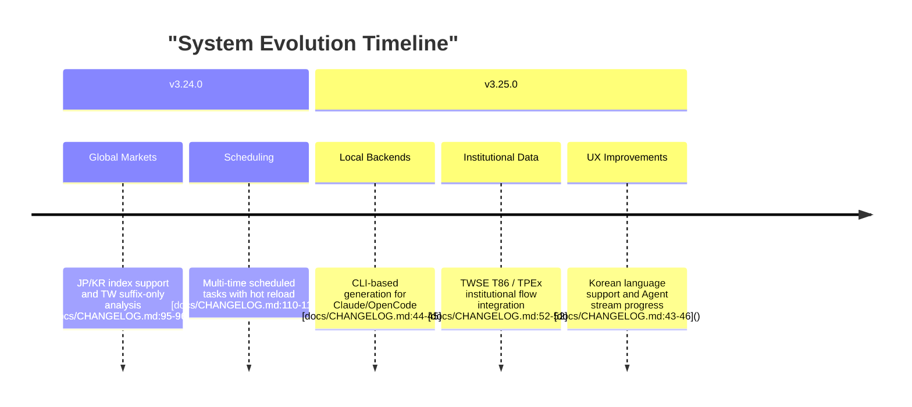
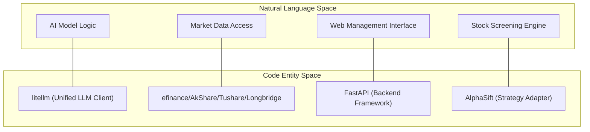
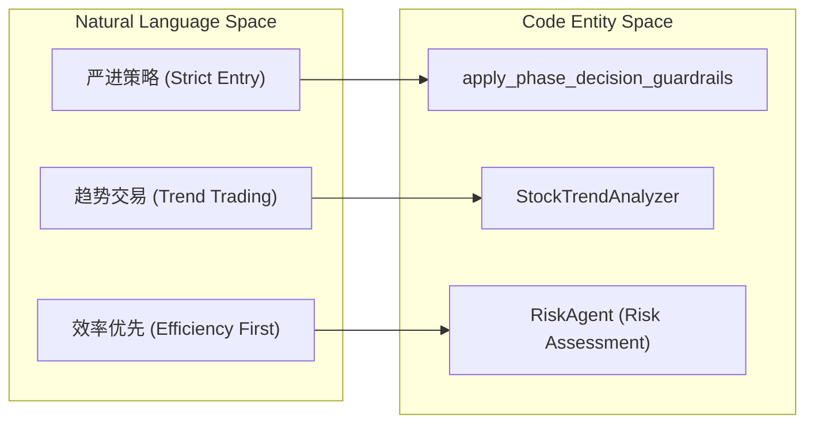

<!-- source: DeepWiki mcp.deepwiki.com · repo ZhuLinsen/daily_stock_analysis · page 10 Reference · fetched 2026-10-29 -->

# Reference

Relevant source files

The following files were used as context for generating this wiki page:

- [.env.example](.env.example)
- [api/v1/endpoints/alphasift.py](api/v1/endpoints/alphasift.py)
- [apps/dsa-web/src/api/__tests__/alphasift.test.ts](apps/dsa-web/src/api/__tests__/alphasift.test.ts)
- [apps/dsa-web/src/api/alphasift.ts](apps/dsa-web/src/api/alphasift.ts)
- [apps/dsa-web/src/api/error.ts](apps/dsa-web/src/api/error.ts)
- [apps/dsa-web/src/pages/StockScreeningPage.tsx](apps/dsa-web/src/pages/StockScreeningPage.tsx)
- [apps/dsa-web/src/pages/__tests__/StockScreeningPage.test.tsx](apps/dsa-web/src/pages/__tests__/StockScreeningPage.test.tsx)
- [docs/CHANGELOG.md](docs/CHANGELOG.md)
- [docs/alphasift-integration.md](docs/alphasift-integration.md)
- [docs/full-guide.md](docs/full-guide.md)
- [docs/full-guide_EN.md](docs/full-guide_EN.md)
- [requirements.txt](requirements.txt)
- [src/config.py](src/config.py)
- [src/core/pipeline.py](src/core/pipeline.py)
- [src/services/alphasift_service.py](src/services/alphasift_service.py)
- [tests/test_alphasift_api.py](tests/test_alphasift_api.py)
- [tests/test_docker_entrypoint.py](tests/test_docker_entrypoint.py)

This page provides essential reference materials for the A-share/HK/US intelligent stock analysis system. It consolidates version history, dependency information, trading philosophy rules, and API documentation in one location for quick access.

**Quick Navigation:**
- [Changelog](#10.1) — Detailed changelog with version history and feature evolution.
- [Dependencies](#10.2) — Complete list of Python dependencies with explanations.
- [Trading Philosophy Rules](#10.3) — Reference document of embedded trading rules (严进策略, 趋势交易, etc.).
- [API Reference](#10.4) — FastAPI endpoint reference for programmatic access.

---

## Overview

The reference section consolidates technical documentation that supports system operation and development. Each subsection addresses a specific documentation need:

| Section | Purpose | Key Information |
|---------|---------|-----------------|
| **Changelog** | Version history tracking | Feature additions, bug fixes, and security patches like the Discord Ed25519 signature verification [docs/CHANGELOG.md:63-63](). |
| **Dependencies** | Package management | Required Python libraries with version constraints, such as `litellm` for unified AI access [requirements.txt:40-40](). |
| **Trading Philosophy** | AI behavior rules | Embedded strategies (e.g., `bull_trend`, `ma_golden_cross`) that guide AI analysis logic [src/core/pipeline.py:81-87](). |
| **API Reference** | Programmatic access | FastAPI endpoint specifications for analysis triggers, portfolio management, and agent chat [docs/full-guide.md:19-19](). |

---

## Changelog Summary

The project follows [Semantic Versioning](https://semver.org) with detailed history maintained in [docs/CHANGELOG.md:1-100](). It tracks significant updates across the AI engine, Web UI, and data fetchers.

### Latest Version: 3.25.0 (2026-07-03)

Recent notable changes include:

| Category | Changes | Code Reference |
|----------|---------|----------------|
| **AI Engine** | Added `claude_code_cli` and `opencode_cli` local generation backends. | [docs/CHANGELOG.md:34-34]() |
| **Market Data** | Integrated TWSE/TPEx institutional data for Taiwan stocks. | [docs/CHANGELOG.md:47-47]() |
| **Agent Chat** | Standardized `/chat/stream` progress events (start, done, timeout). | [docs/CHANGELOG.md:37-37]() |
| **Notification** | Added DingTalk Group Robot support with 20KB chunking. | [docs/CHANGELOG.md:42-42]() |

### Version Evolution Timeline

**Full version history**: For details, see [Changelog](#10.1).

Sources: [docs/CHANGELOG.md:1-125]()

---

## Dependencies Overview

The system relies on a multi-tier dependency structure to handle data fetching, AI orchestration, and web serving.

### Core Dependency Categories

### Key Package Purposes

| Package | Role |
|---------|------|
| `litellm` | Unified LLM client for Gemini/OpenAI/Claude/DeepSeek [requirements.txt:40-40](). |
| `Longbridge` | Preferred OpenAPI source for HK/US/TW real-time quotes and volume [requirements.txt:21-23](). |
| `AlphaSift` | Optional screening engine for strategy-based stock discovery [docs/alphasift-integration.md:5-6](). |
| `TickFlow` | Official SDK for high-performance A-share daily K-lines and batch quotes [requirements.txt:24-24](). |

**Full dependency list**: For details, see [Dependencies](#10.2).

Sources: [requirements.txt:1-74](), [docs/full-guide.md:7-24]()

---

## Trading Philosophy Rules

The AI analysis is governed by a set of "Trading Philosophy" rules injected into the system prompt. These rules ensure consistency between the AI's recommendations and professional trading standards.

### Rule Enforcement Logic

### Core Rules Mapping

| Philosophy Rule | Implementation | Code Reference |
|----------------|----------------|----------------|
| **严进策略 (Strict Entry)** | Decision guardrails based on market phase and confidence levels. | [src/core/pipeline.py:54-54]() |
| **趋势交易 (Trend Trading)** | MA-based trend identification and support/resistance analysis. | [src/core/pipeline.py:80-80]() |
| **效率优先 (Efficiency)** | Focus on high-momentum or fundamental turnaround candidates. | [docs/full-guide.md:36-36]() |
| **风控降级 (Risk Guard)** | Score adjustment and final action override during high-risk phases. | [docs/CHANGELOG.md:55-55]() |

**Detailed rules**: For details, see [Trading Philosophy Rules](#10.3).

Sources: [src/core/pipeline.py:29-87](), [.env.example:160-170]()

---

## API Reference

The system provides a FastAPI-based programmatic interface for triggering analysis, managing tasks, and performing backtests.

### Core Endpoint Categories

| Category | Description |
|----------|-------------|
| **Analysis** | Trigger individual or batch stock analysis via `StockAnalysisPipeline` [src/core/pipeline.py:165-174](). |
| **AlphaSift** | Execute strategy screening, fetch hotspots, and manage screening tasks [api/v1/endpoints/alphasift.py:27-27](). |
| **Agent Chat** | Multi-agent streaming dialogue with progress events and tool calling [docs/CHANGELOG.md:46-46](). |
| **Portfolio** | Manage P0 core ledger, FIFO accounting, and corporate actions [docs/full-guide.md:37-37](). |
| **Config** | Hot-reloadable system settings, LLM channel management, and provider diagnostics [src/config.py:7-11](). |

**Detailed specifications**: For details, see [API Reference](#10.4).

Sources: [docs/full-guide.md:19-38](), [docs/CHANGELOG.md:34-50]()

---

