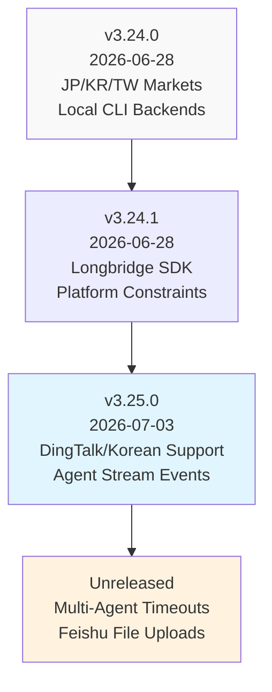
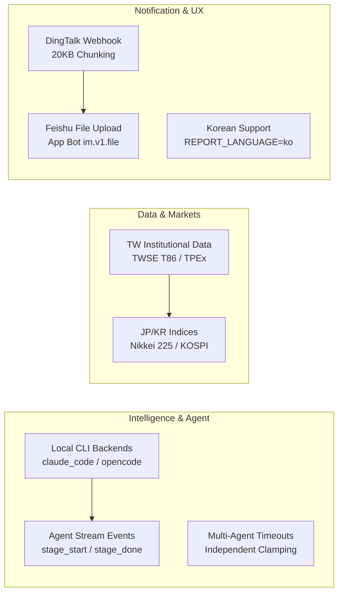
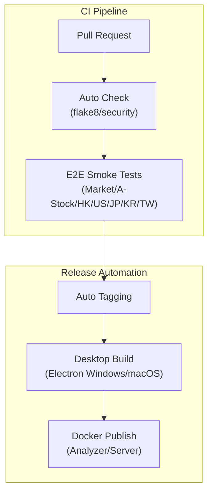

<!-- source: DeepWiki mcp.deepwiki.com · repo ZhuLinsen/daily_stock_analysis · page 10.1 Changelog · fetched 2026-10-29 -->

# Changelog

<details>
<summary>Relevant source files</summary>

The following files were used as context for generating this wiki page:

- [.env.example](.env.example)
- [docs/CHANGELOG.md](docs/CHANGELOG.md)
- [docs/full-guide.md](docs/full-guide.md)
- [docs/full-guide_EN.md](docs/full-guide_EN.md)
- [src/config.py](src/config.py)
- [src/core/pipeline.py](src/core/pipeline.py)

</details>


## Purpose and Scope

This page documents the system's version history, release notes, and feature evolution. It explains the changelog structure, versioning scheme, and how major system changes are tracked and communicated. The system adheres to [Semantic Versioning](https://semver.org) and the [Keep a Changelog](https://keepachangelog.com/en/1.0.0) format.

For information about:
- Development workflow and release process, see [Development Workflow](#9.1)
- CI/CD automation including auto-tagging, see [CI/CD Pipeline](#9.3)
- Individual system components and their current implementation, refer to [Core Components](#4)

---

## Changelog Structure and Conventions

The project maintains a detailed history in `docs/CHANGELOG.md` [docs/CHANGELOG.md:1-5]().

### Version Numbering Scheme

```
MAJOR.MINOR.PATCH (e.g., 3.25.0)
```

| Component | Trigger | Example |
|-----------|---------|---------|
| **MAJOR** | Breaking changes that require user action | Project structure refactor |
| **MINOR** | New features, backward-compatible | Multi-Agent Timeout Clamping (3.25.0) |
| **PATCH** | Bug fixes, performance improvements | Longbridge SDK platform constraint fix (3.24.1) |

### Change Categories

Changes are grouped into standardized categories defined in the changelog [docs/CHANGELOG.md:40-85]():

| Category | Chinese | Description |
|----------|---------|-------------|
| **新功能 (Added)** | New features | DingTalk notifications, Korean language support, Local CLI Backends. |
| **修复 (Fixed)** | Bug fixes | Discord chunking, yfinance dividend parsing, WebUI host binding. |
| **改进 (Improved)** | Enhancements | TW stock fetcher concurrency, AlphaSift timeout guards. |
| **文档 (Docs)** | Documentation | Agent stream contract, local CLI privacy boundaries. |

---

## Version Timeline and Major Milestones

### Version Evolution Diagram



**Sources:** [docs/CHANGELOG.md:10-30](), [docs/CHANGELOG.md:85-91](), [docs/CHANGELOG.md:91-100]()

### Recent Milestone Features (v3.25.0 & Unreleased)



**Sources:** [docs/CHANGELOG.md:27-28](), [docs/CHANGELOG.md:34-37](), [docs/CHANGELOG.md:42-43](), [docs/CHANGELOG.md:103-106]()

---

## Feature-to-Module Mapping

This diagram maps recent changelog features to their concrete code entities:

```mermaid
graph TB
    subgraph "Data & Markets"
        CH_TW["TW Institutional<br/>v3.25.0"]
        CH_Tick["TickFlow Source<br/>Unreleased"]
        CH_Stock["StockList Parser<br/>Unreleased"]
    end
    
    subgraph "Code: data_provider/ & src/"
        MOD_TW["data_provider/tw_institutional_fetcher.py"]
        MOD_Config["src/config.py<br/>STOCK_LIST / TICKFLOW_*"]
        MOD_Parser["src/services/stock_list_parser.py"]
    end
    
    subgraph "AI & Agent Runtime"
        CH_CLI["Local CLI Backends<br/>v3.25.0"]
        CH_Strm["Stream Progress<br/>v3.25.0"]
        CH_TO["Agent Timeouts<br/>Unreleased"]
    end
    
    subgraph "Code: src/llm/ & src/agent/"
        MOD_LLM["src/llm/local_cli_backend.py"]
        MOD_Reg["src/llm/backend_registry.py"]
        MOD_Pipe["src/core/pipeline.py<br/>Timeout Clamping"]
    end
    
    subgraph "Notification & UI"
        CH_Ding["DingTalk Notify<br/>v3.25.0"]
        CH_FS["Feishu File Upload<br/>Unreleased"]
        CH_Web["Web Fast Valuation<br/>Unreleased"]
    end
    
    subgraph "Code: src/notification/ & api/"
        MOD_Ding["src/notification.py<br/>DingTalkSender"]
        MOD_Feishu["src/notification.py<br/>FeishuSender.send_feishu_file"]
        MOD_Port["api/routers/portfolio.py<br/>include_realtime=false"]
    end
    
    CH_TW --> MOD_TW
    CH_Tick --> MOD_Config
    CH_Stock --> MOD_Parser
    CH_CLI --> MOD_LLM
    CH_Strm --> MOD_Reg
    CH_TO --> MOD_Pipe
    CH_Ding --> MOD_Ding
    CH_FS --> MOD_Feishu
    CH_Web --> MOD_Port
```



**Sources:** [docs/CHANGELOG.md:14-23](), [docs/CHANGELOG.md:27-28](), [docs/CHANGELOG.md:34-37](), [docs/CHANGELOG.md:42-45](), [src/config.py:39-59](), [src/core/pipeline.py:165-210]()

---

## Release Process and Maintenance

### Automated Release Workflow

The project uses GitHub Actions to automate versioning and deployment [docs/full-guide.md:42-50]().



**Sources:** [docs/CHANGELOG.md:38-39](), [docs/full-guide.md:7-24](), [docs/full-guide.md:42-50]()

### Notable Issue Resolutions (v3.25.0 & Unreleased)

| Issue | Version | Description | Solution |
|-------|---------|-------------|----------|
| **WebUI Binding** | 3.25.0 | Desktop `--host` override | Fixed logic where CLI arguments were ignored if `.env` had `WEBUI_HOST` [docs/CHANGELOG.md:12](), [docs/CHANGELOG.md:60](). |
| **Port Sync** | 3.25.0 | Desktop Port Mismatch | Fixed Electron auto-port selection and backend `WEBUI_PORT` desync [docs/CHANGELOG.md:61](). |
| **Discord 429** | 3.25.0 | Rate Limit Failure | Added `retry_after` support for Discord long report chunking [docs/CHANGELOG.md:63](). |
| **yfinance 1.2.x** | 3.25.0 | Dividend Parsing | Restored TTM dividend calculation for single-column DataFrame returns [docs/CHANGELOG.md:71](). |
| **Task Status** | Unreleased | Sentiment Score 0 | Fixed bug where score `0` was treated as null, ensuring low-score reports trigger "Sell" [docs/CHANGELOG.md:15](). |

---

## Configuration Evolution

### Environment Variables Added/Modified Recently

| Variable | Version | Purpose |
|----------|---------|---------|
| `GENERATION_BACKEND` | 3.25.0 | Support for `codex_cli`, `claude_code_cli`, `opencode_cli` [docs/CHANGELOG.md:34](), [.env.example:134](). |
| `DINGTALK_WEBHOOK_URL`| 3.25.0 | New DingTalk group bot notification channel [docs/CHANGELOG.md:42](), [docs/full-guide.md:80](). |
| `REPORT_LANGUAGE` | 3.25.0 | Added `ko` (Korean) support [docs/CHANGELOG.md:43](), [docs/full-guide.md:119](). |
| `FEISHU_SEND_AS_FILE` | Unreleased | Toggle to send reports as files via Feishu App Bot [docs/CHANGELOG.md:27](). |
| `*_AGENT_TIMEOUT` | Unreleased | Independent timeout clamping for 6 specialized agent types [docs/CHANGELOG.md:28](). |

**Sources:** [docs/CHANGELOG.md:27-28](), [docs/CHANGELOG.md:34-43](), [.env.example:134-145](), [docs/full-guide.md:80-119]()

---

## Accessing the Full Changelog

The complete history is available in:
- **File**: `docs/CHANGELOG.md` [docs/CHANGELOG.md:1-1000]()
- **Format**: Markdown with [Keep a Changelog](https://keepachangelog.com/en/1.0.0) categories.
- **Web UI**: [GitHub Releases](https://github.com/ZhuLinsen/daily_stock_analysis/releases) [docs/CHANGELOG.md:8]().

**Sources:** [docs/CHANGELOG.md:1-9](), [docs/full-guide.md:7-24]()

---

