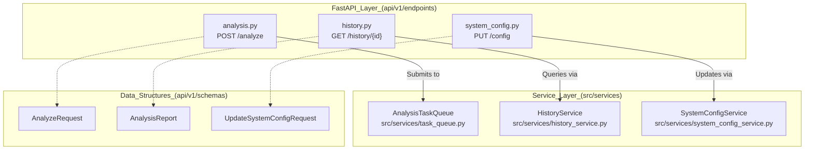
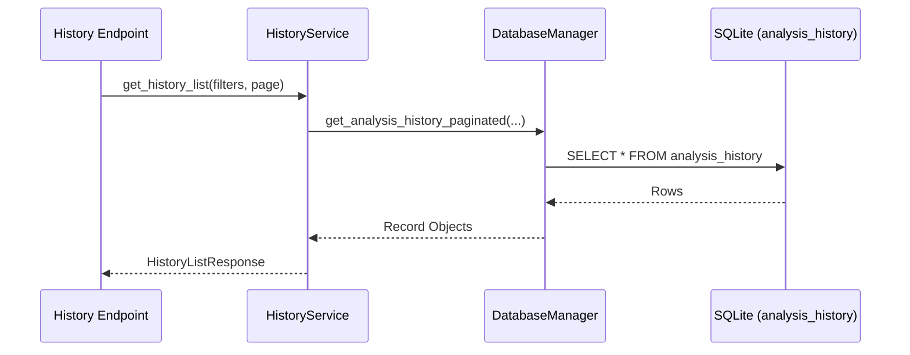

<!-- source: DeepWiki mcp.deepwiki.com · repo ZhuLinsen/daily_stock_analysis · page 10.4 API Reference · fetched 2026-10-29 -->

# API Reference

Relevant source files

The following files were used as context for generating this wiki page:

- [api/app.py](api/app.py)
- [api/v1/endpoints/__init__.py](api/v1/endpoints/__init__.py)
- [api/v1/endpoints/alerts.py](api/v1/endpoints/alerts.py)
- [api/v1/endpoints/analysis.py](api/v1/endpoints/analysis.py)
- [api/v1/endpoints/history.py](api/v1/endpoints/history.py)
- [api/v1/router.py](api/v1/router.py)
- [api/v1/schemas/__init__.py](api/v1/schemas/__init__.py)
- [api/v1/schemas/history.py](api/v1/schemas/history.py)
- [apps/dsa-web/src/types/analysis.ts](apps/dsa-web/src/types/analysis.ts)
- [docs/architecture/api_spec.json](docs/architecture/api_spec.json)
- [src/services/decision_signal_extractor.py](src/services/decision_signal_extractor.py)
- [src/services/decision_signal_service.py](src/services/decision_signal_service.py)
- [src/services/history_service.py](src/services/history_service.py)
- [src/storage.py](src/storage.py)
- [tests/test_analysis_api_contract.py](tests/test_analysis_api_contract.py)
- [tests/test_analysis_history.py](tests/test_analysis_history.py)
- [tests/test_api_schema_pydantic.py](tests/test_api_schema_pydantic.py)
- [tests/test_decision_signal_extractor.py](tests/test_decision_signal_extractor.py)
- [tests/test_decision_signal_service.py](tests/test_decision_signal_service.py)
- [tests/test_pipeline_market_phase_context.py](tests/test_pipeline_market_phase_context.py)
- [tests/test_static_assets_consistency.py](tests/test_static_assets_consistency.py)
- [tests/test_storage.py](tests/test_storage.py)

This document provides a complete reference for the FastAPI REST interface that enables programmatic access to the stock analysis system. The API supports triggering analyses, monitoring tasks, querying historical results, managing portfolios, and system configurations.

---

## Overview

The FastAPI service exposes RESTful endpoints at `http://host:port/api/v1/` (default: `http://127.0.0.1:8000`). All endpoints return JSON responses. The API architecture separates the web layer from the business logic through dedicated services and a task queue.

### API Architecture and Code Mapping

The following diagram bridges the REST endpoints to the internal code entities and data structures.

**Sources:** [api/v1/endpoints/analysis.py:1-17](), [api/v1/endpoints/history.py:1-10](), [api/v1/schemas/analysis.py:34-47](), [src/services/history_service.py:64-79]()

---

## Analysis Operations

### POST `/api/v1/analysis/analyze`

Triggers AI intelligent analysis. Supports single or batch stock codes.

**Implementation Details:**
- **Input Validation:** Rejects mixed alphanumeric noise or unsupported symbols early using `_is_obviously_invalid_analysis_input` [api/v1/endpoints/analysis.py:212-213]().
- **Execution Modes:** 
    - **Sync Mode:** Returns the full result immediately via `_handle_sync_analysis` [api/v1/endpoints/analysis.py:31]().
    - **Async Mode:** Returns a `task_id` (202 Accepted). Prevents duplicate tasks for the same stock if already processing [api/v1/endpoints/analysis.py:14-16]().
- **Market Review:** Dedicated endpoint `POST /api/v1/analysis/market-review` triggers a global market analysis using a specific execution lock to prevent concurrent runs [api/v1/endpoints/analysis.py:60-64]().

**Request Schema (`AnalyzeRequest`):**
| Field | Type | Description |
|-------|------|-------------|
| `stock_code` | `string` | Single stock code/name |
| `stock_codes` | `list[string]` | List of stock codes for batch processing |
| `report_type` | `string` | `simple`, `detailed`, `full`, or `brief` |
| `async_mode` | `boolean` | Whether to run as background task (default: `true`) |
| `report_language`| `string` | Output language: `zh`, `en`, or `ko` |

**Sources:** [api/v1/endpoints/analysis.py:126-168](), [api/v1/schemas/analysis.py:34-47](), [apps/dsa-web/src/types/analysis.ts:12-25]()

---

## Task Management & Real-time Updates

### GET `/api/v1/analysis/tasks`
Returns a list of current and recent tasks from the `AnalysisTaskQueue` memory.

### GET `/api/v1/analysis/tasks/stream`
A Server-Sent Events (SSE) endpoint providing real-time task status updates.

**Implementation Logic:**
The `AnalysisTaskQueue` maintains task states. When a task status changes (e.g., from `PENDING` to `PROCESSING`), the queue broadcasts the event. The SSE endpoint [api/v1/endpoints/analysis.py:11]() streams these transitions to the frontend.

**SSE Event Types:**
- `connected`: Initial connection success.
- `task_created`: New task added to queue.
- `task_started`: Execution begun.
- `task_completed`: Analysis finished.
- `task_failed`: Error encountered.
- `heartbeat`: Keep-alive signal every 30 seconds.

**Sources:** [api/v1/endpoints/analysis.py:11-17](), [docs/architecture/api_spec.json:248-255](), [src/services/task_queue.py:81-85]()

---

## History & Intelligence

### GET `/api/v1/history`
Retrieves a paginated list of historical analysis records. Supports filtering by `stock_code`, `report_type`, and date ranges [api/v1/endpoints/history.py:148-156]().

### GET `/api/v1/history/{query_id}`
Returns the full detailed report for a specific analysis session, including the context snapshot if saved [api/v1/endpoints/history.py:9]().

**Data Flow for History Retrieval:**

**Sources:** [src/services/history_service.py:156-210](), [api/v1/endpoints/history.py:138-156](), [src/storage.py:38-44]()

---

## Data Models (Schemas)

### AnalysisReport Structure
The report is a structured object used by both the Web UI and API consumers:
1. **Meta (`ReportMeta`):** Basic info including `stock_code`, `stock_name`, `model_used`, and `market_phase_summary` [api/v1/schemas/history.py:125-147]().
2. **Summary (`ReportSummary`):** AI conclusion, `sentiment_score` (0-100), and `operation_advice` [api/v1/schemas/history.py:149-162]().
3. **Strategy (`ReportStrategy`):** Technical price levels extracted from the analysis (Ideal Buy, Stop Loss, etc.) [api/v1/schemas/history.py:164-171]().
4. **Details (`ReportDetails`):** Extended data including `news_content`, `context_snapshot`, and `analysis_context_pack_overview` which provides data quality metrics [api/v1/schemas/history.py:255-265]().

### Market Phase Summary
A low-sensitivity summary of the market state at the time of analysis, including `phase` (e.g., `intraday`), `is_trading_day`, and `is_partial_bar` [api/v1/schemas/market_phase.py]().

**Sources:** [api/v1/schemas/history.py:20-49](), [apps/dsa-web/src/types/analysis.ts:268-273](), [src/services/history_service.py:35-38]()

---

