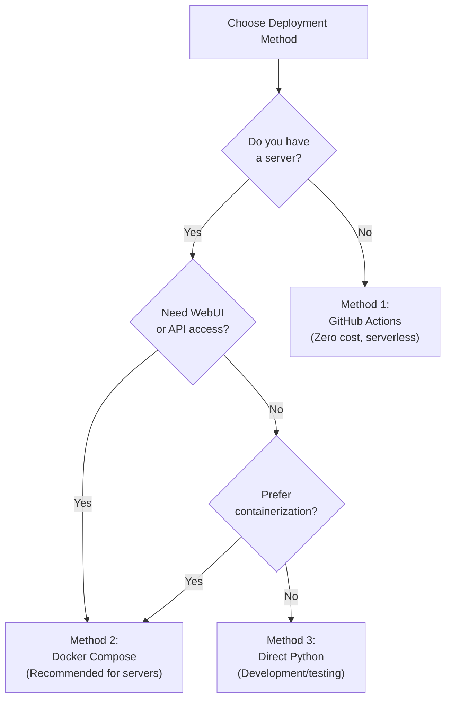
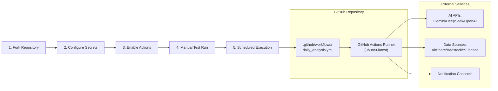
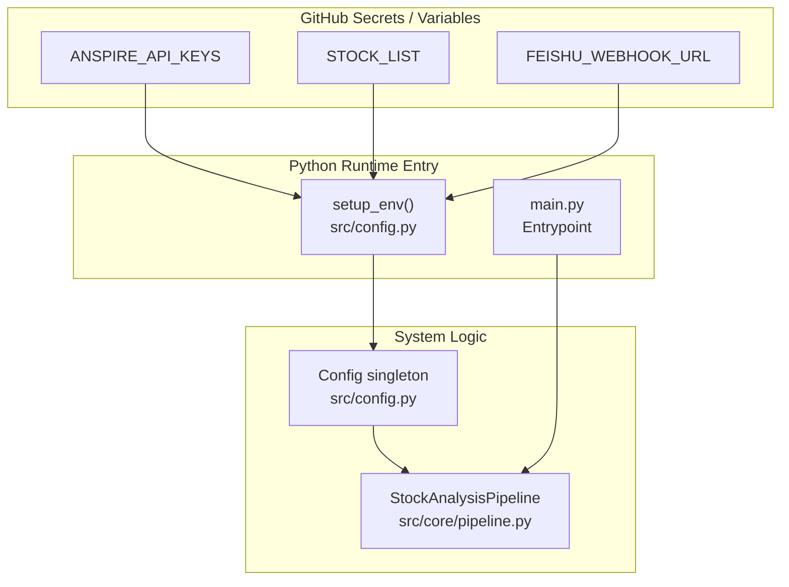

<!-- source: DeepWiki mcp.deepwiki.com · repo ZhuLinsen/daily_stock_analysis · page 2.1 Quick Start Guide · fetched 2026-10-29 -->

# Quick Start Guide

<details>
<summary>Relevant source files</summary>

The following files were used as context for generating this wiki page:

- [README.md](README.md)
- [docs/README_CHT.md](docs/README_CHT.md)
- [docs/README_EN.md](docs/README_EN.md)
- [main.py](main.py)
- [tests/test_main_schedule_mode.py](tests/test_main_schedule_mode.py)

</details>


## Purpose and Scope

This guide provides the fastest path to running your first stock analysis with the system. It covers initial setup, configuration of the minimum required components, and verification that the system is working correctly across different deployment environments (GitHub Actions, Docker, and Local).

The system is designed as an AI-driven platform for automated stock analysis with multi-channel notifications, supporting A-shares, HK, US, and other global markets [README.md:16-18]().

---

## Prerequisites Checklist

Before starting, ensure you have access to the following components:

| Component | Requirement | Acquisition |
|-----------|-------------|-------------|
| **AI API Key** | At least one of: `ANSPIRE_API_KEYS`, `AIHUBMIX_KEY`, `GEMINI_API_KEY`, or `OPENAI_API_KEY` | [Anspire](https://open.anspire.cn/dsa?share_code=QFBC0FYC), [AIHubMix](https://aihubmix.com/?aff=CfMq), or Google AI Studio |
| **Stock List** | Comma-separated stock codes | Define your watchlist in `STOCK_LIST` |
| **Notification Channel** | At least one configured | WeChat Work, Feishu, Telegram, Discord, Slack, or Email |
| **Search API** (Recommended) | `ANSPIRE_API_KEYS` or `SERPAPI_API_KEYS` | [Anspire AI](https://open.anspire.cn/dsa?share_code=QFBC0FYC) or [SerpApi](https://serpapi.com) |

**Stock Code Format Reference:**

| Market | Format | Examples |
|--------|--------|----------|
| A-share | 6-digit number | `600519` (Shanghai), `000001` (Shenzhen) |
| Hong Kong | `hk` + 5-digit number | `hk00700` (Tencent), `hk09988` (Alibaba) |
| US Stock | Standard ticker | `AAPL`, `TSLA`, `NVDA` |
| Other Markets | Suffix format | `7203.T` (Japan), `005930.KS` (Korea), `2330.TW` (Taiwan) |

Sources: [README.md:78-110](), [README.md:118-124]()

---

## Deployment Method Selection



Sources: [README.md:65-167]()

---

## Method 1: GitHub Actions (Serverless)

GitHub Actions provides zero-cost scheduled execution leveraging GitHub's free compute resources.

### Architecture Flow



Sources: [README.md:70-151]()

### Step 1: Configure Repository Secrets

Navigate to your forked repository: **Settings** → **Secrets and variables** → **Actions** → **New repository secret** [README.md:74-76]().

**Minimum Required Configuration:**

| Secret Name | Value | Purpose |
|-------------|-------|---------|
| `ANSPIRE_API_KEYS` | Your Anspire key | **Recommended**: One key for both LLM and Search [README.md:84]() |
| `STOCK_LIST` | `600519,hk00700,AAPL` | Stocks to analyze (comma separated) [README.md:110]() |
| `FEISHU_WEBHOOK_URL` | Your webhook URL | Notification delivery (or use `WECHAT_WEBHOOK_URL`) [README.md:97-98]() |

**Environment Variable Mapping to Code:**



Sources: [main.py:33-36](), [src/config.py:69](), [src/core/pipeline.py:1-20]()

### Step 2: Execute Manual Test Run

1. In the **Actions** tab, select **"I understand my workflows, go ahead and enable them"** [README.md:142]().
2. Select the workflow **"每日股票分析"** [README.md:146]().
3. Click **"Run workflow"** → **"Run workflow"** [README.md:146]().

---

## Method 2: Docker Compose (Server Deployment)

Docker Compose provides isolated containerized deployment with a WebUI for visual management.

### Step 1: Configure Environment

```bash
# Clone and enter repo
git clone https://github.com/ZhuLinsen/daily_stock_analysis.git && cd daily_stock_analysis

# Create configuration from template
cp .env.example .env
# Edit .env with your keys
```

Sources: [README.md:155-163]()

### Step 2: Start Services

Docker deployment starts the system services. The WebUI includes features for manual analysis, task monitoring, and configuration management [README.md:45]().

```bash
# Start services
docker-compose up -d
```

Sources: [README.md:10]()

---

## Method 3: Direct Python Execution

Best for local testing or debugging specific stock analysis.

### Step 1: Setup Environment

```bash
# Install dependencies
pip install -r requirements.txt

# Configure environment variables
cp .env.example .env
```

Sources: [README.md:158-163]()

### Step 2: Run Analysis via CLI

The `main.py` entry point provides various flags for fast execution [main.py:13-17]():

```bash
# Normal run (uses STOCK_LIST from .env)
python main.py

# Debug mode for verbose logging
python main.py --debug

# Dry run (fetch data only, no AI analysis)
python main.py --dry-run

# Analyze specific stocks via CLI
python main.py --stocks 600519,AAPL
```

Sources: [main.py:14-16](), [main.py:61-72]()

---

## Verification and Troubleshooting

### 1. Check Log Output
The system initializes `setup_logging` to capture execution details. If a stock fails, the global exception handler in `main.py` ensures other stocks continue [main.py:7-10]().

### 2. Verify Market Data Sources
The system uses a priority-based failover system. By default, it uses free sources like `AkShare`, `Baostock`, and `YFinance`. For more stability, configure `TUSHARE_TOKEN` or `LONGBRIDGE_*` [README.md:61-63]().

### 3. Trading Day Logic
By default, the system only executes on trading days (A/H/US) at 18:00 Beijing Time [README.md:150](). To bypass this for testing, use the `--force-run` flag in the CLI or GitHub Actions [tests/test_main_schedule_mode.py:106]().

Sources: [main.py:18-22](), [README.md:128-138]()

---

