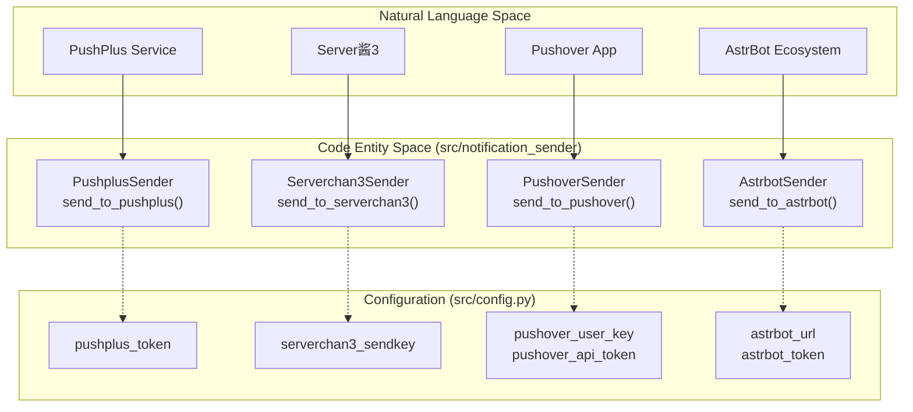
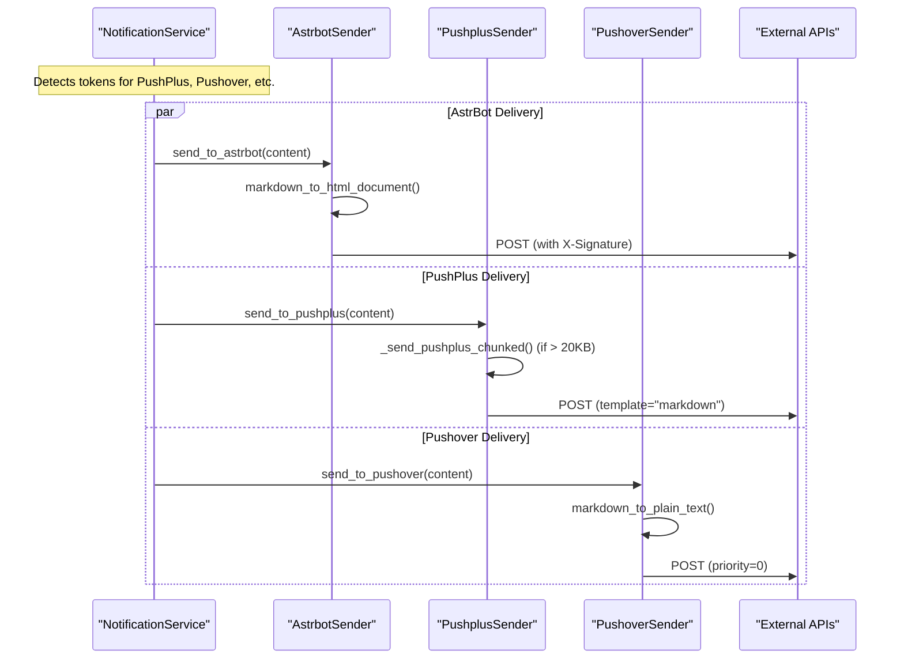

<!-- source: DeepWiki mcp.deepwiki.com · repo ZhuLinsen/daily_stock_analysis · page 8.6 Other Channels · fetched 2026-10-29 -->

# Other Channels

Relevant source files

The following files were used as context for generating this wiki page:

- [src/notification_sender/astrbot_sender.py](src/notification_sender/astrbot_sender.py)
- [src/notification_sender/custom_webhook_sender.py](src/notification_sender/custom_webhook_sender.py)
- [src/notification_sender/discord_sender.py](src/notification_sender/discord_sender.py)
- [src/notification_sender/email_sender.py](src/notification_sender/email_sender.py)
- [src/notification_sender/pushover_sender.py](src/notification_sender/pushover_sender.py)
- [src/notification_sender/pushplus_sender.py](src/notification_sender/pushplus_sender.py)
- [src/notification_sender/serverchan3_sender.py](src/notification_sender/serverchan3_sender.py)
- [src/notification_sender/wechat_sender.py](src/notification_sender/wechat_sender.py)

This page documents additional notification channels supported by the system: **PushPlus**, **ServerChan3**, **Pushover**, and **AstrBot**. These channels provide specialized push notification capabilities for mobile and desktop environments, complementing the primary enterprise and chat platforms.

---

## Overview

The system implements a multi-channel notification architecture where each service is encapsulated in a dedicated sender class within the `src.notification_sender` module.

| Channel | Implementation Class | Primary Use Case | Platform Support |
|---------|----------------------|------------------|------------------|
| **PushPlus** | `PushplusSender` [src/notification_sender/pushplus_sender.py:21]() | Chinese mobile push (WeChat/App) | iOS, Android, WeChat |
| **ServerChan3** | `Serverchan3Sender` [src/notification_sender/serverchan3_sender.py:20]() | Chinese mobile app push | iOS, Android |
| **Pushover** | `PushoverSender` [src/notification_sender/pushover_sender.py:20]() | Low-latency global push | iOS, Android, Desktop |
| **AstrBot** | `AstrbotSender` [src/notification_sender/astrbot_sender.py:23]() | Ecosystem bot integration | Multi-platform |

**Sources:** [src/notification_sender/pushplus_sender.py:21](), [src/notification_sender/serverchan3_sender.py:20](), [src/notification_sender/pushover_sender.py:20](), [src/notification_sender/astrbot_sender.py:23]()

---

## Channel Implementation Architecture

The following diagram maps the logical notification channels to their specific code entities and data structures.

### Code Entity Mapping: Natural Language to Implementation

**Sources:** [src/notification_sender/pushplus_sender.py:30-32](), [src/notification_sender/serverchan3_sender.py:29](), [src/notification_sender/pushover_sender.py:29-32](), [src/notification_sender/astrbot_sender.py:32-35]()

---

## PushPlus

### Implementation Details
`PushplusSender` handles delivery to the PushPlus API at `http://www.pushplus.plus/send` [src/notification_sender/pushplus_sender.py:69](). 

- **Chunking Logic**: If the content exceeds `pushplus_max_bytes` (default 20,000) [src/notification_sender/pushplus_sender.py:32](), the sender uses `_send_pushplus_chunked` [src/notification_sender/pushplus_sender.py:128-148]() which splits the message using `chunk_content_by_max_bytes` [src/notification_sender/pushplus_sender.py:131]().
- **Payload Structure**: Uses a JSON payload containing `token`, `title`, `content`, and `template: "markdown"` [src/notification_sender/pushplus_sender.py:103-108]().
- **Topic Support**: Supports optional `topic` for group notifications [src/notification_sender/pushplus_sender.py:110-111]().

### Configuration
| Env Var | Code Attribute |
|---------|----------------|
| `PUSHPLUS_TOKEN` | `config.pushplus_token` [src/notification_sender/pushplus_sender.py:30]() |
| `PUSHPLUS_TOPIC` | `config.pushplus_topic` [src/notification_sender/pushplus_sender.py:31]() |
| `PUSHPLUS_MAX_BYTES` | `config.pushplus_max_bytes` [src/notification_sender/pushplus_sender.py:32]() |

**Sources:** [src/notification_sender/pushplus_sender.py:21-148]()

---

## ServerChan3 (Server酱3)

### Implementation Details
`Serverchan3Sender` supports two URL formats based on the `sendkey` prefix [src/notification_sender/serverchan3_sender.py:73-83]():
1. **SCTP Prefix**: Matches `sctp(\d+)t` to construct `https://{num}.push.ft07.com/send/{sendkey}.send` [src/notification_sender/serverchan3_sender.py:74-78]().
2. **Standard**: `https://sctapi.ftqq.com/{sendkey}.send` [src/notification_sender/serverchan3_sender.py:83]().

The message content is passed in the `desp` field of the JSON payload [src/notification_sender/serverchan3_sender.py:88]().

### Configuration
| Env Var | Code Attribute |
|---------|----------------|
| `SERVERCHAN3_SENDKEY` | `config.serverchan3_sendkey` [src/notification_sender/serverchan3_sender.py:29]() |

**Sources:** [src/notification_sender/serverchan3_sender.py:20-112]()

---

## Pushover

### Implementation Details
`PushoverSender` converts Markdown to plain text using `markdown_to_plain_text` [src/notification_sender/pushover_sender.py:89]() because the Pushover message limit is strictly 1024 characters [src/notification_sender/pushover_sender.py:86]().

- **Chunking Strategy**: Uses `_send_pushover_chunked` [src/notification_sender/pushover_sender.py:157-236](). It attempts to split by "────────" (divider) or double newlines [src/notification_sender/pushover_sender.py:176-181]().
- **API Endpoint**: `https://api.pushover.net/1/messages.json` [src/notification_sender/pushover_sender.py:78]().
- **Prioritization**: Supports message priority levels (-2 to 2) [src/notification_sender/pushover_sender.py:126]().

### Configuration
| Env Var | Code Attribute |
|---------|----------------|
| `PUSHOVER_USER_KEY` | `config.pushover_user_key` [src/notification_sender/pushover_sender.py:30]() |
| `PUSHOVER_API_TOKEN` | `config.pushover_api_token` [src/notification_sender/pushover_sender.py:31]() |

**Sources:** [src/notification_sender/pushover_sender.py:20-237]()

---

## AstrBot

### Implementation Details
`AstrbotSender` integrates with the AstrBot ecosystem. It converts Markdown to HTML using `markdown_to_html_document` [src/notification_sender/astrbot_sender.py:73]().

- **Security**: Supports request signing. If `astrbot_token` is provided, it calculates an HMAC-SHA256 signature using a timestamp and the JSON payload [src/notification_sender/astrbot_sender.py:81-90]().
- **Headers**: Includes `X-Signature` and `X-Timestamp` for verification [src/notification_sender/astrbot_sender.py:96-97]().
- **SSL Verification**: Uses `webhook_verify_ssl` setting [src/notification_sender/astrbot_sender.py:36]().

### Configuration
| Env Var | Code Attribute |
|---------|----------------|
| `ASTRBOT_URL` | `config.astrbot_url` [src/notification_sender/astrbot_sender.py:33]() |
| `ASTRBOT_TOKEN` | `config.astrbot_token` [src/notification_sender/astrbot_sender.py:34]() |

**Sources:** [src/notification_sender/astrbot_sender.py:23-111]()

---

## Data Flow Pipeline

The `NotificationService` acts as the orchestrator, detecting available channels and dispatching messages concurrently.

### Message Delivery Flow

**Sources:** [src/notification_sender/astrbot_sender.py:73-100](), [src/notification_sender/pushplus_sender.py:83-90](), [src/notification_sender/pushover_sender.py:89-93]()

---

## Comparison of Channel Characteristics

| Feature | PushPlus | ServerChan3 | Pushover | AstrBot |
|---------|----------|-------------|----------|---------|
| **Auth Mechanism** | Token in JSON [src/notification_sender/pushplus_sender.py:104]() | Key in URL [src/notification_sender/serverchan3_sender.py:73]() | User Key + API Token [src/notification_sender/pushover_sender.py:130-131]() | HMAC Signature (Optional) [src/notification_sender/astrbot_sender.py:86]() |
| **Content Format** | Markdown [src/notification_sender/pushplus_sender.py:107]() | Markdown [src/notification_sender/serverchan3_sender.py:56]() | Plain Text (Truncated) [src/notification_sender/pushover_sender.py:89]() | HTML [src/notification_sender/astrbot_sender.py:73]() |
| **Max Length** | 20,000 bytes [src/notification_sender/pushplus_sender.py:32]() | Variable | 1,024 chars [src/notification_sender/pushover_sender.py:86]() | Variable |
| **Chunking** | Byte-based [src/notification_sender/pushplus_sender.py:128]() | None | Section-based [src/notification_sender/pushover_sender.py:157]() | None |

**Sources:** [src/notification_sender/pushplus_sender.py:32](), [src/notification_sender/pushover_sender.py:86](), [src/notification_sender/serverchan3_sender.py:88](), [src/notification_sender/astrbot_sender.py:73]()

---

