# Page: Overview

# Overview

<details>
<summary>Relevant source files</summary>

The following files were used as context for generating this wiki page:

- [.env.example](.env.example)
- [README.md](README.md)
- [docs/CHANGELOG.md](docs/CHANGELOG.md)
- [docs/README_CHT.md](docs/README_CHT.md)
- [docs/README_EN.md](docs/README_EN.md)
- [docs/full-guide.md](docs/full-guide.md)
- [docs/full-guide_EN.md](docs/full-guide_EN.md)
- [src/config.py](src/config.py)
- [src/core/pipeline.py](src/core/pipeline.py)

</details>


This document provides a high-level introduction to the **A-share/HK/US Intelligent Stock Analysis System**, an AI-driven platform for automated stock market analysis. The system performs daily technical and fundamental analysis of user-selected stocks across Chinese A-shares, Hong Kong, US, Japanese, Korean, and Taiwan markets, delivering actionable "decision dashboards" (决策仪表盘) via multiple notification channels.

**Purpose**: Automate the complex workflow of data gathering, technical indicator calculation, news sentiment analysis, and multi-market strategy evaluation using Large Language Models (LLMs).

**Sources**: [README.md:3-18](), [docs/full-guide.md:1-24]()

---

## System Purpose

The system transforms raw market data into structured investment intelligence by coordinating several specialized modules:

1.  **Multi-Source Data Acquisition**: Fetches OHLCV data, real-time quotes, chip distribution, and market news from a tiered hierarchy of providers (EFinance, AkShare, Tushare, Pytdx, Baostock, YFinance, TickFlow, and Longbridge) with automatic failover and circuit breaking [README.md:53-61](), [src/core/pipeline.py:28-30]().
2.  **AI-Driven Analysis Engine**: Utilizes LLMs (Gemini, Claude, DeepSeek, OpenAI, Ollama) via a unified interface to generate investment conclusions guided by embedded trading disciplines [README.md:54-58](), [src/analyzer.py:31-38]().
3.  **Multi-Agent Strategy (Skill) System**: Supports complex multi-turn strategy Q&A with 15+ built-in trading strategies (e.g., Mean Reversion, Wave Theory, Event-Driven) implemented as "skills" [README.md:46-48](), [src/config.py:185-204]().
4.  **Intelligent Search & Context Enrichment**: Aggregates news, risk alerts, and capital flow from specialized search APIs (Anspire, Tavily, Bocha, SerpAPI, Brave) to provide the AI with up-to-date fundamental context [README.md:58-60](), [src/search_service.py:49-50]().
5.  **Multi-Channel Notification**: Distributes reports to 10+ channels including Telegram, Discord, WeChat Work, Feishu, Slack, and Email with platform-specific formatting [README.md:48-50](), [docs/full-guide.md:70-108]().
6.  **Performance Validation & Portfolio Management**: An integrated backtesting engine evaluates AI accuracy, while the Portfolio P0 system tracks actual holdings and performance [README.md:45-47](), [docs/CHANGELOG.md:98-99]().

**Sources**: [README.md:39-63](), [src/core/pipeline.py:1-65](), [docs/full-guide.md:70-108]()

---

## High-Level Architecture

The system follows a modular orchestration pattern, separating data acquisition, intelligence processing, and delivery.

### Code Entity Relationship Diagram

This diagram bridges the conceptual "Natural Language Space" to the specific "Code Entity Space" used in the repository.

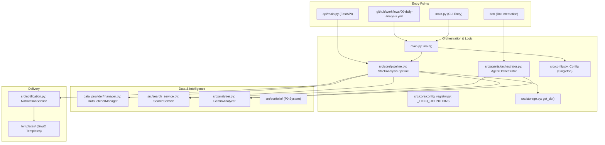

**Architecture Description**:
*   **Entry Points**: Users interact via GitHub Actions (serverless), CLI, or a React-based Web UI [README.md:65-152]().
*   **StockAnalysisPipeline**: The central coordinator that manages the lifecycle of a single analysis task, from fetching data to triggering notifications [src/core/pipeline.py:165-207]().
*   **AgentOrchestrator**: Manages multi-agent workflows and "skill" routing for complex strategy analysis [docs/CHANGELOG.md:28-29](), [src/config.py:144-146]().
*   **DataFetcherManager**: Implements priority-based routing to ensure data availability across markets [src/core/pipeline.py:28-30](), [.env.example:42-52]().
*   **Config System**: A singleton configuration system that manages environment variables and provides structured validation [src/config.py:7-11](), [src/config.py:83-101]().

**Sources**: [src/core/pipeline.py:165-207](), [src/config.py:1-75](), [README.md:65-152](), [docs/full-guide.md:7-24]()

---

## Core Components & Data Flow

The system processes a stock analysis request through a linear pipeline with heavy enrichment at each stage.

### Data Flow Pipeline

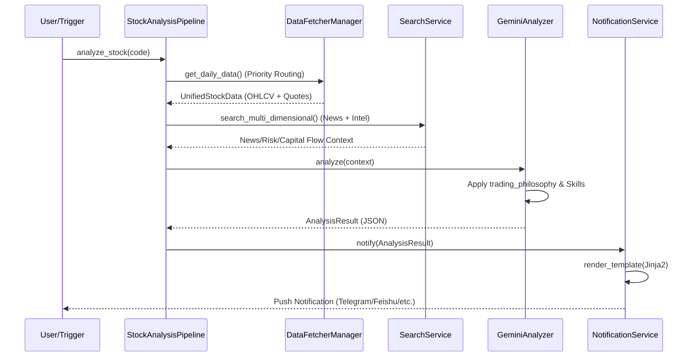

### Key Functional Entities

| Component | Code Entity | Responsibility |
| :--- | :--- | :--- |
| **Orchestrator** | `StockAnalysisPipeline` | Manages per-stock lifecycle and concurrency [src/core/pipeline.py:165-173](). |
| **Data Fetcher** | `DataFetcherManager` | Routes to TickFlow, AkShare, Tushare, Longbridge, etc. [src/core/pipeline.py:28](). |
| **AI Engine** | `GeminiAnalyzer` | Universal LLM interface via LiteLLM; handles prompt construction [src/core/pipeline.py:31-33](). |
| **Agent System** | `AgentOrchestrator` | Multi-agent coordination with per-agent timeout clamping [docs/CHANGELOG.md:28-29](). |
| **Intelligence** | `SearchService` | Queries Anspire, Tavily, or SerpAPI for recent news/intel [src/core/pipeline.py:49](). |
| **Portfolio** | `PortfolioP0` | Core ledger for tracking holdings and performance [docs/CHANGELOG.md:117-118](). |

**Sources**: [src/core/pipeline.py:1-90](), [docs/CHANGELOG.md:27-38](), [README.md:39-63]()

---

## Trading Philosophy & Rules

The system's AI analysis is constrained by a specific trading philosophy and structured "skills" injected into prompts.

*   **Strict Entry (严进策略)**: Rules-based entry logic embedded in AI prompts to avoid chasing high-risk positions [README.md:43](), [docs/full-guide.md:50-52]().
*   **Trend Trading (趋势交易)**: Analysis prioritizes price action and technical alignment [README.md:46-48]().
*   **Multi-Agent Specialization**: Includes specialized agents (TechnicalAgent, IntelAgent, RiskAgent, DecisionAgent) each with distinct focus areas [docs/CHANGELOG.md:28-29]().
*   **Skill-Based Analysis**: Uses YAML-defined strategies (e.g., 均线, 缠论, 波浪) to guide AI reasoning across 15+ built-in types [README.md:46-48](), [src/config.py:185-204]().

**Sources**: [README.md:39-52](), [docs/CHANGELOG.md:28-29](), [src/config.py:162-204]()

---

## Deployment & Configuration

The system is designed for maximum flexibility:

*   **GitHub Actions**: Zero-cost, serverless execution using repository Secrets [README.md:65-151]().
*   **Docker / Docker Compose**: Recommended for persistent Web UI and backend services [README.md:152-167](), [docs/full-guide.md:31]().
*   **Desktop Application**: Electron-based shell for Windows/macOS with portable mode support [docs/CHANGELOG.md:16-17](), [docs/CHANGELOG.md:38]().

**Configuration Management**:
The `Config` singleton manages all environment variables, including hot-reloading and validation [src/config.py:7-11]().
*   **Stock Lists**: `STOCK_LIST` supports A-shares, HK, US, JP, KR, and TW codes with smart delimiters [docs/CHANGELOG.md:18](), [.env.example:6-9]().
*   **AI Channels**: Configured via `GENERATION_BACKEND` with support for `litellm` and local CLI backends like `codex_cli` [docs/CHANGELOG.md:107-110](), [.env.example:128-134]().

**Sources**: [README.md:63-167](), [src/config.py:1-50](), [docs/CHANGELOG.md:10-49](), [.env.example:1-134]()

---

# Page: Getting Started

# Getting Started

<details>
<summary>Relevant source files</summary>

The following files were used as context for generating this wiki page:

- [.env.example](.env.example)
- [README.md](README.md)
- [docs/CHANGELOG.md](docs/CHANGELOG.md)
- [docs/README_CHT.md](docs/README_CHT.md)
- [docs/README_EN.md](docs/README_EN.md)
- [docs/full-guide.md](docs/full-guide.md)
- [docs/full-guide_EN.md](docs/full-guide_EN.md)
- [src/config.py](src/config.py)
- [src/core/pipeline.py](src/core/pipeline.py)

</details>


This page provides an overview of initial setup requirements and deployment options for the A-share/HK/US intelligent stock analysis system. After reading this page, you will understand the system prerequisites, deployment method trade-offs, and minimum configuration needed to run your first analysis.

For detailed step-by-step installation instructions, see [Quick Start Guide](#2.1). For comprehensive configuration reference, see [Configuration Reference](#2.2). For deployment-specific details, see [Deployment Guide](#7).

**Sources:** [README.md:1-164](), [docs/full-guide.md:1-40]()

---

## System Prerequisites

Before deploying the system, ensure your environment meets the following requirements:

| Component | Requirement | Notes |
|-----------|-------------|-------|
| **Python** | 3.10 or higher | Required for all deployment methods except GitHub Actions [README.md:8]() |
| **Operating System** | Linux, macOS, or Windows | Windows installation support and desktop builds provided [docs/CHANGELOG.md:42,49]() |
| **Memory** | 512MB minimum | 1GB+ recommended for concurrent analysis [README.md:123]() |
| **Network** | Internet connection | Required for API calls to AI models, data sources, and notifications |

**Optional Dependencies:**

| Tool | Purpose | Installation |
|------|---------|--------------|
| `wkhtmltopdf` | Markdown-to-image conversion | Required if `MD2IMG_ENGINE=wkhtmltoimage` [docs/full-guide.md:130]() |
| `markdown-to-file` | Enhanced emoji support for images | Required if `MD2IMG_ENGINE=markdown-to-file` [docs/full-guide.md:130]() |
| Docker & Compose | Containerized deployment | Recommended for Web UI usage [docs/full-guide.md:31]() |
| Node.js / npm | Web UI development | Required for building the `apps/dsa-web` frontend [docs/CHANGELOG.md:18,59]() |

**Sources:** [README.md:8,123](), [docs/full-guide.md:31,130](), [docs/CHANGELOG.md:18,42,49,59](), [src/config.py:105]()

---

## Deployment Architecture Overview

The system supports multiple deployment methods, all converging on the orchestration logic defined in `main.py` and the `StockAnalysisPipeline`.

Title: System Deployment and Execution Flow
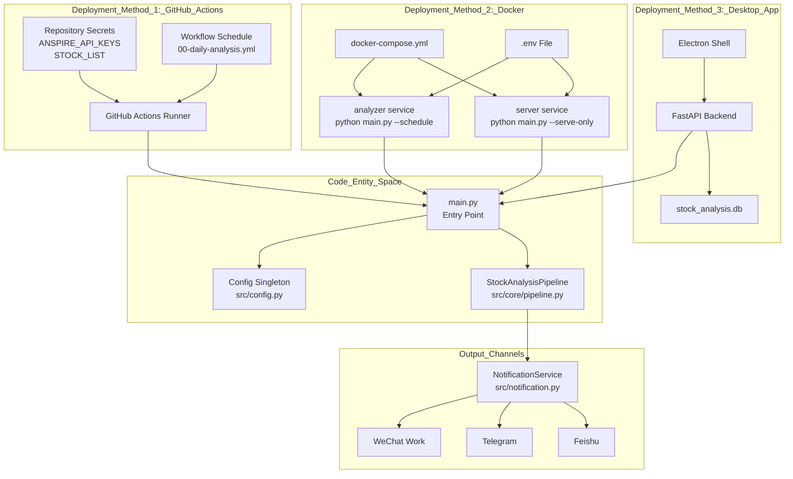

**Deployment Method Comparison:**

| Method | Pros | Cons | Best For |
|--------|------|------|----------|
| **GitHub Actions** | Zero cost, no server needed [README.md:69]() | Limited to scheduled runs | Individual users |
| **Docker** | Consistent environment, Web UI [docs/full-guide.md:31]() | Requires server resources | Multi-user / 24/7 service |
| **Desktop App** | GUI-driven, portable mode [docs/CHANGELOG.md:17,44]() | OS-specific builds | Local desktop users |

**Sources:** [README.md:65-151](), [docs/full-guide.md:31-50](), [docs/CHANGELOG.md:17,44](), [src/core/pipeline.py:165]()

---

## Minimum Configuration Requirements

The system requires three categories of configuration via environment variables (Secrets or `.env`).

### 1. AI Model Provider (Required - Choose One)

The system uses `litellm` as the default generation backend [src/config.py:134]().

| Provider | Key Variable | Notes |
|----------|--------------|-------|
| **Anspire** | `ANSPIRE_API_KEYS` | All-in-one model and search [README.md:84]() |
| **AIHubMix** | `AIHUBMIX_KEY` | Unified access to multiple model families [README.md:86]() |
| **Gemini** | `GEMINI_API_KEY` | Free tier via Google AI Studio [README.md:87]() |
| **DeepSeek** | `DEEPSEEK_API_KEY` | Cost-effective performance [.env.example:153]() |

### 2. Notification Channel (Required - Choose At Least One)

| Channel | Variables | Setup |
|---------|-----------|-------|
| **WeChat Work** | `WECHAT_WEBHOOK_URL` | Simple Webhook [README.md:97]() |
| **Feishu** | `FEISHU_WEBHOOK_URL` | Supports file upload and signatures [docs/CHANGELOG.md:27]() |
| **Telegram** | `TELEGRAM_BOT_TOKEN` | Paired with `TELEGRAM_CHAT_ID` [README.md:99]() |
| **DingTalk** | `DINGTALK_WEBHOOK_URL` | New support for group bots [docs/CHANGELOG.md:42]() |

### 3. Stock Watchlist (Required)

Define stocks in `STOCK_LIST` as a comma-separated string [.env.example:9]().
- **A-shares**: `600519`, `300750`
- **HK stocks**: `hk00700` [README.md:110]()
- **US stocks**: `AAPL` [README.md:110]()
- **Global**: Supports `.T` (JP), `.KS` (KR), `.TW` (TW) [README.md:110]()

**Sources:** [README.md:78-111](), [docs/CHANGELOG.md:27,42](), [.env.example:1-163](), [src/config.py:102-110]()

---

## Configuration Loading Flow

Title: Configuration to Code Mapping
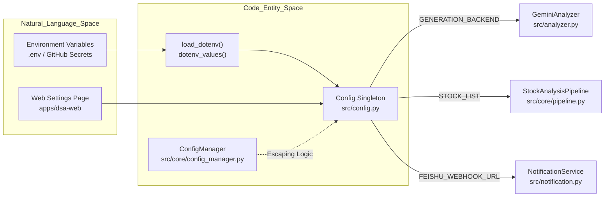

**Key Configuration Logic:**
- **Singleton Pattern**: The `Config` class manages global settings from `.env` and environment [src/config.py:8-11]().
- **Normalization**: Input like `STOCK_LIST` is parsed to handle multiple separators (commas, spaces, newlines) [docs/CHANGELOG.md:18]().
- **Validation**: `ConfigIssue` objects track configuration errors/warnings during startup [src/config.py:83-99]().

**Sources:** [src/config.py:1-99](), [docs/CHANGELOG.md:18](), [src/core/pipeline.py:198-207]()

---

## Basic Analysis Workflow

Once configured, the system follows this execution flow managed by the orchestrator.

1.  **Data Acquisition**: `DataFetcherManager` coordinates multi-source fetching. For HK/US, `Longbridge` is preferred for fields like turnover ratio [README.md:136]().
2.  **Context Enrichment**:
    *   **Intelligence**: `IntelligenceService` pulls news and sentiment [src/core/pipeline.py:61]().
    *   **Search**: Integrated search providers (Anspire, SerpAPI) provide real-time context [README.md:118-120]().
3.  **AI Analysis**: The `StockAnalysisPipeline` coordinates the `GeminiAnalyzer` to produce an `AnalysisResult` [src/core/pipeline.py:31-38]().
4.  **Notification**: `NotificationService` renders reports (Simple/Full/Brief) and pushes to channels [docs/full-guide.md:118-119]().

**Sources:** [src/core/pipeline.py:1-80](), [README.md:112-138](), [docs/full-guide.md:113-140]()

---

## Verification Steps

After setup, verify your installation using these methods:

1.  **Startup Diagnostics**: Check logs for "未配置" (unconfigured) warnings; these are often informational and don't prevent execution if fallbacks exist [README.md:130]().
2.  **CLI Check**: Validate notification configuration without running a full analysis:
    `python main.py --check-notify` [docs/full-guide.md:72]()
3.  **Manual Trigger**: Use GitHub Actions `Run workflow` button to test the cloud setup [README.md:146]().

**Sources:** [README.md:130-151](), [docs/full-guide.md:72]()

---

## Next Steps

*   **[Quick Start Guide](#2.1)**: Step-by-step walkthrough for first-time setup on GitHub Actions or Local.
*   **[Configuration Reference](#2.2)**: Detailed reference for all environment variables and multi-channel LLM settings.
*   **[Deployment Guide](#7)**: Advanced deployment instructions (Docker, Systemd, Desktop App).

**Sources:** [README.md:18-20](), [docs/full-guide.md:26-38]()

---

# Page: Quick Start Guide

# Quick Start Guide

<details>
<summary>Relevant source files</summary>

The following files were used as context for generating this wiki page:

- [README.md](README.md)
- [docs/README_CHT.md](docs/README_CHT.md)
- [docs/README_EN.md](docs/README_EN.md)
- [main.py](main.py)
- [tests/test_main_schedule_mode.py](tests/test_main_schedule_mode.py)

</details>


## Purpose and Scope

This guide provides the fastest path to running your first stock analysis with the system. It covers initial setup, configuration of the minimum required components, and verification that the system is working correctly across different deployment environments (GitHub Actions, Docker, and Local).

The system is designed as an AI-driven platform for automated stock analysis with multi-channel notifications, supporting A-shares, HK, US, and other global markets [README.md:16-18]().

---

## Prerequisites Checklist

Before starting, ensure you have access to the following components:

| Component | Requirement | Acquisition |
|-----------|-------------|-------------|
| **AI API Key** | At least one of: `ANSPIRE_API_KEYS`, `AIHUBMIX_KEY`, `GEMINI_API_KEY`, or `OPENAI_API_KEY` | [Anspire](https://open.anspire.cn/dsa?share_code=QFBC0FYC), [AIHubMix](https://aihubmix.com/?aff=CfMq), or Google AI Studio |
| **Stock List** | Comma-separated stock codes | Define your watchlist in `STOCK_LIST` |
| **Notification Channel** | At least one configured | WeChat Work, Feishu, Telegram, Discord, Slack, or Email |
| **Search API** (Recommended) | `ANSPIRE_API_KEYS` or `SERPAPI_API_KEYS` | [Anspire AI](https://open.anspire.cn/dsa?share_code=QFBC0FYC) or [SerpApi](https://serpapi.com) |

**Stock Code Format Reference:**

| Market | Format | Examples |
|--------|--------|----------|
| A-share | 6-digit number | `600519` (Shanghai), `000001` (Shenzhen) |
| Hong Kong | `hk` + 5-digit number | `hk00700` (Tencent), `hk09988` (Alibaba) |
| US Stock | Standard ticker | `AAPL`, `TSLA`, `NVDA` |
| Other Markets | Suffix format | `7203.T` (Japan), `005930.KS` (Korea), `2330.TW` (Taiwan) |

Sources: [README.md:78-110](), [README.md:118-124]()

---

## Deployment Method Selection

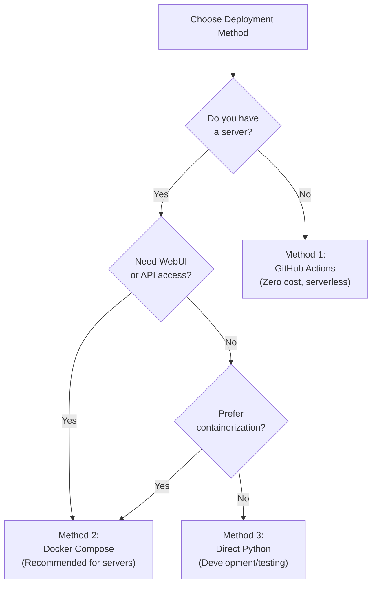

Sources: [README.md:65-167]()

---

## Method 1: GitHub Actions (Serverless)

GitHub Actions provides zero-cost scheduled execution leveraging GitHub's free compute resources.

### Architecture Flow

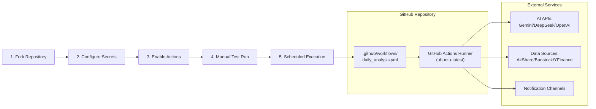

Sources: [README.md:70-151]()

### Step 1: Configure Repository Secrets

Navigate to your forked repository: **Settings** → **Secrets and variables** → **Actions** → **New repository secret** [README.md:74-76]().

**Minimum Required Configuration:**

| Secret Name | Value | Purpose |
|-------------|-------|---------|
| `ANSPIRE_API_KEYS` | Your Anspire key | **Recommended**: One key for both LLM and Search [README.md:84]() |
| `STOCK_LIST` | `600519,hk00700,AAPL` | Stocks to analyze (comma separated) [README.md:110]() |
| `FEISHU_WEBHOOK_URL` | Your webhook URL | Notification delivery (or use `WECHAT_WEBHOOK_URL`) [README.md:97-98]() |

**Environment Variable Mapping to Code:**

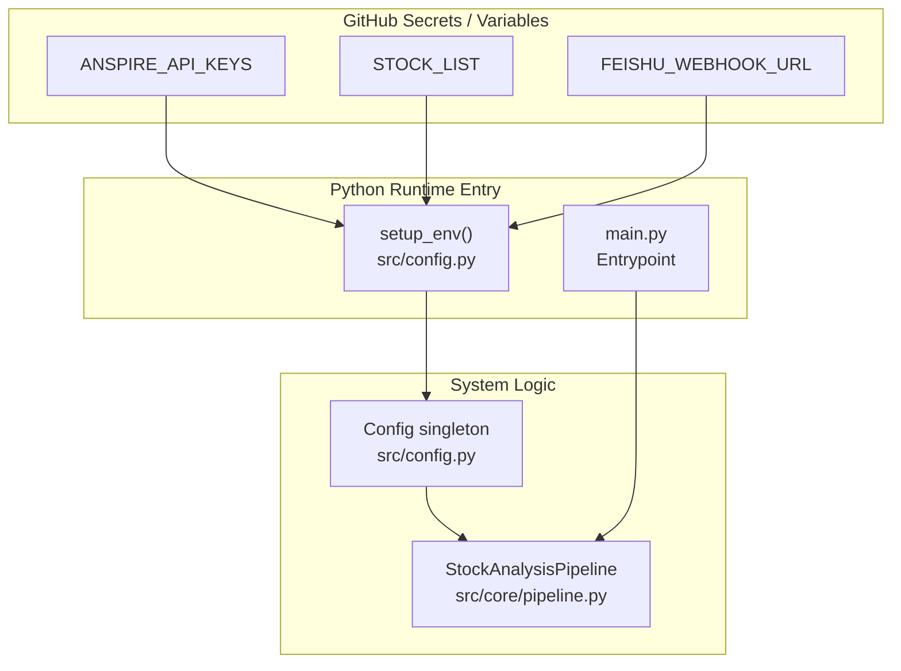

Sources: [main.py:33-36](), [src/config.py:69](), [src/core/pipeline.py:1-20]()

### Step 2: Execute Manual Test Run

1. In the **Actions** tab, select **"I understand my workflows, go ahead and enable them"** [README.md:142]().
2. Select the workflow **"每日股票分析"** [README.md:146]().
3. Click **"Run workflow"** → **"Run workflow"** [README.md:146]().

---

## Method 2: Docker Compose (Server Deployment)

Docker Compose provides isolated containerized deployment with a WebUI for visual management.

### Step 1: Configure Environment

```bash
# Clone and enter repo
git clone https://github.com/ZhuLinsen/daily_stock_analysis.git && cd daily_stock_analysis

# Create configuration from template
cp .env.example .env
# Edit .env with your keys
```

Sources: [README.md:155-163]()

### Step 2: Start Services

Docker deployment starts the system services. The WebUI includes features for manual analysis, task monitoring, and configuration management [README.md:45]().

```bash
# Start services
docker-compose up -d
```

Sources: [README.md:10]()

---

## Method 3: Direct Python Execution

Best for local testing or debugging specific stock analysis.

### Step 1: Setup Environment

```bash
# Install dependencies
pip install -r requirements.txt

# Configure environment variables
cp .env.example .env
```

Sources: [README.md:158-163]()

### Step 2: Run Analysis via CLI

The `main.py` entry point provides various flags for fast execution [main.py:13-17]():

```bash
# Normal run (uses STOCK_LIST from .env)
python main.py

# Debug mode for verbose logging
python main.py --debug

# Dry run (fetch data only, no AI analysis)
python main.py --dry-run

# Analyze specific stocks via CLI
python main.py --stocks 600519,AAPL
```

Sources: [main.py:14-16](), [main.py:61-72]()

---

## Verification and Troubleshooting

### 1. Check Log Output
The system initializes `setup_logging` to capture execution details. If a stock fails, the global exception handler in `main.py` ensures other stocks continue [main.py:7-10]().

### 2. Verify Market Data Sources
The system uses a priority-based failover system. By default, it uses free sources like `AkShare`, `Baostock`, and `YFinance`. For more stability, configure `TUSHARE_TOKEN` or `LONGBRIDGE_*` [README.md:61-63]().

### 3. Trading Day Logic
By default, the system only executes on trading days (A/H/US) at 18:00 Beijing Time [README.md:150](). To bypass this for testing, use the `--force-run` flag in the CLI or GitHub Actions [tests/test_main_schedule_mode.py:106]().

Sources: [main.py:18-22](), [README.md:128-138]()

---

# Page: Configuration Reference

# Configuration Reference

<details>
<summary>Relevant source files</summary>

The following files were used as context for generating this wiki page:

- [.env.example](.env.example)
- [apps/dsa-web/src/locales/settingsHelp.ts](apps/dsa-web/src/locales/settingsHelp.ts)
- [apps/dsa-web/src/utils/systemConfigI18n.ts](apps/dsa-web/src/utils/systemConfigI18n.ts)
- [docs/CHANGELOG.md](docs/CHANGELOG.md)
- [docs/full-guide.md](docs/full-guide.md)
- [docs/full-guide_EN.md](docs/full-guide_EN.md)
- [src/config.py](src/config.py)
- [src/core/config_registry.py](src/core/config_registry.py)
- [src/core/pipeline.py](src/core/pipeline.py)
- [tests/test_config_registry.py](tests/test_config_registry.py)
- [tests/test_config_validate_structured.py](tests/test_config_validate_structured.py)

</details>


This page provides a comprehensive reference for all environment variables and configuration options in the A-share/HK/US intelligent stock analysis system. All configuration is managed through the `Config` singleton class, which loads settings from environment variables and `.env` files, providing a unified interface for the entire codebase.

**Scope**: This document covers configuration syntax, available options, default values, and validation rules. For deployment-specific setup instructions, see [Environment Variables Guide](#7.5). For quick start instructions, see [Quick Start Guide](#2.1).

---

## Configuration System Overview

The system uses a centralized configuration management pattern with the following characteristics:

- **Singleton Pattern**: Global configuration accessed via `Config.get_instance()` or the `get_config()` helper [src/config.py:26]().
- **Multi-Source Loading**: Reads from `.env` files via `python-dotenv` and system environment variables [src/config.py:20]().
- **Type Safety**: Configuration fields are defined as typed dataclass attributes with specialized parsers for booleans, integers, and floats [src/config.py:207-250]().
- **Hot Reload**: Supports runtime refresh of parameters like `STOCK_LIST` or `SCHEDULE_TIMES` without application restart [docs/CHANGELOG.md:18, 110]().
- **Metadata Registry**: Centralized field definitions including categories, UI controls, and validation hints [src/core/config_registry.py:23-72]().

**Sources:** [src/config.py:1-26]() | [src/core/config_registry.py:1-72]() | [.env.example:1-10]()

---

## Configuration Loading Flow

The following diagram illustrates how configuration moves from external sources into the system's runtime memory.

**Title: Configuration Initialization and Resolution Flow**
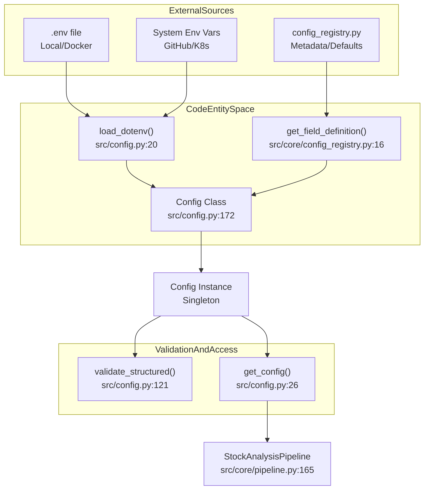

**Sources:** [src/config.py:20-165]() | [src/core/config_registry.py:1-22]() | [src/core/pipeline.py:165-207]()

---

## Configuration Categories

Configuration is organized into functional categories to simplify management via the Web UI and environment files.

| Category | Title | Description |
| :--- | :--- | :--- |
| `base` | Base Settings | Watchlist and foundational application settings [src/core/config_registry.py:24-29](). |
| `ai_model` | AI Model | Model providers, model names, and inference parameters [src/core/config_registry.py:30-35](). |
| `data_source` | Data Source | Market data provider credentials and priority settings [src/core/config_registry.py:37-41](). |
| `notification` | Notification | Bot, webhook, and push channel related settings [src/core/config_registry.py:42-47](). |
| `agent` | Agent | Agent mode and strategy-skill settings [src/core/config_registry.py:54-59](). |
| `system` | System | Runtime, scheduling, and logging controls [src/core/config_registry.py:48-53](). |
| `backtest` | Backtest | Backtest engine behavior and evaluation parameters [src/core/config_registry.py:60-65](). |

**Sources:** [src/core/config_registry.py:23-72]() | [apps/dsa-web/src/utils/systemConfigI18n.ts:4-25]()

---

## AI Model Configuration (Generation Backends)

The system supports multiple generation backends beyond traditional API calls. The primary orchestrator is `litellm`, but local CLI-based backends are available for experimental use.

### Core Generation Parameters

| Variable | Type | Default | Description |
| :--- | :--- | :--- | :--- |
| `GENERATION_BACKEND` | `str` | `litellm` | Generation method: `litellm`, `codex_cli`, `claude_code_cli`, `opencode_cli` [src/core/config_registry.py:121-136](). |
| `GENERATION_FALLBACK_BACKEND` | `str` | `litellm` | Backend-level fallback if the primary backend fails [src/core/config_registry.py:180-194](). |
| `LITELLM_MODEL` | `str` | `None` | Primary model in `provider/model` format [src/core/config_registry.py:103-119](). |
| `LLM_TEMPERATURE` | `float` | `0.7` | Sampling temperature for text generation [src/core/config_registry.py:170-180](). |
| `GENERATION_BACKEND_TIMEOUT_SECONDS`| `int` | `300` | Timeout for local CLI backend execution [src/config.py:54, 140](). |

### Multi-Channel Mode
When `LLM_CHANNELS` is defined, the system enables unified channel management. Each channel is configured using the prefix `LLM_{CHANNEL_NAME}_` [docs/full-guide.md:120-123]().

**Example:**
```env
LLM_CHANNELS=deepseek,aihubmix
LLM_DEEPSEEK_API_KEY=sk-xxx
LLM_AIHUBMIX_API_KEY=sk-yyy
```

**Sources:** [src/config.py:40-72]() | [src/core/config_registry.py:121-194]() | [.env.example:115-145]()

---

## Agent & Strategy Configuration

Controls the ReAct Agent's behavior, multi-agent orchestration, and specialized sub-agent timeouts.

| Variable | Type | Default | Description |
| :--- | :--- | :--- | :--- |
| `AGENT_MODE` | `bool` | `false` | Enable Agent-based strategy analysis [apps/dsa-web/src/utils/systemConfigI18n.ts:187](). |
| `AGENT_ORCHESTRATOR_MODE` | `str` | `standard` | Orchestration depth: `quick`, `standard`, `full`, `specialist` [apps/dsa-web/src/utils/systemConfigI18n.ts:193](). |
| `AGENT_MAX_STEPS` | `int` | `10` | Maximum reasoning steps for the Agent loop [src/config.py:162](). |
| `AGENT_LITELLM_MODEL` | `str` | `None` | Specific model for Agent tasks (inherits `LITELLM_MODEL` if empty) [apps/dsa-web/src/utils/systemConfigI18n.ts:85](). |

**Agent Timeouts (Phase 6a):**
Sub-agents now support independent timeout clamps to prevent one agent from exhausting the entire pipeline budget [docs/CHANGELOG.md:28](). Variables include `TECHNICAL_AGENT_TIMEOUT`, `INTEL_AGENT_TIMEOUT`, `RISK_AGENT_TIMEOUT`, etc.

**Sources:** [src/config.py:162-204]() | [docs/CHANGELOG.md:28]() | [apps/dsa-web/src/utils/systemConfigI18n.ts:187-196]()

---

## Notification & Delivery Configuration

The `NotificationService` manages delivery to 10+ channels with support for localization and integrity checks.

### Global Delivery Settings
| Variable | Type | Default | Description |
| :--- | :--- | :--- | :--- |
| `REPORT_LANGUAGE` | `str` | `zh` | Language for reports: `zh`, `en`, `ko` [docs/CHANGELOG.md:43, 119](). |
| `SINGLE_STOCK_NOTIFY` | `bool` | `false` | Push immediately after each stock analysis [docs/full-guide.md:117](). |
| `REPORT_TYPE` | `str` | `simple` | Verbosity: `simple`, `full`, `brief` [docs/full-guide.md:118](). |
| `FEISHU_SEND_AS_FILE` | `bool` | `false` | Send report as a file instead of a text message on Feishu [docs/CHANGELOG.md:27](). |

**Sources:** [docs/full-guide.md:70-140]() | [docs/CHANGELOG.md:27, 43]() | [src/config.py:113-137]()

---

## Data Source & Search Configuration

The system manages a priority-based failover for market data and intelligence search.

**Title: Data Acquisition and Search Integration Map**
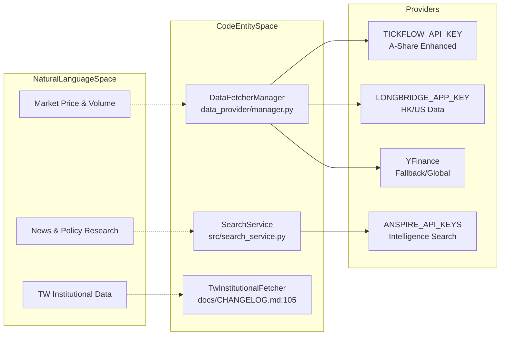

### Enhanced Data Sources
- **TickFlow**: Provides high-priority A-share daily K-lines and real-time quotes [docs/CHANGELOG.md:11, 116]().
- **Longbridge**: Preferred source for HK/US volume ratios and turnover [docs/full-guide.md:78-82]().
- **Anspire**: Unified key for LLM and Chinese-optimized web search [docs/full-guide.md:60]().

**Sources:** [docs/full-guide.md:56-107]() | [docs/CHANGELOG.md:11, 105, 116]() | [.env.example:22-110]()

---

## System & Scheduling Configuration

| Variable | Type | Default | Description |
| :--- | :--- | :--- | :--- |
| `STOCK_LIST` | `str` | `None` | Comma-separated stock codes (e.g., `600519,AAPL,00700`) [src/core/config_registry.py:88-105](). |
| `SCHEDULE_TIMES` | `str` | `None` | Multiple execution times (e.g., `09:30,15:00,18:00`) [docs/CHANGELOG.md:110](). |
| `WEBUI_HOST` | `str` | `127.0.0.1` | WebUI binding address [docs/CHANGELOG.md:12, 60](). |
| `NEWS_INTEL_AUTO_FETCH_ENABLED` | `bool` | `false` | Automatically refresh local RSS/News news pool [docs/CHANGELOG.md:19](). |

**Sources:** [src/config.py:73, 138-160]() | [docs/CHANGELOG.md:12, 19, 110]() | [src/core/config_registry.py:88-117]()

---

# Page: System Architecture

# System Architecture

<details>
<summary>Relevant source files</summary>

The following files were used as context for generating this wiki page:

- [.env.example](.env.example)
- [README.md](README.md)
- [api/app.py](api/app.py)
- [api/v1/endpoints/__init__.py](api/v1/endpoints/__init__.py)
- [api/v1/endpoints/alerts.py](api/v1/endpoints/alerts.py)
- [api/v1/router.py](api/v1/router.py)
- [docs/CHANGELOG.md](docs/CHANGELOG.md)
- [docs/README_CHT.md](docs/README_CHT.md)
- [docs/README_EN.md](docs/README_EN.md)
- [docs/full-guide.md](docs/full-guide.md)
- [docs/full-guide_EN.md](docs/full-guide_EN.md)
- [src/config.py](src/config.py)
- [src/core/pipeline.py](src/core/pipeline.py)
- [tests/test_static_assets_consistency.py](tests/test_static_assets_consistency.py)

</details>


This document describes the high-level architecture of the A-share/HK/US intelligent stock analysis system, explaining the major components, their interactions, and the design patterns used throughout the codebase. It focuses on the system's structural organization and data flow patterns.

For details on specific components, see:
- [Core Architecture Patterns](#3.1) — Key architectural patterns including orchestration, strategy-based fetching, and resilience.
- [Data Flow Pipeline](#3.2) — Complete flow of data from acquisition to notification.
- [AI Analysis Philosophy](#3.3) — Embedded trading philosophy rules and the multi-agent strategy system.
- [External Service Integrations](#3.4) — Overview of AI APIs, data sources, and notification channels.

---

## Architectural Overview

The system implements a **layered architecture** with clear separation of concerns, organized into primary layers: Entry Points, Core Orchestration, Data Acquisition, Intelligence, AI Analysis, Storage, and Notification Distribution.

### System Layers Diagram

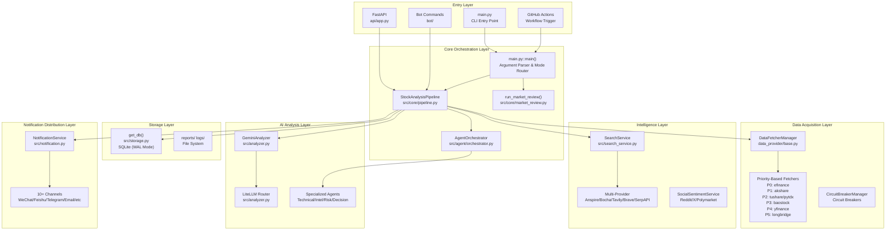

**Sources:** [main.py:1-42](), [src/core/pipeline.py:165-210](), [docs/full-guide.md:7-24](), [src/config.py:128-145]()

---

## Entry Points and Execution Modes

The system provides multiple entry mechanisms, all converging on the core processing engine:

### Entry Points Table

| Entry Point | File | Primary Class/Function | Execution Context |
|-------------|------|------------------------|-------------------|
| Command Line | `main.py` | `main()` | Direct Python execution |
| GitHub Actions | `.github/workflows/` | Triggers `main.py` | Serverless CI/CD |
| FastAPI Server | `api/app.py` | `create_app()` | HTTP REST API / Web UI |
| Bot Platforms | `bot/` | Bot interaction modules | Interactive messaging |

### Execution Mode Routing

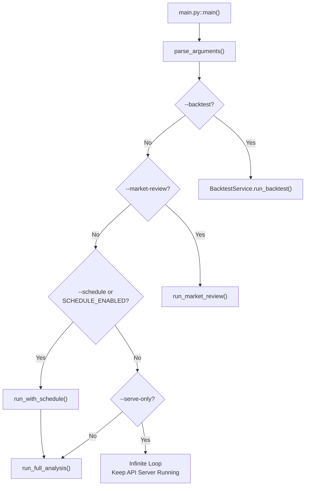

**Key Implementation Details:**

The `main()` function acts as a **mode router**, dispatching to different execution paths based on command-line arguments and environment variables. The system now supports a sophisticated local CLI backend option (`codex_cli`, `claude_code_cli`) as an alternative to the default `litellm` generation backend [src/config.py:128-145]().

- **Backtest Mode**: Validates historical AI analysis accuracy using `--backtest` flags.
- **Market-Only Mode**: Executes only market review analysis via `--market-review`.
- **Schedule Mode**: Runs daily at configured time using an internal scheduler.
- **Serve-Only Mode**: Starts FastAPI server without auto-execution using `--serve-only`.
- **Normal Mode**: Single-run execution with full analysis.

**Sources:** [main.py:57-213](), [src/config.py:134-143]()

---

## Core Orchestration Layer

The orchestration layer coordinates the entire analysis workflow. For details, see [Core Architecture Patterns](#3.1).

### StockAnalysisPipeline

The `StockAnalysisPipeline` class ([src/core/pipeline.py:165-210]()) is the primary orchestrator. It manages the lifecycle from data fetching to notification distribution, including handling new features like `daily_market_context` [src/core/pipeline.py:188-190]().

**Initialization and Dependencies:**

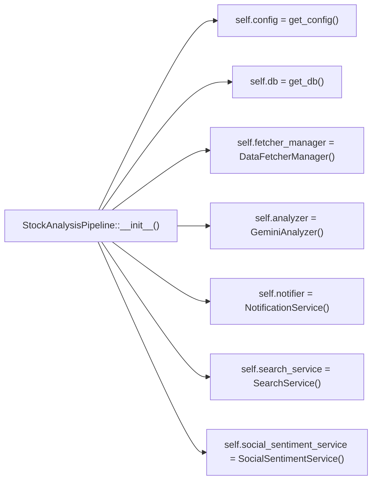

**Sources:** [src/core/pipeline.py:175-210]()

---

## Data Acquisition Architecture

The data layer implements a **priority-based failover strategy** with multi-source support. For details, see [External Service Integrations](#3.4).

### DataFetcherManager Priority Chain

The `DataFetcherManager` orchestrates multiple fetchers. It now includes enhanced support for Taiwan stocks (TWSE/TPEx) and refined handling for `TickFlow` as a high-priority A-share source [docs/CHANGELOG.md:95-105]().

| Priority | Fetcher | Markets | Source |
|----------|---------|---------|--------|
| 0 | `EfinanceFetcher` | A/HK/US | East Money |
| 1 | `AkshareFetcher` | A/HK/US | Multiple (EM/Sina) |
| 2 | `TushareFetcher` | A-Share | Tushare Pro (Token req.) |
| 2 | `PytdxFetcher` | A-Share | Tongdaxin Servers |
| 3 | `BaostockFetcher` | A-Share | Baostock |
| 4 | `YfinanceFetcher` | HK/US/TW | Yahoo Finance |
| 5 | `LongbridgeFetcher` | HK/US | Longbridge OpenAPI |

**Resilience Features:**
- **Circuit Breakers**: Tracks source health and skips failing providers.
- **Atomic Upsert**: SQLite uses `WAL` mode and atomic upserts to handle concurrent writes during parallel analysis.
- **Fail-open Logic**: News intelligence and AlphaSift fetching now support fail-open initialization to prevent pipeline blocks [docs/CHANGELOG.md:19-23]().

**Sources:** [data_provider/base.py:1-50](), [.env.example:42-68](), [docs/CHANGELOG.md:52-56]()

---

## Intelligence and Search Layer

The `SearchService` class ([src/search_service.py]()) gathers multi-dimensional intelligence with provider rotation. For details, see [External Service Integrations](#3.4).

### Multi-Dimensional Search Architecture

The system searches across five dimensions:
1. **Latest News**: General updates.
2. **Risk Screening**: Negative news and regulatory issues.
3. **Earnings Outlook**: Financial reports and analyst expectations.
4. **Policy Impact**: Macro and industry policy changes.
5. **Technical Analysis**: External technical viewpoints.

**Providers**: Anspire (Chinese optimized), Bocha, Tavily, Brave (US optimized), and SerpAPI.

**Sources:** [src/core/pipeline.py:49-61](), [.env.example:113-134]()

---

## AI Analysis & Multi-Agent Engine

The AI layer supports both a standard single-analyzer flow and a sophisticated multi-agent orchestration. For details, see [AI Analysis Philosophy](#3.3).

### Multi-Agent Orchestration Modes

When `AGENT_ARCH=multi` is configured, the system uses `AgentOrchestrator` with specialized agents. Recent updates introduced independent timeout clamping for each sub-agent (Technical, Intel, Risk, Decision, etc.) to ensure balanced resource allocation [docs/CHANGELOG.md:28-29]().

### GeminiAnalyzer & Generation Backends

The system has moved towards a more abstract `GenerationBackend` model. While `litellm` remains the default, it now supports local CLI backends like `codex_cli` and `opencode_cli` for specific generation-only tasks [src/config.py:134-145]().

- **Model Cascading**: Primary → Fallback.
- **JSON Repair**: Automatic fixing of malformed LLM outputs.
- **Integrity Checks**: Validates mandatory fields in the analysis result.

**Sources:** [src/analyzer.py:31-38](), [src/config.py:40-59](), [docs/CHANGELOG.md:41-46]()

---

## Notification Distribution System

The `NotificationService` distributes reports across 10+ channels. For details, see [External Service Integrations](#3.4).

### Notification Modes

- **Single-Stock**: Pushes immediately after each individual stock analysis.
- **Batch/Dashboard**: Collects all results and sends a comprehensive "Decision Dashboard".
- **Merged**: Combines stock analysis and market review into a single message.
- **New Features**: Feishu now supports sending reports as files via `FEISHU_SEND_AS_FILE` [docs/CHANGELOG.md:27]().

**Sources:** [src/notification.py:1-40](), [docs/full-guide.md:70-110]()

---

## Configuration Management

The `Config` class ([src/config.py]()) is a singleton managing environment variables and UI settings.

### Configuration Hierarchy

1. **Environment Variables**: `.env` file or OS environment.
2. **Web UI Settings**: Stored in the database; hot-reload mechanisms allow runtime updates without restart [docs/CHANGELOG.md:97-98]().
3. **Registry Metadata**: Defines categories, descriptions, and validation rules for the Web UI.

**Sources:** [src/config.py:7-11](), [src/services/system_config_service.py:1-20]()

---

## Data Flow Summary

The complete data flow for a single stock analysis:

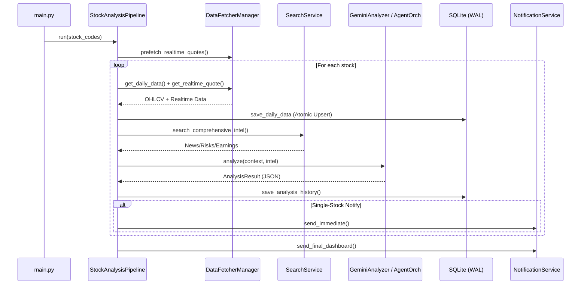

**Sources:** [src/core/pipeline.py:175-323](), [main.py:57-213]()

---

# Page: Core Architecture Patterns

# Core Architecture Patterns

<details>
<summary>Relevant source files</summary>

The following files were used as context for generating this wiki page:

- [.env.example](.env.example)
- [api/v1/endpoints/analysis.py](api/v1/endpoints/analysis.py)
- [api/v1/endpoints/history.py](api/v1/endpoints/history.py)
- [api/v1/schemas/history.py](api/v1/schemas/history.py)
- [apps/dsa-web/src/types/analysis.ts](apps/dsa-web/src/types/analysis.ts)
- [data_provider/akshare_fetcher.py](data_provider/akshare_fetcher.py)
- [data_provider/baostock_fetcher.py](data_provider/baostock_fetcher.py)
- [data_provider/base.py](data_provider/base.py)
- [data_provider/efinance_fetcher.py](data_provider/efinance_fetcher.py)
- [data_provider/pytdx_fetcher.py](data_provider/pytdx_fetcher.py)
- [data_provider/tushare_fetcher.py](data_provider/tushare_fetcher.py)
- [data_provider/yfinance_fetcher.py](data_provider/yfinance_fetcher.py)
- [docs/CHANGELOG.md](docs/CHANGELOG.md)
- [docs/full-guide.md](docs/full-guide.md)
- [docs/full-guide_EN.md](docs/full-guide_EN.md)
- [docs/run-diagnostics-p0.md](docs/run-diagnostics-p0.md)
- [src/config.py](src/config.py)
- [src/core/pipeline.py](src/core/pipeline.py)
- [src/services/history_service.py](src/services/history_service.py)
- [src/storage.py](src/storage.py)
- [tests/test_a_share_fetcher_code_conversion.py](tests/test_a_share_fetcher_code_conversion.py)
- [tests/test_analysis_api_contract.py](tests/test_analysis_api_contract.py)
- [tests/test_analysis_history.py](tests/test_analysis_history.py)
- [tests/test_data_fetcher_prefetch_stock_names.py](tests/test_data_fetcher_prefetch_stock_names.py)
- [tests/test_stock_code_bse.py](tests/test_stock_code_bse.py)
- [tests/test_storage.py](tests/test_storage.py)

</details>


## Purpose and Scope

This document describes the core architectural patterns that structure the A-share/HK/US intelligent stock analysis system. These patterns define how major components interact, how the system achieves reliability through fault tolerance, and how it maintains flexibility through abstraction.

For information about how data flows through the system end-to-end, see [Data Flow Pipeline](3.2). For details on the AI analysis philosophy embedded in these patterns, see [AI Analysis Philosophy](3.3).

---

## Pattern Overview

The system implements five key architectural patterns:

| Pattern | Primary Location | Purpose |
|---------|-----------------|---------|
| **Strategy Pattern** | [data_provider/base.py:7-15]() | Multi-source data fetching with pluggable providers |
| **Circuit Breaker Pattern** | [data_provider/akshare_fetcher.py:19-20]() | Fault isolation for unreliable external APIs |
| **Pipeline/Orchestration Pattern** | [src/core/pipeline.py:4-12]() | Coordinated multi-step stock analysis workflow |
| **Priority-Based Failover** | [data_provider/base.py:13-15]() | Automatic data source switching on failure |
| **Singleton Configuration** | [src/config.py:7-11]() | Centralized configuration management |

These patterns work together to create a resilient, maintainable system that gracefully handles external service failures while maintaining consistent analysis quality.

---

## 1. Strategy Pattern: Pluggable Data Providers

### Architecture

The Strategy Pattern enables the system to abstract away data source differences behind a unified interface. The `BaseFetcher` abstract class defines the contract, while concrete implementations (`EfinanceFetcher`, `AkshareFetcher`, `TushareFetcher`, etc.) provide market-specific logic.

#### Class Hierarchy Diagram

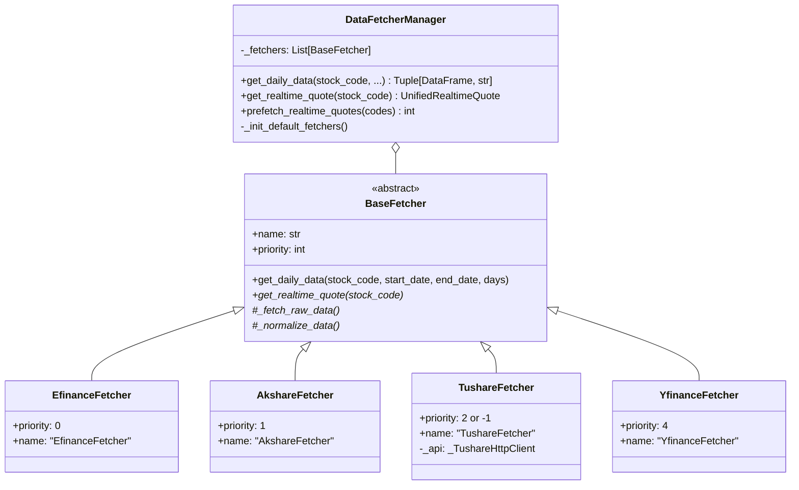
**Sources:** [data_provider/base.py:7-15](), [data_provider/base.py:21-34](), [data_provider/akshare_fetcher.py:47-51]()

### Key Implementation Details

#### Unified Interface (BaseFetcher)

The abstract base class defines the contract all data providers must implement:

```python
# data_provider/base.py:21-34
class BaseFetcher(ABC):
    """
    数据源基类
    """
    @abstractmethod
    def get_daily_data(self, stock_code: str, days: int = 30) -> pd.DataFrame:
        pass

    @abstractmethod
    def get_realtime_quote(self, stock_code: str) -> Optional[UnifiedRealtimeQuote]:
        pass
```
The template method `get_daily_data()` orchestrates the fetch-normalize-clean-calculate workflow, while subclasses implement the source-specific data acquisition.

**Sources:** [data_provider/base.py:21-34]()

#### Dynamic Priority Assignment

The system demonstrates dynamic priority adjustment based on configuration, particularly for premium sources like Tushare or Longbridge. When a `TUSHARE_TOKEN` is configured, the fetcher's priority is elevated to allow it to override free sources.

**Sources:** [.env.example:23-24](), [.env.example:42-46]()

---

## 2. Circuit Breaker Pattern: Resilient External API Calls

### Architecture

The Circuit Breaker Pattern protects the system from cascading failures when external APIs (real-time quotes, chip distribution) become unreliable. It tracks failure rates and temporarily disables ("trips") misbehaving sources.

#### Circuit Breaker State Machine

```mermaid
stateDiagram-v2
    [*] --> "Closed": "is_available=True"
    "Closed" --> "Open": "failure_count >= threshold"
    "Open" --> "HalfOpen": "cooldown_period elapsed"
    "HalfOpen" --> "Closed": "success"
    "HalfOpen" --> "Open": "failure"
    
    note right of "Closed"
        "Normal operation"
        "Requests pass through"
    end note
    
    note right of "Open"
        "Circuit tripped"
        "Requests blocked"
        "Source skipped"
    end note
```
**Sources:** [data_provider/akshare_fetcher.py:19-20](), [data_provider/base.py:33-34]()

### Implementation: CircuitBreaker Integration

#### Failure Recording and State Management

The `CircuitBreaker` instances are managed via `get_realtime_circuit_breaker` and `get_chip_circuit_breaker`. These monitors ensure that if a source like EastMoney or Sina starts returning 403 or 500 errors, the system stops hammering them.

```python
# data_provider/akshare_fetcher.py:47-51
from .realtime_types import (
    UnifiedRealtimeQuote, ChipDistribution, RealtimeSource,
    get_realtime_circuit_breaker, get_chip_circuit_breaker,
    safe_float, safe_int
)
```
After reaching a failure threshold, the circuit trips and blocks subsequent requests for a cooldown period (typically 20 minutes, defined by the 1200s TTL in `AkshareFetcher`).

**Sources:** [data_provider/akshare_fetcher.py:47-51](), [data_provider/akshare_fetcher.py:80-88]()

---

## 3. Pipeline/Orchestration Pattern: Multi-Step Stock Analysis

### Architecture

The `StockAnalysisPipeline` class orchestrates a complex multi-stage workflow. It coordinates components including the `DataFetcherManager`, `StockTrendAnalyzer`, `SearchService`, and `GeminiAnalyzer` through a structured sequence.

#### Pipeline Flow Diagram

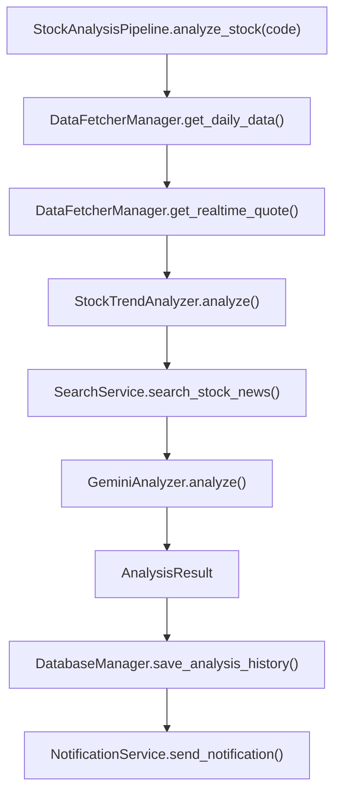
**Sources:** [src/core/pipeline.py:4-12](), [src/core/pipeline.py:165-173]()

### Key Components

#### 1. Pipeline Initialization

The constructor assembles all required services, ensuring a consistent environment for the analysis run:

```python
# src/core/pipeline.py:198-207
def __init__(
    self,
    config: Optional[Config] = None,
    max_workers: Optional[int] = None,
    ...
):
    self.config = config or get_config()
    self.fetcher_manager = DataFetcherManager()
    self.analyzer = GeminiAnalyzer(config=self.config)
```
**Sources:** [src/core/pipeline.py:198-207]()

#### 2. Concurrency Control

The pipeline uses `ThreadPoolExecutor` to handle multiple stocks simultaneously while maintaining safety via locks for notification and shared services.

**Sources:** [src/core/pipeline.py:15-19](), [src/core/pipeline.py:94-98]()

---

## 4. Priority-Based Failover: Graceful Degradation

### Architecture

The system implements a tiered failover strategy where data sources are attempted in priority order. If Priority 0 (`EfinanceFetcher`) fails or is unconfigured, the system automatically falls back to Priority 1 (`AkshareFetcher`).

#### Failover Sequence Diagram

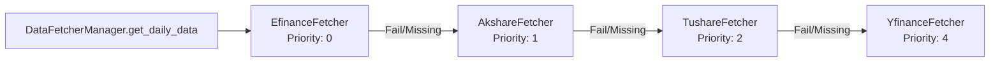
**Sources:** [data_provider/base.py:7-15](), [.env.example:42-46]()

### Implementation Details

#### Code Normalization Fail-Open
The `normalize_stock_code` function ensures that input strings like `SH600519`, `600519.SH`, or `AAPL` are converted to the format expected by specific fetchers, preventing failure due to string mismatch.

**Sources:** [data_provider/base.py:70-97]()

---

## 5. Singleton Configuration: Centralized Settings

### Architecture

The `Config` class (accessed via `get_config()`) manages global settings, environment variables, and multi-source configuration. It uses a singleton pattern to ensure all components see the same runtime parameters.

```python
# src/config.py:7-11
"""
职责：
1. 使用单例模式管理全局配置
2. 从 .env 文件加载敏感配置
3. 提供类型安全的配置访问接口
"""
```
**Sources:** [src/config.py:7-11](), [src/config.py:82-95]()

### Summary: Pattern Benefits

| Pattern | Benefit | Implementation Reference |
|---------|---------|-------------------------|
| **Strategy** | Pluggable data sources | `BaseFetcher` [data_provider/base.py:21-34]() |
| **Circuit Breaker** | Fault isolation | `CircuitBreaker` [data_provider/akshare_fetcher.py:47-51]() |
| **Pipeline** | Structured workflow | `StockAnalysisPipeline` [src/core/pipeline.py:165-173]() |
| **Failover** | High availability | `DataFetcherManager` [data_provider/base.py:7-15]() |
| **Singleton** | Consistency | `Config` [src/config.py:7-11]() |

**Sources:** [data_provider/base.py:7-15](), [src/core/pipeline.py:4-12](), [src/config.py:7-11]()

---

# Page: Data Flow Pipeline

# Data Flow Pipeline

<details>
<summary>Relevant source files</summary>

The following files were used as context for generating this wiki page:

- [.env.example](.env.example)
- [api/v1/schemas/analysis.py](api/v1/schemas/analysis.py)
- [apps/dsa-web/src/api/analysis.ts](apps/dsa-web/src/api/analysis.ts)
- [docs/CHANGELOG.md](docs/CHANGELOG.md)
- [docs/full-guide.md](docs/full-guide.md)
- [docs/full-guide_EN.md](docs/full-guide_EN.md)
- [main.py](main.py)
- [src/config.py](src/config.py)
- [src/core/pipeline.py](src/core/pipeline.py)
- [src/services/analysis_service.py](src/services/analysis_service.py)
- [src/services/task_queue.py](src/services/task_queue.py)
- [tests/test_main_schedule_mode.py](tests/test_main_schedule_mode.py)

</details>


## Purpose and Scope

This document traces the complete data flow through the stock analysis system, from initial stock code input through data acquisition, enrichment, AI analysis, and final notification delivery. It maps high-level processing stages to specific code modules and classes.

For architectural patterns that enable this pipeline (Strategy, Circuit Breaker, etc.), see **3.1 Core Architecture Patterns**. For AI analysis philosophy and trading rules, see **3.3 AI Analysis Philosophy**. For external service integrations, see **3.4 External Service Integrations**.

---

## Pipeline Overview

The analysis pipeline consists of sequential phases, orchestrated by `StockAnalysisPipeline` and executed concurrently via `ThreadPoolExecutor` [src/core/pipeline.py:19-22](). It supports both synchronous (CLI/Scheduled) and asynchronous (Web API) execution modes.

### System-to-Code Mapping
The following diagram bridges the high-level functional stages to the primary classes and methods responsible for their execution.

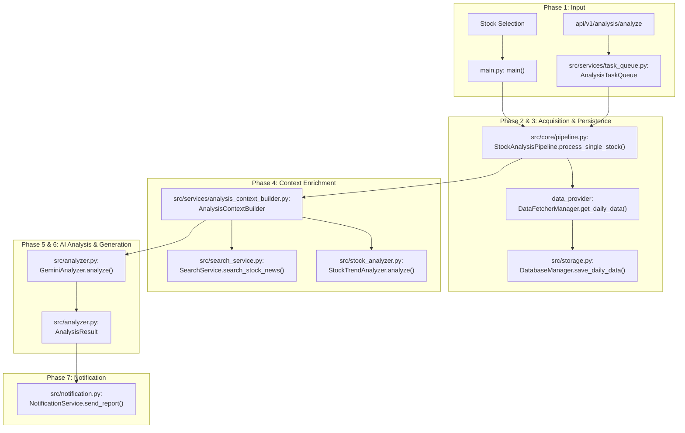

**Sources:** [src/core/pipeline.py:165-173](), [main.py:4-11](), [src/services/task_queue.py:151-162](), [src/analyzer.py:31-38](), [src/services/analysis_context_builder.py:62-65]()

---

## Phase 1: Input & Stock Selection

Stock codes enter the pipeline through distinct entry points, converging on `StockAnalysisPipeline`.

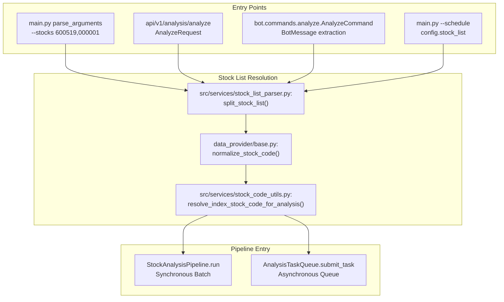

**Key Code Entities:**
- `STOCK_LIST`: Environment variable for default watchlist [main.py:9]().
- `split_stock_list()`: Parses input strings into lists, supporting multiple delimiters (comma, newline, etc.) [docs/CHANGELOG.md:18]().
- `normalize_stock_code()`: Strips prefixes and suffixes [data_provider/base.py:29]().
- `AnalysisTaskQueue`: Manages lifecycle of async tasks and prevents duplicates via `_dedupe_stock_code_key` [src/services/task_queue.py:42-50]().

**Sources:** [main.py:71-72](), [src/services/task_queue.py:42-50](), [data_provider/base.py:29](), [api/v1/schemas/analysis.py:33-45]()

---

## Phase 2: Data Acquisition with Priority-Based Failover

Historical data is acquired through `DataFetcherManager`, implementing a priority-based strategy pattern.

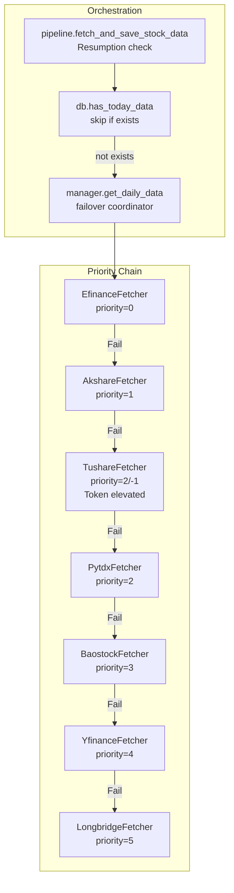

**Fetcher Priority Resolution:**
- **Tushare Elevation:** If `TUSHARE_TOKEN` is configured, `TushareFetcher` priority is elevated to 0 [docs/full-guide.md:22]().
- **Longbridge Integration:** Preferred source for HK/US stocks (PE, Turnover, Volume Ratio) [docs/full-guide.md:78-79]().
- **TickFlow Enhancement:** Optional source for A-share daily K-lines and real-time quotes [docs/CHANGELOG.md:116-117]().

**Sources:** [src/core/pipeline.py:28](), [docs/full-guide.md:22](), [docs/CHANGELOG.md:116-117]()

---

## Phase 3: Data Persistence

Acquired data is standardized and persisted to SQLite.

```mermaid
graph TB
    subgraph "Standardization"
        RawDF["Raw DataFrame"]
        StdCols["STANDARD_COLUMNS<br/>date, open, high, low, close<br/>volume, amount, pct_chg"]
    end
    
    subgraph "Storage Layer"
        DBSave["db.save_daily_data<br/>upsert logic"]
        CheckToday["db.has_today_data<br/>Resume logic"]
    end
    
    RawDF --> StdCols
    StdCols --> DBSave
    DBSave --> CheckToday
```

**Persistence Logic:**
- **Resume Capability:** `StockAnalysisPipeline` checks if the database already has the latest trading day's data before initiating network requests [src/core/pipeline.py:83-84]().
- **Context Snapshots:** The system can persist the entire analysis context via `SAVE_CONTEXT_SNAPSHOT` (default `true`) for historical debugging [docs/full-guide.md:128]().

**Sources:** [src/core/pipeline.py:83-84](), [docs/full-guide.md:128]()

---

## Phase 4: Context Enrichment

The pipeline enriches historical data with real-time indicators and news intelligence via `AnalysisContextBuilder` [src/services/analysis_context_builder.py:62-63]().

### Enrichment Data Flow
This diagram shows how different data streams are merged into the final `AnalysisContext`.

```mermaid
graph TD
    subgraph "Data Sources"
        DFM["DataFetcherManager"]
        SS["SearchService"]
        SSS["SocialSentimentService"]
        IS["IntelligenceService"]
    end

    subgraph "Code Entities"
        Builder["src/services/analysis_context_builder.py:<br/>AnalysisContextBuilder.build()"]
        GRQ["get_realtime_quote()"]
        GCD["get_chip_distribution()"]
        STA["StockTrendAnalyzer"]
    end

    DFM --> GRQ
    DFM --> GCD
    SS --> Builder
    SSS --> Builder
    IS --> Builder
    
    GRQ --> Builder
    GCD --> Builder
    STA --> Builder
    
    Builder --> Context["AnalysisContext Object"]
```

**Enrichment Components:**
- **Real-time Quotes:** Unified structure including price, change, and volume [src/core/pipeline.py:30]().
- **Chip Distribution:** Profit ratio and concentration analysis [src/core/pipeline.py:30]().
- **Intelligence Search:** Aggregates news, risks, and policy via `SearchService` [src/core/pipeline.py:49]().
- **Market Phase Summary:** Contextualizes analysis based on whether it is pre-market, intraday, or post-market [src/core/pipeline.py:52]().

**Sources:** [src/core/pipeline.py:30-52](), [src/services/analysis_context_builder.py:62-65]()

---

## Phase 5: AI Analysis & Decision Generation

The `GeminiAnalyzer` (orchestrated via LiteLLM) processes the context into a structured decision [src/analyzer.py:32-33]().

```mermaid
graph TB
    subgraph "AI Processing"
        Prompt["Prompt Construction<br/>Trading Rules + Market Context"]
        LLM["LiteLLM Router<br/>Gemini/DeepSeek/Claude"]
    end
    
    subgraph "Validation & Guardrails"
        Repair["json_repair<br/>Fix malformed output"]
        Integrity["check_content_integrity<br/>Mandatory field check"]
        Guard["apply_phase_decision_guardrails<br/>Safety checks"]
    end
    
    subgraph "Result"
        AR["AnalysisResult"]
        Signal["src/services/decision_signal_extractor.py:<br/>DecisionSignal"]
    end
    
    Prompt --> LLM
    LLM --> Repair
    Repair --> Integrity
    Integrity --> Guard
    Guard --> AR
    AR --> Signal
```

**AI Workflow:**
- **Decision Guardrails:** Applies `apply_phase_decision_guardrails` to ensure AI suggestions adhere to strict entry and trend trading rules [src/core/pipeline.py:54]().
- **Signal Extraction:** Extracted signals are persisted via `extract_and_persist_from_analysis_result` for historical tracking [src/core/pipeline.py:77]().
- **Multi-Agent Mode:** Can optionally trigger the `Multi-Agent Orchestrator` for deep research [docs/CHANGELOG.md:28]().

**Sources:** [src/core/pipeline.py:54-77](), [src/analyzer.py:32-33](), [docs/CHANGELOG.md:28]()

---

## Phase 6: Notification Distribution

The `NotificationService` handles report generation and delivery across multiple channels [src/notification.py:39]().

```mermaid
graph TB
    subgraph "Report Types"
        Simple["Simple (Concise)"]
        Full["Full (Detailed)"]
        Brief["Brief (3-5 sentences)"]
    end
    
    subgraph "Channels"
        WeChat["WechatSender"]
        Feishu["FeishuSender"]
        TG["TelegramSender"]
        Ding["DingTalkSender"]
        Discord["DiscordSender"]
        Email["EmailSender"]
    end
    
    Simple --> WeChat
    Full --> TG
    Full --> Email
    Brief --> Ding
```

**Notification Features:**
- **Concurrency Control:** Uses `_single_stock_notify_lock` to prevent race conditions during parallel analysis [src/core/pipeline.py:96]().
- **Report Language:** Supports `zh`, `en`, and `ko` [docs/full-guide.md:119]().
- **Batching:** Supports merging multiple stock reports into a single email via `MERGE_EMAIL_NOTIFICATION` [docs/full-guide.md:129]().

**Sources:** [src/core/pipeline.py:39-103](), [docs/full-guide.md:119-129]()

---

## Performance & Resilience Summary

| Feature | Implementation | File Reference |
| :--- | :--- | :--- |
| **Concurrency** | `ThreadPoolExecutor` with `max_workers` from config | [src/core/pipeline.py:199]() |
| **Failover** | Priority-based fetcher chain with automatic fallback | [data_provider/__init__.py:12-29]() |
| **Circuit Breakers** | Source health management and connection cooldowns | [docs/full-guide.md:91-92]() |
| **Integrity** | `REPORT_INTEGRITY_ENABLED` with retry logic | [docs/full-guide.md:124-125]() |
| **Diagnosis** | `activate_run_diagnostic_context` for trace tracking | [src/core/pipeline.py:66-67]() |

**Sources:** [src/core/pipeline.py:19-199](), [data_provider/__init__.py:12-29](), [docs/full-guide.md:91-125]()

---

# Page: AI Analysis Philosophy

# AI Analysis Philosophy

<details>
<summary>Relevant source files</summary>

The following files were used as context for generating this wiki page:

- [.env.example](.env.example)
- [bot/commands/ask.py](bot/commands/ask.py)
- [docs/CHANGELOG.md](docs/CHANGELOG.md)
- [docs/full-guide.md](docs/full-guide.md)
- [docs/full-guide_EN.md](docs/full-guide_EN.md)
- [src/agent/executor.py](src/agent/executor.py)
- [src/agent/orchestrator.py](src/agent/orchestrator.py)
- [src/agent/skills/aggregator.py](src/agent/skills/aggregator.py)
- [src/agent/skills/router.py](src/agent/skills/router.py)
- [src/analyzer.py](src/analyzer.py)
- [src/config.py](src/config.py)
- [src/core/pipeline.py](src/core/pipeline.py)
- [tests/test_agent_executor.py](tests/test_agent_executor.py)
- [tests/test_ask_command.py](tests/test_ask_command.py)
- [tests/test_multi_agent.py](tests/test_multi_agent.py)
- [tests/test_skill_load_warning.py](tests/test_skill_load_warning.py)

</details>


This document explains the embedded trading philosophy rules that guide AI analysis in the system. These rules are encoded in the system prompt and enforced through both AI reasoning and programmatic validation.

**Purpose**: Define the strict trading principles (严进策略, 趋势交易, 效率优先, etc.) that constrain AI decision-making to prevent common investment mistakes like chasing highs or trading against trends.

**Scope**: This page covers the philosophical framework, rule encoding, and the transition from natural language strategies (Skills) to code-level constraints.

---

## Overview: Philosophy as System Constraint

The system embeds a **conservative trend-trading philosophy** directly into the AI's decision-making process via a structured system prompt. Unlike typical LLM applications that rely purely on model reasoning, this system uses **dual enforcement**:

1.  **AI-level**: Philosophy encoded in `LEGACY_DEFAULT_AGENT_SYSTEM_PROMPT` or dynamic `skill_instructions` guides LLM reasoning [src/agent/executor.py:62-215]().
2.  **Code-level**: Programmatic validation checks and pre-computed indicators enforce hard limits, such as score-band normalization [src/analyzer.py:96-99]() and decision signal extraction [src/core/pipeline.py:77-78]().

### Philosophy to Code Mapping
The following diagram illustrates how abstract trading principles are transformed into system prompts and code-level constraints.

**Natural Language Space to Code Entity Space**
```mermaid
graph TB
    subgraph "Natural Language Space (Strategies)"
        S1["'No Chasing Highs'<br/>(严进策略)"]
        S2["'Trend is Friend'<br/>(趋势交易)"]
        S3["'Risk First'<br/>(风险优先)"]
    end
    
    subgraph "Code Entity Space (System Logic)"
        Config["Config.AGENT_MAX_STEPS<br/>(src/config.py)"]
        Executor["AgentExecutor<br/>(src/agent/executor.py)"]
        Orchestrator["AgentOrchestrator<br/>(src/agent/orchestrator.py)"]
        Analyzer["GeminiAnalyzer<br/>(src/analyzer.py)"]
    end
    
    subgraph "Execution Layer"
        Prompt["LEGACY_DEFAULT_AGENT_SYSTEM_PROMPT<br/>(src/agent/executor.py:62)"]
        Runner["run_agent_loop<br/>(src/agent/runner.py)"]
        Pipeline["StockAnalysisPipeline<br/>(src/core/pipeline.py)"]
    end
    
    S1 --> Prompt
    S2 --> Prompt
    S3 --> Prompt
    
    Config --> Executor
    Executor --> Prompt
    Orchestrator --> Executor
    Analyzer --> Pipeline
    
    Prompt --> Runner
    Runner --> Pipeline
```
**Sources**: [src/agent/executor.py:62-215](), [src/analyzer.py:96-99](), [src/core/pipeline.py:165-173](), [src/agent/orchestrator.py:76-83]()

---

## Core Trading Principles

The system implements core principles, each with specific quantitative thresholds and enforcement mechanisms defined in the system prompts.

### 1. 严进策略 (Strict Entry) - No Chasing Highs
**Philosophy**: Prohibit buying when the price has deviated too far from moving averages.
*   **Logic**: The system prompt defines "Low Bias" (低乖离率 < 2%) as the optimal buy point [src/agent/executor.py:177]().
*   **Scoring Logic**: A score of 40-59 (Wait/Watch) is assigned if the bias is > 5%, indicating high chasing risk [src/agent/executor.py:189]().

### 2. 趋势交易 (Trend Trading) - MA Alignment
**Philosophy**: Only trade stocks in bullish MA alignment.
*   **Required Pattern**: `MA5 > MA10 > MA20` (多头排列) [src/agent/executor.py:176]().
*   **Logic**: The system prompt explicitly defines "Strong Buy" as having this specific alignment [src/agent/executor.py:176]().

### 3. 效率优先 (Efficiency First) - Chip Structure
**Philosophy**: Prefer stocks with concentrated chip distributions.
*   **Logic**: AI evaluates `chip_structure` based on profit ratios and average cost [src/agent/executor.py:121]().
*   **Rule**: Healthy chip structure (筹码集中健康) is a prerequisite for a "Strong Buy" rating [src/agent/executor.py:179]().

### 4. 买点偏好 (Pullback Preference)
**Philosophy**: Optimal entries occur at pullbacks to support levels.
*   **Best Buy**: Shrinking volume pullback (缩量回调) [src/agent/executor.py:178]().
*   **Secondary Buy**: Breakout with volume (放量突破) [src/agent/executor.py:178]().

### 5. 风险优先 (Risk Priority)
**Philosophy**: Always screen for risks (insider selling, earnings warnings, regulatory issues) before recommending an action [src/agent/executor.py:90]().

**Sources**: [src/agent/executor.py:175-198](), [src/agent/executor.py:84-91](), [.env.example:175-180]()

---

## Skill-Based Strategy System

The system uses a **Skill/Strategy System** to allow users to switch between different trading methodologies via the `/ask` command or the Web UI.

### Skill Interaction Flow
```mermaid
graph LR
    subgraph "Skill Management"
        SkillMgr["SkillManager<br/>(src/agent/factory.py)"]
        Defaults["CORE_TRADING_SKILL_POLICY_ZH<br/>(src/agent/skills/defaults.py)"]
    end
    
    subgraph "Command Interface"
        Ask["AskCommand<br/>(bot/commands/ask.py)"]
    end
    
    subgraph "Execution"
        Orchestrator["AgentOrchestrator<br/>(src/agent/orchestrator.py)"]
        Executor["AgentExecutor<br/>(src/agent/executor.py)"]
    end
    
    SkillMgr --> Ask
    Defaults --> Executor
    Ask --> Orchestrator
    Orchestrator --> Executor
```

**Implementation Details**:
*   **Skill Loading**: `AskCommand` loads available skills via the `SkillManager` [bot/commands/ask.py:125-133]().
*   **Skill Alias Mapping**: Skills can be invoked via display names or aliases (e.g., "缠论" for `chan_theory`) [bot/commands/ask.py:146-160]().
*   **Instruction Injection**: Skill-specific instructions are passed to the `AgentOrchestrator` and eventually injected into the agent's system prompt [src/agent/orchestrator.py:88-91]().

**Sources**: [bot/commands/ask.py:125-160](), [src/agent/orchestrator.py:84-94](), [src/agent/executor.py:82]()

---

## Decision Dashboard Framework

The system forces the AI to output analysis in a structured **Decision Dashboard** (JSON format), ensuring every philosophical rule is addressed.

### Dashboard Architecture (JSON Schema)
The `AgentExecutor` expects a specific JSON structure from the LLM [src/agent/executor.py:99-170]().

| Module | Key Fields | Philosophy Link |
| :--- | :--- | :--- |
| **Core Conclusion** | `signal_type`, `one_sentence` | Principle 1 & 2 (Verdict) |
| **Data Perspective** | `trend_status`, `price_position`, `chip_structure` | Principle 1, 2, 3 |
| **Intelligence** | `latest_news`, `risk_alerts` | Principle 5 (Risk) |
| **Battle Plan** | `sniper_points`, `position_strategy` | Principle 4 (Entry) |
| **Signal Attribution**| `technical_indicators`, `news_sentiment` | Weighting Logic |

### Scoring and Evaluation System
The system uses a **100-point scale** (Sentiment Score) with strict tier-based logic [src/agent/executor.py:175-198]().

| Score | Signal | Philosophy Requirement |
| :--- | :--- | :--- |
| **80-100** | 强烈买入 (Strong Buy) | MA alignment + Bias < 2% + Healthy Chips [src/agent/executor.py:175-180]() |
| **60-79** | 买入 (Buy) | Bullish trend + Bias < 5% [src/agent/executor.py:182-186]() |
| **40-59** | 观望 (Wait) | Bias > 5% (Chase high) OR Trend unclear [src/agent/executor.py:188-192]() |
| **0-39** | 卖出 (Sell) | Bearish alignment OR Major risk [src/agent/executor.py:193-198]() |

**Sources**: [src/agent/executor.py:99-170](), [src/agent/executor.py:175-198]()

---

## Rule Enforcement Mechanisms

### 1. Multi-Stage Workflow
The AI is forced to follow a 4-stage ReAct loop to ensure data integrity before making a decision [src/agent/executor.py:66-80]().
*   **Stage 1**: Quotes & K-Lines (Data Foundation)
*   **Stage 2**: Technicals & Chips (Analysis)
*   **Stage 3**: Intelligence Search (Context)
*   **Stage 4**: Report Generation (Synthesis)

### 2. Orchestrator Modes
The `AgentOrchestrator` manages different analysis depths via modes [src/agent/orchestrator.py:8-12]():
*   **quick**: Technical only → Decision.
*   **standard**: Technical → Intel → Decision (Default).
*   **full**: Technical → Intel → Risk → Decision.
*   **specialist**: Adds specialist evaluation for complex strategies.

### 3. Time-Aware Decision Guardrails
The system applies phase-specific guardrails (e.g., `closing_auction` vs `premarket`) to ensure the AI's advice is actionable given the current market status [src/agent/executor.py:135-143]().

**Sources**: [src/agent/executor.py:66-80](), [src/agent/orchestrator.py:8-12](), [src/agent/executor.py:135-143]()

---

# Page: External Service Integrations

# External Service Integrations

<details>
<summary>Relevant source files</summary>

The following files were used as context for generating this wiki page:

- [README.md](README.md)
- [apps/dsa-web/src/components/settings/LLMChannelEditor.tsx](apps/dsa-web/src/components/settings/LLMChannelEditor.tsx)
- [apps/dsa-web/src/components/settings/__tests__/LLMChannelEditor.test.tsx](apps/dsa-web/src/components/settings/__tests__/LLMChannelEditor.test.tsx)
- [docs/LLM_CONFIG_GUIDE.md](docs/LLM_CONFIG_GUIDE.md)
- [docs/LLM_CONFIG_GUIDE_EN.md](docs/LLM_CONFIG_GUIDE_EN.md)
- [docs/README_CHT.md](docs/README_CHT.md)
- [docs/README_EN.md](docs/README_EN.md)
- [docs/llm-providers.md](docs/llm-providers.md)
- [src/search_service.py](src/search_service.py)
- [src/services/system_config_service.py](src/services/system_config_service.py)
- [tests/test_search_news_freshness.py](tests/test_search_news_freshness.py)
- [tests/test_search_service_concurrency.py](tests/test_search_service_concurrency.py)
- [tests/test_search_tavily_provider.py](tests/test_search_tavily_provider.py)
- [tests/test_system_config_service.py](tests/test_system_config_service.py)

</details>


## Purpose and Scope

This document provides a technical overview of all external service integrations within the `daily_stock_analysis` system. It details how the codebase interfaces with AI model providers, financial data sources, search engines, and notification channels. The system is designed with a high degree of modularity, employing strategy and adapter patterns to ensure resilience through multi-provider fallbacks and circuit breakers.

---

## Integration Architecture Overview

The system orchestrates interactions across four functional domains. Configuration is centralized in a singleton `Config` class [src/config.py:20-38](), which manages environment variables and provides validated settings to specialized service modules.

Title: System Integration Map
```mermaid
graph TB
    subgraph "Configuration Layer [src/config.py]"
        EnvVars["Environment Variables<br/>.env / GitHub Secrets"]
        ConfigClass["Config Singleton<br/>class Config"]
        EnvVars --> ConfigClass
    end
    
    subgraph "AI Model Integration [src/services/system_config_service.py]"
        GenBackend["GenerationBackendStatusService"]
        LiteLLM["LiteLLM (Default)"]
        LocalCLI["Local CLI Backends<br/>(Codex/Claude/OpenCode)"]
        GenBackend --> LiteLLM
        GenBackend --> LocalCLI
    end
    
    subgraph "Data Source Integration [data_provider/]"
        DFM["DataFetcherManager"]
        LB["LongbridgeFetcher (HK/US P0)"]
        P0["EFinanceFetcher (A-Share P0)"]
        P1["AkShareFetcher (P1)"]
        CB["CircuitBreakerManager"]
        
        DFM --> CB
        CB --> LB
        CB --> P0
        CB --> P1
    end
    
    subgraph "Search Service Integration [src/search_service.py]"
        SearchSvc["SearchService"]
        Anspire["AnspireProvider"]
        Bocha["BochaProvider"]
        Tavily["TavilySearchProvider"]
        
        SearchSvc --> Anspire
        SearchSvc --> Bocha
        SearchSvc --> Tavily
    end
    
    subgraph "Notification Integration [src/notification.py]"
        NotifSvc["NotificationService"]
        Handlers["Channel Handlers<br/>(WeChat, Telegram, Feishu, etc.)"]
        
        NotifSvc --> Handlers
    end

    ConfigClass --> GenBackend
    ConfigClass --> DFM
    ConfigClass --> SearchSvc
    ConfigClass --> NotifSvc
```
Sources: [src/config.py:1-40](), [src/services/system_config_service.py:120-159](), [src/search_service.py:157-173](), [README.md:52-61]()

---

## AI Model Provider Integration

The system utilizes a dual-layer approach for text generation: **LiteLLM** for cloud-based providers and specialized **Local CLI Backends** for experimental local execution.

### Generation Backends
Managed by `SystemConfigService`, the system supports multiple generation backends defined in `GENERATION_BACKEND` [docs/LLM_CONFIG_GUIDE.md:32-38]():
1.  **LiteLLM**: The default production-grade adapter supporting OpenAI, Gemini, Claude, DeepSeek, and Anspire [docs/llm-providers.md:72-91]().
2.  **Local CLI (Experimental)**: Direct integration with `codex_cli`, `claude_code_cli`, and `opencode_cli` [docs/LLM_CONFIG_GUIDE.md:43-50](). These backends bypass LiteLLM to use local executable presets.

### Configuration Tiers
The `SystemConfigService` manages three configuration levels [docs/llm-providers.md:13-19]():
-   **YAML Configuration**: `LITELLM_CONFIG` for complex routing and load balancing.
-   **Channel Mode**: `LLM_CHANNELS` (e.g., `LLM_DEEPSEEK_API_KEY`) for multi-provider management [src/services/system_config_service.py:160-163]().
-   **Legacy Mode**: Direct keys like `GEMINI_API_KEY` or `OPENAI_API_KEY`.

### Thinking & Vision Capabilities
-   **Thinking Models**: The system detects and supports reasoning models like DeepSeek-R1 or Qwen-Thinking [docs/llm-providers.md:88-89]().
-   **Vision Integration**: Uses `OPENAI_VISION_MODEL` or compatible Gemini/Claude models for image-to-stock extraction [src/services/system_config_service.py:148-149]().

---

## Financial Data Source Integration

The system implements a priority-based failover mechanism for fetching market data, managed by `DataFetcherManager`.

### Provider Priority and Failover
Data sources are queried in order of their assigned priority. **Longbridge OpenAPI** is the preferred source for HK/US stocks when configured [README.md:133-138]().

| Market | Primary Source (Priority 0) | Secondary / Fallback |
| :--- | :--- | :--- |
| **A-Share** | `EFinance` | `AkShare` → `Tushare` → `Pytdx` → `Baostock` |
| **HK Stock** | `Longbridge` | `AkShare` |
| **US Stock** | `Longbridge` | `YFinance` |
| **US Indices**| `YFinance` | N/A |

Sources: [README.md:54-61](), [README.md:128-138]()

---

## Search Service Integration

The `SearchService` gathers news and market intelligence through a unified `BaseSearchProvider` interface [src/search_service.py:157-173]().

### Provider Ecosystem
-   **Anspire Search**: Recommended for global financial news and A-share sentiment [README.md:118-119]().
-   **SerpAPI / Bocha**: Optimized for Chinese search results and real-time financial news [README.md:120-121]().
-   **Tavily / Brave**: Used for general news and US market intelligence [src/search_service.py:9-12]().

### News Freshness Strategy
The system implements strict date filtering based on `NEWS_STRATEGY_PROFILE` [src/search_service.py:36-40]():
-   **Windows**: Profiles like `short` (3 days), `medium` (7 days), and `long` (30 days) define the lookback period [tests/test_search_news_freshness.py:76-85]().
-   **Filtering**: Results with future dates (> +1 day) or dates older than the window are discarded [tests/test_search_news_freshness.py:96-115]().

Title: Search Provider and Tool Integration
```mermaid
graph LR
    subgraph "Code Entity Space"
        Svc["SearchService.search_stock_news()"]
        Provider["BaseSearchProvider"]
        KeyCycle["BaseSearchProvider._get_next_key()"]
    end

    subgraph "External Service Space"
        Anspire["Anspire AI Search"]
        SerpAPI["SerpAPI (Baidu/Google)"]
        Tavily["Tavily API"]
    end

    Svc -- "manages" --> Provider
    Provider -- "rotates keys" --> KeyCycle
    Provider -- "P0" --> Anspire
    Provider -- "P1" --> SerpAPI
    Provider -- "P2" --> Tavily
```
Sources: [src/search_service.py:157-204](), [README.md:112-126]()

---

## Notification Channel Integration

The system supports 10+ notification channels, configured via environment variables and managed by a centralized notification service.

### Channel Security & Verification
-   **Feishu/WeChat**: Supports both Webhook URLs and App Bot configurations for group or private delivery [src/services/system_config_service.py:70-75]().
-   **Webhook Security**: Supports `FEISHU_WEBHOOK_SECRET` for signature-based verification [src/services/system_config_service.py:213-214]().
-   **Endpoint Resolution**: Custom logic for resolving `Gotify` and `Ntfy` endpoints [src/services/system_config_service.py:77-78]().

### Delivery Configuration
Users can configure at least one channel from the following supported list:
-   **Instant Messaging**: WeChat Work, Feishu, DingTalk, Telegram, Discord, Slack [README.md:93-102]().
-   **Push Services**: PushPlus, ServerChan3, Pushover, Gotify, Ntfy, Bark [src/services/system_config_service.py:192-207]().
-   **Email**: SMTP-based delivery with support for HTML and attachments [README.md:102-103]().

Title: Notification and Reporting Flow
```mermaid
sequenceDiagram
    participant S as SystemConfigService
    participant N as NotificationService
    participant H as ChannelHandlers
    participant E as External APIs (Discord/Telegram/etc.)

    S->>N: validate_notification_timezone()
    Note over N: Detects active channels from .env
    N->>H: dispatch_concurrently()
    alt Discord Webhook
        H->>E: POST with JSON payload
    else Telegram Bot
        H->>E: POST to /sendMessage
    end
```
Sources: [src/services/system_config_service.py:76-78](), [README.md:93-105](), [src/services/system_config_service.py:192-207]()

---

# Page: Core Components

# Core Components

<details>
<summary>Relevant source files</summary>

The following files were used as context for generating this wiki page:

- [.env.example](.env.example)
- [docs/CHANGELOG.md](docs/CHANGELOG.md)
- [docs/full-guide.md](docs/full-guide.md)
- [docs/full-guide_EN.md](docs/full-guide_EN.md)
- [main.py](main.py)
- [src/config.py](src/config.py)
- [src/core/pipeline.py](src/core/pipeline.py)
- [tests/test_main_schedule_mode.py](tests/test_main_schedule_mode.py)

</details>


This page provides an overview of the system's core processing components that implement the stock analysis functionality. These components work together to orchestrate data acquisition, AI analysis, market reviews, and notification delivery.

For data acquisition details, see [Data Provider System](#5). For user interfaces (CLI, Web UI, Bot), see [User Interfaces](#6). For notification channel configuration, see [Notification Channels](#8).

## Purpose and Scope

The core components layer sits between the entry points (CLI, Web API, Bot) and the lower-level services (data providers, storage, external APIs). This layer contains:

- **Main Orchestrator** - Entry point coordination and argument parsing.
- **Stock Analysis Pipeline** - Individual stock analysis workflow and concurrency management.
- **AI Analysis Engine** - LLM-based decision generation with trading philosophy integration.
- **Multi-Agent Orchestrator** - Specialized agents (Technical, Intel, Risk, Decision, Research) for deep reasoning.
- **Search Service** - Multi-dimensional intelligence gathering (news, risks, earnings).
- **Configuration System** - Centralized configuration management with validation.
- **Notification Service** - Multi-channel report distribution and formatting.
- **Backtesting Engine** - Historical recommendation validation and metrics tracking.
- **Portfolio P0 System** - Core ledger for tracking actual holdings and performance.

---

## Component Architecture

The following diagram maps the system's natural language descriptions to their actual code entities:

```mermaid
graph TB
    subgraph "Entry Layer"
        MainPy["main.py<br/>main()<br/>parse_arguments()<br/>run_full_analysis()"]
    end
    
    subgraph "Core Processing Components"
        Pipeline["StockAnalysisPipeline<br/>(src/core/pipeline.py)<br/>.run()<br/>.process_single_stock()<br/>.analyze_stock()"]
        
        AgentOrch["AgentOrchestrator<br/>(src/agent/orchestrator.py)<br/>.run_standard_mode()<br/>.run_specialist_mode()"]
        
        Analyzer["GeminiAnalyzer<br/>(src/analyzer.py)<br/>.analyze()<br/>._format_prompt()<br/>._parse_response()"]
        
        Search["SearchService<br/>(src/search_service.py)<br/>.search_comprehensive_intel()<br/>.format_intel_report()"]
        
        Notifier["NotificationService<br/>(src/notification.py)<br/>.send()<br/>.generate_dashboard_report()"]
        
        Portfolio["PortfolioManager<br/>(src/portfolio/portfolio_p0.py)<br/>.get_snapshot()<br/>.record_transaction()"]
        
        ConfigMgr["Config<br/>(src/config.py)<br/>get_config()<br/>.validate()"]
    end
    
    subgraph "Supporting Services"
        FetcherMgr["DataFetcherManager<br/>(data_provider/__init__.py)<br/>.get_daily_data()<br/>.get_realtime_quote()"]
        
        TrendAnalyzer["StockTrendAnalyzer<br/>(src/stock_analyzer.py)<br/>.analyze()"]
        
        DB["Database<br/>get_db()<br/>(src/storage.py)<br/>AnalysisHistory<br/>PortfolioLedger"]
    end
    
    MainPy --> Pipeline
    MainPy --> ConfigMgr
    
    Pipeline --> AgentOrch
    Pipeline --> Analyzer
    Pipeline --> Search
    Pipeline --> Notifier
    Pipeline --> FetcherMgr
    Pipeline --> TrendAnalyzer
    Pipeline --> DB
    
    AgentOrch --> Search
    AgentOrch --> FetcherMgr
    
    Analyzer --> ConfigMgr
    Search --> ConfigMgr
    Notifier --> ConfigMgr
    FetcherMgr --> ConfigMgr
    Portfolio --> DB
```

**Sources:** [main.py:1-45](), [src/core/pipeline.py:165-210](), [src/config.py:1-11](), [src/analyzer.py:1-49](), [src/search_service.py:1-41]()

---

## Component Initialization Sequence

The following diagram shows how components are instantiated and initialized during a typical execution:

```mermaid
sequenceDiagram
    participant Main as main.py::main()
    participant Config as Config::get_config()
    participant Pipeline as StockAnalysisPipeline
    participant Analyzer as GeminiAnalyzer
    participant Fetcher as DataFetcherManager
    participant Search as SearchService
    participant Notifier as NotificationService
    participant DB as get_db()
    
    Main->>Config: Load configuration
    Config-->>Main: Config instance
    
    Main->>Main: parse_arguments()
    
    Main->>Pipeline: __init__(config, max_workers)
    
    Pipeline->>Config: Read settings
    Pipeline->>DB: get_db()
    DB-->>Pipeline: Database instance
    
    Pipeline->>Fetcher: DataFetcherManager()
    Fetcher-->>Pipeline: Fetcher manager
    
    Pipeline->>Analyzer: GeminiAnalyzer(config)
    Analyzer-->>Pipeline: AI analyzer
    
    Pipeline->>Search: SearchService(...)
    Search-->>Pipeline: Search service
    
    Pipeline->>Notifier: NotificationService()
    Notifier-->>Pipeline: Notification service
    
    Pipeline-->>Main: Pipeline instance
    
    Main->>Pipeline: run(stock_codes)
```

**Sources:** [main.py:61-112](), [src/core/pipeline.py:175-225](), [src/config.py:75-100]()

---

## Component Responsibilities

### Main Orchestrator (`main.py`)

The entry point that coordinates all system operations. It handles environment setup, CLI parsing, and manages the transition between analysis, serving, and scheduling modes. For details, see [Main Orchestrator (main.py)](#4.1).

**Key Functions:**
- `argparse.ArgumentParser` [main.py:61-73]() - Defines 20+ CLI flags for debugging, dry-runs, and specific stock lists.
- `_bootstrap_environment()` [main.py:142-163]() - Idempotent loading of `.env` and proxy settings.
- `_resolve_web_service_bind()` [main.py:107-111]() - Resolves host/port binding with CLI priority over config.

**Sources:** [main.py:1-230]()

---

### Stock Analysis Pipeline (`StockAnalysisPipeline`)

The core workflow orchestrator for individual stock analysis. It manages the lifecycle from data fetching to AI-driven decision generation. For details, see [Stock Analysis Pipeline](#4.2).

**Key Responsibilities:**
- **Concurrency Control**: Uses `ThreadPoolExecutor` for parallel stock processing [src/core/pipeline.py:19]().
- **Lifecycle Management**: Orchestrates data fetching, context building, AI analysis, and result persistence [src/core/pipeline.py:165-210]().
- **Market Review**: Supports region-specific market phase summaries (e.g., CN, JP, KR) [src/core/pipeline.py:51-54]().

**Sources:** [src/core/pipeline.py:1-210]()

---

### AI Analysis Engine (`GeminiAnalyzer`)

A sophisticated LLM wrapper that converts technical and fundamental data into actionable trading advice. It supports multi-model fallback and structured JSON output. For details, see [AI Analysis Engine](#4.3).

**Core Logic:**
- **Prompt Construction**: Dynamically builds prompts incorporating embedded trading rules like "Strict Entry" (严进策略) [main.py:18-23]().
- **Decision Stabilization**: Uses `stabilize_decision_with_structure` to ensure consistent signal output [src/core/pipeline.py:37]().
- **Language Support**: Localizes reports into Chinese, English, or Korean via `REPORT_LANGUAGE` [src/config.py:119]().

**Sources:** [src/analyzer.py:1-91](), [src/config.py:119]()

---

### Multi-Agent Orchestrator (`AgentOrchestrator`)

Coordinates specialized AI agents to perform deep reasoning. It supports different orchestration modes (quick, standard, full, specialist). For details, see [Multi-Agent Orchestrator](#4.4).

**Key Features:**
- **Timeout Management**: Configurable per-agent timeout clamps for `TechnicalAgent`, `IntelAgent`, etc [docs/CHANGELOG.md:28]().
- **ReAct Loop**: Uses `AgentExecutor` for iterative tool interaction and reasoning.
- **Context Compression**: Implements profiles (cost, balanced, long_context) for history management [src/config.py:185-204]().

**Sources:** [src/config.py:185-204](), [docs/CHANGELOG.md:28]()

---

### Search Service (`SearchService`)

A multi-provider search engine aggregator designed for financial intelligence. It implements strict time-window filtering to ensure news freshness. For details, see [Search Service](#4.5).

**Key Features:**
- **Freshness Filtering**: Implements `NEWS_STRATEGY_WINDOWS` (ultra_short to long) to filter out stale data [src/config.py:164-169]().
- **Auto-Fetch**: Optional `NEWS_INTEL_AUTO_FETCH_ENABLED` for automatic RSS/NewsNow pool refreshing [docs/CHANGELOG.md:19]().
- **Provider Failover**: Rotates between search providers like Anspire, Bocha, or Tavily.

**Sources:** [src/config.py:164-169](), [docs/CHANGELOG.md:19]()

---

### Configuration System (`Config`)

A singleton-based configuration manager that provides type-safe access to environment variables. For details, see [Configuration System](#4.6).

**Key Features:**
- **Validation**: Structured `ConfigIssue` tracking for errors and warnings [src/config.py:83-100]().
- **Fallback Chain**: Implements `GENERATION_FALLBACK_BACKEND` for LLM resilience [src/config.py:138]().
- **Hot Reload**: Supports runtime scheduler reconstruction for multi-time triggers [docs/CHANGELOG.md:110]().

**Sources:** [src/config.py:1-150](), [docs/CHANGELOG.md:110]()

---

### Notification Service (`NotificationService`)

A multi-channel distribution engine that formats analysis results for various platforms. For details, see [Notification Service](#4.7).

**Key Capabilities:**
- **Channel Routing**: Supports `NOTIFICATION_REPORT_CHANNELS` and `NOTIFICATION_ALERT_CHANNELS` [docs/full-guide.md:131-132]().
- **Noise Control**: Implements quiet hours, cooldowns, and de-duplication [docs/full-guide.md:134-137]().
- **Template Rendering**: Uses Jinja2 templates from the `templates/` directory [docs/full-guide.md:122]().

**Sources:** [docs/full-guide.md:120-140]()

---

### Backtesting Engine

A system for validating AI recommendations against historical market data. For details, see [Backtesting Engine](#4.8).

**Key Features:**
- **Metric Calculation**: Tracks performance of AI signals over time.
- **Normalizer**: Handles stock code normalization for historical data lookup (e.g., `605066.SH` vs `SS605066`) [docs/CHANGELOG.md:73]().

**Sources:** [docs/CHANGELOG.md:73]()

---

### Portfolio P0 System

A core ledger system for tracking actual holdings, performance, and risk metrics. For details, see [Portfolio P0 System](#4.9).

**Key Features:**
- **Oversell Interceptor**: Prevents selling more shares than currently held.
- **Valuation**: Supports fast valuation (`include_realtime=false`) to avoid UI blocking [docs/CHANGELOG.md:14]().
- **Corporate Actions**: Handles dividends and splits for accurate cost accounting.

**Sources:** [docs/CHANGELOG.md:14](), [docs/CHANGELOG.md:95-98]()

---

# Page: Main Orchestrator (main.py)

# Main Orchestrator (main.py)

<details>
<summary>Relevant source files</summary>

The following files were used as context for generating this wiki page:

- [main.py](main.py)
- [tests/test_main_schedule_mode.py](tests/test_main_schedule_mode.py)

</details>


The `main.py` module serves as the primary entry point for the A-share/HK/US intelligent stock analysis system. It implements a unified command-line interface that coordinates all system execution modes, manages configuration initialization, handles global exception catching, and delegates to specialized subsystems for stock analysis, market review, API serving, and backtesting.

---

## System Entry Point Architecture

The orchestrator implements a single-entry-point design pattern where all execution paths converge through the `main()` function, which then branches based on command-line arguments and configuration settings.

Title: Orchestrator Execution Flow
```mermaid
graph TB
    Entry["main.py::main()"]
    ArgParse["parse_arguments()"]
    Config["get_config()"]
    Logging["setup_logging()"]
    
    Mode1["Backtest Mode"]
    Mode2["Market Review Only"]
    Mode3["Schedule Mode"]
    Mode4["API Server Mode"]
    Mode5["Normal Execution"]
    
    Entry --> ArgParse
    Entry --> Config
    Entry --> Logging
    
    ArgParse --> Mode1
    ArgParse --> Mode2
    ArgParse --> Mode3
    ArgParse --> Mode4
    ArgParse --> Mode5
    
    Mode1 --> BacktestService["BacktestService.run_backtest()"]
    Mode2 --> MarketReview["run_market_review()"]
    Mode3 --> Scheduler["run_with_schedule()"]
    Mode4 --> APIServer["start_api_server()"]
    Mode5 --> FullAnalysis["run_full_analysis()"]
    
    Mode3 --> FullAnalysis
    Mode4 --> FullAnalysis
    
    FullAnalysis --> Pipeline["StockAnalysisPipeline.run()"]
    FullAnalysis --> MarketReview
    FullAnalysis --> AutoBacktest["BacktestService.run_backtest()"]
```

**Sources:** [main.py:616-793]()

---

## Argument Parser

The `parse_arguments()` function defines the complete command-line interface using Python's `argparse` module. It supports over 20 distinct flags organized into functional groups.

### Core Analysis Arguments

| Argument | Type | Purpose |
|----------|------|---------|
| `--debug` | flag | Enable verbose logging to debug log file |
| `--dry-run` | flag | Fetch data only, skip AI analysis |
| `--stocks` | string | Override `STOCK_LIST` config with comma-separated codes |
| `--no-notify` | flag | Suppress all notification channels |
| `--single-notify` | flag | Push after each stock (vs batch at end) |
| `--workers` | int | Override `MAX_WORKERS` config for concurrency |
| `--force-run` | flag | Skip trading day check and force execution |

**Sources:** [main.py:233-294]()

### Execution Mode Arguments

| Argument | Type | Purpose | Incompatible With |
|----------|------|---------|-------------------|
| `--schedule` | flag | Run on daily schedule (respects `SCHEDULE_TIME`) | - |
| `--no-run-immediately` | flag | Suppress initial run on scheduler start | Requires `--schedule` |
| `--market-review` | flag | Execute market analysis only | `--no-market-review` |
| `--no-market-review` | flag | Skip market analysis in full run | `--market-review` |
| `--backtest` | flag | Run backtest evaluation on historical analyses | All others |
| `--backtest-code` | string | Limit backtest to specific stock code | Requires `--backtest` |
| `--backtest-days` | int | Override `BACKTEST_EVAL_WINDOW_DAYS` | Requires `--backtest` |
| `--backtest-force` | flag | Re-evaluate even if results exist | Requires `--backtest` |

**Sources:** [main.py:296-364]()

### API Server Arguments

| Argument | Type | Default | Purpose |
|----------|------|---------|---------|
| `--webui` | flag | - | Start API + execute one full analysis |
| `--webui-only` | flag | - | Start API only (manual triggers only) |
| `--serve` | flag | - | Alias for `--webui` |
| `--serve-only` | flag | - | Alias for `--webui-only` |
| `--host` | string | `None` (uses config) | FastAPI bind address |
| `--port` | int | `None` (uses config) | FastAPI listen port |

**Sources:** [main.py:366-404]()

---

## Trading Day Filtering Logic

The orchestrator includes logic to skip analysis on non-trading days unless forced. This prevents unnecessary API calls and notifications during weekends or market holidays. It supports regional filtering (e.g., `jp,kr`) for multi-market deployments.

Title: Trading Day Check Logic
```mermaid
graph LR
    Start["_compute_trading_day_filter()"]
    CheckForce{"args.force_run OR<br/>!config.trading_day_check_enabled?"}
    GetOpen["get_open_markets_today()"]
    FilterStocks["Filter stock_codes by market status"]
    CalcRegion["compute_effective_region()"]
    
    Start --> CheckForce
    CheckForce -->|Yes| ReturnAll["Return all stocks/regions"]
    CheckForce -->|No| GetOpen
    GetOpen --> FilterStocks
    FilterStocks --> CalcRegion
    CalcRegion --> Result["Return filtered list"]
```

**Sources:** [main.py:440-496](), [tests/test_main_schedule_mode.py:167-191]()

---

## Full Analysis Orchestration (`run_full_analysis`)

The `run_full_analysis()` function implements the core orchestration logic for a complete analysis cycle, coordinating individual stock analysis and market review with optional notification merging.

### Orchestration Flow

Title: Analysis Pipeline Sequence
```mermaid
sequenceDiagram
    participant Main as main()
    participant RFA as run_full_analysis()
    participant Pipeline as StockAnalysisPipeline
    participant MR as run_market_review()
    participant Notifier as NotificationService
    participant BT as BacktestService
    
    Main->>RFA: Call with config, args, stock_codes
    
    Note over RFA: Issue #529: Hot-reload STOCK_LIST
    
    RFA->>Pipeline: Create instance with query_id
    RFA->>Pipeline: run(stock_codes, dry_run, send_notification)
    Pipeline-->>RFA: Return List[AnalysisResult]
    
    alt Market review enabled
        RFA->>MR: run_market_review(notifier, analyzer)
        MR-->>RFA: Return market_report (markdown)
    end
    
    alt Merge notification mode
        RFA->>Notifier: Combine market + stock results
        RFA->>Notifier: send(combined_content)
    end
    
    alt Backtest enabled
        RFA->>BT: run_backtest(force=False)
    end
```

### Key Orchestration Features

**Hot-Reload Support** (Issue #529): In scheduled mode, the orchestrator re-reads the `STOCK_LIST` from the configuration service before every run, allowing users to update their watchlist without restarting the process.

```python
# From main.py:512-514
if stock_codes is None:
    config.refresh_stock_list()
    stock_codes = config.stock_list
```

**Notification Merge Logic**: When `merge_notification` is active, the orchestrator combines the `market_report` and the stock analysis results into a single payload to reduce notification noise.

**Analysis Delay**: A configurable `ANALYSIS_DELAY` can be inserted between individual stock analysis and market review to mitigate API rate limiting.

**Sources:** [main.py:498-614]()

---

## API Server and Bot Integration

The orchestrator can start a FastAPI backend server and bot stream clients (DingTalk/Feishu) in background threads.

### Server Startup Flow

Title: Server and Bot Threading
```mermaid
graph TB
    MainFunc["main()"]
    StartAPI["start_api_server()"]
    CreateThread["threading.Thread(daemon=True)"]
    RunUvicorn["uvicorn.run('api.app:app')"]
    StartBots["start_bot_stream_clients()"]
    
    MainFunc --> StartAPI
    StartAPI --> CreateThread
    CreateThread --> RunUvicorn
    StartAPI --> StartBots
    StartBots --> DT["start_dingtalk_stream_background()"]
    StartBots --> FS["start_feishu_stream_background()"]
```

**Thread Safety**: The API server runs in a daemon thread started by `start_api_server()`, using `log_config=None` in `uvicorn.run()` to prevent it from hijacking the main system's logging configuration.

**Sources:** [main.py:643-667](), [main.py:669-700]()

---

## Configuration and Initialization Sequence

The orchestrator follows a strict initialization order to ensure proper dependency resolution and logging setup.

### Initialization Order

Title: System Initialization Sequence
```mermaid
graph TB
    Import["Import time: setup_env()"]
    ProxyCheck["Check USE_PROXY"]
    MainStart["main() called"]
    ParseArgs["parse_arguments()"]
    GetConfig["config = get_config()"]
    SetupLog["setup_logging()"]
    Validate["config.validate()"]
    
    Import --> ProxyCheck
    ProxyCheck --> MainStart
    MainStart --> ParseArgs
    ParseArgs --> GetConfig
    GetConfig --> SetupLog
    SetupLog --> Validate
```

**Proxy Configuration**: The system supports optional HTTP proxy for development via `USE_PROXY`, `PROXY_HOST`, and `PROXY_PORT` environment variables, but automatically disables it in GitHub Actions environments.

**Sources:** [main.py:35-46](), [main.py:142-164](), [main.py:710-733]()

---

## Schedule Mode Implementation

When invoked with `--schedule`, the orchestrator delegates to `src.scheduler.run_with_schedule()`, which implements daily execution at the time defined by `SCHEDULE_TIME`.

**Task Wrapper**: The orchestrator wraps `run_full_analysis()` in a closure to capture the current execution context. In this mode, if `--stocks` was provided via CLI, the system logs a warning that it will ignore that snapshot and re-read the `STOCK_LIST` before each scheduled execution.

**Sources:** [main.py:751-774]()

---

## Error Handling and Exit Codes

The orchestrator implements comprehensive error handling with standardized exit codes:

| Exception Type | Handling | Exit Code |
|----------------|----------|-----------|
| `KeyboardInterrupt` | Log "User Interrupted" | `130` |
| Unhandled `Exception` | Log traceback | `1` |
| Success | - | `0` |

**Sources:** [main.py:796-806]()

---

# Page: Stock Analysis Pipeline

# Stock Analysis Pipeline

<details>
<summary>Relevant source files</summary>

The following files were used as context for generating this wiki page:

- [.env.example](.env.example)
- [docs/CHANGELOG.md](docs/CHANGELOG.md)
- [docs/INDEX.md](docs/INDEX.md)
- [docs/INDEX_EN.md](docs/INDEX_EN.md)
- [docs/analysis-context-pack.md](docs/analysis-context-pack.md)
- [docs/full-guide.md](docs/full-guide.md)
- [docs/full-guide_EN.md](docs/full-guide_EN.md)
- [src/analysis_context_pack_prompt.py](src/analysis_context_pack_prompt.py)
- [src/config.py](src/config.py)
- [src/core/pipeline.py](src/core/pipeline.py)
- [tests/test_analysis_context_pack_docs.py](tests/test_analysis_context_pack_docs.py)
- [tests/test_analysis_context_pack_prompt.py](tests/test_analysis_context_pack_prompt.py)
- [tests/test_pipeline_realtime_indicators.py](tests/test_pipeline_realtime_indicators.py)

</details>


## Purpose and Scope

The **Stock Analysis Pipeline** (`StockAnalysisPipeline` class) is the core orchestrator that manages the end-to-end workflow for analyzing individual stocks. It coordinates data acquisition, context enrichment, intelligence search, AI analysis, and result distribution. This document covers the internal mechanics of individual stock processing, including its lifecycle from data fetching through context enrichment to AI analysis.

**Sources:** [src/core/pipeline.py:1-12](), [src/core/pipeline.py:165-173]()

---

## Architecture Overview

The pipeline implements a layered architecture where each layer progressively enriches the analysis context before passing it to the AI model.

### System Components and Code Entities

This diagram bridges the system's functional stages with the specific code entities responsible for them.

```mermaid
graph TB
    subgraph "Pipeline_Orchestration"
        Pipeline["StockAnalysisPipeline<br/>(src/core/pipeline.py)"]
    end
    
    subgraph "Data_Acquisition"
        DFM["DataFetcherManager<br/>(data_provider/__init__.py)"]
        Realtime["get_realtime_quote()<br/>(data_provider/base.py)"]
        Chip["ChipDistribution<br/>(data_provider/realtime_types.py)"]
    end
    
    subgraph "Analysis_Enrichment"
        Trend["StockTrendAnalyzer<br/>(src/stock_analyzer.py)"]
        Search["SearchService<br/>(src/search_service.py)"]
        Intelligence["IntelligenceService<br/>(src/services/intelligence_service.py)"]
        Sentiment["SocialSentimentService<br/>(src/services/social_sentiment_service.py)"]
        ContextBuilder["AnalysisContextBuilder<br/>(src/services/analysis_context_builder.py)"]
        DB["get_db()<br/>(src/storage.py)"]
        Calendar["trading_calendar.py<br/>(src/core/trading_calendar.py)"]
    end
    
    subgraph "AI_Processing"
        AI["GeminiAnalyzer<br/>(src/analyzer.py)"]
    end
    
    subgraph "Result_Distribution"
        Notify["NotificationService<br/>(src/notification.py)"]
    end
    
    Pipeline --> DFM
    Pipeline --> Realtime
    Pipeline --> Chip
    Pipeline --> Trend
    Pipeline --> Search
    Pipeline --> Intelligence
    Pipeline --> Sentiment
    Pipeline --> ContextBuilder
    Pipeline --> DB
    Pipeline --> Calendar
    Pipeline --> AI
    Pipeline --> Notify
```

**Sources:** [src/core/pipeline.py:28-65](), [src/core/pipeline.py:165-173]()

---

## Initialization Phase

The pipeline initializes all required service modules during instantiation, loading configurations and setting up concurrency parameters.

### Initialization Sequence

```mermaid
sequenceDiagram
    participant Caller
    participant Pipeline as "StockAnalysisPipeline.__init__"
    participant Config as "Config (src/config.py)"
    participant DFM as "DataFetcherManager"
    participant Trend as "StockTrendAnalyzer"
    participant AI as "GeminiAnalyzer"
    participant Search as "SearchService"
    participant Sentiment as "SocialSentimentService"
    
    Caller->>Pipeline: __init__(config, max_workers)
    Pipeline->>Config: get_config()
    Pipeline->>DFM: DataFetcherManager()
    Pipeline->>Trend: StockTrendAnalyzer()
    Pipeline->>AI: GeminiAnalyzer(config)
    Pipeline->>Search: SearchService(...)
    Pipeline->>Sentiment: SocialSentimentService(...)
    Pipeline-->>Caller: initialized instance
```

### Key Initialization Parameters

| Parameter | Type | Default | Purpose |
|-----------|------|---------|---------|
| `config` | `Config` | `get_config()` | System configuration singleton [src/config.py:8-11]() |
| `max_workers` | `int` | `config.max_workers` | Concurrency for batch analysis [src/core/pipeline.py:199-199]() |
| `query_id` | `str` | `None` | Trace ID for the request [src/core/pipeline.py:201-201]() |
| `save_context_snapshot` | `bool` | `config.save_context_snapshot` | Whether to persist context for backtesting [src/core/pipeline.py:204-206]() |
| `analysis_skills` | `List[str]` | `None` | Specific trading strategies/skills to apply [src/core/pipeline.py:208-208]() |

**Sources:** [src/core/pipeline.py:175-225]()

---

## Stock Processing Lifecycle

The lifecycle of a single stock analysis is encapsulated in `analyze_stock()`, which follows a strict sequence of data enrichment and analysis.

### Workflow Execution

```mermaid
graph TD
    Start["analyze_stock(code, report_type, query_id)"]
    
    subgraph "Phase_1_Market_Data"
        Name["fetcher_manager.get_stock_name()"]
        Realtime["fetcher_manager.get_realtime_quote()"]
        Chip["fetcher_manager.get_chip_distribution()"]
    end
    
    subgraph "Phase_2_Technical_Intelligence"
        Trend["trend_analyzer.analyze(df)"]
        Search["search_service.search_comprehensive_intel()"]
        Intel["intelligence_service.get_intelligence()"]
    end
    
    subgraph "Phase_3_AI_Analysis"
        Context["_enhance_context()"]
        AI["analyzer.analyze(enhanced_context, news_context)"]
        Persist["extract_and_persist_from_analysis_result()"]
    end
    
    Start --> Name
    Name --> Realtime
    Realtime --> Chip
    Chip --> Trend
    Trend --> Search
    Search --> Intel
    Intel --> Context
    Context --> AI
    AI --> Persist
    Persist --> End["Return AnalysisResult"]
```

### Core Method Responsibilities

| Method | File:Line | Responsibility |
|--------|-----------|----------------|
| `fetch_and_save_stock_data` | [src/core/pipeline.py:343-410]() | Fetches historical OHLCV data and persists to SQLite. Implements "breakpoint resumption" by checking `db.has_today_data`. |
| `analyze_stock` | [src/core/pipeline.py:412-646]() | The primary orchestration method for single stock analysis. Collects realtime, chip, trend, and intelligence data. |
| `_enhance_context` | [src/core/pipeline.py:648-748]() | Merges disparate data points (realtime quotes, technical indicators, chip status) into a unified context dictionary. |
| `run` | [src/core/pipeline.py:1017-1180]() | Orchestrates batch processing of multiple stocks using a `ThreadPoolExecutor`. |

**Sources:** [src/core/pipeline.py:343-1180]()

---

## Market Awareness & Trading Calendar

The pipeline is market-aware, using `trading_calendar.py` to handle timezone-specific logic for A-shares (CN), Hong Kong (HK), US, and Taiwan (TW) markets.

- **Effective Trading Date**: The pipeline resolves the latest "reusable" trading date via `get_effective_trading_date()` [src/core/trading_calendar.py:83-83](). This handles holidays, weekends, and intra-day logic.
- **Market Detection**: `get_market_for_stock()` infers the region based on code format [src/core/trading_calendar.py:84-84]().
- **Market Phase**: `build_market_phase_context()` identifies if the market is in `premarket`, `intraday`, `closing_auction`, or `postmarket` [src/core/trading_calendar.py:82-82]().

**Sources:** [src/core/pipeline.py:81-87](), [src/core/pipeline.py:100-162]()

---

## Context Enrichment Layer

The `_enhance_context` method bridges raw data into the "AI-ready" space. It normalizes data and handles indicators.

### Data Normalization & Enrichment
- **Realtime Integration**: If `enable_realtime_quote` is true, it merges real-time price and change via `_augment_historical_with_realtime` [src/core/pipeline.py:663-674]().
- **Chip Distribution**: Profit ratios and concentration levels are injected into the context [src/core/pipeline.py:676-684]().
- **Technical Indicators**: MA alignment status (Bullish/Bearish/Consolidation) is computed via `_compute_ma_status` [src/core/pipeline.py:686-715]().
- **Guardrails**: `apply_daily_market_context_guardrail` and `apply_phase_decision_guardrails` are applied to ensure AI logic respects market conditions [src/core/pipeline.py:53-54]().

**Sources:** [src/core/pipeline.py:648-748](), [src/analyzer.py:31-38]()

---

## Analysis Context Pack (P1/P2)

The system is migrating towards a structured `AnalysisContextPack` to improve data quality and visibility.

- **P1 Internal Contract**: Defines `AnalysisContextPack` schema with versioning and field-level status (`available`, `missing`, `stale`, etc.) [docs/analysis-context-pack.md:29-41]().
- **P2 Builder**: `AnalysisContextBuilder` assembles artifacts (quote, technicals, news, fundamentals) into the pack without performing new fetches [docs/analysis-context-pack.md:75-79]().
- **Low-Sensitivity Summary**: `format_analysis_context_pack_prompt_section` renders a summary for the LLM prompt, intentionally ignoring raw values to manage prompt size [src/analysis_context_pack_prompt.py:123-133]().

**Sources:** [docs/analysis-context-pack.md:1-100](), [src/analysis_context_pack_prompt.py:1-144]()

---

## Batch Processing and Concurrency

The `run()` method manages parallel execution.

### Batch Execution Logic
1. **Prefetching**: For batch runs, it performs pre-fetches for stock names and real-time quotes to minimize per-thread overhead [src/core/pipeline.py:1072-1080]().
2. **Concurrency**: Uses `ThreadPoolExecutor` with workers limited by `max_workers` [src/core/pipeline.py:1089-1093]().
3. **Throttling**: Respects `ANALYSIS_DELAY` to prevent hitting LLM rate limits [src/core/pipeline.py:1127-1129]().
4. **Notification**: Supports `SINGLE_STOCK_NOTIFY` for real-time delivery vs. batch summary [src/core/pipeline.py:1117-1124]().

**Sources:** [src/core/pipeline.py:1017-1180]()

---

## Persistence and Diagnostics

- **Analysis History**: Results are persisted to SQLite, including a `context_snapshot` if enabled [src/core/pipeline.py:560-572]().
- **Decision Signals**: Structured signals are extracted from AI results via `extract_and_persist_from_analysis_result` [src/core/pipeline.py:77-77]().
- **Run Diagnostics**: The system records diagnostic snapshots for LLM calls and notifications to assist in debugging [src/core/pipeline.py:66-76]().

**Sources:** [src/core/pipeline.py:550-600](), [src/services/run_diagnostics.py:66-76]()

---

# Page: AI Analysis Engine

# AI Analysis Engine

<details>
<summary>Relevant source files</summary>

The following files were used as context for generating this wiki page:

- [src/agent/executor.py](src/agent/executor.py)
- [src/agent/llm_adapter.py](src/agent/llm_adapter.py)
- [src/agent/orchestrator.py](src/agent/orchestrator.py)
- [src/analyzer.py](src/analyzer.py)
- [tests/test_agent_executor.py](tests/test_agent_executor.py)
- [tests/test_agent_pipeline.py](tests/test_agent_pipeline.py)
- [tests/test_analyzer_news_prompt.py](tests/test_analyzer_news_prompt.py)
- [tests/test_multi_agent.py](tests/test_multi_agent.py)

</details>


The AI Analysis Engine is the core intelligence component responsible for generating actionable trading insights from multi-dimensional stock data. It orchestrates the `GeminiAnalyzer` class to produce structured **Decision Dashboards** that combine technical analysis, fundamental data, sentiment evaluation, and precise trading recommendations based on built-in trading philosophies.

**Scope**: This page covers the `src/analyzer.py` module, including the `GeminiAnalyzer` class, `AnalysisResult` data structure, prompt construction, model fallback chain, and JSON parsing logic.

---

## System Overview

The AI Analysis Engine utilizes `litellm` to provide a unified interface for various LLM providers (Gemini, DeepSeek, OpenAI, etc.). It transforms enriched market data into a comprehensive **Decision Dashboard** v2.0.

### Data Flow & Entity Mapping
The following diagram bridges the conceptual analysis flow with the specific code entities involved in the process.

```mermaid
graph TB
    subgraph "Natural Language Space (Prompts & Philosophy)"
        POLICY["CORE_TRADING_SKILL_POLICY_ZH<br/>(defaults.py:31)"]
        SKILLS["skill_instructions<br/>(analyzer.py:465)"]
        PROMPT_TEMPLATE["_get_analysis_system_prompt()<br/>(analyzer.py:246-383)"]
    end
    
    subgraph "Code Entity Space (Processing)"
        PIPELINE["StockAnalysisPipeline<br/>(pipeline.py:59)"]
        ANALYZER["GeminiAnalyzer<br/>(analyzer.py:190)"]
        LITELLM["litellm.completion / Router<br/>(litellm library)"]
        REPAIR["json_repair.repair_json<br/>(analyzer.py:22)"]
    end
    
    subgraph "Structured Data Space (Results)"
        SCHEMA["AnalysisReportSchema<br/>(report_schema.py:100)"]
        RESULT["AnalysisResult<br/>(analyzer.py:52-188)"]
    end

    POLICY --> PROMPT_TEMPLATE
    SKILLS --> PROMPT_TEMPLATE
    PIPELINE -- "calls analyze()" --> ANALYZER
    PROMPT_TEMPLATE -- "system role" --> ANALYZER
    ANALYZER -- "dispatches" --> LITELLM
    LITELLM -- "raw text" --> REPAIR
    REPAIR -- "dict" --> RESULT
    RESULT -- "validates against" --> SCHEMA
```
**Sources**: [src/analyzer.py:190-400](), [src/agent/skills/defaults.py:31](), [src/analyzer.py:22](), [src/analyzer.py:52-188](), [src/analyzer.py:100]()

---

## Core Components

### GeminiAnalyzer Class
The `GeminiAnalyzer` is the primary class for LLM-based analysis. Despite the name, it supports multiple providers via `litellm` and the `GenerationBackend` abstraction.

| Method | Role | File Reference |
|:---|:---|:---|
| `__init__` | Initializes model settings, skill instructions, and language. | [src/analyzer.py:385-400]() |
| `_init_litellm` | Sets up the `litellm.Router` or individual model config. | [src/analyzer.py:402-446]() |
| `analyze` | The main entry point for analyzing a single stock. | [src/analyzer.py:544-663]() |
| `_format_prompt` | Injects data context into the system prompt template. | [src/analyzer.py:665-835]() |
| `_call_api_with_retry` | Handles the network call with exponential backoff. | [src/analyzer.py:477-542]() |
| `_parse_response` | Extracts and repairs JSON from the LLM output. | [src/analyzer.py:859-1003]() |

**Sources**: [src/analyzer.py:190-1039]()

---

## Prompt Construction & Trading Philosophy

The system uses a highly structured system prompt to enforce a specific trading philosophy (严进策略 - Strict Entry).

### Prompt Sections
1.  **Role & Guidelines**: Defined via `get_market_role` and `get_market_guidelines` [src/analyzer.py:101]().
2.  **Trading Skills**: Injected from `CORE_TRADING_SKILL_POLICY_ZH` [src/agent/skills/defaults.py:31]() or custom `skill_instructions`.
3.  **Data Context**: Injected during `_format_prompt`, including:
    *   **Technical Data**: OHLC, MA5/10/20, Volume [src/analyzer.py:702-722]().
    *   **Real-time Metrics**: Volume ratio, turnover, PE/PB [src/analyzer.py:724-739]().
    *   **Chip Distribution**: Profit ratio, average cost, concentration [src/analyzer.py:741-754]().
    *   **News Context**: Filtered news within a specific window (e.g., `news_window_days`) [src/analyzer.py:791-810]().

### Hard Constraints
The prompt enforces strict temporal constraints and trend validation:
*   News without a specific date must be handled with caution [src/analyzer.py:821]().
*   Trend hints like "bullish" are validated using `_contains_trend_hint` to avoid false positives from negations like "not a bullish trend" [tests/test_analyzer_news_prompt.py:25-33]().

**Sources**: [src/analyzer.py:246-383](), [src/analyzer.py:665-835](), [tests/test_analyzer_news_prompt.py:25-33]()

---

## Model Fallback & Retry Chain

The engine implements a robust retry mechanism and fallback chain to handle rate limits (429) and API failures.

```mermaid
sequenceDiagram
    participant G as GeminiAnalyzer
    participant R as litellm.Router
    participant API as LLM API (Primary)
    participant FB as LLM API (Fallback)

    G->>G: Apply GEMINI_REQUEST_DELAY (analyzer.py:569)
    G->>R: Request completion (attempt 1)
    R->>API: Call
    alt 429 Rate Limit
        API-->>R: Error 429
        R-->>G: Raise RateLimitError
        G->>G: Exponential Backoff (analyzer.py:517)
        G->>G: resolve_fallback_litellm_wire_models() (llm_adapter.py:27)
        G->>R: Request completion (attempt 2)
        R->>FB: Call Fallback Model
        FB-->>G: Success
    else Success
        API-->>G: Content
    end
```

### Configuration Priorities
The system resolves which model to use based on a hierarchy:
1.  `LITELLM_CONFIG` (YAML file) [src/config.py:33]().
2.  `LLM_CHANNELS` (Environment variable) [src/config.py:37]().
3.  Legacy keys (e.g., `GEMINI_API_KEY`) [src/config.py:35]().

**Sources**: [src/analyzer.py:448-542](), [src/agent/llm_adapter.py:27](), [src/config.py:33-37]()

---

## AnalysisResult & JSON Parsing

The output from the LLM is parsed into an `AnalysisResult` object. Because LLMs often return malformed JSON, the engine uses `json-repair` and `repair_json` to ensure structural integrity.

### Data Structure: AnalysisResult
Located at [src/analyzer.py:52-188](), it includes:
*   **Sentiment & Decision**: `sentiment_score` (0-100) [src/analyzer.py:66]() and `decision_type` ("buy", "hold", "sell") [src/analyzer.py:83]().
*   **Dashboard**: A dictionary containing `core_conclusion`, `data_perspective`, `intelligence`, and `battle_plan` [src/analyzer.py:74-84]().

### Integrity Checks & Fallbacks
If mandatory fields are missing after parsing, the engine applies:
1.  **`check_content_integrity`**: Validates presence of critical fields [src/analyzer.py:60-91]().
2.  **`apply_placeholder_fill`**: Fills missing fields with localized placeholders (e.g., `get_placeholder_text`) to prevent UI crashes [src/analyzer.py:94-128]().
3.  **`_derive_chip_health`**: If the LLM fails to analyze chips, the system derives `chip_health` from raw data [src/analyzer.py:170-188]().

### Thinking Mode Support
For models like `deepseek-reasoner` or `deepseek-r1`, the engine captures `reasoning_content` and passes it through the `LLMResponse` object [src/agent/llm_adapter.py:89](). It also handles specialized `extra_body` parameters for opt-in thinking models [src/agent/llm_adapter.py:101-103]().

**Sources**: [src/analyzer.py:52-188](), [src/agent/llm_adapter.py:85-95](), [src/agent/llm_adapter.py:101-103]()

---

## Implementation Details

### Usage Persistence
Every successful LLM call persists token usage data via `persist_llm_usage` [src/analyzer.py:79](). This tracks prompt and completion tokens for cost monitoring.

### Local Model Support (Ollama)
The engine supports local backends via `resolve_generation_backend_id` [src/analyzer.py:57](). The `LOCAL_CLI_GENERATION_BACKEND_IDS` allows for execution without external API dependencies [src/analyzer.py:55]().

### Agent Integration
When `agent_mode` is enabled, the pipeline uses `AgentOrchestrator` to coordinate specialized agents (Technical, Intel, Risk) [src/agent/orchestrator.py:76](). This replaces the standard `GeminiAnalyzer` logic with a multi-step ReAct loop [src/agent/executor.py:5]().

**Sources**: [src/analyzer.py:79](), [src/analyzer.py:55-57](), [src/agent/orchestrator.py:76](), [src/agent/executor.py:5]()

---

# Page: Multi-Agent Orchestrator

# Multi-Agent Orchestrator

<details>
<summary>Relevant source files</summary>

The following files were used as context for generating this wiki page:

- [src/agent/executor.py](src/agent/executor.py)
- [src/agent/factory.py](src/agent/factory.py)
- [src/agent/llm_adapter.py](src/agent/llm_adapter.py)
- [src/agent/orchestrator.py](src/agent/orchestrator.py)
- [src/agent/runner.py](src/agent/runner.py)
- [src/agent/stock_scope.py](src/agent/stock_scope.py)
- [src/agent/tool_surface.py](src/agent/tool_surface.py)
- [src/agent/tools/__init__.py](src/agent/tools/__init__.py)
- [src/agent/tools/analysis_tools.py](src/agent/tools/analysis_tools.py)
- [src/agent/tools/backtest_tools.py](src/agent/tools/backtest_tools.py)
- [src/agent/tools/data_tools.py](src/agent/tools/data_tools.py)
- [src/agent/tools/market_tools.py](src/agent/tools/market_tools.py)
- [src/agent/tools/registry.py](src/agent/tools/registry.py)
- [src/agent/tools/search_tools.py](src/agent/tools/search_tools.py)
- [src/analyzer.py](src/analyzer.py)
- [tests/test_agent_executor.py](tests/test_agent_executor.py)
- [tests/test_agent_pipeline.py](tests/test_agent_pipeline.py)
- [tests/test_agent_registry.py](tests/test_agent_registry.py)
- [tests/test_multi_agent.py](tests/test_multi_agent.py)

</details>


The Multi-Agent Orchestrator is the high-level coordination layer that manages specialized AI agents to perform deep stock analysis. It transitions the system from a single-prompt analysis model to a multi-stage pipeline where different agents (Technical, Intel, Risk, etc.) collaborate to produce a comprehensive "Decision Dashboard."

## Architecture Overview

The orchestrator manages the lifecycle of a single stock analysis run by sequentially executing specialized agents. It maintains a shared `AgentContext` that accumulates data and opinions as the pipeline progresses.

### System Context & Data Flow

```mermaid
graph TD
    subgraph "Entry Points"
        Pipeline["StockAnalysisPipeline<br/>src/analyzer.py"]
        Bot["Bot /ask Command<br/>src/agent/executor.py"]
    end

    subgraph "Orchestration Layer"
        Factory["AgentFactory<br/>src/agent/factory.py"]
        Orchestrator["AgentOrchestrator<br/>src/agent/orchestrator.py"]
    end

    subgraph "Specialized Agents"
        Tech["TechnicalAgent<br/>(Trend/Indicators)"]
        Intel["IntelAgent<br/>(News/Catalysts)"]
        Risk["RiskAgent<br/>(Warnings/Safety)"]
        Decide["DecisionAgent<br/>(Final Verdict)"]
        Research["ResearchAgent<br/>(Deep Search)"]
    end

    subgraph "Execution Engine"
        Runner["Shared Runner<br/>src/agent/runner.py"]
        Adapter["LLMToolAdapter<br/>src/agent/llm_adapter.py"]
        Registry["ToolRegistry<br/>src/agent/tools/registry.py"]
    end

    Pipeline --> Factory
    Factory --> Orchestrator
    Orchestrator --> Tech
    Tech --> Runner
    Runner --> Adapter
    Adapter --> Registry
    Registry --> DFM["DataFetcherManager<br/>src/agent/tools/data_tools.py"]
    
    Runner -- "Update Context" --> Orchestrator
    Orchestrator --> Intel
    Intel --> Decide
    Decide -- "Final Dashboard" --> Pipeline
```

**Sources**: [src/agent/orchestrator.py:5-23](), [src/agent/runner.py:3-14](), [src/agent/tools/data_tools.py:51-64]()

---

## Orchestration Modes

The `AgentOrchestrator` supports four execution modes that trade off between analysis depth and latency/cost. These are configured via the `AGENT_MODE` environment variable.

| Mode | Pipeline Sequence | Best For |
| :--- | :--- | :--- |
| `quick` | Technical → Decision | Fast intraday checks (~2 LLM calls) |
| `standard` | Technical → Intel → Decision | Default balanced analysis |
| `full` | Technical → Intel → Risk → Decision | Comprehensive daily review |
| `specialist` | Technical → Intel → Risk → Specialist → Decision | Deep strategy-specific evaluation |

**Sources**: [src/agent/orchestrator.py:8-12](), [src/agent/orchestrator.py:100-101]()

---

## Specialized Agents

Each agent is a persona defined by a specific system prompt and access to a subset of tools. The orchestrator seeds the `AgentContext` with the user query and stock code before running these agents sequentially.

### 1. TechnicalAgent
Focuses on price action, moving averages, and volume.
*   **Tools**: `get_realtime_quote`, `get_daily_history`, `analyze_trend`, `calculate_ma`.
*   **Goal**: Determine the technical regime (Bullish/Bearish/Neutral) and key support/resistance levels.
*   **Source**: [src/agent/tools/analysis_tools.py:90-107](), [src/agent/tools/data_tools.py:5-10]()

### 2. IntelAgent & ResearchAgent
Scans for market catalysts, news sentiment, and comprehensive intelligence.
*   **Tools**: `search_stock_news`, `search_comprehensive_intel`.
*   **Goal**: Identify "Why is the stock moving?" and summarize recent news sentiment.
*   **Source**: [src/agent/tools/search_tools.py:3-8](), [src/agent/tools/search_tools.py:200-220]()

### 3. RiskAgent
A "Devil's Advocate" agent that specifically looks for red flags.
*   **Goal**: Surface shareholder reductions, earnings warnings, or regulatory issues that other agents might overlook.
*   **Source**: [src/agent/orchestrator.py:5-6](), [src/agent/executor.py:90-91]()

### 4. DecisionAgent
The final aggregator. It takes the accumulated `AgentContext` and synthesizes the final JSON dashboard.
*   **Goal**: Produce the final `operation_advice`, `sentiment_score`, and `decision_type` (buy/hold/sell).
*   **Source**: [src/agent/executor.py:103-105](), [src/agent/orchestrator.py:156-163]()

---

## ReAct Loop & Tool Interaction

The core of every agent execution is the **ReAct (Reasoning + Acting)** loop implemented in `src/agent/runner.py`. This loop allows agents to think, call tools, observe results, and repeat until a final answer is reached.

### Execution Flow (Code Entity Space)

```mermaid
sequenceDiagram
    participant O as AgentOrchestrator
    participant R as run_agent_loop (src/agent/runner.py)
    participant A as LLMToolAdapter (src/agent/llm_adapter.py)
    participant T as ToolRegistry (src/agent/tools/registry.py)

    O->>R: run_agent_loop(messages, tools)
    loop until Final Answer or Max Steps
        R->>A: call_with_tools(messages, tools)
        A-->>R: ToolCall(id="call_123", name="analyze_trend", arguments={...})
        R->>T: execute("analyze_trend", args)
        T-->>R: {"trend_status": "uptrend", "signal_score": 85, ...}
        R->>R: Append Tool result to messages
    end
    R-->>O: RunLoopResult(success=True, content="Final JSON Dashboard")
```

**Sources**: [src/agent/runner.py:5-14](), [src/agent/executor.py:5-10](), [src/agent/llm_adapter.py:75-81]()

### Tool Normalization & Reliability
*   **Stock Code Normalization**: Ensures codes like `600519` are normalized for consistent tool execution and caching [src/agent/tools/search_tools.py:42-45]().
*   **JSON Repair**: Uses `json_repair` to fix malformed JSON blocks produced by LLMs, especially when outputting the complex `Decision Dashboard` [src/agent/runner.py:111-165]().
*   **Tool Caching**: `DataFetcherManager` is maintained as a singleton within the tool layer to prevent expensive re-initialization (e.g., Tushare) across multiple agent steps [src/agent/tools/data_tools.py:51-64]().

---

## Implementation Details

### AgentContext & Protocols
The `AgentContext` is a thread-safe container passed between agents. It stores:
*   **Opinions**: Individual agent verdicts (signal, confidence, reasoning) [src/agent/protocols.py:30-42]().
*   **Stage Results**: Tracks the status and output of each pipeline stage (Technical → Intel → etc.) [src/agent/protocols.py:39-40]().
*   **Run Stats**: Aggregates token usage and duration across all agents [src/agent/protocols.py:38]().

### Timeout & Budget Management
The orchestrator implements a cooperative timeout mechanism.
*   **Global Timeout**: Controlled by `agent_orchestrator_timeout_s`. If the limit is reached, the orchestrator triggers an "Automatic Downgrade" where the `DecisionAgent` generates a report based on partial data from completed stages [src/agent/orchestrator.py:105-116]().
*   **Sub-Agent Clamps**: Individual agents can have specific timeouts (e.g., `agent_technical_agent_timeout_s`) to prevent a single tool-heavy agent from consuming the entire pipeline budget [src/agent/orchestrator.py:117-135]().

### LLM Adapter (LiteLLM)
The `LLMToolAdapter` abstracts provider-specific logic:
*   **Thinking Mode**: Automatically extracts `reasoning_content` (Chain-of-Thought) for models like `deepseek-reasoner` or `r1` [src/agent/llm_adapter.py:89-91]().
*   **Custom Pricing**: Manually registers pricing for models not yet in LiteLLM's internal database (e.g., MiniMax-M3) to ensure accurate cost tracking [src/agent/llm_adapter.py:118-155]().

**Sources**: [src/agent/orchestrator.py:105-153](), [src/agent/llm_adapter.py:7-15](), [src/agent/protocols.py:30-42](), [src/agent/tools/data_tools.py:17-43]()

---

# Page: Search Service

# Search Service

<details>
<summary>Relevant source files</summary>

The following files were used as context for generating this wiki page:

- [docs/intelligence-sources.md](docs/intelligence-sources.md)
- [src/repositories/intelligence_repo.py](src/repositories/intelligence_repo.py)
- [src/search_service.py](src/search_service.py)
- [src/services/intelligence_service.py](src/services/intelligence_service.py)
- [tests/test_intelligence_analysis_integration.py](tests/test_intelligence_analysis_integration.py)
- [tests/test_intelligence_service.py](tests/test_intelligence_service.py)
- [tests/test_search_news_freshness.py](tests/test_search_news_freshness.py)
- [tests/test_search_service_concurrency.py](tests/test_search_service_concurrency.py)
- [tests/test_search_tavily_provider.py](tests/test_search_tavily_provider.py)

</details>


## Purpose and Scope

The Search Service provides multi-dimensional intelligence gathering for stock analysis by integrating multiple search engine providers with automatic failover, load balancing, and result caching. It supports news search, risk screening, earnings outlook, and policy analysis. It is a core dependency of the `StockAnalysisPipeline` [src/core/pipeline.py:107-118]() and the multi-agent system [src/agent/agents/intel_agent.py:27-32](). Additionally, it integrates with the `IntelligenceService` to leverage persisted, compliant news sources [src/services/intelligence_service.py:122-124]().

---

## Architecture Overview

The Search Service implements a provider abstraction pattern with multiple search engine integrations and a unified service interface.

### Provider Class Hierarchy

```mermaid
graph TB
    SearchService["SearchService<br/>Facade & Orchestrator<br/>src/search_service.py"]
    BaseSearchProvider["BaseSearchProvider<br/>Abstract Base Class<br/>src/search_service.py"]
    
    Bocha["BochaSearchProvider<br/>Priority: 1"]
    Tavily["TavilySearchProvider<br/>Priority: 2"]
    Brave["BraveSearchProvider<br/>Priority: 3"]
    SerpAPI["SerpAPISearchProvider<br/>Priority: 4"]
    SearXNG["SearXNGSearchProvider<br/>Privacy-focused Fallback"]
    
    SearchResult["SearchResult<br/>Data Class<br/>src/search_service.py"]
    SearchResponse["SearchResponse<br/>Data Class<br/>src/search_service.py"]
    
    SearchService --> BaseSearchProvider
    BaseSearchProvider --> Bocha
    BaseSearchProvider --> Tavily
    BaseSearchProvider --> Brave
    BaseSearchProvider --> SerpAPI
    BaseSearchProvider --> SearXNG
    
    Bocha --> SearchResponse
    Tavily --> SearchResponse
    Brave --> SearchResponse
    SerpAPI --> SearchResponse
    
    SearchResponse --> SearchResult
```

**Sources:** [src/search_service.py:109-122](), [src/search_service.py:135-143](), [src/search_service.py:157-212](), [src/search_service.py:1330-1412]()

### Data Flow: Intelligence Gathering

```mermaid
graph TB
    subgraph "Entry Points (src/search_service.py)"
        SN["search_stock_news()"]
        SE["search_stock_events()"]
        SC["search_comprehensive_intel()"]
        SF["search_stock_price_fallback()"]
    end
    
    subgraph "SearchService Logic"
        IntelSvc["IntelligenceService<br/>(Local DB Cache)<br/>src/services/intelligence_service.py"]
        Cache["_cache<br/>In-memory TTL Cache"]
        ProviderLoop["Provider Selection Loop<br/>Priority: Bocha > Tavily > Brave > SerpAPI"]
    end
    
    subgraph "Provider Layer"
        GetKey["_get_next_key()<br/>Round-robin + error skip"]
        DoSearch["_do_search()<br/>Provider-specific impl"]
        Retry["_get_with_retry() / _post_with_retry()"]
    end
    
    SN --> IntelSvc
    IntelSvc --> Cache
    SE --> ProviderLoop
    SC --> ProviderLoop
    SF --> ProviderLoop
    
    Cache -->|Hit| Return["Return SearchResponse"]
    Cache -->|Miss| ProviderLoop
    
    ProviderLoop --> GetKey
    GetKey --> DoSearch
    DoSearch --> Retry
    Retry --> Return
```

**Sources:** [src/search_service.py:54-76](), [src/search_service.py:184-204](), [src/search_service.py:1163-1257](), [src/services/intelligence_service.py:122-138]()

---

## Agent Integration (Tools)

The search service is exposed to the Multi-Agent Orchestrator through specialized tools. These tools allow agents like the `IntelAgent` to perform targeted information gathering.

| Tool Name | Implementation | Description |
|-----------|----------------|-------------|
| `search_stock_news` | `_handle_search_stock_news` | Wraps `service.search_stock_news` for latest articles [src/agent/tools/search_tools.py:24-55]() |
| `search_comprehensive_intel` | `_handle_search_comprehensive_intel` | Wraps `service.search_comprehensive_intel` for 5D reports [src/agent/tools/search_tools.py:84-123]() |

### Code-to-Entity Mapping: Agent & Search

```mermaid
graph LR
    subgraph "Agent Space"
        IntelAgent["IntelAgent<br/>src/agent/agents/intel_agent.py"]
        ToolRegistry["ALL_SEARCH_TOOLS<br/>src/agent/tools/search_tools.py"]
    end

    subgraph "Service Space"
        Svc["SearchService<br/>src/search_service.py"]
        IntelSvc["IntelligenceService<br/>src/services/intelligence_service.py"]
    end

    IntelAgent -- "uses" --> ToolRegistry
    ToolRegistry -- "calls" --> Svc
    Svc -- "reads from" --> IntelSvc
```

**Sources:** [src/agent/agents/intel_agent.py:24-32](), [src/agent/tools/search_tools.py:148-151](), [src/services/intelligence_service.py:122-138]()

---

## Search Provider Implementations

### 1. BochaSearchProvider (Priority 1)
**Characteristics:** Optimized for Chinese markets with AI-generated summaries.
- **Freshness Filtering:** Supports `oneDay`, `oneWeek`, `oneMonth` [src/search_service.py:588-601]().
- **AI Summary:** Requests `summary=True` from Bocha API to get concise insights [src/search_service.py:580]().
- **Mapping:** Maps `data.webPages.value[]` to `SearchResult` [src/search_service.py:644-660]().

### 2. TavilySearchProvider (Priority 2)
**Characteristics:** AI-optimized search engine with structured content.
- **Topic Support:** Explicitly uses `topic="news"` for time-sensitive queries [src/search_service.py:236]().
- **Date Mapping:** Handles both `published_date` and `publishedDate` fields from Tavily response [tests/test_search_tavily_provider.py:84-104]().

### 3. Intelligence Service (Local/Persisted)
**Characteristics:** Compliant RSS/Atom/NewsNow aggregator.
- **Scope:** Supports `symbol`, `market`, and `sector` levels [src/services/intelligence_service.py:30]().
- **NewsNow Integration:** Built-in templates for 财联社 (CLS), 雪球 (Xueqiu), and 华尔街见闻 (WallStreetCN) [src/services/intelligence_service.py:69-105]().
- **Auto-Fetch:** If `NEWS_INTEL_AUTO_FETCH_ENABLED` is true, the pipeline refreshes these sources before analysis [tests/test_intelligence_analysis_integration.py:78-92]().

---

## Search Strategies and Freshness

### News Freshness Filtering
The system implements strict freshness logic to ensure AI analyzes recent events.

- **Strategy Windows:** Uses `NEWS_STRATEGY_WINDOWS` (short: 3d, medium: 7d, long: 30d) [src/search_service.py:36-40]().
- **Effective Window:** Calculated as `min(profile_days, news_max_age_days)` [tests/test_search_news_freshness.py:76-85]().
- **Strict Filtering:** Results outside the window or more than 1 day in the future are discarded [tests/test_search_news_freshness.py:96-124]().
- **Over-fetching:** Requests `max_results * 2` from providers to account for potential filtering losses [tests/test_search_news_freshness.py:125-136]().

### Multi-Dimensional Intelligence
`search_comprehensive_intel()` splits a stock analysis into 5 dimensions [src/search_service.py:1163-1257]():

| Dimension | Purpose |
|-----------|---------|
| `latest_news` | Recent critical events (Strict filtering) |
| `market_analysis` | Analyst ratings and target prices |
| `risk_check` | Litigation, penalties, or insider selling |
| `earnings` | Revenue growth and performance forecasts |
| `industry` | Sector context and competitor landscape |

---

## Provider Management & Failover

### API Key Rotation
The `BaseSearchProvider` manages multiple keys using a round-robin strategy.

1. **Selection:** `_get_next_key()` uses `itertools.cycle` [src/search_service.py:184-192]().
2. **Circuit Breaking:** If a key accumulates 3 errors, it is skipped [src/search_service.py:197-199]().
3. **Reset:** If all keys are marked as errored, the error counts are reset [src/search_service.py:201-204]().

### Cascading Failover
When `SearchService` executes a query:
1. It checks the in-memory cache [src/search_service.py:1085-1089]().
2. It iterates through providers in priority order [src/search_service.py:1091-1105]().
3. If a provider returns 0 results (even if the API call succeeded), it proceeds to the next provider [tests/test_search_news_freshness.py:137-164]().

---

## Result Caching

The system maintains an in-memory cache to reduce latency and API costs.

- **Cache Key:** Composed of `query`, `max_results`, and `days` [src/search_service.py:1002-1004]().
- **TTL:** 600 seconds (10 minutes) [src/search_service.py:954]().
- **Concurrency:** Uses `_cache_inflight` with `threading.Event` to coalesce multiple concurrent requests for the same query into a single search [tests/test_search_service_concurrency.py:126-186]().

**Sources:** [src/search_service.py:951-1034](), [tests/test_search_service_concurrency.py:73-102](), [src/services/intelligence_service.py:122-138]()

---

# Page: Configuration System

# Configuration System

<details>
<summary>Relevant source files</summary>

The following files were used as context for generating this wiki page:

- [api/v1/endpoints/system_config.py](api/v1/endpoints/system_config.py)
- [api/v1/schemas/system_config.py](api/v1/schemas/system_config.py)
- [apps/dsa-web/src/api/systemConfig.ts](apps/dsa-web/src/api/systemConfig.ts)
- [apps/dsa-web/src/components/settings/LLMChannelEditor.tsx](apps/dsa-web/src/components/settings/LLMChannelEditor.tsx)
- [apps/dsa-web/src/components/settings/__tests__/LLMChannelEditor.test.tsx](apps/dsa-web/src/components/settings/__tests__/LLMChannelEditor.test.tsx)
- [apps/dsa-web/src/locales/settingsHelp.ts](apps/dsa-web/src/locales/settingsHelp.ts)
- [apps/dsa-web/src/types/systemConfig.ts](apps/dsa-web/src/types/systemConfig.ts)
- [apps/dsa-web/src/utils/systemConfigI18n.ts](apps/dsa-web/src/utils/systemConfigI18n.ts)
- [docs/LLM_CONFIG_GUIDE.md](docs/LLM_CONFIG_GUIDE.md)
- [docs/LLM_CONFIG_GUIDE_EN.md](docs/LLM_CONFIG_GUIDE_EN.md)
- [docs/llm-providers.md](docs/llm-providers.md)
- [src/core/config_manager.py](src/core/config_manager.py)
- [src/core/config_registry.py](src/core/config_registry.py)
- [src/services/system_config_service.py](src/services/system_config_service.py)
- [tests/test_config_manager.py](tests/test_config_manager.py)
- [tests/test_config_registry.py](tests/test_config_registry.py)
- [tests/test_system_config_api.py](tests/test_system_config_api.py)
- [tests/test_system_config_service.py](tests/test_system_config_service.py)

</details>


## Purpose and Scope

The Configuration System manages all environment variables and system settings through a centralized singleton pattern. It provides type-safe access to configuration values, automatic validation, hot reload capabilities, and intelligent proxy management. This page documents the `Config` class architecture, configuration loading lifecycle, validation mechanisms, and the advanced configuration service layer used by the Web UI settings page, including support for local CLI generation backends.

For deployment-specific configuration guides, see [Deployment Guide](). For configuration of individual notification channels, see [Notification Channels](). For data source priority configuration, see [Data Fetcher Architecture]().

---

## Configuration Architecture Overview

The system implements a singleton pattern using a `dataclass`-based configuration class that loads values from environment variables with support for defaults, validation, and multi-tier AI model configuration.

Title: Configuration System Architecture
```mermaid
graph TB
    subgraph "Configuration Sources"
        EnvFile[".env File<br/>Local Development"]
        SysEnv["System Environment<br/>GitHub Actions/Docker"]
        ConfigMgr["ConfigManager<br/>src/core/config_manager.py"]
    end
    
    subgraph "Loading Layer"
        SetupEnv["setup_env()<br/>src/config.py:346-362"]
        LoadDotenv["load_dotenv()<br/>dotenv library"]
        Registry["ConfigRegistry<br/>src/core/config_registry.py"]
    end
    
    subgraph "Config Singleton"
        GetInstance["Config.get_instance()<br/>src/config.py:641-653"]
        LoadFromEnv["Config._load_from_env()<br/>src/config.py:655-976"]
        Instance["Config._instance<br/>Singleton storage"]
    end
    
    subgraph "Configuration Categories"
        StockList["stock_list: List[str]<br/>STOCK_LIST env var"]
        AIConfig["AI Model Config<br/>LiteLLM/Channels/Legacy"]
        GenBackend["Generation Backend<br/>litellm/codex_cli/claude_code_cli"]
        DataSources["Data Source Config<br/>tushare_token"]
        SearchEngines["Search Engine Keys<br/>tavily/bocha/minimax"]
        Notifications["Notification Channels<br/>wechat/telegram/email"]
        Agent["Agent Settings<br/>skills/orchestrator"]
    end
    
    subgraph "Validation & Access"
        Validate["config.validate_structured()<br/>src/config.py:1085-1175"]
        GetConfig["get_config()<br/>src/config.py:1192-1194"]
        SysService["SystemConfigService<br/>src/services/system_config_service.py"]
    end
    
    EnvFile --> LoadDotenv
    SysEnv --> LoadDotenv
    ConfigMgr --> EnvFile
    
    LoadDotenv --> SetupEnv
    Registry --> SysService
    
    SetupEnv --> GetInstance
    GetInstance --> |"First call"| LoadFromEnv
    GetInstance --> |"Subsequent calls"| Instance
    
    LoadFromEnv --> Instance
    LoadFromEnv --> StockList
    LoadFromEnv --> AIConfig
    LoadFromEnv --> DataSources
    LoadFromEnv --> SearchEngines
    LoadFromEnv --> Agent
    
    Instance --> GetConfig
    GetConfig --> Validate
    SysService --> ConfigMgr
```

**Sources:** [src/config.py:346-362](), [src/config.py:641-653](), [src/config.py:1192-1194](), [src/core/config_manager.py:1-210](), [src/core/config_registry.py:23-72]()

---

## Configuration Singleton Pattern

The `Config` class uses a class-level singleton implementation to ensure all modules share the same configuration instance. It includes an atomic `ConfigManager` to handle file I/O and optimistic versioning.

Title: Config Singleton Lifecycle
```mermaid
graph TB
    subgraph "First Access"
        Call1["Module calls<br/>get_config()"]
        Check1["Config._instance<br/>is None?"]
        Load1["Config._load_from_env()<br/>Parse all env vars"]
        Store1["Config._instance = new Config<br/>Store singleton"]
        Return1["Return Config instance"]
    end
    
    subgraph "Subsequent Access"
        Call2["Another module calls<br/>get_config()"]
        Check2["Config._instance<br/>already exists"]
        Return2["Return cached instance<br/>No re-parsing"]
    end
    
    subgraph "Atomic Management"
        ConfigManager["ConfigManager<br/>src/core/config_manager.py:69"]
        AtomicWrite["_atomic_upsert()<br/>src/core/config_manager.py:143"]
        Versioning["get_config_version()<br/>src/core/config_manager.py:93"]
    end
    
    Call1 --> Check1
    Check1 --> |"Yes"| Load1
    Load1 --> Store1
    Store1 --> Return1
    
    Call2 --> Check2
    Check2 --> Return2
    
    AtomicWrite --> Versioning
```

**Sources:** [src/config.py:641-653](), [src/core/config_manager.py:69-141]()

### Key Implementation Details

| Aspect | Implementation | Location |
|--------|---------------|----------|
| **Singleton Storage** | `_instance: Optional['Config'] = None` class variable | [src/config.py:639]() |
| **Access Method** | `get_instance()` class method checks if `_instance` is None | [src/config.py:641-653]() |
| **Initialization** | `_load_from_env()` parses environment variables with fallbacks | [src/config.py:655-976]() |
| **Atomic Writes** | `ConfigManager._atomic_upsert()` uses temporary files for safe `.env` updates | [src/core/config_manager.py:143-182]() |
| **Versioning** | `get_config_version()` returns SHA256 hash of file content for conflict detection | [src/core/config_manager.py:93-101]() |

---

## Configuration Categories

The system organizes configuration into logical categories defined in the `ConfigRegistry` for UI rendering and validation [src/core/config_registry.py:23-72]().

### AI Model Configuration (Generation Backends)

The system introduces a "Generation Backend" layer which is the outer runtime selector for regular analysis tasks.

| Backend ID | Description | Source |
|------------|-------------|--------|
| `litellm` | Default provider-based generation | [src/llm/backend_registry.py:65]() |
| `codex_cli` | Experimental local CLI backend | [src/llm/backend_registry.py:62]() |
| `claude_code_cli` | Experimental local CLI backend | [src/core/config_registry.py:134]() |
| `opencode_cli` | Experimental local CLI backend | [src/core/config_registry.py:135]() |

**Configuration Hierarchy:**
1. **LiteLLM Config**: Path to `litellm_config.yaml` (highest priority) [src/config.py:771-773]().
2. **LLM Channels**: Named channels with independent base URLs and keys [src/config.py:775-800]().
3. **Legacy Environment**: Direct keys like `GEMINI_API_KEY` or `DEEPSEEK_API_KEY` [src/config.py:820-845]().

**Sources:** [src/config.py:62-95](), [src/core/config_registry.py:121-179](), [docs/LLM_CONFIG_GUIDE.md:28-58]()

### Search Engine Configuration

Supports multiple providers with comma-separated key rotation:

| Field | Type | Default | Environment Variable |
|-------|------|---------|---------------------|
| `bocha_api_keys` | `List[str]` | `[]` | `BOCHA_API_KEYS` |
| `tavily_api_keys` | `List[str]` | `[]` | `TAVILY_API_KEYS` |
| `anspire_api_keys` | `List[str]` | `[]` | `ANSPIRE_API_KEYS` |
| `brave_api_keys` | `List[str]` | `[]` | `BRAVE_API_KEYS` |

**Sources:** [src/config.py:104-110](), [apps/dsa-web/src/utils/systemConfigI18n.ts:53-57]()

---

## Configuration Service Layer

The `SystemConfigService` provides a high-level API for the Web UI to manage `.env` settings, including schema generation, validation, and safe updates.

Title: System Configuration Service Flow
```mermaid
graph TB
    subgraph "UI Interaction"
        WebUI["apps/dsa-web/src/pages/Settings.tsx"]
        GetConfig["get_config()<br/>src/services/system_config_service.py:316"]
        UpdateConfig["update_config()<br/>src/services/system_config_service.py:1030"]
    end
    
    subgraph "Logic Layer"
        Validate["_validate_fields()<br/>src/services/system_config_service.py:1126"]
        Registry["ConfigRegistry<br/>src/core/config_registry.py"]
    end
    
    subgraph "Persistence"
        Manager["ConfigManager<br/>src/core/config_manager.py"]
        ApplyUpdates["apply_updates()<br/>src/core/config_manager.py:112"]
        Reload["_reload_runtime_singletons()<br/>src/services/system_config_service.py:1115"]
    end
    
    WebUI --> GetConfig
    GetConfig --> Registry
    
    WebUI --> UpdateConfig
    UpdateConfig --> Validate
    Validate --> Manager
    Manager --> ApplyUpdates
    ApplyUpdates --> Reload
```

**Sources:** [src/services/system_config_service.py:316-360](), [src/services/system_config_service.py:1030-1113](), [src/core/config_manager.py:112-141]()

### Validation and Conflict Handling

The service implements strict validation and optimistic concurrency control:

- **Conflict Detection**: Updates require a `config_version`. If the file has changed on disk since the UI loaded, a `ConfigConflictError` is raised [src/services/system_config_service.py:1037-1042]().
- **Secret Masking**: Sensitive values (API keys, `LLM_USAGE_HMAC_SECRET`) are masked in the UI. The service preserves original values unless the UI submits a non-masked value [src/services/system_config_service.py:1044-1055](), [src/services/system_config_service.py:185-191]().
- **Generation Backend Diagnostics**: Provides structured health checks and "smoke tests" for AI backends without persisting changes [src/services/system_config_service.py:123-163](), [docs/LLM_CONFIG_GUIDE.md:57-58]().

---

## Configuration Registry and UI Metadata

The `ConfigRegistry` serves as the single source of truth for UI metadata, defining how environment variables are rendered in the Web settings page.

| Feature | Implementation | Source |
|---------|----------------|--------|
| **Categories** | Grouped by `base`, `ai_model`, `data_source`, etc. | [src/core/config_registry.py:23-72]() |
| **UI Controls** | `textarea` for `STOCK_LIST`, `select` for `GENERATION_BACKEND` | [src/core/config_registry.py:88-138]() |
| **Validation** | Regex patterns, enums, and min/max bounds | [src/core/config_registry.py:148-165]() |
| **I18n** | Labels and descriptions in Chinese and English | [apps/dsa-web/src/utils/systemConfigI18n.ts:4-48]() |

**Sources:** [src/core/config_registry.py:1-150](), [apps/dsa-web/src/utils/systemConfigI18n.ts:1-100]()

---

## Configuration Validation (Structured)

The `Config.validate_structured()` method provides detailed feedback on the health of the current configuration, categorizing issues by severity (`error`, `warning`, `info`).

| Severity | Example Condition | Field |
|----------|-------------------|-------|
| **Error** | `stock_list` is empty | `STOCK_LIST` |
| **Error** | No AI models available across all tiers | `LLM` |
| **Warning** | `tushare_token` is missing | `TUSHARE_TOKEN` |
| **Info** | No search engine keys configured | `SEARCH` |

**Sources:** [src/config.py:1085-1175](), [src/services/system_config_service.py:1126-1200]()

### Local CLI Backend Validation
For backends like `claude_code_cli` or `opencode_cli`, the system performs capability probes. If a CLI executable is missing, the system returns a structured `command_not_found` diagnostic [docs/LLM_CONFIG_GUIDE.md:47-50](). Execution is subject to hard limits:
- `GENERATION_BACKEND_TIMEOUT_SECONDS`: Max 3600s [src/core/config_registry.py:284]().
- `GENERATION_BACKEND_MAX_OUTPUT_BYTES`: Max 32MB [src/core/config_registry.py:307]().
- `LOCAL_CLI_BACKEND_MAX_CONCURRENCY`: Max 4 [src/core/config_registry.py:353]().

**Sources:** [docs/LLM_CONFIG_GUIDE.md:46-54](), [src/core/config_registry.py:270-360]()

---

# Page: Notification Service

# Notification Service

<details>
<summary>Relevant source files</summary>

The following files were used as context for generating this wiki page:

- [.github/workflows/00-daily-analysis.yml](.github/workflows/00-daily-analysis.yml)
- [bot/platforms/__init__.py](bot/platforms/__init__.py)
- [bot/platforms/feishu_stream.py](bot/platforms/feishu_stream.py)
- [docs/bot/feishu-bot-config.md](docs/bot/feishu-bot-config.md)
- [docs/notifications.md](docs/notifications.md)
- [src/formatters.py](src/formatters.py)
- [src/notification.py](src/notification.py)
- [src/notification_routing.py](src/notification_routing.py)
- [src/notification_sender/__init__.py](src/notification_sender/__init__.py)
- [src/notification_sender/feishu_sender.py](src/notification_sender/feishu_sender.py)
- [src/notification_sender/telegram_sender.py](src/notification_sender/telegram_sender.py)
- [src/services/notification_diagnostics.py](src/services/notification_diagnostics.py)
- [src/services/report_renderer.py](src/services/report_renderer.py)
- [templates/report_brief.j2](templates/report_brief.j2)
- [templates/report_markdown.j2](templates/report_markdown.j2)
- [templates/report_wechat.j2](templates/report_wechat.j2)
- [tests/test_feishu_stream.py](tests/test_feishu_stream.py)
- [tests/test_formatters.py](tests/test_formatters.py)
- [tests/test_notification.py](tests/test_notification.py)
- [tests/test_notification_sender.py](tests/test_notification_sender.py)
- [tests/test_pipeline_notification_image_routing.py](tests/test_pipeline_notification_image_routing.py)
- [tests/test_report_renderer.py](tests/test_report_renderer.py)
- [webui.py](webui.py)

</details>


The Notification Service (`NotificationService`) is responsible for generating formatted analysis reports and distributing them to multiple notification channels concurrently. It supports 10+ platforms including Telegram, Discord, Email, WeChat Work, Feishu, and custom webhooks, with platform-specific optimizations such as message chunking, format conversion, and Jinja2-based template rendering.

For AI analysis functionality that generates the data consumed by this service, see [AI Analysis Engine](#4.3). For configuration management of notification credentials, see [Configuration System](#4.6).

---

## Architecture Overview

The notification system implements a multi-layer architecture: report generation via Jinja2 templates, format conversion, channel-specific processing, and concurrent distribution. The `NotificationService` class inherits from specialized sender classes for each supported platform.

### System Data Flow and Entity Mapping

```mermaid
graph TB
    subgraph "Input Layer (Code Entities)"
        Results["List[AnalysisResult]<br/>from src.analyzer"]
        SourceMsg["Optional[BotMessage]<br/>from bot.models"]
    end
    
    subgraph "NotificationService (src.notification.py)"
        Init["NotificationService.__init__"]
        ConfigLoad["get_config()"]
        Dispatch["NotificationService.send()"]
        
        Init --> ConfigLoad
    end
    
    subgraph "Report Engine (src.services)"
        Renderer["report_renderer.py"]
        Templates["templates/*.j2"]
        Renderer --> Templates
    end
    
    subgraph "Format Conversion (src.formatters.py)"
        MdToHTML["markdown_to_html_document()"]
        MdToPlain["markdown_to_plain_text()"]
        ChunkBytes["chunk_content_by_max_bytes()"]
    end
    
    subgraph "Platform Senders (src.notification_sender)"
        WeChat["WechatSender.send_to_wechat()"]
        Feishu["FeishuSender.send_to_feishu()"]
        TG["TelegramSender.send_to_telegram()"]
        Email["EmailSender.send_to_email()"]
        Discord["DiscordSender.send_to_discord()"]
        Gotify["GotifySender.send_to_gotify()"]
    end
    
    Results --> Renderer
    Renderer --> Dispatch
    
    Dispatch --> MdToHTML
    Dispatch --> MdToPlain
    Dispatch --> ChunkBytes
    
    MdToHTML --> Email
    MdToPlain --> WeChat
    ChunkBytes --> Feishu
    ChunkBytes --> TG
    ChunkBytes --> Discord
    ChunkBytes --> Gotify
```

**Sources:** [src/notification.py:177-192](), [src/services/report_renderer.py:20-21](), [src/notification_sender/__init__.py:1-15]()

---

## Report Generation and Templates

The system uses Jinja2 templates located in the `templates/` directory to generate Markdown reports. This allows for clean separation between data logic and presentation.

### Template Hierarchy
*   `templates/report_markdown.j2`: The primary template for full analysis reports. [templates/report_markdown.j2:1-200]()
*   `templates/_macros.j2`: Shared components like market snapshots and board rankings. [templates/report_markdown.j2:1]()
*   `templates/report_brief.j2`: Minimalist summary for mobile push notifications. [tests/test_report_renderer.py:182-185]()

### Report Content Control
The service supports several flags to control output:
*   `report_summary_only`: If true, excludes individual stock details and only sends the dashboard summary. [src/notification.py:231-231]()
*   `report_show_llm_model`: Toggles the visibility of the AI model used at the bottom of the report. [src/notification.py:232-232]()

**Sources:** [src/notification.py:223-234](), [templates/report_markdown.j2:16-17](), [tests/test_report_renderer.py:75-83]()

---

## Channel Detection and Routing

### Channel Detection
The `ChannelDetector` provides localized names for channels, while `NotificationService` identifies active channels by checking if their minimal required keys are present in the configuration.

| Channel | Minimal Configuration Keys |
|---------|---------------------------|
| WeChat | `WECHAT_WEBHOOK_URL` |
| Feishu | `FEISHU_WEBHOOK_URL` or (`FEISHU_APP_ID` + `FEISHU_APP_SECRET` + `FEISHU_CHAT_ID`) |
| Telegram | `TELEGRAM_BOT_TOKEN` + `TELEGRAM_CHAT_ID` |
| Email | `EMAIL_SENDER` + `EMAIL_PASSWORD` |
| Discord | `DISCORD_WEBHOOK_URL` or (`DISCORD_BOT_TOKEN` + `DISCORD_MAIN_CHANNEL_ID`) |
| Gotify | `GOTIFY_URL` + `GOTIFY_TOKEN` |

**Sources:** [src/notification.py:147-174](), [src/services/notification_diagnostics.py:79-182](), [docs/notifications.md:7-22]()

### Notification Routing and Noise Control
The system supports advanced routing to prevent alert fatigue:
*   **Routing:** Notifications can be routed to specific channels based on type (report, alert, system_error). [src/notification_routing.py:19-23]()
*   **Noise Suppression:** Implements cooldowns, quiet hours, and minimum severity filters via `evaluate_notification_noise`. [src/notification.py:35-40](), [src/notification_noise.py:12-18]()

---

## Platform-Specific Optimizations

### Feishu (Lark) Dual-Mode Support
`FeishuSender` supports two distinct modes:
1.  **Webhook Mode:** Uses a standard URL with optional secret/keyword signing. [src/notification_sender/feishu_sender.py:95-101]()
2.  **App Bot Mode:** Uses the `lark-oapi` SDK to send messages as an interactive card or as a `.md` file if `FEISHU_SEND_AS_FILE` is enabled. [src/notification_sender/feishu_sender.py:103-128](), [docs/bot/feishu-bot-config.md:57-68]()

### Discord Resilience
The `DiscordSender` handles long reports by chunking content into 2000-character segments. It also implements rate-limit handling by checking the `retry_after` header on `429 Too Many Requests` responses. [src/notification_sender/feishu_sender.py:28-29](), [tests/test_notification_sender.py:140-172]()

### Formatters and Chunking
The `src.formatters.py` module provides critical utilities for cross-platform compatibility:
*   `chunk_content_by_max_bytes`: Splits content while respecting UTF-8 character boundaries. [src/formatters.py:27-28](), [tests/test_formatters.py:104-120]()
*   `markdown_to_html_document`: Generates a complete HTML document with embedded CSS for Email and Markdown-to-Image rendering. [src/formatters.py:100-226]()

**Sources:** [src/formatters.py:118-211](), [src/notification_sender/feishu_sender.py:135-148](), [tests/test_notification_sender.py:156-172]()

---

## Diagnostics and Testing

The system includes a diagnostic suite to verify notification health without sending real messages.

### Configuration Diagnostics
The `NotificationDiagnosticResult` class aggregates errors, warnings, and info about the current notification setup, checking for missing keys or invalid timezones. [src/services/notification_diagnostics.py:66-78]()

### Diagnostic Logic Flow

```mermaid
graph TD
    Diag["NotificationDiagnostics.run()"] --> CheckChannels["Check Minimal Keys"]
    Diag --> CheckNoise["Validate Noise Settings"]
    Diag --> CheckRoute["Validate Routing Channels"]
    
    CheckChannels -->|Missing| Err["DiagnosticIssue (Severity: error)"]
    CheckNoise -->|Invalid TZ| Err
    CheckRoute -->|Unknown Channel| Warn["DiagnosticIssue (Severity: warning)"]
    
    Err --> Result["NotificationDiagnosticResult"]
    Warn --> Result
```

**Sources:** [src/services/notification_diagnostics.py:32-64](), [src/notification_noise.py:14-18]()

### Unit Testing
The service is heavily tested to ensure isolation of channel exceptions. If one channel (e.g., WeChat) fails, the `NotificationService` continues to attempt delivery to other configured channels (e.g., Email). [tests/test_notification.py:178-195](), [tests/test_notification_sender.py:175-189]()

**Sources:** [tests/test_notification.py:103-130](), [tests/test_notification_sender.py:1-41]()

---

# Page: Backtesting Engine

# Backtesting Engine

<details>
<summary>Relevant source files</summary>

The following files were used as context for generating this wiki page:

- [api/v1/endpoints/backtest.py](api/v1/endpoints/backtest.py)
- [api/v1/schemas/backtest.py](api/v1/schemas/backtest.py)
- [apps/dsa-web/src/api/backtest.ts](apps/dsa-web/src/api/backtest.ts)
- [apps/dsa-web/src/pages/BacktestPage.tsx](apps/dsa-web/src/pages/BacktestPage.tsx)
- [apps/dsa-web/src/pages/__tests__/BacktestPage.test.tsx](apps/dsa-web/src/pages/__tests__/BacktestPage.test.tsx)
- [apps/dsa-web/src/types/backtest.ts](apps/dsa-web/src/types/backtest.ts)
- [src/core/backtest_engine.py](src/core/backtest_engine.py)
- [src/repositories/backtest_repo.py](src/repositories/backtest_repo.py)
- [src/repositories/stock_repo.py](src/repositories/stock_repo.py)
- [src/services/backtest_service.py](src/services/backtest_service.py)
- [tests/test_backtest_engine.py](tests/test_backtest_engine.py)
- [tests/test_backtest_service.py](tests/test_backtest_service.py)

</details>


The Backtesting Engine validates the accuracy of AI-generated stock analysis recommendations by comparing them against actual market movements. It operates as a post-analysis evaluation system that measures direction accuracy, win rates, simulated returns, and stop loss/take profit trigger rates for historical predictions.

This document covers the backtesting system's architecture, evaluation logic, and integration points. For information about the AI analysis system that generates the recommendations being validated, see [AI Analysis Engine (4.3)]().

---

## System Overview

The backtesting engine implements an automated feedback loop that evaluates historical `AnalysisHistory` records after a cooling period (default 14 days) to ensure sufficient forward price data exists. [src/services/backtest_service.py:58-59](). It retrieves post-analysis K-line data, compares AI predictions with actual market movements, and persists performance metrics to `BacktestResult` and `BacktestSummary` tables. [src/services/backtest_service.py:88-144]().

### Code-to-Entity Mapping
The following diagram associates natural language concepts with specific code entities within the backtesting system.

```mermaid
graph TD
    subgraph "Logic_&_Orchestration"
        BE["BacktestEngine<br/>(src/core/backtest_engine.py)"]
        BS["BacktestService<br/>(src/services/backtest_service.py)"]
    end
    
    subgraph "Data_Persistence"
        BR["BacktestRepository<br/>(src/repositories/backtest_repo.py)"]
        SR["StockRepository<br/>(src/repositories/stock_repo.py)"]
        TableR["BacktestResult Table<br/>(src/storage.py)"]
        TableS["BacktestSummary Table<br/>(src/storage.py)"]
    end

    subgraph "External_Interface"
        API["Backtest Endpoints<br/>(api/v1/endpoints/backtest.py)"]
        Web["Web API Client<br/>(apps/dsa-web/src/api/backtest.ts)"]
        UI["BacktestPage UI<br/>(apps/dsa-web/src/pages/BacktestPage.tsx)"]
    end

    BS -- "uses" --> BE
    BS -- "calls" --> BR
    BS -- "fetches_data_via" --> SR
    BR -- "manages" --> TableR
    BR -- "manages" --> TableS
    API -- "invokes" --> BS
    Web -- "requests" --> API
    UI -- "calls" --> Web
```
**Sources:** [src/core/backtest_engine.py:52-53](), [src/services/backtest_service.py:27-35](), [src/repositories/backtest_repo.py:37-41](), [api/v1/endpoints/backtest.py:26-30](), [apps/dsa-web/src/pages/BacktestPage.tsx:4-7]()

---

## Core Logic: BacktestEngine

The `BacktestEngine` is a pure-logic, database-agnostic component that performs the mathematical and linguistic evaluation of a single analysis. [src/core/backtest_engine.py:52-53]().

### Direction Inference
The engine parses the `operation_advice` string using keyword matching and negation detection to determine the AI's intended market direction and position recommendation. [src/core/backtest_engine.py:113-155]().

| Keyword Category | Keywords | Position | Expected Direction |
|------------------|----------|----------|--------------------|
| **Bullish** | 买入, 加仓, strong buy, buy | `long` | `up` |
| **Bearish** | 卖出, 减仓, strong sell, sell | `cash` | `down` |
| **Hold** | 持有, hold, 震荡观望 | `long` | `not_down` |
| **Wait** | 观望, 等待, wait | `cash` | `flat` |

**Negation Handling:** The engine checks for prefixes like "not", "don't", "不要", "不" using `_NEGATION_PATTERNS` to avoid false positives (e.g., "do not buy"). [src/core/backtest_engine.py:94-97]().

### Evaluation Logic (evaluate_single)
The `evaluate_single` function performs the core calculation: [src/core/backtest_engine.py:158-168]().

1.  **Price Normalization:** Validates `start_price` and ensures `forward_bars` count matches `eval_window_days`. [src/core/backtest_engine.py:177-200]().
2.  **Outcome Classification:** Compares `stock_return_pct` against `neutral_band_pct` (default 2.0%). [src/core/backtest_engine.py:207-212]().
3.  **Target Simulation:** Iterates through `forward_bars` to find the first day where `low <= stop_loss` or `high >= take_profit`. [src/core/backtest_engine.py:215-225]().
4.  **Ambiguity Handling:** If both stop-loss and take-profit are hit on the same bar, it records `first_hit="ambiguous"` and assumes stop-loss for simulated return calculation. [src/core/backtest_engine.py:171-175]().

**Sources:** [src/core/backtest_engine.py:52-132](), [src/core/backtest_engine.py:158-225]()

---

## Service Layer: BacktestService

The `BacktestService` orchestrates the data flow between the repositories and the engine. [src/services/backtest_service.py:27-35]().

### Backtest Execution Pipeline
When `run_backtest` is called, the service follows these steps: [src/services/backtest_service.py:37-47]().

1.  **Candidate Selection:** Fetches `AnalysisHistory` records older than `min_age_days` (default 14) that haven't been backtested for the current `engine_version`. [src/repositories/backtest_repo.py:43-81]().
2.  **Data Preparation:** Resolves the `analysis_date` and retrieves `start_daily` price and `forward_bars` from `StockRepository`. [src/services/backtest_service.py:97-154]().
3.  **Engine Invocation:** Calls `BacktestEngine.evaluate_single` for each candidate. [src/services/backtest_service.py:186-194]().
4.  **Batch Persistence:** Saves results to the database in batches using `BacktestRepository.save_results_batch`. [src/services/backtest_service.py:210-213]().
5.  **Summary Refresh:** Triggers a recalculation of `BacktestSummary` for the affected stocks and the overall portfolio via `_refresh_summaries`. [src/services/backtest_service.py:215-220]().

**Sources:** [src/services/backtest_service.py:37-220](), [src/repositories/backtest_repo.py:43-81]()

---

## Metrics & Summaries

The system calculates aggregate performance metrics stored in the `BacktestSummary` table and exposed via the `PerformanceMetrics` schema. [api/v1/schemas/backtest.py:85-114]().

### Key Performance Indicators (KPIs)
The following metrics are calculated for both individual stocks and the overall portfolio: [api/v1/schemas/backtest.py:92-110]().

| Metric | Code Entity | Description |
|--------|-------------|-------------|
| **Win Rate** | `win_rate_pct` | Percentage of "win" outcomes vs total completed evaluations. |
| **Direction Accuracy** | `direction_accuracy_pct` | How often the actual movement matched the `direction_expected`. |
| **Avg Stock Return** | `avg_stock_return_pct` | Average return of the stock during the evaluation window. |
| **Avg Simulated Return** | `avg_simulated_return_pct` | Average return if following AI entry/exit (stop-loss/take-profit). |
| **Stop Loss Rate** | `stop_loss_trigger_rate` | Frequency of hitting the AI-suggested stop-loss price. |

**Sources:** [api/v1/schemas/backtest.py:85-114](), [apps/dsa-web/src/types/backtest.ts:83-112]()

---

## Web Interface & API

### API Endpoints
The `BacktestService` logic is exposed via FastAPI endpoints: [api/v1/endpoints/backtest.py:26-210]().

- `POST /api/v1/backtest/run`: Triggers the evaluation process for pending historical records. [api/v1/endpoints/backtest.py:45-72]().
- `GET /api/v1/backtest/results`: Retrieves paginated evaluation items with filtering by code and date. [api/v1/endpoints/backtest.py:89-128]().
- `GET /api/v1/backtest/performance`: Retrieves the overall portfolio performance summary. [api/v1/endpoints/backtest.py:144-177]().
- `GET /api/v1/backtest/performance/{code}`: Retrieves performance summary for a specific stock. [api/v1/endpoints/backtest.py:194-210]().

### Frontend Integration
The React-based `BacktestPage` provides a comprehensive dashboard for monitoring system performance. [apps/dsa-web/src/pages/BacktestPage.tsx:184-208]().

```mermaid
sequenceDiagram
    participant UI as BacktestPage.tsx
    participant API as backtest.ts (Client)
    participant Server as backtest.py (FastAPI)
    participant Service as BacktestService
    
    UI->>API: run(params)
    API->>Server: POST /api/v1/backtest/run
    Server->>Service: run_backtest()
    Service-->>Server: Stats (saved, completed, errors)
    Server-->>API: BacktestRunResponse
    API-->>UI: Update Run Summary Card
```

**Key UI Components:**
- **PerformanceCard**: Displays Win Rate, Direction Accuracy, and Return metrics. [apps/dsa-web/src/pages/BacktestPage.tsx:184-208]().
- **MetricRow**: Helper component for rendering individual KPI lines. [apps/dsa-web/src/pages/BacktestPage.tsx:159-164]().
- **Result Table**: Displays individual `BacktestResultItem` entries with visual indicators (badges) for WIN/LOSS and Direction Match. [apps/dsa-web/src/pages/BacktestPage.tsx:77-120]().

**Sources:** [api/v1/endpoints/backtest.py:45-210](), [apps/dsa-web/src/api/backtest.ts:14-127](), [apps/dsa-web/src/pages/BacktestPage.tsx:114-208]()

---

# Page: Portfolio P0 System

# Portfolio P0 System

<details>
<summary>Relevant source files</summary>

The following files were used as context for generating this wiki page:

- [api/v1/endpoints/portfolio.py](api/v1/endpoints/portfolio.py)
- [api/v1/schemas/portfolio.py](api/v1/schemas/portfolio.py)
- [apps/dsa-web/src/api/portfolio.ts](apps/dsa-web/src/api/portfolio.ts)
- [apps/dsa-web/src/pages/PortfolioPage.tsx](apps/dsa-web/src/pages/PortfolioPage.tsx)
- [apps/dsa-web/src/pages/__tests__/PortfolioPage.test.tsx](apps/dsa-web/src/pages/__tests__/PortfolioPage.test.tsx)
- [apps/dsa-web/src/types/portfolio.ts](apps/dsa-web/src/types/portfolio.ts)
- [src/repositories/portfolio_repo.py](src/repositories/portfolio_repo.py)
- [src/services/portfolio_risk_service.py](src/services/portfolio_risk_service.py)
- [src/services/portfolio_service.py](src/services/portfolio_service.py)
- [tests/test_portfolio_api.py](tests/test_portfolio_api.py)
- [tests/test_portfolio_pr2.py](tests/test_portfolio_pr2.py)
- [tests/test_portfolio_service.py](tests/test_portfolio_service.py)

</details>


The Portfolio P0 system is a core ledger and accounting engine designed to track actual stock holdings, cash balances, and performance across multiple accounts and markets (A-share, HK, US, JP, KR, TW). It provides a "ground truth" for the user's portfolio, supporting manual trade entry, bulk CSV imports, and automated corporate action adjustments.

## System Overview

The system operates as a double-entry style ledger (though optimized for stock positions) where every change in position is derived from a series of discrete events: trades, cash movements, and corporate actions.

### Key Capabilities
*   **Multi-Market Support**: Native handling of `cn`, `hk`, `us`, `jp`, `kr`, and `tw` markets with base currency normalization [src/services/portfolio_service.py:33-33]().
*   **Cost Basis Accounting**: Supports both **FIFO** (First-In-First-Out) and **AVG** (Average Cost) methods for valuation [src/services/portfolio_service.py:35-35]().
*   **Corporate Actions**: Automated handling of cash dividends and stock splits/mergers [src/services/portfolio_service.py:38-38]().
*   **Risk Guardrails**: Real-time calculation of concentration, drawdowns, and stop-loss triggers [src/services/portfolio_risk_service.py:39-102]().
*   **Real-time Valuation**: Best-effort integration of real-time quotes to provide intraday P&L [src/services/portfolio_service.py:40-40]().

### Code Entity Mapping
The following diagram maps high-level system concepts to their specific implementation classes and files.

**Entity Relationship & Code Mapping**
```mermaid
graph TD
    subgraph "Web UI (React)"
        UI["PortfolioPage.tsx"]
        API_C["portfolio.ts (Client)"]
    end

    subgraph "API Layer (FastAPI)"
        EP["api/v1/endpoints/portfolio.py"]
        SCH["api/v1/schemas/portfolio.py"]
    end

    subgraph "Service Layer (Logic)"
        PS["PortfolioService"]
        PIS["PortfolioImportService"]
        PRS["PortfolioRiskService"]
        DSS["DecisionSignalService"]
    end

    subgraph "Data Layer (SQLAlchemy)"
        PR["PortfolioRepository"]
        DBM["DatabaseManager"]
    end

    UI --> API_C
    API_C --> EP
    EP --> PS
    EP --> PIS
    EP --> PRS
    PRS --> PS
    PRS --> DSS
    PS --> PR
    PIS --> PS
    PR --> DBM
```
**Sources**: [apps/dsa-web/src/pages/PortfolioPage.tsx:4-5](), [api/v1/endpoints/portfolio.py:41-46](), [src/services/portfolio_service.py:109-113](), [src/services/portfolio_risk_service.py:21-35](), [src/repositories/portfolio_repo.py:45-49]()

---

## Core Ledger Engine

The `PortfolioService` is responsible for replaying the event history to generate a "Snapshot" of current holdings.

### FIFO vs. AVG Implementation
*   **FIFO**: Maintains a queue of `PortfolioPositionLot` records [src/repositories/portfolio_repo.py:25-25](). Selling consumes the oldest lots first, allowing for precise realized P&L calculation based on historical purchase prices.
*   **AVG**: Updates an internal `_AvgState` [src/services/portfolio_service.py:94-97]() weighted average cost for the entire position whenever a "buy" occurs.

### The Oversell Interceptor
To maintain ledger integrity, the system implements an **Oversell Interceptor**. Before any `sell` trade is committed, the system simulates the position state. If the requested quantity exceeds the available shares, a `PortfolioOversellError` is raised [src/services/portfolio_service.py:70-91]().

**Data Flow: Recording a Trade**
```mermaid
sequenceDiagram
    participant U as User (Web UI)
    participant EP as Portfolio API Endpoint
    participant S as PortfolioService
    participant R as PortfolioRepository
    participant DB as SQLite

    U->>EP: POST /api/v1/portfolio/trades
    EP->>S: record_trade(account_id, side="sell", qty=100)
    S->>R: portfolio_write_session()
    R->>DB: BEGIN IMMEDIATE (Ledger Lock)
    S->>S: Validate side, quantity, price
    Note over S: Check for Oversell
    alt Quantity > Available
        S-->>EP: Raise PortfolioOversellError
        EP-->>U: 409 Conflict (portfolio_oversell)
    else Quantity <= Available
        S->>R: add_trade_in_session()
        R->>DB: INSERT INTO portfolio_trades
        R->>DB: COMMIT
        S-->>U: Success (200 OK)
    end
```
**Sources**: [api/v1/endpoints/portfolio.py:169-196](), [src/services/portfolio_service.py:186-224](), [src/repositories/portfolio_repo.py:136-160]()

---

## Risk & Corporate Actions

### Risk Analysis System
The `PortfolioRiskService` computes several risk blocks on top of the replayed snapshot [src/services/portfolio_risk_service.py:39-102]():
1.  **Concentration**: Identifies if a single stock or sector exceeds the `concentration_alert_pct` [src/services/portfolio_risk_service.py:56-56]().
2.  **Drawdown**: Calculates max and current drawdown over a lookback period (default 180 days) [src/services/portfolio_risk_service.py:60-60]().
3.  **Stop-Loss**: Monitors if the current price is approaching or has triggered the stop-loss threshold [src/services/portfolio_risk_service.py:87-87]().
4.  **Decision Signal Alignment**: Cross-references held positions with active AI decision signals to flag "Sell" or "Reduce" recommendations [src/services/portfolio_risk_service.py:103-170]().

### FX Fail-Open Behavior
Since the system tracks global stocks, it must convert values to a `base_currency`.
*   **Real-time Refresh**: The `refresh_fx` endpoint attempts to update latest exchange rates [api/v1/endpoints/portfolio.py:382-398]().
*   **Fail-Open**: If rates are stale, the system marks the snapshot with `fx_stale: true` [api/v1/schemas/portfolio.py:195-195]() but continues valuation using the last known rates to ensure availability.

**Sources**: [src/services/portfolio_risk_service.py:39-102](), [api/v1/endpoints/portfolio.py:382-398](), [api/v1/schemas/portfolio.py:179-217]()

---

## Data Import & Deduplication

The `PortfolioImportService` allows bulk migration of trade history via CSV from brokers like Huatai, CITIC, and CMB [apps/dsa-web/src/pages/PortfolioPage.tsx:59-63]().

### Deduplication Logic
To prevent duplicate entries during repeated imports, the system uses two layers of identification [src/repositories/portfolio_repo.py:33-40]():
1.  **Trade UID**: A unique identifier provided by the broker (e.g., `HT-001`).
2.  **Dedup Hash**: A deterministic hash of trade attributes (date, symbol, quantity, price) used when the broker does not provide a unique ID [tests/test_portfolio_pr2.py:148-183]().

**Sources**: [src/services/portfolio_import_service.py:1-30](), [src/repositories/portfolio_repo.py:33-40](), [tests/test_portfolio_pr2.py:148-183]()

---

## Portfolio Web UI

The `PortfolioPage` (React) provides the primary interface for ledger management [apps/dsa-web/src/pages/PortfolioPage.tsx:182-182]().

### Key Features
*   **Account Management**: Create, update, and deactivate accounts with specific base currencies and markets [apps/dsa-web/src/api/portfolio.ts:109-130]().
*   **Unified Snapshot**: Displays aggregated equity, realized P&L, and market value across all or selected accounts [apps/dsa-web/src/types/portfolio.ts:81-97]().
*   **Position Analysis**: Trigger AI analysis directly for a specific held position [apps/dsa-web/src/api/portfolio.ts:139-149]().
*   **Visual Risk Metrics**: Uses `recharts` for concentration visualization and displays explicit limitations (e.g., "realtime_quote_best_effort") for specific markets [apps/dsa-web/src/pages/PortfolioPage.tsx:3-7, 85-98]().

**Sources**: [apps/dsa-web/src/pages/PortfolioPage.tsx:1-50](), [apps/dsa-web/src/api/portfolio.ts:108-206](), [apps/dsa-web/src/types/portfolio.ts:1-100]()

---

# Page: Data Provider System

# Data Provider System

<details>
<summary>Relevant source files</summary>

The following files were used as context for generating this wiki page:

- [data_provider/akshare_fetcher.py](data_provider/akshare_fetcher.py)
- [data_provider/baostock_fetcher.py](data_provider/baostock_fetcher.py)
- [data_provider/base.py](data_provider/base.py)
- [data_provider/efinance_fetcher.py](data_provider/efinance_fetcher.py)
- [data_provider/pytdx_fetcher.py](data_provider/pytdx_fetcher.py)
- [data_provider/tushare_fetcher.py](data_provider/tushare_fetcher.py)
- [data_provider/yfinance_fetcher.py](data_provider/yfinance_fetcher.py)
- [docs/run-diagnostics-p0.md](docs/run-diagnostics-p0.md)
- [tests/test_a_share_fetcher_code_conversion.py](tests/test_a_share_fetcher_code_conversion.py)
- [tests/test_data_fetcher_prefetch_stock_names.py](tests/test_data_fetcher_prefetch_stock_names.py)
- [tests/test_stock_code_bse.py](tests/test_stock_code_bse.py)

</details>


## Purpose and Scope

The Data Provider System is a multi-source data acquisition layer that implements priority-based failover across 7+ stock market data providers. It provides a unified interface for fetching historical OHLCV data, real-time quotes, chip distribution, and market statistics for A-shares (including Beijing Stock Exchange), Hong Kong stocks, and US stocks.

This document covers the architecture, failover strategy, circuit breaker pattern, and data normalization pipeline. For individual data source implementations, see child pages:
*   [Data Fetcher Architecture](#5.1)
*   [EFinance Fetcher (Priority 0)](#5.2)
*   [AkShare Fetcher (Priority 1)](#5.3)
*   [Tushare Fetcher (Priority 2)](#5.4)
*   [Pytdx Fetcher (Priority 2)](#5.5)
*   [Baostock Fetcher (Priority 3)](#5.6)
*   [YFinance Fetcher (Priority 4)](#5.7)
*   [Longbridge Fetcher (Priority 5)](#5.8)
*   [Real-time Data & Circuit Breakers](#5.9)

---

## Architecture Overview

The system follows the **Strategy Pattern** with a central orchestrator (`DataFetcherManager`) that maintains a priority-ordered list of `BaseFetcher` implementations. Each fetcher encapsulates access to a specific data provider with provider-specific rate limiting, anti-scraping logic, and unique authentication requirements (Tokens or Login sessions).

### Key Design Patterns

| Pattern | Implementation | Purpose |
|---------|----------------|---------|
| **Strategy** | `BaseFetcher` abstract class + concrete fetchers | Unified interface for swappable providers [data_provider/base.py:7-9]() |
| **Manager/Orchestrator** | `DataFetcherManager` | Priority-based routing, failover, and field supplementation [data_provider/base.py:350-356]() |
| **Circuit Breaker** | `CircuitBreaker` (Real-time & Chip) | Fault isolation to avoid repeated slow failures [data_provider/realtime_types.py:33]() |
| **Cache** | `_realtime_cache`, `_etf_realtime_cache` | Reduces API pressure with 10-20 min TTL [data_provider/akshare_fetcher.py:84-95]() |
| **Template Method** | `BaseFetcher.get_daily_data()` | Standardized flow: fetch → normalize → clean → indicators [data_provider/base.py:196-255]() |

**Sources:** [data_provider/base.py:1-325](), [data_provider/realtime_types.py:33](), [data_provider/akshare_fetcher.py:84-95]()

---

## Class Hierarchy and Relationships

The following diagram maps the high-level system components to their respective code entities.

```mermaid
classDiagram
    class BaseFetcher {
        <<abstract>>
        +name: str
        +priority: int
        +get_daily_data(stock_code, ...) DataFrame
        +get_realtime_quote(stock_code)* UnifiedRealtimeQuote
        -_fetch_raw_data(stock_code, ...)* DataFrame
        -_normalize_data(df, stock_code)* DataFrame
    }
    
    class DataFetcherManager {
        -_fetchers: List~BaseFetcher~
        +get_daily_data(stock_code, ...) Tuple~DataFrame, str~
        +get_realtime_quote(stock_code) UnifiedRealtimeQuote
        +get_chip_distribution(stock_code) ChipDistribution
    }
    
    class EfinanceFetcher {
        +priority: 0
        -_ef_call_with_timeout()
    }
    
    class AkshareFetcher {
        +priority: 1
        -_to_sina_tx_symbol(code) str
    }
    
    class TushareFetcher {
        +priority: 2 or -1
        -_api: _TushareHttpClient
        -_check_rate_limit()
    }
    
    class YfinanceFetcher {
        +priority: 4
        -_convert_stock_code(code) str
    }
    
    class PytdxFetcher {
        +priority: 2
        -_pytdx_session() contextmanager
    }
    
    class BaostockFetcher {
        +priority: 3
        -_baostock_session() contextmanager
    }
    
    BaseFetcher <|-- EfinanceFetcher
    BaseFetcher <|-- AkshareFetcher
    BaseFetcher <|-- TushareFetcher
    BaseFetcher <|-- YfinanceFetcher
    BaseFetcher <|-- PytdxFetcher
    BaseFetcher <|-- BaostockFetcher
    
    DataFetcherManager o-- BaseFetcher : manages
    
    class UnifiedRealtimeQuote {
        +code: str
        +price: float
        +change_pct: float
        +volume_ratio: float
    }
    
    BaseFetcher ..> UnifiedRealtimeQuote : returns
```

**Sources:** [data_provider/base.py:109-325](), [data_provider/efinance_fetcher.py:193-214](), [data_provider/akshare_fetcher.py:234-242](), [data_provider/tushare_fetcher.py:113-132](), [data_provider/yfinance_fetcher.py:57-76](), [data_provider/pytdx_fetcher.py:98-118](), [data_provider/baostock_fetcher.py:57-76]()

---

## Priority System and Automatic Failover

### Priority Assignment

The system assigns numeric priorities to each fetcher (lower number = higher priority). Priorities can be overridden via environment variables such as `TUSHARE_PRIORITY` or `PYTDX_PRIORITY` [data_provider/tushare_fetcher.py:131]().

| Fetcher | Default Priority | Conditions | Notes |
|---------|-----------------|------------|-------|
| `EfinanceFetcher` | 0 | Always | Primary source for A-shares [data_provider/efinance_fetcher.py:4-5]() |
| `AkshareFetcher` | 1 | Always | Primary fallback; handles EM/Sina/Tencent [data_provider/akshare_fetcher.py:4-5]() |
| `TushareFetcher` | -1 or 2 | -1 if Token set | Elevated to highest if `TUSHARE_TOKEN` is valid [data_provider/tushare_fetcher.py:185-201]() |
| `PytdxFetcher` | 2 | Always | Direct protocol connection to TDX servers [data_provider/pytdx_fetcher.py:118]() |
| `BaostockFetcher` | 3 | Always | Stable fallback; requires explicit login/logout [data_provider/baostock_fetcher.py:76]() |
| `YfinanceFetcher` | 4 | Always | Primarily for US stocks/indices [data_provider/yfinance_fetcher.py:76]() |

**Dynamic Priority Logic:**
The `TushareFetcher` implements dynamic priority elevation at runtime ([data_provider/tushare_fetcher.py:185-201]()):

```python
def _determine_priority(self) -> int:
    config = get_config()
    if config.tushare_token and self._api is not None:
        # Token 配置且 API 初始化成功，提升为最高优先级
        return -1
    return 2
```

**Sources:** [data_provider/base.py:358-405](), [data_provider/tushare_fetcher.py:185-201]()

---

## Failover Flow with Method Names

The following diagram illustrates the execution flow within the `DataFetcherManager` when requesting data.

```mermaid
flowchart TD
    Start["DataFetcherManager.get_daily_data()"] --> Normalize["normalize_stock_code()<br/>Strip prefixes/suffixes"]
    Normalize --> USCheck{"_is_us_market()?"}
    
    USCheck -->|Yes| RouteYF["Route to YfinanceFetcher<br/>(Priority 4)"]
    USCheck -->|No| LoopFetchers["Loop fetchers<br/>Sorted by priority"]
    
    LoopFetchers --> TryFetch["fetcher.get_daily_data()<br/>(Template Method)"]
    
    TryFetch --> FetchRaw["_fetch_raw_data()<br/>(Subclass Implementation)"]
    FetchRaw --> RawSuccess{"Success?"}
    
    RawSuccess -->|No| LogError["Record error<br/>Continue loop"]
    LogError --> NextFetcher{"More fetchers?"}
    NextFetcher -->|Yes| LoopFetchers
    NextFetcher -->|No| RaiseError["raise DataFetchError()"]
    
    RawSuccess -->|Yes| NormalizeData["_normalize_data()<br/>Map to STANDARD_COLUMNS"]
    NormalizeData --> Indicators["_calculate_indicators()<br/>MA, volume_ratio, etc."]
    Indicators --> Return["Return (df, fetcher_name)"]
    
    RouteYF --> TryFetch
```

**Sources:** [data_provider/base.py:70-149](), [data_provider/base.py:196-497]()

---

## Data Normalization Pipeline

### Standard Column Schema
All fetchers must normalize their data to a common schema defined in `data_provider/base.py`:
```python
STANDARD_COLUMNS = ['date', 'open', 'high', 'low', 'close', 'volume', 'amount', 'pct_chg']
```
[data_provider/base.py:40]()

### Implementation Examples
*   **Tushare:** Converts volume to standard units and handles `ts_code` suffixes [data_provider/tushare_fetcher.py:361-402]().
*   **YFinance:** Maps Yahoo column names to `STANDARD_COLUMNS` and handles `auto_adjust=True` prices [data_provider/yfinance_fetcher.py:225-255]().
*   **Baostock:** Converts result rows to DataFrame and ensures numeric types [data_provider/baostock_fetcher.py:239-278]().

---

## Real-time Quote System

### Unified Quote Structure
The `UnifiedRealtimeQuote` dataclass provides a common structure including price, change, volume, turnover, and valuation metrics (PE/PB) [data_provider/akshare_fetcher.py:48-52]().

### Multi-Source Strategy
`DataFetcherManager.get_realtime_quote()` implements a supplementation strategy:
1.  **Priority Chain:** Tries sources in order based on availability.
2.  **Field Supplementation:** If the primary source lacks critical fields (e.g., `turnover_rate`), it attempts to fetch them from a secondary source.
3.  **Circuit Breaker Integration:** Skips sources currently in a "cooling" state due to consecutive failures [data_provider/akshare_fetcher.py:19-20]().

---

## Code Normalization and Region Detection

### Normalization Functions
*   **`normalize_stock_code()`**: Strips exchange prefixes/suffixes and handles canonical HK formatting (e.g., `SH600519` -> `600519`, `1810.HK` -> `HK01810`) [data_provider/base.py:70-149]().
*   **`_is_hk_market()`**: Detects HK market codes via 5-digit logic or `HK` prefix [data_provider/base.py:163-178]().

### Region Detection
*   **US Market:** Detected via `_is_us_market()` checking indices and stock tickers [data_provider/base.py:155-161]().
*   **BSE (Beijing):** Detected via `is_bse_code()` checking 92/83/43 prefixes [data_provider/base.py:276-292]().
*   **ETF:** Detected via `_is_etf_code()` checking standard A-share ETF prefixes (51, 58, 15, etc.) [data_provider/base.py:258-266]().

---

## Anti-Scraping and Reliability

Free data sources implement multiple anti-ban techniques:
1.  **Rate Limiting:** Random sleep intervals (e.g., 2-5s for Akshare [data_provider/akshare_fetcher.py:16]()).
2.  **User-Agent Rotation:** Selection from a pool of `USER_AGENTS` [data_provider/akshare_fetcher.py:70-76]().
3.  **Exponential Backoff:** Using `tenacity` to retry with increasing wait times [data_provider/efinance_fetcher.py:35-41]().
4.  **Timeout Wrappers:** `_ef_call_with_timeout` prevents indefinite hangs in `efinance` calls [data_provider/efinance_fetcher.py:193-214]().

**Sources:** [data_provider/akshare_fetcher.py:15-76](), [data_provider/efinance_fetcher.py:35-214](), [data_provider/tushare_fetcher.py:215-250]()

---

# Page: Data Fetcher Architecture

# Data Fetcher Architecture

<details>
<summary>Relevant source files</summary>

The following files were used as context for generating this wiki page:

- [data_provider/akshare_fetcher.py](data_provider/akshare_fetcher.py)
- [data_provider/baostock_fetcher.py](data_provider/baostock_fetcher.py)
- [data_provider/base.py](data_provider/base.py)
- [data_provider/efinance_fetcher.py](data_provider/efinance_fetcher.py)
- [data_provider/longbridge_fetcher.py](data_provider/longbridge_fetcher.py)
- [data_provider/pytdx_fetcher.py](data_provider/pytdx_fetcher.py)
- [data_provider/realtime_types.py](data_provider/realtime_types.py)
- [data_provider/tushare_fetcher.py](data_provider/tushare_fetcher.py)
- [data_provider/yfinance_fetcher.py](data_provider/yfinance_fetcher.py)
- [docs/run-diagnostics-p0.md](docs/run-diagnostics-p0.md)
- [tests/test_a_share_fetcher_code_conversion.py](tests/test_a_share_fetcher_code_conversion.py)
- [tests/test_data_fetcher_prefetch_stock_names.py](tests/test_data_fetcher_prefetch_stock_names.py)
- [tests/test_fetcher_source_optimization.py](tests/test_fetcher_source_optimization.py)
- [tests/test_longbridge_fetcher.py](tests/test_longbridge_fetcher.py)
- [tests/test_stock_code_bse.py](tests/test_stock_code_bse.py)

</details>


## Purpose and Scope

This document describes the multi-source data acquisition architecture that powers the stock analysis system. The architecture implements a priority-based failover strategy across multiple data providers (efinance, akshare, tushare, pytdx, baostock, yfinance, longbridge) to ensure high availability and data quality.

For individual data source implementation details, see:
- [5.2 EFinance Fetcher (Priority 0)]()
- [5.3 AkShare Fetcher (Priority 1)]()
- [5.4 Tushare Fetcher (Priority 2)]()
- [5.5 Pytdx Fetcher (Priority 2)]()
- [5.6 Baostock Fetcher (Priority 3)]()
- [5.7 YFinance Fetcher (Priority 4)]()
- [5.8 Longbridge Fetcher (Priority 5)]()

For real-time data and circuit breaker patterns, see [5.9 Real-time Data & Circuit Breakers]().

---

## Architecture Overview

The data fetcher system follows the **Strategy Pattern** with a centralized orchestrator managing multiple interchangeable data sources.

### System Components and Code Entities
```mermaid
graph TB
    subgraph "Orchestration Layer"
        DFM["DataFetcherManager<br/>data_provider/base.py"]
    end
    
    subgraph "Strategy Interface"
        BaseFetcher["BaseFetcher<br/>Abstract Base Class<br/>data_provider/base.py"]
    end
    
    subgraph "Concrete Strategies - Priority Order"
        EF["EfinanceFetcher<br/>Priority 0<br/>data_provider/efinance_fetcher.py"]
        AK["AkshareFetcher<br/>Priority 1<br/>data_provider/akshare_fetcher.py"]
        TS["TushareFetcher<br/>Priority 2 (or -1)<br/>data_provider/tushare_fetcher.py"]
        PY["PytdxFetcher<br/>Priority 2<br/>data_provider/pytdx_fetcher.py"]
        BS["BaostockFetcher<br/>Priority 3<br/>data_provider/baostock_fetcher.py"]
        YF["YfinanceFetcher<br/>Priority 4<br/>data_provider/yfinance_fetcher.py"]
        LB["LongbridgeFetcher<br/>Priority 5<br/>data_provider/longbridge_fetcher.py"]
    end
    
    subgraph "Supporting Types"
        UnifiedQuote["UnifiedRealtimeQuote<br/>data_provider/realtime_types.py"]
        ChipDist["ChipDistribution<br/>data_provider/realtime_types.py"]
        CircuitBreaker["CircuitBreaker<br/>data_provider/realtime_types.py"]
    end
    
    DFM --> BaseFetcher
    BaseFetcher --> EF
    BaseFetcher --> AK
    BaseFetcher --> TS
    BaseFetcher --> PY
    BaseFetcher --> BS
    BaseFetcher --> YF
    BaseFetcher --> LB
    
    EF -.-> UnifiedQuote
    AK -.-> UnifiedQuote
    TS -.-> UnifiedQuote
    YF -.-> UnifiedQuote
    LB -.-> UnifiedQuote
    
    EF -.-> CircuitBreaker
    AK -.-> CircuitBreaker
    LB -.-> CircuitBreaker
    
    AK -.-> ChipDist
```

**Sources:** [data_provider/base.py:7-15](), [data_provider/efinance_fetcher.py:4-5](), [data_provider/akshare_fetcher.py:4-5](), [data_provider/tushare_fetcher.py:4-5](), [data_provider/pytdx_fetcher.py:4-5](), [data_provider/baostock_fetcher.py:4-5](), [data_provider/yfinance_fetcher.py:4-5](), [data_provider/longbridge_fetcher.py:4-9]()

---

## BaseFetcher Interface

The `BaseFetcher` abstract base class defines the contract that all data sources must implement.

### Core Abstract Methods

| Method | Purpose | Returns |
|--------|---------|---------|
| `_fetch_raw_data()` | Fetch OHLCV data from source | `pd.DataFrame` |
| `_normalize_data()` | Convert to standard schema | `pd.DataFrame` |

**Sources:** [data_provider/base.py:221-224](), [data_provider/base.py:236-239]()

### Standard Data Schema

All fetchers normalize their data to `STANDARD_COLUMNS`:

```python
STANDARD_COLUMNS = ['date', 'open', 'high', 'low', 'close', 'volume', 'amount', 'pct_chg']
```

**Sources:** [data_provider/base.py:40-40]()

### Public API Methods

| Method | Description |
|--------|-------------|
| `get_daily_data()` | Main entry point - orchestrates fetch → normalize → indicators |
| `get_realtime_quote()` | Fetch real-time market data (optional) |
| `get_chip_distribution()` | Fetch ownership cost analysis (optional) |
| `get_stock_name()` | Retrieve stock display name (optional) |
| `get_sector_rankings()` | Fetch sector performance rankings (optional) |

**Sources:** [data_provider/base.py:123-145](), [data_provider/base.py:151-161](), [data_provider/base.py:175-185](), [data_provider/base.py:187-197]()

### Data Processing Pipeline

```mermaid
graph LR
    A["Input:<br/>stock_code<br/>start_date<br/>end_date"] --> B["_fetch_raw_data()<br/>Source-specific API call"]
    B --> C["_normalize_data()<br/>Column mapping"]
    C --> D["_clean_data()<br/>Type conversion<br/>Date parsing<br/>Sort by date"]
    D --> E["_calculate_indicators()<br/>MA5/MA10/MA20<br/>Volume Ratio"]
    E --> F["Output:<br/>Standardized DataFrame"]
```

**Sources:** [data_provider/base.py:123-145](), [data_provider/base.py:257-312]()

---

## DataFetcherManager Orchestration

The `DataFetcherManager` class implements the orchestration logic for multi-source failover.

### Initialization and Priority Sorting

The manager initializes all available fetchers and sorts them by priority. Some fetchers, like `TushareFetcher`, can dynamically elevate their priority if specific credentials (e.g., `TUSHARE_TOKEN`) are provided.

```mermaid
graph TB
    Init["DataFetcherManager.__init__()<br/>data_provider/base.py"]
    
    subgraph "Fetcher Instantiation"
        Create["Create fetcher instances<br/>data_provider/base.py"]
        Priority["Sort by priority attribute<br/>data_provider/base.py"]
    end
    
    subgraph "Dynamic Priority Adjustment"
        CheckTS["Check TUSHARE_TOKEN<br/>data_provider/tushare_fetcher.py"]
        ElevateTS["Priority -1 if token configured<br/>data_provider/tushare_fetcher.py"]
    end
    
    Init --> Create
    Create --> CheckTS
    CheckTS --> ElevateTS
    ElevateTS --> Priority
    
    Priority --> Result["Sorted fetcher list:<br/>TushareFetcher P-1 (if token)<br/>EfinanceFetcher P0<br/>AkshareFetcher P1<br/>...<br/>LongbridgeFetcher P5"]
```

**Sources:** [data_provider/base.py:358-405](), [data_provider/tushare_fetcher.py:185-204](), [data_provider/longbridge_fetcher.py:4-9]()

### Stock Code Normalization

Before routing to fetchers, codes are normalized to strip exchange prefixes and standardize HK formats via `normalize_stock_code()`:

| Input Format | Normalized Output | Notes |
|--------------|-------------------|-------|
| `SH600519` | `600519` | Strip `SH` prefix [data_provider/base.py:108-112]() |
| `600519.SH` | `600519` | Strip `.SH` suffix [data_provider/base.py:146-147]() |
| `sz000001` | `000001` | Strip `sz` prefix (case-insensitive) [data_provider/base.py:108-112]() |
| `HK00700` | `HK00700` | Canonical 5-digit form [data_provider/base.py:105-105]() |
| `1810.HK` | `HK01810` | Canonical HK prefix form [data_provider/base.py:143-143]() |
| `AAPL` | `AAPL` | Preserve US stock tickers [data_provider/base.py:149-149]() |

**Sources:** [data_provider/base.py:70-149](), [tests/test_a_share_fetcher_code_conversion.py:114-124]()

---

## Priority System and Failover

### Priority Assignment

Priorities are primarily controlled by class attributes or environment variables:

| Fetcher | Default Priority | Env Variable | Dynamic Adjustment |
|---------|------------------|--------------|-------------------|
| EfinanceFetcher | 0 | `EFINANCE_PRIORITY` | None |
| AkshareFetcher | 1 | `AKSHARE_PRIORITY` | None |
| TushareFetcher | 2 | `TUSHARE_PRIORITY` | → -1 if `TUSHARE_TOKEN` configured |
| PytdxFetcher | 2 | `PYTDX_PRIORITY` | None |
| BaostockFetcher | 3 | `BAOSTOCK_PRIORITY` | None |
| YfinanceFetcher | 4 | `YFINANCE_PRIORITY` | None |
| LongbridgeFetcher | 5 | `LONGBRIDGE_PRIORITY` | Skip if credentials missing |

**Sources:** [data_provider/efinance_fetcher.py:21-21](), [data_provider/akshare_fetcher.py:4-5](), [data_provider/tushare_fetcher.py:131-131](), [data_provider/tushare_fetcher.py:185-204](), [data_provider/pytdx_fetcher.py:118-118](), [data_provider/baostock_fetcher.py:76-76](), [data_provider/yfinance_fetcher.py:76-76](), [tests/test_fetcher_source_optimization.py:102-156]()

### Failover Strategy

The `get_daily_data()` method implements automatic failover:

1. **US Market Routing**: If the code is identified as a US stock or index, it may bypass standard A-share priorities to use international-friendly sources like `YfinanceFetcher` or `LongbridgeFetcher`.
2. **Sequential Attempts**: For A-shares, the manager iterates through the sorted fetcher list.
3. **Error Handling**: If a fetcher raises `DataFetchError`, the manager catches it, logs the failure, and moves to the next available provider.

**Sources:** [data_provider/base.py:412-497](), [tests/test_fetcher_source_optimization.py:198-203]()

---

## Data Normalization Pipeline

Each fetcher must transform its source-specific schema to the standard schema.

### Technical Indicator Calculation

After normalization, `BaseFetcher._calculate_indicators()` adds indicators to the DataFrame:

| Indicator | Formula | Purpose |
|-----------|---------|---------|
| `ma5` | 5-day SMA of close | Short-term trend |
| `ma10` | 10-day SMA of close | Medium-term trend |
| `ma20` | 20-day SMA of close | Long-term trend |
| `volume_ratio` | `volume / avg_volume_5.shift(1)` | Volume surge detection |

**Sources:** [data_provider/base.py:287-312]()

---

## Stock Code Handling

The system supports multiple stock code formats across A-share, Hong Kong, and US markets.

### Code Type Detection Functions

The system uses specialized detection logic to route requests correctly:
- `_is_us_market()`: Detects US tickers and indices [data_provider/base.py:155-161]().
- `_is_hk_market()`: Detects Hong Kong stock codes [data_provider/base.py:163-178]().
- `_is_etf_code()`: Identifies A-share ETFs via prefixes like 51, 15, etc [data_provider/base.py:152-152]().

**Sources:** [data_provider/base.py:152-185]()

---

## Real-time Data Architecture

Real-time quotes use a unified data structure across all sources.

### UnifiedRealtimeQuote Retrieval

The `DataFetcherManager.get_realtime_quote()` method implements a multi-source strategy:
- **Source Selection**: Routes to the appropriate provider based on market (e.g., Longbridge for HK/US, EFinance for A-shares).
- **Field Supplementation**: If a primary source is missing specific fields (like valuation ratios), the system can merge data from secondary sources.
- **Circuit Breaker Check**: Each source's health is verified via `CircuitBreaker` before the call is made.

**Sources:** [data_provider/base.py:580-770](), [data_provider/realtime_types.py:110-184]()

### Caching Strategy

To reduce API pressure and avoid anti-scraping triggers:
- **AkShare**: Caches real-time quotes for 20 minutes [data_provider/akshare_fetcher.py:84-88]().
- **EFinance**: Caches real-time quotes for 10 minutes [data_provider/efinance_fetcher.py:135-139]().
- **Longbridge**: Caches `static_info` (market cap, etc.) for 24 hours by default [data_provider/longbridge_fetcher.py:42-55]().

---

## Circuit Breaker Pattern

The system implements circuit breakers to prevent cascading failures when a data source becomes unreliable.

### Implementation Details
Circuit breakers track failures per source. When a threshold (default 3) is reached, the source enters a "Cooldown" state for a specified duration (default 60s), during which all requests to that source are immediately rejected.

**Sources:** [data_provider/realtime_types.py:118-150](), [data_provider/akshare_fetcher.py:15-24](), [data_provider/realtime_types.py:4-15]()

---

# Page: EFinance Fetcher (Priority 0)

# EFinance Fetcher (Priority 0)

<details>
<summary>Relevant source files</summary>

The following files were used as context for generating this wiki page:

- [data_provider/akshare_fetcher.py](data_provider/akshare_fetcher.py)
- [data_provider/baostock_fetcher.py](data_provider/baostock_fetcher.py)
- [data_provider/base.py](data_provider/base.py)
- [data_provider/efinance_fetcher.py](data_provider/efinance_fetcher.py)
- [data_provider/pytdx_fetcher.py](data_provider/pytdx_fetcher.py)
- [data_provider/tushare_fetcher.py](data_provider/tushare_fetcher.py)
- [data_provider/yfinance_fetcher.py](data_provider/yfinance_fetcher.py)
- [docs/run-diagnostics-p0.md](docs/run-diagnostics-p0.md)
- [tests/test_a_share_fetcher_code_conversion.py](tests/test_a_share_fetcher_code_conversion.py)
- [tests/test_data_fetcher_prefetch_stock_names.py](tests/test_data_fetcher_prefetch_stock_names.py)
- [tests/test_stock_code_bse.py](tests/test_stock_code_bse.py)

</details>


## Purpose and Scope

This document describes the **EFinanceFetcher** data provider, the highest-priority data source (Priority 0) in the multi-source failover architecture. EFinanceFetcher wraps the `efinance` library to fetch A-share and ETF historical K-line data and real-time quotes from Eastmoney (东方财富) APIs.

**Scope**: This page covers the implementation, caching strategies, anti-scraping mechanisms, and integration points specific to EFinanceFetcher. For the broader multi-source architecture and failover logic, see [Data Fetcher Architecture (5.1)](). For other data sources, see [AkShare Fetcher (5.3)](), [Tushare Fetcher (5.4)](), [YFinance Fetcher (5.7)]().

**Sources**: [data_provider/efinance_fetcher.py:4-21](), [data_provider/base.py:327-335]()

---

## Class Architecture

`EfinanceFetcher` extends `BaseFetcher` and is instantiated by `DataFetcherManager` during initialization. The priority is configurable via the `EFINANCE_PRIORITY` environment variable (default: 0).

### Class Diagram: EFinance Integration

```mermaid
classDiagram
    class "BaseFetcher" {
        <<abstract>>
        +name: str
        +priority: int
        +get_daily_data(stock_code, start_date, end_date)
        +_fetch_raw_data(stock_code, start_date, end_date)* 
        +_normalize_data(df, stock_code)*
        +random_sleep(min, max)
    }
    
    class "EfinanceFetcher" {
        +name: "EfinanceFetcher"
        +priority: 0
        -sleep_min: float
        -sleep_max: float
        -_last_request_time: float
        +__init__(sleep_min, sleep_max)
        +is_available() bool
        +_fetch_raw_data() DataFrame
        +_normalize_data() DataFrame
        +get_realtime_quote(stock_code) UnifiedRealtimeQuote
        -_fetch_stock_data() DataFrame
        -_fetch_etf_data() DataFrame
        -_enforce_rate_limit()
    }
    
    class "DataFetcherManager" {
        -_fetchers: List[BaseFetcher]
        +get_daily_data()
        +get_realtime_quote()
        +prefetch_realtime_quotes()
    }
    
    class "UnifiedRealtimeQuote" {
        +code: str
        +name: str
        +price: float
        +change_pct: float
        +volume: int
        +amount: float
    }
    
    "BaseFetcher" <|-- "EfinanceFetcher"
    "DataFetcherManager" o-- "EfinanceFetcher"
    "EfinanceFetcher" ..> "UnifiedRealtimeQuote" : "returns"
```

**Key Implementation Details**:
- `EfinanceFetcher` main class: [data_provider/efinance_fetcher.py:254-664]()
- `BaseFetcher` abstract interface: [data_provider/base.py:109-150]()
- `DataFetcherManager` orchestration: [data_provider/base.py:327-406]()

**Sources**: [data_provider/efinance_fetcher.py:254-262](), [data_provider/base.py:109-150, 327-406]()

---

## Historical Data Fetching Pipeline

The historical data pipeline supports A-shares and ETFs but explicitly rejects US stocks and HK stocks to ensure correct routing to specialized providers.

### Data Flow: Historical K-Line Fetching

```mermaid
flowchart TD
    Start["EfinanceFetcher._fetch_raw_data()"] --> CheckUS{"_is_us_code()?"}
    CheckUS -->|Yes| ErrorUS["Raise DataFetchError<br/>(Not Supported)"]
    CheckUS -->|No| CheckHK{"_is_hk_market()?"}
    
    CheckHK -->|Yes| ErrorHK["Raise DataFetchError<br/>(Not Supported)"]
    CheckHK -->|No| CheckType{"_is_etf_code()?"}
    
    CheckType -->|Yes| FetchETF["_fetch_etf_data()"]
    CheckType -->|No| FetchStock["_fetch_stock_data()"]
    
    FetchStock --> Limit["_enforce_rate_limit()"]
    FetchETF --> Limit
    
    Limit --> EFCall["ef.stock.get_quote_history()<br/>or ef.fund.get_quote_history()"]
    EFCall --> Normalize["_normalize_data()"]
    
    Normalize --> Map["Map Chinese columns to<br/>STANDARD_COLUMNS"]
    Map --> Calc["_calculate_indicators()"]
    Calc --> Return["Return DataFrame"]
```

**Key Methods**:
- `_fetch_raw_data()`: Entry point that routes based on security type [data_provider/efinance_fetcher.py:254-282]().
- `_fetch_stock_data()`: Uses `ef.stock.get_quote_history` with `klt=101` (daily) and `fqt=1` (forward adjusted) [data_provider/efinance_fetcher.py:283-349]().
- `_fetch_etf_data()`: Uses `ef.fund.get_quote_history` for A-share ETFs [data_provider/efinance_fetcher.py:350-416]().
- `_is_etf_code()`: Identifies A-share ETFs via prefixes like 51, 58, 15, etc [data_provider/efinance_fetcher.py:152-166]().

**Sources**: [data_provider/efinance_fetcher.py:254-416](), [data_provider/efinance_fetcher.py:152-166]()

---

## Real-time Quote System

EfinanceFetcher implements a sophisticated caching strategy to minimize redundant API calls during batch stock analysis.

### Caching Strategy

| Cache Type | TTL | Purpose |
|------------|-----|---------|
| `_realtime_cache` | 600s | Stores all A-share real-time quotes in one DataFrame [data_provider/efinance_fetcher.py:135-139](). |
| `_etf_realtime_cache` | 600s | Stores all ETF real-time quotes separately [data_provider/efinance_fetcher.py:142-146](). |

### Sequence: Real-time Data Acquisition

```mermaid
sequenceDiagram
    participant App as "StockAnalysisPipeline"
    participant EF as "EfinanceFetcher"
    participant Cache as "_realtime_cache"
    participant API as "Eastmoney API"
    
    App->>EF: get_realtime_quote("600519")
    EF->>Cache: Check timestamp (TTL 600s)
    
    alt Cache Expired or Empty
        EF->>EF: _enforce_rate_limit()
        EF->>API: ef.stock.get_realtime_quotes()
        API-->>EF: Massive DataFrame (All Stocks)
        EF->>Cache: Update data & timestamp
    else Cache Valid
        Cache-->>EF: Return cached DataFrame
    end
    
    EF->>EF: Filter row where code=="600519"
    EF-->>App: UnifiedRealtimeQuote object
```

**Sources**: [data_provider/efinance_fetcher.py:476-589](), [data_provider/efinance_fetcher.py:135-146]()

---

## Anti-Scraping & Resilience

EFinanceFetcher implements multiple defense layers against API rate limiting and scraping detection:

| Strategy | Implementation | Purpose |
|----------|----------------|---------|
| **Random Jitter** | `random_sleep(1.5, 3.0)` [data_provider/efinance_fetcher.py:238]() | Mimics human browsing patterns. |
| **User-Agent Rotation** | Pool of 5 browsers [data_provider/efinance_fetcher.py:124-130]() | Avoids fingerprinting. |
| **Call Timeout** | `_EF_CALL_TIMEOUT` (default 30s) [data_provider/efinance_fetcher.py:45-52]() | Prevents hanging on unreachable hosts via `ThreadPoolExecutor` [data_provider/efinance_fetcher.py:193-214](). |
| **Circuit Breaker** | `get_realtime_circuit_breaker()` [data_provider/efinance_fetcher.py:70]() | Auto-disables the fetcher if failures exceed thresholds [data_provider/efinance_fetcher.py:494-500](). |
| **Retry Policy** | `tenacity.retry` with exponential backoff [data_provider/efinance_fetcher.py:245-256]() | Handles transient network errors. |

**Sources**: [data_provider/efinance_fetcher.py:124-256](), [data_provider/efinance_fetcher.py:193-214]()

---

## Data Normalization

The fetcher maps Chinese column names from the `efinance` library to the internal `STANDARD_COLUMNS` format.

### Column Mapping Table

| Efinance Column (Chinese) | Standard Column | Note |
|---------------------------|-----------------|------|
| 日期 | `date` | YYYY-MM-DD |
| 开盘 | `open` | |
| 收盘 | `close` | |
| 最高 | `high` | |
| 最低 | `low` | |
| 成交量 | `volume` | |
| 成交额 | `amount` | |
| 涨跌幅 | `pct_chg` | |

**ETF Normalization**: If OHLC data is missing (common for fund NAV data), the fetcher approximates by setting `open`, `high`, and `low` equal to the `close` (NAV) value [data_provider/efinance_fetcher.py:453-457]().

**Sources**: [data_provider/efinance_fetcher.py:418-474](), [data_provider/base.py:40]()

---

## Configuration & Integration

### Environment Variables
- `EFINANCE_PRIORITY`: Defaults to `0`. Set to a higher number to demote this fetcher [data_provider/efinance_fetcher.py:274]().
- `EFINANCE_CALL_TIMEOUT`: Defaults to `30` seconds. Controls the maximum wait time for a single API call [data_provider/efinance_fetcher.py:46-52]().
- `ENABLE_EASTMONEY_PATCH`: When `true`, applies `eastmoney_patch()` to fix library-level API incompatibilities [data_provider/efinance_fetcher.py:54]().

### Failover Handling
EFinanceFetcher is the first line of defense. If `_fetch_raw_data` raises a `DataFetchError` (e.g., due to rate limiting or unsupported markets), the `DataFetcherManager` catches it and proceeds to the next fetcher in the priority list (usually `AkshareFetcher`) [data_provider/base.py:412-497]().

**Sources**: [data_provider/efinance_fetcher.py:43-56](), [data_provider/base.py:412-497]()

---

# Page: AkShare Fetcher (Priority 1)

# AkShare Fetcher (Priority 1)

<details>
<summary>Relevant source files</summary>

The following files were used as context for generating this wiki page:

- [data_provider/akshare_fetcher.py](data_provider/akshare_fetcher.py)
- [data_provider/baostock_fetcher.py](data_provider/baostock_fetcher.py)
- [data_provider/base.py](data_provider/base.py)
- [data_provider/efinance_fetcher.py](data_provider/efinance_fetcher.py)
- [data_provider/pytdx_fetcher.py](data_provider/pytdx_fetcher.py)
- [data_provider/tushare_fetcher.py](data_provider/tushare_fetcher.py)
- [data_provider/yfinance_fetcher.py](data_provider/yfinance_fetcher.py)
- [docs/run-diagnostics-p0.md](docs/run-diagnostics-p0.md)
- [tests/test_a_share_fetcher_code_conversion.py](tests/test_a_share_fetcher_code_conversion.py)
- [tests/test_agent_orchestrator_sniper_fallback.py](tests/test_agent_orchestrator_sniper_fallback.py)
- [tests/test_akshare_history_timeout.py](tests/test_akshare_history_timeout.py)
- [tests/test_data_fetcher_prefetch_stock_names.py](tests/test_data_fetcher_prefetch_stock_names.py)
- [tests/test_stock_code_bse.py](tests/test_stock_code_bse.py)
- [tests/test_tushare_fetcher_followups.py](tests/test_tushare_fetcher_followups.py)

</details>


## Purpose and Scope

This document covers the `AkshareFetcher` class, the primary data source for the A-share Stock Intelligent Analysis System. The fetcher implements Priority 1 data acquisition from AkShare's free API, which primarily scrapes data from East Money Finance (东方财富). This document focuses on the anti-scraping strategies, User-Agent rotation, source routing (EM/Sina/Tencent), and enhanced data capabilities like chip distribution.

For the overall data provider architecture and failover system, see [5.1 Data Fetcher Architecture](). For alternative data sources, see [5.4 Tushare Fetcher](), [5.6 Baostock Fetcher](), and [5.7 YFinance Fetcher]().

## Overview

The `AkshareFetcher` class extends `BaseFetcher` to provide free, token-free access to comprehensive A-share market data. It is positioned as Priority 1 (highest default) in the data source hierarchy due to its completeness and lack of cost barriers.

**Key Characteristics:**
- **Data Source**: East Money Finance (东方财富) via AkShare library, with Sina/Tencent as realtime fallbacks [data_provider/akshare_fetcher.py:7-10]().
- **Cost**: Free, no API token required [data_provider/akshare_fetcher.py:12]().
- **Priority**: 1 [data_provider/akshare_fetcher.py:258]().
- **Risk**: Scraping mechanism subject to anti-bot blocking; mitigated by `eastmoney_patch` [data_provider/akshare_fetcher.py:13-19]().
- **Enhanced Features**: Real-time quotes with valuation metrics, chip distribution analysis [data_provider/akshare_fetcher.py:21-24]().

Sources: [data_provider/akshare_fetcher.py:1-24](), [data_provider/akshare_fetcher.py:254-258]()

---

## Class Architecture

The following diagram illustrates the relationship between the `AkshareFetcher` and the core data entities it produces.

**Code Entity Mapping: Fetcher to Data Types**

```mermaid
classDiagram
    class BaseFetcher {
        <<abstract>>
        +name: str
        +priority: int
        +get_daily_data(stock_code, start_date, end_date, days) DataFrame
        #_fetch_raw_data(stock_code, start_date, end_date)* DataFrame
        #_normalize_data(df, stock_code)* DataFrame
    }
    
    class AkshareFetcher {
        +name: "AkshareFetcher"
        +priority: 1
        -sleep_min: float
        -sleep_max: float
        +get_realtime_quote(stock_code, source) UnifiedRealtimeQuote
        +get_chip_distribution(stock_code) ChipDistribution
        -_get_stock_realtime_quote_em(stock_code) UnifiedRealtimeQuote
        -_get_stock_realtime_quote_sina(stock_code) UnifiedRealtimeQuote
        -_get_stock_realtime_quote_tencent(stock_code) UnifiedRealtimeQuote
        -_fetch_raw_data(stock_code, start_date, end_date) DataFrame
    }
    
    class UnifiedRealtimeQuote {
        <<dataclass>>
        +code: str
        +price: float
        +pe_ratio: float
        +turnover_rate: float
        +volume_ratio: float
    }
    
    class ChipDistribution {
        <<dataclass>>
        +profit_ratio: float
        +avg_cost: float
        +concentration_90: float
    }
    
    BaseFetcher <|-- AkshareFetcher
    AkshareFetcher ..> UnifiedRealtimeQuote : creates
    AkshareFetcher ..> ChipDistribution : creates
```

Sources: [data_provider/akshare_fetcher.py:254-262](), [data_provider/realtime_types.py:113-168](), [data_provider/realtime_types.py:214-231]()

---

## Anti-Scraping Strategy

AkShare relies on web scraping, making it vulnerable to anti-bot measures. The system implements a multi-layered defense.

### 1. User-Agent Rotation and Random Delays
The fetcher maintains a pool of `USER_AGENTS` [data_provider/akshare_fetcher.py:70-76]() and enforces random sleep between 2-5 seconds [data_provider/akshare_fetcher.py:16-19]().

### 2. EastMoney Authentication Patch
A critical component is the `eastmoney_patch.py`, which intercepts requests to East Money domains to inject valid authentication tokens (`nid18` cookie).

**Data Flow: Authentication Patching**

```mermaid
sequenceDiagram
    participant AF as "AkshareFetcher"
    participant P as "eastmoney_patch"
    participant AC as "AuthCache"
    participant EM as "EastMoney API"
    
    AF->>AF: _enforce_rate_limit()
    AF->>EM: HTTP Request (via requests.Session)
    P->>P: Intercepted by patched_request()
    P->>AC: _get_nid(user_agent)
    alt Cache Valid
        AC-->>P: Return cached nid
    else Cache Expired
        P->>EM: POST anonflow2.../webreport
        EM-->>P: Return new nid
        P->>AC: Update _cache
    end
    P->>P: Inject User-Agent & nid18 Cookie
    P->>EM: Execute original_request()
    EM-->>AF: Data returned
```

Sources: [src/patches/eastmoney_patch.py:154-183](), [src/patches/eastmoney_patch.py:44-141](), [data_provider/akshare_fetcher.py:15-24]()

---

## Real-Time Source Routing

The `AkshareFetcher` can route real-time requests to three different providers via `get_realtime_quote` [data_provider/akshare_fetcher.py:702-740]().

| Source | Function | Endpoint | Pros/Cons |
| :--- | :--- | :--- | :--- |
| **EM** | `_get_stock_realtime_quote_em` | `stock_zh_a_spot_em` | **Pros**: Full market data, valuation metrics. **Cons**: Slow (pulls all stocks). |
| **Sina** | `_get_stock_realtime_quote_sina` | `hq.sinajs.cn/list` | **Pros**: Fast, single-stock. **Cons**: Limited fields. |
| **Tencent** | `_get_stock_realtime_quote_tencent` | `qt.gtimg.cn/q` | **Pros**: Fast, includes turnover/PE. **Cons**: Volume normalization needed. |

### Caching Mechanism
To prevent frequent full-market pulls from East Money, the fetcher implements a 20-minute (1200s) TTL cache for both stocks (`_realtime_cache`) and ETFs (`_etf_realtime_cache`) [data_provider/akshare_fetcher.py:80-95]().

Sources: [data_provider/akshare_fetcher.py:79-95](), [data_provider/akshare_fetcher.py:702-740]()

---

## Enhanced Data: Chip Distribution

The fetcher provides `get_chip_distribution` [data_provider/akshare_fetcher.py:1152-1240](), which uses `ak.stock_cyq_em`. This data is critical for the AI analyzer to understand holder cost structures.

**Key Metrics Captured:**
- **Profit Ratio (`profit_ratio`)**: Percentage of holders currently in profit [data_provider/akshare_fetcher.py:1210]().
- **Average Cost (`avg_cost`)**: The weighted average price of all outstanding shares [data_provider/akshare_fetcher.py:1211]().
- **Concentration (`concentration_90`)**: Price range width containing 90% of chips [data_provider/akshare_fetcher.py:1214]().

### Circuit Breaker Protection
Chip distribution fetching is wrapped in a circuit breaker (`get_chip_circuit_breaker`) [data_provider/akshare_fetcher.py:1158](). If the East Money chip API fails repeatedly, the fetcher will skip this step to prevent slowing down the analysis pipeline.

Sources: [data_provider/akshare_fetcher.py:1152-1170](), [data_provider/akshare_fetcher.py:1200-1220](), [data_provider/realtime_types.py:214-231]()

---

## Data Normalization

Raw data from AkShare uses Chinese column names. The fetcher maps these to `STANDARD_COLUMNS` defined in the base class.

**Standard Mapping for Historical Data:**
- `日期` -> `date`
- `开盘` -> `open`
- `收盘` -> `close`
- `最高` -> `high`
- `最低` -> `low`
- `成交量` -> `volume`
- `成交额` -> `amount`
- `涨跌幅` -> `pct_chg`

This mapping occurs in `_normalize_data` [data_provider/akshare_fetcher.py:348-372]().

Sources: [data_provider/akshare_fetcher.py:348-372](), [data_provider/base.py:40]()

---

## Troubleshooting & Failure Handling

The fetcher uses `tenacity` for exponential backoff retries [data_provider/akshare_fetcher.py:269-274]().

**Retry Configuration:**
- **Stop Condition**: After 3 attempts [data_provider/akshare_fetcher.py:270]().
- **Wait Strategy**: Exponential (multiplier 1, min 2s, max 30s) [data_provider/akshare_fetcher.py:271]().
- **Retry Trigger**: `ConnectionError`, `TimeoutError`, or specific `RateLimitError` [data_provider/akshare_fetcher.py:272]().

**AkShare Specific Timeouts:**
Historical data calls to Sina and Tencent are wrapped in `_akshare_call_with_timeout` using the `spawn` multiprocessing method to ensure hung calls can be reaped [data_provider/akshare_fetcher.py:64-67](), [data_provider/akshare_fetcher.py:277-334]().

**Exception Classification:**
The helper `_classify_realtime_http_error` [data_provider/akshare_fetcher.py:245-252]() (partially shown in truncated source) categorizes failures to allow the `DataFetcherManager` to decide whether to retry or failover.

Sources: [data_provider/akshare_fetcher.py:269-274](), [data_provider/akshare_fetcher.py:277-334](), [tests/test_akshare_history_timeout.py:95-104]()

---

# Page: Tushare Fetcher (Priority 2)

# Tushare Fetcher (Priority 2)

<details>
<summary>Relevant source files</summary>

The following files were used as context for generating this wiki page:

- [data_provider/akshare_fetcher.py](data_provider/akshare_fetcher.py)
- [data_provider/baostock_fetcher.py](data_provider/baostock_fetcher.py)
- [data_provider/base.py](data_provider/base.py)
- [data_provider/efinance_fetcher.py](data_provider/efinance_fetcher.py)
- [data_provider/pytdx_fetcher.py](data_provider/pytdx_fetcher.py)
- [data_provider/tushare_fetcher.py](data_provider/tushare_fetcher.py)
- [data_provider/yfinance_fetcher.py](data_provider/yfinance_fetcher.py)
- [docs/run-diagnostics-p0.md](docs/run-diagnostics-p0.md)
- [tests/test_a_share_fetcher_code_conversion.py](tests/test_a_share_fetcher_code_conversion.py)
- [tests/test_agent_orchestrator_sniper_fallback.py](tests/test_agent_orchestrator_sniper_fallback.py)
- [tests/test_akshare_history_timeout.py](tests/test_akshare_history_timeout.py)
- [tests/test_data_fetcher_prefetch_stock_names.py](tests/test_data_fetcher_prefetch_stock_names.py)
- [tests/test_stock_code_bse.py](tests/test_stock_code_bse.py)
- [tests/test_tushare_fetcher_followups.py](tests/test_tushare_fetcher_followups.py)

</details>


## Purpose and Scope

This document describes the `TushareFetcher` class implementation, which serves as a high-quality data source in the multi-source failover architecture. While historically Priority 2, the system features **Automatic Priority Elevation**: if a `TUSHARE_TOKEN` is detected and initialized successfully, the fetcher is promoted to **Priority -1**, making it the absolute primary data source, superseding even EFinance and AkShare.

The Tushare Fetcher provides access to Tushare Pro API (Waditu), a premium data provider requiring authentication tokens and enforcing strict rate limits (defaulting to the 80 calls/min free tier).

**Sources:** [data_provider/tushare_fetcher.py:1-15](), [data_provider/tushare_fetcher.py:185-204]()

---

## Overview

The `TushareFetcher` class extends `BaseFetcher` and implements a lightweight HTTP client to interact with Tushare Pro without requiring the official SDK. This reduces dependency overhead in Docker and virtual environments.

| Property | Value |
|----------|-------|
| Class Name | `TushareFetcher` |
| Module Path | `data_provider/tushare_fetcher.py` |
| Default Priority | 2 (Positioned after AkShare) |
| Elevated Priority | -1 (If token is configured) |
| Base Class | `BaseFetcher` |
| Rate Limit | 80 requests/minute (Configurable) |
| Authentication | Required (`TUSHARE_TOKEN`) |

### Natural Language to Code Entity Space: Initialization

The following diagram maps the logical initialization requirements to the specific code entities in the fetcher.

```mermaid
graph LR
    subgraph "NaturalLanguageSpace"
    Token["Tushare_Pro_Token"]
    Client["HTTP_Client"]
    Prio["Dynamic_Priority"]
    end

    subgraph "CodeEntitySpace_tushare_fetcher_py"
    Config["get_config().tushare_token"]
    HttpClient["_TushareHttpClient_class"]
    InitApi["_init_api()_method"]
    DetPrio["_determine_priority()_method"]
    end

    Token --> Config
    Config --> InitApi
    InitApi --> HttpClient
    HttpClient --> DetPrio
    DetPrio --> Prio
```

**Sources:** [data_provider/tushare_fetcher.py:75-112](), [data_provider/tushare_fetcher.py:153-183](), [data_provider/tushare_fetcher.py:185-204]()

---

## Configuration & Priority Elevation

### Dynamic Priority Logic

The fetcher determines its own priority during instantiation based on the environment configuration via the `_determine_priority` method.

1.  **Token Present:** If `TUSHARE_TOKEN` is found in the configuration and the API client initializes successfully, the priority is set to `-1`. This is logged as a priority elevation.
2.  **Token Missing:** If no token is provided, the fetcher remains at priority `2` (or the value of `TUSHARE_PRIORITY` env var) and `is_available()` will return `False`.

**Sources:** [data_provider/tushare_fetcher.py:130-131](), [data_provider/tushare_fetcher.py:185-204](), [data_provider/tushare_fetcher.py:206-213]()

### Lightweight HTTP Client

Instead of using `import tushare`, the system uses `_TushareHttpClient`. This class wraps `requests.post` to communicate with `http://api.tushare.pro`. It handles JSON serialization of the `api_name`, `token`, and `params` required by the Tushare Pro protocol, returning data as a `pandas.DataFrame`.

**Sources:** [data_provider/tushare_fetcher.py:75-112]()

---

## Rate Limiting Architecture

Tushare Pro enforces strict per-minute and per-day quotas. The `TushareFetcher` implements a "Minute Counter" strategy in `_check_rate_limit` to prevent `429` errors or account temporary bans.

### Rate Limit Enforcement Logic

```mermaid
flowchart TB
    ENTER["_check_rate_limit()"]
    GET_TIME["current_time = time.monotonic()"]
    CHECK_INIT{"_minute_start<br/>is None?"}
    INIT_COUNTER["_minute_start = current_time<br/>_call_count = 0"]
    CHECK_ELAPSED{"current_time - _minute_start<br/>>= 60?"}
    RESET_COUNTER["Reset counter:<br/>_minute_start = current_time<br/>_call_count = 0"]
    CHECK_LIMIT{"_call_count >=<br/>rate_limit_per_minute?"}
    CALC_SLEEP["sleep_time = max(0, 60 - elapsed) + 1"]
    WARN["logger.warning()<br/>Rate limit reached"]
    SLEEP["time.sleep(sleep_time)"]
    INCREMENT["_call_count += 1"]
    
    ENTER --> GET_TIME
    GET_TIME --> CHECK_INIT
    CHECK_INIT -->|Yes| INIT_COUNTER
    CHECK_INIT -->|No| CHECK_ELAPSED
    CHECK_ELAPSED -->|Yes| RESET_COUNTER
    CHECK_ELAPSED -->|No| CHECK_LIMIT
    INIT_COUNTER --> INCREMENT
    RESET_COUNTER --> CHECK_LIMIT
    CHECK_LIMIT -->|Yes| CALC_SLEEP
    CALC_SLEEP --> WARN
    WARN --> SLEEP
    SLEEP --> INCREMENT
    CHECK_LIMIT -->|No| INCREMENT
```

**Sources:** [data_provider/tushare_fetcher.py:215-247]()

---

## Data Flow: Fetching and Normalization

### Stock Code Conversion

Tushare requires specific suffixes for A-shares and the Beijing Stock Exchange (BSE). The `_convert_stock_code` method handles this mapping, converting standard codes to the `TS_CODE` format (e.g., `600519.SH`).

| Input Format | Tushare Target | Rule |
| :--- | :--- | :--- |
| `600519` | `600519.SH` | Shanghai Main Board |
| `000001` | `000001.SZ` | Shenzhen Main Board |
| `920748` | `920748.BJ` | Beijing Stock Exchange (BSE) |
| `512400` | `512400.SH` | Shanghai ETF |
| `159919` | `159919.SZ` | Shenzhen ETF |

**Sources:** [data_provider/tushare_fetcher.py:249-299](), [tests/test_stock_code_bse.py:113-123](), [tests/test_a_share_fetcher_code_conversion.py:95-112]()

### Normalization Pipeline

The `_normalize_data` method transforms the Tushare API response into the system-wide `STANDARD_COLUMNS` format. It specifically handles unit conversions: volume is converted from "lots" (手) to "shares" (股), and amount is converted from "k-RMB" (千元) to "RMB" (元).

```mermaid
sequenceDiagram
    participant T as Tushare_API
    participant F as TushareFetcher
    participant B as BaseFetcher_System
    
    F->>T: query('daily', ts_code, start_date, end_date)
    T-->>F: DataFrame (vol in 手, amount in 千元)
    Note over F: Rename trade_date -> date
    Note over F: volume = vol * 100 (手 to 股)
    Note over F: amount = amount * 1000 (千元 to 元)
    F->>B: Normalized DataFrame (STANDARD_COLUMNS)
```

**Sources:** [data_provider/tushare_fetcher.py:348-403](), [data_provider/base.py:35-40]()

---

## Specialized Data Methods

Beyond standard K-line data, `TushareFetcher` provides advanced financial indicators:

*   **Chip Distribution:** `get_chip_distribution` uses the `cyq_chips` and `cyq_perf` endpoints to calculate profit ratios and concentration metrics. It requires multiple Tushare calls (trade calendar, chip data, and current price), each protected by rate limiting. [data_provider/tushare_fetcher.py:414-530](), [tests/test_tushare_fetcher_followups.py:129-155]()
*   **Sector Rankings:** `get_sector_rankings` retrieves industry money flow via the `moneyflow_ind_ths` endpoint. [data_provider/tushare_fetcher.py:532-585](), [tests/test_tushare_fetcher_followups.py:108-127]()
*   **Trade Calendar:** `get_trade_time` uses `trade_cal` to determine the most recent valid trading date. It handles cross-day refreshes and ensures that on non-trading days, it returns the most recent Friday rather than an older date. [data_provider/tushare_fetcher.py:587-650](), [tests/test_tushare_fetcher_followups.py:38-83]()

---

## Error Handling and Retries

The fetcher uses `tenacity` for robust error recovery in `_fetch_raw_data`.

*   **Retry Policy:** 3 attempts with exponential backoff (multiplier 1, min 2s, max 30s).
*   **Target Exceptions:** `ConnectionError`, `TimeoutError`.
*   **Quota Detection:** If the API response contains keywords like "quota", "limit", or "权限", it raises a specific `RateLimitError`. This allows the `DataFetcherManager` to stop trying Tushare and move to the next provider immediately.

**Sources:** [data_provider/tushare_fetcher.py:301-311](), [data_provider/tushare_fetcher.py:339-344]()

---

## Limitations

1.  **US Stocks:** TushareFetcher does not currently support US stock data; it will raise a `DataFetchError` if a US code is detected via `_is_us_code`, triggering failover. [data_provider/tushare_fetcher.py:313-320]()
2.  **HK Stocks:** While `_is_hk_market` checks exist, the primary focus is A-shares. [data_provider/tushare_fetcher.py:405-412]()
3.  **Real-time Quotes:** `get_realtime_quote` attempts to use the `quotation` endpoint but includes a fallback to the legacy `tushare.get_realtime_quotes` if the Pro API quota is exceeded. [data_provider/tushare_fetcher.py:652-730](), [tests/test_tushare_fetcher_followups.py:166-172]()

**Sources:** [data_provider/tushare_fetcher.py:313-320](), [data_provider/tushare_fetcher.py:405-412]()

---

# Page: Pytdx Fetcher (Priority 2)

# Pytdx Fetcher (Priority 2)

<details>
<summary>Relevant source files</summary>

The following files were used as context for generating this wiki page:

- [data_provider/akshare_fetcher.py](data_provider/akshare_fetcher.py)
- [data_provider/baostock_fetcher.py](data_provider/baostock_fetcher.py)
- [data_provider/base.py](data_provider/base.py)
- [data_provider/efinance_fetcher.py](data_provider/efinance_fetcher.py)
- [data_provider/pytdx_fetcher.py](data_provider/pytdx_fetcher.py)
- [data_provider/tushare_fetcher.py](data_provider/tushare_fetcher.py)
- [data_provider/yfinance_fetcher.py](data_provider/yfinance_fetcher.py)
- [docs/run-diagnostics-p0.md](docs/run-diagnostics-p0.md)
- [tests/test_a_share_fetcher_code_conversion.py](tests/test_a_share_fetcher_code_conversion.py)
- [tests/test_data_fetcher_prefetch_stock_names.py](tests/test_data_fetcher_prefetch_stock_names.py)
- [tests/test_stock_code_bse.py](tests/test_stock_code_bse.py)

</details>


**Purpose**: Document the Pytdx (通达信/Tongdaxin) data source integration, a Priority 2 fetcher that provides free, direct access to Chinese stock market data through Tongdaxin quote servers without requiring API tokens or rate-limited credentials.

**Scope**: This page covers the `PytdxFetcher` class implementation, server connection management, market code routing, and integration with the multi-source data fetching architecture. For the overall data provider system architecture, see [5.1](). For other Priority 2 sources, see [Tushare Fetcher (5.4)]().

---

## System Overview

The Pytdx fetcher directly connects to Tongdaxin quote servers (通达信行情服务器) to retrieve A-share market data. Unlike web scraping approaches (`efinance`, `akshare`), it uses a native TCP protocol for communication, providing stable data access without rate limiting or authentication requirements.

**Key Characteristics**:
- **Priority**: 2 (same as Tushare, configurable via `PYTDX_PRIORITY`) [[data_provider/pytdx_fetcher.py:118-118]()]
- **Dependencies**: `pytdx` library [[data_provider/pytdx_fetcher.py:171-182]()]
- **Market Coverage**: A-share stocks (Shanghai/Shenzhen), ETFs, and limited HK support [[data_provider/pytdx_fetcher.py:240-250]()]
- **Authentication**: None required (public quote servers)
- **Rate Limits**: None enforced by protocol, but includes a 15-second connection cooldown on failure [[data_provider/pytdx_fetcher.py:45-45]()]
- **Data Latency**: Real-time quote data available via quote server protocol [[data_provider/pytdx_fetcher.py:376-410]()]

Sources: `[data_provider/pytdx_fetcher.py:1-132]()`

---

## Architecture Overview

### Pytdx Integration Map

```mermaid
graph TB
    subgraph "DataFetcherManager Layer"
        DFM["DataFetcherManager"]
    end
    
    subgraph "PytdxFetcher Class [data_provider/pytdx_fetcher.py]"
        Init["__init__(hosts)<br/>Line 134"]
        Session["_pytdx_session()<br/>Context Manager<br/>Lines 185-239"]
        FetchRaw["_fetch_raw_data()<br/>Lines 256-310"]
        Normalize["_normalize_data()<br/>Lines 312-345"]
        GetName["get_stock_name()<br/>Lines 347-391"]
        GetQuote["get_realtime_quote()<br/>Lines 393-427"]
    end
    
    subgraph "Server Management"
        ParseEnv["_parse_hosts_from_env()<br/>Lines 48-83"]
        DefaultHosts["DEFAULT_HOSTS<br/>Lines 121-130<br/>8 servers"]
        Cooldown["_mark_connection_cooldown()<br/>Line 159"]
    end
    
    subgraph "Pytdx Library (pytdx.hq)"
        TdxAPI["TdxHq_API"]
        Connect["connect(host, port)"]
        GetBars["get_security_bars(category, market, code)"]
        GetQuotes["get_security_quotes(market, code)"]
        GetList["get_security_list(market, start)"]
        Disconnect["disconnect()"]
    end
    
    subgraph "Market Code Mapping"
        GetMarket["_get_market_code(stock_code)<br/>Lines 240-254<br/>Returns (market, code)"]
        SH["Market 1: Shanghai"]
        SZ["Market 0: Shenzhen"]
        BJ["Market 2: Beijing"]
    end
    
    DFM --> Init
    Init --> ParseEnv
    ParseEnv --> |"PYTDX_SERVERS env"| DefaultHosts
    
    FetchRaw --> Session
    FetchRaw --> GetMarket
    Session --> Connect
    Connect --> GetBars
    
    GetName --> Session
    Session --> GetList
    
    GetQuote --> Session
    Session --> GetQuotes
    
    Session --> Disconnect
    
    GetMarket --> SH
    GetMarket --> SZ
    GetMarket --> BJ
```

**Architecture Explanation**:

The `PytdxFetcher` follows a context-managed connection pattern to ensure proper resource cleanup [[data_provider/pytdx_fetcher.py:185-239]()]. The `_pytdx_session()` context manager handles server connection, automatic failover across multiple hosts, and guaranteed disconnection. It incorporates a circuit-breaker style cooldown mechanism: if all servers fail, the fetcher is marked unavailable for 15 seconds [[data_provider/pytdx_fetcher.py:159-166]()].

Sources: `[data_provider/pytdx_fetcher.py:37-239]()`, `[data_provider/base.py:15-34]()`

---

## Core Components

### PytdxFetcher Class

| Component | Type | Purpose |
|-----------|------|---------|
| `name` | Class Attribute | `"PytdxFetcher"` [[data_provider/pytdx_fetcher.py:117-117]()] |
| `priority` | Class Attribute | `int(os.getenv("PYTDX_PRIORITY", "2"))` [[data_provider/pytdx_fetcher.py:118-118]()] |
| `DEFAULT_HOSTS` | Class Attribute | List of 8 Tongdaxin servers (IP:port) [[data_provider/pytdx_fetcher.py:121-130]()] |
| `_hosts` | Instance Attribute | Active server list (env-derived or defaults) [[data_provider/pytdx_fetcher.py:143-147]()] |
| `_stock_name_cache` | Instance Attribute | Dict cache for `{code: name}` mappings [[data_provider/pytdx_fetcher.py:152-152]()] |
| `_unavailable_until` | Instance Attribute | Timestamp for connection cooldown [[data_provider/pytdx_fetcher.py:153-153]()] |

**Initialization Flow**:

```mermaid
sequenceDiagram
    participant DFM as DataFetcherManager
    participant Init as PytdxFetcher.__init__
    participant ParseEnv as _parse_hosts_from_env
    participant Defaults as DEFAULT_HOSTS
    
    DFM->>Init: Create PytdxFetcher
    Init->>ParseEnv: Parse PYTDX_SERVERS or PYTDX_HOST
    alt Env Config Exists
        ParseEnv-->>Init: List of (host, port)
    else No Env Config
        ParseEnv-->>Init: None
        Init->>Defaults: Use DEFAULT_HOSTS
    end
    Init->>Init: Set self._hosts
    Init->>Init: Initialize name/stock caches
```

Sources: `[data_provider/pytdx_fetcher.py:134-155]()`

---

## Server Connection Management

### Environment Variable Configuration

The system supports three configuration patterns for server selection in `_parse_hosts_from_env()` [[data_provider/pytdx_fetcher.py:48-83]()]:

| Environment Variable | Format | Example | Priority |
|---------------------|--------|---------|----------|
| `PYTDX_SERVERS` | `ip:port,ip:port,...` | `"119.147.212.81:7709,221.231.141.60:7709"` | Highest [[data_provider/pytdx_fetcher.py:57-73]()] |
| `PYTDX_HOST` + `PYTDX_PORT` | Two separate vars | `PYTDX_HOST="119.147.212.81"` `PYTDX_PORT="7709"` | Medium [[data_provider/pytdx_fetcher.py:75-81]()] |
| None (defaults) | N/A | Uses `DEFAULT_HOSTS` [[data_provider/pytdx_fetcher.py:147-147]()] | Lowest |

### Connection Context Manager & Cooldown

**Method**: `_pytdx_session()` [[data_provider/pytdx_fetcher.py:185-239]()]

The context manager implements automatic server failover and a 15-second cooldown if all servers are unreachable [[data_provider/pytdx_fetcher.py:159-166]()].

```mermaid
stateDiagram-v2
    [*] --> CheckCooldown: Enter Context
    CheckCooldown --> TryConnect: Not in Cooldown
    CheckCooldown --> RaiseUnavailable: In Cooldown
    TryConnect --> CheckHost: Iterate hosts
    CheckHost --> Connect: api.connect(host, port, timeout=5)
    Connect --> Success: Connected
    Connect --> NextHost: Failed
    NextHost --> CheckHost: Try next server
    CheckHost --> MarkCooldown: All servers failed
    MarkCooldown --> RaiseError: Raise DataFetchError
    Success --> Yield: yield api
    Yield --> Cleanup: Exit Context
    Cleanup --> Disconnect: api.disconnect()
    Disconnect --> [*]
```

Sources: `[data_provider/pytdx_fetcher.py:157-239]()`

---

## Data Fetching Flow

### Historical Data Retrieval

**Method**: `_fetch_raw_data(stock_code, start_date, end_date)` [[data_provider/pytdx_fetcher.py:256-310]()]

The fetcher calculates the required number of bars based on the date range, capping at 800 bars [[data_provider/pytdx_fetcher.py:276-281]()].

```mermaid
graph TB
    Entry["_fetch_raw_data(stock_code, start_date, end_date)"]
    USCheck{"_is_us_code(stock_code)?"}
    RaiseUS["Raise DataFetchError"]
    GetMarket["_get_market_code(stock_code)<br/>Returns (market, code)"]
    Session["with _pytdx_session() as api"]
    CallAPI["api.get_security_bars(<br/>category=9 (daily),<br/>market=market,<br/>code=code,<br/>start=0,<br/>count=count)"]
    ToDF["api.to_df(data)"]
    FilterDates["Filter by date range"]
    Return["Return DataFrame"]
    
    Entry --> USCheck
    USCheck -->|Yes| RaiseUS
    USCheck -->|No| GetMarket
    GetMarket --> Session
    Session --> CallAPI
    CallAPI --> ToDF
    ToDF --> FilterDates
    FilterDates --> Return
```

Sources: `[data_provider/pytdx_fetcher.py:256-310]()`

### Data Normalization

**Method**: `_normalize_data(df, stock_code)` [[data_provider/pytdx_fetcher.py:312-345]()]

**Column Mapping**:
- `datetime` -> `date` (ISO 8601 format) [[data_provider/pytdx_fetcher.py:328-328]()]
- `vol` -> `volume` [[data_provider/pytdx_fetcher.py:328-328]()]
- `pct_chg` is calculated manually via `pct_change() * 100` [[data_provider/pytdx_fetcher.py:333-335]()]

Sources: `[data_provider/pytdx_fetcher.py:312-345]()`

---

## Market Code Mapping

### Exchange Routing Logic

**Method**: `_get_market_code(stock_code)` [[data_provider/pytdx_fetcher.py:240-254]()]

Pytdx uses specific market integers [[data_provider/pytdx_fetcher.py:244-247]()]:
- **Market 0**: Shenzhen (SZ)
- **Market 1**: Shanghai (SH)
- **Market 2**: Beijing (BJ)

The logic strips prefixes and assigns markets based on code patterns [[tests/test_a_share_fetcher_code_conversion.py:80-92]()]:
- `60xxxx`, `68xxxx` -> Market 1 (SH) [[data_provider/pytdx_fetcher.py:244-247]()]
- `00xxxx`, `30xxxx` -> Market 0 (SZ) [[data_provider/pytdx_fetcher.py:244-247]()]
- `8xxxxx`, `4xxxxx`, `92xxxx` -> Market 2 (BJ) via `is_bse_code()` [[data_provider/pytdx_fetcher.py:244-247]()]

Sources: `[data_provider/pytdx_fetcher.py:240-254]()`, `[tests/test_a_share_fetcher_code_conversion.py:76-93]()`

---

## Auxiliary Features

### Stock Name Lookup

**Method**: `get_stock_name(stock_code)` [[data_provider/pytdx_fetcher.py:347-391]()]

Uses a two-tier caching strategy:
1. **In-memory cache**: Checks `_stock_name_cache` [[data_provider/pytdx_fetcher.py:356-356]()].
2. **Bulk fetch**: If missing, it fetches the full security list from the server using `api.get_security_list()` in 1000-item pages to populate the cache [[data_provider/pytdx_fetcher.py:366-373]()].

### Real-time Quote

**Method**: `get_realtime_quote(stock_code)` [[data_provider/pytdx_fetcher.py:393-427]()]

Fetches current price and volume using `api.get_security_quotes([(market, code)])`. This data is prioritized for stock name enrichment during the prefetch phase [[tests/test_data_fetcher_prefetch_stock_names.py:137-161]()].

Sources: `[data_provider/pytdx_fetcher.py:347-427]()`, `[tests/test_data_fetcher_prefetch_stock_names.py:68-161]()`

---

# Page: Baostock Fetcher (Priority 3)

# Baostock Fetcher (Priority 3)

<details>
<summary>Relevant source files</summary>

The following files were used as context for generating this wiki page:

- [data_provider/akshare_fetcher.py](data_provider/akshare_fetcher.py)
- [data_provider/baostock_fetcher.py](data_provider/baostock_fetcher.py)
- [data_provider/base.py](data_provider/base.py)
- [data_provider/efinance_fetcher.py](data_provider/efinance_fetcher.py)
- [data_provider/pytdx_fetcher.py](data_provider/pytdx_fetcher.py)
- [data_provider/tushare_fetcher.py](data_provider/tushare_fetcher.py)
- [data_provider/yfinance_fetcher.py](data_provider/yfinance_fetcher.py)
- [docs/run-diagnostics-p0.md](docs/run-diagnostics-p0.md)
- [tests/test_a_share_fetcher_code_conversion.py](tests/test_a_share_fetcher_code_conversion.py)
- [tests/test_data_fetcher_prefetch_stock_names.py](tests/test_data_fetcher_prefetch_stock_names.py)
- [tests/test_stock_code_bse.py](tests/test_stock_code_bse.py)

</details>


## Purpose and Scope

This document details the `BaostockFetcher` implementation, which serves as the third-priority data source in the multi-source failover architecture. `BaostockFetcher` provides free access to A-share market data without requiring API tokens, making it a reliable backup when higher-priority sources (AkShare and Tushare) fail.

For information about the overall data fetcher architecture and failover strategy, see [Data Fetcher Architecture](). For details on higher-priority sources, see [AkShare Fetcher (Priority 1)]() and [Tushare Fetcher (Priority 2)](). For the final fallback option, see [YFinance Fetcher (Priority 4)]().

**Sources:** [data_provider/baostock_fetcher.py:1-15]()

---

## Overview

The `BaostockFetcher` class implements the `BaseFetcher` abstract interface to provide data from the Baostock (证券宝) API. Its key characteristics distinguish it from other data providers in the system:

| Characteristic | Detail |
|---------------|--------|
| **Priority** | 3 (configurable via `BAOSTOCK_PRIORITY`) |
| **Cost** | Free, no registration required |
| **Authentication** | Session-based login/logout (no token) |
| **Data Freshness** | T+1 delay (slightly behind real-time) |
| **Rate Limiting** | No explicit quota limits |
| **Stock Code Format** | Requires market prefix (`sh.600519`, `sz.000001`) |
| **Market Support** | A-shares (SH/SZ) and ETFs only (No HK/US/BSE) |

The fetcher activates when AkShare (Priority 1) and Tushare (Priority 2) fail, providing a stable fallback before resorting to YFinance (Priority 4).

**Sources:** [data_provider/baostock_fetcher.py:57-76](), [data_provider/baostock_fetcher.py:190-216]()

---

## Architecture and Integration

### Position in Failover Chain

The following diagram shows how `BaostockFetcher` integrates into the `DataFetcherManager`'s priority-based failover system:

```mermaid
graph TB
    DFM["DataFetcherManager"]
    
    subgraph "Priority-Based Selection"
        P1["Priority 1<br/>AkshareFetcher"]
        P2["Priority 2<br/>TushareFetcher"]
        P3["Priority 3<br/>BaostockFetcher"]
        P4["Priority 4<br/>YfinanceFetcher"]
    end
    
    subgraph "BaostockFetcher Implementation"
        BF["BaostockFetcher"]
        CM["_baostock_session<br/>Context Manager"]
        CC["_convert_stock_code<br/>Code Converter"]
        FR["_fetch_raw_data<br/>API Caller"]
        ND["_normalize_data<br/>Data Normalizer"]
    end
    
    DFM -->|"get_daily_data()"| P1
    P1 -.->|"DataFetchError"| P2
    P2 -.->|"DataFetchError"| P3
    P3 -.->|"DataFetchError"| P4
    
    P3 --> BF
    BF --> CM
    BF --> CC
    BF --> FR
    BF --> ND
    
    CM -->|"bs.login()<br/>bs.logout()"| API["Baostock API"]
    FR -->|"query_history_k_data_plus()"| API
```

**Sources:** [data_provider/baostock_fetcher.py:57-76](), [data_provider/baostock_fetcher.py:94-131](), [data_provider/base.py:303-315]()

### Class Hierarchy

```mermaid
classDiagram
    class BaseFetcher {
        <<abstract>>
        +name: str
        +priority: int
        +get_daily_data()
        #_fetch_raw_data()*
        #_normalize_data()*
    }
    
    class BaostockFetcher {
        +name = "BaostockFetcher"
        +priority = 3
        -_bs_module
        +_get_baostock()
        +_baostock_session()
        +_convert_stock_code()
        +_fetch_raw_data()
        +_normalize_data()
    }
    
    BaseFetcher <|-- BaostockFetcher
```

**Sources:** [data_provider/baostock_fetcher.py:57-76](), [data_provider/base.py:254-260]()

---

## Key Implementation Components

### Session Management with Context Manager

`BaostockFetcher` uses a context manager pattern to ensure proper connection lifecycle management. Unlike token-based APIs, Baostock requires explicit `bs.login()` and `bs.logout()` calls.

#### `_baostock_session()` Context Manager

The `_baostock_session()` method at [data_provider/baostock_fetcher.py:94-131]() implements the context manager protocol:

```mermaid
sequenceDiagram
    participant Caller
    participant CM as "_baostock_session()"
    participant BS as "baostock module"
    
    Caller->>CM: __enter__()
    CM->>BS: bs.login()
    BS-->>CM: login_result
    
    alt login_result.error_code != '0'
        CM-->>Caller: raise DataFetchError
    else success
        CM-->>Caller: yield bs
        Caller->>BS: query_history_k_data_plus()
        BS-->>Caller: ResultSet
    end
    
    Caller->>CM: __exit__()
    CM->>BS: bs.logout()
    
    Note over CM,BS: Logout executes even on exception
```

**Key Implementation Details:**

| Component | Behavior |
|-----------|----------|
| **Entry (`__enter__`)** | Calls `bs.login()`, validates `error_code == '0'`, yields module reference [data_provider/baostock_fetcher.py:112-119](). |
| **Exit (`__exit__`)** | Always calls `bs.logout()` in a `finally` block to prevent connection leaks [data_provider/baostock_fetcher.py:121-131](). |
| **Error Handling** | Logs logout failures but suppresses them to preserve the original query exception [data_provider/baostock_fetcher.py:128-130](). |

**Sources:** [data_provider/baostock_fetcher.py:94-131]()

### Lazy Module Loading

The `_get_baostock()` method at [data_provider/baostock_fetcher.py:82-91]() implements lazy loading to prevent import errors when the `baostock` package is not installed:

- Stores module reference in `self._bs_module`.
- Only imports on first use via `import baostock as bs`.
- Allows the rest of the system to function if Baostock is unavailable.

**Sources:** [data_provider/baostock_fetcher.py:82-91]()

---

## Stock Code Conversion

Baostock requires stock codes in a specific format with market prefixes (`sh.` or `sz.`). The `_convert_stock_code()` method at [data_provider/baostock_fetcher.py:132-182]() handles this translation.

### Conversion Logic

- **Exclusions**: Explicitly rejects HK stocks via `_is_hk_market` check [data_provider/baostock_fetcher.py:150-151]().
- **Normalization**: Uses `normalize_stock_code` to strip existing SH/SZ prefixes before re-applying the required format [data_provider/baostock_fetcher.py:163]().
- **ETFs**: Maps Shanghai ETFs (51/52/56/58) to `sh.` and Shenzhen ETFs (15/16/18) to `sz.` [data_provider/baostock_fetcher.py:169-173]().
- **Stocks**: Maps 600/601/603/605/688 to `sh.` and 000/001/002/003/300/301 to `sz.` [data_provider/baostock_fetcher.py:176-179]().

**Sources:** [data_provider/baostock_fetcher.py:132-182](), [tests/test_a_share_fetcher_code_conversion.py:41-74]()

---

## Data Fetching and Normalization

### Raw Data Fetching Flow

The `_fetch_raw_data()` method at [data_provider/baostock_fetcher.py:190-252]() orchestrates the data retrieval:

1. **Market Validation**: Rejects US stocks [data_provider/baostock_fetcher.py:204-205](), HK stocks [data_provider/baostock_fetcher.py:208-209](), and BSE stocks [data_provider/baostock_fetcher.py:212-215]().
2. **Session Context**: Opens session via `_baostock_session()`.
3. **Query**: Calls `bs.query_history_k_data_plus` with `adjustflag="2"` (Forward Adjustment/前复权) and frequency `"d"` [data_provider/baostock_fetcher.py:226-233]().
4. **Iteration**: Iterates through `rs.next()` to build a row list from `rs.get_row_data()` [data_provider/baostock_fetcher.py:240-241]().

**Sources:** [data_provider/baostock_fetcher.py:190-252]()

### Data Normalization

The `_normalize_data()` method at [data_provider/baostock_fetcher.py:254-287]() transforms Baostock's output into the system's standard format:

- **Column Mapping**: Maps Baostock's `pctChg` to the standard `pct_chg` [data_provider/baostock_fetcher.py:267]().
- **Type Conversion**: Baostock returns all values as strings. The fetcher uses `pd.to_numeric` on OHLCV columns to ensure mathematical consistency [data_provider/baostock_fetcher.py:273-277]().

**Sources:** [data_provider/baostock_fetcher.py:254-287]()

---

## Error Handling and Retry Logic

### Retry Configuration

The `_fetch_raw_data()` method uses the `@retry` decorator from `tenacity` at [data_provider/baostock_fetcher.py:184-189]():

```python
@retry(
    stop=stop_after_attempt(3),
    wait=wait_exponential(multiplier=1, min=2, max=30),
    retry=retry_if_exception_type((ConnectionError, TimeoutError)),
    before_sleep=before_sleep_log(logger, logging.WARNING),
)
```

| Parameter | Behavior |
|-----------|----------|
| **Stop** | After 3 failed attempts |
| **Wait** | Exponential backoff (2s, 4s, 8s... up to 30s) |
| **Retry On** | Network-level `ConnectionError` or `TimeoutError` |

**Sources:** [data_provider/baostock_fetcher.py:184-189]()

---

## Advantages and Limitations

### Advantages
1. **No Token Required**: Unlike Tushare, Baostock is truly open and free for all users [data_provider/baostock_fetcher.py:8]().
2. **Stability**: Provides a reliable fallback when web-scraping based sources (AkShare) are blocked [data_provider/baostock_fetcher.py:9]().
3. **Clean Lifecycle**: Use of context managers prevents stale connections on the Baostock server [data_provider/baostock_fetcher.py:12-13]().

### Limitations
1. **Market Scope**: No support for HK, US, or Beijing Stock Exchange (BSE) [data_provider/baostock_fetcher.py:204-215]().
2. **Data Delay**: Updates are typically T+1, making it unsuitable for intraday real-time analysis [data_provider/baostock_fetcher.py:72]().
3. **Data Types**: All raw data is returned as strings, requiring numeric conversion [data_provider/baostock_fetcher.py:273-277]().

**Sources:** [data_provider/baostock_fetcher.py:1-287]()

---

# Page: YFinance Fetcher (Priority 4)

# YFinance Fetcher (Priority 4)

<details>
<summary>Relevant source files</summary>

The following files were used as context for generating this wiki page:

- [data_provider/akshare_fetcher.py](data_provider/akshare_fetcher.py)
- [data_provider/baostock_fetcher.py](data_provider/baostock_fetcher.py)
- [data_provider/base.py](data_provider/base.py)
- [data_provider/efinance_fetcher.py](data_provider/efinance_fetcher.py)
- [data_provider/pytdx_fetcher.py](data_provider/pytdx_fetcher.py)
- [data_provider/tushare_fetcher.py](data_provider/tushare_fetcher.py)
- [data_provider/yfinance_fetcher.py](data_provider/yfinance_fetcher.py)
- [data_provider/yfinance_fundamental_adapter.py](data_provider/yfinance_fundamental_adapter.py)
- [docs/run-diagnostics-p0.md](docs/run-diagnostics-p0.md)
- [tests/test_a_share_fetcher_code_conversion.py](tests/test_a_share_fetcher_code_conversion.py)
- [tests/test_data_fetcher_prefetch_stock_names.py](tests/test_data_fetcher_prefetch_stock_names.py)
- [tests/test_stock_code_bse.py](tests/test_stock_code_bse.py)
- [tests/test_yfinance_fundamental_adapter.py](tests/test_yfinance_fundamental_adapter.py)

</details>


## Purpose and Scope

The YFinance Fetcher has a **dual role** in the system's data acquisition architecture:

1. **PRIMARY data source for US stocks and US indices** - Directly routed, bypassing the priority chain. [data_provider/base.py:155-160](), [data_provider/yfinance_fetcher.py:129-131]()
2. **FALLBACK data source (Priority 4)** for A-share and HK stocks when domestic sources fail. [data_provider/yfinance_fetcher.py:4-9](), [data_provider/base.py:483-500]()

This fetcher uses the Yahoo Finance API via the `yfinance` Python library to retrieve stock data from an international data source. [data_provider/yfinance_fetcher.py:7-15](), [data_provider/yfinance_fetcher.py:190-191]()

**Key Characteristics:**
- **Direct routing** for US stocks (e.g., AAPL, TSLA) and US indices (e.g., SPX, DJI, IXIC, VIX). [data_provider/yfinance_fetcher.py:122-131]()
- **Expanded Market Support**: Handles JP (Japan), KR (Korea), and TW (Taiwan) markets via suffix detection. [data_provider/yfinance_fetcher.py:83-94]()
- **Fallback role** for A-shares (Priority 4, lowest) and HK stocks. [data_provider/yfinance_fetcher.py:75-76]()
- **Automatic code conversion**: Handles transformations from internal formats to Yahoo Finance suffixes (.SS, .SZ, .HK, .BJ). [data_provider/yfinance_fetcher.py:96-172]()
- **Adjusted Prices**: Uses `auto_adjust=True` to handle stock splits and dividends correctly. [data_provider/yfinance_fetcher.py:204]()
- **Resilience**: Implements exponential backoff retry for network failures using `tenacity`. [data_provider/yfinance_fetcher.py:173-178]()

Sources: [data_provider/yfinance_fetcher.py:1-178](), [data_provider/base.py:155-160](), [data_provider/base.py:483-500]()

---

## Position in Data Provider Architecture

The `YfinanceFetcher` is integrated into the `DataFetcherManager` with specific logic for market-based routing.

### Routing Architecture (Code to Entity Space)

The following diagram maps the logical routing decisions to the specific functions in the codebase.

```mermaid
graph TB
    Input["Stock Code Input"]
    
    Check{"_is_us_market()?"}
    
    subgraph DirectRoute["Direct Routing (US Market)"]
        YF_Direct["YfinanceFetcher<br/>(Primary)"]
        Success_US["Return DataFrame"]
    end
    
    subgraph FallbackChain["Priority Chain (CN/HK Market)"]
        P0["EfinanceFetcher<br/>(Priority 0)"]
        P1["AkshareFetcher<br/>(Priority 1)"]
        P2["Tushare/Pytdx<br/>(Priority 2)"]
        P3["BaostockFetcher<br/>(Priority 3)"]
        P4["YfinanceFetcher<br/>(Priority 4)"]
    end
    
    Input --> Check
    Check -->|"True"| YF_Direct
    Check -->|"False"| P0
    
    YF_Direct --> Success_US
    
    P0 -->|"Fail"| P1
    P1 -->|"Fail"| P2
    P2 -->|"Fail"| P3
    P3 -->|"Fail"| P4
    P4 -->|"Fail"| AllFail["Final DataFetchError"]
    
    style YF_Direct stroke-width:4px
    style P4 stroke-width:4px
```

**Routing Logic Details:**
- **US Market Detection**: The system uses `_is_us_market()` which delegates to `is_us_stock_code()` and `is_us_index_code()` from `us_index_mapping.py`. [data_provider/base.py:155-160]()
- **Priority Configuration**: The priority is configurable via the `YFINANCE_PRIORITY` environment variable, defaulting to `4`. [data_provider/yfinance_fetcher.py:76]()

Sources: [data_provider/base.py:155-160](), [data_provider/base.py:483-500](), [data_provider/yfinance_fetcher.py:75-76]()

---

## YfinanceFetcher Class Structure

The `YfinanceFetcher` class extends `BaseFetcher` and implements the standard data acquisition interface.

### Class Relationship (Entity Space)

```mermaid
classDiagram
    class BaseFetcher {
        <<abstract>>
        +name: str
        +priority: int
        +get_daily_data(stock_code, start_date, end_date)
        #_fetch_raw_data(stock_code, start_date, end_date)*
        #_normalize_data(df, stock_code)*
    }
    
    class YfinanceFetcher {
        +name: "YfinanceFetcher"
        +priority: 4
        +_convert_stock_code(stock_code)
        #_fetch_raw_data(stock_code, start_date, end_date)
        #_normalize_data(df, stock_code)
    }
    
    BaseFetcher <|-- YfinanceFetcher
```

**Key Implementation Details:**
- **Inheritance**: Inherits `get_daily_data` from `BaseFetcher` which manages the high-level flow (fetch -> normalize -> clean -> indicators). [data_provider/base.py:104-162]()
- **Standardization**: Uses `STANDARD_COLUMNS` defined in the base module to ensure data consistency. [data_provider/base.py:40](), [data_provider/yfinance_fetcher.py:241-242]()

Sources: [data_provider/yfinance_fetcher.py:57-76](), [data_provider/base.py:40](), [data_provider/base.py:104-162]()

---

## Stock Code Conversion Logic

Yahoo Finance requires specific suffixes for different exchanges. The `_convert_stock_code` method handles this mapping. [data_provider/yfinance_fetcher.py:96-172]()

### Conversion Mapping Table

| Market Category | Input Example | Output Format | Conversion Logic |
| :--- | :--- | :--- | :--- |
| **US Index** | `SPX` | `^GSPC` | `get_us_index_yf_symbol(code)` [data_provider/yfinance_fetcher.py:123-126]() |
| **US Stock** | `AAPL` | `AAPL` | `is_us_stock_code(code)` returns as-is [data_provider/yfinance_fetcher.py:129-131]() |
| **JP/KR/TW** | `7203.T` | `7203.T` | Suffix detection (JP/KR/TW) [data_provider/yfinance_fetcher.py:133-136]() |
| **HK Stock** | `HK00700` | `0700.HK` | Strip 'HK', pad to 4 digits + '.HK' [data_provider/yfinance_fetcher.py:139-143]() |
| **BSE (Beijing)** | `920748` | `920748.BJ` | `is_bse_code(code)` adds '.BJ' [data_provider/yfinance_fetcher.py:160-162]() |
| **A-share (SH)** | `600519` | `600519.SS` | Prefixes 600/601/603/688/51/52/56/58 [data_provider/yfinance_fetcher.py:154-155](), [data_provider/yfinance_fetcher.py:165-166]() |
| **A-share (SZ)** | `000001` | `000001.SZ` | Prefixes 000/002/300/15/16/18 [data_provider/yfinance_fetcher.py:156-157](), [data_provider/yfinance_fetcher.py:167-168]() |

Sources: [data_provider/yfinance_fetcher.py:96-172](), [data_provider/us_index_mapping.py](), [data_provider/base.py:166-184]()

---

## Fundamental Data Integration

The system includes a specialized `YfinanceFundamentalAdapter` to retrieve company information for HK/US markets. [data_provider/yfinance_fundamental_adapter.py:138-144]()

### Fundamental Bundle Components
The adapter returns a bundle mirroring the structure of domestic sources:
- **Growth**: YoY revenue and profit growth, ROE, and gross margins. [data_provider/yfinance_fundamental_adapter.py:187-192]()
- **Earnings**: Latest financial report details including revenue and operating cash flow, with currency handling. [data_provider/yfinance_fundamental_adapter.py:206-218]()
- **Dividends**: TTM dividend yield calculation and event history. [data_provider/yfinance_fundamental_adapter.py:220-255]()
- **Boards**: Derived from Yahoo's sector and industry fields. [data_provider/yfinance_fundamental_adapter.py:257-264]()

Sources: [data_provider/yfinance_fundamental_adapter.py:138-264]()

---

## Data Fetching and Normalization

### Fetching with `yfinance`
The `_fetch_raw_data` method utilizes `yf.download`. [data_provider/yfinance_fetcher.py:190-206]()

- **Retry Strategy**: Uses `tenacity` to retry on `ConnectionError` or `TimeoutError` up to 3 times with exponential backoff. [data_provider/yfinance_fetcher.py:173-178]()
- **Adjusted Prices**: `auto_adjust=True` ensures that OHLC data is adjusted for splits and dividends. [data_provider/yfinance_fetcher.py:204]()
- **Multi-ticker Handling**: Includes logic to handle `MultiIndex` columns that `yfinance` returns when downloading data. [data_provider/yfinance_fetcher.py:209-213]()

### Normalization to Standard Format
The `_normalize_data` method converts Yahoo's format to the system's `STANDARD_COLUMNS`. [data_provider/yfinance_fetcher.py:225-252]()

1. **Column Mapping**: Maps `Open`, `High`, `Low`, `Close`, `Volume` to lowercase standard names. [data_provider/yfinance_fetcher.py:241-248]()
2. **Pct Change**: Calculated manually using `df['close'].pct_change() * 100`. [data_provider/yfinance_fetcher.py:256-257]()
3. **Amount Estimation**: Since Yahoo does not provide transaction amount (成交额) for all markets, it is estimated as `volume * close`. [data_provider/yfinance_fetcher.py:262]()

Sources: [data_provider/yfinance_fetcher.py:173-262](), [data_provider/base.py:40]()

---

## Implementation Details: Error Handling

The fetcher is designed to fail fast but safely, allowing the `DataFetcherManager` to move to the next source if available.

| Scenario | Action | Code Reference |
| :--- | :--- | :--- |
| **Network Timeout** | Retry up to 3 times | [data_provider/yfinance_fetcher.py:173-178]() |
| **Empty Result** | Raise `DataFetchError` | [data_provider/yfinance_fetcher.py:215-216]() |
| **Unsupported Market** | Handled by code conversion or base manager | [data_provider/yfinance_fetcher.py:169-172]() |

### Data Flow Diagram (Natural Language to Code)

```mermaid
sequenceDiagram
    participant User as "User/Main"
    participant Manager as "DataFetcherManager"
    participant YF as "YfinanceFetcher"
    participant Lib as "yfinance library"

    User->>Manager: get_daily_data("AAPL")
    Manager->>Manager: _is_us_market("AAPL") -> True
    Manager->>YF: get_daily_data("AAPL")
    YF->>YF: _convert_stock_code("AAPL") -> "AAPL"
    YF->>Lib: download(tickers="AAPL", auto_adjust=True)
    Lib-->>YF: Raw DataFrame (OHLCV)
    YF->>YF: _normalize_data(df)
    Note right of YF: Calculate pct_chg & amount
    YF-->>Manager: Standardized DataFrame
    Manager-->>User: Final Analysis Data
```

Sources: [data_provider/base.py:483-500](), [data_provider/yfinance_fetcher.py:173-252]()

---

# Page: Longbridge Fetcher (Priority 5)

# Longbridge Fetcher (Priority 5)

<details>
<summary>Relevant source files</summary>

The following files were used as context for generating this wiki page:

- [data_provider/akshare_fetcher.py](data_provider/akshare_fetcher.py)
- [data_provider/baostock_fetcher.py](data_provider/baostock_fetcher.py)
- [data_provider/base.py](data_provider/base.py)
- [data_provider/efinance_fetcher.py](data_provider/efinance_fetcher.py)
- [data_provider/longbridge_fetcher.py](data_provider/longbridge_fetcher.py)
- [data_provider/pytdx_fetcher.py](data_provider/pytdx_fetcher.py)
- [data_provider/tushare_fetcher.py](data_provider/tushare_fetcher.py)
- [data_provider/yfinance_fetcher.py](data_provider/yfinance_fetcher.py)
- [docs/run-diagnostics-p0.md](docs/run-diagnostics-p0.md)
- [tests/test_a_share_fetcher_code_conversion.py](tests/test_a_share_fetcher_code_conversion.py)
- [tests/test_data_fetcher_prefetch_stock_names.py](tests/test_data_fetcher_prefetch_stock_names.py)
- [tests/test_fetcher_source_optimization.py](tests/test_fetcher_source_optimization.py)
- [tests/test_longbridge_fetcher.py](tests/test_longbridge_fetcher.py)
- [tests/test_stock_code_bse.py](tests/test_stock_code_bse.py)

</details>


The `LongbridgeFetcher` is a high-priority data provider specifically designed for US and Hong Kong stock markets. It serves as the primary professional-grade source for these markets, offering advanced financial metrics (like real-time volume ratio and turnover) that are often missing from free providers like Yahoo Finance.

## Overview

The `LongbridgeFetcher` integrates with the **Longbridge OpenAPI** to provide high-quality real-time quotes, static company information, and historical candlestick data. While it is ranked as "Priority 5" in the global fetcher list, it is often the preferred source for HK/US stocks due to its accuracy and the depth of data available via the Longbridge SDK [data_provider/longbridge_fetcher.py:4-9]().

### Key Features
*   **Market Coverage**: Comprehensive support for US stocks (e.g., `AAPL.US`) and HK stocks (e.g., `0700.HK`) [data_provider/longbridge_fetcher.py:38-39]().
*   **Advanced Metrics**: Calculates `turnover_rate`, `pe_ratio`, `pb_ratio`, and `total_mv` by combining real-time quotes with static share information [data_provider/longbridge_fetcher.py:8-12]().
*   **Volume Ratio Calculation**: Derives current volume ratio by comparing real-time volume against the 5-day moving average volume fetched from historical data [data_provider/longbridge_fetcher.py:13]().
*   **Resource Efficiency**: Implements lazy initialization for the `QuoteContext` and a Time-To-Live (TTL) cache for static company info [data_provider/longbridge_fetcher.py:14-15]().
*   **OAuth 2.0 Support**: Prioritizes `LONGBRIDGE_OAUTH_CLIENT_ID` with local token caching, while maintaining compatibility with legacy API Key credentials [data_provider/longbridge_fetcher.py:17-18]().

Sources: [data_provider/longbridge_fetcher.py:4-21](), [data_provider/longbridge_fetcher.py:38-39]()

## System Integration & Data Flow

The fetcher acts as a bridge between the system's `UnifiedRealtimeQuote` standard and the Longbridge SDK's specific data structures.

### Logic Flow: Real-time Quote Acquisition
The following diagram illustrates how `get_realtime_quote` orchestrates multiple SDK calls to build a complete data object.

**Longbridge Data Enrichment Flow**
```mermaid
sequenceDiagram
    participant M as "DataFetcherManager"
    participant L as "LongbridgeFetcher"
    participant C as "QuoteContext"
    participant H as "StaticInfoCache"

    M->>L: "get_realtime_quote(stock_code)"
    L->>L: "_to_longbridge_symbol(stock_code)"
    L->>C: "quote([symbol])"
    Note over L,C: "Fetches price, volume, high, low"
    L->>H: "Get static_info"
    alt "Cache Miss or Expired"
        H->>C: "static_info([symbol])"
        Note over H,C: "Fetches shares_circulating, eps, bps"
        H->>H: "Update Cache (TTL default 24h)"
    end
    L->>C: "history_candlesticks_by_offset(symbol, 5, Period.Day)"
    Note over L,C: "Used for Volume Ratio calculation"
    L->>L: "Calculate turnover_rate, PE, PB, VolumeRatio"
    L-->>M: "UnifiedRealtimeQuote"
```
Sources: [data_provider/longbridge_fetcher.py:270-340](), [data_provider/longbridge_fetcher.py:365-420](), [data_provider/longbridge_fetcher.py:430-460]()

## Configuration

The fetcher requires valid OpenAPI credentials. It also supports region-specific optimizations for users in Mainland China (CN) versus other regions (HK).

### Credentials and Environment Variables
| Variable | Description | Default |
| :--- | :--- | :--- |
| `LONGBRIDGE_OAUTH_CLIENT_ID` | OAuth 2.0 Client ID (Preferred) | Optional |
| `LONGBRIDGE_APP_KEY` | Legacy API Key | Optional |
| `LONGBRIDGE_APP_SECRET` | Legacy API Secret | Optional |
| `LONGBRIDGE_ACCESS_TOKEN` | Legacy Access Token | Optional |
| `LONGBRIDGE_REGION` | `cn` or `hk` (affects endpoint URLs) | `hk` |
| `LONGBRIDGE_STATIC_INFO_TTL_SECONDS` | Cache duration for static data | `86400` (24h) |
| `LONGBRIDGE_CONNECTION_COOLDOWN_SECONDS` | Cooldown after connection failure | `15` |

### Environment Sanitization
The system performs a "sanitization" step (`_sanitize_longbridge_env`) to ensure empty strings from CI/CD environments (like GitHub Actions) do not break the Rust-based SDK. It also mirrors `LONGBRIDGE_REGION` to `LONGPORT_REGION` to satisfy internal SDK requirements [data_provider/longbridge_fetcher.py:82-95](), [data_provider/longbridge_fetcher.py:127-132]().

Sources: [data_provider/longbridge_fetcher.py:41-66](), [data_provider/longbridge_fetcher.py:82-144]()

## Implementation Details

### Lazy Context Initialization
To avoid unnecessary overhead and WebSocket connections, the `QuoteContext` is only initialized upon the first data request via `_get_ctx()`. This is managed using a thread-safe `threading.RLock` [data_provider/longbridge_fetcher.py:246-268]().

### Symbol Conversion
The fetcher internally converts internal stock codes to Longbridge-compatible symbols via `_to_longbridge_symbol`:
*   **US Stocks**: Appends `.US` (e.g., `AAPL` -> `AAPL.US`) [data_provider/longbridge_fetcher.py:488-490]().
*   **HK Stocks**: Normalizes to 4-digit code with `.HK` suffix (e.g., `HK00700` -> `0700.HK`) [data_provider/longbridge_fetcher.py:494-497]().

### Calculation Logic
1.  **Turnover Rate**: Calculated as `volume / circulating_shares * 100`. If `circulating_shares` is unavailable, it falls back to `total_shares` [data_provider/longbridge_fetcher.py:438-444]().
2.  **PE Ratio**: Derived using `current_price / eps_ttm` from the static info cache [data_provider/longbridge_fetcher.py:448]().
3.  **Volume Ratio**: Calculated by dividing current volume by the average volume of the last 5 trading days [data_provider/longbridge_fetcher.py:408-417]().

Sources: [data_provider/longbridge_fetcher.py:246-268](), [data_provider/longbridge_fetcher.py:408-417](), [data_provider/longbridge_fetcher.py:438-448](), [data_provider/longbridge_fetcher.py:480-505]()

## Class Structure

**LongbridgeFetcher Code Entities**
```mermaid
classDiagram
    class BaseFetcher {
        <<interface>>
        +get_realtime_quote(stock_code)
    }
    class LongbridgeFetcher {
        -RLock _lock
        -QuoteContext _ctx
        -dict _static_info_cache
        -Config _sdk_config
        -_get_ctx() QuoteContext
        -_is_available() bool
        +get_realtime_quote(stock_code) UnifiedRealtimeQuote
    }
    class UnifiedRealtimeQuote {
        +float price
        +float volume_ratio
        +float turnover_rate
        +float pe_ratio
        +RealtimeSource source
    }
    BaseFetcher <|-- LongbridgeFetcher
    LongbridgeFetcher ..> UnifiedRealtimeQuote : "creates"
    LongbridgeFetcher ..> StaticInfoCache : "uses"
```
Sources: [data_provider/longbridge_fetcher.py:204-220](), [data_provider/realtime_types.py:109-150](), [data_provider/base.py:200-210]()

## Error Handling and Fallbacks

The `LongbridgeFetcher` implements several resilience patterns:
*   **Credential Validation**: `has_configured_credentials()` checks if any valid auth combination exists before attempting initialization [data_provider/longbridge_fetcher.py:228-238]().
*   **Connection Cooldown**: If the WebSocket or HTTP connection fails, the fetcher enters a cooldown period (default 15s) to prevent reconnect thrashing [data_provider/longbridge_fetcher.py:57-65]().
*   **Graceful Degradation**: If an API call fails or the fetcher is unconfigured, it returns `None`, allowing `DataFetcherManager` to fall back to lower-priority sources like `YFinanceFetcher` (Priority 4) [data_provider/base.py:1650-1670](), [data_provider/longbridge_fetcher.py:350-360]().

Sources: [data_provider/longbridge_fetcher.py:57-65](), [data_provider/longbridge_fetcher.py:228-238](), [data_provider/longbridge_fetcher.py:350-360](), [data_provider/base.py:1650-1670]()

---

# Page: Real-time Data & Circuit Breakers

# Real-time Data & Circuit Breakers

<details>
<summary>Relevant source files</summary>

The following files were used as context for generating this wiki page:

- [data_provider/akshare_fetcher.py](data_provider/akshare_fetcher.py)
- [data_provider/baostock_fetcher.py](data_provider/baostock_fetcher.py)
- [data_provider/base.py](data_provider/base.py)
- [data_provider/efinance_fetcher.py](data_provider/efinance_fetcher.py)
- [data_provider/pytdx_fetcher.py](data_provider/pytdx_fetcher.py)
- [data_provider/realtime_types.py](data_provider/realtime_types.py)
- [data_provider/tushare_fetcher.py](data_provider/tushare_fetcher.py)
- [data_provider/yfinance_fetcher.py](data_provider/yfinance_fetcher.py)
- [docs/run-diagnostics-p0.md](docs/run-diagnostics-p0.md)
- [tests/test_a_share_fetcher_code_conversion.py](tests/test_a_share_fetcher_code_conversion.py)
- [tests/test_data_fetcher_prefetch_stock_names.py](tests/test_data_fetcher_prefetch_stock_names.py)
- [tests/test_pipeline_realtime_indicators.py](tests/test_pipeline_realtime_indicators.py)
- [tests/test_stock_code_bse.py](tests/test_stock_code_bse.py)

</details>


**Purpose**: This document explains the real-time data acquisition subsystem, including the unified `UnifiedRealtimeQuote` and `ChipDistribution` data structures, the circuit breaker pattern for fault isolation, caching strategies, and multi-source failover logic for both real-time quotes and chip distribution data.

**Related Pages**:
- For historical data fetching architecture, see [Data Fetcher Architecture](5.1)
- For individual data source implementations, see [EFinance Fetcher](5.2), [AkShare Fetcher](5.3), [Tushare Fetcher](5.4)
- For configuration of data sources, see [Configuration Reference](2.2)

---

## UnifiedRealtimeQuote Structure

The `UnifiedRealtimeQuote` class provides a unified data structure for real-time stock quotes across all data sources (efinance, akshare, tushare, yfinance, tencent, sina). This abstraction ensures consistent data handling regardless of the underlying API differences. [data_provider/realtime_types.py:110-118]()

### Core Design Principles

1.  **Optional Fields**: All fields except `code` and `name` are `Optional`, allowing graceful degradation when sources provide incomplete data. [data_provider/realtime_types.py:124-162]()
2.  **Source Tracking**: The `source` field (type `RealtimeSource` enum) identifies the origin of data for debugging and quality assessment. [data_provider/realtime_types.py:121-121]()
3.  **Type Safety**: Conversion utilities `safe_float()` and `safe_int()` handle inconsistent data types (strings, NaN, None) from various sources. [data_provider/realtime_types.py:34-91]()

### Field Categories

| Category | Fields | Description |
| :--- | :--- | :--- |
| **Metadata** | `fetched_at`, `provider_timestamp`, `market`, `currency` | Data quality and provenance metadata. [data_provider/realtime_types.py:124-132]() |
| **Core Price** | `price`, `change_pct`, `change_amount` | Essential price and movement data. [data_provider/realtime_types.py:135-137]() |
| **Volume Metrics** | `volume`, `amount`, `volume_ratio`, `turnover_rate`, `amplitude` | Trading activity metrics. [data_provider/realtime_types.py:140-144]() |
| **Price Range** | `open_price`, `high`, `low`, `pre_close` | Intraday price bounds. [data_provider/realtime_types.py:147-150]() |
| **Valuation** | `pe_ratio`, `pb_ratio`, `total_mv`, `circ_mv` | Financial ratios (Eastmoney/Efinance only). [data_provider/realtime_types.py:153-156]() |

### Type Conversion Utilities

The system uses two utility functions to safely convert raw API responses into typed values:

```python
# data_provider/realtime_types.py
def safe_float(val: Any, default: Optional[float] = None) -> Optional[float] # [data_provider/realtime_types.py:34-34]()
def safe_int(val: Any, default: Optional[int] = None) -> Optional[int] # [data_provider/realtime_types.py:75-75]()
```

These functions handle:
*   `None` and empty strings/dashes (`""`, `"-"`, `"--"`) → `default` [data_provider/realtime_types.py:52-59]()
*   Pandas/NumPy NaN values → `default` [data_provider/realtime_types.py:63-68]()
*   String representations like `"123.45"` → `123.45` [data_provider/realtime_types.py:70-70]()

Sources: [data_provider/realtime_types.py:34-184]()

---

## ChipDistribution Structure

The `ChipDistribution` class represents ownership cost distribution data, reflecting holding costs and profit ratios. [data_provider/realtime_types.py:196-201]()

### Field Breakdown

| Field | Type | Description |
| :--- | :--- | :--- |
| `code` | `str` | Stock code. [data_provider/realtime_types.py:202-202]() |
| `date` | `str` | Data date. [data_provider/realtime_types.py:203-203]() |
| `profit_ratio` | `float` | Percentage of shareholders in profit (0.0-1.0). [data_provider/realtime_types.py:207-207]() |
| `avg_cost` | `float` | Average holding cost. [data_provider/realtime_types.py:208-208]() |
| `concentration_90` | `float` | 90% chip concentration (lower = more concentrated). [data_provider/realtime_types.py:213-213]() |

### Interpretation: `get_chip_status()`

The `get_chip_status(current_price)` method generates a human-readable description by analyzing profit ratios and concentration metrics. [data_provider/realtime_types.py:233-279]()

Sources: [data_provider/realtime_types.py:196-279]()

---

## Circuit Breaker Pattern

The `CircuitBreaker` class prevents cascading failures by isolating failing sources and enforcing cooldown periods. [data_provider/realtime_types.py:281-289]()

### State Machine

Title: Circuit Breaker State Transitions
```mermaid
stateDiagram-v2
    [*] --> CLOSED
    CLOSED --> OPEN: "failures >= threshold"
    OPEN --> HALF_OPEN: "cooldown_seconds elapsed"
    HALF_OPEN --> CLOSED: "request success"
    HALF_OPEN --> OPEN: "request failure"
    
    note right of CLOSED
        "Normal operation"
        "All requests allowed"
    end note
    
    note right of OPEN
        "Breaker tripped"
        "Requests blocked"
    end note
    
    note right of HALF_OPEN
        "Trial period"
        "Limited requests"
    end note
```

### Configuration Parameters

| Parameter | Real-time Quotes | Chip Distribution | Purpose |
| :--- | :--- | :--- | :--- |
| `failure_threshold` | 3 | 2 | Consecutive failures before tripping. [data_provider/realtime_types.py:409-417]() |
| `cooldown_seconds` | 300 (5 min) | 600 (10 min) | Wait time before retry. [data_provider/realtime_types.py:410-418]() |

Sources: [data_provider/realtime_types.py:281-430]()

---

## Real-time Quote Acquisition Flow

The system uses a priority-based, multi-source strategy with caching and field supplementation.

### High-Level Flow Diagram

Title: Real-time Data Flow & Entity Mapping
```mermaid
graph TB
    subgraph "Entry Point"
        GetQuote["DataFetcherManager.get_realtime_quote()"]
    end
    
    subgraph "Source Priority Loop"
        SourceLoop["For source in REALTIME_SOURCE_PRIORITY"]
        CircuitCheck["CircuitBreaker.is_available()"]
        
        SourceEF["EfinanceFetcher.get_realtime_quote()"]
        SourceAK["AkshareFetcher.get_realtime_quote()"]
        SourceTS["TushareFetcher.get_realtime_quote()"]
        
        CheckData["UnifiedRealtimeQuote.has_basic_data()"]
    end
    
    subgraph "Resilience Entities"
        CB["CircuitBreaker Instance"]
        CacheEF["Efinance _realtime_cache (600s TTL)"]
        CacheAK["Akshare _realtime_cache (1200s TTL)"]
    end
    
    GetQuote --> SourceLoop
    SourceLoop --> CircuitCheck
    CircuitCheck -->|Yes| SourceEF
    CircuitCheck -->|Yes| SourceAK
    CircuitCheck -->|Yes| SourceTS
    
    SourceEF -.-> CacheEF
    SourceAK -.-> CacheAK
    
    SourceEF --> CheckData
    SourceAK --> CheckData
    SourceTS --> CheckData
    
    CheckData -->|No| CB
    CheckData -->|Yes| CB
```

### Caching Strategy

Both `EfinanceFetcher` and `AkshareFetcher` implement TTL-based caching for batch analysis.

**EfinanceFetcher Cache**: [data_provider/efinance_fetcher.py:135-146]()
*   TTL: 600 seconds (10 minutes).
*   Storage: `_realtime_cache` and `_etf_realtime_cache`.

**AkshareFetcher Cache**: [data_provider/akshare_fetcher.py:84-95]()
*   TTL: 1200 seconds (20 minutes).
*   Storage: `_realtime_cache` and `_etf_realtime_cache`.

Sources: [data_provider/efinance_fetcher.py:135-146](), [data_provider/akshare_fetcher.py:84-95]()

### Tushare Integration (Priority 2)

`TushareFetcher` can be elevated to Priority -1 if a token is configured. It implements a per-minute call counter to respect API rate limits (80 calls/min). [data_provider/tushare_fetcher.py:133-151](), [data_provider/tushare_fetcher.py:215-234]()

Sources: [data_provider/tushare_fetcher.py:133-242]()

---

## Chip Distribution Acquisition

Chip distribution data is acquired through a failover chain with circuit breaker protection.

### Source-Specific Implementations

*   **AkshareFetcher**: Provides enhanced data including `profit_ratio`, `avg_cost`, and `concentration_90`. [data_provider/akshare_fetcher.py:21-24]()
*   **Unified Structure**: All sources must map their specific response fields to the `ChipDistribution` dataclass. [data_provider/realtime_types.py:196-231]()

Sources: [data_provider/akshare_fetcher.py:21-24](), [data_provider/realtime_types.py:196-231]()

---

## Configuration

### Circuit Breaker Tuning

Circuit breaker parameters are initialized in `realtime_types.py`:

```python
# data_provider/realtime_types.py
_realtime_circuit_breaker = CircuitBreaker(failure_threshold=3, cooldown_seconds=300.0) # [data_provider/realtime_types.py:408-411]()
_chip_circuit_breaker = CircuitBreaker(failure_threshold=2, cooldown_seconds=600.0) # [data_provider/realtime_types.py:416-419]()
```

Sources: [data_provider/realtime_types.py:408-430]()

---

# Page: User Interfaces

# User Interfaces

<details>
<summary>Relevant source files</summary>

The following files were used as context for generating this wiki page:

- [README.md](README.md)
- [apps/dsa-web/src/App.test.tsx](apps/dsa-web/src/App.test.tsx)
- [apps/dsa-web/src/App.tsx](apps/dsa-web/src/App.tsx)
- [apps/dsa-web/src/components/layout/Shell.tsx](apps/dsa-web/src/components/layout/Shell.tsx)
- [apps/dsa-web/src/components/layout/ShellHeader.tsx](apps/dsa-web/src/components/layout/ShellHeader.tsx)
- [apps/dsa-web/src/components/layout/SidebarNav.tsx](apps/dsa-web/src/components/layout/SidebarNav.tsx)
- [apps/dsa-web/src/components/theme/ThemeToggle.tsx](apps/dsa-web/src/components/theme/ThemeToggle.tsx)
- [docs/README_CHT.md](docs/README_CHT.md)
- [docs/README_EN.md](docs/README_EN.md)

</details>


## Purpose and Scope

This document provides an overview of all user-facing interfaces in the `daily_stock_analysis` system. The system offers four primary interaction methods: a command-line interface (CLI), a web-based graphical interface (FastAPI + React), bot platform integrations, and a dedicated desktop application. All interfaces converge on the same core execution engine to ensure consistent analysis logic across deployment methods.

For detailed documentation of specific interfaces:
- **CLI flags and arguments**: see [Command Line Interface](#6.1)
- **Web UI features and API endpoints**: see [Web UI (FastAPI + React)](#6.2)
- **Bot commands and Stream mode**: see [Bot Integration](#6.3)
- **Desktop Application architecture**: see [Desktop Application](#6.4)

---

## Entry Point Architecture

The system implements a unified entry point architecture where all user interfaces route through `main.py` or the FastAPI server as the central coordinator. This design ensures consistent behavior regardless of the interaction method.

### Interface Convergence Diagram

```mermaid
graph TB
    subgraph "User Interface Layer"
        CLI["CLI Arguments<br/>(python main.py)"]
        WebAPI["Web UI / React App<br/>(apps/dsa-web)"]
        DesktopApp["DSA Desktop<br/>(Electron Shell)"]
        BotCmds["Bot Commands<br/>(Telegram/Feishu/DingTalk)"]
    end
    
    subgraph "Main Entry Point [main.py]"
        ArgParser["parse_args()<br/>ArgumentParser"]
        ModeRouter["Execution Mode Router"]
        ScheduleMode["--schedule"]
        ServeMode["--serve / --webui-only"]
        OneTimeMode["Direct Execution"]
    end
    
    subgraph "FastAPI Server [webui.py]"
        AnalysisRoute["endpoints/analysis.py"]
        HistoryRoute["endpoints/history.py"]
        AgentRoute["endpoints/agent.py"]
        StaticFiles["webui.py<br/>FastAPI(app)"]
    end
    
    subgraph "Core Orchestration [src/]"
        PipelineExec["StockAnalysisPipeline"]
        AgentExec["AgentOrchestrator"]
        TaskSvc["task_service.py"]
    end
    
    CLI --> ArgParser
    DesktopApp --> StaticFiles
    WebAPI --> StaticFiles
    
    BotCmds --> TaskSvc
    
    ArgParser --> ModeRouter
    ModeRouter --> ScheduleMode
    ModeRouter --> ServeMode
    ModeRouter --> OneTimeMode
    
    OneTimeMode --> PipelineExec
    ServeMode --> StaticFiles
    
    AnalysisRoute --> TaskSvc
    AgentRoute --> AgentExec
    TaskSvc --> PipelineExec
```

**Diagram: Entry Point Convergence Architecture**

**Sources:** [README.md:165-175](), [apps/dsa-web/src/App.tsx:74-93]()

---

## Command-Line Interface

The CLI is the primary interface for direct script execution and automated workflows (like GitHub Actions). It provides flags for controlling analysis scope, execution modes, and notification behavior.

### Key Functional Groups
*   **Analysis Scope**: `--stocks` for specific codes, `--market-review` for broad indices [README.md:110-111]().
*   **Execution Mode**: `--schedule` for cron-like behavior, `--serve` for launching the Web UI backend [README.md:150-151]().
*   **Control Flags**: `--debug` for verbose logging, `--dry-run` to skip AI calls.

For details, see [Command Line Interface](#6.1).

**Sources:** [README.md:146-151](), [README.md:172-173]()

---

## Web User Interface

The Web UI is a modern React application (`apps/dsa-web`) powered by a FastAPI backend. It provides an interactive dashboard for triggering analyses, viewing historical reports, and interacting with the AI Agent.

### Component-to-Code Mapping

```mermaid
graph LR
    subgraph "React Frontend [apps/dsa-web/src/]"
        HP["HomePage.tsx<br/>Dashboard & Trigger"]
        CP["ChatPage.tsx<br/>Agent Strategy Chat"]
        PP["PortfolioPage.tsx<br/>P0 Ledger Management"]
        SP["SettingsPage.tsx<br/>System Configuration"]
    end
    
    subgraph "React Layout [apps/dsa-web/src/components/layout/]"
        Shell["Shell.tsx<br/>Main Wrapper"]
        Nav["SidebarNav.tsx<br/>Navigation Links"]
    end
    
    Shell --> HP
    Shell --> CP
    Nav --> PP
    Nav --> SP
```

**Diagram: Web UI Natural Language to Code Entity Mapping**

### Key Features
*   **Navigation & Shell**: The interface uses a `Shell` component to manage the layout, featuring a responsive `SidebarNav` that handles navigation to pages like `HomePage`, `ChatPage`, and `PortfolioPage` [apps/dsa-web/src/components/layout/Shell.tsx:16-69](), [apps/dsa-web/src/components/layout/SidebarNav.tsx:30-40]().
*   **Theming & Localization**: Supports light/dark modes via `ThemeToggle` and multi-language support (English/Chinese) via `UiLanguageToggle` [apps/dsa-web/src/components/theme/ThemeToggle.tsx:43-51](), [apps/dsa-web/src/contexts/UiLanguageContext.tsx:1-10]().
*   **Protected Routes**: Integrated authentication flow that redirects unauthenticated users to a `LoginPage` if `authEnabled` is set [apps/dsa-web/src/App.tsx:57-67]().
*   **Feature Gating**: The sidebar dynamically shows or hides features like `screening` (AlphaSift) based on system configuration [apps/dsa-web/src/components/layout/SidebarNav.tsx:47-76]().

For details, see [Web UI (FastAPI + React)](#6.2).

**Sources:** [apps/dsa-web/src/App.tsx:15-26](), [apps/dsa-web/src/components/layout/SidebarNav.tsx:30-40](), [apps/dsa-web/src/components/layout/Shell.tsx:39-70]()

---

## Bot Integration

The system supports bidirectional communication with bot platforms, allowing users to trigger analyses and receive reports directly in chat applications.

### Supported Platforms
*   **Enterprise**: WeChat Work (企业微信), Feishu (飞书), DingTalk (钉钉) [README.md:97-98]().
*   **Social**: Telegram, Discord, Slack [README.md:99-102]().

### Bot Interaction
Bots support a command pattern (e.g., `/ask`, `/analyze`, `/market`, `/chat`) and can operate in **Stream Mode** to bypass firewall/NAT restrictions for incoming messages [README.md:46-48]().

For details, see [Bot Integration](#6.3).

**Sources:** [README.md:16-18](), [README.md:94-104]()

---

## Desktop Application

The `dsa-desktop` application provides a packaged Electron-based experience for Windows and macOS.

### Architecture Highlights
*   **Electron Shell**: Wraps the React UI and manages a local FastAPI backend process.
*   **Portable Mode**: Co-locates the `.env` configuration and database with the executable for easy distribution [README.md:152-167]().
*   **Automated Builds**: Uses GitHub Actions for cross-platform packaging and release [README.md:6-10]().

For details, see [Desktop Application](#6.4).

**Sources:** [README.md:45-48](), [README.md:152-154]()

---

# Page: Command Line Interface

# Command Line Interface

<details>
<summary>Relevant source files</summary>

The following files were used as context for generating this wiki page:

- [README.md](README.md)
- [docs/README_CHT.md](docs/README_CHT.md)
- [docs/README_EN.md](docs/README_EN.md)
- [main.py](main.py)
- [tests/test_main_schedule_mode.py](tests/test_main_schedule_mode.py)

</details>


The Command Line Interface (CLI) is the primary entrypoint for executing the stock analysis system. It provides comprehensive control over analysis modes, data acquisition, notification behavior, scheduling, and system configuration through command-line arguments. The CLI is implemented in `main.py` and supports one-time execution, scheduled operation, API server mode, and various specialized workflows.

For information about the web-based interface, see [Web UI (FastAPI + React)](#6.2). For deployment-specific execution instructions, see [Deployment Overview](#7.1).

---

## Basic Invocation

The system is invoked via `main.py` with optional arguments:

```bash
# Full analysis (stocks + market review)
python main.py

# With configuration from environment
python main.py --debug

# Specific stocks only
python main.py --stocks 600519,AAPL

# Market review only
python main.py --market-review

# Force run skipping trading day check
python main.py --force-run
```

The argument parser is implemented in `parse_arguments()` [main.py:246-374]() using Python's `argparse` module. Arguments control execution mode, analysis scope, notification behavior, and logging verbosity.

**Sources:** [main.py:246-374]()

---

## CLI Architecture

### Argument Parsing Flow

```mermaid
graph TD
    CLI["Command Line Invocation<br/>python main.py [args]"]
    Parser["parse_arguments()<br/>[main.py:246]"]
    
    subgraph "Argument Categories"
        DebugArgs["Debug & Logging<br/>--debug"]
        AnalysisArgs["Analysis Control<br/>--dry-run, --stocks<br/>--market-review, --force-run"]
        NotifyArgs["Notification<br/>--no-notify<br/>--single-notify"]
        ScheduleArgs["Scheduling<br/>--schedule<br/>--no-run-immediately"]
        ServerArgs["API Server<br/>--serve, --serve-only<br/>--host, --port"]
        BacktestArgs["Backtest<br/>--backtest, --backtest-code"]
    end
    
    Config["get_config()<br/>[src/config.py]"]
    Main["main()<br/>[main.py:756]"]
    
    subgraph "Execution Paths"
        Backtest["Backtest Mode<br/>[main.py:836]"]
        MarketOnly["Market Review Only<br/>[main.py:855]"]
        Scheduled["Scheduled Mode<br/>[main.py:898]"]
        OneTime["One-Time Analysis<br/>[main.py:924]"]
        ServerMode["API Server Mode<br/>[main.py:820]"]
    end
    
    CLI --> Parser
    Parser --> DebugArgs
    Parser --> AnalysisArgs
    Parser --> NotifyArgs
    Parser --> ScheduleArgs
    Parser --> ServerArgs
    Parser --> BacktestArgs
    
    Parser --> Config
    Parser --> Main
    
    Main --> |"--backtest"| Backtest
    Main --> |"--market-review"| MarketOnly
    Main --> |"--schedule"| Scheduled
    Main --> |"--serve-only"| ServerMode
    Main --> |"default"| OneTime
```

**Sources:** [main.py:246-374](), [main.py:756-950]()

### Trading Day Logic & Filtering

The CLI includes logic to determine if analysis should proceed based on the trading calendar. The function `_compute_trading_day_filter` [main.py:377-417]() calculates which stocks to analyze and which market regions to review based on whether the respective markets (A-share, HK, US, JP, KR, etc.) are open.

```mermaid
graph TD
    Start["_compute_trading_day_filter()"]
    ForceCheck{"args.force_run?"}
    GetOpen["get_open_markets_today()<br/>[src/core/trading_calendar.py]"]
    
    FilterStocks["Filter stock_codes by market status"]
    FilterMarket["compute_effective_region()<br/>based on open markets"]
    
    ForceCheck -->|Yes| ReturnAll["Return all stocks + full region"]
    ForceCheck -->|No| GetOpen
    GetOpen --> FilterStocks
    FilterStocks --> FilterMarket
    FilterMarket --> Result["(filtered_codes, effective_region, skip_all)"]
```

**Sources:** [main.py:377-417](), [main.py:72]()

---

## CLI Arguments Reference

All arguments are optional. The system uses defaults from environment variables when arguments are not specified.

### Analysis Control

| Argument | Type | Description | Default |
|----------|------|-------------|---------|
| `--stocks CODE1,CODE2` | string | Comma-separated stock codes to analyze (overrides `STOCK_LIST`) | From config |
| `--dry-run` | flag | Fetch and save data only, skip AI analysis | false |
| `--market-review` | flag | Execute only market review analysis | false |
| `--no-market-review` | flag | Skip market review analysis | false |
| `--force-run` | flag | Skip trading day check, force execution | false |
| `--workers N` | integer | Number of concurrent threads for stock analysis | From config |
| `--no-context-snapshot`| flag | Skip daily market context snapshot | false |

The `--stocks` argument uses `resolve_index_stock_code_for_analysis` [main.py:72]() to normalize codes. Implementation logic for filtering based on these codes is found in `_compute_trading_day_filter` [main.py:377-417]().

**Sources:** [main.py:271-297](), [main.py:377-417]()

### Notification Control

| Argument | Type | Description | Default |
|----------|------|-------------|---------|
| `--no-notify` | flag | Suppress all notifications | false |
| `--single-notify` | flag | Push notification after each stock completes | false |
| `--check-notify` | flag | Send a test notification to verify channel config | false |

The `--single-notify` flag [main.py:289-293]() allows for immediate feedback during long-running batch analyses.

**Sources:** [main.py:283-293]()

### Scheduling

| Argument | Type | Description | Default |
|----------|------|-------------|---------|
| `--schedule` | flag | Enable daily scheduled execution at `SCHEDULE_TIME` | false |
| `--no-run-immediately` | flag | In scheduled mode, wait until scheduled time | false |

Scheduled mode [main.py:898-921]() uses an internal loop. In scheduled runs, the system attempts to reload environment variables to preserve overrides [main.py:224-243]().

**Sources:** [main.py:299-309](), [main.py:224-243](), [main.py:898-921]()

### API Server Mode

| Argument | Type | Description | Default |
|----------|------|-------------|---------|
| `--serve` | flag | Start FastAPI server + execute analysis once | false |
| `--serve-only` | flag | Start FastAPI server only | false |
| `--webui` | flag | Alias for `--serve` (FastAPI + React frontend) | false |
| `--webui-only` | flag | Alias for `--serve-only` | false |
| `--host HOST` | string | FastAPI server bind address | `0.0.0.0` |
| `--port PORT` | integer | FastAPI server port | `8000` |

The `--webui` flags trigger the preparation of frontend assets via `prepare_webui_frontend_assets()` [main.py:68]() before starting the server in `main()` [main.py:820-833]().

**Sources:** [main.py:330-365](), [main.py:68](), [main.py:820-833]()

### Backtest

| Argument | Type | Description | Default |
|----------|------|-------------|---------|
| `--backtest` | flag | Execute backtest on historical analysis records | false |
| `--backtest-code CODE` | string | Backtest specific stock code only | All stocks |
| `--backtest-days N` | integer | Evaluation window in trading days | From config |
| `--backtest-force` | flag | Force recalculation of backtest results | false |

**Sources:** [main.py:315-328](), [main.py:836-852]()

---

## Execution Modes

The CLI supports five distinct execution modes:

### Mode 1: One-Time Analysis (Default)

**Invocation:** `python main.py`

**Behavior:**
- Executes full analysis once (individual stocks + market review) [main.py:924-929]().
- Sends notifications to all configured channels.
- Exits after completion.

**Control Flow:**
1. Parse arguments and load config.
2. Call `run_full_analysis()` [main.py:420-552]().
3. Pipeline runs stocks via `StockAnalysisPipeline.run()`.
4. Market review via `run_market_review()`.

**Sources:** [main.py:420-552](), [main.py:924-929]()

### Mode 2: Scheduled Mode

**Invocation:** `python main.py --schedule`

**Behavior:**
- Runs once immediately (unless `--no-run-immediately` specified).
- Repeats daily based on `SCHEDULE_TIME`.
- Hot-reloads configuration values on every run [main.py:443]().

**Sources:** [main.py:898-921](), [main.py:443]()

### Mode 3: Market Review Only

**Invocation:** `python main.py --market-review`

**Behavior:**
- Skips individual stock analysis.
- Executes only market review (indices, sectors, sentiment) [main.py:855-895]().
- Sends market report notification.

**Sources:** [main.py:855-895]()

### Mode 4: API Server Mode

**Invocation:** `python main.py --serve-only` or `python main.py --webui-only`

**Behavior:**
- Starts FastAPI server on specified host/port.
- Stays resident, awaiting HTTP requests [main.py:820-833]().

**Sources:** [main.py:820-833]()

### Mode 5: Backtest Mode

**Invocation:** `python main.py --backtest`

**Behavior:**
- Evaluates historical analysis records against actual outcomes [main.py:836-852]().
- Calculates accuracy metrics and saves to database.

**Sources:** [main.py:836-852]()

---

## Exit Codes & Logging

The CLI returns standard exit codes and manages logging levels:

| Code | Meaning | Condition |
|------|---------|-----------|
| `0` | Success | Normal execution completed |
| `1` | Error | Unhandled exception during execution |

Logging is initialized via `setup_logging()` [main.py:70](). If `--debug` is provided, the log level is set to `DEBUG` [main.py:173](). Global exception handling in `main()` ensures appropriate exit codes [main.py:936-950]().

**Sources:** [main.py:70](), [main.py:173](), [main.py:936-950]()

---

# Page: Web UI (FastAPI + React)

# Web UI (FastAPI + React)

<details>
<summary>Relevant source files</summary>

The following files were used as context for generating this wiki page:

- [api/app.py](api/app.py)
- [api/middlewares/auth.py](api/middlewares/auth.py)
- [api/v1/endpoints/__init__.py](api/v1/endpoints/__init__.py)
- [api/v1/endpoints/alerts.py](api/v1/endpoints/alerts.py)
- [api/v1/endpoints/auth.py](api/v1/endpoints/auth.py)
- [api/v1/router.py](api/v1/router.py)
- [apps/dsa-desktop/installer.nsh](apps/dsa-desktop/installer.nsh)
- [apps/dsa-desktop/main.js](apps/dsa-desktop/main.js)
- [apps/dsa-desktop/preload.js](apps/dsa-desktop/preload.js)
- [apps/dsa-desktop/tests/main.test.js](apps/dsa-desktop/tests/main.test.js)
- [apps/dsa-desktop/tests/preload.test.js](apps/dsa-desktop/tests/preload.test.js)
- [apps/dsa-web/e2e/smoke.spec.ts](apps/dsa-web/e2e/smoke.spec.ts)
- [apps/dsa-web/src/api/auth.ts](apps/dsa-web/src/api/auth.ts)
- [apps/dsa-web/src/components/settings/SettingsCategoryNav.tsx](apps/dsa-web/src/components/settings/SettingsCategoryNav.tsx)
- [apps/dsa-web/src/components/settings/SettingsField.tsx](apps/dsa-web/src/components/settings/SettingsField.tsx)
- [apps/dsa-web/src/components/settings/SettingsSectionCard.tsx](apps/dsa-web/src/components/settings/SettingsSectionCard.tsx)
- [apps/dsa-web/src/components/settings/__tests__/SettingsField.test.tsx](apps/dsa-web/src/components/settings/__tests__/SettingsField.test.tsx)
- [apps/dsa-web/src/contexts/AuthContext.tsx](apps/dsa-web/src/contexts/AuthContext.tsx)
- [apps/dsa-web/src/contexts/__tests__/AuthContext.test.tsx](apps/dsa-web/src/contexts/__tests__/AuthContext.test.tsx)
- [apps/dsa-web/src/hooks/__tests__/useDashboardLifecycle.test.tsx](apps/dsa-web/src/hooks/__tests__/useDashboardLifecycle.test.tsx)
- [apps/dsa-web/src/hooks/useDashboardLifecycle.ts](apps/dsa-web/src/hooks/useDashboardLifecycle.ts)
- [apps/dsa-web/src/hooks/useHomeDashboardState.ts](apps/dsa-web/src/hooks/useHomeDashboardState.ts)
- [apps/dsa-web/src/index.css](apps/dsa-web/src/index.css)
- [apps/dsa-web/src/pages/HomePage.tsx](apps/dsa-web/src/pages/HomePage.tsx)
- [apps/dsa-web/src/pages/SettingsPage.tsx](apps/dsa-web/src/pages/SettingsPage.tsx)
- [apps/dsa-web/src/pages/__tests__/HomePage.test.tsx](apps/dsa-web/src/pages/__tests__/HomePage.test.tsx)
- [apps/dsa-web/src/pages/__tests__/SettingsPage.test.tsx](apps/dsa-web/src/pages/__tests__/SettingsPage.test.tsx)
- [apps/dsa-web/src/stores/__tests__/stockPoolStore.test.ts](apps/dsa-web/src/stores/__tests__/stockPoolStore.test.ts)
- [apps/dsa-web/src/stores/stockPoolStore.ts](apps/dsa-web/src/stores/stockPoolStore.ts)
- [apps/dsa-web/tests/system_config_i18n.test.ts](apps/dsa-web/tests/system_config_i18n.test.ts)
- [docs/desktop-package.md](docs/desktop-package.md)
- [src/auth.py](src/auth.py)
- [tests/test_api_health.py](tests/test_api_health.py)
- [tests/test_auth.py](tests/test_auth.py)
- [tests/test_auth_api.py](tests/test_auth_api.py)
- [tests/test_cwe345_xff_bypass.py](tests/test_cwe345_xff_bypass.py)
- [tests/test_desktop_installer_config.py](tests/test_desktop_installer_config.py)
- [tests/test_static_assets_consistency.py](tests/test_static_assets_consistency.py)

</details>


The Web UI provides a browser-based interface for managing stock analysis, triggering tasks, monitoring execution progress, viewing historical results, and managing system configurations. The system uses a FastAPI backend serving a React single-page application, with specialized support for the Electron desktop environment.

---

## System Architecture

The Web UI is structured as a decoupled frontend and backend system. The FastAPI server handles API requests and serves compiled React static assets from the `static/` directory.

### Component Interaction Diagram

```mermaid
graph TB
    subgraph "Frontend_React_Space"
        UI["Browser/Electron UI"]
        HomePage["HomePage.tsx [apps/dsa-web/src/pages/HomePage.tsx]"]
        SettingsPage["SettingsPage.tsx [apps/dsa-web/src/pages/SettingsPage.tsx]"]
        Store["useStockPoolStore [apps/dsa-web/src/stores/stockPoolStore.ts]"]
    end
    
    subgraph "Backend_FastAPI_Space"
        App["create_app [api/app.py]"]
        AnalysisAPI["analysis_router [api/v1/endpoints/analysis.py]"]
        ConfigAPI["system_config_router [api/v1/endpoints/system_config.py]"]
    end
    
    subgraph "Service_Layer"
        TaskQueue["AnalysisTaskQueue [src/services/task_queue.py]"]
        AnalysisService["AnalysisService [src/services/analysis_service.py]"]
        ConfigService["SystemConfigService [src/services/system_config_service.py]"]
        DB["DatabaseManager [src/storage.py]"]
    end
    
    UI --> HomePage
    UI --> SettingsPage
    HomePage --> Store
    Store --> AnalysisAPI
    SettingsPage --> ConfigAPI
    
    AnalysisAPI --> TaskQueue
    TaskQueue --> AnalysisService
    ConfigAPI --> ConfigService
    AnalysisService --> DB
```

**Sources:** [api/app.py:155-161](), [apps/dsa-web/src/pages/HomePage.tsx:46-138](), [apps/dsa-web/src/stores/stockPoolStore.ts:53-123](), [apps/dsa-web/src/pages/SettingsPage.tsx:1-24]()

---

## Analysis Management

### Analysis Workflow
The `HomePage` component orchestrates analysis via `useHomeDashboardState` and the `stockPoolStore` [apps/dsa-web/src/pages/HomePage.tsx:93-138](). It supports manual entry, autocomplete, and batch triggers.

- **Asynchronous Execution:** Analysis is submitted via `analyzeAsync` [apps/dsa-web/src/stores/stockPoolStore.ts:2](). The backend returns a `taskId` and places the request in the `AnalysisTaskQueue` [src/services/task_queue.py:125-136]().
- **Task Monitoring:** The `TaskPanel` displays real-time progress [apps/dsa-web/src/pages/HomePage.tsx:18](). The frontend uses `refreshActiveTasks` to poll or stream status updates [apps/dsa-web/src/stores/stockPoolStore.ts:118]().
- **Duplicate Prevention:** If a stock is already being analyzed, the store catches `DuplicateTaskError` and sets a `duplicateError` state to notify the user [apps/dsa-web/src/stores/stockPoolStore.ts:58](), [apps/dsa-web/src/pages/HomePage.tsx:152-167]().

### Image-to-Stock Extraction
The UI supports an "Intelligent Import" feature where users can paste text or provide data that is parsed into a standardized stock list [apps/dsa-web/src/pages/SettingsPage.tsx:15](). The utility `parseStockListValue` is used to normalize these inputs [apps/dsa-web/src/pages/SettingsPage.tsx:26]().

**Sources:** [apps/dsa-web/src/pages/HomePage.tsx:93-138](), [apps/dsa-web/src/stores/stockPoolStore.ts:2-58](), [apps/dsa-web/src/pages/SettingsPage.tsx:15-26]()

---

## System Configuration & Admin

The `SettingsPage` is the central hub for system management, including authentication, LLM provider setup, and notification testing.

### LLM Channel Editor
A critical feature is the `LLMChannelEditor`, which allows users to configure multiple AI backends (Gemini, OpenAI, DeepSeek, etc.) [apps/dsa-web/src/pages/SettingsPage.tsx:16](). 
- **Runtime Keys:** Certain keys like `LITELLM_MODEL` and `VISION_MODEL` are identified as runtime-critical [apps/dsa-web/src/pages/SettingsPage.tsx:90-96]().
- **Draft Management:** The editor maintains a "draft" state of configuration changes before they are persisted to the backend via `systemConfigApi.update` [apps/dsa-web/src/pages/SettingsPage.tsx:136-168]().

### Configuration Categories
Settings are organized into logical categories to improve UX:
- **Generation Backend:** Controls which AI models are used for analysis [apps/dsa-web/src/pages/SettingsPage.tsx:97-133]().
- **Notification:** Configures channels like Telegram, Feishu, and Email [apps/dsa-web/src/pages/SettingsPage.tsx:17]().
- **Auth:** Manages `ADMIN_AUTH_ENABLED` and password changes [apps/dsa-web/src/pages/SettingsPage.tsx:12-13]().

**Sources:** [apps/dsa-web/src/pages/SettingsPage.tsx:90-168](), [apps/dsa-web/src/components/settings/SettingsField.tsx:71-212]()

---

## Desktop Integration (Electron)

When running in the desktop application, the Web UI gains additional capabilities through a bridge provided in `preload.js`.

### Desktop Update Lifecycle

```mermaid
sequenceDiagram
    participant Web as SettingsPage.tsx
    participant Preload as preload.js
    participant Main as main.js (Electron)
    participant GH as GitHub API
    
    Web->>Preload: dsaDesktop.checkForUpdates()
    Preload->>Main: IPC: desktop-check-for-updates
    Main->>GH: GET /releases/latest
    GH-->>Main: Release JSON
    Main->>Main: compareVersions(current, latest)
    Main-->>Web: UpdateState (status: update-available)
    Web->>Web: Show "Install Update" Button
```

- **Version Management:** The desktop app uses semantic versioning comparison via `compareVersions` to determine if an update is required [apps/dsa-desktop/main.js:123-164]().
- **Portable Config:** In Windows portable mode, the `.env` and `stock_analysis.db` are co-located with the executable [docs/desktop-package.md:9](). The `SettingsPage` detects this environment and adjusts the UI accordingly [apps/dsa-web/src/pages/SettingsPage.tsx:39-48]().
- **Asset Consistency:** On startup, the FastAPI backend performs a self-check via `_check_frontend_assets_consistency` to ensure `index.html` references valid JS/CSS bundles, preventing "blank page" errors in packaged apps [api/app.py:65-102]().

**Sources:** [apps/dsa-desktop/main.js:123-164](), [docs/desktop-package.md:1-11](), [api/app.py:65-102](), [apps/dsa-web/src/pages/SettingsPage.tsx:39-64]()

---

## Data Flow: History & Trends

Historical analysis results are managed via the `historyApi` and displayed in the `StockHistoryTrendDrawer` [apps/dsa-web/src/pages/HomePage.tsx:13]().

1. **Initial Load:** `loadInitialHistory` fetches the most recent records [apps/dsa-web/src/stores/stockPoolStore.ts:99]().
2. **Trend View:** When a stock is selected, `openHistoryTrend` fetches a paginated list of previous analyses for that specific code to visualize sentiment trends [apps/dsa-web/src/stores/stockPoolStore.ts:95]().
3. **Markdown Rendering:** Full reports are rendered from Markdown using the `ReportMarkdownDrawer` [apps/dsa-web/src/pages/HomePage.tsx:14]().

**Sources:** [apps/dsa-web/src/stores/stockPoolStore.ts:95-106](), [apps/dsa-web/src/pages/HomePage.tsx:13-17](), [apps/dsa-web/src/stores/stockPoolStore.ts:186-213]()

---

# Page: Bot Integration

# Bot Integration

<details>
<summary>Relevant source files</summary>

The following files were used as context for generating this wiki page:

- [bot/__init__.py](bot/__init__.py)
- [bot/commands/__init__.py](bot/commands/__init__.py)
- [bot/commands/analyze.py](bot/commands/analyze.py)
- [bot/commands/ask.py](bot/commands/ask.py)
- [bot/commands/base.py](bot/commands/base.py)
- [bot/commands/chat.py](bot/commands/chat.py)
- [bot/commands/help.py](bot/commands/help.py)
- [bot/commands/market.py](bot/commands/market.py)
- [bot/commands/status.py](bot/commands/status.py)
- [bot/handler.py](bot/handler.py)
- [bot/platforms/base.py](bot/platforms/base.py)
- [bot/platforms/dingtalk_stream.py](bot/platforms/dingtalk_stream.py)
- [bot/platforms/discord.py](bot/platforms/discord.py)
- [docs/bot-command.md](docs/bot-command.md)
- [docs/bot-command_EN.md](docs/bot-command_EN.md)
- [docs/bot/discord-bot-config.md](docs/bot/discord-bot-config.md)
- [src/agent/skills/aggregator.py](src/agent/skills/aggregator.py)
- [src/agent/skills/router.py](src/agent/skills/router.py)
- [tests/test_ask_command.py](tests/test_ask_command.py)
- [tests/test_bot_status_command.py](tests/test_bot_status_command.py)
- [tests/test_skill_load_warning.py](tests/test_skill_load_warning.py)

</details>


## Purpose and Scope

This document explains how the stock analysis system integrates with messaging platform bots (Telegram, DingTalk, Feishu, Discord, WeChat Work) to enable interactive stock analysis through chat commands. Users can trigger analysis, query market data, and receive notifications via bot conversations. The system supports both **Webhook Mode** (push-based) and **Stream Mode** (WebSocket-based, no public IP required).

For notification-only functionality (one-way push without commands), see section 4.7 Notification Service.

---

## Supported Bot Platforms

The system provides a unified abstraction for multiple messaging platforms:

| Platform | Mode Support | Stream Mode | Webhook Mode | Configuration Keys |
|----------|-------------|-------------|--------------|-------------------|
| **DingTalk (钉钉)** | App Bot | ✅ | ✅ | `DINGTALK_APP_KEY`, `DINGTALK_APP_SECRET` [docs/bot-command.md:252-254]() |
| **Feishu (飞书)** | App Bot | ✅ | ✅ | `FEISHU_APP_ID`, `FEISHU_APP_SECRET` [docs/bot-command.md:247-248]() |
| **Discord** | Bot API / Webhook | ❌ | ✅ | `DISCORD_BOT_TOKEN`, `DISCORD_INTERACTIONS_PUBLIC_KEY` [bot/platforms/discord.py:33-38]() |
| **Telegram** | Bot API | ❌ | ✅ | `TELEGRAM_BOT_TOKEN`, `TELEGRAM_WEBHOOK_SECRET` [docs/bot-command.md:261-262]() |
| **WeChat Work** | App Bot | ❌ | ✅ | `WECOM_TOKEN`, `WECOM_ENCODING_AES_KEY` [docs/bot-command.md:257-258]() |

**Stream Mode vs Webhook Mode**:
- **Stream Mode**: Uses a WebSocket long connection to receive messages. It does not require a public IP or domain name, making it ideal for internal network deployments [bot/platforms/dingtalk_stream.py:9-13]().
- **Webhook Mode**: Requires the platform to send HTTP POST requests to a public endpoint on your server [docs/bot-command.md:225-235]().

Sources: [bot/platforms/dingtalk_stream.py:1-20](), [bot/platforms/discord.py:29-43](), [docs/bot-command.md:225-263]()

---

## System Architecture

The bot module follows a layered architecture to normalize platform-specific data into a unified format.

### Message Flow Architecture

```mermaid
flowchart TB
    subgraph Platforms ["External Platforms"]
        FS["Feishu (飞书)"]
        DT["DingTalk (钉钉)"]
        DC["Discord"]
        TG["Telegram"]
    end

    subgraph BotModule ["bot/ Module"]
        WH["Webhook Handler (bot/handler.py)"]
        Stream["Stream Clients (bot/platforms/dingtalk_stream.py)"]
        Adapters["BotPlatform Adapters (bot/platforms/base.py)"]
        Dispatcher["CommandDispatcher (bot/dispatcher.py)"]
        Commands["BotCommand Handlers (bot/commands/base.py)"]
    end

    subgraph Core ["Core System Entities"]
        TS["TaskService (src/services/task_service.py)"]
        MR["MarketReview (src/core/market_review.py)"]
        NS["NotificationService (src/notification.py)"]
    end

    FS -->|POST /bot/feishu| WH
    DT -->|POST /bot/dingtalk| WH
    DC -->|POST /bot/discord| WH
    
    DT <-->|WebSocket| Stream
    
    WH --> Adapters
    Stream --> Adapters
    Adapters -->|"BotMessage (Normalized)"| Dispatcher
    Dispatcher --> Commands
    Commands --> TS
    Commands --> MR
    Commands --> NS
```

### Data Normalization

The system uses two primary data structures to bridge the "Natural Language Space" (chat) to "Code Entity Space":

1.  **`BotMessage`**: A unified model containing platform, user ID, chat ID, and the text content [bot/models.py:75-86]().
2.  **`BotResponse`**: A unified response model containing text, markdown flags, and mention instructions [bot/models.py:88-93]().

Sources: [docs/bot-command.md:5-39](), [bot/models.py:71-93](), [bot/platforms/discord.py:173-189]()

---

## Implementation Details

### Platform Adapters (`BotPlatform`)

Every platform must implement the `BotPlatform` abstract base class [docs/bot-command.md:98-121](). 

- **Discord Implementation**: `DiscordPlatform` handles Ed25519 signature verification using `DISCORD_INTERACTIONS_PUBLIC_KEY` [bot/platforms/discord.py:45-112](). It parses Slash commands into `BotMessage` content [bot/platforms/discord.py:152-154]().
- **DingTalk Stream**: `DingtalkStreamHandler` converts SDK callbacks into `BotMessage` objects and handles reply logic using `reply_markdown` or `reply_text` [bot/platforms/dingtalk_stream.py:44-118]().

### Command Dispatcher (`CommandDispatcher`)

The `CommandDispatcher` routes messages to the correct logic [docs/bot-command.md:162-180]().

- **Command Parsing**: Extracts the command (e.g., `analyze`) and arguments using the `command_prefix` [bot/commands/help.py:65]().
- **Registration**: Commands register themselves and their aliases (e.g., `/a` for `/analyze`) [bot/commands/analyze.py:37-38]().

Sources: [bot/platforms/discord.py:29-189](), [bot/platforms/dingtalk_stream.py:44-190](), [docs/bot-command.md:98-180]()

---

## Bot Commands

The system supports several built-in commands. Each command inherits from `BotCommand` [docs/bot-command.md:126-157]().

| Command | Aliases | Description | Example |
|---------|---------|-------------|---------|
| `/ask` | `问股` | Analyze stock using specific Agent skills [bot/commands/ask.py:35-44]() | `/ask 600519 缠论` |
| `/analyze` | `a`, `分析`, `查` | Basic stock analysis (simple/full) [bot/commands/analyze.py:33-42]() | `/analyze 600519 full` |
| `/market` | `m`, `大盘`, `复盘` | Market overview analysis [bot/commands/market.py:35-44]() | `/market` |
| `/chat` | - | Multi-turn strategy chat [docs/bot-command_EN.md:158]() | `/chat` |
| `/research` | - | Deep research agent execution [docs/bot-command_EN.md:156]() | `/research 行业分析` |
| `/status` | `s`, `状态` | Show system health and AI status [bot/commands/status.py:30-39]() | `/status` |
| `/help` | `h`, `帮助`, `?` | Show available commands [bot/commands/help.py:29-42]() | `/help analyze` |

### Command Logic Flow

```mermaid
sequenceDiagram
    participant User as Messaging Client
    participant Platform as Bot Platform
    participant Disp as CommandDispatcher
    participant Cmd as BotCommand (Analyze/Ask)
    participant Task as src/services/task_service.py
    
    User->>Platform: Sends "/analyze 600519 full"
    Platform->>Disp: Normalized BotMessage
    Disp->>Cmd: execute(message, args=["600519", "full"])
    
    rect rgb(240, 240, 240)
    Note over Cmd, Task: Task Submission
    Cmd->>Task: submit_analysis(code="600519", report_type=ReportType.FULL)
    Task-->>Cmd: {success: True, task_id: "..."}
    end
    
    Cmd-->>Disp: BotResponse ("Analysis task submitted")
    Disp-->>Platform: Formatted JSON
    Platform-->>User: "✅ 分析任务已提交"
```

### Specialized Commands Detail

- **`/ask`**: Supports multi-stock analysis (up to 5 stocks) and skill selection via aliases [bot/commands/ask.py:104-122](). It merges code arguments like `AAPL vs TSLA` into a comma-separated list [bot/commands/ask.py:50-86]().
- **`/analyze`**: Triggers an asynchronous analysis task via `TaskService` [bot/commands/analyze.py:86-90](). Supports code validation for A-shares, HK, and US markets [bot/commands/analyze.py:53-65]().
- **`/market`**: Executes market review in a background thread to avoid blocking the bot response [bot/commands/market.py:57-61](). It checks for trading days before execution [bot/commands/market.py:96-113]().
- **`/status`**: Diagnoses AI availability across high-priority (LiteLLM YAML/Channels) and legacy (API Keys) sources [bot/commands/status.py:71-104]().

Sources: [bot/commands/analyze.py:21-107](), [bot/commands/ask.py:27-205](), [bot/commands/market.py:20-159](), [bot/commands/status.py:19-143]()

---

## Configuration

Bot integration is controlled by environment variables in the configuration system:

- `BOT_ENABLED`: Global toggle for bot features [docs/bot-command.md:243]().
- `BOT_COMMAND_PREFIX`: Character that triggers commands (default `/`) [docs/bot-command.md:244]().
- `DISCORD_BOT_TOKEN`: Token for Discord Bot API [docs/bot/discord-bot-config.md:54]().
- `DISCORD_INTERACTIONS_PUBLIC_KEY`: Used for validating Discord webhook signatures [bot/platforms/discord.py:36-38]().
- `DINGTALK_APP_KEY` / `DINGTALK_APP_SECRET`: Credentials for DingTalk Stream/Webhook modes [bot/platforms/dingtalk_stream.py:208-210]().

Sources: [docs/bot-command.md:241-263](), [docs/bot/discord-bot-config.md:48-62](), [bot/platforms/discord.py:32-39]()

---

# Page: Desktop Application

# Desktop Application

<details>
<summary>Relevant source files</summary>

The following files were used as context for generating this wiki page:

- [.github/scripts/build_release_notes.py](.github/scripts/build_release_notes.py)
- [.github/workflows/create-release.yml](.github/workflows/create-release.yml)
- [.github/workflows/desktop-release.yml](.github/workflows/desktop-release.yml)
- [apps/dsa-desktop/installer.nsh](apps/dsa-desktop/installer.nsh)
- [apps/dsa-desktop/main.js](apps/dsa-desktop/main.js)
- [apps/dsa-desktop/package-lock.json](apps/dsa-desktop/package-lock.json)
- [apps/dsa-desktop/package.json](apps/dsa-desktop/package.json)
- [apps/dsa-desktop/preload.js](apps/dsa-desktop/preload.js)
- [apps/dsa-desktop/tests/main.test.js](apps/dsa-desktop/tests/main.test.js)
- [apps/dsa-desktop/tests/preload.test.js](apps/dsa-desktop/tests/preload.test.js)
- [apps/dsa-web/src/pages/SettingsPage.tsx](apps/dsa-web/src/pages/SettingsPage.tsx)
- [apps/dsa-web/src/pages/__tests__/SettingsPage.test.tsx](apps/dsa-web/src/pages/__tests__/SettingsPage.test.tsx)
- [docs/desktop-package.md](docs/desktop-package.md)
- [scripts/build-backend-macos.sh](scripts/build-backend-macos.sh)
- [scripts/build-backend.ps1](scripts/build-backend.ps1)
- [scripts/build-desktop-macos.sh](scripts/build-desktop-macos.sh)
- [scripts/build-desktop.ps1](scripts/build-desktop.ps1)
- [scripts/verify-desktop-updater-artifacts.ps1](scripts/verify-desktop-updater-artifacts.ps1)
- [tests/test_agent_frozen_context.py](tests/test_agent_frozen_context.py)
- [tests/test_build_release_notes.py](tests/test_build_release_notes.py)
- [tests/test_desktop_installer_config.py](tests/test_desktop_installer_config.py)
- [tests/test_history_loader.py](tests/test_history_loader.py)
- [tests/test_packaging_build_scripts.py](tests/test_packaging_build_scripts.py)

</details>


The Daily Stock Analysis (DSA) desktop application (`dsa-desktop`) is a cross-platform distribution of the system built using **Electron**. It encapsulates the React-based Web UI and the FastAPI backend into a single executable, providing a "portable mode" experience where user configurations, databases, and logs are co-located with the application.

## System Architecture

The desktop application operates as a hybrid shell that manages the lifecycle of the Python backend and the frontend presentation.

### Architecture Components
1.  **Electron Shell (`main.js`)**: Acts as the orchestrator. It is responsible for finding an available port (range 8000-8100), spawning the backend process, monitoring health, and creating the browser window [apps/dsa-desktop/main.js:10-23](), [apps/dsa-desktop/main.js:281-340]().
2.  **FastAPI Backend**: Packaged via **PyInstaller** into a standalone executable (`stock_analysis.exe`). It hosts the API and serves the static React assets [scripts/build-backend.ps1:117-130]().
3.  **React UI**: Built as static assets via Vite and embedded within the backend's `static/` directory [scripts/build-backend.ps1:3-9]().

### Process Startup Sequence

Title: Desktop Startup and Health Check Flow
```mermaid
sequenceDiagram
    participant E as Electron (main.js)
    participant B as Backend (stock_analysis.exe)
    participant UI as React UI (BrowserWindow)

    E->>E: findAvailablePort(8000, 8100)
    E->>B: spawn(backendProcess) with PORT & DSA_DESKTOP_MODE=true
    loop Health Check
        E->>B: HTTP GET /api/health
        B-->>E: 200 OK (Ready)
    end
    E->>E: Create BrowserWindow with preload.js
    E->>UI: Load http://127.0.0.1:PORT/?desktop_version=X
```
Sources: [apps/dsa-desktop/main.js:281-340](), [apps/dsa-desktop/main.js:525-580](), [apps/dsa-desktop/main.js:630-680](), [docs/desktop-package.md:5-10]()

## Portable Mode & Data Flow

The application is designed for portability. On Windows, it prioritizes the application directory for data persistence to ensure that moving the folder preserves the user's state.

### File Locations
-   **Configuration**: `.env` is copied from `.env.example` on the first run and stored next to the main executable on Windows [apps/dsa-desktop/main.js:90-105](), [docs/desktop-package.md:241-245]().
-   **Database**: `data/stock_analysis.db` is stored in the application directory on Windows and in the Electron user data directory on macOS [apps/dsa-desktop/main.js:50-60](), [docs/desktop-package.md:241-245]().
-   **Logs**: `logs/desktop.log` captures Electron-level events, while backend logs are handled by the spawned process [apps/dsa-desktop/main.js:59]().

### Directory Structure (Windows Unpacked)
| Path | Description |
| :--- | :--- |
| `Daily Stock Analysis.exe` | Main Electron entry point [docs/desktop-package.md:227]() |
| `.env` | User-specific API keys and stock lists [docs/desktop-package.md:228]() |
| `data/` | SQLite database and AlphaSift hotspots [docs/desktop-package.md:229-232]() |
| `logs/` | Runtime logs for troubleshooting [docs/desktop-package.md:233-234]() |
| `resources/backend/` | Contains the PyInstaller-packaged FastAPI service [docs/desktop-package.md:237-238]() |

Sources: [docs/desktop-package.md:223-240](), [apps/dsa-desktop/main.js:50-60]()

## Build Process

The build process is multi-staged, requiring synchronization between Node.js and Python environments.

### Backend Packaging (PyInstaller)
The backend is bundled using `scripts/build-backend.ps1` (Windows) or `scripts/build-backend-macos.sh` (macOS). Key configurations include:
-   **Hidden Imports**: Explicitly includes `multipart`, `tiktoken`, `json_repair`, and internal `api.*` modules [scripts/build-backend.ps1:72-114]().
-   **Data Collection**: Bundles `litellm` and `tiktoken` data files and the entire `alphasift` package [scripts/build-backend.ps1:117-128]().
-   **Verification**: The script verifies that the packaged executable can successfully import `alphasift.dsa_adapter` before completing [scripts/build-backend.ps1:144-162]().

### Desktop Packaging (Electron Builder)
The `apps/dsa-desktop/package.json` defines the `electron-builder` configuration:
-   **Extra Resources**: Copies the `.env.example` and the built backend artifact into the Electron `resources` folder [apps/dsa-desktop/package.json:29-38]().
-   **NSIS Installer**: Configured for per-user installation (`allowElevation: false`) and allows changing the installation directory [apps/dsa-desktop/package.json:39-55]().

### Build Pipeline Entity Mapping

Title: Build Pipeline Entity Mapping
```mermaid
graph TD
    subgraph "Frontend Space [apps/dsa-web]"
        WEB["Vite Build"] -->|npm run build| STATIC["static/"]
    end

    subgraph "Backend Space [root]"
        MAIN["main.py"] -->|PyInstaller| BE_EXE["dist/backend/stock_analysis"]
        STATIC --> BE_EXE
        STRAT["strategies/"] --> BE_EXE
    end

    subgraph "Desktop Space [apps/dsa-desktop]"
        DESKTOP["Electron Shell"]
        BE_EXE -->|extraResources| DESKTOP
        DESKTOP -->|electron-builder| FINAL["dist/daily-stock-analysis-windows-installer-v*.exe"]
    end
```
Sources: [scripts/build-backend.ps1:3-136](), [apps/dsa-desktop/package.json:18-59](), [docs/desktop-package.md:49-61]()

## Auto-Update Mechanism

The application features an integrated auto-update system using `electron-updater` and GitHub Releases.

### Update Workflow
1.  **Check**: Electron checks the GitHub Release API for a newer version [apps/dsa-desktop/main.js:31](), [apps/dsa-desktop/main.js:705-750]().
2.  **Download**: If an update is found and the user is on an NSIS installation, it downloads the `.exe` and `.blockmap` files [apps/dsa-desktop/main.js:755-780]().
3.  **Backup & Install**: Before installing, the app stops the backend and creates a backup of runtime files (`.env`, database) in `.dsa-desktop-update-backup` to prevent data loss during the silent installation [apps/dsa-desktop/main.js:33-34](), [apps/dsa-desktop/main.js:800-850]().
4.  **UI Integration**: Users can monitor update status and trigger installations from the **SettingsPage** [apps/dsa-web/src/pages/SettingsPage.tsx:40-80]().

Sources: [apps/dsa-desktop/main.js:62-76](), [apps/dsa-desktop/main.js:705-850](), [docs/desktop-package.md:73-74]()

## Platform Specifics

### Windows
The Windows installer uses an NSIS script (`installer.nsh`) to prevent installation into system-protected directories like `C:\Program Files`. This ensures the application has write access to its own directory for the `.env` and SQLite database without requiring administrative privileges [docs/desktop-package.md:61]().

### macOS
On macOS, the application is distributed as a DMG. Due to the read-only nature of DMG mounts, runtime files (`.env`, `data/`, `logs/`) are stored in the Electron user data directory (`~/Library/Application Support/daily-stock-analysis-desktop/`) [docs/desktop-package.md:243-245]().

## Release Workflow
The system utilizes GitHub Actions (`.github/workflows/desktop-release.yml`) to automate distribution:
1.  **Trigger**: Pushing a semantic version tag (e.g., `v3.21.0`) or manual dispatch [ .github/workflows/desktop-release.yml:3-12]().
2.  **Artifacts**: Generates Windows installers, Windows no-install ZIPs, and macOS DMG files for both Intel and Apple Silicon [ .github/workflows/desktop-release.yml:70-125](), [ .github/workflows/desktop-release.yml:180-230]().
3.  **Verification**: The workflow validates that `latest.yml` version and installer paths match the release tag before uploading [ .github/workflows/desktop-release.yml:93-118]().

Sources: [docs/desktop-package.md:64-76](), [ .github/workflows/desktop-release.yml:1-230]()

---

# Page: Deployment Guide

# Deployment Guide

<details>
<summary>Relevant source files</summary>

The following files were used as context for generating this wiki page:

- [.dockerignore](.dockerignore)
- [.github/FUNDING.yml](.github/FUNDING.yml)
- [.github/ISSUE_TEMPLATE/bug_report.md](.github/ISSUE_TEMPLATE/bug_report.md)
- [.github/ISSUE_TEMPLATE/config.yml](.github/ISSUE_TEMPLATE/config.yml)
- [.github/ISSUE_TEMPLATE/feature_request.md](.github/ISSUE_TEMPLATE/feature_request.md)
- [.github/workflows/ci.yml](.github/workflows/ci.yml)
- [docker/Dockerfile](docker/Dockerfile)
- [docker/docker-compose.yml](docker/docker-compose.yml)
- [docs/DEPLOY.md](docs/DEPLOY.md)
- [docs/DEPLOY_EN.md](docs/DEPLOY_EN.md)
- [docs/docker/zeabur-deployment.md](docs/docker/zeabur-deployment.md)

</details>


## Purpose and Scope

This guide provides comprehensive instructions for deploying the A股/港股/美股智能分析系统 (Intelligent Stock Analysis System) in production environments. It covers four primary deployment methods: **GitHub Actions** (serverless), **Docker Compose** (containerized), **Direct/Systemd** (bare metal), and **Desktop Application** (Electron-based). All methods converge on the same execution engine (`main.py`) but differ in infrastructure management and operational characteristics.

For detailed configuration of individual components:
- AI models, data sources, and search engines: See [Configuration Reference](#2.2)
- Notification channels: See [Notification Channels](#8)
- Command-line interface options: See [Command Line Interface](#6.1)
- Web UI setup: See [Web UI (FastAPI + React)](#6.2)

---

## Deployment Architecture Overview

All deployment methods share the same core architecture, differing only in how they manage the execution environment and trigger mechanisms.

Title: Deployment Architecture and Code Mapping
```mermaid
graph TB
    subgraph "Deployment Methods"
        GHA["GitHub Actions<br/>.github/workflows/daily_analysis.yml"]
        Docker["Docker Compose<br/>docker/docker-compose.yml"]
        Direct["Direct/Systemd<br/>systemd service file"]
        Desktop["Desktop App<br/>apps/dsa-desktop"]
    end
    
    subgraph "Configuration Sources"
        GHSecrets["GitHub Secrets<br/>Repository Settings"]
        EnvFile[".env File<br/>Environment Variables"]
        SystemEnv["System Environment<br/>export commands"]
    end
    
    subgraph "Core Execution Engine"
        MainPy["main.py<br/>ArgumentParser"]
        ConfigSingleton["Config Class<br/>src/config.py"]
    end
    
    subgraph "Execution Modes"
        Schedule["Scheduled Mode<br/>--schedule flag"]
        OneTime["One-time Mode<br/>CLI arguments"]
        APIServer["API Server Mode<br/>--serve-only flag"]
    end
    
    subgraph "Application Services"
        Analyzer["StockAnalysisPipeline<br/>src/analyzer.py"]
        WebAPI["FastAPI Application<br/>api/app.py"]
        WebUI["React Frontend<br/>apps/dsa-web"]
    end
    
    subgraph "Persistent Storage"
        Data["data/ directory<br/>DATABASE_PATH"]
        Logs["logs/ directory<br/>LOG_DIR"]
        Reports["reports/ directory<br/>Markdown/HTML"]
    end
    
    GHA --> GHSecrets
    Docker --> EnvFile
    Direct --> EnvFile
    Desktop --> EnvFile
    
    GHSecrets --> ConfigSingleton
    EnvFile --> ConfigSingleton
    SystemEnv --> ConfigSingleton
    
    GHA --> MainPy
    Docker --> MainPy
    Direct --> MainPy
    Desktop --> MainPy
    
    MainPy --> ConfigSingleton
    ConfigSingleton --> Schedule
    ConfigSingleton --> OneTime
    ConfigSingleton --> APIServer
    
    APIServer --> WebAPI
    WebAPI --> Analyzer
    WebAPI --> WebUI
    
    Analyzer --> Data
    Analyzer --> Logs
    Analyzer --> Reports
```

**Key Insights:**

- **Single Entry Point**: All deployment methods invoke `main.py` as the primary entry point [main.py:1-250]().
- **Configuration Convergence**: The system normalizes configuration from different sources like GitHub Secrets, `.env` files, and system environment variables via the `Config` singleton [src/config.py:1-100]().
- **Mode Selection**: Execution mode is determined by command-line flags such as `--schedule`, `--serve-only`, or `--webui` parsed in `main.py` [main.py:50-150]().
- **Shared Storage**: All methods require persistent directories (`data/`, `logs/`, `reports/`) for state management, which are mapped as volumes in Docker [docker/docker-compose.yml:24-27]() and defined by environment variables [docker/Dockerfile:78-80]().

**Sources:** [docker/docker-compose.yml:1-73](), [main.py:1-150](), [docs/DEPLOY.md:1-15](), [docker/Dockerfile:1-101]()

---

## Deployment Method Comparison

The following table compares the four supported deployment methods across key operational dimensions:

| Dimension | GitHub Actions | Docker Compose ⭐ | Direct/Systemd | Desktop App |
|-----------|---------------|----------------|----------------|-------------|
| **Infrastructure** | Zero-cost serverless | Requires Docker daemon | Python 3.11+ runtime | Windows/macOS |
| **Initial Setup** | 5 mins (fork + secrets) | 10 mins (Docker + .env) | 15 mins (venv) | 2 mins (Installer) |
| **Configuration** | GitHub Secrets | `.env` file | `.env` / System Env | Built-in Settings UI |
| **Persistence** | Artifacts (stateless) | Persistent volumes | Host filesystem | Local app data |
| **API Server** | ❌ No | ✅ Yes (`server` service) | ✅ Yes (systemd unit) | ✅ Yes (embedded) |
| **Upgrade Path** | `git pull` | `docker-compose build` | `git pull` + restart | Download new version |
| **Best For** | Free automation | **Recommended**: Server | Advanced Linux users | Desktop/GUI users |

**Decision Matrix:**

- **Choose GitHub Actions** if: You want zero infrastructure management and don't need a real-time Web UI [docs/DEPLOY.md:7-14]().
- **Choose Docker Compose** if: You want a production-grade deployment with easy migration and the full Web UI experience [docs/DEPLOY.md:18-58]().
- **Choose Direct/Systemd** if: You need maximum control over the runtime environment or are running on a resource-constrained system [docs/DEPLOY.md:159-187]().
- **Choose Desktop App** if: You prefer a local application interface without managing servers or command lines.

**Sources:** [docker/docker-compose.yml:10-73](), [docs/DEPLOY.md:5-15](), [docs/DEPLOY.md:18-58](), [docs/DEPLOY.md:159-187]()

---

## Configuration Management Architecture

The system uses a layered configuration strategy where deployment-specific sources are normalized by the `Config` singleton:

Title: Configuration Loading Flow
```mermaid
graph TB
    subgraph "Deployment-Specific Sources"
        GHSecrets["GitHub Secrets<br/>Action Environment"]
        EnvFileDocker[".env File<br/>docker-compose env_file"]
        EnvFileDirect[".env File<br/>python-dotenv"]
    end
    
    subgraph "src/config.py Logic"
        LoadEnv["load_dotenv()<br/>Priority: .env"]
        OsEnviron["os.environ.get()<br/>System Variables"]
        Validation["Config Validation<br/>Type Conversion"]
    end
    
    subgraph "Config Singleton Categories"
        AIConfig["AI Keys<br/>GEMINI_API_KEY"]
        DataConfig["Data Sources<br/>TUSHARE_TOKEN"]
        NotifConfig["Notifications<br/>WECHAT_WEBHOOK_URL"]
        RuntimeConfig["Analysis Settings<br/>STOCK_LIST"]
    end
    
    GHSecrets --> OsEnviron
    EnvFileDocker --> LoadEnv
    EnvFileDirect --> LoadEnv
    
    LoadEnv --> OsEnviron
    OsEnviron --> Validation
    
    Validation --> AIConfig
    Validation --> DataConfig
    Validation --> NotifConfig
    Validation --> RuntimeConfig
```

**Configuration Priority (Highest to Lowest):**

1. **Environment Variables**: Set via `export` or `docker-compose.yml` environment section [docker/docker-compose.yml:35-44]().
2. **`.env` File**: Loaded from the project root via `env_file` in Compose [docker/docker-compose.yml:21-22]().

**Critical Configuration Points:**

- **AI Keys**: `GEMINI_API_KEY` or `ANSPIRE_API_KEYS` is the primary requirement for analysis [docs/DEPLOY.md:211-215]().
- **Stock List**: `STOCK_LIST` defines which tickers to analyze (comma-separated) [docs/DEPLOY.md:216]().
- **Notifications**: At least one channel must be configured for reports [docs/DEPLOY.md:217]().

**Sources:** [src/config.py:1-100](), [docker/docker-compose.yml:19-27](), [docs/DEPLOY.md:209-232]()

---

## Execution Mode Lifecycle

The system supports different execution lifecycles depending on the deployment configuration:

Title: System Lifecycle States
```mermaid
stateDiagram-v2
    [*] --> Init: python main.py
    
    Init --> ScheduledMode: --schedule flag
    Init --> APIServerMode: --serve-only flag
    Init --> OneTimeMode: default CLI
    
    state ScheduledMode {
        [*] --> TradingDayCheck: TRADING_DAY_CHECK_ENABLED
        TradingDayCheck --> Sleep: Not a trading day
        TradingDayCheck --> Execute: Is trading day
        Execute --> StockAnalysis: run_daily_analysis()
        Execute --> MarketReview: run_market_review()
        StockAnalysis --> Notification: NotificationService.send()
        Notification --> Sleep: Wait for next day
    }
    
    state APIServerMode {
        [*] --> StartFastAPI: api/app.py
        StartFastAPI --> Listen: Port 8000
        Listen --> ProcessRequest: /api/analysis
        ProcessRequest --> Listen
    }
```

**Mode Selection Logic:**

| Mode | Trigger | Typical Deployment |
|------|---------|-------------------|
| **Scheduled** | `--schedule` | Docker `analyzer` service, Systemd [docker/docker-compose.yml:60-63]() |
| **API Server** | `--serve-only` | Docker `server` service [docker/docker-compose.yml:66-72]() |
| **One-time** | Manual execution | CLI testing, Manual run in Docker [docs/DEPLOY.md:139-140]() |

**Docker Compose Service Mapping:**

- **`analyzer` service**: Runs the system in scheduled mode, checking for trading days and executing at the configured time [docker/docker-compose.yml:60-63]().
- **`server` service**: Launches the FastAPI backend to serve the React Web UI on port 8000 [docker/docker-compose.yml:66-72]().

**Sources:** [main.py:50-200](), [docker/docker-compose.yml:59-73](), [docker/Dockerfile:100-101](), [docs/DEPLOY.md:138-153]()

---

## Critical Deployment Considerations

### Resource Requirements
- **CPU/RAM**: The system recommends `1G` RAM for standard analysis. `512M` is the minimum for lightweight scenarios with `MAX_WORKERS=1` [docs/DEPLOY.md:62-71]().
- **Storage**: Persistent storage is required for the SQLite database (`/app/data`), logs (`/app/logs`), and generated reports (`/app/reports`) [docker/docker-compose.yml:24-27]().
- **Dependencies**: System-level dependencies like `wkhtmltopdf` are required for generating image-based reports [docker/Dockerfile:28-39]().

### Network and Proxy Configuration
If deploying in a region with restricted access to AI APIs (like Gemini):
- **Docker**: Configure `http_proxy` and `https_proxy` in the `environment` section of `docker-compose.yml` [docs/DEPLOY.md:238-245]().
- **Direct**: Set environment variables before running `main.py` [docs/DEPLOY.md:247-253]().

### Health Monitoring
- **FastAPI Health**: The Docker image includes a health check that queries `/api/health` or `/health` [docker/Dockerfile:91-94]().
- **Logs**: Logs are stored in the `logs/` directory and can be followed using `docker-compose logs -f` [docs/DEPLOY.md:259-267]().

### WebUI Asset Preparation
The system includes a multi-stage Docker build to ensure the React frontend is built and bundled into the final image [docker/Dockerfile:8-17]().
- **Docker**: Assets are copied from the `web-builder` stage to the final `/app/static/` directory [docker/Dockerfile:58]().
- **Permissions**: The entrypoint script repairs permissions for the non-root `dsa` user [docker/Dockerfile:96-98]().

**Sources:** [docker/docker-compose.yml:52-58](), [docker/Dockerfile:28-44](), [docker/Dockerfile:88-94](), [docs/DEPLOY.md:62-71](), [docs/DEPLOY.md:234-255]()

---

## Next Steps

For detailed deployment instructions, navigate to the child pages:

- **[Deployment Overview](#7.1)** — Detailed pros/cons and scenario-based recommendations.
- **[GitHub Actions Deployment](#7.2)** — How to set up the free, serverless automation.
- **[Docker Compose Deployment](#7.3)** — Best practices for containerized production setup.
- **[Direct & Systemd Deployment](#7.4)** — Running on bare metal Linux servers.
- **[Environment Variables Guide](#7.5)** — Exhaustive list of all configuration keys.
- **[Execution Modes](#7.6)** — Deep dive into scheduled vs. on-demand execution.

**Sources:** [docs/DEPLOY.md:1-330](), [docker/docker-compose.yml:1-73]()

---

# Page: Deployment Overview

# Deployment Overview

<details>
<summary>Relevant source files</summary>

The following files were used as context for generating this wiki page:

- [README.md](README.md)
- [docker/docker-compose.yml](docker/docker-compose.yml)
- [docs/DEPLOY.md](docs/DEPLOY.md)
- [docs/DEPLOY_EN.md](docs/DEPLOY_EN.md)
- [docs/README_CHT.md](docs/README_CHT.md)
- [docs/README_EN.md](docs/README_EN.md)
- [docs/docker/zeabur-deployment.md](docs/docker/zeabur-deployment.md)

</details>


This document compares the primary deployment methods for the stock analysis system: GitHub Actions, Docker Compose, Direct/Systemd, and the Desktop application. It provides technical guidance on selecting the appropriate method based on infrastructure requirements, operational characteristics, and data flow needs.

For step-by-step deployment instructions, see:
- GitHub Actions deployment: [7.2]()
- Docker Compose deployment: [7.3]()
- Direct and Systemd deployment: [7.4]()
- Desktop Application: [6.4]()

---

## Deployment Architecture Overview

The system supports four distinct deployment methods. While they all converge on the same core execution engine (`main.py`), they differ significantly in how they handle environment isolation, persistence, and user interaction.

### Deployment Convergence Diagram
```mermaid
graph TB
    subgraph "Method 1: GitHub Actions (Serverless)"
        GHA_Workflow[".github/workflows/daily_analysis.yml"]
        GHA_Secrets["GitHub Secrets<br/>STOCK_LIST, ANSPIRE_API_KEYS"]
        GHA_Runner["ubuntu-latest runner"]
        
        GHA_Workflow --> GHA_Runner
        GHA_Secrets --> GHA_Runner
    end
    
    subgraph "Method 2: Docker Compose (Containerized)"
        DC_Compose["docker/docker-compose.yml"]
        DC_Dockerfile["docker/Dockerfile<br/>multi-stage build"]
        DC_Analyzer["analyzer service<br/>--schedule"]
        DC_Server["server service<br/>--serve-only"]
        
        DC_Compose --> DC_Analyzer
        DC_Compose --> DC_Server
        DC_Dockerfile --> DC_Analyzer
    end
    
    subgraph "Method 3: Desktop (Electron)"
        Desktop_Shell["Electron Shell<br/>dsa-desktop"]
        Desktop_Backend["FastAPI Backend<br/>Bundled Python"]
        Desktop_DB["Local SQLite<br/>Portable Mode"]
        
        Desktop_Shell --> Desktop_Backend
        Desktop_Backend --> Desktop_DB
    end
    
    subgraph "Common Execution Engine"
        MainPy["main.py<br/>ArgumentParser"]
        Pipeline["StockAnalysisPipeline<br/>Core Logic"]
        FastAPI["api/main.py<br/>Web/Bot API"]
    end
    
    GHA_Runner --> MainPy
    DC_Analyzer --> MainPy
    DC_Server --> FastAPI
    Desktop_Backend --> MainPy
    MainPy --> Pipeline
```
**Deployment Architecture Diagram**: Shows how different entry points (Workflows, Containers, Electron) converge on the `main.py` orchestrator and `StockAnalysisPipeline`.

**Sources**: [docker/docker-compose.yml:10-73](), [README.md:65-151](), [docs/DEPLOY.md:5-15](), [docs/docker/zeabur-deployment.md:80-102]()

---

## Deployment Method Comparison

| Deployment Method | Infrastructure | Setup Time | Cost | Persistence | Best For |
|-------------------|---------------|------------|------|-------------|----------|
| **GitHub Actions** | None | 5 mins | Free | Ephemeral | Individual users, zero cost |
| **Docker Compose** ⭐ | Docker Host | 10 mins | Server Cost | Volumes | **Recommended**: Servers/NAS/Cloud |
| **Direct/Systemd** | Linux Server | 20 mins | Server Cost | Filesystem | Maximum control, bare metal |
| **Desktop App** | PC/Mac | 2 mins | Local | Local Disk | Non-technical users, local UI |

**Sources**: [docs/DEPLOY.md:5-14](), [README.md:65-152](), [docs/DEPLOY_EN.md:5-14]()

---

## Deployment Method 1: GitHub Actions (Serverless)

GitHub Actions provides a zero-cost, serverless execution environment. The system uses repository secrets to inject configuration into the runner environment.

**Key Technical Details:**
- **Execution**: Triggered by `cron` schedules (default 18:00 UTC+8) or manual `workflow_dispatch` [README.md:144-151]().
- **Environment**: Standard `ubuntu-latest` runner.
- **Persistence**: No long-term state on the runner. Reports are sent via notification channels (Telegram, Discord, etc.) or saved as job artifacts [README.md:93-104]().
- **Configuration**: Managed via `Settings` -> `Secrets and variables` -> `Actions` [README.md:74-77]().

**Sources**: [README.md:65-151](), [docs/DEPLOY.md:209-232]()

---

## Deployment Method 2: Docker Compose (Containerized)

The Docker deployment uses a multi-stage build to optimize the final image size and separate frontend compilation from the runtime environment.

### Docker Build & Runtime Flow
```mermaid
graph TB
    subgraph "Build Stage (web-builder)"
        Node["node:20-slim"]
        Vite["npm run build"]
        Static["/app/static<br/>JS/CSS/HTML"]
        Node --> Vite --> Static
    end
    
    subgraph "Runtime Stage (python-base)"
        PyBase["python:3.11-slim-bookworm"]
        Deps["apt install wkhtmltopdf"]
        Pip["pip install -r requirements.txt"]
        PyBase --> Deps --> Pip
    end
    
    subgraph "Final Image"
        AppCode["*.py, api/, src/"]
        FinalStatic["COPY --from=web-builder"]
        AppCode & FinalStatic & Pip --> Image["zhulinsen/daily_stock_analysis:latest"]
    end
```
**Docker Build Pipeline**: Illustrates the multi-stage build process where the React frontend is built in a Node environment and then copied into the Python runtime.

### Service Orchestration
The `docker-compose.yml` defines two primary services:
1.  **analyzer**: Runs with default entrypoint (typically `--schedule`) to perform periodic analysis [docker/docker-compose.yml:61-63]().
2.  **server**: Runs with `--serve-only` to provide the FastAPI WebUI and Bot API [docker/docker-compose.yml:66-69]().

**Resource Management**: Default limits are set to `1G` memory with `512M` reservation. For high-load scenarios (Market Review + News Expansion), `2G+` is recommended [docker/docker-compose.yml:52-57](), [docs/DEPLOY.md:62-71]().

**Sources**: [docker/docker-compose.yml:10-73](), [docs/DEPLOY.md:18-106](), [docs/docker/zeabur-deployment.md:68-77]()

---

## Deployment Method 3: Direct & Systemd (Bare Metal)

Direct deployment is suitable for users who prefer managing a Python virtual environment (`venv`) manually.

**Systemd Integration**:
The system is managed as a unit file for auto-start and crash recovery [docs/DEPLOY.md:159-186]().
- **Working Directory**: `/opt/stock-analyzer` [docs/DEPLOY.md:178]().
- **ExecStart**: Points to the `python` binary inside the `venv` with the `--schedule` flag [docs/DEPLOY.md:180]().
- **Restart**: Configured to `always` with a 30s delay [docs/DEPLOY.md:181-182]().

**Sources**: [docs/DEPLOY.md:108-153](), [docs/DEPLOY.md:159-205]()

---

## Deployment Method 4: Desktop Application

The Desktop application wraps the system into an Electron shell, making it portable and easy to use on Windows and macOS.

**Technical Architecture**:
- **Backend**: A bundled FastAPI server running locally on `127.0.0.1`.
- **Frontend**: React-based UI communicating with the local backend.
- **Portable Mode**: The application co-locates the `.env` file and the SQLite database (`data/stock_analysis.db`) with the executable for easy migration.
- **Asset Handling**: The system checks for `static/` directory presence to serve the WebUI. If assets are missing, it triggers a warning to prevent "bare HTML" rendering [docs/DEPLOY.md:325-340]().

**Sources**: [README.md:45-48](), [docs/DEPLOY.md:325-345](), [docs/docker/zeabur-deployment.md:60-67]()

---

## Decision Matrix: Selecting a Deployment Method

```mermaid
graph TD
    Start["Start Deployment"] --> Server{"Do you have a server?"}
    
    Server -- "No" --> GHA["GitHub Actions<br/>(Zero Cost)"]
    Server -- "Yes" --> Docker{"Is Docker installed?"}
    
    Docker -- "Yes" --> Compose["Docker Compose<br/>(Recommended)"]
    Docker -- "No" --> Expert{"Are you comfortable<br/>with Python venv?"}
    
    Expert -- "Yes" --> Systemd["Direct / Systemd"]
    Expert -- "No" --> Desktop["Desktop App<br/>(Local Execution)"]
```
**Selection Logic**: Guide for choosing the deployment strategy based on technical constraints and infrastructure availability.

**Sources**: [docs/DEPLOY.md:5-14](), [docs/DEPLOY_EN.md:5-14]()

---

# Page: GitHub Actions Deployment

# GitHub Actions Deployment

<details>
<summary>Relevant source files</summary>

The following files were used as context for generating this wiki page:

- [.dockerignore](.dockerignore)
- [.github/FUNDING.yml](.github/FUNDING.yml)
- [.github/ISSUE_TEMPLATE/bug_report.md](.github/ISSUE_TEMPLATE/bug_report.md)
- [.github/ISSUE_TEMPLATE/config.yml](.github/ISSUE_TEMPLATE/config.yml)
- [.github/ISSUE_TEMPLATE/feature_request.md](.github/ISSUE_TEMPLATE/feature_request.md)
- [.github/workflows/00-daily-analysis.yml](.github/workflows/00-daily-analysis.yml)
- [.github/workflows/ci.yml](.github/workflows/ci.yml)
- [docker/Dockerfile](docker/Dockerfile)
- [docs/bot/feishu-bot-config.md](docs/bot/feishu-bot-config.md)
- [docs/notifications.md](docs/notifications.md)
- [src/notification.py](src/notification.py)
- [src/notification_sender/feishu_sender.py](src/notification_sender/feishu_sender.py)
- [tests/test_notification.py](tests/test_notification.py)
- [tests/test_notification_sender.py](tests/test_notification_sender.py)

</details>


## Purpose & Scope

This document provides comprehensive guidance for deploying the A-share/HK/US Stock Intelligent Analysis System using GitHub Actions, the **recommended zero-cost deployment method**. This approach leverages GitHub's free compute resources to run scheduled stock analysis without requiring a dedicated server.

For alternative deployment methods, see:
- Deployment Overview: [7.1. Deployment Overview]()
- Docker deployment: [7.3. Docker Compose Deployment]()
- Direct & Systemd Deployment: [7.4. Direct & Systemd Deployment]()

For configuration details referenced in this guide, see [2.2. Configuration Reference]().

Sources: [.github/workflows/00-daily-analysis.yml:1-25](), [docs/notifications.md:55-58]()

---

## Why GitHub Actions is Recommended

GitHub Actions provides a serverless execution environment with significant advantages for this use case:

| Advantage | Description | Impact |
|-----------|-------------|--------|
| **Zero Infrastructure Cost** | 2,000 free minutes/month for public repos | Eliminates server hosting fees |
| **No Maintenance** | GitHub manages infrastructure, updates, security | Zero DevOps overhead |
| **Built-in Scheduling** | Native cron-based scheduling with `workflow_dispatch` | Reliable daily execution at market close |
| **Secure Secret Management** | GitHub Secrets encryption at rest | Safe API key storage |
| **Artifact Storage** | Retention for reports and logs | Analysis history without database |
| **Multi-mode Execution** | Manual trigger with configurable modes | Flexible ad-hoc analysis |

**Cost Analysis**: Daily execution at ~3-5 minutes = 66-110 minutes/month, **well within free tier**.

Sources: [.github/workflows/00-daily-analysis.yml:1-30]()

---

## GitHub Actions Execution Architecture

The following diagram illustrates how GitHub Actions orchestrates the analysis workflow:

### Workflow Orchestration Diagram
```mermaid
graph TB
    subgraph "Trigger_Sources"
        ["schedule (cron) 0 10 * * 1-5"]
        ["workflow_dispatch Manual trigger"]
    end
    
    subgraph "GitHub_Actions_Runner (ubuntu-latest)"
        ["actions/checkout@v5 Clone repository"]
        ["actions/setup-python@v6 Python 3.11 + pip cache"]
        ["pip install -r requirements.txt"]
        ["mkdir -p data logs reports"]
        
        subgraph "Environment_Injection"
            ["GitHub Secrets/Vars → Environment Variables"]
        end
        
        subgraph "Analysis_Execution"
            ["Mode Selection inputs.mode"]
            ["python main.py Full analysis"]
            ["python main.py --market-review Market only"]
            ["python main.py --no-market-review Stocks only"]
        end
    end
    
    subgraph "External_Services"
        ["Gemini API GEMINI_API_KEY"]
        ["Notification Channels WeChat/Feishu/Telegram"]
        ["Data Providers AkShare/EFinance/Tushare"]
    end
    
    subgraph "Artifacts"
        ["Analysis Reports + Logs"]
    end
    
    ["schedule (cron) 0 10 * * 1-5"] --> ["actions/checkout@v5 Clone repository"]
    ["workflow_dispatch Manual trigger"] --> ["actions/checkout@v5 Clone repository"]
    ["actions/checkout@v5 Clone repository"] --> ["actions/setup-python@v6 Python 3.11 + pip cache"]
    ["actions/setup-python@v6 Python 3.11 + pip cache"] --> ["pip install -r requirements.txt"]
    ["pip install -r requirements.txt"] --> ["mkdir -p data logs reports"]
    ["mkdir -p data logs reports"] --> ["GitHub Secrets/Vars → Environment Variables"]
    ["GitHub Secrets/Vars → Environment Variables"] --> ["Mode Selection inputs.mode"]
    
    ["Mode Selection inputs.mode"] --> ["python main.py Full analysis"]
    ["Mode Selection inputs.mode"] --> ["python main.py --market-review Market only"]
    ["Mode Selection inputs.mode"] --> ["python main.py --no-market-review Stocks only"]
    
    ["python main.py Full analysis"] --> ["Gemini API GEMINI_API_KEY"]
    ["python main.py Full analysis"] --> ["Notification Channels WeChat/Feishu/Telegram"]
    ["python main.py Full analysis"] --> ["Data Providers AkShare/EFinance/Tushare"]
    
    ["python main.py Full analysis"] --> ["Analysis Reports + Logs"]
```

**Key Components**:
- **Trigger Mechanisms**: Cron schedule and manual dispatch defined in [.github/workflows/00-daily-analysis.yml:3-25]().
- **Runner Environment**: Ubuntu-latest with Python 3.11, pip caching enabled via `actions/setup-python@v6` [.github/workflows/00-daily-analysis.yml:33-51]().
- **Secret Injection**: GitHub Secrets and Variables converted to environment variables [.github/workflows/00-daily-analysis.yml:63-145]().
- **Concurrency Control**: Ensures only one analysis task runs at a time to prevent race conditions [.github/workflows/00-daily-analysis.yml:26-29]().

Sources: [.github/workflows/00-daily-analysis.yml:1-150]()

---

## Setup Process

### Step 1: Fork the Repository

1. Navigate to `https://github.com/ZhuLinsen/daily_stock_analysis`.
2. Click **Fork** button (top-right).
3. Select your account as the destination.

### Step 2: Configure GitHub Secrets and Variables

Navigate to your forked repository:
**Settings** → **Secrets and variables** → **Actions**

The system supports both **Secrets** (for sensitive keys) and **Variables** (for non-sensitive config like `STOCK_LIST`).

| Name | Type | Description | Required | Example Value |
|------|------|-------------|:--------:|---------------|
| `GEMINI_API_KEY` | Secret | Google Gemini API key | ✅ | `AIzaSy...` |
| `STOCK_LIST` | Var/Secret | Comma-separated stock codes | ✅ | `600519,300750` |
| `WECHAT_WEBHOOK_URL` | Secret | Enterprise WeChat robot URL | ⚪ | `https://qyapi...` |
| `FEISHU_WEBHOOK_URL` | Secret | Feishu robot webhook URL | ⚪ | `https://open...` |
| `TELEGRAM_BOT_TOKEN` | Secret | Telegram Bot Token | ⚪ | `123456:ABC...` |
| `TUSHARE_TOKEN` | Secret | Tushare Pro token | ⚪ | `a1b2c3...` |

**Implementation Detail**: The workflow uses the syntax `${{ vars.KEY || secrets.KEY }}` to allow flexibility in where configuration is stored [.github/workflows/00-daily-analysis.yml:67-103]().

Sources: [.github/workflows/00-daily-analysis.yml:63-145](), [docs/notifications.md:59-90]()

### Step 3: Enable GitHub Actions

1. Navigate to the **Actions** tab in your repository.
2. Click **"I understand my workflows, go ahead and enable them"**.

### Step 4: Manual Test Run

Verify the setup with a manual trigger:

1. Go to **Actions** tab.
2. Select **"每日股票分析"** workflow [.github/workflows/00-daily-analysis.yml:1]().
3. Click **"Run workflow"** dropdown.
4. Select execution mode (`full`, `market-only`, or `stocks-only`) [.github/workflows/00-daily-analysis.yml:11-19]().
5. Click green **"Run workflow"** button.

---

## Workflow File Structure

The following diagram maps the YAML structure to code execution:

### YAML to Code Entity Mapping
```mermaid
graph TB
    subgraph "Workflow_File (.github/workflows/00-daily-analysis.yml)"
        ["on.workflow_dispatch inputs.mode"]
        ["env: block Injects Secrets/Vars"]
        ["run: 执行股票分析 Step"]
    end
    
    subgraph "Python_Logic"
        ["main.py entrypoint"]
        ["src/config.py Config singleton"]
        ["src/notification.py NotificationService"]
    end
    
    ["on.workflow_dispatch inputs.mode"] --> ["run: 执行股票分析 Step"]
    ["env: block Injects Secrets/Vars"] --> ["src/config.py Config singleton"]
    ["run: 执行股票分析 Step"] --> ["main.py entrypoint"]
    ["main.py entrypoint"] --> ["src/config.py Config singleton"]
    ["main.py entrypoint"] --> ["src/notification.py NotificationService"]
```

**File Structure Mapping**:

| YAML Section | Line Range | Purpose | Related Code Entity |
|--------------|------------|---------|---------------------|
| `on.schedule` | [4-6]() | Cron trigger (UTC 10:00) | - |
| `on.workflow_dispatch` | [9-25]() | Manual trigger with inputs | `main.py` argument parsing |
| `jobs.analyze.steps[0]` | [41-42]() | Anti-scraping delay | `time.sleep()` |
| `jobs.analyze.steps[4].env` | [63-145]() | Environment mapping | `src/config.py:Config` |
| `jobs.analyze.steps[4].run` | [147-150]() | Execution logic | `main.py` execution |

Sources: [.github/workflows/00-daily-analysis.yml:1-150](), [src/notification.py:211-250]()

---

## Execution Modes

GitHub Actions supports three execution modes via the `workflow_dispatch` input [.github/workflows/00-daily-analysis.yml:11-19]():

| Mode | Command Mapping | Behavior |
|------|-----------------|----------|
| `full` | `python main.py` | Complete analysis including all stocks and market review. |
| `market-only` | `python main.py --market-review` | Skips individual stock analysis. |
| `stocks-only` | `python main.py --no-market-review` | Skips market review; only runs stock analysis. |

**Implementation**: The workflow logic handles the mapping of these choices to CLI flags [.github/workflows/00-daily-analysis.yml:14-19]().

Sources: [.github/workflows/00-daily-analysis.yml:11-25]()

---

## Scheduling Configuration

**Cron Expression**: `0 10 * * 1-5` [.github/workflows/00-daily-analysis.yml:6]()
**Meaning**: Monday-Friday at 10:00 UTC = **18:00 Beijing Time**.

This timing ensures that A-share market data is fully settled. The system includes a `force_run` flag to bypass trading day checks if needed [.github/workflows/00-daily-analysis.yml:20-24]().

Sources: [.github/workflows/00-daily-analysis.yml:3-25]()

---

## Continuous Integration (CI) Pipeline

The repository includes a CI workflow to maintain code quality.

### CI Workflow Diagram
```mermaid
graph TD
    ["PR to main"] --> ["Change Detection dorny/paths-filter"]
    ["Change Detection dorny/paths-filter"] --> ["ai-governance check_ai_assets.py"]
    ["ai-governance check_ai_assets.py"] --> ["backend-gate scripts/ci_gate.sh"]
    ["backend-gate scripts/ci_gate.sh"] --> ["docker-build Build & Smoke Test"]
    
    subgraph "Backend_Checks"
        ["Syntax Check"]
        ["Flake8 Check"]
        ["Offline Tests"]
    end
    
    ["backend-gate scripts/ci_gate.sh"] --> ["Syntax Check"]
    ["backend-gate scripts/ci_gate.sh"] --> ["Flake8 Check"]
    ["backend-gate scripts/ci_gate.sh"] --> ["Offline Tests"]
```

**Key CI Tasks**:
1. **Change Detection**: Only runs frontend tests if `apps/dsa-web/**` is modified [.github/workflows/ci.yml:12-27]().
2. **AI Governance**: Ensures AI-related assets are valid [.github/workflows/ci.yml:28-39]().
3. **Backend Gate**: Runs syntax and quality checks [.github/workflows/ci.yml:41-78]().
4. **Docker Smoke Test**: Verifies core imports inside the container [.github/workflows/ci.yml:79-111]().

Sources: [.github/workflows/ci.yml:1-112](), [docker/Dockerfile:1-101]()

---

## Troubleshooting

### Common Issues in GitHub Actions

| Symptom | Probable Cause | Fix |
|---------|----------------|-----|
| **Workflow fails on start** | Secret name typo | Ensure `GEMINI_API_KEY` is exactly as written in [.github/workflows/00-daily-analysis.yml:100](). |
| **Analysis skipped** | Not a trading day | Check logs. Use `force_run: true` to bypass [.github/workflows/00-daily-analysis.yml:20-24](). |
| **Gemini 429 Error** | Rate limit exceeded | The workflow sets `GEMINI_REQUEST_DELAY: '3.0'` [.github/workflows/00-daily-analysis.yml:104](). |
| **No notification sent** | Missing URL | Verify `WECHAT_WEBHOOK_URL` or `FEISHU_WEBHOOK_URL` [.github/workflows/00-daily-analysis.yml:153-157](). |

### Debugging Logs
The "执行股票分析" step [.github/workflows/00-daily-analysis.yml:62]() prints the full standard output of `main.py`. If a crash occurs, the Python traceback will be visible here. `NotificationService` logs available channels at initialization [src/notification.py:236-250]().

Sources: [.github/workflows/00-daily-analysis.yml:1-150](), [src/notification.py:211-250]()

---

# Page: Docker Compose Deployment

# Docker Compose Deployment

<details>
<summary>Relevant source files</summary>

The following files were used as context for generating this wiki page:

- [.dockerignore](.dockerignore)
- [.github/FUNDING.yml](.github/FUNDING.yml)
- [.github/ISSUE_TEMPLATE/bug_report.md](.github/ISSUE_TEMPLATE/bug_report.md)
- [.github/ISSUE_TEMPLATE/config.yml](.github/ISSUE_TEMPLATE/config.yml)
- [.github/ISSUE_TEMPLATE/feature_request.md](.github/ISSUE_TEMPLATE/feature_request.md)
- [.github/workflows/ci.yml](.github/workflows/ci.yml)
- [docker/Dockerfile](docker/Dockerfile)
- [docker/docker-compose.yml](docker/docker-compose.yml)
- [docs/DEPLOY.md](docs/DEPLOY.md)
- [docs/DEPLOY_EN.md](docs/DEPLOY_EN.md)
- [docs/docker/zeabur-deployment.md](docs/docker/zeabur-deployment.md)

</details>


This document covers deploying the stock analysis system using Docker Compose, which provides containerized execution with two primary service modes: scheduled analysis (`analyzer`) and web API (`server`). For comparison with other deployment methods, see [Deployment Overview](). For environment variable configuration details, see [Environment Variables Guide]().

---

## Overview

The Docker Compose deployment utilizes a multi-stage build process that compiles the React frontend during the image build and provides two service modes that share the same base configuration but run different commands.

**Key Files:**
- [docker/docker-compose.yml:10-73]() - Service definitions with YAML anchor for shared configuration.
- [docker/Dockerfile:1-101]() - Multi-stage build with Node.js frontend builder and Python runtime.
- `.env.example` - Environment variable template.

**Two Service Modes:**

| Service | Container Name | Command | Purpose | Port |
|---------|---------------|---------|---------|------|
| `analyzer` | `stock-analyzer` | `python main.py --schedule` | Scheduled daily analysis (Default) | - |
| `server` | `stock-server` | `python main.py --serve-only --host 0.0.0.0 --port ${API_PORT:-8000}` | FastAPI web interface + API | 8000 |

Sources: [docker/docker-compose.yml:59-73](), [docs/DEPLOY.md:7-14](), [docker/Dockerfile:101]()

---

## Docker Compose Service Architecture

Title: Docker Compose Service Interaction
```mermaid
graph TB
    subgraph "Docker_Host"
        subgraph "stock-analyzer_Container"
            AnalyzerCmd["python main.py --schedule"]
            AnalyzerScheduler["Internal Scheduler<br/>(apscheduler)"]
            AnalyzerCmd --> AnalyzerScheduler
        end
        
        subgraph "stock-server_Container"
            ServerCmd["python main.py --serve-only<br/>--host 0.0.0.0<br/>--port 8000"]
            FastAPI["FastAPI Server<br/>(api/app.py)"]
            ReactUI["React Static Files<br/>/app/static/"]
            ServerCmd --> FastAPI
            FastAPI --> ReactUI
        end
        
        subgraph "Shared_Volumes"
            VolData["../data:/app/data<br/>SQLite Database"]
            VolLogs["../logs:/app/logs<br/>Log Files"]
            VolReports["../reports:/app/reports<br/>Analysis Reports"]
            VolStrat["../strategies:/app/strategies:ro<br/>Trading Rules"]
            VolLB["../longbridge_tokens:/home/dsa/.longbridge<br/>OAuth Cache"]
        end
        
        subgraph "Configuration"
            EnvFile[".env File"]
            EnvVars["Environment Variables<br/>TZ=Asia/Shanghai<br/>WEBUI_HOST=0.0.0.0<br/>API_PORT"]
            CommonAnchor["x-common YAML Anchor<br/>Shared Config"]
        end
    end
    
    subgraph "External_Access"
        Browser["Web Browser<br/>http://localhost:8000"]
    end
    
    EnvFile --> EnvVars
    CommonAnchor --> AnalyzerCmd
    CommonAnchor --> ServerCmd
    
    AnalyzerScheduler --> VolData
    AnalyzerScheduler --> VolLogs
    AnalyzerScheduler --> VolReports
    
    FastAPI --> VolData
    FastAPI --> VolLogs
    FastAPI --> VolReports
    
    EnvVars --> AnalyzerCmd
    EnvVars --> ServerCmd
    VolStrat --> AnalyzerCmd
    
    Browser --> FastAPI
```

**Architecture Notes:**
- Both services use the `x-common` YAML anchor for DRY configuration [docker/docker-compose.yml:13-58]().
- Services share volumes for data persistence but run independently [docker/docker-compose.yml:24-33]().
- `analyzer` runs the internal scheduler; `server` exposes the HTTP API [docker/docker-compose.yml:61-69]().
- Environment variable `API_PORT` defaults to 8000 if not specified in `.env` [docker/docker-compose.yml:69-72]().

Sources: [docker/docker-compose.yml:10-73](), [docker/Dockerfile:81-86]()

---

## Multi-Stage Dockerfile Build Process

The Dockerfile uses a two-stage build to separate frontend compilation from runtime execution.

Title: Multi-Stage Build Pipeline
```mermaid
graph LR
    subgraph "Stage_1_web-builder"
        NodeImage["node:20-slim"]
        WebSrc["apps/dsa-web/<br/>package.json<br/>React source"]
        NPMInstall["npm ci"]
        NPMBuild["npm run build"]
        StaticOut["static/<br/>built assets"]
        
        NodeImage --> NPMInstall
        WebSrc --> NPMInstall
        NPMInstall --> NPMBuild
        NPMBuild --> StaticOut
    end
    
    subgraph "Stage_2_Runtime"
        PythonImage["python:3.11-slim-bookworm"]
        SysDeps["System Dependencies<br/>gcc, curl, gosu<br/>wkhtmltopdf<br/>fontconfig, libjpeg62"]
        PipInstall["pip install -r requirements.txt"]
        AppCode["Copy Python Code<br/>api/, src/<br/>data_provider/, bot/"]
        CopyStatic["COPY --from=web-builder<br/>/app/static ./static/"]
        FinalImage["Final Image<br/>USER dsa<br/>EXPOSE 8000"]
        
        PythonImage --> SysDeps
        SysDeps --> PipInstall
        PipInstall --> AppCode
        StaticOut --> CopyStatic
        AppCode --> CopyStatic
        CopyStatic --> FinalImage
    end
```

**Build Stages:**

1. **web-builder** [docker/Dockerfile:8-16]():
   - Base: `node:20-slim`.
   - Runs `npm ci` [docker/Dockerfile:13]() and `npm run build` [docker/Dockerfile:16]() in `apps/dsa-web/`.
   - Outputs compiled React app to `/app/static`.

2. **Runtime** [docker/Dockerfile:19-101]():
   - Base: `python:3.11-slim-bookworm` (pinned to ensure `wkhtmltopdf` availability) [docker/Dockerfile:19]().
   - Installs system dependencies including `wkhtmltopdf` for Markdown-to-image conversion and `gosu` for privilege dropping [docker/Dockerfile:28-39]().
   - Creates a non-root user `dsa` (UID 1000) for security [docker/Dockerfile:42-43]().
   - Copies built static files from the builder stage [docker/Dockerfile:58]().
   - Uses a custom `docker-entrypoint.sh` to fix volume permissions before dropping privileges [docker/Dockerfile:98]().

**Health Check Configuration:**

The Dockerfile includes a health check to monitor service availability [docker/Dockerfile:92-94]():
- Interval: 30s.
- Command: `curl -f http://localhost:8000/api/health || curl -f http://localhost:8000/health || python -c "import sys; sys.exit(0)"`.

Sources: [docker/Dockerfile:1-101](), [docs/docker/zeabur-deployment.md:209-221]()

---

## YAML Anchor Configuration Pattern

The `docker-compose.yml` uses YAML anchors (`x-common`) to share common service configurations [docker/docker-compose.yml:13-58]().

**Shared Configuration:**

| Property | Value | Purpose |
|----------|-------|---------|
| `build.context` | `..` | Root directory for build context [docker/docker-compose.yml:15](). |
| `build.dockerfile` | `docker/Dockerfile` | Path to the multi-stage Dockerfile [docker/docker-compose.yml:16](). |
| `restart` | `unless-stopped` | Policy to ensure services stay up [docker/docker-compose.yml:17](). |
| `env_file` | `../.env` | Loads host-side environment variables [docker/docker-compose.yml:21-22](). |
| `environment.TZ` | `Asia/Shanghai` | Sets timezone for scheduled tasks [docker/docker-compose.yml:36](). |
| `volumes` | `data/`, `logs/`, `reports/`, `strategies/`, `longbridge_tokens/` | Persistent storage mapping [docker/docker-compose.yml:24-31](). |
| `deploy.resources` | 1G Limit / 512M Res | Memory constraints for stability [docker/docker-compose.yml:52-57](). |

**Service-Specific Overrides:**

- **analyzer** [docker/docker-compose.yml:61-63](): Inherits all common settings and uses the default Dockerfile command (`--schedule`).
- **server** [docker/docker-compose.yml:66-72](): Overrides the command to `--serve-only` [docker/docker-compose.yml:69]() and maps the `API_PORT` from host to container [docker/docker-compose.yml:71-72]().

Sources: [docker/docker-compose.yml:13-73](), [docs/DEPLOY.md:62-70]()

---

## Volume Mount Structure

Title: Volume Persistence Mapping
```mermaid
graph LR
    subgraph "Host_Filesystem"
        HostData["./data/<br/>stock_analysis.db"]
        HostLogs["./logs/<br/>stock_analysis_YYYYMMDD.log"]
        HostReports["./reports/<br/>Analysis reports"]
        HostStrat["./strategies/<br/>Trading Rules"]
        HostLB["./longbridge_tokens/<br/>OAuth cache"]
    end
    
    subgraph "Container_Filesystem"
        ContainerData["/app/data/"]
        ContainerLogs["/app/logs/"]
        ContainerReports["/app/reports/"]
        ContainerStrat["/app/strategies/"]
        ContainerLB["/home/dsa/.longbridge"]
    end
    
    HostData --> ContainerData
    HostLogs --> ContainerLogs
    HostReports --> ContainerReports
    HostStrat --> ContainerStrat
    HostLB --> ContainerLB
```

**Volume Definitions** [docker/docker-compose.yml:24-31]():

| Host Path | Container Path | Purpose | Referenced By |
|-----------|---------------|---------|---------------|
| `../data` | `/app/data` | SQLite database persistence | `DATABASE_PATH` [docker/Dockerfile:80]() |
| `../logs` | `/app/logs` | Application logs | `LOG_DIR` [docker/Dockerfile:79]() |
| `../reports` | `/app/reports` | Generated analysis reports | `NotificationService` |
| `../strategies`| `/app/strategies`| YAML trading rules (Read-only) | Analysis Logic [docker/docker-compose.yml:28]() |
| `../longbridge_tokens`| `/home/dsa/.longbridge`| Longbridge OAuth cache | `LongbridgeFetcher` [docker/docker-compose.yml:31]() |

Sources: [docker/docker-compose.yml:24-31](), [docker/Dockerfile:79-89](), [docs/DEPLOY.md:93-99]()

---

## Quick Start Commands

### Initial Setup

```bash
# 1. Clone repository
git clone <your-repo-url> /opt/stock-analyzer
cd /opt/stock-analyzer

# 2. Configure environment
cp .env.example .env
vim .env  # Edit API keys, stock list, etc.

# 3. Build and start services
docker-compose -f ./docker/docker-compose.yml up -d
```

### Service Management

| Command | Purpose |
|---------|---------|
| `docker-compose -f ./docker/docker-compose.yml logs -f` | Tail logs for all services [docs/DEPLOY.md:52]() |
| `docker-compose -f ./docker/docker-compose.yml ps` | View running status [docs/DEPLOY.md:55]() |
| `docker-compose -f ./docker/docker-compose.yml restart` | Restart containers [docs/DEPLOY.md:79]() |
| `docker-compose -f ./docker/docker-compose.yml build --no-cache` | Force rebuild [docs/DEPLOY.md:83]() |
| `docker-compose -f ./docker/docker-compose.yml exec -u dsa stock-analyzer python main.py --no-notify` | Trigger manual analysis [docs/DEPLOY.md:90]() |

Sources: [docs/DEPLOY.md:45-91](), [docker/docker-compose.yml:5-8]()

---

## Troubleshooting

### WebUI Display Issues
If the Web UI loads but the layout is broken (oversized elements), it indicates missing static assets [docs/DEPLOY.md:325-330]().
- **Solution**: Rebuild the image with `docker-compose -f ./docker/docker-compose.yml build --no-cache` to ensure the frontend build stage completes correctly [docs/DEPLOY.md:333-338]().

### Permission Errors
The system runs as non-root user `dsa` [docker/Dockerfile:42](). If using specific storage backends (NFS, rootless Docker), ensure host directories are writable by UID 1000 [docs/DEPLOY.md:100-104](). The `entrypoint.sh` attempts to fix permissions automatically for standard bind mounts [docker/Dockerfile:96-98]().

### Resource Constraints
The default configuration allocates `1G` memory limit [docker/docker-compose.yml:55]().
- **Low Memory (512M)**: Set `MAX_WORKERS=1` and avoid running `analyzer` and `server` simultaneously [docs/DEPLOY.md:66-70]().
- **High Load (2G+)**: Required for multi-stock analysis with news expansion, image reports, or AlphaSift integration [docs/DEPLOY.md:68]().

### Database Lock
If SQLite reports a locked database, stop the containers and manually remove any `.lock` files from the host's `./data/` directory [docs/DEPLOY.md:304-309]().

Sources: [docs/DEPLOY.md:291-340](), [docker/Dockerfile:41-75](), [docker/docker-compose.yml:50-58]()

---

# Page: Direct & Systemd Deployment

# Direct & Systemd Deployment

<details>
<summary>Relevant source files</summary>

The following files were used as context for generating this wiki page:

- [docker/docker-compose.yml](docker/docker-compose.yml)
- [docs/DEPLOY.md](docs/DEPLOY.md)
- [docs/DEPLOY_EN.md](docs/DEPLOY_EN.md)
- [docs/docker/zeabur-deployment.md](docs/docker/zeabur-deployment.md)
- [main.py](main.py)
- [tests/test_main_schedule_mode.py](tests/test_main_schedule_mode.py)

</details>


This page covers bare metal deployment of the stock analysis system using Python virtual environments and systemd service management. This deployment method provides maximum control over the execution environment and is suitable for dedicated servers or long-running production deployments.

**Scope**: This page focuses on direct installation and systemd service configuration. For containerized deployment, see [Docker Compose Deployment](7.3). For serverless deployment, see [GitHub Actions Deployment](7.2). For execution mode details (`--schedule`, `--serve`, etc.), see [Execution Modes](7.6).

---

## Deployment Architecture

Direct deployment runs the Python application directly on the host operating system, with optional systemd integration for process supervision and automatic restarts.

### Deployment Structure Diagram
```mermaid
graph TB
    subgraph "Host Operating System"
        subgraph "Python Virtual Environment"
            Venv["venv/<br/>Isolated Python 3.10+"]
            Deps["Site Packages<br/>requirements.txt"]
            Venv --> Deps
        end
        
        subgraph "Application Layer"
            MainPy["main.py<br/>Entry Point"]
            SrcModules["src/ data_provider/ api/<br/>Core Modules"]
            EnvFile[".env<br/>Configuration"]
            MainPy --> SrcModules
            MainPy --> EnvFile
        end
        
        subgraph "Process Management Options"
            Systemd["systemd Service<br/>stock-analyzer.service"]
            Crontab["System Crontab<br/>0 18 * * 1-5"]
            Manual["Manual Execution<br/>python main.py"]
        end
        
        subgraph "Data Persistence"
            DataDir["data/<br/>stock_analysis.db"]
            LogDir["logs/<br/>stock_analysis_*.log"]
            ReportDir["reports/<br/>Analysis output"]
        end
        
        Deps --> MainPy
        
        Systemd --> |"Supervises"| MainPy
        Crontab --> |"Triggers"| MainPy
        Manual --> MainPy
        
        MainPy --> DataDir
        MainPy --> LogDir
        MainPy --> ReportDir
    end
```
Sources: [docs/DEPLOY.md:108-159](), [docker/docker-compose.yml:24-31]()

---

## Prerequisites

### System Requirements

| Component | Requirement | Notes |
|-----------|-------------|-------|
| Operating System | Linux (Ubuntu 20.04+, Debian 11+, CentOS 8+) | macOS also supported |
| Python | 3.10 or higher | 3.11 recommended |
| Node.js | 18+ (Optional) | Required for manual WebUI frontend builds |
| Disk Space | 500 MB minimum | For application + logs + data |
| Memory | 512 MB minimum | 1GB+ recommended for full analysis [docs/DEPLOY.md:62-68]() |
| Network | Outbound HTTPS | For AI APIs and data sources |

### Required System Packages

```bash
# Ubuntu/Debian
sudo apt update
sudo apt install -y python3.10 python3.10-venv python3-pip

# CentOS/RHEL
sudo yum install -y python3.10 python3.10-devel
```

**Optional packages for advanced features**:

| Package | Purpose | Installation |
|---------|---------|--------------|
| `wkhtmltopdf` | Markdown to image conversion | `apt install wkhtmltopdf` (Debian/Ubuntu) |
| `fontconfig` | Font rendering for images | Included with wkhtmltopdf |

Sources: [docs/DEPLOY.md:110-116](), [docs/DEPLOY_EN.md:109-112]()

---

## Installation Steps

### 1. Clone Repository and Create Virtual Environment

```bash
# Clone the repository
git clone <your-repo-url> /opt/stock-analyzer
cd /opt/stock-analyzer

# Create isolated Python virtual environment
python3.10 -m venv venv

# Activate virtual environment
source venv/bin/activate
```
Sources: [docs/DEPLOY.md:112-120]()

### 2. Install Python Dependencies

```bash
# Upgrade pip and install requirements
pip install --upgrade pip
pip install -r requirements.txt -i https://pypi.tuna.tsinghua.edu.cn/simple
```
Sources: [docs/DEPLOY.md:122-127]()

### 3. Configure Environment Variables

```bash
# Copy example configuration
cp .env.example .env

# Edit configuration with your API keys
vim .env
```

**Minimum required configuration**:
- `ANSPIRE_API_KEYS` or `GEMINI_API_KEY`: Required for AI analysis [docs/DEPLOY.md:215]().
- `STOCK_LIST`: Comma-separated stock codes [docs/DEPLOY.md:216]().
- `WEBUI_HOST`: Set to `0.0.0.0` for cloud server access [docs/DEPLOY.md:148]().

### 4. Verify Installation

```bash
# Test single execution
python main.py --no-notify
```
Sources: [docs/DEPLOY.md:136-140]()

---

## WebUI Frontend Preparation

For direct deployment, the frontend assets must be present in the `static/` directory. The system includes logic in `main.py` to prepare these assets.

### Frontend Asset Logic
```mermaid
graph TD
    Start["prepare_webui_frontend_assets()"] --> CheckEnv{"WEBUI_AUTO_BUILD=true?"}
    CheckEnv -- No --> CheckStatic{"static/index.html exists?"}
    CheckStatic -- Yes --> Success["Return True"]
    CheckStatic -- No --> Fail["Return False"]
    
    CheckEnv -- Yes --> RunBuild["npm ci && npm run build"]
    RunBuild --> Success
```
Sources: [src/webui_frontend.py:168-201](), [main.py:68-68]()

---

## Execution Modes

The `main.py` entry point supports multiple execution modes via command-line arguments:

### Execution Mode Logic
```mermaid
graph LR
    MainPy["main.py<br/>ArgumentParser"]
    
    MainPy --> OneTime["One-time Execution<br/>Default behavior"]
    MainPy --> Schedule["Scheduled Mode<br/>--schedule"]
    MainPy --> Server["API Server Mode<br/>--serve-only"]
    
    OneTime --> |"Runs once then exits"| Analysis["Execute Analysis"]
    Schedule --> |"Internal scheduler<br/>runs daily at SCHEDULE_TIME"| Analysis
    Server --> |"FastAPI on port 8000"| API["api/ endpoints"]
```
Sources: [docs/DEPLOY.md:136-153](), [main.py:13-23]()

---

## Systemd Service Configuration

Systemd provides process supervision, automatic restarts, and boot-time initialization.

### Create Service File
Create `/etc/systemd/system/stock-analyzer.service`:

```ini
[Unit]
Description=A股自选股智能分析系统
After=network.target

[Service]
Type=simple
User=root
WorkingDirectory=/opt/stock-analyzer
Environment="PATH=/opt/stock-analyzer/venv/bin"
ExecStart=/opt/stock-analyzer/venv/bin/python main.py --schedule
Restart=always
RestartSec=30

[Install]
WantedBy=multi-user.target
```
Sources: [docs/DEPLOY.md:166-186]()

### Service Management
```bash
sudo systemctl daemon-reload
sudo systemctl enable stock-analyzer
sudo systemctl start stock-analyzer
sudo systemctl status stock-analyzer
journalctl -u stock-analyzer -f
```
Sources: [docs/DEPLOY.md:188-204]()

---

## Web UI Access & Security

When deploying on a cloud server, the Web UI requires specific configuration to be accessible from the internet.

### Network Configuration
1. **Host Binding**: In `.env`, set `WEBUI_HOST=0.0.0.0` [docs/DEPLOY.md:148]().
2. **Port**: Default is `8000`, configurable via `API_PORT` or `WEBUI_PORT` [main.py:107-111]().

### Authentication
The system checks for authentication status before binding to public interfaces. If `ADMIN_AUTH_ENABLED` is false and the host is public, a warning is issued [main.py:91-104]().

---

## Data Persistence & Maintenance

### File System Layout
- **Database**: Defined by `DATABASE_PATH`, usually `data/stock_analysis.db` [docs/docker/zeabur-deployment.md:142]().
- **Logs**: Defined by `LOG_DIR`, usually `logs/` [docs/docker/zeabur-deployment.md:141]().
- **Reports**: Stored in `reports/` [docs/DEPLOY.md:98]().

### Maintenance Commands
```bash
# Clean old logs (7 days)
find /opt/stock-analyzer/logs -mtime +7 -delete

# Clean old reports (30 days)
find /opt/stock-analyzer/reports -mtime +30 -delete
```
Sources: [docs/DEPLOY.md:282-287]()

---

## Troubleshooting

| Issue | Cause | Solution |
|-------|-------|----------|
| `Database is locked` | Concurrent access or stale lock | Delete `data/*.lock` files [docs/DEPLOY.md:307-309](). |
| `Connection Timeout` | Firewall or Proxy issue | Check `USE_PROXY` and `PROXY_HOST` in `.env` [main.py:40-46](). |
| `Web UI 404/Refused` | `WEBUI_HOST` is `127.0.0.1` | Change `WEBUI_HOST` to `0.0.0.0` in `.env` [docs/DEPLOY.md:148](). |
| `Memory Errors` | Insufficient RAM | Increase memory or set `MAX_WORKERS=1` [docs/DEPLOY.md:312-323](). |

Sources: [docs/DEPLOY.md:291-323](), [main.py:40-46]()

---

# Page: Environment Variables Guide

# Environment Variables Guide

<details>
<summary>Relevant source files</summary>

The following files were used as context for generating this wiki page:

- [.env.example](.env.example)
- [apps/dsa-web/src/locales/settingsHelp.ts](apps/dsa-web/src/locales/settingsHelp.ts)
- [apps/dsa-web/src/utils/systemConfigI18n.ts](apps/dsa-web/src/utils/systemConfigI18n.ts)
- [docs/CHANGELOG.md](docs/CHANGELOG.md)
- [docs/full-guide.md](docs/full-guide.md)
- [docs/full-guide_EN.md](docs/full-guide_EN.md)
- [src/config.py](src/config.py)
- [src/core/config_registry.py](src/core/config_registry.py)
- [src/core/pipeline.py](src/core/pipeline.py)
- [tests/test_config_registry.py](tests/test_config_registry.py)

</details>


This page provides a comprehensive reference for configuring the **A-share/HK/US intelligent stock analysis system** through environment variables. It covers all configuration options organized by functional category, with specific examples for each deployment method (GitHub Actions, Docker, Direct/Systemd).

For broader deployment architecture and choosing between deployment methods, see [7.1 Deployment Overview](). For execution mode configuration flags (`--schedule`, `--dry-run`, etc.), see [7.6 Execution Modes]().

---

## Configuration Architecture

The system supports multiple configuration sources with a clear priority hierarchy. The `Config` class (a singleton) manages the loading process, starting from system environment variables down to the `.env` file and finally code-defined defaults.

### Data Flow & Entity Mapping

The following diagram bridges the configuration concepts to the specific code entities responsible for managing them.

**Title: Configuration Management Flow**
```mermaid
graph TB
    subgraph "Configuration Sources (Priority Order)"
        SysEnv["System Environment Variables<br/>(Highest Priority)"]
        EnvFile[".env File<br/>(Local/Docker)"]
        Defaults["Code Defaults<br/>(src/config.py)"]
    end
    
    subgraph "Code Entity Space"
        SetupEnv["setup_env()<br/>src/config.py"]
        LoadDotenv["dotenv.load_dotenv()<br/>src/config.py:20"]
        ParseEnv["Config._load_from_env()<br/>src/config.py"]
        Registry["SCHEMA_VERSION<br/>src/core/config_registry.py:21"]
        ConfigManager["ConfigManager<br/>src/core/config_manager.py"]
    end
    
    subgraph "Deployment Contexts"
        GHA["GitHub Actions<br/>.github/workflows/daily_analysis.yml"]
        Docker["Docker Compose<br/>docker/docker-compose.yml"]
        Direct["Direct/Systemd<br/>.env file"]
    end
    
    subgraph "Configuration Object"
        Singleton["get_config()<br/>src/config.py:198"]
        Dataclass["Config Dataclass<br/>src/config.py:172"]
        RegistryAccess["get_field_definition()<br/>src/core/config_registry.py:16"]
    end
    
    GHA --> SysEnv
    Docker --> EnvFile
    Direct --> EnvFile
    
    SysEnv --> SetupEnv
    EnvFile --> SetupEnv
    SetupEnv --> LoadDotenv
    LoadDotenv --> ParseEnv
    Defaults --> ParseEnv
    Registry -.->|Metadata| ParseEnv
    ConfigManager -.->|Read/Write| EnvFile
    
    ParseEnv --> Singleton
    Singleton --> Dataclass
    Dataclass --> RegistryAccess
```

**Sources:** [src/config.py:1-20](), [src/config.py:172-198](), [src/core/config_registry.py:1-21](), [src/core/pipeline.py:198-202]()

---

## Configuration Categories

### AI Model Configuration

The system supports a powerful multi-tier AI model configuration using **LiteLLM** and experimental local CLI backends.

| Variable | Type | Default | Description |
|----------|------|---------|-------------|
| `GENERATION_BACKEND` | string | `litellm` | Generation method: `litellm`, `codex_cli`, `claude_code_cli`, `opencode_cli` [src/core/config_registry.py:121-136]() |
| `LITELLM_MODEL` | string | - | Primary model (e.g., `gemini/gemini-2.0-flash`, `deepseek/deepseek-v4-flash`) [apps/dsa-web/src/locales/settingsHelp.ts:103-106]() |
| `GEMINI_API_KEY` | string | - | Google Gemini API key [.env.example:150]() |
| `DEEPSEEK_API_KEY` | string | - | Official DeepSeek API key [.env.example:155]() |
| `AIHUBMIX_KEY` | string | - | All-in-one key for multiple models via aihubmix.com [.env.example:159]() |
| `LLM_CHANNELS` | string | - | Comma-separated channel names for multi-provider setup [apps/dsa-web/src/locales/settingsHelp.ts:120-123]() |
| `GENERATION_FALLBACK_BACKEND` | string | `litellm` | Backend-level fallback method [.env.example:138]() |
| `LLM_TEMPERATURE` | float | `0.7` | Unified sampling temperature (0.0-2.0) [apps/dsa-web/src/locales/settingsHelp.ts:170-176]() |

**Priority Rule:** `LITELLM_CONFIG` (YAML) > `LLM_CHANNELS` > Legacy Keys (e.g., `GEMINI_API_KEY`). [apps/dsa-web/src/locales/settingsHelp.ts:108-111]()

**Sources:** [.env.example:115-163](), [src/core/config_registry.py:121-153](), [apps/dsa-web/src/locales/settingsHelp.ts:35-136]()

---

### Data Source Configuration

Market data providers are managed with a priority-based failover system.

| Variable | Type | Default | Description |
|----------|------|---------|-------------|
| `TUSHARE_TOKEN` | string | - | Tushare Pro token [.env.example:24]() |
| `LONGBRIDGE_APP_KEY` | string | - | Longbridge App Key for HK/US stocks [.env.example:86]() |
| `LONGBRIDGE_ACCESS_TOKEN` | string | - | Longbridge Access Token [.env.example:88]() |
| `STOCK_LIST` | string | - | Watchlist stock codes (supports various separators) [.env.example:9](), [docs/CHANGELOG.md:18]() |
| `TICKFLOW_API_KEY` | string | - | API Key for enhanced A-share data [.env.example:26]() |

**Longbridge Priority:** When `LONGBRIDGE_*` credentials are provided, the system prioritizes Longbridge for HK/US daily and real-time quotes. [.env.example:78-89](), [docs/full-guide.md:144-146]()

**Sources:** [.env.example:6-114](), [docs/CHANGELOG.md:18-22](), [docs/full-guide.md:133-146]()

---

### Real-time Quote & Search Enhancement

The system enhances analysis with real-time quotes and multi-provider search.

**Real-time Quotes:**
| Variable | Type | Default | Description |
|----------|------|---------|-------------|
| `ENABLE_REALTIME_QUOTE` | bool | `true` | Enable real-time quote fetching [apps/dsa-web/src/utils/systemConfigI18n.ts:70]() |
| `ENABLE_CHIP_DISTRIBUTION` | bool | `false` | Enable chip distribution analysis [apps/dsa-web/src/utils/systemConfigI18n.ts:72]() |

**Search Engines:**
| Variable | Type | Default | Description |
|----------|------|---------|-------------|
| `ANSPIRE_API_KEYS` | string | - | Anspire Search (Optimized for A-shares) [.env.example:18]() |
| `NEWS_INTEL_AUTO_FETCH_ENABLED` | bool | `false` | Auto-refresh local news RSS/Atom pool [docs/CHANGELOG.md:19]() |
| `NEWS_STRATEGY_PROFILE` | string | `short` | News window: `ultra_short`(1d), `short`(3d), `medium`(7d), `long`(30d) [src/config.py:164-169]() |

**Sources:** [.env.example:11-21](), [docs/CHANGELOG.md:19-20](), [src/config.py:162-170]()

---

### Agent & Strategy Configuration

Advanced "Agent Mode" (Skills) for deep technical and emotional analysis.

| Variable | Type | Default | Description |
|----------|------|---------|-------------|
| `AGENT_MODE` | bool | `false` | Enable Agent strategy dialogue [apps/dsa-web/src/utils/systemConfigI18n.ts:187]() |
| `AGENT_SKILLS` | string | - | Comma-separated strategies (e.g., `bull_trend,ma_golden_cross`) [apps/dsa-web/src/utils/systemConfigI18n.ts:190]() |
| `AGENT_ORCHESTRATOR_MODE` | string | `standard` | Orchestration depth: `quick`, `standard`, `full`, `specialist` [apps/dsa-web/src/utils/systemConfigI18n.ts:193]() |
| `AGENT_MAX_STEPS` | int | `10` | Max reasoning steps for agents [src/config.py:162]() |
| `AGENT_LITELLM_MODEL` | string | - | Independent model for Agent tasks [apps/dsa-web/src/locales/settingsHelp.ts:137-140]() |

**Sources:** [src/config.py:162-206](), [apps/dsa-web/src/locales/settingsHelp.ts:137-147](), [apps/dsa-web/src/utils/systemConfigI18n.ts:187-195]()

---

### Notification Channels

The system supports 10+ channels. Multiple channels can be active simultaneously.

**Title: Notification System Integration**
```mermaid
graph LR
    Pipeline["StockAnalysisPipeline<br/>src/core/pipeline.py"] --> Notifier["NotificationService<br/>src/notification.py"]
    
    subgraph "Channel Management"
        Config["Config<br/>src/config.py"]
        Registry["ConfigRegistry<br/>src/core/config_registry.py"]
    end
    
    subgraph "Senders"
        Wechat["Wechat (WECHAT_WEBHOOK_URL)"]
        Feishu["Feishu (FEISHU_WEBHOOK_URL)"]
        TG["Telegram (TELEGRAM_BOT_TOKEN)"]
        Email["Email (EMAIL_SENDER)"]
        DingTalk["DingTalk (DINGTALK_WEBHOOK_URL)"]
    end
    
    Notifier --> Wechat
    Notifier --> Feishu
    Notifier --> TG
    Notifier --> Email
    Notifier --> DingTalk
    Config -.->|Validation| Notifier
    Registry -.->|Metadata| Config
```

| Channel | Key Variable(s) | Notes |
|---------|-----------------|-------|
| **WeChat** | `WECHAT_WEBHOOK_URL` | Corporate WeChat bot [docs/full-guide.md:76]() |
| **Feishu** | `FEISHU_WEBHOOK_URL`, `FEISHU_SEND_AS_FILE` | Supports file upload mode [docs/CHANGELOG.md:27]() |
| **Telegram** | `TELEGRAM_BOT_TOKEN`, `TELEGRAM_CHAT_ID` | Bot API [docs/full-guide.md:80-81]() |
| **Email** | `EMAIL_SENDER`, `EMAIL_PASSWORD` | SMTP configuration [docs/full-guide.md:90-91]() |
| **DingTalk** | `DINGTALK_WEBHOOK_URL`, `DINGTALK_SECRET` | Supports 20KB chunking [docs/CHANGELOG.md:42]() |
| **Discord** | `DISCORD_WEBHOOK_URL` | Supports 2000-char splitting [docs/CHANGELOG.md:63]() |

**Sources:** [docs/CHANGELOG.md:27-63](), [docs/full-guide.md:70-107](), [apps/dsa-web/src/utils/systemConfigI18n.ts:106-163]()

---

## Deployment-Specific Examples

### GitHub Actions (Secrets & Variables)
In GitHub, sensitive keys must be in **Secrets**, while non-sensitive items like `STOCK_LIST` can be in **Variables**.

```yaml
# .github/workflows/00-daily-analysis.yml
env:
  GEMINI_API_KEY: ${{ secrets.GEMINI_API_KEY }}
  STOCK_LIST: ${{ vars.STOCK_LIST }}
  REPORT_LANGUAGE: ${{ vars.REPORT_LANGUAGE || 'zh' }}
```

**Note:** Default workflows only map fixed Secret names. Custom numbered variables like `STOCK_GROUP_1` require explicit mapping in your fork. [docs/full-guide.md:111-112]()

### Docker Compose
Docker uses the `.env` file. Volumes ensure that settings saved via Web UI persist across restarts.

```yaml
# Example docker-compose fragment
services:
  analyzer:
    env_file: .env
    environment:
      - TZ=Asia/Shanghai
    volumes:
      - ./data:/app/data
      - ./.env:/app/.env
```

### Direct/Systemd
Uses the `.env` file in the project root. You can specify a custom path via system environment variables.

```bash
# Manual execution with specific env
export WEBUI_PORT=8080
python main.py --schedule
```

**Sources:** [docs/CHANGELOG.md:12-17](), [docs/full-guide.md:42-152](), [src/config.py:1-20]()

---

## Configuration Management via Web UI

The system provides a robust interface for managing environment variables without manual file editing.

1. **Validation:** All inputs are validated against metadata in `ConfigRegistry` before saving. [src/core/config_registry.py:87-117]()
2. **I18n Support:** Field titles and help text are localized (ZH/EN). [apps/dsa-web/src/utils/systemConfigI18n.ts:4-25]()
3. **Sensitive Handling:** Fields like `SLACK_BOT_TOKEN` are marked as sensitive and use password-style UI controls. [tests/test_config_registry.py:35-39]()
4. **Hot Reload:** Changes to `STOCK_LIST` are unified across CLI, Web, and API. [docs/CHANGELOG.md:18]()

**Sources:** [src/core/config_registry.py:87-211](), [apps/dsa-web/src/utils/systemConfigI18n.ts:1-195](), [tests/test_config_registry.py:21-174]()

---

# Page: Execution Modes

# Execution Modes

<details>
<summary>Relevant source files</summary>

The following files were used as context for generating this wiki page:

- [main.py](main.py)
- [src/services/runtime_scheduler.py](src/services/runtime_scheduler.py)
- [tests/test_main_schedule_mode.py](tests/test_main_schedule_mode.py)
- [tests/test_runtime_scheduler_service.py](tests/test_runtime_scheduler_service.py)

</details>


This document explains the different execution modes available in the A-share Stock Intelligent Analysis System, their technical implementation in `main.py`, and how they interact with the system's core components including the scheduler and search services.

## Purpose and Scope

The system supports multiple execution patterns ranging from one-time CLI runs to long-lived API servers and scheduled daemons. This page details the implementation logic within `main.py`, the data flow for each mode, and the command-line arguments that trigger them. It also covers how the system handles environment bootstrapping and proxy configuration.

## Overview of Execution Modes

The system provides several primary execution categories that control component invocation and lifecycle:

| Mode | CLI Argument | Primary Component | Lifecycle | Use Case |
|------|--------------|-------------------|-----------|----------|
| **Full Analysis** | (None) | `StockAnalysisPipeline` | One-shot | Daily comprehensive review |
| **Market-Only** | `--market-review` | `run_market_review` | One-shot | Quick market snapshot |
| **API Server** | `--serve` | `FastAPI` + `uvicorn` | Continuous | Web UI & remote triggers |
| **Scheduled** | `--schedule` | `Scheduler` or `RuntimeSchedulerService` | Continuous | Server-side automation |
| **Dry-Run** | `--dry-run` | `StockAnalysisPipeline` | One-shot | Data validation (no AI) |

Sources: [main.py:14-17](), [main.py:107-112](), [src/services/runtime_scheduler.py:99-102]()

## Execution Mode Selection Architecture

The `main.py` entry point acts as the central orchestrator, parsing arguments to route execution to the appropriate service or pipeline. It handles environment setup through `_bootstrap_environment()` [main.py:142-163]() and manages lazy loading of the `StockAnalysisPipeline` [main.py:204-214]().

```mermaid
flowchart TD
    START["python main.py"] --> BOOT["_bootstrap_environment()"]
    BOOT --> PARSE["_parse_args()"]
    PARSE --> MODE_SWITCH{"Check Flags"}

    %% One-Shot Paths
    MODE_SWITCH -->|Default / --stocks| FULL["run_full_analysis()"]
    MODE_SWITCH -->|--market-review| MKT["run_market_review()"]
    MODE_SWITCH -->|--backtest| BKT["run_backtest_mode()"]
    
    %% Continuous Paths
    MODE_SWITCH -->|--serve / --webui| API["start_fastapi_server()"]
    MODE_SWITCH -->|--schedule| SCHED["run_with_schedule()"]

    %% Internal Components
    FULL --> PIPE["StockAnalysisPipeline.run()"]
    PIPE --> FETCH["DataFetcherManager"]
    PIPE --> AI["GeminiAnalyzer / Litellm"]
    
    SCHED --> SCHED_CLASS["src/scheduler.py:Scheduler"]
    SCHED_CLASS --> TASK["_safe_run_task()"]
    TASK --> FULL
    
    %% Shared Services
    PIPE --> NOTIFY["NotificationService"]
    MKT --> NOTIFY
```

**Diagram: Execution Routing and Code Entity Mapping**

Sources: [main.py:142-163](), [main.py:204-214](), [src/services/runtime_scheduler.py:173-190]()

## Detailed Execution Modes

### 1. Full Analysis Mode (Default)
This is the standard operational mode. It orchestrates the entire lifecycle from data acquisition to AI synthesis.

*   **Implementation**: Triggered by `run_full_analysis` in `main.py`.
*   **Data Flow**:
    1.  **Stock Filtering**: Checks trading calendars via `_compute_trading_day_filter` and filters out non-trading days unless `--force-run` is specified.
    2.  **Pipeline Initialization**: Instantiates `StockAnalysisPipeline` via `_get_stock_analysis_pipeline()` [main.py:204-214]().
    3.  **Concurrent Execution**: Uses a thread pool (configured via `--workers`) to process stocks in parallel, ensuring a single failure doesn't halt the entire run.
    4.  **Notification**: Aggregates results and dispatches via `NotificationService`.

Sources: [main.py:204-214](), [tests/test_main_schedule_mode.py:167-190]()

### 2. API Server Mode (`--serve` or `--webui`)
Turns the application into a backend service capable of handling HTTP requests for on-demand analysis and supporting the Web UI.

*   **Implementation**: Uses `uvicorn` to host the FastAPI application defined in `api/app.py`.
*   **Behavior**:
    *   `--serve`: Starts the server and may trigger background scheduling via `RuntimeSchedulerService`.
    *   `--webui`: Specifically targets the frontend-enabled server mode.
*   **Static Assets**: Prepares Web UI assets via `prepare_webui_frontend_assets()` [main.py:68]().
*   **Security**: Includes a check `_warn_if_public_webui_without_auth` to warn if the UI is exposed publicly without authentication [main.py:91-104]().

Sources: [main.py:68](), [main.py:91-104](), [src/services/runtime_scheduler.py:99-130]()

### 3. Scheduled Mode (`--schedule`)
Designed for persistent deployments. In modern versions, this is often managed by `RuntimeSchedulerService` when running alongside the API server.

*   **Implementation**: Uses the `Scheduler` class or `RuntimeSchedulerService` to trigger tasks at `schedule_time` [src/services/runtime_scheduler.py:92-96]().
*   **Key Features**:
    *   **Global Analysis Lock**: Uses `_RUNTIME_ANALYSIS_LOCK` to ensure only one analysis task runs at a time, preventing resource exhaustion [src/services/runtime_scheduler.py:23-50]().
    *   **Hot Reload**: The `RuntimeSchedulerService` re-reads configuration via `_reload_config()` before each run [src/services/runtime_scheduler.py:175-180]().
    *   **Event Monitoring**: Can optionally run an `AlertWorker` in the background to monitor specific agent events [src/services/runtime_scheduler.py:67-96]().
    *   **Immediate Run**: Controlled by `RUNTIME_SCHEDULER_RUN_IMMEDIATELY_ENV` or `schedule_run_immediately` config [src/services/runtime_scheduler.py:19-20]().

Sources: [src/services/runtime_scheduler.py:23-50](), [src/services/runtime_scheduler.py:175-180](), [tests/test_runtime_scheduler_service.py:113-152]()

### 4. Dry-Run Mode (`--dry-run`)
A diagnostic mode to verify data provider connectivity and search service health without consuming AI API tokens.

*   **Implementation**: Passed as a flag in the `args` namespace to the pipeline.
*   **Effect**: The pipeline performs all data fetching (K-lines, News, Real-time quotes) but skips the actual LLM analysis call.
*   **Argument Propagation**: `RuntimeSchedulerService` preserves the `dry_run` flag when triggering scheduled tasks if it was set at startup [src/services/runtime_scheduler.py:124-130]().

Sources: [src/services/runtime_scheduler.py:124-130](), [tests/test_runtime_scheduler_service.py:113-152]()

## Component Interaction Diagram

```mermaid
 sequenceDiagram
    participant CLI as main.py
    participant RSS as src/services/runtime_scheduler.py:RuntimeSchedulerService
    participant PIPE as src/core/pipeline.py:StockAnalysisPipeline
    participant LOCK as _RUNTIME_ANALYSIS_LOCK
    participant NOTIFY as src/notification:NotificationService

    Note over CLI: python main.py --serve --schedule
    CLI->>RSS: start()
    loop Every Day at schedule_time
        RSS->>LOCK: acquire(blocking=True)
        RSS->>PIPE: run_scheduled_analysis()
        Note over PIPE: Data Fetching & AI Analysis
        PIPE->>NOTIFY: send_report()
        RSS->>LOCK: release()
    end
```

**Diagram: Runtime Scheduler Execution Sequence and Locking**

Sources: [src/services/runtime_scheduler.py:35-50](), [src/services/runtime_scheduler.py:173-190](), [tests/test_runtime_scheduler_service.py:171-190]()

## Command-Line Arguments Reference

The following arguments in `main.py` control the execution behavior:

| Flag | Description |
|------|-------------|
| `--debug` | Enables detailed logging and sets level to `DEBUG` [main.py:166-173](). |
| `--dry-run` | Fetches data but skips AI analysis [main.py:16](). |
| `--stocks` | Comma-separated list of stock codes to analyze, overriding config [main.py:71](). |
| `--no-notify` | Suppresses all notification channel output [tests/test_main_schedule_mode.py:101](). |
| `--single-notify` | Sends notifications immediately after each stock is analyzed [tests/test_main_schedule_mode.py:107](). |
| `--schedule` | Enables the internal scheduler mode [tests/test_main_schedule_mode.py:99](). |
| `--market-review` | Runs macro market review [tests/test_main_schedule_mode.py:98](). |
| `--workers` | Number of concurrent threads for analysis [tests/test_main_schedule_mode.py:105](). |

Sources: [main.py:14-17](), [tests/test_main_schedule_mode.py:87-111]()

---

# Page: Notification Channels

# Notification Channels

<details>
<summary>Relevant source files</summary>

The following files were used as context for generating this wiki page:

- [.github/workflows/00-daily-analysis.yml](.github/workflows/00-daily-analysis.yml)
- [docs/bot/feishu-bot-config.md](docs/bot/feishu-bot-config.md)
- [docs/notifications.md](docs/notifications.md)
- [src/notification.py](src/notification.py)
- [src/notification_sender/astrbot_sender.py](src/notification_sender/astrbot_sender.py)
- [src/notification_sender/custom_webhook_sender.py](src/notification_sender/custom_webhook_sender.py)
- [src/notification_sender/discord_sender.py](src/notification_sender/discord_sender.py)
- [src/notification_sender/email_sender.py](src/notification_sender/email_sender.py)
- [src/notification_sender/feishu_sender.py](src/notification_sender/feishu_sender.py)
- [src/notification_sender/pushover_sender.py](src/notification_sender/pushover_sender.py)
- [src/notification_sender/pushplus_sender.py](src/notification_sender/pushplus_sender.py)
- [src/notification_sender/serverchan3_sender.py](src/notification_sender/serverchan3_sender.py)
- [src/notification_sender/wechat_sender.py](src/notification_sender/wechat_sender.py)
- [tests/test_notification.py](tests/test_notification.py)
- [tests/test_notification_sender.py](tests/test_notification_sender.py)

</details>


This page documents the multi-channel notification distribution system, including supported platforms, report generation formats, delivery modes, and channel-specific handling logic. The notification layer is responsible for formatting analysis results and distributing them to all configured channels concurrently.

For information about the overall system architecture, see [System Architecture](#3). For API service notification triggering, see [Web UI (FastAPI + React)](#6.2). For deployment-specific notification configuration, see [Environment Variables Guide](#7.5).

---

## Overview

The notification system implements a multi-channel routing architecture that supports 10+ platforms. All channels are detected automatically from environment variables and receive notifications concurrently via a `ThreadPoolExecutor` [src/notification.py:2465-2470]().

**Key Components:**

| Component | File | Purpose |
|-----------|------|---------|
| `NotificationService` | [src/notification.py:177-192]() | Main orchestrator for all notification operations, inheriting from 14 specialized sender classes. |
| `NotificationChannel` | [src/notification.py:105-122]() | Enum defining all supported channel types (WECHAT, FEISHU, TELEGRAM, EMAIL, etc.). |
| `ChannelDetector` | [src/notification.py:147-175]() | Maps channel types to localized display names (e.g., `WECHAT` -> "企业微信"). |
| `ChannelAttemptResult` | [src/notification.py:124-133]() | Data class for tracking individual channel success, latency, and diagnostics. |
| Channel Senders | [src/notification_sender/]() | Modular sender classes for each platform (e.g., `FeishuSender`, `EmailSender`). |

Sources: [src/notification.py:105-245](), [docs/notifications.md:5-26]()

---

## Supported Notification Channels

The system supports the following channels, detected automatically from environment variable presence during `NotificationService` initialization [src/notification.py:211-218]().

### Channel Detection Logic
The `NotificationService` initializes by scanning the `Config` singleton for required credentials and initializing parent sender classes [src/notification.py:236-250]().

```mermaid
graph TB
    subgraph "Code Entity Space: NotificationService"
        NS["NotificationService<br/>__init__"]
        Detector["Parent Sender Init"]
        
        NS --> Detector
        
        Detector --> WCC["WechatSender<br/>_wechat_url"]
        Detector --> FSC["FeishuSender<br/>_feishu_url / _feishu_app_id"]
        Detector --> TGC["TelegramSender<br/>_is_telegram_configured()"]
        Detector --> DDC["DiscordSender<br/>_is_discord_configured()"]
        Detector --> EMC["EmailSender<br/>_is_email_configured()"]
        Detector --> CWC["CustomWebhookSender<br/>_custom_webhook_urls"]
    end

    subgraph "Natural Language Space: Supported Platforms"
        WCC -->|"Env: WECHAT_WEBHOOK_URL"| WC["WeChat Work"]
        FSC -->|"Env: FEISHU_WEBHOOK_URL"| FS["Feishu / Lark"]
        TGC -->|"Env: TELEGRAM_BOT_TOKEN"| TG["Telegram Bot"]
        DDC -->|"Env: DISCORD_WEBHOOK_URL"| DD["Discord"]
        EMC -->|"Env: EMAIL_SENDER"| EM["SMTP Email"]
        CWC -->|"Env: CUSTOM_WEBHOOK_URLS"| CW["Custom Webhooks"]
    end
```

**Channel Configuration Matrix:**

| Channel | Sender Class | Configuration Key | Format Support |
|---------|--------------|-------------------|----------------|
| **WeChat Work** | `WechatSender` | `WECHAT_WEBHOOK_URL` | Markdown, Text, Image [src/notification_sender/wechat_sender.py:40-72]() |
| **Feishu** | `FeishuSender` | `FEISHU_WEBHOOK_URL` | Webhook Card, App Bot, Cloud Doc [src/notification_sender/feishu_sender.py:88-94]() |
| **Telegram** | `TelegramSender` | `TELEGRAM_BOT_TOKEN` | MarkdownV2, HTML, Image |
| **Discord** | `DiscordSender` | `DISCORD_WEBHOOK_URL` | Markdown (2000 char limit), Bot API [src/notification_sender/discord_sender.py:73-89]() |
| **Email** | `EmailSender` | `EMAIL_SENDER` | HTML (Markdown converted), SMTP Auto-detect [src/notification_sender/email_sender.py:168-181]() |
| **Custom Webhook** | `CustomWebhookSender` | `CUSTOM_WEBHOOK_URLS` | Generic JSON, Bearer Token [src/notification_sender/custom_webhook_sender.py:42-49]() |
| **PushPlus** | `PushplusSender` | `PUSHPLUS_TOKEN` | Markdown (Paginated) [src/notification_sender/pushplus_sender.py:103-112]() |
| **ntfy / Gotify** | `NtfySender` / `GotifySender` | `NTFY_URL` / `GOTIFY_URL` | Push Notifications [docs/notifications.md:15-16]() |

Sources: [src/notification.py:105-122](), [docs/notifications.md:7-22](), [src/notification_sender/email_sender.py:27-48]()

---

## Notification Service Architecture

The distribution pipeline converts generic Markdown reports into platform-specific payloads using specialized sender methods.

```mermaid
graph TB
    subgraph "Report Generation Phase"
        AR["AnalysisResult Context"]
        Router{"Report Router"}
        AR --> Router
        Router -->|"Daily"| DR["generate_daily_report()"]
        Router -->|"Dashboard"| DBR["generate_dashboard_report()"]
        Router -->|"Signal"| SR["generate_signal_report()"]
    end
    
    subgraph "Distribution Phase (NotificationService.send)"
        MD["Markdown Content"]
        Pool["ThreadPoolExecutor"]
        
        MD --> Pool
        Pool --> S1["send_to_wechat()"]
        Pool --> S2["send_to_feishu()"]
        Pool --> S3["send_to_email()"]
        Pool --> S4["send_to_discord()"]
    end

    subgraph "Internal Processing"
        S1 -.->|"chunk_content_by_max_bytes"| F1["4000B Chunks"]
        S3 -.->|"markdown_to_html_document"| F2["HTML Email"]
        S4 -.->|"chunk_content_by_max_words"| F3["2000 Char Chunks"]
    end
```

Sources: [src/notification.py:2465-2475](), [src/notification_sender/wechat_sender.py:84-87](), [src/notification_sender/email_sender.py:169-181]()

---

## Report Generation Types

The system generates different report formats optimized for various screen sizes and use cases:

- **Daily Report:** Full detailed format with technical analysis, chip structure, and AI reasoning [src/notification.py:402-604]().
- **Dashboard Report:** Structured decision dashboard focusing on Core Metrics and Battle Plans [src/notification.py:673-939]().
- **Brief Report:** Minimalist summary suitable for mobile push notifications [src/notification.py:1019-1082]().
- **Market Review:** Macro-level summary of indices and sector rankings [src/notification.py:1146-1262]().

For details, see [Notification System Overview](#8.1).

---

## Delivery Modes & Features

### Single vs. Batch Mode
The system can send notifications immediately after each stock analysis (`send_to_context`) or aggregate them into a single report (`send`) [src/notification.py:2349-2410]().

### Markdown-to-Image
To bypass character limits or improve readability, specific channels can be configured to convert Markdown to images via `markdown_to_image_channels` [src/notification.py:223-228]().

### Group Routing (Email)
Email notifications support `stock_email_groups`, allowing specific stock analysis to be routed to specific sets of receivers based on stock codes [src/notification_sender/email_sender.py:72-92]().

---

## Format Conversion & Chunking

Because platforms have strict message size limits, the system implements intelligent chunking:

- **WeChat Work:** Chunks at 4000 bytes for Markdown or 2000 bytes for Text [src/notification_sender/wechat_sender.py:78-87]().
- **Discord:** Chunks at 2000 characters with a retry mechanism for HTTP 429 Rate Limits [src/notification_sender/discord_sender.py:94-111]().
- **PushPlus:** Uses a budget-based chunking logic (max_bytes - 1500) to account for JSON overhead [src/notification_sender/pushplus_sender.py:128-148]().
- **Email:** Converts Markdown to full HTML documents using `markdown_to_html_document` [src/notification_sender/email_sender.py:169-172]().

---

## Detailed Channel Documentation

For specific configuration steps and troubleshooting for each channel, refer to the child pages:

- [Notification System Overview](#8.1) — Architecture, report types, and delivery logic.
- [WeChat Work & Feishu](#8.2) — Webhook setup, message chunking, and Cloud Doc integration.
- [Telegram & Discord](#8.3) — Bot API configuration, Markdown support, and threading.
- [Email & Group Routing](#8.4) — SMTP setup and stock-based receiver routing.
- [Custom Webhooks](#8.5) — Generic JSON webhooks, Bearer Token auth, and SSL verification.
- [Other Channels](#8.6) — PushPlus, ServerChan3, Pushover, and AstrBot configuration.

Sources: [src/notification.py:177-245](), [src/notification_sender/email_sender.py:51-115](), [src/notification_sender/discord_sender.py:26-92]()

---

# Page: Notification System Overview

# Notification System Overview

<details>
<summary>Relevant source files</summary>

The following files were used as context for generating this wiki page:

- [.github/workflows/00-daily-analysis.yml](.github/workflows/00-daily-analysis.yml)
- [docs/bot/feishu-bot-config.md](docs/bot/feishu-bot-config.md)
- [docs/notifications.md](docs/notifications.md)
- [src/notification.py](src/notification.py)
- [src/notification_capabilities.py](src/notification_capabilities.py)
- [src/notification_routing.py](src/notification_routing.py)
- [src/notification_sender/__init__.py](src/notification_sender/__init__.py)
- [src/notification_sender/dingtalk_sender.py](src/notification_sender/dingtalk_sender.py)
- [src/notification_sender/feishu_sender.py](src/notification_sender/feishu_sender.py)
- [tests/test_notification.py](tests/test_notification.py)
- [tests/test_notification_sender.py](tests/test_notification_sender.py)

</details>


## Purpose and Scope

This document describes the notification distribution system responsible for delivering analysis reports to multiple channels simultaneously. The system transforms analysis results into channel-specific formats (Markdown, HTML, images) and distributes them concurrently to all configured endpoints. It supports a wide range of platforms including WeChat Work, Feishu, Telegram, Discord, and Email.

For individual channel configuration details, see:
- WeChat Work & Feishu: [8.2]()
- Telegram & Discord: [8.3]()
- Email & Group Routing: [8.4]()
- Custom Webhooks: [8.5]()
- Other Channels: [8.6]()

For the core analysis pipeline, see [4.2](). For configuration management, see [4.6]().

---

## System Architecture

The notification system consists of three primary components: `NotificationService` (orchestrator), `ChannelDetector` (channel identification), and channel-specific handlers inherited from specialized sender classes. The system supports 10+ notification channels with automatic format conversion, routing, and concurrent delivery.

### Core Classes

| Class | Location | Responsibility |
|-------|----------|----------------|
| `NotificationService` | [src/notification.py:177-192]() | Main orchestrator; inherits from 14 specialized sender classes (e.g., `WechatSender`, `TelegramSender`, `FeishuSender`). |
| `ChannelDetector` | [src/notification.py:147-175]() | Static utility for channel type identification and localized naming. |
| `NotificationChannel` | [src/notification.py:105-122]() | Enum defining supported channel types (WECHAT, FEISHU, TELEGRAM, GOTIFY, etc.). |
| `ChannelProfile` | [src/notification_capabilities.py:16-28]() | Static metadata defining rendering capabilities (max bytes, markdown flavor, image support) for each channel. |

### Notification Service Architecture

```mermaid
graph TB
    subgraph "Entry_Points"
        AnalysisResult["AnalysisResult<br/>(src/analyzer.py)"]
        BotMessage["BotMessage<br/>(bot/models.py)"]
    end
    
    subgraph "NotificationService_Core"
        Init["NotificationService.__init__<br/>(src/notification.py:211)"]
        RouteDetect["get_notification_route_config<br/>(src/notification_routing.py:87)"]
        Send["NotificationService.send<br/>(src/notification.py:1260)"]
        SendWithRes["NotificationService.send_with_results<br/>(src/notification.py:1291)"]
    end
    
    subgraph "Format_Conversion"
        MD["Markdown<br/>(Native)"]
        FeishuMD["format_feishu_markdown<br/>(src/formatters.py:28)"]
        Chunker["chunk_content_by_max_bytes<br/>(src/formatters.py:27)"]
    end
    
    subgraph "Specific_Senders"
        WechatS["WechatSender.send_to_wechat<br/>(src/notification_sender/wechat_sender.py)"]
        FeishuS["FeishuSender.send_to_feishu<br/>(src/notification_sender/feishu_sender.py:204)"]
        DingtalkS["DingtalkSender.send_to_dingtalk<br/>(src/notification_sender/dingtalk_sender.py:21)"]
        DiscordS["DiscordSender.send_to_discord<br/>(src/notification_sender/discord_sender.py)"]
    end
    
    AnalysisResult --> Init
    BotMessage --> Init
    
    Init --> RouteDetect
    RouteDetect --> Send
    Send --> SendWithRes
    
    SendWithRes --> MD
    MD --> FeishuMD
    MD --> Chunker
    
    Chunker --> WechatS
    FeishuMD --> FeishuS
    Chunker --> DingtalkS
    Chunker --> DiscordS
```

**Sources:** [src/notification.py:105-192](), [src/notification.py:211-250](), [src/notification_routing.py:13-47](), [src/notification_capabilities.py:75-190](), [src/notification_sender/feishu_sender.py:204-230]()

---

## Report Types and Language

The system generates reports optimized for different delivery contexts, supporting localized names and labels.

### Localization and Formatting
The system uses `src/report_language.py` to normalize and localize report content:
- **Localized Labels**: `get_report_labels` provides localized headers for report sections [src/report_language.py:43]().
- **Signal Normalization**: `get_signal_level` and `localize_operation_advice` convert raw analysis data into human-readable strings [src/report_language.py:44-48]().

### Report Summary Logic
- **Summary Only Mode**: If `REPORT_SUMMARY_ONLY` is set to `True`, the system pushes only a summary/briefing without individual stock details [src/notification.py:231]().
- **LLM Model Display**: Controlled by `REPORT_SHOW_LLM_MODEL`, it toggles the visibility of the AI model used at the bottom of the report [src/notification.py:232]().

**Sources:** [src/notification.py:211-234](), [src/report_language.py:41-51]()

---

## Channel Routing and Noise Control

The system implements advanced routing to ensure different types of notifications (reports, alerts, system errors) reach the appropriate channels.

### Notification Routing
Routing is governed by `src/notification_routing.py`. Channels are categorized into sets such as `ROUTABLE_NOTIFICATION_CHANNELS` [src/notification_routing.py:13-28]().
- **Report Routing**: `NOTIFICATION_REPORT_CHANNELS` [src/notification_routing.py:32-36]().
- **Alert Routing**: `NOTIFICATION_ALERT_CHANNELS` [src/notification_routing.py:37-41]().
- **System Error Routing**: `NOTIFICATION_SYSTEM_ERROR_CHANNELS` [src/notification_routing.py:42-46]().

### Noise Reduction
The system evaluates and records notification "noise" to prevent spamming:
- **Evaluation**: `evaluate_notification_noise` checks if a message should be suppressed [src/notification.py:37]().
- **State Management**: `record_notification_noise` and `release_notification_noise` track the frequency of messages [src/notification.py:38-39]().

**Sources:** [src/notification_routing.py:13-47](), [src/notification.py:35-40]()

---

## Channel Capabilities Matrix

Each channel has a defined profile in `src/notification_capabilities.py` that dictates how messages are prepared.

| Channel | Max Bytes/Chars | Markdown Flavor | Image Support | File Support |
|---------|-----------------|-----------------|---------------|--------------|
| **WeChat** | 4096 bytes | `wechat_markdown` | Yes | No |
| **Feishu** | 20000 bytes | `lark_md` | No (via Card) | Yes |
| **DingTalk**| 20000 bytes | `markdown` | No | No |
| **Telegram**| 4096 chars | `markdown_v2` | Yes | No |
| **Discord** | 2000 chars | `discord_markdown`| No | No |
| **Email** | Unlimited | `html` | Yes | Yes |

**Sources:** [src/notification_capabilities.py:75-190]()

---

## Channel-Specific Implementations

### Feishu (App Bot vs. Webhook)
Feishu supports two distinct modes:
1. **Webhook**: Legacy mode using `FEISHU_WEBHOOK_URL` [src/notification_sender/feishu_sender.py:96]().
2. **App Bot**: Modern mode using `lark-oapi` SDK, requiring `FEISHU_APP_ID`, `FEISHU_APP_SECRET`, and `FEISHU_CHAT_ID` [src/notification_sender/feishu_sender.py:104-106]().
- **File Mode**: `FEISHU_SEND_AS_FILE` allows sending reports as `.md` files via the App Bot [src/notification_sender/feishu_sender.py:100]().

### DingTalk (Security & Chunking)
DingTalk implementation in `DingtalkSender` includes:
- **Signature Security**: Supports `DINGTALK_SECRET` for HMAC-SHA256 signing [src/notification_sender/dingtalk_sender.py:27-38]().
- **Intelligent Chunking**: Uses `chunk_content_by_max_bytes` with a 19,000-byte safety limit to avoid the 20,000-byte API restriction [src/notification_sender/dingtalk_sender.py:45-48]().

### Discord (Rate Limiting)
The `DiscordSender` handles long reports by:
- **Chunking**: Splitting content into 2000-character segments [src/notification_sender/discord_sender.py:141-152]().
- **Retry Logic**: Automatically handles HTTP 429 (Rate Limit) by respecting the `retry_after` header [src/notification_sender/discord_sender.py:154-172]().

**Sources:** [src/notification_sender/feishu_sender.py:84-128](), [src/notification_sender/dingtalk_sender.py:16-48](), [src/notification_sender/discord_sender.py:84-172](), [docs/notifications.md:5-28]()

---

## Delivery and Diagnostics

The `NotificationService.send_with_results` method provides detailed feedback on delivery attempts.

```mermaid
graph TD
    Start["send_with_results(content)"]
    Loop["For each available channel"]
    Exec["Try sender.send_to_X()"]
    Catch["Catch Exception"]
    Result["ChannelAttemptResult"]
    Final["NotificationDispatchResult"]

    Start --> Loop
    Loop --> Exec
    Exec --> Result
    Catch --> Result
    Result --> Final
```

- **ChannelAttemptResult**: Captures success status, error codes, and latency for a single channel [src/notification.py:124-133]().
- **NotificationDispatchResult**: Summarizes the entire dispatch operation across all channels [src/notification.py:136-145]().
- **Exception Isolation**: Failures in one channel (e.g., a timeout in Email) do not prevent delivery to other channels [tests/test_notification.py:178-195]().

**Sources:** [src/notification.py:124-145](), [src/notification.py:1291-1350](), [tests/test_notification.py:178-216]()

---

# Page: WeChat Work & Feishu

# WeChat Work & Feishu

<details>
<summary>Relevant source files</summary>

The following files were used as context for generating this wiki page:

- [.github/workflows/00-daily-analysis.yml](.github/workflows/00-daily-analysis.yml)
- [bot/platforms/__init__.py](bot/platforms/__init__.py)
- [bot/platforms/feishu_stream.py](bot/platforms/feishu_stream.py)
- [docs/bot/feishu-bot-config.md](docs/bot/feishu-bot-config.md)
- [docs/notifications.md](docs/notifications.md)
- [src/formatters.py](src/formatters.py)
- [src/notification.py](src/notification.py)
- [src/notification_sender/feishu_sender.py](src/notification_sender/feishu_sender.py)
- [src/notification_sender/telegram_sender.py](src/notification_sender/telegram_sender.py)
- [tests/test_feishu_stream.py](tests/test_feishu_stream.py)
- [tests/test_formatters.py](tests/test_formatters.py)
- [tests/test_notification.py](tests/test_notification.py)
- [tests/test_notification_sender.py](tests/test_notification_sender.py)
- [tests/test_pipeline_notification_image_routing.py](tests/test_pipeline_notification_image_routing.py)
- [webui.py](webui.py)

</details>


This document covers the configuration and implementation of **WeChat Work (企业微信)** and **Feishu (飞书)** notification channels. These are enterprise messaging platforms that support automated message delivery via webhooks, bot APIs, Cloud Doc integration, and Stream mode.

For general notification system architecture, see [Notification System Overview](). For other notification channels, see [Telegram & Discord](), [Email & Group Routing](), and [Custom Webhooks]().

---

## Overview

The system integrates with WeChat Work and Feishu primarily through the `NotificationService` [src/notification.py:177-191](), which inherits from specialized sender classes: `WechatSender` [src/notification_sender/wechat_sender.py:25-26]() and `FeishuSender` [src/notification_sender/feishu_sender.py:82-83]().

**Key Features**:
1.  **Dual Routing (Feishu)**: Supports legacy **Webhook** mode (URL-based) and modern **App Bot** mode (SDK-based) [src/notification_sender/feishu_sender.py:88-94]().
2.  **Stream Mode (Feishu)**: WebSocket-based long connection using the `lark-oapi` SDK, bypassing the need for public IPs or incoming webhooks [bot/platforms/feishu_stream.py:7-15]().
3.  **Automatic Chunking**: Both platforms enforce strict byte limits. The system automatically splits long reports into multiple messages with pagination markers (e.g., `📄 1/3`) [src/notification_sender/wechat_sender.py:150-163](), [src/notification_sender/feishu_sender.py:237-254]().
4.  **Interactive Cards**: Feishu supports rich `interactive` card types using `lark_md` for superior Markdown rendering [src/notification_sender/feishu_sender.py:134-148]().
5.  **File Mode**: Feishu App Bot can send reports as `.md` files directly to chats [src/notification_sender/feishu_sender.py:100](), [docs/bot/feishu-bot-config.md:57-68]().

### Platform Comparison

| Feature | WeChat Work | Feishu |
| :--- | :--- | :--- |
| **Max Bytes (Default)** | 4000 [src/notification_sender/wechat_sender.py:35]() | 20000 [src/notification_sender/feishu_sender.py:99]() |
| **Message Types** | `markdown`, `text`, `image` | `interactive` (card), `text`, `file` |
| **Security** | Webhook URL token | Secret Sign, Keywords, App Credentials [src/notification_sender/feishu_sender.py:97-106]() |
| **Image Support** | Base64 + MD5 [src/notification_sender/wechat_sender.py:105-109]() | Supported via SDK/App Bot [src/notification_sender/feishu_sender.py:214-220]() |
| **Stream Mode** | Not supported | Supported via `lark-oapi` [bot/platforms/feishu_stream.py:36-52]() |

Sources: [src/notification_sender/wechat_sender.py:25-37](), [src/notification_sender/feishu_sender.py:82-128](), [bot/platforms/feishu_stream.py:1-22]()

---

## Configuration Reference

### WeChat Work Configuration
The `WechatSender` initializes using the following `Config` attributes:
-   `wechat_webhook_url`: The destination URL for the bot [src/notification_sender/wechat_sender.py:34]().
-   `wechat_msg_type`: Either `markdown` (default) or `text` [src/notification_sender/wechat_sender.py:36]().
-   `wechat_max_bytes`: Threshold for chunking (default 4000) [src/notification_sender/wechat_sender.py:35]().

### Feishu Configuration
The `FeishuSender` supports two mutually exclusive routing modes [src/notification_sender/feishu_sender.py:88-94]():

**1. Webhook Mode (Legacy)**
-   `FEISHU_WEBHOOK_URL`: Webhook endpoint [src/notification_sender/feishu_sender.py:96]().
-   `FEISHU_WEBHOOK_SECRET`: Optional secret for HMAC-SHA256 signing [src/notification_sender/feishu_sender.py:97]().
-   `FEISHU_WEBHOOK_KEYWORD`: Optional keyword required by Feishu [src/notification_sender/feishu_sender.py:98]().

**2. App Bot Mode**
-   `FEISHU_APP_ID` & `FEISHU_APP_SECRET`: App credentials [src/notification_sender/feishu_sender.py:104-105]().
-   `FEISHU_CHAT_ID`: Destination chat/user ID [src/notification_sender/feishu_sender.py:106]().
-   `FEISHU_RECEIVE_ID_TYPE`: ID type (`chat_id` or `open_id`) [src/notification_sender/feishu_sender.py:107-109]().
-   `FEISHU_SEND_AS_FILE`: If `true`, sends `.md` files instead of cards [src/notification_sender/feishu_sender.py:100]().

**3. Stream Mode**
-   `FEISHU_STREAM_ENABLED`: Set to `true` to initiate WebSocket connection [docs/notifications.md:11]().

Sources: [src/notification_sender/wechat_sender.py:27-37](), [src/notification_sender/feishu_sender.py:84-128](), [docs/bot/feishu-bot-config.md:9-71]()

---

## Implementation Logic

### Message Chunking and Formatting
Because enterprise platforms have strict payload limits, the system uses `chunk_content_by_max_bytes` from `src.formatters` to slice content [src/formatters.py:27]().

#### WeChat Chunking Flow
WeChat Work has a hard limit of 4096 bytes for Markdown and 2048 for Text. The `WechatSender` dynamically adjusts `max_bytes` based on `wechat_msg_type` [src/notification_sender/wechat_sender.py:77-80]().

```mermaid
graph TD
    "Start[send_to_wechat]" --> "CheckType{msg_type == 'text'?}"
    "CheckType" -- "Yes" --> "Limit2000[Set max_bytes = 2000]"
    "CheckType" -- "No" --> "Limit4000[Set max_bytes = 4000]"
    "Limit2000" --> "CheckLen{Content > max_bytes?}"
    "Limit4000" --> "CheckLen"
    "CheckLen" -- "Yes" --> "Chunking[_send_wechat_chunked]"
    "CheckLen" -- "No" --> "Direct[_send_wechat_message]"
    "Chunking" --> "Format[chunk_content_by_max_bytes]"
    "Format" --> "Loop[Iterate Chunks]"
    "Loop" --> "Sleep[time.sleep 1s]"
    "Sleep" --> "Direct"
```
Sources: [src/notification_sender/wechat_sender.py:72-93](), [src/notification_sender/wechat_sender.py:150-173]()

#### Feishu App Bot Routing
Feishu utilizes a lazy-initialized `lark-oapi` client for App Bot operations [src/notification_sender/feishu_sender.py:182-194]().

```mermaid
graph TD
    "FS[FeishuSender.send_to_feishu]" --> "CheckMode{Webhook Configured?}"
    "CheckMode" -- "Yes" --> "WebhookPath[_send_via_webhook]"
    "CheckMode" -- "No" --> "AppBotPath[_send_via_app_bot]"
    "AppBotPath" --> "CheckFile{Send as File?}"
    "CheckFile" -- "Yes" --> "FileAPI[send_feishu_file]"
    "CheckFile" -- "No" --> "MsgAPI[im.v1.message.create]"
```
Sources: [src/notification_sender/feishu_sender.py:237-254](), [src/notification_sender/feishu_sender.py:280-312]()

### Image Handling
`WechatSender` supports sending analysis charts via the `image` msgtype. It calculates an MD5 hash of the bytes and encodes the image in Base64 [src/notification_sender/wechat_sender.py:105-109](). It enforces a 2MB limit (`WECHAT_IMAGE_MAX_BYTES`) [src/notification_sender/wechat_sender.py:23]().

Sources: [src/notification_sender/wechat_sender.py:94-125]()

---

## Feishu Stream Mode
The Stream mode allows the bot to receive and reply to messages without a public IP by maintaining a WebSocket connection via `lark-oapi` [bot/platforms/feishu_stream.py:7-15]().

### Architecture: Natural Language to Code Entity

```mermaid
graph LR
    subgraph "Feishu Cloud Platform"
        "UserMsg[User Message / Event]"
    end

    subgraph "Code Entity Space (bot/platforms/feishu_stream.py)"
        "WS[ws.Client]"
        "Handler[P2ImMessageReceiveV1]"
        "ReplyClient[FeishuReplyClient]"
        "Chunker[chunk_content_by_max_bytes]"
    end

    "UserMsg" -- "WebSocket (Stream)" --> "WS"
    "WS" --> "Handler"
    "Handler" -- "Process & Reply" --> "ReplyClient"
    "ReplyClient" --> "Chunker"
    "Chunker" -- "interactive_card (lark_md)" --> "UserMsg"
```
Sources: [bot/platforms/feishu_stream.py:36-45](), [bot/platforms/feishu_stream.py:58-78](), [bot/platforms/feishu_stream.py:183-200]()

### Reply Mechanism
The `FeishuReplyClient` uses `ReplyMessageRequest` to respond to specific message IDs [bot/platforms/feishu_stream.py:126-135](). If the reply text is too long (exceeding `feishu_max_bytes`), it uses a lambda to recursively send chunks as new interactive cards with the same `message_id` context [bot/platforms/feishu_stream.py:187-195]().

---

## Technical Details

### Byte Limits and Safety
| Platform | Code Constant / Config | Behavior |
| :--- | :--- | :--- |
| **WeChat Work** | `WECHAT_MAX_BYTES` (4000) | Slices at 2000 if `msg_type` is `text` [src/notification_sender/wechat_sender.py:77-78]() |
| **Feishu** | `_feishu_max_bytes` (20000) | Uses `format_feishu_markdown` before length check [src/notification_sender/feishu_sender.py:99]() |
| **Feishu Stream** | `self._max_bytes` | Configurable via `feishu_max_bytes`, defaults to 20000 [bot/platforms/feishu_stream.py:82]() |

### Verification & SSL
SSL verification for all webhooks can be toggled via `webhook_verify_ssl` in the configuration [src/notification_sender/feishu_sender.py:101](). This is passed to the `requests.post` call to support environments with custom CA bundles [src/notification_sender/wechat_sender.py:135](), [src/notification_sender/feishu_sender.py:274]().

Sources: [src/notification_sender/wechat_sender.py:37](), [src/notification_sender/feishu_sender.py:101](), [src/notification_sender/custom_webhook_sender.py:30]()

---

# Page: Telegram & Discord

# Telegram & Discord

<details>
<summary>Relevant source files</summary>

The following files were used as context for generating this wiki page:

- [bot/handler.py](bot/handler.py)
- [bot/platforms/base.py](bot/platforms/base.py)
- [bot/platforms/discord.py](bot/platforms/discord.py)
- [docs/bot/discord-bot-config.md](docs/bot/discord-bot-config.md)
- [src/notification_sender/astrbot_sender.py](src/notification_sender/astrbot_sender.py)
- [src/notification_sender/custom_webhook_sender.py](src/notification_sender/custom_webhook_sender.py)
- [src/notification_sender/discord_sender.py](src/notification_sender/discord_sender.py)
- [src/notification_sender/email_sender.py](src/notification_sender/email_sender.py)
- [src/notification_sender/pushover_sender.py](src/notification_sender/pushover_sender.py)
- [src/notification_sender/pushplus_sender.py](src/notification_sender/pushplus_sender.py)
- [src/notification_sender/serverchan3_sender.py](src/notification_sender/serverchan3_sender.py)
- [src/notification_sender/wechat_sender.py](src/notification_sender/wechat_sender.py)

</details>


This page documents the Telegram and Discord notification channel integrations, covering configuration, message formatting, delivery modes, and implementation details. Both channels support Markdown formatting and provide reliable message delivery with specialized handling for long content and media.

For configuration of other channels, see [WeChat Work & Feishu](#8.2), [Email & Group Routing](#8.4), or [Custom Webhooks](#8.5). For the overall notification architecture, see [Notification System Overview](#8.1).

---

## Channel Overview

Both Telegram and Discord are modern messaging platforms with robust bot APIs. The system treats them as first-class notification channels, managed by `TelegramSender` [src/notification_sender/telegram_sender.py:21-21]() and `DiscordSender` [src/notification_sender/discord_sender.py:26-26](). Inbound command handling for Discord is managed by `DiscordPlatform` [bot/platforms/discord.py:29-29]().

**Key Differences:**

| Feature | Telegram | Discord |
|---------|----------|---------|
| **Setup Complexity** | Moderate (Bot + Chat ID) | Moderate (Bot + Channel ID) |
| **Delivery Modes** | Bot API only | Webhook (simple) or Bot API (advanced) |
| **Markdown Support** | Native (Telegram Markdown) | Native (Discord Markdown) |
| **Message Threading** | Topics (`message_thread_id`) | Channels (built-in) |
| **Character Limit** | 4096 chars [src/notification_sender/telegram_sender.py:71-71]() | 2000 chars [src/notification_sender/discord_sender.py:21-21]() |
| **Verification** | None (Outbound) | Ed25519 Signature (Inbound) [bot/platforms/discord.py:45-58]() |

Sources: [src/notification_sender/telegram_sender.py:21-34](), [bot/platforms/discord.py:29-43](), [src/notification_sender/discord_sender.py:21-21]()

---

## Telegram Configuration

### Bot Setup

Telegram requires a Bot Token and Chat ID. The system supports optional message threading via Topic IDs for group chats using the `message_thread_id` parameter [src/notification_sender/telegram_sender.py:33-33]().

**Configuration Steps:**
1. **Create Bot:** Talk to [@BotFather](https://t.me/BotFather) and send `/newbot`.
2. **Get Bot Token:** Copy the token provided (stored in `TELEGRAM_BOT_TOKEN`).
3. **Get Chat ID:** Send a message to your bot and visit `https://api.telegram.org/bot<TOKEN>/getUpdates` (stored in `TELEGRAM_CHAT_ID`).
4. **Optional Topic ID:** For groups with topics, copy the thread ID from the topic URL (stored in `TELEGRAM_MESSAGE_THREAD_ID`).

Sources: [src/notification_sender/telegram_sender.py:30-34]()

### Implementation Details

The `TelegramSender` handles delivery with robust error recovery:
- **Chunking:** Messages exceeding 4096 characters are split into segments [src/notification_sender/telegram_sender.py:71-78]().
- **Retries:** Implements exponential backoff (2s, 4s) for connection errors [src/notification_sender/telegram_sender.py:102-111]().
- **Rate Limiting:** Respects the `Retry-After` header when receiving HTTP 429 [src/notification_sender/telegram_sender.py:131-137]().
- **Graceful Fallback:** If Markdown parsing fails (e.g., "can't parse entities"), it automatically retries as plain text [src/notification_sender/telegram_sender.py:126-128]().

Sources: [src/notification_sender/telegram_sender.py:86-156]()

---

## Discord Configuration

### Integration Modes

Discord offers two integration modes:
1. **Webhook Mode (Outbound Only):** Simple POST request to Discord's webhook endpoint. This is the preferred method for simple notifications [src/notification_sender/discord_sender.py:74-80]().
2. **Bot API Mode (Inbound/Outbound):** Requires `DISCORD_BOT_TOKEN` and `DISCORD_MAIN_CHANNEL_ID`. This mode supports Slash Commands like `/analyze` and `/market_review` [docs/bot/discord-bot-config.md:72-89]().

### Security & Webhooks

When using Discord as an inbound bot (receiving commands), the system implements mandatory signature verification in `DiscordPlatform.verify_request` [bot/platforms/discord.py:45-45]():
- **Signature Algorithm:** Ed25519 using the `X-Signature-Ed25519` and `X-Signature-Timestamp` headers [bot/platforms/discord.py:48-50]().
- **Public Key:** Configured via `DISCORD_INTERACTIONS_PUBLIC_KEY` [bot/platforms/discord.py:36-38]().
- **Replay Protection:** Rejects requests where the timestamp is older than 5 minutes (300 seconds) [bot/platforms/discord.py:85-91]().

### Interaction Lifecycle

Discord requires an initial response within 3 seconds. The system uses a deferred acknowledgement pattern:
1. **Immediate ACK:** `DiscordPlatform.handle_webhook` returns a `type 5` (DEFERRED_CHANNEL_MESSAGE_WITH_SOURCE) response for slash commands (type 2) [bot/platforms/discord.py:129-134]().
2. **Background Processing:** The `BotHandler` dispatches the command to a background thread [bot/handler.py:108-117]().
3. **Follow-up:** Once analysis is complete, results are delivered via `DiscordPlatform.send_followup` using the interaction token [bot/platforms/discord.py:224-224]().

**Discord Interaction Flow Diagram**
```mermaid
sequenceDiagram
    participant D as "Discord API"
    participant H as "BotHandler [bot/handler.py]"
    participant DP as "DiscordPlatform [bot/platforms/discord.py]"
    participant DS as "Dispatcher [bot/dispatcher.py]"

    D->>H: "POST /webhook (Interaction Type 2)"
    H->>DP: "verify_request(headers, body)"
    DP-->>H: "Valid Signature"
    H->>DP: "handle_webhook(headers, body, data)"
    DP-->>H: "Return type 5 (Deferred ACK)"
    H-->>D: "HTTP 200 {'type': 5}"
    
    Note over H,DS: "Background Thread Starts (_deferred_dispatch)"
    H->>DS: "dispatch(message)"
    DS-->>H: "Analysis Result (BotResponse)"
    H->>DP: "send_followup(response, message)"
    DP->>D: "POST /webhooks/{app_id}/{token}/messages/@original"
```

Sources: [bot/platforms/discord.py:120-136](), [bot/handler.py:105-118](), [docs/bot/discord-bot-config.md:52-61]()

---

## Message Processing & Delivery

### Content Chunking

Both platforms have strict limits on message size:
- **Telegram:** Splits at 4096 characters [src/notification_sender/telegram_sender.py:71-71]().
- **Discord:** Default limit is 2000 characters [src/notification_sender/discord_sender.py:21-21](). `DiscordSender._split_discord_content` uses `chunk_content_by_max_words` to ensure messages fit within limits while adding page markers for multi-part reports [src/notification_sender/discord_sender.py:94-111]().

### Markdown Support

The system converts standard Markdown to platform-specific variants:
- **Telegram:** Uses `_convert_to_telegram_markdown` to escape reserved characters and handle nested formatting [src/notification_sender/telegram_sender.py:89-89]().
- **Discord:** Supports standard Discord Markdown natively in the `content` payload [bot/platforms/discord.py:207-213]().

### Data Flow & Entity Mapping

The following diagram associates the notification data flow with the specific code entities responsible for Telegram and Discord delivery.

**Notification Entity Mapping**
```mermaid
graph TD
    subgraph "Core Orchestration"
        SAP["StockAnalysisPipeline [src/core/pipeline.py]"]
        MR["run_market_review [src/core/market_review.py]"]
    end

    subgraph "Notification Dispatch"
        NS["NotificationService [src/notification.py]"]
        BH["BotHandler [bot/handler.py]"]
    end

    subgraph "Platform Senders"
        TS["TelegramSender [src/notification_sender/telegram_sender.py]"]
        DS["DiscordSender [src/notification_sender/discord_sender.py]"]
        DP["DiscordPlatform [bot/platforms/discord.py]"]
    end

    SAP -->|send_report| NS
    MR -->|send_notification| NS
    NS -->|send_to_telegram| TS
    NS -->|send_to_discord| DS
    
    BH -->|format_response| DP
    DP -->|send_followup| DP
```

Sources: [src/notification_sender/discord_sender.py:60-69](), [src/notification_sender/telegram_sender.py:40-40](), [bot/handler.py:133-134](), [bot/platforms/discord.py:29-29]()

---

## Environment Variables Reference

| Variable | Channel | Description |
|----------|---------|-------------|
| `TELEGRAM_BOT_TOKEN` | Telegram | Bot API Token from @BotFather |
| `TELEGRAM_CHAT_ID` | Telegram | Target user or group ID |
| `TELEGRAM_MESSAGE_THREAD_ID` | Telegram | Optional: Topic ID for group threads |
| `DISCORD_BOT_TOKEN` | Discord | Token for Bot API mode |
| `DISCORD_MAIN_CHANNEL_ID` | Discord | Default channel for Bot API notifications |
| `DISCORD_WEBHOOK_URL` | Discord | Webhook URL for simple outbound mode |
| `DISCORD_INTERACTIONS_PUBLIC_KEY` | Discord | Ed25519 Public Key for verifying commands |
| `DISCORD_MAX_WORDS` | Discord | Max character length for Discord messages (default 2000) |

Sources: [docs/bot/discord-bot-config.md:52-61](), [src/notification_sender/discord_sender.py:35-42]()

---

# Page: Email & Group Routing

# Email & Group Routing

<details>
<summary>Relevant source files</summary>

The following files were used as context for generating this wiki page:

- [src/notification_routing.py](src/notification_routing.py)
- [src/notification_sender/__init__.py](src/notification_sender/__init__.py)
- [src/notification_sender/astrbot_sender.py](src/notification_sender/astrbot_sender.py)
- [src/notification_sender/custom_webhook_sender.py](src/notification_sender/custom_webhook_sender.py)
- [src/notification_sender/discord_sender.py](src/notification_sender/discord_sender.py)
- [src/notification_sender/email_sender.py](src/notification_sender/email_sender.py)
- [src/notification_sender/pushover_sender.py](src/notification_sender/pushover_sender.py)
- [src/notification_sender/pushplus_sender.py](src/notification_sender/pushplus_sender.py)
- [src/notification_sender/serverchan3_sender.py](src/notification_sender/serverchan3_sender.py)
- [src/notification_sender/wechat_sender.py](src/notification_sender/wechat_sender.py)

</details>


## Purpose and Scope

This page documents the email notification system and the advanced notification routing logic. It covers SMTP auto-detection, HTML report conversion from Markdown, and the advanced stock-to-email group routing feature. Additionally, it details the routing mechanism that allows different types of notifications (reports, alerts, system errors) to be directed to specific sets of channels.

The system is designed for high reliability with best-effort SMTP cleanup [src/notification_sender/email_sender.py:118-132]() and automatic provider detection [src/notification_sender/email_sender.py:26-48]().

---

## Configuration Overview

Email notifications and group routing require configuration of both SMTP credentials and routing rules. The system supports basic delivery and advanced multi-recipient scenarios.

### Basic Email Configuration

The simplest email setup requires two environment variables:

| Variable | Description | Required |
|----------|-------------|:--------:|
| `EMAIL_SENDER` | Sender email address (e.g., `your_email@qq.com`) [src/notification_sender/email_sender.py:61]() | ✅ |
| `EMAIL_PASSWORD` | Email authorization code (not login password) [src/notification_sender/email_sender.py:63]() | ✅ |
| `EMAIL_RECEIVERS` | Comma-separated list of recipients (defaults to sender if empty) [src/notification_sender/email_sender.py:64]() | Optional |
| `EMAIL_SENDER_NAME` | Display name for sender (defaults to `"daily_stock_analysis股票分析助手"`) [src/notification_sender/email_sender.py:62]() | Optional |

**Sources:** [src/notification_sender/email_sender.py:53-65]()

### Stock-to-Email Group Routing

This feature routes analysis reports for specific stocks to designated email addresses. Each group maps a set of stock codes to a set of email recipients.

| Variable Pattern | Description |
|-----------------|-------------|
| `STOCK_GROUP_N` | Comma-separated stock codes for group N |
| `EMAIL_GROUP_N` | Comma-separated emails for group N |

**Rules:**
- N must be a positive integer (1, 2, 3, ...) [src/notification_sender/email_sender.py:66]().
- Market review reports are sent to **all configured email addresses** (union of all groups + default receivers) via `get_all_email_receivers()` [src/notification_sender/email_sender.py:94-110]().
- If a stock doesn't match any group, it uses the default `EMAIL_RECEIVERS` [src/notification_sender/email_sender.py:92]().
- Stock codes are canonicalized via `normalize_stock_code` before comparison [src/notification_sender/email_sender.py:81]().

**Sources:** [src/notification_sender/email_sender.py:66-92](), [src/notification_sender/email_sender.py:94-110]()

---

## Notification Routing System

The `notification_routing.py` module provides helpers to route different message types to specific channels.

### Routable Channels and Types

The system defines a set of `ROUTABLE_NOTIFICATION_CHANNELS` including `wechat`, `dingtalk`, `feishu`, `telegram`, `email`, `discord`, and others [src/notification_routing.py:13-28](). 

Notifications are categorized into three routes [src/notification_routing.py:31-47]():
1.  **`report`**: Routes stock, daily, and market-review reports.
2.  **`alert`**: Routes event-driven alert notifications.
3.  **`system_error`**: Routes system-level error notifications.

### Routing Logic Diagram

```mermaid
graph TD
    subgraph "Natural Language Space"
        UserConfig["'email,wechat,invalid_token'"]
    end

    subgraph "Code Entity Space: notification_routing.py"
        Parse["parse_notification_route_channels"]
        Split["split_notification_route_channels"]
        ValidSet["ROUTABLE_NOTIFICATION_CHANNEL_SET"]
    end

    UserConfig --> Parse
    Parse --> Split
    Split --> ValidSet
    ValidSet --> |"Filter"| Result["Valid: ['email', 'wechat']<br/>Invalid: ['invalid_token']"]
```

**Sources:** [src/notification_routing.py:13-84]()

---

## SMTP Auto-Detection

The `EmailSender` class contains a `SMTP_CONFIGS` dictionary that maps email domains to their respective SMTP servers, ports, and SSL requirements [src/notification_sender/email_sender.py:26-48]().

### Email Provider Configuration Diagram

```mermaid
graph TB
    subgraph "CodeEntitySpace: EmailSender"
        EmailSender["EMAIL_SENDER<br/>(e.g., user@qq.com)"]
        DomainExtract["Extract Domain<br/>sender.split('@')[-1]"]
    end
    
    subgraph "CodeEntitySpace: SMTP_CONFIGS"
        QQ["'qq.com':<br/>smtp.qq.com:465 (SSL: True)"]
        NetEase["'163.com':<br/>smtp.163.com:465 (SSL: True)"]
        Gmail["'gmail.com':<br/>smtp.gmail.com:587 (SSL: False)"]
        Outlook["'outlook.com':<br/>smtp-mail.outlook.com:587 (SSL: False)"]
    end
    
    subgraph "External: smtplib"
        SSLConnect["smtplib.SMTP_SSL"]
        TLSConnect["smtplib.SMTP + starttls"]
    end
    
    EmailSender --> DomainExtract
    DomainExtract --> QQ
    DomainExtract --> NetEase
    DomainExtract --> Gmail
    DomainExtract --> Outlook
    
    QQ --> SSLConnect
    NetEase --> SSLConnect
    Gmail --> TLSConnect
    Outlook --> TLSConnect
```

**Sources:** [src/notification_sender/email_sender.py:26-48](), [src/notification_sender/email_sender.py:184-192]()

---

## Email Format & Delivery

### Format Conversion
Emails are sent as `MIMEMultipart('alternative')` [src/notification_sender/email_sender.py:172](). The system converts Markdown to HTML using `markdown_to_html_document` [src/notification_sender/email_sender.py:169](). Both `text/plain` and `text/html` parts are attached to ensure compatibility [src/notification_sender/email_sender.py:178-181]().

### Delivery Workflow
1.  **Validation**: Checks credentials via `_is_email_configured()` [src/notification_sender/email_sender.py:153-155]().
2.  **Encoding**: Encodes sender display names safely via `_format_sender_address` [src/notification_sender/email_sender.py:112-116]().
3.  **Connection**: Uses `smtplib.SMTP_SSL` for SSL ports (465) or `smtplib.SMTP` with `starttls()` for TLS ports (587) [src/notification_sender/email_sender.py:195-212]().
4.  **Cleanup**: Employs `_close_server` for best-effort socket cleanup [src/notification_sender/email_sender.py:118-132]().

**Sources:** [src/notification_sender/email_sender.py:112-220]()

---

## Implementation Details

### Key Entities

| Entity | Location | Responsibility |
|--------|----------|----------------|
| `EmailSender` | [src/notification_sender/email_sender.py:51]() | SMTP configuration, group routing, and transmission. |
| `SMTP_CONFIGS` | [src/notification_sender/email_sender.py:27]() | Dictionary of known email provider SMTP settings. |
| `NOTIFICATION_ROUTE_CONFIGS` | [src/notification_routing.py:31]() | Metadata for routing reports, alerts, and errors. |
| `split_notification_route_channels` | [src/notification_routing.py:69]() | Validates and splits channel tokens for routing. |

**Sources:** [src/notification_sender/email_sender.py:27-51](), [src/notification_routing.py:31-69]()

---

# Page: Custom Webhooks

# Custom Webhooks

<details>
<summary>Relevant source files</summary>

The following files were used as context for generating this wiki page:

- [src/notification_capabilities.py](src/notification_capabilities.py)
- [src/notification_sender/astrbot_sender.py](src/notification_sender/astrbot_sender.py)
- [src/notification_sender/custom_webhook_sender.py](src/notification_sender/custom_webhook_sender.py)
- [src/notification_sender/dingtalk_sender.py](src/notification_sender/dingtalk_sender.py)
- [src/notification_sender/discord_sender.py](src/notification_sender/discord_sender.py)
- [src/notification_sender/email_sender.py](src/notification_sender/email_sender.py)
- [src/notification_sender/pushover_sender.py](src/notification_sender/pushover_sender.py)
- [src/notification_sender/pushplus_sender.py](src/notification_sender/pushplus_sender.py)
- [src/notification_sender/serverchan3_sender.py](src/notification_sender/serverchan3_sender.py)
- [src/notification_sender/wechat_sender.py](src/notification_sender/wechat_sender.py)

</details>


## Purpose and Scope

This page documents the custom webhook notification channel, implemented via the `CustomWebhookSender` class [src/notification_sender/custom_webhook_sender.py:23-26](). This component provides a flexible integration point for any HTTP-based notification service, supporting multiple concurrent URLs, automatic service format detection (DingTalk, Slack, Discord, Bark), Bearer Token authentication, and SSL verification control.

The system treats custom webhooks as a first-class notification channel alongside native integrations like WeChat Work and Feishu, allowing users to extend notifications to unsupported platforms [src/notification_capabilities.py:153-160]().

---

## Architecture and Data Flow

The custom webhook system is designed for maximum compatibility with third-party services while maintaining security and reliability. The `NotificationService` orchestrates delivery by identifying the custom channel and delegating to `CustomWebhookSender`.

### System Entity Mapping

The following diagram bridges the conceptual notification flow to the specific code entities responsible for custom webhook delivery.

**Diagram: Custom Webhook Code Entity Map**

```mermaid
graph TB
    subgraph "Code_Entity_Space"
        Config["Config Class<br/>(src/config.py)"]
        Sender["CustomWebhookSender<br/>(src/notification_sender/custom_webhook_sender.py)"]
        Formatter["chunk_content_by_max_bytes<br/>(src/formatters.py)"]
        Requests["requests.post<br/>(External Lib)"]
    end

    subgraph "Logic_Flow"
        Init["__init__(config)"]
        Send["send_to_custom(content)"]
        Detect["_build_custom_webhook_payload(url, content)"]
        Auth["_post_custom_webhook(url, payload)"]
    end

    Config -.->|"provides_custom_webhook_urls"| Init
    Init --> Send
    Send -->|"splits_long_content"| Formatter
    Send --> Detect
    Detect -->|"DingTalk/Slack/Discord/Bark"| Auth
    Auth -->|"Bearer_Token_+_SSL_Verify"| Requests
```

**Sources:** [src/notification_sender/custom_webhook_sender.py:25-36](), [src/notification_sender/custom_webhook_sender.py:149-163]()

---

## Implementation Details

### Format Auto-Detection Logic

The `CustomWebhookSender` inspects the webhook URL and automatically selects the appropriate JSON payload format or uses a template if provided [src/notification_sender/custom_webhook_sender.py:63-95]().

| Target Service | Detection Mechanism | Payload Structure |
| :--- | :--- | :--- |
| **DingTalk** | `_is_dingtalk_webhook(url)` | `{"msgtype": "markdown", "markdown": {"title": "...", "text": "..."}}` |
| **Discord** | `_is_discord_webhook(url)` | `{"content": "..."}` |
| **Slack** | `_is_slack_webhook(url)` | `{"text": "...", "mrkdwn": true}` |
| **Bark** | `_is_bark_webhook(url)` | `{"title": "...", "body": "...", "group": "stock"}` |
| **Generic** | Fallback | `{"text": "...", "content": "...", "message": "...", "body": "..."}` |

**Sources:** [src/notification_sender/custom_webhook_sender.py:192-233]()

### Chunking and Payload Constraints

For services with strict size limits, the sender utilizes `chunk_content_by_max_bytes` [src/notification_sender/custom_webhook_sender.py:17-18]().

- **DingTalk**: Specifically detected and processed through `_send_dingtalk_chunked` with a 20,000-byte limit to prevent API rejection [src/notification_sender/custom_webhook_sender.py:71-87]().
- **Discord**: Content is automatically truncated or split to adhere to Discord's character limits [src/notification_sender/discord_sender.py:21-23]().
- **General Chunking**: Uses `chunk_content_by_max_bytes` to split content into manageable segments while preserving Markdown structure [src/notification_sender/custom_webhook_sender.py:17-18]().

---

## Configuration

### Environment Variables

| Variable | Type | Default | Description |
| :--- | :--- | :--- | :--- |
| `CUSTOM_WEBHOOK_URLS` | `List[str]` | `[]` | Comma-separated list of webhook URLs [src/notification_sender/custom_webhook_sender.py:32](). |
| `CUSTOM_WEBHOOK_BEARER_TOKEN` | `str` | `None` | Optional Bearer token for the `Authorization` header [src/notification_sender/custom_webhook_sender.py:33](). |
| `CUSTOM_WEBHOOK_BODY_TEMPLATE` | `str` | `None` | Optional string template for custom JSON body [src/notification_sender/custom_webhook_sender.py:34](). |
| `WEBHOOK_VERIFY_SSL` | `bool` | `True` | Whether to verify SSL certificates for requests [src/notification_sender/custom_webhook_sender.py:35](). |

**Sources:** [src/notification_sender/custom_webhook_sender.py:32-35]()

### Authentication and SSL

The `_post_custom_webhook` method handles the low-level HTTP request:
1. **Headers**: Sets `Content-Type: application/json; charset=utf-8` and a custom `User-Agent: StockAnalysis/1.0` [src/notification_sender/custom_webhook_sender.py:150-153]().
2. **Bearer Token**: If `custom_webhook_bearer_token` is configured, it adds `Authorization: Bearer <token>` [src/notification_sender/custom_webhook_sender.py:155-156]().
3. **SSL Verification**: Uses the `verify` parameter in `requests.post` based on the `webhook_verify_ssl` config [src/notification_sender/custom_webhook_sender.py:158]().

---

## Image Support

The system supports sending images to custom webhooks, specifically optimized for Discord which supports file attachments via `multipart/form-data` [src/notification_sender/custom_webhook_sender.py:113-125]().

**Diagram: Webhook Image Delivery Pipeline**

```mermaid
sequenceDiagram
    participant NS as NotificationService
    participant CWS as CustomWebhookSender
    participant Discord as Discord Webhook
    participant Other as Generic Webhook

    NS->>CWS: _send_custom_webhook_image(image_bytes, fallback)
    CWS->>CWS: _is_discord_webhook(url)?
    alt is_Discord
        CWS->>Discord: POST (multipart/form-data)
        Note right of Discord: files={"file": ("report.png", ...)}
    else is_Other
        CWS->>Other: _post_custom_webhook(fallback_content)
        Note right of Other: Fallback_to_Text
    end
```

**Sources:** [src/notification_sender/custom_webhook_sender.py:104-147]()

---

## Troubleshooting and Testing

### Testing Interface

The `CustomWebhookSender` includes a `test_custom_webhooks` method that allows the Web UI or CLI to verify connectivity to each configured URL [src/notification_sender/custom_webhook_sender.py:165-177]().

### Common Failure Points

1. **SSL Errors**: If using internal webhooks with self-signed certs, `WEBHOOK_VERIFY_SSL=false` must be set [src/notification_sender/custom_webhook_sender.py:35]().
2. **Rate Limiting**: Services like DingTalk have strict limits. The sender logs `HTTP 429` or error codes if these are hit [src/notification_sender/dingtalk_sender.py:73-77]().
3. **Token Mismatch**: Ensure `CUSTOM_WEBHOOK_BEARER_TOKEN` does not include the "Bearer " prefix, as the code adds it automatically [src/notification_sender/custom_webhook_sender.py:156]().

**Sources:** [src/notification_sender/custom_webhook_sender.py:158-163](), [src/notification_sender/dingtalk_sender.py:73-80]()

---

# Page: Other Channels

# Other Channels

<details>
<summary>Relevant source files</summary>

The following files were used as context for generating this wiki page:

- [src/notification_sender/astrbot_sender.py](src/notification_sender/astrbot_sender.py)
- [src/notification_sender/custom_webhook_sender.py](src/notification_sender/custom_webhook_sender.py)
- [src/notification_sender/discord_sender.py](src/notification_sender/discord_sender.py)
- [src/notification_sender/email_sender.py](src/notification_sender/email_sender.py)
- [src/notification_sender/pushover_sender.py](src/notification_sender/pushover_sender.py)
- [src/notification_sender/pushplus_sender.py](src/notification_sender/pushplus_sender.py)
- [src/notification_sender/serverchan3_sender.py](src/notification_sender/serverchan3_sender.py)
- [src/notification_sender/wechat_sender.py](src/notification_sender/wechat_sender.py)

</details>


This page documents additional notification channels supported by the system: **PushPlus**, **ServerChan3**, **Pushover**, and **AstrBot**. These channels provide specialized push notification capabilities for mobile and desktop environments, complementing the primary enterprise and chat platforms.

---

## Overview

The system implements a multi-channel notification architecture where each service is encapsulated in a dedicated sender class within the `src.notification_sender` module.

| Channel | Implementation Class | Primary Use Case | Platform Support |
|---------|----------------------|------------------|------------------|
| **PushPlus** | `PushplusSender` [src/notification_sender/pushplus_sender.py:21]() | Chinese mobile push (WeChat/App) | iOS, Android, WeChat |
| **ServerChan3** | `Serverchan3Sender` [src/notification_sender/serverchan3_sender.py:20]() | Chinese mobile app push | iOS, Android |
| **Pushover** | `PushoverSender` [src/notification_sender/pushover_sender.py:20]() | Low-latency global push | iOS, Android, Desktop |
| **AstrBot** | `AstrbotSender` [src/notification_sender/astrbot_sender.py:23]() | Ecosystem bot integration | Multi-platform |

**Sources:** [src/notification_sender/pushplus_sender.py:21](), [src/notification_sender/serverchan3_sender.py:20](), [src/notification_sender/pushover_sender.py:20](), [src/notification_sender/astrbot_sender.py:23]()

---

## Channel Implementation Architecture

The following diagram maps the logical notification channels to their specific code entities and data structures.

### Code Entity Mapping: Natural Language to Implementation

```mermaid
graph TD
    subgraph "NaturalLanguageSpace"["Natural Language Space"]
        UserPush["PushPlus Service"]
        ServerChan["Server酱3"]
        PushOverSvc["Pushover App"]
        AstrBotSvc["AstrBot Ecosystem"]
    end

    subgraph "CodeEntitySpace"["Code Entity Space (src/notification_sender)"]
        PPSender["PushplusSender<br/>send_to_pushplus()"]
        SCSender["Serverchan3Sender<br/>send_to_serverchan3()"]
        POSender["PushoverSender<br/>send_to_pushover()"]
        ABSender["AstrbotSender<br/>send_to_astrbot()"]
    end

    subgraph "ConfigurationSpace"["Configuration (src/config.py)"]
        PPToken["pushplus_token"]
        SCTKey["serverchan3_sendkey"]
        POKeys["pushover_user_key<br/>pushover_api_token"]
        ABUrl["astrbot_url<br/>astrbot_token"]
    end

    UserPush --> PPSender
    ServerChan --> SCSender
    PushOverSvc --> POSender
    AstrBotSvc --> ABSender

    PPSender -.-> PPToken
    SCSender -.-> SCTKey
    POSender -.-> POKeys
    ABSender -.-> ABUrl
```

**Sources:** [src/notification_sender/pushplus_sender.py:30-32](), [src/notification_sender/serverchan3_sender.py:29](), [src/notification_sender/pushover_sender.py:29-32](), [src/notification_sender/astrbot_sender.py:32-35]()

---

## PushPlus

### Implementation Details
`PushplusSender` handles delivery to the PushPlus API at `http://www.pushplus.plus/send` [src/notification_sender/pushplus_sender.py:69](). 

- **Chunking Logic**: If the content exceeds `pushplus_max_bytes` (default 20,000) [src/notification_sender/pushplus_sender.py:32](), the sender uses `_send_pushplus_chunked` [src/notification_sender/pushplus_sender.py:128-148]() which splits the message using `chunk_content_by_max_bytes` [src/notification_sender/pushplus_sender.py:131]().
- **Payload Structure**: Uses a JSON payload containing `token`, `title`, `content`, and `template: "markdown"` [src/notification_sender/pushplus_sender.py:103-108]().
- **Topic Support**: Supports optional `topic` for group notifications [src/notification_sender/pushplus_sender.py:110-111]().

### Configuration
| Env Var | Code Attribute |
|---------|----------------|
| `PUSHPLUS_TOKEN` | `config.pushplus_token` [src/notification_sender/pushplus_sender.py:30]() |
| `PUSHPLUS_TOPIC` | `config.pushplus_topic` [src/notification_sender/pushplus_sender.py:31]() |
| `PUSHPLUS_MAX_BYTES` | `config.pushplus_max_bytes` [src/notification_sender/pushplus_sender.py:32]() |

**Sources:** [src/notification_sender/pushplus_sender.py:21-148]()

---

## ServerChan3 (Server酱3)

### Implementation Details
`Serverchan3Sender` supports two URL formats based on the `sendkey` prefix [src/notification_sender/serverchan3_sender.py:73-83]():
1. **SCTP Prefix**: Matches `sctp(\d+)t` to construct `https://{num}.push.ft07.com/send/{sendkey}.send` [src/notification_sender/serverchan3_sender.py:74-78]().
2. **Standard**: `https://sctapi.ftqq.com/{sendkey}.send` [src/notification_sender/serverchan3_sender.py:83]().

The message content is passed in the `desp` field of the JSON payload [src/notification_sender/serverchan3_sender.py:88]().

### Configuration
| Env Var | Code Attribute |
|---------|----------------|
| `SERVERCHAN3_SENDKEY` | `config.serverchan3_sendkey` [src/notification_sender/serverchan3_sender.py:29]() |

**Sources:** [src/notification_sender/serverchan3_sender.py:20-112]()

---

## Pushover

### Implementation Details
`PushoverSender` converts Markdown to plain text using `markdown_to_plain_text` [src/notification_sender/pushover_sender.py:89]() because the Pushover message limit is strictly 1024 characters [src/notification_sender/pushover_sender.py:86]().

- **Chunking Strategy**: Uses `_send_pushover_chunked` [src/notification_sender/pushover_sender.py:157-236](). It attempts to split by "────────" (divider) or double newlines [src/notification_sender/pushover_sender.py:176-181]().
- **API Endpoint**: `https://api.pushover.net/1/messages.json` [src/notification_sender/pushover_sender.py:78]().
- **Prioritization**: Supports message priority levels (-2 to 2) [src/notification_sender/pushover_sender.py:126]().

### Configuration
| Env Var | Code Attribute |
|---------|----------------|
| `PUSHOVER_USER_KEY` | `config.pushover_user_key` [src/notification_sender/pushover_sender.py:30]() |
| `PUSHOVER_API_TOKEN` | `config.pushover_api_token` [src/notification_sender/pushover_sender.py:31]() |

**Sources:** [src/notification_sender/pushover_sender.py:20-237]()

---

## AstrBot

### Implementation Details
`AstrbotSender` integrates with the AstrBot ecosystem. It converts Markdown to HTML using `markdown_to_html_document` [src/notification_sender/astrbot_sender.py:73]().

- **Security**: Supports request signing. If `astrbot_token` is provided, it calculates an HMAC-SHA256 signature using a timestamp and the JSON payload [src/notification_sender/astrbot_sender.py:81-90]().
- **Headers**: Includes `X-Signature` and `X-Timestamp` for verification [src/notification_sender/astrbot_sender.py:96-97]().
- **SSL Verification**: Uses `webhook_verify_ssl` setting [src/notification_sender/astrbot_sender.py:36]().

### Configuration
| Env Var | Code Attribute |
|---------|----------------|
| `ASTRBOT_URL` | `config.astrbot_url` [src/notification_sender/astrbot_sender.py:33]() |
| `ASTRBOT_TOKEN` | `config.astrbot_token` [src/notification_sender/astrbot_sender.py:34]() |

**Sources:** [src/notification_sender/astrbot_sender.py:23-111]()

---

## Data Flow Pipeline

The `NotificationService` acts as the orchestrator, detecting available channels and dispatching messages concurrently.

### Message Delivery Flow

```mermaid
sequenceDiagram
    participant NS as "NotificationService"
    participant AS as "AstrbotSender"
    participant PS as "PushplusSender"
    participant PO as "PushoverSender"
    participant EXT as "External APIs"

    Note over NS: Detects tokens for PushPlus, Pushover, etc.
    
    par AstrBot Delivery
        NS->>AS: send_to_astrbot(content)
        AS->>AS: markdown_to_html_document()
        AS->>EXT: POST (with X-Signature)
    and PushPlus Delivery
        NS->>PS: send_to_pushplus(content)
        PS->>PS: _send_pushplus_chunked() (if > 20KB)
        PS->>EXT: POST (template="markdown")
    and Pushover Delivery
        NS->>PO: send_to_pushover(content)
        PO->>PO: markdown_to_plain_text()
        PO->>EXT: POST (priority=0)
    end
```

**Sources:** [src/notification_sender/astrbot_sender.py:73-100](), [src/notification_sender/pushplus_sender.py:83-90](), [src/notification_sender/pushover_sender.py:89-93]()

---

## Comparison of Channel Characteristics

| Feature | PushPlus | ServerChan3 | Pushover | AstrBot |
|---------|----------|-------------|----------|---------|
| **Auth Mechanism** | Token in JSON [src/notification_sender/pushplus_sender.py:104]() | Key in URL [src/notification_sender/serverchan3_sender.py:73]() | User Key + API Token [src/notification_sender/pushover_sender.py:130-131]() | HMAC Signature (Optional) [src/notification_sender/astrbot_sender.py:86]() |
| **Content Format** | Markdown [src/notification_sender/pushplus_sender.py:107]() | Markdown [src/notification_sender/serverchan3_sender.py:56]() | Plain Text (Truncated) [src/notification_sender/pushover_sender.py:89]() | HTML [src/notification_sender/astrbot_sender.py:73]() |
| **Max Length** | 20,000 bytes [src/notification_sender/pushplus_sender.py:32]() | Variable | 1,024 chars [src/notification_sender/pushover_sender.py:86]() | Variable |
| **Chunking** | Byte-based [src/notification_sender/pushplus_sender.py:128]() | None | Section-based [src/notification_sender/pushover_sender.py:157]() | None |

**Sources:** [src/notification_sender/pushplus_sender.py:32](), [src/notification_sender/pushover_sender.py:86](), [src/notification_sender/serverchan3_sender.py:88](), [src/notification_sender/astrbot_sender.py:73]()

---

# Page: Development & Contributing

# Development & Contributing

<details>
<summary>Relevant source files</summary>

The following files were used as context for generating this wiki page:

- [.claude/skills/analyze-issue/SKILL.md](.claude/skills/analyze-issue/SKILL.md)
- [.claude/skills/analyze-pr/SKILL.md](.claude/skills/analyze-pr/SKILL.md)
- [.claude/skills/fix-issue/SKILL.md](.claude/skills/fix-issue/SKILL.md)
- [.github/PULL_REQUEST_TEMPLATE.md](.github/PULL_REQUEST_TEMPLATE.md)
- [.github/copilot-instructions.md](.github/copilot-instructions.md)
- [.github/instructions/governance.instructions.md](.github/instructions/governance.instructions.md)
- [.github/workflows/auto-tag.yml](.github/workflows/auto-tag.yml)
- [.github/workflows/docker-publish.yml](.github/workflows/docker-publish.yml)
- [.github/workflows/ghcr-dockerhub.yml](.github/workflows/ghcr-dockerhub.yml)
- [.github/workflows/network-smoke.yml](.github/workflows/network-smoke.yml)
- [AGENTS.md](AGENTS.md)
- [docs/CONTRIBUTING.md](docs/CONTRIBUTING.md)
- [docs/CONTRIBUTING_EN.md](docs/CONTRIBUTING_EN.md)
- [scripts/ci_gate.sh](scripts/ci_gate.sh)
- [setup.cfg](setup.cfg)

</details>


This page provides comprehensive guidelines for developers contributing to the A-share/HK/US intelligent stock analysis system. It covers the development workflow, testing framework, CI/CD pipeline, and code quality standards.

For deployment instructions, see page 7. For architecture overview, see page 3. For API reference, see page 10.4.

---

## Overview

The project follows a structured development process with automated quality checks, comprehensive testing, and multi-stage CI/CD pipelines. All contributions undergo automated review and validation before human review.

**Contribution Areas:**

| Area | Files | Key Classes/Functions |
|------|-------|---------------------|
| **Data Providers** | `data_provider/` | `BaseFetcher`, `DataFetcherManager` |
| **AI Analysis** | `src/analyzer.py`, `src/core/` | `GeminiAnalyzer`, `StockAnalysisPipeline` |
| **Notifications** | `src/notification.py` | `NotificationService` |
| **Configuration** | `src/config.py` | `Config` singleton |
| **Search Intelligence** | `src/search_service.py` | `SearchService` |
| **Web Interface** | `apps/dsa-web/` | FastAPI backend + React frontend |
| **Desktop App** | `apps/dsa-desktop/` | Electron shell |
| **CI/CD** | `.github/workflows/` | GitHub Actions workflows |

Sources: [AGENTS.md:58-80](), [AGENTS.md:163-202]()

---

## Development Workflow

For details, see [Development Workflow](#9.1).

### Environment Setup

**Prerequisites:**
- Python 3.11 or higher (3.11 is the CI baseline [AGENTS.md:101]())
- Node.js (for Web and Desktop development [AGENTS.md:108-119]())

**Initial Setup:**

```bash
# 1. Clone and setup venv
git clone https://github.com/ZhuLinsen/daily_stock_analysis.git
cd daily_stock_analysis
python -m venv venv
source venv/bin/activate

# 2. Install dependencies
pip install -r requirements.txt
pip install flake8 pytest

# 3. Configure environment
cp .env.example .env
```

Sources: [docs/CONTRIBUTING.md:19-36](), [AGENTS.md:100-102]()

### Branching & Commit Strategy

The project uses semantic versioning triggered by commit message tokens in the `main` branch.

| Token | Version Bump | Purpose |
|-------|--------------|---------|
| `#major` | v2.1.0 -> v3.0.0 | Breaking changes |
| `#minor` | v2.1.0 -> v2.2.0 | New features |
| `#patch` | v2.1.0 -> v2.1.1 | Bug fixes (Default) |

Sources: [.github/workflows/auto-tag.yml:19-43](), [docs/CONTRIBUTING.md:46-67]()

---

## Testing Framework

For details, see [Testing Framework](#9.2).

### Local Validation Matrix

Developers must run validation scripts based on the area of modification as defined in the "Verification Matrix" [AGENTS.md:146-202]().

**Validation Commands:**

| Area | Primary Command | Source |
|------|-----------------|--------|
| **Backend** | `./scripts/ci_gate.sh` | [scripts/ci_gate.sh:1-35]() |
| **Syntax Only** | `python -m py_compile <files>` | [AGENTS.md:105]() |
| **Offline Tests** | `pytest -m "not network"` | [AGENTS.md:104]() |
| **Web UI** | `npm run lint && npm run build` | [AGENTS.md:113-114]() |
| **AI Governance** | `python scripts/check_ai_assets.py` | [AGENTS.md:55]() |

### test.sh Scenarios

The `test.sh` script provides high-level smoke tests for different market segments.

Title: "Mapping Test Scenarios to CLI Arguments"
```mermaid
graph TD
    T["scripts/test.sh"] --> Q["quick"]
    T --> M["market"]
    T --> A["a-stock"]
    T --> U["us"]
    T --> H["hk"]
    
    Q --> P["main.py --stocks 600519"]
    M --> P2["main.py --market-review"]
    A --> P3["main.py --stocks 600519,000001"]
    U --> P4["main.py --stocks AAPL"]
    H --> P5["main.py --stocks hk00700"]
```

Sources: [AGENTS.md:87-92](), [docs/CONTRIBUTING.md:84]()

---

## CI/CD Pipeline

For details, see [CI/CD Pipeline](#9.3).

The system employs a rigorous GitHub Actions pipeline to ensure stability before merging PRs or publishing Docker images.

Title: "CI Pipeline Gate Logic"
```mermaid
graph TB
    subgraph "PR/Push Trigger"
        CODE["Code Change"]
    end

    subgraph "Verification Jobs"
        GOV["ai-governance<br/>(scripts/check_ai_assets.py)"]
        GATE["backend-gate<br/>(scripts/ci_gate.sh)"]
        DOCKER["docker-build<br/>(smoke tests)"]
        WEB["web-gate<br/>(npm build)"]
    end

    CODE --> GOV
    CODE --> GATE
    CODE --> DOCKER
    CODE --> WEB
    
    GATE --> SYN["syntax_check()"]
    GATE --> FLK["flake8_checks()"]
    GATE --> DET["deterministic_checks()"]
    GATE --> OFL["offline_test_suite()"]
```

**Key Components:**
- **AI Governance**: Validates consistency between `AGENTS.md`, `CLAUDE.md`, and AI instructions [AGENTS.md:154]().
- **Backend Gate**: Executes syntax checks, critical Flake8 rules (E9, F63, F7, F82), and offline pytest suites [scripts/ci_gate.sh:1-35]().
- **Docker Smoke**: Builds the image and verifies core imports like `src.config`, `src.storage`, and `data_provider` [.github/workflows/docker-publish.yml:130-140]().

Sources: [AGENTS.md:148-159](), [.github/workflows/docker-publish.yml:63-64]()

---

## Code Standards

For details, see [Code Standards](#9.4).

### Core Principles (AGENTS.md)

The project adheres to the rules defined in `AGENTS.md`, which serves as the single source of truth for AI and human collaboration.

1. **Stability First**: Stability is prioritized over "convenience refactoring" [AGENTS.md:18]().
2. **Directory Boundaries**: Respect existing module boundaries (e.g., `data_provider/` for fetchers, `src/` for core logic) [AGENTS.md:9-13]().
3. **No Hardcoding**: Never hardcode secrets, ports, or model names [AGENTS.md:16]().
4. **Documentation Sync**: Any user-visible change must update `docs/CHANGELOG.md` using the flat format in the `[Unreleased]` section [AGENTS.md:20-23]().

### PR Quality Bottom Line

Contributors must provide "Visual Evidence" (screenshots) for any UI or report formatting changes [.github/PULL_REQUEST_TEMPLATE.md:81-110](). If a PR modifies the `EXTRACT_PROMPT` for image processing, the full prompt must be pasted into the PR description [.github/PULL_REQUEST_TEMPLATE.md:137-149]().

Sources: [AGENTS.md:7-43](), [.github/copilot-instructions.md:1-23](), [.github/PULL_REQUEST_TEMPLATE.md:1-160]()

---

# Page: Development Workflow

# Development Workflow

<details>
<summary>Relevant source files</summary>

The following files were used as context for generating this wiki page:

- [.claude/skills/analyze-issue/SKILL.md](.claude/skills/analyze-issue/SKILL.md)
- [.claude/skills/analyze-pr/SKILL.md](.claude/skills/analyze-pr/SKILL.md)
- [.claude/skills/fix-issue/SKILL.md](.claude/skills/fix-issue/SKILL.md)
- [.github/PULL_REQUEST_TEMPLATE.md](.github/PULL_REQUEST_TEMPLATE.md)
- [.github/copilot-instructions.md](.github/copilot-instructions.md)
- [.github/instructions/governance.instructions.md](.github/instructions/governance.instructions.md)
- [.github/scripts/ai_review.py](.github/scripts/ai_review.py)
- [.github/workflows/pr-review.yml](.github/workflows/pr-review.yml)
- [.github/workflows/stale.yml](.github/workflows/stale.yml)
- [.gitignore](.gitignore)
- [AGENTS.md](AGENTS.md)
- [data_provider/__init__.py](data_provider/__init__.py)

</details>


This document describes the standardized development workflow for the `daily_stock_analysis` project. It covers the branching strategy, commit conventions, pull request (PR) process, and the automated AI-driven review pipeline.

The project prioritizes stability and consistency, governed by the rules defined in `AGENTS.md`, which serves as the single source of truth for repository collaboration [AGENTS.md:7-43]().

---

## Git Workflow Overview

The project follows a **fork-and-branch** workflow. All changes must be submitted via Pull Requests and pass automated CI gates before being merged into the `main` branch.

### Contribution Process Flow

```mermaid
flowchart TD
    Start["Fork Repository"] --> Clone["Clone to Local"]
    Clone --> Env["Setup .env from .env.example"]
    Env --> Branch["Create Branch: type/description"]
    Branch --> Code["Make Changes"]
    Code --> Verify["Local Verification<br/>scripts/ci_gate.sh"]
    Verify --> Commit["Commit with Convention"]
    Commit --> Push["Push to Fork"]
    Push --> PR["Create PR using Template"]
    PR --> CI["GitHub Actions CI Gate"]
    CI --> Review["AI & Human Review"]
    Review --> Merge["Merge to main"]

    subgraph "Local Development"
    Env
    Branch
    Code
    Verify
    Commit
    end

    subgraph "Remote Validation"
    CI
    Review
    end
```

**Sources:** [AGENTS.md:129-145](), [.github/PULL_REQUEST_TEMPLATE.md:1-160]()

---

## Branching and Commit Conventions

### Branch Naming
Branches should use prefixes to indicate the nature of the change [AGENTS.md:31-31]():
*   `feat/`: New features (e.g., `feat/add-telegram-bot`)
*   `fix/`: Bug fixes (e.g., `fix/akshare-timeout`)
*   `refactor/`: Code restructuring without functional changes
*   `docs/`: Documentation updates
*   `chore/`: Maintenance tasks or dependency updates
*   `test/`: Testing related changes

### Commit Messages
The project adheres to standardized commit formats. Messages must be in English and exclude `Co-Authored-By` trailers [AGENTS.md:15-15]().

**Format:** `<type>: <description>`
**Example:** `feat: add fallback mechanism for efinance fetcher` [AGENTS.md:31-31]()

**Sources:** [AGENTS.md:15-15](), [AGENTS.md:31-33]()

---

## Pull Request Process

All PRs must use the provided template at [.github/PULL_REQUEST_TEMPLATE.md](). This template ensures that the AI reviewer and maintainers have the necessary context to evaluate the change.

### PR Template Requirements
| Section | Description |
| :--- | :--- |
| **PR Type** | Categorization (fix, feat, refactor, docs, chore, test) [.github/PULL_REQUEST_TEMPLATE.md:6-13]() |
| **Background** | Problem description and impact scope [.github/PULL_REQUEST_TEMPLATE.md:15-19]() |
| **Scope of Change** | List of modified modules and files [.github/PULL_REQUEST_TEMPLATE.md:20-24]() |
| **Verification** | Actual commands run and results (e.g., `./scripts/ci_gate.sh`) [.github/PULL_REQUEST_TEMPLATE.md:48-57]() |
| **Visual Evidence** | Required for Web UI or Report changes (screenshots or Playwright paths) [.github/PULL_REQUEST_TEMPLATE.md:81-110]() |
| **Compatibility** | Impact on API/Web/Desktop and configuration migration [.github/PULL_REQUEST_TEMPLATE.md:111-128]() |
| **Rollback Plan** | Mandatory actionable step to revert changes [.github/PULL_REQUEST_TEMPLATE.md:129-136]() |

### High-Risk Areas
Changes in the following areas require extra scrutiny and explicit verification in the PR description [AGENTS.md:203-219]():
*   **Configuration Semantics**: Changes to `.env` or `Config` singleton.
*   **API/Schema**: Modifications to `src/schemas/` or `api/` endpoints.
*   **Data Source Fallback**: Logic within `data_provider/` priority and circuit breakers.
*   **Notification Templates**: Changes to report structures or prompt logic.

**Sources:** [.github/PULL_REQUEST_TEMPLATE.md:1-160](), [AGENTS.md:203-219]()

---

## Automated Review Pipeline

The repository utilizes a sophisticated GitHub Actions workflow to perform static analysis and AI-powered semantic reviews.

### PR Review Architecture

```mermaid
graph TD
    PR_Trigger["PR Created/Updated"] --> Security["security-check<br/>Detects sensitive file changes"]
    Security --> AutoCheck["auto-check<br/>py_compile & flake8"]
    
    subgraph "AI Review Logic"
    AutoCheck --> AI_Review["ai-review<br/>(ai_review.py)"]
    AI_Review --> Gemini["GeminiAnalyzer<br/>(Primary Reviewer)"]
    AI_Review --> OpenAI["OpenAI Fallback<br/>(Secondary Reviewer)"]
    end

    Gemini --> Report["Review Report"]
    OpenAI --> Report
    
    Report --> Comment["Post PR Comment"]
    Comment --> Stale["stale.yml<br/>(Cleans inactive PRs)"]
```

### Review Criteria
The AI reviewer evaluates PRs against the rules defined in `AGENTS.md` and `ai_review.py` [AGENTS.md:148-162](), [.github/scripts/ai_review.py:133-154]():
1.  **Necessity**: Does the PR have a clear motivation? [.github/scripts/ai_review.py:134-134]()
2.  **Traceability**: Is there an associated Issue link? [.github/scripts/ai_review.py:135-135]()
3.  **Type Match**: Does the PR title match the actual change content? [.github/scripts/ai_review.py:136-136]()
4.  **Compatibility**: Does it break Web, Desktop, or API compatibility? [.github/scripts/ai_review.py:142-143]()
5.  **Rollback Plan**: Is there a clear recovery path? [.github/scripts/ai_review.py:146-146]()
6.  **Documentation**: Are `docs/CHANGELOG.md` updated using the flat format in `[Unreleased]`? [AGENTS.md:23-23]()

**Sources:** [AGENTS.md:148-162](), [.github/scripts/ai_review.py:111-169](), [.github/workflows/pr-review.yml:1-190]()

---

## Local Verification Matrix

Developers must execute the appropriate verification suite based on the modified files [AGENTS.md:163-202]().

| Change Area | Primary Verification Command |
| :--- | :--- |
| **Python Backend** | `./scripts/ci_gate.sh` or `python -m py_compile <files>` [AGENTS.md:165-170]() |
| **Web Frontend** | `cd apps/dsa-web && npm run lint && npm run build` [AGENTS.md:171-175]() |
| **Desktop App** | Build Web first, then build Electron [AGENTS.md:176-180]() |
| **AI Governance** | `python scripts/check_ai_assets.py` [AGENTS.md:52-56]() |
| **API/Schema** | Backend validation + affected client builds [AGENTS.md:181-185]() |

### Backend CI Gate (`scripts/ci_gate.sh`)
This script is the primary local guardrail. It performs syntax checks, linting, and unit tests [AGENTS.md:103-103]().

**Sources:** [AGENTS.md:163-202](), [AGENTS.md:103-106]()

---

## AI Collaboration Assets

The repository includes specialized instructions and skills for AI agents (Copilot, Claude, etc.) to ensure they follow the project's specific workflow.

### Asset Hierarchy
*   **`AGENTS.md`**: The canonical source of truth for all rules [AGENTS.md:46-46]().
*   **`CLAUDE.md`**: A symbolic link to `AGENTS.md` for Claude compatibility [AGENTS.md:47-47]().
*   **`.github/copilot-instructions.md`**: Mirror of `AGENTS.md` for GitHub Copilot [.github/copilot-instructions.md:1-7]().
*   **`.claude/skills/`**: Encapsulated workflows for AI agents, such as `fix-issue` and `analyze-pr` [.claude/skills/fix-issue/SKILL.md:1-5]().

### Automated Skills Protocol
The `fix-issue` and `analyze-pr` skills enforce safety protocols:
1.  **Baseline Sync**: Agents must run `git fetch --all --prune` and `git pull --ff-only` before starting work [.claude/skills/fix-issue/SKILL.md:25-32]().
2.  **No Auto-Commit**: AI cannot `git commit` or `git push` without explicit human confirmation [.claude/skills/fix-issue/SKILL.md:114-121]().
3.  **Verification Record**: Updates a local review file in `.claude/reviews/` before completing the task [.claude/skills/fix-issue/SKILL.md:62-88]().

**Sources:** [AGENTS.md:44-57](), [.claude/skills/fix-issue/SKILL.md:1-121](), [.claude/skills/analyze-pr/SKILL.md:1-162]()

---

## Release and Maintenance

### Changelog Management
In the `[Unreleased]` section of `docs/CHANGELOG.md`, entries must use a **flat format** (one line per entry) to minimize merge conflicts during concurrent PRs [AGENTS.md:23-23]().
*   Format: `- [Type] Description`
*   Allowed Types: `新功能`, `改进`, `修复`, `文档`, `测试`, `chore`.

### Stale Content
The repository automatically manages inactive issues and PRs [ .github/workflows/stale.yml:1-10]():
*   **Issues**: Marked stale after 7 days, closed after 14 days of inactivity [.github/workflows/stale.yml:27-28]().
*   **PRs**: Marked stale after 21 days, closed after 35 days of inactivity [.github/workflows/stale.yml:43-44]().

**Sources:** [AGENTS.md:23-23](), [.github/workflows/stale.yml:1-80]()

---

# Page: Testing Framework

# Testing Framework

<details>
<summary>Relevant source files</summary>

The following files were used as context for generating this wiki page:

- [.claude/skills/analyze-issue/SKILL.md](.claude/skills/analyze-issue/SKILL.md)
- [.claude/skills/analyze-pr/SKILL.md](.claude/skills/analyze-pr/SKILL.md)
- [.claude/skills/fix-issue/SKILL.md](.claude/skills/fix-issue/SKILL.md)
- [.github/PULL_REQUEST_TEMPLATE.md](.github/PULL_REQUEST_TEMPLATE.md)
- [.github/copilot-instructions.md](.github/copilot-instructions.md)
- [.github/instructions/governance.instructions.md](.github/instructions/governance.instructions.md)
- [AGENTS.md](AGENTS.md)
- [api/v1/endpoints/backtest.py](api/v1/endpoints/backtest.py)
- [api/v1/schemas/backtest.py](api/v1/schemas/backtest.py)
- [apps/dsa-web/src/api/backtest.ts](apps/dsa-web/src/api/backtest.ts)
- [apps/dsa-web/src/pages/BacktestPage.tsx](apps/dsa-web/src/pages/BacktestPage.tsx)
- [apps/dsa-web/src/pages/__tests__/BacktestPage.test.tsx](apps/dsa-web/src/pages/__tests__/BacktestPage.test.tsx)
- [apps/dsa-web/src/types/backtest.ts](apps/dsa-web/src/types/backtest.ts)
- [data_provider/akshare_fetcher.py](data_provider/akshare_fetcher.py)
- [data_provider/baostock_fetcher.py](data_provider/baostock_fetcher.py)
- [data_provider/base.py](data_provider/base.py)
- [data_provider/efinance_fetcher.py](data_provider/efinance_fetcher.py)
- [data_provider/pytdx_fetcher.py](data_provider/pytdx_fetcher.py)
- [data_provider/tushare_fetcher.py](data_provider/tushare_fetcher.py)
- [data_provider/yfinance_fetcher.py](data_provider/yfinance_fetcher.py)
- [docs/run-diagnostics-p0.md](docs/run-diagnostics-p0.md)
- [src/repositories/backtest_repo.py](src/repositories/backtest_repo.py)
- [src/services/backtest_service.py](src/services/backtest_service.py)
- [tests/test_a_share_fetcher_code_conversion.py](tests/test_a_share_fetcher_code_conversion.py)
- [tests/test_backtest_service.py](tests/test_backtest_service.py)
- [tests/test_data_fetcher_prefetch_stock_names.py](tests/test_data_fetcher_prefetch_stock_names.py)
- [tests/test_stock_code_bse.py](tests/test_stock_code_bse.py)

</details>


## Purpose and Scope

This document describes the comprehensive testing framework used to validate the A-share/HK/US intelligent stock analysis system. The framework includes shell-based test scenarios, CI/CD integration, static analysis, and automated gate checks.

The testing framework supports multiple validation modes:
- **Local testing** via `test.sh` with 13+ scenarios covering different markets and analysis modes [test.sh:9-20]().
- **Automated PR review** via `ci.yml` including syntax checks, flake8 linting, and offline test suites [.github/workflows/ci.yml:41-78]().
- **Offline test suite** using `pytest` for logic that does not require network access [scripts/ci_gate.sh:24-27]().
- **Backtest Validation**: Specialized tests for verifying the AI analysis performance against historical data [tests/test_backtest_service.py:2-7]().

---

## Test Script Architecture

The primary testing interface is the `test.sh` shell script, which provides a unified command-line interface for executing various test scenarios.

### Test Execution Flow

```mermaid
graph TB
    Entry["test.sh [scenario] [args]"]
    CheckEnv["check_python()<br/>check_deps()"]
    
    subgraph "Test Scenario Router"
        Router{Case Statement}
        Market["test_market"]
        AStock["test_a_stock"]
        ETF["test_etf"]
        HK["test_hk_stock"]
        US["test_us_stock"]
        Mixed["test_mixed"]
        Single["test_single"]
        DryRun["test_dry_run"]
        Full["test_full"]
        Quick["test_quick"]
        CodeRec["test_code_recognition"]
        YF["test_yfinance_convert"]
        Syntax["test_syntax"]
        Flake["test_flake8"]
        All["test_all"]
    end
    
    subgraph "Execution Layer"
        MainPy["main.py<br/>--stocks / --market-review"]
        InlinePy["Inline Python<br/>Validation Logic"]
        Pytest["pytest -m 'not network'"]
    end
    
    subgraph "Static Analysis"
        PyCompile["python -m py_compile"]
        FlakeCheck["flake8 --select=F821,E999"]
    end
    
    Entry --> CheckEnv
    CheckEnv --> Router
    
    Router --> Market & AStock & ETF & HK & US & Mixed & Single & DryRun & Full & Quick --> MainPy
    Router --> CodeRec & YF --> InlinePy
    Router --> Syntax --> PyCompile
    Router --> Flake --> FlakeCheck
    Router --> All --> Pytest
```

**Sources**: [test.sh:1-286](), [scripts/ci_gate.sh:1-60]()

---

## Test Scenarios

The testing framework provides 13 distinct test scenarios, categorized by functionality and scope:

### Market Analysis Tests

| Scenario | Command | Stock Codes | Purpose |
|----------|---------|-------------|---------|
| **Market Review** | `test.sh market` | Indices (SH/SZ/NASDAQ) | Tests market-level analysis logic [test.sh:82-87]() |
| **Mixed Markets** | `test.sh mixed` | 600519, hk00700, AAPL | Tests cross-market analysis (A+HK+US) [test.sh:123-128]() |
| **Full Pipeline** | `test.sh full` | 600519 | Tests complete analysis flow (stocks + market) [test.sh:147-152]() |

### Individual Stock Tests

| Scenario | Command | Stock Codes | Purpose |
|----------|---------|-------------|---------|
| **A-Share** | `test.sh a-stock` | 600519, 000001 | Tests A-share fetchers (Moutai, PingAn) [test.sh:90-95]() |
| **ETF** | `test.sh etf` | 563230, 512400 | Tests ETF handling logic [test.sh:98-103]() |
| **HK Stock** | `test.sh hk-stock` | hk00700, hk09988 | Tests Hong Kong stock fetchers [test.sh:106-111]() |
| **US Stock** | `test.sh us-stock` | AAPL, TSLA | Tests US stock fetchers [test.sh:114-120]() |

### Code Validation & Linting

| Scenario | Command | Description |
|----------|---------|-------------|
| **Code Recognition** | `test.sh code` | Validates `_is_hk_code` and `_is_us_code` logic [test.sh:163-201]() |
| **YFinance Convert** | `test.sh yfinance` | Validates `_convert_stock_code` for Yahoo Finance [test.sh:204-241]() |
| **Syntax Check** | `test.sh syntax` | Python syntax validation with `py_compile` [test.sh:244-254]() |
| **Flake8 Lint** | `test.sh flake8` | Static analysis for critical errors [test.sh:257-267]() |

---

## CI/CD Testing Pipeline

The system implements a multi-stage CI/CD pipeline using GitHub Actions. The `ci.yml` workflow acts as a gatekeeper for pull requests.

### Backend Gate Architecture

The `backend-gate` job in CI executes a series of checks defined in `scripts/ci_gate.sh`.

```mermaid
graph LR
    subgraph "CI Pipeline (backend-gate)"
        Start["ci_gate.sh all"]
        Syntax["syntax_check()"]
        Flake8["flake8_checks()"]
        Determ["deterministic_checks()"]
        Offline["offline_test_suite()"]
        End["Success"]
    end
    
    subgraph "Code Entities"
        PyCompile["python -m py_compile"]
        F8Select["flake8 --select=E9,F63,F7,F82"]
        TestSh["./test.sh code / yfinance"]
        Pytest["pytest -m 'not network'"]
    end
    
    Start --> Syntax --> PyCompile
    Syntax --> Flake8 --> F8Select
    Flake8 --> Determ --> TestSh
    Determ --> Offline --> Pytest
    Offline --> End
```

**Sources**: [.github/workflows/ci.yml:41-78](), [scripts/ci_gate.sh:1-35]()

### Integration and Backtesting Tests

The system uses `pytest` to validate complex internal logic, such as the backtesting engine and data provider normalization.

- **Backtest Service**: `tests/test_backtest_service.py` uses a temporary SQLite DB to validate idempotency, result field correctness, and query methods for AI analysis performance evaluation [tests/test_backtest_service.py:9-24]().
- **Code Normalization**: `tests/test_a_share_fetcher_code_conversion.py` ensures that stock codes from various sources are correctly normalized into standard formats for fetchers [data_provider/base.py:70-97]().

---

## Data Provider Testing Logic

Testing the data provider system involves validating market-specific logic across multiple fetchers.

### Market Identification Logic

The framework validates classification functions used to route requests to the correct data fetcher.

```mermaid
graph TD
    Input["Stock Code"]
    
    subgraph "Market Routing Logic"
        BSE["is_bse_code()"]
        HK["_is_hk_market()"]
        US["_is_us_market()"]
        ETF["_is_etf_code()"]
    end
    
    subgraph "Production Entities"
        BasePy["data_provider/base.py"]
        AkPy["data_provider/akshare_fetcher.py"]
        EfPy["data_provider/efinance_fetcher.py"]
        YfPy["data_provider/yfinance_fetcher.py"]
    end
    
    Input --> BSE & HK & US & ETF
    BSE --> BasePy
    HK --> BasePy
    US --> BasePy
    ETF --> EfPy
    Routing --> AkPy
    Routing --> YfPy
```

**Sources**: [data_provider/base.py:155-195](), [data_provider/efinance_fetcher.py:152-167](), [test.sh:163-201]()

### YFinance Code Conversion

The `YfinanceFetcher` requires specific code transformations to match Yahoo Finance's ticker format (e.g., adding `.SS` or `.SZ`). The `test_yfinance_convert` scenario validates these transformations:

| Input Code | Expected Output | Logic |
|------------|-----------------|-------|
| `600519` | `600519.SS` | Shanghai A-share [data_provider/yfinance_fetcher.py:165-166]() |
| `000001` | `000001.SZ` | Shenzhen A-share [data_provider/yfinance_fetcher.py:167-168]() |
| `hk00700` | `0700.HK` | HK stock conversion [data_provider/yfinance_fetcher.py:139-143]() |
| `AAPL` | `AAPL` | US stock (no change) [data_provider/yfinance_fetcher.py:129-131]() |

**Sources**: [data_provider/yfinance_fetcher.py:96-172](), [test.sh:204-241]()

---

## Summary of Test Components

| Component | Responsibility | Implementation |
|-----------|----------------|----------------|
| **Syntax Gate** | Prevents syntax errors in PRs | `python -m py_compile` in `ci_gate.sh` [scripts/ci_gate.sh:5-11]() |
| **Linting Gate** | Enforces critical code standards | `flake8` with specific error codes [scripts/ci_gate.sh:13-16]() |
| **Logic Gate** | Validates market rules & config | `pytest` offline suite [scripts/ci_gate.sh:24-27]() |
| **Market Gate** | Validates data fetchers | `test.sh` scenarios (A/HK/US/ETF) [test.sh:79-161]() |
| **Docker Gate** | Validates container build & imports | `docker build` + import smoke tests [.github/workflows/ci.yml:79-102]() |
| **AI Governance** | Validates AI-related assets | `scripts/check_ai_assets.py` [.github/workflows/ci.yml:28-39]() |

**Sources**: [.github/workflows/ci.yml:1-127](), [scripts/ci_gate.sh:1-60](), [test.sh:1-286]()

---

# Page: CI/CD Pipeline

# CI/CD Pipeline

<details>
<summary>Relevant source files</summary>

The following files were used as context for generating this wiki page:

- [.dockerignore](.dockerignore)
- [.github/FUNDING.yml](.github/FUNDING.yml)
- [.github/ISSUE_TEMPLATE/bug_report.md](.github/ISSUE_TEMPLATE/bug_report.md)
- [.github/ISSUE_TEMPLATE/config.yml](.github/ISSUE_TEMPLATE/config.yml)
- [.github/ISSUE_TEMPLATE/feature_request.md](.github/ISSUE_TEMPLATE/feature_request.md)
- [.github/scripts/ai_review.py](.github/scripts/ai_review.py)
- [.github/workflows/auto-tag.yml](.github/workflows/auto-tag.yml)
- [.github/workflows/ci.yml](.github/workflows/ci.yml)
- [.github/workflows/docker-publish.yml](.github/workflows/docker-publish.yml)
- [.github/workflows/ghcr-dockerhub.yml](.github/workflows/ghcr-dockerhub.yml)
- [.github/workflows/network-smoke.yml](.github/workflows/network-smoke.yml)
- [.github/workflows/pr-review.yml](.github/workflows/pr-review.yml)
- [.github/workflows/stale.yml](.github/workflows/stale.yml)
- [.gitignore](.gitignore)
- [data_provider/__init__.py](data_provider/__init__.py)
- [docker/Dockerfile](docker/Dockerfile)
- [docs/CONTRIBUTING.md](docs/CONTRIBUTING.md)
- [docs/CONTRIBUTING_EN.md](docs/CONTRIBUTING_EN.md)
- [scripts/ci_gate.sh](scripts/ci_gate.sh)
- [setup.cfg](setup.cfg)

</details>


## Purpose and Scope

This document explains the continuous integration and continuous deployment (CI/CD) infrastructure that automates code quality checks, testing, deployment, and version management. The system uses GitHub Actions workflows to provide automated PR review (including AI-driven analysis), Docker image publishing, desktop release packaging, and network connectivity monitoring.

For information about manual deployment methods, see [7. Deployment Guide](). For testing procedures executed locally, see [9.2 Testing Framework](). For development workflow and contribution guidelines, see [9.1 Development Workflow]().

---

## CI/CD Architecture Overview

The CI/CD pipeline consists of several specialized GitHub Actions workflows that coordinate to maintain system stability and automate releases.

| Workflow | File | Purpose |
|----------|------|---------|
| **PR Review** | `.github/workflows/pr-review.yml` | Multi-stage gate: security check, static analysis, and AI-powered code review. |
| **CI (Main)** | `.github/workflows/ci.yml` | Core validation for backend (`ci_gate.sh`), frontend (`npm build`), and Docker imports. |
| **Docker Publish** | `.github/workflows/docker-publish.yml` | Validates code, runs container smoke tests, and pushes to GHCR/DockerHub on tags. |
| **Auto Tag** | `.github/workflows/auto-tag.yml` | Automatically increments semver tags based on commit message tokens (`#patch`, etc.). |
| **Network Smoke** | `.github/workflows/network-smoke.yml` | Scheduled checks for external API connectivity (non-blocking). |
| **Manual Docker** | `.github/workflows/ghcr-dockerhub.yml` | Manual trigger for building multi-arch `amd64/arm64` images. |

**Sources:** [.github/workflows/pr-review.yml:1-32](), [.github/workflows/ci.yml:1-11](), [.github/workflows/docker-publish.yml:1-17](), [.github/workflows/auto-tag.yml:1-23](), [.github/workflows/ghcr-dockerhub.yml:1-10]()

---

## PR Review & Quality Gates

The system implements a rigorous multi-stage quality gate for all Pull Requests to ensure code integrity and security.

### Workflow Orchestration

```mermaid
graph TD
    PR["pull_request_target"] --> Sec["security-check job"]
    Sec --> AC["auto-check job<br/>(Static Analysis)"]
    AC --> AI["ai-review job<br/>(ai_review.py)"]
    
    subgraph "Static Analysis (auto-check)"
        AC1["python -m py_compile"]
        AC2["flake8 critical checks<br/>(E9,F63,F7,F82)"]
    end
    
    subgraph "AI Review Engine (ai_review.py)"
        AI1["classify_files()"]
        AI2["build_prompt()"]
        AI3["review_with_gemini()"]
        AI4["review_with_openai()"]
    end
    
    AC --> AC1 & AC2
    AI --> AI1 --> AI2 --> AI3 -- "Fallback" --> AI4
```

**Sources:** [.github/workflows/pr-review.yml:41-195](), [.github/scripts/ai_review.py:66-212]()

### Security and Static Analysis
1.  **Security Check:** Detects modifications to sensitive CI/CD infrastructure (e.g., `.github/workflows/*.yml`, `.github/scripts/*.py`). If found, it flags them for manual review in the `$GITHUB_STEP_SUMMARY` [[.github/workflows/pr-review.yml:59-80]]().
2.  **Syntax Validation:** Runs `python -m py_compile` on all changed `.py` files to catch basic syntax errors [[.github/workflows/pr-review.yml:137-162]]().
3.  **Flake8 Critical Checks:** Enforces a strict subset of linting rules (`E9, F63, F7, F82`) defined in `setup.cfg` to block PRs containing logic-breaking errors like undefined names or syntax issues [[.github/workflows/pr-review.yml:164-177](), [setup.cfg:1-20]()].

### AI Code Review
The `ai-review` job executes the `ai_review.py` script, which uses `google-genai` (primary) or `openai` (fallback) to perform semantic reviews based on the project's `AGENTS.md` philosophy [[.github/scripts/ai_review.py:172-212]]().

*   **File Classification:** The `classify_files()` function separates Python, documentation, frontend, and CI files to provide context to the LLM [[.github/scripts/ai_review.py:67-75]]().
*   **CI Context Injection:** The `_build_ci_context()` function injects current CI results (syntax/flake8) into the prompt so the AI doesn't report issues already caught by static tools [[.github/scripts/ai_review.py:78-100]]().
*   **Blocking Criteria:** AI is instructed to mark PRs as `Not Ready` only for correctness/security issues, missing rollback plans, or contradictions with the PR description [[.github/scripts/ai_review.py:141-146]]().
*   **AGENTS.md Alignment:** The prompt explicitly requires the AI to evaluate Necessity, Traceability, Type, and Description Completeness [[.github/scripts/ai_review.py:133-139]]().

**Sources:** [.github/workflows/pr-review.yml:188-245](), [.github/scripts/ai_review.py:103-169]()

---

## Release and Deployment Pipeline

The system automates the creation of version tags and the distribution of Docker images.

### Version Management (Auto Tag)
The `auto-tag.yml` workflow automates semantic versioning based on commit messages on the `main` branch [[.github/workflows/auto-tag.yml:4-23]]().

*   **Tokens:** Detects `#patch` (default), `#minor`, or `#major` in commit messages [[.github/workflows/auto-tag.yml:20-23](), [.github/workflows/auto-tag.yml:40-42]]().
*   **Action:** Uses `anothrNick/github-tag-action@v1` to push a new git tag with an initial version of `2.1.0` [[.github/workflows/auto-tag.yml:34-43]]().

### Docker Publishing
Triggered by tags (`v*.*.*`) or manual dispatch, the `docker-publish.yml` workflow ensures image quality before pushing to registries [[.github/workflows/docker-publish.yml:3-13]]().

1.  **CI Gate:** Executes `./scripts/ci_gate.sh` to run backend validation (syntax, flake8, and pytest) before starting the build [[.github/workflows/docker-publish.yml:63-64]]().
2.  **Tag Validation:** Ensures the git tag has an annotation message (`git tag -a`) before proceeding, ensuring release notes are documented [[.github/workflows/docker-publish.yml:78-85]]().
3.  **Smoke Test:** Builds the image locally and runs a series of Python import checks for core modules (`src.config`, `src.storage`, `src.notification`, `data_provider`, `src.analyzer`) to ensure the container is functional [[.github/workflows/docker-publish.yml:130-140]]().
4.  **Multi-Arch Support:** The `ghcr-dockerhub.yml` workflow supports `linux/amd64` and `linux/arm64` builds using QEMU and Docker Buildx, pushing to both `ghcr.io` and `docker.io` [[.github/workflows/ghcr-dockerhub.yml:49-115]]().

### Container Environment (Dockerfile)
The system uses a multi-stage Docker build to optimize image size and security.

```mermaid
graph TD
    subgraph "Build Stage (web-builder)"
        Node["node:20-slim"] --> NPM["npm ci"]
        NPM --> Build["npm run build"]
    end
    
    subgraph "Final Image"
        Py["python:3.11-slim-bookworm"] --> Deps["apt-get install<br/>(wkhtmltopdf, gosu)"]
        Deps --> Pip["pip install -r requirements.txt"]
        Pip --> Copy["COPY src/ api/ bot/ ..."]
        Build -- "COPY --from" --> Static["/app/static"]
        Copy --> EP["ENTRYPOINT [docker-entrypoint.sh]"]
    end
```

**Sources:** [docker/Dockerfile:8-17](), [docker/Dockerfile:19-59](), [docker/Dockerfile:98-101]()

---

## Network Smoke Tests

The `network-smoke.yml` workflow runs on a schedule (Mon-Fri 02:00 UTC) to monitor the health of external data providers [[.github/workflows/network-smoke.yml:4-9]]().

*   **Pytest Network:** Runs tests specifically marked with `-m network` to verify API connectivity for data fetchers like `EfinanceFetcher` and `AkshareFetcher` [[.github/workflows/network-smoke.yml:33-37](), [data_provider/__init__.py:33-41]()].
*   **Quick Smoke:** Executes `./scripts/test.sh quick` to perform a minimal end-to-end analysis run without triggering external notifications [[.github/workflows/network-smoke.yml:39-43](), [docs/CONTRIBUTING.md:84-84]()].
*   **Non-Blocking:** Uses `continue-on-error: true` so that temporary network instability does not cause red CI status, but logs are preserved for debugging [[.github/workflows/network-smoke.yml:34-40]]().

**Sources:** [.github/workflows/network-smoke.yml:1-54]()

---

## Stale Resource Management

The `stale.yml` workflow runs daily to maintain repository health by identifying inactive Issues and Pull Requests [[.github/workflows/stale.yml:6-11]]().

*   **Issues:** Marked as `stale` after 7 days of inactivity and closed after another 7 days [[.github/workflows/stale.yml:27-28]]().
*   **PRs:** Marked as `stale` after 21 days of inactivity and closed after 14 more days [[.github/workflows/stale.yml:43-44]]().
*   **Exemptions:** Labels such as `pinned`, `security`, or `work-in-progress` prevent automatic stale marking [[.github/workflows/stale.yml:62-63]]().

**Sources:** [.github/workflows/stale.yml:1-80]()

---

# Page: Code Standards

# Code Standards

<details>
<summary>Relevant source files</summary>

The following files were used as context for generating this wiki page:

- [.claude/skills/analyze-issue/SKILL.md](.claude/skills/analyze-issue/SKILL.md)
- [.claude/skills/analyze-pr/SKILL.md](.claude/skills/analyze-pr/SKILL.md)
- [.claude/skills/fix-issue/SKILL.md](.claude/skills/fix-issue/SKILL.md)
- [.github/PULL_REQUEST_TEMPLATE.md](.github/PULL_REQUEST_TEMPLATE.md)
- [.github/copilot-instructions.md](.github/copilot-instructions.md)
- [.github/instructions/governance.instructions.md](.github/instructions/governance.instructions.md)
- [.github/scripts/ai_review.py](.github/scripts/ai_review.py)
- [.github/workflows/pr-review.yml](.github/workflows/pr-review.yml)
- [.github/workflows/stale.yml](.github/workflows/stale.yml)
- [.gitignore](.gitignore)
- [AGENTS.md](AGENTS.md)
- [data_provider/__init__.py](data_provider/__init__.py)

</details>


## Purpose and Scope

This document defines the coding standards, documentation requirements, and quality expectations for contributors to the `daily_stock_analysis` system. These standards ensure consistency across the multi-market (A-share, HK, US) AI-driven analysis platform. It covers mandatory "Hard Rules" from `AGENTS.md`, Python style guidelines, automated CI gates, and AI-assisted review protocols.

---

## Hard Rules and Development Philosophy

The repository enforces strict development boundaries to maintain stability across its backend, web, and desktop components.

| Category | Rule | Source |
| :--- | :--- | :--- |
| **Directory Boundaries** | Backend logic in `src/`, `data_provider/`, `api/`, `bot/`. Web in `apps/dsa-web/`. Desktop in `apps/dsa-desktop/`. | [AGENTS.md:9-13]() |
| **Stability** | Default stability over "convenience optimization." Restrain from refactoring unless required by the task. | [AGENTS.md:18-18]() |
| **Security** | No hardcoded secrets, accounts, ports, or model names. Use environment variables. | [AGENTS.md:16-16]() |
| **Documentation** | New config items must update `.env.example`. User-visible changes must update `docs/CHANGELOG.md`. | [AGENTS.md:19-20]() |
| **Git Hygiene** | No `git commit/push/tag` without explicit confirmation. Commit messages in English. | [AGENTS.md:14-15]() |

---

## Python Code Standards

### Linting and Formatting
The project uses `flake8` for linting and ensures code quality through strict verification matrices.

**Verification Matrix:**
- **Backend**: Requires `./scripts/ci_gate.sh` and `python -m py_compile` [AGENTS.md:165-168]().
- **Web**: Requires `npm run lint` and `npm run build` [AGENTS.md:171-173]().
- **Desktop**: Requires building the Web application before the Desktop shell [AGENTS.md:176-179]().

### Code Entity Mapping
The following diagram maps natural language requirements to specific code entities and their directory boundaries.

**System Responsibility Map**
```mermaid
graph TD
    subgraph "NaturalLanguageRequirement"
        REQ_DATA["'Fetch Market Data'"]
        REQ_AI["'Analyze Stock Strategy'"]
        REQ_NOTIFY["'Send Daily Report'"]
        REQ_UI["'View Portfolio Dashboard'"]
    end

    subgraph "CodeEntitySpace"
        DP["data_provider/"]
        CORE["src/core/"]
        SRV["src/services/"]
        WEB["apps/dsa-web/"]
    end

    REQ_DATA -- "Implementation" --> DP
    REQ_AI -- "Orchestration" --> CORE
    REQ_NOTIFY -- "Distribution" --> SRV
    REQ_UI -- "Frontend" --> WEB
```
Sources: [AGENTS.md:9-13](), [AGENTS.md:68-80]()

---

## Automated Quality Checks (CI Gate)

All backend changes must pass the local validation gate before submission.

### Backend Verification Matrix
| Level | Command | Purpose |
| :--- | :--- | :--- |
| **Mandatory** | `python -m py_compile <files>` | Catch syntax errors [AGENTS.md:168-168]() |
| **Recommended** | `./scripts/ci_gate.sh` | Run full linting and offline tests [AGENTS.md:167-167]() |
| **Testing** | `python -m pytest -m "not network"` | Run unit/integration tests without external APIs [AGENTS.md:104-104]() |

### CI Workflow Architecture
The GitHub Actions pipeline enforces these standards automatically on every Pull Request.

**CI Pipeline Flow**
```mermaid
graph LR
    subgraph "CIGate"
        AI_GOV["'ai-governance'<br/>Check AGENTS.md sync"]
        BE_GATE["'backend-gate'<br/>Run ci_gate.sh"]
        DK_BUILD["'docker-build'<br/>Smoke test image"]
    end

    subgraph "ReviewGate"
        LINT["'Static Check'<br/>flake8"]
        AI_REV["'AI Review'<br/>Gemini/GPT feedback"]
    end

    AI_GOV -->|Block| PR_MERGE["PR Merge Status"]
    BE_GATE -->|Block| PR_MERGE
    LINT -->|Notify| PR_MERGE
    AI_REV -->|Assist| PR_MERGE
```
Sources: [AGENTS.md:152-159](), [.github/workflows/pr-review.yml:83-177]()

---

## AI Collaboration and Asset Governance

This repository treats AI agents as first-class collaborators. Governance is centralized in `AGENTS.md`.

- **Single Source of Truth**: `AGENTS.md` is the master rulebook for AI collaboration [AGENTS.md:46-46]().
- **Symlinks**: `CLAUDE.md` must be a soft link to `AGENTS.md` for ecosystem compatibility [AGENTS.md:47-47]().
- **Skills**: Collaboration "skills" are versioned assets in `.claude/skills/` [AGENTS.md:49-49]().
- **Validation**: Changes to AI governance files must be verified with `python scripts/check_ai_assets.py` [AGENTS.md:52-56]().

### AI Review Dimensions
When a PR is submitted, an AI agent reviews it based on:
1. **Necessity**: Is there a clear business value? [.github/scripts/ai_review.py:134-134]()
2. **Traceability**: Is there an associated Issue? [.github/scripts/ai_review.py:135-135]()
3. **Completeness**: Does it follow the `.github/PULL_REQUEST_TEMPLATE.md`? [.github/scripts/ai_review.py:137-137]()
4. **Verification**: Are there actual command results provided? [.github/scripts/ai_review.py:137-137]()

---

## Pull Request Standards

### PR Template Enforcement
Every PR must include a background, scope of change, and a **Rollback Plan** [.github/PULL_REQUEST_TEMPLATE.md:129-136]().

**Mandatory Checklist:**
- [ ] Explicit motivation and business value [.github/PULL_REQUEST_TEMPLATE.md:153-153]()
- [ ] Reproducible verification results (not just "tested") [.github/PULL_REQUEST_TEMPLATE.md:154-154]()
- [ ] Rollback plan (actionable steps) [.github/PULL_REQUEST_TEMPLATE.md:156-156]()
- [ ] Prompt updates (if `EXTRACT_PROMPT` in `src/services/image_stock_extractor.py` was modified) [.github/PULL_REQUEST_TEMPLATE.md:137-149]()

### Commit Message Conventions
- Use **English** for commit messages [AGENTS.md:15-15]().
- Use conventional prefixes: `fix`, `feat`, `refactor`, `docs`, `chore`, `test` [AGENTS.md:31-31]().
- **PR Titles**: Recommended format is `<type>: <change summary>` [.github/copilot-instructions.md:16-16]().

---

## AI Skill Implementation

The repository includes specialized skills for AI agents to handle issues and PRs consistently.

**Skill Interaction Diagram**
```mermaid
graph TD
    subgraph "SkillRegistry"
        FIX_SKILL[".claude/skills/fix-issue/SKILL.md"]
        ANALYZE_SKILL[".claude/skills/analyze-issue/SKILL.md"]
        PR_SKILL[".claude/skills/analyze-pr/SKILL.md"]
    end

    subgraph "ReviewArtifacts"
        ISSUE_DOC[".claude/reviews/issues/issue-N.md"]
        PR_DOC[".claude/reviews/prs/pr-N.md"]
    end

    ANALYZE_SKILL -- "Generates" --> ISSUE_DOC
    FIX_SKILL -- "Requires" --> ISSUE_DOC
    PR_SKILL -- "Generates" --> PR_DOC
```
Sources: [.claude/skills/fix-issue/SKILL.md:21-21](), [.claude/skills/analyze-issue/SKILL.md:76-76](), [.claude/skills/analyze-pr/SKILL.md:100-100]()

### CHANGELOG Management
Contributors must update `docs/CHANGELOG.md` using a **flat format** in the `[Unreleased]` section:
- Format: `- [Type] Description` [AGENTS.md:23-23]().
- Types: `新功能`, `改进`, `修复`, `文档`, `测试`, `chore` [.claude/skills/fix-issue/SKILL.md:47-47]().
- **Prohibited**: Do not add category headers (e.g., `### Features`) within `[Unreleased]` to prevent merge conflicts [AGENTS.md:23-23]().

Sources: [AGENTS.md:23-23](), [.claude/skills/fix-issue/SKILL.md:46-47](), [.github/copilot-instructions.md:20-20]()

---

# Page: Reference

# Reference

<details>
<summary>Relevant source files</summary>

The following files were used as context for generating this wiki page:

- [.env.example](.env.example)
- [api/v1/endpoints/alphasift.py](api/v1/endpoints/alphasift.py)
- [apps/dsa-web/src/api/__tests__/alphasift.test.ts](apps/dsa-web/src/api/__tests__/alphasift.test.ts)
- [apps/dsa-web/src/api/alphasift.ts](apps/dsa-web/src/api/alphasift.ts)
- [apps/dsa-web/src/api/error.ts](apps/dsa-web/src/api/error.ts)
- [apps/dsa-web/src/pages/StockScreeningPage.tsx](apps/dsa-web/src/pages/StockScreeningPage.tsx)
- [apps/dsa-web/src/pages/__tests__/StockScreeningPage.test.tsx](apps/dsa-web/src/pages/__tests__/StockScreeningPage.test.tsx)
- [docs/CHANGELOG.md](docs/CHANGELOG.md)
- [docs/alphasift-integration.md](docs/alphasift-integration.md)
- [docs/full-guide.md](docs/full-guide.md)
- [docs/full-guide_EN.md](docs/full-guide_EN.md)
- [requirements.txt](requirements.txt)
- [src/config.py](src/config.py)
- [src/core/pipeline.py](src/core/pipeline.py)
- [src/services/alphasift_service.py](src/services/alphasift_service.py)
- [tests/test_alphasift_api.py](tests/test_alphasift_api.py)
- [tests/test_docker_entrypoint.py](tests/test_docker_entrypoint.py)

</details>


This page provides essential reference materials for the A-share/HK/US intelligent stock analysis system. It consolidates version history, dependency information, trading philosophy rules, and API documentation in one location for quick access.

**Quick Navigation:**
- [Changelog](#10.1) — Detailed changelog with version history and feature evolution.
- [Dependencies](#10.2) — Complete list of Python dependencies with explanations.
- [Trading Philosophy Rules](#10.3) — Reference document of embedded trading rules (严进策略, 趋势交易, etc.).
- [API Reference](#10.4) — FastAPI endpoint reference for programmatic access.

---

## Overview

The reference section consolidates technical documentation that supports system operation and development. Each subsection addresses a specific documentation need:

| Section | Purpose | Key Information |
|---------|---------|-----------------|
| **Changelog** | Version history tracking | Feature additions, bug fixes, and security patches like the Discord Ed25519 signature verification [docs/CHANGELOG.md:63-63](). |
| **Dependencies** | Package management | Required Python libraries with version constraints, such as `litellm` for unified AI access [requirements.txt:40-40](). |
| **Trading Philosophy** | AI behavior rules | Embedded strategies (e.g., `bull_trend`, `ma_golden_cross`) that guide AI analysis logic [src/core/pipeline.py:81-87](). |
| **API Reference** | Programmatic access | FastAPI endpoint specifications for analysis triggers, portfolio management, and agent chat [docs/full-guide.md:19-19](). |

---

## Changelog Summary

The project follows [Semantic Versioning](https://semver.org) with detailed history maintained in [docs/CHANGELOG.md:1-100](). It tracks significant updates across the AI engine, Web UI, and data fetchers.

### Latest Version: 3.25.0 (2026-07-03)

Recent notable changes include:

| Category | Changes | Code Reference |
|----------|---------|----------------|
| **AI Engine** | Added `claude_code_cli` and `opencode_cli` local generation backends. | [docs/CHANGELOG.md:34-34]() |
| **Market Data** | Integrated TWSE/TPEx institutional data for Taiwan stocks. | [docs/CHANGELOG.md:47-47]() |
| **Agent Chat** | Standardized `/chat/stream` progress events (start, done, timeout). | [docs/CHANGELOG.md:37-37]() |
| **Notification** | Added DingTalk Group Robot support with 20KB chunking. | [docs/CHANGELOG.md:42-42]() |

### Version Evolution Timeline

```mermaid
timeline
    title "System Evolution Timeline"
    section v3.24.0
        Global Markets : JP/KR index support and TW suffix-only analysis [docs/CHANGELOG.md:95-96]()
        Scheduling : Multi-time scheduled tasks with hot reload [docs/CHANGELOG.md:110-110]()
    section v3.25.0
        Local Backends : CLI-based generation for Claude/OpenCode [docs/CHANGELOG.md:44-45]()
        Institutional Data : TWSE T86 / TPEx institutional flow integration [docs/CHANGELOG.md:52-52]()
        UX Improvements : Korean language support and Agent stream progress [docs/CHANGELOG.md:43-46]()
```

**Full version history**: For details, see [Changelog](#10.1).

Sources: [docs/CHANGELOG.md:1-125]()

---

## Dependencies Overview

The system relies on a multi-tier dependency structure to handle data fetching, AI orchestration, and web serving.

### Core Dependency Categories

```mermaid
graph TB
    subgraph "Natural Language Space"
        ai_logic["AI Model Logic"]
        market_data["Market Data Access"]
        web_ui["Web Management Interface"]
        screening["Stock Screening Engine"]
    end

    subgraph "Code Entity Space"
        litellm["litellm (Unified LLM Client)"]
        fetchers["efinance/AkShare/Tushare/Longbridge"]
        fastapi["FastAPI (Backend Framework)"]
        alphasift["AlphaSift (Strategy Adapter)"]
    end

    ai_logic --- litellm
    market_data --- fetchers
    web_ui --- fastapi
    screening --- alphasift
```

### Key Package Purposes

| Package | Role |
|---------|------|
| `litellm` | Unified LLM client for Gemini/OpenAI/Claude/DeepSeek [requirements.txt:40-40](). |
| `Longbridge` | Preferred OpenAPI source for HK/US/TW real-time quotes and volume [requirements.txt:21-23](). |
| `AlphaSift` | Optional screening engine for strategy-based stock discovery [docs/alphasift-integration.md:5-6](). |
| `TickFlow` | Official SDK for high-performance A-share daily K-lines and batch quotes [requirements.txt:24-24](). |

**Full dependency list**: For details, see [Dependencies](#10.2).

Sources: [requirements.txt:1-74](), [docs/full-guide.md:7-24]()

---

## Trading Philosophy Rules

The AI analysis is governed by a set of "Trading Philosophy" rules injected into the system prompt. These rules ensure consistency between the AI's recommendations and professional trading standards.

### Rule Enforcement Logic

```mermaid
graph LR
    subgraph "Natural Language Space"
        rule_entry["严进策略 (Strict Entry)"]
        rule_trend["趋势交易 (Trend Trading)"]
        rule_efficiency["效率优先 (Efficiency First)"]
    end

    subgraph "Code Entity Space"
        phase_guard["apply_phase_decision_guardrails"]
        trend_check["StockTrendAnalyzer"]
        risk_agent["RiskAgent (Risk Assessment)"]
    end

    rule_entry --> phase_guard
    rule_trend --> trend_check
    rule_efficiency --> risk_agent
```

### Core Rules Mapping

| Philosophy Rule | Implementation | Code Reference |
|----------------|----------------|----------------|
| **严进策略 (Strict Entry)** | Decision guardrails based on market phase and confidence levels. | [src/core/pipeline.py:54-54]() |
| **趋势交易 (Trend Trading)** | MA-based trend identification and support/resistance analysis. | [src/core/pipeline.py:80-80]() |
| **效率优先 (Efficiency)** | Focus on high-momentum or fundamental turnaround candidates. | [docs/full-guide.md:36-36]() |
| **风控降级 (Risk Guard)** | Score adjustment and final action override during high-risk phases. | [docs/CHANGELOG.md:55-55]() |

**Detailed rules**: For details, see [Trading Philosophy Rules](#10.3).

Sources: [src/core/pipeline.py:29-87](), [.env.example:160-170]()

---

## API Reference

The system provides a FastAPI-based programmatic interface for triggering analysis, managing tasks, and performing backtests.

### Core Endpoint Categories

| Category | Description |
|----------|-------------|
| **Analysis** | Trigger individual or batch stock analysis via `StockAnalysisPipeline` [src/core/pipeline.py:165-174](). |
| **AlphaSift** | Execute strategy screening, fetch hotspots, and manage screening tasks [api/v1/endpoints/alphasift.py:27-27](). |
| **Agent Chat** | Multi-agent streaming dialogue with progress events and tool calling [docs/CHANGELOG.md:46-46](). |
| **Portfolio** | Manage P0 core ledger, FIFO accounting, and corporate actions [docs/full-guide.md:37-37](). |
| **Config** | Hot-reloadable system settings, LLM channel management, and provider diagnostics [src/config.py:7-11](). |

**Detailed specifications**: For details, see [API Reference](#10.4).

Sources: [docs/full-guide.md:19-38](), [docs/CHANGELOG.md:34-50]()

---

# Page: Changelog

# Changelog

<details>
<summary>Relevant source files</summary>

The following files were used as context for generating this wiki page:

- [.env.example](.env.example)
- [docs/CHANGELOG.md](docs/CHANGELOG.md)
- [docs/full-guide.md](docs/full-guide.md)
- [docs/full-guide_EN.md](docs/full-guide_EN.md)
- [src/config.py](src/config.py)
- [src/core/pipeline.py](src/core/pipeline.py)

</details>


## Purpose and Scope

This page documents the system's version history, release notes, and feature evolution. It explains the changelog structure, versioning scheme, and how major system changes are tracked and communicated. The system adheres to [Semantic Versioning](https://semver.org) and the [Keep a Changelog](https://keepachangelog.com/en/1.0.0) format.

For information about:
- Development workflow and release process, see [Development Workflow](#9.1)
- CI/CD automation including auto-tagging, see [CI/CD Pipeline](#9.3)
- Individual system components and their current implementation, refer to [Core Components](#4)

---

## Changelog Structure and Conventions

The project maintains a detailed history in `docs/CHANGELOG.md` [docs/CHANGELOG.md:1-5]().

### Version Numbering Scheme

```
MAJOR.MINOR.PATCH (e.g., 3.25.0)
```

| Component | Trigger | Example |
|-----------|---------|---------|
| **MAJOR** | Breaking changes that require user action | Project structure refactor |
| **MINOR** | New features, backward-compatible | Multi-Agent Timeout Clamping (3.25.0) |
| **PATCH** | Bug fixes, performance improvements | Longbridge SDK platform constraint fix (3.24.1) |

### Change Categories

Changes are grouped into standardized categories defined in the changelog [docs/CHANGELOG.md:40-85]():

| Category | Chinese | Description |
|----------|---------|-------------|
| **新功能 (Added)** | New features | DingTalk notifications, Korean language support, Local CLI Backends. |
| **修复 (Fixed)** | Bug fixes | Discord chunking, yfinance dividend parsing, WebUI host binding. |
| **改进 (Improved)** | Enhancements | TW stock fetcher concurrency, AlphaSift timeout guards. |
| **文档 (Docs)** | Documentation | Agent stream contract, local CLI privacy boundaries. |

---

## Version Timeline and Major Milestones

### Version Evolution Diagram

```mermaid
graph TD
    V3240["v3.24.0<br/>2026-06-28<br/>JP/KR/TW Markets<br/>Local CLI Backends"] --> V3241["v3.24.1<br/>2026-06-28<br/>Longbridge SDK<br/>Platform Constraints"]
    V3241 --> V3250["v3.25.0<br/>2026-07-03<br/>DingTalk/Korean Support<br/>Agent Stream Events"]
    V3250 --> VUnrel["Unreleased<br/>Multi-Agent Timeouts<br/>Feishu File Uploads"]

    style V3240 fill:#f9f9f9
    style V3250 fill:#e1f5fe
    style VUnrel fill:#fff3e0
```

**Sources:** [docs/CHANGELOG.md:10-30](), [docs/CHANGELOG.md:85-91](), [docs/CHANGELOG.md:91-100]()

### Recent Milestone Features (v3.25.0 & Unreleased)

```mermaid
graph LR
    subgraph "Intelligence & Agent"
        F1["Local CLI Backends<br/>claude_code / opencode"]
        F2["Agent Stream Events<br/>stage_start / stage_done"]
        F3["Multi-Agent Timeouts<br/>Independent Clamping"]
    end
    
    subgraph "Data & Markets"
        F4["TW Institutional Data<br/>TWSE T86 / TPEx"]
        F5["JP/KR Indices<br/>Nikkei 225 / KOSPI"]
    end
    
    subgraph "Notification & UX"
        F6["DingTalk Webhook<br/>20KB Chunking"]
        F7["Korean Support<br/>REPORT_LANGUAGE=ko"]
        F8["Feishu File Upload<br/>App Bot im.v1.file"]
    end
    
    F1 --> F2
    F4 --> F5
    F6 --> F8
```

**Sources:** [docs/CHANGELOG.md:27-28](), [docs/CHANGELOG.md:34-37](), [docs/CHANGELOG.md:42-43](), [docs/CHANGELOG.md:103-106]()

---

## Feature-to-Module Mapping

This diagram maps recent changelog features to their concrete code entities:

```mermaid
graph TB
    subgraph "Data & Markets"
        CH_TW["TW Institutional<br/>v3.25.0"]
        CH_Tick["TickFlow Source<br/>Unreleased"]
        CH_Stock["StockList Parser<br/>Unreleased"]
    end
    
    subgraph "Code: data_provider/ & src/"
        MOD_TW["data_provider/tw_institutional_fetcher.py"]
        MOD_Config["src/config.py<br/>STOCK_LIST / TICKFLOW_*"]
        MOD_Parser["src/services/stock_list_parser.py"]
    end
    
    subgraph "AI & Agent Runtime"
        CH_CLI["Local CLI Backends<br/>v3.25.0"]
        CH_Strm["Stream Progress<br/>v3.25.0"]
        CH_TO["Agent Timeouts<br/>Unreleased"]
    end
    
    subgraph "Code: src/llm/ & src/agent/"
        MOD_LLM["src/llm/local_cli_backend.py"]
        MOD_Reg["src/llm/backend_registry.py"]
        MOD_Pipe["src/core/pipeline.py<br/>Timeout Clamping"]
    end
    
    subgraph "Notification & UI"
        CH_Ding["DingTalk Notify<br/>v3.25.0"]
        CH_FS["Feishu File Upload<br/>Unreleased"]
        CH_Web["Web Fast Valuation<br/>Unreleased"]
    end
    
    subgraph "Code: src/notification/ & api/"
        MOD_Ding["src/notification.py<br/>DingTalkSender"]
        MOD_Feishu["src/notification.py<br/>FeishuSender.send_feishu_file"]
        MOD_Port["api/routers/portfolio.py<br/>include_realtime=false"]
    end
    
    CH_TW --> MOD_TW
    CH_Tick --> MOD_Config
    CH_Stock --> MOD_Parser
    CH_CLI --> MOD_LLM
    CH_Strm --> MOD_Reg
    CH_TO --> MOD_Pipe
    CH_Ding --> MOD_Ding
    CH_FS --> MOD_Feishu
    CH_Web --> MOD_Port
```

**Sources:** [docs/CHANGELOG.md:14-23](), [docs/CHANGELOG.md:27-28](), [docs/CHANGELOG.md:34-37](), [docs/CHANGELOG.md:42-45](), [src/config.py:39-59](), [src/core/pipeline.py:165-210]()

---

## Release Process and Maintenance

### Automated Release Workflow

The project uses GitHub Actions to automate versioning and deployment [docs/full-guide.md:42-50]().

```mermaid
graph TB
    subgraph "CI Pipeline"
        PR["Pull Request"]
        Check["Auto Check<br/>(flake8/security)"]
        Test["E2E Smoke Tests<br/>(Market/A-Stock/HK/US/JP/KR/TW)"]
    end
    
    subgraph "Release Automation"
        Tag["Auto Tagging"]
        Build["Desktop Build<br/>(Electron Windows/macOS)"]
        Docker["Docker Publish<br/>(Analyzer/Server)"]
    end
    
    PR --> Check
    Check --> Test
    Test --> Tag
    Tag --> Build
    Build --> Docker
```

**Sources:** [docs/CHANGELOG.md:38-39](), [docs/full-guide.md:7-24](), [docs/full-guide.md:42-50]()

### Notable Issue Resolutions (v3.25.0 & Unreleased)

| Issue | Version | Description | Solution |
|-------|---------|-------------|----------|
| **WebUI Binding** | 3.25.0 | Desktop `--host` override | Fixed logic where CLI arguments were ignored if `.env` had `WEBUI_HOST` [docs/CHANGELOG.md:12](), [docs/CHANGELOG.md:60](). |
| **Port Sync** | 3.25.0 | Desktop Port Mismatch | Fixed Electron auto-port selection and backend `WEBUI_PORT` desync [docs/CHANGELOG.md:61](). |
| **Discord 429** | 3.25.0 | Rate Limit Failure | Added `retry_after` support for Discord long report chunking [docs/CHANGELOG.md:63](). |
| **yfinance 1.2.x** | 3.25.0 | Dividend Parsing | Restored TTM dividend calculation for single-column DataFrame returns [docs/CHANGELOG.md:71](). |
| **Task Status** | Unreleased | Sentiment Score 0 | Fixed bug where score `0` was treated as null, ensuring low-score reports trigger "Sell" [docs/CHANGELOG.md:15](). |

---

## Configuration Evolution

### Environment Variables Added/Modified Recently

| Variable | Version | Purpose |
|----------|---------|---------|
| `GENERATION_BACKEND` | 3.25.0 | Support for `codex_cli`, `claude_code_cli`, `opencode_cli` [docs/CHANGELOG.md:34](), [.env.example:134](). |
| `DINGTALK_WEBHOOK_URL`| 3.25.0 | New DingTalk group bot notification channel [docs/CHANGELOG.md:42](), [docs/full-guide.md:80](). |
| `REPORT_LANGUAGE` | 3.25.0 | Added `ko` (Korean) support [docs/CHANGELOG.md:43](), [docs/full-guide.md:119](). |
| `FEISHU_SEND_AS_FILE` | Unreleased | Toggle to send reports as files via Feishu App Bot [docs/CHANGELOG.md:27](). |
| `*_AGENT_TIMEOUT` | Unreleased | Independent timeout clamping for 6 specialized agent types [docs/CHANGELOG.md:28](). |

**Sources:** [docs/CHANGELOG.md:27-28](), [docs/CHANGELOG.md:34-43](), [.env.example:134-145](), [docs/full-guide.md:80-119]()

---

## Accessing the Full Changelog

The complete history is available in:
- **File**: `docs/CHANGELOG.md` [docs/CHANGELOG.md:1-1000]()
- **Format**: Markdown with [Keep a Changelog](https://keepachangelog.com/en/1.0.0) categories.
- **Web UI**: [GitHub Releases](https://github.com/ZhuLinsen/daily_stock_analysis/releases) [docs/CHANGELOG.md:8]().

**Sources:** [docs/CHANGELOG.md:1-9](), [docs/full-guide.md:7-24]()

---

# Page: Dependencies

# Dependencies

<details>
<summary>Relevant source files</summary>

The following files were used as context for generating this wiki page:

- [api/v1/endpoints/alphasift.py](api/v1/endpoints/alphasift.py)
- [apps/dsa-web/src/api/__tests__/alphasift.test.ts](apps/dsa-web/src/api/__tests__/alphasift.test.ts)
- [apps/dsa-web/src/api/alphasift.ts](apps/dsa-web/src/api/alphasift.ts)
- [apps/dsa-web/src/api/error.ts](apps/dsa-web/src/api/error.ts)
- [apps/dsa-web/src/pages/StockScreeningPage.tsx](apps/dsa-web/src/pages/StockScreeningPage.tsx)
- [apps/dsa-web/src/pages/__tests__/StockScreeningPage.test.tsx](apps/dsa-web/src/pages/__tests__/StockScreeningPage.test.tsx)
- [docs/alphasift-integration.md](docs/alphasift-integration.md)
- [requirements.txt](requirements.txt)
- [src/services/alphasift_service.py](src/services/alphasift_service.py)
- [tests/test_alphasift_api.py](tests/test_alphasift_api.py)
- [tests/test_docker_entrypoint.py](tests/test_docker_entrypoint.py)

</details>


## Purpose

This document provides a comprehensive reference of all Python dependencies used by the A-share/HK/US intelligent stock analysis system. Each dependency is categorized by its role in the system architecture, with explanations of why it was chosen and which components require it.

For configuration of these dependencies (API keys, tokens, etc.), see [Configuration Reference](2.2). For deployment-specific installation instructions, see [Deployment Guide](7).

---

## Dependency Architecture Overview

The system's dependencies are organized into distinct functional layers, each supporting a specific aspect of the analysis pipeline. The system follows a "Multi-Source Data Strategy" and a "Unified LLM Adapter" pattern to ensure resilience.

### System Dependency Map

Title: Dependency Functional Mapping
```mermaid
graph TB
    subgraph "Core Runtime"
        dotenv["python-dotenv<br/>Config Management"]
        tenacity["tenacity<br/>Retry Logic"]
        sqlalchemy["SQLAlchemy<br/>Database ORM"]
        schedule["schedule<br/>Task Scheduling"]
        calendars["exchange-calendars<br/>Trading Days"]
    end
    
    subgraph "Data Provider Layer (Priority 0-5)"
        efinance["efinance<br/>Priority 0"]
        akshare["akshare<br/>Priority 1"]
        tushare["tushare Pro<br/>Priority 2/0"]
        pytdx["pytdx<br/>Priority 2"]
        baostock["baostock<br/>Priority 3"]
        yfinance["yfinance<br/>Priority 4"]
        longbridge["longbridge<br/>Priority 5"]
        alphasift["alphasift<br/>External Screening"]
    end
    
    subgraph "Data Processing"
        pandas["pandas<br/>DataFrame Operations"]
        numpy["numpy<br/>Numerical Computation"]
        jsonrepair["json-repair<br/>JSON Parsing"]
        pypinyin["pypinyin<br/>Name Resolver"]
    end
    
    subgraph "AI Analysis Chain"
        litellm["LiteLLM<br/>Unified Router"]
        tiktoken["tiktoken<br/>Token Counting"]
        openai_sdk["openai<br/>SDK Bridge"]
    end
    
    subgraph "Intelligence Search"
        tavily["tavily-python<br/>News Search"]
        serpapi["google-search-results<br/>Web Search"]
    end
    
    subgraph "Notification & Bot"
        requests["requests<br/>HTTP Webhooks"]
        markdown2["markdown2<br/>HTML Conversion"]
        imgkit["imgkit<br/>Image Generation"]
        larkoapi["lark-oapi<br/>Feishu API"]
        dingtalk["dingtalk-stream<br/>DingTalk Bot"]
        discordpy["discord.py<br/>Discord Bot"]
    end
    
    subgraph "Web Interface"
        fastapi["FastAPI<br/>API Framework"]
        uvicorn["uvicorn<br/>ASGI Server"]
    end
    
    dotenv --> sqlalchemy
    tenacity --> efinance
    tenacity --> akshare
    tenacity --> tushare
    
    pandas --> efinance
    pandas --> akshare
    
    litellm --> jsonrepair
    litellm --> tiktoken
    
    requests --> tavily
    requests --> serpapi
```

Sources: [requirements.txt:5-74](), [src/services/alphasift_service.py:33-47]()

---

## Core Dependencies

These dependencies provide fundamental runtime capabilities required by all system components.

### Configuration & Environment Management

| Dependency | Version | Purpose | Used By |
|------------|---------|---------|---------|
| `python-dotenv` | ≥1.0.0 | Load environment variables from `.env` files | `Config` singleton [requirements.txt:6-6]() |

**Purpose:** Enables configuration via `.env` files for local deployment while maintaining compatibility with environment variables in Docker and GitHub Actions. The `Config` class uses this to initialize the global state.

### Retry & Resilience

| Dependency | Version | Purpose | Used By |
|------------|---------|---------|---------|
| `tenacity` | ≥8.2.0 | Exponential backoff retry mechanism | All data fetchers, AI analyzers, search services [requirements.txt:7-7]() |

**Implementation:** Used extensively to handle network instability and rate limits. The system relies on `tenacity` for robust API interactions across all data providers and AI calls.

### Database & Scheduling

| Dependency | Version | Purpose | Used By |
|------------|---------|---------|---------|
| `sqlalchemy` | ≥2.0.0 | ORM for database operations | Persistent storage of analysis results and portfolio [requirements.txt:8-8]() |
| `schedule` | ≥1.2.0 | Internal task scheduler | `main.py` execution modes [requirements.txt:9-9]() |
| `exchange-calendars`| ≥4.13.0 | Market-specific trading calendars | Market review logic and trading day validation [requirements.txt:10-10]() |

Sources: [requirements.txt:6-10]()

---

## Data Provider Dependencies

The system implements a priority-based failover chain across multiple providers, managed by the `DataFetcherManager`.

Title: Data Fetcher Priority Flow
```mermaid
graph LR
    Request["Stock Data Request"]
    
    Request --> P0["efinance (P0)<br/>EastMoney API"]
    P0 -->|Fail| P1["akshare (P1)<br/>EastMoney Scraper"]
    P1 -->|Fail| P2A["tushare (P2/0)<br/>Token Required"]
    P1 -->|Fail| P2B["pytdx (P2)<br/>TDX Protocol"]
    P2A -->|Fail| P3["baostock (P3)<br/>T+1 History"]
    P2B -->|Fail| P3
    P3 -->|Fail| P4["yfinance (P4)<br/>Yahoo Fallback"]
    P4 -->|Fail| P5["longbridge (P5)<br/>HK/US Preferred"]
    
    P0 --> Success["Return UnifiedRealtimeQuote"]
    P1 --> Success
```

### Fetcher Implementations

*   **efinance (Priority 0):** Highest priority for A-share real-time data [requirements.txt:13-13]().
*   **akshare (Priority 1):** Main crawler-based source for A-shares/HK/US [requirements.txt:14-14]().
*   **tushare (Priority 2):** Pro API. Elevates in priority when a token is provided [requirements.txt:15-15]().
*   **pytdx (Priority 2):** Connects to Tongdaxin quote servers [requirements.txt:16-16]().
*   **baostock (Priority 3):** Historical data provider [requirements.txt:17-17]().
*   **yfinance (Priority 4):** Fallback for international markets [requirements.txt:18-18]().
*   **longbridge (Priority 5):** Specialized SDK for HK/US stocks [requirements.txt:21-23]().
*   **alphasift:** External screening engine integrated via `alphasift.dsa_adapter` [requirements.txt:26-26](), [docs/alphasift-integration.md:5-5]().

Sources: [requirements.txt:13-26](), [src/services/alphasift_service.py:33-47]()

---

## AI & Search Dependencies

### AI Analysis Engine

The system uses `litellm` as a unified interface for multiple LLM providers.

| Dependency | Version | Purpose |
|------------|---------|---------|
| `litellm` | ≥1.80.10 | Unified LLM client router [requirements.txt:40-40]() |
| `json-repair` | ≥0.55.1 | Repairs malformed JSON in AI responses [requirements.txt:36-36]() |
| `tiktoken` | ≥0.8.0 | BPE tokenizer for LLM token counting [requirements.txt:41-41]() |
| `openai` | ≥1.0.0 | Transitive dependency for OpenAI-compatible APIs [requirements.txt:42-42]() |

**Implementation Detail:** `litellm` allows the system to switch between Gemini, OpenAI, and DeepSeek without code changes. `json-repair` is critical for parsing results from models that occasionally fail to produce perfect JSON blocks [requirements.txt:36-43]().

### Search Intelligence

The `SearchService` coordinates multiple providers to enrich the analysis context.

| Dependency | Version | Purpose |
|------------|---------|---------|
| `tavily-python` | ≥0.3.0 | AI-optimized news search [requirements.txt:46-46]() |
| `google-search-results` | ≥2.4.0 | SerpAPI for general web search [requirements.txt:47-47]() |
| `newspaper3k` | ≥0.2.8 | Article content extraction [requirements.txt:64-64]() |

Sources: [requirements.txt:40-65]()

---

## UI & Notification Dependencies

### Web Interface (FastAPI)

The system provides a REST API and Web UI using FastAPI.

*   **fastapi (≥0.109.0):** Core web framework [requirements.txt:71-71]().
*   **uvicorn (≥0.27.0):** ASGI server [requirements.txt:72-72]().
*   **python-multipart:** Form upload support for stock list importing [requirements.txt:73-73]().

### Notification Channels

| Dependency | Channel | Purpose |
|------------|---------|---------|
| `lark-oapi` | Feishu | Feishu API integration [requirements.txt:29-29]() |
| `dingtalk-stream` | DingTalk | DingTalk Stream SDK [requirements.txt:55-55]() |
| `discord.py` | Discord | Discord bot development [requirements.txt:60-60]() |
| `PyNaCl` | Discord | Signature verification for webhooks [requirements.txt:61-61]() |
| `jinja2` | Universal | Template engine for HTML/Markdown reports [requirements.txt:68-68]() |

Sources: [requirements.txt:29-73]()

---

## Data Processing & Utilities

*   **pandas (≥2.0.0):** Primary data structure for analysis [requirements.txt:32-32]().
*   **numpy (≥1.24.0):** Numeric computing support [requirements.txt:35-35]().
*   **pypinyin (≥0.50.0):** Stock name-to-code resolution [requirements.txt:33-33]().
*   **openpyxl:** Excel (.xlsx) parsing [requirements.txt:34-34]().
*   **fake-useragent:** Rotates headers for scrapers [requirements.txt:53-53]().
*   **markdown2:** Converts report Markdown to HTML [requirements.txt:51-51]().
*   **imgkit:** Converts Markdown/HTML to images [requirements.txt:52-52]().

Sources: [requirements.txt:32-53]()

---

# Page: Trading Philosophy Rules

# Trading Philosophy Rules

<details>
<summary>Relevant source files</summary>

The following files were used as context for generating this wiki page:

- [.env.example](.env.example)
- [bot/commands/ask.py](bot/commands/ask.py)
- [docs/CHANGELOG.md](docs/CHANGELOG.md)
- [docs/full-guide.md](docs/full-guide.md)
- [docs/full-guide_EN.md](docs/full-guide_EN.md)
- [src/agent/executor.py](src/agent/executor.py)
- [src/agent/orchestrator.py](src/agent/orchestrator.py)
- [src/agent/skills/aggregator.py](src/agent/skills/aggregator.py)
- [src/agent/skills/router.py](src/agent/skills/router.py)
- [src/analyzer.py](src/analyzer.py)
- [src/config.py](src/config.py)
- [src/core/pipeline.py](src/core/pipeline.py)
- [tests/test_agent_executor.py](tests/test_agent_executor.py)
- [tests/test_ask_command.py](tests/test_ask_command.py)
- [tests/test_multi_agent.py](tests/test_multi_agent.py)
- [tests/test_skill_load_warning.py](tests/test_skill_load_warning.py)

</details>


## Purpose and Scope

This document provides a comprehensive reference for the embedded trading philosophy rules that guide AI stock analysis in the system. These rules are integrated into the AI system prompts and enforce a disciplined, trend-following investment strategy focused on risk management and precise entry points.

The system utilizes a "Natural Language Strategy" approach where trading rules are defined as **Skills** (formerly strategies) and injected into the LLM context to govern its decision-making logic. This allows the system to bridge the gap between qualitative trading wisdom and quantitative data analysis.

---

## Trading Philosophy Overview

The system implements a **systematic, rule-based trading strategy** embedded directly into the AI model's system prompt. This ensures consistent, disciplined analysis across all stocks and prevents emotional or arbitrary decision-making.

The philosophy is centered around seven core principles defined in the `CORE_TRADING_SKILL_POLICY_ZH` constant [src/analyzer.py:27-31](). These rules are presented to the LLM as hard constraints for generating the `AnalysisResult` structure [src/analyzer.py:10-11]().

**Core Design Principle**: Rules are defined in natural language instructions and associated with specific code entities through the `Skill` class. This allows the AI to consider context and provide nuanced reasoning while still adhering to the core discipline.

### Philosophy to Code Mapping

```mermaid
graph TD
    subgraph "NaturalLanguageSpace"
        ["CORE_TRADING_SKILL_POLICY_ZH"] --> ["SystemPrompt"]
        ["YAML_Skill_Files"] --> ["SkillManager"]
    end

    subgraph "CodeEntitySpace"
        ["SkillManager"] -- "loads" --> ["SkillClass"]
        ["SkillClass"] -- "injected into" --> ["GeminiAnalyzer"]
        ["GeminiAnalyzer"] -- "uses" --> ["_get_analysis_system_prompt"]
        ["StockAnalysisPipeline"] -- "coordinates" --> ["GeminiAnalyzer"]
    end

    ["SystemPrompt"] --> ["GeminiAnalyzer"]
    ["_get_analysis_system_prompt"] -- "returns" --> ["PromptText"]
```

Sources: [src/analyzer.py:25-31](), [src/analyzer.py:334-518](), [src/core/pipeline.py:165-180]()

---

## Core Trading Rules

The system prompt enforces fundamental rules that the AI must use to evaluate every stock. These rules prioritize "Strict Entry" (严进策略) and "Trend Trading" (趋势交易).

### Rule 1: 严进策略 (Strict Entry - No Chasing Highs)
**Principle**: Absolutely prohibit buying stocks that have deviated too far from their moving averages.
- **Metric**: Bias Ratio (乖离率) = `(Current Price - MA5) / MA5 * 100%`.
- **Threshold**: 5% is the hard limit [src/agent/executor.py:189-190]().
- **Constraint**: If Bias > 5%, the AI must output "观望" (Wait) and label it "严禁追高" (Strictly prohibit chasing) [src/agent/executor.py:209-211]().

### Rule 2: 趋势交易 (Trend Trading)
**Principle**: Only trade stocks in confirmed uptrends.
- **Mandatory Condition**: `MA5 > MA10 > MA20` (Bullish Alignment) [src/agent/executor.py:176-176]().
- **Constraint**: The AI is instructed to never touch stocks in a bearish alignment (空头排列) [src/agent/executor.py:194-194]().

### Rule 3: 效率优先 (Efficiency First - Chip Analysis)
**Principle**: Prioritize stocks with favorable ownership structure.
- **Health Indicators**: Concentration < 15% is considered healthy [src/agent/executor.py:121-121]().
- **Profit Ratio**: High profit ratios (90%+) require caution for profit-taking [src/analyzer.py:88-92]().

### Rule 4: 买点偏好 (Entry Point Preference)
**Principle**: Enter positions on pullbacks to support levels.
- **Hierarchy**: MA5 Support (Best) > MA10 Support (Secondary) [src/agent/executor.py:118-119]().
- **Volume Confirmation**: Prefers "缩量回踩" (Volume shrinks on pullback) [src/agent/executor.py:178-178]().

### Rule 5: 风险排查 (Risk Screening)
**Principle**: Systematically identify high-priority risks (Insider selling, regulatory penalties, etc.).
- **Implementation**: Handled by `IntelligenceService` and `SearchService` which feed news context to the analyzer [src/core/pipeline.py:49-61]().

Sources: [src/analyzer.py:334-376](), [src/agent/executor.py:173-198](), [.env.example:189-192]()

---

## Skill-Based Architecture

The trading philosophy is extensible through the `Skill` system. The `AgentOrchestrator` manages the lifecycle of specialized agents that apply these skills [src/agent/orchestrator.py:3-7]().

### Multi-Agent Pipeline Flow

```mermaid
graph TD
    ["UserQuery"] --> ["AgentOrchestrator"]
    ["AgentOrchestrator"] -- "Mode: Standard/Full" --> ["TechnicalAgent"]
    ["TechnicalAgent"] -- "Skill: Trend/MA" --> ["IntelAgent"]
    ["IntelAgent"] -- "Skill: News/Risk" --> ["DecisionAgent"]
    ["DecisionAgent"] -- "Final Result" --> ["OrchestratorResult"]
    
    subgraph "SkillInjection"
        ["SkillManager"] -- "provides" --> ["SkillInstructions"]
        ["SkillInstructions"] -- "merged into" --> ["TechnicalAgent"]
    end
```

### Key Skill Attributes
- `skill_instructions`: The natural language prompt injected into the LLM [src/agent/orchestrator.py:88-88]().
- `technical_skill_policy`: Specific constraints for technical analysis [src/agent/orchestrator.py:89-89]().
- `mode`: Orchestration depth (`quick`, `standard`, `full`, `specialist`) [src/agent/orchestrator.py:9-12]().

Sources: [src/agent/orchestrator.py:76-103](), [src/agent/executor.py:62-94]()

---

## Scoring and Evaluation System

The AI assigns a `sentiment_score` (0-100) based on rule compliance. This score is then mapped to a `decision_type` and `operation_advice` [src/agent/executor.py:102-104]().

### Sentiment Score Logic

| Score Range | Decision Type | Philosophy Alignment |
| :--- | :--- | :--- |
| **80 - 100** | `buy` | **Strong Buy**: `MA5 > MA10 > MA20`; Bias < 2%; Favorable news [src/agent/executor.py:175-180](). |
| **60 - 79** | `buy` | **Buy**: Bias < 5%; Bullish alignment; 1 minor issue allowed [src/agent/executor.py:182-186](). |
| **40 - 59** | `hold` | **Wait**: Bias > 5% (Chasing high); Trend unclear [src/agent/executor.py:188-192](). |
| **0 - 39** | `sell` | **Sell**: Bearish alignment; Price below MA20; Major risk [src/agent/executor.py:193-198](). |

Sources: [src/agent/executor.py:173-198](), [src/analyzer.py:55-56](), [src/report_language.py:87-92]()

---

## Technical Implementation

### Prompt Construction
The `AgentExecutor` constructs the system prompt by combining the persona with tool declarations and skills [src/agent/executor.py:62-94]().

- **File**: `src/agent/executor.py`
- **Behavior**:
    1. Injects the `market_role` and `market_guidelines` based on the detected market [src/agent/executor.py:62-64]().
    2. Appends the `skills_section` for specific trading techniques [src/agent/executor.py:93-93]().
    3. Enforces the "Decision Dashboard" JSON output format [src/agent/executor.py:95-171]().

### News Window Constraints
The system enforces temporal discipline on the news it considers. News window profiles (ultra_short, short, medium, long) define the lookback period [src/config.py:164-169]().

### Chip Health Calculation
The system derives "Health" status from raw chip distribution data to guide the AI's "Efficiency First" rule. Profit ratio and concentration are the primary metrics used to determine if a chip structure is "Healthy" or "Caution" [src/analyzer.py:81-92]().

Sources: [src/agent/executor.py:62-171](), [src/config.py:164-169](), [src/analyzer.py:81-92]()

---

# Page: API Reference

# API Reference

<details>
<summary>Relevant source files</summary>

The following files were used as context for generating this wiki page:

- [api/app.py](api/app.py)
- [api/v1/endpoints/__init__.py](api/v1/endpoints/__init__.py)
- [api/v1/endpoints/alerts.py](api/v1/endpoints/alerts.py)
- [api/v1/endpoints/analysis.py](api/v1/endpoints/analysis.py)
- [api/v1/endpoints/history.py](api/v1/endpoints/history.py)
- [api/v1/router.py](api/v1/router.py)
- [api/v1/schemas/__init__.py](api/v1/schemas/__init__.py)
- [api/v1/schemas/history.py](api/v1/schemas/history.py)
- [apps/dsa-web/src/types/analysis.ts](apps/dsa-web/src/types/analysis.ts)
- [docs/architecture/api_spec.json](docs/architecture/api_spec.json)
- [src/services/decision_signal_extractor.py](src/services/decision_signal_extractor.py)
- [src/services/decision_signal_service.py](src/services/decision_signal_service.py)
- [src/services/history_service.py](src/services/history_service.py)
- [src/storage.py](src/storage.py)
- [tests/test_analysis_api_contract.py](tests/test_analysis_api_contract.py)
- [tests/test_analysis_history.py](tests/test_analysis_history.py)
- [tests/test_api_schema_pydantic.py](tests/test_api_schema_pydantic.py)
- [tests/test_decision_signal_extractor.py](tests/test_decision_signal_extractor.py)
- [tests/test_decision_signal_service.py](tests/test_decision_signal_service.py)
- [tests/test_pipeline_market_phase_context.py](tests/test_pipeline_market_phase_context.py)
- [tests/test_static_assets_consistency.py](tests/test_static_assets_consistency.py)
- [tests/test_storage.py](tests/test_storage.py)

</details>


This document provides a complete reference for the FastAPI REST interface that enables programmatic access to the stock analysis system. The API supports triggering analyses, monitoring tasks, querying historical results, managing portfolios, and system configurations.

---

## Overview

The FastAPI service exposes RESTful endpoints at `http://host:port/api/v1/` (default: `http://127.0.0.1:8000`). All endpoints return JSON responses. The API architecture separates the web layer from the business logic through dedicated services and a task queue.

### API Architecture and Code Mapping

The following diagram bridges the REST endpoints to the internal code entities and data structures.

```mermaid
graph TD
    subgraph "FastAPI_Layer_(api/v1/endpoints)"
        AE["analysis.py<br/>POST /analyze"]
        HE["history.py<br/>GET /history/{id}"]
        SCE["system_config.py<br/>PUT /config"]
    end
    
    subgraph "Service_Layer_(src/services)"
        TQ["AnalysisTaskQueue<br/>src/services/task_queue.py"]
        HS["HistoryService<br/>src/services/history_service.py"]
        SCS["SystemConfigService<br/>src/services/system_config_service.py"]
    end
    
    subgraph "Data_Structures_(api/v1/schemas)"
        AR["AnalyzeRequest"]
        REP["AnalysisReport"]
        SCU["UpdateSystemConfigRequest"]
    end
    
    AE -- "Submits to" --> TQ
    HE -- "Queries via" --> HS
    SCE -- "Updates via" --> SCS
    
    AE -.-> AR
    HE -.-> REP
    SCE -.-> SCU
```

**Sources:** [api/v1/endpoints/analysis.py:1-17](), [api/v1/endpoints/history.py:1-10](), [api/v1/schemas/analysis.py:34-47](), [src/services/history_service.py:64-79]()

---

## Analysis Operations

### POST `/api/v1/analysis/analyze`

Triggers AI intelligent analysis. Supports single or batch stock codes.

**Implementation Details:**
- **Input Validation:** Rejects mixed alphanumeric noise or unsupported symbols early using `_is_obviously_invalid_analysis_input` [api/v1/endpoints/analysis.py:212-213]().
- **Execution Modes:** 
    - **Sync Mode:** Returns the full result immediately via `_handle_sync_analysis` [api/v1/endpoints/analysis.py:31]().
    - **Async Mode:** Returns a `task_id` (202 Accepted). Prevents duplicate tasks for the same stock if already processing [api/v1/endpoints/analysis.py:14-16]().
- **Market Review:** Dedicated endpoint `POST /api/v1/analysis/market-review` triggers a global market analysis using a specific execution lock to prevent concurrent runs [api/v1/endpoints/analysis.py:60-64]().

**Request Schema (`AnalyzeRequest`):**
| Field | Type | Description |
|-------|------|-------------|
| `stock_code` | `string` | Single stock code/name |
| `stock_codes` | `list[string]` | List of stock codes for batch processing |
| `report_type` | `string` | `simple`, `detailed`, `full`, or `brief` |
| `async_mode` | `boolean` | Whether to run as background task (default: `true`) |
| `report_language`| `string` | Output language: `zh`, `en`, or `ko` |

**Sources:** [api/v1/endpoints/analysis.py:126-168](), [api/v1/schemas/analysis.py:34-47](), [apps/dsa-web/src/types/analysis.ts:12-25]()

---

## Task Management & Real-time Updates

### GET `/api/v1/analysis/tasks`
Returns a list of current and recent tasks from the `AnalysisTaskQueue` memory.

### GET `/api/v1/analysis/tasks/stream`
A Server-Sent Events (SSE) endpoint providing real-time task status updates.

**Implementation Logic:**
The `AnalysisTaskQueue` maintains task states. When a task status changes (e.g., from `PENDING` to `PROCESSING`), the queue broadcasts the event. The SSE endpoint [api/v1/endpoints/analysis.py:11]() streams these transitions to the frontend.

**SSE Event Types:**
- `connected`: Initial connection success.
- `task_created`: New task added to queue.
- `task_started`: Execution begun.
- `task_completed`: Analysis finished.
- `task_failed`: Error encountered.
- `heartbeat`: Keep-alive signal every 30 seconds.

**Sources:** [api/v1/endpoints/analysis.py:11-17](), [docs/architecture/api_spec.json:248-255](), [src/services/task_queue.py:81-85]()

---

## History & Intelligence

### GET `/api/v1/history`
Retrieves a paginated list of historical analysis records. Supports filtering by `stock_code`, `report_type`, and date ranges [api/v1/endpoints/history.py:148-156]().

### GET `/api/v1/history/{query_id}`
Returns the full detailed report for a specific analysis session, including the context snapshot if saved [api/v1/endpoints/history.py:9]().

**Data Flow for History Retrieval:**
```mermaid
sequenceDiagram
    participant API as History Endpoint
    participant SVC as HistoryService
    participant DB as DatabaseManager
    participant SQL as SQLite (analysis_history)

    API->>SVC: get_history_list(filters, page)
    SVC->>DB: get_analysis_history_paginated(...)
    DB->>SQL: SELECT * FROM analysis_history
    SQL-->>DB: Rows
    DB-->>SVC: Record Objects
    SVC-->>API: HistoryListResponse
```

**Sources:** [src/services/history_service.py:156-210](), [api/v1/endpoints/history.py:138-156](), [src/storage.py:38-44]()

---

## Data Models (Schemas)

### AnalysisReport Structure
The report is a structured object used by both the Web UI and API consumers:
1. **Meta (`ReportMeta`):** Basic info including `stock_code`, `stock_name`, `model_used`, and `market_phase_summary` [api/v1/schemas/history.py:125-147]().
2. **Summary (`ReportSummary`):** AI conclusion, `sentiment_score` (0-100), and `operation_advice` [api/v1/schemas/history.py:149-162]().
3. **Strategy (`ReportStrategy`):** Technical price levels extracted from the analysis (Ideal Buy, Stop Loss, etc.) [api/v1/schemas/history.py:164-171]().
4. **Details (`ReportDetails`):** Extended data including `news_content`, `context_snapshot`, and `analysis_context_pack_overview` which provides data quality metrics [api/v1/schemas/history.py:255-265]().

### Market Phase Summary
A low-sensitivity summary of the market state at the time of analysis, including `phase` (e.g., `intraday`), `is_trading_day`, and `is_partial_bar` [api/v1/schemas/market_phase.py]().

**Sources:** [api/v1/schemas/history.py:20-49](), [apps/dsa-web/src/types/analysis.ts:268-273](), [src/services/history_service.py:35-38]()

---

# Page: Glossary

# Glossary

<details>
<summary>Relevant source files</summary>

The following files were used as context for generating this wiki page:

- [.env.example](.env.example)
- [.github/workflows/00-daily-analysis.yml](.github/workflows/00-daily-analysis.yml)
- [README.md](README.md)
- [data_provider/akshare_fetcher.py](data_provider/akshare_fetcher.py)
- [data_provider/baostock_fetcher.py](data_provider/baostock_fetcher.py)
- [data_provider/base.py](data_provider/base.py)
- [data_provider/efinance_fetcher.py](data_provider/efinance_fetcher.py)
- [data_provider/pytdx_fetcher.py](data_provider/pytdx_fetcher.py)
- [data_provider/tushare_fetcher.py](data_provider/tushare_fetcher.py)
- [data_provider/yfinance_fetcher.py](data_provider/yfinance_fetcher.py)
- [docs/CHANGELOG.md](docs/CHANGELOG.md)
- [docs/README_CHT.md](docs/README_CHT.md)
- [docs/README_EN.md](docs/README_EN.md)
- [docs/bot/feishu-bot-config.md](docs/bot/feishu-bot-config.md)
- [docs/full-guide.md](docs/full-guide.md)
- [docs/full-guide_EN.md](docs/full-guide_EN.md)
- [docs/market-support.md](docs/market-support.md)
- [docs/notifications.md](docs/notifications.md)
- [docs/run-diagnostics-p0.md](docs/run-diagnostics-p0.md)
- [src/agent/executor.py](src/agent/executor.py)
- [src/agent/orchestrator.py](src/agent/orchestrator.py)
- [src/analyzer.py](src/analyzer.py)
- [src/config.py](src/config.py)
- [src/core/pipeline.py](src/core/pipeline.py)
- [src/core/trading_calendar.py](src/core/trading_calendar.py)
- [src/data/stock_index_loader.py](src/data/stock_index_loader.py)
- [src/market_context.py](src/market_context.py)
- [src/notification.py](src/notification.py)
- [src/notification_sender/feishu_sender.py](src/notification_sender/feishu_sender.py)
- [src/services/stock_code_utils.py](src/services/stock_code_utils.py)
- [tests/test_a_share_fetcher_code_conversion.py](tests/test_a_share_fetcher_code_conversion.py)
- [tests/test_agent_executor.py](tests/test_agent_executor.py)
- [tests/test_data_fetcher_prefetch_stock_names.py](tests/test_data_fetcher_prefetch_stock_names.py)
- [tests/test_jp_kr_market_support.py](tests/test_jp_kr_market_support.py)
- [tests/test_multi_agent.py](tests/test_multi_agent.py)
- [tests/test_notification.py](tests/test_notification.py)
- [tests/test_notification_sender.py](tests/test_notification_sender.py)
- [tests/test_stock_code_bse.py](tests/test_stock_code_bse.py)
- [tests/test_stock_code_utils.py](tests/test_stock_code_utils.py)
- [tests/test_stock_index_loader.py](tests/test_stock_index_loader.py)
- [tests/test_trading_calendar.py](tests/test_trading_calendar.py)

</details>


This page defines codebase-specific terms, financial jargon, and system concepts used within the `daily_stock_analysis` project. It serves as a technical reference for onboarding engineers to understand how domain concepts map to code entities.

## 1. Core System Concepts

### 1.1. Pipeline (StockAnalysisPipeline)
The central orchestration engine that manages the lifecycle of a stock analysis task. It coordinates data fetching, technical analysis, news searching, AI processing, and notification dispatching [src/core/pipeline.py:7-12](). It handles concurrency via `ThreadPoolExecutor` [src/core/pipeline.py:19-22]().

### 1.2. Decision Dashboard (决策仪表盘)
The structured output generated by the AI, containing a "core conclusion," "scoring," "trend prediction," "entry/exit levels," and "risk alerts" [README.md:41-45]().

### 1.3. Agent Skill (策略技能)
Modular trading rules or analytical capabilities (e.g., `严进策略` - strict entry, `趋势交易` - trend trading) embedded as system prompts or YAML-based skills [src/analyzer.py:25-31](). These guide the AI's decision-making logic.

### 1.4. Multi-Agent Orchestrator
An advanced execution mode where specialized agents (Technical, Intel, Risk, Decision, Research) collaborate via a ReAct loop [docs/CHANGELOG.md:27-28](). It supports orchestration modes like `quick`, `standard`, and `full`.

### 1.5. Generation Backend
An abstraction layer allowing the system to switch between different LLM execution environments. While `litellm` is the default, the system also supports local CLI backends like `codex_cli`, `claude_code_cli`, and `opencode_cli` [src/config.py:128-134]().

**Sources:** [src/core/pipeline.py:7-22](), [README.md:41-45](), [src/analyzer.py:25-31](), [docs/CHANGELOG.md:27-28](), [src/config.py:128-134]().

---

## 2. Financial & Market Terms (Domain Jargon)

| Term | Chinese | Definition | Code Entity |
|:---|:---|:---|:---|
| **MA** | 均线 | Moving Average. Technical indicator used for trend detection [README.md:46-48](). | `StockTrendAnalyzer` |
| **Chip Distribution** | 筹码分布 | Analysis of investor cost basis, including profit ratios and concentration [src/core/pipeline.py:30-31](). | `ChipDistribution` |
| **Three Major Institutions** | 三大法人 | Specific to the Taiwan market (TW), refers to Foreign Investors, Investment Trusts, and Dealers [docs/CHANGELOG.md:47-48](). | `TwInstitutionalFetcher` |
| **Market Phase** | 交易时段 | The current status of the market (e.g., `premarket`, `intraday`, `closing_auction`, `non_trading`) [src/analyzer.py:175-181](). | `market_phase_context` |
| **Signal Attribution** | 信号归因 | The process of identifying which specific factors (technical, news, or risk) led to a particular AI decision [docs/CHANGELOG.md:98](). | `DecisionSignal` |
| **FIFO / AVG Cost** | 财务计价 | Methods for calculating portfolio cost basis: First-In-First-Out or Average Cost [docs/full-guide.md:37-38](). | `Portfolio P0 System` |

**Sources:** [README.md:46-48](), [src/core/pipeline.py:30-31](), [docs/CHANGELOG.md:47-98](), [src/analyzer.py:175-181]().

---

## 3. Technical Abbreviations & Code Entities

### 3.1. Data Fetchers
The system uses a **Strategy Pattern** for data acquisition, managed by `DataFetcherManager` [data_provider/base.py:7-10]().

*   **EF (EFinance)**: Priority 0. Primary source for real-time quotes and A-share data [data_provider/base.py:43-45]().
*   **AK (AkShare)**: Priority 1. Broad coverage for Chinese markets [data_provider/base.py:31]().
*   **TS (Tushare)**: Priority 2. Professional API requiring a token [.env.example:23-24]().
*   **LB (Longbridge)**: Priority 5. Preferred for HK/US stocks, providing advanced metrics like volume ratio [.env.example:78-82]().
*   **YF (YFinance)**: Priority 4. Used for US/JP/KR/TW market data [data_provider/base.py:32]().

### 3.2. Mapping Natural Language to Code Entities

**Title: System Concept to Code Mapping**
```mermaid
graph TD
    subgraph "Natural Language Space"
        A["'Analyze these stocks'"]
        B["'Send report to Feishu'"]
        C["'What is the current trend?'"]
        D["'Fetch historical K-lines'"]
    end

    subgraph "Code Entity Space"
        A1["StockAnalysisPipeline.run()"]
        B1["FeishuSender.send_feishu_file()"]
        C1["StockTrendAnalyzer.analyze()"]
        D1["DataFetcherManager.get_daily_data()"]
    end

    A -.->|triggers| A1
    B -.->|handled by| B1
    C -.->|calculated by| C1
    D -.->|orchestrated by| D1

    A1 --> D1
    A1 --> C1
    A1 --> B1
```
**Sources:** [src/core/pipeline.py:165-180](), [src/notification_sender/feishu_sender.py:27](), [data_provider/base.py:7-15](), [src/analyzer.py:80-81]().

---

## 4. System Architecture Flow

**Title: Analysis Pipeline Data Flow**
```mermaid
graph LR
    subgraph "Data Acquisition"
        DFM["DataFetcherManager"]
        DB[("SQLite DB")]
    end

    subgraph "Context Construction"
        SS["SearchService"]
        TA["StockTrendAnalyzer"]
        DMC["DailyMarketContextService"]
    end

    subgraph "AI Engine"
        GA["GeminiAnalyzer"]
        GB["GenerationBackend"]
    end

    subgraph "Notification"
        NS["NotificationService"]
    end

    DFM -->|Normalized Data| DB
    DB -->|History/Quotes| TA
    SS -->|News/Intel| GA
    DMC -->|Market Sentiment| GA
    TA -->|Technical Signals| GA
    GA -->|Request| GB
    GB -->|AnalysisResult| NS
    NS -->|Multi-channel| User["User Bot/Email"]
```
**Sources:** [src/core/pipeline.py:7-12](), [src/analyzer.py:54-65](), [src/config.py:128-134](), [src/notification.py:177-192]().

---

## 5. Configuration Terms

*   **STOCK_LIST**: A flexible, comma-separated string of stock codes supporting multiple delimiters (comma, space, newline) [.env.example:6-9]().
*   **REPORT_LANGUAGE**: Controls the output language (`zh`, `en`, `ko`) for prompts, templates, and UI [docs/CHANGELOG.md:43]().
*   **FAIL-OPEN**: A resilience pattern where the system continues execution even if non-critical components (like a specific news source) fail [docs/CHANGELOG.md:19]().
*   **CIRCUIT BREAKER**: A mechanism in `DataFetcherManager` to temporarily disable failing data sources [data_provider/base.py:33]().
*   **HERMES**: A reserved internal HTTP generation channel for local model integration [src/config.py:61-72]().

**Sources:** [.env.example:6-9](), [docs/CHANGELOG.md:19-43](), [data_provider/base.py:33](), [src/config.py:61-72]().

---

## 6. Codebase Specific File Roles

| File Path | Role |
|:---|:---|
| `main.py` | Entry point for CLI, API server, and scheduled analysis tasks [docs/full-guide.md:11](). |
| `src/config.py` | Singleton manager for environment variables and runtime settings [src/config.py:7-11](). |
| `src/analyzer.py` | Orchestrates LLM prompt construction and response parsing [src/analyzer.py:7-11](). |
| `src/core/pipeline.py` | Manages the end-to-end stock analysis workflow [src/core/pipeline.py:7-12](). |
| `data_provider/base.py` | Defines the interface and management for multi-source data fetching [data_provider/base.py:7-15](). |
| `src/notification.py` | Handles report generation and multi-channel distribution [src/notification.py:7-16](). |

**Sources:** [docs/full-guide.md:11](), [src/config.py:7-11](), [src/analyzer.py:7-11](), [src/core/pipeline.py:7-12](), [data_provider/base.py:7-15](), [src/notification.py:7-16]().