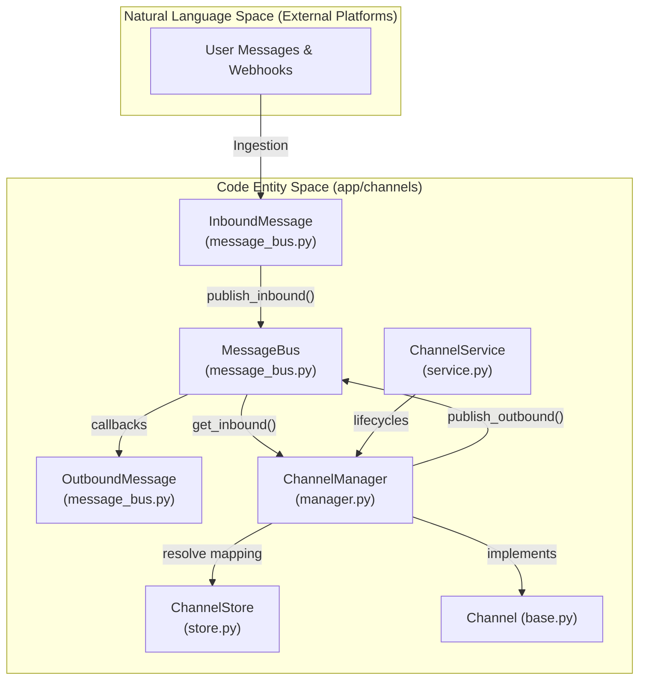

<!-- source: DeepWiki mcp.deepwiki.com · repo bytedance/deer-flow · page 8 Multi-Channel Deployment · fetched 2026-10-29 -->

# Multi-Channel Deployment

<details>
<summary>Relevant source files</summary>

The following files were used as context for generating this wiki page:

- [backend/app/channels/AGENTS.md](backend/app/channels/AGENTS.md)
- [backend/app/channels/base.py](backend/app/channels/base.py)
- [backend/app/channels/dingtalk.py](backend/app/channels/dingtalk.py)
- [backend/app/channels/feishu.py](backend/app/channels/feishu.py)
- [backend/app/channels/manager.py](backend/app/channels/manager.py)
- [backend/app/channels/service.py](backend/app/channels/service.py)
- [backend/app/channels/slack.py](backend/app/channels/slack.py)
- [backend/app/channels/telegram.py](backend/app/channels/telegram.py)
- [backend/docs/IM_CHANNEL_CONNECTIONS.md](backend/docs/IM_CHANNEL_CONNECTIONS.md)
- [backend/tests/blocking_io/test_channel_stop_offloop.py](backend/tests/blocking_io/test_channel_stop_offloop.py)
- [backend/tests/test_channel_service_start_stop_shutdown_generation_fence.py](backend/tests/test_channel_service_start_stop_shutdown_generation_fence.py)
- [backend/tests/test_channels.py](backend/tests/test_channels.py)
- [backend/tests/test_dingtalk_channel.py](backend/tests/test_dingtalk_channel.py)
- [backend/tests/test_feishu_parser.py](backend/tests/test_feishu_parser.py)
- [backend/tests/test_slack_channel_connections.py](backend/tests/test_slack_channel_connections.py)
- [backend/tests/test_slack_channel_lifecycle.py](backend/tests/test_slack_channel_lifecycle.py)
- [backend/tests/test_slack_file_share.py](backend/tests/test_slack_file_share.py)
- [backend/tests/test_telegram_channel_connections.py](backend/tests/test_telegram_channel_connections.py)
- [backend/tests/test_telegram_message_length.py](backend/tests/test_telegram_message_length.py)

</details>


---

## Purpose and Scope

This document provides a high-level overview of DeerFlow's multi-channel deployment system, which bridges external messaging platforms—such as Slack, Telegram, Feishu/Lark, WeCom, WeChat, DingTalk, Discord, and Buzz—to the core DeerFlow backend [backend/app/channels/AGENTS.md:1-3](). The system ensures consistent agent behavior, thread persistence, and state sharing across both web and messaging interfaces by routing inbound messages through a unified asynchronous pipeline to the LangGraph Server [backend/app/channels/manager.py:1-25](), [backend/app/channels/service.py:112-118]().

Because this is a parent page, it covers high-level concepts and system topology. For deep technical details, refer to the following child pages:

- **IM Channels Architecture** — For details on `ChannelManager`, `MessageBus`, `ChannelStore`, backpressure management, and message routing ([IM Channels Architecture](#8.1)).
- **Channel Configuration** — For setup guides, connection bindings, and streaming modes across Slack, Telegram, Feishu, WeCom, DingTalk, Discord, and Buzz ([Channel Configuration](#8.2)).
- **GitHub Event-Driven Agents** — For documentation on the GitHub webhook channel, HMAC verification, triggers, prompts, and deterministic thread IDs ([GitHub Event-Driven Agents](#8.3)).

Sources: [backend/app/channels/manager.py:1-25](), [backend/app/channels/service.py:112-118](), [backend/app/channels/AGENTS.md:1-3](), [backend/tests/test_channels.py:1-25]()

---

## System Overview

The multi-channel deployment system consists of modular channel adapters that receive events from external messaging platforms and translate them into standard inbound messages [backend/app/channels/AGENTS.md:3-5](). All active channels interact with the DeerFlow Gateway and LangGraph Server using internal HTTP clients with session and authentication management [backend/app/channels/AGENTS.md:5-5](). The `ChannelService` acts as the overarching lifecycle manager for all configured channels [backend/app/channels/service.py:114-119]().

### Core Characteristics

| Aspect | Description | Code Entity / Mechanism |
|---|---|---|
| **Unified Backend** | All messaging platforms share the same LangGraph Server and Gateway API | `DEFAULT_LANGGRAPH_URL`, `DEFAULT_GATEWAY_URL` [backend/app/channels/manager.py:70-71]() |
| **Shared Thread Storage** | Conversations persist across channels via dedicated key mappings | `ChannelStore` [backend/app/channels/store.py:26-26]() |
| **Asynchronous Bus** | Decouples message ingestion from agent execution | `MessageBus` [backend/app/channels/message_bus.py:24-25]() |
| **No Public IP Required** | Uses long-polling or WebSocket connections for local/firewalled deployments | `FeishuChannel`, `SlackChannel`, `DingTalkChannel` [backend/app/channels/feishu.py:154-155](), [backend/app/channels/slack.py:113-114](), [backend/app/channels/dingtalk.py:140-141]() |

Sources: [backend/app/channels/manager.py:70-71](), [backend/app/channels/store.py:26-26](), [backend/app/channels/service.py:114-119](), [backend/app/channels/message_bus.py:24-25](), [backend/app/channels/feishu.py:154-155](), [backend/app/channels/slack.py:113-114](), [backend/app/channels/dingtalk.py:140-141]()

---

## Architecture and Message Routing

### Multi-Channel Routing Architecture

```mermaid
graph TB
    subgraph NaturalLanguageSpace["Natural Language Space (Messaging Platforms)"]
        Telegram["TelegramBotAPI"]
        Slack["SlackSocketMode"]
        Feishu["FeishuWebSocket"]
        GitHub["GitHubWebhooks"]
        DingTalk["DingTalkStream"]
    end
    
    subgraph CodeEntitySpace["Code Entity Space (app/channels)"]
        TelegramCh["TelegramChannel<br/>(telegram.py)"]
        SlackCh["SlackChannel<br/>(slack.py)"]
        FeishuCh["FeishuChannel<br/>(feishu.py)"]
        GitHubCh["GitHubChannel<br/>(github.py)"]
        DingTalkCh["DingTalkChannel<br/>(dingtalk.py)"]
        
        MessageBus["MessageBus<br/>(message_bus.py)"]
        ChannelManager["ChannelManager<br/>(manager.py)"]
        ChannelStore["ChannelStore<br/>(store.py)"]
    end
    
    subgraph BackendSpace["Backend Services"]
        LangGraph["LangGraphServer<br/>(:8001/api)"]
        Gateway["GatewayAPI<br/>(:8001)"]
    end
    
    Telegram --> TelegramCh
    Slack --> SlackCh
    Feishu --> FeishuCh
    GitHub --> GitHubCh
    DingTalk --> DingTalkCh
    
    TelegramCh -->|"publish_inbound()"| MessageBus
    SlackCh -->|"publish_inbound()"| MessageBus
    FeishuCh -->|"publish_inbound()"| MessageBus
    GitHubCh -->|"publish_inbound()"| MessageBus
    DingTalkCh -->|"publish_inbound()"| MessageBus
    
    MessageBus -->|"get_inbound()"| ChannelManager
    ChannelManager -->|"get_thread_id()"<br/>"set_thread_id()"| ChannelStore
    ChannelManager -->|"client.runs.stream()"<br/>"client.runs.wait()"| LangGraph
    ChannelManager -->|"client.threads.create()"<br/>"client.runs.create()"| Gateway
```
Sources: [backend/app/channels/message_bus.py:24-25](), [backend/app/channels/manager.py:1-2](), [backend/app/channels/store.py:26-26](), [backend/app/channels/service.py:32-42](), [backend/app/channels/AGENTS.md:16-17]()

This diagram illustrates how platform events from Natural Language Space are captured by platform-specific channel classes, pushed into the `MessageBus`, and processed by `ChannelManager` using `ChannelStore` mappings [backend/app/channels/message_bus.py:24-25](), [backend/app/channels/manager.py:1-2](), [backend/app/channels/store.py:26-26](). The `ChannelManager` then interacts with the `LangGraphServer` and `GatewayAPI` to manage runs and threads [backend/app/channels/AGENTS.md:16-17]().

For deeper architectural details, see [IM Channels Architecture](#8.1).

Sources: [backend/app/channels/message_bus.py:24-25](), [backend/app/channels/manager.py:1-2](), [backend/app/channels/store.py:26-26](), [backend/app/channels/service.py:32-42](), [backend/app/channels/AGENTS.md:16-17]()

---

## Platform Adapters and Configuration

DeerFlow supports a wide variety of messaging platforms registered under `_CHANNEL_REGISTRY` [backend/app/channels/service.py:32-42](). Each platform adapter handles authentication, payload parsing, media attachments, and optional streaming output — such as in-place message card updates or typing indicators — according to the platform [backend/app/channels/AGENTS.md:13-15](). The configuration is managed through `config.yaml` under the `channels` namespace and can be augmented at runtime with database-backed connection bindings [backend/app/channels/service.py:91-112]().

Key platforms include:

- **SlackChannel**: Socket Mode with real-time socket events, rich text markdown conversion, and bot mention stripping [backend/app/channels/slack.py:92-102]().
- **TelegramChannel**: Long-polling API with careful message length and rich content handling [backend/app/channels/telegram.py:128-136]().
- **FeishuChannel**: WebSocket client with reaction-based status updates and card message editing [backend/app/channels/feishu.py:139-155]().
- **DingTalkChannel**: Stream Push WebSocket connection with robust markdown adaptation and message tracking [backend/app/channels/dingtalk.py:147-149]().

For comprehensive configuration parameters, credential setups, and streaming modes for all supported platforms, see [Channel Configuration](#8.2).

Sources: [backend/app/channels/service.py:32-42](), [backend/app/channels/service.py:91-112](), [backend/app/channels/AGENTS.md:13-15](), [backend/app/channels/slack.py:92-102](), [backend/app/channels/telegram.py:128-136](), [backend/app/channels/feishu.py:139-155](), [backend/app/channels/dingtalk.py:147-149]()

---

## GitHub Event-Driven Agents

DeerFlow extends IM channels with an event-driven agent model via GitHub webhooks. This setup allows agents to respond to repository events like issues, pull requests, and comments, by:

- Receiving webhook events via the `GitHubChannel`.
- Verifying webhook payloads through HMAC signatures.
- Dispatching runs with specialized triggers and prompt overlays.
- Maintaining per-agent bindings and deterministic thread IDs for context continuity.

This architecture enables automation scenarios and context-rich conversations tightly coupled with GitHub activity [backend/app/channels/manager.py:99-132](), [backend/app/channels/AGENTS.md:3-6]().

For details on webhook processing, security, orchestration, and GitHub App token management, see [GitHub Event-Driven Agents](#8.3).

Sources: [backend/app/channels/manager.py:99-132](), [backend/app/channels/AGENTS.md:3-6]()

---

## Component Reference

### Channel System Code Entities and External Space Mapping


Sources: [backend/app/channels/message_bus.py:24-35](), [backend/app/channels/manager.py:1-37](), [backend/app/channels/store.py:26-26](), [backend/app/channels/service.py:114-157](), [backend/app/channels/base.py:111-111]()

This diagram maps the core Python classes responsible for message handling (`InboundMessage`, `OutboundMessage`, `MessageBus`, `ChannelStore`, `ChannelManager`, and `ChannelService`) bridging external inputs to the internal runtime [backend/app/channels/message_bus.py:24-35](), [backend/app/channels/manager.py:1-37](), [backend/app/channels/service.py:114-157](). The `Channel` abstract base class defines the interface for all channel implementations [backend/app/channels/base.py:111-111]().

Sources: [backend/app/channels/message_bus.py:24-35](), [backend/app/channels/manager.py:1-37](), [backend/app/channels/store.py:26-26](), [backend/app/channels/service.py:114-157](), [backend/app/channels/base.py:111-111]()

---

# References to Child Pages

For details on the internal IM channels system architecture, including concurrency, routing, and backpressure handling, see [IM Channels Architecture](#8.1).

For guidance on configuring each supported channel and setting up connection credentials, refer to [Channel Configuration](#8.2).

For an extensive description of the GitHub webhook-driven agent system, including dispatcher triggers, security mechanisms, and token lifecycles, see [GitHub Event-Driven Agents](#8.3).

---

**End of Multi-Channel Deployment Overview**

---

