# Page: Overview

# Overview

<details>
<summary>Relevant source files</summary>

The following files were used as context for generating this wiki page:

- [.env.example](.env.example)
- [AGENTS.md](AGENTS.md)
- [CHANGELOG.md](CHANGELOG.md)
- [CHANGELOG_zh.md](CHANGELOG_zh.md)
- [README.md](README.md)
- [README_fr.md](README_fr.md)
- [README_ja.md](README_ja.md)
- [README_ko.md](README_ko.md)
- [README_pt.md](README_pt.md)
- [README_ru.md](README_ru.md)
- [README_zh.md](README_zh.md)
- [backend/AGENTS.md](backend/AGENTS.md)
- [backend/CLAUDE.md](backend/CLAUDE.md)
- [backend/README.md](backend/README.md)
- [backend/docs/API.md](backend/docs/API.md)
- [backend/docs/ARCHITECTURE.md](backend/docs/ARCHITECTURE.md)
- [backend/docs/CONFIGURATION.md](backend/docs/CONFIGURATION.md)
- [backend/docs/README.md](backend/docs/README.md)
- [backend/docs/SANDBOX_MEMORY_PROFILING.md](backend/docs/SANDBOX_MEMORY_PROFILING.md)
- [backend/docs/TODO.md](backend/docs/TODO.md)
- [backend/packages/harness/deerflow/agents/middlewares/AGENTS.md](backend/packages/harness/deerflow/agents/middlewares/AGENTS.md)
- [backend/packages/harness/deerflow/agents/middlewares/llm_error_handling_middleware.py](backend/packages/harness/deerflow/agents/middlewares/llm_error_handling_middleware.py)
- [backend/tests/test_extensions_config_raw_writes.py](backend/tests/test_extensions_config_raw_writes.py)
- [backend/tests/test_llm_error_handling_middleware.py](backend/tests/test_llm_error_handling_middleware.py)
- [backend/tests/test_sandbox_memory_profile_script.py](backend/tests/test_sandbox_memory_profile_script.py)
- [backend/tests/test_support_bundle.py](backend/tests/test_support_bundle.py)
- [config.example.yaml](config.example.yaml)
- [scripts/AGENTS.md](scripts/AGENTS.md)
- [scripts/sandbox_memory_profile.py](scripts/sandbox_memory_profile.py)
- [scripts/support_bundle.py](scripts/support_bundle.py)

</details>


This page provides a comprehensive introduction to DeerFlow, its purpose as a super agent harness, and a detailed explanation of its high-level system architecture including key service components. It serves as the foundational reference for understanding DeerFlow's design, runtime composition, and modular subsystems `[README.md:12-13]`, `[backend/AGENTS.md:5-8]`.

DeerFlow (**D**eep **E**xploration and **E**fficient **R**esearch **Flow**) is an open-source **super agent harness** that orchestrates multipurpose AI agents powered by Large Language Models (LLMs) `[README.md:12-13]`. It integrates **sandboxed code execution**, **persistent memory**, **extensible skills**, and **subagent delegation** into a unified runtime environment to enable complex, multi-step, context-aware AI workflows `[backend/AGENTS.md:5-8]`.

Sources: `[README.md:12-13]`, `[backend/AGENTS.md:5-8]`

---

## System Purpose

DeerFlow provides a powerful runtime for orchestrating LLM-based super agents with the following core capabilities:

- **Code Execution in Isolated Sandboxes**: Supports running arbitrary code and bash commands safely within per-thread isolated sandbox environments (`LocalSandboxProvider`, `AioSandboxProvider`). These sandboxes encapsulate user data and outputs, preventing interference or security risks `[backend/README.md:77-86]`.
- **Persistent Long-Term Memory**: Maintains rich conversational context and facts across sessions using automated extraction, confidence scoring, and background updates `[backend/README.md:99-107]`.
- **Task Decomposition via Subagent Delegation**: Breaks down complex problems into parallel subtasks executed by recursive subagents via `SubagentExecutor` and the `task()` tool `[backend/README.md:88-96]`.
- **Extensible Skill-Based Workflows**: Dynamically loads specialized domain skills packaged as `.skill` archives with `SkillScan` validation and file-system projection `[backend/README.md:82-85]`.
- **Multi-Provider Model Integration**: Supports a broad range of LLM providers (Doubao, DeepSeek, OpenAI, Anthropic, vLLM, OpenRouter) through a pluggable model factory system `[config.example.yaml:128-175]`.
- **Rich External Tool Ecosystem**: Integrates external tools for web search, crawling, document parsing, and MCP (Model Context Protocol) servers `[backend/README.md:41-52]`.
- **Middleware Pipeline for Cross-Cutting Concerns**: Applies a strict middleware execution chain inside the lead agent runtime (`make_lead_agent`) to handle context management, sandbox acquisition, memory injection, summarization, and safety checks `[backend/README.md:43-68]`.

Sources: `[README.md:12-13]`, `[backend/AGENTS.md:5-8]`, `[backend/README.md:41-107]`, `[config.example.yaml:128-175]`

---

## Service Architecture

DeerFlow employs a modular multi-service architecture, where key services collaborate under a unifying reverse proxy. This design promotes separation of concerns, scalability, and clean runtime integration `[backend/README.md:9-32]`.

### Service Topology and Code Mapping

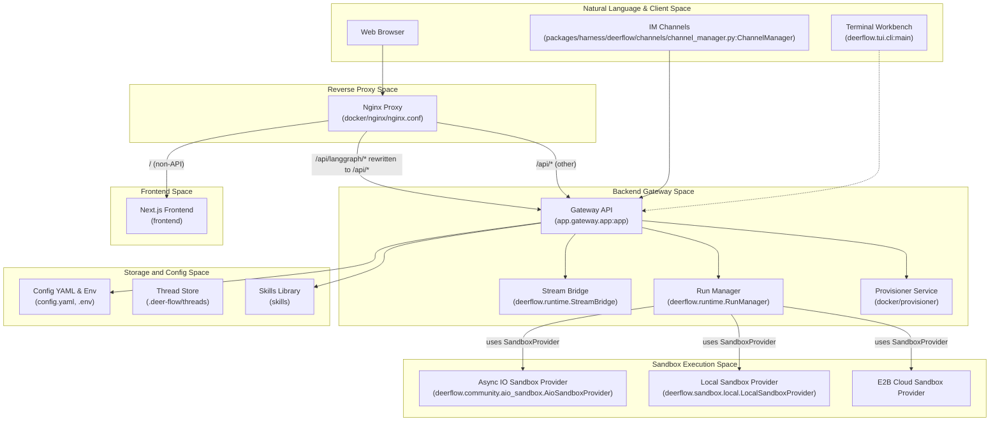

Sources: `[backend/AGENTS.md:8-16]`, `[backend/README.md:9-32]`, `[backend/pyproject.toml:72]`

| Service         | Port | Purpose                                              | Main Entry Point / Code Module                           |
|-----------------|------|------------------------------------------------------|---------------------------------------------------------|
| **Nginx**       | 2026 | Unified reverse proxy entry point, routes API & UI | `[backend/AGENTS.md:10-12]`, `[backend/README.md:13-15]` |
| **Gateway API** | 8001 | FastAPI REST API + embedded LangGraph agent runtime | `[backend/AGENTS.md:8-12]`, `[backend/README.md:21-31]`  |
| **Frontend**    | 3000 | Next.js React frontend web interface                 | `[backend/AGENTS.md:9-11]`                               |
| **Provisioner** | 8002 | Kubernetes sandbox provisioner (optional)            | `[backend/AGENTS.md:11-13]`                              |
| **Redis**       | 6379 | Redis Streams for SSE event bus between workers      | `[backend/pyproject.toml:72]`                            |

Sources: `[backend/AGENTS.md:8-16]`, `[backend/README.md:9-32]`, `[backend/pyproject.toml:72]`

---

## Core Components

### Lead Agent and Middleware Pipeline

At the heart of DeerFlow is a single **Lead Agent** runtime instance created via the factory function `make_lead_agent(config)` `[backend/README.md:43-45]`. This agent encapsulates prompt assembly, dynamic model selection, tool binding, and subagent delegation.

The Lead Agent executes a strict, ordered **Middleware Chain** mapping functional stages to concrete middleware classes. These middlewares manipulate request context, thread state, sandbox acquisition, summarization, memory injection, tool calls, and handle clarifications `[backend/README.md:53-68]`.

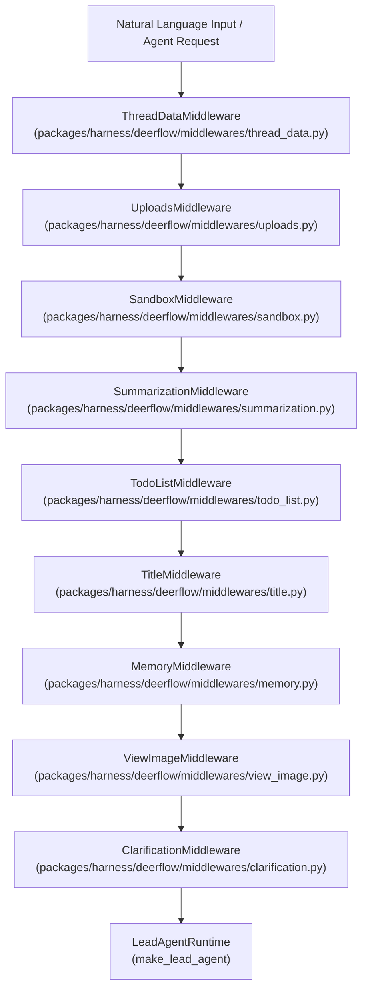

Sources: `[backend/README.md:43-68]`, `[backend/AGENTS.md:16-19]`

| #  | Middleware Class         | Purpose                                                   |
|-----|-------------------------|------------------------------------------------------------|
| 1   | `ThreadDataMiddleware`  | Creates per-thread isolated directories (workspace, uploads, outputs) `[backend/README.md:59]` |
| 2   | `UploadsMiddleware`     | Injects newly uploaded files into conversation context `[backend/README.md:60]` |
| 3   | `SandboxMiddleware`     | Acquires sandbox environment for code execution `[backend/README.md:61]` |
| 4   | `SummarizationMiddleware` | Context compression to reduce token usage when near limits `[backend/README.md:62]` |
| 5   | `TodoListMiddleware`    | Tracks multi-step tasks in planning mode `[backend/README.md:63]` |
| 6   | `TitleMiddleware`       | Auto-generates conversation titles from original user input `[backend/README.md:64]` |
| 7   | `MemoryMiddleware`      | Queues conversations for asynchronous memory extraction `[backend/README.md:65]` |
| 8   | `ViewImageMiddleware`   | Injects image data for vision-capable models (optional) `[backend/README.md:66]` |
| 9   | `ClarificationMiddleware` | Intercepts clarifications and interrupts execution `[backend/README.md:67]` |

Sources: `[backend/README.md:43-68]`, `[backend/AGENTS.md:16-19]`

---

### Sandbox Execution

DeerFlow’s sandbox system provides isolated, controlled execution environments on a per-thread basis, essential for safely running arbitrary code, scripts, and commands invoked by agents `[backend/README.md:75-86]`.

#### Virtual Path Mapping

Sandbox file system operations use a **virtualized file path scheme**, which maps thread-specific virtual directories to physical paths in backend storage:

| Virtual Path                | Physical Path Location                                     |
|----------------------------|------------------------------------------------------------|
| `/mnt/user-data/workspace` | `.deer-flow/threads/{thread_id}/user-data/workspace`      |
| `/mnt/user-data/uploads`   | `.deer-flow/threads/{thread_id}/user-data/uploads`        |
| `/mnt/user-data/outputs`   | `.deer-flow/threads/{thread_id}/user-data/outputs`        |
| `/mnt/skills`              | `skills/` directory for agent skills and modules           |

This virtualization isolates user data per thread and ensures clean separation of workspaces `[backend/README.md:77-83]`.

#### Sandbox Provider Implementations

- **`LocalSandboxProvider`**: Executes commands directly on the host filesystem, suitable for lightweight or development scenarios `[backend/README.md:80]`.
- **`AioSandboxProvider`**: An async Docker container-based sandbox provider that manages sandbox container lifecycle, warm pools, and supports multi-thread async execution `[backend/README.md:80]`.
- **`E2BSandboxProvider`**: Cloud microVM sandbox provider accessed via E2B API, enabling sandbox execution on remote infrastructure `[backend/packages/harness/pyproject.toml:61]`, `[.env.example:49-51]`.

Sources: `[backend/README.md:75-86]`, `[.env.example:49-51]`, `[backend/packages/harness/pyproject.toml:61]`

---

### Subagent System

To handle complex workflows efficiently, DeerFlow supports **subagent delegation**, enabling the lead agent to spawn multiple concurrent subagents that execute subtasks asynchronously `[backend/README.md:91-96]`.

- The lead agent invokes the `task()` tool to delegate work to subagents.
- `SubagentExecutor` manages background thread pools, executing delegated subagents asynchronously with status tracking, cancellation, and timeout support via SSE event streams.
- Concurrency is bounded by configuration defaults (max 3 subagents per turn, 15-minute timeout).
- Subagents run in isolated runtime environments but share the agent’s context via event coordination allowing complex, multi-step task orchestration `[backend/README.md:90-96]`.

Sources: `[backend/README.md:91-96]`

---

## Configuration System

DeerFlow adopts a layered and flexible configuration system allowing operators to tailor runtime behavior, model integration, middleware, and deployment options.

| Configuration File         | Purpose                                                    |
|----------------------------|------------------------------------------------------------|
| `config.yaml`              | Primary human-editable YAML for models, logging, limits, and agent settings `[config.example.yaml:1-24]` |
| `extensions_config.json`   | Runtime-managed JSON for MCP servers, enabled skills, and plugins `[backend/docs/CONFIGURATION.md:118-124]` |
| `.env` (environment file) | Environment variables for API keys, ports, deployment overrides, and external credentials `[.env.example:1-32]` |

### Configuration Highlights

- **Model and Provider Configuration**: Enables multi-provider LLM support including Doubao, Anthropic, OpenAI, OpenRouter, and custom VLLM with per-model request pacing and token budget enforcement `[config.example.yaml:128-175]`.
- **Middleware and Extension Management**: Middleware can be extended or replaced via config and `extensions_config.json` with operator-defined middlewares inserted into the agent runtime pipeline.
- **Token Budgeting and Limits**: Configurable per-run token limits with warning and hard stop thresholds prevent runaway API costs.
- **Timezone and Date Injection**: `DEER_FLOW_DATE_TIMEZONE` environment variable controls timezone for injected conversation timestamps.

Sources: `[config.example.yaml:1-24]`, `[backend/docs/CONFIGURATION.md:118-124]`, `[.env.example:1-32]`

---

# Summary

DeerFlow is a sophisticated, extensible open-source super agent harness designed to enable the orchestration of intelligent AI agents with complex workflows. Its architecture combines:

- A **modular multi-service backend** with API Gateway, LangGraph-driven agent runtime, sandbox provisioners, and a Next.js frontend.
- A robust **middleware-driven lead agent runtime** that manages prompt construction, resource acquisition, and the agent life cycle.
- A secure and flexible **sandbox execution environment** that virtualizes user workspace and supports multiple backend providers (local, Docker, cloud).
- A concurrent **subagent system** for decomposition of tasks into parallel subtasks.
- A flexible **configuration system** to customize models, middleware, skills, and deployment behavior.

These components together enable DeerFlow to empower developers and organizations to build and deploy highly capable AI-driven automation and research workflows.

Sources: `[README.md:12-13]`, `[backend/AGENTS.md:5-24]`, `[backend/README.md:9-107]`, `[config.example.yaml:1-175]`, `[.env.example:1-32]`

---

# Page: Getting Started

# Getting Started

<details>
<summary>Relevant source files</summary>

The following files were used as context for generating this wiki page:

- [CONTRIBUTING.md](CONTRIBUTING.md)
- [Makefile](Makefile)
- [backend/Dockerfile](backend/Dockerfile)
- [backend/tests/test_check_script.py](backend/tests/test_check_script.py)
- [backend/tests/test_docker_sandbox_mode_detection.py](backend/tests/test_docker_sandbox_mode_detection.py)
- [backend/tests/test_gateway_sigterm_delivery.py](backend/tests/test_gateway_sigterm_delivery.py)
- [backend/tests/test_gateway_startup.py](backend/tests/test_gateway_startup.py)
- [backend/tests/test_make_install.py](backend/tests/test_make_install.py)
- [backend/tests/test_pnpm_script.py](backend/tests/test_pnpm_script.py)
- [docker/docker-compose-dev.yaml](docker/docker-compose-dev.yaml)
- [docker/docker-compose.yaml](docker/docker-compose.yaml)
- [frontend/Dockerfile](frontend/Dockerfile)
- [scripts/check.py](scripts/check.py)
- [scripts/deploy.sh](scripts/deploy.sh)
- [scripts/docker.sh](scripts/docker.sh)
- [scripts/pnpm.py](scripts/pnpm.py)
- [scripts/sandbox-mode.sh](scripts/sandbox-mode.sh)

</details>


## Purpose and Scope

This page provides a high-level guide to install, configure, and run DeerFlow for the first time, serving as an introduction to the key steps involved in getting the system operational. DeerFlow is a LangGraph-based AI super agent harness that orchestrates subagents, sandbox execution, extensible skills, and persistent memory to enable versatile AI agents [README.md:12-17](), [docker/docker-compose.yaml:119-120]().

As a parent page, it summarizes the installation and configuration workflow and points to child pages for detailed instructions:
- **Prerequisites and Installation**: Detail system requirements (Node.js, Python, `uv`, `pnpm`, `nginx`), dependency installation via `make install`, and initial `config.yaml` setup. For details, see [Prerequisites and Installation](#2.1) [Makefile:37-37](), [CONTRIBUTING.md:178-191]().
- **Configuration Quickstart**: Walk through the minimum `config.yaml` and `.env` settings needed to get DeerFlow running, linking to the full Configuration System section. For details, see [Configuration Quickstart](#2.2) [CONTRIBUTING.md:26-34](), [docker/docker-compose.yaml:1-25]().

Sources: [README.md:12-17](), [docker/docker-compose.yaml:119-120](), [Makefile:37-37](), [CONTRIBUTING.md:26-191]()

---

## Prerequisites and Installation Overview

DeerFlow requires a modern development and runtime toolchain spanning backend, frontend, and sandbox execution environments [CONTRIBUTING.md:186-191]().

| Tool       | Minimum Version | Role                                   | Reference                     |
|------------|-----------------|--------------------------------------|-------------------------------|
| Python     | 3.12+           | Backend runtime environment           | [Makefile:15-15](), [backend/Dockerfile:11-11]()  |
| Node.js    | 22+             | Frontend runtime environment          | [CONTRIBUTING.md:187-187](), [backend/Dockerfile:13-13]()|
| `uv`       | Latest          | Python dependency manager and builder | [Makefile:99-99](), [CONTRIBUTING.md:189-189]() |
| `pnpm`     | Latest          | Frontend package manager               | [Makefile:22-22](), [CONTRIBUTING.md:188-188]() |
| `nginx`    | Latest          | Unified reverse proxy endpoint         | [docker/docker-compose.yaml:51-60](), [Makefile:49-49]() |
| Docker     | Latest          | Container runtime for sandbox providers| [CONTRIBUTING.md:14-16](), [docker/docker-compose.yaml:1-25]() |

To verify your environment and diagnose configuration issues, you can run the built-in diagnostic script via `make doctor` [Makefile:74-75](). This utility inspects installed binaries, environment variables, config files, and provider setups and returns actionable recommendations for missing or misconfigured components [Makefile:74-75](), [scripts/check.py:90-185]().

For detailed system requirements, installation steps, and troubleshooting, see [Prerequisites and Installation](#2.1).

Sources: [Makefile:15-99](), [CONTRIBUTING.md:14-191](), [backend/Dockerfile:11-13](), [docker/docker-compose.yaml:1-60](), [scripts/check.py:90-185]()

---

## Configuration Quickstart

After cloning the DeerFlow repository, the system requires a minimum viable configuration to enable core agent functions such as model usage and optional tool integrations [CONTRIBUTING.md:26-34]().

- You can run the interactive setup wizard with `make setup`, which invokes `scripts/setup_wizard.py` [Makefile:71-72](). This wizard walks through selecting LLM providers, optional web search integrations, and sandbox mode preferences, generating a minimal `config.yaml` and environment settings [Makefile:71-72]().
- Configuration versioning and schema upgrades are managed via `make config-upgrade`, which safely merges new fields from `config.example.yaml` into existing configurations [Makefile:32-32]().

For a full walkthrough of configuration options, environment variables, and providers, see [Configuration Quickstart](#2.2).

Sources: [Makefile:32-72](), [CONTRIBUTING.md:26-34]()

---

## Running DeerFlow for the First Time

Once configured, DeerFlow offers multiple runtime modes for development and production use [README.md:63-65]().

### Local Development Mode

Run the backend Gateway API, Next.js frontend, and Nginx proxy directly on your host machine with hot reload support via `make dev` [Makefile:45-45](). This command orchestrates the startup of each component, enabling immediate code changes and inspection during development [Makefile:45-45]().

### Docker Development Mode

For an isolated environment closely matching production with containerized backend, frontend, and sandbox services [CONTRIBUTING.md:9-12]():

```bash
make docker-init    # Pulls necessary sandbox container images [Makefile:62-62]
make docker-start   # Starts the full Docker development stack [Makefile:63-63]
```

You can then access DeerFlow’s web UI at `http://localhost:2026` [CONTRIBUTING.md:80-80]().

Sources: [Makefile:45-63](), [CONTRIBUTING.md:9-80](), [README.md:63-65]()

---

## DeerFlow Service Architecture and Ports

The core DeerFlow system consists of multiple services coordinated behind an Nginx reverse proxy [docker/docker-compose.yaml:51-60](). The main components and their standard ports are:

- **Nginx Proxy** (port 2026): Unified HTTP entrypoint handling routing between frontend and backend services [docker/docker-compose.yaml:59-60]().
- **Gateway API Server** (port 8001): FastAPI-based REST API and embedded LangGraph agent runtime [docker/docker-compose.yaml:107-134]().
- **Frontend** (port 3000): Next.js React frontend application [docker/docker-compose-dev.yaml:28-28]().
- **Sandbox Provisioner** (port 8002, optional): Manages sandbox container lifecycle when sandboxing uses Kubernetes or provisioner mode [docker/docker-compose-dev.yaml:55-58]().
- **Redis** (port 6379): Optional backend service for caching and stream bridging [docker/docker-compose.yaml:34-48]().

Title: Service Topology
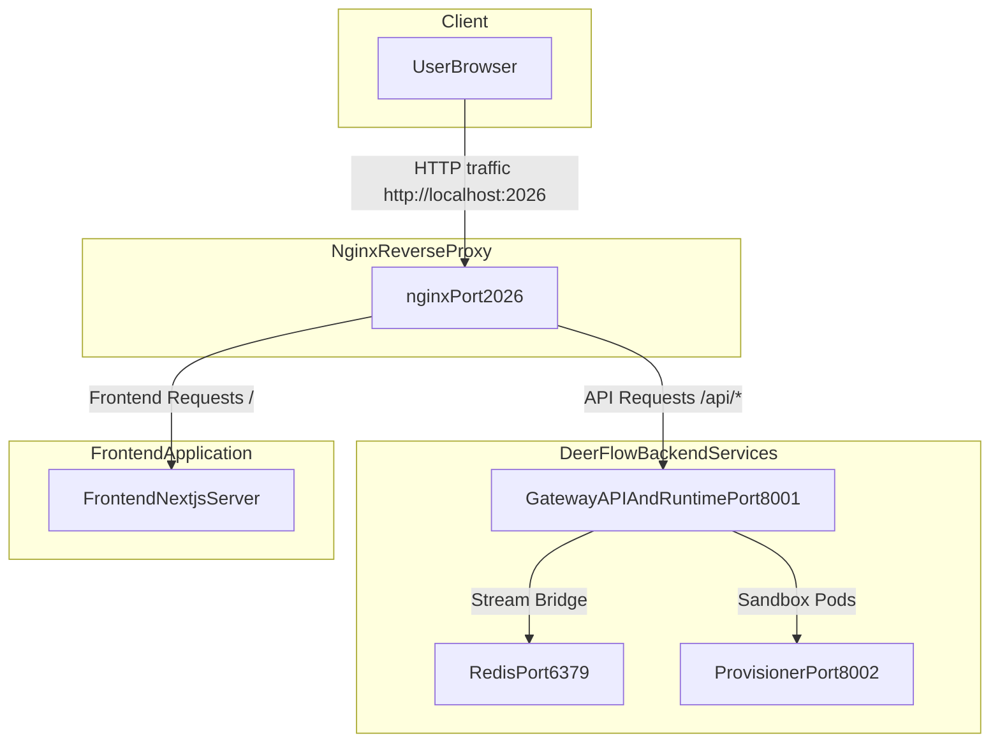

Sources: [docker/docker-compose.yaml:34-134](), [docker/docker-compose-dev.yaml:28-58]()

---

## Mapping System Components to Code Entities

DeerFlow’s architecture maps logical system components to specific code modules and classes. Key associations include:

| System Component        | Code Entity / Symbol        | Location / Reference                                      |
|------------------------|-----------------------------|-----------------------------------------------------------|
| Gateway API App        | `app.gateway.app:app`        | `backend/app/gateway/app.py`                              |
| Lead Agent Factory      | `create_deerflow_agent`      | `backend/packages/harness/deerflow/agents/lead_agent/factory.py` |
| Subagent Executor       | `SubagentExecutor`           | `backend/packages/harness/deerflow/subagents/executor.py` |
| Sandbox Provider        | `SandboxProvider`            | `backend/packages/harness/deerflow/sandbox/sandbox.py`   |
| Stream Bridge           | `StreamBridge`               | `backend/packages/harness/deerflow/runtime/`              |
| Reverse Proxy           | `nginx`                     | `docker/nginx/nginx.conf`                                 |

Title: Natural Language Space to Code Entity Space Mapping
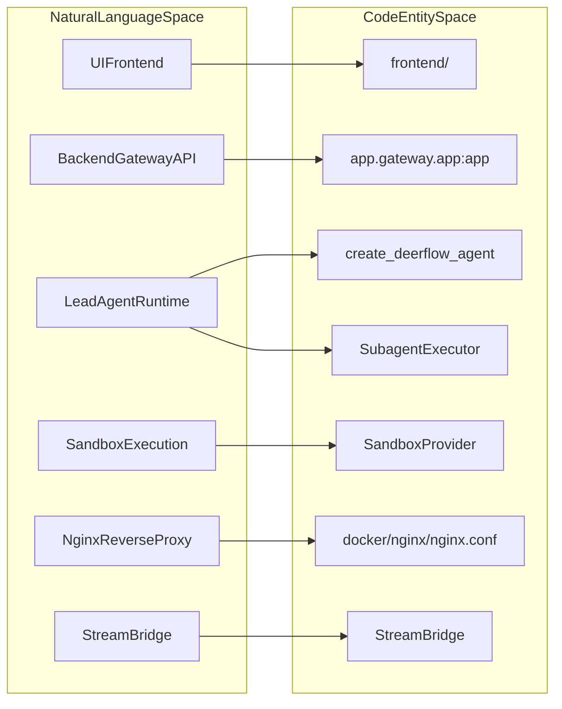

Sources: [docker/docker-compose.yaml:134-134](), [frontend/src/content/en/harness/tools.mdx:29-37]()

---

## Next Steps

- For detailed environment setup, dependency installation, and troubleshooting, proceed to [Prerequisites and Installation](#2.1).
- To understand configuration file formats and minimum required settings, see [Configuration Quickstart](#2.2).
- Explore the architectural design and service interactions in the [Architecture](#3) section.

Sources: [README.md:60-134]()

---

# Page: Prerequisites and Installation

# Prerequisites and Installation

<details>
<summary>Relevant source files</summary>

The following files were used as context for generating this wiki page:

- [.gitignore](.gitignore)
- [CONTRIBUTING.md](CONTRIBUTING.md)
- [Makefile](Makefile)
- [backend/Dockerfile](backend/Dockerfile)
- [backend/Makefile](backend/Makefile)
- [backend/packages/extension-api/deerflow_extension_api/__init__.py](backend/packages/extension-api/deerflow_extension_api/__init__.py)
- [backend/packages/extension-api/deerflow_extension_api/contracts.py](backend/packages/extension-api/deerflow_extension_api/contracts.py)
- [backend/packages/extension-api/pyproject.toml](backend/packages/extension-api/pyproject.toml)
- [backend/packages/harness/deerflow/extensions/AGENTS.md](backend/packages/harness/deerflow/extensions/AGENTS.md)
- [backend/packages/harness/deerflow/extensions/registry.py](backend/packages/harness/deerflow/extensions/registry.py)
- [backend/packages/harness/pyproject.toml](backend/packages/harness/pyproject.toml)
- [backend/pyproject.toml](backend/pyproject.toml)
- [backend/tests/test_check_script.py](backend/tests/test_check_script.py)
- [backend/tests/test_docker_sandbox_mode_detection.py](backend/tests/test_docker_sandbox_mode_detection.py)
- [backend/tests/test_extension_api_contracts.py](backend/tests/test_extension_api_contracts.py)
- [backend/tests/test_gateway_sigterm_delivery.py](backend/tests/test_gateway_sigterm_delivery.py)
- [backend/tests/test_gateway_startup.py](backend/tests/test_gateway_startup.py)
- [backend/tests/test_make_install.py](backend/tests/test_make_install.py)
- [backend/tests/test_pnpm_script.py](backend/tests/test_pnpm_script.py)
- [backend/uv.lock](backend/uv.lock)
- [docker/docker-compose-dev.yaml](docker/docker-compose-dev.yaml)
- [docker/docker-compose.yaml](docker/docker-compose.yaml)
- [frontend/Dockerfile](frontend/Dockerfile)
- [frontend/src/core/extensions/catalog.ts](frontend/src/core/extensions/catalog.ts)
- [frontend/tests/e2e/bookmark-plugin.spec.ts](frontend/tests/e2e/bookmark-plugin.spec.ts)
- [scripts/check.py](scripts/check.py)
- [scripts/deploy.sh](scripts/deploy.sh)
- [scripts/docker.sh](scripts/docker.sh)
- [scripts/pnpm.py](scripts/pnpm.py)
- [scripts/sandbox-mode.sh](scripts/sandbox-mode.sh)

</details>


This page details the system requirements, dependency installation mechanisms, and initial configuration steps required to set up DeerFlow. DeerFlow supports two primary execution workflows: **Local Development** (running services directly on the host) and **Docker Development** (orchestrating containerized services). The framework relies on explicit binary version checking (`scripts/doctor.py`), locked package management (`uv` for Python dependencies and `pnpm` for frontend), and automated environment configuration (`Makefile`).

Sources: [Makefile:24-30](), [CONTRIBUTING.md:13-23](), [scripts/doctor.py:1-217]()

---

## System Requirements

The DeerFlow environment requires specific core tools and minimum version constraints to orchestrate the Next.js frontend, FastAPI Gateway API, LangGraph agent runtime, and reverse proxy routing. Automated health check scripts validate environment readiness.

### Required Tooling

| Tool            | Minimum Version | Purpose                                                  | Code Reference                    |
|-----------------|-----------------|----------------------------------------------------------|----------------------------------|
| **Node.js**     | 22+             | Runtime for Next.js frontend application                 | `scripts/doctor.py:193-211`       |
| **pnpm**        | Latest          | Package manager for JavaScript frontend dependencies     | `scripts/doctor.py:213-217`       |
| **Python**      | 3.12+           | Backend runtime for FastAPI Gateway API and LangGraph    | `backend/pyproject.toml:6`        |
| **uv**          | 0.11.1+         | Python virtual environment and dependency manager        | `backend/Dockerfile:7-8`          |
| **nginx**       | Latest          | Reverse proxy that consolidates requests on port 2026    | `docker/docker-compose-dev.yaml:121-128` |

- **Node.js** and **pnpm** power and manage the Next.js SPA frontend. The `pnpm` invocation is wrapped in a cross-platform Python runner at `scripts/pnpm.py` to ensure environment consistency [Makefile:22]().
- **Python 3.12+** is the backend execution environment, enabling fully asynchronous FastAPI services with modern typing support [backend/pyproject.toml:6]().
- **uv** manages backend Python dependencies deterministically using `uv.lock` and orchestrates execution with virtual environment isolation [Makefile:97](), [backend/Makefile:5-6]().
- **nginx** serves as specialized reverse proxy routing frontend and API traffic on the single user port `2026`, configurable via environment variables [docker/docker-compose-dev.yaml:121-128]().

### Diagram: Toolchain and System Validation Architecture

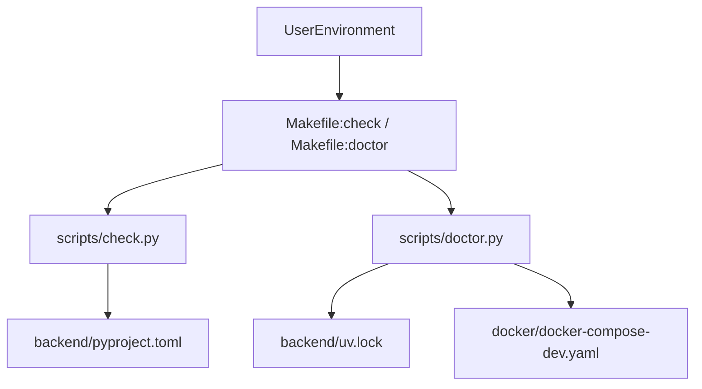

Sources: [Makefile:24-112](), [scripts/doctor.py:1-217](), [backend/pyproject.toml:1-43]()

---

## Environment Validation

Run the following commands to verify host dependencies and configuration integrity:

- **Basic dependency version check:**

```bash
make check
```

This invokes `scripts/check.py` which validates presence and versions of Node.js, pnpm, uv, Python, and nginx, printing status messages with instructions for missing tools [Makefile:89-91]().

- **Comprehensive health check:**

```bash
make doctor
```

This runs `scripts/doctor.py` which performs deeper verification of configuration files, LLM providers importability, environment variables, token validity, and more, producing an actionable diagnostic report [Makefile:71-72](), [scripts/doctor.py:1-217]().

Sources: [Makefile:71-95](), [scripts/doctor.py:1-217]()

---

## Installation Procedures

Dependency installation synchronizes all Python and JavaScript package requirements, ensuring matching locked versions for consistent runtime behavior.

### Installing Dependencies via Make

From the repository root (`deer-flow/`), run:

```bash
make install
```

This triggers the following sequence [Makefile:96-105]():

1. **Backend Dependency Installation:** Executes `uv sync --locked` within the `backend/` directory to install all Python packages declared in `uv.lock`, matching exact versions for reproducibility [Makefile:98-99](), [backend/Makefile:5-6]().

2. **Frontend Dependency Installation:** Runs `pnpm install` inside the `frontend/` directory via the helper Python script `scripts/pnpm.py` that reliably invokes the pnpm binary across platforms [Makefile:22](), [Makefile:100-101]().

3. **Pre-commit Hook Setup:** Installs and configures `pre-commit` hooks via `uv tool install pre-commit` and activates them to enforce code style, linting, and commit safety checks [Makefile:102-104]().

### Optional: Pre-pull Sandbox Container Image

DeerFlow supports safe sandboxed code execution using container images. To pre-pull the sandbox container image (optional but recommended to minimize startup latency of sandboxed code runs):

```bash
make setup-sandbox
```

This command pulls the configured sandbox image as specified in runtime settings to your local Docker daemon, preparing the environment in advance [Makefile:44](), [docker/docker-compose-dev.yaml:60-70]().

Sources: [Makefile:44-112](), [backend/Makefile:5-6](), [CONTRIBUTING.md:13-23]()

---

## Initial Configuration Setup

DeerFlow requires a configuration file that specifies LLM providers, API keys, model options, skills, memory backends, sandbox and tool settings, among others.

### Config File Creation Methods

- **Interactive Setup Wizard:**

Use a guided CLI wizard to generate a personalized `config.yaml`:

```bash
make setup
```

This runs the Python script `scripts/setup_wizard.py` which interactively prompts for API keys, LLM provider selection, and common configuration parameters, then writes a tailored `config.yaml` [Makefile:68-69]().

- **Template Copy:**

Manually copy the example configuration file to start with defaults:

```bash
make config
```

This runs `scripts/configure.py` which copies `config.example.yaml` to `config.yaml` if not already present [Makefile:83-84]().

- **Configuration Upgrade:**

When upgrading DeerFlow versions, to migrate old configs to new schemas, run:

```bash
make config-upgrade
```

This executes `scripts/config-upgrade.sh` which merges new configuration fields into your existing `config.yaml` while preserving customizations [Makefile:86-87]().

### Key Configuration Files Explained

| File                  | Description                                                                                                             | Notes                                                        |
|-----------------------|-------------------------------------------------------------------------------------------------------------------------|--------------------------------------------------------------|
| `config.yaml`          | Primary runtime configuration specifying models, tools, memory, sandbox, and service parameters                         | Mounted read-only in Docker, editable locally                |
| `extensions_config.json`| JSON file managing MCP servers and enabled extensions                                                                  | Mounted read-write; live updates handled by Gateway API       |
| `.env`                 | Environment variable file storing API keys, internal tokens, and runtime flags                                          | Optional, but recommended for secrets and overrides           |

#### Configuration File Locations in Docker

Docker Compose mounts these files inside containers per `docker/docker-compose.yaml`:

- `config.yaml` is mounted to `/app/backend/config.yaml` (read-only) [docker/docker-compose.yaml:139]().
- `extensions_config.json` is mounted to `/app/backend/extensions_config.json` (read-write) [docker/docker-compose.yaml:143]().
- `.env` files are referenced via `env_file` directives in compose configurations [docker/docker-compose-dev.yaml:104-106]().

### Diagram: Configuration and Script Entity Mapping

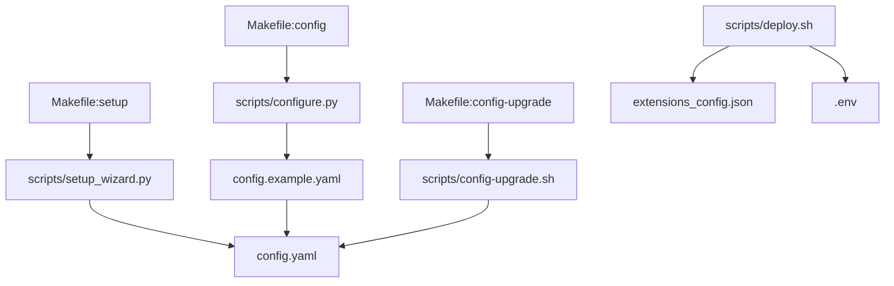

Sources: [Makefile:68-91](), [scripts/deploy.sh:146-186](), [docker/docker-compose.yaml:138-145]()

---

## References and Next Steps

- After installing dependencies and configuring `config.yaml`, users can proceed to run local or Docker services.
- See the next page "2.2 Configuration Quickstart" for minimal configuration samples and environment variables.
- Validate your environment often with `make doctor` to catch misconfigurations early.

Sources: [Makefile:71-76](), [CONTRIBUTING.md:1-424]()

---

# End of Section 2.1 Prerequisites and Installation

---

# Page: Configuration Quickstart

# Configuration Quickstart

<details>
<summary>Relevant source files</summary>

The following files were used as context for generating this wiki page:

- [.env.example](.env.example)
- [CHANGELOG.md](CHANGELOG.md)
- [CHANGELOG_zh.md](CHANGELOG_zh.md)
- [README.md](README.md)
- [backend/AGENTS.md](backend/AGENTS.md)
- [backend/docs/CONFIGURATION.md](backend/docs/CONFIGURATION.md)
- [backend/packages/harness/deerflow/agents/middlewares/AGENTS.md](backend/packages/harness/deerflow/agents/middlewares/AGENTS.md)
- [backend/packages/harness/deerflow/agents/middlewares/llm_error_handling_middleware.py](backend/packages/harness/deerflow/agents/middlewares/llm_error_handling_middleware.py)
- [backend/tests/test_extensions_config_raw_writes.py](backend/tests/test_extensions_config_raw_writes.py)
- [backend/tests/test_llm_error_handling_middleware.py](backend/tests/test_llm_error_handling_middleware.py)
- [backend/tests/test_support_bundle.py](backend/tests/test_support_bundle.py)
- [config.example.yaml](config.example.yaml)
- [frontend/src/content/en/application/agents-and-threads.mdx](frontend/src/content/en/application/agents-and-threads.mdx)
- [frontend/src/content/en/application/configuration.mdx](frontend/src/content/en/application/configuration.mdx)
- [frontend/src/content/en/application/index.mdx](frontend/src/content/en/application/index.mdx)
- [frontend/src/content/en/application/operations-and-troubleshooting.mdx](frontend/src/content/en/application/operations-and-troubleshooting.mdx)
- [frontend/src/content/en/application/quick-start.mdx](frontend/src/content/en/application/quick-start.mdx)
- [frontend/src/content/en/application/workspace-usage.mdx](frontend/src/content/en/application/workspace-usage.mdx)
- [frontend/src/content/en/harness/configuration.mdx](frontend/src/content/en/harness/configuration.mdx)
- [frontend/src/content/en/harness/design-principles.mdx](frontend/src/content/en/harness/design-principles.mdx)
- [frontend/src/content/en/harness/lead-agent.mdx](frontend/src/content/en/harness/lead-agent.mdx)
- [frontend/src/content/en/harness/quick-start.mdx](frontend/src/content/en/harness/quick-start.mdx)
- [frontend/src/content/en/harness/sandbox.mdx](frontend/src/content/en/harness/sandbox.mdx)
- [frontend/src/content/en/harness/skills.mdx](frontend/src/content/en/harness/skills.mdx)
- [frontend/src/content/zh/application/agents-and-threads.mdx](frontend/src/content/zh/application/agents-and-threads.mdx)
- [frontend/src/content/zh/application/configuration.mdx](frontend/src/content/zh/application/configuration.mdx)
- [frontend/src/content/zh/application/index.mdx](frontend/src/content/zh/application/index.mdx)
- [frontend/src/content/zh/application/operations-and-troubleshooting.mdx](frontend/src/content/zh/application/operations-and-troubleshooting.mdx)
- [frontend/src/content/zh/application/quick-start.mdx](frontend/src/content/zh/application/quick-start.mdx)
- [frontend/src/content/zh/application/workspace-usage.mdx](frontend/src/content/zh/application/workspace-usage.mdx)
- [frontend/src/content/zh/harness/configuration.mdx](frontend/src/content/zh/harness/configuration.mdx)
- [frontend/src/content/zh/harness/lead-agent.mdx](frontend/src/content/zh/harness/lead-agent.mdx)
- [frontend/src/content/zh/harness/sandbox.mdx](frontend/src/content/zh/harness/sandbox.mdx)
- [frontend/src/content/zh/harness/skills.mdx](frontend/src/content/zh/harness/skills.mdx)
- [frontend/tests/unit/content/docs-links.test.ts](frontend/tests/unit/content/docs-links.test.ts)
- [scripts/AGENTS.md](scripts/AGENTS.md)
- [scripts/support_bundle.py](scripts/support_bundle.py)

</details>


This page provides a technical walkthrough of the minimum `config.yaml` and `.env` settings required to get DeerFlow operational. It covers essential configuration for LLM providers, environment variables, sandbox environments, and token/memory controls. For a comprehensive reference of all available options, see the [7. Configuration System]() section.

---

## 1. Overview and Scope

DeerFlow uses a structured configuration architecture that separates core runtime settings from environment-specific secrets:

- **`config.yaml`**: The primary YAML file defining agent models, sandbox execution providers, tools, logging levels, and safety controls. It resolves environment variable references dynamically `[config.example.yaml:1-16]`, `[backend/docs/CONFIGURATION.md:3-33]`.
- **`.env`**: A local environment file storing sensitive credentials (such as API keys) referenced via `$VAR` syntax in `config.yaml`. Loaded via `dotenv.load_dotenv()` at startup `[README.md:120-136]`, `[config.example.yaml:6-15]`.

### Configuration Loading and Injection Flow

```mermaid
flowchart TD
    subgraph NaturalLanguageSpace["Natural Language Space"]
        ConfigEnv["Environment Secrets"]
        ConfigYaml["YAML Configuration"]
    end

    subgraph CodeEntitySpace["Code Entity Space"]
        LoadDotenv["dotenv.load_dotenv()"]
        AppConfigLoad["deerflow.config.app_config:AppConfig.from_file()"]
        AppConfig["deerflow.config.app_config:AppConfig"]
        ModelFactory["deerflow.models.factory:create_chat_model()"]
    end

    ConfigEnv -->| "Populate process env" | LoadDotenv
    ConfigYaml -->| "Parse & substitute vars" | AppConfigLoad
    LoadDotenv --> AppConfig
    AppConfigLoad --> AppConfig
    AppConfig -->| "Inject configuration" | ModelFactory
```

The `.env` file is loaded first to populate process environment variables. Subsequently, `config.yaml` is parsed by `AppConfig.from_file()`, substituting expressions like `$VOLCENGINE_API_KEY` with runtime values to instantiate the `AppConfig` schema `[config.example.yaml:1-16]`, `[backend/docs/CONFIGURATION.md:3-33]`.

Sources: `[backend/docs/CONFIGURATION.md:3-33]`, `[config.example.yaml:1-16]`, `[README.md:120-136]`

---

## 2. Initial Setup and Versioning

### Setup Wizard

The recommended method for bootstrapping a runnable environment is the interactive setup wizard `[README.md:120-136]`:

```bash
make setup
```

The wizard invokes setup routines that prompt for LLM providers, search tool selection, and sandbox execution permissions, generating both a baseline `config.yaml` and a populated `.env` file `[scripts/wizard/providers.py:1-116]`.

### Configuration Versioning

DeerFlow tracks schema changes through the `config_version` integer property at the root of `config.yaml` `[config.example.yaml:18-23]`, `[backend/docs/CONFIGURATION.md:105-117]`:

```yaml
config_version: 60
```

If the local configuration version lags behind the codebase schema version, DeerFlow emits a startup warning `[backend/docs/CONFIGURATION.md:105-117]`. You can safely merge new fields while preserving existing values by running `[backend/docs/CONFIGURATION.md:105-117]`:

```bash
make config-upgrade
```

Sources: `[README.md:120-136]`, `[config.example.yaml:18-23]`, `[backend/docs/CONFIGURATION.md:105-117]`, `[scripts/wizard/providers.py:1-116]`

---

## 3. Model Configuration

At least one model profile must be declared under the `models:` block in `config.yaml` `[backend/docs/CONFIGURATION.md:53-84]`.

### Essential Model Fields

| Field | Purpose |
| :--- | :--- |
| `name` | Internal unique model identifier used in routing and task assignment |
| `display_name` | Human-readable label rendered in the user interface |
| `use` | Python import path to the chat model adapter class (e.g., `deerflow.models.patched_deepseek:PatchedChatDeepSeek`) |
| `model` | Provider-specific model deployment or version string |
| `api_key` | Environment variable reference pointing to the required credential |
| `supports_thinking` | Boolean flag enabling reasoning/chain-of-thought parsing in supported model wrappers |

Example minimal model declaration:

```yaml
models:
  - name: doubao-pro
    display_name: "Doubao Pro"
    use: deerflow.models.patched_deepseek:PatchedChatDeepSeek
    model: doubao-seed-1-8-251228
    api_key: $VOLCENGINE_API_KEY
    supports_thinking: true
```

Sources: `[backend/docs/CONFIGURATION.md:53-84]`, `[config.example.yaml:128-135]`, `[scripts/wizard/providers.py:116-134]`

---

## 4. Minimal Essential `.env` Variables

Environment secrets referenced in `config.yaml` must be declared in `.env`. At minimum, provide credentials for your primary inference and optional search providers:

| Variable | Description |
| :--- | :--- |
| `VOLCENGINE_API_KEY` | Authentication token for Volcengine / Doubao models |
| `OPENAI_API_KEY` | Authentication token for OpenAI API or compatible gateways |
| `TAVILY_API_KEY` | Authentication token for Tavily structured web search |

Example `.env` configuration:

```env
OPENAI_API_KEY=your-openai-api-key
VOLCENGINE_API_KEY=your-volcengine-api-key
TAVILY_API_KEY=your-tavily-api-key
```

Sources: `[README.md:120-136]`, `[config.example.yaml:1-16]`

---

## 5. Sandbox Configuration

DeerFlow executes untrusted shell commands and file manipulation tasks inside isolated environments `[backend/packages/harness/deerflow/agents/middlewares/AGENTS.md:73-78]`.

### Minimal Sandbox Config Example

```yaml
sandbox:
  use: deerflow.sandbox.local:LocalSandboxProvider
  allow_host_bash: false
```

- `use`: Specifies the Python path to the sandbox provider implementation `[backend/packages/harness/deerflow/config/app_config.py:42]`.
- `allow_host_bash`: Set to `false` to prevent direct host shell execution, forcing containerized or isolated execution.

### Sandbox Conceptual Mapping

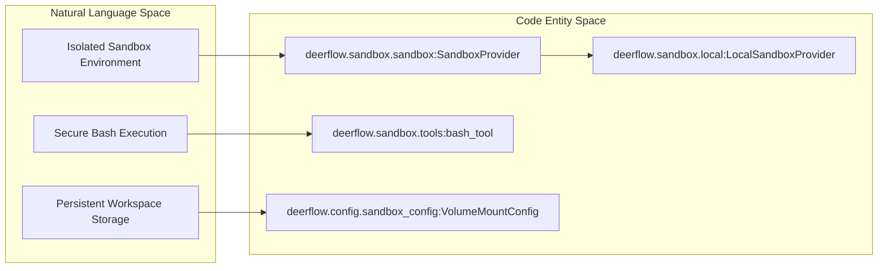

Sources: `[backend/packages/harness/deerflow/config/app_config.py:42]`, `[backend/packages/harness/deerflow/agents/middlewares/AGENTS.md:73-78]`

---

## 6. Token Budget and Memory Controls

### Token Budget Configuration

To prevent runaway token consumption during recursive agent loops, configure a process token budget:

```yaml
token_budget:
  enabled: true
  max_tokens: 200000
  warn_threshold: 0.8
  hard_stop_threshold: 1.0
```

- `max_tokens`: Hard upper limit of combined input and output tokens per run `[config.example.yaml:99-112]`.
- `warn_threshold` / `hard_stop_threshold`: Triggers in-context warning notifications at 80% and strips tool calls to force a final answer at 100% capacity `[config.example.yaml:99-112]`.

### Memory Configuration

Enable long-term fact extraction and prompt context injection `[backend/packages/harness/deerflow/agents/middlewares/AGENTS.md:31-38]`:

```yaml
memory:
  enabled: true
  injection_enabled: true
```

Sources: `[config.example.yaml:99-112]`, `[backend/packages/harness/deerflow/agents/middlewares/AGENTS.md:31-38]`

---

## 7. Summary: Minimal `config.yaml` Example

```yaml
config_version: 60
log_level: info

models:
  - name: doubao-pro
    display_name: "Doubao Pro"
    use: deerflow.models.patched_deepseek:PatchedChatDeepSeek
    model: doubao-seed-1-8-251228
    api_key: $VOLCENGINE_API_KEY
    supports_thinking: true

sandbox:
  use: deerflow.sandbox.local:LocalSandboxProvider
  allow_host_bash: false

token_usage:
  enabled: true

memory:
  enabled: true
  injection_enabled: true
```

This minimal file sets up a single thinking-capable LLM model, enforces a secure sandbox provider without direct host access, enables token metric tracking, and activates persistent memory injection. Ensure corresponding API secrets are populated in `.env`.

Sources: `[config.example.yaml:23-46,95-96]`, `[backend/docs/CONFIGURATION.md:1-141]`, `[README.md:120-136]`

---

For complete configuration schemas, including IM channels, MCP server topologies, and scheduled task properties, refer to the [7. Configuration System]() section.

---

# Page: Architecture

# Architecture

<details>
<summary>Relevant source files</summary>

The following files were used as context for generating this wiki page:

- [backend/.gitignore](backend/.gitignore)
- [backend/CLAUDE.md](backend/CLAUDE.md)
- [backend/README.md](backend/README.md)
- [backend/docs/API.md](backend/docs/API.md)
- [backend/docs/ARCHITECTURE.md](backend/docs/ARCHITECTURE.md)
- [backend/docs/README.md](backend/docs/README.md)
- [backend/docs/SANDBOX_MEMORY_PROFILING.md](backend/docs/SANDBOX_MEMORY_PROFILING.md)
- [backend/docs/TODO.md](backend/docs/TODO.md)
- [backend/tests/support/nginx_conf.py](backend/tests/support/nginx_conf.py)
- [backend/tests/support/shell.py](backend/tests/support/shell.py)
- [backend/tests/test_deploy_uv_extras.py](backend/tests/test_deploy_uv_extras.py)
- [backend/tests/test_detect_uv_extras.py](backend/tests/test_detect_uv_extras.py)
- [backend/tests/test_dev_entrypoint.py](backend/tests/test_dev_entrypoint.py)
- [backend/tests/test_gateway_runtime_cleanup.py](backend/tests/test_gateway_runtime_cleanup.py)
- [backend/tests/test_local_dev_loopback_bind.py](backend/tests/test_local_dev_loopback_bind.py)
- [backend/tests/test_nginx_langgraph_body_size.py](backend/tests/test_nginx_langgraph_body_size.py)
- [backend/tests/test_nginx_loopback_canonical.py](backend/tests/test_nginx_loopback_canonical.py)
- [backend/tests/test_nginx_project_documents_body_size.py](backend/tests/test_nginx_project_documents_body_size.py)
- [backend/tests/test_sandbox_memory_profile_script.py](backend/tests/test_sandbox_memory_profile_script.py)
- [backend/tests/test_serve_pick_python.py](backend/tests/test_serve_pick_python.py)
- [backend/tests/test_support_shell.py](backend/tests/test_support_shell.py)
- [backend/tests/test_uvicorn_reload_exclude.py](backend/tests/test_uvicorn_reload_exclude.py)
- [deploy/helm/deer-flow/templates/configmap-nginx.yaml](deploy/helm/deer-flow/templates/configmap-nginx.yaml)
- [docker/dev-entrypoint.sh](docker/dev-entrypoint.sh)
- [docker/nginx/nginx.conf](docker/nginx/nginx.conf)
- [docker/nginx/nginx.local.conf](docker/nginx/nginx.local.conf)
- [scripts/detect_uv_extras.py](scripts/detect_uv_extras.py)
- [scripts/nginx-local-conf.sh](scripts/nginx-local-conf.sh)
- [scripts/sandbox_memory_profile.py](scripts/sandbox_memory_profile.py)
- [scripts/serve.sh](scripts/serve.sh)

</details>


## Purpose and Scope

This page offers a high-level overview of DeerFlow’s system architecture, focusing on core system components and their interactions [backend/docs/ARCHITECTURE.md:5-49](). DeerFlow is an open-source **super agent harness** that orchestrates multi-agent workflows, manages persistent memory, and provides isolated sandbox execution environments [backend/README.md:1-6](). The architecture centers around a **unified Nginx reverse proxy** that routes incoming requests to the **FastAPI-based Gateway API**, which embeds the core **LangGraph agent runtime** directly within its process [backend/docs/ARCHITECTURE.md:53-56]().

The key architectural components include:
- **Nginx Proxy:** Acts as the unified entry point (`docker/nginx/nginx.conf`), routing requests based on path prefixes to backend services [backend/README.md:11-38]().
- **Gateway API:** A FastAPI application (`app/gateway/app.py`) providing REST endpoints and embedding the LangGraph agent runtime [backend/docs/ARCHITECTURE.md:78-83]().
- **Embedded Agent Runtime:** Orchestrates run lifecycles, streaming events via `StreamBridge`, middleware chains, and subagent task delegation [backend/README.md:43-68]().
- **Frontend Application:** A Next.js web application (`frontend/`) serving the user interface and communicating with backend endpoints [backend/docs/ARCHITECTURE.md:27-36]().
- **Sandbox Environment:** Provides isolated runtime environments for code execution and virtualized workspace management [backend/README.md:5-87]().

This page functions as a PARENT page. Detailed technical and operational specifics are covered in its child pages:
- For service ports, container layouts, and Nginx routing rules, see [Service Topology](#3.1).
- For package boundaries, dependency rules, and the modular backend split, see [Harness vs App Layer](#3.2).

Sources: `backend/README.md:1-6`(), `backend/docs/ARCHITECTURE.md:5-56`(), `docker/nginx/nginx.conf:80-140`()

---

## Service Components and Topology

DeerFlow operates across four main services, typically deployed via Docker Compose or run locally [docker/nginx/nginx.conf:80-140](). All external traffic enters through an Nginx reverse proxy on port `2026`, which dispatches requests using URL path prefixes [backend/README.md:11-38]().

### System Topology and Code Entity Mapping

Title: DeerFlow System Topology and Component Flow

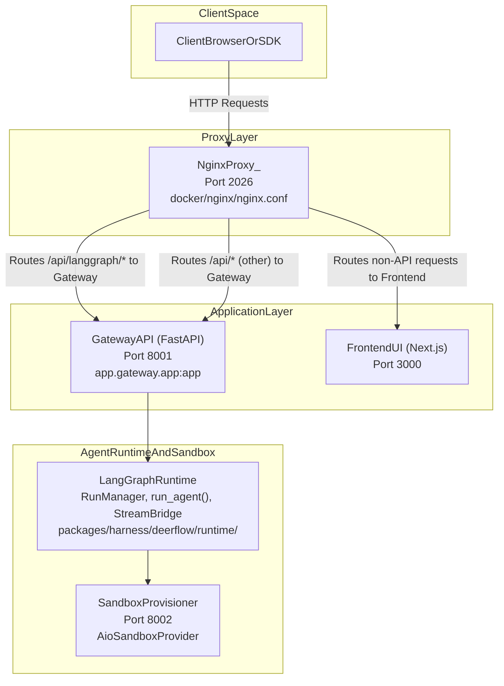

Nginx configuration defines path routing and proxy parameters for seamless streaming and long-running execution [docker/nginx/nginx.conf:107-140](). The Gateway runs FastAPI and hosts the agent runtime embedded within the same process [backend/docs/ARCHITECTURE.md:53-56]().

For detailed service ports and container routing configurations, see [Service Topology](#3.1).

Sources: `backend/README.md:11-38`(), `docker/nginx/nginx.conf:80-140`(), `backend/docs/ARCHITECTURE.md:53-56`()

---

## Harness vs App Layer

DeerFlow’s backend codebase is structured into a clean two-layer architecture:

1. **Harness Layer (`deerflow-harness`):**  
   Located under `backend/packages/harness/`, this package implements the foundational agent framework code, including the LangGraph lead agent factory (`make_lead_agent`), middleware chains, sandbox abstractions, tool integrations, and subagent management [backend/README.md:43-52](). It defines a reusable public API surface for agent logic.

2. **Application Layer (`backend/app/`):**  
   This layer comprises the FastAPI-based Gateway API service (`app.gateway.app:app`), channel integrations, authentication/authorization providers, and scheduled task handlers [backend/docs/ARCHITECTURE.md:78-98](). It depends on `deerflow-harness` to host the agent runtime and serve application endpoints.

This separation isolates core orchestration logic from web hosting and integration concerns.

For package boundaries and dependency guidelines, see [Harness vs App Layer](#3.2).

Sources: `backend/README.md:43-52`(), `backend/docs/ARCHITECTURE.md:78-98`()

---

## Request Routing and Gateway Interactions

Nginx routes requests based on URL path prefixes to optimize delivery:
- Requests starting with `/api/langgraph/*` are rewritten and directed to the Gateway's LangGraph-compatible agent runtime routes [backend/docs/ARCHITECTURE.md:17-17]().
- General REST routes under `/api/*` (e.g., `/api/models`, `/api/skills`, `/api/memory`) map to Gateway controllers [backend/docs/ARCHITECTURE.md:85-98]().
- Non-API paths are proxied to the Next.js frontend server [backend/README.md:37-37]().

### Gateway Request Flow and Code Entities

Title: Gateway Request Flow and Agent Runtime Components

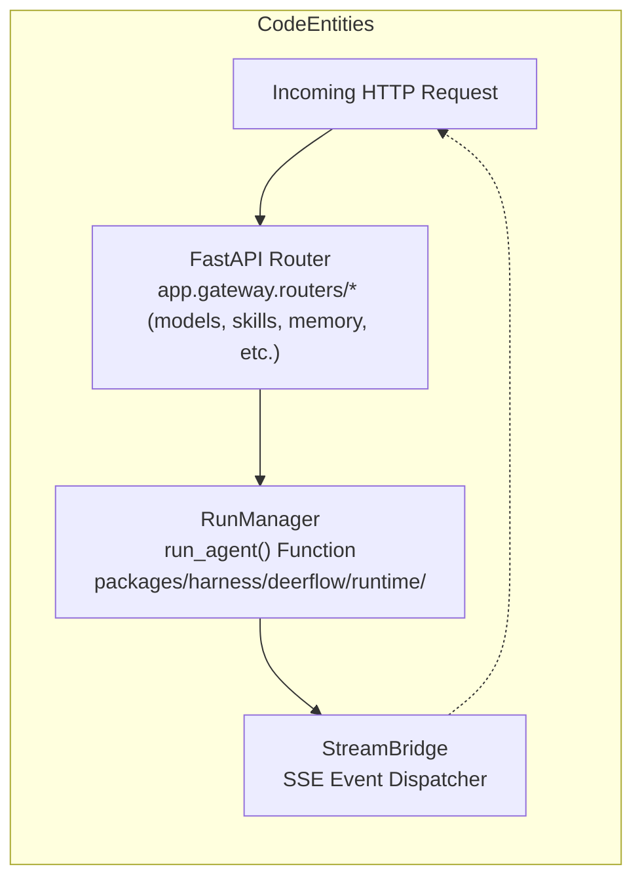

The Gateway acts as both the REST interface handler and the agent runtime host [backend/docs/ARCHITECTURE.md:53-80](). `RunManager` handles execution lifecycles, and `StreamBridge` dispatches Server-Sent Events (SSE) back to clients [backend/docs/ARCHITECTURE.md:60-64]().

For deeper API specifications, refer to [API Gateway](#5.1) and [LangGraph Agent Server](#5.2).

Sources: `backend/README.md:34-38`(), `backend/docs/ARCHITECTURE.md:53-80`(), `backend/app/gateway/app.py:1-180`()

---

## Further Reading

- [Service Topology](#3.1)
- [Harness vs App Layer](#3.2)

Sources: `backend/README.md:5-110`()

---

# Page: Service Topology

# Service Topology

<details>
<summary>Relevant source files</summary>

The following files were used as context for generating this wiki page:

- [backend/.gitignore](backend/.gitignore)
- [backend/app/gateway/app.py](backend/app/gateway/app.py)
- [backend/app/gateway/deps.py](backend/app/gateway/deps.py)
- [backend/packages/harness/deerflow/config/reload_boundary.py](backend/packages/harness/deerflow/config/reload_boundary.py)
- [backend/tests/support/nginx_conf.py](backend/tests/support/nginx_conf.py)
- [backend/tests/support/shell.py](backend/tests/support/shell.py)
- [backend/tests/test_deploy_uv_extras.py](backend/tests/test_deploy_uv_extras.py)
- [backend/tests/test_detect_uv_extras.py](backend/tests/test_detect_uv_extras.py)
- [backend/tests/test_dev_entrypoint.py](backend/tests/test_dev_entrypoint.py)
- [backend/tests/test_gateway_lifespan_shutdown.py](backend/tests/test_gateway_lifespan_shutdown.py)
- [backend/tests/test_gateway_run_drain_shutdown.py](backend/tests/test_gateway_run_drain_shutdown.py)
- [backend/tests/test_gateway_run_recovery.py](backend/tests/test_gateway_run_recovery.py)
- [backend/tests/test_gateway_runtime_cleanup.py](backend/tests/test_gateway_runtime_cleanup.py)
- [backend/tests/test_local_dev_loopback_bind.py](backend/tests/test_local_dev_loopback_bind.py)
- [backend/tests/test_multi_worker_postgres_gate.py](backend/tests/test_multi_worker_postgres_gate.py)
- [backend/tests/test_nginx_langgraph_body_size.py](backend/tests/test_nginx_langgraph_body_size.py)
- [backend/tests/test_nginx_loopback_canonical.py](backend/tests/test_nginx_loopback_canonical.py)
- [backend/tests/test_nginx_project_documents_body_size.py](backend/tests/test_nginx_project_documents_body_size.py)
- [backend/tests/test_serve_pick_python.py](backend/tests/test_serve_pick_python.py)
- [backend/tests/test_support_shell.py](backend/tests/test_support_shell.py)
- [backend/tests/test_uvicorn_reload_exclude.py](backend/tests/test_uvicorn_reload_exclude.py)
- [deploy/helm/deer-flow/README.md](deploy/helm/deer-flow/README.md)
- [deploy/helm/deer-flow/templates/configmap-nginx.yaml](deploy/helm/deer-flow/templates/configmap-nginx.yaml)
- [deploy/helm/deer-flow/templates/gateway-deployment.yaml](deploy/helm/deer-flow/templates/gateway-deployment.yaml)
- [deploy/helm/deer-flow/values.yaml](deploy/helm/deer-flow/values.yaml)
- [docker/dev-entrypoint.sh](docker/dev-entrypoint.sh)
- [docker/nginx/nginx.conf](docker/nginx/nginx.conf)
- [docker/nginx/nginx.local.conf](docker/nginx/nginx.local.conf)
- [scripts/detect_uv_extras.py](scripts/detect_uv_extras.py)
- [scripts/nginx-local-conf.sh](scripts/nginx-local-conf.sh)
- [scripts/serve.sh](scripts/serve.sh)

</details>


## Purpose and Scope

This page details the four principal runtime services within the DeerFlow system: the **Frontend**, **Gateway API**, **LangGraph Server**, and **Sandbox**. It also describes supporting infrastructure components like **Nginx**, **Redis**, and the **Sandbox Provisioner** [docker/docker-compose-dev.yaml:27-32](). The focus is on their assigned internal TCP ports, how Nginx serves as a unified reverse proxy routing requests between these services, and a precise mapping linking natural language system components to specific codebase entities.

Sources:  
[docker/docker-compose-dev.yaml:27-32]()

---

## High-Level Component Overview

DeerFlow adopts a multi-container distributed architecture that can operate in both development and production environments, typically managed via Docker Compose or local execution scripts [scripts/serve.sh:3-26](). The main services and their port allocations are tabulated below:

| Service                | Internal Port | Public Access Port | Role                                                                                     |
|------------------------|---------------|--------------------|------------------------------------------------------------------------------------------|
| **Nginx (Reverse Proxy)** | `2026`        | `localhost:2026`    | Central HTTP ingress point that routes based on path prefixes and proxy rules [docker/nginx/nginx.conf:80-83]() |
| **Frontend**           | `3000`        | Via Nginx root `/`  | Next.js frontend server delivering UI and static assets [docker/docker-compose-dev.yaml:28]() |
| **Gateway API**        | `8001`        | Via Nginx `/api/*` | FastAPI backend exposing agent runtime, REST APIs, and LangGraph-compatible endpoints [backend/app/gateway/app.py:14-62]() |
| **Sandbox**            | Internal      | N/A                | Secure isolated environment for agent code execution [deploy/helm/deer-flow/README.md:3-6]() |
| **Provisioner** (optional) | `8002`       | Internal           | Kubernetes Pod lifecycle manager used in provisioner sandbox mode [deploy/helm/deer-flow/values.yaml:143-148]() |
| **Redis**              | `6379`        | Internal           | Redis Streams backend for cross-worker SSE stream bridging [deploy/helm/deer-flow/README.md:157-158]() |

The **LangGraph Server** is embedded within the Gateway API process and handles LangGraph-compatible API requests under the `/api/langgraph/*` URL namespace [docker/nginx/nginx.conf:107-110](). The Sandbox operates internally via pluggable `SandboxProvider` implementations invoked by the Gateway's runtime [deploy/helm/deer-flow/values.yaml:145-147]().

Sources:  
[docker/docker-compose-dev.yaml:27-32](), [docker/nginx/nginx.conf:80-110](), [scripts/serve.sh:3-26](), [backend/app/gateway/app.py:14-62](), [deploy/helm/deer-flow/README.md:3-6](), [deploy/helm/deer-flow/values.yaml:143-148]()

---

## Ports and Services in Detail

### Frontend

- **Port:** `3000` internal TCP port for HTTP [docker/docker-compose-dev.yaml:28]()
- **Purpose:** Hosts the Next.js frontend server, which serves the web UI including pages, client routing, and static assets.
- **Implementation:** Next.js application running in a Node.js environment.
- **Configuration:** Forwarding of API requests from SSR layers configured via internal service discovery to communicate directly with the backend Gateway container [deploy/helm/deer-flow/templates/gateway-deployment.yaml:129-132]().

Sources:  
[docker/docker-compose-dev.yaml:28](), [deploy/helm/deer-flow/templates/gateway-deployment.yaml:129-132]()

---

### Gateway API

- **Port:** `8001` internal TCP port for API requests [deploy/helm/deer-flow/templates/gateway-deployment.yaml:137-138]()
- **Purpose:** Serves the REST API endpoints for models, skills, memory, MCP configuration, agent runtime, and user session management [backend/app/gateway/app.py:24-62]().
- **Implementation:** FastAPI app defined at `app.gateway.app:app` served by `uvicorn` inside a Python environment [backend/app/gateway/app.py:14]() [deploy/helm/deer-flow/templates/gateway-deployment.yaml:109]().
- **Scalability:** Can run with multiple worker instances, controlled via worker configurations, with Redis Streams managing state synchronization [deploy/helm/deer-flow/values.yaml:28-47]().
- **Security:** Exposed only internally; public access happens via Nginx proxy [deploy/helm/deer-flow/README.md:3-6]().

Sources:  
[backend/app/gateway/app.py:14-62](), [deploy/helm/deer-flow/README.md:3-6](), [deploy/helm/deer-flow/values.yaml:28-47](), [deploy/helm/deer-flow/templates/gateway-deployment.yaml:109-138]()

---

### LangGraph Server

- **Deployment:** Incorporated inside the Gateway API server process, thus sharing server resources and persistence layers.
- **Routing:** Nginx rewrites `/api/langgraph/*` requests to `/api/*` and proxies to the Gateway API [docker/nginx/nginx.conf:107-110]().
- **Functionality:** Provides LangGraph-compatible API endpoints using the same run manager and store mechanisms inside the Gateway.

Sources:  
[docker/nginx/nginx.conf:107-110]()

---

### Sandbox and Provisioner

- **Sandbox:** Provides a constrained, isolated environment for executing arbitrary code and tools invoked by agents. Implemented via the `SandboxProvider` interface [deploy/helm/deer-flow/values.yaml:145-147]().
- **Provisioner:** An optional service that manages the lifecycle of sandbox environments dynamically, listening on port `8002` [deploy/helm/deer-flow/values.yaml:143-148]().

Sources:  
[deploy/helm/deer-flow/values.yaml:143-148]()

---

## Nginx Proxy Configuration and Routing

Nginx acts as the unified HTTP ingress point, listening on **port 2026**, consolidating access to both the frontend and backend services [docker/nginx/nginx.conf:80-83](). It handles common web requirements such as connection upgrade headers for WebSocket/SSE, payload limits, and long-timeout handling [docker/nginx/nginx.conf:52-140]().

### Routing Rules Summary

| URL Path Pattern          | Action                                   | Destination Service           |
|---------------------------|------------------------------------------|------------------------------|
| `/api/langgraph/*`         | Rewrite prefix `/api/langgraph/` → `/api/`; proxy to Gateway | Gateway API (`8001`) [docker/nginx/nginx.conf:107-110]() |
| `/api/models`              | Proxy directly                          | Gateway API (`8001`) [docker/nginx/nginx.conf:143-151]() |
| `/api/memory`              | Proxy directly                          | Gateway API (`8001`) [docker/nginx/nginx.conf:153-161]() |
| `/api/mcp`                 | Proxy directly                          | Gateway API (`8001`) [docker/nginx/nginx.conf:163-169]() |
| All other requests         | Proxy catch-all                         | Frontend service (`3000`) [docker/nginx/nginx.conf:93]() |

Sources:  
[docker/nginx/nginx.conf:80-169]()

---

### Sample Nginx Location Block for LangGraph API

```nginx
location /api/langgraph/ {
    rewrite ^/api/langgraph/(.*) /api/$1 break;
    proxy_pass http://$gateway_upstream;
    proxy_http_version 1.1;

    proxy_set_header Host $http_host;
    proxy_set_header X-Real-IP $remote_addr;
    proxy_set_header X-Forwarded-For $proxy_add_x_forwarded_for;
    proxy_set_header X-Forwarded-Proto $forwarded_proto;
    proxy_set_header Connection '';

    proxy_set_header X-Accel-Buffering no;
    client_max_body_size 20M;
    proxy_request_buffering off;

    proxy_connect_timeout 600s;
    proxy_send_timeout 600s;
    proxy_read_timeout 600s;
    chunked_transfer_encoding on;
}
```

Sources:  
[docker/nginx/nginx.conf:107-140]()

---

## Diagram: Nginx Proxy Routing Topology

Title: "Nginx Routing Topology"
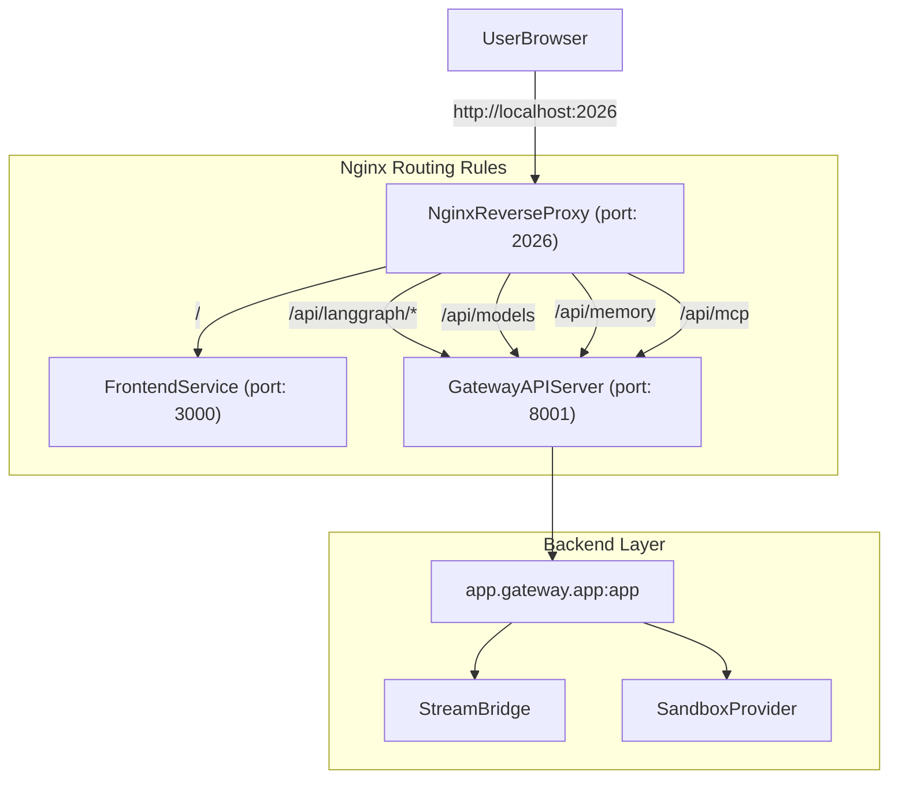

Sources:  
[docker/nginx/nginx.conf:80-169](), [backend/app/gateway/app.py:14-62]()

---

## Implementation Mapping: Natural Language Components to Code Entities

Title: "Natural Language to Code Entity Mapping"
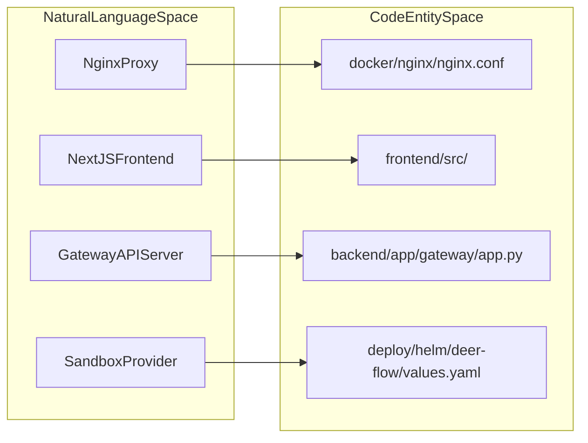

Sources:  
[docker/nginx/nginx.conf:80-169](), [backend/app/gateway/app.py:14-62](), [deploy/helm/deer-flow/values.yaml:143-148]()

---

# Summary

- DeerFlow comprises four main services: Frontend (`3000`), Gateway API + LangGraph Server (`8001`), Sandbox (internal), and Nginx (`2026`) [docker/docker-compose-dev.yaml:27-32]().
- Nginx serves as a centralized HTTP proxy, routing requests based on URL prefixes to the appropriate upstream service [docker/nginx/nginx.conf:80-110]().
- The Gateway API is the core backend with an embedded LangGraph Server, integrating REST APIs, agent runtime, and sandbox execution calls [backend/app/gateway/app.py:14-62]().
- Environment variables and internal service references ensure coherent inter-service communication [deploy/helm/deer-flow/templates/gateway-deployment.yaml:129-132]().

Sources:  
[docker/docker-compose-dev.yaml:27-32](), [docker/nginx/nginx.conf:80-110](), [backend/app/gateway/app.py:14-62](), [deploy/helm/deer-flow/templates/gateway-deployment.yaml:129-132]()

---

# Page: Harness vs App Layer

# Harness vs App Layer

<details>
<summary>Relevant source files</summary>

The following files were used as context for generating this wiki page:

- [.gitignore](.gitignore)
- [backend/CLAUDE.md](backend/CLAUDE.md)
- [backend/Makefile](backend/Makefile)
- [backend/README.md](backend/README.md)
- [backend/docs/API.md](backend/docs/API.md)
- [backend/docs/ARCHITECTURE.md](backend/docs/ARCHITECTURE.md)
- [backend/docs/README.md](backend/docs/README.md)
- [backend/docs/SANDBOX_MEMORY_PROFILING.md](backend/docs/SANDBOX_MEMORY_PROFILING.md)
- [backend/docs/TODO.md](backend/docs/TODO.md)
- [backend/packages/extension-api/deerflow_extension_api/__init__.py](backend/packages/extension-api/deerflow_extension_api/__init__.py)
- [backend/packages/extension-api/deerflow_extension_api/contracts.py](backend/packages/extension-api/deerflow_extension_api/contracts.py)
- [backend/packages/extension-api/pyproject.toml](backend/packages/extension-api/pyproject.toml)
- [backend/packages/harness/deerflow/extensions/AGENTS.md](backend/packages/harness/deerflow/extensions/AGENTS.md)
- [backend/packages/harness/deerflow/extensions/registry.py](backend/packages/harness/deerflow/extensions/registry.py)
- [backend/packages/harness/pyproject.toml](backend/packages/harness/pyproject.toml)
- [backend/pyproject.toml](backend/pyproject.toml)
- [backend/tests/test_extension_api_contracts.py](backend/tests/test_extension_api_contracts.py)
- [backend/tests/test_sandbox_memory_profile_script.py](backend/tests/test_sandbox_memory_profile_script.py)
- [backend/uv.lock](backend/uv.lock)
- [frontend/src/core/extensions/catalog.ts](frontend/src/core/extensions/catalog.ts)
- [frontend/tests/e2e/bookmark-plugin.spec.ts](frontend/tests/e2e/bookmark-plugin.spec.ts)
- [scripts/sandbox_memory_profile.py](scripts/sandbox_memory_profile.py)

</details>


This page explains the two-layer backend architecture of DeerFlow, detailing the boundary between the publishable `deerflow-harness` package and the application layer (`app/`), their responsibilities, dependency rules, and how they interact.

---

## Architectural Overview

DeerFlow employs a clean two-layer backend architecture designed to decouple the core agent runtime, orchestration engine, and memory systems from the application-specific delivery, REST API exposure, authentication, and integration layers. This separation guarantees that the core capabilities remain publishable, reusable, and testable as a standalone Python package `deerflow-harness` [backend/packages/harness/pyproject.toml:1-67](). Meanwhile, the application layer under `backend/app/` provides deployment orchestration, FastAPI Gateway endpoints, authentication, and platform integrations [backend/pyproject.toml:1-43]().

The backend is logically divided into two primary layers:

- **Harness Layer**: Implemented as the `deerflow-harness` standalone Python package located at `backend/packages/harness/` [backend/packages/harness/pyproject.toml:1-67](). It contains the core AI super agent runtime: the LangGraph-based lead agent factory (`create_deerflow_agent`, `make_lead_agent`), middleware pipeline, subagent executor, sandbox abstractions, tool system, memory engine, and configuration [backend/packages/harness/pyproject.toml:1-67](), [backend/docs/ARCHITECTURE.md:53-76](). This layer is environment-agnostic and free from deployment-specific dependencies.

- **App Layer**: Implemented under `backend/app/` in the main workspace [backend/pyproject.toml:1-43](). This layer hosts the FastAPI Gateway server exposing REST APIs, manages authentication and authorization, orchestrates agent runtime execution, and integrates with external platforms via IM channels [backend/pyproject.toml:1-43](), [backend/docs/ARCHITECTURE.md:78-105]().

This strict layering is enforced via a hard architectural import boundary rule:

> The **App Layer is allowed to import the Harness package**, but the **Harness package must never import or depend on App**.

Sources: [backend/uv.lock:13-18](), [backend/pyproject.toml:1-43](), [backend/packages/harness/pyproject.toml:1-67]()

---

## Layer Summary Table

| Layer               | Package / Directory                      | Import Prefix    | Role                                                                                       |
|---------------------|----------------------------------------|-----------------|--------------------------------------------------------------------------------------------|
| Harness             | `backend/packages/harness/deerflow/`  | `deerflow.*`    | Core AI super agent runtime: lead agent factory, middleware chain, sandbox, subagents, tools, memory engine |
| App Layer           | `backend/app/`                         | `app.*`         | FastAPI Gateway API (`app.gateway`), authentication, authorization, IM platform integrations, routing |

Sources: [backend/pyproject.toml:1-43](), [backend/packages/harness/pyproject.toml:1-67](), [backend/docs/ARCHITECTURE.md:53-105]()

---

## Harness: The `deerflow-harness` Package

The **Harness** layer is developed as a self-contained, publishable Python package located at `backend/packages/harness/` [backend/packages/harness/pyproject.toml:1-67](). It is an independent workspace member, enabling separate versioning and managed dependencies.

### Core Responsibilities

- **Lead Agent Factory**: Provides `make_lead_agent()` and `create_deerflow_agent()` which build the LangGraph-based lead agent, wiring in system prompts, middleware, subagent limits, and tools within a strong runtime boundary [backend/docs/ARCHITECTURE.md:53-76]().

- **Middleware Chain**: Implements a modular chain of middlewares handling critical runtime concerns such as per-thread isolation, uploads injection, sandbox environment acquisition, and memory extraction [backend/README.md:53-68]().

- **Subagent System**: Provides asynchronous task delegation with `SubagentExecutor` which runs delegated agent graphs concurrently, tracked with task statuses and managed timeouts [backend/README.md:88-96]().

- **Sandbox Execution**: Abstracts sandboxed execution environments via the `SandboxProvider` interface, supporting local file systems, Docker containers, and Kubernetes pods for safe code and tool execution [backend/packages/harness/pyproject.toml:7-10,54]().

Sources: [backend/packages/harness/pyproject.toml:1-67](), [backend/docs/ARCHITECTURE.md:53-76](), [backend/README.md:41-111]()

---

## App Layer: Gateway API and IM Channels

The **App** layer serves as the deployment container and external interface boundary for DeerFlow. It composes the harness into a full backend service with:

- A FastAPI Gateway server exposing REST APIs for models, skills, memory, artifacts, agents, threads, runs, uploads, and scheduled tasks [backend/docs/ARCHITECTURE.md:78-105]().
- Authentication and authorization subsystems, handling JWT session validation, CSRF Double Submit Cookie enforcement, token versioning, and user-id metadata filtering for LangGraph Server [backend/docs/API.md:19-161]().
- Integrations with multiple IM platforms (Slack, Telegram, Feishu/Lark, WeCom, DingTalk, Discord, Buzz), translating platform events into conversation threads routed through the harness runtime [backend/pyproject.toml:31-38]().

Sources: [backend/pyproject.toml:7-43](), [backend/docs/ARCHITECTURE.md:78-105](), [backend/docs/API.md:19-161]()

---

## Data Flow and Interaction Diagram

Title for the diagram: "Harness vs App Layer Request Flow"
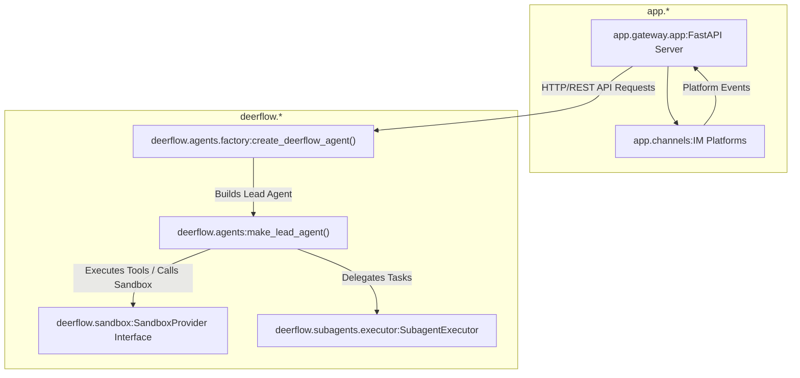
Sources: [backend/pyproject.toml:7-43](), [backend/docs/ARCHITECTURE.md:53-76]()

---

## Code Entity Space Bridge Diagrams

Title for diagram: "Harness to App Layer Bridge Entities"
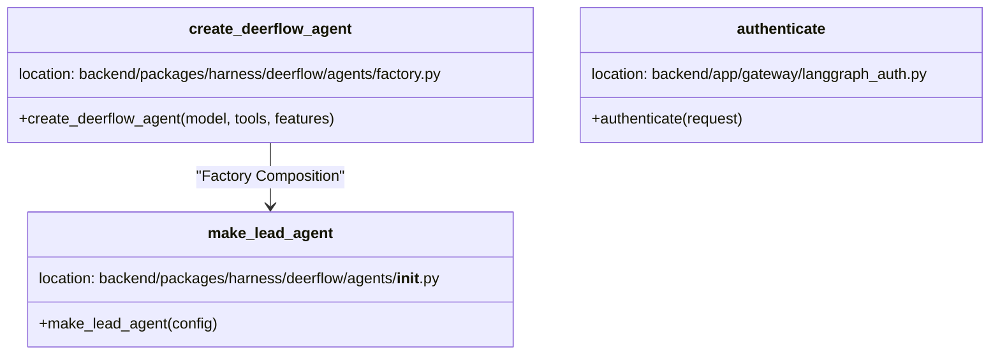

Title for diagram: "App API and Harness Runtime Access"
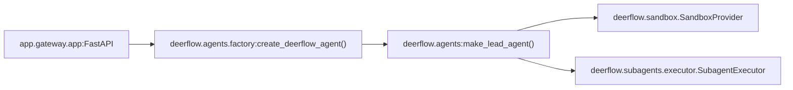

Sources: [backend/pyproject.toml:7-43](), [backend/docs/ARCHITECTURE.md:53-76]()

---

# Summary

DeerFlow's two-layer backend architecture enforces a clear separation between:

- **Harness Layer:** The publishable `deerflow-harness` package containing the core AI super agent runtime, LangGraph graphs, middleware, sandbox execution, subagents, and configuration [backend/packages/harness/pyproject.toml:1-67]().
- **App Layer:** The application wrapper (`backend/app/`) providing REST APIs, authentication, authorization middleware, IM channels, and server orchestration [backend/pyproject.toml:1-43](), [backend/docs/ARCHITECTURE.md:78-105]().

This separation ensures modularity, reusability, and clean distribution boundaries, critical for evolving DeerFlow as a platform super agent infrastructure.

Sources:
- [backend/pyproject.toml:1-43]()
- [backend/packages/harness/pyproject.toml:1-67]()
- [backend/docs/ARCHITECTURE.md:53-105]()
- [backend/uv.lock:13-18]()

---

# Page: Frontend Application

# Frontend Application

<details>
<summary>Relevant source files</summary>

The following files were used as context for generating this wiki page:

- [frontend/.env.example](frontend/.env.example)
- [frontend/README.md](frontend/README.md)
- [frontend/components.json](frontend/components.json)
- [frontend/next.config.js](frontend/next.config.js)
- [frontend/package.json](frontend/package.json)
- [frontend/pnpm-lock.yaml](frontend/pnpm-lock.yaml)
- [frontend/src/AGENTS.md](frontend/src/AGENTS.md)
- [frontend/src/app/page.tsx](frontend/src/app/page.tsx)
- [frontend/src/components/theme-provider.tsx](frontend/src/components/theme-provider.tsx)
- [frontend/src/components/ui/aurora-text.tsx](frontend/src/components/ui/aurora-text.tsx)
- [frontend/src/components/ui/number-ticker.tsx](frontend/src/components/ui/number-ticker.tsx)
- [frontend/src/components/workspace/artifacts/artifact-file-preview.tsx](frontend/src/components/workspace/artifacts/artifact-file-preview.tsx)
- [frontend/src/components/workspace/settings/about-content.ts](frontend/src/components/workspace/settings/about-content.ts)
- [frontend/src/components/workspace/settings/about-settings-page.tsx](frontend/src/components/workspace/settings/about-settings-page.tsx)
- [frontend/src/components/workspace/settings/about.md](frontend/src/components/workspace/settings/about.md)
- [frontend/src/components/workspace/settings/memory-settings-page.tsx](frontend/src/components/workspace/settings/memory-settings-page.tsx)
- [frontend/src/components/workspace/settings/settings-dialog.tsx](frontend/src/components/workspace/settings/settings-dialog.tsx)
- [frontend/src/components/workspace/workspace-header.tsx](frontend/src/components/workspace/workspace-header.tsx)
- [frontend/src/components/workspace/workspace-nav-menu.tsx](frontend/src/components/workspace/workspace-nav-menu.tsx)
- [frontend/src/core/api/api-client.ts](frontend/src/core/api/api-client.ts)
- [frontend/src/core/api/stream-mode.ts](frontend/src/core/api/stream-mode.ts)
- [frontend/src/core/artifacts/hooks.ts](frontend/src/core/artifacts/hooks.ts)
- [frontend/src/core/artifacts/html-assets.ts](frontend/src/core/artifacts/html-assets.ts)
- [frontend/src/core/artifacts/loader.ts](frontend/src/core/artifacts/loader.ts)
- [frontend/src/core/auth/gateway-config.ts](frontend/src/core/auth/gateway-config.ts)
- [frontend/src/core/config/index.ts](frontend/src/core/config/index.ts)
- [frontend/src/core/memory/api.ts](frontend/src/core/memory/api.ts)
- [frontend/src/core/memory/hooks.ts](frontend/src/core/memory/hooks.ts)
- [frontend/src/core/memory/types.ts](frontend/src/core/memory/types.ts)
- [frontend/src/core/threads/stream-state.ts](frontend/src/core/threads/stream-state.ts)
- [frontend/src/env.js](frontend/src/env.js)
- [frontend/tests/e2e/artifact-preview.spec.ts](frontend/tests/e2e/artifact-preview.spec.ts)
- [frontend/tests/unit/components/workspace/artifacts/artifact-file-preview.dom.test.tsx](frontend/tests/unit/components/workspace/artifacts/artifact-file-preview.dom.test.tsx)
- [frontend/tests/unit/core/api/api-client.test.ts](frontend/tests/unit/core/api/api-client.test.ts)
- [frontend/tests/unit/core/api/stream-mode.test.ts](frontend/tests/unit/core/api/stream-mode.test.ts)
- [frontend/tests/unit/core/artifacts/html-assets-auth.dom.test.ts](frontend/tests/unit/core/artifacts/html-assets-auth.dom.test.ts)
- [frontend/tests/unit/core/auth/gateway-config.test.ts](frontend/tests/unit/core/auth/gateway-config.test.ts)
- [frontend/tests/unit/core/threads/incremental-stream-state.dom.test.tsx](frontend/tests/unit/core/threads/incremental-stream-state.dom.test.tsx)

</details>


The Frontend Application is the Next.js-based user interface for DeerFlow, designed to provide an interactive and real-time experience for orchestrating complex agent workflows. It acts as the "super agent harness" frontend, visualizing conversation threads, managing subtasks, presenting artifacts, and providing an extensible settings UI. The frontend architecture emphasizes modularity, localization, and streaming interaction, supporting DeerFlow’s multi-agent orchestration backend.

## Technology Stack

DeerFlow’s frontend utilizes a modern React ecosystem and third-party libraries optimized for real-time interaction, rich UI, and maintainable design.

| Category             | Technology                                | Purpose                                                                              |
|----------------------|------------------------------------------|--------------------------------------------------------------------------------------|
| **Framework**        | Next.js 16 (App Router)                  | Server-side rendering, nested layouts, routing [frontend/next.config.js:20-32]()     |
| **UI**               | React 19                                 | Interactive component rendering with hooks and concurrent mode support [frontend/package.json:88-89]() |
| **Streaming SDK**    | `@langchain/langgraph-sdk`               | Real-time streaming from LangGraph with SSE support [frontend/pnpm-lock.yaml:38-40]()|
| **Styling**          | Tailwind CSS 4, Radix UI, Shadcn UI     | Utility-first CSS, components, animations, accessibility [frontend/package.json:33-50](), [frontend/package.json:126-126]() |
| **Markdown Rendering**| Streamdown + plugins                     | Streaming markdown rendering including code blocks, mermaid diagrams, LaTeX math [frontend/package.json:51-52](), [frontend/package.json:99-99]() |
| **Editor**           | CodeMirror 6 + `@uiw/react-codemirror` | Embedded code editor for artifact content with syntax highlighting [frontend/package.json:59-67]() |
| **Internationalization** | Custom i18n context + locale files    | Multi-language support with typed translation files and locale detection [frontend/next.config.js:26-29]() |

Sources: [frontend/next.config.js:20-32](), [frontend/package.json:33-126](), [frontend/pnpm-lock.yaml:38-40]()

---

## Application Architecture

The frontend follows Next.js’s App Router design, mixing server and client components alongside React Context providers and rich hooks to maintain domain state and interactions.

### Component Hierarchy Overview

Title: Component Hierarchy Overview
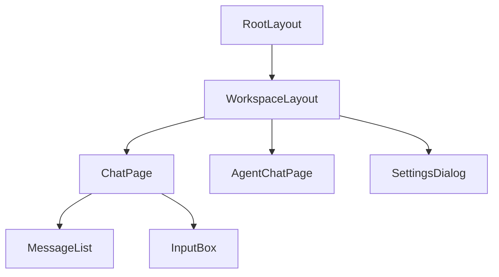

This structure ensures localization, authentication, and workspace context flow seamlessly to chat pages, dialogs, and navigation components.

Sources: [frontend/README.md:97-126](), [frontend/src/components/workspace/settings/settings-dialog.tsx:109-203]()

---

### Mapping Natural Language Concepts to Code Entities

Title: Natural Language to Code Entity Space
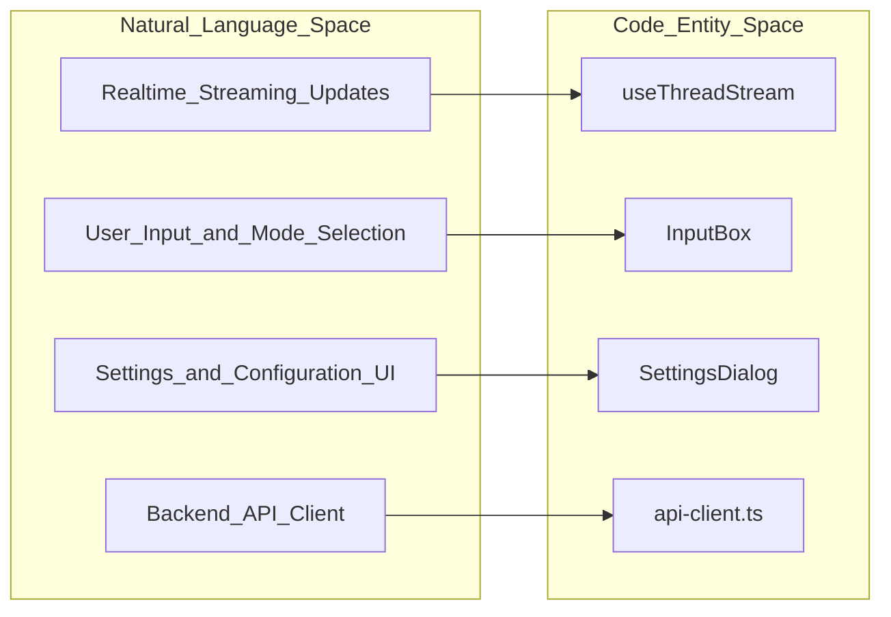

This diagram clarifies how real-time updates, user inputs, configuration panels, and network boundaries map to concrete code modules.

Sources: [frontend/src/core/api/api-client.ts:31-42](), [frontend/src/components/workspace/settings/settings-dialog.tsx:109-203](), [frontend/README.md:108-120]()

---

## Key Subsystems Overview

This overview introduces major frontend subsystems. Each subsection links to a dedicated child page for detailed documentation.

### 4.1 Application Layout and Routing

The frontend adopts Next.js App Router's nested layouts for a workspace-centric UI. The workspace root layout manages authentication and wraps the sidebar, header, and main content. Routing follows resource grouping: `/workspace/chats/[thread_id]` for conversation threads, `/workspace/chats/new` for creating chats, and `/workspace/agents/[agent_name]/chats/[thread_id]` for custom agent threads.

For details, see [Application Layout and Routing](#4.1).

Sources: [frontend/README.md:71-76]()

---

### 4.2 Chat Interface and Thread Management

The chat interface leverages the `useThreadStream` hook to subscribe to thread lifecycle events and stream messages live from LangGraph via SSE. The `ChatPage` component orchestrates the thread view, user inputs, and real-time message updates while safeguarding against stream replay gaps.

For details, see [Chat Interface and Thread Management](#4.2).

Sources: [frontend/src/core/api/api-client.ts:77-110]()

---

### 4.3 Input System and Mode Selection

User input is handled by the `InputBox` component, supporting text input, mode switching, file attachments, and model selection. Suggestion and follow-up features assist user workflows and draft management before submission.

For details, see [Input System and Mode Selection](#4.3).

Sources: [frontend/src/AGENTS.md:28-29]()

---

### 4.4 Message Rendering System

Messages are rendered as stable groups with support for rich content including Chain of Thought reasoning steps, tool call visualizations, and interactive annotations, through components like `MessageList`, `MessageListItem`, and `MessageGroup`.

For details, see [Message Rendering System](#4.4).

Sources: [frontend/README.md:103-114]()

---

### 4.5 Subtasks and Subagent Tracking

Delegated subtasks executed by subagents are tracked and visualized via specialized task card components and related hooks. This subsystem manages lifecycle events and real-time progress updates for subtasks.

For details, see [Subtasks and Subagent Tracking](#4.5).

Sources: [frontend/README.md:108-120]()

---

### 4.6 Artifacts and File Display

Agent-generated artifacts are presented within a file list and detailed viewer UI, supporting previews, downloads, and in-browser editing with CodeMirror and range loading (`[frontend/src/core/artifacts/loader.ts:50-116]()`). Skill installation UI is also integrated here.

For details, see [Artifacts and File Display](#4.6).

Sources: [frontend/src/core/artifacts/loader.ts:50-116]()

---

### 4.7 Settings and Configuration UI

Settings are managed via a dialog (`[frontend/src/components/workspace/settings/settings-dialog.tsx:109-203]()`) with dynamically loaded pages for account, appearance, skills, memory (`[frontend/src/components/workspace/settings/memory-settings-page.tsx:1-51]()`), notifications, subagents, and about sections, optimized for lazy loading and performance.

For details, see [Settings and Configuration UI](#4.7).

Sources: [frontend/src/components/workspace/settings/settings-dialog.tsx:36-93](), [frontend/src/components/workspace/settings/memory-settings-page.tsx:1-51]()

---

### 4.8 State Management and Hooks

State management combines React Context providers, custom hooks (`useThreadStream`, `useArtifacts`, `useSubtasks`), and API client abstractions to encapsulate frontend logic and backend communication.

For details, see [State Management and Hooks](#4.8).

Sources: [frontend/src/core/api/api-client.ts:31-42]()

---

### 4.9 Styling System and UI Components

The UI styling is based on Tailwind CSS with custom animations and Radix UI component library for accessibility and composability. CodeMirror integration supports in-browser editing features.

For details, see [Styling System and UI Components](#4.9).

Sources: [frontend/package.json:33-67]()

---

### 4.10 Internationalization

A custom internationalization system provides typed locales with support for English and Chinese, managing multi-language strings and locale detection under Next.js configuration rules.

For details, see [Internationalization](#4.10).

Sources: [frontend/next.config.js:26-29]()

---

### 4.11 Content Rendering and Link Handling

Message and content rendering employs Streamdown with plugins for markdown parsing, code highlighting, Mermaid diagrams, math formulas, and secure handling of special links like citations and artifacts.

For details, see [Content Rendering and Link Handling](#4.11).

Sources: [frontend/package.json:51-52](), [frontend/package.json:91-102]()

---

### 4.12 Custom Agent Studio

Custom agents can be created and managed with a dedicated UI studio, including an agent creation wizard, a gallery for browsing agents, and support for agent-specific chat threads.

For details, see [Custom Agent Studio](#4.12).

Sources: [frontend/README.md:98-102]()

---

### 4.13 Scheduled Tasks UI

The scheduled tasks workspace page lets users create one-time or cron-based tasks, manage run history, and utilize recipe shortcuts, integrating React Query hooks for data synchronization.

For details, see [Scheduled Tasks UI](#4.13).

Sources: [frontend/package.json:104-106]()

---

### 4.14 Documentation Site Content

In-app documentation is provided as MDX content under `frontend/src/content`, supporting multiple languages and organized as harness and application guides. Routing and link-checking are integrated into the build configuration via Nextra (`[frontend/next.config.js:16-18]()`).

For details, see [Documentation Site Content](#4.14).

Sources: [frontend/next.config.js:16-18]()

---

## Summary Diagram: Concept to Code Mapping

Title: Summary Concept to Code Mapping
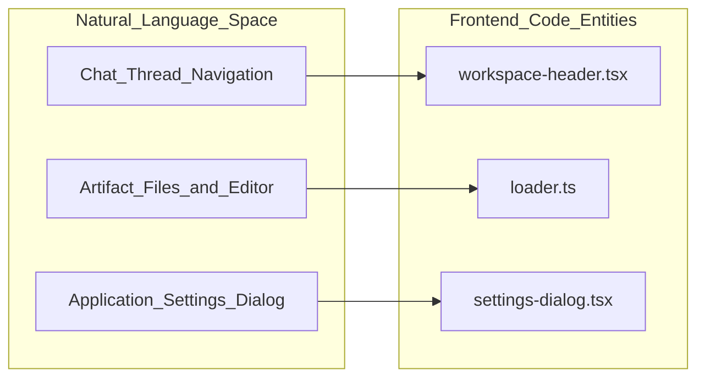

This diagram captures primary conceptual frontend domains mapped to concrete code entities, illustrating the layered interface and internal logic.

Sources: [frontend/src/components/workspace/workspace-header.tsx:1-18](), [frontend/src/core/artifacts/loader.ts:50-65](), [frontend/src/components/workspace/settings/settings-dialog.tsx:109-125]()

---

# Page: Application Layout and Routing

# Application Layout and Routing

<details>
<summary>Relevant source files</summary>

The following files were used as context for generating this wiki page:

- [frontend/src/app/workspace/chats/[thread_id]/layout.tsx](frontend/src/app/workspace/chats/[thread_id]/layout.tsx)
- [frontend/src/app/workspace/layout.tsx](frontend/src/app/workspace/layout.tsx)
- [frontend/src/components/query-client-provider.tsx](frontend/src/components/query-client-provider.tsx)
- [frontend/src/components/ui/empty.tsx](frontend/src/components/ui/empty.tsx)
- [frontend/src/components/ui/item.tsx](frontend/src/components/ui/item.tsx)
- [frontend/src/components/ui/switch.tsx](frontend/src/components/ui/switch.tsx)
- [frontend/src/components/workspace/recent-chat-list.tsx](frontend/src/components/workspace/recent-chat-list.tsx)
- [frontend/src/components/workspace/settings/appearance-settings-page.tsx](frontend/src/components/workspace/settings/appearance-settings-page.tsx)
- [frontend/src/components/workspace/settings/index.ts](frontend/src/components/workspace/settings/index.ts)
- [frontend/src/components/workspace/workspace-sidebar.tsx](frontend/src/components/workspace/workspace-sidebar.tsx)
- [frontend/src/core/i18n/context.tsx](frontend/src/core/i18n/context.tsx)
- [frontend/src/core/i18n/cookies.ts](frontend/src/core/i18n/cookies.ts)
- [frontend/src/core/i18n/hooks.ts](frontend/src/core/i18n/hooks.ts)
- [frontend/src/core/i18n/index.ts](frontend/src/core/i18n/index.ts)
- [frontend/src/core/i18n/server.ts](frontend/src/core/i18n/server.ts)
- [frontend/src/core/settings/hooks.ts](frontend/src/core/settings/hooks.ts)
- [frontend/src/core/settings/index.ts](frontend/src/core/settings/index.ts)
- [frontend/src/core/settings/local.ts](frontend/src/core/settings/local.ts)
- [frontend/src/core/settings/store.ts](frontend/src/core/settings/store.ts)
- [frontend/src/core/threads/types.ts](frontend/src/core/threads/types.ts)
- [frontend/src/core/threads/utils.ts](frontend/src/core/threads/utils.ts)
- [frontend/tests/unit/core/threads/utils.test.ts](frontend/tests/unit/core/threads/utils.test.ts)

</details>


## Purpose and Scope

This document explains the Next.js application structure, workspace layout system, sidebar navigation, routing patterns, and related data flow in the DeerFlow frontend. It details how the application organizes files, manages authentication states via server-side checks, structures routed chat threads and agent workspaces, and handles local and thread-scoped UI settings using a safe `localStorage` abstraction layer.

---

## Next.js App Router Structure

DeerFlow utilizes Next.js with the App Router paradigm, organizing navigation via filesystem-based conventions under `frontend/src/app/`. The application uses hierarchical layouts that wrap nested child pages and dynamic routes.

### File System Routing Topology

Title: "File System Routing Topology"
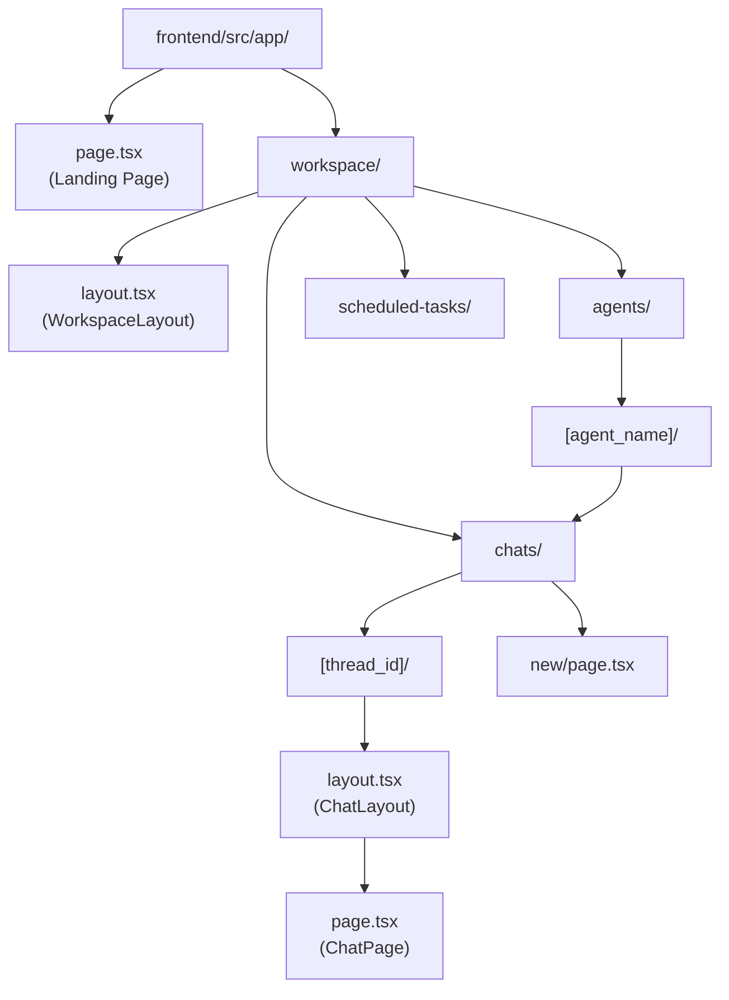

- The root `/` path serves the landing page, providing entry points and information.
- The `/workspace/` subtree hosts the authenticated user interface, enclosed by `WorkspaceLayout`.
- Dynamic nested routes like `/workspace/chats/[thread_id]` house chat threads. `ChatLayout` wraps these views with shared context for thread-specific data streams, message streaming, and lifecycle hooks [frontend/src/app/workspace/chats/[thread_id]/layout.tsx:1-18](). This layout also implements `generateStaticParams()` to support static generation of demo chat threads during static export builds [frontend/src/app/workspace/chats/[thread_id]/layout.tsx:5-10]().
- Other workspace modules include custom agent execution spaces (`/workspace/agents/[agent_name]/chats/[thread_id]`) and scheduled tasks (`/workspace/scheduled-tasks/`), each maintaining dedicated routing contexts.

Sources: [frontend/src/app/workspace/chats/[thread_id]/layout.tsx:1-18](), [frontend/src/app/workspace/layout.tsx:1-64]().

---

## Workspace Layout Architecture

At the root of the authenticated user interface under `/workspace`, the `WorkspaceLayout` component located at `frontend/src/app/workspace/layout.tsx` serves as the primary application shell. It performs key responsibilities:

- **Authentication State Resolution:** Invokes `getServerSideUser()` to inspect the user's session status and system initialization flags from the server environment [frontend/src/app/workspace/layout.tsx:22]().
- **Locale Detection:** Calls `detectLocaleServer()` to determine the localized language profile before rendering [frontend/src/app/workspace/layout.tsx:21]().
- **Conditional Layout Flow:** Processes the union result returned by the authentication check:
  - `"authenticated"`: Wraps child nodes in an `AuthProvider` passing `initialUser`, and mounts `WorkspaceContent` [frontend/src/app/workspace/layout.tsx:27-32]().
  - `"needs_setup"` or `"system_setup_required"`: Triggers a server-side redirect to `/setup` [frontend/src/app/workspace/layout.tsx:34-37]().
  - `"unauthenticated"`: Renders `WorkspaceLoginRedirect` (delegating client-side login handling since layouts cannot directly inspect request URLs) [frontend/src/app/workspace/layout.tsx:38-42]().
  - `"account_disabled"`: Redirects to `ACCOUNT_DISABLED_LOGIN_URL` [frontend/src/app/workspace/layout.tsx:43-46]().
  - `"gateway_unavailable"`: Mounts `GatewayOfflineFallback` enclosing `WorkspaceContent` with the `gatewayUnavailable` flag enabled [frontend/src/app/workspace/layout.tsx:47-56]().
  - `"config_error"`: Throws a runtime initialization error with the message provided [frontend/src/app/workspace/layout.tsx:57-58]().

Sources: [frontend/src/app/workspace/layout.tsx:1-64]().

---

## Sidebar Architecture and Components

The sidebar provides persistent navigation across the workspace interface, granting access to active navigation links, IM channels, projects, and recent chats.

### Sidebar Component Tree

Title: "Sidebar Component Tree"
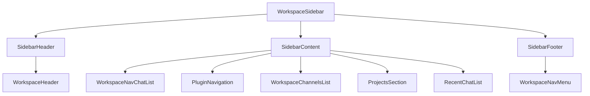

- **WorkspaceHeader**: Renders the brand header and primary controls [frontend/src/components/workspace/workspace-sidebar.tsx:34]().
- **WorkspaceNavChatList**: Displays primary workspace links (chats, agents, scheduled tasks) [frontend/src/components/workspace/workspace-sidebar.tsx:37]().
- **PluginNavigation**: Injects extension and plugin routes dynamically [frontend/src/components/workspace/workspace-sidebar.tsx:38]().
- **WorkspaceChannelsList**: Lists linked messaging channel connections [frontend/src/components/workspace/workspace-sidebar.tsx:39]().
- **ProjectsSection** & **RecentChatList**: Conditionally rendered when `isSidebarOpen` is true, displaying user projects and recent threads [frontend/src/components/workspace/workspace-sidebar.tsx:40-45](). Additionally, `WorkspaceSidebar` invokes `useThreadActivity()` to poll for background thread updates [frontend/src/components/workspace/workspace-sidebar.tsx:29]().
- **WorkspaceNavMenu**: Houses user account menus, theme settings, and navigation footers [frontend/src/components/workspace/workspace-sidebar.tsx:48]().

Sources: [frontend/src/components/workspace/workspace-sidebar.tsx:1-54]().

---

## Thread Routing and Context Resolution

Routing between standard chats and custom agent chats is centralized in utility functions like `pathOfThread` (`frontend/src/core/threads/utils.ts`). 

- If an agent name is detected in either the thread's `context.agent_name` or `metadata.agent_name`, `pathOfThread` constructs a custom agent route: `/workspace/agents/[agent_name]/chats/[thread_id]` [frontend/src/core/threads/utils.ts:41-67]().
- Otherwise, it falls back to the standard chat route: `/workspace/chats/[thread_id]` [frontend/src/core/threads/utils.ts:66]().

Sources: [frontend/src/core/threads/utils.ts:1-180](), [frontend/tests/unit/core/threads/utils.test.ts:1-231]().

---

## Application Settings and Local Storage

DeerFlow manages persistent UI configurations and thread overrides through a robust `localStorage` abstraction layer.

### Safe Local Storage Wrapper

Browser environments (such as Safari in private mode or tight security configurations) frequently throw `SecurityError` or `QuotaExceededError` on storage operations. The `safeLocalStorage` helper (`frontend/src/core/settings/local.ts`) traps these exceptions to prevent React render-phase crashes [frontend/src/core/settings/local.ts:39-66]().

```ts
export const safeLocalStorage = {
  getItem(key: string): string | null { ... },
  setItem(key: string, value: string): boolean { ... },
  removeItem(key: string): boolean { ... },
}
```

### Storage Key Conventions

| Key Pattern | Description |
| :--- | :--- |
| `deerflow.local-settings` | Global UI and feature toggle state [frontend/src/core/settings/local.ts:22]() |
| `deerflow.thread-model.<thread_id>` | Thread-specific model overrides [frontend/src/core/settings/local.ts:23]() |

### React Hooks for State Management

- `useLocalSettings()`: Subscribes to global settings changes using `useSyncExternalStore` [frontend/src/core/settings/hooks.ts:17-29]().
- `useThreadSettings(threadId)`: Combines base settings with thread-specific model overrides [frontend/src/core/settings/hooks.ts:31-59]().

Sources: [frontend/src/core/settings/local.ts:1-176](), [frontend/src/core/settings/hooks.ts:1-59]().

---

# Natural Language Space to Code Entity Mapping: Layout & Routing

Title: "Natural Language Space to Code Entity Mapping Layout and Routing"
```mermaid
graph TB
    subgraph NaturalLanguageSpace["Natural Language Space"]
        NLWorkspaceLayout["Workspace Application Shell"]
        NLSidebarNav["Sidebar Navigation & Lists"]
        NLChatRouting["Thread Routing & Path Resolution"]
    end

    subgraph CodeEntitySpace["Code Entity Space"]
        WorkspaceLayoutCode["WorkspaceLayout src/app/workspace/layout.tsx"]
        WorkspaceSidebarCode["WorkspaceSidebar workspace-sidebar.tsx"]
        RecentChatListCode["RecentChatList recent-chat-list.tsx"]
        PathOfThreadCode["pathOfThread src/core/threads/utils.ts"]
        ChatLayoutCode["ChatLayout chats/[thread_id]/layout.tsx"]
    end

    NLWorkspaceLayout --> WorkspaceLayoutCode
    NLSidebarNav --> WorkspaceSidebarCode
    NLSidebarNav --> RecentChatListCode
    NLChatRouting --> PathOfThreadCode
    NLChatRouting --> ChatLayoutCode
```

Sources: [frontend/src/app/workspace/layout.tsx:1-64](), [frontend/src/components/workspace/workspace-sidebar.tsx:1-54](), [frontend/src/components/workspace/recent-chat-list.tsx:1-207](), [frontend/src/core/threads/utils.ts:1-180](), [frontend/src/app/workspace/chats/[thread_id]/layout.tsx:1-18]().

---

# Natural Language Space to Code Entity Mapping: Settings & Storage

Title: "Natural Language Space to Code Entity Mapping Settings and Storage"
```mermaid
graph TB
    subgraph NaturalLanguageSpace["Natural Language Space"]
        NLSafeStorage["Safe Browser Storage"]
        NLGlobalSettings["Global Local Settings Store"]
        NLThreadSettings["Thread-specific Model Overrides"]
    end

    subgraph CodeEntitySpace["Code Entity Space"]
        SafeLocalStorageCode["safeLocalStorage src/core/settings/local.ts"]
        UseLocalSettingsCode["useLocalSettings src/core/settings/hooks.ts"]
        UseThreadSettingsCode["useThreadSettings src/core/settings/hooks.ts"]
        AppearanceSettingsCode["AppearanceSettingsPage appearance-settings-page.tsx"]
    end

    NLSafeStorage --> SafeLocalStorageCode
    NLGlobalSettings --> UseLocalSettingsCode
    NLGlobalSettings --> AppearanceSettingsCode
    NLThreadSettings --> UseThreadSettingsCode
```

Sources: [frontend/src/core/settings/local.ts:1-176](), [frontend/src/core/settings/hooks.ts:1-59](), [frontend/src/components/workspace/settings/appearance-settings-page.tsx:1-112]().

---

# Page: Chat Interface and Thread Management

# Chat Interface and Thread Management

<details>
<summary>Relevant source files</summary>

The following files were used as context for generating this wiki page:

- [frontend/AGENTS.md](frontend/AGENTS.md)
- [frontend/eslint.config.js](frontend/eslint.config.js)
- [frontend/src/app/showcase/[thread_id]/page.tsx](frontend/src/app/showcase/[thread_id]/page.tsx)
- [frontend/src/app/workspace/agents/[agent_name]/chats/[thread_id]/page.tsx](frontend/src/app/workspace/agents/[agent_name]/chats/[thread_id]/page.tsx)
- [frontend/src/app/workspace/chats/[thread_id]/page.tsx](frontend/src/app/workspace/chats/[thread_id]/page.tsx)
- [frontend/src/components/workspace/artifacts/artifact-file-detail.tsx](frontend/src/components/workspace/artifacts/artifact-file-detail.tsx)
- [frontend/src/components/workspace/chats/chat-box.tsx](frontend/src/components/workspace/chats/chat-box.tsx)
- [frontend/src/components/workspace/chats/use-thread-chat.ts](frontend/src/components/workspace/chats/use-thread-chat.ts)
- [frontend/src/components/workspace/code-editor.tsx](frontend/src/components/workspace/code-editor.tsx)
- [frontend/src/components/workspace/input-box.tsx](frontend/src/components/workspace/input-box.tsx)
- [frontend/src/components/workspace/messages/message-group.tsx](frontend/src/components/workspace/messages/message-group.tsx)
- [frontend/src/components/workspace/messages/message-list-item.tsx](frontend/src/components/workspace/messages/message-list-item.tsx)
- [frontend/src/components/workspace/messages/message-list.tsx](frontend/src/components/workspace/messages/message-list.tsx)
- [frontend/src/core/i18n/locales/en-US.ts](frontend/src/core/i18n/locales/en-US.ts)
- [frontend/src/core/i18n/locales/types.ts](frontend/src/core/i18n/locales/types.ts)
- [frontend/src/core/i18n/locales/zh-CN.ts](frontend/src/core/i18n/locales/zh-CN.ts)
- [frontend/src/core/messages/utils.ts](frontend/src/core/messages/utils.ts)
- [frontend/src/core/threads/hooks.ts](frontend/src/core/threads/hooks.ts)
- [frontend/src/core/threads/static-demo.ts](frontend/src/core/threads/static-demo.ts)
- [frontend/src/core/uploads/api.ts](frontend/src/core/uploads/api.ts)
- [frontend/src/core/uploads/hooks.ts](frontend/src/core/uploads/hooks.ts)
- [frontend/tests/e2e/artifact-panel-resize.spec.ts](frontend/tests/e2e/artifact-panel-resize.spec.ts)
- [frontend/tests/e2e/artifact-stream-state.spec.ts](frontend/tests/e2e/artifact-stream-state.spec.ts)
- [frontend/tests/e2e/chat.spec.ts](frontend/tests/e2e/chat.spec.ts)
- [frontend/tests/e2e/thread-history.spec.ts](frontend/tests/e2e/thread-history.spec.ts)
- [frontend/tests/unit/components/workspace/messages/message-list-item.dom.test.tsx](frontend/tests/unit/components/workspace/messages/message-list-item.dom.test.tsx)
- [frontend/tests/unit/core/messages/utils.test.ts](frontend/tests/unit/core/messages/utils.test.ts)
- [frontend/tests/unit/core/threads/coalesce.test.ts](frontend/tests/unit/core/threads/coalesce.test.ts)
- [frontend/tests/unit/core/threads/local-turn-order.dom.test.tsx](frontend/tests/unit/core/threads/local-turn-order.dom.test.tsx)
- [frontend/tests/unit/core/threads/message-merge.test.ts](frontend/tests/unit/core/threads/message-merge.test.ts)
- [frontend/tests/unit/core/threads/send-message.test.ts](frontend/tests/unit/core/threads/send-message.test.ts)
- [frontend/tests/unit/core/uploads/api.test.ts](frontend/tests/unit/core/uploads/api.test.ts)

</details>


This page provides a deep technical dive into DeerFlow's chat interface and thread management systems. It explores the `ChatPage` component structure, the `useThreadStream` hook for real-time Server-Sent Events (SSE) streaming, thread lifecycle management, optimistic message reconciliation, message grouping (`MessageList`, `MessageGroup`, `MessageListItem`), and multi-modal input processing.

---

## Purpose and Scope

The chat interface is the primary user workspace where conversations with DeerFlow agents take place. Architecturally, it bridges the Next.js frontend with the LangGraph backend through the `@langchain/langgraph-sdk`, enabling streaming AI message threads with artifact and skill integrations. This documentation covers:

- The structure and data flow of the `ChatPage` component.
- The `useThreadStream` hook managing live conversation streams.
- Thread lifecycle including optimistic message handling and reconciliation with server history.
- Real-time streaming updates using SSE and message grouping.
- Input processing via `InputBox`.
- Interaction with localized internationalization (i18n) resources.

Sources: [frontend/AGENTS.md:1-63](), [frontend/src/core/threads/hooks.ts:1-13]()

---

## ChatPage Component and Initialization

The `ChatPage` component is the root container for the chat interface, responsible for setting up the data context, managing thread state streams, and rendering input and message list UI.

### Structure and Key Responsibilities

- **Routing:**  
  - Standard chat threads render at route `/workspace/chats/[thread_id]`, which invokes `ChatPage` [frontend/src/app/workspace/chats/[thread_id]/page.tsx:1-5]().  
  - Agent-specific chats reside under `/workspace/agents/[agent_name]/chats/[thread_id]`. This route supplies the `assistantId` (agent identity) into the thread stream and sets contextual parameters.

- **Thread and Token State Management:**  
  - Calls the `useThreadStream` hook passing in `threadId`, `assistantId`, `displayThreadId`, local context, and lifecycle callbacks such as `onSend`, `onStart`, and `onFinish` [frontend/src/core/threads/hooks.ts:81-96]().  
  - Tracks token usage statistics and monitors thread metadata (title, pinned status, sharing).

### ChatPage Architecture Diagram

```mermaid
graph TB
    subgraph "Routing"
        WorkspaceChatRoute["WorkspaceChatPage"]
        AgentChatRoute["AgentChatPage"]
    end

    subgraph "Core Hooks"
        ThreadStreamHook["useThreadStream(threadId, assistantId, context)"]
        TokenUsageHook["useThreadTokenUsage(threadId)"]
        ThreadMetadataHook["useThreadMetadata(threadId)"]
    end

    subgraph "UI Components"
        ChatBox["ChatBox"]
        MessageList["MessageList"]
        InputBox["InputBox"]
    end

    WorkspaceChatRoute --> AgentChatRoute
    AgentChatRoute --> ThreadStreamHook
    AgentChatRoute --> TokenUsageHook
    AgentChatRoute --> ThreadMetadataHook
    AgentChatRoute --> ChatBox
    ChatBox --> MessageList
    ChatBox --> InputBox
```

Sources: [frontend/src/app/workspace/chats/[thread_id]/page.tsx:1-5](), [frontend/src/core/threads/hooks.ts:81-96]()

---

## useThreadStream Hook and Real-Time Streaming

### Functional Overview

The `useThreadStream` React hook is central to managing AI conversation thread lifecycle and real-time streaming updates from the backend.

- **Parameters and Options**:  
  Accepts a `ThreadStreamOptions` object with properties:  
  - `threadId`: identifies the chat thread.  
  - `displayThreadId`: optional display label for UI.  
  - `assistantId`: identity of the agent running, influencing backend runtime behavior.  
  - `context`: local user context settings.  
  - Lifecycle callbacks: `onSend`, `onStart`, `onFinish` for fine-grained control during message submission and thread state changes [frontend/src/core/threads/hooks.ts:81-96]().

- **Message Submission**:  
  Messages and attached files from input are converted to LangChain-compatible format using `buildThreadSubmitMessages` or `buildHumanMessageAdditionalKwargs`. The process uses client-generated unique human message IDs for optimistic UI state, allowing immediate local display before server confirmation [frontend/src/core/threads/hooks.ts:187-203]().

- **Stream Handling and Reconciliation**:  
  Incoming SSE chunks from LangGraph Server update the local state progressively. The hook merges these stream messages with any paginated history results using `mergeMessages`, deduplication via `dedupeMessagesByIdentity`, and trusted sequence verification (`insertByTrustedSeq`) [frontend/src/core/threads/hooks.ts:47-58]().

### Thread Stream Data Flow Diagram (Natural Language to Code Entity Space)

```mermaid
graph LR
    subgraph "NaturalLanguageSpace"
        Submit["UserSubmitsPromptAndAttachments"]
    end

    subgraph "CodeEntitySpace"
        InputBoxComp["InputBox Component"]
        BuildMessages["buildThreadSubmitMessages()"]
        ThreadStreamHook["useThreadStream Hook"]
        MergeMessages["mergeMessages & dedupeMessagesByIdentity()"]
        LangGraphServer["LangGraph Server (runs backend AI agents)"]
    end

    Submit --> InputBoxComp
    InputBoxComp --> BuildMessages
    BuildMessages --> ThreadStreamHook
    ThreadStreamHook -- "POST /runs/stream (fetch/SSE)" --> LangGraphServer
    LangGraphServer -- "SSE incremental turn state" --> ThreadStreamHook
    ThreadStreamHook --> MergeMessages
    MergeMessages --> Display["MessageList UI Rendering"]
```

Sources: [frontend/src/core/threads/hooks.ts:47-96](), [frontend/src/core/threads/hooks.ts:187-203]()

---

## Message Grouping and Lifecycle Management

Message lists and groups organize conversational turns into structured visual blocks.

### Message Rendering Hierarchy

- **`MessageList`**: Coordinates message groups, pagination, virtualized list scrolling (`VirtualMessageList`), and sidecar/citation contexts [frontend/src/components/workspace/messages/message-list.tsx:1-124](). It uses `deriveStableMessageGroups` to prevent jitter during streaming.
- **`MessageGroup`**: Groups related messages (human turns, tool calls, reasoning steps, assistant responses, clarifications, and scheduled task events) into coherent UI blocks (`MessageGroupProps`, `convertToSteps`) [frontend/src/components/workspace/messages/message-group.tsx:60-82]().
- **`MessageListItem`**: Renders individual messages within a group, supplying feedback buttons (`FeedbackButtons`), copy utilities, inline editing, and regeneration handlers [frontend/src/components/workspace/messages/message-list-item.tsx:73-213]().

### Message Grouping Data Flow Diagram

```mermaid
graph TD
    subgraph "RawMessages"
        RawMsgs["Message[] from ThreadState"]
    end

    subgraph "Code Entities"
        GetMsgGroups["getMessageGroups()"]
        DeriveStable["deriveStableMessageGroups()"]
        MessageGroupComp["MessageGroup Component"]
        MessageListItemComp["MessageListItem Component"]
    end

    RawMsgs --> GetMsgGroups
    GetMsgGroups --> DeriveStable
    DeriveStable --> MessageGroupComp
    MessageGroupComp --> MessageListItemComp
```

Sources: [frontend/src/components/workspace/messages/message-list.tsx:1-171](), [frontend/src/components/workspace/messages/message-group.tsx:60-110](), [frontend/src/components/workspace/messages/message-list-item.tsx:140-180](), [frontend/src/core/messages/utils.ts:123-135]()

---

## Input System and Mode Selection

The `InputBox` component forms the user input interface supporting multi-modal input, file attachments, voice transcription, and run mode controls.

### Key Features

- **Prompt Input & Attachments:**  
  Uses Vercel AI SDK components such as `PromptInputTextarea` and `PromptInputAttachments` to enable text input plus drag-and-drop staging of files. Inputs are validated against upload limits (`useUploadLimits`) and drafts are stored in session storage via `writeComposerDraft` to preserve unsent content [frontend/src/components/workspace/input-box.tsx:38-127]().

- **Voice Transcription:**  
  Integrates browser speech recognition APIs (`getSpeechRecognitionConstructor`) to support live speech-to-text, accumulating partial transcripts [frontend/src/components/workspace/input-box.tsx:138-147]().

- **Mode Selection & Reasoning:**  
  The component supports various execution modes influencing model settings and reasoning effort resolved via `getResolvedMode` and `reasoningEffortForMode` [frontend/src/components/workspace/input-box.tsx:93-102]().

- **Skills and Slash Commands:**  
  Supports in-input slash commands (`/skill`) powering skill invocation and filtered skill suggestions in UI [frontend/src/components/workspace/input-box.tsx:112-113]().

### Natural Language to Code Entity Mapping: Input and Modes

```mermaid
graph TD
    subgraph "NaturalLanguageSpace"
        TypePrompt["User types prompt or records voice"]
        SelectMode["User selects operational mode"]
        InvokeSkill["User invokes slash command /skill"]
    end

    subgraph "CodeEntitySpace"
        InputBoxComp["InputBox Component"]
        ResolveModeFn["getResolvedMode()"]
        SkillSuggestionFn["getMatchingSlashCommands()"]
        PolishInputFn["polishInputDraft()"]
    end

    TypePrompt --> InputBoxComp
    InputBoxComp --> PolishInputFn
    SelectMode --> ResolveModeFn
    InvokeSkill --> SkillSuggestionFn
```

Sources: [frontend/src/components/workspace/input-box.tsx:38-147](), [frontend/src/core/models/reasoning.ts:93-102]()

---

## Internationalization (i18n)

DeerFlow fully supports multi-language translation for the chat and thread management interface, including English (`en-US`) and Chinese (`zh-CN`) locales.

- All UI strings like placeholders, tooltips, status labels, and buttons in chat-related components pull text from translation dictionaries.
- Translation keys conform to the `Translations` TypeScript interface, defined strictly for type safety and completeness [frontend/src/core/i18n/locales/types.ts:3-12]().
- English and Chinese locale files provide comprehensive sets of translated strings for chat, thread, artifacts, and related UI elements [frontend/src/core/i18n/locales/en-US.ts:1-188](), [frontend/src/core/i18n/locales/zh-CN.ts:1-163]().

Sources: [frontend/src/core/i18n/locales/types.ts:3-12](), [frontend/src/core/i18n/locales/en-US.ts:1-188](), [frontend/src/core/i18n/locales/zh-CN.ts:1-163]()

# End of 4.2 Chat Interface and Thread Management

---

# Page: Input System and Mode Selection

# Input System and Mode Selection

<details>
<summary>Relevant source files</summary>

The following files were used as context for generating this wiki page:

- [backend/app/gateway/routers/models.py](backend/app/gateway/routers/models.py)
- [backend/app/gateway/routers/suggestions.py](backend/app/gateway/routers/suggestions.py)
- [backend/packages/harness/deerflow/config/suggestions_config.py](backend/packages/harness/deerflow/config/suggestions_config.py)
- [backend/tests/test_models_authorization.py](backend/tests/test_models_authorization.py)
- [backend/tests/test_slash_skill_contract.py](backend/tests/test_slash_skill_contract.py)
- [backend/tests/test_suggestions_router.py](backend/tests/test_suggestions_router.py)
- [frontend/src/app/(auth)/layout.tsx](frontend/src/app/(auth)/layout.tsx)
- [frontend/src/app/workspace/workspace-content.tsx](frontend/src/app/workspace/workspace-content.tsx)
- [frontend/src/components/ai-elements/prompt-input.tsx](frontend/src/components/ai-elements/prompt-input.tsx)
- [frontend/src/components/workspace/model-load-error-banner.tsx](frontend/src/components/workspace/model-load-error-banner.tsx)
- [frontend/src/components/workspace/slash-skill-chip.tsx](frontend/src/components/workspace/slash-skill-chip.tsx)
- [frontend/src/core/api/errors.ts](frontend/src/core/api/errors.ts)
- [frontend/src/core/models/api.ts](frontend/src/core/models/api.ts)
- [frontend/src/core/models/hooks.ts](frontend/src/core/models/hooks.ts)
- [frontend/src/core/models/index.ts](frontend/src/core/models/index.ts)
- [frontend/src/core/models/types.ts](frontend/src/core/models/types.ts)
- [frontend/src/core/skills/index.ts](frontend/src/core/skills/index.ts)
- [frontend/src/core/suggestions/api.ts](frontend/src/core/suggestions/api.ts)
- [frontend/src/core/suggestions/hooks.ts](frontend/src/core/suggestions/hooks.ts)
- [frontend/src/core/uploads/file-validation.ts](frontend/src/core/uploads/file-validation.ts)
- [frontend/src/core/uploads/index.ts](frontend/src/core/uploads/index.ts)
- [frontend/src/core/workspace-changes/api.ts](frontend/src/core/workspace-changes/api.ts)
- [frontend/src/lib/ime.ts](frontend/src/lib/ime.ts)
- [frontend/tests/unit/components/workspace/model-load-error-banner.dom.test.tsx](frontend/tests/unit/components/workspace/model-load-error-banner.dom.test.tsx)
- [frontend/tests/unit/core/artifacts/loader.test.ts](frontend/tests/unit/core/artifacts/loader.test.ts)
- [frontend/tests/unit/core/skills/slash-contract.test.ts](frontend/tests/unit/core/skills/slash-contract.test.ts)
- [frontend/tests/unit/core/workspace-changes/api.test.ts](frontend/tests/unit/core/workspace-changes/api.test.ts)
- [frontend/tests/unit/lib/ime.test.ts](frontend/tests/unit/lib/ime.test.ts)

</details>


This document provides a detailed technical overview of DeerFlow's input system and mode selection features. It describes the `InputBox` component, file attachments management lifecycle, mode and model selection mechanisms, and the follow-up suggestion system which enriches the user experience.

---

## 1. Component Architecture and Input Provider

The `InputBox` component is the primary UI interface for user message composition in DeerFlow. It integrates various subcomponents and manages state related to user inputs, file attachments, mode selection, and suggestions.

### Key Components and Data Flow

```mermaid
graph TB
    subgraph "Frontend Components"
    ChatPage["ChatPage"]
    InputBox["InputBox"]
    PromptInputProvider["PromptInputProvider"]
    PromptInput["PromptInput"]
    ModeSelector["ModeSelector"] 
    ModelSelector["ModelSelector"]
    ReasoningEffortSelector["ReasoningEffortSelector"]
    AttachmentsButton["AttachmentsButton"]
    SubmitButton["SubmitButton"]
    Suggestions["Suggestions"]
    end

    ChatPage --> InputBox
    InputBox --> PromptInputProvider
    PromptInputProvider --> PromptInput
    InputBox --> ModeSelector
    InputBox --> ModelSelector
    InputBox --> ReasoningEffortSelector
    InputBox --> AttachmentsButton
    InputBox --> SubmitButton
    InputBox --> Suggestions
```

- `InputBox` manages the overall message input environment and coordinates subcomponents.
- `PromptInputProvider` is a React context provider managing both textual input state and file attachment state.
- The `PromptInput` component is the text input field handling IME support, composition events, keyboard handling, and drag-and-drop of files [frontend/src/components/ai-elements/prompt-input.tsx:1-53]().
- `ModeSelector`, `ModelSelector`, and `ReasoningEffortSelector` allow users to pick conversation modes, underlying AI models, and reasoning effort levels respectively.
- `AttachmentsButton` opens file dialogs and shows attachment thumbnails.
- `SubmitButton` triggers message sending.
- `Suggestions` displays follow-up question prompts received from the backend.

### PromptInputProvider: Attachment Lifecycle Management

`PromptInputProvider` maintains an array of attachment objects with unique IDs, file metadata, and temporary blob URLs for previews [frontend/src/components/ai-elements/prompt-input.tsx:153-186](). It exposes functions:

- `add(files: File[] | FileList)`: Adds new attachments, assigns IDs, and creates preview URLs [frontend/src/components/ai-elements/prompt-input.tsx:168-186]().
- `remove(id: string)`: Removes a file by ID and revokes its blob URL [frontend/src/components/ai-elements/prompt-input.tsx:188-196]().
- `clear()`: Clears all attachments and revokes URLs [frontend/src/components/ai-elements/prompt-input.tsx:198-207]().
- `openFileDialog()`: Programmatically opens the hidden file input dialog [frontend/src/components/ai-elements/prompt-input.tsx:224-226]().

Blob URLs are revoked on component unmount to prevent memory leaks [frontend/src/components/ai-elements/prompt-input.tsx:214-222]().

Internal references (`fileInputRef` and `openRef`) hold DOM refs and open callbacks for file input control [frontend/src/components/ai-elements/prompt-input.tsx:165-166]().

This provider wraps child components, enabling any children to access attachment and text input state via React contexts [frontend/src/components/ai-elements/prompt-input.tsx:153-247]().

Sources:  
[frontend/src/components/ai-elements/prompt-input.tsx:1-247]()

---

## 2. Model Selection System

Model selection enables choosing from available backend language models that drive AI responses.

### Backend Model Listing & Authorization

The backend exposes `/api/models` returning available text generation models with metadata (supports reasoning, token limits, prices). Models are filtered by user authorization, ensuring access control over model usage [backend/app/gateway/routers/models.py:20-130]().

### Frontend Model Fetch and Hook

On the frontend, `useModels` React Query hook fetches the model list once per session with infinite stale time, caching results to reduce requests [frontend/src/core/models/hooks.ts:9-34]().

On load errors, `ModelLoadErrorBanner` displays a user-friendly error message [frontend/src/components/workspace/model-load-error-banner.tsx:18-83]().

`ModelSelector` renders model choices in a dropdown UI allowing switching models dynamically [frontend/src/core/models/api.ts:14-31]().

This system tightly couples backend configuration and frontend UI state to provide a responsive model selection experience.

Sources:  
[backend/app/gateway/routers/models.py:20-130]()  
[frontend/src/core/models/hooks.ts:9-34]()  
[frontend/src/core/models/api.ts:14-31]()  
[frontend/src/components/workspace/model-load-error-banner.tsx:18-83]()

---

## 3. Mode Selection System

DeerFlow provides multiple operational modes that influence the style and depth of AI reasoning applied during response generation.

### Supported Conversation Modes

| Mode    | Internal Code | Description                                                                                 |
|---------|---------------|---------------------------------------------------------------------------------------------|
| Flash   | `flash`       | Fast, minimal reasoning mode prioritizing speed over depth.                                |
| Thinking| `thinking`    | Intermediate mode with some reasoning before answering for better accuracy.                |
| Pro     | `pro`         | Deep reasoning and planning mode aimed at precise, high-quality responses.                  |
| Ultra   | `ultra`       | Advanced mode using orchestrated subagents for complex tasks and workflows.                 |

### Mode Resolution Flow

```mermaid
graph LR
    subgraph "Frontend Layer"
    FlashUserSelection["User selects 'flash' mode"]
    ThinkingUserSelection["User selects 'thinking' mode"]
    ProUserSelection["User selects 'pro' mode"]
    UltraUserSelection["User selects 'ultra' mode"]
    getResolvedMode["getResolvedMode(mode, model)"]
    end

    subgraph "Backend Layer"
    AgentThreadContext["AgentThreadContext"]
    LeadAgentFactory["create_deerflow_agent()"]
    end

    FlashUserSelection --> getResolvedMode
    ThinkingUserSelection --> getResolvedMode
    ProUserSelection --> getResolvedMode
    UltraUserSelection --> getResolvedMode

    getResolvedMode --> AgentThreadContext
    AgentThreadContext --> LeadAgentFactory
```

- `getResolvedMode` function validates the user-selected mode against model capabilities (checking if the model supports thinking or reasoning).
- The resolved mode is injected into the agent thread context.
- The lead agent factory method `create_deerflow_agent` applies runtime feature flags (`RuntimeFeatures`) based on the resolved mode to enable or disable functionalities.

Sources:  
[frontend/src/core/i18n/locales/en-US.ts:191-202]()  
[frontend/src/core/i18n/locales/zh-CN.ts:184-195]()

---

## 4. Reasoning Effort Configuration

Alongside modes, some models support additional configuration for "reasoning effort" that fine-tunes AI logical depth.

| Effort Level | Internal Key | Description                                                      |
|--------------|--------------|------------------------------------------------------------------|
| Minimal      | `minimal`    | Returns results immediately with minimal reasoning.             |
| Low          | `low`        | Performs basic logic checks and shallow reasoning.              |
| Medium       | `medium`     | Multi-layer logic analysis with basic result verification.      |
| High         | `high`       | Complex dimensional reasoning with multipath verification.      |

- The user can select effort level when the chosen model supports it.
- Effort levels influence prompt templates and backend pipeline behavior.
- Localized descriptions exist for UI representation.

Sources:  
[frontend/src/core/i18n/locales/en-US.ts:201-212]()  
[frontend/src/core/i18n/locales/zh-CN.ts:196-203]()

---

## 5. File Attachment System

DeerFlow supports attaching files to user inputs with comprehensive client-side validation, preview generation, and cleanup.

### Attachment Data Flow

```mermaid
graph TD
    subgraph "Client Input Handling"
    UserFileInput["User selects files / drag-and-drop"] --> SplitUnsupported["splitUnsupportedUploadFiles()"]
    SplitUnsupported --> ValidateLimits["validateUploadLimits(existingFiles, incomingFiles, limits)"]
    ValidateLimits --> PromptInputProvider["PromptInputProvider state adds accepted files"]
    end

    subgraph "Server Ingestion"
    PromptInputProvider --> UploadAPI["uploadFiles() API call"]
    UploadAPI --> Backend["Backend LangGraph Gateway"]
    end
```

### Validation and Handling

- The function `splitUnsupportedUploadFiles` filters out unsupported files such as macOS `.app` bundles, prompting the user to upload compressed archives instead.
- `validateUploadLimits` enforces constraints like max file count, per-file size, and total upload size limits matching backend restrictions.
- In `PromptInputProvider`, added files are wrapped with unique IDs and blob URLs created for previewing with `URL.createObjectURL()`. Removed files have their URLs revoked to avoid memory leaks [frontend/src/components/ai-elements/prompt-input.tsx:153-247]().
- The file input dialog is controlled programmatically via refs exposed by the provider [frontend/src/components/ai-elements/prompt-input.tsx:224-226]().
- On component unmount, all blob URLs are revoked to clean resources [frontend/src/components/ai-elements/prompt-input.tsx:214-222]().

This system ensures robust attachment support directly integrated into the input flow.

Sources:  
[frontend/src/components/ai-elements/prompt-input.tsx:153-247]()  
[frontend/src/core/uploads/api.ts:50-74]()

---

## 6. Follow-up Suggestions System

To assist users in continuing conversations, DeerFlow can generate follow-up question suggestions based on recent dialogue context.

### Backend Suggestion API

- The backend API endpoint `/api/threads/{thread_id}/suggestions` accepts recent conversation messages and requested suggestion count, calling an LLM to generate follow-up questions [backend/app/gateway/routers/suggestions.py:98-151]().
- The system uses prompt engineering with a system instruction guiding output formatting and constraints [backend/app/gateway/routers/suggestions.py:127-136]().
- Generated output is parsed to extract a JSON array of strings, stripping markdown code fences and `<think>` blocks for robustness [backend/app/gateway/routers/suggestions.py:44-66]().
- Configuration options like enabling suggestions and max suggestion count are exposed at `/api/suggestions/config` [backend/app/gateway/routers/suggestions.py:86-95]().

### Frontend Integration

- The frontend fetches and enforces suggestion configuration from backend.
- Suggestions are displayed dynamically below the input box, offering clickable follow-up questions that users can select to continue conversations.

### Parsing and Robustness

- Rigorous tests ensure parsing tolerates incomplete LLM outputs and maintains only valid, concise suggestions [backend/tests/test_suggestions_router.py:47-75]().

Sources:  
[backend/app/gateway/routers/suggestions.py:44-151]()  
[backend/tests/test_suggestions_router.py:47-75]()

---

# Appendix: Slash Command and Skill Activation Resolution

DeerFlow supports slash command syntax in inputs, enabling quick skill/environment activation.

### Command Resolution Flow

```mermaid
graph TB
    subgraph "Input Processing"
    UserInput["User Input Text"] --> CommandResolver["Command Resolver (resolve function in command_registry.py)"]
    end

    subgraph "Registry Routing"
    CommandResolver --> BuiltinCommands["BUILTIN_COMMANDS dictionary"]
    CommandResolver --> EnabledSkills["Enabled Skills List"]
    end

    BuiltinCommands --> Classification["Classify as builtin command, skill command, unknown, or plain message"]
    EnabledSkills --> Classification
```

- The resolver identifies commands like `/goal`, `/model`, or `/help` as built-in commands.
- It recognizes `/skillname` references that match enabled skills.
- Unknown commands or no slash fallback to normal message.
- Slash skill names are validated against reserved names to prevent conflicts, except for some legacy exceptions (`context`).
- Frontend mirrors this logic to highlight and suggest slash skills, maintaining UI synchronization with backend command semantics.

Sources:  
[backend/packages/harness/deerflow/tui/command_registry.py:10-132]()  
[backend/packages/harness/deerflow/skills/slash.py:39-76]()

---

# Summary

DeerFlow's input system and mode selection encompass a rich feature set:

- A layered React UI input box with context providers for managing text input and file attachments.
- Model selection synchronized with backend for available LLMs and authorization.
- Mode system supporting Flash, Thinking, Pro, and Ultra modes with runtime feature flag injection.
- Reasoning effort levels for fine-grained control per model.
- Robust file attachment lifecycle with client validation and resource management.
- Slash command parsing and skill activation tightly coupled with backend command registry.
- Backend-powered follow-up suggestions improving user interaction continuity.

This integrated design supports flexible, responsive, and extensible agent interactions.

# End of 4.3 Input System and Mode Selection

---

# Page: Message Rendering System

# Message Rendering System

<details>
<summary>Relevant source files</summary>

The following files were used as context for generating this wiki page:

- [frontend/AGENTS.md](frontend/AGENTS.md)
- [frontend/src/app/layout.tsx](frontend/src/app/layout.tsx)
- [frontend/src/app/workspace/agents/[agent_name]/chats/[thread_id]/page.tsx](frontend/src/app/workspace/agents/[agent_name]/chats/[thread_id]/page.tsx)
- [frontend/src/app/workspace/chats/[thread_id]/page.tsx](frontend/src/app/workspace/chats/[thread_id]/page.tsx)
- [frontend/src/app/workspace/chats/page.tsx](frontend/src/app/workspace/chats/page.tsx)
- [frontend/src/components/ai-elements/suggestion.tsx](frontend/src/components/ai-elements/suggestion.tsx)
- [frontend/src/components/workspace/artifacts/artifact-file-detail.tsx](frontend/src/components/workspace/artifacts/artifact-file-detail.tsx)
- [frontend/src/components/workspace/input-box.tsx](frontend/src/components/workspace/input-box.tsx)
- [frontend/src/components/workspace/messages/index.ts](frontend/src/components/workspace/messages/index.ts)
- [frontend/src/components/workspace/messages/message-group.tsx](frontend/src/components/workspace/messages/message-group.tsx)
- [frontend/src/components/workspace/messages/message-list-item.tsx](frontend/src/components/workspace/messages/message-list-item.tsx)
- [frontend/src/components/workspace/messages/message-list.tsx](frontend/src/components/workspace/messages/message-list.tsx)
- [frontend/src/components/workspace/messages/skeleton.tsx](frontend/src/components/workspace/messages/skeleton.tsx)
- [frontend/src/components/workspace/messages/subtask-card.tsx](frontend/src/components/workspace/messages/subtask-card.tsx)
- [frontend/src/core/i18n/locales/en-US.ts](frontend/src/core/i18n/locales/en-US.ts)
- [frontend/src/core/i18n/locales/types.ts](frontend/src/core/i18n/locales/types.ts)
- [frontend/src/core/i18n/locales/zh-CN.ts](frontend/src/core/i18n/locales/zh-CN.ts)
- [frontend/src/core/messages/utils.ts](frontend/src/core/messages/utils.ts)
- [frontend/src/core/tasks/context.tsx](frontend/src/core/tasks/context.tsx)
- [frontend/src/core/tasks/types.ts](frontend/src/core/tasks/types.ts)
- [frontend/src/core/threads/hooks.ts](frontend/src/core/threads/hooks.ts)
- [frontend/src/core/tools/utils.ts](frontend/src/core/tools/utils.ts)
- [frontend/src/styles/globals.css](frontend/src/styles/globals.css)
- [frontend/tests/unit/components/workspace/messages/message-list-item.dom.test.tsx](frontend/tests/unit/components/workspace/messages/message-list-item.dom.test.tsx)
- [frontend/tests/unit/core/messages/utils.test.ts](frontend/tests/unit/core/messages/utils.test.ts)
- [frontend/tests/unit/core/threads/local-turn-order.dom.test.tsx](frontend/tests/unit/core/threads/local-turn-order.dom.test.tsx)
- [frontend/tests/unit/core/threads/message-merge.test.ts](frontend/tests/unit/core/threads/message-merge.test.ts)
- [frontend/tests/unit/core/threads/send-message.test.ts](frontend/tests/unit/core/threads/send-message.test.ts)

</details>


This page documents the detailed implementation of the message rendering system in DeerFlow's frontend UI. It explains how chat messages from the LangGraph thread stream are grouped by type, and how various React components—including `MessageList` [frontend/src/components/workspace/messages/message-list.tsx:1-124](), `MessageListItem` [frontend/src/components/workspace/messages/message-list-item.tsx:143-176](), and `MessageGroup` [frontend/src/components/workspace/messages/message-group.tsx:72-82]—render these groups. The page further describes the presentation of Chain of Thought (CoT) reasoning blocks and the visualization of tool calls embedded in assistant messages.

---

## Message Grouping

Messages received from LangGraph arrive as an ordered flat array of `Message` objects. The UI must group these messages into meaningful turns and clusters for coherent, user-friendly display.

### `getMessageGroups` Function

`getMessageGroups(messages: Message[], options?): MessageGroup[]` [frontend/src/core/messages/utils.ts:123-126]() is the core utility responsible for grouping messages. It:

- Filters out system or hidden control messages using `isHiddenFromUIMessage` [frontend/src/core/messages/utils.ts:158-160]() and `HIDDEN_CONTROL_MESSAGE_NAMES` [frontend/src/core/messages/utils.ts:116-121]() (such as summaries, loop warnings, and todo reminders).
- Splits human messages into separate groups (each human message is its own group).
- Aggregates assistant messages into different group types depending on their content, such as final answer text, intermediate reasoning, tool calls, clarified tools, or subagent tasks.
- Associates tool messages with their appropriate assistant processing groups, handling out-of-order and orphaned tool call results gracefully.

There are six main `MessageGroup` types [frontend/src/core/messages/utils.ts:48-55]():

| Group Type                | Condition in Messages                           | Rendered By                           |
|---------------------------|------------------------------------------------|-------------------------------------|
| `human`                   | `message.type === "human"`                      | `MessageListItem` (user bubble)      |
| `assistant`               | AI message with content and no tool calls      | `MessageListItem` (assistant bubble)|
| `assistant:processing`    | AI messages with intermediate reasoning, tool calls, or incomplete | `MessageGroup` (CoT reasoning & tool calls panel) |
| `assistant:clarification` | Tool messages marked as clarifications         | Rendered separately for clarifications |
| `assistant:present-files` | AI messages with `present_files` tool calls    | `MarkdownContent` + `ArtifactFileList` |
| `assistant:subagent`      | AI messages with subagent delegation tool calls| `SubtaskCard` component             |

Tool messages (`message.type === "tool"`) are appended to the preceding processing group whenever possible to maintain the relationship between tool calls and their results [frontend/src/core/messages/utils.ts:182]().

### Message Grouping Flow

Title: "Message Grouping Data Flow"

```mermaid
flowchart TD
    RawMessages["RawMessagesFromAgentThreadState"] --> GetMessageGroups["getMessageGroups(messages) [frontend/src/core/messages/utils.ts:123]"]

    GetMessageGroups --> GHuman["HumanMessageGroup"]
    GetMessageGroups --> GAssistant["AssistantMessageGroup"]
    GetMessageGroups --> GProcessing["AssistantProcessingGroup"]
    GetMessageGroups --> GClarification["AssistantClarificationGroup"]
    GetMessageGroups --> GPresentFiles["AssistantPresentFilesGroup"]
    GetMessageGroups --> GSubagent["AssistantSubagentGroup"]

    GHuman --> RUserBubble["MessageListItem (user bubble)"]
    GAssistant --> RAssistantBubble["MessageListItem (assistant bubble)"]
    GProcessing --> RCoT["MessageGroup (CoT reasoning & tool calls panel)"]
    GClarification --> RClarification["Clarification content panel"]
    GPresentFiles --> RArtifactList["MarkdownContent + ArtifactFileList"]
    GSubagent --> RSubtaskCard["SubtaskCard (subagent task tracking)"]
```

Sources: [frontend/src/core/messages/utils.ts:48-189](), [frontend/src/components/workspace/messages/message-list.tsx:153-171]()

---

## MessageList Component

`MessageList` (`frontend/src/components/workspace/messages/message-list.tsx`) is the top-level React component responsible for rendering the full sequence of grouped messages within a chat thread.

### Responsibilities

- **Compute stable message groups:** Uses the `useStableMessageGroups` hook that memoizes output from `deriveStableMessageGroups` to optimize rendering and avoid unnecessary React updates [frontend/src/components/workspace/messages/message-list.tsx:160-178]().
- **History loading UI:** Provides a `LoadMoreHistoryIndicator` at the top of the chat stream to support incremental loading of older messages.
- **Virtualized rendering:** Uses `VirtualMessageList` to only render visible messages for performance and smooth scrolling with large chat histories [frontend/src/components/workspace/messages/message-list.tsx:128-130]().
- **Render Message Groups:** Iterates over stable message groups and dispatches rendering to the correct component based on the group's type.
- **Token Usage Display:** Optionally renders usage summaries or debug views inline with messages using `MessageTokenUsageList` and `MessageTokenUsageDebugList` [frontend/src/components/workspace/messages/message-token-usage.tsx]().

Sources: [frontend/src/components/workspace/messages/message-list.tsx:1-124]()

---

## MessageListItem Component

`MessageListItem` (`frontend/src/components/workspace/messages/message-list-item.tsx`) renders individual message bubbles for terminal human or assistant messages.

### Key Features

- **Content Extraction:** Utilizes utilities such as `extractContentFromMessage` and `extractReasoningContentFromMessage` to separate user-visible content and embedded assistant reasoning [frontend/src/components/workspace/messages/message-list-item.tsx:46-52]().
- **Markdown Rendering:** Renders the main message content safely using `MarkdownContent` [frontend/src/components/workspace/messages/markdown-content.tsx]() integrated in `MessageListItem`.
- **Feedback Mechanism:** Displays feedback buttons allowing users to upvote or downvote assistant messages via `upsertFeedback` and `deleteFeedback` [frontend/src/components/workspace/messages/message-list-item.tsx:31-34]().
- **Editing:** Supports in-place editing of human messages with an edit textarea and submit handlers for regeneration of assistant responses [frontend/src/components/workspace/messages/message-list-item.tsx:183-213]().
- **Memoized Copy Data:** Implements memoization of message copy content data using `getMessageCopyData` to optimize performance [frontend/src/components/workspace/messages/message-list-item.tsx:185-191]().

Sources: [frontend/src/components/workspace/messages/message-list-item.tsx:1-213](), [frontend/src/core/messages/utils.ts:43-49]()

---

## MessageGroup and Chain of Thought (CoT) Rendering

`MessageGroup` (`frontend/src/components/workspace/messages/message-group.tsx`) renders assistant processing groups that usually contain intermediate reasoning, tool call invocations, and other composite steps as a Chain of Thought sequence.

### Internals of `MessageGroup`

- **Step Conversion:** The array of grouped messages is converted into an ordered sequence of CoT steps via `convertToSteps()` [frontend/src/components/workspace/messages/message-group.tsx:90-93](). Steps can be:
  - Assistant answer text segments (`assistantText` type).
  - Tool call invocations or results (`toolCall` type).
  - Reasoning or thinking content (`reasoning` type).
- **Partitioning Steps:** Steps prior to the last tool call can be collapsed into a summary to reduce UI clutter [frontend/src/components/workspace/messages/message-group.tsx:141-147]().
- **Rendering Steps:** Each CoT step is rendered using specific UI elements (`ChainOfThought`, `ChainOfThoughtStep`, `CodeBlock`, etc.) [frontend/src/components/workspace/messages/message-group.tsx:24-30]().

### CoT Step Pipeline

Title: "Chain of Thought Step Processing Pipeline"

```mermaid
flowchart LR
    ProcGroup["AssistantProcessingGroup"] --> ConvertToSteps["convertToSteps() [frontend/src/components/workspace/messages/message-group.tsx:90]"]
    ConvertToSteps --> StepsArray["CoTStep[] Array"]
    StepsArray --> AssisText["AssistantTextSteps"]
    StepsArray --> ToolCalls["ToolCallSteps"]
    StepsArray --> Reasoning["ReasoningSteps"]
```

Sources: [frontend/src/components/workspace/messages/message-group.tsx:60-165]()

---

## Chain of Thought (CoT) Display Details

The Chain of Thought UI provides a rich interactive visualization of the assistant's reasoning process:

- **Collapsible Reasoning Blocks:** Shows assistant reasoning content inside collapsible components (`MessageReasoning`) to allow user-controlled expansion [frontend/src/components/workspace/messages/message-reasoning.tsx]().
- **Streaming Indicators and Timers:** When assistant processing is ongoing, displays a live timer and dynamic status via reasoning trigger elements.
- **Iconography & Animation:** Uses streaming-friendly markdown rendering (`MarkdownContent`) with smooth transitions.

Sources: [frontend/src/components/workspace/messages/message-reasoning.tsx]()

---

## Tool Call Visualization

Tool calls initiated by the assistant are visually represented in the message group processing panel:

- **Individual Tool Steps:** Each tool call is a dedicated step in the CoT sequence showing tool name, icon, arguments, and outputs [frontend/src/components/workspace/messages/message-group.tsx:124-136]().
- **Message Association:** Tool response messages are attached to the closest preceding processing group [frontend/src/core/messages/utils.ts:182]().
- **Specialized Displays:** 
  - `present_files` tool calls render file artifact lists via `ArtifactFileList` [frontend/src/components/workspace/artifacts/artifact-file-list.tsx]().
  - Subagent delegation tool calls produce subtasks displayed by `SubtaskCard` components.
  - Tool call outputs can be expanded via `ToolCallDetails` [frontend/src/components/workspace/messages/tool-call-details.tsx]().

Sources: [frontend/src/core/messages/utils.ts:177-195](), [frontend/src/components/workspace/messages/message-group.tsx:58]()

---

## Summary Diagrams: Natural Language to Code Entity Space

The following two bridge diagrams associate natural language message concepts and UI display regions directly with their underlying code entities and modules.

### Bridge Diagram 1: Message Grouping Architecture

Title: "Natural Language Messages to Grouping Code Entities"

```mermaid
flowchart TD
    subgraph NaturalLanguageSpace["Natural Language Concepts"]
      NL_Raw["RawThreadMessages"]
      NL_HumanMsg["UserChatBubble"]
      NL_AIAns["AssistantFinalAnswer"]
      NL_Proc["IntermediateThinkingAndTools"]
      NL_Files["ArtifactPresentations"]
    end

    subgraph CodeEntitySpace["Code Implementation Entities"]
      CE_GetGroups["getMessageGroups() [frontend/src/core/messages/utils.ts:123]"]
      CE_MsgList["MessageList [frontend/src/components/workspace/messages/message-list.tsx:1-124]"]
      CE_ListItem["MessageListItem [frontend/src/components/workspace/messages/message-list-item.tsx:143]"]
      CE_MsgGroup["MessageGroup [frontend/src/components/workspace/messages/message-group.tsx:72]"]
      CE_ArtifactList["ArtifactFileList [frontend/src/components/workspace/artifacts/artifact-file-list.tsx]"]
    end

    NL_Raw --> CE_GetGroups
    CE_GetGroups --> CE_MsgList
    CE_MsgList --> CE_ListItem
    CE_MsgList --> CE_MsgGroup
    CE_MsgGroup --> CE_ArtifactList

    NL_HumanMsg --> CE_ListItem
    NL_AIAns --> CE_ListItem
    NL_Proc --> CE_MsgGroup
    NL_Files --> CE_ArtifactList
```

Sources: [frontend/src/core/messages/utils.ts:123-189](), [frontend/src/components/workspace/messages/message-list.tsx:1-171]()

### Bridge Diagram 2: Chain of Thought and Tool Visualization Components

Title: "CoT and Tool Call UI Mapping to Code Entities"

```mermaid
flowchart TD
    subgraph NaturalLanguageUI["UI & Interaction Concepts"]
      UI_CoT["CollapsibleReasoningBlock"]
      UI_Tool["ToolCallInvocationStep"]
      UI_Details["ToolOutputDetailsDrawer"]
      UI_Markdown["StreamdownMarkdownContent"]
    end

    subgraph CodeModules["Code Modules & Components"]
      CM_Reasoning["MessageReasoning [frontend/src/components/workspace/messages/message-reasoning.tsx]"]
      CM_MessageGroup["MessageGroupComponent [frontend/src/components/workspace/messages/message-group.tsx:72]"]
      CM_ToolDetails["ToolCallDetails [frontend/src/components/workspace/messages/tool-call-details.tsx]"]
      CM_Markdown["MarkdownContent [frontend/src/components/workspace/messages/markdown-content.tsx]"]
    end

    UI_CoT --> CM_Reasoning
    UI_Tool --> CM_MessageGroup
    UI_Details --> CM_ToolDetails
    UI_Markdown --> CM_Markdown

    CM_MessageGroup --> CM_Reasoning
    CM_MessageGroup --> CM_ToolDetails
```

Sources: [frontend/src/components/workspace/messages/message-group.tsx:60-165](), [frontend/src/components/workspace/messages/message-reasoning.tsx]()

---

# End of Message Rendering System Documentation

---

# Page: Subtasks and Subagent Tracking

# Subtasks and Subagent Tracking

<details>
<summary>Relevant source files</summary>

The following files were used as context for generating this wiki page:

- [backend/packages/harness/deerflow/agents/middlewares/delegation_ledger.py](backend/packages/harness/deerflow/agents/middlewares/delegation_ledger.py)
- [backend/packages/harness/deerflow/agents/middlewares/durable_context_middleware.py](backend/packages/harness/deerflow/agents/middlewares/durable_context_middleware.py)
- [backend/packages/harness/deerflow/agents/middlewares/pii_redaction_middleware.py](backend/packages/harness/deerflow/agents/middlewares/pii_redaction_middleware.py)
- [backend/packages/harness/deerflow/config/pii_redaction_config.py](backend/packages/harness/deerflow/config/pii_redaction_config.py)
- [backend/packages/harness/deerflow/subagents/status_contract.py](backend/packages/harness/deerflow/subagents/status_contract.py)
- [backend/tests/test_delegation_ledger.py](backend/tests/test_delegation_ledger.py)
- [backend/tests/test_durable_context_middleware.py](backend/tests/test_durable_context_middleware.py)
- [backend/tests/test_pii_redaction_middleware.py](backend/tests/test_pii_redaction_middleware.py)
- [backend/tests/test_subagent_status_contract.py](backend/tests/test_subagent_status_contract.py)
- [contracts/subagent_status_contract.json](contracts/subagent_status_contract.json)
- [frontend/src/app/layout.tsx](frontend/src/app/layout.tsx)
- [frontend/src/app/workspace/chats/page.tsx](frontend/src/app/workspace/chats/page.tsx)
- [frontend/src/components/ai-elements/suggestion.tsx](frontend/src/components/ai-elements/suggestion.tsx)
- [frontend/src/components/workspace/messages/index.ts](frontend/src/components/workspace/messages/index.ts)
- [frontend/src/components/workspace/messages/skeleton.tsx](frontend/src/components/workspace/messages/skeleton.tsx)
- [frontend/src/components/workspace/messages/subtask-card.tsx](frontend/src/components/workspace/messages/subtask-card.tsx)
- [frontend/src/core/tasks/context.tsx](frontend/src/core/tasks/context.tsx)
- [frontend/src/core/tasks/subtask-result.ts](frontend/src/core/tasks/subtask-result.ts)
- [frontend/src/core/tasks/types.ts](frontend/src/core/tasks/types.ts)
- [frontend/src/core/tools/utils.ts](frontend/src/core/tools/utils.ts)
- [frontend/src/styles/globals.css](frontend/src/styles/globals.css)
- [frontend/tests/unit/core/tasks/subtask-result.test.ts](frontend/tests/unit/core/tasks/subtask-result.test.ts)

</details>


This document covers the frontend subsystem responsible for tracking and displaying subagent task execution in real-time within DeerFlow, alongside the backend delegation ledger integration. It explains the management of subtask lifecycle, handling of task progress events from the backend, and how the UI renders collapsible task cards with live updates.

For backend subagent execution and the `task` tool, refer to **5.5 Subagent System and Task Delegation**. For general message rendering details, see **4.4 Message Rendering System**.

---

## Purpose and Scope

The subtask tracking system provides real-time visibility into parallel subagent executions initiated by the lead agent. When work is delegated via the `task` tool:

1. A `Subtask` entry is created to track the task's lifecycle, state, and metadata [frontend/src/core/tasks/types.ts:7-33]().
2. The UI displays a collapsible `SubtaskCard`, showing task status, model info, token usage, and progress [frontend/src/components/workspace/messages/subtask-card.tsx:48-191]().
3. The subtask state is updated live as the backend streams messages and tool calls, via the `useUpdateSubtask` hook [frontend/src/core/tasks/context.tsx:58-101]().
4. Reasoning steps (AI-generated text) and tool executions interleave into a step timeline visualized in the card, using `stepsForDisplay` [frontend/src/components/workspace/messages/subtask-card.tsx:103-103]().
5. The card updates final results, stop reasons (budget cap, errors), and shows corresponding status icons [frontend/src/components/workspace/messages/subtask-card.tsx:128-136]().

Sources:
- [frontend/src/core/tasks/types.ts:7-33]()
- [frontend/src/components/workspace/messages/subtask-card.tsx:48-191]()
- [frontend/src/core/tasks/context.tsx:58-101]()

---

## Architecture Overview

The subtask tracking system bridges backend delegation state (captured by `DurableContextMiddleware` and `merge_delegations`) with frontend reactive rendering via React context and custom hooks.

### Natural Language to Code Entity Mapping: End-to-End Tracking Pipeline

```mermaid
graph TB
    subgraph "Backend Delegation Space"
        DCM["DurableContextMiddleware"]
        Extract["extract_delegations()"]
        Merge["merge_delegations()"]
    end

    subgraph "Frontend Subtask State Space"
        Context["SubtasksProvider<br/>(frontend/src/core/tasks/context.tsx)"]
        UpdateHook["useUpdateSubtask()<br/>(frontend/src/core/tasks/context.tsx)"]
        SubtaskHook["useSubtask()<br/>(frontend/src/core/tasks/context.tsx)"]
    end

    subgraph "UI Component Rendering Space"
        Card["SubtaskCard<br/>(subtask-card.tsx)"]
        COT["ChainOfThought<br/>(chain-of-thought.tsx)"]
        Steps["stepsForDisplay()<br/>(steps.ts)"]
    end

    DCM --> Extract
    Extract --> Merge
    Merge --> Context
    Context --> SubtaskHook
    SubtaskHook --> Card
    UpdateHook --> Context
    Card --> COT
    Card --> Steps
```

Sources:
- [backend/packages/harness/deerflow/agents/middlewares/durable_context_middleware.py:1-48]()
- [frontend/src/core/tasks/context.tsx:30-101]()
- [frontend/src/components/workspace/messages/subtask-card.tsx:48-191]()

### Frontend Data Flow Architecture

```mermaid
graph TB
    subgraph "Backend Message Stream (LangGraph SDK)"
        AIMessage["AIMessage"]
        ToolMessage["ToolMessage"]
    end

    subgraph "Message List UI Layer"
        MessageList["MessageList Component"]
        SubtaskCardWrapper["SubtaskCard Component<br/>(subtask-card.tsx)"]
    end

    subgraph "State Management Layer"
        SubtasksProvider["SubtasksProvider Context<br/>(core/tasks/context.tsx)"]
        useUpdateSubtask["useUpdateSubtask Hook<br/>(core/tasks/context.tsx)"]
        useSubtask["useSubtask Hook<br/>(core/tasks/context.tsx)"]
        fetchSubtaskSteps["fetchSubtaskSteps API<br/>(core/tasks/api.ts)"]
    end

    subgraph "SubtaskCard Detail"
        ChainOfThought["ChainOfThought UI"]
        stepsForDisplay["stepsForDisplay Utils<br/>(core/tasks/steps.ts)"]
        SafeStreamdown["SafeStreamdown Renderer"]
    end

    AIMessage --> MessageList
    ToolMessage --> MessageList
    MessageList --> SubtaskCardWrapper

    SubtaskCardWrapper --> useSubtask
    SubtaskCardWrapper --> useUpdateSubtask
    SubtaskCardWrapper --> fetchSubtaskSteps

    SubtaskCardWrapper --> ChainOfThought
    SubtaskCardWrapper --> stepsForDisplay
    SubtaskCardWrapper --> SafeStreamdown

    useUpdateSubtask --> SubtasksProvider
```

Sources:
- [frontend/src/components/workspace/messages/subtask-card.tsx:31-37]()
- [frontend/src/core/tasks/context.tsx:30-41]()
- [frontend/src/core/tasks/context.tsx:58-68]()
- [frontend/src/core/tasks/types.ts:7-22]()

---

## Data Model

### Subtask Interface

The `Subtask` interface models a tracked subagent execution, holding properties for identification, status, steps, usage, and latest messaging.

```mermaid
classDiagram
    class Subtask {
        +string id
        +string description
        +SubtaskStatus status
        +string modelName
        +TokenUsage usage
        +SubtaskStep[] steps
        +AIMessage latestMessage
        +string stopReason
    }

    class SubtaskStatus {
        <<enumeration>>
        in_progress
        completed
        failed
    }

    class TokenUsage {
        +number input_tokens
        +number output_tokens
        +number total_tokens
    }

    class SubtaskStep {
        +string type
        +string content
        +string toolName
        +object toolArgs
        +string toolOutput
    }

    class AIMessage {
        +string id
        +string type
        +string content
        +ToolCall[] tool_calls
        +object additional_kwargs
    }

    Subtask "1" -- "0..*" SubtaskStep : contains
    Subtask "1" -- "1" TokenUsage : owns
    Subtask "1" -- "0..1" AIMessage : latestMessage
```

- `status` reflects current execution state (`in_progress`, `completed`, `failed`) [frontend/src/core/tasks/types.ts:7-33]().
- `steps` represent chronological subagent reasoning and tool call events [frontend/src/core/tasks/types.ts:7-33]().
- `stopReason` captures why a run ended early (e.g., `token_capped`, `turn_capped`, `loop_capped`) while maintaining a terminal pill status [frontend/src/core/tasks/subtask-result.ts:53-57]().

Structured subagent metadata (such as `subagent_status`, `subagent_stop_reason`, `subagent_error`, `subagent_result_brief`, etc.) is stamped into `ToolMessage.additional_kwargs` by the backend delegation ledger and parsed by `parseSubtaskResult()` [frontend/src/core/tasks/subtask-result.ts:40-46]().

Sources:
- [frontend/src/core/tasks/types.ts:7-33]()
- [frontend/src/components/workspace/messages/subtask-card.tsx:61-74]()
- [frontend/src/core/tasks/subtask-result.ts:40-46]()

### Subtask Presentation Utilities

| Function Name              | Location                      | Purpose                                                     |
|----------------------------|-------------------------------|-------------------------------------------------------------|
| `resolveSubtaskModelLabel` | `core/tasks/presentation.ts`  | Maps raw model names to readable UI labels.                 |
| `formatSubtaskTokenUsage`   | `core/tasks/presentation.ts`  | Formats token usage summary display.                         |
| `stepsForDisplay`           | `core/tasks/steps.ts`          | Filters and prepares subtask steps for UI timeline rendering.|
| `explainLastToolCall`       | `core/tools/utils.ts`          | Produces human-readable explanation of the latest tool call.|

These utilities are used inside `SubtaskCard` to enhance the display experience. Specifically, the card shows the subagent's step timeline, interleaving reasoning turns and tool execution, with token usage and model info [frontend/src/components/workspace/messages/subtask-card.tsx:85-103]().

Sources:
- [frontend/src/components/workspace/messages/subtask-card.tsx:85-103]()
- [frontend/src/core/tools/utils.ts:7-29]()

---

## State Management

### SubtasksProvider: React Context

The `SubtasksProvider` maintains a map of subtasks keyed by their IDs and exposes this state via React Context. It also keeps a mutable ref `tasksRef` to the latest state, which allows async callbacks to merge updates safely without overwriting newer data (e.g., when backfilling historic step data) [frontend/src/core/tasks/context.tsx:30-40]().

This provider is the backbone allowing all parts of the app to read and update subtask state consistently.

### Hooks for Lifecycle Management

- **`useSubtask(id: string)`**  
  Retrieves the current subtask data by ID from context. Returns `undefined` if no data for the given ID exists [frontend/src/core/tasks/context.tsx:53-56]().

- **`useUpdateSubtask()`**  
  Returns a callback function for safely updating a subtask, merging incoming updates with prior state atomically. It uses `computeNextSubtask` to produce the next state version and checks if rendering notifications are needed (immediate or deferred) to avoid infinite update loops common with streaming and re-parsing [frontend/src/core/tasks/context.tsx:58-101]().

This pattern ensures subtask state is always consistent and reactive to real-time backend events.

### Subagent Status Mapping and UI States

The backend communicates subagent execution states through the `subagent_status` metadata key on task results. The frontend maps these backend states into UI states with appropriate iconography and visual feedback:

| Backend Status   | Frontend `Subtask.status` | Visual Treatment                                                                                  |
|------------------|---------------------------|--------------------------------------------------------------------------------------------------|
| `in_progress`    | `in_progress`             | Spinning loader icon; glowing colored border; shimmer text animation [frontend/src/components/workspace/messages/subtask-card.tsx:133-154]()|
| `completed`      | `completed`               | Green checkmark icon [frontend/src/components/workspace/messages/subtask-card.tsx:129-130]()                                                |
| `failed`         | `failed`                  | Red error icon [frontend/src/components/workspace/messages/subtask-card.tsx:131-132]()                                                     |

These states drive the card UI's real-time feedback, helping users monitor subtasks and detect failures or completion cleanly.

Sources:
- [frontend/src/core/tasks/context.tsx:58-101]()
- [frontend/src/components/workspace/messages/subtask-card.tsx:128-155]()

---

## Subtask Lifecycle and Real-Time Progress Updates

### Step History Backfilling

For historical subtasks that have no live streamed steps (e.g., prior executions), the detailed reasoning and tool call steps are backfilled on-demand:

- When a user expands a collapsed `SubtaskCard` and no steps are present, the component triggers a fetch to retrieve step history from the backend API via `fetchSubtaskSteps(threadId, runId, taskId)` [frontend/src/components/workspace/messages/subtask-card.tsx:109-127]().
- If the fetch succeeds with step data, `updateSubtask` merges the steps into state, rendering a detailed timeline of the subagent's operation.
- The backfill occurs only once per card expand to avoid redundant network requests (tracked with a ref).

This allows historical context to be lazily loaded and displayed when relevant while keeping the initial UI lightweight.

### Live Tool Call Explanation

When a subtask is `in_progress` and its latest message contains active tool calls, the card shows a natural language explanation of the current step instead of a simple status label. This uses `explainLastToolCall(...)` [frontend/src/core/tools/utils.ts:7-29]():

- Provides insight into the subagent's in-flight tool operation (e.g., what task is currently active).
- Displayed inline with a flip animation (`FlipDisplay` component) for smooth UI transitions.

This adds contextual clarity around subtask progress for the user.

Sources:
- [frontend/src/components/workspace/messages/subtask-card.tsx:109-127]()
- [frontend/src/core/tools/utils.ts:7-29]()

---

## UI Component Implementation

### `SubtaskCard` Component

Located at `frontend/src/components/workspace/messages/subtask-card.tsx`, the `SubtaskCard` is the primary UI unit visualizing a single subagent task’s lifecycle and activity timeline.

#### Key Features

- **Collapsible View:**  
  Summarizes the subtask when collapsed, showing description, status icon, model label, and token usage without detailed steps. Clicking the card toggles expansion to reveal the step timeline [frontend/src/components/workspace/messages/subtask-card.tsx:84-162]().

- **Step Timeline:**  
  When expanded, renders the subagent’s reasoning and tool call steps in chronological order using `ChainOfThought` [frontend/src/components/workspace/messages/subtask-card.tsx:138-141]().  
  This timeline interleaves assistant turns with tool calls, providing a comprehensive replay of the subagent’s execution.

- **Status Iconography:**  
  Shows relevant status icon for the subtask state: spinner for running, checkmark for completed, and cross icon for failures [frontend/src/components/workspace/messages/subtask-card.tsx:128-136]().

- **Glowing Border:**  
  Applies a multi-color animated border highlight (`ShineBorder` component) for in-progress tasks to draw attention visually [frontend/src/components/workspace/messages/subtask-card.tsx:148-155]().

#### Data Binding and Reactivity

The component accesses subtask data from the `useSubtask` hook and updates via `useUpdateSubtask`. It also backfills step data lazily on expansion as described above. The `isLoading` prop governs fallback UI during data acquisition [frontend/src/components/workspace/messages/subtask-card.tsx:51-67]().

#### Interaction Summary Diagram

```mermaid
sequenceDiagram
    participant UI as "SubtaskCard"
    participant Context as "SubtasksProvider"
    participant API as "fetchSubtaskSteps"
    
    UI->>Context: "useSubtask(taskId)"
    Context-->>UI: "current subtask state"
    
    Note over UI: "User clicks expand on summary"
    UI->>API: "fetchSubtaskSteps(threadId, runId, taskId)"
    API-->>UI: "step timeline data"
    UI->>Context: "updateSubtask({ id: taskId, steps: [...] })"
    Context-->>UI: "re-render with detailed timeline"
```

Sources:
- [frontend/src/components/workspace/messages/subtask-card.tsx:48-191]()
- [frontend/src/core/tasks/context.tsx:53-56]()

---

## Summary

DeerFlow's frontend subtask tracking system provides detailed, real-time insight into each subagent task managed by the lead agent through robust state management, on-demand history fetching, and responsive UI components. This creates a rich user experience for monitoring delegate work within conversation threads.

Sources:
- [frontend/src/components/workspace/messages/subtask-card.tsx:48-191]()
- [frontend/src/core/tasks/context.tsx:30-101]()

---

# Page: Artifacts and File Display

# Artifacts and File Display

<details>
<summary>Relevant source files</summary>

The following files were used as context for generating this wiki page:

- [frontend/src/components/ai-elements/artifact.tsx](frontend/src/components/ai-elements/artifact.tsx)
- [frontend/src/components/ai-elements/chain-of-thought.tsx](frontend/src/components/ai-elements/chain-of-thought.tsx)
- [frontend/src/components/ai-elements/code-block.tsx](frontend/src/components/ai-elements/code-block.tsx)
- [frontend/src/components/ui/select.tsx](frontend/src/components/ui/select.tsx)
- [frontend/src/components/workspace/artifacts/artifact-file-list.tsx](frontend/src/components/workspace/artifacts/artifact-file-list.tsx)
- [frontend/src/components/workspace/artifacts/artifact-viewer.tsx](frontend/src/components/workspace/artifacts/artifact-viewer.tsx)
- [frontend/src/components/workspace/artifacts/context.tsx](frontend/src/components/workspace/artifacts/context.tsx)
- [frontend/src/components/workspace/flip-display.tsx](frontend/src/components/workspace/flip-display.tsx)
- [frontend/src/components/workspace/messages/context.ts](frontend/src/components/workspace/messages/context.ts)
- [frontend/src/core/artifacts/utils.ts](frontend/src/core/artifacts/utils.ts)
- [frontend/src/core/skills/api.ts](frontend/src/core/skills/api.ts)
- [frontend/src/core/utils/files.tsx](frontend/src/core/utils/files.tsx)
- [frontend/tests/e2e/artifact-markdown-images.spec.ts](frontend/tests/e2e/artifact-markdown-images.spec.ts)
- [frontend/tests/unit/components/workspace/artifacts/artifact-file-detail.dom.test.tsx](frontend/tests/unit/components/workspace/artifacts/artifact-file-detail.dom.test.tsx)
- [frontend/tests/unit/components/workspace/artifacts/artifact-markdown-images.dom.test.tsx](frontend/tests/unit/components/workspace/artifacts/artifact-markdown-images.dom.test.tsx)
- [frontend/tests/unit/components/workspace/artifacts/artifact-viewer.dom.test.tsx](frontend/tests/unit/components/workspace/artifacts/artifact-viewer.dom.test.tsx)
- [frontend/tests/unit/core/artifacts/utils.test.ts](frontend/tests/unit/core/artifacts/utils.test.ts)
- [frontend/tests/unit/core/utils/files-basename.test.ts](frontend/tests/unit/core/utils/files-basename.test.ts)
- [frontend/tests/unit/core/utils/files.test.ts](frontend/tests/unit/core/utils/files.test.ts)

</details>


This page details the artifact management and file display subsystem in DeerFlow. It covers the React context and persistence layer (`ArtifactsContext`), the file listing interface (`ArtifactFileList`), file type heuristics and icon utilities, artifact viewers, and skill installation workflows.

---

## 1. `ArtifactsContext` State Management and Persistence

The artifact subsystem relies on `ArtifactsContext` and its React provider implementation `ArtifactsProvider` to encapsulate global artifact state across the frontend workspace [frontend/src/components/workspace/artifacts/context.tsx:20-183]().

### Core State Properties and Types

- **`artifacts`**: `string[]` representing active artifact file paths in the thread [frontend/src/components/workspace/artifacts/context.tsx:21]().
- **`selectedArtifact`**: `string | null` tracking the file currently opened for detail viewing or editing [frontend/src/components/workspace/artifacts/context.tsx:24]().
- **`open` & `autoOpen`**: Booleans controlling the visibility of the artifact side panel and whether it auto-opens upon new generation [frontend/src/components/workspace/artifacts/context.tsx:29-30]().
- **`drafts`**: `Record<string, ArtifactDraftState>` storing unsaved inline edits keyed by file path [frontend/src/components/workspace/artifacts/context.tsx:33]().

### Session Persistence and Lifecycle

Panel state (`artifacts`, `selectedArtifact`, and `open`) is serialized and stored in browser session storage (`window.sessionStorage`) using a route-specific storage key generated by `storageKey(pathname)` [frontend/src/components/workspace/artifacts/context.tsx:51-53,124-132](). When navigation occurs, `useEffect` hooks hydrate this state to ensure continuity across client-side transitions [frontend/src/components/workspace/artifacts/context.tsx:105-118]().

### Diagram: Natural Language Space to Code Entity Space (Artifact State)

```mermaid
graph TD
    subgraph NaturalLanguageSpace["Natural Language Space"]
        UserAction["User selects or edits artifact file"]
        PanelToggle["User toggles artifact side panel"]
    end

    subgraph CodeEntitySpace["Code Entity Space"]
        Context["ArtifactsContext [frontend/src/components/workspace/artifacts/context.tsx:20]"]
        Provider["ArtifactsProvider [frontend/src/components/workspace/artifacts/context.tsx:87]"]
        SelectFn["select() [frontend/src/components/workspace/artifacts/context.tsx:134]"]
        Storage["window.sessionStorage [frontend/src/components/workspace/artifacts/context.tsx:125]"]
    end

    UserAction -->|Triggers| SelectFn
    PanelToggle -->|Modifies open state| Context
    SelectFn -->|Updates state| Provider
    Provider -->|Persists state| Storage
```

Sources: [frontend/src/components/workspace/artifacts/context.tsx:20-183]()

---

## 2. Artifact File List and Management UI

The `ArtifactFileList` component renders the collection of generated artifacts for a given thread, exposing interaction entry points for detail view selection, archive downloads, and administrative skill installation [frontend/src/components/workspace/artifacts/artifact-file-list.tsx:34-216]().

### Component Architecture and React Query

- **Manifest Fetching**: Uses TanStack React Query (`useQuery`) with `getArtifactArchiveManifest` to check archive size limits before enabling multi-file ZIP downloads [frontend/src/components/workspace/artifacts/artifact-file-list.tsx:54-61,134-140]().
- **Selection Handling**: Clicking any file card invokes `selectArtifact` from `useArtifacts()` to load the content viewer [frontend/src/components/workspace/artifacts/artifact-file-list.tsx:64-70]().
- **Skill Installation Integration**: For files ending in `.skill` where the authenticated user has an `admin` role, an installation action triggers `installSkill` from `core/skills/api.ts` with toast notifications reflecting success or failure states [frontend/src/components/workspace/artifacts/artifact-file-list.tsx:72-102,180-193]().

### Diagram: Natural Language Space to Code Entity Space (Skill Installation Flow)

```mermaid
sequenceDiagram
    participant User as Admin User
    participant Component as ArtifactFileList [frontend/src/components/workspace/artifacts/artifact-file-list.tsx:34]
    participant ApiClient as installSkill() [frontend/src/core/skills/api.ts:192]
    participant Gateway as FastAPI Router (/api/skills/install)

    User->>Component: Click "Install" on .skill artifact
    Component->>ApiClient: Invoke installSkill({ thread_id, path })
    ApiClient->>Gateway: HTTP POST /api/skills/install
    Gateway-->>ApiClient: Return InstallSkillResponse
    ApiClient-->>Component: Resolve or throw SkillRequestError
    Component->>User: Display success/error toast via Sonner
```

Sources: [frontend/src/components/workspace/artifacts/artifact-file-list.tsx:34-216](), [frontend/src/core/skills/api.ts:192-219]()

---

## 3. File Type Utilities and Heuristics

File classification, iconography, and editor language mapping are driven by utility functions located in `frontend/src/core/utils/files.tsx`.

### Core Utility Functions

- **`checkCodeFile(filepath)`**: Evaluates file extensions against `extensionMap` to determine if a file is a source code asset, returning `{ isCodeFile: true, language }` or `{ isCodeFile: false, language: null }` [frontend/src/core/utils/files.tsx:179-196]().
- **`getFileIcon(filepath, className)`**: Maps file extensions to corresponding Lucide icons (`FileCogIcon`, `CompassIcon`, `BookOpenTextIcon`, `ImageIcon`, `FilePlayIcon`, `FileCodeIcon`, or `FileTextIcon`) [frontend/src/core/utils/files.tsx:224-268]().
- **`getFileExtensionDisplayName(filepath)`**: Normalizes human-readable names for UI chips (e.g., Markdown, Word, Excel) [frontend/src/core/utils/files.tsx:202-222]().
- **`canBrowserPreviewFile(filepath)`**: Checks `browserPreviewExtensions` to verify native browser rendering support for media and PDF formats [frontend/src/core/utils/files.tsx:148-200]().

Special hardening guards protect against prototype pollution issues (such as `constructor` or `__proto__` property names) when checking file extensions [frontend/src/core/utils/files.tsx:179-196]().

Sources: [frontend/src/core/utils/files.tsx:11-268]()

---

## 4. Artifact Viewer and File Display Integration

Artifact content viewing is supported through dedicated components like `ArtifactViewer` which manages layout, source links, downloads, and bounded content previews [frontend/src/components/workspace/artifacts/artifact-viewer.tsx:19-130]().

### `ArtifactViewer` Implementation

- **Standalone Preview**: Utilizes `useStandaloneArtifactContent` to fetch and render bounded previews or full file contents for Markdown, text, and tabular files [frontend/src/components/workspace/artifacts/artifact-viewer.tsx:32-42]().
- **Actions Toolbar**: Renders external links via `urlOfArtifact` and direct download buttons with proper headers [frontend/src/components/workspace/artifacts/artifact-viewer.tsx:60-82]().
- **Truncation Management**: Automatically detects truncated file payloads and provides triggers to load full contents on demand [frontend/src/components/workspace/artifacts/artifact-viewer.tsx:85-97]().

Sources: [frontend/src/components/workspace/artifacts/artifact-viewer.tsx:19-130]()

---

## 5. Skill Installation and Error Handling API

Backend communication for skill management and security scanning findings is handled via typed API wrappers in `frontend/src/core/skills/api.ts`.

### `SkillRequestError` Class

Custom error handling encapsulates HTTP status codes, targeted skill names, and structured security findings (`SkillSecurityFinding[]`) returned by `SkillScan` middleware [frontend/src/core/skills/api.ts:20-43]().

- **`isAdminRequired`**: Getter returning `true` on `403` status codes, allowing the UI to present administrator-specific error prompts [frontend/src/core/skills/api.ts:40-42]().
- **`uploadSkillArchive(archive: File)`**: Posts multipart form data to `/api/skills/install/upload` with enforcement of the `MAX_SKILL_ARCHIVE_UPLOAD_BYTES` threshold (100MB) [frontend/src/core/skills/api.ts:9,221-226]().

Sources: [frontend/src/core/skills/api.ts:1-226]()

---

# Page: Settings and Configuration UI

# Settings and Configuration UI

<details>
<summary>Relevant source files</summary>

The following files were used as context for generating this wiki page:

- [frontend/next.config.js](frontend/next.config.js)
- [frontend/package.json](frontend/package.json)
- [frontend/pnpm-lock.yaml](frontend/pnpm-lock.yaml)
- [frontend/src/components/workspace/settings/about-content.ts](frontend/src/components/workspace/settings/about-content.ts)
- [frontend/src/components/workspace/settings/about-settings-page.tsx](frontend/src/components/workspace/settings/about-settings-page.tsx)
- [frontend/src/components/workspace/settings/about.md](frontend/src/components/workspace/settings/about.md)
- [frontend/src/components/workspace/settings/memory-settings-page.tsx](frontend/src/components/workspace/settings/memory-settings-page.tsx)
- [frontend/src/components/workspace/settings/settings-dialog.tsx](frontend/src/components/workspace/settings/settings-dialog.tsx)
- [frontend/src/components/workspace/workspace-header.tsx](frontend/src/components/workspace/workspace-header.tsx)
- [frontend/src/components/workspace/workspace-nav-menu.tsx](frontend/src/components/workspace/workspace-nav-menu.tsx)
- [frontend/src/core/artifacts/hooks.ts](frontend/src/core/artifacts/hooks.ts)
- [frontend/src/core/artifacts/loader.ts](frontend/src/core/artifacts/loader.ts)
- [frontend/src/core/memory/api.ts](frontend/src/core/memory/api.ts)
- [frontend/src/core/memory/hooks.ts](frontend/src/core/memory/hooks.ts)
- [frontend/src/core/memory/types.ts](frontend/src/core/memory/types.ts)

</details>


## Purpose and Scope

The Settings and Configuration UI provides a centralized, modal dialog interface within the DeerFlow frontend to manage user preferences and system configurations. It consolidates distinct sub-pages including model settings, user management, account preferences, appearance, channels, memory display and manipulation, subagents, notification settings, and an About page presenting application metadata and version information.

Implemented primarily in React with Next.js, it leverages dynamic imports for modular code splitting and Radix UI components for accessibility and consistent modal/dialog presentation. State management utilizes React hooks and contexts, with backend communication primarily for memory management and configuration via REST APIs.

This document details the implementation, component relationships, navigation flows, and data integrations of this essential user-facing feature.

Sources:  
`[frontend/src/components/workspace/settings/settings-dialog.tsx:1-214]()`  
`[frontend/src/components/workspace/workspace-nav-menu.tsx:1-150]()`  
`[frontend/src/components/workspace/settings/memory-settings-page.tsx:1-232]()`  
`[frontend/src/core/memory/api.ts:1-150]()`  
`[frontend/src/components/workspace/settings/about-settings-page.tsx:1-9]()`  
`[frontend/src/components/workspace/settings/about-content.ts:1-69]()`  

---

## Settings Dialog Architecture

### Core Component: `SettingsDialog`

The `SettingsDialog` component is the main entrypoint of the Settings UI, wrapping the entire modal dialog interface. Using Radix UI's `Dialog` primitives ensures accessible modal behavior.

**Key features and structure:**

- **Active Section State:**  
  Holds `activeSection` state to track which settings page (e.g., models, memory, appearance) is displayed.  
  It initializes from a `defaultSection` prop (defaulting to `"appearance"`) and resets on dialog open.

- **Sidebar Navigation:**  
  A vertical sidebar lists all settings sections with icons and translated labels. Users click buttons to switch pages, which updates `activeSection`, causing the corresponding page component to render. Role-based visibility is applied dynamically (e.g., user management is restricted to admin users).

- **Dynamic Page Loading:**  
  Each settings sub-page is loaded on-demand by Next.js dynamic import, minimizing initial bundle size and improving load performance. A shared `SettingsPageLoading` fallback provides a loading indicator.

- **Modal Layout:**  
  A two-column grid layout places the navigation on the left and the scrollable content area on the right. Radix's `ScrollArea` is used for the main content to handle overflow gracefully.

- **External Control:**  
  The dialog is controlled via `open` and `onOpenChange` props, enabling external triggering and closing.

**Rendering excerpt:**

```tsx
<nav>
  <ul>
    {sections.map(({ id, label, icon: Icon }) => (
      <li key={id}>
        <button
          onClick={() => setActiveSection(id as SettingsSection)}
          className={activeSection === id ? "active" : ""}
        >
          <Icon />
          <span>{label}</span>
        </button>
      </li>
    ))}
  </ul>
</nav>
<ScrollArea>
  {activeSection === "models" && <ModelSettingsPage />}
  {activeSection === "account" && <AccountSettingsPage />}
  {activeSection === "appearance" && <AppearanceSettingsPage />}
  {activeSection === "memory" && <MemorySettingsPage />}
  {activeSection === "subagents" && <SubagentSettingsPage />}
  {activeSection === "notification" && <NotificationSettingsPage />}
  {activeSection === "channels" && <ChannelsSettingsPage />}
  {activeSection === "about" && <AboutSettingsPage />}
</ScrollArea>
```

Each page corresponds to a feature area in DeerFlow’s configuration, dynamically imported from separate source files.

Sources:  
`[frontend/src/components/workspace/settings/settings-dialog.tsx:1-214]()`

---

### Workspace Navigation Entry: `WorkspaceNavMenu`

The `WorkspaceNavMenu` component integrates the entry point to the Settings Dialog within the main workspace sidebar.

- It renders a dropdown menu button displaying a settings icon and label that adapts to sidebar open state.
- Upon interaction, it offers menu items including "Settings" and "About".
- Selecting “Settings” or “About” triggers the `useSettingsDialog` custom hook to open the `SettingsDialog` modal directly to the relevant section.
- Offers external links (e.g., official website, GitHub repo, bug reporting) in the menu.

**Example snippet of triggering the dialog:**

```tsx
<DropdownMenuItem onClick={() => openSettings("appearance")}>Settings</DropdownMenuItem>
<DropdownMenuItem onClick={() => openSettings("about")}>About</DropdownMenuItem>
```

This tight integration allows quick contextual access to settings from the main application UI.

Sources:  
`[frontend/src/components/workspace/workspace-nav-menu.tsx:1-150]()`

---

### Dynamic Import and Lazy Loading

Each sub-page of the settings dialog is dynamically imported with Next.js’s `dynamic()` feature and a common shared loading component (`SettingsPageLoading`) as fallback.

Loaded pages include the following, each representing an isolated feature area:

- `AccountSettingsPage` — management of user account preferences.
- `AppearanceSettingsPage` — theme selection, language/localization.
- `ChannelsSettingsPage` — IM channel configuration.
- `MemorySettingsPage` — long-term memory management interface.
- `NotificationSettingsPage` — user notification preferences.
- `SubagentSettingsPage` — sub-agent concurrency and settings.
- `ModelSettingsPage` — configuration of LLM models.
- `UserSettingsPage` — administrator user management.
- `AboutSettingsPage` — displays DeerFlow version and metadata.

This modular loading pattern keeps the frontend responsive and enforces separation of concerns in UI design.

Sources:  
`[frontend/src/components/workspace/settings/settings-dialog.tsx:26-92]()`

---

### Settings Dialog Navigation Flow

Title: "Settings Dialog Navigation Flow"
```mermaid
graph TD
    "User["User clicks menu item in WorkspaceNavMenu"]" --> "OpenCall["openSettings(section) called"]"
    "OpenCall["openSettings(section) called"]" --> "Dialog["SettingsDialog modal opens with defaultSection"]"
    "Dialog["SettingsDialog modal opens with defaultSection"]" --> "Sidebar["User selects a section in the left navigation"]"
    "Sidebar["User selects a section in the left navigation"]" --> "StateUpdate["setActiveSection updates state"]"
    "StateUpdate["setActiveSection updates state"]" --> "DynamicLoading["Next.js dynamic import loads settings page"]"
    "DynamicLoading["Next.js dynamic import loads settings page"]" --> "RenderPage["Render the active settings page component"]"
```

This diagram illustrates the flow from user interaction in the sidebar menu, dialog open, navigation between sections, and dynamic component rendering within the dialog.

Sources:  
`[frontend/src/components/workspace/settings/settings-dialog.tsx:1-214]()`  
`[frontend/src/components/workspace/workspace-nav-menu.tsx:1-150]()`  

---

## Memory Settings and Management

### `MemorySettingsPage` Overview

The `MemorySettingsPage` component provides detailed control over DeerFlow’s long-term memory system:

- Renders user memory sections grouped under user context (work, personal, top of mind, cognitive style) and history background (recent months, earlier context, long-term background).
- Summaries and individual facts can be viewed, edited, created, or deleted.
- Enables importing/exporting the entire memory as JSON for backup or transfer.
- Displays confidence levels on facts, computed from numeric confidence in `[0,1]` mapped to qualitative levels (`veryHigh`, `high`, `normal`, `unknown`).
- Uses markdown-based summaries displayed with safe rendering via `SafeStreamdown`.
- Supports UI controls such as toggles, forms, buttons for CRUD operations.

### Memory Data Flow and API Layer

Memory data is fetched and mutated via an HTTP REST API on the backend. The client-side memory API abstraction encapsulates requests:

- `loadMemory()` fetches the current user memory.  
- `clearMemory()` wipes all memory.  
- `createMemoryFact()`, `updateMemoryFact()`, `deleteMemoryFact()` provide fact CRUD operations.  
- `exportMemory()` exports the entire state.  
- `importMemory()` replaces the memory with imported data.

The React frontend uses hooks (`useMemory`, `useCreateMemoryFact`, etc.) wrapping React Query (`useMutation`) to handle asynchronous state and cache invalidations.

### Data Flow for Memory Import Example

Title: "Memory Import Data Flow"
```mermaid
graph TD
    "UserAction["User uploads JSON file"]" --> "ImportHook["useImportMemory mutation hook"]"
    "ImportHook["useImportMemory mutation hook"]" --> "APIRequest["POST /api/memory/import"]"
    "APIRequest["POST /api/memory/import"]" --> "BackendDB["Backend memory store (DB or cache)"]"
    "BackendDB["Backend memory store (DB or cache)"]" --> "APIResponse["Returns updated UserMemory JSON"]"
    "APIResponse["Returns updated UserMemory JSON"]" --> "ImportHook"
    "ImportHook" --> "Toast["Show success or failure notification to user"]"
```

The import process updates memory backend and reflects changes in UI after server confirmation.

Sources:  
`[frontend/src/components/workspace/settings/memory-settings-page.tsx:1-232]()`  
`[frontend/src/core/memory/api.ts:1-150]()`

---

## Additional Settings Sections and Features

Besides memory management and appearance, the settings dialog encompasses:

- **Model Settings (`ModelSettingsPage`):** Manage deployed or connected language models for agents.  
- **Account Settings (`AccountSettingsPage`):** Manage user profile info and credentials.  
- **Notification Settings (`NotificationSettingsPage`):** Enable/disable and configure user alerts and notification preferences.  
- **Channels Settings (`ChannelsSettingsPage`):** Configure external messaging platform integrations and channel bindings.  
- **Subagent Settings (`SubagentSettingsPage`):** Configure sub-agent concurrency limits, timeouts, and task delegation parameters.  
- **User Management (`UserSettingsPage`):** Admin panel for managing users and roles.  
- **About Page (`AboutSettingsPage`):** Displays detailed DeerFlow version, acknowledgments, licensing, and contact info.

These functionalities are isolated in their respective dynamically loaded sub-components, maintaining modularity and a clean separation of concerns.

Sources:  
`[frontend/src/components/workspace/settings/settings-dialog.tsx:26-92]()`

---

## About Page and Application Info

The `AboutSettingsPage` presents a static informational overview of DeerFlow:

- Uses the `aboutMarkdown` string literal embedded with the `APP_VERSION` constant to display current version and project status.  
- Content covers core features, GitHub repository link and star history, official website, support contact, license, and acknowledgments of open-source dependencies and core authors.  
- Rendered securely with `SafeStreamdown` to convert markdown safely without executing unsafe HTML or scripts.

**Example render:**

```tsx
export function AboutSettingsPage() {
  return <SafeStreamdown>{aboutMarkdown}</SafeStreamdown>;
}
```

This serves as a convenient in-app project information and credit page.

Sources:  
`[frontend/src/components/workspace/settings/about-settings-page.tsx:1-9]()`  
`[frontend/src/components/workspace/settings/about-content.ts:1-69]()`  

---

## System Entity Mapping Diagrams

### Natural Language to Code Entity Mapping: Settings & Configuration

Title: "Natural Language to Code Entity Mapping: Settings & Configuration"
```mermaid
graph LR
    subgraph "Natural_Language_Space"
        "ThemeSelector["Visual Theme Selector"]"
        "LocaleSetting["Language / Localization"]"
        "MemoryUI["Long-Term Memory Management"]"
        "SubagentConfig["Subagent Parameter Tuning"]"
        "AboutInfo["Application About & Version Info"]"
    end

    subgraph "Code_Entity_Space"
        "AppearancePage["AppearanceSettingsPage"]"
        "I18nHook["useI18n Hook"]"
        "MemoryPage["MemorySettingsPage"]"
        "SubagentPage["SubagentSettingsPage"]"
        "AboutPage["AboutSettingsPage with aboutMarkdown"]"
    end

    "ThemeSelector["Visual Theme Selector"]" --> "AppearancePage["AppearanceSettingsPage"]"
    "LocaleSetting["Language / Localization"]" --> "I18nHook["useI18n Hook"]"
    "MemoryUI["Long-Term Memory Management"]" --> "MemoryPage["MemorySettingsPage"]"
    "SubagentConfig["Subagent Parameter Tuning"]" --> "SubagentPage["SubagentSettingsPage"]"
    "AboutInfo["Application About & Version Info"]" --> "AboutPage["AboutSettingsPage with aboutMarkdown"]"
```
Sources:  
`[frontend/src/components/workspace/settings/settings-dialog.tsx:36-92]()`  
`[frontend/src/components/workspace/settings/about-content.ts:1-69]()`

---

### Settings Dialog Initialization and Dynamic Rendering Architecture

Title: "Settings Dialog Initialization and Dynamic Rendering Architecture"
```mermaid
graph TD
    "Trigger["WorkspaceNavMenu triggers SettingsDialog"]" --> "InitState["useEffect resets activeSection on open"]"
    "InitState["useEffect resets activeSection on open"]" --> "NavSelect["User clicks sidebar navigation button"]"
    "NavSelect["User clicks sidebar navigation button"]" --> "UpdateState["setActiveSection updates dialog state"]"
    "UpdateState["setActiveSection updates dialog state"]" --> "DynamicLoad["Dynamic import loads settings page component"]"
    "DynamicLoad["Dynamic import loads settings page component"]" --> "RenderContent["Render page in ScrollArea"]"
```
Sources:  
`[frontend/src/components/workspace/workspace-nav-menu.tsx:53-150]()`  
`[frontend/src/components/workspace/settings/settings-dialog.tsx:117-210]()`

---

# Page: State Management and Hooks

# State Management and Hooks

<details>
<summary>Relevant source files</summary>

The following files were used as context for generating this wiki page:

- [frontend/.env.example](frontend/.env.example)
- [frontend/README.md](frontend/README.md)
- [frontend/components.json](frontend/components.json)
- [frontend/src/AGENTS.md](frontend/src/AGENTS.md)
- [frontend/src/app/page.tsx](frontend/src/app/page.tsx)
- [frontend/src/app/workspace/layout.tsx](frontend/src/app/workspace/layout.tsx)
- [frontend/src/components/query-client-provider.tsx](frontend/src/components/query-client-provider.tsx)
- [frontend/src/components/theme-provider.tsx](frontend/src/components/theme-provider.tsx)
- [frontend/src/components/ui/aurora-text.tsx](frontend/src/components/ui/aurora-text.tsx)
- [frontend/src/components/ui/number-ticker.tsx](frontend/src/components/ui/number-ticker.tsx)
- [frontend/src/components/workspace/artifacts/artifact-file-preview.tsx](frontend/src/components/workspace/artifacts/artifact-file-preview.tsx)
- [frontend/src/components/workspace/recent-chat-list.tsx](frontend/src/components/workspace/recent-chat-list.tsx)
- [frontend/src/core/api/api-client.ts](frontend/src/core/api/api-client.ts)
- [frontend/src/core/api/stream-mode.ts](frontend/src/core/api/stream-mode.ts)
- [frontend/src/core/artifacts/html-assets.ts](frontend/src/core/artifacts/html-assets.ts)
- [frontend/src/core/auth/gateway-config.ts](frontend/src/core/auth/gateway-config.ts)
- [frontend/src/core/config/index.ts](frontend/src/core/config/index.ts)
- [frontend/src/core/settings/hooks.ts](frontend/src/core/settings/hooks.ts)
- [frontend/src/core/settings/index.ts](frontend/src/core/settings/index.ts)
- [frontend/src/core/settings/local.ts](frontend/src/core/settings/local.ts)
- [frontend/src/core/settings/store.ts](frontend/src/core/settings/store.ts)
- [frontend/src/core/threads/stream-state.ts](frontend/src/core/threads/stream-state.ts)
- [frontend/src/core/threads/types.ts](frontend/src/core/threads/types.ts)
- [frontend/src/core/threads/utils.ts](frontend/src/core/threads/utils.ts)
- [frontend/src/env.js](frontend/src/env.js)
- [frontend/tests/e2e/artifact-preview.spec.ts](frontend/tests/e2e/artifact-preview.spec.ts)
- [frontend/tests/unit/components/workspace/artifacts/artifact-file-preview.dom.test.tsx](frontend/tests/unit/components/workspace/artifacts/artifact-file-preview.dom.test.tsx)
- [frontend/tests/unit/core/api/api-client.test.ts](frontend/tests/unit/core/api/api-client.test.ts)
- [frontend/tests/unit/core/api/stream-mode.test.ts](frontend/tests/unit/core/api/stream-mode.test.ts)
- [frontend/tests/unit/core/artifacts/html-assets-auth.dom.test.ts](frontend/tests/unit/core/artifacts/html-assets-auth.dom.test.ts)
- [frontend/tests/unit/core/auth/gateway-config.test.ts](frontend/tests/unit/core/auth/gateway-config.test.ts)
- [frontend/tests/unit/core/threads/incremental-stream-state.dom.test.tsx](frontend/tests/unit/core/threads/incremental-stream-state.dom.test.tsx)
- [frontend/tests/unit/core/threads/utils.test.ts](frontend/tests/unit/core/threads/utils.test.ts)

</details>


This page provides a comprehensive technical overview of the state management architecture and React hooks utilized in the DeerFlow frontend. It details browser-persisted local user settings, core React context providers, thread lifecycle and streaming orchestration, artifact content handling, and the secure API client layer featuring stateful stream recovery and CSRF protection.

---

## 1. LocalSettings and Browser Persistence

The `LocalSettings` module manages user preferences and per-thread overrides, persisting them to the browser's `localStorage` while safely handling restricted contexts such as private browsing modes and quota limits.

### Implementation and Safe Storage

- **Settings Schema**: Defined in `frontend/src/core/settings/local.ts`, the `LocalSettings` interface defines application parameters including notification flags, token usage display modes, and thread context configurations [frontend/src/core/settings/local.ts:68-90]().
- **Safe Storage Facade**: `safeLocalStorage` wraps standard `localStorage` calls to catch `SecurityError` and `QuotaExceededError` exceptions thrown in strict privacy or embedded WebView environments, guaranteeing safe fallback execution [frontend/src/core/settings/local.ts:39-66]().
- **Settings Store & Synchronization**: React components consume these settings via custom synchronization hooks like `useLocalSettings()` and `useThreadSettings()`, built on top of `useSyncExternalStore` [frontend/src/core/settings/hooks.ts:17-59]().

| Field | Type | Description |
|---|---|---|
| `notification.enabled` | `boolean` | Controls browser push notifications. |
| `projectsDisplayMode` | `"flat" \| "grouped"` | Workspace project hierarchy layout style. |
| `tokenUsage.headerTotal` | `boolean` | Toggles display of token usage totals in headers. |
| `context.model_name` | `string \| undefined` | Per-thread model name override. |
| `context.mode` | `"flash" \| "thinking" \| "pro" \| "ultra" \| undefined` | Execution mode setting. |

Sources:
- `frontend/src/core/settings/local.ts:39-90`()
- `frontend/src/core/settings/hooks.ts:17-59`()

---

## 2. Workspace Layout and Context Providers

The frontend leverages Next.js App Router layout components to establish the global React context tree.

### Architecture Overview

The root workspace layout component, `WorkspaceLayout`, handles authentication and server-side locale resolution prior to mounting context providers [frontend/src/app/workspace/layout.tsx:17-56]().

#### Workspace Layout Data Flow

```mermaid
graph TD
    UserSession["Authenticated User Session"]
    Localization["Locale Configuration"]

    subgraph "Code_Entity_Space"
        WorkspaceLayout["WorkspaceLayout function\nworkspace/layout.tsx"]
        I18nProvider["I18nProvider component\ncore/i18n/context.ts"]
        AuthProvider["AuthProvider component\ncore/auth/AuthProvider.ts"]
        WorkspaceContent["WorkspaceContent component\nworkspace-content.tsx"]
    end

    UserSession --> WorkspaceLayout
    Localization --> WorkspaceLayout
    WorkspaceLayout -- "initialLocale" --> I18nProvider
    I18nProvider --> AuthProvider
    AuthProvider -- "initialUser" --> WorkspaceContent
```

Sources:
- `frontend/src/app/workspace/layout.tsx:1-56`()

---

## 3. Thread Lifecycle and Streaming Management

Threads represent conversation sessions and agent execution loops managed via the LangGraph SDK client and real-time streaming handlers.

### Data Models & Terminal States

- **Core Types**: Defined in `frontend/src/core/threads/types.ts`, structures like `AgentThreadState`, `AgentThreadContext`, and `RunMessage` track messages, todos, goals, and execution metadata [frontend/src/core/threads/types.ts:67-106]().
- **Terminal Run Statuses**: The constant `TERMINAL_RUN_STATUSES` defines statuses (`"success"`, `"error"`, `"timeout"`, `"interrupted"`) where streaming has ended, preventing redundant reconnection attempts [frontend/src/core/api/api-client.ts:66-71]().

#### Thread Streaming Architecture

```mermaid
graph LR
    UserPrompt["User Chat Prompt"]
    StreamResponse["Live Stream Output"]

    subgraph "Code_Entity_Space"
        RecentChat["ChatPage component\nchats/[thread_id]/page.tsx"]
        ApiClient["getAPIClient()\ncore/api/api-client.ts"]
        LangGraphSDK["LangGraphClient SDK\n@langchain/langgraph-sdk"]
        TerminalCheck["TERMINAL_RUN_STATUSES\napi-client.ts"]
    end

    UserPrompt --> RecentChat
    RecentChat -- "submit thread run" --> ApiClient
    ApiClient -- "runs.stream()" --> LangGraphSDK
    LangGraphSDK -- "status check" --> TerminalCheck
    TerminalCheck -- "stream events" --> StreamResponse
```

Sources:
- `frontend/src/core/threads/types.ts:67-106`()
- `frontend/src/core/api/api-client.ts:66-71`()

---

## 4. Core React Hooks and Contexts

DeerFlow relies on specialized hooks to encapsulate thread streaming, artifact management, subtasks, and user configuration.

- **`useThreadStream`**: Manages real-time SSE event consumption, state merging, throttling, and recovery for active thread runs using the LangGraph SDK client.
- **`useArtifacts`**: Tracks artifact collections, inline editing buffers, and view states across execution steps. Session storage persists panel UI state (`open`, selected path, and refresh cache).
- **`useSubtasks`**: Monitors subagent delegation trees, task completion states, and progress indicators.
- **`useLocalSettings` / `useThreadSettings`**: Exposes reactive access to global and per-thread settings via external stores [frontend/src/core/settings/hooks.ts:17-59]().

Sources:
- `frontend/src/core/settings/hooks.ts:17-59`()

---

## 5. Artifact Content Handling and Drafts

Artifacts handle large text files, tool outputs, and projections generated during agent execution.

- **Lazy Loading**: Regular artifact text loads request at most the first 1 MiB through an HTTP byte range. Truncated previews stay lightweight and expose an explicit full-file action before CodeMirror is mounted.
- **Draft Management**: Local client state stores unsaved edits to prevent data loss during quick switches between tools or tabs. UTF-8 outputs under `/mnt/user-data/outputs` are editable while idle.

Sources:
- `frontend/src/AGENTS.md:32-42`()

---

## 6. API Client Layer and CSRF Protection

The API client layer abstracts REST communication and streaming over the LangGraph SDK.

### CSRF Header Injection

Mutating requests (`POST`, `PATCH`, `DELETE`) pass through `injectCsrfHeader`, which extracts the live `csrf_token` cookie and injects it as the `X-CSRF-Token` header [frontend/src/core/api/api-client.ts:31-42]().

#### CSRF Protection Flow

```mermaid
graph TD
    SecureRequest["Mutating API Request"]

    subgraph "Code_Entity_Space"
        IsStateChanging["isStateChangingMethod()\ncore/api/fetcher.ts"]
        ReadCsrf["readCsrfCookie()\ncore/api/fetcher.ts"]
        InjectHeader["injectCsrfHeader()\ncore/api/api-client.ts"]
        FetchWithAuth["LangGraph SDK Fetcher\ncore/api/api-client.ts"]
    end

    SecureRequest --> IsStateChanging
    IsStateChanging -- "true" --> ReadCsrf
    ReadCsrf -- "csrf_token cookie" --> InjectHeader
    InjectHeader -- "X-CSRF-Token header" --> FetchWithAuth
```

Sources:
- `frontend/src/core/api/api-client.ts:31-42`()

---

# Page: Styling System and UI Components

# Styling System and UI Components

<details>
<summary>Relevant source files</summary>

The following files were used as context for generating this wiki page:

- [frontend/src/app/layout.tsx](frontend/src/app/layout.tsx)
- [frontend/src/app/workspace/chats/page.tsx](frontend/src/app/workspace/chats/page.tsx)
- [frontend/src/components/ai-elements/suggestion.tsx](frontend/src/components/ai-elements/suggestion.tsx)
- [frontend/src/components/landing/hero.tsx](frontend/src/components/landing/hero.tsx)
- [frontend/src/components/landing/sections/whats-new-section.tsx](frontend/src/components/landing/sections/whats-new-section.tsx)
- [frontend/src/components/ui/input-group.tsx](frontend/src/components/ui/input-group.tsx)
- [frontend/src/components/ui/tooltip.tsx](frontend/src/components/ui/tooltip.tsx)
- [frontend/src/components/workspace/messages/index.ts](frontend/src/components/workspace/messages/index.ts)
- [frontend/src/components/workspace/messages/skeleton.tsx](frontend/src/components/workspace/messages/skeleton.tsx)
- [frontend/src/components/workspace/messages/subtask-card.tsx](frontend/src/components/workspace/messages/subtask-card.tsx)
- [frontend/src/components/workspace/tooltip.tsx](frontend/src/components/workspace/tooltip.tsx)
- [frontend/src/components/workspace/welcome.tsx](frontend/src/components/workspace/welcome.tsx)
- [frontend/src/components/workspace/workspace-container.tsx](frontend/src/components/workspace/workspace-container.tsx)
- [frontend/src/core/tasks/context.tsx](frontend/src/core/tasks/context.tsx)
- [frontend/src/core/tasks/types.ts](frontend/src/core/tasks/types.ts)
- [frontend/src/core/tools/utils.ts](frontend/src/core/tools/utils.ts)
- [frontend/src/styles/globals.css](frontend/src/styles/globals.css)

</details>


This page documents the frontend styling system and UI components of DeerFlow. It details the Tailwind CSS v4 setup, inclusive of custom animations and theming, the integration of Radix UI component primitives, CodeMirror editor integration, and specialized landing page components. The guide explains how these parts collaborate, the data flow involved, and key React components and CSS declarations. Diagrams are included to bridge conceptual UI features with concrete code entities.

---

## Architecture Overview

The DeerFlow styling system bridges design tokens and theme variables declared in CSS with Tailwind CSS v4 utility classes and custom variants. These styles underpin a UI built primarily using **Radix UI** primitives, further extended with DeerFlow-specific React components for specialized UI needs such as input groups, suggestion lists, subtask cards, and landing page features like a hero banner and "What’s New" section.

The `ThemeProvider` component manages theming, toggling dark mode via CSS class manipulation, and supplies thematic context throughout the app. Custom keyframe animations enhance dynamic UI feedback for asynchronous processes, user interactions, and content transitions.

### Styling System & UI Components Entity Mapping

```mermaid
graph TB
    subgraph "Natural Language Space"
        ColorTokens["Theme Color Tokens\n(background, foreground, primary, etc)"]
        SemanticSpacing["Semantic Spacing & Typography"]
        Animations["Custom Animations\n(fade-in, bouncing, aurora, etc)"]
        UIComponents["UI Components\n(InputGroup, Suggestions, SubtaskCard, Hero)"]
    end

    subgraph "Code Entity Space"
        GlobalsCSS["globals.css\n(frontend/src/styles/globals.css)"]
        TailwindImports["@import tailwindcss & plugins"]
        TailwindSource["@source directives for dynamic utilities"]
        DarkVariant["@custom-variant dark"]
        ThemeInline["@theme inline {}\nSemantic color variables"]
        ThemeProvider["ThemeProvider React component\n(frontend/src/app/layout.tsx)"]

        RadixUI["Radix UI primitives\n(tooltip.tsx, tabs, dialogs)"]
        InputGroupComp["InputGroup family\n(frontend/src/components/ui/input-group.tsx)"]
        SuggestionsComp["Suggestions & Suggestion\n(frontend/src/components/ai-elements/suggestion.tsx)"]
        SubtaskCardComp["SubtaskCard\n(frontend/src/components/workspace/messages/subtask-card.tsx)"]
        HeroComp["Hero & HeroWordRotate\n(frontend/src/components/landing/hero.tsx)"]
        WelcomeComp["Welcome Component\n(frontend/src/components/workspace/welcome.tsx)"]
        WhatsNewComp["WhatsNewSection\n(frontend/src/components/landing/sections/whats-new-section.tsx)"]
        
        TooltipComp["Tooltip Wrapper\n(frontend/src/components/ui/tooltip.tsx)"]
    end

    ColorTokens --> GlobalsCSS
    SemanticSpacing --> ThemeInline
    Animations --> GlobalsCSS
    UIComponents -->|Built using| RadixUI

    GlobalsCSS --> TailwindImports
    GlobalsCSS --> TailwindSource
    GlobalsCSS --> DarkVariant
    GlobalsCSS --> ThemeInline

    ThemeProvider --> RadixUI
    ThemeProvider --> DarkVariant

    RadixUI --> TooltipComp
    RadixUI -.-> InputGroupComp
    RadixUI -.-> SuggestionsComp
    RadixUI -.-> SubtaskCardComp
    RadixUI -.-> HeroComp
    
    InputGroupComp --> RadixUI
    SuggestionsComp --> RadixUI
    SubtaskCardComp --> RadixUI
    HeroComp --> RadixUI
    WelcomeComp --> RadixUI
    WhatsNewComp --> RadixUI
```

Sources:  
[frontend/src/styles/globals.css:1-232](),  
[frontend/src/app/layout.tsx:1-29](),  
[frontend/src/components/ui/input-group.tsx:11-170](),  
[frontend/src/components/ai-elements/suggestion.tsx:15-80](),  
[frontend/src/components/workspace/messages/subtask-card.tsx:40-191](),  
[frontend/src/components/landing/hero.tsx:1-143](),  
[frontend/src/components/ui/tooltip.tsx:1-60](),  
[frontend/src/components/workspace/welcome.tsx:21-72](),  
[frontend/src/components/landing/sections/whats-new-section.tsx:62-161]()

---

## Tailwind CSS v4 and Theme System

### Core Tailwind Setup

DeerFlow employs Tailwind CSS v4, which emphasizes a pure CSS configuration approach rather than a JavaScript config method.

- The core stylesheet `frontend/src/styles/globals.css` imports Tailwind's base utilities as well as the animation plugin:

  ```css
  @import "tailwindcss";
  @import "tw-animate-css";
  ```

- To include dynamic utility classes that appear in dependencies (`streamdown`, `@streamdown/code`, `@streamdown/mermaid`), multiple `@source` directives instruct the Tailwind compiler on scanning those paths:

  ```css
  @source "../../node_modules/streamdown/dist/index.js";
  @source "../../node_modules/@streamdown/code/dist/*.js";
  @source "../../node_modules/@streamdown/mermaid/dist/*.js";
  ```

- This ensures the Tailwind build captures style utilities used across third-party code, essential for dynamic content rendering.

- Dark mode styles are managed via a custom variant that scopes all dark mode selectors under `.dark` class:

  ```css
  @custom-variant dark (&:is(.dark *));
  ```

  This enables toggling dark mode simply by toggling the `.dark` class on the root element, with no need for additional props or inline styles.

Sources:  
[frontend/src/styles/globals.css:1-17,73]()

### Theming and Semantic Tokens

- The CSS `@theme inline {}` block in `globals.css` defines semantic tokens which map lower-level CSS variables (e.g. `--background`, `--foreground`) to more meaningful names consumed by components, promoting consistency and easy theming:

  ```css
  @theme inline {
    --color-background: var(--background);
    --color-foreground: var(--foreground);
    --color-card: var(--card);
    --color-primary: var(--primary);
    --color-muted: var(--muted);
    --color-accent: var(--accent);
    /*...more semantic colors and border-radius variables...*/
  }
  ```

- These tokens cover colors (backgrounds, text, borders, accents) and radii for border rounding — enabling consistent UI appearance across diverse elements.

- Coupled with Tailwind’s utility APIs, this system allows components to consume design tokens uniformly regardless of active theme.

Sources:  
[frontend/src/styles/globals.css:171-232]()

### Integration in React Layout

- The root app layout in `frontend/src/app/layout.tsx` imports the global styles and wraps the UI tree inside a `ThemeProvider` React component, enabling theme toggling and system preference detection:

  ```tsx
  <ThemeProvider attribute="class" enableSystem disableTransitionOnChange>
    {children}
  </ThemeProvider>
  ```

- This provider applies or removes the `.dark` class on the `<html>` element dynamically based on user preference or manual toggle, activating the CSS dark mode variant declared in the global stylesheet.

Sources:  
[frontend/src/app/layout.tsx:13-29]()

---

## Custom Animations

The styling system declares several keyframe animations inside `globals.css` to animate UI components and enhance user experience. These animations are aliased under semantic variables for easy reuse.

| Animation Name       | Description                                              | Usage Context                        | Key Details                                               |
|----------------------|----------------------------------------------------------|------------------------------------|-----------------------------------------------------------|
| `fade-in`            | Simple opacity fade-in                                   | General content entrance            | Opacity transitions from 0 to 1 over 1.1 seconds          |
| `loading-bar`        | Horizontal bar sliding for loading indicators           | Progress bars                      | Translates along X-axis from -100% to 400% repeatedly      |
| `fade-in-up`         | Upward fade-in with movement and scale                   | Suggestion buttons, quick content  | Starts offset below with scale 1.2, opacity 0 → 1         |
| `bouncing`           | Alternating vertical bounce with opacity flicker        | Spinners, loading dots             | Moves up 8px, opacity drops to 0.1 in alternate cycles    |
| `skeleton-entrance`  | Horizontal scaling and fade-in for skeleton loaders      | Loading placeholders              | Scales X from 0 → 1 with opacity 0 → 1 over 0.35 seconds  |
| `suggestion-in`      | Suggestion chip sliding in from above and fade           | Suggestions UI                     | Translates downward from above, opacity fade               |
| `wave`               | Rotational waving effect                                 | Waving emoji in welcome screens    | Rotates between 0° and 20° twice                            |
| `aurora`             | Background gradient pulse with rotation                   | Aurora UI backgrounds              | Cycles background-position and transforms over 8 seconds  |

Example for `fade-in-up` animation excerpt:

```css
@keyframes fade-in-up {
  0% {
    opacity: 0;
    transform: translateY(1rem) scale(1.2);
  }
  100% {
    opacity: 1;
    transform: translateY(0);
  }
}
```

These animations are bound to CSS variables prefixed with `--animate-`, such as `--animate-fade-in-up`, allowing components to invoke them with concise utility classes.

Sources:  
[frontend/src/styles/globals.css:90-168,211-232]()

---

## UI Component Library

### Radix UI Integration

DeerFlow leverages **Radix UI primitives** extensively as base building blocks for accessible, interactive UI patterns. Radix's unstyled components provide behaviors like focus management, keyboard navigation, and ARIA accessibility.

- The project wraps Radix primitives with custom lightweight wrappers for consistency and easier styling integration.

- For example, the tooltip system involves these components defined in `frontend/src/components/ui/tooltip.tsx`:

  - `TooltipProvider` sets default delay duration and context.
  - `Tooltip`, `TooltipTrigger`, and `TooltipContent` map directly to Radix's primitives but enforce consistent class names and animations through Tailwind CSS utilities.

- This approach ensures all tooltips have uniform interaction patterns and styling rules without repeating code in multiple places.

Sources:  
[frontend/src/components/ui/tooltip.tsx:1-60]()

### Input Group and Form Controls

The `InputGroup` family components aggregate multiple input-related elements into a cohesive, semantically grouped widget with consistent styling and accessibility:

- The main container `InputGroup` is a flexible div styled to form a bordered group with focus and error states visually distinguished.

- Child components include:
  - `InputGroupAddon` - side content addon (prefix/suffix) which focuses the linked input on click.
  - `InputGroupButton` - button integrated inside the input group with configurable size and variant.
  - `InputGroupText` - static text labels styled to harmonize with input content.
  - `InputGroupInput` and `InputGroupTextarea` - styled base input and textarea controls with transparent backgrounds and no borders, inheriting the group’s style.

- The components use `cva` (class-variance-authority) to manage complex conditional styling variants like alignment (`inline-start`, `block-end`) and sizing.

- These components enable consistent form UI building blocks usable throughout DeerFlow.

Sources:  
[frontend/src/components/ui/input-group.tsx:11-170]()

### Suggestions List for AI Inputs

- The `Suggestions` component displays a horizontally scrollable, wrapped list of interactive suggestion buttons:

  - Wrapped in a `ScrollArea` component to provide horizontal scrolling with hidden scrollbar.

  - Each suggestion child animates into view with a staggered `fade-in-up` effect, delayed sequentially for smooth cascade transitions.

- Individual `Suggestion` buttons render with configurable icon, variant, size, and click handler. They use muted foreground and background colors with rounded-full shape for pill-like appearance.

- These components are designed for AI-generated follow-up suggestions or quick actions in input UI.

Sources:  
[frontend/src/components/ai-elements/suggestion.tsx:15-80]()

---

## Subtask Tracking and Reasoning UI

### SubtaskCard Component

The `SubtaskCard` component provides an interface to display subagent subtasks with detailed chain-of-thought reasoning and tool usage timeline.

```mermaid
graph LR
    SC["SubtaskCard Component\n(frontend/src/components/workspace/messages/subtask-card.tsx)"]
    CoT["ChainOfThought & ChainOfThoughtStep Components"]
    SB["ShineBorder Animated Border"]
    Ambilight["Ambilight Glow Background Div"]
    TaskStatus["task.status ('in_progress', 'completed', 'failed')"]
    StepsState["stepsForDisplay(task.steps, status) -> filtered step timeline"]
    ModelMeta["Model label & token usage metadata"]
    IconStatus["Status icon (check, spinner, error)"]

    SC --> CoT
    SC --> SB
    SC --> Ambilight

    TaskStatus -->|in_progress| SB
    TaskStatus -->|in_progress| Ambilight

    StepsState --> CoT

    ModelMeta --> SC
    IconStatus --> SC
```

Sources:  
[frontend/src/components/workspace/messages/subtask-card.tsx:48-191]()

### Implementation Details

- Props:
  - `taskId`, optional `threadId` and `runId` for resolving subtask steps context.
  - Flags such as `isLoading` and fallback task data.

- Uses the `useSubtask` context hook to get reactive subtask state.

- Maintains an internal `collapsed` state to toggle detailed visibility.

- On expanding a collapsed card, asynchronously fetches missing step history data (for older runs) if not present locally, via `fetchSubtaskSteps` API, updating context with `useUpdateSubtask`.

- Displays an animated multi-color border (`ShineBorder`) and ambilight effect while the task is `in_progress`.

- The core chain of reasoning is presented via `ChainOfThought` and nested `ChainOfThoughtStep` components, which render AI text interleaved with tool calls.

- Displays model label and runtime token usage statistics if enabled.

- Shows a status icon (checkmark, spinner, or error) reflecting subtask state.

- Collapsed view presents a summary with these metadata to minimize UI noise.

Sources:  
[frontend/src/components/workspace/messages/subtask-card.tsx:48-191]()

---

## Landing Page and Specialized UI Components

### Hero Component

- The hero banner is implemented in `frontend/src/components/landing/hero.tsx`:

- Features:
  - A dynamic, lazy-loaded galaxy/starfield background (`Galaxy` component) with configurable star speed, glow, and twinkle effect.
  - A flickering grid effect masked by the DeerFlow SVG logo for subtle ambient motion.
  - The main headline with large bold text "DeerFlow" and a rotating set of descriptive words (`HeroWordRotate`) with smooth animated transitions using `motion/react`.
  - A prominent call-to-action button linking to `/workspace`.
  - An optional partnership badge rendered conditionally based on environment variable `NEXT_PUBLIC_STATIC_WEBSITE_ONLY`.

- The `HeroWordRotate` component cycles through an array of themed agent capabilities, animating each word's entrance and exit with fade and blur.

Sources:  
[frontend/src/components/landing/hero.tsx:1-143]()

### Welcome Banner Component

- The `Welcome` component (`frontend/src/components/workspace/welcome.tsx`) provides a greeting display on workspace load:

- Displays a waving emoji that animates only once per session using `animate-wave`.

- Supports display modes like "ultra," "pro," "thinking," and "flash" with color themes, using the `AuroraText` component for gradient text effects.

- Renders a localized greeting and descriptive paragraph.

Sources:  
[frontend/src/components/workspace/welcome.tsx:21-72]()

### What's New Section

- The `WhatsNewSection` (`frontend/src/components/landing/sections/whats-new-section.tsx`) shows a feature highlight panel:

- Uses `MagicBento` cards rendered with optional animations and pointer interaction glow effect on hover.

- The glow intensity and position respond dynamically to pointer movement within the container, spotlighting cards interactively.

- Honors user motion preferences and only enables animation/glow if not reduced motion.

Sources:  
[frontend/src/components/landing/sections/whats-new-section.tsx:62-161]()

---

## Theme and Layout Interaction

The root app layout uses the `ThemeProvider` component to coordinate theming via toggling a `.dark` CSS class. The `globals.css` applies dark mode styles scoped to this class.

### Theme Switching Data Flow

```mermaid
sequenceDiagram
    participant User
    participant Theme as ThemeProvider (layout.tsx)
    participant DOM as html Element
    participant Styles as globals.css

    User->>Theme: Trigger theme toggle (light/dark)
    Theme->>DOM: Add/remove `.dark` class on <html>
    DOM->>Styles: Activate styles scoped under `@custom-variant dark`
    Styles->>DOM: Apply corresponding text, background, border CSS variables
```

Sources:  
[frontend/src/app/layout.tsx:13-29](),  
[frontend/src/styles/globals.css:73,171-232]()

- The theme provider disables transition animations during theme changes to avoid flicker.

Sources:  
[frontend/src/app/layout.tsx:13-29](),  
[frontend/src/styles/globals.css:73,171-232]()

---

# Summary

DeerFlow's styling system uses Tailwind CSS v4 with CSS-based theming, semantic design tokens, and custom animations defined in `globals.css`. UI components are built on Radix UI primitives, extended by DeerFlow's own scalable React components such as `InputGroup`, `Suggestions`, and `SubtaskCard`. Landing page features leverage dynamic animations and pointer-based visual effects for engagement. The theme system seamlessly integrates with the React app's layout, toggling themes via CSS class control and cascading variables.

This design enables clear modular styling, accessibility, and rich interactive UI experiences making DeerFlow’s frontend maintainable and visually distinctive.

---

# References

- `frontend/src/styles/globals.css` (lines 1-232)  
- `frontend/src/app/layout.tsx` (lines 1-29)  
- `frontend/src/components/ui/input-group.tsx` (lines 11-170)  
- `frontend/src/components/ai-elements/suggestion.tsx` (lines 15-80)  
- `frontend/src/components/workspace/messages/subtask-card.tsx` (lines 48-191)  
- `frontend/src/components/ui/tooltip.tsx` (lines 1-60)  
- `frontend/src/components/landing/hero.tsx` (lines 1-143)  
- `frontend/src/components/workspace/welcome.tsx` (lines 21-72)  
- `frontend/src/components/landing/sections/whats-new-section.tsx` (lines 62-161)

---

# Page: Internationalization

# Internationalization

<details>
<summary>Relevant source files</summary>

The following files were used as context for generating this wiki page:

- [frontend/AGENTS.md](frontend/AGENTS.md)
- [frontend/src/app/workspace/agents/[agent_name]/chats/[thread_id]/page.tsx](frontend/src/app/workspace/agents/[agent_name]/chats/[thread_id]/page.tsx)
- [frontend/src/app/workspace/chats/[thread_id]/layout.tsx](frontend/src/app/workspace/chats/[thread_id]/layout.tsx)
- [frontend/src/app/workspace/chats/[thread_id]/page.tsx](frontend/src/app/workspace/chats/[thread_id]/page.tsx)
- [frontend/src/components/ui/empty.tsx](frontend/src/components/ui/empty.tsx)
- [frontend/src/components/ui/item.tsx](frontend/src/components/ui/item.tsx)
- [frontend/src/components/ui/switch.tsx](frontend/src/components/ui/switch.tsx)
- [frontend/src/components/workspace/artifacts/artifact-file-detail.tsx](frontend/src/components/workspace/artifacts/artifact-file-detail.tsx)
- [frontend/src/components/workspace/input-box.tsx](frontend/src/components/workspace/input-box.tsx)
- [frontend/src/components/workspace/messages/message-group.tsx](frontend/src/components/workspace/messages/message-group.tsx)
- [frontend/src/components/workspace/messages/message-list-item.tsx](frontend/src/components/workspace/messages/message-list-item.tsx)
- [frontend/src/components/workspace/messages/message-list.tsx](frontend/src/components/workspace/messages/message-list.tsx)
- [frontend/src/components/workspace/settings/appearance-settings-page.tsx](frontend/src/components/workspace/settings/appearance-settings-page.tsx)
- [frontend/src/components/workspace/settings/index.ts](frontend/src/components/workspace/settings/index.ts)
- [frontend/src/components/workspace/workspace-sidebar.tsx](frontend/src/components/workspace/workspace-sidebar.tsx)
- [frontend/src/core/i18n/context.tsx](frontend/src/core/i18n/context.tsx)
- [frontend/src/core/i18n/cookies.ts](frontend/src/core/i18n/cookies.ts)
- [frontend/src/core/i18n/hooks.ts](frontend/src/core/i18n/hooks.ts)
- [frontend/src/core/i18n/index.ts](frontend/src/core/i18n/index.ts)
- [frontend/src/core/i18n/locales/en-US.ts](frontend/src/core/i18n/locales/en-US.ts)
- [frontend/src/core/i18n/locales/types.ts](frontend/src/core/i18n/locales/types.ts)
- [frontend/src/core/i18n/locales/zh-CN.ts](frontend/src/core/i18n/locales/zh-CN.ts)
- [frontend/src/core/i18n/server.ts](frontend/src/core/i18n/server.ts)
- [frontend/src/core/messages/utils.ts](frontend/src/core/messages/utils.ts)
- [frontend/src/core/threads/hooks.ts](frontend/src/core/threads/hooks.ts)
- [frontend/tests/unit/components/workspace/messages/message-list-item.dom.test.tsx](frontend/tests/unit/components/workspace/messages/message-list-item.dom.test.tsx)
- [frontend/tests/unit/core/messages/utils.test.ts](frontend/tests/unit/core/messages/utils.test.ts)
- [frontend/tests/unit/core/threads/local-turn-order.dom.test.tsx](frontend/tests/unit/core/threads/local-turn-order.dom.test.tsx)
- [frontend/tests/unit/core/threads/message-merge.test.ts](frontend/tests/unit/core/threads/message-merge.test.ts)
- [frontend/tests/unit/core/threads/send-message.test.ts](frontend/tests/unit/core/threads/send-message.test.ts)

</details>


This page documents the internationalization (i18n) system in DeerFlow's Next.js frontend application. It details the `Translations` type contract, locale file structure, the `useI18n` hook implementation, locale switching, and multi-language support.

Sources: [frontend/src/core/i18n/locales/types.ts:3-10](), [frontend/src/core/i18n/locales/en-US.ts:14-18](), [frontend/src/core/i18n/locales/zh-CN.ts:14-18]()

---

## Overview

DeerFlow's frontend supports multiple locales—primarily American English (`en-US`) and Simplified Chinese (`zh-CN`)—using a lightweight, type-safe internationalization architecture integrated directly into TypeScript. This design provides static type checking for all string keys, full IDE autocompletion, and correctness validation without external runtime translation overhead.

The core modules of the i18n system include:

- **Contract Definition**: The `Translations` TypeScript interface defining the full translation key schema and nested namespaces for UI text and dynamic functional entries [frontend/src/core/i18n/locales/types.ts:3-250]().  
- **Locale Data Implementations**: Concrete objects (`enUS` and `zhCN`) implementing the `Translations` interface, providing localized string values [frontend/src/core/i18n/locales/en-US.ts:14-199](), [frontend/src/core/i18n/locales/zh-CN.ts:14-191]().  
- **React Context and Hooks**: `I18nProvider` context to supply active translations and the `useI18n` hook for consuming translations and triggering locale changes [frontend/src/core/i18n/hooks.ts:10-40](), [frontend/src/core/i18n/context.tsx:1-50]().  
- **Persistence & SSR**: Locale preferences stored in cookies enable server-side rendering (SSR) to render locale-appropriate HTML and client-side locale changes without page reload [frontend/src/core/i18n/server.ts:1-41](), [frontend/src/core/i18n/cookies.ts:1-30]().

This system is designed for simplicity, type safety, and robust multi-language support.

Sources: [frontend/src/core/i18n/locales/types.ts:3-250](), [frontend/src/core/i18n/locales/en-US.ts:14-199](), [frontend/src/core/i18n/locales/zh-CN.ts:14-191](), [frontend/src/core/i18n/hooks.ts:10-40](), [frontend/src/core/i18n/server.ts:1-41]()

---

## Architecture and File Layout

The i18n system resides primarily under `frontend/src/core/i18n/`. The following diagram illustrates the relationships among key modules, the data flow, and integration points with the frontend components.

### I18n Module Architecture and Data Flow
```mermaid
graph TD
  subgraph "locales/types.ts"
    TranslationsInterface["TranslationsInterface"]
  end

  subgraph "localesData"
    enUS["enUSLocaleFile"]
    zhCN["zhCNLocaleFile"]
  end

  subgraph "reactI18n"
    I18nProvider["I18nProviderContext"]
    useI18nHook["useI18nHook"]
    CookiesUtil["CookieUtils"]
  end

  TranslationsInterface --> enUS
  TranslationsInterface --> zhCN
  enUS --> I18nProvider
  zhCN --> I18nProvider
  I18nProvider --> useI18nHook
  useI18nHook --> CookiesUtil
  useI18nHook --> TranslationsInterface
  TranslationsInterface --> FrontendComponents["FrontendUIComponents"]
```

- The `Translations` interface defines all translation keys and structure [frontend/src/core/i18n/locales/types.ts:3-10]().
- Locale files `enUS` and `zhCN` implement the interface and provide localized text [frontend/src/core/i18n/locales/en-US.ts:14-18](), [frontend/src/core/i18n/locales/zh-CN.ts:14-18]().
- `I18nProvider` holds the current translations and locale state for the React tree [frontend/src/core/i18n/context.tsx:1-50]().
- The `useI18n` hook consumes translations and exposes locale switching [frontend/src/core/i18n/hooks.ts:10-40]().
- Cookie utilities handle persistence of the locale choice across sessions [frontend/src/core/i18n/cookies.ts:1-30]().
- Frontend UI components call `useI18n` to render translated strings [frontend/src/components/workspace/input-box.tsx:86-86]().

Sources: [frontend/src/core/i18n/locales/types.ts:3-10](), [frontend/src/core/i18n/locales/en-US.ts:14-18](), [frontend/src/core/i18n/locales/zh-CN.ts:14-18](), [frontend/src/core/i18n/context.tsx:1-50](), [frontend/src/core/i18n/hooks.ts:10-40](), [frontend/src/core/i18n/cookies.ts:1-30](), [frontend/src/components/workspace/input-box.tsx:86-86]()

---

## The `Translations` Interface

All translatable UI strings and functional text entries are statically organized inside the `Translations` interface, which serves as the contract for locale implementations.

### Key Features of the `Translations` Interface

- **Nested Namespaces:** Translation strings are grouped by UI domain or feature, e.g.:
  - `common`: General UI actions and labels such as "Save", "Delete" [frontend/src/core/i18n/locales/types.ts:132-176]()
  - `extensions`: Extension plugin UI strings [frontend/src/core/i18n/locales/types.ts:9-48]()
  - `capabilities`: Capability center UI texts [frontend/src/core/i18n/locales/types.ts:50-129]()
  - `skillUsage`: Skill-related labels and usage states [frontend/src/core/i18n/locales/types.ts:178-189]()
  - `runDuration`: Task timing and duration descriptions [frontend/src/core/i18n/locales/types.ts:191-201]()
  - Other domains like `welcome`, `clipboard`, `artifactEditing`, etc. [frontend/src/core/i18n/locales/types.ts:209-271]()

- **Static and Dynamic Keys:** Supports static strings as well as functions for dynamic formatting, e.g. a key like `showingOf(loaded: number, total: number): string` for displaying "Showing X of Y" [frontend/src/core/i18n/locales/types.ts:145-145]().

- **Strong Type Safety:** The TypeScript interface enforces key existence and correct typing for all locales, ensuring consistency and IDE support [frontend/src/core/i18n/locales/types.ts:3-10]().

### Important Namespaces Summary

| Namespace           | Purpose / Content                                           |
|---------------------|------------------------------------------------------------|
| `locale`            | Locale metadata such as the readable local name            |
| `common`            | General UI labels and actions                               |
| `extensions`        | Extension-related UI strings                                |
| `capabilities`      | Capability Center UI text                                   |
| `skillUsage`        | Skill state and label strings                               |
| `runDuration`       | Task run timing and formatter strings                       |
| `welcome`           | Welcome screen texts                                        |
| `clipboard`         | Clipboard-related messages                                  |
| `artifactEditing`   | Artifact file editing messages and states                   |
| `artifactPreview`   | Artifact preview UI messages                                |
| `artifactTable`     | Data table UI text for artifact content                     |
| `artifactArchive`   | Artifact archive UI interactions                            |

Sources: [frontend/src/core/i18n/locales/types.ts:3-271]()

---

## Locale Files

Locale implementations are plain JavaScript objects precisely shaped to the `Translations` interface. DeerFlow currently includes two primary locales:

### English Locale (`en-US.ts`)

- Located at `frontend/src/core/i18n/locales/en-US.ts` [frontend/src/core/i18n/locales/en-US.ts:14-18]()
- Provides all translations in American English.
- Covers UI domains including extensions, capabilities, common actions, error messages, prompts, etc [frontend/src/core/i18n/locales/en-US.ts:14-199]().
- Supports functional keys such as:
  ```ts
  showingOf: (loaded, total) => `Showing ${loaded} of ${total}`,
  ```

### Simplified Chinese Locale (`zh-CN.ts`)

- Located at `frontend/src/core/i18n/locales/zh-CN.ts` [frontend/src/core/i18n/locales/zh-CN.ts:14-18]()
- Provides all translations localized to Simplified Chinese.
- Mirrors the exact structure of the English locale for full coverage [frontend/src/core/i18n/locales/zh-CN.ts:14-191]().
- Preserves all dynamic function keys with corresponding Chinese text.

Both locales export constants named `enUS` and `zhCN` respectively containing the fully nested translation tree [frontend/src/core/i18n/locales/en-US.ts:14-14](), [frontend/src/core/i18n/locales/zh-CN.ts:14-14]().

Sources: [frontend/src/core/i18n/locales/en-US.ts:14-199](), [frontend/src/core/i18n/locales/zh-CN.ts:14-191]()

---

## Natural Language Space to Code Entity Association

DeerFlow bridges the user-facing natural language strings with code entities for translation, UI rendering, and runtime locale selection.

### Diagram 1: UI String Mapping to Code Translation Objects

```mermaid
graph LR
  subgraph "NaturalLanguageSpace"
    NL_Thinking["ThinkingOrThinkingNL"]
    NL_Flash["FlashModeNL"]
  end

  subgraph "CodeEntitySpace"
    T_Obj["TranslationsInterface"]
    Path_Thinking["t.common.thinking"]
    Path_Flash["t.extensions.title"]
  end

  NL_Thinking --- Path_Thinking
  NL_Flash --- Path_Flash
  Path_Thinking --> T_Obj
  Path_Flash --> T_Obj
  T_Obj --> Hook["useI18n()"]
```

- The `useI18n()` hook reads string values by well-defined paths like `t.common.thinking` [frontend/src/core/i18n/hooks.ts:10-40]().
- These paths correspond exactly to keys inside the translation data objects defined per locale [frontend/src/core/i18n/locales/en-US.ts:14-18](), [frontend/src/core/i18n/locales/zh-CN.ts:14-18]().
- User-facing UI labels get resolved dynamically by the hook to the current locale strings [frontend/src/core/i18n/context.tsx:1-50]().
- This linkage guarantees string correctness across translation updates.

Sources: [frontend/src/core/i18n/locales/en-US.ts:14-199](), [frontend/src/core/i18n/locales/types.ts:3-250](), [frontend/src/core/i18n/hooks.ts:10-40](), [frontend/src/core/i18n/context.tsx:1-50]()

---

### Diagram 2: Locale Selection and Provider Association

```mermaid
graph TD
  subgraph "NaturalLanguageSpace"
    NL_English["EnglishLocaleNL"]
    NL_Chinese["ChineseLocaleNL"]
  end

  subgraph "CodeEntitySpace"
    EN_Obj["enUSObj"]
    ZH_Obj["zhCNObj"]
    Prov["I18nProviderContext"]
    Cookie["setLocaleInCookie()"]
  end

  NL_English --> EN_Obj
  NL_Chinese --> ZH_Obj
  EN_Obj --> Prov
  ZH_Obj --> Prov
  Prov --> Cookie
```

- The user's locale preference in natural language maps to the corresponding locale data object in code [frontend/src/core/i18n/locales/en-US.ts:14-18](), [frontend/src/core/i18n/locales/zh-CN.ts:14-18]().
- The `I18nProvider` wraps a React subtree and provides that locale object as context [frontend/src/core/i18n/context.tsx:1-50]().
- The `setLocaleInCookie()` function persists the user's choice in a browser cookie [frontend/src/core/i18n/cookies.ts:1-30]().
- This design enables fast switching and consistent locale preservation.

Sources: [frontend/src/core/i18n/locales/en-US.ts:14-18](), [frontend/src/core/i18n/locales/zh-CN.ts:14-18](), [frontend/src/core/i18n/context.tsx:1-50](), [frontend/src/core/i18n/cookies.ts:1-30]()

---

## Locale Persistence and Switching

DeerFlow stores the user's locale choice in a cookie, enabling persistence across browser sessions and allowing the backend to render localized HTML on SSR [frontend/src/core/i18n/server.ts:1-41](), [frontend/src/core/i18n/cookies.ts:1-30]().

- On the initial server render, the backend reads a cookie named `"locale"` [frontend/src/core/i18n/server.ts:1-41]().
- This cookie guides which locale to serve for server-side rendering [frontend/src/core/i18n/server.ts:1-41]().
- The React frontend `useI18n` hook exposes a `changeLocale` function for dynamic client-side locale changes [frontend/src/core/i18n/hooks.ts:10-40]().
- When the user switches locale via UI, the system updates cookie storage, updates React context state in `I18nProvider`, and triggers component re-rendering [frontend/src/core/i18n/hooks.ts:10-40](), [frontend/src/core/i18n/context.tsx:1-50]().
- This avoids full page reloads, improving responsiveness of language switching.

### Dynamic Locale Switching Sequence

```mermaid
sequenceDiagram
    participant U as User
    participant UI as SettingsUI
    participant Hook as useI18nHook
    participant Cookies as CookieStore
    participant Prov as I18nProviderContext

    U->>UI: SelectsLocale("zh-CN")
    UI->>Hook: changeLocale("zh-CN")
    Hook->>Cookies: setLocaleInCookie("zh-CN")
    Hook->>Prov: setLocale("zh-CN")
    Prov->>UI: Re-render with zhCN translations
```

Sources: [frontend/src/core/i18n/hooks.ts:10-40](), [frontend/src/core/i18n/server.ts:1-41](), [frontend/src/core/i18n/cookies.ts:1-30](), [frontend/src/core/i18n/context.tsx:1-50]()

---

## Summary

DeerFlow's internationalization solution provides a robust, strongly-typed, fully type-safe multi-language framework:

- A comprehensive `Translations` schema enforces translation key correctness [frontend/src/core/i18n/locales/types.ts:3-271]().
- Locale files implement this schema, providing English and Chinese locales [frontend/src/core/i18n/locales/en-US.ts:14-199](), [frontend/src/core/i18n/locales/zh-CN.ts:14-191]().
- React context (`I18nProvider`) and the `useI18n` hook integrate translations into the frontend component tree seamlessly [frontend/src/core/i18n/context.tsx:1-50](), [frontend/src/core/i18n/hooks.ts:10-40]().
- Locale preference cookie persistence supports SSR and client locale updates [frontend/src/core/i18n/server.ts:1-41](), [frontend/src/core/i18n/cookies.ts:1-30]().
- Dynamic locale switching works without page reload, improving user experience [frontend/src/core/i18n/hooks.ts:10-40]().

This architecture ensures consistent, correct, and efficient multi-language support across DeerFlow's frontend.

Sources:  
- [frontend/src/core/i18n/locales/types.ts:3-271]()  
- [frontend/src/core/i18n/locales/en-US.ts:14-199]()  
- [frontend/src/core/i18n/locales/zh-CN.ts:14-191]()  
- [frontend/src/core/i18n/hooks.ts:10-40]()  
- [frontend/src/core/i18n/context.tsx:1-50]()  
- [frontend/src/core/i18n/server.ts:1-41]()  
- [frontend/src/core/i18n/cookies.ts:1-30]()

---

# Page: Content Rendering and Link Handling

# Content Rendering and Link Handling

<details>
<summary>Relevant source files</summary>

The following files were used as context for generating this wiki page:

- [frontend/src/components/ai-elements/message.tsx](frontend/src/components/ai-elements/message.tsx)
- [frontend/src/components/ai-elements/reasoning.tsx](frontend/src/components/ai-elements/reasoning.tsx)
- [frontend/src/components/workspace/copy-button.tsx](frontend/src/components/workspace/copy-button.tsx)
- [frontend/src/components/workspace/messages/markdown-content.tsx](frontend/src/components/workspace/messages/markdown-content.tsx)
- [frontend/src/core/clipboard.ts](frontend/src/core/clipboard.ts)
- [frontend/src/core/streamdown/plugins.ts](frontend/src/core/streamdown/plugins.ts)
- [frontend/tests/unit/components/workspace/messages/markdown-content.dom.test.tsx](frontend/tests/unit/components/workspace/messages/markdown-content.dom.test.tsx)
- [frontend/tests/unit/components/workspace/messages/markdown-content.test.ts](frontend/tests/unit/components/workspace/messages/markdown-content.test.ts)
- [frontend/tests/unit/core/clipboard.test.ts](frontend/tests/unit/core/clipboard.test.ts)
- [frontend/tests/unit/core/reasoning-trigger.test.ts](frontend/tests/unit/core/reasoning-trigger.test.ts)
- [frontend/tests/unit/core/streamdown/plugins.test.ts](frontend/tests/unit/core/streamdown/plugins.test.ts)

</details>


## Purpose and Scope

DeerFlow uses markdown rendering extensively to display AI assistant responses, subtask details, and artifact previews in the frontend interface. This page describes the implementation of the markdown rendering engine, the Streamdown plugin ecosystem, and the related components handling citation and artifact links securely.

Key points include:

- Streaming markdown rendering with word-level incremental reveal and LaTeX math support [`frontend/src/components/workspace/messages/markdown-content.tsx:208-228`]()  
- Use of custom Streamdown plugin chains for parsing, sanitization, and enhanced content [`frontend/src/core/streamdown/plugins.ts:1-138`]()  
- Safe protocol checking and sanitization of links to prevent XSS and unsafe navigation [`frontend/src/components/workspace/messages/markdown-link.tsx:23-51`]()  
- Citation links (`CitationLink`) rendering with hover cards and badges for knowledge sources [`frontend/src/components/workspace/citations/citation-link.tsx:33-99`]()  
- Artifact links with filesystem path resolving to stable backend URLs [`frontend/src/components/workspace/citations/artifact-link.tsx:15-54`]() and [`frontend/src/core/artifacts/utils.ts:1-151`]()  

Sources:  
[frontend/src/components/workspace/messages/markdown-content.tsx:208-228]()  
[frontend/src/core/streamdown/plugins.ts:1-138]()  
[frontend/src/components/workspace/messages/markdown-link.tsx:23-51]()  
[frontend/src/components/workspace/citations/citation-link.tsx:33-99]()  
[frontend/src/components/workspace/citations/artifact-link.tsx:15-54]()  
[frontend/src/core/artifacts/utils.ts:1-151]()

---

## Streamdown Integration and Core Rendering Engine

At the core of DeerFlow’s content rendering pipeline is the open-source markdown parser and incremental rendering library **Streamdown**. This is wrapped by the `MarkdownContent` React component within the workspace.

### `MarkdownContent` Component

- Accepts `content` (markdown string) with optional streaming state `isLoading`.  
- Uses `useSmoothStreamingContent` to progressively reveal streamed text to smooth out incremental updates [`frontend/src/components/workspace/messages/markdown-content.tsx:53-148`]().  
- Preprocesses markdown content before rendering with `preprocessStreamdownMarkdown` to normalize edge cases [`frontend/src/components/workspace/messages/markdown-content.tsx:223-226`]().  
- Applies a configured set of `remarkPlugins` and `rehypePlugins` to parse markdown, parse raw HTML, sanitize content, and render math.  
- During streaming, code blocks render using `StreamingPre` and `StreamingCode` components which show escaped raw HTML rather than highlighted code [`frontend/src/components/workspace/messages/markdown-content.tsx:150-205]().  
- Switches back to full Streamdown code highlighting after streaming ends.  

### Smooth Streaming Reveal Hook

The hook `useSmoothStreamingContent` manages a timed progressive reveal of streamed content when the assistant response is loading, throttling the amount of new characters shown per render tick.

```mermaid
flowchart TD
  Content["MarkdownContent"] --> Hook["useSmoothStreamingContent"]
  Hook --> DisplayContent["DisplayContent State"]
  DisplayContent --> StreamdownPipeline["Streamdown Component"]
  StreamdownPipeline --> RenderedHTML["Rendered safe markdown HTML"]
```
Sources:  
[frontend/src/components/workspace/messages/markdown-content.tsx:53-228]()  
[frontend/src/components/workspace/messages/markdown-content.tsx:150-205]()

---

## Preprocessing and Safety Mechanisms

DeerFlow enforces strong content safety measures within the markdown rendering process to mitigate XSS and DOM-clobbering risks from raw HTML in markdown:

### Sanitization Schema (`sanitizeSchema`)

Defined in [`frontend/src/core/streamdown/plugins.ts:59-72`](), `sanitizeSchema` extends GitHub-style HTML sanitization with:

- Allowing `tel:` schema in anchor links in addition to standard safe schemes.  
- Permitting special `className` values (`math-inline` and `math-display`) on `code` blocks to preserve math rendering styles.  
- Allowing `metastring` attribute on `code` blocks for Streamdown compatibility.  
- Removing executable elements and attributes such as `<script>`, `<iframe>`, `on*` handlers, and unsafe URI schemes (`javascript:` etc.).  

### Sanitization Step (`rehypeSanitizeStep`)

- Runs immediately after raw HTML parsing (`rehypeRaw`) but before math rendering (`rehypeKatex`) [`frontend/src/core/streamdown/plugins.ts:75-90`]().  
- Preserves necessary attributes for safe rendering while cleaning dangerous content.  

### DOM Clobbering Prevention

- `rehypeScopedSlug` plugin adds safe prefixed IDs to all headings (e.g., `user-content-heading`) to prevent attackers from injecting IDs that clash with browser-internal elements or scripts [`frontend/src/core/streamdown/plugins.ts:117-138`]().  
- `rehypeClobberFragments` normalizes fragment links and heading IDs to keep in-page anchor navigation consistent despite the sanitization prefixing [`frontend/src/core/streamdown/plugins.ts:154-178]().

```mermaid
flowchart TD
  RawHTML --> RehypeRaw["rehypeRaw"]
  RehypeRaw --> SanitizeStep["rehypeSanitizeStep"]
  SanitizeStep --> ClobberFrag["rehypeClobberFragments"]
  ClobberFrag --> ScopedSlug["rehypeScopedSlug"]
  ScopedSlug --> MathRender["rehypeKatex"]
```
Sources:  
[frontend/src/core/streamdown/plugins.ts:59-178]()

---

## Streamdown Plugin Configurations

The codebase defines tailored plugin bundles for Streamdown to handle different rendering contexts:

1. **`streamdownPlugins`** (default for markdown messages) includes:  
   - `remarkGfm` (GitHub Flavored Markdown) with single-tilde strikethrough disabled.  
   - `remarkMath` to parse LaTeX math formulas.  
   - `rehypeRaw` to parse raw embedded HTML.  
   - `rehypeSanitizeStep` for sanitization.  
   - `rehypeKatex` to render math to HTML.  
   - Rendering support plugins: `@streamdown/code` for syntax highlighting and `@streamdown/mermaid` for diagrams.  

2. **`reasoningPlugins`** (for internal AI reasoning display) excludes `rehypeRaw` to avoid executing raw HTML during reasoning visualization [`frontend/tests/unit/core/streamdown/plugins.test.ts:73-76`]().  

3. **`streamdownRenderingPlugins`** exports rendering helpers: just `code` and `mermaid` — shared between `streamdownPlugins` and `reasoningPlugins` [`frontend/tests/unit/core/streamdown/plugins.test.ts:42-46`]().  

Sources:  
[frontend/src/core/streamdown/plugins.ts:1-13]()  
[frontend/tests/unit/core/streamdown/plugins.test.ts:7-76]()

---

## Citation and Link Handling

To prevent security issues and enhance user navigation, DeerFlow enforces strict link processing:

### URL Safety Checks (`isSafeHref`)

- Accepts only these protocols: `http:`, `https:`, `mailto:`, `tel:` [`frontend/src/components/workspace/messages/markdown-link.tsx:21-21`]().  
- Accepts in-document anchors (`#section`), relative references (`./file.md`), and absolute same-origin paths (`/mnt/...`).  
- Rejects dangerous protocols (`javascript:`, `data:`, `file:`) and protocol-relative URLs (`//evil.com`) [`frontend/src/components/workspace/messages/markdown-link.tsx:23-51`]().  

### `UnsafeLink` Component

- Renders links that fail safety checks as stylized non-interactive `<span>` elements with a tooltip explaining omission to users, avoiding any executable behavior [`frontend/src/components/workspace/messages/markdown-link.tsx:59-75`]().  

### `createMarkdownLinkComponent(threadId)`

- Factory producing the link renderer used in markdown content [`frontend/src/components/workspace/messages/markdown-link.tsx:89-153`]().  
- Stops unsafe hrefs from rendering as anchors, falling back to `UnsafeLink`.  
- Routes known knowledge source URLs and citations through `CitationLink`.  
- Maps local artifact file links beginning with `/mnt/` to backend HTTP URLs with the current `threadId` for loading artifact content securely.  
- External URLs open safely in new tabs with `rel="noopener noreferrer"`.  

### `ArtifactLink` Component

- Specialized link component used in artifact previews that applies the same safe link checks, citation detection, and external links handling [`frontend/src/components/workspace/citations/artifact-link.tsx:15-54`]().  

### `CitationLink` Component

- Enhances citation links with badge labeling, hover cards previewing source URLs, and click event stop propagation [`frontend/src/components/workspace/citations/citation-link.tsx:33-99`]().  

```mermaid
flowchart TD
  subgraph LinkParsing ["Link Parsing and Routing"]
    MDLinkComp["createMarkdownLinkComponent"]
    ArtifactLinkComp["ArtifactLink"]
    MDLinkComp --> SafeHrefFunc["isSafeHref"]
    ArtifactLinkComp --> SafeHrefFunc
    SafeHrefFunc -- "Fail" --> UnsafeLinkComp["UnsafeLink"]
    SafeHrefFunc -- "Pass" --> CitationCheck["citation or knowledge source prefix check"]
    CitationCheck --> CitationLinkComp["CitationLink"]
  end
```
Sources:  
[frontend/src/components/workspace/messages/markdown-link.tsx:23-153]()  
[frontend/src/components/workspace/citations/artifact-link.tsx:15-54]()  
[frontend/src/components/workspace/citations/citation-link.tsx:33-99]()

---

## Artifact URL Handling

Artifact files produced during sandbox execution or tool runs are referred to by `/mnt/` paths inside markdown or message content. DeerFlow resolves these paths to actual URLs for the current thread so the frontend can fetch and display the artifact.

Key utilities in [`frontend/src/core/artifacts/utils.ts:1-151`]() handle:

- Decoding and encoding filesystem path segments, preserving literals like `%` for stable URI handling.  
- Constructing artifact URLs referencing backend APIs with encoded thread IDs and file paths.  
- Supporting static demo mode, where artifact URLs map to demo public files instead of the backend server.  
- Resolving markdown image URLs and links that may include query parameters and fragment suffixes while maintaining correct URL structure.  
- Extracting artifact paths from thread state.  

Sources:  
[frontend/src/core/artifacts/utils.ts:1-151]()  
[frontend/tests/unit/core/artifacts/utils.test.ts:1-214]()

---

## Natural Language to Code Entity Bridges

### Markdown Rendering Flow from AI Message to Sanitized HTML

```mermaid
graph TD
  NLSpace["Natural Language: AI Markdown Content"] --> MarkdownContent["MarkdownContent<br/>frontend/src/components/workspace/messages/markdown-content.tsx:208-228"]
  MarkdownContent --> StreamdownComp["ClipboardSafeStreamdown<br/>frontend/src/components/ai-elements/streamdown.tsx"]
  StreamdownComp --> SanitizeStep["rehypeSanitizeStep<br/>frontend/src/core/streamdown/plugins.ts:87-90"]
  SanitizeStep --> SanitizeSchema["sanitizeSchema<br/>frontend/src/core/streamdown/plugins.ts:59-72"]
  SanitizeStep --> ClobberFrags["rehypeClobberFragments<br/>frontend/src/core/streamdown/plugins.ts:154-178"]
  ClobberFrags --> ScopedSlug["rehypeScopedSlug<br/>frontend/src/core/streamdown/plugins.ts:117-138"]
  ScopedSlug --> MathRender["rehypeKatex"]
```
Sources:  
[frontend/src/components/workspace/messages/markdown-content.tsx:208-228]()  
[frontend/src/core/streamdown/plugins.ts:59-178]()

---

### Link Rendering Decision Tree for Markdown and Artifact Links

```mermaid
graph TD
  NLLinks["Markdown and Artifact URL in Text"] --> MDLinkFactory["createMarkdownLinkComponent<br/>frontend/src/components/workspace/messages/markdown-link.tsx:89-153"]
  NLLinks --> ArtifactLinkComp["ArtifactLink<br/>frontend/src/components/workspace/citations/artifact-link.tsx:15-54"]
  MDLinkFactory --> SafeHrefCheck["isSafeHref<br/>frontend/src/components/workspace/messages/markdown-link.tsx:23-51"]
  ArtifactLinkComp --> SafeHrefCheck
  SafeHrefCheck -- "Fail" --> UnsafeLinkComp["UnsafeLink<br/>frontend/src/components/workspace/messages/markdown-link.tsx:59-75"]
  SafeHrefCheck -- "Pass" --> CitationLookup["knowledgeSourceId or citation prefix check"]
  CitationLookup --> CitationLinkComp["CitationLink<br/>frontend/src/components/workspace/citations/citation-link.tsx:33-99"]
  CitationLinkComp --> ExtractText["extractReactNodeText<br/>frontend/src/components/workspace/citations/citation-link.tsx:13-31"]
```
Sources:  
[frontend/src/components/workspace/messages/markdown-link.tsx:23-153]()  
[frontend/src/components/workspace/citations/artifact-link.tsx:15-54]()  
[frontend/src/components/workspace/citations/citation-link.tsx:13-99]()

---

## Summary

DeerFlow implements a robust markdown rendering system anchored on the Streamdown library with significant customizations:

- Plugin chains for GitHub-flavored markdown, math support, mermaid diagrams, and syntax highlighting.  
- Explicit content sanitization preventing script injection and DOM spoofing from raw HTML.  
- Controlled streamed content reveal producing smooth user experience during assistant response generation.  
- Link handling that strictly filters unsafe URL protocols, intercepts citations, and translates local artifact paths into valid backend URLs.  
- Rich citation UI with badges and hover cards improving reference UX without compromising security.  

Sources: All cited files and line ranges above.

---

# Page: Custom Agent Studio

# Custom Agent Studio

<details>
<summary>Relevant source files</summary>

The following files were used as context for generating this wiki page:

- [backend/app/gateway/routers/AGENTS.md](backend/app/gateway/routers/AGENTS.md)
- [backend/app/gateway/routers/agents.py](backend/app/gateway/routers/agents.py)
- [backend/packages/harness/deerflow/agents/memory/backends/deermem/deermem/core/paths.py](backend/packages/harness/deerflow/agents/memory/backends/deermem/deermem/core/paths.py)
- [backend/packages/harness/deerflow/config/agents_config.py](backend/packages/harness/deerflow/config/agents_config.py)
- [backend/packages/harness/deerflow/persistence/agents/__init__.py](backend/packages/harness/deerflow/persistence/agents/__init__.py)
- [backend/packages/harness/deerflow/tools/builtins/setup_agent_tool.py](backend/packages/harness/deerflow/tools/builtins/setup_agent_tool.py)
- [backend/packages/harness/deerflow/tools/builtins/update_agent_tool.py](backend/packages/harness/deerflow/tools/builtins/update_agent_tool.py)
- [backend/tests/blocking_io/test_agents_router.py](backend/tests/blocking_io/test_agents_router.py)
- [backend/tests/test_agent_storage_backend.py](backend/tests/test_agent_storage_backend.py)
- [backend/tests/test_agent_tool_groups_router.py](backend/tests/test_agent_tool_groups_router.py)
- [backend/tests/test_agents_router_write_drain.py](backend/tests/test_agents_router_write_drain.py)
- [backend/tests/test_custom_agent.py](backend/tests/test_custom_agent.py)
- [backend/tests/test_setup_agent_tool.py](backend/tests/test_setup_agent_tool.py)
- [backend/tests/test_update_agent_tool.py](backend/tests/test_update_agent_tool.py)
- [frontend/src/app/workspace/agents/new/page.tsx](frontend/src/app/workspace/agents/new/page.tsx)
- [frontend/src/components/workspace/agents/agent-capability-selection.tsx](frontend/src/components/workspace/agents/agent-capability-selection.tsx)
- [frontend/src/components/workspace/agents/agent-card.tsx](frontend/src/components/workspace/agents/agent-card.tsx)
- [frontend/src/components/workspace/agents/agent-settings-dialog.tsx](frontend/src/components/workspace/agents/agent-settings-dialog.tsx)
- [frontend/src/components/workspace/chats/chat-page.tsx](frontend/src/components/workspace/chats/chat-page.tsx)
- [frontend/src/core/agents/api.ts](frontend/src/core/agents/api.ts)
- [frontend/src/core/agents/hooks.ts](frontend/src/core/agents/hooks.ts)
- [frontend/src/core/agents/types.ts](frontend/src/core/agents/types.ts)
- [frontend/src/core/auth/permissions.ts](frontend/src/core/auth/permissions.ts)
- [frontend/tests/e2e/agent-chat.spec.ts](frontend/tests/e2e/agent-chat.spec.ts)
- [frontend/tests/e2e/agent-reasoning-settings.spec.ts](frontend/tests/e2e/agent-reasoning-settings.spec.ts)
- [frontend/tests/e2e/sidebar.spec.ts](frontend/tests/e2e/sidebar.spec.ts)
- [frontend/tests/e2e/utils/mock-api.ts](frontend/tests/e2e/utils/mock-api.ts)
- [frontend/tests/unit/components/workspace/agents/agent-display-name.dom.test.tsx](frontend/tests/unit/components/workspace/agents/agent-display-name.dom.test.tsx)
- [frontend/tests/unit/components/workspace/agents/agent-reasoning-settings.dom.test.tsx](frontend/tests/unit/components/workspace/agents/agent-reasoning-settings.dom.test.tsx)
- [frontend/tests/unit/components/workspace/input-box-send-gating.dom.test.tsx](frontend/tests/unit/components/workspace/input-box-send-gating.dom.test.tsx)
- [frontend/tests/unit/core/agents/api.test.ts](frontend/tests/unit/core/agents/api.test.ts)
- [frontend/tests/unit/core/auth/permissions.test.ts](frontend/tests/unit/core/auth/permissions.test.ts)

</details>


## Purpose and Scope
The **Custom Agent Studio** is a subsystem within DeerFlow dedicated to the natural-language-driven creation, management, and interaction with custom AI agents. It integrates frontend React components with backend FastAPI routes, configuration loaders, and harness tools (`setup_agent` and `update_agent`) to provide a full lifecycle environment for agent creation, configuration, persistence, and chat-driven evolution.

Sources: [frontend/src/app/workspace/agents/new/page.tsx:79-119](), [backend/app/gateway/routers/agents.py:1-69]()

---

## 1. Overview and Architecture

The Custom Agent Studio consists of the following major components spanning frontend and backend:

- **Agent Creation Wizard:** A guided React UI (`NewAgentPage`) that lets users name and bootstrap new custom agents, triggering backend tooling to persist them.
- **Agent Gallery UI:** Lists all custom agents owned by the user and provides management controls (`AgentCard`, `AgentSettingsDialog`) for editing, exporting, and deleting.
- **Agent-Specific Chat Threads:** Each agent gets distinct chat threads with runtime personality and configuration injection.
- **Backend CRUD API:** FastAPI routes under `backend/app/gateway/routers/agents.py` that manage agent lifecycle, validation, and persistence scoped per user.
- **Harness Tools (`setup_agent`, `update_agent`):** LangChain function tools (`setup_agent` and `update_agent`) that agents invoke to programmatically create and update their configuration and SOUL personality markdown.

This setup enables per-user isolated AI agents that can be dynamically provisioned and expanded during interaction, supporting a multi-tenant secure environment.

Sources: [frontend/src/app/workspace/agents/new/page.tsx:79-119](), [backend/app/gateway/routers/agents.py:20-131](), [frontend/src/components/workspace/agents/agent-card.tsx:111-157]()

---

## 2. Agent Creation Wizard and `NewAgentPage`

The main UI for creating an agent is the React component `NewAgentPage` under `frontend/src/app/workspace/agents/new/page.tsx`. It implements a two-step wizard:

### Step 1: Name Input and Validation
- User enters a candidate agent name (`nameInput`).
- Frontend validates the format using a regex `^[A-Za-z0-9-]+$` to allow letters, digits, and hyphens only.
- Calls the backend API client function `checkAgentName` to verify availability.
- Provides error feedback for invalid, unavailable, or API-disabled states (`AgentsApiDisabledError`, `AgentNameCheckError`).

### Step 2: Chat Bootstrap with Agent Context
- Upon successful validation, switches to a chat view (`step === "chat"`) that bootstraps the agent.
- Sends a first user message with the agent name in the context, prompting the runtime lead agent to invoke `setup_agent`.
- Uses the `useThreadStream` hook for reactive streaming of the conversation.
- Detects the completion of the `setup_agent` tool call in the chat stream via `hasToolResult(state.messages, "setup_agent")` to finalize creation.
- Polls the backend with `getAgentWithRetry` until the agent is persisted and visible.

### Key React States and Hooks
- `step`: `"name"` or `"chat"` controls wizard phase.
- `nameInput`, `nameError`: Track user input and validation errors.
- `agentName`, `agent`: Store confirmed agent ID and loaded metadata.
- `setupAgentStatus`: Bootstrap progress tracking (`"idle"`, `"requested"`, `"completed"`).
- `threadId`: A unique UUID generated via `uuid()` for the bootstrap chat thread.
- `sendMessage()`: Sends messages to the backend with context including `agent_name`.

### Data and Control Flow in Agent Creation

```mermaid
graph TD
    subgraph NaturalLanguageSpace
        UserInput["User inputs agent name"] --> ValidateName["Validate via regex /^[A-Za-z0-9-]+$/"]
        ValidateName --> CheckNameAPI["Call checkAgentName() API client"]
    end

    subgraph CodeEntitySpace
        CheckNameAPI --> NewAgentPage["NewAgentPage component state in frontend/src/app/workspace/agents/new/page.tsx"]
        NewAgentPage --> SendBootstrapMessage["sendMessage(threadId, {text, agent_name})"]
        SendBootstrapMessage --> ThreadStreamHook["useThreadStream hook monitoring conversation"]
        ThreadStreamHook --> OnFinish["onFinish callback detects setup_agent tool result"]
        OnFinish --> FetchAgentRetry["getAgentWithRetry(agentName) agent loader"]
    end

    subgraph BackendAndHarness
        FetchAgentRetry --> GatewayRouter["FastAPI /api/agents endpoint in backend/app/gateway/routers/agents.py"]
        LeadAgentRuntime["Lead Agent Runtime (LangGraph)"] --> SetupAgentTool["setup_agent() in backend/packages/harness/deerflow/tools/builtins/setup_agent_tool.py"]
        SetupAgentTool --> ValidateAgentNameFn["validate_agent_name() in agents_config.py"]
        ValidateAgentNameFn --> AgentStoreUpdate["get_agent_store().update()"]
    end
```

Sources: [frontend/src/app/workspace/agents/new/page.tsx:52-195](), [backend/packages/harness/deerflow/tools/builtins/setup_agent_tool.py:17-92]()

---

## 3. Agent Gallery and Management UI

The agent gallery UI displays a user's custom agents and enables browsing, editing, export, and chat initiation per agent. Key components include:

- **`AgentCard`**: Displays agent title, model badge, description, tool groups, and skills with truncated tooltips for overflowing text. Provides buttons for launching chats (`/workspace/agents/${agent.name}/chats/new`), exporting package (`exportAgentPackage`), and opening settings or deletion dialogs.
- **`AgentSettingsDialog`**: React component allowing editing of agent display name (Unicode validated), description, model overrides, tool/mcp plugin groups, skills, allowed subagents, and flags like thinking mode enabled and reasoning effort.
- **API Client (`frontend/src/core/agents/api.ts`)**: Provides typed wrapper methods:
  - `listAgents()`
  - `getAgent(name)`
  - `createAgent(request)`
  - `exportAgentPackage(name)`
  - `importAgentPackage(agentPackage, name)`
  - `updateAgent(name, request)`
  - `deleteAgent(name)`
  - `checkAgentName(name)`

Sources: [frontend/src/components/workspace/agents/agent-card.tsx:111-157](), [frontend/src/core/agents/api.ts:44-142]()

---

## 4. Backend Agent CRUD API (`app/gateway/routers/agents.py`)

The FastAPI backend exposes RESTful CRUD endpoints under `/api/agents` that implement agent management:

| Route | Method | Description |
|---|---|---|
| `/api/agents` | GET | List all custom agents for the effective user. |
| `/api/agents/{name}` | GET | Fetch full agent config and `SOUL.md` content. |
| `/api/agents` | POST | Create a custom agent with JSON config + `SOUL.md`. |
| `/api/agents/{name}` | PUT | Update agent config and/or `SOUL.md` partially. |
| `/api/agents/{name}` | DELETE | Delete the agent and all its persisted data. |
| `/api/agents/check` | GET | Check if an agent name is valid and available. |

### Backend Implementation Highlights
- **Agent name validation** uses the strict regex `^[A-Za-z0-9-]+$` defined in `AGENT_NAME_PATTERN`.
- Agents are stored per-user under `{base_dir}/users/{user_id}/agents/{name}/` via `get_agent_store()`.
- All blocking IO (filesystem or database access) is offloaded with `asyncio.to_thread` to prevent event loop blocking, verified by regression tests in `backend/tests/blocking_io/test_agents_router.py`.
- Persistent writes route through `run_drained_write` so client disconnects do not cancel queued persistence workers.

Sources: [backend/app/gateway/routers/agents.py:30-131](), [backend/tests/blocking_io/test_agents_router.py:43-142](), [backend/tests/test_agents_router_write_drain.py:55-74]()

---

## 5. Harness Tools: `setup_agent` and `update_agent`

Within the LangChain harness tools system, two key tools empower custom agent creation and updates programmatically:

### `setup_agent` Tool
- Location: `backend/packages/harness/deerflow/tools/builtins/setup_agent_tool.py`
- Called at bootstrap to create or update the agent's `config.yaml` and `SOUL.md`.
- Validates that the `soul` content is a non-empty string (rejecting empty or whitespace-only inputs to prevent data loss).
- Validates agent name using `validate_agent_name`.
- Persists agent config and SOUL via `get_agent_store()`, scoped per user via `resolve_runtime_user_id(runtime)`.
- Returns a LangGraph `Command` with success or error `ToolMessage`.

### `update_agent` Tool
- Location: `backend/packages/harness/deerflow/tools/builtins/update_agent_tool.py`
- Bound only inside a chat with a custom agent (when `runtime.context["agent_name"]` is set).
- Supports partial updates to `SOUL.md`, description, skills, tool groups, and model overrides.
- Disallows execution on untrusted webhook channels (e.g., `github`) via `_UNTRUSTED_CHANNELS` check.
- Validates model names against configured application models.

### Tool Execution and Persistence Flow

```mermaid
graph TD
    subgraph NaturalLanguageSpace
        UserPrompt["User requests agent mutation or creation"] --> ToolInvocation["Agent invokes setup_agent or update_agent"]
    end

    subgraph CodeEntitySpace
        ToolInvocation --> SetupAgentFn["setup_agent() in backend/packages/harness/deerflow/tools/builtins/setup_agent_tool.py"]
        ToolInvocation --> UpdateAgentFn["update_agent() in backend/packages/harness/deerflow/tools/builtins/update_agent_tool.py"]
        SetupAgentFn --> ValidateSoul["Check non-empty soul content"]
        UpdateAgentFn --> CheckChannel["Verify trusted channel against _UNTRUSTED_CHANNELS"]
        ValidateSoul --> ValidateNameFn["validate_agent_name() in agents_config.py"]
        CheckChannel --> ValidateNameFn
    end

    subgraph PersistenceLayer
        ValidateNameFn --> AgentStoreGet["get_agent_store()"]
        AgentStoreGet --> AgentStoreUpdate["AgentStore.update() or AgentStore.create()"]
        AgentStoreUpdate --> FileOrDb["Persist config.yaml and SOUL.md per-user"]
    end
```

Sources: [backend/packages/harness/deerflow/tools/builtins/setup_agent_tool.py:17-95](), [backend/packages/harness/deerflow/tools/builtins/update_agent_tool.py:77-177](), [backend/tests/test_update_agent_tool.py:105-173](), [backend/tests/test_setup_agent_tool.py:49-76]()

---

## 6. Persistence Layer and User Isolation

The persistence model for custom agents enforces a per-user isolated directory structure:

```
{base_dir}/users/{user_id}/agents/{agent_name}/
    ├── config.yaml       # agent configuration file
    ├── SOUL.md           # agent personality and behavioral definition
    └── memory.json       # optional per-agent memory store (isolated)
```

### Configuration Model (`AgentConfig`)
- Pydantic models in `backend/packages/harness/deerflow/config/agents_config.py` validate configuration fields:
  - `name`: Required, lowercase, regex-validated identifier.
  - `display_name`: Optional Unicode string validated via `_validate_display_name` to prohibit control characters and invisible formatting controls.
  - `description`: One-line string description.
  - `model`, `tool_groups`, `mcp_plugins`, `skills`, `allowed_subagents`.
  - `model_settings`: Sampling overrides (temperature, max tokens).
  - Flags: `thinking_enabled`, `reasoning_effort`.
- Legacy shared paths at `{base_dir}/agents/{name}/` remain readable for backward compatibility until migrated, but new writes target the per-user layout exclusively.

Sources: [backend/packages/harness/deerflow/config/agents_config.py:1-41](), [backend/tests/test_custom_agent.py:54-78]()

---

# Page: Scheduled Tasks UI

# Scheduled Tasks UI

<details>
<summary>Relevant source files</summary>

The following files were used as context for generating this wiki page:

- [frontend/src/app/workspace/scheduled-tasks/page.tsx](frontend/src/app/workspace/scheduled-tasks/page.tsx)
- [frontend/src/components/workspace/scheduled-task-schedule-input.tsx](frontend/src/components/workspace/scheduled-task-schedule-input.tsx)
- [frontend/src/core/scheduled-tasks/api.ts](frontend/src/core/scheduled-tasks/api.ts)
- [frontend/src/core/scheduled-tasks/cron.ts](frontend/src/core/scheduled-tasks/cron.ts)
- [frontend/src/core/scheduled-tasks/types.ts](frontend/src/core/scheduled-tasks/types.ts)
- [frontend/tests/e2e/scheduled-task-cron-preset.spec.ts](frontend/tests/e2e/scheduled-task-cron-preset.spec.ts)
- [frontend/tests/e2e/scheduled-task-date-only.spec.ts](frontend/tests/e2e/scheduled-task-date-only.spec.ts)
- [frontend/tests/e2e/scheduled-tasks.spec.ts](frontend/tests/e2e/scheduled-tasks.spec.ts)
- [frontend/tests/unit/components/workspace/schedule-edit-instant.dom.test.tsx](frontend/tests/unit/components/workspace/schedule-edit-instant.dom.test.tsx)
- [frontend/tests/unit/components/workspace/scheduled-task-schedule-input.dom.test.tsx](frontend/tests/unit/components/workspace/scheduled-task-schedule-input.dom.test.tsx)
- [frontend/tests/unit/core/scheduled-tasks/cron.test.ts](frontend/tests/unit/core/scheduled-tasks/cron.test.ts)
- [frontend/tests/unit/core/scheduled-tasks/valid-local-time.test.ts](frontend/tests/unit/core/scheduled-tasks/valid-local-time.test.ts)

</details>


The Scheduled Tasks UI provides a dedicated workspace page in DeerFlow for managing automated, recurring, or one-time agent executions. It empowers users to create, configure, monitor, and manually trigger scheduled tasks tied to conversation threads, enabling automated agent-driven workflows with robust support for timezone handling, recipe shortcuts, run history, and React Query integration.

Sources: `frontend/src/app/workspace/scheduled-tasks/page.tsx:1-108` [], `frontend/src/core/scheduled-tasks/types.ts:1-49` []

---

## Workspace Overview and UI Components

The main interface for scheduled tasks is the `ScheduledTasksPage` React component, which acts as the central user hub to view, create, edit, and manage scheduled tasks.

### Features

- **Task Listing & Filtering:** Users can see a list of their scheduled tasks, filtered by status (e.g. `enabled`, `paused`, `running`, `completed`, `failed`) and schedule type (`once`, `cron`, `interval`).
- **Task Creation & Update:** Forms allow specifying schedule parameters, titles, prompts, context modes, and assistant IDs.
- **Run History Display:** Past runs of each task are shown with statuses.
- **Manual Control:** Users can manually trigger task runs, pause/resume schedules, duplicate tasks, and delete them.

### Core UI Components and Hooks

| Component/Hook | Description | Location |
|---|---|---|
| `ScheduledTasksPage` | Main page component rendering task list, detail panels, filters, and dialogs for creation/editing. | `frontend/src/app/workspace/scheduled-tasks/page.tsx` [] |
| `ScheduledTaskScheduleInput` | Scheduling input component managing once/cron/interval schedules, timezone auto-detection, and DST gap validation. | `frontend/src/components/workspace/scheduled-task-schedule-input.tsx` [] |
| `useScheduledTasks` | React Query hook fetching the global list of scheduled tasks for the authenticated user. | `frontend/src/core/scheduled-tasks/hooks.ts` [] |
| `useThreadScheduledTasks` | React Query hook scoped to a particular thread to fetch its associated scheduled tasks. | `frontend/src/core/scheduled-tasks/hooks.ts` [] |
| `useScheduledTaskRunHistory` | Hook for retrieving the execution history of a given scheduled task. | `frontend/src/core/scheduled-tasks/hooks.ts` [] |

Sources: `frontend/src/app/workspace/scheduled-tasks/page.tsx:31-76` [], `frontend/src/components/workspace/scheduled-task-schedule-input.tsx:89-100` []

---

## Task Creation, Duplication, and Schedule Input

Users create or edit scheduled tasks via forms on the Scheduled Tasks page. The task creation dialog supports scheduling according to parameters defined in `frontend/src/core/scheduled-tasks/types.ts`.

### Schedule Parameters and Context Modes

- **Title** and **Prompt:** Identifies the task and the agent prompt executed at run time.
- **Schedule Type:**
  - `once` — Executes a single run at a specified date/time.
  - `cron` — Runs recurring based on a cron expression.
  - `interval` — Runs repeatedly at fixed intervals in seconds.
- **Context Mode:**
  - `fresh_thread_per_run` — Each run creates a new conversation thread (new thread ID generated).
  - `reuse_thread` — All runs append to a single shared thread specified by `thread_id`; concurrent runs may queue if the thread is busy.
- **Assistant ID:** Specifies which agent executes the task (e.g., `"lead_agent"` or user-defined custom agents).

### Schedule Input Component

The `ScheduledTaskScheduleInput` React component handles:

- Automatic detection of the user's browser timezone via `browserTimeZone()` [frontend/src/components/workspace/scheduled-task-schedule-input.tsx:115]().
- Validation of all schedule inputs, including:
  - Ensuring that for `once` schedules, the selected local datetime does not fall into a non-existent DST gap using `validZonedLocalToUtcIso()` [frontend/src/core/scheduled-tasks/cron.ts:150]().
  - Parsing and validating cron expressions via `parseCron()` [frontend/src/components/workspace/scheduled-task-schedule-input.tsx:109]().
- An informative UI that shows warnings if the scheduled time lies in an invalid DST gap.
- Preview of upcoming cron executions for the user.

### Data Flow for Task Creation

```mermaid
graph TD
    User[""User Input: Define Scheduled Task""] --> CreateForm[""ScheduledTasksPage Create Form""]
    CreateForm --> Validate[""ScheduledTaskScheduleInput Validation (DST check, cron preview)""]
    Validate --> ApiCall[""createScheduledTask() API Client""]
    ApiCall --> BackendRouter[""FastAPI Router POST /api/scheduled-tasks""]
    BackendRouter --> Repo[""ScheduledTaskRepository persists task""]

    click CreateForm ""frontend/src/app/workspace/scheduled-tasks/page.tsx""
    click Validate ""frontend/src/components/workspace/scheduled-task-schedule-input.tsx""
    click ApiCall ""frontend/src/core/scheduled-tasks/api.ts""
    click BackendRouter ""backend/app/gateway/routers/scheduled_tasks.py""
    click Repo ""backend/packages/harness/deerflow/persistence/scheduled_tasks/sql.py""
```

Sources: `frontend/src/app/workspace/scheduled-tasks/page.tsx:81-86` [], `frontend/src/components/workspace/scheduled-task-schedule-input.tsx:105-151` [], `frontend/src/core/scheduled-tasks/api.ts:112-127` []

---

## React Query Hooks and API Client Layer

The UI interacts with the backend via React Query hooks backed by API client functions abstracting REST calls in `frontend/src/core/scheduled-tasks/api.ts`.

### Scheduled Task Payload Type

```typescript
export type ScheduledTaskPayload = {
  context_mode: "fresh_thread_per_run" | "reuse_thread";
  thread_id?: string | null;
  assistant_id?: string | null;
  title: string;
  prompt: string;
  schedule_type: "once" | "cron" | "interval";
  schedule_spec: Record<string, unknown>;
  timezone: string;
};
```

### Key API Client Functions and HTTP Endpoints

| Function | HTTP Method & Route | Description |
| --- | --- | --- |
| `fetchScheduledTasks` | `GET /api/scheduled-tasks` | Fetch all scheduled tasks for the authenticated user. |
| `fetchThreadScheduledTasks` | `GET /api/threads/{thread_id}/scheduled-tasks` | Fetch scheduled tasks scoped to a specific conversation thread. |
| `createScheduledTask` | `POST /api/scheduled-tasks` | Create a new scheduled task with given parameters. |
| `updateScheduledTask` | `PATCH /api/scheduled-tasks/{id}` | Update properties of an existing task. |
| `pauseScheduledTask` | `POST /api/scheduled-tasks/{id}/pause` | Pause a scheduled task; cancels queued runs. |
| `resumeScheduledTask` | `POST /api/scheduled-tasks/{id}/resume` | Resume a paused scheduled task. |
| `triggerScheduledTask` | `POST /api/scheduled-tasks/{id}/trigger` | Manually trigger a task to run immediately. |
| `deleteScheduledTask` | `DELETE /api/scheduled-tasks/{id}` | Delete a scheduled task and related metadata. |

Sources: `frontend/src/core/scheduled-tasks/api.ts:27-210` []

---

## Backend Persistence and Concurrency Model

The backend manages tasks via `ScheduledTaskRepository` (`backend/packages/harness/deerflow/persistence/scheduled_tasks/sql.py`) and execution runs via `ScheduledTaskRunRepository` (`backend/packages/harness/deerflow/persistence/scheduled_task_runs/sql.py`), enforcing database-level locks and quotas.

- **Owner Quotas:** Enforces a maximum live conversation-created scheduled tasks quota per user via `ScheduledTaskRepository._check_owner_quota` [backend/packages/harness/deerflow/persistence/scheduled_tasks/sql.py:127-130]().
- **Transaction Isolation:** Uses `BEGIN IMMEDIATE` on SQLite or advisory locks on PostgreSQL (`ScheduledTaskRepository._serialize_owner_quota`) [backend/packages/harness/deerflow/persistence/scheduled_tasks/sql.py:117-125]() to prevent race conditions during task admission and quota checks.
- **Conflict Handling:** Raises `ActiveScheduledTaskMutationConflict` or `ActiveScheduledRunConflict` when concurrent runs or conflicting updates occur [backend/packages/harness/deerflow/persistence/scheduled_tasks/sql.py:47-52](), [backend/packages/harness/deerflow/persistence/scheduled_task_runs/sql.py:126-138]().

Sources: `backend/packages/harness/deerflow/persistence/scheduled_tasks/sql.py:1-156` [], `backend/packages/harness/deerflow/persistence/scheduled_task_runs/sql.py:1-138` []

---

## Run History and Execution States

The UI supports viewing an execution run history for each scheduled task via `useScheduledTaskRunHistory`.

### Run Status Lifecycle

| Status | Description |
|---|---|
| `queued` | Run is scheduled, waiting for execution; may be blocked due to thread busy. |
| `launching` | Run is in process of starting, but not yet running. |
| `running` | Run is actively executing on the runtime. |
| `success` | Run completed successfully. |
| `failed` | Run ended with an error. |
| `skipped` | Run was skipped due to concurrency or scheduling policy. |
| `interrupted` | Run was interrupted, e.g., due to gateway restart or abandoned lease. |

Sources: `frontend/src/core/scheduled-tasks/types.ts:77-92` []

---

## Natural Language to Code Entity Space Mapping

```mermaid
graph LR
    subgraph "NaturalLanguageSpace"
      NL_Page[""Scheduled Tasks Workspace Page""]
      NL_Dialog[""Task Creation Dialog (Once/Cron/Interval)""]
      NL_Api[""API Client Layer""]
      NL_Router[""FastAPI Gateway Router""]
    end

    subgraph "CodeEntitySpace"
      CE_Page[""ScheduledTasksPage (frontend/src/app/workspace/scheduled-tasks/page.tsx)""]
      CE_Input[""ScheduledTaskScheduleInput (frontend/src/components/workspace/scheduled-task-schedule-input.tsx)""]
      CE_Api[""createScheduledTask / fetchScheduledTasks (frontend/src/core/scheduled-tasks/api.ts)""]
      CE_Router[""router = APIRouter (backend/app/gateway/routers/scheduled_tasks.py)""]
    end

    NL_Page --> CE_Page
    NL_Dialog --> CE_Input
    NL_Api --> CE_Api
    NL_Router --> CE_Router
    CE_Page --> CE_Input
    CE_Input --> CE_Api
    CE_Api --> CE_Router

    click CE_Page ""frontend/src/app/workspace/scheduled-tasks/page.tsx""
    click CE_Input ""frontend/src/components/workspace/scheduled-task-schedule-input.tsx""
    click CE_Api ""frontend/src/core/scheduled-tasks/api.ts""
    click CE_Router ""backend/app/gateway/routers/scheduled_tasks.py""
```

Sources: `frontend/src/app/workspace/scheduled-tasks/page.tsx:51-175` [], `frontend/src/components/workspace/scheduled-task-schedule-input.tsx:89-100` [], `frontend/src/core/scheduled-tasks/api.ts:27-127` []

---

# Page: Documentation Site Content

# Documentation Site Content

<details>
<summary>Relevant source files</summary>

The following files were used as context for generating this wiki page:

- [backend/CONTRIBUTING.md](backend/CONTRIBUTING.md)
- [backend/packages/harness/deerflow/agents/memory/tools.py](backend/packages/harness/deerflow/agents/memory/tools.py)
- [backend/tests/test_memory_get_tool.py](backend/tests/test_memory_get_tool.py)
- [backend/tests/test_memory_tools.py](backend/tests/test_memory_tools.py)
- [frontend/src/content/en/application/agents-and-threads.mdx](frontend/src/content/en/application/agents-and-threads.mdx)
- [frontend/src/content/en/application/configuration.mdx](frontend/src/content/en/application/configuration.mdx)
- [frontend/src/content/en/application/index.mdx](frontend/src/content/en/application/index.mdx)
- [frontend/src/content/en/application/operations-and-troubleshooting.mdx](frontend/src/content/en/application/operations-and-troubleshooting.mdx)
- [frontend/src/content/en/application/quick-start.mdx](frontend/src/content/en/application/quick-start.mdx)
- [frontend/src/content/en/application/workspace-usage.mdx](frontend/src/content/en/application/workspace-usage.mdx)
- [frontend/src/content/en/harness/configuration.mdx](frontend/src/content/en/harness/configuration.mdx)
- [frontend/src/content/en/harness/customization.mdx](frontend/src/content/en/harness/customization.mdx)
- [frontend/src/content/en/harness/design-principles.mdx](frontend/src/content/en/harness/design-principles.mdx)
- [frontend/src/content/en/harness/lead-agent.mdx](frontend/src/content/en/harness/lead-agent.mdx)
- [frontend/src/content/en/harness/memory.mdx](frontend/src/content/en/harness/memory.mdx)
- [frontend/src/content/en/harness/middlewares.mdx](frontend/src/content/en/harness/middlewares.mdx)
- [frontend/src/content/en/harness/quick-start.mdx](frontend/src/content/en/harness/quick-start.mdx)
- [frontend/src/content/en/harness/sandbox.mdx](frontend/src/content/en/harness/sandbox.mdx)
- [frontend/src/content/en/harness/skills.mdx](frontend/src/content/en/harness/skills.mdx)
- [frontend/src/content/en/tutorials/work-with-memory.mdx](frontend/src/content/en/tutorials/work-with-memory.mdx)
- [frontend/src/content/zh/application/agents-and-threads.mdx](frontend/src/content/zh/application/agents-and-threads.mdx)
- [frontend/src/content/zh/application/configuration.mdx](frontend/src/content/zh/application/configuration.mdx)
- [frontend/src/content/zh/application/index.mdx](frontend/src/content/zh/application/index.mdx)
- [frontend/src/content/zh/application/operations-and-troubleshooting.mdx](frontend/src/content/zh/application/operations-and-troubleshooting.mdx)
- [frontend/src/content/zh/application/quick-start.mdx](frontend/src/content/zh/application/quick-start.mdx)
- [frontend/src/content/zh/application/workspace-usage.mdx](frontend/src/content/zh/application/workspace-usage.mdx)
- [frontend/src/content/zh/harness/configuration.mdx](frontend/src/content/zh/harness/configuration.mdx)
- [frontend/src/content/zh/harness/customization.mdx](frontend/src/content/zh/harness/customization.mdx)
- [frontend/src/content/zh/harness/lead-agent.mdx](frontend/src/content/zh/harness/lead-agent.mdx)
- [frontend/src/content/zh/harness/memory.mdx](frontend/src/content/zh/harness/memory.mdx)
- [frontend/src/content/zh/harness/middlewares.mdx](frontend/src/content/zh/harness/middlewares.mdx)
- [frontend/src/content/zh/harness/sandbox.mdx](frontend/src/content/zh/harness/sandbox.mdx)
- [frontend/src/content/zh/harness/skills.mdx](frontend/src/content/zh/harness/skills.mdx)
- [frontend/src/content/zh/tutorials/work-with-memory.mdx](frontend/src/content/zh/tutorials/work-with-memory.mdx)
- [frontend/tests/unit/content/docs-links.test.ts](frontend/tests/unit/content/docs-links.test.ts)

</details>


This page documents the in-app MDX documentation content embedded in the DeerFlow frontend codebase. It describes the source locations of the harness and application guides in both English and Chinese, details the routing mechanism for these documentation pages, and explains the automated link-checking approach ensuring cross-reference validity.

---

## 1. MDX Documentation Structure in the Frontend

DeerFlow integrates rich technical documentation directly within the frontend user interface by using MDX files, stored under the following directory structure:

- `frontend/src/content/en/` for English-language documentation [frontend/src/content/en/application/configuration.mdx:1-4]()
- `frontend/src/content/zh/` for Chinese-language documentation [frontend/src/content/zh/application/configuration.mdx:1-4]()

Each language directory contains two primary sections:

- `harness/` — Documents the internal agent harness and runtime system architecture, including pages on Lead Agent, Middlewares, Subagents, Sandbox, Memory, and related developer-centric concepts [frontend/src/content/en/harness/middlewares.mdx:1-4]().
- `application/` — Contains operator-facing guides such as agent and thread management, configuration, deployment, and operational troubleshooting [frontend/src/content/en/application/configuration.mdx:1-4]().

This clear separation allows maintaining independent documentation streams focused on system internals (harness) versus usage and management (application).

### MDX Page Composition

Each documentation page is authored as an `.mdx` file containing:

- Frontmatter metadata defining `title` and `description` [frontend/src/content/en/application/configuration.mdx:1-4]()
- Markdown content enhanced with JSX React components imported from `nextra/components` for rich UI patterns such as `Callout`, `Tabs`, `Steps`, and `Cards` [frontend/src/content/en/application/configuration.mdx:6-7]().
- Structured technical explanations, code snippets, configuration examples, tables, and diagrams that illustrate system behavior or configuration [frontend/src/content/en/application/configuration.mdx:12-18]().

Example files include:

- English middleware guide: `frontend/src/content/en/harness/middlewares.mdx` [frontend/src/content/en/harness/middlewares.mdx:1-4]()
- Chinese middleware guide: `frontend/src/content/zh/harness/middlewares.mdx` [frontend/src/content/zh/harness/middlewares.mdx:1-4]()
- Configuration guide: `frontend/src/content/en/application/configuration.mdx` and its Chinese counterpart [frontend/src/content/en/application/configuration.mdx:1-4]()

These patterns are consistent across the entire documentation hierarchy, providing language parity and rich formatting.

Sources: `frontend/src/content/en/harness/middlewares.mdx:1-134()`, `frontend/src/content/en/application/configuration.mdx:1-18()`

---

## 2. Frontend MDX Routing and Page Resolution

The DeerFlow frontend is built on Next.js using the App Router and dynamic routing to load and render documentation pages based on URL paths and user locale.

### Routing Mechanism

- Documentation pages are accessible under URL path pattern:  
  ```
  /docs/:section/:page
  ```
  where `:section` is either `harness` or `application`, and `:page` corresponds to the MDX filename.

- The locale (`en` or `zh`) prefix is resolved from user preferences or browser settings.

- This resolves to a filesystem path like:  
  ```
  frontend/src/content/{lang}/{section}/{page}.mdx
  ```
  For example:  
  - `/docs/harness/middlewares` with locale `en` loads `frontend/src/content/en/harness/middlewares.mdx` [frontend/src/content/en/harness/middlewares.mdx:1-4]().  
  - `/docs/application/configuration` with locale `zh` loads `frontend/src/content/zh/application/configuration.mdx` [frontend/src/content/zh/application/configuration.mdx:1-4]().

- The MDX file is loaded dynamically via Next.js app directory support, parsed, and rendered with custom React components that provide UI features like sidebars, tabs, callouts, and code rendering [frontend/src/content/en/application/configuration.mdx:6-7]().

Sources: `frontend/src/content/en/harness/middlewares.mdx:1-134()`, `frontend/src/content/en/application/configuration.mdx:1-18()`

---

## 3. Link Checking and Integrity Validation in Docs

To ensure all internal cross-document references remain valid and to prevent broken links, DeerFlow employs automated link checking as part of its CI process:

- All Markdown/MDX links that reference other docs must match canonical routing paths and existing `.mdx` files [frontend/tests/unit/content/docs-links.test.ts:1-70]().
- The test suite parses all documentation MDX files, extracts internal links, and verifies each one points to an existing target page or anchor [frontend/tests/unit/content/docs-links.test.ts:1-70]().
- This guarantees that documentation URLs and references remain consistent with the actual codebase file structure, preventing user-facing 404s or stale references [frontend/tests/unit/content/docs-links.test.ts:1-70]().
- External URLs are allowed but validated minimally [frontend/tests/unit/content/docs-links.test.ts:1-70]().
- Link checking runs in all CI builds to catch errors before merge [frontend/tests/unit/content/docs-links.test.ts:1-70]().

Sources: `frontend/tests/unit/content/docs-links.test.ts:1-70()`

---

## 4. Data Flow Overview: Natural Language Space to Code Entity Space

The following diagram illustrates the flow from a user requesting a documentation page by URL, through the Next.js routing layer, to MDX content loading, rendering, and automated documentation validation.

Title: "Documentation Request and Validation Data Flow"
```mermaid
flowchart TD
  A["UserVisitsURL[/docs/harness/middlewares]"] --> B["NextJsDynamicRouteHandler"]
  B --> C["ResolveLocale[en or zh]"]
  C --> D["ResolveMDXFilePath"]
  D --> E["frontend/src/content/en/harness/middlewares.mdx"]
  E --> F["MDXLoaderParseAndCompile"]
  F --> G["ReactComponentRender[Nextra UI]"]
  G --> H["BrowserDisplaysPage"]
  
  subgraph CodeEntityValidation
    I["frontend/tests/unit/content/docs-links.test.ts"]
  end

  I -.->|"Scans links against"| E
  I -.->|"Validates routing"| D
```

This flow bridges the **Natural Language Space** (URLs and page concepts) with the **Code Entity Space** (concrete MDX files and test suites).

Sources: `frontend/src/content/en/harness/middlewares.mdx:1-4()`, `frontend/tests/unit/content/docs-links.test.ts:1-70()`

---

## 5. Key Documentation Content Modules

### 5.1 Harness Documentation

These documentation pages cover the internal DeerFlow runtime system and harness components, explaining architecture and developer-focused building blocks:

- **Lead Agent** architecture and prompt strategies: `frontend/src/content/en/harness/lead-agent.mdx` [frontend/src/content/en/harness/lead-agent.mdx:1-10]()
- **Middleware Chain** including `MemoryMiddleware`, `LoopDetectionMiddleware`, and others: `frontend/src/content/en/harness/middlewares.mdx` [frontend/src/content/en/harness/middlewares.mdx:1-50]()
- Subagent lifecycle and delegation mechanisms: `frontend/src/content/en/harness/subagents.mdx` [frontend/src/content/en/harness/subagents.mdx:1-10]()
- Sandbox execution modes and sandbox provider interfaces: `frontend/src/content/en/harness/sandbox.mdx` [frontend/src/content/en/harness/sandbox.mdx:1-10]()
- Memory system design and runtime usage: `frontend/src/content/en/harness/memory.mdx` [frontend/src/content/en/harness/memory.mdx:1-20]()

Sources: `frontend/src/content/en/harness/lead-agent.mdx:1-10()`, `frontend/src/content/en/harness/middlewares.mdx:1-50()`, `frontend/src/content/en/harness/memory.mdx:1-20()`

### 5.2 Application Documentation

These pages contain operator- and user-centric guides describing how to use the DeerFlow App:

- Agent and thread management: `frontend/src/content/en/application/agents-and-threads.mdx` [frontend/src/content/en/application/agents-and-threads.mdx:1-10]()
- Application configuration (`config.yaml`, environment variables): `frontend/src/content/en/application/configuration.mdx` [frontend/src/content/en/application/configuration.mdx:1-18]()
- Deployment instructions (local development, Docker Compose, Kubernetes): `frontend/src/content/en/application/deployment-guide.mdx` [frontend/src/content/en/application/deployment-guide.mdx:1-20]()
- Operational troubleshooting and log management: `frontend/src/content/en/application/operations-and-troubleshooting.mdx` [frontend/src/content/en/application/operations-and-troubleshooting.mdx:1-20]()

Sources: `frontend/src/content/en/application/configuration.mdx:1-18()`, `frontend/src/content/en/application/deployment-guide.mdx:1-20()`

---

## 6. Natural Language to Code Entity Bridging Diagrams

The following diagrams map conceptual documentation topics directly to their corresponding code entities and file paths in the codebase.

Title: "Harness Topics to MDX Source Code Entities"
```mermaid
graph TD
  subgraph NaturalLanguageSpace
    A1["LeadAgentConcept"]
    A2["MiddlewareChainConcept"]
    A3["SubagentDelegationConcept"]
    A4["SandboxExecutionConcept"]
    A5["MemorySystemConcept"]
  end

  subgraph CodeEntitySpace
    B1["frontend/src/content/en/harness/lead-agent.mdx"]
    B2["frontend/src/content/en/harness/middlewares.mdx"]
    B3["frontend/src/content/en/harness/subagents.mdx"]
    B4["frontend/src/content/en/harness/sandbox.mdx"]
    B5["frontend/src/content/en/harness/memory.mdx"]
  end

  A1 -->|"Documented in"| B1
  A2 -->|"Documented in"| B2
  A3 -->|"Documented in"| B3
  A4 -->|"Documented in"| B4
  A5 -->|"Documented in"| B5
```

Sources: `frontend/src/content/en/harness/lead-agent.mdx:1-10()`, `frontend/src/content/en/harness/middlewares.mdx:1-50()`, `frontend/src/content/en/harness/memory.mdx:1-20()`

Title: "Application Topics to MDX Source Code Entities"
```mermaid
graph TD
  subgraph NaturalLanguageSpace
    C1["AgentManagementGuide"]
    C2["ConfigurationSetupGuide"]
    C3["DeploymentInstructionsGuide"]
  end

  subgraph CodeEntitySpace
    D1["frontend/src/content/en/application/agents-and-threads.mdx"]
    D2["frontend/src/content/en/application/configuration.mdx"]
    D3["frontend/src/content/en/application/deployment-guide.mdx"]
  end

  C1 -->|"Stored at"| D1
  C2 -->|"Stored at"| D2
  C3 -->|"Stored at"| D3
```

Sources: `frontend/src/content/en/application/agents-and-threads.mdx:1-10()`, `frontend/src/content/en/application/configuration.mdx:1-18()`, `frontend/src/content/en/application/deployment-guide.mdx:1-20()`

---

# Page: Backend System

# Backend System

<details>
<summary>Relevant source files</summary>

The following files were used as context for generating this wiki page:

- [backend/CLAUDE.md](backend/CLAUDE.md)
- [backend/README.md](backend/README.md)
- [backend/app/gateway/AGENTS.md](backend/app/gateway/AGENTS.md)
- [backend/app/gateway/services.py](backend/app/gateway/services.py)
- [backend/docs/API.md](backend/docs/API.md)
- [backend/docs/ARCHITECTURE.md](backend/docs/ARCHITECTURE.md)
- [backend/docs/README.md](backend/docs/README.md)
- [backend/docs/SANDBOX_MEMORY_PROFILING.md](backend/docs/SANDBOX_MEMORY_PROFILING.md)
- [backend/docs/TODO.md](backend/docs/TODO.md)
- [backend/packages/harness/deerflow/runtime/runs/worker.py](backend/packages/harness/deerflow/runtime/runs/worker.py)
- [backend/packages/harness/deerflow/tracing/metadata.py](backend/packages/harness/deerflow/tracing/metadata.py)
- [backend/tests/test_client_langfuse_metadata.py](backend/tests/test_client_langfuse_metadata.py)
- [backend/tests/test_gateway_services.py](backend/tests/test_gateway_services.py)
- [backend/tests/test_goal_worker.py](backend/tests/test_goal_worker.py)
- [backend/tests/test_run_worker_rollback.py](backend/tests/test_run_worker_rollback.py)
- [backend/tests/test_sandbox_memory_profile_script.py](backend/tests/test_sandbox_memory_profile_script.py)
- [backend/tests/test_tracing_metadata.py](backend/tests/test_tracing_metadata.py)
- [backend/tests/test_worker_langfuse_metadata.py](backend/tests/test_worker_langfuse_metadata.py)
- [backend/tests/test_worker_stream_subgraph_namespace.py](backend/tests/test_worker_stream_subgraph_namespace.py)
- [scripts/sandbox_memory_profile.py](scripts/sandbox_memory_profile.py)

</details>


## Purpose and Scope

This page provides a high-level overview of the DeerFlow backend architecture, which primarily consists of a FastAPI Gateway hosting both REST API endpoints and an embedded LangGraph agent runtime. The backend system orchestrates AI agent execution, tool invocation, persistent memory, sandboxed code execution, subagent task delegation, and various APIs that serve the frontend and integration clients.

For deep technical details, see the child pages:
- [API Gateway](#5.1) — FastAPI Gateway endpoints, authentication, and the pluggable AuthorizationProvider system
- [LangGraph Agent Server](#5.2) — LangGraph Server setup, run lifecycle worker, event stores, and stream bridge
- [Lead Agent and System Prompt](#5.3) — Lead agent creation, system prompt templates, and runtime features
- [Middleware Pipeline](#5.4) — Full middleware chain, execution order, and responsibilities
- [Subagent System and Task Delegation](#5.5) — Task tool, SubagentExecutor, thread pools, and concurrency limits
- [Tool System](#5.6) — Tool assembly, built-in tools, MCP tools, and deferred loading
- [Skills System](#5.7) — Skill structure, archives, validation, SkillScan, and security scanning
- [Memory System](#5.8) — Long-term memory, user context, facts, and DeerMem backend
- [Thread State and Data Management](#5.9) — Thread state structure, checkpointer, project shelf, and uploads manager
- [Guardrails System](#5.10) — Pre-tool-call authorization, GuardrailProvider, and audit middlewares
- [Scheduled Tasks Backend](#5.11) — ScheduledTaskService, cron schedules, and lease-based claiming
- [MCP Background Tasks and Personal MCP](#5.12) — Long-running MCP task service, lease tokens, and personal MCP network access

Sources: [backend/docs/ARCHITECTURE.md:1-50]()

---

## Backend Services Architecture

DeerFlow's backend is delivered as a unified FastAPI application that both exposes REST API endpoints and embeds the LangGraph-based agent runtime responsible for AI execution. The backend is typically fronted by an Nginx reverse proxy that routes and rewrites incoming API requests to the appropriate handlers.

### Architecture Overview with Code Entity References

This diagram bridges the natural language description of the main backend components and the underlying code entities and modules where they reside:

```mermaid
graph TB
    subgraph "NaturalLanguageSpace"
        Nginx["Reverse Proxy\nPort:2026"]
        Gateway["FastAPI Application"]
        Runtime["LangGraph Agent Runtime"]
    end

    subgraph "CodeEntitySpace"
        NginxProxy["Nginx Configuration\nbackend/docs/ARCHITECTURE.md:7-49"]
        FastAPIApp["FastAPI app instance\nbackend/app/gateway/app.py:1-43"]
        RunManagerCls["RunManager class\nbackend/packages/harness/deerflow/runtime/runs/manager.py:1-50"]
        StreamBridgeCls["StreamBridge class\nbackend/packages/harness/deerflow/runtime/stream_bridge.py:1-50"]
        AgentFactory["make_lead_agent factory\nbackend/packages/harness/deerflow/agents/lead_agent/agent.py:1-50"]
    end

    Nginx --> NginxProxy
    Gateway --> FastAPIApp
    Runtime --> RunManagerCls
    Runtime --> StreamBridgeCls
    Runtime --> AgentFactory
```

Sources: [backend/docs/ARCHITECTURE.md:7-49](), [backend/app/gateway/app.py:1-43](), [backend/packages/harness/deerflow/runtime/runs/manager.py:1-50](), [backend/packages/harness/deerflow/runtime/stream_bridge.py:1-50](), [backend/packages/harness/deerflow/agents/lead_agent/agent.py:1-50]()

---

### Detailed Gateway to Runtime Mapping

The following diagram illustrates how incoming requests flow through the system, linking natural language components to concrete code entities:

```mermaid
graph TB
    subgraph "Entry_Point"
        Nginx["Nginx Reverse Proxy\nPort: 2026"]
    end
    
    subgraph "Gateway_Service_Port_8001"
        GatewayApp["FastAPI Application\napp.gateway.app:app"]
        
        subgraph "LangGraph_Runtime"
            RunManager["RunManager instance\nruntime/runs/manager.py"]
            StreamBridge["StreamBridge instance\nruntime/stream_bridge.py"]
            LeadAgentFactory["make_lead_agent() factory\nagents/lead_agent/agent.py"]
            RunWorker["RunWorker class\nruntime/runs/worker.py:1-120"]
            Middlewares["Middleware Chain\n(deerflow.agents.middlewares)"]
            SubagentExec["SubagentExecutor\n(deerflow.subagents.executor)"]
            Tools["Tool Ecosystem\n(deerflow.tools.builtins & configured tools)"]
        end
        
        GatewayApp --> RunManager
        GatewayApp --> StreamBridge
        RunManager --> RunWorker
        LeadAgentFactory --> Middlewares
        LeadAgentFactory --> Tools
        LeadAgentFactory --> SubagentExec
    end
    
    Nginx -->|"/api/langgraph/*"| GatewayApp
    Nginx -->|"/api/*"| GatewayApp
```

Sources: [backend/docs/ARCHITECTURE.md:7-49](), [backend/app/gateway/app.py:1-179](), [backend/packages/harness/deerflow/runtime/runs/worker.py:1-120](), [backend/packages/harness/deerflow/subagents/executor.py:1-60]()

---

## Core Backend Subsystems

### API Gateway & Authentication

The FastAPI Gateway is the primary API entrance exposing REST endpoints for models, skills, memory, artifacts, uploads, and suggestions. It implements an authentication system supporting JWT sessions, cookie-based auth with CSRF protection, Single Sign-On (SSO), and Personal Access Tokens (PATs).

For details, see [API Gateway](#5.1).

Sources: [backend/app/gateway/app.py:1-179](), [backend/app/gateway/auth_middleware.py:1-70]()

---

### LangGraph Agent Server & Runtime

Embedded within the Gateway is the LangGraph runtime managing agent execution lifecycles, concurrency, event streaming, and distributed state persistence.

For details, see [LangGraph Agent Server](#5.2).

Sources: [backend/app/gateway/deps.py:20-54](), [backend/packages/harness/deerflow/runtime/runs/manager.py:1-50](), [backend/packages/harness/deerflow/runtime/stream_bridge.py:1-50]()

---

### Lead Agent and System Prompt

The lead agent is created via the factory function `make_lead_agent`, combining dynamic model selection, system prompt templates, dynamic context assembly, and runtime feature flags.

For details, see [Lead Agent and System Prompt](#5.3).

Sources: [backend/packages/harness/deerflow/agents/lead_agent/agent.py:1-50]()

---

### Middleware Pipeline

Agent execution unfolds within a middleware chain handling cross-cutting concerns like thread workspace isolation, sandbox acquisition, summarization, title generation, and memory extraction.

For details, see [Middleware Pipeline](#5.4).

Sources: [backend/README.md:53-68]()

---

### Subagent System and Task Delegation

DeerFlow supports background subagents for task delegation, managed via `SubagentExecutor` with thread pools, concurrency limits, and status tracking.

For details, see [Subagent System and Task Delegation](#5.5).

Sources: [backend/packages/harness/deerflow/subagents/executor.py:1-60]()

---

### Tool System

The tool system exposes built-in sandbox commands, config-defined tools, MCP tools, and community web tools with deferred loading via `tool_search`.

For details, see [Tool System](#5.6).

Sources: [backend/README.md:47-52]()

---

### Skills System

Skills package agent capabilities modularly as `.skill` archives with frontmatter validation, SkillScan, projection, and security scanning.

For details, see [Skills System](#5.7).

Sources: [backend/docs/API.md:7-12]()

---

### Memory System

The memory system provides persistent context retention across conversations via automated fact extraction, confidence scoring, and background updates.

For details, see [Memory System](#5.8).

Sources: [backend/README.md:99-106]()

---

### Thread State and Data Management

The thread state subsystem manages isolated thread-local workspaces, project document shelves, uploads, persistence checkpointers, and run journals.

For details, see [Thread State and Data Management](#5.9).

Sources: [backend/docs/ARCHITECTURE.md:100-105]()

---

### Guardrails Systems

This subsystem provides pre-tool-call authorization and auditing via `GuardrailProvider`, `AllowlistProvider`, `GuardrailMiddleware`, and sandbox audit middlewares.

For details, see [Guardrails System](#5.10).

Sources: [backend/app/gateway/app.py:1-43]()

---

### Scheduled Tasks Backend

The scheduled task service supports once/cron schedules, lease-based claiming, manual triggers, run history, and REST APIs.

For details, see [Scheduled Tasks Backend](#5.11).

Sources: [backend/app/gateway/routers/scheduled_tasks.py:10-60]()

---

## Service Lifecycle and Configuration

### Configuration Hot-Reload Boundary

The system uses an `AppConfig` configuration object supporting hot reloading of non-persistent elements like models, prompts, and tools without process restarts. Persistent subsystems like databases and checkpointers require restarts.

Sources: [backend/app/gateway/deps.py:6-13]()

---

### Multi-Worker Deployment Safeguards

To run the Gateway with multiple workers safely, DeerFlow enforces critical runtime constraints:
- PostgreSQL is required as the primary database backend.
- Run event storage must be database-backed (`db`).
- Run ownership heartbeats must be enabled.
- Process-local browser tools must be disabled.
- Scheduler multi-instance leasing must be configured.

Sources: [backend/app/gateway/deps.py:58-130]()

---

# Summary

The DeerFlow backend combines a FastAPI Gateway and an embedded LangGraph agent runtime into a cohesive system orchestrating AI execution, extensible tools, sandboxed environments, persistent memory, and subtasks.

For detailed technical documentation on subcomponents, please visit the child pages linked above.

---

# Page: API Gateway

# API Gateway

<details>
<summary>Relevant source files</summary>

The following files were used as context for generating this wiki page:

- [backend/app/gateway/app.py](backend/app/gateway/app.py)
- [backend/app/gateway/auth/errors.py](backend/app/gateway/auth/errors.py)
- [backend/app/gateway/auth/local_provider.py](backend/app/gateway/auth/local_provider.py)
- [backend/app/gateway/auth/models.py](backend/app/gateway/auth/models.py)
- [backend/app/gateway/auth/pat.py](backend/app/gateway/auth/pat.py)
- [backend/app/gateway/auth/repositories/base.py](backend/app/gateway/auth/repositories/base.py)
- [backend/app/gateway/auth/repositories/sqlite.py](backend/app/gateway/auth/repositories/sqlite.py)
- [backend/app/gateway/auth_disabled.py](backend/app/gateway/auth_disabled.py)
- [backend/app/gateway/auth_middleware.py](backend/app/gateway/auth_middleware.py)
- [backend/app/gateway/authz.py](backend/app/gateway/authz.py)
- [backend/app/gateway/csrf_middleware.py](backend/app/gateway/csrf_middleware.py)
- [backend/app/gateway/deps.py](backend/app/gateway/deps.py)
- [backend/app/gateway/langgraph_auth.py](backend/app/gateway/langgraph_auth.py)
- [backend/app/gateway/path_utils.py](backend/app/gateway/path_utils.py)
- [backend/app/gateway/routers/admin_users.py](backend/app/gateway/routers/admin_users.py)
- [backend/app/gateway/routers/artifacts.py](backend/app/gateway/routers/artifacts.py)
- [backend/app/gateway/routers/auth.py](backend/app/gateway/routers/auth.py)
- [backend/app/gateway/routers/runs.py](backend/app/gateway/routers/runs.py)
- [backend/docs/AUTH_DESIGN.md](backend/docs/AUTH_DESIGN.md)
- [backend/langgraph.json](backend/langgraph.json)
- [backend/packages/harness/deerflow/authz/__init__.py](backend/packages/harness/deerflow/authz/__init__.py)
- [backend/packages/harness/deerflow/authz/adapter.py](backend/packages/harness/deerflow/authz/adapter.py)
- [backend/packages/harness/deerflow/authz/provider.py](backend/packages/harness/deerflow/authz/provider.py)
- [backend/packages/harness/deerflow/authz/rbac.py](backend/packages/harness/deerflow/authz/rbac.py)
- [backend/packages/harness/deerflow/authz/runtime.py](backend/packages/harness/deerflow/authz/runtime.py)
- [backend/packages/harness/deerflow/authz/sandbox_authz.py](backend/packages/harness/deerflow/authz/sandbox_authz.py)
- [backend/packages/harness/deerflow/config/authorization_config.py](backend/packages/harness/deerflow/config/authorization_config.py)
- [backend/packages/harness/deerflow/config/reload_boundary.py](backend/packages/harness/deerflow/config/reload_boundary.py)
- [backend/packages/harness/deerflow/utils/text_detection.py](backend/packages/harness/deerflow/utils/text_detection.py)
- [backend/tests/blocking_io/test_artifacts_router.py](backend/tests/blocking_io/test_artifacts_router.py)
- [backend/tests/blocking_io/test_login_local_throttle.py](backend/tests/blocking_io/test_login_local_throttle.py)
- [backend/tests/blocking_io/test_sandbox_authorization.py](backend/tests/blocking_io/test_sandbox_authorization.py)
- [backend/tests/test_admin_users_router.py](backend/tests/test_admin_users_router.py)
- [backend/tests/test_artifacts_router.py](backend/tests/test_artifacts_router.py)
- [backend/tests/test_auth.py](backend/tests/test_auth.py)
- [backend/tests/test_auth_middleware.py](backend/tests/test_auth_middleware.py)
- [backend/tests/test_auth_type_system.py](backend/tests/test_auth_type_system.py)
- [backend/tests/test_authorization_provider.py](backend/tests/test_authorization_provider.py)
- [backend/tests/test_authorization_route_permissions.py](backend/tests/test_authorization_route_permissions.py)
- [backend/tests/test_authorization_runtime.py](backend/tests/test_authorization_runtime.py)
- [backend/tests/test_compose_auth_trusted_proxies.py](backend/tests/test_compose_auth_trusted_proxies.py)
- [backend/tests/test_ensure_admin.py](backend/tests/test_ensure_admin.py)
- [backend/tests/test_gateway_lifespan_shutdown.py](backend/tests/test_gateway_lifespan_shutdown.py)
- [backend/tests/test_gateway_run_drain_shutdown.py](backend/tests/test_gateway_run_drain_shutdown.py)
- [backend/tests/test_gateway_run_recovery.py](backend/tests/test_gateway_run_recovery.py)
- [backend/tests/test_initialize_admin.py](backend/tests/test_initialize_admin.py)
- [backend/tests/test_langgraph_auth.py](backend/tests/test_langgraph_auth.py)
- [backend/tests/test_langgraph_studio_routes.py](backend/tests/test_langgraph_studio_routes.py)
- [backend/tests/test_memory_storage_user_isolation.py](backend/tests/test_memory_storage_user_isolation.py)
- [backend/tests/test_memory_updater_user_isolation.py](backend/tests/test_memory_updater_user_isolation.py)
- [backend/tests/test_multi_worker_postgres_gate.py](backend/tests/test_multi_worker_postgres_gate.py)
- [backend/tests/test_personal_access_tokens_repository.py](backend/tests/test_personal_access_tokens_repository.py)
- [backend/tests/test_rbac_authorization_provider.py](backend/tests/test_rbac_authorization_provider.py)
- [backend/tests/test_run_event_store_pagination.py](backend/tests/test_run_event_store_pagination.py)
- [backend/tests/test_runs_api_endpoints.py](backend/tests/test_runs_api_endpoints.py)
- [backend/tests/test_sandbox_authorization.py](backend/tests/test_sandbox_authorization.py)
- [backend/tests/test_thread_run_messages_pagination.py](backend/tests/test_thread_run_messages_pagination.py)
- [backend/tests/test_thread_run_query_validation.py](backend/tests/test_thread_run_query_validation.py)
- [backend/tests/test_user_context.py](backend/tests/test_user_context.py)
- [deploy/helm/deer-flow/README.md](deploy/helm/deer-flow/README.md)
- [deploy/helm/deer-flow/templates/gateway-deployment.yaml](deploy/helm/deer-flow/templates/gateway-deployment.yaml)
- [deploy/helm/deer-flow/values.yaml](deploy/helm/deer-flow/values.yaml)
- [docs/plans/2026-07-10-pluggable-authorization-implementation-notes.md](docs/plans/2026-07-10-pluggable-authorization-implementation-notes.md)
- [docs/plans/2026-07-10-pluggable-authorization-rfc.md](docs/plans/2026-07-10-pluggable-authorization-rfc.md)
- [frontend/playwright.config.ts](frontend/playwright.config.ts)
- [frontend/src/app/(auth)/login/page.tsx](frontend/src/app/(auth)/login/page.tsx)
- [frontend/src/app/(auth)/setup/page.tsx](frontend/src/app/(auth)/setup/page.tsx)
- [frontend/src/core/auth/auth-disabled-user.ts](frontend/src/core/auth/auth-disabled-user.ts)
- [frontend/src/core/auth/server.ts](frontend/src/core/auth/server.ts)
- [frontend/src/core/auth/types.ts](frontend/src/core/auth/types.ts)

</details>


The API Gateway is a FastAPI-based HTTP service providing RESTful endpoints for DeerFlow’s administrative management, including models, skills, memory, artifacts, uploads, suggestions, user authentication, and personal access tokens (PATs). It serves as the central facade for frontend and external clients while separating operational agent execution, which is handled by the LangGraph Server. The Gateway enforces robust security with JWT sessions stored in HttpOnly cookies, CSRF protection, request tracing via correlation IDs, and supports flexible authorization through a pluggable `AuthorizationProvider` system.

---

## 1. Overview and Architecture

The Gateway API forms the management and user-facing control plane of DeerFlow. It differs from the LangGraph Server, which handles AI agent run execution. The Gateway FastAPI app listens on port `8001` and exposes health endpoints (`/health` and `/health/ready`) [backend/app/gateway/app.py:1-60](). Nginx routes incoming requests between the API Gateway, LangGraph Server, and static assets.

Every HTTP response from Gateway includes an `X-Trace-Id` header for distributed request correlation managed via trace middleware [backend/app/gateway/app.py:63-63]().

```mermaid
graph TB
    Client["Client"]
    Nginx["Nginx_Proxy"]
    Gateway["app.gateway.app:app"]
    LangGraph["LangGraph_Server"]
    SQLite["SQLite_DB"]

    Client -->|"HTTP/HTTPS"| Nginx
    Nginx -->|"/api/v1/auth/*<br/>/api/models<br/>/api/skills"| Gateway
    Nginx -->|"/api/threads/*"| Gateway
    Nginx -->|"/api/langgraph/*"| LangGraph

    Gateway -->|"User/Auth Data & Metadata"| SQLite
    Gateway -->|"Durable Agent State"| SQLite
```

Sources:  
[backend/app/gateway/app.py:1-63]()

---

## 2. Authentication Architecture

DeerFlow Gateway uses a multi-mode authentication architecture that supports:

- **JWT Sessions and Secure Cookies**  
  The Gateway issues JWT access tokens embedding user ID and expiry. Tokens are signed with server secrets. Stored in `HttpOnly` cookies named `access_token`, tokens are extracted on every request by `AuthMiddleware` which populates the request context with the authenticated principal [backend/app/gateway/auth_middleware.py:1-170](). Session cookie duration is set according to a `remember_me` flag; cookies use secure attributes based on HTTPS and proxy headers.

- **CSRF Protection**  
  State-changing HTTP methods (`POST`, `PUT`, `DELETE`, `PATCH`) require a valid CSRF token delivered using a double-submit cookie approach managed by `CSRFMiddleware` [backend/app/gateway/csrf_middleware.py:1-181](). The CSRF token cookie is named `csrf_token`, paired with the `X-CSRF-Token` header. The middleware bypasses verification on safe methods, explicit authentication routes, and certain inbound webhooks [backend/app/gateway/csrf_middleware.py:41-62]().

- **Local User Authentication**  
  Enables email/password login with live reloading of rate limits (`auth.local.max_login_attempts`, `auth.local.lockout_seconds`) and rejects weak passwords using an in-memory blacklist [backend/app/gateway/routers/auth.py:64-128]().

- **SSO / OpenID Connect Integration**  
  Supports OIDC providers (Google, Azure, Okta, Keycloak) via Authorization Code flow with PKCE. User accounts are provisioned automatically on successful login callbacks [backend/app/gateway/routers/auth.py:24-38]().

- **Personal Access Tokens (PATs)**  
  Programmatic API access is provided through bearer tokens (`Authorization: Bearer dfp_...`). PATs are stored as SHA-256 digests only. Invalid tokens produce immediate `401 Unauthorized` responses with no fallback to cookie sessions.

Sources:  
[backend/app/gateway/auth_middleware.py:1-170](), [backend/app/gateway/csrf_middleware.py:1-181](), [backend/app/gateway/routers/auth.py:24-128]()

---

## 3. Pluggable AuthorizationProvider System

DeerFlow’s authorization system is abstracted by an interface allowing pluggable providers, providing flexible and fine-grained access control to all Gateway and agent operations.

- **Principal Object**  
  The `Principal` represents authenticated identity: user ID, role (`admin`, `user`, etc.), permissions, and other auth attributes.

- **Authorization Requests and Decisions**  
  The system uses `AuthzRequest` objects detailing the resource type, action, resource identifiers, and principal. Decisions (`ALLOW`, `DENY`) are calculated by the provider implementations [backend/app/gateway/authz.py:48-50]().

- **Runtime Provider Resolution**  
  The Gateway resolves an `AuthorizationProvider` instance from the configuration on startup or config reload. The resolved provider is cached per config snapshot for performance [backend/app/gateway/app.py:114-165]().

- **Router-Level Enforcement**  
  Route handlers use declarative decorators such as `@require_permission(resource, action)` which query the current principal’s authorization for the requested resource. Unauthorized attempts respond with standard HTTP errors [backend/app/gateway/authz.py:1-32]().

Sources:  
[backend/app/gateway/app.py:114-165](), [backend/app/gateway/authz.py:1-50]()

---

## 4. Gateway API Endpoints

### Models (`/api/models`)
- Returns a list of available models with metadata such as reasoning capabilities and token usage policies. Models are configured via declarative specs that the Gateway loads at startup [backend/app/gateway/app.py:24-62]().

### Skills (`/api/skills`)
- Lists, installs, and uninstalls skills. Skill installation processes `.skill` archives, validates frontmatter, runs static security scans, and places files into user-scoped skill storage [backend/app/gateway/app.py:24-62]().

### Memory (`/api/memory`)
- Returns long-term memory data, facts, and their confidence scores scoped per user. Supports clearing memory facts [backend/app/gateway/app.py:24-62]().

### Artifacts (`/api/artifacts`)
- Manages thread-scoped files accessed through virtualized paths. Supports atomic file edits with exclusive reservation locks (`reserve_artifact_write`), writing content via temporary files (`_replace_artifact_atomically`) that replace the original safely with `os.replace` [backend/app/gateway/routers/artifacts.py:44-164]().

### Uploads (`/api/uploads`)
- Supports multipart uploads including multiple files, enforcing quota limits on file count, single file sizes, and total request size. Stale partial uploads are cleaned up automatically [backend/app/gateway/app.py:24-62]().

### Suggestions (`/api/suggestions`)
- Provides dynamic generation of follow-up questions and prompt suggestions based on thread context, filtering out internal thinking blocks [backend/app/gateway/app.py:24-62]().

### Runs (`/api/runs`)
- Provides stateless execution and waiting endpoints (`/api/runs/stream`, `/api/runs/wait`) as well as run-scoped message pagination (`/api/runs/{run_id}/messages`) and feedback collection (`/api/runs/{run_id}/feedback`) [backend/app/gateway/routers/runs.py:40-150]().

Sources:  
[backend/app/gateway/app.py:24-62](), [backend/app/gateway/routers/artifacts.py:44-164](), [backend/app/gateway/routers/runs.py:40-150]()

---

## 5. Natural Language Space to Code Entity Space Bridges

### Bridge Diagram 1: Skill Installation & Security Scanning

```mermaid
graph LR
    subgraph "Natural_Language_Space"
        UserReq["User Uploads .skill Archive<br/>POST /api/skills/install"]
    end

    subgraph "Gateway_Code_Entity_Space"
        SkillsRouter["app.gateway.routers.skills:install_skill"]
        UserStorage["deerflow.skills.storage:UserScopedSkillStorage"]
        StaticScanner["deerflow.skills.security_static_scanner:enforce_static_scan"]
        PromptCache["deerflow.agents.lead_agent.prompt:refresh_user_skills_system_prompt_cache_async"]
    end

    UserReq --> SkillsRouter
    SkillsRouter --> UserStorage
    UserStorage --> StaticScanner
    StaticScanner --> PromptCache
```

Sources:  
[backend/app/gateway/app.py:24-62]()

### Bridge Diagram 2: Artifact Update & Atomic Replacement

```mermaid
graph LR
    subgraph "Natural_Language_Space"
        ClientUpdate["Client Updates File Content<br/>PUT /api/threads/{id}/artifacts/{path}"]
    end

    subgraph "Gateway_Code_Entity_Space"
        ArtifactsRouter["app.gateway.routers.artifacts:update_artifact"]
        ReserveWrite["app.gateway.routers.artifacts:reserve_artifact_write"]
        LoadArtifact["app.gateway.routers.artifacts:_load_editable_artifact"]
        AtomicReplace["app.gateway.routers.artifacts:_replace_artifact_atomically"]
        SandboxSync["app.gateway.routers.artifacts:_sync_artifact_to_sandbox"]
    end

    ClientUpdate --> ArtifactsRouter
    ArtifactsRouter --> ReserveWrite
    ReserveWrite --> LoadArtifact
    LoadArtifact --> AtomicReplace
    AtomicReplace --> SandboxSync
```

Sources:  
[backend/app/gateway/routers/artifacts.py:44-164]()

---

# Page: LangGraph Agent Server

# LangGraph Agent Server

<details>
<summary>Relevant source files</summary>

The following files were used as context for generating this wiki page:

- [backend/app/gateway/AGENTS.md](backend/app/gateway/AGENTS.md)
- [backend/app/gateway/routers/thread_runs.py](backend/app/gateway/routers/thread_runs.py)
- [backend/app/gateway/services.py](backend/app/gateway/services.py)
- [backend/docs/STREAMING.md](backend/docs/STREAMING.md)
- [backend/packages/harness/deerflow/config/stream_bridge_config.py](backend/packages/harness/deerflow/config/stream_bridge_config.py)
- [backend/packages/harness/deerflow/persistence/migrations/versions/0034_run_event_seq_watermark.py](backend/packages/harness/deerflow/persistence/migrations/versions/0034_run_event_seq_watermark.py)
- [backend/packages/harness/deerflow/persistence/models/run_event.py](backend/packages/harness/deerflow/persistence/models/run_event.py)
- [backend/packages/harness/deerflow/persistence/run/sql.py](backend/packages/harness/deerflow/persistence/run/sql.py)
- [backend/packages/harness/deerflow/runtime/AGENTS.md](backend/packages/harness/deerflow/runtime/AGENTS.md)
- [backend/packages/harness/deerflow/runtime/events/store/__init__.py](backend/packages/harness/deerflow/runtime/events/store/__init__.py)
- [backend/packages/harness/deerflow/runtime/events/store/base.py](backend/packages/harness/deerflow/runtime/events/store/base.py)
- [backend/packages/harness/deerflow/runtime/events/store/db.py](backend/packages/harness/deerflow/runtime/events/store/db.py)
- [backend/packages/harness/deerflow/runtime/events/store/jsonl.py](backend/packages/harness/deerflow/runtime/events/store/jsonl.py)
- [backend/packages/harness/deerflow/runtime/events/store/memory.py](backend/packages/harness/deerflow/runtime/events/store/memory.py)
- [backend/packages/harness/deerflow/runtime/journal.py](backend/packages/harness/deerflow/runtime/journal.py)
- [backend/packages/harness/deerflow/runtime/runs/manager.py](backend/packages/harness/deerflow/runtime/runs/manager.py)
- [backend/packages/harness/deerflow/runtime/runs/store/base.py](backend/packages/harness/deerflow/runtime/runs/store/base.py)
- [backend/packages/harness/deerflow/runtime/runs/store/memory.py](backend/packages/harness/deerflow/runtime/runs/store/memory.py)
- [backend/packages/harness/deerflow/runtime/runs/worker.py](backend/packages/harness/deerflow/runtime/runs/worker.py)
- [backend/packages/harness/deerflow/runtime/stream_bridge/base.py](backend/packages/harness/deerflow/runtime/stream_bridge/base.py)
- [backend/packages/harness/deerflow/runtime/stream_bridge/memory.py](backend/packages/harness/deerflow/runtime/stream_bridge/memory.py)
- [backend/packages/harness/deerflow/runtime/stream_bridge/redis.py](backend/packages/harness/deerflow/runtime/stream_bridge/redis.py)
- [backend/packages/harness/deerflow/tracing/metadata.py](backend/packages/harness/deerflow/tracing/metadata.py)
- [backend/tests/test_client_langfuse_metadata.py](backend/tests/test_client_langfuse_metadata.py)
- [backend/tests/test_client_stream_usage.py](backend/tests/test_client_stream_usage.py)
- [backend/tests/test_db_event_store_lock_lifecycle.py](backend/tests/test_db_event_store_lock_lifecycle.py)
- [backend/tests/test_gateway_services.py](backend/tests/test_gateway_services.py)
- [backend/tests/test_goal_worker.py](backend/tests/test_goal_worker.py)
- [backend/tests/test_jsonl_event_store_async_io.py](backend/tests/test_jsonl_event_store_async_io.py)
- [backend/tests/test_jsonl_event_store_cancellation.py](backend/tests/test_jsonl_event_store_cancellation.py)
- [backend/tests/test_jsonl_event_store_seq_watermark.py](backend/tests/test_jsonl_event_store_seq_watermark.py)
- [backend/tests/test_multi_worker_run_ownership.py](backend/tests/test_multi_worker_run_ownership.py)
- [backend/tests/test_persistence_timezone.py](backend/tests/test_persistence_timezone.py)
- [backend/tests/test_redis_stream_cleanup_gap.py](backend/tests/test_redis_stream_cleanup_gap.py)
- [backend/tests/test_redis_stream_future_cursor.py](backend/tests/test_redis_stream_future_cursor.py)
- [backend/tests/test_run_event_store.py](backend/tests/test_run_event_store.py)
- [backend/tests/test_run_event_store_by_run_index.py](backend/tests/test_run_event_store_by_run_index.py)
- [backend/tests/test_run_journal.py](backend/tests/test_run_journal.py)
- [backend/tests/test_run_manager.py](backend/tests/test_run_manager.py)
- [backend/tests/test_run_repository.py](backend/tests/test_run_repository.py)
- [backend/tests/test_run_worker_rollback.py](backend/tests/test_run_worker_rollback.py)
- [backend/tests/test_stream_bridge.py](backend/tests/test_stream_bridge.py)
- [backend/tests/test_thread_regenerate_prepare.py](backend/tests/test_thread_regenerate_prepare.py)
- [backend/tests/test_tracing_metadata.py](backend/tests/test_tracing_metadata.py)
- [backend/tests/test_worker_langfuse_metadata.py](backend/tests/test_worker_langfuse_metadata.py)
- [backend/tests/test_worker_stream_subgraph_namespace.py](backend/tests/test_worker_stream_subgraph_namespace.py)
- [backend/tests/test_worker_subagent_persistence.py](backend/tests/test_worker_subagent_persistence.py)

</details>


## Purpose and Scope

This page provides a comprehensive technical explanation of the LangGraph Agent Server component within DeerFlow. The LangGraph Server is embedded inside the FastAPI-based Gateway and manages the execution lifecycle of agent graphs triggered by client requests. It handles run management, worker execution, event streaming, durable persistence, and integration with the Gateway API for streaming responses.

Key responsibilities include:

- Setting up new runs and managing run state and concurrency via `RunManager` [backend/packages/harness/deerflow/runtime/runs/manager.py:1-184]()
- Running asynchronous background workers that execute agent graphs with `run_agent` [backend/packages/harness/deerflow/runtime/runs/worker.py:1-112]()
- Publishing real-time event streams through `StreamBridge` implementations [backend/packages/harness/deerflow/runtime/stream_bridge/base.py]()
- Persisting run events and checkpoints through event stores and run stores [backend/packages/harness/deerflow/runtime/events/store/jsonl.py:1-27]()
- Orchestrating unsynchronized execution scenarios such as lease-based run ownership and orphan recovery [backend/packages/harness/deerflow/runtime/runs/manager.py:39-78]()
- Coordinating event delivery and SSE response construction in the Gateway API [backend/app/gateway/services.py:1-172]()

Sources: [backend/app/gateway/services.py:1-172](), [backend/packages/harness/deerflow/runtime/runs/worker.py:1-112](), [backend/packages/harness/deerflow/runtime/runs/manager.py:1-184](), [backend/packages/harness/deerflow/runtime/events/store/jsonl.py:1-27]()

---

## LangGraph Server Architecture

DeerFlow’s LangGraph Agent Server implements the LangGraph Platform API internally on top of an asynchronous graph execution runtime and a stateful run registry. It accepts incoming requests on the Gateway and executes agent graphs in dedicated background workers. Events generated by the graph are published to an event stream bridge and delivered to clients over server-sent events (SSE).

### Core Components and Responsibilities

| Component                | Code Entity / Class                                   | Responsibility                                                                                                   |
|--------------------------|------------------------------------------------------|----------------------------------------------------------------------------------------------------------------|
| **Gateway API**           | `app.gateway.routers.thread_runs.py` (Router)        | Exposes RESTful endpoints implementing LangGraph Platform runs API, provision runs, and stream responses [backend/app/gateway/routers/thread_runs.py:1-88]() |
| **RunManager**            | `deerflow.runtime.runs.manager.RunManager`           | Maintains run lifecycle records, concurrency locks, ownership leases, and run persistence [backend/packages/harness/deerflow/runtime/runs/manager.py:1-184]() |
| **Worker Executor**       | `deerflow.runtime.runs.worker.run_agent` coroutine   | Executes agent graphs asynchronously, driving LangGraph streams, publishing events [backend/packages/harness/deerflow/runtime/runs/worker.py:1-112]() |
| **StreamBridge**          | `deerflow.runtime.stream_bridge.StreamBridge`        | Publishes live event frames to attached consumers (SSE clients), manages replay, gaps, and backpressure [backend/packages/harness/deerflow/runtime/stream_bridge/base.py]() |
| **RunEventStore / RunStore** | `deerflow.runtime.events.store.*`, `runtime.runs.store.*` | Durable storage of run events and run state, supporting recovery and audit trails [backend/packages/harness/deerflow/runtime/events/store/jsonl.py:1-27]() |

### Diagram: High-Level Data Flow

```mermaid
graph TD
    subgraph NaturalLanguageSpace
        Client["Client submits run request via HTTP POST"]
    end

    subgraph CodeEntitySpace
        Router["app.gateway.routers.thread_runs.py: Router"]
        Service["app.gateway.services.py: start_run()"]
        RunMgr["deerflow.runtime.runs.manager.RunManager:create()"]
        Worker["deerflow.runtime.runs.worker.run_agent()"]
        LangGraph["LangGraph graph.astream() executor"]
        StreamBridge["deerflow.runtime.stream_bridge.StreamBridge:publish()"]
        SSEConsumer["app.gateway.services.py:sse_consumer()"]
    end

    Client --> Router
    Router --> Service
    Service --> RunMgr
    RunMgr --> Worker
    Worker --> LangGraph
    LangGraph --> StreamBridge
    StreamBridge --> SSEConsumer
    SSEConsumer --> Client
```

Sources: [backend/app/gateway/routers/thread_runs.py:1-88](), [backend/app/gateway/services.py:1-172](), [backend/packages/harness/deerflow/runtime/runs/manager.py:1-184](), [backend/packages/harness/deerflow/runtime/runs/worker.py:1-112]()

---

## LangGraph Server Setup and Run Lifecycle

### RunManager: Run Lifecycle Control

The `RunManager` class manages run lifecycle and concurrency control:

- **Run creation and bookkeeping**: Creates unique `run_id` instances linked to `thread_id`. Run records track state, metadata, and leased ownership [backend/packages/harness/deerflow/runtime/runs/manager.py:1-184]().
- **Concurrency control**: Uses async reservation contexts (`reserve_thread_operation`) to serialize checkpoint writes, cancellation, or other thread-exclusive operations [backend/app/gateway/services.py:123-139]().
- **Lease management**: Supports multi-worker architectures by issuing timed leases to workers owning runs [backend/packages/harness/deerflow/runtime/runs/manager.py:39-78]().
- **Status management**: Tracks run statuses such as `pending`, `running`, `success`, `error`, `timeout`, and `interrupted` [backend/packages/harness/deerflow/runtime/runs/schemas.py]().
- **Persistence interfacing**: Integrates with backends via `RunStore` for durable run record storage [backend/packages/harness/deerflow/runtime/runs/store/base.py]().
- **Conflict resolution and cleanup**: Handles conflicts and uses cancellation and orphan recovery strategies to maintain consistent run state [backend/packages/harness/deerflow/runtime/runs/manager.py:40-45]().

Key methods include:
- `async create(thread_id, ...)` — Registers and persists a new run record [backend/packages/harness/deerflow/runtime/runs/manager.py]()
- `async reserve_thread_operation(thread_id, kind, ...)` — Async context manager for exclusive thread operation reservation [backend/app/gateway/services.py:123-139]()
- `async set_status(run_id, status, ...)` — Updates run status with concurrency control [backend/packages/harness/deerflow/runtime/runs/manager.py]()

The worker ID format, used for ownership leases, is generated as `hostname:hex_uuid` (`_generate_worker_id`) [backend/packages/harness/deerflow/runtime/runs/manager.py:64-66]().

Sources: [backend/packages/harness/deerflow/runtime/runs/manager.py:1-184](), [backend/app/gateway/services.py:123-139]()

---

### Worker Execution with `run_agent`

The `run_agent` function encapsulates the worker routine that executes an agent graph as an asynchronous task:

- Invoked per run, it consumes `graph.astream()` to produce streams of agent graph execution events [backend/packages/harness/deerflow/runtime/runs/worker.py:1-12]()
- Handles `values` mode for stable state snapshots and `messages` mode for incremental streaming [backend/packages/harness/deerflow/runtime/runs/worker.py:1-12]()
- Publishes streamed events to the `StreamBridge` [backend/packages/harness/deerflow/runtime/runs/worker.py:95-96]()
- Manages cancellation propagation on run abort or client disconnect [backend/packages/harness/deerflow/runtime/runs/worker.py:116-132]()
- Integrates checkpoint snapshotting via `CheckpointStateAccessor` [backend/packages/harness/deerflow/runtime/checkpoint_state.py]()
- Manages contextual user identity and runtime metadata [backend/packages/harness/deerflow/runtime/user_context.py]()

Sources: [backend/packages/harness/deerflow/runtime/runs/worker.py:1-112]()

---

### StreamBridge: Real-Time Event Publication

`StreamBridge` is the abstracted event delivery hub responsible for:

- Receiving events published by the worker during a run [backend/packages/harness/deerflow/runtime/stream_bridge/base.py]()
- Handling event queues and backpressure for multiple consumers [backend/packages/harness/deerflow/runtime/stream_bridge/memory.py]()
- Supporting different stream backends, such as `MemoryStreamBridge` and `RedisStreamBridge` [backend/packages/harness/deerflow/runtime/stream_bridge/memory.py](), [backend/packages/harness/deerflow/runtime/stream_bridge/redis.py]()
- Coordinating event replay, gap detection, and delivery guarantees [backend/app/gateway/services.py:92-146]()
- Enabling the Gateway API to consume the event stream for Server-Sent Events (SSE) responses [backend/app/gateway/services.py:60-100]()

Core interface operations:
- `publish(run_id, event_type, data)` — Dispatches run events [backend/packages/harness/deerflow/runtime/stream_bridge/base.py]()

Sources: [backend/packages/harness/deerflow/runtime/stream_bridge/base.py](), [backend/packages/harness/deerflow/runtime/stream_bridge/memory.py](), [backend/packages/harness/deerflow/runtime/stream_bridge/redis.py]()

---

### Event Storage and Durable Persistence

To ensure durability and allow recovery and audit of LangGraph runs, DeerFlow stores run events and metadata persistently:

- **RunEventStore** — Interface for per-run event storage. Events include messages, system traces, middleware state changes, and tool outputs [backend/packages/harness/deerflow/runtime/events/store/base.py]().
  - Implementations:
    - `MemoryRunEventStore` for ephemeral testing and local use [backend/packages/harness/deerflow/runtime/events/store/memory.py]().
    - `JsonlRunEventStore` writes JSONL files per run under the workspace directory, suitable for lightweight single-node use [backend/packages/harness/deerflow/runtime/events/store/jsonl.py:1-27]().
    - `DbRunEventStore` stores events in SQL databases for robust multi-worker setups [backend/packages/harness/deerflow/runtime/events/store/db.py]().
- **RunStore** — Interface for storing run metadata and state, status, lease information, and ownership [backend/packages/harness/deerflow/runtime/runs/store/base.py]().
  - Implemented by `MemoryRunStore` and backed by SQL repositories in production [backend/packages/harness/deerflow/persistence/run/sql.py]().

Sources: [backend/packages/harness/deerflow/runtime/events/store/jsonl.py:1-27](), [backend/packages/harness/deerflow/runtime/events/store/memory.py](), [backend/packages/harness/deerflow/runtime/runs/store/base.py]()

---

## Gateway API Integration and SSE Stream Handling

The Gateway provides the HTTP REST API surface that clients interact with:

- Primary API under `/api/threads/{thread_id}/runs` supports run creation, streaming, cancellation, and status polling [backend/app/gateway/routers/thread_runs.py:1-88]().
- Implemented as thin routers in `app.gateway.routers.thread_runs.py`, delegating core logic to `app.gateway.services` [backend/app/gateway/routers/thread_runs.py:1-10]().

### Run Request Lifecycle in Gateway

1. **Request Handling**: The router receives run creation or streaming requests [backend/app/gateway/routers/thread_runs.py:1-60]().
2. **Run Creation**: Calls `RunManager.create()` to record the new run [backend/packages/harness/deerflow/runtime/runs/manager.py]().
3. **Worker Launch**: Starts `run_agent` coroutine in the background to execute the run [backend/packages/harness/deerflow/runtime/runs/worker.py]().
4. **Event Streaming**: Uses `StreamBridge` to collect run events [backend/packages/harness/deerflow/runtime/stream_bridge/base.py]().
5. **SSE Response**: Async generator `sse_consumer` converts events to Server-Sent Events format and streams them to clients [backend/app/gateway/services.py:60-100]().

### SSE Consumer

- The `sse_consumer` function in `app.gateway.services.py` consumes event streams from `StreamBridge` [backend/app/gateway/services.py:60-146]().
- It formats wire-compatible SSE frames per LangGraph Platform protocol using `format_sse(event, data, event_id=None)` [backend/app/gateway/services.py:60-90]().
- Handles replay events and gaps for clients reconnecting with last seen event IDs [backend/app/gateway/services.py:92-146]().

Sources: [backend/app/gateway/routers/thread_runs.py:1-88](), [backend/app/gateway/services.py:60-172]()

---

## Multi-Worker Run Ownership and Orphan Recovery

DeerFlow supports horizontally scaled deployments via multi-worker concurrency coordination:

### Worker Identification and Lease Management

- Each worker generates a unique worker ID (`hostname:hex_uuid`) [backend/packages/harness/deerflow/runtime/runs/manager.py:64-66]().
- Runs are assigned to owning workers via leases that limit ownership duration [backend/packages/harness/deerflow/runtime/runs/manager.py:39-78]().
- Workers renew leases periodically to affirm ownership [backend/packages/harness/deerflow/runtime/runs/manager.py]().

### Run Takeover and Orphan Recovery

- On worker crashes or disconnection, leases expire [backend/packages/harness/deerflow/runtime/runs/manager.py:43-45]().
- Other workers detect expired leases and attempt takeover atomically by claiming leases [backend/packages/harness/deerflow/runtime/runs/manager.py]().
- The new owner resumes running the orphaned runs transparently [backend/packages/harness/deerflow/runtime/runs/manager.py]().

Sources: [backend/packages/harness/deerflow/runtime/runs/manager.py:39-78]()

---

### Diagram: Multi-Worker Run Takeover Flow

```mermaid
graph TD
    subgraph NaturalLanguageSpace
        UserOp["User requests run continuation after failure"]
    end

    subgraph CodeEntitySpace
        CrashedWorker["Worker with run failure in worker.py"]
        RunStore["deerflow.runtime.runs.store.base.RunStore maintains lease state"]
        ClaimWorker["Another worker claims lease via RunManager.claim_for_takeover()"]
        OrphanRecovery["Orphan recovery resumes run execution"]
    end

    UserOp --> RunStore
    CrashedWorker -. "Lease expires" .-> RunStore
    RunStore --> ClaimWorker
    ClaimWorker --> OrphanRecovery
```

Sources: [backend/packages/harness/deerflow/runtime/runs/manager.py:39-78](), [backend/packages/harness/deerflow/runtime/runs/store/base.py]()

---

# Page: Lead Agent and System Prompt

# Lead Agent and System Prompt

<details>
<summary>Relevant source files</summary>

The following files were used as context for generating this wiki page:

- [backend/packages/harness/deerflow/agents/factory.py](backend/packages/harness/deerflow/agents/factory.py)
- [backend/packages/harness/deerflow/agents/features.py](backend/packages/harness/deerflow/agents/features.py)
- [backend/packages/harness/deerflow/agents/lead_agent/agent.py](backend/packages/harness/deerflow/agents/lead_agent/agent.py)
- [backend/packages/harness/deerflow/agents/lead_agent/prompt.py](backend/packages/harness/deerflow/agents/lead_agent/prompt.py)
- [backend/packages/harness/deerflow/agents/middlewares/configured_extensions.py](backend/packages/harness/deerflow/agents/middlewares/configured_extensions.py)
- [backend/packages/harness/deerflow/agents/middlewares/model_content_compatibility_middleware.py](backend/packages/harness/deerflow/agents/middlewares/model_content_compatibility_middleware.py)
- [backend/packages/harness/deerflow/agents/middlewares/tool_error_handling_middleware.py](backend/packages/harness/deerflow/agents/middlewares/tool_error_handling_middleware.py)
- [backend/packages/harness/deerflow/config/app_config.py](backend/packages/harness/deerflow/config/app_config.py)
- [backend/packages/harness/deerflow/config/memory_config.py](backend/packages/harness/deerflow/config/memory_config.py)
- [backend/packages/harness/deerflow/config/token_budget_config.py](backend/packages/harness/deerflow/config/token_budget_config.py)
- [backend/packages/harness/deerflow/skills/tool_policy.py](backend/packages/harness/deerflow/skills/tool_policy.py)
- [backend/packages/harness/deerflow/tools/resource_placeholder.py](backend/packages/harness/deerflow/tools/resource_placeholder.py)
- [backend/tests/test_app_config_reload.py](backend/tests/test_app_config_reload.py)
- [backend/tests/test_create_deerflow_agent.py](backend/tests/test_create_deerflow_agent.py)
- [backend/tests/test_lead_agent_model_resolution.py](backend/tests/test_lead_agent_model_resolution.py)
- [backend/tests/test_lead_agent_prompt.py](backend/tests/test_lead_agent_prompt.py)
- [backend/tests/test_lead_agent_skills.py](backend/tests/test_lead_agent_skills.py)
- [backend/tests/test_tool_error_handling_middleware.py](backend/tests/test_tool_error_handling_middleware.py)

</details>


This page provides a detailed technical explanation of the Lead Agent’s creation, dynamic system prompt assembly, agent soul/personality management, and the factory method `create_deerflow_agent` which leverages `RuntimeFeatures` flags to configure the Lead Agent’s tools and middlewares. It also documents the critical invariant regarding tracing callbacks placement for consistent observability.

For complementary details, see the middleware pipeline [backend/packages/harness/deerflow/agents/lead_agent/agent.py:1-55]() and subagent system [backend/packages/harness/deerflow/subagents/executor.py:1-150]().

Sources: [backend/packages/harness/deerflow/agents/lead_agent/agent.py:1-55]()

---

## Overview

The **Lead Agent** is the primary agent process within DeerFlow, orchestrating user interactions, tool invocation, memory management, and optional delegation to subagents via tools like `task`. It manages complex workflows by dynamically assembling a richly structured system prompt that integrates configurable personality, enabled skills, memory context, and sandbox/environment guidance.

Key components involved in the lead agent lifecycle include:

- **Agent Factory (`_make_lead_agent`)**: Builds the agent graph, attaches authorized middlewares, chooses the model, and configures runtime limits [backend/packages/harness/deerflow/agents/lead_agent/agent.py:1-125]().
- **System Prompt Assembly (`apply_prompt_template`)**: Dynamically composes the system prompt XML-like template with sections like `<soul>`, `<skill_system>`, and `<memory>`, using skill storage, app configuration, and user context [backend/packages/harness/deerflow/agents/lead_agent/prompt.py:1-151]().
- **Agent Soul Loader**: Loads and manages the agent personality or soul from `SOUL.md` files, shaping the agent's guardrails, tone, and domain knowledge [backend/packages/harness/deerflow/config/agents_config.py:15-104]().
- **Enabled Skills & Deferred Tools Cache**: Efficiently caches and serves enabled skills to inject skill documentation and activation guidance into the prompt [backend/packages/harness/deerflow/agents/lead_agent/prompt.py:62-151]().
- **Agent Factory (`create_deerflow_agent`)**: A pure Python arguments-based factory for creating agents with middleware and tools configured by declarative `RuntimeFeatures` [backend/packages/harness/deerflow/agents/factory.py:67-149]().
- **Tracing Callbacks Invariant**: Ensures tracing callbacks for observability are attached strictly at the graph invocation root to prevent duplicate spans and allow attribute propagation [backend/packages/harness/deerflow/agents/lead_agent/agent.py:3-23]().

Sources: [backend/packages/harness/deerflow/agents/lead_agent/agent.py:1-125](), [backend/packages/harness/deerflow/agents/lead_agent/prompt.py:1-151](), [backend/packages/harness/deerflow/agents/factory.py:67-149]()

---

## System Prompt Template and Structure

The system prompt is composed of multiple XML-like tagged sections to formally organize and separate different aspects of the agent’s instructions. This structure helps systematically inject runtime data and configuration-guided content.

### Prompt Sections and Their Roles

| Tag                     | Purpose                                                        | Source Module & Lines                                   |
|-------------------------|----------------------------------------------------------------|--------------------------------------------------------|
| `<role>`                | Identifies the agent's core role and high-level identity       | [backend/packages/harness/deerflow/agents/lead_agent/prompt.py:1-50]() |
| `<soul>`                | Contains the agent's personality, style, domain-specific guardrails loaded from a `SOUL.md` file | [backend/packages/harness/deerflow/config/agents_config.py:15-104]()  |
| `<memory>`              | Injects relevant user memory facts and conversation context    | [backend/packages/harness/deerflow/agents/lead_agent/prompt.py:1-100]() |
| `<skill_system>`        | Documentation and usage instructions for enabled skills        | [backend/packages/harness/deerflow/agents/lead_agent/prompt.py:62-151]() |
| `<subagent_system>`     | Describes task delegation boundaries and subagent capabilities  | [backend/packages/harness/deerflow/agents/lead_agent/prompt.py:1-100]() |
| `<working_directory>`   | Provides sandbox environment guidance for file system interactions | [backend/packages/harness/deerflow/agents/lead_agent/prompt.py:1-100]() |
| `<response_style>`      | Defines rules on the style and format of output responses      | [backend/packages/harness/deerflow/agents/lead_agent/prompt.py:1-100]() |
| `<clarification_system>`| Instructions on interacting with clarification questions       | [backend/packages/harness/deerflow/agents/factory.py:47-60]()           |

This modular design allows easy extension of the prompt by appending new sections.

### Architecture Diagram: System Prompt Sections and Code Entities

```mermaid
graph TB
    subgraph "Code_Entity_Space"
        APT["apply_prompt_template"]
        LAS["load_agent_soul"]
        GCES["_get_enabled_skills"]
        GDT["get_deferred_tools_prompt_section"]
    end

    subgraph "Natural_Language_Space"
        ROLE[""<role>\nDefines agent identity""]
        SOUL[""<soul>\nCustom personality (SOUL.md)""]
        MEMORY[""<memory>\nUser context and memory facts""]
        SKILLS[""<skill_system>\nEnabled skills & descriptions""]
        SUBAGENT[""<subagent_system>\nTask delegation rules""]
    end

    APT --> ROLE
    APT --> SOUL
    APT --> MEMORY
    APT --> SKILLS
    APT --> SUBAGENT
    
    LAS --> SOUL
    GCES --> SKILLS
    GDT --> SKILLS
```
Sources: [backend/packages/harness/deerflow/agents/lead_agent/prompt.py:1-151](), [backend/packages/harness/deerflow/config/agents_config.py:15-104]()

---

## Dynamic Prompt Assembly Flow

The core function responsible for assembling the full system prompt is `apply_prompt_template()`. It reads configuration, enabled skills, agent soul, subagent availability, and app environment to produce a comprehensive prompt.

### Assembly Steps

1. **Load Agent Soul**: Uses `load_agent_soul(agent_name)` to retrieve personality markdown (`SOUL.md`) content [backend/packages/harness/deerflow/config/agents_config.py:15-104]().

2. **Gather Enabled Skills**: Retrieves the currently enabled skills asynchronously from the skill storage cache, ensuring cold starts do not block and prompt cache warming happens in the background [backend/packages/harness/deerflow/agents/lead_agent/prompt.py:62-151]().

3. **Build Subagent Description**: Enumerates available subagent types and their capabilities, including whether bash tools are available [backend/packages/harness/deerflow/agents/lead_agent/prompt.py:1-100]().

4. **Add Custom Mount Points**: Lists any custom mounted directories injected via sandbox configuration for agent awareness [backend/packages/harness/deerflow/agents/lead_agent/prompt.py:1-100]().

5. **Add Skill Self-Evolution Rules**: Optionally injects skill evolution system details if enabled [backend/packages/harness/deerflow/agents/lead_agent/prompt.py:125-141]().

6. **Inject Memory Context**: Adds current user facts from memory middleware to the `<memory>` section when memory is enabled [backend/packages/harness/deerflow/agents/lead_agent/prompt.py:1-100]().

7. **Include Deferred Tools**: Appends prompt guidance regarding deferred tools activation (`@tool_search`) [backend/packages/harness/deerflow/agents/lead_agent/prompt.py:27]().

The final output is a fully rendered XML-like string ready to be sent as the system prompt to the conversation LLM.

### Dynamic Prompt Assembly Diagram

```mermaid
sequenceDiagram
    participant LeadAgent as "agent.py"
    participant Prompt as "prompt.py"
    participant SkillsStorage as "storage.py"
    participant AgentConfig as "agents_config.py"

    LeadAgent->>Prompt: apply_prompt_template(agent_name, subagent_enabled, app_config)
    Prompt->>AgentConfig: load_agent_soul(agent_name)
    AgentConfig-->>Prompt: SOUL.md content (string)

    Prompt->>SkillsStorage: get_or_new_skill_storage(app_config).load_skills(enabled_only=True)
    Note right of SkillsStorage: Asynchronous background refresh & cache used
    SkillsStorage-->>Prompt: List[Skill] enabled skills

    Prompt->>Prompt: _build_available_subagents_description(available_subagents, bash_available)
    Prompt->>Prompt: _build_custom_mounts_section(app_config)
    Prompt->>Prompt: _build_skill_evolution_section(skill_evolution_enabled)
    Prompt->>Prompt: _get_memory_context(agent_name, app_config)

    Prompt-->>LeadAgent: Fully assembled final system prompt string
```
Sources: [backend/packages/harness/deerflow/agents/lead_agent/prompt.py:1-151](), [backend/packages/harness/deerflow/config/agents_config.py:15-104]()

---

## Agent Soul and Personality

The **agent soul** embodies a specific personality, domain expertise, guardrails, and tone for the lead agent—effectively shaping its reasoning style.

### Soul File Location and Structure

- Located under user-specific or global agent directories, in `SOUL.md`.
- Contains markdown text with detailed instructions, behavioral guardrails, and personality definitions.
- The soul content is embedded directly within the `<soul>` tag of the system prompt, allowing the LLM to adapt responses accordingly.

### Loading Mechanism

- The function `load_agent_soul(name)` reads and returns the soul content as a string [backend/packages/harness/deerflow/config/agents_config.py:15-104]().
- Soul content is cached and reloaded on updates.
- Absence of a soul file results in an empty personality section (default behavior).

### Management

- Souls are authored and updated via the agent creation wizard, gallery, or the `update_agent` tool.
- Souls allow owners to customize their agent's behavior and thematic boundaries explicitly.

### Architectural Relation Diagram: Agent Soul and Prompt Assembly

```mermaid
graph LR
    subgraph "Code_Entity_Space"
        LAS["load_agent_soul"]
        APT["apply_prompt_template"]
        AGENT_SOUL_FILE["SOUL.md"]
    end

    subgraph "Natural_Language_Space"
        SOUL_SECTION[""<soul>\nPersonality and Guardrails""]
    end

    AGENT_SOUL_FILE --> LAS
    LAS --> APT
    APT --> SOUL_SECTION
```
Sources: [backend/packages/harness/deerflow/config/agents_config.py:15-104](), [backend/packages/harness/deerflow/agents/lead_agent/prompt.py:1-50]()

---

## Agent Factory and `create_deerflow_agent`

DeerFlow provides the `create_deerflow_agent` function as a flexible pure-Python factory to assemble agent graphs dynamically [backend/packages/harness/deerflow/agents/factory.py:67-149](). This factory abstracts away complex config loading and runtime state, optimizing for embedding, testing, or custom runtime usage.

### Core Responsibilities

- **Model and Tool Binding**: Accepts a chat model plus optional user tools.
- **Middleware Assembly**: Middlewares can be fully customized by caller via `middleware` or assembled from `features` flags plus `extra_middleware`.
- **System Prompt Injection**: Accepts an explicit system prompt or uses minimal defaults.
- **Thread State Schema Handling**: Selects `ThreadState` by default or adapts to `DeltaThreadState` when `checkpoint_channel_mode="delta"` is specified [backend/packages/harness/deerflow/agents/factory.py:67-149]().
- **Checkpoint Mode Validation**: Rejects invalid combinations like delta mode with persistent checkpointer due to incompatibility [backend/packages/harness/deerflow/agents/factory.py:140-149]().
- **Runtime Features Driven Configuration**: `RuntimeFeatures` flags enable capabilities including subagents, sandboxing, interactive clarification, or vision tools, injecting corresponding middleware automatically [backend/packages/harness/deerflow/agents/features.py:1-70]().
- **PII Redaction Policy**: Optionally injects PII redaction middleware into the chain [backend/packages/harness/deerflow/agents/factory.py:82-133]().
- **Subagent Runtime Integration**: Allows explicit subagent runtime to support native isolated subagents or durable batch workers [backend/packages/harness/deerflow/agents/factory.py:81-128]().

### RuntimeFeatures to Middleware Injection Mapping

```mermaid
graph LR
    subgraph "Code_Entity_Space"
        RF["RuntimeFeatures"]
        CDA["create_deerflow_agent"]
        SLM["SubagentLimitMiddleware"]
        VIM["ViewImageMiddleware"]
        MM["MemoryMiddleware"]
        SBM["SandboxMiddleware"]
    end

    subgraph "Natural_Language_Space"
        SUB[""Subagent Delegation""]
        VIS[""Vision & Image Analysis""]
        MEM[""Long-term Memory""]
        SAN[""Sandbox Execution""]
    end

    RF -- "subagent: True" --> SUB
    RF -- "vision: True" --> VIS
    RF -- "memory: True" --> MEM
    RF -- "sandbox: True" --> SAN

    RF --> CDA
    CDA --> SLM
    CDA --> VIM
    CDA --> MM
    CDA --> SBM
```
Sources: [backend/packages/harness/deerflow/agents/factory.py:67-149](), [backend/packages/harness/deerflow/agents/features.py:1-70]()

### Thread State Schema and Checkpoint Mode Adaptations

The factory function adapts the thread state schema and middleware state schemas depending on the checkpoint channel mode:

- If `checkpoint_channel_mode == "delta"`:
  - Uses the specialized `DeltaThreadState` schema for state representation [backend/packages/harness/deerflow/agents/factory.py:110-118]().
  - Wraps or adjusts middlewares accordingly to work with delta-specific schemas.
  - Validates that a `checkpointer` is **not** provided, preventing persistent store corruption because delta mode is ephemeral [backend/packages/harness/deerflow/agents/factory.py:140-149]().
- Else (full mode or any other value):
  - Uses the provided `state_schema` or defaults to `ThreadState` [backend/packages/harness/deerflow/agents/factory.py:108]().
  - Middleware state schemas are normalized correspondingly [backend/packages/harness/deerflow/agents/factory.py:26]().

### Factory Workflow Diagram for State Schema Handling

```mermaid
graph TD
    A["create_deerflow_agent"] --> B{"checkpoint_channel_mode == 'delta'?"}
    B -- Yes --> C["Use DeltaThreadState schema"]
    B -- No --> D["Use ThreadState or custom schema"]
    C --> E["Adapt middlewares for DeltaThreadState"]
    D --> F["Use middlewares as provided"]
    E --> G["Invoke create_agent"]
    F --> G
    G --> H["Return constructed agent instance"]
```
Sources: [backend/packages/harness/deerflow/agents/factory.py:67-149]()

### Model Resolution and Authorization

`create_deerflow_agent` optionally relies on app config (if injected or loaded) for model resolution and authorization decision integration:

- Reads the configured model profiles and selects one by name or default.
- Uses the authorization provider system to filter authorized tools and capabilities [backend/packages/harness/deerflow/authz/runtime.py:1-50]().

These features ensure agents comply with configured organizational policies and security requirements.

Sources: [backend/packages/harness/deerflow/agents/factory.py:67-149](), [backend/packages/harness/deerflow/agents/features.py:1-70](), [backend/tests/test_create_deerflow_agent.py:47-175]()

---

## Tracing Callback Placement Invariant

DeerFlow rigorously enforces a tracing callback placement invariant to maintain high-quality observability and distributed tracing with Langfuse, LangSmith, and other tracing frameworks:

- **Callbacks must be attached exclusively once at the graph invocation root** inside `_make_lead_agent()`. This is done by appending callbacks from `build_tracing_callbacks()` to the `config["callbacks"]` explicitly in that function [backend/packages/harness/deerflow/agents/lead_agent/agent.py:3-23]().

- **Every call to `create_chat_model(...)` internally, including those inside middlewares (e.g., `TitleMiddleware`), MUST specify `attach_tracing=False`.** [backend/packages/harness/deerflow/agents/lead_agent/agent.py:9-12]()

Failure to apply this rule results in duplicate tracing spans — one rooted at the graph and another at the model — which prevents proper attribute propagation (e.g., `session_id` and `user_id`) up the trace hierarchy [backend/packages/harness/deerflow/agents/lead_agent/agent.py:13-15]().

The invariant covers all graph-reachable internal model creations: bootstrap agent, default agents, middlewares like `TitleMiddleware`, summarization middleware, and skill security scanning tools [backend/packages/harness/deerflow/agents/lead_agent/agent.py:16-22]().

### Tracing Placement Diagram

```mermaid
graph LR
    subgraph "Graph Construction"
        MAKE_LEAD["_make_lead_agent"]
        BCALL["build_tracing_callbacks"]
    end
    subgraph "Model Creation Calls"
        CREATE_MODEL["create_chat_model(attach_tracing=False)"]
        TITLE_MW["TitleMiddleware.create_chat_model"]
        SUMM_MW["SummarizationMiddleware.create_chat_model"]
        SCAN_TOOL["SkillSecurityScanner.create_chat_model"]
    end

    MAKE_LEAD --> BCALL
    BCALL --> MAKE_LEAD
    MAKE_LEAD --> CREATE_MODEL
    MAKE_LEAD --> TITLE_MW
    MAKE_LEAD --> SUMM_MW
    MAKE_LEAD --> SCAN_TOOL
```
Sources: [backend/packages/harness/deerflow/agents/lead_agent/agent.py:3-23]()

---

## Sources

- [backend/packages/harness/deerflow/agents/lead_agent/agent.py:1-125]()
- [backend/packages/harness/deerflow/agents/lead_agent/prompt.py:1-151]()
- [backend/packages/harness/deerflow/config/agents_config.py:15-104]()
- [backend/packages/harness/deerflow/agents/factory.py:67-149]()
- [backend/packages/harness/deerflow/agents/features.py:1-70]()
- [backend/tests/test_create_deerflow_agent.py:47-175]()

---

# Page: Middleware Pipeline

# Middleware Pipeline

<details>
<summary>Relevant source files</summary>

The following files were used as context for generating this wiki page:

- [backend/app/gateway/context_usage.py](backend/app/gateway/context_usage.py)
- [backend/docs/AUTO_TITLE_GENERATION.md](backend/docs/AUTO_TITLE_GENERATION.md)
- [backend/docs/TITLE_GENERATION_IMPLEMENTATION.md](backend/docs/TITLE_GENERATION_IMPLEMENTATION.md)
- [backend/docs/blob-storage.md](backend/docs/blob-storage.md)
- [backend/docs/summarization.md](backend/docs/summarization.md)
- [backend/packages/harness/deerflow/agents/middlewares/TOOL_OUTPUT_PERSISTENCE.md](backend/packages/harness/deerflow/agents/middlewares/TOOL_OUTPUT_PERSISTENCE.md)
- [backend/packages/harness/deerflow/agents/middlewares/dangling_tool_call_middleware.py](backend/packages/harness/deerflow/agents/middlewares/dangling_tool_call_middleware.py)
- [backend/packages/harness/deerflow/agents/middlewares/dynamic_context_middleware.py](backend/packages/harness/deerflow/agents/middlewares/dynamic_context_middleware.py)
- [backend/packages/harness/deerflow/agents/middlewares/input_sanitization_middleware.py](backend/packages/harness/deerflow/agents/middlewares/input_sanitization_middleware.py)
- [backend/packages/harness/deerflow/agents/middlewares/loop_detection_middleware.py](backend/packages/harness/deerflow/agents/middlewares/loop_detection_middleware.py)
- [backend/packages/harness/deerflow/agents/middlewares/model_length_finish_reason_middleware.py](backend/packages/harness/deerflow/agents/middlewares/model_length_finish_reason_middleware.py)
- [backend/packages/harness/deerflow/agents/middlewares/model_length_termination_detectors.py](backend/packages/harness/deerflow/agents/middlewares/model_length_termination_detectors.py)
- [backend/packages/harness/deerflow/agents/middlewares/model_response.py](backend/packages/harness/deerflow/agents/middlewares/model_response.py)
- [backend/packages/harness/deerflow/agents/middlewares/read_before_write_middleware.py](backend/packages/harness/deerflow/agents/middlewares/read_before_write_middleware.py)
- [backend/packages/harness/deerflow/agents/middlewares/summarization_middleware.py](backend/packages/harness/deerflow/agents/middlewares/summarization_middleware.py)
- [backend/packages/harness/deerflow/agents/middlewares/title_middleware.py](backend/packages/harness/deerflow/agents/middlewares/title_middleware.py)
- [backend/packages/harness/deerflow/agents/middlewares/todo_middleware.py](backend/packages/harness/deerflow/agents/middlewares/todo_middleware.py)
- [backend/packages/harness/deerflow/agents/middlewares/token_budget_middleware.py](backend/packages/harness/deerflow/agents/middlewares/token_budget_middleware.py)
- [backend/packages/harness/deerflow/agents/middlewares/token_usage_middleware.py](backend/packages/harness/deerflow/agents/middlewares/token_usage_middleware.py)
- [backend/packages/harness/deerflow/agents/middlewares/tool_output_budget_middleware.py](backend/packages/harness/deerflow/agents/middlewares/tool_output_budget_middleware.py)
- [backend/packages/harness/deerflow/agents/middlewares/tool_output_synopsis.py](backend/packages/harness/deerflow/agents/middlewares/tool_output_synopsis.py)
- [backend/packages/harness/deerflow/agents/middlewares/tool_progress_middleware.py](backend/packages/harness/deerflow/agents/middlewares/tool_progress_middleware.py)
- [backend/packages/harness/deerflow/agents/middlewares/tool_result_meta.py](backend/packages/harness/deerflow/agents/middlewares/tool_result_meta.py)
- [backend/packages/harness/deerflow/agents/middlewares/view_image_middleware.py](backend/packages/harness/deerflow/agents/middlewares/view_image_middleware.py)
- [backend/packages/harness/deerflow/agents/thread_state.py](backend/packages/harness/deerflow/agents/thread_state.py)
- [backend/packages/harness/deerflow/config/subagents_config.py](backend/packages/harness/deerflow/config/subagents_config.py)
- [backend/packages/harness/deerflow/config/summarization_config.py](backend/packages/harness/deerflow/config/summarization_config.py)
- [backend/packages/harness/deerflow/config/tool_output_config.py](backend/packages/harness/deerflow/config/tool_output_config.py)
- [backend/packages/harness/deerflow/config/tool_progress_config.py](backend/packages/harness/deerflow/config/tool_progress_config.py)
- [backend/packages/harness/deerflow/sandbox/read_file_contract.py](backend/packages/harness/deerflow/sandbox/read_file_contract.py)
- [backend/packages/harness/deerflow/storage/AGENTS.md](backend/packages/harness/deerflow/storage/AGENTS.md)
- [backend/packages/harness/deerflow/subagents/builtins/bash_agent.py](backend/packages/harness/deerflow/subagents/builtins/bash_agent.py)
- [backend/packages/harness/deerflow/subagents/builtins/general_purpose.py](backend/packages/harness/deerflow/subagents/builtins/general_purpose.py)
- [backend/packages/harness/deerflow/subagents/config.py](backend/packages/harness/deerflow/subagents/config.py)
- [backend/packages/harness/deerflow/subagents/context_snapshot.py](backend/packages/harness/deerflow/subagents/context_snapshot.py)
- [backend/packages/harness/deerflow/subagents/registry.py](backend/packages/harness/deerflow/subagents/registry.py)
- [backend/packages/harness/deerflow/tools/builtins/review_skill_package_tool.py](backend/packages/harness/deerflow/tools/builtins/review_skill_package_tool.py)
- [backend/packages/harness/deerflow/tools/builtins/view_image_tool.py](backend/packages/harness/deerflow/tools/builtins/view_image_tool.py)
- [backend/tests/blocking_io/test_dynamic_context_middleware.py](backend/tests/blocking_io/test_dynamic_context_middleware.py)
- [backend/tests/test_command_tool_result_semantics.py](backend/tests/test_command_tool_result_semantics.py)
- [backend/tests/test_dangling_tool_call_middleware.py](backend/tests/test_dangling_tool_call_middleware.py)
- [backend/tests/test_delta_channel_state.py](backend/tests/test_delta_channel_state.py)
- [backend/tests/test_dynamic_context_middleware.py](backend/tests/test_dynamic_context_middleware.py)
- [backend/tests/test_extension_system_model_calls.py](backend/tests/test_extension_system_model_calls.py)
- [backend/tests/test_externalize_failure_cleanup.py](backend/tests/test_externalize_failure_cleanup.py)
- [backend/tests/test_input_sanitization_middleware.py](backend/tests/test_input_sanitization_middleware.py)
- [backend/tests/test_jev_context_extension.py](backend/tests/test_jev_context_extension.py)
- [backend/tests/test_lead_token_budget.py](backend/tests/test_lead_token_budget.py)
- [backend/tests/test_loop_detection_middleware.py](backend/tests/test_loop_detection_middleware.py)
- [backend/tests/test_model_length_finish_reason_middleware.py](backend/tests/test_model_length_finish_reason_middleware.py)
- [backend/tests/test_model_length_responses.py](backend/tests/test_model_length_responses.py)
- [backend/tests/test_model_length_termination_detectors.py](backend/tests/test_model_length_termination_detectors.py)
- [backend/tests/test_model_response.py](backend/tests/test_model_response.py)
- [backend/tests/test_read_before_write_cancellation.py](backend/tests/test_read_before_write_cancellation.py)
- [backend/tests/test_read_before_write_coordination.py](backend/tests/test_read_before_write_coordination.py)
- [backend/tests/test_read_before_write_middleware.py](backend/tests/test_read_before_write_middleware.py)
- [backend/tests/test_remote_read_file_line_numbers.py](backend/tests/test_remote_read_file_line_numbers.py)
- [backend/tests/test_review_skill_package_tool.py](backend/tests/test_review_skill_package_tool.py)
- [backend/tests/test_shared_reset_marker.py](backend/tests/test_shared_reset_marker.py)
- [backend/tests/test_subagent_context_snapshot.py](backend/tests/test_subagent_context_snapshot.py)
- [backend/tests/test_subagent_prompt_security.py](backend/tests/test_subagent_prompt_security.py)
- [backend/tests/test_subagent_routing_prompt.py](backend/tests/test_subagent_routing_prompt.py)
- [backend/tests/test_subagent_skills_config.py](backend/tests/test_subagent_skills_config.py)
- [backend/tests/test_subagent_timeout_config.py](backend/tests/test_subagent_timeout_config.py)
- [backend/tests/test_subagents_acp_boolean_backstops.py](backend/tests/test_subagents_acp_boolean_backstops.py)
- [backend/tests/test_summarization_chunk_cooldown.py](backend/tests/test_summarization_chunk_cooldown.py)
- [backend/tests/test_summarization_middleware.py](backend/tests/test_summarization_middleware.py)
- [backend/tests/test_summarization_summary_text.py](backend/tests/test_summarization_summary_text.py)
- [backend/tests/test_thread_state_reducers.py](backend/tests/test_thread_state_reducers.py)
- [backend/tests/test_thread_token_usage.py](backend/tests/test_thread_token_usage.py)
- [backend/tests/test_title_middleware_core_logic.py](backend/tests/test_title_middleware_core_logic.py)
- [backend/tests/test_todo_middleware.py](backend/tests/test_todo_middleware.py)
- [backend/tests/test_token_budget_middleware.py](backend/tests/test_token_budget_middleware.py)
- [backend/tests/test_token_usage_middleware.py](backend/tests/test_token_usage_middleware.py)
- [backend/tests/test_tool_output_budget_middleware.py](backend/tests/test_tool_output_budget_middleware.py)
- [backend/tests/test_tool_output_config_limits.py](backend/tests/test_tool_output_config_limits.py)
- [backend/tests/test_tool_output_externalized_filename.py](backend/tests/test_tool_output_externalized_filename.py)
- [backend/tests/test_tool_output_synopsis_budget.py](backend/tests/test_tool_output_synopsis_budget.py)
- [backend/tests/test_tool_progress_middleware.py](backend/tests/test_tool_progress_middleware.py)
- [backend/tests/test_tool_result_meta.py](backend/tests/test_tool_result_meta.py)
- [backend/tests/test_view_image_middleware.py](backend/tests/test_view_image_middleware.py)
- [backend/tests/test_view_image_provider_error_classification.py](backend/tests/test_view_image_provider_error_classification.py)
- [backend/tests/test_view_image_remote_sandbox.py](backend/tests/test_view_image_remote_sandbox.py)
- [backend/tests/test_view_image_tool.py](backend/tests/test_view_image_tool.py)
- [backend/tests/test_view_image_tool_cancellation.py](backend/tests/test_view_image_tool_cancellation.py)
- [backend/tests/test_web_fetch_error_shell_meta.py](backend/tests/test_web_fetch_error_shell_meta.py)
- [frontend/public/demo/threads/7f9dc56c-e49c-4671-a3d2-c492ff4dce0c/thread.json](frontend/public/demo/threads/7f9dc56c-e49c-4671-a3d2-c492ff4dce0c/thread.json)
- [frontend/public/demo/threads/7f9dc56c-e49c-4671-a3d2-c492ff4dce0c/user-data/outputs/leica-master-photography-article.md](frontend/public/demo/threads/7f9dc56c-e49c-4671-a3d2-c492ff4dce0c/user-data/outputs/leica-master-photography-article.md)
- [frontend/public/demo/threads/7f9dc56c-e49c-4671-a3d2-c492ff4dce0c/user-data/outputs/leica-nyc-candid.jpg](frontend/public/demo/threads/7f9dc56c-e49c-4671-a3d2-c492ff4dce0c/user-data/outputs/leica-nyc-candid.jpg)
- [frontend/public/demo/threads/7f9dc56c-e49c-4671-a3d2-c492ff4dce0c/user-data/outputs/leica-paris-decisive-moment.jpg](frontend/public/demo/threads/7f9dc56c-e49c-4671-a3d2-c492ff4dce0c/user-data/outputs/leica-paris-decisive-moment.jpg)
- [frontend/public/demo/threads/7f9dc56c-e49c-4671-a3d2-c492ff4dce0c/user-data/outputs/leica-tokyo-night.jpg](frontend/public/demo/threads/7f9dc56c-e49c-4671-a3d2-c492ff4dce0c/user-data/outputs/leica-tokyo-night.jpg)
- [frontend/src/components/workspace/messages/message-token-usage.tsx](frontend/src/components/workspace/messages/message-token-usage.tsx)
- [frontend/src/components/workspace/token-usage-indicator.tsx](frontend/src/components/workspace/token-usage-indicator.tsx)
- [frontend/src/content/en/introduction/_meta.ts](frontend/src/content/en/introduction/_meta.ts)
- [frontend/src/content/en/introduction/index.mdx](frontend/src/content/en/introduction/index.mdx)
- [frontend/src/content/zh/introduction/_meta.ts](frontend/src/content/zh/introduction/_meta.ts)
- [frontend/src/content/zh/introduction/index.mdx](frontend/src/content/zh/introduction/index.mdx)
- [frontend/src/core/messages/usage.ts](frontend/src/core/messages/usage.ts)
- [frontend/src/core/threads/token-usage.ts](frontend/src/core/threads/token-usage.ts)
- [frontend/tests/unit/core/messages/usage.test.ts](frontend/tests/unit/core/messages/usage.test.ts)
- [frontend/tests/unit/core/threads/token-usage.test.ts](frontend/tests/unit/core/threads/token-usage.test.ts)

</details>


This page documents the middleware pipeline used by agents in the DeerFlow harness. It explains the full middleware chain, execution order, and each middleware’s responsibility in managing thread isolation, safety, tool error handling, resource management, and state normalization.

---

## Overview

DeerFlow’s agent framework leverages the `AgentMiddleware` interface from `langchain.agents.middleware` to build modular middleware components that plug into the agent runtime lifecycle [backend/packages/harness/deerflow/agents/middlewares/loop_detection_middleware.py:75-76](). These middlewares are composed into a linear chain that intercepts and modifies the agent's input state, model invocations, and tool calls.

Each middleware addresses specific runtime concerns such as:

- Sanitizing and normalizing input messages
- Handling and correcting tool call errors
- Detecting and breaking infinite tool call loops
- Managing concurrency and resource budgets for subagents
- Enforcing guardrails and authorization policies
- Deferring tool loading and filtering tool sets
- Auditing and sandbox execution supervision
- Tracking token usage and enforcing output budgets
- Injecting dynamic context and reminders
- Automatic title generation

The middleware chain allows precise interception at multiple hook points before and after model calls, as well as around tool invocations, enabling cross-cutting concerns to be cleanly separated and composed.

### Agent Middleware Hook Points

| Hook               | Execution Time                        | Purpose                                                       | Return Type                              |
|--------------------|------------------------------------|---------------------------------------------------------------|-----------------------------------------|
| `before_agent`      | Once, before agent loop execution  | Initialize or mutate agent state before any model or tool call | Partial state dict or `None`             |
| `after_agent`       | Once, after agent loop finishes    | Final cleanup or reporting after loop completion              | Partial state dict or `None`             |
| `before_model`      | Before each LLM call               | Modify/promote state, inject reminders, filter tools          | Partial state dict or `None`             |
| `after_model`       | After each LLM call                | Inspect output, handle finish reasons, update token budgets   | Partial state dict or `None`             |
| `wrap_model_call`   | Around LLM invocation              | Wrap or replace model call with retry, injection, or patching | `ModelCallResult` (possibly wrapped)    |
| `wrap_tool_call`    | Around tool invocation             | Add error handling, enforce policies, monitor tooling         | ToolMessage or equivalent result         |

Sources: [backend/packages/harness/deerflow/agents/middlewares/dangling_tool_call_middleware.py:28-30](), [backend/packages/harness/deerflow/agents/middlewares/loop_detection_middleware.py:75-76]()

---

## Pipeline Assembly and Execution Order

The middleware chain is constructed per-agent at runtime primarily in the agent factory and tool error handling modules. This assembly orders middleware to follow a logical sequence of data validation, context enrichment, output sanitization, safety checks, summarization, resource enforcement, and final output polishing.

### Middleware Pipeline Execution Order Diagram

Title: Middleware Pipeline Execution Order

```mermaid
flowchart TD
    subgraph IngressAndSanitization ["Ingress and Sanitization"]
        InputSanitize["InputSanitizationMiddleware"]
        ToolOutputBudget["ToolOutputBudgetMiddleware"]
        ToolResultSanitize["ToolResultSanitizationMiddleware"]
    end

    subgraph ContextAndRuntime ["Context and Runtime Management"]
        ThreadData["ThreadDataMiddleware"]
        Sandbox["SandboxMiddleware"]
        DynamicContext["DynamicContextMiddleware"]
        DurableContext["DurableContextMiddleware"]
        Uploads["UploadsMiddleware"]
    end

    subgraph CoreLogicAndSafety ["Core Logic and Safety"]
        DanglingToolCall["DanglingToolCallMiddleware"]
        LoopDetection["LoopDetectionMiddleware"]
        Summarization["DeerFlowSummarizationMiddleware"]
        TokenBudget["TokenBudgetMiddleware"]
        Guardrails["GuardrailMiddleware"]
        Title["TitleMiddleware"]
        SubagentLimit["SubagentLimitMiddleware"]
    end

    InputSanitize --> ToolOutputBudget
    ToolOutputBudget --> ToolResultSanitize
    ToolResultSanitize --> ThreadData
    ThreadData --> Sandbox
    Sandbox --> DynamicContext
    DynamicContext --> DurableContext
    DurableContext --> Uploads
    Uploads --> DanglingToolCall
    DanglingToolCall --> LoopDetection
    LoopDetection --> Summarization
    Summarization --> TokenBudget
    TokenBudget --> Guardrails
    Guardrails --> Title
    Title --> SubagentLimit
```

Sources: [backend/packages/harness/deerflow/agents/middlewares/dangling_tool_call_middleware.py:1-19](), [backend/packages/harness/deerflow/agents/middlewares/summarization_middleware.py:100-150]()

---

## Middleware Responsibilities Detail

### 1. ToolOutputBudgetMiddleware
- **Hook:** `wrap_tool_call`
- **Role:** Enforces a per-tool-result size budget to prevent very large tool outputs from bloating prompt contexts. Oversized outputs are persisted externally under the thread workspace `.tool-results` directory, and replaced with compact typed synopses referencing these blobs [backend/packages/harness/deerflow/agents/middlewares/tool_output_budget_middleware.py:1-22]().

Sources: [backend/packages/harness/deerflow/agents/middlewares/tool_output_budget_middleware.py:1-22]()

### 2. DanglingToolCallMiddleware
- **Hook:** `wrap_model_call`
- **Role:** Detects `AIMessage` instances that list tool calls without accompanying `ToolMessage` responses—so-called "dangling" tool calls—and injects synthetic error `ToolMessage` objects to satisfy strict API contracts enforced by providers like OpenAI and Anthropic [backend/packages/harness/deerflow/agents/middlewares/dangling_tool_call_middleware.py:1-19]().
- **Implementation Highlights:**
  - Scans `AIMessage` tool calls and cross-references them with existing `ToolMessage` entries [backend/packages/harness/deerflow/agents/middlewares/dangling_tool_call_middleware.py:90-120]().
  - Builds patched message sequences by inserting synthetic `ToolMessage` error blocks immediately after `AIMessage` turns where calls are dangling [backend/packages/harness/deerflow/agents/middlewares/dangling_tool_call_middleware.py:90-160]().
  - Sanitizes malformed or invalid tool call names and arguments with stable fallbacks [backend/packages/harness/deerflow/agents/middlewares/dangling_tool_call_middleware.py:132-151]().

Sources: [backend/packages/harness/deerflow/agents/middlewares/dangling_tool_call_middleware.py:1-160]()

### 3. LoopDetectionMiddleware
- **Hooks:** `wrap_model_call`, `after_model`
- **Role:** Tracks repetitive tool call patterns during a single run scoped by `(thread_id, run_id)` to prevent infinite loops of identical tool calls [backend/packages/harness/deerflow/agents/middlewares/loop_detection_middleware.py:40-48]().
- **Implementation Highlights:**
  - Normalizes tool call arguments with defensive JSON parsing and canonical forms via `_normalize_tool_call_args` [backend/packages/harness/deerflow/agents/middlewares/loop_detection_middleware.py:113-137]().
  - In `after_model`, hashes the current call set, records frequencies, and triggers warnings or hard stops when configured thresholds are exceeded [backend/packages/harness/deerflow/agents/middlewares/loop_detection_middleware.py:6-17]().
  - Injects human-readable warning messages (`HumanMessage`) at `wrap_model_call` after detecting repeated call patterns [backend/packages/harness/deerflow/agents/middlewares/loop_detection_middleware.py:9-14]().
  - Enforces a hard stop by stripping `tool_calls` from the AI response when the hard limit is reached [backend/packages/harness/deerflow/agents/middlewares/loop_detection_middleware.py:15-17]().

Sources: [backend/packages/harness/deerflow/agents/middlewares/loop_detection_middleware.py:1-60]()

### 4. DeerFlowSummarizationMiddleware
- **Hook:** `before_model`
- **Role:** Compresses long message histories surpassing configured triggers to reduce token usage while maintaining important context [backend/packages/harness/deerflow/agents/middlewares/summarization_middleware.py:1-22]().
- **Implementation Highlights:**
  - Uses a no-streaming tagged model copy via `TAG_NOSTREAM` to avoid UI message artifacts during summary generation [backend/packages/harness/deerflow/agents/middlewares/summarization_middleware.py:154-160]().
  - Dispatches pre-summarization hooks (`BeforeSummarizationHook`) to inspect message sets before compression [backend/packages/harness/deerflow/agents/middlewares/summarization_middleware.py:87-94]().

Sources: [backend/packages/harness/deerflow/agents/middlewares/summarization_middleware.py:1-160]()

### 5. TitleMiddleware
- **Hooks:** `before_agent`, `after_model`
- **Role:** Automatically generates human-friendly conversation thread titles after the first user message or when only uploads are included [backend/packages/harness/deerflow/agents/middlewares/title_middleware.py:1-37]().
- **Features:**
  - Normalizes user message content including dict and list content shapes [backend/packages/harness/deerflow/agents/middlewares/title_middleware.py:64-81]().
  - Detects and excludes dynamic context reminders from title calculation [backend/packages/harness/deerflow/agents/middlewares/title_middleware.py:110-112]().
  - Sanitizes attachment filenames to produce clean fallback titles [backend/packages/harness/deerflow/agents/middlewares/title_middleware.py:130-141]().

Sources: [backend/packages/harness/deerflow/agents/middlewares/title_middleware.py:1-160]()

### 6. DynamicContextMiddleware
- **Hooks:** `before_agent`, `before_model`
- **Role:** Injects dynamic context messages such as the current date (with optional timezone awareness via `DEER_FLOW_DATE_TIMEZONE`) and memory facts as `<system-reminder>` `SystemMessage` instances [backend/packages/harness/deerflow/agents/middlewares/dynamic_context_middleware.py:1-39]().
- **Behavior:**
  - Detects date boundaries across turns and sends lightweight date-update reminders [backend/packages/harness/deerflow/agents/middlewares/dynamic_context_middleware.py:9-13]().
  - Reads timezone configuration from the `DEER_FLOW_DATE_TIMEZONE` environment variable [backend/packages/harness/deerflow/agents/middlewares/dynamic_context_middleware.py:102-118]().

Sources: [backend/packages/harness/deerflow/agents/middlewares/dynamic_context_middleware.py:1-39]()

### 7. ViewImageMiddleware
- **Hook:** `wrap_model_call`
- **Role:** Injected image details into model requests when `view_image` tool calls have completed, ensuring models receive base64 encoded payloads in transient request messages without bloating persistent state checkpointer records [backend/packages/harness/deerflow/agents/middlewares/view_image_middleware.py:32-51]().

Sources: [backend/packages/harness/deerflow/agents/middlewares/view_image_middleware.py:32-51]()

Sources: [backend/packages/harness/deerflow/agents/middlewares/tool_output_budget_middleware.py:1-22](), [backend/packages/harness/deerflow/agents/middlewares/dangling_tool_call_middleware.py:1-160](), [backend/packages/harness/deerflow/agents/middlewares/loop_detection_middleware.py:1-60](), [backend/packages/harness/deerflow/agents/middlewares/summarization_middleware.py:1-160](), [backend/packages/harness/deerflow/agents/middlewares/title_middleware.py:1-160](), [backend/packages/harness/deerflow/agents/middlewares/dynamic_context_middleware.py:1-39](), [backend/packages/harness/deerflow/agents/middlewares/view_image_middleware.py:32-51]()

---

## Natural Language to Code Entity Associations

The middleware chain bridges the **Natural Language Space** (user/system prompts, messages, LLM outputs) and the **Code Entity Space** (filesystem, sandbox environments, persistent thread state, logs, provenance records).

### Association Diagram 1: Tool Calls, Dangling Calls, and Loop Detection

Title: Tool Call Processing and Loop Detection Mapping

```mermaid
graph TD
    subgraph CodeEntitySpace ["Code Entity Space"]
        TCR["tool_calls (list[dict]) in AIMessage"]
        TM["ToolMessage (tool_call responses)"]
        LDM_Hash["_hash_tool_calls() in LoopDetectionMiddleware"]
        Storage[".tool-results / Storage Subdirectory"]
    end

    subgraph MiddlewareLogic ["Middleware Logic"]
        DanglingMW["DanglingToolCallMiddleware"]
        LoopDetectionMW["LoopDetectionMiddleware"]
        OutputBudgetMW["ToolOutputBudgetMiddleware"]
    end

    subgraph NaturalLanguageSpace ["Natural Language Space"]
        SyntheticErrMsg["'Tool call interrupted...' Synthetic ToolMessage Error"]
        WarningMsg["'You are repeating yourself...' Warning HumanMessage"]
        OutputRefMsg["'Output truncated. Full log at ...' Tool Output Reference"]
    end

    TCR -->|Missing ToolMessages| DanglingMW
    DanglingMW -->|Injects synthetic error ToolMessages| TM
    TM -->|Contains| SyntheticErrMsg

    TCR -->|Hashes normalized calls| LoopDetectionMW
    LoopDetectionMW -->|Hashes args with LDM_Hash| LDM_Hash
    LDM_Hash -->|Triggers warnings / hard stops| WarningMsg

    OutputBudgetMW -->|Externalizes large outputs| Storage
    Storage -->|Referenced in context as blobs| OutputRefMsg
```

Sources: [backend/packages/harness/deerflow/agents/middlewares/dangling_tool_call_middleware.py:1-15](), [backend/packages/harness/deerflow/agents/middlewares/loop_detection_middleware.py:130-160]()

### Association Diagram 2: Summarization, Dynamic Context, and Title Generation

Title: Summarization, Dynamic Context, and Title Generation Mapping

```mermaid
graph TD
    subgraph CodeEntitySpace ["Code Entity Space"]
        ThreadStateMsgs["ThreadState.messages"]
        ModelConfig["ModelConfig.context_window and reasoning caps"]
        SummarizationTrigger["DeerFlowSummarizationMiddleware.trigger_threshold"]
        ReminderFlag["additional_kwargs['dynamic_context_reminder'] in SystemMessage"]
    end

    subgraph MiddlewareLogic ["Middleware Logic"]
        SummarizationMW["DeerFlowSummarizationMiddleware"]
        DynamicContextMW["DynamicContextMiddleware"]
        TitleMW["TitleMiddleware"]
    end

    subgraph NaturalLanguageSpace ["Natural Language Space"]
        SummaryTextMsg["'<summary>' SystemMessage with compressed summary text"]
        DateContextMsg["'<system-reminder><current_date>...</current_date></system-reminder>'"]
        ThreadTitle["'report.pdf' or LLM-generated human-readable thread title"]
    end

    ThreadStateMsgs -->|Exceeds threshold| SummarizationTrigger
    SummarizationTrigger -->|Invokes summary model| SummarizationMW
    SummarizationMW -->|Generates summarization output| SummaryTextMsg

    ModelConfig -->|Maintains prefix cache| DynamicContextMW
    DynamicContextMW -->|Injects date/system reminders| DateContextMsg
    DateContextMsg -->|Tagged with reminder flag| ReminderFlag

    ThreadStateMsgs -->|First user exchanges or attachments| TitleMW
    TitleMW -->|Derives or generates title| ThreadTitle
```

Sources: [backend/packages/harness/deerflow/agents/middlewares/summarization_middleware.py:90-130](), [backend/packages/harness/deerflow/agents/middlewares/dynamic_context_middleware.py:13-27](), [backend/packages/harness/deerflow/agents/middlewares/title_middleware.py:30-130]()

---

## LLM Call Lifecycle with Error Handling

This sequence diagram illustrates how `DanglingToolCallMiddleware` wraps around the agent's LLM call and fixes any missing tool call responses post-LLM invocation:

Title: Dangling Tool Call Wrapping Sequence

```mermaid
sequenceDiagram
    participant Agent as Agent Main Loop
    participant DanglingMW as DanglingToolCallMiddleware
    participant LLM as LLM Provider API

    Agent->>DanglingMW: wrap_model_call(ModelRequest)
    DanglingMW->>LLM: invoke()
    LLM-->>DanglingMW: AIMessage Response (may contain dangling tool_calls)
    DanglingMW->>DanglingMW: _build_patched_messages() inserts synthetic ToolMessages for dangling calls
    DanglingMW-->>Agent: Patched AIMessage + ToolMessages ensuring validation
```

Sources: [backend/packages/harness/deerflow/agents/middlewares/dangling_tool_call_middleware.py:200-210]()

---

## Summary

The DeerFlow middleware pipeline offers a robust, modular foundation for building safe, extensible super agent executions. By splitting concerns into focused middleware units indexed by lifecycle hooks, it ensures agents maintain data integrity, resource governance, and execution safety across runs.

Sources: [backend/packages/harness/deerflow/agents/middlewares/dangling_tool_call_middleware.py:1-19]()

---

## References

- `backend/packages/harness/deerflow/agents/middlewares/dangling_tool_call_middleware.py`
- `backend/packages/harness/deerflow/agents/middlewares/loop_detection_middleware.py`
- `backend/packages/harness/deerflow/agents/middlewares/summarization_middleware.py`
- `backend/packages/harness/deerflow/agents/middlewares/dynamic_context_middleware.py`
- `backend/packages/harness/deerflow/agents/middlewares/title_middleware.py`
- `backend/packages/harness/deerflow/agents/middlewares/tool_output_budget_middleware.py`
- `backend/packages/harness/deerflow/agents/middlewares/view_image_middleware.py`

---

# Page: Subagent System and Task Delegation

# Subagent System and Task Delegation

<details>
<summary>Relevant source files</summary>

The following files were used as context for generating this wiki page:

- [backend/app/gateway/routers/subagent_batches.py](backend/app/gateway/routers/subagent_batches.py)
- [backend/app/subagent_batches/__init__.py](backend/app/subagent_batches/__init__.py)
- [backend/app/subagent_batches/service.py](backend/app/subagent_batches/service.py)
- [backend/packages/harness/deerflow/agents/middlewares/input_sanitization_middleware.py](backend/packages/harness/deerflow/agents/middlewares/input_sanitization_middleware.py)
- [backend/packages/harness/deerflow/config/subagents_config.py](backend/packages/harness/deerflow/config/subagents_config.py)
- [backend/packages/harness/deerflow/persistence/subagent_batches/sql.py](backend/packages/harness/deerflow/persistence/subagent_batches/sql.py)
- [backend/packages/harness/deerflow/subagents/AGENTS.md](backend/packages/harness/deerflow/subagents/AGENTS.md)
- [backend/packages/harness/deerflow/subagents/acceptance_checks.py](backend/packages/harness/deerflow/subagents/acceptance_checks.py)
- [backend/packages/harness/deerflow/subagents/batch_lease.py](backend/packages/harness/deerflow/subagents/batch_lease.py)
- [backend/packages/harness/deerflow/subagents/batch_service.py](backend/packages/harness/deerflow/subagents/batch_service.py)
- [backend/packages/harness/deerflow/subagents/builtins/bash_agent.py](backend/packages/harness/deerflow/subagents/builtins/bash_agent.py)
- [backend/packages/harness/deerflow/subagents/builtins/general_purpose.py](backend/packages/harness/deerflow/subagents/builtins/general_purpose.py)
- [backend/packages/harness/deerflow/subagents/config.py](backend/packages/harness/deerflow/subagents/config.py)
- [backend/packages/harness/deerflow/subagents/executor.py](backend/packages/harness/deerflow/subagents/executor.py)
- [backend/packages/harness/deerflow/subagents/registry.py](backend/packages/harness/deerflow/subagents/registry.py)
- [backend/packages/harness/deerflow/tools/builtins/batch_task_tool.py](backend/packages/harness/deerflow/tools/builtins/batch_task_tool.py)
- [backend/packages/harness/deerflow/tools/builtins/task_tool.py](backend/packages/harness/deerflow/tools/builtins/task_tool.py)
- [backend/tests/blocking_io/test_task_tool_acceptance_checklist.py](backend/tests/blocking_io/test_task_tool_acceptance_checklist.py)
- [backend/tests/blocking_io/test_tool_assembly_offloop.py](backend/tests/blocking_io/test_tool_assembly_offloop.py)
- [backend/tests/test_acceptance_build_summaries.py](backend/tests/test_acceptance_build_summaries.py)
- [backend/tests/test_acceptance_checks.py](backend/tests/test_acceptance_checks.py)
- [backend/tests/test_batch_acceptance.py](backend/tests/test_batch_acceptance.py)
- [backend/tests/test_batch_extension_snapshot.py](backend/tests/test_batch_extension_snapshot.py)
- [backend/tests/test_batch_lease_lifecycle.py](backend/tests/test_batch_lease_lifecycle.py)
- [backend/tests/test_batch_task_tool.py](backend/tests/test_batch_task_tool.py)
- [backend/tests/test_csv_acceptance.py](backend/tests/test_csv_acceptance.py)
- [backend/tests/test_custom_events.py](backend/tests/test_custom_events.py)
- [backend/tests/test_extension_task_store_runtime.py](backend/tests/test_extension_task_store_runtime.py)
- [backend/tests/test_go_acceptance.py](backend/tests/test_go_acceptance.py)
- [backend/tests/test_input_sanitization_middleware.py](backend/tests/test_input_sanitization_middleware.py)
- [backend/tests/test_json_acceptance.py](backend/tests/test_json_acceptance.py)
- [backend/tests/test_node_test_acceptance.py](backend/tests/test_node_test_acceptance.py)
- [backend/tests/test_subagent_batch_repository.py](backend/tests/test_subagent_batch_repository.py)
- [backend/tests/test_subagent_batch_service.py](backend/tests/test_subagent_batch_service.py)
- [backend/tests/test_subagent_batch_shutdown_timeout.py](backend/tests/test_subagent_batch_shutdown_timeout.py)
- [backend/tests/test_subagent_batches_router.py](backend/tests/test_subagent_batches_router.py)
- [backend/tests/test_subagent_executor.py](backend/tests/test_subagent_executor.py)
- [backend/tests/test_subagent_prompt_security.py](backend/tests/test_subagent_prompt_security.py)
- [backend/tests/test_subagent_routing_prompt.py](backend/tests/test_subagent_routing_prompt.py)
- [backend/tests/test_subagent_skills_config.py](backend/tests/test_subagent_skills_config.py)
- [backend/tests/test_subagent_timeout_config.py](backend/tests/test_subagent_timeout_config.py)
- [backend/tests/test_subagents_acp_boolean_backstops.py](backend/tests/test_subagents_acp_boolean_backstops.py)
- [backend/tests/test_task_tool_core_logic.py](backend/tests/test_task_tool_core_logic.py)
- [backend/tests/test_unittest_acceptance.py](backend/tests/test_unittest_acceptance.py)

</details>


## Purpose and Scope

This document provides a detailed technical overview of DeerFlow's subagent system and task delegation mechanisms. It covers the `task` tool, the `SubagentExecutor` class and its execution model, thread pool architecture with concurrency limits, `SubagentLimitMiddleware` enforcement, batch task support via `SubagentBatchService`, deterministic acceptance criteria validation, background execution paradigms, and input sanitization guardrails.

The subagent system enables lead agents to decompose complex tasks into subtasks delegated to specialized subagents running in isolated contexts, while applying strict resource management, token budgeting, policy enforcement, and provenance tracking to ensure robust and secure operation.

For related system components, see:  
- Lead Agent and Prompt System (page 5.3)  
- Middleware Pipeline (page 5.4)  
- Tool System (page 5.6)  

Sources: [backend/packages/harness/deerflow/subagents/executor.py:1-88](), [backend/packages/harness/deerflow/tools/builtins/task_tool.py:1-53](), [backend/packages/harness/deerflow/subagents/AGENTS.md:1-45]()

---

## System Overview

DeerFlow's subagent system orchestrates decomposition and autonomous execution of subtasks by specialized agents with strong isolation and resource governance.

Key characteristics:  
- **Parallel Decomposition:** The lead agent initiates subagents via the `task` tool interface, delegating subtasks with tailored prompts, operator-owned prompt overlays, and parent context snapshots.  
- **Execution Isolation:** Each subagent runs in an isolated execution context with filtered tool/skill access and sandboxed environment state, maintaining upload-state and knowledge-scope boundaries.  
- **Concurrency Limits & Admission Control:** A process-global FIFO admission controller (`SubagentExecutionCapacity`) enforces max concurrent subagent executions and queue depth; `SubagentLimitMiddleware` enforces per-turn and per-run subagent invocation limits.  
- **Background Execution & Polling:** Subagent coroutines run on a dedicated persistent isolated asyncio event loop (`run_on_isolated_subagent_loop`). Progress and results are periodically polled and streamed back to callers.  
- **Batch Task Support:** For cases involving many independent subtasks, the `batch_task` tool and backing `SubagentBatchService` coordinate explicit durable batch submissions with lease-based recovery and acceptance criteria checks.  
- **Cost and Safety Controls:** Subagents respect configurable timeouts, max turn counts, token budgets, and guardrail stop reasons to avoid runaway or unsafe executions, accompanied by input sanitization (`input_sanitization_middleware.py`) to block prompt injection attacks.

Sources: [backend/packages/harness/deerflow/subagents/executor.py:116-154](), [backend/packages/harness/deerflow/tools/builtins/task_tool.py:188-282](), [backend/packages/harness/deerflow/subagents/AGENTS.md:1-45](), [backend/packages/harness/deerflow/agents/middlewares/input_sanitization_middleware.py:1-43]()

---

## Architecture

The subagent system integrates multiple components into a cohesive execution pipeline:

### Component Interaction Diagram

```mermaid
graph TB
    LeadAgent["LeadAgent"]
    TaskTool["task_tool"]
    SubagentExecutor["SubagentExecutor"]
    IsolatedLoop["run_on_isolated_subagent_loop"]
    Capacity["SubagentExecutionCapacity"]
    BackgroundTasks["_background_tasks"]
    MiddlewareProxy["_ParentLoopMiddlewareRecorderProxy"]
    
    subgraph "ToolLayer"
        TaskTool
    end
    
    subgraph "ExecutionLayer"
        SubagentExecutor
        Capacity
        IsolatedLoop
        MiddlewareProxy
    end
    
    subgraph "StorageLayer"
        BackgroundTasks
    end
    
    LeadAgent -->|"calls task()"| TaskTool
    TaskTool -->|"starts executor"| SubagentExecutor
    SubagentExecutor -->|"acquire slot"| Capacity
    SubagentExecutor -->|"submit coroutine"| IsolatedLoop
    SubagentExecutor -->|"update status"| BackgroundTasks
    SubagentExecutor -->|"forward middleware"| MiddlewareProxy
    TaskTool -->|"poll results"| BackgroundTasks
    TaskTool -->|"return result"| LeadAgent
```
*Title: Subagent System Component Interaction*

The lead agent calls the `task` tool (`[backend/packages/harness/deerflow/tools/builtins/task_tool.py]()`), which instantiates a `SubagentExecutor` (`[backend/packages/harness/deerflow/subagents/executor.py]()`). The executor requests an available concurrency slot from `SubagentExecutionCapacity` (`[backend/packages/harness/deerflow/subagents/capacity.py]()`). Upon approval, it submits asynchronous coroutines directly to a persistent isolated asyncio event loop (`run_on_isolated_subagent_loop`). Execution progress, tool receipts, and final results are recorded in the process-global `_background_tasks` registry. Middleware events are safely bridged back to the parent event loop using `_ParentLoopMiddlewareRecorderProxy`.

Sources: [backend/packages/harness/deerflow/tools/builtins/task_tool.py:90-160](), [backend/packages/harness/deerflow/subagents/executor.py:140-320]()

---

### Natural Language to Code Entity Mapping

This diagram bridges natural language terms to their precise codebase entities and modules:

```mermaid
graph LR
    NL1["\"Delegation Request\""] --> CE1["\"task_tool() in tools/builtins/task_tool.py\""]
    NL2["\"Subagent Executor\""] --> CE2["\"SubagentExecutor in subagents/executor.py\""]
    NL3["\"Concurrency Capacity\""] --> CE3["\"SubagentExecutionCapacity in subagents/capacity.py\""]
    NL4["\"Isolated Event Loop\""] --> CE4["\"run_on_isolated_subagent_loop in subagents/executor.py\""]
    NL5["\"Batch Task Service\""] --> CE5["\"SubagentBatchService in subagents/batch_service.py\""]
    NL6["\"Acceptance Criteria Engine\""] --> CE6["\"check_acceptance_criteria() in subagents/acceptance_checks.py\""]
    NL7["\"Input Sanitization\""] --> CE7["\"InputSanitizationMiddleware in agents/middlewares/input_sanitization_middleware.py\""]
```
*Title: Natural Language to Code Mapping for Subagent System*

Sources: [backend/packages/harness/deerflow/tools/builtins/task_tool.py:1-53](), [backend/packages/harness/deerflow/subagents/executor.py:1-88](), [backend/packages/harness/deerflow/subagents/batch_service.py:77-120](), [backend/packages/harness/deerflow/subagents/acceptance_checks.py:1-60](), [backend/packages/harness/deerflow/agents/middlewares/input_sanitization_middleware.py:1-43]()

---

## Task Tool Interface

The `task` tool is the primary mechanism for delegating subtasks to subagents, registered as an async LangChain tool (`@tool("task")`) in `[backend/packages/harness/deerflow/tools/builtins/task_tool.py]()`.

### Tool Signature and Execution Flow

The main lifecycle steps of `task_tool` include:

1. **Configuration Resolution**: Calls `get_subagent_config(subagent_type)` to retrieve prompt overlays, skill/permission restrictions, timeout, and model settings (`[backend/packages/harness/deerflow/subagents/registry.py]()`).
2. **Context Snapshotting**: Captures the parent thread state, including `ThreadState.uploaded_files`, workspace paths, and authorization attributes (`[backend/packages/harness/deerflow/subagents/context_snapshot.py]()`).
3. **Tool and Skill Filtering**: Enforces subagent-specific tool and skill allowlists and disables the `task` tool inside subagents (`disallowed_tools`) to prevent recursive delegation (`[backend/packages/harness/deerflow/config/subagents_config.py]()`).
4. **SubagentExecutor Creation**: Instantiates a `SubagentExecutor` with the resolved configuration, context, and knowledge scope (`[backend/packages/harness/deerflow/subagents/executor.py]()`).
5. **Admission Control and Execution**: Acquires a concurrency slot from `SubagentExecutionCapacity` and submits the subagent coroutine to the process-global persistent isolated event loop (`[backend/packages/harness/deerflow/subagents/capacity.py]()`).
6. **Result Polling and Streaming**: Concurrently polls the shared `_background_tasks` registry every 5 seconds to stream incremental AI messages, tool receipts, and RAG knowledge sources (`[backend/packages/harness/deerflow/subagents/AGENTS.md]()`).
7. **Completion Handling**: Returns the final subagent output, knowledge sources, or structured error message back to the lead agent caller.

Sources: [backend/packages/harness/deerflow/tools/builtins/task_tool.py:1-282](), [backend/packages/harness/deerflow/subagents/AGENTS.md:1-45]()

---

## SubagentExecutor and Persistent Isolated Event Loop

### Execution Model

Unlike spawning OS threads or using standard thread pools, subagents submit asynchronous coroutines directly to a **persistent isolated asyncio event loop** maintained process-wide (`run_on_isolated_subagent_loop`).

Key characteristics:
- Runs in a dedicated background thread, isolating thread-local context, trace metadata, and lifecycle ownership.
- Admission concurrency slots are managed by `SubagentExecutionCapacity`, enforcing FIFO queueing on limits (default max 3 concurrent subagents).
- State and progress messages are stored in a shared `_background_tasks` dictionary keyed by a unique `task_id`.
- Knowledge sources (such as RAG snapshots) are accumulated in `SubagentResult.knowledge_sources` (up to 100 sources deduplicated by evidence ID) and survive message compaction and terminal publication (`[backend/packages/harness/deerflow/subagents/AGENTS.md:1-14]()`).

### Execution Result State

Execution outcomes and diagnostics are captured in the `SubagentResult` dataclass (`[backend/packages/harness/deerflow/subagents/executor.py:118-200]()`):

| Attribute           | Description                                                                                             |
|---------------------|---------------------------------------------------------------------------------------------------------|
| `task_id`           | Server-generated identifier that owns this execution.                                                    |
| `external_task_id`  | Optional provider correlation ID for tracing.                                                        |
| `trace_id`          | Distributed trace ID linking parent and subagent logs.                                                |
| `status`            | Enum `SubagentStatus`: `PENDING`, `RUNNING`, `COMPLETED`, `FAILED`, `CANCELLED`, `TIMED_OUT`.         |
| `result`            | Final textual output of the subagent.                                                                 |
| `error`             | Error message if the subagent run failed unexpectedly.                                                |
| `stop_reason`       | Guardrail trigger for early termination (`token_capped`, `turn_capped`, `loop_capped`) or `None`.     |
| `started_at`        | UTC timestamp when execution began.                                                                    |
| `completed_at`      | UTC timestamp when execution finished.                                                                 |
| `ai_messages`       | List of complete AI message dicts generated during execution.                                          |
| `admission_failure` | Boolean: true if subagent was rejected before execution due to capacity limits.                        |
| `tool_receipts`     | Child's tool receipts harvested from its terminal message stream.                                      |
| `bash_executions`   | Bounded bash command/output evidence accumulated from streamed chunks for acceptance verification.      |
| `knowledge_sources` | Validated tool message knowledge sources (RAG snapshots) retained through compaction.                   |

Sources: [backend/packages/harness/deerflow/subagents/executor.py:118-200](), [backend/packages/harness/deerflow/subagents/AGENTS.md:1-14]()

---

## Execution Lifecycle

### Subagent Execution Sequence

```mermaid
sequenceDiagram
    participant Lead as LeadAgent
    participant TT as task_tool
    participant SE as SubagentExecutor
    participant CAP as SubagentExecutionCapacity
    participant IL as IsolatedLoop
    participant BT as _background_tasks
    participant SA as SubagentAgent
    
    Lead->>TT: "call task()"
    TT->>SE: "instantiate SubagentExecutor"
    SE->>CAP: "acquire slot"
    CAP-->>SE: "slot granted"
    SE->>IL: "submit coroutine"
    IL->>SA: "run agent logic asynchronously"
    SA->>BT: "append streaming messages"
    BT-->>TT: "poll detects progress"
    TT-->>Lead: "emit task_running events"
    SA-->>IL: "return SubagentResult"
    IL->>CAP: "release concurrency slot"
    IL->>BT: "update terminal status"
    BT-->>TT: "poll detects completion"
    TT-->>Lead: "return final result"
```
*Title: Subagent Execution Lifecycle Sequence*

Sources: [backend/packages/harness/deerflow/tools/builtins/task_tool.py:188-282](), [backend/packages/harness/deerflow/subagents/executor.py:140-320]()

---

## Configuration and Overrides

Subagent configuration is layered to provide base default behaviors and allow operator overrides:
1. **Built-in Agents:** Static definitions such as `"general-purpose"` and `"bash"` (`[backend/packages/harness/deerflow/subagents/builtins/]`).
2. **Custom Agents:** Declared in the `custom_agents` section of `config.yaml`.
3. **Managed Subagents:** Persistent administrator-managed subagent definitions stored via centralized storage backend.
4. **Agent Overrides:** Per-agent overrides (`timeout_seconds`, `max_turns`, `model`, `skills`, prompt overlays) applied last.

The final effective `SubagentConfig` is resolved via `get_subagent_config(name, app_config)`.

Sources: [backend/packages/harness/deerflow/subagents/registry.py:1-125](), [backend/packages/harness/deerflow/config/subagents_config.py:89-162]()

---

## Concurrency, Capacity, and Timeout Limits

- **SubagentExecutionCapacity:** A global FIFO admission controller limiting simultaneous subagent runs to a configured maximum (`max_running`, default 3) (`[backend/packages/harness/deerflow/subagents/capacity.py]()`).
- **SubagentLimitMiddleware:** Enforced inside the agent middleware pipeline, limiting concurrent calls per turn and total subagents per run (`max_total_per_run`, default 6) (`[backend/packages/harness/deerflow/config/subagents_config.py:13-57]()`).
- **Recursive Delegation Prevention:** Subagents disallow use of the `task` tool internally via `disallowed_tools`, blocking recursive nesting.
- **Timeout and Token Budgets:** Default timeout is 900-1800 seconds. Token budgets adapt based on summarization: 1M tokens if summarization is active, else 2M tokens (`[backend/packages/harness/deerflow/config/subagents_config.py:59-87]()`).

Sources: [backend/packages/harness/deerflow/subagents/capacity.py:1-50](), [backend/packages/harness/deerflow/config/subagents_config.py:1-162]()

---

## Background Execution and Middleware Event Forwarding

Subagent executions run asynchronously on the dedicated persistent isolated event loop (`run_on_isolated_subagent_loop()`) and are tracked via the `_background_tasks` registry.

**Middleware Event Forwarding (`_ParentLoopMiddlewareRecorderProxy`):**
Because SQL event stores and journaling clients are loop-bound to the parent thread's event loop, subagents executing on an isolated loop cannot call `RunJournal` directly. `_ParentLoopMiddlewareRecorderProxy` safely forwards narrowly-scoped subagent middleware events (such as loop detection, tool progress, and tool promotion) by scheduling thread-safe callbacks via `loop.call_soon_threadsafe()` on the parent run's event loop (`[backend/packages/harness/deerflow/tools/builtins/task_tool.py:98-160]()`).

Sources: [backend/packages/harness/deerflow/tools/builtins/task_tool.py:90-160](), [backend/packages/harness/deerflow/subagents/executor.py:90-160]()

---

## Batch Task Service and Lease Supervision

For scenarios involving many independent subtasks, DeerFlow provides `SubagentBatchService` (`[backend/packages/harness/deerflow/subagents/batch_service.py]()`), backed by `SubagentBatchRepository` (`[backend/packages/harness/deerflow/persistence/subagent_batches/sql.py]()`):
- **Lease-Based Claiming:** Background workers lease (`BatchItemLease`) and execute queued batch items safely across distributed workers using fenced database updates.
- **Durable Batch Specs:** Execution specs and prompt overlays are stored as JSON and restored before worker execution (`[backend/packages/harness/deerflow/subagents/AGENTS.md:22-24]()`).
- **Batch Evidence:** Successful results persist nullable `result_artifact` RAG snapshots under the same lease fence (`[backend/packages/harness/deerflow/subagents/AGENTS.md:25-30]()`).

Sources: [backend/packages/harness/deerflow/subagents/batch_service.py:1-164](), [backend/packages/harness/deerflow/persistence/subagent_batches/sql.py:1-182](), [backend/packages/harness/deerflow/subagents/AGENTS.md:22-33]()

---

## Deterministic Acceptance Criteria Validation

Layer 2 of the verification stack (`[backend/packages/harness/deerflow/subagents/acceptance_checks.py]()`) checks decidable criteria *in code* once a subagent or batch item completes, ensuring self-reports cannot silently pass unverified requirements:
- **File Leaves:** `file:<path> exists`, `file:<path> non-empty`, and `file_written:<path>` verify file presence, byte boundaries, and read-back contents scoped to the shared thread workspace (`/mnt/user-data/...`).
- **Format Leaves:** `file:<path> json-valid` (capped at 50,000 bytes) and `file:<path> csv-columns:["id","name"]` check syntax and required CSV headers.
- **Test Leaves:** `tests_passed:<command>` anchors to a specific recorded bash execution matching successful test output tails.
- Undecidable criteria remain `UNVERIFIED` (`checked=False`) and are never implicitly accepted (`[backend/packages/harness/deerflow/subagents/AGENTS.md:52-60]()`).

Sources: [backend/packages/harness/deerflow/subagents/acceptance_checks.py:1-140](), [backend/packages/harness/deerflow/subagents/AGENTS.md:52-60]()

---

## Input Safety and Sanitization Guardrails

To defend against prompt-injection attacks (issue #3630), `InputSanitizationMiddleware` (`[backend/packages/harness/deerflow/agents/middlewares/input_sanitization_middleware.py]()`) scans and escapes blocked system-reserved and injection tags (e.g., `<system>`, `<memory>`, `<instruction>`) in user messages across the conversation history. Both lead agents and subagents share this sanitization pipeline, preventing untrusted input from mimicking trusted framework authority blocks.

Sources: [backend/packages/harness/deerflow/agents/middlewares/input_sanitization_middleware.py:1-132](), [backend/packages/harness/deerflow/subagents/AGENTS.md:19-20]()

---

## Appendix: Glossary of Key Classes and Concepts

| Name                                    | Description                                                                                         |
|----------------------------------------|-------------------------------------------------------------------------------------------------|
| `task_tool`                            | Async tool enabling lead agent to delegate subtasks (`tools/builtins/task_tool.py`).            |
| `SubagentExecutor`                     | Orchestrates subagent lifecycle, coroutine management, cancellation, and result collation.       |
| `run_on_isolated_subagent_loop`       | Scheduler submitting coroutines to persistent isolated asyncio event loop (`executor.py`).       |
| `SubagentExecutionCapacity`            | Global FIFO capacity manager controlling concurrent subagent slots (`capacity.py`).              |
| `SubagentLimitMiddleware`              | Middleware enforcing per-turn and per-lead-run subagent delegation limits (`subagent_limit_middleware.py`). |
| `SubagentResult`                      | Dataclass capturing subagent execution status, messages, tool receipts, and knowledge sources.   |
| `SubagentBatchService`                | Background worker service managing durable batch item leasing and execution (`batch_service.py`). |
| `_ParentLoopMiddlewareRecorderProxy` | Thread-safe proxy forwarding subagent middleware events to parent asyncio event loop.            |
| `check_acceptance_criteria`           | Deterministic code-level verification function for file, json, csv, and test criteria (`acceptance_checks.py`). |
| `InputSanitizationMiddleware`         | Guardrail middleware escaping blocked XML authority tags to defend against prompt injection.     |

Sources: [backend/packages/harness/deerflow/tools/builtins/task_tool.py:1-282](), [backend/packages/harness/deerflow/subagents/executor.py:1-154](), [backend/packages/harness/deerflow/subagents/batch_service.py:42-120](), [backend/packages/harness/deerflow/subagents/acceptance_checks.py:1-85](), [backend/packages/harness/deerflow/agents/middlewares/input_sanitization_middleware.py:1-50]()

---

# Page: Tool System

# Tool System

<details>
<summary>Relevant source files</summary>

The following files were used as context for generating this wiki page:

- [backend/app/gateway/routers/browser.py](backend/app/gateway/routers/browser.py)
- [backend/packages/harness/deerflow/agents/middlewares/deferred_tool_filter_middleware.py](backend/packages/harness/deerflow/agents/middlewares/deferred_tool_filter_middleware.py)
- [backend/packages/harness/deerflow/community/brave/AGENTS.md](backend/packages/harness/deerflow/community/brave/AGENTS.md)
- [backend/packages/harness/deerflow/community/brave/tools.py](backend/packages/harness/deerflow/community/brave/tools.py)
- [backend/packages/harness/deerflow/community/browser_automation/__init__.py](backend/packages/harness/deerflow/community/browser_automation/__init__.py)
- [backend/packages/harness/deerflow/community/browser_automation/session.py](backend/packages/harness/deerflow/community/browser_automation/session.py)
- [backend/packages/harness/deerflow/community/browser_automation/tools.py](backend/packages/harness/deerflow/community/browser_automation/tools.py)
- [backend/packages/harness/deerflow/community/browserless/__init__.py](backend/packages/harness/deerflow/community/browserless/__init__.py)
- [backend/packages/harness/deerflow/community/browserless/browserless_client.py](backend/packages/harness/deerflow/community/browserless/browserless_client.py)
- [backend/packages/harness/deerflow/community/browserless/tools.py](backend/packages/harness/deerflow/community/browserless/tools.py)
- [backend/packages/harness/deerflow/community/crawl4ai/tools.py](backend/packages/harness/deerflow/community/crawl4ai/tools.py)
- [backend/packages/harness/deerflow/community/ddg_search/AGENTS.md](backend/packages/harness/deerflow/community/ddg_search/AGENTS.md)
- [backend/packages/harness/deerflow/community/ddg_search/__init__.py](backend/packages/harness/deerflow/community/ddg_search/__init__.py)
- [backend/packages/harness/deerflow/community/ddg_search/tools.py](backend/packages/harness/deerflow/community/ddg_search/tools.py)
- [backend/packages/harness/deerflow/community/fastcrw/tools.py](backend/packages/harness/deerflow/community/fastcrw/tools.py)
- [backend/packages/harness/deerflow/community/firecrawl/tools.py](backend/packages/harness/deerflow/community/firecrawl/tools.py)
- [backend/packages/harness/deerflow/community/image_search/AGENTS.md](backend/packages/harness/deerflow/community/image_search/AGENTS.md)
- [backend/packages/harness/deerflow/community/image_search/tools.py](backend/packages/harness/deerflow/community/image_search/tools.py)
- [backend/packages/harness/deerflow/community/jina_ai/AGENTS.md](backend/packages/harness/deerflow/community/jina_ai/AGENTS.md)
- [backend/packages/harness/deerflow/community/jina_ai/jina_client.py](backend/packages/harness/deerflow/community/jina_ai/jina_client.py)
- [backend/packages/harness/deerflow/community/jina_ai/request_admission.py](backend/packages/harness/deerflow/community/jina_ai/request_admission.py)
- [backend/packages/harness/deerflow/community/jina_ai/tools.py](backend/packages/harness/deerflow/community/jina_ai/tools.py)
- [backend/packages/harness/deerflow/community/serper/AGENTS.md](backend/packages/harness/deerflow/community/serper/AGENTS.md)
- [backend/packages/harness/deerflow/community/serper/tools.py](backend/packages/harness/deerflow/community/serper/tools.py)
- [backend/packages/harness/deerflow/community/url_safety.py](backend/packages/harness/deerflow/community/url_safety.py)
- [backend/packages/harness/deerflow/config/acp_config.py](backend/packages/harness/deerflow/config/acp_config.py)
- [backend/packages/harness/deerflow/env.py](backend/packages/harness/deerflow/env.py)
- [backend/packages/harness/deerflow/mcp/oauth.py](backend/packages/harness/deerflow/mcp/oauth.py)
- [backend/packages/harness/deerflow/tools/AGENTS.md](backend/packages/harness/deerflow/tools/AGENTS.md)
- [backend/packages/harness/deerflow/tools/builtins/invoke_acp_agent_tool.py](backend/packages/harness/deerflow/tools/builtins/invoke_acp_agent_tool.py)
- [backend/packages/harness/deerflow/tools/builtins/tool_search.py](backend/packages/harness/deerflow/tools/builtins/tool_search.py)
- [backend/packages/harness/deerflow/tools/sync.py](backend/packages/harness/deerflow/tools/sync.py)
- [backend/packages/harness/deerflow/tools/tools.py](backend/packages/harness/deerflow/tools/tools.py)
- [backend/packages/harness/deerflow/utils/atomic_write.py](backend/packages/harness/deerflow/utils/atomic_write.py)
- [backend/tests/blocking_io/test_image_search.py](backend/tests/blocking_io/test_image_search.py)
- [backend/tests/blocking_io/test_invoke_acp_agent_tool.py](backend/tests/blocking_io/test_invoke_acp_agent_tool.py)
- [backend/tests/blocking_io/test_web_tool_url_validation.py](backend/tests/blocking_io/test_web_tool_url_validation.py)
- [backend/tests/test_agent_guidance_check.py](backend/tests/test_agent_guidance_check.py)
- [backend/tests/test_browser_automation.py](backend/tests/test_browser_automation.py)
- [backend/tests/test_browser_outputs_atomic.py](backend/tests/test_browser_outputs_atomic.py)
- [backend/tests/test_browser_readonly_security.py](backend/tests/test_browser_readonly_security.py)
- [backend/tests/test_browser_router.py](backend/tests/test_browser_router.py)
- [backend/tests/test_browserless_capture_name_reservation.py](backend/tests/test_browserless_capture_name_reservation.py)
- [backend/tests/test_browserless_client.py](backend/tests/test_browserless_client.py)
- [backend/tests/test_crawl4ai_tools.py](backend/tests/test_crawl4ai_tools.py)
- [backend/tests/test_ddg_image_search_urls.py](backend/tests/test_ddg_image_search_urls.py)
- [backend/tests/test_ddg_search_tools.py](backend/tests/test_ddg_search_tools.py)
- [backend/tests/test_deferred_catalog.py](backend/tests/test_deferred_catalog.py)
- [backend/tests/test_deferred_keyword_search.py](backend/tests/test_deferred_keyword_search.py)
- [backend/tests/test_deferred_promotion_integration.py](backend/tests/test_deferred_promotion_integration.py)
- [backend/tests/test_deferred_setup.py](backend/tests/test_deferred_setup.py)
- [backend/tests/test_deferred_tool_crosscontext.py](backend/tests/test_deferred_tool_crosscontext.py)
- [backend/tests/test_deferred_tool_promotion_real_llm.py](backend/tests/test_deferred_tool_promotion_real_llm.py)
- [backend/tests/test_doctor.py](backend/tests/test_doctor.py)
- [backend/tests/test_env_file.py](backend/tests/test_env_file.py)
- [backend/tests/test_fastcrw_tools.py](backend/tests/test_fastcrw_tools.py)
- [backend/tests/test_firecrawl_tools.py](backend/tests/test_firecrawl_tools.py)
- [backend/tests/test_image_result_idna_hosts.py](backend/tests/test_image_result_idna_hosts.py)
- [backend/tests/test_image_search.py](backend/tests/test_image_search.py)
- [backend/tests/test_invoke_acp_agent_tool.py](backend/tests/test_invoke_acp_agent_tool.py)
- [backend/tests/test_jina_client.py](backend/tests/test_jina_client.py)
- [backend/tests/test_jina_request_admission.py](backend/tests/test_jina_request_admission.py)
- [backend/tests/test_jina_response_limit.py](backend/tests/test_jina_response_limit.py)
- [backend/tests/test_jina_retries.py](backend/tests/test_jina_retries.py)
- [backend/tests/test_mcp_custom_interceptors.py](backend/tests/test_mcp_custom_interceptors.py)
- [backend/tests/test_mcp_oauth.py](backend/tests/test_mcp_oauth.py)
- [backend/tests/test_mcp_per_server_discovery.py](backend/tests/test_mcp_per_server_discovery.py)
- [backend/tests/test_mcp_routing_prompt.py](backend/tests/test_mcp_routing_prompt.py)
- [backend/tests/test_mcp_sync_wrapper.py](backend/tests/test_mcp_sync_wrapper.py)
- [backend/tests/test_mcp_task_oauth.py](backend/tests/test_mcp_task_oauth.py)
- [backend/tests/test_mcp_tool_name_validation.py](backend/tests/test_mcp_tool_name_validation.py)
- [backend/tests/test_personal_mcp_network.py](backend/tests/test_personal_mcp_network.py)
- [backend/tests/test_serper_tools.py](backend/tests/test_serper_tools.py)
- [backend/tests/test_tool_deduplication.py](backend/tests/test_tool_deduplication.py)
- [backend/tests/test_tool_search.py](backend/tests/test_tool_search.py)
- [backend/tests/test_url_safety.py](backend/tests/test_url_safety.py)
- [backend/tests/test_write_file_tool_budget_annotation.py](backend/tests/test_write_file_tool_budget_annotation.py)
- [docs/ARCHITECTURE.md](docs/ARCHITECTURE.md)
- [docs/superpowers/plans/2026-06-29-community-browserless-web-capture.md](docs/superpowers/plans/2026-06-29-community-browserless-web-capture.md)
- [frontend/src/content/en/harness/tools.mdx](frontend/src/content/en/harness/tools.mdx)
- [frontend/src/content/zh/harness/tools.mdx](frontend/src/content/zh/harness/tools.mdx)
- [scripts/check_agent_guidance.py](scripts/check_agent_guidance.py)
- [scripts/doctor.py](scripts/doctor.py)
- [scripts/wizard/providers.py](scripts/wizard/providers.py)

</details>


## Purpose and Scope

The Tool System in DeerFlow is responsible for assembling and delivering a comprehensive set of callable tools to language agents during runtime. It integrates multiple sources of tools including built-in utilities, configuration-defined tools, Model Context Protocol (MCP) server tools, and community-contributed web tools. The system also supports filtering tools by categories, runtime features, and model capabilities. Furthermore, it enables deferred loading and promotion of tools using the `tool_search` mechanism to manage large tool catalogs efficiently, especially in MCP settings.

This page provides a detailed technical overview of the tool assembly logic, the distinct tool categories, deferred tool loading, tool filtering, and community web tool integrations.

Sources:  
[backend/packages/harness/deerflow/tools/AGENTS.md:1-69](),  
[backend/packages/harness/deerflow/tools/builtins/tool_search.py:1-171]()

---

## Tool Aggregation Architecture

### Overview

The central orchestration of tool assembly is performed by the function `get_available_tools()` defined in `deerflow.tools.tools` [backend/packages/harness/deerflow/tools/tools.py:102-142](). This function returns the set of tools available to an agent instance, filtered by specified criteria such as tool groups, whether MCP tools or subagent tools are enabled, model name, and runtime configuration.

**Tool Sources included in Aggregation:**

- **Config-Defined Tools:** Tools declared in `config.yaml` and resolved with `deerflow.reflection.resolve_variable()` into LangChain `BaseTool` instances [backend/packages/harness/deerflow/tools/AGENTS.md:61-61](), [backend/packages/harness/deerflow/tools/tools.py:143-162]().
- **Built-in Tools:** Core utilities embedded in DeerFlow including `present_file_tool`, `ask_clarification_tool`, `view_image_tool`, `review_skill_package` and agent setup/update tools [backend/packages/harness/deerflow/tools/tools.py:17-26](), [backend/packages/harness/deerflow/tools/AGENTS.md:63-68]().
- **MCP Tools:** Tools served by Model Context Protocol servers, identified by MCP metadata tags and injected when `include_mcp=True` is set [backend/packages/harness/deerflow/tools/builtins/tool_search.py:35-36]() and [backend/packages/harness/deerflow/tools/tools.py:102-142]().
- **Subagent Tools:** Tools for task delegation (`task_tool`), conditionally assembled if subagent support is enabled [backend/packages/harness/deerflow/tools/AGENTS.md:69-69](), [backend/packages/harness/deerflow/tools/tools.py:38-41]().

### Filtering Criteria

Filtering rules applied during tool assembly include:

- Exclusion of the "knowledge" group tools unless knowledge base is enabled in configuration [backend/packages/harness/deerflow/tools/tools.py:151-156]().
- Removal of "host bash" tools when the sandbox configuration forbids host bash execution (`is_host_bash_allowed`) [backend/packages/harness/deerflow/tools/tools.py:158-160]().
- Omission of the conversation reader tool unless explicitly allowed and host capabilities are present [backend/packages/harness/deerflow/tools/tools.py:148-150]().
- Upload-related tools (e.g. `list_uploaded_files`) included conditionally based on runtime context.
- Subagent tools are included only when subagent features are enabled [backend/packages/harness/deerflow/tools/tools.py:102-142]().
- MCP tools inclusion depends on `include_mcp=True` [backend/packages/harness/deerflow/tools/tools.py:102-142]().

### Sync Wrapping for Async Tools

Because some tools are asynchronous, a wrapper `_ensure_sync_invocable_tool()` wraps async-only tools so synchronous callers can invoke them safely. It uses thread locks to ensure singleton wrapper instances for concurrent invocations [backend/packages/harness/deerflow/tools/tools.py:55-71]().

### Tool Assembly Flow Diagram

Title: Tool Assembly Flow

```mermaid
graph TB
    subgraph "NaturalLanguageSpace"
        LeadAgent["LeadAgentExecutor"]
    end

    subgraph "CodeEntitySpace"
        GetTools["get_available_tools(groups, include_mcp, subagent_enabled, ...)"]
        ConfigTools["ConfigDefinedTools (config.yaml via resolve_variable)"]
        BuiltinTools["BuiltinTools (present_file_tool, ask_clarification_tool, view_image_tool, etc.)"]
        MCPTools["MCPTools (cached with resolved-path and content-signature)"]
        SubagentTools["SubagentTools (task_tool)"]
        SyncWrapper["_ensure_sync_invocable_tool(tool)"]
        FilterRules["FilterRules (group, model, runtime, permissions)"]

        LeadAgent --> GetTools
        GetTools --> ConfigTools
        GetTools --> BuiltinTools
        GetTools --> MCPTools
        GetTools --> SubagentTools
        GetTools --> FilterRules
        GetTools --> SyncWrapper
    end
```

Sources:  
[backend/packages/harness/deerflow/tools/tools.py:1-162](),  
[backend/packages/harness/deerflow/tools/AGENTS.md:59-69]()

---

## Tool Categories

### Built-in Tools

DeerFlow includes several built-in tools implemented internally to support key system capabilities. These tools are always available unless filtered out by runtime configuration.

| Tool Name           | Purpose                                                                                                                                                                     | Reference                                                  |
|---------------------|-----------------------------------------------------------------------------------------------------------------------------------------------------------------------------|------------------------------------------------------------|
| `present_files`     | Make output files visible to user under `/mnt/user-data/outputs`. Validates virtual paths using runtime user IDs.                                                          | [backend/packages/harness/deerflow/tools/AGENTS.md:64](), [backend/packages/harness/deerflow/tools/tools.py:22]() |
| `ask_clarification` | Request clarification from users. Intercepted by `ClarificationMiddleware` supporting text, single choice, and v2 structured form cards.                                    | [backend/packages/harness/deerflow/tools/AGENTS.md:65](), [backend/packages/harness/deerflow/tools/tools.py:18]() |
| `view_image`        | Read image bytes for vision-capable models. Requires `sandbox:execute` permission and validates path/MIME types.                                                           | [backend/packages/harness/deerflow/tools/AGENTS.md:66](), [backend/packages/harness/deerflow/tools/tools.py:25]() |
| `setup_agent`       | Bootstrap-only: persist a custom agent's `SOUL.md` and `config.yaml`. Bound only when `is_bootstrap=True`.                                                                    | [backend/packages/harness/deerflow/tools/AGENTS.md:67]()   |
| `update_agent`      | Custom-agent-only: persist self-updates to current agent config from inside normal chat. Bound when `agent_name` is set and `is_bootstrap=False`.                            | [backend/packages/harness/deerflow/tools/AGENTS.md:68]()   |

Built-in tools are declared in registries like `BUILTIN_TOOLS` and conditionally merged at runtime [backend/packages/harness/deerflow/tools/tools.py:32-36]().

Sources:  
[backend/packages/harness/deerflow/tools/tools.py:17-36](),  
[backend/packages/harness/deerflow/tools/AGENTS.md:63-68]()

---

### Configuration-Defined Tools

Tools can also be declared in the user's `config.yaml` under the `tools` section. These are resolved at runtime via the dynamic import and reflection function `resolve_variable()` which maps the configuration `use` string to an actual LangChain `BaseTool` instance [backend/packages/harness/deerflow/tools/AGENTS.md:61](), [backend/packages/harness/deerflow/tools/tools.py:143-162]().

Filtered by the same group, host/bash, conversation reader, and knowledge base flags as built-in tools, these user-configured tools enable extending the agent's capabilities specifically for a deployment environment.

Sources:  
[backend/packages/harness/deerflow/tools/tools.py:102-162](),  
[backend/packages/harness/deerflow/tools/AGENTS.md:61]()

---

### MCP Tools (Model Context Protocol)

MCP is a system for serving tools remotely with standardized metadata and schema representations. MCP tools carrying the `deerflow_mcp` metadata tag are recognized and fetched lazily on demand [backend/packages/harness/deerflow/tools/builtins/tool_search.py:35-36]().

Key properties:

- Tools from MCP servers are lazy initialized and cached with resolved-path + content-signature invalidation [backend/packages/harness/deerflow/tools/AGENTS.md:62]().
- MCP tools are dynamically enabled by setting `include_mcp=True` in `get_available_tools()` [backend/packages/harness/deerflow/tools/tools.py:102-142]().
- MCP routing metadata supports auto-promotion and dynamic tool exposure [backend/packages/harness/deerflow/tools/builtins/tool_search.py:9-11]().

Integration of MCP tools is transparent to the rest of the tool system, appearing as normal LangChain tools once loaded.

Sources:  
[backend/packages/harness/deerflow/tools/builtins/tool_search.py:1-36](),  
[backend/packages/harness/deerflow/tools/tools.py:102-142](),  
[backend/packages/harness/deerflow/tools/AGENTS.md:62]()

---

### Subagent System Tools

DeerFlow supports delegation via the subagent system. Special tools enable launching subagent tasks.

| Tool Name     | Purpose                                                                                                      | Reference                 |
|---------------|--------------------------------------------------------------------------------------------------------------|---------------------------|
| `task`        | Delegate prompt-driven task runs to subagents with optional acceptance criteria and descriptions.             | [backend/packages/harness/deerflow/tools/AGENTS.md:69]() |

These tools only appear when subagent features are enabled [backend/packages/harness/deerflow/tools/tools.py:38-41](), [backend/packages/harness/deerflow/tools/AGENTS.md:69]().

Sources:  
[backend/packages/harness/deerflow/tools/AGENTS.md:69](),  
[backend/packages/harness/deerflow/tools/tools.py:38-41]()

---

### Community Web Tools

DeerFlow includes a rich set of community-maintained web tools primarily for web search, scraping, and browsing. These are implemented as extensions under `deerflow.community` and wired through configuration [backend/packages/harness/deerflow/tools/AGENTS.md:23-30](). Examples include:

| Provider        | Tool Category       | Description                                                                                          | Source File Reference                         |
|-----------------|---------------------|--------------------------------------------------------------------------------------------------|-----------------------------------------------|
| Tavily          | Web Search & Fetch  | Web search and fetch tools, with configurable result counts and time range filters.               | [backend/packages/harness/deerflow/community/tavily/tools.py:1-81]() |
| DDG Search      | Web Search          | DuckDuckGo-based web search and fetch tools without requiring API keys.                          | [backend/packages/harness/deerflow/community/ddg_search/tools.py:1-178]() |
| Browserless     | Web Fetch & Capture | Headless Chromium browser fetch, screenshot, and interactive capture tools with URL safety.     | [backend/packages/harness/deerflow/community/browserless/tools.py:1-181]() |
| Firecrawl       | Web Scraping        | Async web crawling and scraping API with configurable API keys and result limits.                | [backend/packages/harness/deerflow/community/firecrawl/tools.py:1-117]() |
| Jina AI         | Web Fetch           | Web fetch via Jina API with content extraction and readability features.                          | [backend/packages/harness/deerflow/community/jina_ai/jina_client.py:1-130]() |

These community tools wrap their respective SDKs/clients and use `get_app_config()` to access runtime configuration parameters such as API keys, URLs, and timeout values. They implement conservative URL validation and error handling for safe web access.

Sources:  
[backend/packages/harness/deerflow/community/tavily/tools.py:1-81](),  
[backend/packages/harness/deerflow/community/ddg_search/tools.py:1-178](),  
[backend/packages/harness/deerflow/community/browserless/tools.py:1-181](),  
[backend/packages/harness/deerflow/community/firecrawl/tools.py:1-117](),  
[backend/packages/harness/deerflow/community/jina_ai/jina_client.py:1-130]()

---

## Deferred Tool Loading via Tool Search

### Motivation

Large MCP tool catalogs can be expensive and heavy to load eagerly. To handle this, DeerFlow introduces **deferred tool loading**:

- At startup, only the names of deferred tools appear in the agent's system prompt under `<available-deferred-tools>` [backend/packages/harness/deerflow/tools/builtins/tool_search.py:13-17]().
- The agent calls the special `tool_search` built-in tool to fetch full schema definitions of selected tools on demand [backend/packages/harness/deerflow/tools/builtins/tool_search.py:5-8]().
- Only after promotion by querying `tool_search` does the tool become callable.

This allows dynamic, demand-driven exposure of tool schemas and controlled memory/resource usage.

### DeferredToolCatalog

The `DeferredToolCatalog` dataclass encapsulates an immutable tuple of deferred tools (`tools: tuple[BaseTool, ...]`) and implements search capabilities using regex and substring matching [backend/packages/harness/deerflow/tools/builtins/tool_search.py:113-120](). It supports query forms like:

- `select:` — exact name selection without caps [backend/packages/harness/deerflow/tools/builtins/tool_search.py:133-139],
- `keywords:` — keyword search path [backend/packages/harness/deerflow/tools/builtins/tool_search.py:141-142],
- free-text regex or substring search across name and description capped at `MAX_RESULTS` [backend/packages/harness/deerflow/tools/builtins/tool_search.py:44]().

The catalog computes a deterministic hash over sorted tool schemas for change tracking and promotion scope (`hash`) [backend/packages/harness/deerflow/tools/builtins/tool_search.py:122-126](). 

### `tool_search` Tool

The `tool_search` tool executes search queries against the catalog and returns matched tool schemas as JSON-serialized OpenAI function specs wrapped in LangGraph `Command` messages [backend/packages/harness/deerflow/tools/builtins/tool_search.py:5-8,35](). It updates graph state with promoted tool names and the catalog hash for persistence within the current thread's graph [backend/packages/harness/deerflow/tools/builtins/tool_search.py:13-17]().

### Deferred Tool Loading Diagram

Title: Deferred Tool Loading Flow

```mermaid
graph TD
    subgraph "NaturalLanguageSpace"
        AgentPrompt["PromptWithAvailableDeferredTools"]
    end

    subgraph "CodeEntitySpace"
        Catalog["DeferredToolCatalog"]
        ToolSearch["tool_search"]
        GraphState["PerThreadCommand (promoted names and hash)"]

        AgentPrompt --> ToolSearch
        ToolSearch --> Catalog
        Catalog --> ToolSearch
        ToolSearch --> GraphState
    end
```

Sources:  
[backend/packages/harness/deerflow/tools/builtins/tool_search.py:1-171]()

---

## Tool Filtering Mechanisms

Multiple filtering rules ensure tools presented to agents meet security, capability, and runtime constraints:

- **Group filtering:** Knowledge-base tools require explicit feature flag enablement in `config.yaml` [backend/packages/harness/deerflow/tools/tools.py:151-156]().
- **Host Bash Filtering:** Tools marked as host bash execution surfaces are removed if sandbox configuration forbids host bash execution (`is_host_bash_allowed`) [backend/packages/harness/deerflow/tools/tools.py:44-52,158-160]().
- **Conversation Reader:** Only enabled when the host exposes authorized capabilities and when subagents are not calling [backend/packages/harness/deerflow/tools/AGENTS.md:40-46]().
- **Vision Tool Inclusion:** Vision tools like `view_image` require model capability support and appropriate token budget limits [backend/packages/harness/deerflow/tools/AGENTS.md:66]().
- **Subagent Tools:** Included only when subagent features are enabled [backend/packages/harness/deerflow/tools/tools.py:102-142]().
- **Sync Wrapping:** Asynchronous tools are wrapped via `_ensure_sync_invocable_tool()` for safe synchronous invocation [backend/packages/harness/deerflow/tools/tools.py:58-71]().

These filters are applied eagerly to the tool configuration list and MCP tool cache during `get_available_tools()` execution [backend/packages/harness/deerflow/tools/tools.py:102-162]().

Sources:   
[backend/packages/harness/deerflow/tools/tools.py:44-71,102-162](),  
[backend/packages/harness/deerflow/tools/AGENTS.md:40-46,66]()

---

## Summary

The DeerFlow Tool System is a robust and flexible framework that consolidates diverse tool sources, filters them by runtime and model characteristics, supports deferred discovery for large catalogs via `DeferredToolCatalog`, and integrates community web tools to enrich agent capabilities. The system relies on `get_available_tools()` for aggregation and uses the `tool_search` built-in tool to enable on-demand, dynamic tool loading, particularly for MCP-provided tools. This design accommodates extensibility and scalability of the super-agent ecosystem.

Sources:  
[backend/packages/harness/deerflow/tools/tools.py:102-162](),  
[backend/packages/harness/deerflow/tools/builtins/tool_search.py:1-171]()

---

# Page: Skills System

# Skills System

<details>
<summary>Relevant source files</summary>

The following files were used as context for generating this wiki page:

- [.github/copilot-instructions.md](.github/copilot-instructions.md)
- [backend/app/gateway/routers/mcp.py](backend/app/gateway/routers/mcp.py)
- [backend/app/gateway/routers/skills.py](backend/app/gateway/routers/skills.py)
- [backend/app/scheduler/notification_text.py](backend/app/scheduler/notification_text.py)
- [backend/docs/MCP_SERVER.md](backend/docs/MCP_SERVER.md)
- [backend/packages/harness/deerflow/agents/middlewares/sandbox_audit_middleware.py](backend/packages/harness/deerflow/agents/middlewares/sandbox_audit_middleware.py)
- [backend/packages/harness/deerflow/agents/middlewares/skill_activation_middleware.py](backend/packages/harness/deerflow/agents/middlewares/skill_activation_middleware.py)
- [backend/packages/harness/deerflow/agents/middlewares/skill_context.py](backend/packages/harness/deerflow/agents/middlewares/skill_context.py)
- [backend/packages/harness/deerflow/agents/middlewares/skill_tool_policy_middleware.py](backend/packages/harness/deerflow/agents/middlewares/skill_tool_policy_middleware.py)
- [backend/packages/harness/deerflow/authz/activation_decisions.py](backend/packages/harness/deerflow/authz/activation_decisions.py)
- [backend/packages/harness/deerflow/config/AGENTS.md](backend/packages/harness/deerflow/config/AGENTS.md)
- [backend/packages/harness/deerflow/config/extensions_config.py](backend/packages/harness/deerflow/config/extensions_config.py)
- [backend/packages/harness/deerflow/config/skill_evolution_config.py](backend/packages/harness/deerflow/config/skill_evolution_config.py)
- [backend/packages/harness/deerflow/config/skills_config.py](backend/packages/harness/deerflow/config/skills_config.py)
- [backend/packages/harness/deerflow/mcp/client.py](backend/packages/harness/deerflow/mcp/client.py)
- [backend/packages/harness/deerflow/runtime/secret_context.py](backend/packages/harness/deerflow/runtime/secret_context.py)
- [backend/packages/harness/deerflow/sandbox/env_policy.py](backend/packages/harness/deerflow/sandbox/env_policy.py)
- [backend/packages/harness/deerflow/skills/AGENTS.md](backend/packages/harness/deerflow/skills/AGENTS.md)
- [backend/packages/harness/deerflow/skills/frontmatter.py](backend/packages/harness/deerflow/skills/frontmatter.py)
- [backend/packages/harness/deerflow/skills/installer.py](backend/packages/harness/deerflow/skills/installer.py)
- [backend/packages/harness/deerflow/skills/parser.py](backend/packages/harness/deerflow/skills/parser.py)
- [backend/packages/harness/deerflow/skills/review/analyzer.py](backend/packages/harness/deerflow/skills/review/analyzer.py)
- [backend/packages/harness/deerflow/skills/review/readers.py](backend/packages/harness/deerflow/skills/review/readers.py)
- [backend/packages/harness/deerflow/skills/security_scanner.py](backend/packages/harness/deerflow/skills/security_scanner.py)
- [backend/packages/harness/deerflow/skills/skillscan/orchestrator.py](backend/packages/harness/deerflow/skills/skillscan/orchestrator.py)
- [backend/packages/harness/deerflow/skills/storage/local_skill_storage.py](backend/packages/harness/deerflow/skills/storage/local_skill_storage.py)
- [backend/packages/harness/deerflow/skills/storage/skill_storage.py](backend/packages/harness/deerflow/skills/storage/skill_storage.py)
- [backend/packages/harness/deerflow/skills/storage/user_scoped_skill_storage.py](backend/packages/harness/deerflow/skills/storage/user_scoped_skill_storage.py)
- [backend/packages/harness/deerflow/skills/types.py](backend/packages/harness/deerflow/skills/types.py)
- [backend/packages/harness/deerflow/skills/validation.py](backend/packages/harness/deerflow/skills/validation.py)
- [backend/packages/harness/deerflow/tools/skill_manage_tool.py](backend/packages/harness/deerflow/tools/skill_manage_tool.py)
- [backend/tests/blocking_io/test_mcp_router.py](backend/tests/blocking_io/test_mcp_router.py)
- [backend/tests/blocking_io/test_skill_manage_tool.py](backend/tests/blocking_io/test_skill_manage_tool.py)
- [backend/tests/blocking_io/test_skills_custom_router.py](backend/tests/blocking_io/test_skills_custom_router.py)
- [backend/tests/blocking_io/test_skills_install.py](backend/tests/blocking_io/test_skills_install.py)
- [backend/tests/blocking_io/test_skills_update_router.py](backend/tests/blocking_io/test_skills_update_router.py)
- [backend/tests/test_activation_decisions.py](backend/tests/test_activation_decisions.py)
- [backend/tests/test_authorization_enforcement.py](backend/tests/test_authorization_enforcement.py)
- [backend/tests/test_client_e2e.py](backend/tests/test_client_e2e.py)
- [backend/tests/test_inline_skill_references.py](backend/tests/test_inline_skill_references.py)
- [backend/tests/test_mcp_client_config.py](backend/tests/test_mcp_client_config.py)
- [backend/tests/test_mcp_config_secrets.py](backend/tests/test_mcp_config_secrets.py)
- [backend/tests/test_mcp_cwd.py](backend/tests/test_mcp_cwd.py)
- [backend/tests/test_notification_text.py](backend/tests/test_notification_text.py)
- [backend/tests/test_parallel_mcp_user_agent.py](backend/tests/test_parallel_mcp_user_agent.py)
- [backend/tests/test_runtime_paths.py](backend/tests/test_runtime_paths.py)
- [backend/tests/test_sandbox_audit_middleware.py](backend/tests/test_sandbox_audit_middleware.py)
- [backend/tests/test_security_scanner.py](backend/tests/test_security_scanner.py)
- [backend/tests/test_skill_context.py](backend/tests/test_skill_context.py)
- [backend/tests/test_skill_frontmatter_boundaries.py](backend/tests/test_skill_frontmatter_boundaries.py)
- [backend/tests/test_skill_history_jsonl.py](backend/tests/test_skill_history_jsonl.py)
- [backend/tests/test_skill_manage_tool.py](backend/tests/test_skill_manage_tool.py)
- [backend/tests/test_skill_request_scoped_secrets.py](backend/tests/test_skill_request_scoped_secrets.py)
- [backend/tests/test_skill_tool_policy_middleware.py](backend/tests/test_skill_tool_policy_middleware.py)
- [backend/tests/test_skills_authorization.py](backend/tests/test_skills_authorization.py)
- [backend/tests/test_skills_custom_router.py](backend/tests/test_skills_custom_router.py)
- [backend/tests/test_skills_installer.py](backend/tests/test_skills_installer.py)
- [backend/tests/test_skills_loader.py](backend/tests/test_skills_loader.py)
- [backend/tests/test_skills_parser.py](backend/tests/test_skills_parser.py)
- [backend/tests/test_skills_router_authz.py](backend/tests/test_skills_router_authz.py)
- [backend/tests/test_skills_validation.py](backend/tests/test_skills_validation.py)
- [backend/tests/test_skillscan_fork_bomb.py](backend/tests/test_skillscan_fork_bomb.py)
- [backend/tests/test_skillscan_native.py](backend/tests/test_skillscan_native.py)
- [backend/tests/test_slash_skills.py](backend/tests/test_slash_skills.py)
- [backend/tests/test_user_scoped_skill_storage.py](backend/tests/test_user_scoped_skill_storage.py)
- [contracts/skill_review/package_snapshot.v1.schema.json](contracts/skill_review/package_snapshot.v1.schema.json)
- [docs/images/composer-mentions.png](docs/images/composer-mentions.png)
- [extensions_config.example.json](extensions_config.example.json)

</details>


The Skills System provides a modular and secure framework for extending the lead agent’s capabilities with domain-specific knowledge and workflows. Skills are self-contained packages that inject additional context into the agent’s system prompt, enabling focused expertise such as data analysis, chart visualization, or custom business logic. This page thoroughly documents skill structure, the `.skill` archive format, installation workflows, frontmatter validation, statically deterministic SkillScan, sandbox projection, layered security scanning, and the skill management API.

---

## 1. Overview and Skill Categories

Skills augment the lead agent by injecting rich contextual knowledge via markdown packages stored on disk. The system manages skills across several categorized directories:

- **Public skills**: Official, globally distributed skills live in `deer-flow/skills/public/` `[backend/packages/harness/deerflow/skills/AGENTS.md:14]()`.
- **Custom skills**: User-created or user-installed skills live under `{DEER_FLOW_HOME}/users/{user_id}/skills/custom/` `[backend/packages/harness/deerflow/skills/AGENTS.md:14]()`.
- **Legacy skills**: Read-only legacy shared directories for backward compatibility `[backend/packages/harness/deerflow/skills/AGENTS.md:16]()`.
- **Integration skills**: Managed global integration skills located at `{DEER_FLOW_HOME}/integrations/skills/{provider}/` `[backend/packages/harness/deerflow/skills/AGENTS.md:14]()`.

Each skill directory contains a canonical markdown file `SKILL.md` that includes a YAML-based frontmatter section followed by markdown content. The Skill content is parsed and injected into agent system prompts as contextual knowledge to specialize the agent’s behavior `[backend/packages/harness/deerflow/skills/AGENTS.md:1-16]`, `[backend/packages/harness/deerflow/skills/types.py:1-40]()`.

Sources: `[backend/packages/harness/deerflow/skills/AGENTS.md:1-17]`, `[backend/packages/harness/deerflow/skills/types.py:1-40]()`

---

## 2. Skill Structure and Format

### 2.1. SKILL.md and Frontmatter

Each skill is defined primarily by a `SKILL.md` file inside its directory. This file contains:
- A YAML frontmatter section enclosed between `---` fences.
- Markdown content providing detailed description, examples, or additional documents.

The YAML frontmatter is parsed with `yaml.safe_load` to extract metadata fields. The markdown body is the primary content injected into the agent’s prompt `[backend/packages/harness/deerflow/skills/AGENTS.md:15]`, `[backend/packages/harness/deerflow/skills/installer.py:1-30]()`.

### 2.2. Frontmatter Fields

| Property             | Type                      | Description                                                                                                                                                   |
|----------------------|---------------------------|---------------------------------------------------------------------------------------------------------------------------------------------------------------|
| `name`               | string                    | Unique hyphen-case identifier for the skill.                                                                                                                  |
| `description`        | string                    | Short explanation of the skill’s function.                                                                                                                   |
| `license`            | string (optional)         | License information specifying usage rights.                                                                                                                 |
| `allowed-tools`      | string or list            | Specifies permitted tools. Accepts a space-separated string or YAML list. Portable aliases like `Bash` are normalized to `bash`. Unknown or argument-scoped tool names pass as-is. `[backend/packages/harness/deerflow/skills/AGENTS.md:15]()` |
| `required-secrets`   | list of secrets           | Declares environment variables or secrets this skill requires. Supports names and optionality flags. `[backend/packages/harness/deerflow/skills/AGENTS.md:15]()` |
| `secrets-autonomous` | bool (optional)           | Whether to bind declared secrets during autonomous model loads (default `True`).                                                                               |
| `argument-hint`      | string (optional)         | Hint text to guide argument input for the skill.                                                                                                             |

Parsing and validation enforce strict typing and syntax for these fields. Unrecognized properties or malformed fields result in validation errors `[backend/packages/harness/deerflow/skills/AGENTS.md:3-6]`, `[backend/tests/test_skill_review_core.py:70-98]()`.

Sources: `[backend/packages/harness/deerflow/skills/AGENTS.md:3-16]`, `[backend/tests/test_skill_review_core.py:70-98]()`

---

## 3. Skill Storage and Discovery

The system abstracts skill discovery using storage providers, with principal implementations:
- `UserScopedSkillStorage`: Manages per-user custom skills isolated at `{base_dir}/users/{user_id}/skills/custom/` `[backend/packages/harness/deerflow/skills/AGENTS.md:14]()`.
- `LocalSkillStorage`: Manages global skills visible system-wide (public, legacy) `[backend/packages/harness/deerflow/skills/AGENTS.md:16]()`.

The fundamental discovery logic (`load_skills()`) recursively scans all configured skill category roots for directories containing `SKILL.md`, treating each as a package boundary. Nested `SKILL.md` files inside such packages are excluded from registration as runtime skills, avoiding collisions with eval fixtures or helpers `[backend/packages/harness/deerflow/skills/AGENTS.md:13-17]()`.

Enabled/disabled state flags:
- For PUBLIC skills, stored globally in `extensions_config.json` `[backend/packages/harness/deerflow/skills/AGENTS.md:16]()`.
- For CUSTOM and LEGACY skills, stored in per-user state files `[backend/packages/harness/deerflow/skills/AGENTS.md:16]()`.

Sources: `[backend/packages/harness/deerflow/skills/AGENTS.md:13-17]`, `[backend/app/gateway/routers/skills.py:30-55]()`

---

## 4. Skill Installation and Security Protections

### 4.1. Skill Archive Format
Skills are typically packaged as `.skill` archives, which are standard ZIP files containing a skill root directory, `SKILL.md`, and optional supporting references or scripts `[backend/app/gateway/routers/skills.py:126-132]`, `[backend/packages/harness/deerflow/skills/installer.py:115-134]()`.

### 4.2. Secure Installation
Installation is performed using `safe_extract_skill_archive()` in `[backend/packages/harness/deerflow/skills/installer.py:115-176]()` which assures:
- **Zip Slip Protection**: Rejects unsafe paths that are absolute, contain directory traversal (`..`), or NTFS ADS colons (`:`) using `is_unsafe_zip_member()` `[backend/packages/harness/deerflow/skills/installer.py:51-82]()`.
- **Symlink Suppression**: Skips symlink entries identified by ZIP external attributes with `is_symlink_member()` `[backend/packages/harness/deerflow/skills/installer.py:85-89]()`.
- **Binary Executable Ban**: Rejects files whose first read chunk appears as executable binaries (`is_executable_binary_prefix()`) `[backend/packages/harness/deerflow/skills/installer.py:167-170]()`.
- **Zip Bomb Defense**: Enforces limits on archive entries count (max 4096) and total uncompressed size (max 512 MB) `[backend/packages/harness/deerflow/skills/installer.py:118-146]()`.

### 4.3. Skill Installation Flow
Installation workflow in `UserScopedSkillStorage.ainstall_skill_from_archive()` includes unpacking, preflight static archive scan via `scan_archive_preflight()`, static enforcement via `enforce_static_scan()`, async LLM content check via `scan_skill_content()`, atomic commit, and asynchronous system prompt cache refresh `[backend/app/gateway/routers/skills.py:98-154]`, `[backend/packages/harness/deerflow/skills/installer.py:1-30]()`.

Sources: `[backend/packages/harness/deerflow/skills/installer.py:1-176]`, `[backend/app/gateway/routers/skills.py:98-154]()`

---

## 5. Frontmatter Validation

The YAML frontmatter in each `SKILL.md` is validated carefully:
- Required fields `name` and `description` must be present and well-typed `[backend/tests/test_skill_review_core.py:61-68]()`.
- `name` must follow hyphen-case.
- `allowed-tools` maps portable aliases to internal tool names `[backend/packages/harness/deerflow/skills/AGENTS.md:15]()`.
- `required-secrets` validates secret descriptors and optional flags `[backend/tests/test_skill_review_core.py:86-98]()`.

Sources: `[backend/packages/harness/deerflow/skills/AGENTS.md:3-6]`, `[backend/tests/test_skill_review_core.py:61-98]()`

---

## 6. SkillScan: Static and LLM Security Scanning

### 6.1. Static Security Scanning
The native `deerflow.skills.skillscan` module implements a deterministic, stateless scanning engine (`scan_archive_preflight()`, `scan_skill_dir()`) that evaluates skill archives and directories synchronously `[backend/packages/harness/deerflow/skills/skillscan/orchestrator.py:1-38]()`.
- Detects ZIP archive path traversal, absolute paths, symlinks, nested `SKILL.md` files `[backend/packages/harness/deerflow/skills/skillscan/orchestrator.py:48-66]()`.
- Matches embedded secret patterns such as private keys and cloud tokens, redacting evidence `[backend/packages/harness/deerflow/skills/skillscan/orchestrator.py:67-69]`, `[backend/tests/test_skillscan_native.py:80-96]()`.
- Analyzes Python and shell scripts for dynamic execution, reverse shells, and sensitive path reads combined with network sinks `[backend/packages/harness/deerflow/skills/skillscan/orchestrator.py:74-87]()`.
- `CRITICAL` severity findings trigger `StaticScanBlockedError` `[backend/packages/harness/deerflow/skills/skillscan/orchestrator.py:1-9]()`.

### 6.2. LLM-Based Moderation Scanning
Asynchronous semantic checks are performed by `scan_skill_content()` to evaluate complex prompt injection risks and produce structured `ScanResult` instances `[backend/app/gateway/routers/skills.py:46]`, `[backend/tests/test_skills_custom_router.py:98-154]()`.

Sources: `[backend/packages/harness/deerflow/skills/skillscan/orchestrator.py:1-87]`, `[backend/tests/test_skillscan_native.py:1-169]()`

---

## 7. Sandbox Projection

The projection layer (`skills/projection.py`) materializes read-only views of enabled skills under sandbox-accessible directories, preventing mutable runtime writes to canonical sources and validating symlink boundaries `[backend/packages/harness/deerflow/skills/AGENTS.md:16]()`.

Sources: `[backend/packages/harness/deerflow/skills/AGENTS.md:13-17]()`

---

## 8. Slash Activation and Request-Scoped Secret Binding

### 8.1. Slash Command Activation
Users activate skills interactively via slash commands (`/skill-name ...`). `SkillActivationMiddleware` parses the reference via `parse_slash_skill_reference()`, resolves enabled skills, and injects content as a hidden `HumanMessage(hide_from_ui=True)` into the agent prompt chain `[backend/packages/harness/deerflow/skills/AGENTS.md:15]()`.

### 8.2. Request-Scoped Secret Binding
When a skill declares `required-secrets`, environment variables are scoped to the current execution runtime and passed to `Sandbox.execute_command(env=...)`, keeping secrets isolated from global environments `[backend/tests/test_skill_request_scoped_secrets.py:1-94]()`.

Sources: `[backend/packages/harness/deerflow/skills/AGENTS.md:15]`, `[backend/tests/test_skill_request_scoped_secrets.py:1-94]()`

---

## 9. Skill Management API

The FastAPI Gateway exposes REST endpoints under `/api/skills` in `[backend/app/gateway/routers/skills.py:1-170]()`:
- `GET /api/skills`: List available skills across categories.
- `POST /api/skills/install`: Install skill from thread storage archive.
- `POST /api/skills/install/upload`: Multipart upload and install `.skill` archive.
- `POST /api/skills/reload`: Admin-only cache invalidation hook `[backend/packages/harness/deerflow/skills/AGENTS.md:17]`.
- `GET/PUT /api/skills/custom/{name}`: Custom skill content retrieval and editing.
- `PATCH/DELETE /api/skills/{name}`: Enable/disable or delete a skill package.

Sources: `[backend/app/gateway/routers/skills.py:1-170]`, `[backend/packages/harness/deerflow/skills/AGENTS.md:10-17]()`

---

### Diagram: Natural Language to Code Entities for Skills Installation

Diagram mapping user archive submission to validation, scanning, and prompt cache reload code entities.

```mermaid
graph TD
    UserUpload["User via Frontend API"] --> API["router in app/gateway/routers/skills.py"]
    API --> Storage["UserScopedSkillStorage in skills/storage/user_scoped_skill_storage.py"]
    Storage --> Installer["safe_extract_skill_archive in skills/installer.py"]
    Installer --> PreflightScan["scan_archive_preflight in skills/skillscan/orchestrator.py"]
    PreflightScan --> StaticEnforce["enforce_static_scan in skills/security_static_scanner.py"]
    StaticEnforce --> LLMScan["scan_skill_content in skills/security_scanner.py"]
    LLMScan --> RefreshCache["refresh_user_skills_system_prompt_cache_async in agents/lead_agent/prompt.py"]
```
Sources: `[backend/app/gateway/routers/skills.py:1-170]`, `[backend/packages/harness/deerflow/skills/installer.py:1-176]`, `[backend/packages/harness/deerflow/skills/skillscan/orchestrator.py:1-87]()`

---

### Diagram: Natural Language to Code Entities for Slash Skill Activation & Secret Injection

Diagram mapping user chat input commands to activation middleware, prompt injection, and sandbox secret-bound command execution.

```mermaid
graph TD
    UserInput["User Chat Input with Slash Command"] --> Middleware["SkillActivationMiddleware in agents/middlewares/skill_activation_middleware.py"]
    Middleware --> Parser["parse_slash_skill_reference in skills/slash.py"]
    Parser --> Resolver["resolve_slash_skill in skills/slash.py"]
    Resolver --> InjectHumanMsg["Inject HumanMessage with hide_from_ui=True"]
    InjectHumanMsg --> SecretBind["Binding required-secrets via LocalSandbox.execute_command in sandbox/local/local_sandbox.py"]
```
Sources: `[backend/packages/harness/deerflow/agents/middlewares/skill_activation_middleware.py]()`, `[backend/packages/harness/deerflow/sandbox/local/local_sandbox.py:44-94]()`

---

# Page: Memory System

# Memory System

<details>
<summary>Relevant source files</summary>

The following files were used as context for generating this wiki page:

- [backend/app/gateway/routers/memory.py](backend/app/gateway/routers/memory.py)
- [backend/docs/MEMORY_IMPROVEMENTS.md](backend/docs/MEMORY_IMPROVEMENTS.md)
- [backend/docs/MEMORY_IMPROVEMENTS_SUMMARY.md](backend/docs/MEMORY_IMPROVEMENTS_SUMMARY.md)
- [backend/docs/RUN_INTERACTION_POLICY.md](backend/docs/RUN_INTERACTION_POLICY.md)
- [backend/docs/plan_mode_usage.md](backend/docs/plan_mode_usage.md)
- [backend/packages/harness/deerflow/agents/memory/AGENTS.md](backend/packages/harness/deerflow/agents/memory/AGENTS.md)
- [backend/packages/harness/deerflow/agents/memory/__init__.py](backend/packages/harness/deerflow/agents/memory/__init__.py)
- [backend/packages/harness/deerflow/agents/memory/backends/README.md](backend/packages/harness/deerflow/agents/memory/backends/README.md)
- [backend/packages/harness/deerflow/agents/memory/backends/deermem/deer_mem.py](backend/packages/harness/deerflow/agents/memory/backends/deermem/deer_mem.py)
- [backend/packages/harness/deerflow/agents/memory/backends/deermem/deermem/config.py](backend/packages/harness/deerflow/agents/memory/backends/deermem/deermem/config.py)
- [backend/packages/harness/deerflow/agents/memory/backends/deermem/deermem/core/prompts/consolidation.yaml](backend/packages/harness/deerflow/agents/memory/backends/deermem/deermem/core/prompts/consolidation.yaml)
- [backend/packages/harness/deerflow/agents/memory/backends/deermem/deermem/core/prompts/memory_update.chat.yaml](backend/packages/harness/deerflow/agents/memory/backends/deermem/deermem/core/prompts/memory_update.chat.yaml)
- [backend/packages/harness/deerflow/agents/memory/backends/deermem/deermem/core/queue.py](backend/packages/harness/deerflow/agents/memory/backends/deermem/deermem/core/queue.py)
- [backend/packages/harness/deerflow/agents/memory/backends/deermem/deermem/core/retrieval.py](backend/packages/harness/deerflow/agents/memory/backends/deermem/deermem/core/retrieval.py)
- [backend/packages/harness/deerflow/agents/memory/backends/deermem/deermem/core/storage.py](backend/packages/harness/deerflow/agents/memory/backends/deermem/deermem/core/storage.py)
- [backend/packages/harness/deerflow/agents/memory/backends/deermem/deermem/core/updater.py](backend/packages/harness/deerflow/agents/memory/backends/deermem/deermem/core/updater.py)
- [backend/packages/harness/deerflow/agents/memory/backends/honcho/README.md](backend/packages/harness/deerflow/agents/memory/backends/honcho/README.md)
- [backend/packages/harness/deerflow/agents/memory/backends/honcho/config.py](backend/packages/harness/deerflow/agents/memory/backends/honcho/config.py)
- [backend/packages/harness/deerflow/agents/memory/backends/honcho/honcho_manager.py](backend/packages/harness/deerflow/agents/memory/backends/honcho/honcho_manager.py)
- [backend/packages/harness/deerflow/agents/memory/backends/mem0/config.py](backend/packages/harness/deerflow/agents/memory/backends/mem0/config.py)
- [backend/packages/harness/deerflow/agents/memory/backends/mem0/mem0_manager.py](backend/packages/harness/deerflow/agents/memory/backends/mem0/mem0_manager.py)
- [backend/packages/harness/deerflow/agents/memory/backends/openviking/__init__.py](backend/packages/harness/deerflow/agents/memory/backends/openviking/__init__.py)
- [backend/packages/harness/deerflow/agents/memory/backends/openviking/config.py](backend/packages/harness/deerflow/agents/memory/backends/openviking/config.py)
- [backend/packages/harness/deerflow/agents/memory/backends/openviking/openviking_manager.py](backend/packages/harness/deerflow/agents/memory/backends/openviking/openviking_manager.py)
- [backend/packages/harness/deerflow/agents/memory/manager.py](backend/packages/harness/deerflow/agents/memory/manager.py)
- [backend/packages/harness/deerflow/agents/memory/summarization_hook.py](backend/packages/harness/deerflow/agents/memory/summarization_hook.py)
- [backend/packages/harness/deerflow/agents/middlewares/memory_middleware.py](backend/packages/harness/deerflow/agents/middlewares/memory_middleware.py)
- [backend/tests/blocking_io/test_openviking_memory_backend.py](backend/tests/blocking_io/test_openviking_memory_backend.py)
- [backend/tests/test_deermem_self_contained.py](backend/tests/test_deermem_self_contained.py)
- [backend/tests/test_honcho_memory_backend.py](backend/tests/test_honcho_memory_backend.py)
- [backend/tests/test_mem0_memory_backend.py](backend/tests/test_mem0_memory_backend.py)
- [backend/tests/test_memory_consolidation.py](backend/tests/test_memory_consolidation.py)
- [backend/tests/test_memory_manager_interface.py](backend/tests/test_memory_manager_interface.py)
- [backend/tests/test_memory_prompt_injection.py](backend/tests/test_memory_prompt_injection.py)
- [backend/tests/test_memory_queue.py](backend/tests/test_memory_queue.py)
- [backend/tests/test_memory_queue_deadlines.py](backend/tests/test_memory_queue_deadlines.py)
- [backend/tests/test_memory_queue_user_isolation.py](backend/tests/test_memory_queue_user_isolation.py)
- [backend/tests/test_memory_retrieval_adapter.py](backend/tests/test_memory_retrieval_adapter.py)
- [backend/tests/test_memory_router.py](backend/tests/test_memory_router.py)
- [backend/tests/test_memory_staleness_review.py](backend/tests/test_memory_staleness_review.py)
- [backend/tests/test_memory_storage.py](backend/tests/test_memory_storage.py)
- [backend/tests/test_memory_updater.py](backend/tests/test_memory_updater.py)
- [backend/tests/test_memory_upload_filtering.py](backend/tests/test_memory_upload_filtering.py)
- [backend/tests/test_openviking_memory_backend.py](backend/tests/test_openviking_memory_backend.py)
- [docs/OPENVIKING.md](docs/OPENVIKING.md)
- [skills/public/deep-research/SKILL.md](skills/public/deep-research/SKILL.md)
- [skills/public/ppt-generation/SKILL.md](skills/public/ppt-generation/SKILL.md)
- [skills/public/ppt-generation/scripts/generate.py](skills/public/ppt-generation/scripts/generate.py)

</details>


The Memory System provides long-term, persistent context storage enabling DeerFlow agents to remember user preferences, work context, and accumulated facts across conversation sessions. Unlike ephemeral conversation history, memory persists indefinitely and is carefully injected into the system prompt to personalize and contextualize agent behavior [backend/packages/harness/deerflow/agents/memory/AGENTS.md:1-3]().

---

## Overview

DeerFlow's memory system is a background processing pipeline that extracts structured facts, preferences, and context from conversations, stores this data persistently, and retrieves relevant subsets to inject into agent prompts. It operates asynchronously, offloading memory maintenance to a background worker that calls an LLM to analyze conversation turns and update persistent memory state accordingly [backend/packages/harness/deerflow/agents/middlewares/memory_middleware.py:29-37]().

Key features include:

- **Automatic Fact Extraction:** Conversation turns are parsed to derive facts, context sections, and user preferences based on the content of messages [backend/packages/harness/deerflow/agents/memory/backends/deermem/deermem/core/updater.py:1-20]().

- **Facts with Confidence Scores:** Each fact has a confidence score between 0.0 and 1.0 representing reliability. This score influences fact retention, ordering, and prompt injection prioritization [backend/tests/test_memory_prompt_injection.py:73-89]().

- **User and Historical Context:** Memory is organized into user context (`workContext`, `personalContext`, `topOfMind`, `cognitiveStyle`) and history context (`recentMonths`, `earlierContext`, `longTermBackground`) to retain summaries across timescales [backend/app/gateway/routers/memory.py:43-68]().

- **Background Updates:** A debounced update queue batches conversation turns for efficient async processing, avoiding overload and supporting concurrency control [backend/packages/harness/deerflow/agents/memory/backends/deermem/deermem/core/queue.py:6-41]().

- **Memory Injection:** Memory data is injected into system prompts by formatting high-confidence facts and guaranteed categories, subject to token budgets [backend/packages/harness/deerflow/agents/memory/backends/deermem/deermem/core/prompt.py:7-30]().

- **Staleness and Consolidation:** Periodic review flags stale facts for longevity evaluation or removal; consolidation merges related facts improving data quality [backend/tests/test_memory_staleness_review.py:1-20](), [backend/tests/test_memory_consolidation.py:1-25]().

- **User Identity and Isolation:** Memory lives isolated per user and per agent bucket, controlled by normalized user IDs, ensuring data separation and consistent retrieval [backend/packages/harness/deerflow/agents/memory/AGENTS.md:30-48]().

Sources:
- [backend/packages/harness/deerflow/agents/memory/AGENTS.md:1-22]()
- [backend/packages/harness/deerflow/agents/middlewares/memory_middleware.py:29-37]()
- [backend/tests/test_memory_prompt_injection.py:73-89]()
- [backend/app/gateway/routers/memory.py:43-68]()
- [backend/packages/harness/deerflow/agents/memory/backends/deermem/deermem/core/prompt.py:7-30]()
- [backend/tests/test_memory_staleness_review.py:1-20]()
- [backend/tests/test_memory_consolidation.py:1-25]()

---

## Architecture and Pluggable Backend Contract

The memory system's core contract is `MemoryManager`, an abstract interface defined in `backend/packages/harness/deerflow/agents/memory/manager.py`. It handles fact CRUD, summary updates, locking, concurrency, migrations, and querying [backend/packages/harness/deerflow/agents/memory/manager.py:1-136]().

### Execution and Persistence Flow

The overall process flow bridges natural language conversation events to memory storage operations:

```mermaid
graph TB
    subgraph NaturalLanguageSpace
        LA["create_deerflow_agent"]
        MM["MemoryMiddleware.after_agent"]
    end
    
    subgraph CodeEntitySpace
        MQ["MemoryUpdateQueue.enqueue"]
        MU["MemoryUpdater.update_memory"]
        MS["MemoryStorage.save"]
        FM["MarkdownFactFiles"]
        UM["memory_json_file"]
    end

    LA -->|"invokes on turn completion"| MM
    MM -->|"queues filtered messages"| MQ
    MQ -->|"debounced trigger"| MU
    MU -->|"computes updates and persists"| MS
    MS --> UM
    MS --> FM
```
*Figure 1: Natural language conversation events mapped to system components for persistent memory updates.*

Sources:
- [backend/packages/harness/deerflow/agents/memory/manager.py:1-136]()
- [backend/packages/harness/deerflow/agents/middlewares/memory_middleware.py:121-147]()
- [backend/packages/harness/deerflow/agents/memory/backends/deermem/deermem/core/queue.py:6-41]()

---

## Core Components

### Memory Middleware (`MemoryMiddleware`)

`MemoryMiddleware` monitors conversation turn completion in the agent lifecycle. It filters and queues user messages and final assistant replies for memory capture, filtering out tool calls and upload metadata [backend/packages/harness/deerflow/agents/middlewares/memory_middleware.py:28-80]().

- Captures the current `user_id` and trace context ensuring identity propagation across async boundaries.
- Queued messages are debounced to avoid excessive memory updates.
- Passes conversation chunks asynchronously to `MemoryUpdateQueue` for eventual LLM-driven fact extraction.

Sources:
- [backend/packages/harness/deerflow/agents/middlewares/memory_middleware.py:28-123]()
- [backend/tests/test_memory_upload_filtering.py:1-72]()

### Memory Update Queue (`MemoryUpdateQueue`)

`MemoryUpdateQueue` manages timing and batching of update entries to optimize LLM invocation frequency [backend/packages/harness/deerflow/agents/memory/backends/deermem/deermem/core/queue.py:6-135](). It supports:

- Debounce intervals set by configuration to cluster multiple messages before update.
- Backpressure via a queue max depth to reject excess items except important "signals" which must always be stored.
- Signal detection logic identifies corrections or reinforcements for prioritization.
- Async task scheduling to offload execution from the main event loop.

Sources:
- [backend/packages/harness/deerflow/agents/memory/backends/deermem/deermem/core/queue.py:6-135]()
- [backend/tests/test_memory_queue.py:1-72]()

### Memory Updater (`MemoryUpdater`)

This is the core LLM-driven component performing:

- Parsing conversation segments and previous memory state.
- Constructing memory update prompts using injected instructions (`prompt_prepend`, `prompt_append`) [backend/packages/harness/deerflow/agents/memory/backends/deermem/deermem/config.py:49-51]().
- Model call to update facts, context summaries, and remove contradictions.
- Confidence score normalization and gating [backend/tests/test_memory_prompt_injection.py:78-95]().
- Staleness review and facts eviction per configured policies [backend/tests/test_memory_staleness_review.py:1-32]().
- Consolidation of similar facts into richer entries.
- Applying updates optimistically with revision checks [backend/packages/harness/deerflow/agents/memory/backends/deermem/deermem/core/storage.py:62-73]().
- Persisting updated memory state back through the configured storage backend [backend/packages/harness/deerflow/agents/memory/backends/deermem/deermem/core/updater.py:1-188]().

Sources:
- [backend/packages/harness/deerflow/agents/memory/backends/deermem/deermem/config.py:49-51]()
- [backend/packages/harness/deerflow/agents/memory/backends/deermem/deermem/core/updater.py:1-188]()
- [backend/tests/test_memory_prompt_injection.py:78-95]()
- [backend/tests/test_memory_staleness_review.py:1-32]()

---

## Memory Data Structure and Fact Management

Memory data is structured as a manifest with revision tracking and individual fact records:

| Field         | Description                                               | Code Entity / Source                                             |
|:--------------|:----------------------------------------------------------|:-----------------------------------------------------------------|
| `version`     | Schema version string (e.g., "1.0")                       | `MemoryResponse.version` [backend/app/gateway/routers/memory.py:109-115]() |
| `revision`    | Manifest revision for optimistic concurrency control      | `MemoryResponse.revision` [backend/app/gateway/routers/memory.py:109-115]()|
| `lastUpdated` | Timestamp of last update                                   | `MemoryResponse.lastUpdated` [backend/app/gateway/routers/memory.py:114]()|
| `user`        | User context containing sections like `workContext`      | `UserContext` model [backend/app/gateway/routers/memory.py:50-60]()      |
| `history`     | Historical summaries over recent and earlier periods     | `HistoryContext` model [backend/app/gateway/routers/memory.py:62-68]()   |
| `facts`       | List of fact entries, each with id, content, category, confidence, source, timestamps, and metadata | `Fact` model [backend/app/gateway/routers/memory.py:70-89]()             |

Sources:
- [backend/app/gateway/routers/memory.py:50-89]()
- [backend/packages/harness/deerflow/agents/memory/AGENTS.md:41-60]()
- [backend/tests/test_memory_staleness_review.py:68-105]()

---

## DeerMem Backend Implementation

DeerMem is the default local persistent backend. It leverages a file-based hierarchical storage and optional Markdown fact files with rich YAML front matter for metadata. It uses a SQLite FTS5 full-text index for efficient fact retrieval [backend/packages/harness/deerflow/agents/memory/AGENTS.md:41-55, 133-140]().

### Storage Layout

- Root directory configured by `storage_path` [backend/packages/harness/deerflow/agents/memory/backends/deermem/deermem/config.py:53-56]().
- Per-user directories: `users/{user_id}/` [backend/packages/harness/deerflow/agents/memory/AGENTS.md:52-55]()
- Agent-specific buckets: `agents/{agent_name}/` [backend/packages/harness/deerflow/agents/memory/AGENTS.md:52-55]()
- Facts stored inside nested dirs under `facts/{sha256-prefix}/` as individual Markdown files per fact [backend/packages/harness/deerflow/agents/memory/AGENTS.md:52-55]().
- Shared summary manifest `memory.json` contains sanitized global/user-wide summaries and metadata without fact details [backend/packages/harness/deerflow/agents/memory/AGENTS.md:57-58]().
- A SQLite full-text search index supports fast semantic lookup by content [backend/packages/harness/deerflow/agents/memory/backends/deermem/deermem/core/retrieval.py:1-30]().

```mermaid
graph LR
subgraph NaturalLanguageSpace
    U["UserConversationScope"]
end

subgraph CodeEntitySpace
    UR["UserDirectoryRoot"]
    AB["AgentBucketDirectory"]
    FD["FactShaPrefixDirectory"]
    FM["MarkdownFactFile"]
    MF["memory_json"]
    SI["SQLiteFts5Index"]
end

U --> UR
UR --> AB
AB --> FD
FD --> FM
UR --> MF
UR --> SI
```
*Figure 2: Logical and physical organization of the DeerMem backend.*

Sources:
- [backend/packages/harness/deerflow/agents/memory/AGENTS.md:40-70]()
- [backend/packages/harness/deerflow/agents/memory/backends/deermem/deermem/config.py:53-56]()
- [backend/packages/harness/deerflow/agents/memory/backends/deermem/deermem/core/storage.py:1-50]()
- [backend/packages/harness/deerflow/agents/memory/backends/deermem/deermem/core/retrieval.py:1-30]()

---

## Memory Injection and Usage in Agents

Memory injection is the process of adding summarized memory data into the agent's system prompt. This influences agent responses by providing relevant factual and contextual knowledge along with user preferences and long-term background [backend/packages/harness/deerflow/agents/memory/backends/deermem/deermem/core/prompt.py:7-30]().

Sources:
- [backend/packages/harness/deerflow/agents/memory/backends/deermem/deermem/core/prompt.py:7-30]()
- [backend/packages/harness/deerflow/agents/memory/AGENTS.md:83-122]()
- [backend/tests/test_memory_prompt_injection.py:32-184]()

---

## Alternative Memory Backends

DeerFlow supports multiple pluggable memory backends configurable via `memory.backend_config.manager_class` [backend/packages/harness/deerflow/config/memory_config.py:21-23](). These alternatives provide different tradeoffs in deployment and usage:

- **Mem0 Backend:** A minimal local memory backend with lightweight storage and simple fact management, ideal for minimal setups or testing [backend/packages/harness/deerflow/agents/memory/AGENTS.md:11-18]().

- **Honcho Backend:** A remote HTTP-backed memory system that stores memory in per-user workspaces and peer namespaces. It supports API key authorization, read fail-closed policies, and workspace/peer overrides [backend/packages/harness/deerflow/agents/memory/AGENTS.md:11-18]().

- **No-op Backend:** A stub memory manager that disables memory features entirely, useful for environments that do not want memory or for testing [backend/packages/harness/deerflow/agents/memory/backends/noop/noop_manager.py:1-20]().

Sources:
- [backend/packages/harness/deerflow/config/memory_config.py:21-23]()
- [backend/packages/harness/deerflow/agents/memory/AGENTS.md:11-18]()
- [backend/packages/harness/deerflow/agents/memory/backends/noop/noop_manager.py:1-20]()

---

## Memory API Integration and User Context Resolution

The Gateway exposes memory API routes under `/api/memory` for retrieval, import, export, update, and clearing of memory data [backend/app/gateway/routers/memory.py:1-18]().

Sources:
- [backend/app/gateway/routers/memory.py:1-143]()
- [backend/packages/harness/deerflow/agents/memory/AGENTS.md:33-37]()

---

# Summary

DeerFlow's Memory System is a modular, extensible, and backend-pluggable implementation designed to persist and maintain relevant state across user interactions. It integrates strongly with the agent lifecycle and prompt construction while offering robust per-user and per-agent isolation.

# End of Memory System Section (5.8)

---

# Page: Thread State and Data Management

# Thread State and Data Management

<details>
<summary>Relevant source files</summary>

The following files were used as context for generating this wiki page:

- [backend/app/gateway/health.py](backend/app/gateway/health.py)
- [backend/app/gateway/routers/threads.py](backend/app/gateway/routers/threads.py)
- [backend/packages/extension-api/deerflow_extension_api/auth.py](backend/packages/extension-api/deerflow_extension_api/auth.py)
- [backend/packages/harness/deerflow/agents/AGENTS.md](backend/packages/harness/deerflow/agents/AGENTS.md)
- [backend/packages/harness/deerflow/agents/assembly_descriptor.py](backend/packages/harness/deerflow/agents/assembly_descriptor.py)
- [backend/packages/harness/deerflow/config/checkpointer_config.py](backend/packages/harness/deerflow/config/checkpointer_config.py)
- [backend/packages/harness/deerflow/config/database_config.py](backend/packages/harness/deerflow/config/database_config.py)
- [backend/packages/harness/deerflow/config/postgres_schema.py](backend/packages/harness/deerflow/config/postgres_schema.py)
- [backend/packages/harness/deerflow/constants.py](backend/packages/harness/deerflow/constants.py)
- [backend/packages/harness/deerflow/persistence/AGENTS.md](backend/packages/harness/deerflow/persistence/AGENTS.md)
- [backend/packages/harness/deerflow/persistence/bootstrap.py](backend/packages/harness/deerflow/persistence/bootstrap.py)
- [backend/packages/harness/deerflow/persistence/channel_connections/sql.py](backend/packages/harness/deerflow/persistence/channel_connections/sql.py)
- [backend/packages/harness/deerflow/persistence/engine.py](backend/packages/harness/deerflow/persistence/engine.py)
- [backend/packages/harness/deerflow/persistence/feedback/sql.py](backend/packages/harness/deerflow/persistence/feedback/sql.py)
- [backend/packages/harness/deerflow/persistence/json_compat.py](backend/packages/harness/deerflow/persistence/json_compat.py)
- [backend/packages/harness/deerflow/persistence/migrations/AGENTS.md](backend/packages/harness/deerflow/persistence/migrations/AGENTS.md)
- [backend/packages/harness/deerflow/persistence/migrations/_helpers.py](backend/packages/harness/deerflow/persistence/migrations/_helpers.py)
- [backend/packages/harness/deerflow/persistence/models/__init__.py](backend/packages/harness/deerflow/persistence/models/__init__.py)
- [backend/packages/harness/deerflow/persistence/notification_deliveries/model.py](backend/packages/harness/deerflow/persistence/notification_deliveries/model.py)
- [backend/packages/harness/deerflow/persistence/notification_deliveries/sql.py](backend/packages/harness/deerflow/persistence/notification_deliveries/sql.py)
- [backend/packages/harness/deerflow/persistence/postgres_schema.py](backend/packages/harness/deerflow/persistence/postgres_schema.py)
- [backend/packages/harness/deerflow/persistence/run/model.py](backend/packages/harness/deerflow/persistence/run/model.py)
- [backend/packages/harness/deerflow/persistence/thread_meta/__init__.py](backend/packages/harness/deerflow/persistence/thread_meta/__init__.py)
- [backend/packages/harness/deerflow/persistence/thread_meta/base.py](backend/packages/harness/deerflow/persistence/thread_meta/base.py)
- [backend/packages/harness/deerflow/persistence/thread_meta/memory.py](backend/packages/harness/deerflow/persistence/thread_meta/memory.py)
- [backend/packages/harness/deerflow/persistence/thread_meta/sql.py](backend/packages/harness/deerflow/persistence/thread_meta/sql.py)
- [backend/packages/harness/deerflow/runtime/cancellation.py](backend/packages/harness/deerflow/runtime/cancellation.py)
- [backend/packages/harness/deerflow/runtime/checkpointer/async_provider.py](backend/packages/harness/deerflow/runtime/checkpointer/async_provider.py)
- [backend/packages/harness/deerflow/runtime/checkpointer/provider.py](backend/packages/harness/deerflow/runtime/checkpointer/provider.py)
- [backend/packages/harness/deerflow/runtime/context_compaction.py](backend/packages/harness/deerflow/runtime/context_compaction.py)
- [backend/packages/harness/deerflow/runtime/store/async_provider.py](backend/packages/harness/deerflow/runtime/store/async_provider.py)
- [backend/packages/harness/deerflow/runtime/store/provider.py](backend/packages/harness/deerflow/runtime/store/provider.py)
- [backend/packages/harness/deerflow/tracing/AGENTS.md](backend/packages/harness/deerflow/tracing/AGENTS.md)
- [backend/packages/harness/deerflow/workspace_changes/__init__.py](backend/packages/harness/deerflow/workspace_changes/__init__.py)
- [backend/packages/harness/deerflow/workspace_changes/api.py](backend/packages/harness/deerflow/workspace_changes/api.py)
- [backend/packages/harness/deerflow/workspace_changes/diff.py](backend/packages/harness/deerflow/workspace_changes/diff.py)
- [backend/packages/harness/deerflow/workspace_changes/recorder.py](backend/packages/harness/deerflow/workspace_changes/recorder.py)
- [backend/packages/harness/deerflow/workspace_changes/scanner.py](backend/packages/harness/deerflow/workspace_changes/scanner.py)
- [backend/packages/harness/deerflow/workspace_changes/types.py](backend/packages/harness/deerflow/workspace_changes/types.py)
- [backend/tests/_repository_race_helpers.py](backend/tests/_repository_race_helpers.py)
- [backend/tests/blocking_io/test_persistence_bootstrap.py](backend/tests/blocking_io/test_persistence_bootstrap.py)
- [backend/tests/blocking_io/test_persistence_engine_sqlite.py](backend/tests/blocking_io/test_persistence_engine_sqlite.py)
- [backend/tests/blocking_io/test_workspace_changes_cancellation.py](backend/tests/blocking_io/test_workspace_changes_cancellation.py)
- [backend/tests/blocking_io/test_workspace_changes_recorder.py](backend/tests/blocking_io/test_workspace_changes_recorder.py)
- [backend/tests/test_agent_assembly_descriptor.py](backend/tests/test_agent_assembly_descriptor.py)
- [backend/tests/test_channel_connections_repository.py](backend/tests/test_channel_connections_repository.py)
- [backend/tests/test_checkpointer.py](backend/tests/test_checkpointer.py)
- [backend/tests/test_checkpointer_none_fix.py](backend/tests/test_checkpointer_none_fix.py)
- [backend/tests/test_compact_interrupted_thread.py](backend/tests/test_compact_interrupted_thread.py)
- [backend/tests/test_context_compaction.py](backend/tests/test_context_compaction.py)
- [backend/tests/test_feedback.py](backend/tests/test_feedback.py)
- [backend/tests/test_feedback_router.py](backend/tests/test_feedback_router.py)
- [backend/tests/test_gateway_health.py](backend/tests/test_gateway_health.py)
- [backend/tests/test_gateway_imports.py](backend/tests/test_gateway_imports.py)
- [backend/tests/test_json_integer_matching.py](backend/tests/test_json_integer_matching.py)
- [backend/tests/test_migration_0004_run_ownership_dedupe.py](backend/tests/test_migration_0004_run_ownership_dedupe.py)
- [backend/tests/test_migration_0007_scheduled_run_active_dedupe.py](backend/tests/test_migration_0007_scheduled_run_active_dedupe.py)
- [backend/tests/test_migration_0015_scheduled_task_enqueue.py](backend/tests/test_migration_0015_scheduled_task_enqueue.py)
- [backend/tests/test_migration_0021_batch_acceptance.py](backend/tests/test_migration_0021_batch_acceptance.py)
- [backend/tests/test_migration_0027_0028_notification_outbox.py](backend/tests/test_migration_0027_0028_notification_outbox.py)
- [backend/tests/test_migration_0029_scheduler_agent_tasks.py](backend/tests/test_migration_0029_scheduler_agent_tasks.py)
- [backend/tests/test_migration_0032_activity_and_task_events.py](backend/tests/test_migration_0032_activity_and_task_events.py)
- [backend/tests/test_migration_0034_run_event_seq_watermark.py](backend/tests/test_migration_0034_run_event_seq_watermark.py)
- [backend/tests/test_migration_0035_login_throttle.py](backend/tests/test_migration_0035_login_throttle.py)
- [backend/tests/test_migration_0037_project_document_summaries.py](backend/tests/test_migration_0037_project_document_summaries.py)
- [backend/tests/test_migration_0038_channel_thread_bindings.py](backend/tests/test_migration_0038_channel_thread_bindings.py)
- [backend/tests/test_persistence_bootstrap.py](backend/tests/test_persistence_bootstrap.py)
- [backend/tests/test_persistence_bootstrap_concurrency.py](backend/tests/test_persistence_bootstrap_concurrency.py)
- [backend/tests/test_persistence_bootstrap_pg_lock.py](backend/tests/test_persistence_bootstrap_pg_lock.py)
- [backend/tests/test_persistence_bootstrap_regression.py](backend/tests/test_persistence_bootstrap_regression.py)
- [backend/tests/test_persistence_engine_auto_create_cancellation.py](backend/tests/test_persistence_engine_auto_create_cancellation.py)
- [backend/tests/test_persistence_engine_close_cancellation.py](backend/tests/test_persistence_engine_close_cancellation.py)
- [backend/tests/test_persistence_engine_postgres_config.py](backend/tests/test_persistence_engine_postgres_config.py)
- [backend/tests/test_persistence_forward_revision_compat.py](backend/tests/test_persistence_forward_revision_compat.py)
- [backend/tests/test_persistence_retry_dispose_cancellation.py](backend/tests/test_persistence_retry_dispose_cancellation.py)
- [backend/tests/test_persistence_scaffold.py](backend/tests/test_persistence_scaffold.py)
- [backend/tests/test_postgres_schema_helper.py](backend/tests/test_postgres_schema_helper.py)
- [backend/tests/test_runtime_cancellation.py](backend/tests/test_runtime_cancellation.py)
- [backend/tests/test_runtime_db_provider_close_cancellation.py](backend/tests/test_runtime_db_provider_close_cancellation.py)
- [backend/tests/test_scanner_text_cache_atomic.py](backend/tests/test_scanner_text_cache_atomic.py)
- [backend/tests/test_thread_meta_repo.py](backend/tests/test_thread_meta_repo.py)
- [backend/tests/test_thread_runs_internal_scope.py](backend/tests/test_thread_runs_internal_scope.py)
- [backend/tests/test_threads_router.py](backend/tests/test_threads_router.py)
- [backend/tests/test_workspace_changes.py](backend/tests/test_workspace_changes.py)
- [frontend/src/components/workspace/changes/workspace-change-panel.tsx](frontend/src/components/workspace/changes/workspace-change-panel.tsx)
- [frontend/src/core/workspace-changes/summary.ts](frontend/src/core/workspace-changes/summary.ts)

</details>


This page provides a high-level overview of thread state representation, thread-specific data directories, state persistence mechanisms, the execution run management system including the run journal and checkpointer, schema migration strategies, and file/document management. 

This is a PARENT page. Detailed technical implementations for document shelves and file ingestion are documented in its child pages:
- For projects, document repositories, content-addressed storage, and context injection, see [Projects and Document Shelf](#5.9.1).
- For uploads management, routing, middleware, file conversion pipelines, and channel file attachments, see [Uploads and File Ingestion](#5.9.2).

---

## Overview

DeerFlow manages thread state and data persistence through a set of coordinated components. These provide isolated thread states, data mounting in sandboxed environments, checkpointed durability, run event journaling, and database schema migration support. 

Key components include:

- **Thread State Structure**: The core `ThreadState` schema captures agent execution data, including sandbox info, artifacts, viewed images metadata, and subagent delegation ledgers. Custom reducer functions merge concurrent partial state updates from multiple graph nodes in the same graph step [backend/packages/harness/deerflow/agents/thread_state.py:1-163]().

- **Checkpointer and Run Journal**: The checkpointer manages snapshot persistence for thread states, supporting multiple backends (memory, SQLite, Postgres) via asynchronous factory providers [backend/packages/harness/deerflow/runtime/checkpointer/async_provider.py:112-147](). The `RunJournal` intercepts LangChain callback events to record run history, normalize events, and accumulate token usage metrics in a thread-safe asynchronous manner [backend/packages/harness/deerflow/runtime/journal.py:1-53]().

- **Persistence and Migrations**: DeerFlow’s database subsystems share a unified `DatabaseConfig` driving SQLAlchemy engine setup (`backend/packages/harness/deerflow/persistence/engine.py:1-100]`), connection pooling, and schema search paths for both metadata and LangGraph state storage. Alembic migrations are applied automatically on startup with a hybrid bootstrap mechanism that handles empty, legacy, and versioned databases safely and idempotently [backend/packages/harness/deerflow/persistence/migrations/AGENTS.md:1-72](), [backend/packages/harness/deerflow/persistence/bootstrap.py:1-72]().

Sources:
- [backend/packages/harness/deerflow/agents/thread_state.py:1-163]()
- [backend/packages/harness/deerflow/runtime/checkpointer/async_provider.py:112-147]()
- [backend/packages/harness/deerflow/runtime/journal.py:1-53]()
- [backend/packages/harness/deerflow/persistence/engine.py:1-100]()
- [backend/packages/harness/deerflow/persistence/bootstrap.py:1-72]()
- [backend/packages/harness/deerflow/persistence/migrations/AGENTS.md:1-72]()

---

## Thread State and Reducers

`ThreadState` is the primary data structure representing the agent's state persisted in LangGraph graph checkpoints. It consists of diverse fields capturing sandbox allocation, artifacts, viewed images metadata, task notes, todos, subagent delegation ledgers, goal state, and promoted tools [backend/packages/harness/deerflow/agents/thread_state.py:36-192]().

### Concurrent Updates and Reducers

LangGraph’s architecture allows multiple graph nodes in the same graph step to emit partial updates concurrently. Each key in `ThreadState` uses a **reducer function** that combines existing and new values deterministically.

### Key Reducer Functions

| Reducer            | Description                                                                                         | Location in Code                          |
|--------------------|-------------------------------------------------------------------------------------------------|------------------------------------------|
| `merge_sandbox`    | Accepts only idempotent writes; raises on conflicting sandbox IDs to avoid inconsistent state.   | [backend/packages/harness/deerflow/agents/thread_state.py:79-98]() |
| `merge_todos`      | "Last non-None" wins semantics for task lists: preserves existing if new is None, else replaces. | [backend/packages/harness/deerflow/agents/thread_state.py:130-141]() |
| `merge_viewed_images` | Merges viewed images dictionaries; empty dict clears all viewed images.                          | [backend/packages/harness/deerflow/agents/thread_state.py:113-128]() |
| `merge_promoted`   | Handles deferred tool promotions; replaces on catalog hash change; merges and deduplicates names.| [backend/packages/harness/deerflow/agents/thread_state.py:155-174]() |

### Reducer Flow Diagram

Title: "Thread State Reduction Mapping"
```mermaid
graph TD
    subgraph "NaturalLanguageSpace"
        A["ConcurrentGraphNodeUpdates"] --> B["StateReductionPhase"]
    end

    subgraph "CodeEntitySpace"
        B --> C["merge_sandbox(existing,new)"]
        B --> D["merge_todos(existing,new)"]
        B --> E["merge_viewed_images(existing,new)"]
        B --> F["merge_promoted(existing,new)"]
    end

    C --> G["CombinedThreadState"]
    D --> G
    E --> G
    F --> G
```

Sources:
- [backend/packages/harness/deerflow/agents/thread_state.py:79-174]()

---

## Checkpointer and Run Journal

### Checkpointer Subsystem

The checkpointer component is responsible for persisting complete thread state snapshots in a durable backend. It supports memory-based storage, SQLite, and PostgreSQL. `_async_checkpointer` constructs and returns the checkpointer instance configured by the application, supporting asynchronous context managers for lifecycle management [backend/packages/harness/deerflow/runtime/checkpointer/async_provider.py:112-147]().

### Run Journal

The `RunJournal` component captures detailed events from run executions as a LangChain callback handler. It records run starts/finishes, tool invocations, token usage per model call and run, and intermediate message/artifact states, buffering them before flushing asynchronously to a persistent event store [backend/packages/harness/deerflow/runtime/journal.py:1-53]().

Sources:
- [backend/packages/harness/deerflow/runtime/checkpointer/async_provider.py:112-147]()
- [backend/packages/harness/deerflow/runtime/journal.py:1-53]()

---

## Persistence Architecture and Schema Migrations

DeerFlow uses a unified database configuration (`DatabaseConfig`) to orchestrate database interactions across metadata, run events, and LangGraph states using SQLAlchemy engines and session factories [backend/packages/harness/deerflow/persistence/engine.py:1-100]() [backend/packages/harness/deerflow/config/database_config.py:1-50]().

### Hybrid Bootstrap and Migrations

Schema migrations are managed via Alembic with a hybrid bootstrap strategy implemented in `persistence/bootstrap.py`:
1. **Empty Database**: Calls `Base.metadata.create_all()` and stamps Alembic head [backend/packages/harness/deerflow/persistence/migrations/AGENTS.md:11-13]().
2. **Legacy Database**: Runs restricted `create_all()` to backfill baseline tables, stamps `0001_baseline`, and upgrades to head [backend/packages/harness/deerflow/persistence/migrations/AGENTS.md:12-18]().
3. **Versioned Database**: Performs standard Alembic upgrades to the latest migration head [backend/packages/harness/deerflow/persistence/migrations/AGENTS.md:13]().

### Persistence Component Diagram

Title: "Persistence and Engine Initialization Mapping"
```mermaid
graph LR
    subgraph "NaturalLanguageSpace"
        NL1["DatabaseConfigurationAndConnection"] --> NL2["EngineAndSchemaBootstrap"]
    end

    subgraph "CodeEntitySpace"
        DB_BACKEND["DatabaseConfig.backend"] --> EN["init_engine(backend, url)"]
        DB_CONN["DatabaseConfig.postgres_url"] --> EN
        EN --> TM["ThreadMetaRepository"]
        EN --> CP["_async_checkpointer"]
        EN --> ST["bootstrap_schema"]
    end

    NL1 --> DB_BACKEND
    NL2 --> EN
```

Sources:
- [backend/packages/harness/deerflow/persistence/engine.py:1-100]()
- [backend/packages/harness/deerflow/persistence/bootstrap.py:1-72]()
- [backend/packages/harness/deerflow/persistence/migrations/AGENTS.md:1-72]()

---

## Projects and Document Shelf

DeerFlow provides a dedicated project repository and document shelf system for managing persistent user documents, content-addressed deduplication, trash tiers, lazy format conversions, and runtime project context injection.

For full technical details, see [Projects and Document Shelf](#5.9.1).

Sources:
- [backend/packages/harness/deerflow/persistence/models/__init__.py:1-50]()

---

## Uploads and File Ingestion

Thread-scoped file uploads are managed through specialized routers, ingestion services, middleware, and sandbox synchronization layers. They support multi-file uploads, size limits, reserved path rejection, and automatic document-to-markdown conversion.

For full technical details, see [Uploads and File Ingestion](#5.9.2).

Sources:
- [backend/app/gateway/routers/uploads.py:1-66]()
- [backend/packages/harness/deerflow/uploads/manager.py:1-45]()

---

## Lightweight Image State Management

To avoid checkpoint bloat caused by large base64-encoded image payloads, DeerFlow stores lightweight metadata (`ViewedImageData`) inside thread state while deferring actual base64 data URL encoding to just-in-time model request interception via `ViewImageMiddleware` [backend/packages/harness/deerflow/agents/thread_state.py:62-77](), [backend/packages/harness/deerflow/agents/middlewares/view_image_middleware.py:33-52]().

Sources:
- [backend/packages/harness/deerflow/agents/thread_state.py:62-77]()
- [backend/packages/harness/deerflow/agents/middlewares/view_image_middleware.py:33-52]()
- [backend/packages/harness/deerflow/tools/builtins/view_image_tool.py:106-181]()

# End of 5.9 Thread State and Data Management

---

# Page: Projects and Document Shelf

# Projects and Document Shelf

<details>
<summary>Relevant source files</summary>

The following files were used as context for generating this wiki page:

- [backend/CLAUDE.md](backend/CLAUDE.md)
- [backend/README.md](backend/README.md)
- [backend/docs/API.md](backend/docs/API.md)
- [backend/docs/ARCHITECTURE.md](backend/docs/ARCHITECTURE.md)
- [backend/docs/README.md](backend/docs/README.md)
- [backend/docs/SANDBOX_MEMORY_PROFILING.md](backend/docs/SANDBOX_MEMORY_PROFILING.md)
- [backend/docs/TODO.md](backend/docs/TODO.md)
- [backend/packages/harness/deerflow/persistence/AGENTS.md](backend/packages/harness/deerflow/persistence/AGENTS.md)
- [backend/packages/harness/deerflow/persistence/bootstrap.py](backend/packages/harness/deerflow/persistence/bootstrap.py)
- [backend/packages/harness/deerflow/persistence/channel_connections/sql.py](backend/packages/harness/deerflow/persistence/channel_connections/sql.py)
- [backend/packages/harness/deerflow/persistence/feedback/sql.py](backend/packages/harness/deerflow/persistence/feedback/sql.py)
- [backend/tests/_repository_race_helpers.py](backend/tests/_repository_race_helpers.py)
- [backend/tests/blocking_io/test_persistence_bootstrap.py](backend/tests/blocking_io/test_persistence_bootstrap.py)
- [backend/tests/test_channel_connections_repository.py](backend/tests/test_channel_connections_repository.py)
- [backend/tests/test_feedback.py](backend/tests/test_feedback.py)
- [backend/tests/test_feedback_router.py](backend/tests/test_feedback_router.py)
- [backend/tests/test_migration_0021_batch_acceptance.py](backend/tests/test_migration_0021_batch_acceptance.py)
- [backend/tests/test_persistence_bootstrap_pg_lock.py](backend/tests/test_persistence_bootstrap_pg_lock.py)
- [backend/tests/test_persistence_forward_revision_compat.py](backend/tests/test_persistence_forward_revision_compat.py)
- [backend/tests/test_sandbox_memory_profile_script.py](backend/tests/test_sandbox_memory_profile_script.py)
- [backend/tests/test_thread_runs_internal_scope.py](backend/tests/test_thread_runs_internal_scope.py)
- [scripts/sandbox_memory_profile.py](scripts/sandbox_memory_profile.py)

</details>


## Purpose and Scope

This document details the architecture and implementation of DeerFlow's **Projects and Document Shelf** subsystem. This subsystem manages grouped user resources, content-addressed storage with deduplication, lazy document conversion pipelines, a robust trash tier with automated retention sweeps, and zero-persistence run-start project context injection.

Sources: `backend/docs/ARCHITECTURE.md()`, `backend/tests/blocking_io/test_project_documents.py()`

---

## 1. Core Data Repositories and Schema

Projects and their associated document shelves are backed by SQLAlchemy models controlled via dedicated repository classes: `ProjectRepository` and `ProjectDocumentRepository`.

### `ProjectRepository` and `ProjectDocumentRepository`
* **`ProjectRepository`**: Manages project metadata, active/archived lifecycle status, ownership scoping (`user_id`), and associated thread references via `threads_meta.project_id`.
* **`ProjectDocumentRepository`**: Manages individual file metadata, content hashes, derivation statuses, and soft-deletion (trash) tiers within a given project namespace.

```
┌────────────────────────────────────────────────────────┐
│                   ProjectRepository                    │
│  - create(name, user_id)                               │
│  - archive / restore                                   │
└──────────────────────────┬─────────────────────────────┘
                           │ 1 : N
                           ▼
┌────────────────────────────────────────────────────────┐
│               ProjectDocumentRepository                │
│  - add_staged_document()                               │
│  - trash(document_id, user_id)                         │
│  - purge(document_id, ...)                             │
│  - restore_document()                                  │
└────────────────────────────────────────────────────────┘
```

> **Diagram 1: Repository Architecture and Data Flow**
> ```mermaid
> graph TD
>     "ClientAPI[Client API Router]" -->|"Project CRUD"| "ProjectRepository[ProjectRepository]"
>     "ClientAPI" -->|"Document Shelf"| "ProjectDocumentRepository[ProjectDocumentRepository]"
>     "ProjectRepository" -->|"SQL Session"| "DB[(Database Engine)]"
>     "ProjectDocumentRepository" -->|"SQL Session"| "DB"
>     "ProjectDocumentRepository" -->|"FS Staging / Rename"| "FileSystem[Host File System Storage]"
> ```

Sources: `backend/docs/ARCHITECTURE.md()`, `backend/tests/blocking_io/test_project_documents.py()`

---

## 2. Content-Addressed Storage and Deduplication

To optimize storage and prevent redundant copies of identical files, document ingestion uses content-addressed storage coupled with SHA-256 hashing.

### Staging and Hashing Pipeline
1. **Spooling**: Incoming file bytes are spooled into a temporary staging location via `stage_document_bytes()` [backend/tests/blocking_io/test_project_documents.py()].
2. **Hashing**: A SHA-256 content hash is computed over the payload chunks.
3. **Deduplication**: When `add_staged_document()` is called, the repository checks for existing records with matching content hashes under the user's scope.
   * **Dedup Hit**: If an identical file exists, the staged temporary file is discarded via `_remove_staging()` through offloaded file I/O, and the existing document record is linked or referenced.
   * **Dedup Miss**: The staged file undergoes an atomic rename (`_place_staging()`) into the canonical content-addressed storage hierarchy.

```
┌─────────────────────────┐
│ Incoming Document Bytes │
└────────────┬────────────┘
             ▼
┌─────────────────────────┐
│ stage_document_bytes()  │ ──► Compute SHA-256 Hash
└────────────┬────────────┘
             ▼
┌─────────────────────────┐
│ add_staged_document()   │
└────────────┬────────────┘
             ├─── [Hash Exists]  ──► Discard Staged File (Dedup Hit)
             └─── [New Hash]     ──► Atomic Rename to Storage (Dedup Miss)
```

Sources: `backend/docs/ARCHITECTURE.md()`, `backend/tests/blocking_io/test_project_documents.py()`

---

## 3. Lazy Conversion Pipeline

Documents uploaded to the project shelf can be converted to markdown for agent consumption. DeerFlow handles this via a **lazy conversion pipeline**:
* Conversion outputs are stored in a `.staging/` scratch directory before an atomic rename publishes them into `derived/converted.md`.
* Integrity checks (`_content_intact_batch`) verify that original files remain untouched on disk, offloading blocking filesystem access via `run_file_io()` to keep the async event loop unblocked.

Sources: `backend/docs/TODO.md()`, `backend/tests/blocking_io/test_project_documents.py()`

---

## 4. Trash Tier and Retention Sweeps

Deleted documents are not immediately expunged; instead, they enter a transitional **Trash Tier** managed via the `/api/trash` router endpoints.

### Lifecycle Operations
* **Soft Delete (`trash`)**: Sets document status to trashed and hides it from standard project listings while retaining underlying files.
* **Purge (`purge` / `purge_all_trashed`)**: Atomically removes database rows and unlinks associated storage files (`_unlink_document_files`) within a row-locked transaction.
* **Restore (`restore_document`)**: Recovers documents from the trash tier. If a name collision occurs in the target project upon restoration, a **merge** strategy handles name clashes and cleans up redundant namespace trees (`_remove_namespace_tree`).
* **Automated Retention Sweeps (`run_trash_retention_sweep`)**: Background sweeps reconcile active database rows against physical storage directories, automatically purging items that exceed the configured retention window (e.g., 30 days).

Sources: `backend/docs/ARCHITECTURE.md()`, `backend/tests/blocking_io/test_project_trash.py()`

---

## 5. Project Context Injection

At run admission, the Gateway injects active project configuration and document shelf metadata into the agent execution context without persisting project details into state checkpoints.

### Run-Start Pinning and Middleware Rendering
1. **Resolution**: The Gateway resolves the thread's project membership once via `threads_meta.project_id`, fetching active/archived project details and a bounded shelf snapshot.
2. **Context Injection**: The snapshot is stored under the server-owned `PROJECT_CONTEXT_KEY` runtime context key, which is blocked from client-supplied configuration payloads.
3. **Model Call Formatting**: `DynamicContextMiddleware.wrap_model_call` renders a transient, request-only `HumanMessage` block before model invocation:
   * A `<project>` identity and instructions block.
   * A bounded `<documents>` shelf index containing file counts, byte caps, and entry summaries.
4. **Security & Sanitization**: User-authored project instructions and document names are treated as untrusted text, neutralized, and denylisted (`project`, `documents` in `_BLOCKED_TAG_NAMES`) to prevent prompt injection or tag spoofing. Revision hashes (`project_context_revision`, `project_shelf_revision`) are logged to the run journal via `context:memory` events.

```
┌───────────────────────────┐      ┌──────────────────────────────┐
│  Gateway Run Admission    │ ---> │   PROJECT_CONTEXT_KEY        │
└───────────────────────────┘      └──────────────┬───────────────┘
                                                  ▼
┌───────────────────────────┐      ┌──────────────────────────────┐
│ DynamicContextMiddleware  │ <--- │ Render Transient HumanMessage│
└─────────────┬─────────────┘      └──────────────────────────────┘
              ▼
┌───────────────────────────┐
│ LLM Model Invocation      │ ──► Includes Sanitized <project> & <documents> Blocks
└───────────────────────────┘
```

> **Diagram 2: Project Context Injection Pipeline**
> ```mermaid
> graph TD
>     "RunAdmission[Gateway Run Admission]" -->|"Resolve Membership"| "ProjectRepo[ProjectRepository]"
>     "ProjectRepo" -->|"Project Row & Shelf Snapshot"| "ContextKey[PROJECT_CONTEXT_KEY]"
>     "ContextKey" -->|"Inject Runtime State"| "Middleware[DynamicContextMiddleware.wrap_model_call]"
>     "Middleware" -->|"Sanitize & Render Blocks"| "HumanMsg[Transient HumanMessage]"
>     "HumanMsg" -->|"Prompt Stream"| "LLM[Model Execution Engine]"
> ```

Sources: `backend/docs/ARCHITECTURE.md()`, `backend/tests/blocking_io/test_project_documents.py()`

---

# Page: Uploads and File Ingestion

# Uploads and File Ingestion

<details>
<summary>Relevant source files</summary>

The following files were used as context for generating this wiki page:

- [backend/app/gateway/routers/uploads.py](backend/app/gateway/routers/uploads.py)
- [backend/app/gateway/upload_ingestion.py](backend/app/gateway/upload_ingestion.py)
- [backend/docs/FILE_UPLOAD.md](backend/docs/FILE_UPLOAD.md)
- [backend/packages/harness/deerflow/AGENTS.md](backend/packages/harness/deerflow/AGENTS.md)
- [backend/packages/harness/deerflow/agents/middlewares/uploads_middleware.py](backend/packages/harness/deerflow/agents/middlewares/uploads_middleware.py)
- [backend/packages/harness/deerflow/client.py](backend/packages/harness/deerflow/client.py)
- [backend/packages/harness/deerflow/sandbox/security.py](backend/packages/harness/deerflow/sandbox/security.py)
- [backend/packages/harness/deerflow/uploads/AGENTS.md](backend/packages/harness/deerflow/uploads/AGENTS.md)
- [backend/packages/harness/deerflow/uploads/manager.py](backend/packages/harness/deerflow/uploads/manager.py)
- [backend/packages/harness/deerflow/utils/file_conversion.py](backend/packages/harness/deerflow/utils/file_conversion.py)
- [backend/packages/harness/deerflow/utils/file_io.py](backend/packages/harness/deerflow/utils/file_io.py)
- [backend/tests/AGENTS.md](backend/tests/AGENTS.md)
- [backend/tests/blocking_io/test_file_conversion_offloop.py](backend/tests/blocking_io/test_file_conversion_offloop.py)
- [backend/tests/blocking_io/test_uploads_middleware.py](backend/tests/blocking_io/test_uploads_middleware.py)
- [backend/tests/test_channel_file_attachments.py](backend/tests/test_channel_file_attachments.py)
- [backend/tests/test_client.py](backend/tests/test_client.py)
- [backend/tests/test_file_conversion.py](backend/tests/test_file_conversion.py)
- [backend/tests/test_file_conversion_cancellation.py](backend/tests/test_file_conversion_cancellation.py)
- [backend/tests/test_lark_skill_manifest_atomic.py](backend/tests/test_lark_skill_manifest_atomic.py)
- [backend/tests/test_local_bash_tool_loading.py](backend/tests/test_local_bash_tool_loading.py)
- [backend/tests/test_upload_copy_publication.py](backend/tests/test_upload_copy_publication.py)
- [backend/tests/test_upload_metadata_admission.py](backend/tests/test_upload_metadata_admission.py)
- [backend/tests/test_uploads_manager.py](backend/tests/test_uploads_manager.py)
- [backend/tests/test_uploads_middleware_core_logic.py](backend/tests/test_uploads_middleware_core_logic.py)
- [backend/tests/test_uploads_router.py](backend/tests/test_uploads_router.py)

</details>


## Purpose and Scope
This document specifies the file upload, ingestion, conversion, storage, and agent context injection pipeline in DeerFlow. It details how the gateway handles multipart file uploads, secures paths against traversal and reserved name conflicts, performs optional background document-to-markdown conversion, indexes document outlines, and injects file metadata into active agent runs via middleware.

Sources: `backend/docs/FILE_UPLOAD.md`(), `backend/app/gateway/routers/uploads.py`()

---

## 1. System Architecture and End-to-End Data Flow
The file ingestion workflow spans client uploads, gateway validation, local storage synchronization, optional background document conversion, and runtime agent context injection.

### Diagram: End-to-End Upload Ingestion and Injection Pipeline
```mermaid
graph TD
    Client["Client Request"] -->|multipart/form-data| Router["app.gateway.routers.uploads:upload_files"]
    Router -->|normalize & validate| Manager["deerflow.uploads.manager"]
    Manager -->|ensure_uploads_dir| Storage["Thread Storage Directory"]
    Storage -->|auto_convert_documents| Converter["deerflow.utils.file_conversion:convert_file_to_markdown"]
    Converter -->|extract headings| Outline["deerflow.utils.file_outline:extract_outline"]
    Router -->|metadata in additional_kwargs| Frontend["Frontend Client State"]
    Frontend -->|HumanMessage.additional_kwargs.files| Middleware["deerflow.agents.middlewares.uploads_middleware:UploadsMiddleware"]
    Middleware -->|prepend <current_uploads>| Agent["Agent Context"]
```
Sources: `backend/app/gateway/routers/uploads.py`(), `backend/packages/harness/deerflow/uploads/manager.py`(), `backend/packages/harness/deerflow/utils/file_conversion.py`(), `backend/packages/harness/deerflow/agents/middlewares/uploads_middleware.py`()

---

## 2. Uploads Manager & Security (`deerflow.uploads.manager`)
The pure business logic for handling safe file paths, names, and directories resides in `deerflow.uploads.manager`.

- **`normalize_filename`**: Sanitizes raw filenames by extracting basenames, rejecting path traversal, NUL bytes, backslashes, filenames exceeding `_MAX_FILENAME_BYTES` (255 bytes), reserved staging names (`.upload-*.part`), and Windows incompatible segments or console device names (`CON`, `NUL`, `COM1`, etc.) [backend/packages/harness/deerflow/uploads/manager.py:59-91]().
- **`claim_unique_filename`**: Generates case-insensitively unique filenames by appending `_N` counters on collision while preserving extensions and respecting the 255-byte UTF-8 limit [backend/packages/harness/deerflow/uploads/manager.py:102-140]().
- **`validate_path_traversal` / `validate_upload_destination`**: Ensures files resolve strictly inside permitted thread directories and checks regular file integrity (`os.lstat`) [backend/packages/harness/deerflow/uploads/manager.py:158-168]().
- **Sandbox Permits**: `apply_upload_sandbox_permits` sets file permissions using `O_NOFOLLOW` and `fchmod` to prevent symlink-following attacks when synchronizing permissions for local/Docker runtime backends [backend/tests/test_uploads_manager.py:32-42]().

### Table: Upload Security Validation Rules
| Validation Function | Target / Check | Failure Exception | Sources |
| :--- | :--- | :--- | :--- |
| `normalize_filename` | Path traversal, NUL, length > 255, Windows device names | `ValueError` | `[backend/packages/harness/deerflow/uploads/manager.py:59-91]()` |
| `validate_path_traversal` | Resolves target inside base directory | `PathTraversalError` | `[backend/packages/harness/deerflow/uploads/manager.py:158-168]()` |
| `validate_upload_destination` | Regular file check and hardlink counts | `UnsafeUploadPathError` | `[backend/packages/harness/deerflow/uploads/manager.py:31-33]()` |
| `is_reserved_upload_filename` | `.upload-*.part` staging namespace & Win32 aliases | Boolean | `[backend/packages/harness/deerflow/uploads/manager.py:148-155]()` |

Sources: `backend/packages/harness/deerflow/uploads/manager.py`(), `backend/tests/test_uploads_manager.py`()

---

## 3. Uploads Router and Endpoints (`app.gateway.routers.uploads`)
The FastAPI router exposes thread-scoped endpoints under `/api/threads/{thread_id}/uploads`:

### Diagram: Gateway Upload Router Operations
```mermaid
graph TD
    PostUpload["POST /api/threads/{thread_id}/uploads"] -->|UploadFile batch| ValBatch["Batch Validation & Limits Check"]
    ValBatch -->|Write File| WriteStore["ensure_uploads_dir() & write_upload_file"]
    WriteStore -->|Optional Conversion| ConvPipe["convert_file_to_markdown()"]
    GetLimits["GET /api/threads/{thread_id}/uploads/limits"] -->|UploadLimits| ClientConfig["Client Limits Display"]
    ListUploads["GET /api/threads/{thread_id}/uploads/list"] -->|list_files_in_dir()| FileListing["UploadListResponse"]
    DeleteUpload["DELETE /api/threads/{thread_id}/uploads/{filename}"] -->|delete_file_safe()| FileRemoval["Removal Response"]
```
Sources: `backend/app/gateway/routers/uploads.py`(), `backend/docs/FILE_UPLOAD.md`()

- **Limits**: Enforced per app configuration (`uploads.max_files` default 10, `uploads.max_file_size` default 50 MB, `uploads.max_total_size` default 100 MB). Exceeding these limits raises `413 Payload Too Large` [backend/docs/FILE_UPLOAD.md:25]().
- **Sandbox Synchronization**: For local sandboxes (`sandbox_id=local`), files write directly to thread storage. For remote/AIO container backends, files are synchronized and granted sandbox-readable permissions (`S_IRGRP | S_IROTH`) via `apply_upload_sandbox_permits` [backend/app/gateway/routers/uploads.py:135-146]().

Sources: `backend/app/gateway/routers/uploads.py`(), `backend/docs/FILE_UPLOAD.md`()

---

## 4. File Conversion Pipeline & Outline Extraction
When `uploads.auto_convert_documents` is enabled, convertible document types (`.pdf`, `.ppt`, `.pptx`, `.xls`, `.xlsx`, `.doc`, `.docx`) trigger automatic conversion to Markdown [backend/docs/FILE_UPLOAD.md:111-118]().

- **Conversion Strategy**:
  - PDFs attempt conversion using specialized markdown extraction engines.
  - Files are processed efficiently with thread-pool offloading to prevent event loop blockage.
- **Outline Extraction (`file_outline.py`)**:
  - Reads Markdown files using robust structural parsing to index headings and outline items.

Sources: `backend/packages/harness/deerflow/utils/file_conversion.py`(), `backend/packages/harness/deerflow/utils/file_outline.py`()

---

## 5. Uploads Middleware & Context Injection (`UploadsMiddleware`)
`UploadsMiddleware` intercepts agent runs to inject current-run uploaded files into the model context [backend/packages/harness/deerflow/agents/middlewares/uploads_middleware.py:49-58]().

- **Extraction**: Reads metadata from `HumanMessage.additional_kwargs.files` populated by the frontend [backend/packages/harness/deerflow/agents/middlewares/uploads_middleware.py:52-54]().
- **Sanitization & Formatting**:
  - Validates that files exist on disk within the thread uploads directory [backend/tests/test_uploads_middleware_core_logic.py:110-116]().
  - Sanitizes user-derived filenames and outline titles via `neutralize_untrusted_tags` to prevent prompt injection inside the `<current_uploads>` XML block [backend/packages/harness/deerflow/agents/middlewares/uploads_middleware.py:81-88]().
  - Limits injection to `_MAX_FILES_PER_CONTEXT_SECTION` (default 10), summarizing omitted file types [backend/packages/harness/deerflow/agents/middlewares/uploads_middleware.py:28-40,116-123]().
- **Historical Discoverability**: Historical uploads are not injected on every turn; agents discover them on demand using the `list_uploaded_files` tool [backend/packages/harness/deerflow/agents/middlewares/uploads_middleware.py:3-5]().

Sources: `backend/packages/harness/deerflow/agents/middlewares/uploads_middleware.py`(), `backend/tests/test_uploads_middleware_core_logic.py`()

---

## 6. Channel File Attachments (`ResolvedAttachment`)
Messaging channel integrations (Slack, Telegram, Feishu, etc.) handle file attachments originating from sandbox outputs via `ResolvedAttachment` and message bus routing [backend/tests/test_channel_file_attachments.py:1-16]().

- **`ResolvedAttachment`**: Encapsulates attachment metadata (`virtual_path`, `actual_path`, `filename`, `mime_type`, `size`, `is_image`) [backend/tests/test_channel_file_attachments.py:37-44]().
- **Resolution**: `_resolve_attachments` validates virtual paths against sandbox output directories (`sandbox_outputs_dir`), ensuring secure attachment dispatch while explicitly rejecting paths under `/mnt/user-data/uploads/` [backend/tests/test_channel_file_attachments.py:181-192]().

Sources: `backend/tests/test_channel_file_attachments.py`()

---

# Page: Guardrails System

# Guardrails System

<details>
<summary>Relevant source files</summary>

The following files were used as context for generating this wiki page:

- [.github/copilot-instructions.md](.github/copilot-instructions.md)
- [backend/app/gateway/auth/pat.py](backend/app/gateway/auth/pat.py)
- [backend/app/gateway/authz.py](backend/app/gateway/authz.py)
- [backend/app/scheduler/notification_text.py](backend/app/scheduler/notification_text.py)
- [backend/packages/harness/deerflow/agents/middlewares/TOOL_OUTPUT_PERSISTENCE.md](backend/packages/harness/deerflow/agents/middlewares/TOOL_OUTPUT_PERSISTENCE.md)
- [backend/packages/harness/deerflow/agents/middlewares/read_before_write_middleware.py](backend/packages/harness/deerflow/agents/middlewares/read_before_write_middleware.py)
- [backend/packages/harness/deerflow/agents/middlewares/sandbox_audit_middleware.py](backend/packages/harness/deerflow/agents/middlewares/sandbox_audit_middleware.py)
- [backend/packages/harness/deerflow/agents/middlewares/tool_output_budget_middleware.py](backend/packages/harness/deerflow/agents/middlewares/tool_output_budget_middleware.py)
- [backend/packages/harness/deerflow/agents/middlewares/tool_output_synopsis.py](backend/packages/harness/deerflow/agents/middlewares/tool_output_synopsis.py)
- [backend/packages/harness/deerflow/authz/__init__.py](backend/packages/harness/deerflow/authz/__init__.py)
- [backend/packages/harness/deerflow/authz/adapter.py](backend/packages/harness/deerflow/authz/adapter.py)
- [backend/packages/harness/deerflow/authz/provider.py](backend/packages/harness/deerflow/authz/provider.py)
- [backend/packages/harness/deerflow/authz/rbac.py](backend/packages/harness/deerflow/authz/rbac.py)
- [backend/packages/harness/deerflow/authz/runtime.py](backend/packages/harness/deerflow/authz/runtime.py)
- [backend/packages/harness/deerflow/authz/sandbox_authz.py](backend/packages/harness/deerflow/authz/sandbox_authz.py)
- [backend/packages/harness/deerflow/config/authorization_config.py](backend/packages/harness/deerflow/config/authorization_config.py)
- [backend/packages/harness/deerflow/config/tool_output_config.py](backend/packages/harness/deerflow/config/tool_output_config.py)
- [backend/packages/harness/deerflow/sandbox/read_file_contract.py](backend/packages/harness/deerflow/sandbox/read_file_contract.py)
- [backend/packages/harness/deerflow/skills/AGENTS.md](backend/packages/harness/deerflow/skills/AGENTS.md)
- [backend/packages/harness/deerflow/skills/installer.py](backend/packages/harness/deerflow/skills/installer.py)
- [backend/packages/harness/deerflow/skills/skillscan/orchestrator.py](backend/packages/harness/deerflow/skills/skillscan/orchestrator.py)
- [backend/packages/harness/deerflow/skills/storage/local_skill_storage.py](backend/packages/harness/deerflow/skills/storage/local_skill_storage.py)
- [backend/packages/harness/deerflow/skills/storage/skill_storage.py](backend/packages/harness/deerflow/skills/storage/skill_storage.py)
- [backend/packages/harness/deerflow/skills/storage/user_scoped_skill_storage.py](backend/packages/harness/deerflow/skills/storage/user_scoped_skill_storage.py)
- [backend/tests/blocking_io/test_sandbox_authorization.py](backend/tests/blocking_io/test_sandbox_authorization.py)
- [backend/tests/blocking_io/test_skills_install.py](backend/tests/blocking_io/test_skills_install.py)
- [backend/tests/test_authorization_provider.py](backend/tests/test_authorization_provider.py)
- [backend/tests/test_authorization_route_permissions.py](backend/tests/test_authorization_route_permissions.py)
- [backend/tests/test_authorization_runtime.py](backend/tests/test_authorization_runtime.py)
- [backend/tests/test_client_e2e.py](backend/tests/test_client_e2e.py)
- [backend/tests/test_externalize_failure_cleanup.py](backend/tests/test_externalize_failure_cleanup.py)
- [backend/tests/test_notification_text.py](backend/tests/test_notification_text.py)
- [backend/tests/test_personal_access_tokens_repository.py](backend/tests/test_personal_access_tokens_repository.py)
- [backend/tests/test_rbac_authorization_provider.py](backend/tests/test_rbac_authorization_provider.py)
- [backend/tests/test_read_before_write_cancellation.py](backend/tests/test_read_before_write_cancellation.py)
- [backend/tests/test_read_before_write_coordination.py](backend/tests/test_read_before_write_coordination.py)
- [backend/tests/test_read_before_write_middleware.py](backend/tests/test_read_before_write_middleware.py)
- [backend/tests/test_remote_read_file_line_numbers.py](backend/tests/test_remote_read_file_line_numbers.py)
- [backend/tests/test_sandbox_audit_middleware.py](backend/tests/test_sandbox_audit_middleware.py)
- [backend/tests/test_sandbox_authorization.py](backend/tests/test_sandbox_authorization.py)
- [backend/tests/test_skill_history_jsonl.py](backend/tests/test_skill_history_jsonl.py)
- [backend/tests/test_skills_installer.py](backend/tests/test_skills_installer.py)
- [backend/tests/test_skillscan_fork_bomb.py](backend/tests/test_skillscan_fork_bomb.py)
- [backend/tests/test_skillscan_native.py](backend/tests/test_skillscan_native.py)
- [backend/tests/test_tool_output_budget_middleware.py](backend/tests/test_tool_output_budget_middleware.py)
- [backend/tests/test_tool_output_config_limits.py](backend/tests/test_tool_output_config_limits.py)
- [backend/tests/test_tool_output_externalized_filename.py](backend/tests/test_tool_output_externalized_filename.py)
- [backend/tests/test_tool_output_synopsis_budget.py](backend/tests/test_tool_output_synopsis_budget.py)
- [backend/tests/test_user_scoped_skill_storage.py](backend/tests/test_user_scoped_skill_storage.py)
- [docs/plans/2026-07-10-pluggable-authorization-implementation-notes.md](docs/plans/2026-07-10-pluggable-authorization-implementation-notes.md)
- [docs/plans/2026-07-10-pluggable-authorization-rfc.md](docs/plans/2026-07-10-pluggable-authorization-rfc.md)

</details>


The purpose of this page is to document the pre-tool-call authorization and security layer in DeerFlow, known as the Guardrails System. This system intercepts agent tool invocations, validates them against pluggable authorization providers, audits shell commands for security risks, and enforces strict data integrity rules like the read-before-write version gate.

---

## 1. Overview and Implementation

Guardrails operate primarily as middleware within the agent's tool execution pipeline. Tool call requests flow through one or more middleware layers that inspect, authorize, and audit them before actual execution. The system employs a *fail-closed* approach where authorization evaluation errors or provider failures block tool execution by default unless explicitly configured otherwise.

The core components include:
- **GuardrailMiddleware**: Intercepts every tool call request; invokes the configured `GuardrailProvider`, enforces allow/deny policies with fail-closed behavior, and records guardrail events in the run journal. Implements both synchronous and asynchronous interception points [backend/packages/harness/deerflow/guardrails/middleware.py:25-105]().
- **GuardrailProvider**: An abstract protocol interface implemented by pluggable providers that evaluate tool calls against authorization policies with contextual runtime identity (user, agent, OAuth, run ID) [backend/packages/harness/deerflow/guardrails/provider.py:52-68]().
- **AllowlistProvider**: A built-in static allow/deny provider that accepts explicit lists of allowed or denied tool names. This zero-dependency provider enforces simple tool call policies without any external dependencies [backend/packages/harness/deerflow/guardrails/builtin.py:6-19]().
- **SandboxAuditMiddleware**: Inspects `bash` tool invocations and classifies command strings into risk tiers using regex-based patterns. It can block or warn about dangerous commands like destructive file operations, command substitutions that execute fetched content, and network exfiltration attempts [backend/packages/harness/deerflow/agents/middlewares/sandbox_audit_middleware.py:1-143]().
- **ReadBeforeWriteMiddleware**: Implements a deterministic version gate protecting file-modifying tools (`write_file`, `str_replace`) by requiring an earlier read of the file's current content. Uses thread-safe locking to serialize gate checks and stamps read version hashes in tool messages for integrity [backend/packages/harness/deerflow/agents/middlewares/read_before_write_middleware.py:1-157]().

### Key Components Table

| Component | Description | Code Entity |
|---|---|---|
| GuardrailMiddleware | Core middleware enforcing guardrail policies, gatekeeper on tool calls. | `GuardrailMiddleware` [backend/packages/harness/deerflow/guardrails/middleware.py:25-36]() |
| GuardrailProvider | Interface protocol for synchronous/asynchronous tool call evaluation. | `GuardrailProvider` [backend/packages/harness/deerflow/guardrails/provider.py:52-68]() |
| GuardrailRequest | Encapsulates user and tool call context fields for policy evaluation. | `GuardrailRequest` [backend/packages/harness/deerflow/guardrails/provider.py:9-31]() |
| AllowlistProvider | Built-in static allow/deny list tool authorization. | `AllowlistProvider` [backend/packages/harness/deerflow/guardrails/builtin.py:6-19]() |
| SandboxAuditMiddleware | Regex-based security audit of bash commands to classify and block risks. | `SandboxAuditMiddleware` [backend/packages/harness/deerflow/agents/middlewares/sandbox_audit_middleware.py:1-143]() |
| ReadBeforeWriteMiddleware | Enforces read-before-write file version gate for file-modifying tools. | `ReadBeforeWriteMiddleware` [backend/packages/harness/deerflow/agents/middlewares/read_before_write_middleware.py:1-157]() |

Sources:
- [backend/packages/harness/deerflow/guardrails/middleware.py:25-105]()
- [backend/packages/harness/deerflow/guardrails/provider.py:9-68]()
- [backend/packages/harness/deerflow/guardrails/builtin.py:6-19]()
- [backend/packages/harness/deerflow/agents/middlewares/sandbox_audit_middleware.py:1-143]()
- [backend/packages/harness/deerflow/agents/middlewares/read_before_write_middleware.py:1-157]()

---

## 2. Data Flow and Interaction Diagram

### Guardrails Security and Authorization Pipeline

```mermaid
graph LR
  subgraph NaturalLanguageSpace ["NaturalLanguageSpace"]
    UserPrompt["UserPrompt"]
  end

  subgraph AgentMiddlewarePipeline ["AgentMiddlewarePipeline"]
    LLM["LeadAgent"]
    GMW["GuardrailMiddleware"]
    SAMW["SandboxAuditMiddleware"]
    RBW["ReadBeforeWriteMiddleware"]
  end

  subgraph AuthorizationAndAudit ["AuthorizationAndAudit"]
    Provider["GuardrailProvider"]
    GuardrailReq["GuardrailRequest"]
    CommandClassifier["_classify_command"]
  end

  subgraph ExecutionAndPersistence ["ExecutionAndPersistence"]
    Sandbox["Sandbox"]
    RunJournal["RunJournal"]
  end

  UserPrompt --> LLM
  LLM -- "ToolCallRequest" --> GMW
  GMW -- "evaluate" --> Provider
  Provider -- "context" --> GuardrailReq

  GMW -- "if allowed" --> SAMW
  SAMW -- "command string" --> CommandClassifier

  SAMW -- "if pass" --> RBW
  RBW -- "sha256 check" --> Sandbox

  GMW -- "record_guardrail_event" --> RunJournal
```

Sources:
- [backend/packages/harness/deerflow/guardrails/middleware.py:25-105]()
- [backend/packages/harness/deerflow/agents/middlewares/sandbox_audit_middleware.py:1-143]()
- [backend/packages/harness/deerflow/agents/middlewares/read_before_write_middleware.py:1-157]()

---

## 3. GuardrailProvider and GuardrailRequest

`GuardrailProvider` defines the contract for authorization evaluation of tool calls. It requires:

- `evaluate(request: GuardrailRequest) -> GuardrailDecision`: Synchronous evaluation that returns a decision to allow or deny the tool call.
- `aevaluate(request: GuardrailRequest) -> Awaitable[GuardrailDecision]`: Asynchronous evaluation supporting event-loop compatible call patterns [backend/packages/harness/deerflow/guardrails/provider.py:52-68]().

`GuardrailRequest` encapsulates detailed context used in policy evaluation, including `user_id`, `user_role`, `oauth_provider`, `oauth_id`, `run_id`, `tool_call_id`, `agent_id`, `tool_name`, `tool_input`, and `authz_attributes` [backend/packages/harness/deerflow/guardrails/provider.py:9-31]().

Sources:
- [backend/packages/harness/deerflow/guardrails/provider.py:9-68]()

---

## 4. GuardrailMiddleware and Fail-Closed Behavior

`GuardrailMiddleware` intercepts tool call requests using `wrap_tool_call` and `awrap_tool_call` hooks [backend/packages/harness/deerflow/guardrails/middleware.py:25-37]():
1. Extracts runtime identity and authorization context.
2. Constructs a `GuardrailRequest`.
3. Calls the configured `GuardrailProvider`.
4. If allowed, passes the request forward. If denied, returns a `ToolMessage` with a guardrail denial error.
5. **Fail-Closed**: If evaluation raises an exception and `fail_closed` is `True` (default), blocks the tool call. If `fail_closed` is `False`, logs the error and allows the call [backend/packages/harness/deerflow/guardrails/middleware.py:50-95]().

Sources:
- [backend/packages/harness/deerflow/guardrails/middleware.py:25-105]()

---

## 5. AllowlistProvider

`AllowlistProvider` enforces static allow and deny lists of tool names without external dependencies [backend/packages/harness/deerflow/guardrails/builtin.py:6-19](). Example configuration:

```yaml
guardrails:
  enabled: true
  provider:
    use: deerflow.guardrails.builtin:AllowlistProvider
    config:
      denied_tools: ["bash", "write_file"]
```

Sources:
- [backend/packages/harness/deerflow/guardrails/builtin.py:6-19]()

---

## 6. SandboxAuditMiddleware

`SandboxAuditMiddleware` audits `bash` tool invocations by examining the `command` argument, splitting compound commands, and classifying each command string as `"block"`, `"warn"`, or `"pass"` using regex patterns [backend/packages/harness/deerflow/agents/middlewares/sandbox_audit_middleware.py:50-115](). High-risk commands are blocked immediately with an error `ToolMessage`.

Sources:
- [backend/packages/harness/deerflow/agents/middlewares/sandbox_audit_middleware.py:1-143]()

---

## 7. ReadBeforeWriteMiddleware

`ReadBeforeWriteMiddleware` enforces a deterministic gate on file-modifying tools (`write_file`, `str_replace`) requiring an earlier `read_file` of the file's current version [backend/packages/harness/deerflow/agents/middlewares/read_before_write_middleware.py:1-157](). 
- Stamps `deerflow_read_mark` on successful reads containing the SHA256 hash of the content.
- Uses thread-safe per-(scope, path) locks to serialize checks.
- Elides payload arguments in model requests when blocked to prevent prompt bloat.

Sources:
- [backend/packages/harness/deerflow/agents/middlewares/read_before_write_middleware.py:1-157]()

---

## 8. Configuration

Guardrails configuration is managed under `AppConfig.guardrails` [backend/packages/harness/deerflow/config/guardrails_config.py:6-24]().

### Guardrails Configuration Class Diagram

```mermaid
classDiagram
    direction LR
    class AppConfig {
        +guardrails: GuardrailsConfig
    }
    class GuardrailsConfig {
        +enabled: bool
        +fail_closed: bool
        +passport: str
        +provider: GuardrailProviderConfig
    }
    class GuardrailProviderConfig {
        +use: str
        +config: dict
    }
    class GuardrailMiddleware {
        -provider: GuardrailProvider
        -fail_closed: bool
        +wrap_tool_call()
        +awrap_tool_call()
    }
    
    AppConfig *-- GuardrailsConfig : has
    GuardrailsConfig *-- GuardrailProviderConfig : has
    GuardrailsConfig ..> GuardrailMiddleware : configures
```

Sources:
- [backend/packages/harness/deerflow/config/guardrails_config.py:6-24]()
- [backend/packages/harness/deerflow/config/app_config.py:10-24]()

---

## 9. Natural Language Space to Code Entity Space Mappings

### 1. Guardrails Authorization Path

```mermaid
graph LR
    UserNL["UserPrompt"] -->|Intent| LeadAgent["create_deerflow_agent (backend/packages/harness/deerflow/agents/factory.py)"]
    LeadAgent -->|ToolCallRequest| GuardrailMW["GuardrailMiddleware (middleware.py)"]
    GuardrailMW -->|GuardrailRequest| GuardrailProv["GuardrailProvider (provider.py)"]
    
    GuardrailProv -->|Boolean| GuardrailMW
    GuardrailMW -->|Allowed| NextMW["Next AgentMiddleware"]
    GuardrailMW -->|Denied| BlockResponse["ToolMessage (oap.denied)"]

    GuardrailMW -.->|Audit Event| RunJournal["RunJournal (backend/packages/harness/deerflow/agents/thread_state.py)"]

    subgraph Providers ["Providers"]
        AllowlistProv["AllowlistProvider (builtin.py)"]
    end

    GuardrailProv --> AllowlistProv
```

Sources:
- [backend/packages/harness/deerflow/guardrails/middleware.py:25-105]()
- [backend/packages/harness/deerflow/guardrails/builtin.py:6-19]()

### 2. Bash Command Security Evaluation

```mermaid
graph TD
    ToolCall["ToolCallRequest"] --> SandboxAuditMW["SandboxAuditMiddleware (sandbox_audit_middleware.py)"]
    SandboxAuditMW -->|_classify_command| RegexPatterns["_HIGH_RISK_PATTERNS (sandbox_audit_middleware.py)"]
    RegexPatterns -->|Verdict| SandboxAuditMW
    SandboxAuditMW -->|Action| NextMW["Next AgentMiddleware"]

    NextMW --> ReadBeforeWriteMW["ReadBeforeWriteMiddleware (read_before_write_middleware.py)"]
    ReadBeforeWriteMW -->|_content_hash| SandboxExec["Sandbox (deerflow.sandbox)"]
```

Sources:
- [backend/packages/harness/deerflow/agents/middlewares/sandbox_audit_middleware.py:1-143]()
- [backend/packages/harness/deerflow/agents/middlewares/read_before_write_middleware.py:1-157]()

---

# Page: Scheduled Tasks Backend

# Scheduled Tasks Backend

<details>
<summary>Relevant source files</summary>

The following files were used as context for generating this wiki page:

- [backend/app/channels/capabilities.py](backend/app/channels/capabilities.py)
- [backend/app/gateway/routers/channel_connections.py](backend/app/gateway/routers/channel_connections.py)
- [backend/app/scheduler/notification_delivery.py](backend/app/scheduler/notification_delivery.py)
- [backend/app/scheduler/service.py](backend/app/scheduler/service.py)
- [backend/packages/harness/deerflow/persistence/scheduled_task_runs/finalization.py](backend/packages/harness/deerflow/persistence/scheduled_task_runs/finalization.py)
- [backend/packages/harness/deerflow/persistence/scheduled_task_runs/projection.py](backend/packages/harness/deerflow/persistence/scheduled_task_runs/projection.py)
- [backend/packages/harness/deerflow/persistence/scheduled_task_runs/sql.py](backend/packages/harness/deerflow/persistence/scheduled_task_runs/sql.py)
- [backend/packages/harness/deerflow/persistence/scheduled_tasks/model.py](backend/packages/harness/deerflow/persistence/scheduled_tasks/model.py)
- [backend/packages/harness/deerflow/persistence/scheduled_tasks/sql.py](backend/packages/harness/deerflow/persistence/scheduled_tasks/sql.py)
- [backend/tests/test_channel_capabilities.py](backend/tests/test_channel_capabilities.py)
- [backend/tests/test_channel_connections_router.py](backend/tests/test_channel_connections_router.py)
- [backend/tests/test_feishu_notifications.py](backend/tests/test_feishu_notifications.py)
- [backend/tests/test_notification_delivery_worker.py](backend/tests/test_notification_delivery_worker.py)
- [backend/tests/test_scheduled_task_dispatch_race.py](backend/tests/test_scheduled_task_dispatch_race.py)
- [backend/tests/test_scheduled_task_repository.py](backend/tests/test_scheduled_task_repository.py)
- [backend/tests/test_scheduled_task_service.py](backend/tests/test_scheduled_task_service.py)
- [backend/tests/test_scheduler_manual_once_trial.py](backend/tests/test_scheduler_manual_once_trial.py)
- [backend/tests/test_scheduler_occurrence_ordering.py](backend/tests/test_scheduler_occurrence_ordering.py)

</details>


## Purpose and Scope

This page documents the backend implementation of scheduled tasks in DeerFlow. It covers the `ScheduledTaskService` class which manages scheduling, claiming, and dispatching tasks based on once or cron schedules. It explains context modes for thread reuse, lease-based multi-instance coordination, execution concurrency control, per-owner run budgets, reactivation choke points, manual triggering, run history, event tracking (`scheduled_task_events`), REST API exposure, scheduler configuration, and persistence schema migrations.

Sources: [backend/app/scheduler/service.py:1-41](), [backend/packages/harness/deerflow/persistence/scheduled_tasks/sql.py:86-116]()

---

## System Architecture

The scheduled task backend is composed around several key components and data layers:

- **`ScheduledTaskService`**: Core scheduler service that periodically polls for due tasks, applies concurrency limits, manages leases, and dispatches new runs [backend/app/scheduler/service.py:1-41]().
- **Repositories for persistent storage**:
    - `ScheduledTaskRepository`: Provides CRUD, task-claiming, and single reactivation choke points (`ScheduledTaskRepository.update`) [backend/packages/harness/deerflow/persistence/scheduled_tasks/sql.py:86-116]().
    - `ScheduledTaskRunRepository`: Tracks individual run occurrences, statuses, leases, execution attempts, and owner-fair FIFO queue draining (`list_queued_runs`) [backend/packages/harness/deerflow/persistence/scheduled_task_runs/sql.py:149-174]().
    - `ScheduledTaskEventRepository`: Records transition audit events into `scheduled_task_events` [backend/packages/harness/deerflow/persistence/scheduled_task_events/model.py:1-25]().
- **Persistence Models**:
    - `ScheduledTaskRow`: ORM model describing scheduled tasks [backend/packages/harness/deerflow/persistence/scheduled_tasks/model.py:12-43]().
    - `ScheduledTaskRunRow`: ORM model tracking each execution occurrence [backend/packages/harness/deerflow/persistence/scheduled_task_runs/model.py:11-54]().
- **REST API via FastAPI Gateway Router**: Exposes endpoints for managing tasks and manually triggering runs [backend/app/gateway/routers/scheduled_tasks.py:34-115]().

### Components Diagram

```mermaid
graph TD
  ScheduledTasksBackend["ScheduledTasksSubsystem"] --> ScheduledTaskService["ScheduledTaskService"]
  ScheduledTaskService --> ScheduledTaskRepository["ScheduledTaskRepository"]
  ScheduledTaskService --> ScheduledTaskRunRepository["ScheduledTaskRunRepository"]
  ScheduledTaskService --> ScheduledTaskEventRepository["ScheduledTaskEventRepository"]
  ScheduledTaskRepository --> ScheduledTaskRow["ScheduledTaskRow"]
  ScheduledTaskRunRepository --> ScheduledTaskRunRow["ScheduledTaskRunRow"]
  ScheduledTaskEventRepository --> ScheduledTaskEventRow["ScheduledTaskEventRow"]
  ScheduledTaskRunRow -.-> uq_active_index["uq_scheduled_task_run_active"]
  ScheduledTasksBackend --> ScheduledTasksRouter["scheduled_tasks.router"]
```

Sources: [backend/app/scheduler/service.py:1-41](), [backend/packages/harness/deerflow/persistence/scheduled_tasks/sql.py:57-66](), [backend/packages/harness/deerflow/persistence/scheduled_task_runs/sql.py:59-68](), [backend/app/gateway/routers/scheduled_tasks.py:34-115]()

---

## ScheduledTaskService Implementation and Dispatch Loop

The `ScheduledTaskService` class drives core scheduling execution. It executes periodic polling cycles that reconcile leases, expire waiting runs, drain queued occurrences via owner-fair ranking, and claim due tasks under global and per-owner concurrency caps [backend/app/scheduler/service.py:1-163]().

### Initialization Parameters & Queued Run Draining
- `list_queued_runs` ranks same-thread FIFO heads per owner using partition logic so the drain remains owner-fair even when global caps are disabled [backend/packages/harness/deerflow/persistence/scheduled_task_runs/sql.py:103-124]().
- The per-owner run cap evaluates as `min(per_user, max_concurrent_runs)` (where 0 disables it) and is checked inside `claim_queued_run` right after the global count under the same budget lock [backend/packages/harness/deerflow/persistence/scheduled_task_runs/sql.py:28-30]().

### Dispatch Flow Diagram

```mermaid
graph TD
  run_once["ScheduledTaskService.run_once"] --> reconcile["_reconcile_active_state"]
  run_once --> expire_waiting["_expire_waiting_runs"]
  run_once --> drain_queue["_drain_queue"]
  run_once --> claim_due["claim_due_tasks"]
  claim_due --> dispatch["dispatch_task"]
  dispatch --> validate_thread["validate_thread_id"]
  dispatch --> get_active["ScheduledTaskRunRepository.get_active_run"]
  get_active --> active_exists{"ActiveRunExists"}
  active_exists -->|Yes| release_lease["_release_admission_lease"]
  active_exists -->|No| create_occurrence["ScheduledTaskRunRepository.create"]
  create_occurrence --> launch_call["_launch_run"]
  launch_call --> update_status["ScheduledTaskRunRepository.update_status"]
  update_status --> update_task["ScheduledTaskRepository.update_after_launch"]
```

Sources: [backend/app/scheduler/service.py:1-163](), [backend/packages/harness/deerflow/persistence/scheduled_task_runs/sql.py:146-174]()

---

## Schedule Types, Context Modes, and Reactivation Rules

### Schedule Types and Context Modes
- **`once`**: Single occurrence at `run_at`. Terminal mappings use `ONCE_TASK_STATUS_BY_RUN_STATUS` [backend/packages/harness/deerflow/persistence/scheduled_tasks/model.py:78-83]().
- **`cron`**: Repeated execution per cron expression.
- **`context_mode`**: Either `reuse_thread` (persistent thread ID) or `fresh_thread_per_run` (unique UUID per execution) [backend/packages/harness/deerflow/persistence/scheduled_tasks/model.py:12-43]().

### Reactivation Choke Points and Limits
`ScheduledTaskRepository.update` acts as the single reactivation choke point [backend/packages/harness/deerflow/persistence/scheduled_tasks/sql.py:86-116]():
- Any transition from non-enabled to `status = "enabled"` re-checks termination conditions after applying renewal fields and raises `ScheduledTaskLimitsExhausted` if safety caps are met [backend/packages/harness/deerflow/persistence/scheduled_tasks/sql.py:32-45]().
- User-created task quota is capped at 20 live conversation-created scheduled tasks per user, enforced via `ScheduledTaskRepository._check_owner_quota` raising `ScheduledTaskQuotaExceeded` [backend/packages/harness/deerflow/persistence/scheduled_tasks/sql.py:25-30,127-130]().

Sources: [backend/packages/harness/deerflow/persistence/scheduled_tasks/sql.py:25-45,127-130]()

---

## Lease-Based Task Claiming and Multi-Instance Coordination

Multiple gateway instances coordinate task executions by obtaining leases for ownership [backend/packages/harness/deerflow/persistence/scheduled_tasks/sql.py:160-182]() via `lease_owner` and `lease_expires_at` fields. 
- Recovery locks task/run pairs in task-id/run-id order and restores `run_id`, `started_at`, and live errors before releasing launch claims [backend/packages/harness/deerflow/persistence/scheduled_task_runs/sql.py:149-174]().
- Launch/failure/timeout updates use a single parent-first transaction to prevent interleaved claims [backend/packages/harness/deerflow/persistence/scheduled_tasks/sql.py:86-116]().

Sources: [backend/packages/harness/deerflow/persistence/scheduled_tasks/sql.py:160-182](), [backend/packages/harness/deerflow/persistence/scheduled_task_runs/sql.py:149-174]()

---

## Run Lifecycle, Concurrency Control, and Uniqueness Constraints

- Run statuses: `queued`, `launching`, `running` (active) and terminal states `success`, `failed`, `skipped`, `interrupted` [backend/packages/harness/deerflow/persistence/scheduled_task_runs/model.py:11-54]().
- The unique partial index `uq_scheduled_task_run_active` on `task_id` where status is active prevents more than one active occurrence per task [backend/packages/harness/deerflow/persistence/scheduled_tasks/sql.py:23-28]().
- Mutations enforce transactional checks raising `ActiveScheduledTaskMutationConflict` if an active run exists [backend/packages/harness/deerflow/persistence/scheduled_tasks/sql.py:47-53]().

Sources: [backend/packages/harness/deerflow/persistence/scheduled_tasks/sql.py:23-53](), [backend/packages/harness/deerflow/persistence/scheduled_task_runs/model.py:11-54]()

---

## Manual Triggering, REST API, and Validation

The FastAPI gateway router exposes endpoints under `/api/scheduled-tasks` [backend/app/gateway/routers/scheduled_tasks.py:34-115](). REST and capability validation share validation helpers conforming to structured error contracts [backend/app/gateway/routers/scheduled_tasks.py:34-176]().

Sources: [backend/app/gateway/routers/scheduled_tasks.py:34-176]()

---

## Run History, Event Tracking, and Persistence Migrations

- The `scheduled_task_events` table logs lifecycle transition events [backend/tests/test_migration_0032_activity_and_task_events.py:1-32]().
- Migrations chain from baseline handling additive columns and outbox models idempotently via bootstrap routines [backend/packages/harness/deerflow/persistence/scheduled_tasks/sql.py:86-116]().

Sources: [backend/tests/test_migration_0032_activity_and_task_events.py:1-32]()

---

## Natural Language to Code Entity Mapping

### 1. Overview Entity Map

```mermaid
graph TD
  NaturalLang["ScheduledTasksBackend"] --> Service["ScheduledTaskService(app/scheduler/service.py)"]
  Service --> TaskRepo["ScheduledTaskRepository(persistence/scheduled_tasks/sql.py)"]
  Service --> RunRepo["ScheduledTaskRunRepository(persistence/scheduled_task_runs/sql.py)"]
  Service --> EventRepo["ScheduledTaskEventRepository(persistence/scheduled_task_events/model.py)"]
  TaskRepo --> TaskModel["ScheduledTaskRow(persistence/scheduled_tasks/model.py)"]
  RunRepo --> RunModel["ScheduledTaskRunRow(persistence/scheduled_task_runs/model.py)"]
  EventRepo --> EventModel["ScheduledTaskEventRow(persistence/scheduled_task_events/model.py)"]
  RunModel -.-> UniqueActiveIndex["uq_scheduled_task_run_active"]

  NaturalLang --> API["Router(app/gateway/routers/scheduled_tasks.py)"]
  API --> Service
```

Sources: [backend/app/scheduler/service.py:1-41](), [backend/app/gateway/routers/scheduled_tasks.py:34-115](), [backend/packages/harness/deerflow/persistence/scheduled_tasks/sql.py:86-116](), [backend/packages/harness/deerflow/persistence/scheduled_task_runs/sql.py:149-174]()

### 2. Dispatch Task Flow (Manual or Scheduled Trigger)

```mermaid
sequenceDiagram
  participant Router as scheduled_tasks.router
  participant Service as ScheduledTaskService
  participant TaskRepo as ScheduledTaskRepository
  participant RunRepo as ScheduledTaskRunRepository

  Router->>Service: dispatch_task(task, now, trigger)
  Service->>RunRepo: get_active_run(task_id)
  alt Active run present
    Service->>Service: _release_admission_lease
    Service-->>Router: return existing active run info
  else No active run
    Service->>RunRepo: create(run_record_id, task_id, status='queued')
    Service->>Service: _launch_run(...)
    Service->>RunRepo: update_status(run_record_id, status='running')
    Service->>TaskRepo: update_after_launch(task_id)
    Service-->>Router: return launched response
  end
```

Sources: [backend/app/scheduler/service.py:1-163](), [backend/packages/harness/deerflow/persistence/scheduled_task_runs/sql.py:146-174](), [backend/app/gateway/routers/scheduled_tasks.py:34-115]()

# END OF PAGE

---

# Page: MCP Background Tasks and Personal MCP

# MCP Background Tasks and Personal MCP

<details>
<summary>Relevant source files</summary>

The following files were used as context for generating this wiki page:

- [backend/app/gateway/routers/mcp_tasks.py](backend/app/gateway/routers/mcp_tasks.py)
- [backend/app/mcp_tasks/service.py](backend/app/mcp_tasks/service.py)
- [backend/packages/harness/deerflow/mcp/AGENTS.md](backend/packages/harness/deerflow/mcp/AGENTS.md)
- [backend/packages/harness/deerflow/mcp/cache.py](backend/packages/harness/deerflow/mcp/cache.py)
- [backend/packages/harness/deerflow/mcp/session_pool.py](backend/packages/harness/deerflow/mcp/session_pool.py)
- [backend/packages/harness/deerflow/mcp/task_tool_caller.py](backend/packages/harness/deerflow/mcp/task_tool_caller.py)
- [backend/packages/harness/deerflow/mcp/tasks/ordinary.py](backend/packages/harness/deerflow/mcp/tasks/ordinary.py)
- [backend/packages/harness/deerflow/mcp/tasks/runtime.py](backend/packages/harness/deerflow/mcp/tasks/runtime.py)
- [backend/packages/harness/deerflow/mcp/tools.py](backend/packages/harness/deerflow/mcp/tools.py)
- [backend/packages/harness/deerflow/persistence/mcp_tasks/model.py](backend/packages/harness/deerflow/persistence/mcp_tasks/model.py)
- [backend/packages/harness/deerflow/persistence/mcp_tasks/sql.py](backend/packages/harness/deerflow/persistence/mcp_tasks/sql.py)
- [backend/packages/harness/deerflow/persistence/migrations/versions/0026_mcp_task_lease_tokens.py](backend/packages/harness/deerflow/persistence/migrations/versions/0026_mcp_task_lease_tokens.py)
- [backend/packages/harness/deerflow/tools/builtins/background_tasks_tool.py](backend/packages/harness/deerflow/tools/builtins/background_tasks_tool.py)
- [backend/tests/test_background_task_status_filter.py](backend/tests/test_background_task_status_filter.py)
- [backend/tests/test_mcp_binding_fencing.py](backend/tests/test_mcp_binding_fencing.py)
- [backend/tests/test_mcp_cache.py](backend/tests/test_mcp_cache.py)
- [backend/tests/test_mcp_cache_discovery.py](backend/tests/test_mcp_cache_discovery.py)
- [backend/tests/test_mcp_cache_reconciliation.py](backend/tests/test_mcp_cache_reconciliation.py)
- [backend/tests/test_mcp_file_migration.py](backend/tests/test_mcp_file_migration.py)
- [backend/tests/test_mcp_lifecycle_invalid.py](backend/tests/test_mcp_lifecycle_invalid.py)
- [backend/tests/test_mcp_session_pool.py](backend/tests/test_mcp_session_pool.py)
- [backend/tests/test_mcp_session_pool_active_calls.py](backend/tests/test_mcp_session_pool_active_calls.py)
- [backend/tests/test_mcp_session_pool_loop_isolation.py](backend/tests/test_mcp_session_pool_loop_isolation.py)
- [backend/tests/test_mcp_task_ordinary_driver.py](backend/tests/test_mcp_task_ordinary_driver.py)
- [backend/tests/test_mcp_task_postgres.py](backend/tests/test_mcp_task_postgres.py)
- [backend/tests/test_mcp_task_repository.py](backend/tests/test_mcp_task_repository.py)
- [backend/tests/test_mcp_task_service.py](backend/tests/test_mcp_task_service.py)
- [backend/tests/test_mcp_task_tool_caller.py](backend/tests/test_mcp_task_tool_caller.py)
- [backend/tests/test_mcp_tasks_router.py](backend/tests/test_mcp_tasks_router.py)

</details>


## Purpose and Scope
This document details the architecture and implementation of DeerFlow's durable Model Context Protocol (MCP) background task service, its thread-scoped API gateway router, lease-based task execution tracking, natural-language tool integrations, and user-scoped Personal MCP network configurations.

Sources:
- `backend/app/mcp_tasks/service.py` [backend/app/mcp_tasks/service.py:1-]
- `backend/app/gateway/routers/mcp_tasks.py` [backend/app/gateway/routers/mcp_tasks.py:1-]
- `backend/packages/harness/deerflow/tools/builtins/background_tasks_tool.py` [backend/packages/harness/deerflow/tools/builtins/background_tasks_tool.py:1-]

---

## 1. Long-Running MCP Task Service (`McpTaskService`)
The `McpTaskService` class (`backend/app/mcp_tasks/service.py`) manages the lifecycle of asynchronous, long-running MCP tasks outside the direct synchronous LangGraph agent execution loop. It interacts with remote task drivers via a registry (`McpTaskDriverRegistry`), claims due tasks using lease tokens, coordinates background polling intervals with exponential backoffs, and handles user cancellation requests safely.

```mermaid
graph TD
    subgraph "Natural Language Space"
      A["UserChatRequest"] --> B["AgentLoopExecution"]
    end
    subgraph "Code Entity Space"
      B --> C["list_background_tasks(runtime)"]
      B --> D["cancel_background_task(runtime, task)"]
      C --> E["get_mcp_task_submitter()"]
      D --> E
      E --> F["McpTaskService"]
      F --> G["McpTaskRepository"]
      G --> H["McpTaskRow"]
    end
```
Sources:
- `backend/app/mcp_tasks/service.py` [backend/app/mcp_tasks/service.py:93-132]
- `backend/packages/harness/deerflow/tools/builtins/background_tasks_tool.py` [backend/packages/harness/deerflow/tools/builtins/background_tasks_tool.py:51-92]

---

## 2. API Gateway Router (`mcp_tasks`)
The FastAPI router defined in `backend/app/gateway/routers/mcp_tasks.py` exposes a thread-scoped REST API under `/api/threads/{thread_id}/mcp-tasks`. It provides endpoints to list durable background tasks, inspect detailed execution states, and trigger task cancellations. 

Key validation checks include thread incarnation verification via `_current_thread_incarnation` to prevent cross-incarnation data corruption, and error payload truncation via `_short_error` to prevent internal leakage of raw remote driver handles.

```mermaid
graph TD
    A["HTTPClientRequest"] --> B["router[/api/threads/{thread_id}/mcp-tasks]"]
    B --> C["_current_thread_incarnation"]
    C --> D["ThreadMetaRow"]
    B --> E["McpTaskRepository"]
    E --> F["McpTaskRow"]
    B --> G["_detail / _list_item"]
    G --> H["JSONResponse"]
```
Sources:
- `backend/app/gateway/routers/mcp_tasks.py` [backend/app/gateway/routers/mcp_tasks.py:15-174]
- `backend/packages/harness/deerflow/persistence/mcp_tasks/sql.py` [backend/packages/harness/deerflow/persistence/mcp_tasks/sql.py:104-160]

---

## 3. Lease Tokens and Database Persistence
Durable task states are stored using `McpTaskRepository` backed by SQLAlchemy models (`McpTaskRow`). Workers acquire exclusive execution rights on tasks via lease tokens (`lease_token`, `notification_lease_token`) and unique lease owners. 

To prevent split-brain conditions or stale worker updates after a timeout reclaims a row, database operations use conditional updates that verify matching lease tokens before applying snapshots or releasing claims.

```mermaid
graph TD
    A["McpTaskService.poll_loop"] --> B["McpTaskRepository.claim_due_tasks"]
    B --> C["McpTaskRow[lease_token=UUID]"]
    C --> D["Driver.get_status(task)"]
    D --> E["McpTaskRepository.apply_snapshot"]
    E -->|Lease Token Match| F["CommitChanges"]
    E -->|Lease Token Mismatch| G["RejectStaleMutation"]
```
Sources:
- `backend/packages/harness/deerflow/persistence/mcp_tasks/sql.py` [backend/packages/harness/deerflow/persistence/mcp_tasks/sql.py:162-184]
- `backend/tests/test_mcp_task_repository.py` [backend/tests/test_mcp_task_repository.py:127-174]

---

## 4. Background Tasks Tool (`background_tasks_tool`)
Agent runtimes interact with durable background tasks using natural-language tools defined in `backend/packages/harness/deerflow/tools/builtins/background_tasks_tool.py`:
- `list_background_tasks`: Retrieves active or completed background tasks for the current chat thread.
- `cancel_background_task`: Requests cancellation of an active background task by name or task ID.

These functions resolve the active thread and user identity using `_resolve_thread_id` and `_resolve_user_id`, delegating execution to the process-local `McpTaskSubmitter` interface.

Sources:
- `backend/packages/harness/deerflow/tools/builtins/background_tasks_tool.py` [backend/packages/harness/deerflow/tools/builtins/background_tasks_tool.py:1-92]
- `backend/packages/harness/deerflow/mcp/tasks/runtime.py` [backend/packages/harness/deerflow/mcp/tasks/runtime.py:17-46]

---

## 5. Personal MCP Network Access and Configuration
Personal MCP networks allow individual users to configure isolated, user-specific MCP server definitions via the `/api/mcp/personal/config` endpoints implemented in `backend/app/gateway/routers/personal_mcp.py`. 

The system validates and persists personal configurations using `load_user_mcp_config` and `user_mcp_config_path`, enforcing strict owner-only file permissions (e.g., `0o600` on POSIX systems) to protect API keys and bearer tokens from cross-user inspection.

Sources:
- `backend/app/gateway/routers/personal_mcp.py` [backend/app/gateway/routers/personal_mcp.py:1-]
- `backend/tests/test_personal_mcp.py` [backend/tests/test_personal_mcp.py:1-144]

---

# Page: Sandbox Execution Environment

# Sandbox Execution Environment

<details>
<summary>Relevant source files</summary>

The following files were used as context for generating this wiki page:

- [.github/workflows/sandbox-image-smoke.yml](.github/workflows/sandbox-image-smoke.yml)
- [backend/packages/harness/deerflow/community/aio_sandbox/aio_sandbox_provider.py](backend/packages/harness/deerflow/community/aio_sandbox/aio_sandbox_provider.py)
- [backend/packages/harness/deerflow/community/aio_sandbox/backend.py](backend/packages/harness/deerflow/community/aio_sandbox/backend.py)
- [backend/packages/harness/deerflow/community/aio_sandbox/local_backend.py](backend/packages/harness/deerflow/community/aio_sandbox/local_backend.py)
- [backend/packages/harness/deerflow/community/aio_sandbox/remote_backend.py](backend/packages/harness/deerflow/community/aio_sandbox/remote_backend.py)
- [backend/packages/harness/deerflow/config/sandbox_config.py](backend/packages/harness/deerflow/config/sandbox_config.py)
- [backend/packages/harness/deerflow/sandbox/AGENTS.md](backend/packages/harness/deerflow/sandbox/AGENTS.md)
- [backend/tests/blocking_io/test_aio_sandbox_get.py](backend/tests/blocking_io/test_aio_sandbox_get.py)
- [backend/tests/blocking_io/test_sandbox_release.py](backend/tests/blocking_io/test_sandbox_release.py)
- [backend/tests/test_aio_sandbox_local_backend.py](backend/tests/test_aio_sandbox_local_backend.py)
- [backend/tests/test_aio_sandbox_provider.py](backend/tests/test_aio_sandbox_provider.py)
- [backend/tests/test_aio_sandbox_readiness.py](backend/tests/test_aio_sandbox_readiness.py)
- [backend/tests/test_provisioner_pvc_volumes.py](backend/tests/test_provisioner_pvc_volumes.py)
- [backend/tests/test_provisioner_request_threading.py](backend/tests/test_provisioner_request_threading.py)
- [backend/tests/test_remote_sandbox_backend.py](backend/tests/test_remote_sandbox_backend.py)
- [backend/tests/test_sandbox_orphan_reconciliation.py](backend/tests/test_sandbox_orphan_reconciliation.py)
- [docker/provisioner/README.md](docker/provisioner/README.md)
- [docker/provisioner/app.py](docker/provisioner/app.py)

</details>


This page provides an overview of DeerFlow's sandbox system designed for isolated, secure, and flexible code execution environments [backend/packages/harness/deerflow/sandbox/AGENTS.md:1-16](). The sandbox enables agents to run shell commands, manage files, and produce outputs within isolated execution contexts that are scoped per conversation thread and user [backend/packages/harness/deerflow/sandbox/AGENTS.md:14-16](). This architecture separates code execution from the Gateway API process, ensuring stability, security, multi-tenancy, and lifecycle management [backend/packages/harness/deerflow/sandbox/AGENTS.md:1-16]().

This is a parent page. For deep technical details, see the child pages:
- [Sandbox Architecture and Providers](#6.1)
- [Sandbox Backends](#6.2)
- [Path Virtualization and Security](#6.3)
- [Sandbox Tools](#6.4)

---

## Purpose and Scope

DeerFlow’s sandbox system provides foundational capabilities:

- **Isolation and Thread-bound Scope**: Each sandbox instance corresponds to a user-thread identity pair, deterministically derived to avoid collisions and enable explicit lifecycle ownership and lease tracking [backend/packages/harness/deerflow/sandbox/AGENTS.md:14-16]().
- **Stateful Executions**: Sandboxes maintain persistent shell sessions and file system mounts allowing command state, files, and artifacts to be stored securely across conversation turns [backend/packages/harness/deerflow/community/aio_sandbox/aio_sandbox.py:40-69]().
- **Pluggable Execution Backends**: Support for local execution on the host, container-based execution via Docker or Apple Container (`LocalContainerBackend`), and remote cloud sandbox providers such as Kubernetes Pods via a provisioner service (`RemoteSandboxBackend`) [backend/packages/harness/deerflow/community/aio_sandbox/aio_sandbox_provider.py:1-69](), [backend/packages/harness/deerflow/community/aio_sandbox/local_backend.py:1-5](), [backend/packages/harness/deerflow/community/aio_sandbox/remote_backend.py:1-16]().
- **Security and Policy Enforcement**: Sandbox authorization gates manage permission to execute commands per user roles, while virtual path mappings limit file system access scope and sanitize command outputs [backend/packages/harness/deerflow/sandbox/AGENTS.md:4-11]().
- **Lifecycle and Lease Management**: Providers manage sandbox acquisition, ownership leases across Gateway instances, warm pool maintenance, idle timeouts, and graceful shutdown [backend/packages/harness/deerflow/community/aio_sandbox/aio_sandbox_provider.py:1-11]().

Sources: [backend/packages/harness/deerflow/sandbox/AGENTS.md:1-16](), [backend/packages/harness/deerflow/community/aio_sandbox/aio_sandbox.py:40-69](), [backend/packages/harness/deerflow/community/aio_sandbox/aio_sandbox_provider.py:1-69](), [backend/packages/harness/deerflow/community/aio_sandbox/local_backend.py:1-5](), [backend/packages/harness/deerflow/community/aio_sandbox/remote_backend.py:1-16]()

---

## Abstraction Layers and Components

DeerFlow’s sandbox system comprises multiple abstraction layers to separate concerns and support flexible implementations:

```mermaid
flowchart TD
  AgentTools["AgentTools"]
  SandboxMiddleware["SandboxMiddleware"]
  SandboxProvider["SandboxProvider"]
  AioSandboxProvider["AioSandboxProvider"]
  SandboxBackend["SandboxBackend"]
  LocalContainerBackend["LocalContainerBackend"]
  RemoteSandboxBackend["RemoteSandboxBackend"]

  AgentTools --> SandboxMiddleware
  SandboxMiddleware --> SandboxProvider
  SandboxProvider --> AioSandboxProvider
  AioSandboxProvider --> SandboxBackend
  SandboxBackend --> LocalContainerBackend
  SandboxBackend --> RemoteSandboxBackend
```
Sources: [backend/packages/harness/deerflow/sandbox/AGENTS.md:1-16](), [backend/packages/harness/deerflow/community/aio_sandbox/aio_sandbox_provider.py:1-69]()

- **SandboxMiddleware**: Intercepts tool invocations to eagerly manage sandbox lifecycle acquisition and enforce network authorization policies [backend/packages/harness/deerflow/sandbox/AGENTS.md:5-7]().
- **SandboxProvider Interface**: Abstract base class defining canonical methods like `acquire`, `release`, and `get` [backend/packages/harness/deerflow/sandbox/AGENTS.md:14]().
- **AioSandboxProvider**: Asynchronous provider orchestrating sandbox containers using warm pools, cross-instance ownership, leasing, idle cleanup, and configuration injection [backend/packages/harness/deerflow/community/aio_sandbox/aio_sandbox_provider.py:1-69]().
- **SandboxBackend Protocol**: Pluggable backend protocol implemented by `LocalContainerBackend` (Docker/Apple Container) and `RemoteSandboxBackend` (Kubernetes provisioner) [backend/packages/harness/deerflow/community/aio_sandbox/local_backend.py:1-5](), [backend/packages/harness/deerflow/community/aio_sandbox/remote_backend.py:1-16]().

For detailed architecture, see [Sandbox Architecture and Providers](#6.1) and [Sandbox Backends](#6.2).

Sources: [backend/packages/harness/deerflow/sandbox/AGENTS.md:1-16](), [backend/packages/harness/deerflow/community/aio_sandbox/aio_sandbox_provider.py:1-69](), [backend/packages/harness/deerflow/community/aio_sandbox/local_backend.py:1-5](), [backend/packages/harness/deerflow/community/aio_sandbox/remote_backend.py:1-16]()

---

## Path Virtualization and Security

To maintain security and prevent host escape, DeerFlow employs strict path virtualization and validation:

| Virtual Path Prefix | Description / Mount Mapping |
|---------------------|-----------------------------|
| `/mnt/user-data/`   | Workspace directory mapped to thread- and user-specific host paths or PVC subpaths [docker/provisioner/README.md:157-161]() |
| `/mnt/skills/`      | Read-only mounts representing enabled public, custom, and legacy skill projections [backend/packages/harness/deerflow/community/aio_sandbox/aio_sandbox_provider.py:45-56](), [docker/provisioner/README.md:27-29]() |
| `/mnt/acp-workspace/` | Ephemeral workspace for skill builds and runtime files [docker/provisioner/app.py:124-124]() |

Key security mechanisms include path validation against traversal sequences [backend/packages/harness/deerflow/community/aio_sandbox/remote_backend.py:65-80](), output masking to prevent leaking host paths [backend/packages/harness/deerflow/sandbox/AGENTS.md:3](), and mount boundary enforcement [backend/packages/harness/deerflow/community/aio_sandbox/remote_backend.py:75-80](). For details, see [Path Virtualization and Security](#6.3).

Sources: [backend/packages/harness/deerflow/sandbox/AGENTS.md:3-4](), [backend/packages/harness/deerflow/community/aio_sandbox/aio_sandbox_provider.py:45-56](), [backend/packages/harness/deerflow/community/aio_sandbox/remote_backend.py:65-80](), [docker/provisioner/README.md:27-29]()

---

## Sandbox Tools Overview

Agents interact with the sandbox through a set of built-in tools:
- `bash`: Executes arbitrary shell commands with virtual path and environment isolation [backend/packages/harness/deerflow/sandbox/AGENTS.md:3]().
- `ls`: Lists directory contents with path and depth restrictions [backend/packages/harness/deerflow/sandbox/AGENTS.md:12]().
- `read_file`: Reads file contents from within the sandbox scope [backend/packages/harness/deerflow/sandbox/AGENTS.md:12]().
- `write_file`: Writes data to files with serialization [backend/packages/harness/deerflow/sandbox/AGENTS.md:12]().
- `str_replace`: Performs string replacements on file contents.

For tool parameters and integration patterns, see [Sandbox Tools](#6.4).

Sources: [backend/packages/harness/deerflow/sandbox/AGENTS.md:3-12]()

---

## Bridging Namespaces: Natural Language to Code Entities

### Map of Sandbox System Concepts to Code Implementation

```mermaid
graph LR
  NaturalSandbox["Natural Language: Sandbox System"] --> SandboxProviderCls["SandboxProvider"]
  NaturalSandbox --> AioProviderCls["AioSandboxProvider"]
  NaturalSandbox --> MiddlewareCls["SandboxMiddleware"]
  NaturalSandbox --> ToolCls["Sandbox Tools"]

  SandboxProviderCls --> AioFile["aio_sandbox_provider.py"]
  AioProviderCls --> BackendProto["SandboxBackend"]
  BackendProto --> LocalBackend["LocalContainerBackend"]
  BackendProto --> RemoteBackend["RemoteSandboxBackend"]

  LocalBackend --> LocalFile["local_backend.py"]
  RemoteBackend --> RemoteFile["remote_backend.py"]
```
Sources: [backend/packages/harness/deerflow/sandbox/AGENTS.md:1-16](), [backend/packages/harness/deerflow/community/aio_sandbox/aio_sandbox_provider.py:1-69](), [backend/packages/harness/deerflow/community/aio_sandbox/local_backend.py:1-5](), [backend/packages/harness/deerflow/community/aio_sandbox/remote_backend.py:1-16]()

### Mapping Virtual Paths to Physical Configuration in Code

```mermaid
graph TD
  VirtualPaths["Virtual Paths (/mnt/user-data, /mnt/skills)"] --> PathMappings["path_mappings"]
  PathMappings --> AioSandboxProvider["AioSandboxProvider"]
  AioSandboxProvider --> ConfigPaths["deerflow.config.paths"]
  ConfigPaths --> VirtualPathPrefix["VIRTUAL_PATH_PREFIX"]
```
Sources: [backend/packages/harness/deerflow/community/aio_sandbox/aio_sandbox_provider.py:44-46]()

---

## Child Pages for Detailed Topics

- [Sandbox Architecture and Providers](#6.1) — `SandboxProvider` interface, `AioSandboxProvider`, warm pool, leases, ownership stores, and orphan reconciliation.
- [Sandbox Backends](#6.2) — `LocalContainerBackend`, `RemoteSandboxBackend`, E2B, BoxLite, Tenki, and OpenSandbox providers.
- [Path Virtualization and Security](#6.3) — Virtual path system, path translation, output masking, and validation.
- [Sandbox Tools](#6.4) — `bash`, `ls`, `read_file`, `write_file`, and `str_replace` tool integration.

Sources: [backend/packages/harness/deerflow/sandbox/AGENTS.md:1-16]()

---

# Page: Sandbox Architecture and Providers

# Sandbox Architecture and Providers

<details>
<summary>Relevant source files</summary>

The following files were used as context for generating this wiki page:

- [.github/workflows/sandbox-image-smoke.yml](.github/workflows/sandbox-image-smoke.yml)
- [backend/packages/harness/deerflow/community/aio_sandbox/aio_sandbox_provider.py](backend/packages/harness/deerflow/community/aio_sandbox/aio_sandbox_provider.py)
- [backend/packages/harness/deerflow/community/aio_sandbox/backend.py](backend/packages/harness/deerflow/community/aio_sandbox/backend.py)
- [backend/packages/harness/deerflow/community/aio_sandbox/local_backend.py](backend/packages/harness/deerflow/community/aio_sandbox/local_backend.py)
- [backend/packages/harness/deerflow/community/aio_sandbox/remote_backend.py](backend/packages/harness/deerflow/community/aio_sandbox/remote_backend.py)
- [backend/packages/harness/deerflow/config/sandbox_config.py](backend/packages/harness/deerflow/config/sandbox_config.py)
- [backend/packages/harness/deerflow/sandbox/AGENTS.md](backend/packages/harness/deerflow/sandbox/AGENTS.md)
- [backend/packages/harness/deerflow/sandbox/lease.py](backend/packages/harness/deerflow/sandbox/lease.py)
- [backend/packages/harness/deerflow/sandbox/local/local_sandbox_provider.py](backend/packages/harness/deerflow/sandbox/local/local_sandbox_provider.py)
- [backend/packages/harness/deerflow/sandbox/middleware.py](backend/packages/harness/deerflow/sandbox/middleware.py)
- [backend/packages/harness/deerflow/sandbox/overwrite.py](backend/packages/harness/deerflow/sandbox/overwrite.py)
- [backend/packages/harness/deerflow/sandbox/sandbox_provider.py](backend/packages/harness/deerflow/sandbox/sandbox_provider.py)
- [backend/tests/blocking_io/test_aio_sandbox_get.py](backend/tests/blocking_io/test_aio_sandbox_get.py)
- [backend/tests/blocking_io/test_sandbox_release.py](backend/tests/blocking_io/test_sandbox_release.py)
- [backend/tests/test_aio_sandbox_local_backend.py](backend/tests/test_aio_sandbox_local_backend.py)
- [backend/tests/test_aio_sandbox_provider.py](backend/tests/test_aio_sandbox_provider.py)
- [backend/tests/test_aio_sandbox_readiness.py](backend/tests/test_aio_sandbox_readiness.py)
- [backend/tests/test_ensure_sandbox_initialized.py](backend/tests/test_ensure_sandbox_initialized.py)
- [backend/tests/test_local_sandbox_provider_mounts.py](backend/tests/test_local_sandbox_provider_mounts.py)
- [backend/tests/test_provisioner_pvc_volumes.py](backend/tests/test_provisioner_pvc_volumes.py)
- [backend/tests/test_provisioner_request_threading.py](backend/tests/test_provisioner_request_threading.py)
- [backend/tests/test_remote_sandbox_backend.py](backend/tests/test_remote_sandbox_backend.py)
- [backend/tests/test_sandbox_lease_rebind_cancellation.py](backend/tests/test_sandbox_lease_rebind_cancellation.py)
- [backend/tests/test_sandbox_leases.py](backend/tests/test_sandbox_leases.py)
- [backend/tests/test_sandbox_middleware.py](backend/tests/test_sandbox_middleware.py)
- [backend/tests/test_sandbox_orphan_reconciliation.py](backend/tests/test_sandbox_orphan_reconciliation.py)
- [docker/provisioner/README.md](docker/provisioner/README.md)
- [docker/provisioner/app.py](docker/provisioner/app.py)

</details>


## Purpose and Scope

This page documents the architecture and implementation of the sandbox execution environment within DeerFlow. It explains the `SandboxProvider` interface `[backend/packages/harness/deerflow/sandbox/sandbox_provider.py:15-134]()`, the concrete `AioSandboxProvider` implementation `[backend/packages/harness/deerflow/community/aio_sandbox/aio_sandbox_provider.py:1-179]()`, and how sandbox lifecycles are orchestrated across warm pool management, lease-based ownership tracking, orphan reconciliation, and idle timeout handling. Additional details cover the ownership stores abstraction for distributed lease coordination and how idle timeouts ensure sandbox resource cleanup. The page targets understanding the full sandbox provisioning, acquisition, and release lifecycle used for isolated code execution in DeerFlow.

Sources:  
- `[backend/packages/harness/deerflow/sandbox/sandbox_provider.py:15-134]()`  
- `[backend/packages/harness/deerflow/community/aio_sandbox/aio_sandbox_provider.py:1-179]()`  
- `[backend/packages/harness/deerflow/sandbox/lease.py]()`  
- `[backend/packages/harness/deerflow/community/aio_sandbox/ownership/__init__.py]()`  
- `[backend/packages/harness/deerflow/community/warm_pool_lifecycle.py]()`

---

## Overview and Provider Interface (`SandboxProvider`)

DeerFlow’s sandbox system provides controlled, ephemeral, isolated execution environments for running arbitrary code safely, such as AI-generated scripts or shell commands. The sandbox abstraction enables these operations without polluting or risking the host system.

The sandbox environment is accessed through a standardized abstract base class called `SandboxProvider` `[backend/packages/harness/deerflow/sandbox/sandbox_provider.py:15-24]()`. This interface abstracts the lifecycle management of sandbox instances, including creation (`acquire`/`acquire_async`), retrieval (`get`/`get_scoped`), skill synchronization (`sync_agent_skills`), and release (`release`) `[backend/packages/harness/deerflow/sandbox/sandbox_provider.py:25-115]`, allowing different backends or infrastructure modes to be plugged in seamlessly.

Thread-safety for global provider access is managed via a dedicated module-level `_provider_lock` and `get_initialized_sandbox_provider()` helper functions that protect instance registration without blocking slow provider callbacks `[backend/packages/harness/deerflow/sandbox/sandbox_provider.py:162-182]()`.

Diagram: Sandbox Provider Hierarchy (Code Entity Space)
```mermaid
graph TD
  SP["SandboxProvider (sandbox_provider.py)"] --> ASP["AioSandboxProvider (aio_sandbox_provider.py)"]
  SP --> LSP["LocalSandboxProvider (local_sandbox_provider.py)"]
  ASP --> LCB["LocalContainerBackend (local_backend.py)"]
  ASP --> RSB["RemoteSandboxBackend (remote_backend.py)"]
```
Sources:  
- `[backend/packages/harness/deerflow/sandbox/sandbox_provider.py:15-182]()`  
- `[backend/packages/harness/deerflow/community/aio_sandbox/aio_sandbox_provider.py:1-11]()`  
- `[backend/packages/harness/deerflow/sandbox/local/local_sandbox_provider.py:36-71]()`

---

## Concrete Implementation: `AioSandboxProvider` and Backends

### Purpose and Composition

`AioSandboxProvider` is a sophisticated sandbox provider implementation that manages containerized sandboxes running the DeerFlow AIO sandbox image `[backend/packages/harness/deerflow/community/aio_sandbox/aio_sandbox_provider.py:1-11]()`. It:

- Supports provisioning via local Docker or Apple Containers (`LocalContainerBackend` `[backend/packages/harness/deerflow/community/aio_sandbox/local_backend.py:1-5]()`) or remote Kubernetes pods (`RemoteSandboxBackend` `[backend/packages/harness/deerflow/community/aio_sandbox/remote_backend.py]()`).
- Implements warm pool management with configurable maximum replicas via `WarmPoolLifecycleMixin` `[backend/packages/harness/deerflow/community/warm_pool_lifecycle.py]()`.
- Enforces idle timeouts via background loops to automatically shut down unused sandboxes.
- Coordinates distributed leases with an ownership store `[backend/packages/harness/deerflow/community/aio_sandbox/ownership/__init__.py]()`.
- Supports thread-specific volume mounts for user data, skills, and ACP workspaces.

Sandbox acquisition and release involve critical concurrency coordination to avoid race conditions. DeerFlow addresses this with `AcquireSerializer` `[backend/packages/harness/deerflow/sandbox/acquire_serialization.py]()` and asynchronous worker helpers like `_run_started_acquire_worker` `[backend/packages/harness/deerflow/community/aio_sandbox/aio_sandbox_provider.py:140-174]()`, which serialize selected acquire/release transitions with a bounded, refcounted per-key lock table `[backend/packages/harness/deerflow/sandbox/AGENTS.md:16]()`.

Diagram: Acquisition and Execution Flow (Code Entity Space)
```mermaid
graph TD
  AM["SandboxMiddleware (middleware.py)"] --> AS["AcquireSerializer (acquire_serialization.py)"]
  AS --> SP["SandboxProvider.acquire (sandbox_provider.py)"]
  SP --> ASP["AioSandboxProvider.acquire (aio_sandbox_provider.py)"]
  ASP --> LCB["LocalContainerBackend._start_container (local_backend.py)"]
  LCB --> ASB["AioSandbox (aio_sandbox.py)"]
```
Sources:
- `[backend/packages/harness/deerflow/sandbox/AGENTS.md:13-17]()`
- `[backend/packages/harness/deerflow/sandbox/middleware.py:129-163]()`
- `[backend/packages/harness/deerflow/community/aio_sandbox/aio_sandbox_provider.py:140-174]()`

---

## Lease Management and Ownership Stores

### Lease-Based Ownership and Configuration

To prevent conflicts in multi-instance or multi-threaded deployments, sandbox ownership is tracked using leases stored in a `SandboxOwnershipStore` (`memory` or `redis`) configured via `SandboxOwnershipConfig` `[backend/packages/harness/deerflow/config/sandbox_config.py:88-146]()`. These leases:

- Associate sandbox IDs with owners via a unique `owner_id` `[backend/packages/harness/deerflow/sandbox/AGENTS.md:13-15]()`.
- Have time-to-live (TTL) values derived from `renewal_interval_seconds` and `ttl_multiplier` `[backend/packages/harness/deerflow/config/sandbox_config.py:108-122]`.
- Track concurrent lead, subagent, Gateway-request, and channel-upload users locally through `SandboxLeaseManager` `[backend/packages/harness/deerflow/sandbox/lease.py]()`.

Sources:
- `[backend/packages/harness/deerflow/config/sandbox_config.py:88-146]()`
- `[backend/packages/harness/deerflow/sandbox/AGENTS.md:13-17]()`
- `[backend/packages/harness/deerflow/sandbox/lease.py]()`

---

## Orphan Reconciliation and Idle Timeout Management

### Warm Pools and Idle Cleanup

The `AioSandboxProvider` and its associated warm pool mixin maintain a pool of ready sandboxes bounded by replica limits (`DEFAULT_REPLICAS`) and idle timeouts (`DEFAULT_IDLE_TIMEOUT`) `[backend/packages/harness/deerflow/community/warm_pool_lifecycle.py]()`. 

### Orphan Container Reconciliation

Background coroutines and reconciliation hooks scan warm pools and active runtimes to reclaim sandboxes with stale owners or inconsistent state:
- For each container, ownership lease validity is verified against the ownership store.
- Sandboxes with expired or missing leases, or those flagged by quarantine checks, are reclaimed, closed via idempotent `close()` calls, or marked for replacement `[backend/packages/harness/deerflow/sandbox/AGENTS.md:13-17]`.
- Failures during reconciliation are logged safely without disrupting active cancellation handles or event loop tasks.

Sources:
- `[backend/packages/harness/deerflow/sandbox/AGENTS.md:13-17]()`
- `[backend/packages/harness/deerflow/community/aio_sandbox/aio_sandbox_provider.py:69-78]()`
- `[backend/packages/harness/deerflow/community/warm_pool_lifecycle.py]()`

---

## References

- [`SandboxProvider` interface `[backend/packages/harness/deerflow/sandbox/sandbox_provider.py:15-134]()`]()  
- [`AioSandboxProvider` implementation `[backend/packages/harness/deerflow/community/aio_sandbox/aio_sandbox_provider.py:1-179]()`]()  
- [Sandbox ownership configuration `[backend/packages/harness/deerflow/config/sandbox_config.py:88-146]()`]()  
- [Warm Pool Lifecycle Mixin `[backend/packages/harness/deerflow/community/warm_pool_lifecycle.py]()`]()  
- [AcquireSerializer concurrency control `[backend/packages/harness/deerflow/sandbox/acquire_serialization.py]()`]()  
- [Sandbox Middleware integration `[backend/packages/harness/deerflow/sandbox/middleware.py]()`]()

---

# Page: Sandbox Backends

# Sandbox Backends

<details>
<summary>Relevant source files</summary>

The following files were used as context for generating this wiki page:

- [backend/packages/harness/deerflow/community/aio_sandbox/aio_sandbox.py](backend/packages/harness/deerflow/community/aio_sandbox/aio_sandbox.py)
- [backend/packages/harness/deerflow/community/boxlite/README.md](backend/packages/harness/deerflow/community/boxlite/README.md)
- [backend/packages/harness/deerflow/community/boxlite/__init__.py](backend/packages/harness/deerflow/community/boxlite/__init__.py)
- [backend/packages/harness/deerflow/community/boxlite/box.py](backend/packages/harness/deerflow/community/boxlite/box.py)
- [backend/packages/harness/deerflow/community/boxlite/provider.py](backend/packages/harness/deerflow/community/boxlite/provider.py)
- [backend/packages/harness/deerflow/community/e2b_sandbox/AGENTS.md](backend/packages/harness/deerflow/community/e2b_sandbox/AGENTS.md)
- [backend/packages/harness/deerflow/community/e2b_sandbox/e2b_sandbox.py](backend/packages/harness/deerflow/community/e2b_sandbox/e2b_sandbox.py)
- [backend/packages/harness/deerflow/community/e2b_sandbox/e2b_sandbox_provider.py](backend/packages/harness/deerflow/community/e2b_sandbox/e2b_sandbox_provider.py)
- [backend/packages/harness/deerflow/community/opensandbox/AGENTS.md](backend/packages/harness/deerflow/community/opensandbox/AGENTS.md)
- [backend/packages/harness/deerflow/community/opensandbox/README.md](backend/packages/harness/deerflow/community/opensandbox/README.md)
- [backend/packages/harness/deerflow/community/opensandbox/provider.py](backend/packages/harness/deerflow/community/opensandbox/provider.py)
- [backend/packages/harness/deerflow/community/opensandbox/sandbox.py](backend/packages/harness/deerflow/community/opensandbox/sandbox.py)
- [backend/packages/harness/deerflow/community/tenki/README.md](backend/packages/harness/deerflow/community/tenki/README.md)
- [backend/packages/harness/deerflow/community/tenki/__init__.py](backend/packages/harness/deerflow/community/tenki/__init__.py)
- [backend/packages/harness/deerflow/community/tenki/provider.py](backend/packages/harness/deerflow/community/tenki/provider.py)
- [backend/packages/harness/deerflow/community/tenki/sandbox.py](backend/packages/harness/deerflow/community/tenki/sandbox.py)
- [backend/packages/harness/deerflow/sandbox/acquire_serialization.py](backend/packages/harness/deerflow/sandbox/acquire_serialization.py)
- [backend/packages/harness/deerflow/sandbox/exceptions.py](backend/packages/harness/deerflow/sandbox/exceptions.py)
- [backend/packages/harness/deerflow/sandbox/sandbox.py](backend/packages/harness/deerflow/sandbox/sandbox.py)
- [backend/tests/test_acquire_serialization.py](backend/tests/test_acquire_serialization.py)
- [backend/tests/test_aio_sandbox.py](backend/tests/test_aio_sandbox.py)
- [backend/tests/test_boxlite_provider.py](backend/tests/test_boxlite_provider.py)
- [backend/tests/test_e2b_sandbox_provider.py](backend/tests/test_e2b_sandbox_provider.py)
- [backend/tests/test_opensandbox_provider.py](backend/tests/test_opensandbox_provider.py)
- [backend/tests/test_sandbox_search_contract.py](backend/tests/test_sandbox_search_contract.py)
- [backend/tests/test_tenki_provider.py](backend/tests/test_tenki_provider.py)

</details>


This page provides detailed technical documentation for the various sandbox backend implementations used in DeerFlow for provisioning isolated code execution environments. It covers the local container backend (using Docker or Apple Container), the remote Kubernetes-based sandbox backend via the provisioner service, and community-backed cloud/native SDK providers: E2B, BoxLite, Tenki, and OpenSandbox.

This is a leaf page focused on full technical details about the sandbox backends — implementation, data flow, key classes and functions, integration points, and example interaction diagrams. For broader sandbox system concepts like ownership, leases, warm pools, and lifecycle, see page 6.1. For path virtualization and sandbox file system security, see page 6.3.

---

## 1. Sandbox Backend Interface and Abstraction

All sandbox backends implement the abstract interface `SandboxBackend` which prescribes core methods to manage sandbox lifecycle and discovery:

- **create**(`thread_id: str, sandbox_id: str, extra_mounts: list, user_id: str`) → `SandboxInfo`  
  Requests provisioning of a new sandbox instance identified by `sandbox_id`. Accepts optional mounts and user context. Returns a `SandboxInfo` data object describing the live sandbox.
- **destroy**(`info: SandboxInfo`) → None  
  Tears down or releases resources associated with the sandbox.
- **is_alive**(`info: SandboxInfo`) → bool  
  Checks whether the sandbox runtime is alive.
- **discover**(`sandbox_id: str`) → `SandboxInfo | None`  
  Attempts cross-process re-attachment or discovery of a sandbox instance by ID.
- **list_running**() → list[`SandboxInfo`]  
  Lists currently running sandboxes managed by this backend.

These methods encapsulate provider-specific runtime interactions and allow the `AioSandboxProvider` class to manage a warm pool and coordinate sandbox lifecycles uniformly across different backends [backend/packages/harness/deerflow/community/aio_sandbox/backend.py:103-192]().

`SandboxInfo` instances hold immutable sandbox metadata including IDs, HTTP URLs, container/pod identifiers, and authentication tokens used to communicate with sandboxes [backend/packages/harness/deerflow/community/aio_sandbox/sandbox_info.py:1-21]().

Sources:
- [backend/packages/harness/deerflow/community/aio_sandbox/backend.py:103-192]()
- [backend/packages/harness/deerflow/community/aio_sandbox/sandbox_info.py:1-21]()

---

## 2. Backend Selection Architecture

The `AioSandboxProvider` dynamically chooses the sandbox backend implementation at runtime based on configuration:

- If `sandbox.provisioner_url` is configured, `RemoteSandboxBackend` is selected. It uses the Kubernetes provisioner service's HTTP/REST API to create sandbox Pods remotely.
- Otherwise, `LocalContainerBackend` is used. It manages sandbox containers locally on the host with Docker or Apple Container tools.

```mermaid
flowchart TD
    subgraph CodeEntitySpace["Code Entity Space"]
        ASP["AioSandboxProvider"]
        RSB["RemoteSandboxBackend"]
        LCB["LocalContainerBackend"]
        K8S["docker/provisioner/app.py"]
        DK["LocalContainerBackend._detect_runtime"]
    end

    subgraph NaturalLanguageSpace["Natural Language Space"]
        ConfigCheck["Is sandbox.provisioner_url present?"]
        RemoteFlow["Provision Remote K8s Pods via Provisioner API"]
        LocalFlow["Provision Local Container via Docker or Apple Container"]
    end

    ASP --> ConfigCheck
    ConfigCheck -->|"Yes"| RemoteFlow
    ConfigCheck -->|"No"| LocalFlow
    
    RemoteFlow --> RSB
    RSB --> K8S
    
    LocalFlow --> LCB
    LCB --> DK
```
Sources:
- [backend/packages/harness/deerflow/community/aio_sandbox/aio_sandbox_provider.py:187-210]()
- [backend/packages/harness/deerflow/community/aio_sandbox/local_backend.py:227-241]()

---

## 3. LocalContainerBackend (Docker / Apple Container)

`LocalContainerBackend` manages sandbox containers on the local host machine through Docker CLI or Apple Container (macOS/Apple Silicon). Its responsibilities include container lifecycle, port allocation, environment injection, mounts, and network configuration.

### Runtime Detection
- Attempts to detect Apple Container CLI (`container --version`) on macOS Apple Silicon [backend/packages/harness/deerflow/community/aio_sandbox/local_backend.py:227-241]().
- Otherwise defaults to Docker CLI by checking `docker info`.
- Detects Docker Desktop running to adjust behavior for mount syntax and network isolation support.

### Container Creation and Startup
- Generates a unique container name combining the configured prefix and the sandbox ID [backend/packages/harness/deerflow/community/aio_sandbox/local_backend.py:73-204]().
- Finds a free TCP port in the configured range for sandbox service binding.
- Constructs bind mounts and environment variable injections.
- Uses Docker's `--mount type=bind` syntax for Windows compatibility, or `-v` for Apple Container.
- Supports `--network` configuration based on sandbox network policy modes: `"open"` (default), `"isolated"`, or `"allowlist"`.
- Logs the container run command with sensitive environment variables redacted.

### Container Launch Retry Logic
- Attempts up to 10 retries when port or container name conflicts occur.
- On conflict, increments port number and retries with exponential backoff.

### Ready Detection and Lifecycle Management
- Waits for HTTP readiness probe on the sandbox endpoint (container's bound port) [backend/packages/harness/deerflow/community/aio_sandbox/local_backend.py:301-382]().
- On success, returns a `SandboxInfo` containing the container ID, URL, and metadata.

Title: Local Container Provisioning Sequence
```mermaid
sequenceDiagram
    participant P as "AioSandboxProvider"
    participant B as "LocalContainerBackend"
    participant R as "Docker / Apple Container"

    P->>B: create(thread_id, sandbox_id, extra_mounts, user_id)
    B->>B: Generate container name & allocate free port
    
    loop Port Collision Retries (Max 10)
        B->>R: Run container (-d --port --mount -e env)
        alt Success
            R-->>B: Container ID
        else Port/Name Collision
            B->>B: Select next available port
        end
    end

    B->>B: wait_for_sandbox_ready(sandbox_url)
    B-->>P: SandboxInfo(sandbox_id, sandbox_url)
```
Sources:
- [backend/packages/harness/deerflow/community/aio_sandbox/local_backend.py:73-204]()
- [backend/packages/harness/deerflow/community/aio_sandbox/local_backend.py:227-241]()
- [backend/packages/harness/deerflow/community/aio_sandbox/local_backend.py:301-382]()

---

## 4. RemoteSandboxBackend (Kubernetes Provisioner)

`RemoteSandboxBackend` provisions sandbox Pods inside a Kubernetes cluster using an external REST API provisioner service (`docker/provisioner/app.py`).

### Provisioning Protocol
- Sends a `POST /api/sandboxes` request containing:
  - `sandbox_id`, `thread_id`, `user_id` [backend/packages/harness/deerflow/community/aio_sandbox/remote_backend.py:91-176]()
  - Additional volume mounts (mounted directories like skills or user data).
- The provisioner creates a Kubernetes Pod and Service exposing the sandbox container on a port [docker/provisioner/app.py:11-150]().
- The response JSON includes the public sandbox URL ready for connections.
- Supports idempotent create calls (same `sandbox_id` returns existing sandbox info).
- Supports deletion and status queries by sandbox ID.

### Kubernetes Provisioner Service
- A FastAPI app that manages Kubernetes resources using the official k8s client [docker/provisioner/app.py:11-150]().
- Creates Pods with the configured sandbox container image (`all-in-one-sandbox`).
- Optionally uses PVCs for persistent volumes for skills, user data.
- Creates Kubernetes Services exposing pods via `NodePort` or `ClusterIP`.
- Tracks sandbox ownership and reconciles orphan pods.
- Allows configuring container environment variables, init containers like `lark-cli` credential initializer.

Title: Kubernetes Provisioner Request Flow
```mermaid
sequenceDiagram
    participant ASP as "AioSandboxProvider"
    participant RSB as "RemoteSandboxBackend"
    participant Prov as "docker/provisioner/app.py"
    participant K8s as "Kubernetes Cluster API"

    ASP->>RSB: create(thread_id, sandbox_id, extra_mounts, user_id)
    RSB->>Prov: POST /api/sandboxes (mounts, user_id, thread_id)
    Prov->>K8s: Create Pod + Service
    K8s-->>Prov: Resources running & ready
    Prov-->>RSB: JSON response with sandbox_url
    RSB-->>ASP: SandboxInfo(sandbox_id, sandbox_url)
```
Sources:
- [backend/packages/harness/deerflow/community/aio_sandbox/remote_backend.py:91-176]()
- [docker/provisioner/app.py:11-150]()

---

## 5. Community and Cloud Sandbox Providers

DeerFlow includes several specialized external community sandbox providers that integrate with cloud or lightweight VM environments. Each provider implements the DeerFlow `SandboxProvider` interface and creates `Sandbox`-conforming sandbox handles.

### 5.1 E2B Cloud Sandbox Provider
- `E2BSandboxProvider` connects to E2B cloud micro-VM environment [backend/packages/harness/deerflow/community/e2b_sandbox/e2b_sandbox_provider.py:1-34]().
- Uses a Redis-backed capacity and ownership store for concurrency control.
- Supports lifecycle management with reconciliation, idle timeouts, and mount uploads.
- Configured via API key, template, domain, and mounted volumes.
- Relies on the official `e2b_code_interpreter` SDK client sandbox [backend/packages/harness/deerflow/community/e2b_sandbox/e2b_sandbox.py:44-56]().
- `E2BSandbox` adapts DeerFlow virtual paths `/mnt/user-data` inside the remote home directory (default `/home/user`) [backend/packages/harness/deerflow/community/e2b_sandbox/e2b_sandbox.py:114-132]().
- Commands serialize calls over HTTP/2 with a threading lock to serialize concurrent requests [backend/packages/harness/deerflow/community/e2b_sandbox/e2b_sandbox.py:134-157]().

### 5.2 BoxLite Lightweight VM Provider
- `BoxliteProvider` manages sandbox micro-VMs using the BoxLite SDK [backend/packages/harness/deerflow/community/boxlite/provider.py:1-12]().
- `BoxliteBox` wraps the BoxLite `SimpleBox` async API behind a synchronous thread pool via an `_EventLoopThread` bridge [backend/packages/harness/deerflow/community/boxlite/box.py:1-14]().
- Each command runs in a forked shell session (`sh -lc`), with no persistent shell state [backend/packages/harness/deerflow/community/boxlite/box.py:63-65]().
- Implements strict path traversal checks and environment key validation [backend/packages/harness/deerflow/community/boxlite/box.py:157-173]().

### 5.3 Tenki Cloud Sandbox Provider
- `TenkiSandboxProvider` integrates with Tenki micro-VMs via the tenki Python SDK [backend/packages/harness/deerflow/community/tenki/sandbox.py:1-19]().
- `TenkiSandbox` provides native file system streaming primitives (`sandbox.fs` API) for improved performance and binary safety [backend/packages/harness/deerflow/community/tenki/sandbox.py:6-8]().
- Uses standard `find` and `grep` shell commands compatible with BusyBox for search [backend/packages/harness/deerflow/community/tenki/sandbox.py:9-13]().
- Maps DeerFlow's virtual mount `/mnt/user-data` to Tenki's home directory (default `/home/tenki`) [backend/packages/harness/deerflow/community/tenki/sandbox.py:49-54]().

### 5.4 OpenSandbox Provider (Optional)
- `OpenSandboxProvider` supports a sandbox backend that leverages the OpenSandbox SDK [backend/packages/harness/deerflow/community/opensandbox/sandbox.py:1]().
- Lazy-loads the SDK to avoid hard dependencies.
- Wraps the SDK's sandbox instances with a DeerFlow conformant `Sandbox` adapter (`OpenSandboxSandbox`) [backend/packages/harness/deerflow/community/opensandbox/sandbox.py:94-96]().
- Implements command execution, file download/upload, and search via shell commands [backend/packages/harness/deerflow/community/opensandbox/sandbox.py:97-122]().

Title: Community and Cloud Sandbox Providers Mapping
```mermaid
flowchart TD
    subgraph CodeEntitySpace["Code Entity Space"]
        E2BP["E2BSandboxProvider"]
        E2BS["E2BSandbox"]
        BoxP["BoxliteProvider"]
        BoxS["BoxliteBox"]
        TenkiP["TenkiSandboxProvider"]
        TenkiS["TenkiSandbox"]
        OpenSP["OpenSandboxProvider"]
        OpenS["OpenSandboxSandbox"]
    end

    subgraph NaturalLanguageSpace["Natural Language Space"]
        CloudE2B["E2B Cloud Micro-VMs with Redis ownership"]
        LightVM["Boxlite Lightweight VM"]
        CustomTenki["Tenki Cloud Micro-VM"]
        CustomOpen["OpenSandbox Cloud"]
    end

    CloudE2B --> E2BP
    E2BP --> E2BS
    
    LightVM --> BoxP
    BoxP --> BoxS
    
    CustomTenki --> TenkiP
    TenkiP --> TenkiS

    CustomOpen --> OpenSP
    OpenSP --> OpenS
```
Sources:
- [backend/packages/harness/deerflow/community/e2b_sandbox/e2b_sandbox_provider.py:1-181]()
- [backend/packages/harness/deerflow/community/e2b_sandbox/e2b_sandbox.py:43-176]()
- [backend/packages/harness/deerflow/community/boxlite/box.py:49-186]()
- [backend/packages/harness/deerflow/community/boxlite/provider.py:1-128]()
- [backend/packages/harness/deerflow/community/tenki/sandbox.py:1-159]()
- [backend/packages/harness/deerflow/community/opensandbox/provider.py:1-130]()
- [backend/packages/harness/deerflow/community/opensandbox/sandbox.py:1-120]()

---

## 6. Kubernetes Provisioner REST API Summary

The Kubernetes sandbox provisioner service exposes REST endpoints to create, delete, list, and query sandbox Pods and Services:

| Endpoint | Method | Description | Source / Lines |
|---|---|---|---|
| `/api/sandboxes` | POST | Create sandbox Pod + Service | [docker/provisioner/app.py:12]() |
| `/api/sandboxes/{sandbox_id}` | DELETE | Delete sandbox Pod + Service | [docker/provisioner/app.py:13]() |
| `/api/sandboxes/{sandbox_id}` | GET | Get sandbox status and sandbox URL | [docker/provisioner/app.py:14]() |
| `/api/sandboxes` | GET | List all managed sandboxes | [docker/provisioner/app.py:15]() |
| `/health` | GET | Health check of the provisioner | [docker/provisioner/app.py:16]() |

Sources:
- [docker/provisioner/app.py:11-150]()

---

## 7. Summary Table of Sandbox Backends

| Backend | Type | Runtime/Language | Provisioning Mode | Key Classes / Files | Notes |
|---|---|---|---|---|---|
| `LocalContainerBackend` | Local Container | Python + Docker CLI | Direct Docker/Apple Container | `LocalContainerBackend`, `sandbox_info.py` | Detects runtime; manages local containers |
| `RemoteSandboxBackend` | Kubernetes Provisioner | Python, FastAPI, Kubernetes API | REST API to provision K8s Pods | `RemoteSandboxBackend`, `docker/provisioner/app.py` | Manages Kubernetes Pod lifecycle |
| `E2BSandboxProvider` | Cloud Micro-VM | Python + e2b SDK | E2B Cloud Micro-VM Service | `E2BSandboxProvider`, `E2BSandbox` | Redis-backed ownership and concurrency |
| `BoxliteProvider` | Lightweight VM | Python + BoxLite SDK | Local lightweight VM via SDK | `BoxliteProvider`, `BoxliteBox` | Async loop bridge for synchronous API |
| `TenkiSandboxProvider` | Cloud Micro-VM | Python + Tenki SDK | Tenki Cloud Micro-VM Service | `TenkiSandboxProvider`, `TenkiSandbox` | Native fs API with streaming file primitives |
| `OpenSandboxProvider` | Cloud Micro-VM (optional) | Python + OpenSandbox SDK | Optional remote OpenSandbox | `OpenSandboxProvider`, `OpenSandboxSandbox` | Lazy load SDK; supports session eviction |

Sources:
- [backend/packages/harness/deerflow/community/aio_sandbox/backend.py:103-192]()
- [backend/packages/harness/deerflow/community/aio_sandbox/local_backend.py:73-204]()
- [backend/packages/harness/deerflow/community/aio_sandbox/remote_backend.py:91-176]()
- [docker/provisioner/app.py:11-150]()
- [backend/packages/harness/deerflow/community/e2b_sandbox/e2b_sandbox_provider.py:1-181]()
- [backend/packages/harness/deerflow/community/boxlite/provider.py:1-128]()
- [backend/packages/harness/deerflow/community/tenki/sandbox.py:1-159]()
- [backend/packages/harness/deerflow/community/opensandbox/sandbox.py:1-120]()

---

# Page: Path Virtualization and Security

# Path Virtualization and Security

<details>
<summary>Relevant source files</summary>

The following files were used as context for generating this wiki page:

- [backend/packages/harness/deerflow/sandbox/local/local_sandbox.py](backend/packages/harness/deerflow/sandbox/local/local_sandbox.py)
- [backend/packages/harness/deerflow/sandbox/path_patterns.py](backend/packages/harness/deerflow/sandbox/path_patterns.py)
- [backend/packages/harness/deerflow/sandbox/tools.py](backend/packages/harness/deerflow/sandbox/tools.py)
- [backend/packages/harness/deerflow/utils/host_paths.py](backend/packages/harness/deerflow/utils/host_paths.py)
- [backend/tests/test_local_sandbox_encoding.py](backend/tests/test_local_sandbox_encoding.py)
- [backend/tests/test_local_sandbox_path_regex_cache.py](backend/tests/test_local_sandbox_path_regex_cache.py)
- [backend/tests/test_sandbox_path_patterns.py](backend/tests/test_sandbox_path_patterns.py)
- [backend/tests/test_sandbox_search_tools.py](backend/tests/test_sandbox_search_tools.py)
- [backend/tests/test_sandbox_tools_security.py](backend/tests/test_sandbox_tools_security.py)
- [backend/tests/test_skill_storage_support_files.py](backend/tests/test_skill_storage_support_files.py)

</details>


This page details the DeerFlow virtual path system as implemented within the sandbox execution environment. The system provides agents with consistent virtual filesystem paths that abstract away host- or container-specific physical locations, enforcing strict security boundaries, preventing unauthorized filesystem access, and ensuring portability across local and containerized sandbox backends.

---

## Virtual Path Structure

DeerFlow exposes a uniform virtual path namespace to agents regardless of the underlying sandbox backend. This namespace maps high-level abstract directories to localized thread or container roots:

| Virtual Path (Agent View)            | Host/Container Path (Local)                               | Mount Type           | Description                                      |
|------------------------------------|----------------------------------------------------------|----------------------|-------------------------------------------------|
| `/mnt/user-data/workspace`          | `threads/{thread_id}/user-data/workspace`                 | Read-Write           | Primary working directory for agent code        |
| `/mnt/user-data/uploads`            | `threads/{thread_id}/user-data/uploads`                   | Read-Write           | User uploaded files                              |
| `/mnt/user-data/outputs`            | `threads/{thread_id}/user-data/outputs`                   | Read-Write           | Agent-generated outputs and artifacts           |
| `/mnt/skills`                      | `skills/public/`, `skills/custom/`, `skills/legacy/`       | Read-Only            | Skill definitions accessed by the agent         |
| `/mnt/acp-workspace`                | Managed workspace for ACP agent tools                     | Read-Write           | Special workspace for ACP subagent runs         |
| Custom mounts                     | Configured host paths                                     | Read-Only or RW      | User-defined supplemental mounts                 |

The virtual user data prefix is defined by the constant `VIRTUAL_PATH_PREFIX` (`/mnt/user-data`) and is reserved exclusively for per-thread working directories [backend/packages/harness/deerflow/config/paths.py:12-131](), [backend/packages/harness/deerflow/sandbox/tools.py:89-92](). The ACP workspace uses a dedicated virtual root at `/mnt/acp-workspace` [backend/packages/harness/deerflow/sandbox/tools.py:110-111]().

Custom volume mounts are configured via `config.yaml` and managed through `LocalSandboxProvider` [backend/packages/harness/deerflow/sandbox/local/local_sandbox_provider.py:122-143](). These mounts are validated to avoid collisions with reserved virtual prefixes.

Sources:
- `backend/packages/harness/deerflow/config/paths.py:12-131`
- `backend/packages/harness/deerflow/sandbox/tools.py:89-112`
- `backend/packages/harness/deerflow/sandbox/local/local_sandbox_provider.py:122-143`

---

## Path Translation Architecture

### Overview

The sandbox execution environment implements bidirectional path translation between agents' virtual filesystem views and the actual physical filesystem paths on the host or container.

- **LocalSandbox (local host execution):** Virtual paths used in commands and tool parameters are translated into resolved local physical paths via utility functions such as `replace_virtual_path()` and `replace_virtual_paths_in_command()` [backend/packages/harness/deerflow/sandbox/tools.py:311-372]().
- **Output Masking:** Command output containing local physical paths is dynamically masked back to virtual paths using `mask_local_paths_in_output()` and `replace_output_path_matches()` to prevent host path information leakage [backend/packages/harness/deerflow/sandbox/tools.py:375-402](), [backend/packages/harness/deerflow/sandbox/path_patterns.py:86-144]().
- **Containerized Sandboxes:** Common virtual roots (`/mnt/user-data`, `/mnt/skills`) are bind-mounted directly inside containers, eliminating runtime command path rewriting while maintaining robust security validation at API boundaries.

### Path Translation and Masking Flow

Title: "PathTranslationAndMaskingFlow"

```mermaid
graph TB
    subgraph "NaturalLanguageSpace"
        Intent["Agent requests access to virtual path\n(e.g. '/mnt/user-data/workspace/app.py')"]
    end

    subgraph "CodeEntitySpace"
        ToolCall["Tool invocation\n`bash_tool()`, `read_file_tool()`"]
        SandboxProvider["`get_sandbox_provider()`"]

        subgraph "LocalSandboxLayer"
            ReplacePath["`replace_virtual_path()`\nReplace virtual → local path"]
            CmdRewrite["`replace_virtual_paths_in_command()`\nRewrite paths in shell command"]
            ValidatePaths["`validate_local_tool_path()`,\n `validate_local_bash_command_paths()`\nValidate command paths"]
            MaskOutput["`mask_local_paths_in_output()`\nMask host paths in outputs"]
            OutputRewrite["`replace_output_path_matches()`\nRewrite local → virtual paths in output"]
        end

        subgraph "SecurityChecks"
            PathTraversalCheck["`_reject_path_traversal()`\nDetect `..` traversal attacks"]
            BashCmdTokensCheck["`validate_local_bash_command_paths()`\nBash command token safety"]
        end
    end

    Intent --> ToolCall
    ToolCall --> SandboxProvider
    ToolCall --> ReplacePath
    ReplacePath --> PathTraversalCheck
    ToolCall --> CmdRewrite
    CmdRewrite --> BashCmdTokensCheck
    CmdRewrite --> ValidatePaths
    ValidatePaths --> ToolExec["LocalSandbox.execute_command()"]
    ToolExec --> MaskOutput
    MaskOutput --> OutputRewrite
    OutputRewrite --> AgentReturn["Return sanitized output to Agent"]
```

Sources:
- `backend/packages/harness/deerflow/sandbox/tools.py:311-402`
- `backend/packages/harness/deerflow/sandbox/path_patterns.py:86-144`
- `backend/packages/harness/deerflow/sandbox/local/local_sandbox.py:35-78`

---

## Security Validation

### Path Traversal Prevention

DeerFlow enforces rigorous path validation to prevent directory traversal attacks. Paths are scanned using `_DOTDOT_PATH_SEGMENT_PATTERN`, which identifies `..` segments across absolute or relative paths [backend/packages/harness/deerflow/sandbox/tools.py:99-100](). The `_reject_path_traversal()` helper raises exceptions immediately upon detecting traversal sequences [backend/packages/harness/deerflow/sandbox/tools.py:427-435]().

### Identity Validation

Identifiers like `thread_id` and `user_id` are normalized and validated:
- `validate_thread_id()` permits only `[a-z0-9_\-]+` to prevent injection vectors in file paths [backend/packages/harness/deerflow/config/paths.py:27-47]().
- `make_safe_user_id()` converts raw user identifiers into safe suffixes combining normalized bases with truncated SHA-256 digests [backend/packages/harness/deerflow/config/paths.py:59-74]().

### Local Bash Command Safety

Locally executed bash commands undergo token-level validation via `validate_local_bash_command_paths()`:
- Commands are tokenized safely using `shlex.split()` [backend/packages/harness/deerflow/sandbox/tools.py:8-8]().
- Disallowed absolute paths outside virtual roots are blocked, permitting only trusted system binary prefixes (`/bin/`, `/usr/bin/`, `/usr/sbin/`, `/sbin/`, `/opt/homebrew/bin/`, `/dev/`) [backend/packages/harness/deerflow/sandbox/tools.py:101-108]().
- Brace expansions are constrained to simple placeholder formats like `{identifier}` [backend/packages/harness/deerflow/sandbox/tools.py:94-95]().

### Read-Only Enforcement on Skills Mounts

The `/mnt/skills` directory and its contents are mounted as read-only via `PathMapping(read_only=True)` [backend/tests/test_sandbox_search_tools.py:65-70](). Write attempts trigger `OSError` with errno `EROFS` (read-only filesystem), separating mutable user data from static skill definitions.

### Regex Caching for Performance

To avoid compilation overhead, `LocalSandbox` caches compiled regular expressions used for path translation and output masking using Python's `cached_property` [backend/packages/harness/deerflow/sandbox/local/local_sandbox.py:12-13](), [backend/tests/test_local_sandbox_path_regex_cache.py:31-38]().

Sources:
- `backend/packages/harness/deerflow/sandbox/tools.py:94-108, 427-435`
- `backend/packages/harness/deerflow/config/paths.py:27-74`
- `backend/tests/test_sandbox_search_tools.py:65-70`
- `backend/tests/test_local_sandbox_path_regex_cache.py:31-38`

---

## Sandbox Provider Isolation

`LocalSandboxProvider` manages thread and user isolation by orchestrating per-thread sandbox instances equipped with scoped path mappings.

### Sandbox Provider and Path Mapping Architecture

Title: "SandboxProviderIsolationArchitecture"

```mermaid
graph TD
    subgraph "NaturalLanguageSpace"
        UserRequest["Agent Thread Execution Request\n(user_id, thread_id)"]
    end

    subgraph "CodeEntitySpace"
        Provider["`LocalSandboxProvider`"]
        Cache["_thread_sandboxes\n(LRU cache, max 256)"]
        Sandbox["`LocalSandbox` Instance\n(per user_id, thread_id)"]
        PathMappingClass["`PathMapping`\n(container_path, local_path, read_only)"]
    end

    subgraph "MountDataLayer"
        UserDataMapping["/mnt/user-data\n→ threads/{thread_id}/user-data"]
        SkillsMapping["/mnt/skills\n→ skills/public (read-only)"]
        AcpWorkspaceMapping["/mnt/acp-workspace\n→ threads/{thread_id}/acp-workspace"]
    end

    UserRequest --> Provider
    Provider --> Cache
    Cache --> Sandbox
    Sandbox --> PathMappingClass
    PathMappingClass --> UserDataMapping
    PathMappingClass --> SkillsMapping
    PathMappingClass --> AcpWorkspaceMapping
```

- **LRU Cache:** `LocalSandboxProvider` maintains an active LRU cache of `LocalSandbox` instances keyed by `(user_id, thread_id)` up to a capacity of 256 [backend/packages/harness/deerflow/sandbox/local/local_sandbox_provider.py:25-34]().
- **Scoped Mappings:** Each sandbox instance receives explicit `PathMapping` objects binding virtual roots like `/mnt/user-data`, `/mnt/skills`, and `/mnt/acp-workspace` to physical local directories [backend/packages/harness/deerflow/sandbox/local/local_sandbox_provider.py:36-143]().

Sources:
- `backend/packages/harness/deerflow/sandbox/local/local_sandbox_provider.py:25-143`

---

## Skills Projection and Isolation

To expose skills securely inside sandboxes, DeerFlow projects enabled skills into a dedicated shadow folder mounted read-only.

- **Shadow Copying:** Skills are duplicated into per-thread/per-user shadow folders prior to sandbox startup, preventing direct mutation of the canonical skill definitions [backend/tests/test_local_sandbox_provider_mounts.py:156-176]().
- **Concurrency Locks:** Projection creation and updates are synchronized via file operation locks [backend/packages/harness/deerflow/sandbox/file_operation_lock.py:27]().
- **Output Resolution:** When sandbox output references physical skill paths, masking routines translate them back to the canonical `/mnt/skills` virtual namespace [backend/packages/harness/deerflow/sandbox/tools.py:165-183](), [backend/tests/test_sandbox_tools_security.py:109-120]().

Sources:
- `backend/packages/harness/deerflow/sandbox/file_operation_lock.py:35`
- `backend/packages/harness/deerflow/sandbox/tools.py:165-183`
- `backend/tests/test_sandbox_tools_security.py:109-120`

---

## Security Summary

| Aspect                       | Description                                                                                         |
|------------------------------|-------------------------------------------------------------------------------------------------|
| **Path Abstraction**           | Agents always interact with sanitized virtual paths (`/mnt/user-data`, `/mnt/skills`).          |
| **Thread & User Isolation**   | Sandboxes are scoped by `(user_id, thread_id)` with isolated roots and custom mounts.           |
| **Output Path Masking**        | Tool output containing physical host paths is dynamically masked back to virtual paths.          |
| **Traversal Prevention**       | Path inputs are scanned for directory traversal tokens (`..`) and rejected.                     |
| **Write Guards**               | Write operations are bounded in size and blocked on read-only skill mounts.                     |
| **Concurrent Access Controls** | File operation locks serialize read/write operations safely.                                   |
| **Environment Sanitization**  | Sandbox processes execute with scrubbed environments and vetted path access policies.           |
| **Skill Projection**           | Skills are exposed through read-only projected shadow directories to protect source integrity.   |

Sources:
- `backend/packages/harness/deerflow/sandbox/tools.py:20-180`
- `backend/packages/harness/deerflow/sandbox/local/local_sandbox.py:30-79`
- `backend/packages/harness/deerflow/sandbox/local/local_sandbox_provider.py:20-143`

---

# Page: Sandbox Tools

# Sandbox Tools

<details>
<summary>Relevant source files</summary>

The following files were used as context for generating this wiki page:

- [backend/packages/harness/deerflow/community/aio_sandbox/AGENTS.md](backend/packages/harness/deerflow/community/aio_sandbox/AGENTS.md)
- [backend/packages/harness/deerflow/extensions/cli.py](backend/packages/harness/deerflow/extensions/cli.py)
- [backend/packages/harness/deerflow/integrations/lark_broker.py](backend/packages/harness/deerflow/integrations/lark_broker.py)
- [backend/packages/harness/deerflow/sandbox/local/local_sandbox.py](backend/packages/harness/deerflow/sandbox/local/local_sandbox.py)
- [backend/packages/harness/deerflow/sandbox/path_patterns.py](backend/packages/harness/deerflow/sandbox/path_patterns.py)
- [backend/packages/harness/deerflow/sandbox/tools.py](backend/packages/harness/deerflow/sandbox/tools.py)
- [backend/packages/harness/deerflow/skills/review/resource_graph.py](backend/packages/harness/deerflow/skills/review/resource_graph.py)
- [backend/packages/harness/deerflow/utils/host_paths.py](backend/packages/harness/deerflow/utils/host_paths.py)
- [backend/tests/test_bench_sandbox_provider.py](backend/tests/test_bench_sandbox_provider.py)
- [backend/tests/test_extension_check_script.py](backend/tests/test_extension_check_script.py)
- [backend/tests/test_extension_dependency_sync.py](backend/tests/test_extension_dependency_sync.py)
- [backend/tests/test_extension_manager.py](backend/tests/test_extension_manager.py)
- [backend/tests/test_lark_broker.py](backend/tests/test_lark_broker.py)
- [backend/tests/test_lark_shim_atomic.py](backend/tests/test_lark_shim_atomic.py)
- [backend/tests/test_local_sandbox_command_timeout.py](backend/tests/test_local_sandbox_command_timeout.py)
- [backend/tests/test_local_sandbox_encoding.py](backend/tests/test_local_sandbox_encoding.py)
- [backend/tests/test_local_sandbox_path_regex_cache.py](backend/tests/test_local_sandbox_path_regex_cache.py)
- [backend/tests/test_read_file_line_range.py](backend/tests/test_read_file_line_range.py)
- [backend/tests/test_read_file_tool_binary.py](backend/tests/test_read_file_tool_binary.py)
- [backend/tests/test_read_file_truncation_continuation.py](backend/tests/test_read_file_truncation_continuation.py)
- [backend/tests/test_sandbox_path_patterns.py](backend/tests/test_sandbox_path_patterns.py)
- [backend/tests/test_sandbox_search_tools.py](backend/tests/test_sandbox_search_tools.py)
- [backend/tests/test_sandbox_tools_security.py](backend/tests/test_sandbox_tools_security.py)
- [backend/tests/test_skill_review_core.py](backend/tests/test_skill_review_core.py)
- [backend/tests/test_skill_storage_support_files.py](backend/tests/test_skill_storage_support_files.py)
- [backend/tests/test_tool_output_truncation.py](backend/tests/test_tool_output_truncation.py)
- [docker/lark-cli-broker/README.md](docker/lark-cli-broker/README.md)
- [tests/skills/skill_loader.py](tests/skills/skill_loader.py)

</details>


## Purpose and Scope
This page documents the sandbox tools that agents use to interact with files and execute commands within isolated environments. These tools provide the primary interface for file I/O and shell command execution during agent interaction, supporting both local container and remote sandbox backends.

For architecture and lifecycle management, see [6.1 Sandbox Architecture and Providers]() and for path virtualization and security see [6.3 Path Virtualization and Security]().

Sources: [backend/packages/harness/deerflow/sandbox/tools.py:1-167]()

---

## Overview

Sandbox tools are LangChain `@tool` decorated functions enabling agents to perform file operations and execute bash commands securely inside sandboxes. They interact with the `SandboxProvider` to acquire or reuse sandbox instances associated with a thread. The key tools documented here are:

| Tool Name    | Description                                    | Main Operations                                     |
|--------------|------------------------------------------------|-----------------------------------------------------|
| `bash`       | Execute shell commands                          | Run scripts, install dependencies, build projects   |
| `ls`         | List files and directories                      | Explore file system structure with controlled depth |
| `read_file`  | Read file content                               | Inspect source code, logs, and configuration files  |
| `write_file` | Write or append text to files                    | Create or modify files, generate artifacts           |
| `str_replace`| Edit files by targeted string replacement       | Modify specific text segments in files               |

These tools enforce secure and scoped file system access with careful authorization, path resolution and validation, locking to avoid race conditions on writes, and output masking to hide host filesystem details from tool outputs.

Sources: [backend/packages/harness/deerflow/sandbox/tools.py:1-167](), [backend/packages/harness/deerflow/sandbox/sandbox_provider.py:15-78]()

---

## Tool Architecture and Data Flow

Sandbox tools convert natural language commands from agents into sandboxed execution commands or file operations by following these main steps:

- **Sandbox Initialization:** Tools invoke `ensure_sandbox_initialized` to acquire or reuse sandbox environments for the current thread and user, obtaining a live `Sandbox` instance from the relevant provider.
- **Path Resolution:** Virtual container paths (e.g., `/mnt/user-data/workspace`) are translated into host filesystem paths based on per-thread mounts and configured mappings. This maintains the contract between virtual and physical paths while preventing traversal and leakage.
- **Security Validation:** Tool inputs (commands, paths) are validated for unsafe constructs such as path traversal, unauthorized host path usage, or disallowed bash commands (especially when host bash is disabled).
- **File Operation Locking:** To prevent concurrent writes to the same file and potential race conditions, tools that modify files acquire an asynchronous per-file lock via `get_file_operation_lock`.
- **Output Masking:** Outputs and file contents from sandbox execution are filtered to mask any real host system paths, replacing them with the corresponding virtual container paths before returning to the agent or system.

### Data Flow Diagram

```mermaid
graph TB
    subgraph "NaturalLanguageSpace"
        Agent["LeadAgent"]
        ToolRuntime["ToolRuntimeLangChain"]
    end

    subgraph "CodeEntitySpace"
        BashTool["bash_tool"]
        LsTool["ls_tool"]
        ReadTool["read_file_tool"]
        WriteTool["write_file_tool"]
        ReplaceTool["str_replace_tool"]
    end

    subgraph "InfrastructureUtilities"
        EnsureSandbox["ensure_sandbox_initialized"]
        Security["_reject_path_traversal"]
        FileLock["get_file_operation_lock"]
    end

    subgraph "SandboxSystem"
        SandboxProvider["SandboxProvider"]
        SandboxInstance["LocalSandbox"]
    end

    Agent -->|"calls"| ToolRuntime
    ToolRuntime --> BashTool
    ToolRuntime --> LsTool
    ToolRuntime --> ReadTool
    ToolRuntime --> WriteTool
    ToolRuntime --> ReplaceTool

    BashTool --> EnsureSandbox
    WriteTool --> FileLock
    ReplaceTool --> FileLock

    EnsureSandbox -->|"acquire"| SandboxProvider
    SandboxProvider --> SandboxInstance

    BashTool --> Security
    LsTool --> Security
    ReadTool --> Security
    WriteTool --> Security
    ReplaceTool --> Security
```

Sources: [backend/packages/harness/deerflow/sandbox/tools.py:1-167](), [backend/packages/harness/deerflow/sandbox/file_operation_lock.py:1-27]()

---

## Sandbox Lifecycle and Middleware

Sandbox environment lifecycles are managed by `SandboxMiddleware` and sandbox providers:

- Sandboxes are acquired lazily on the first tool call or eagerly before agent invocation based on middleware configuration.
- Leases provide sandbox ownership tracking allowing concurrent lead and subagent executions to hold independent leases on the same sandbox.
- The helper `ensure_sandbox_initialized` performs sandbox acquisition and caching referenced by the thread's runtime state.
- Lifecycle commands are stored in agent state to ensure proper release and reuse.

### Sequence Diagram of Sandbox Initialization

```mermaid
sequenceDiagram
    participant Middleware as SandboxMiddleware
    participant Tool as bash_tool
    participant Ensure as ensure_sandbox_initialized
    participant State as ThreadDataState
    participant Provider as SandboxProvider
    
    Tool->>Ensure: Request sandbox instance
    Ensure->>State: Check cached sandbox_id
    alt sandbox_id missing
        Ensure->>Provider: acquire_async(thread_id)
        Provider-->>Ensure: sandbox_id
        Ensure->>State: Store sandbox_id (set_state Command)
    end
    Ensure->>Provider: get(sandbox_id)
    Provider-->>Ensure: Sandbox instance
    Ensure-->>Tool: Sandbox instance ready
```

Sources: [backend/packages/harness/deerflow/sandbox/tools.py:30-65](), [backend/packages/harness/deerflow/agents/thread_state.py:1-40](), [backend/packages/harness/deerflow/sandbox/lease.py:30-41]()

---

## Tool Catalog

### 1. `bash` — Execute Shell Commands

`bash_tool` runs shell commands inside the sandbox securely. Main features:

- Validates commands for restricted host path usage if host bash is disabled.
- Replaces virtual paths inside command strings to their real host equivalents.
- Injects IM channel environment variables for contextual execution.
- Executes commands with timeouts and captures combined stdout/stderr output along with exit code.
- Masks local paths from output to preserve sandbox abstraction.
- Enforces a configurable timeout preventing blocking or runaway processes.

Typical usage includes running build scripts, installs, or shell commands needed by agents.

Sources: [backend/packages/harness/deerflow/sandbox/tools.py:300-375](), [backend/packages/harness/deerflow/sandbox/local/local_sandbox.py:95-176]()

---

### 2. `ls` — List Directory Contents

`ls_tool` enumerates files and directories under a specified path:

- Validates the target path against security rules.
- Limits recursive listing to a default max depth of 2 for performance.
- Uses sandbox backend `list_dir` APIs which internally run appropriate system commands or traversals.
- Returns a sorted list of directory entries relative to the target path.

Useful for exploring and discovering the sandbox filesystem structure.

Sources: [backend/packages/harness/deerflow/sandbox/tools.py:380-420](), [backend/packages/harness/deerflow/sandbox/local/local_sandbox.py:20-24]()

---

### 3. `read_file` — Read File Contents with Line Range

`read_file_tool` reads file content safely and supports optional slicing:

- Validates paths and prevents unsafe traversal.
- Supports reading the whole file or specific line ranges (`start_line`, `end_line`).
- UTF-8 is the decoding fallback on Windows to handle encoding differences gracefully.
- Outputs can be truncated or prepended with truncated markers if content is very large.
- The read content is stamped with a hash mark to enforce later read-before-write gating downstream.

This tool is essential for agents to inspect source code, logs, or configs.

Sources: [backend/packages/harness/deerflow/sandbox/tools.py:430-475](), [backend/tests/test_read_file_tool_binary.py:1-179](), [backend/tests/test_read_file_line_range.py:1-123]()

---

### 4. `write_file` — Write or Append Text Atomically

`write_file_tool` writes or appends text into files under sandbox control:

- Enforces a maximum content size (defaults to 80 KB) for non-append writes to avoid large payload timeouts.
- Acquires a file-specific async lock to serialize access and prevent race conditions.
- Checks path allows write operations (rejects writes to read-only mounts like `/mnt/skills/public`).
- Supports both overwrite and append modes.
- Raises errors when blocked by read-before-write gate.

Use for creating artifacts, updating configs or logs, and partial file generation tasks.

Sources: [backend/packages/harness/deerflow/sandbox/tools.py:480-515](), [backend/packages/harness/deerflow/sandbox/file_operation_lock.py:1-27]()

---

### 5. `str_replace` — Targeted File Edit by String Replacement

`str_replace_tool` modifies files by replacing a single occurrence of a string:

- Uses the file operation lock to avoid concurrent edits.
- Reads the current file content.
- Validates the old string occurs exactly once to avoid unsafe overwrite.
- Performs the replacement and writes back atomically.
- Throws on invalid arguments (zero or multiple matches).
- Masks output and enforces sandbox path validation.

This precise editing tool supports code fixes, patching, or text-based transformations safely.

Sources: [backend/packages/harness/deerflow/sandbox/tools.py:520-585]()

---

## Path Resolution and Security

Sandbox tools rely on comprehensive path resolution and validation helpers:

| Helper Function                     | Purpose                                                                                         |
|-----------------------------------|-------------------------------------------------------------------------------------------------|
| `validate_local_tool_path`        | Validates virtual user-data paths, rejects traversal, validates write permissions in mounts    |
| `_resolve_skills_path`            | Resolves `/mnt/skills/` virtual container paths to actual host skill project directories        |
| `_resolve_acp_workspace_path`     | Resolves `/mnt/acp-workspace/` multi-user collaborative workspaces                              |
| `_reject_path_traversal`          | Rejects paths containing `..` segments to enforce workspace containment                          |

These functions prevent unauthorized access or escape outside the sandbox roots.

The sandbox output masking uses cached regex path patterns to find and replace real host paths with virtual prefixes, preserving abstraction.

Sources: [backend/packages/harness/deerflow/sandbox/tools.py:155-184](), [backend/packages/harness/deerflow/sandbox/local/local_sandbox.py:80-95](), [backend/tests/test_sandbox_tools_security.py:1-154](), [backend/tests/test_local_sandbox_path_regex_cache.py:1-161]()

---

## Bridging Natural Language to Code Entities

The following diagrams link agent-level natural language concepts and intentions to their concrete code implementations in the sandbox tools subsystem.

### 1. Natural Language Intent to Tool Implementation

```mermaid
flowchart TD
    NL["AgentIntentNaturalLanguage"] --> ToolRuntime["ToolRuntimeLangChain"]
    
    subgraph SandboxToolsMapping
        bash_tool["bash_tool"]
        ls_tool["ls_tool"]
        read_file_tool["read_file_tool"]
        write_file_tool["write_file_tool"]
        str_replace_tool["str_replace_tool"]
    end

    ToolRuntime --> bash_tool
    ToolRuntime --> ls_tool
    ToolRuntime --> read_file_tool
    ToolRuntime --> write_file_tool
    ToolRuntime --> str_replace_tool
    
    bash_tool -.-> SandboxProvider["SandboxProvider"]
    ls_tool -.-> SandboxProvider
    read_file_tool -.-> SandboxProvider
    write_file_tool -.-> SandboxProvider
    str_replace_tool -.-> SandboxProvider

    SandboxProvider --> Sandbox["LocalSandbox"]
```

Sources: [backend/packages/harness/deerflow/sandbox/tools.py:1-167](), [backend/packages/harness/deerflow/sandbox/sandbox_provider.py:15-80]()

### 2. Natural Language to Internal Tool Call and Sandbox Execution Flow

```mermaid
sequenceDiagram
    participant Agent as Agent (Natural Language)
    participant ToolRuntime as ToolRuntimeLangChain
    participant Tool as Sandbox Tool (bash, ls, read_file, write_file, str_replace)
    participant Middleware as SandboxMiddleware / ensure_sandbox_initialized
    participant Provider as SandboxProvider
    participant Sandbox as Sandbox (LocalSandbox)

    Agent->>ToolRuntime: Request tool call
    ToolRuntime->>Tool: Invoke sandbox tool
    Tool->>Middleware: Ensure sandbox initialized
    Middleware->>Provider: Acquire or fetch sandbox by thread_id
    Provider->>Sandbox: Provide Sandbox instance
    Middleware->>Tool: Return Sandbox instance
    Tool->>Sandbox: Execute operations (commands, file access)
    Sandbox-->>Tool: Return results
    Tool-->>ToolRuntime: Provide tool output
    ToolRuntime-->>Agent: Return response
```

Sources: [backend/packages/harness/deerflow/sandbox/tools.py:1-167](), [backend/packages/harness/deerflow/sandbox/sandbox_provider.py:15-80](), [backend/packages/harness/deerflow/sandbox/lease.py:30-41]()

---

# Summary

The DeerFlow sandbox tools provide a secure and extensible interface for executing shell commands and performing file I/O within sandboxed environments, strictly enforcing path restrictions and authorization policies. The tools `bash`, `ls`, `read_file`, `write_file`, and `str_replace` collectively enable comprehensive file manipulation and script execution, enabling rich agent workflows. Tight integration with sandbox lifecycle middleware and providers ensures controlled resource acquisition and concurrency management. Masking and validation protect host system details while giving agents a consistent virtualized view of their workspace.

Sources: All cited above

---

# Page: Configuration System

# Configuration System

<details>
<summary>Relevant source files</summary>

The following files were used as context for generating this wiki page:

- [.env.example](.env.example)
- [CHANGELOG.md](CHANGELOG.md)
- [CHANGELOG_zh.md](CHANGELOG_zh.md)
- [README.md](README.md)
- [backend/AGENTS.md](backend/AGENTS.md)
- [backend/app/gateway/routers/mcp.py](backend/app/gateway/routers/mcp.py)
- [backend/app/gateway/routers/skills.py](backend/app/gateway/routers/skills.py)
- [backend/docs/CONFIGURATION.md](backend/docs/CONFIGURATION.md)
- [backend/docs/MCP_SERVER.md](backend/docs/MCP_SERVER.md)
- [backend/packages/harness/deerflow/agents/middlewares/AGENTS.md](backend/packages/harness/deerflow/agents/middlewares/AGENTS.md)
- [backend/packages/harness/deerflow/agents/middlewares/llm_error_handling_middleware.py](backend/packages/harness/deerflow/agents/middlewares/llm_error_handling_middleware.py)
- [backend/packages/harness/deerflow/config/AGENTS.md](backend/packages/harness/deerflow/config/AGENTS.md)
- [backend/packages/harness/deerflow/config/extensions_config.py](backend/packages/harness/deerflow/config/extensions_config.py)
- [backend/packages/harness/deerflow/mcp/client.py](backend/packages/harness/deerflow/mcp/client.py)
- [backend/tests/blocking_io/test_mcp_router.py](backend/tests/blocking_io/test_mcp_router.py)
- [backend/tests/blocking_io/test_skill_manage_tool.py](backend/tests/blocking_io/test_skill_manage_tool.py)
- [backend/tests/blocking_io/test_skills_custom_router.py](backend/tests/blocking_io/test_skills_custom_router.py)
- [backend/tests/blocking_io/test_skills_update_router.py](backend/tests/blocking_io/test_skills_update_router.py)
- [backend/tests/test_extensions_config_raw_writes.py](backend/tests/test_extensions_config_raw_writes.py)
- [backend/tests/test_llm_error_handling_middleware.py](backend/tests/test_llm_error_handling_middleware.py)
- [backend/tests/test_mcp_client_config.py](backend/tests/test_mcp_client_config.py)
- [backend/tests/test_mcp_config_secrets.py](backend/tests/test_mcp_config_secrets.py)
- [backend/tests/test_mcp_cwd.py](backend/tests/test_mcp_cwd.py)
- [backend/tests/test_parallel_mcp_user_agent.py](backend/tests/test_parallel_mcp_user_agent.py)
- [backend/tests/test_skills_custom_router.py](backend/tests/test_skills_custom_router.py)
- [backend/tests/test_skills_router_authz.py](backend/tests/test_skills_router_authz.py)
- [backend/tests/test_support_bundle.py](backend/tests/test_support_bundle.py)
- [config.example.yaml](config.example.yaml)
- [extensions_config.example.json](extensions_config.example.json)
- [scripts/AGENTS.md](scripts/AGENTS.md)
- [scripts/support_bundle.py](scripts/support_bundle.py)

</details>


The Configuration System in DeerFlow centralizes the definition and management of all runtime parameters influencing agent behavior, tool integration, sandbox execution, memory handling, and deployment settings. It enables loading from structured YAML and JSON files, resolves environment variables securely, supports runtime hot reload, and provides a unified access point throughout the codebase via the `AppConfig` class defined in `backend/packages/harness/deerflow/config/app_config.py` [backend/packages/harness/deerflow/config/app_config.py:1-132]().

This is a parent page providing a high-level overview of the Configuration System architecture. For detailed technical information, see the child pages linked below.

---

## Configuration Files and Their Roles

DeerFlow relies on primary configuration files located in the project root directory, each serving a specialized role in parameterizing the harness:

| File | Purpose | Format | Location |
|---|---|---|---|
| `config.yaml` | Core system configuration: models, tools, sandbox, skills, memory, and various subsystems | YAML | Project root |
| `extensions_config.json` | MCP server settings and enabled skill states, supporting dynamic runtime extension management | JSON | Project root |
| `.env` | Sensitive environment variables such as API keys or service credentials | ENV | Project root |

These files interplay to provide comprehensive runtime control. The `.env` file variables are loaded at startup using `dotenv.load_dotenv()`, enabling environment variable substitution inside other configurations [scripts/AGENTS.md:1-25](). This layered separation keeps sensitive data secure, facilitates dynamic extensions, and centralizes core system parameters.

**Sources:** [backend/packages/harness/deerflow/config/app_config.py:1-70](), [config.example.yaml:1-131](), [.env.example:1-142](), [scripts/AGENTS.md:1-25]()

---

## Configuration Architecture and Loading

The core configuration loading process involves several steps orchestrated by the `AppConfig` singleton:

- Load environment variables from `.env` using `dotenv.load_dotenv()` [scripts/AGENTS.md:1-25]()
- Read and parse the primary `config.yaml` via YAML safe loading
- Resolve embedded environment variables in YAML values, e.g., `$OPENAI_API_KEY` [config.example.yaml:1-15]()
- Load `extensions_config.json` separately for MCP servers and skill extension metadata [backend/docs/CONFIGURATION.md:121-134]()
- Construct the `AppConfig` instance, aggregating all validated sub-configurations
- Cache configuration signatures to detect changes and enable runtime hot reload without restarting services [backend/docs/CONFIGURATION.md:121-134]()

Title: Configuration Loading Architecture
```mermaid
graph TB
    Env[".env Environment Variables"] -->|Load via dotenv| LoadEnv["dotenv.load_dotenv()"]
    Yaml["config.yaml"] -->|Parse YAML| ParseYaml["yaml.safe_load()"]
    ParseYaml -->|Resolve env vars| EnvResolve["AppConfig.resolve_env_variables()"]
    ExtJson["extensions_config.json"] -->|Load extensions config| LoadExt["ExtensionsConfig.from_file()"]
    EnvResolve -->|Merge subschemas| BuildApp["AppConfig aggregation and validation"]
    LoadExt --> BuildApp
    BuildApp -->|Cached singleton| GetApp["get_app_config()"]
```

For deeper technical details on `AppConfig`, config file resolution order, environment variable substitution, and hot reload semantics, see [Configuration Loading and Structure](#7.1).

**Sources:** [backend/packages/harness/deerflow/config/app_config.py:1-70](), [config.example.yaml:1-24](), [backend/docs/CONFIGURATION.md:121-134](), [scripts/AGENTS.md:1-25]()

---

## Core Subsystem Configurations

The root `AppConfig` consolidates multiple domain-specific sub-configurations modeled as Pydantic classes in `backend/packages/harness/deerflow/config/app_config.py` [backend/packages/harness/deerflow/config/app_config.py:10-65](). Notable domains include models, tools, memory, extensions, sandbox, and guardrails.

Title: Subsystem Configuration Hierarchy
```mermaid
graph TB
    Root["AppConfig"] --> ModelCfg["ModelConfig"]
    Root --> MemoryCfg["MemoryConfig"]
    Root --> SandboxCfg["SandboxConfig"]
    Root --> ToolCfg["ToolConfig"]
    Root --> ExtCfg["ExtensionsConfig"]
```

This modular design allows fine-grained control over each part of the agent runtime via one composite `AppConfig` object accessed throughout the codebase. For example, extension middlewares declared in `extensions_config.json` are loaded and instantiated at runtime, enabling flexible customization without code changes [config.example.yaml:60-70]().

For deep dives on these components, please consult the respective child pages.

**Sources:** [backend/packages/harness/deerflow/config/app_config.py:10-65](), [config.example.yaml:60-70]()

---

## Navigating Child Pages for Detailed Configuration Topics

DeerFlow’s configuration system encompasses extensive technical detail spanning many domains. The following child pages cover each domain comprehensively:

- [Configuration Loading and Structure](#7.1) — Core `AppConfig` loading, YAML resolution, env var substitution, hot reload, and config file resolution
- [Model Configuration](#7.2) — Model definitions, provider setup, capabilities flags, credential loaders, and the model factory method
- [Tool Configuration](#7.3) — Tool and tool group schemas, web tools like Tavily, Firecrawl, Serply, Brave, and detailed parameter descriptions
- [MCP Server Configuration](#7.4) — MCP server setup details including transports (stdio, SSE, HTTP), OAuth flows, session management, tool caching
- [Skills Configuration](#7.5) — Skills discovery, enabled skill lists, permissions, skill system setup, and container path mappings
- [Memory and Summarization Configuration](#7.6) — Memory subsystem settings, summarization triggers, and long-term memory context management
- [Subagent and Sandbox Configuration](#7.7) — Subagent runtime tuning, sandbox provider selection, volume mounts, guardrails configuration
- [Environment Variables](#7.8) — Comprehensive listing of environment variables for API keys, service URLs, deployment flags, and runtime toggles

Each child page contains detailed schema definitions, usage patterns, and example excerpts from configuration files to jumpstart operator customization.

---

## Bridging Natural Language Concepts and Configuration Code Entities

Below diagrams associate commonly referenced system names in documentation and user configuration contexts with their precise code entities, clarifying module names and classes for efficient codebase navigation.

Title: Natural Language To Code Entities
```mermaid
graph LR
    NL_ConfigFile["\"config.yaml\""]
    NL_ExtConfig["\"extensions_config.json\""]
    NL_EnvFile["\"Environment Variables (.env)\""]

    NL_ConfigFile --> AppConfig["AppConfig"]
    NL_ExtConfig --> ExtConfig["ExtensionsConfig"]
    NL_EnvFile --> LoadDotenv["load_dotenv()"]

    AppConfig --> Models["ModelConfig"]
    AppConfig --> Tools["ToolConfig"]
    AppConfig --> Memory["MemoryConfig"]
    AppConfig --> Sandbox["SandboxConfig"]
    AppConfig --> Guardrails["GuardrailsConfig"]
    AppConfig --> Extensions["ExtensionsConfig"]
```

Title: Configuration File Loading Flow
```mermaid
graph TD
    EnvFile[".env"]
    LoadEnv["load_dotenv()"]
    YamlFile["config.yaml"]
    ParseYaml["yaml.safe_load()"]
    EnvResolve["AppConfig.resolve_env_variables()"]
    ExtJson["extensions_config.json"]
    LoadExt["ExtensionsConfig.from_file()"]
    BuildConfig["AppConfig"]
    GetSingleton["get_app_config()"]

    EnvFile --> LoadEnv --> EnvResolve
    YamlFile --> ParseYaml --> EnvResolve
    ExtJson --> LoadExt --> BuildConfig
    EnvResolve --> BuildConfig
    BuildConfig --> GetSingleton
```

**Sources:** [backend/packages/harness/deerflow/config/app_config.py:1-70](), [config.example.yaml:1-24](), [scripts/AGENTS.md:1-25]()

---

# Page: Configuration Loading and Structure

# Configuration Loading and Structure

<details>
<summary>Relevant source files</summary>

The following files were used as context for generating this wiki page:

- [backend/app/gateway/app.py](backend/app/gateway/app.py)
- [backend/app/gateway/deps.py](backend/app/gateway/deps.py)
- [backend/packages/harness/deerflow/agents/lead_agent/agent.py](backend/packages/harness/deerflow/agents/lead_agent/agent.py)
- [backend/packages/harness/deerflow/agents/lead_agent/prompt.py](backend/packages/harness/deerflow/agents/lead_agent/prompt.py)
- [backend/packages/harness/deerflow/agents/middlewares/configured_extensions.py](backend/packages/harness/deerflow/agents/middlewares/configured_extensions.py)
- [backend/packages/harness/deerflow/agents/middlewares/tool_error_handling_middleware.py](backend/packages/harness/deerflow/agents/middlewares/tool_error_handling_middleware.py)
- [backend/packages/harness/deerflow/config/app_config.py](backend/packages/harness/deerflow/config/app_config.py)
- [backend/packages/harness/deerflow/config/memory_config.py](backend/packages/harness/deerflow/config/memory_config.py)
- [backend/packages/harness/deerflow/config/reload_boundary.py](backend/packages/harness/deerflow/config/reload_boundary.py)
- [backend/packages/harness/deerflow/skills/tool_policy.py](backend/packages/harness/deerflow/skills/tool_policy.py)
- [backend/tests/test_app_config_reload.py](backend/tests/test_app_config_reload.py)
- [backend/tests/test_gateway_lifespan_shutdown.py](backend/tests/test_gateway_lifespan_shutdown.py)
- [backend/tests/test_gateway_run_drain_shutdown.py](backend/tests/test_gateway_run_drain_shutdown.py)
- [backend/tests/test_gateway_run_recovery.py](backend/tests/test_gateway_run_recovery.py)
- [backend/tests/test_lead_agent_model_resolution.py](backend/tests/test_lead_agent_model_resolution.py)
- [backend/tests/test_lead_agent_prompt.py](backend/tests/test_lead_agent_prompt.py)
- [backend/tests/test_lead_agent_skills.py](backend/tests/test_lead_agent_skills.py)
- [backend/tests/test_multi_worker_postgres_gate.py](backend/tests/test_multi_worker_postgres_gate.py)
- [backend/tests/test_tool_error_handling_middleware.py](backend/tests/test_tool_error_handling_middleware.py)
- [deploy/helm/deer-flow/README.md](deploy/helm/deer-flow/README.md)
- [deploy/helm/deer-flow/templates/gateway-deployment.yaml](deploy/helm/deer-flow/templates/gateway-deployment.yaml)
- [deploy/helm/deer-flow/values.yaml](deploy/helm/deer-flow/values.yaml)

</details>


This page documents the configuration system's loading mechanism, file resolution strategy, environment variable substitution, and the hierarchical structure of configuration objects. DeerFlow uses a centralized configuration approach to manage LLM models, sandbox environments, tools, and agent behaviors via the `AppConfig` class.

Sources: [backend/packages/harness/deerflow/config/app_config.py:10-137]()

## Overview

DeerFlow's configuration system centers around several key files and concepts:

- **`config.yaml`**: The primary YAML file that defines the comprehensive configuration, including models, tools, sandbox settings, skills, memory, guardrails, database, and agent properties. This file is represented in the codebase by the `AppConfig` class, a complex Pydantic model aggregating many sub-configurations.
- **`extensions_config.json`**: Manages MCP server config and enabled skills state separately from `config.yaml`, allowing atomic runtime updates without restarting the backend.
- **`.env` files**: Loaded automatically on startup via `dotenv.load_dotenv()`, they provide environment variables mainly for sensitive credentials and service URLs referenced in `config.yaml`.

DeerFlow resolves and loads the configuration files during runtime, supporting environment variable substitution and hot reloading (for part of the configuration). This provides dynamic updates to many system behaviors without requiring a full gateway restart.

Sources: [backend/packages/harness/deerflow/config/app_config.py:9-64]()

## Configuration File Resolution

### Resolution Priority and Locations

DeerFlow locates the main config file (`config.yaml`) with a specific priority order implemented in `AppConfig.resolve_config_path()`:

1. An explicitly provided `config_path` argument to loader functions.
2. The environment variable `DEER_FLOW_CONFIG_PATH`, if set (a missing file here is an error, not fallback).
3. `config.yaml` found under the project root directory (deduced by environment or current working directory).
4. Legacy locations with lower priority: `backend/config.yaml` then repo root `config.yaml`.

This strategy ensures flexible configuration loading suitable for local development, CI runs, and deployed environments.

Similarly, the extensions configuration file `extensions_config.json` location is resolved from the `DEER_FLOW_EXTENSIONS_CONFIG_PATH` environment variable or a standard path derived from the project root.

Sources: [backend/packages/harness/deerflow/config/app_config.py:20-57](), []()

### Configuration Loading Pipeline

The main entrypoint to load the configuration is the class method:

```python
AppConfig.from_file(config_path: str | None = None) -> AppConfig
```

This method executes this loading pipeline:

```mermaid
flowchart TD
    A["AppConfig.from_file"] --> B["resolve_config_path"]
    B --> C["read_config_with_signature"]
    C --> D["yaml.safe_load"]
    D --> E["_check_config_version"]
    E --> F["resolve_env_variables"]
    F --> G["load_sub_configs"]
    G --> H["model_validate"]
    H --> I["AppConfig"]
```
Sources: [backend/packages/harness/deerflow/config/app_config.py:10-57](), [backend/packages/harness/deerflow/config/file_signature.py:29-79]()

Steps breakdown:

- **Path resolution**: Determines the exact `config.yaml` path to use.
- **File reading with file signature**: Uses `read_config_with_signature()` to get contents plus metadata including SHA256 hash for reload detection.
- **YAML parsing**: Converts raw bytes to Python dict.
- **Version checking**: Inspects `config_version` for schema compatibility warning.
- **Environment variable substitution**: Recurses deeply and replaces `$VAR` values with actual OS environment variables.
- **Load and validate sub-config sections** via their respective loaders, e.g. for memory, agents_api, guardrails, etc.
- **Final Pydantic validation** on the full `AppConfig` tree.

The loaded `AppConfig` object is cached with the signature to enable efficient hot reload checks.

Sources: [backend/packages/harness/deerflow/config/app_config.py:10-57](), [backend/packages/harness/deerflow/config/file_signature.py:29-79]()

## Environment Variable Substitution

DeerFlow supports environment variable interpolation in the config YAML. Any string value in the form `$VAR_NAME` is replaced recursively with the corresponding environment variable value from the process environment. This enables sensitive or environment-specific keys (API keys, URLs, feature flags) to remain out of source-controlled config files.

The substitution is performed by:

```python
AppConfig.resolve_env_variables(config_dict: dict) -> dict
```

This method creates a new dict with all `$VAR` references substituted. The process recurses through nested mappings and lists. Values not matching the `$VAR` pattern remain unchanged.

Example usage in YAML:

```yaml
models:
- name: gpt-4
  api_key: $OPENAI_API_KEY
```

At runtime, `api_key` is replaced with the environment variable `OPENAI_API_KEY`'s value.

Sources: [backend/packages/harness/deerflow/config/app_config.py:50-56]()

## AppConfig Structure

The `AppConfig` class aggregates every significant configuration aspect into a single typed object. It is implemented as a Pydantic model with many fields referencing other named sub-configuration models.

### Key Fields and Sub-configurations

| Field | Type | Description |
|---|---|---|
| `log_level` | `str` | Logging verbosity level |
| `token_usage` | `TokenUsageConfig` | Tracks how tokens are consumed per request |
| `token_budget` | `TokenBudgetConfig` | Limits and bursts for token usage |
| `max_recursion_limit` | `int` | Maximum call recursion depth allowed |
| `models` | `list[ModelConfig]` | List of configured LLM models and providers |
| `sandbox` | `SandboxConfig` | Code execution sandbox environment settings |
| `tools` | `list[ToolConfig]` | Declared set of tools usable by agents |
| `tool_groups` | `list[ToolGroupConfig]` | Tool groupings that share properties |
| `skills` | `SkillsConfig` | Skill system settings and enabled skills |
| `memory` | `MemoryConfig` | Long-term memory backend and injection behavior |
| `guardrails` | `GuardrailsConfig` | Tool call pre-authorization guardrails |
| `circuit_breaker` | `CircuitBreakerConfig` | LLM call failure threshold configuration |
| `database` | `DatabaseConfig` | Persistence backend and connection parameters |
| `read_before_write` | `ReadBeforeWriteConfig` | Read-before-write consistency enforcement |
| `llm_call` | `LlmCallConfig` | LLM call concurrency and retry shaping |
| `subagents` | `SubagentsAppConfig` | Configuration for global subagent system |

### Class Diagram: Configuration and Sub-config Mappings

```mermaid
classDiagram
    class AppConfig {
        +str log_level
        +TokenUsageConfig token_usage
        +TokenBudgetConfig token_budget
        +int max_recursion_limit
        +list~ModelConfig~ models
        +SandboxConfig sandbox
        +SkillsConfig skills
        +MemoryConfig memory
        +DatabaseConfig database
        +LlmCallConfig llm_call
        +SubagentsAppConfig subagents
    }

    class ModelConfig {
        +str name
        +str display_name
        +str use
        +str model
        +bool supports_thinking
        +str api_key
    }

    class SandboxConfig {
        +str use
        +bool allow_host_bash
    }

    class DatabaseConfig {
        +str backend
        +str sqlite_dir
    }

    class LlmCallConfig {
        +int max_concurrent_calls
        +int retry_max_attempts
        +int retry_base_delay_ms
    }

    class SubagentsAppConfig {
        +int timeout_seconds
        +int max_turns
        +int max_total_per_run
    }

    AppConfig --> ModelConfig : "contains"
    AppConfig --> SandboxConfig : "contains"
    AppConfig --> DatabaseConfig : "contains"
    AppConfig --> LlmCallConfig : "contains"
    AppConfig --> SubagentsAppConfig : "contains"
```
Sources: [backend/packages/harness/deerflow/config/app_config.py:10-137]()

The `AppConfig` is the central source of truth for all runtime configuration consumed by various DeerFlow subsystems.

Sources: [backend/packages/harness/deerflow/config/app_config.py:10-137]()

## Sub-configurations and Defaults

`AppConfig` automatically loads and validates nested sub-config sections. If a subsection is missing, default values or fallback constants are used. This pattern ensures backward compatibility and safe operation even with incomplete user configs.

A prime example is the `database` section’s default:

```yaml
database:
  backend: sqlite
  sqlite_dir: ".deer-flow/data"
```

This default is implemented as a constant dictionary in `CONFIG_FILE_DATABASE_DEFAULTS` [backend/packages/harness/deerflow/config/app_config.py:75-78]() and injected during loading if no database config is found.

Another example is `MemoryConfig`, which migrates legacy flat keys (like `storage_path`, `debounce_seconds`, etc.) into a nested `backend_config` dictionary to maintain backward compatibility with pre-abstraction config files.

Sources: [backend/packages/harness/deerflow/config/app_config.py:66-72](), [backend/packages/harness/deerflow/config/memory_config.py:23-52]()

## Hot Reload and Startup-Frozen Configuration Fields

### Hot Reloading

DeerFlow’s Gateway layer calls `get_app_config()` [backend/app/gateway/app.py:71]() for each incoming request. This function checks the cached `AppConfig` instance against the current disk file signature (mtime, size, SHA256). If changed, it reloads the configuration dynamically. This allows edits to `config.yaml` to reflect almost immediately in the running system without a manual restart.

Hot-reloadable fields mostly include higher-layer settings that do not require deep resource rebuilding such as:

- `models`
- `summarization`
- `title`
- `memory`
- `subagents`
- `tools`
- `system prompt overlays`

### Startup-Only (Restart Required) Fields

Some configuration fields require a gateway restart because they impact low-level components or resources initialized once at process start. These are tracked in `STARTUP_ONLY_FIELDS` in the `reload_boundary.py` module and flagged in Pydantic field descriptions:

- `database`
- `checkpointer`
- `sandbox`
- `stream_bridge`
- `scheduler`
- `agent_storage`
- `plugins`
- `logging`
- `channels`
- `channel_connections`
- `mcp_tasks`
- `subagent_runtime`
- `subagent_batches`
- `run_ownership`
- `dedupe_storage`

A special case is `llm_call.max_concurrent_calls` [backend/packages/harness/deerflow/config/app_config.py:111-130](), which is frozen after the first LLM call and requires a restart to change to avoid concurrency races.

Sources: [backend/packages/harness/deerflow/config/app_config.py:89-110](), [backend/packages/harness/deerflow/config/reload_boundary.py:1-100]()

## LLM Call Configuration Details

The `LlmCallConfig` [backend/packages/harness/deerflow/config/app_config.py:101-131]() portion of `AppConfig` provides fine-grained controls over how LLM calls are executed:

- **`max_concurrent_calls`**: Process-wide cap on number of simultaneous LLM invocations. Limits burst rate spikes by smoothing the concurrency slope. Defaults to 0 (disabled). Read once on the first LLM run and frozen for process lifetime.
- **`retry_max_attempts`**: Maximum retries on transient failures (0 disables retry).
- **`retry_base_delay_ms`**: Base delay in milliseconds for retry backoff with "decorrelated jitter". Seeds the first retry’s sleep duration.
- **`retry_cap_delay_ms`**: Maximum delay for any retry attempt to avoid runaway backoff.
- **`burst_retry_base_delay_ms`**: Base delay specifically for 429 (Too Many Requests) errors due to burst rate excess. Usually set higher than the normal retry base delay.

These parameters enable the Gateway to precisely control request pacing, rate limit handling, and failure recovery strategy.

Sources: [backend/packages/harness/deerflow/config/app_config.py:82-132]()

---

## Summary Diagrams

### Summary Diagram: From Configuration Files to AppConfig Object

```mermaid
flowchart TD
    CFY["config.yaml"]
    EXJ["extensions_config.json"]
    ENV[".env / OS Environment"]

    read_dotenv["load_dotenv()"]

    CFY --> parse_yaml["yaml.safe_load()"]
    parse_yaml --> env_subst["AppConfig.resolve_env_variables()"]
    env_subst --> subconfigs["load_sub_configs()"]
    subconfigs --> app_cfg["AppConfig"]

    ENV --> env_subst
    ENV --> read_dotenv
    EXJ --> ext_config["ExtensionsConfig"]

    subconfigs -.-> memory["MemoryConfig"]
    subconfigs -.-> model["ModelConfig"]
    subconfigs -.-> sandbox["SandboxConfig"]
    subconfigs -.-> database["DatabaseConfig"]
    subconfigs -.-> tools["ToolConfig"]
```
Sources: [backend/packages/harness/deerflow/config/app_config.py:10-137](), [backend/packages/harness/deerflow/config/file_signature.py:29-79]()

### Summary Diagram: Runtime Configuration Resolution and Access Flow

```mermaid
flowchart TD
    Request["IncomingRequest"] --> get_config["get_app_config()"]
    get_config --> check_cache["CheckCacheAndSignature"]
    check_cache -->|Valid| return_cached["ReturnCachedAppConfig"]
    check_cache -->|Invalid| reload["ReloadConfigYaml"]
    reload --> parse_yaml_r["ParseAndValidate"]
    parse_yaml_r --> update_cache["UpdateSingletonCache"]

    return_cached --> use_config["UseAppConfig"]
    update_cache --> use_config

    sub_cfg["SubConfigs"] --> use_config
```
Sources: [backend/packages/harness/deerflow/config/app_config.py:25-57](), [backend/tests/test_app_config_reload.py:80-142]()

---

# References

- `AppConfig` and sub-config implementation: [backend/packages/harness/deerflow/config/app_config.py:10-137]()
- Runtime reload and environment substitution: [backend/packages/harness/deerflow/config/app_config.py:25-57]()
- File signature detection utility: [backend/packages/harness/deerflow/config/file_signature.py:29-79]()
- Memory config migration and defaults: [backend/packages/harness/deerflow/config/memory_config.py:23-52]()
- Configuration reloading tests (hot reload and mtime): [backend/tests/test_app_config_reload.py:80-142]()

---

# Page: Model Configuration

# Model Configuration

<details>
<summary>Relevant source files</summary>

The following files were used as context for generating this wiki page:

- [backend/packages/harness/deerflow/config/model_config.py](backend/packages/harness/deerflow/config/model_config.py)
- [backend/packages/harness/deerflow/models/AGENTS.md](backend/packages/harness/deerflow/models/AGENTS.md)
- [backend/packages/harness/deerflow/models/assistant_payload_replay.py](backend/packages/harness/deerflow/models/assistant_payload_replay.py)
- [backend/packages/harness/deerflow/models/claude_provider.py](backend/packages/harness/deerflow/models/claude_provider.py)
- [backend/packages/harness/deerflow/models/credential_loader.py](backend/packages/harness/deerflow/models/credential_loader.py)
- [backend/packages/harness/deerflow/models/factory.py](backend/packages/harness/deerflow/models/factory.py)
- [backend/packages/harness/deerflow/models/mindie_provider.py](backend/packages/harness/deerflow/models/mindie_provider.py)
- [backend/packages/harness/deerflow/models/openai_codex_provider.py](backend/packages/harness/deerflow/models/openai_codex_provider.py)
- [backend/packages/harness/deerflow/models/patched_deepseek.py](backend/packages/harness/deerflow/models/patched_deepseek.py)
- [backend/packages/harness/deerflow/models/patched_minimax.py](backend/packages/harness/deerflow/models/patched_minimax.py)
- [backend/packages/harness/deerflow/models/vllm_provider.py](backend/packages/harness/deerflow/models/vllm_provider.py)
- [backend/tests/test_claude_fd_encoding.py](backend/tests/test_claude_fd_encoding.py)
- [backend/tests/test_claude_provider_oauth_billing.py](backend/tests/test_claude_provider_oauth_billing.py)
- [backend/tests/test_claude_provider_prompt_caching.py](backend/tests/test_claude_provider_prompt_caching.py)
- [backend/tests/test_claude_provider_thinking.py](backend/tests/test_claude_provider_thinking.py)
- [backend/tests/test_cli_auth_providers.py](backend/tests/test_cli_auth_providers.py)
- [backend/tests/test_codex_provider.py](backend/tests/test_codex_provider.py)
- [backend/tests/test_codex_stream_terminal_events.py](backend/tests/test_codex_stream_terminal_events.py)
- [backend/tests/test_codex_tool_choice.py](backend/tests/test_codex_tool_choice.py)
- [backend/tests/test_codex_tool_strict.py](backend/tests/test_codex_tool_strict.py)
- [backend/tests/test_credential_file_encoding.py](backend/tests/test_credential_file_encoding.py)
- [backend/tests/test_credential_loader.py](backend/tests/test_credential_loader.py)
- [backend/tests/test_mindie_provider.py](backend/tests/test_mindie_provider.py)
- [backend/tests/test_model_factory.py](backend/tests/test_model_factory.py)
- [backend/tests/test_patched_deepseek.py](backend/tests/test_patched_deepseek.py)
- [backend/tests/test_patched_minimax.py](backend/tests/test_patched_minimax.py)
- [backend/tests/test_vllm_provider.py](backend/tests/test_vllm_provider.py)

</details>


This page documents the model configuration system in DeerFlow. Models are defined in the `models` array in `config.yaml`, validated by the `ModelConfig` Pydantic schema, and instantiated via the `create_chat_model` factory function.

The configuration system covers model definitions, provider setup, model capabilities, request admission pacing, patched providers for reasoning content enrichment and XML/numeric tool argument parsing, credential loaders for authentication, and the implementation details of the model factory.

**Related Pages**: [7.1 Configuration Loading and Structure](7.1), [5.3 Lead Agent and System Prompt](5.3), [7.3 Tool Configuration](7.3), [7.8 Environment Variables](7.8)

---

## Model Definition Structure

Models are configured as entries in the `models` array within the main `config.yaml`. Each model corresponds to a `ModelConfig` instance validated with Pydantic. The central responsibilities of this configuration are:

- Specifying the provider implementation and model identifier.
- Declaring model capabilities relevant to UI and runtime behavior.
- Optional request-admission settings for local pacing control.
- Enabling reasoning and "thinking" feature toggles via templates and declarative reasoning contracts.

### Key Configuration Fields

| Field | Description |
|---|---|
| `name` | Unique internal name for the model. |
| `use` | Provider class path as `"package.module:ClassName"`, dynamically imported at runtime. |
| `model` | Identifier string passed to the provider client, e.g., `"gpt-4"`. |
| `display_name` | Friendly display name used in UI listings. |
| `description` | Human-readable model description. |
| `request_admission` | Optional local request pacing configuration controlling rate and concurrency. |
| `supports_thinking` | Enables the "Thinking" toggle at the UI and in internal logic. |
| `supports_reasoning_effort` | Enables difficulty/intensity selection for reasoning features. |
| `reasoning` | Optional declarative mapping-valued reasoning contract (`unsupported | optional | required`). |
| `when_thinking_enabled` | Provider config overrides applied when thinking is enabled. |
| `when_thinking_disabled` | Provider config overrides applied when thinking is disabled. |
| `thinking` | Legacy "thinking" settings block merged into `when_thinking_enabled`. |
| `supports_vision` | Enables support for vision/image input capabilities. |
| `context_window` | Declared maximum input context size, used for UI and summarization triggering. |
| `stream_chunk_timeout` | Timeout (seconds) for streaming output chunks; defaults to 240 for OpenAI-compatible models. |

Sources: [backend/packages/harness/deerflow/config/model_config.py:1-137](), [backend/packages/harness/deerflow/models/factory.py:1-41]()

---

## Model Architecture and Configuration Data Flow

Upon application startup:

- The YAML configuration file is loaded and parsed as an `AppConfig` object.
- The `models` array is parsed into a list of validated `ModelConfig` instances.
- When a model is requested by name, the `create_chat_model(name)` factory locates the matching config.
- The factory dynamically imports the provider class specified in the `use` field (format `"package.module:ClassName"`).
- Configuration fields are merged, normalized, and metadata stripped.
- The provider class is instantiated with the resulting keyword arguments.
- The returned instance (a `BaseChatModel` or subclass) is used by DeerFlow's agents or subagents.

Title: Model Configuration Architecture Data Flow
```mermaid
graph TB
    subgraph "NaturalLanguageSpace"
        YAML["config.yaml (models array)"]
    end

    subgraph "CodeEntitySpace"
        AppConfig["AppConfig (deerflow.config.app_config)"]
        ModelConfig["ModelConfig (deerflow.config.model_config)"]
        Factory["create_chat_model(name) (deerflow.models.factory)"]
        ResolveClass["resolve_class(use)"]
        ModelInstance["BaseChatModel or subclass instance"]
        LeadAgent["LeadAgent (deerflow.agents.lead_agent)"]
    end

    YAML -->|parses| AppConfig
    AppConfig -->|contains| ModelConfig
    ModelConfig -->|passed to| Factory
    Factory -->|imports| ResolveClass
    ResolveClass -->|instantiates| ModelInstance
    ModelInstance -->|drives| LeadAgent
```

Sources: [backend/packages/harness/deerflow/models/factory.py:1-136](), [backend/tests/test_model_factory.py:111-121]()

---

## Request Admission and Rate Pacing

DeerFlow introduces a process-local request admission system enabling throttling of outbound calls to LLM providers to mitigate quota overruns or provider-side throttling.

### Features

- Configurable via `RequestAdmissionConfig` in each `ModelConfig` [backend/packages/harness/deerflow/config/model_config.py:29-36]().
- Request-admission waits follow the next scheduled admission and configured interval, capped at 50 ms [backend/packages/harness/deerflow/models/AGENTS.md:27]().
- Local `AdmissionError` is structurally non-retriable in LLM error handling regardless of its message text [backend/packages/harness/deerflow/models/AGENTS.md:28]().
- Immediate admission and joining the blocking FIFO are one lock-protected decision [backend/packages/harness/deerflow/models/AGENTS.md:31-33]().
- Attaches a process-shared `BaseRateLimiter` at the model factory. Identical explicit groups share one FIFO across model instances, threads and event loops; implicit groups use the configured model name [backend/packages/harness/deerflow/models/AGENTS.md:41-43]().
- Bounded waiters poll without occupying executor threads and unregister in `finally`. The factory strips the policy from provider kwargs and sets exposed SDK `max_retries=0` so middleware retries re-enter admission [backend/packages/harness/deerflow/models/AGENTS.md:43]().

Sources: [backend/packages/harness/deerflow/config/model_config.py:29-36](), [backend/packages/harness/deerflow/models/AGENTS.md:25-43]()

---

## Reasoning Capability Contract and Thinking Integration

Mapping-valued `ModelConfig.reasoning` (issue #5073) is an optional declarative contract beside the legacy `supports_thinking` / `supports_reasoning_effort` booleans [backend/packages/harness/deerflow/models/AGENTS.md:46-49]():
- Thinking modes: `unsupported`, `optional`, or `required` [backend/packages/harness/deerflow/config/model_config.py:115]().
- `on_disable_request`: `keep_enabled` or `reject` (required-thinking only) [backend/packages/harness/deerflow/config/model_config.py:116-119]().
- Payload `dialect`: `auto` infers it from `when_thinking_enabled` [backend/packages/harness/deerflow/config/model_config.py:120-122]().
- Reasoning `history` requirement, and an `effort` vocabulary with `default`, generic-value `aliases`, and a serialization `path` [backend/packages/harness/deerflow/config/model_config.py:123-125]().
- A boolean or level-string `reasoning` remains a native ChatOllama provider setting; the factory forwards it on the legacy path [backend/packages/harness/deerflow/models/AGENTS.md:54-55]().

When the block is present, booleans are derived from it and contradictory profiles fail at config load [backend/packages/harness/deerflow/models/reasoning.py:10](). The factory supports `thinking_enabled` flag with per-model `when_thinking_enabled` / `when_thinking_disabled` overrides [backend/packages/harness/deerflow/models/AGENTS.md:36](). Every template and synthesized `extra_body` payload goes through `_merge_thinking_payload` [backend/packages/harness/deerflow/models/AGENTS.md:36]().

Sources: [backend/packages/harness/deerflow/models/AGENTS.md:44-67](), [backend/packages/harness/deerflow/models/reasoning.py:1-60](), [backend/packages/harness/deerflow/config/model_config.py:106-133]()

---

## Supported Providers and Patched Models

DeerFlow integrates multiple providers, including vanilla LangChain models and patched/custom clients enabling advanced features such as extended reasoning content handling, OAuth flows, and XML tool call parsing.

### Officially Supported Model Providers

| Provider Class | Description | Source Reference |
|---|---|---|
| `CodexChatModel` | Custom OpenAI Codex Responses API client using Codex CLI OAuth credentials, streaming, tools | `deerflow.models.openai_codex_provider:CodexChatModel` [backend/packages/harness/deerflow/models/openai_codex_provider.py:91-99]() |
| `ClaudeChatModel` | Custom Claude provider with OAuth Bearer auth (`sk-ant-oat`), prompt caching, smart thinking | `deerflow.models.claude_provider:ClaudeChatModel` [backend/packages/harness/deerflow/models/claude_provider.py:53-62]() |
| `MindIEChatModel` | Custom MindIE provider with XML tool argument parsing and robust numeric conversion | `deerflow.models.mindie_provider:MindIEChatModel` [backend/packages/harness/deerflow/models/mindie_provider.py:399-407]() |
| `PatchedChatDeepSeek` | Patch of DeepSeek provider preserving reasoning content and enabling replay | `deerflow.models.patched_deepseek` |
| `VllmChatModel` | Model supporting vLLM/Qwen `chat_template` thinking toggles and reasoning fields | `deerflow.models.vllm_provider` |

### OpenAI Codex Responses API — `CodexChatModel`

- Implements a LangChain chat model targeting the Codex Responses API [backend/packages/harness/deerflow/models/openai_codex_provider.py:91-99]().
- Uses OAuth tokens loaded via credential loaders (`CodexCliCredential`) from paths like `~/.codex/auth.json` [backend/packages/harness/deerflow/models/openai_codex_provider.py:133-139]().
- Supports streaming responses, token usage metadata, tool calling, and reasoning content parsing [backend/packages/harness/deerflow/models/openai_codex_provider.py:6-12]().
- Transforms LangChain messages to/from the specialized Responses API format [backend/packages/harness/deerflow/models/openai_codex_provider.py:148-172]() and parses responses [backend/packages/harness/deerflow/models/openai_codex_provider.py:300-308]().

### MindIE Provider XML Tool Argument Parsing (`MindIEChatModel`)

- Parses XML tool calls from the original model response before applying escaped-newline compatibility fixes to remaining prose [backend/packages/harness/deerflow/models/AGENTS.md:1-5]().
- Parses JSON and Python-literal arguments from original escapes; decodes literal `\n` outside fenced code while trimming surrounding whitespace [backend/packages/harness/deerflow/models/AGENTS.md:5-9]().
- Recognizes JSON numeric syntax including signed, fractional, and exponent values, preventing silent float underflow/overflow [backend/packages/harness/deerflow/models/AGENTS.md:15-24]().
- The `_parse_xml_tool_call_to_dict` function handles the extraction of tool calls from the model's raw text output [backend/packages/harness/deerflow/models/mindie_provider.py:123-155]().

Sources: [backend/packages/harness/deerflow/models/openai_codex_provider.py:1-172](), [backend/packages/harness/deerflow/models/claude_provider.py:1-62](), [backend/packages/harness/deerflow/models/mindie_provider.py:1-155](), [backend/packages/harness/deerflow/models/AGENTS.md:1-24]()

---

## Credential Loading for Model Providers

Credential loaders support authentication secrets needed by different providers.

### Claude Code OAuth Token Loader

- Supports loading via environment variables (`CLAUDE_CODE_OAUTH_TOKEN`, `ANTHROPIC_AUTH_TOKEN`), file descriptor handoff (`CLAUDE_CODE_OAUTH_TOKEN_FILE_DESCRIPTOR`), and credentials files (`CLAUDE_CODE_CREDENTIALS_PATH` or `~/.claude/.credentials.json`) [backend/packages/harness/deerflow/models/credential_loader.py:1-16]().
- Caches drained file descriptor tokens to prevent duplicate reads or lost tokens across multiple model instantiations [backend/packages/harness/deerflow/models/credential_loader.py:38-40](). The `_fd_secret_cache` and `_fd_secret_lock` manage this caching [backend/packages/harness/deerflow/models/credential_loader.py:38-40]().

### Codex CLI Credential Loader

- Loads tokens from `~/.codex/auth.json` or path override `CODEX_AUTH_PATH` [backend/packages/harness/deerflow/models/credential_loader.py:9-12]().
- Supports both legacy top-level tokens and current nested tokens shape [backend/packages/harness/deerflow/models/credential_loader.py:11-12](). The `load_codex_cli_credential` function handles the logic [backend/packages/harness/deerflow/models/credential_loader.py:220-269]().

Sources: [backend/packages/harness/deerflow/models/credential_loader.py:1-269](), [backend/tests/test_credential_loader.py:1-100]()

---

## Model Factory Implementation

The key function to instantiate models from configuration is `create_chat_model(name)` [backend/packages/harness/deerflow/models/factory.py:600-601]().

### Workflow

1.  **Model Selection**: If `name` is `None`, selects the first model in `AppConfig.models`. Raises `ValueError` if the specified model is not found [backend/tests/test_model_factory.py:111-129]().
2.  **Class Resolution**: Uses `resolve_class(config.use)` to dynamically import the provider class [backend/packages/harness/deerflow/models/factory.py:616]().
3.  **Settings Merge and Normalization**: Deep-merges legacy `thinking` blocks, applies per-model reasoning contracts, and strips metadata fields (`pricing`, `context_window`, `request_admission`) so they never reach provider client constructors [backend/packages/harness/deerflow/models/factory.py:15-41](), [backend/packages/harness/deerflow/models/factory.py:620-621](), [backend/tests/test_model_factory.py:131-159](). The `_merge_thinking_payload` function is crucial for handling thinking-related overrides [backend/packages/harness/deerflow/models/factory.py:102-140]().
4.  **Admission Policy Setup**: Attaches FIFO admission limiters wrapped as `BaseRateLimiter` if configured [backend/packages/harness/deerflow/models/AGENTS.md:42]().
5.  **Instance Creation**: Instantiates the resolved provider class with final kwargs and sets the `profile` attribute with context window information [backend/packages/harness/deerflow/models/factory.py:622](), [backend/tests/test_model_factory.py:161-177]().

Title: Model Factory Instantiation Flow
```mermaid
graph TD
    ModelConfigs["ModelConfig List (AppConfig.models)"]
    findModel["Select ModelConfig by 'name'"]
    mergeSettings["Merge Legacy & Reasoning Fields"]
    normalizeKeys["Normalize Keys & Strip Metadata"]
    resolveClass["resolve_class(config.use) → ProviderClass"]
    buildTracing["build_tracing_callbacks()"]
    instantiateModel["ProviderClass(**kwargs) → ModelInstance"]

    ModelConfigs --> findModel
    findModel --> mergeSettings
    mergeSettings --> normalizeKeys
    normalizeKeys --> resolveClass
    resolveClass --> buildTracing
    buildTracing --> instantiateModel
```

Sources: [backend/packages/harness/deerflow/models/factory.py:1-150](), [backend/tests/test_model_factory.py:108-177](), [backend/packages/harness/deerflow/models/AGENTS.md:25-43]()

---

## Model Capabilities and Frontend Integration

Certain configuration flags impact DeerFlow's frontend features and agent runtime behaviors:

| Capability Field | UI/Feature Effect | Code Reference |
|---|---|---|
| `supports_thinking` | Enables "Thinking" toggle in chat interface | `backend/packages/harness/deerflow/config/model_config.py` |
| `supports_reasoning_effort` | Enables selection of reasoning effort level | `backend/packages/harness/deerflow/config/model_config.py` |
| `supports_vision` | Enables upload and rendering of image inputs | `backend/packages/harness/deerflow/config/model_config.py` |
| `context_window` | Drives UI context window display and summarization triggers | `backend/packages/harness/deerflow/config/model_config.py` |

Sources: [backend/packages/harness/deerflow/config/model_config.py:1-137]()

---

## Summary

This page detailed the complete model configuration system in DeerFlow, covering the `ModelConfig` schema, request admission pacing, declarative reasoning contracts, supported providers and patched models (Codex, Claude, MindIE), credential loading mechanisms, and the `create_chat_model` factory pipeline.

---

# Page: Tool Configuration

# Tool Configuration

<details>
<summary>Relevant source files</summary>

The following files were used as context for generating this wiki page:

- [backend/packages/harness/deerflow/community/ddg_search/AGENTS.md](backend/packages/harness/deerflow/community/ddg_search/AGENTS.md)
- [backend/packages/harness/deerflow/community/ddg_search/__init__.py](backend/packages/harness/deerflow/community/ddg_search/__init__.py)
- [backend/packages/harness/deerflow/community/ddg_search/tools.py](backend/packages/harness/deerflow/community/ddg_search/tools.py)
- [backend/packages/harness/deerflow/community/fastcrw/tools.py](backend/packages/harness/deerflow/community/fastcrw/tools.py)
- [backend/packages/harness/deerflow/community/firecrawl/tools.py](backend/packages/harness/deerflow/community/firecrawl/tools.py)
- [backend/packages/harness/deerflow/config/acp_config.py](backend/packages/harness/deerflow/config/acp_config.py)
- [backend/packages/harness/deerflow/tools/AGENTS.md](backend/packages/harness/deerflow/tools/AGENTS.md)
- [backend/packages/harness/deerflow/tools/builtins/invoke_acp_agent_tool.py](backend/packages/harness/deerflow/tools/builtins/invoke_acp_agent_tool.py)
- [backend/tests/blocking_io/test_invoke_acp_agent_tool.py](backend/tests/blocking_io/test_invoke_acp_agent_tool.py)
- [backend/tests/test_ddg_search_tools.py](backend/tests/test_ddg_search_tools.py)
- [backend/tests/test_doctor.py](backend/tests/test_doctor.py)
- [backend/tests/test_fastcrw_tools.py](backend/tests/test_fastcrw_tools.py)
- [backend/tests/test_firecrawl_tools.py](backend/tests/test_firecrawl_tools.py)
- [backend/tests/test_invoke_acp_agent_tool.py](backend/tests/test_invoke_acp_agent_tool.py)
- [frontend/src/content/en/harness/tools.mdx](frontend/src/content/en/harness/tools.mdx)
- [frontend/src/content/zh/harness/tools.mdx](frontend/src/content/zh/harness/tools.mdx)
- [scripts/doctor.py](scripts/doctor.py)
- [scripts/wizard/providers.py](scripts/wizard/providers.py)

</details>


This page explains the configuration and implementation of tools in DeerFlow (`config.yaml` and `extensions_config.json`). Tools are the primary mechanism by which the Lead Agent and subagents interact with the external world—performing web searches, managing files, executing code in sandboxes, delegating tasks, and loading external extensions.

---

## 1. Overview and Configuration Architecture

Tools in DeerFlow are defined declaratively in `config.yaml` under the `tools:` block and can be augmented dynamically via runtime extensions and Model Context Protocol (MCP) server configurations. The backend loads these tool definitions at startup, resolving declared tool references into executable LangChain `BaseTool` instances via Python reflection combined with configuration-driven filters and wrappers.

### Tool Resolution and Code Entity Mapping

```mermaid
graph TD
    subgraph "Natural_Language_Space"
        CFGYAML["config.yaml<br/>tools:, tool groups"]
        EXTJSON["extensions_config.json<br/>(mcpServers config)"]
        ENVVARS["Environment Variables<br/>($TAVILY_API_KEY, etc.)"]
    end

    subgraph "Code_Entity_Space"
        APPCONFIG["AppConfig.from_file()"]
        EXTCONFIG["ExtensionsConfig.from_file()"]
        GETTOOLS["get_available_tools()"]
        RESOLVE["resolve_variable(cfg.use, BaseTool)"]
        SYNCWRAP["make_sync_tool_wrapper(coro, tool.name)"]
        DEDUP["Deduplicate tools by .name"]
        MCPTOOLS["get_cached_mcp_tools()"]
        TOOLS["BaseTool instances (LangChain)"]
    end

    CFGYAML -.-> APPCONFIG
    EXTJSON -.-> EXTCONFIG
    ENVVARS -.-> APPCONFIG
    APPCONFIG --> GETTOOLS
    EXTCONFIG --> MCPTOOLS --> GETTOOLS
    GETTOOLS --> RESOLVE --> TOOLS
    GETTOOLS --> SYNCWRAP --> TOOLS
    GETTOOLS --> DEDUP --> TOOLS
```

This diagram visualizes the flow from natural language configuration files and environment variables into code-level tool instances used at runtime.

Sources: [backend/packages/harness/deerflow/tools/AGENTS.md:59-62](), [backend/packages/harness/deerflow/tools/AGENTS.md:102-102]()

---

## 2. Tool Assembly and Lifecycle

### `get_available_tools()`

The core function orchestrating tool collection is `get_available_tools()` in `backend/packages/harness/deerflow/tools/AGENTS.md` (line 59). It produces the active set of tools available for the agent considering multiple inputs and options:

- **Config-defined tools**: Resolved from `config.yaml` via `resolve_variable()` [backend/packages/harness/deerflow/tools/AGENTS.md:61]().
- **MCP tools**: From enabled MCP servers (lazy initialized, cached with resolved-path + content-signature invalidation) [backend/packages/harness/deerflow/tools/AGENTS.md:62]().
- **Built-in tools**: Core runtime capabilities always available to the agent [backend/packages/harness/deerflow/tools/AGENTS.md:63-69]().
- **Subagent tool**: If enabled [backend/packages/harness/deerflow/tools/AGENTS.md:69]().
- **Filtering by Group**: Filters tools defined in `config.tools` by groups if specified, e.g., `"web"` for web search/fetch tools.
- **Host Bash Access Check**: Uses `is_host_bash_allowed(config)` to disable host-level bash execution tools when the sandbox environment does not permit them.
- **Variable Resolution**: Resolves the `use` string in tool configs via `resolve_variable` reflection into the actual Python `BaseTool` subclass or instance.
- **Sync Wrapper Injection**: Detects async-only tools and wraps them with `make_sync_tool_wrapper` to provide synchronous `.func` for sync code paths safely.
- **Knowledge and Special Groups**: Enforces conditional inclusion based on capabilities such as `knowledge_base` configuration.
- **Deduplication**: Removes duplicate tools by `.name`, favoring config-defined tools and preventing schema collision failures.

---

### Detailed Lifecycle Flow

```mermaid
flowchart TD
    A["Load app config (AppConfig)"] --> B["Load config.tools entries"]
    B --> C{"Filter by group?"}
    C -- "Yes" --> D["Filter tools by group membership"]
    C -- "No" --> D
    D --> E{"Host bash allowed?"}
    E -- "No" --> F["Exclude host bash tools"]
    E -- "Yes" --> F
    F --> G["Resolve tool .use via reflection (resolve_variable)"]
    G --> H["Wrap async tools with sync wrapper (make_sync_tool_wrapper)"]
    H --> I["Include built-in tools conditionally"]
    I --> J["Include MCP tools if include_mcp=True"]
    J --> K["Deduplicate tools by name"]
    K --> L["Return final list of BaseTool instances"]
```

Sources: [backend/packages/harness/deerflow/tools/AGENTS.md:59-69]()

---

## 3. Web Tools and Parameters

DeerFlow supports multiple pre-integrated community web tools for search and content retrieval. These are enabled by configuring them under the `tools:` section in `config.yaml` with their Python import path in `use:` and optional parameters.

### Web Search Providers (Tavily, Firecrawl, Serply, Brave, Exa, InfoQuest, GroundRoute, Sofya, You.com, DuckDuckGo)

- **DuckDuckGo (default)**: No API key required. Configured with `use: deerflow.community.ddg_search.tools:web_search_tool` [frontend/src/content/en/harness/tools.mdx:118-121](). Supports region inference, time-range filtering (`day`, `week`, `month`, `year`), and image search filtering (`size`, `color`, `type_image`, `layout`, `license_image`) [backend/packages/harness/deerflow/community/ddg_search/tools.py:1-40](), [backend/packages/harness/deerflow/community/ddg_search/tools.py:107-155]().
- **Tavily**: High-quality search with structured results. Requires a Tavily API key. Configured with `use: deerflow.community.tavily.tools:web_search_tool` and `api_key: $TAVILY_API_KEY` [frontend/src/content/en/harness/tools.mdx:127-130]().
- **Brave**: Results from Brave's independent index via the official Brave Search API. Requires an API key. `max_results` is capped at 20. Configured with `use: deerflow.community.brave.tools:web_search_tool` and `api_key: $BRAVE_SEARCH_API_KEY` [frontend/src/content/en/harness/tools.mdx:136-140]().
- **Serply**: Live Google results as JSON. Requires a Serply API key. Supports `vertical: news` or `vertical: scholar` and `gl`/`hl` for country/language. Configured with `use: deerflow.community.serply.tools:web_search_tool` and `api_key: $SERPLY_API_KEY` [frontend/src/content/en/harness/tools.mdx:147-152]().
- **Exa**: Semantic search with neural retrieval. Requires an Exa API key. Configured with `use: deerflow.community.exa.tools:web_search_tool` and `api_key: $EXA_API_KEY` [frontend/src/content/en/harness/tools.mdx:159-162]().
- **InfoQuest**: InfoQuest search integration. Configured with `use: deerflow.community.infoquest.tools:web_search_tool` and `api_key: $INFOQUEST_API_KEY` [frontend/src/content/zh/harness/tools.mdx:169-172]().
- **Firecrawl**: Firecrawl driven search and crawl. Requires a Firecrawl API key. Configured with `use: deerflow.community.firecrawl.tools:web_search_tool` and `api_key: $FIRECRAWL_API_KEY` [frontend/src/content/en/harness/tools.mdx:176-179](). Uses `AsyncFirecrawlApp` for web search and scraping, handling per-call HTTP client teardown via `_aclose_firecrawl_client()` [backend/packages/harness/deerflow/community/firecrawl/tools.py:14-50]().
- **GroundRoute**: A meta-search layer routing queries to multiple engines (Serper, Brave, Exa, Tavily, Firecrawl, Perplexity). Requires a GroundRoute API key. Configured with `use: deerflow.community.groundroute.tools:web_search_tool` and `api_key: $GROUNDROUTE_API_KEY` [frontend/src/content/zh/harness/tools.mdx:183-193]().
- **Sofya**: Search results include full body content. Requires a Sofya API key. `max_results` capped at 20, `contents_max_characters` controls body length. Configured with `use: deerflow.community.sofya.tools:web_search_tool` and `api_key: $SOFYA_API_KEY` [frontend/src/content/zh/harness/tools.mdx:197-201]().
- **You.com**: Results from You.com's own index. API key is optional; anonymous use has rate limits. Configured with `use: deerflow.community.youcom.tools:web_search_tool` [frontend/src/content/zh/harness/tools.mdx:205-208]().

### Web Fetching Providers (Jina AI, Browserless, Exa, InfoQuest, Firecrawl, GroundRoute, Sofya, Unbrowse)

- **Jina AI (default)**: Converts web pages to clean Markdown. API key optional, anonymous use has rate limits. Configured with `use: deerflow.community.jina_ai.tools:web_fetch_tool` and `api_key: $JINA_API_KEY` [frontend/src/content/zh/harness/tools.mdx:223-226]().
- **Browserless**: Uses headless Chrome to render JavaScript-heavy pages and extract Markdown. Configured with `use: deerflow.community.browserless.tools:web_fetch_tool` and `base_url: http://localhost:3032` [frontend/src/content/zh/harness/tools.mdx:232-236]().
- **Exa**: Semantic fetching. Requires an Exa API key. Configured with `use: deerflow.community.exa.tools:web_fetch_tool` and `api_key: $EXA_API_KEY` [frontend/src/content/zh/harness/tools.mdx:242-245]().
- **InfoQuest**: InfoQuest fetch integration. Configured with `use: deerflow.community.infoquest.tools:web_fetch_tool` and `api_key: $INFOQUEST_API_KEY` [frontend/src/content/zh/harness/tools.mdx:251-254]().
- **Firecrawl**: Firecrawl driven search and crawl. Requires a Firecrawl API key. Configured with `use: deerflow.community.firecrawl.tools:web_fetch_tool` and `api_key: $FIRECRAWL_API_KEY` [frontend/src/content/zh/harness/tools.mdx:260-263]().
- **GroundRoute**: A meta-search layer. Requires a GroundRoute API key. Configured with `use: deerflow.community.groundroute.tools:web_fetch_tool` and `api_key: $GROUNDROUTE_API_KEY` [frontend/src/content/zh/harness/tools.mdx:269-272]().
- **Sofya**: Fetching with full body content. Requires a Sofya API key. Configured with `use: deerflow.community.sofya.tools:web_fetch_tool` and `api_key: $SOFYA_API_KEY` [frontend/src/content/zh/harness/tools.mdx:278-281]().
- **Unbrowse**: Fetches web pages as Markdown. Requires an Unbrowse API key. Configured with `use: deerflow.community.unbrowse.tools:web_fetch_tool` and `api_key: $UNBROWSE_API_KEY` [frontend/src/content/zh/harness/tools.mdx:287-290]().

```mermaid
graph TD
    CFGYAML["config.yaml/tools"] -->|Defines| TAVILY["Tavily Tool<br/>use: deerflow.community.tavily.tools:web_search_tool"]
    CFGYAML -->|Defines| FIRECRAWL_SEARCH["Firecrawl Search Tool<br/>use: deerflow.community.firecrawl.tools:web_search_tool"]
    CFGYAML -->|Defines| FIRECRAWL_FETCH["Firecrawl Fetch Tool<br/>use: deerflow.community.firecrawl.tools:web_fetch_tool"]
    CFGYAML -->|Defines| SERPLY["Serply Tool<br/>use: deerflow.community.serply.tools:web_search_tool"]
    CFGYAML -->|Defines| BRAVE["Brave Tool<br/>use: deerflow.community.brave.tools:web_search_tool"]
    CFGYAML -->|Defines| DDG["DuckDuckGo Search<br/>use: deerflow.community.ddg_search.tools:web_search_tool"]

    subgraph "Code Entity Space"
        TAVILY_IMPL["tavily/tools.py"]
        FIRECRAWL_IMPL["firecrawl/tools.py"]
        SERPLY_IMPL["serply/tools.py"]
        BRAVE_IMPL["brave/tools.py"]
        DDG_IMPL["ddg_search/tools.py"]
    end

    TAVILY -->|Implements| TAVILY_IMPL
    FIRECRAWL_SEARCH -->|Implements| FIRECRAWL_IMPL
    FIRECRAWL_FETCH -->|Implements| FIRECRAWL_IMPL
    SERPLY -->|Implements| SERPLY_IMPL
    BRAVE -->|Implements| BRAVE_IMPL
    DDG -->|Implements| DDG_IMPL
```

Sources: [frontend/src/content/en/harness/tools.mdx:116-216](), [frontend/src/content/zh/harness/tools.mdx:113-216](), [frontend/src/content/zh/harness/tools.mdx:219-290](), [backend/packages/harness/deerflow/community/firecrawl/tools.py:14-50](), [backend/packages/harness/deerflow/community/ddg_search/tools.py:1-40](), [backend/packages/harness/deerflow/community/ddg_search/tools.py:107-155]()

---

## 4. Sandbox and Filesystem Tools

These tools operate inside the isolated sandbox environment or container, interacting with the filesystem or local shell commands. They are configured in `config.yaml` under the `tools:` section [frontend/src/content/en/harness/tools.mdx:97-108]().

| Tool Name | `use:` Path | Description |
|---|---|---|
| `ls` | `deerflow.sandbox.tools:ls_tool` | List files in a directory [frontend/src/content/en/harness/tools.mdx:88]() |
| `read_file` | `deerflow.sandbox.tools:read_file_tool` | Read file contents [frontend/src/content/en/harness/tools.mdx:90]() |
| `glob` | `deerflow.sandbox.tools:glob_tool` | Find files matching a pattern [frontend/src/content/en/harness/tools.mdx:91]() |
| `grep` | `deerflow.sandbox.tools:grep_tool` | Search file contents [frontend/src/content/en/harness/tools.mdx:92]() |
| `write_file` | `deerflow.sandbox.tools:write_file_tool` | Write content to a file [frontend/src/content/en/harness/tools.mdx:93]() |
| `str_replace` | `deerflow.sandbox.tools:str_replace_tool` | Replace a string in a file [frontend/src/content/en/harness/tools.mdx:94]() |
| `bash` | `deerflow.sandbox.tools:bash_tool` | Execute a shell command (requires `allow_host_bash: true` or a container sandbox) [frontend/src/content/en/harness/tools.mdx:95]() |

> **Security Note:** Host bash execution via `bash_tool` is controlled by the configuration flag `allow_host_bash`. When disallowed, bash commands that would run on the host are filtered out during tool assembly.

Sources: [frontend/src/content/en/harness/tools.mdx:84-108]()

---

## 5. Built-in and Subagent Tools

DeerFlow provides essential built-in tools assembled during tool collection:

- **`present_files`**: Makes output files visible to the user under `/mnt/user-data/outputs` using user-scoped virtual path resolution. Files at `/mnt/user-data/uploads/*` are copied into `/mnt/user-data/outputs/*` before being presented [frontend/src/content/en/harness/tools.mdx:41-46]().
- **`ask_clarification`**: Requests clarification from the user, supporting both text/options and structured v2 form cards (`fields` for multi-value inputs) [backend/packages/harness/deerflow/tools/AGENTS.md:64-65](). This is triggered by the `ClarificationMiddleware` when the model decides it does not have enough information to act [frontend/src/content/en/harness/tools.mdx:55-58]().
- **`view_image`**: Reads image bytes for vision-capable models, requiring `sandbox:execute` permission and supporting blob-backed storage integration. Only available when the active model has `supports_vision: true` [frontend/src/content/en/harness/tools.mdx:49-52](), [backend/packages/harness/deerflow/tools/AGENTS.md:66]().
- **`task`**: Delegates execution to a subagent. The Lead Agent uses this tool when a task is too broad for a single reasoning thread or when parallel work would be beneficial [frontend/src/content/en/harness/tools.mdx:29-32]().
- **`batch_task`**: Opts into JSON checks with `file:<path> json-valid` [backend/packages/harness/deerflow/tools/AGENTS.md:30]().
- **`setup_agent`**: Dynamically configures the current agent session. Used during the bootstrap flow when setting up a new custom agent [frontend/src/content/en/harness/tools.mdx:61-64](), [backend/packages/harness/deerflow/tools/AGENTS.md:67]().
- **`update_agent`**: Persists updates to the current custom agent's `SOUL.md` and `config.yaml` from inside a normal chat. Bound when `agent_name` is set and `is_bootstrap=False` [frontend/src/content/en/harness/tools.mdx:67-69](), [backend/packages/harness/deerflow/tools/AGENTS.md:68]().
- **`invoke_acp_agent`**: Invokes an external agent using the Agent Connect Protocol (ACP). Requires `acp_agents:` configuration in `config.yaml` [frontend/src/content/en/harness/tools.mdx:74-76](). The `_get_work_dir` function determines the per-thread ACP workspace directory, isolating concurrent sessions [backend/packages/harness/deerflow/tools/builtins/invoke_acp_agent_tool.py:21-51]().
- **`tool_search`**: Searches for tools by name or description and loads them into the agent's context on demand. Only active when `tool_search.enabled: true` in `config.yaml` [frontend/src/content/en/harness/tools.mdx:79-82]().

Sources: [frontend/src/content/en/harness/tools.mdx:26-82](), [backend/packages/harness/deerflow/tools/AGENTS.md:30](), [backend/packages/harness/deerflow/tools/AGENTS.md:64-68](), [backend/packages/harness/deerflow/tools/builtins/invoke_acp_agent_tool.py:21-51]()

---

## Summary

Tool configuration in DeerFlow is a robust, layered system combining:
- Declarative YAML and environment variable configuration.
- Dynamic Python reflection via `resolve_variable`.
- Automatic sync wrapper generation for async-only tools.
- Group filtering, host bash restriction, and strict name deduplication.
- Pre-integrated community search and fetching tools with secure credential handling.

---

# End of 7.3 Tool Configuration

---

# Page: MCP Server Configuration

# MCP Server Configuration

<details>
<summary>Relevant source files</summary>

The following files were used as context for generating this wiki page:

- [backend/app/gateway/routers/mcp.py](backend/app/gateway/routers/mcp.py)
- [backend/app/gateway/routers/skills.py](backend/app/gateway/routers/skills.py)
- [backend/docs/MCP_SERVER.md](backend/docs/MCP_SERVER.md)
- [backend/packages/harness/deerflow/config/AGENTS.md](backend/packages/harness/deerflow/config/AGENTS.md)
- [backend/packages/harness/deerflow/config/extensions_config.py](backend/packages/harness/deerflow/config/extensions_config.py)
- [backend/packages/harness/deerflow/mcp/AGENTS.md](backend/packages/harness/deerflow/mcp/AGENTS.md)
- [backend/packages/harness/deerflow/mcp/cache.py](backend/packages/harness/deerflow/mcp/cache.py)
- [backend/packages/harness/deerflow/mcp/client.py](backend/packages/harness/deerflow/mcp/client.py)
- [backend/packages/harness/deerflow/mcp/session_pool.py](backend/packages/harness/deerflow/mcp/session_pool.py)
- [backend/packages/harness/deerflow/mcp/task_tool_caller.py](backend/packages/harness/deerflow/mcp/task_tool_caller.py)
- [backend/packages/harness/deerflow/mcp/tasks/ordinary.py](backend/packages/harness/deerflow/mcp/tasks/ordinary.py)
- [backend/packages/harness/deerflow/mcp/tools.py](backend/packages/harness/deerflow/mcp/tools.py)
- [backend/tests/blocking_io/test_mcp_router.py](backend/tests/blocking_io/test_mcp_router.py)
- [backend/tests/blocking_io/test_skill_manage_tool.py](backend/tests/blocking_io/test_skill_manage_tool.py)
- [backend/tests/blocking_io/test_skills_custom_router.py](backend/tests/blocking_io/test_skills_custom_router.py)
- [backend/tests/blocking_io/test_skills_update_router.py](backend/tests/blocking_io/test_skills_update_router.py)
- [backend/tests/test_mcp_binding_fencing.py](backend/tests/test_mcp_binding_fencing.py)
- [backend/tests/test_mcp_cache.py](backend/tests/test_mcp_cache.py)
- [backend/tests/test_mcp_cache_discovery.py](backend/tests/test_mcp_cache_discovery.py)
- [backend/tests/test_mcp_cache_reconciliation.py](backend/tests/test_mcp_cache_reconciliation.py)
- [backend/tests/test_mcp_client_config.py](backend/tests/test_mcp_client_config.py)
- [backend/tests/test_mcp_config_secrets.py](backend/tests/test_mcp_config_secrets.py)
- [backend/tests/test_mcp_cwd.py](backend/tests/test_mcp_cwd.py)
- [backend/tests/test_mcp_file_migration.py](backend/tests/test_mcp_file_migration.py)
- [backend/tests/test_mcp_lifecycle_invalid.py](backend/tests/test_mcp_lifecycle_invalid.py)
- [backend/tests/test_mcp_session_pool.py](backend/tests/test_mcp_session_pool.py)
- [backend/tests/test_mcp_session_pool_active_calls.py](backend/tests/test_mcp_session_pool_active_calls.py)
- [backend/tests/test_mcp_session_pool_loop_isolation.py](backend/tests/test_mcp_session_pool_loop_isolation.py)
- [backend/tests/test_mcp_task_ordinary_driver.py](backend/tests/test_mcp_task_ordinary_driver.py)
- [backend/tests/test_mcp_task_tool_caller.py](backend/tests/test_mcp_task_tool_caller.py)
- [backend/tests/test_parallel_mcp_user_agent.py](backend/tests/test_parallel_mcp_user_agent.py)
- [backend/tests/test_skills_custom_router.py](backend/tests/test_skills_custom_router.py)
- [backend/tests/test_skills_router_authz.py](backend/tests/test_skills_router_authz.py)
- [extensions_config.example.json](extensions_config.example.json)

</details>


## Purpose and Scope
This document specifies the architecture, configuration structures, transport mechanisms, authentication workflows, session pooling, tool caching, and path virtualization for Model Context Protocol (MCP) servers integrated within DeerFlow. MCP servers enable DeerFlow to dynamically discover and execute external tools without modifying the core application code.

Sources: `[backend/docs/MCP_SERVER.md:1-5]()`, `[backend/packages/harness/deerflow/mcp/tools.py:1-4]()`

---

## Configuration File Location

MCP server settings are defined in `extensions_config.json` located in the project root directory. This file is distinct from `config.yaml`, allowing MCP extensions and skills to be updated independently and reloaded dynamically via the Gateway API.

The configuration is parsed by the `ExtensionsConfig` Pydantic model (`[backend/packages/harness/deerflow/config/extensions_config.py:130-165]()`), which includes MCP server entries, middleware interceptors, and skills. The Gateway API handles MCP configuration management requests via the router defined in `[backend/app/gateway/routers/mcp.py:1-24]()`.

Sensitive fields—such as environment variables, `client_secret`s, and per-user scoped authentication credentials—are masked or sanitized in API responses to prevent credential leaks.

This design allows operators to enable, disable, or reconfigure MCP servers on the fly without requiring a full backend restart.

Sources:  
`[backend/docs/MCP_SERVER.md:1-15]()`,  
`[backend/app/gateway/routers/mcp.py:1-24]()`,  
`[backend/packages/harness/deerflow/config/extensions_config.py:130-165]()`,  
`[extensions_config.example.json:1-5]()`

---

## Configuration Structure & Data Flow

### Overview Diagram: MCP Configuration to Runtime Entities

The following diagram shows how the MCP-related configuration in `extensions_config.json` flows into runtime code components responsible for building MCP server parameters, managing sessions, and caching MCP tools for use by agents.

Title: MCP Configuration Data Flow Diagram

```mermaid
graph TB
  subgraph "Natural Language Space"
    ConfigFile["extensions_config.json"]
  end

  subgraph "Code Entity Space"
    ExtensionsConfig["ExtensionsConfig"]
    BuildServerParams["build_server_params"]
    BuildServersConfig["build_servers_config"]
    SessionPoolGetter["get_session_pool"]
    MCPSessionPoolCls["MCPSessionPool"]
    CachedMcpToolsGetter["initialize_mcp_tools"]
  end

  ConfigFile --> ExtensionsConfig
  ExtensionsConfig --> BuildServerParams
  BuildServerParams --> BuildServersConfig
  BuildServersConfig --> SessionPoolGetter
  SessionPoolGetter --> MCPSessionPoolCls
  CachedMcpToolsGetter --> MCPSessionPoolCls
```

Sources:  
`[backend/packages/harness/deerflow/mcp/tools.py:13-24]()`,  
`[backend/packages/harness/deerflow/mcp/session_pool.py:20-50]()`,  
`[backend/packages/harness/deerflow/config/extensions_config.py:40-165]()`

### MCP Server Configuration Example

An MCP server entry for a PostgreSQL-backed MCP server might look like the following:

```json
{
  "mcpServers": {
    "postgres": {
      "enabled": true,
      "type": "stdio",
      "command": "npx",
      "args": ["-y", "@modelcontextprotocol/server-postgres", "postgresql://localhost/mydb"],
      "routing": {
        "mode": "prefer",
        "priority": 50,
        "keywords": ["orders", "users", "SQL", "database", "table"]
      }
    }
  }
}
```

Routing hints such as `mode`, `priority`, and `keywords` serve as soft guidance to the agent for preferring this MCP server or its tools based on context. These hints modify the generated prompt but do not enforce hard restrictions.

Sources:  
`[extensions_config.example.json:41-76]()`,  
`[backend/docs/MCP_SERVER.md:127-163]()`

---

## MCP Transport Types

DeerFlow supports three main transport mechanisms configurable per MCP server entry:

1.  **stdio**  
    -   Runs a local subprocess using the specified `command` and optional `args`.  
    -   Communicates with the subprocess over stdin/stdout using the `langchain-mcp-adapters` StdIOTransport.  
    -   Enforces a command allowlist for security to prevent arbitrary code execution. The allowlist is configured via the `DEER_FLOW_MCP_STDIO_COMMAND_ALLOWLIST` environment variable, defaulting to `npx` and `uvx` (`[backend/app/gateway/routers/mcp.py:51-52]()`).  
    -   Supports setting a working directory (`cwd`) anchored inside the thread workspace; this directory is used for discovery and subsequent tool calls `[backend/docs/MCP_SERVER.md:17-41]()`.  
    -   Local files generated by the server inside the thread workspace are translated into DeerFlow's virtual path space (`/mnt/user-data/...`) to integrate with sandbox and artifact APIs `[backend/packages/harness/deerflow/mcp/tools.py:133-155]()`.  

2.  **SSE (Server-Sent Events)**  
    -   Connects to an MCP server exposing an HTTP SSE endpoint (streaming events).  
    -   Uses the provided `url` and optional headers for authentication.  
    -   Suitable for real-time streaming MCP servers.  

3.  **HTTP**  
    -   Uses synchronous HTTP POST requests to perform tool calls.  
    -   Supports custom headers, OAuth flows, and request-scoped authentication.  

All transports are configured and abstracted within `build_server_params()` (`[backend/packages/harness/deerflow/mcp/client.py]`) and routed via the MCP client system.

Sources:  
`[backend/packages/harness/deerflow/config/extensions_config.py:120-150]()`,  
`[extensions_config.example.json:5-31]()`,  
`[backend/docs/MCP_SERVER.md:17-41]()`,
`[backend/app/gateway/routers/mcp.py:51-52]()`

---

## OAuth and Authentication

For MCP servers using HTTP or SSE transports, DeerFlow supports OAuth client credentials and refresh token flows. The system uses an `OAuthTokenManager` (`[backend/packages/harness/deerflow/mcp/oauth.py:41-142]()`) to manage access tokens, transparently refreshing tokens as needed.

### Key Features:
-   **Locking:** Implements a per-server, cross-thread, and cross-event loop concurrency lock to ensure only one token refresh occurs at a time `[backend/packages/harness/deerflow/mcp/oauth.py:32-58]()`.
-   **Token Storage:** Retrieved tokens and refresh tokens are cached per MCP server entry and used to inject `Authorization` headers.
-   **Interceptor Integration:** MCP tool calls decorated with an OAuth tool interceptor automatically include the correct headers `[backend/packages/harness/deerflow/mcp/oauth.py:14-14]()`.
-   **Refresh Logic:** Tokens are refreshed based on expiration time and server-provided capabilities depicted in headers. The `expires_in` value is guarded against missing, non-convertible, or overflowing values, defaulting to one hour if invalid `[backend/packages/harness/deerflow/mcp/AGENTS.md:6-6]()`.

This design decouples token acquisition/refresh from the direct MCP calls and ensures resilience against concurrent usage scenarios.

Sources:  
`[backend/packages/harness/deerflow/mcp/oauth.py:27-113]()`,  
`[backend/tests/test_mcp_oauth.py:43-88]()`,
`[backend/packages/harness/deerflow/mcp/AGENTS.md:6-6]()`

---

## Persistent Session Management with MCPSessionPool

Many MCP servers, especially those using `stdio` transport with stateful backend services (e.g., Playwright browsers), require persistent MCP sessions to maintain state between tool calls.

### MCPSessionPool Design (`[backend/packages/harness/deerflow/mcp/session_pool.py:1-40]()`):

-   Manages MCP `ClientSession` instances scoped by `(server_name, scope_key, owning_loop, ownership_domain)`.  
-   **`server_name`:** Identifier of the MCP server.  
-   **`scope_key`:** Usually a compound key such as user and thread ID that isolates sessions.  
-   **`owning_loop`:** The asyncio event loop that owns the session context; ensures lifecycle compatibility.
-   **`ownership_domain`**: Distinguishes between "deployment" (shared) and "personal" (user-specific) sessions, ensuring isolation `[backend/packages/harness/deerflow/mcp/session_pool.py:144-184]()`.

### Features:

-   **Capacity management:**  
    Maximum of concurrent sessions; evicts least recently used sessions when the pool fills.  

-   **Dedicated owner task:**  
    Each session is bound to a dedicated asyncio task, which enters and exits the MCP session context to avoid cross-task `async with` exit errors `[backend/packages/harness/deerflow/mcp/session_pool.py:13-40]()`.  

-   **Session Reuse:**  
    Calls on the same event loop with the same session key reuse the existing MCP session, preserving remote state such as open browser pages `[backend/packages/harness/deerflow/mcp/session_pool.py:126-143]()`.  

-   **Disconnect detection & cleanup:**  
    Detects MCP transport disconnection errors and closes sessions with a cleanup task to remove broken sessions proactively `[backend/packages/harness/deerflow/mcp/session_pool.py:112-178]()`.  

-   **Thread-safe locking:**  
    Uses a threading lock to safely manage internal state even under concurrent multi-threaded access.

### Typical Usage

The `call_pooled_session_tool()` helper asynchronously obtains a pooled session and invokes a tool call on it:

```python
await call_pooled_session_tool(
    session,
    pool,
    server_name="myserver",
    scope_key="user-thread-incarnation",
    tool_name="do_something",
    arguments={"param": "value"},
    call_kwargs={}
)
```

This preserves the session and remotely maintained context across calls.

Sources:  
`[backend/packages/harness/deerflow/mcp/session_pool.py:1-167]()`,  
`[backend/tests/test_mcp_session_pool.py:1-209]()`,
`[backend/packages/harness/deerflow/mcp/session_pool.py:144-184]()`

---

## MCP Tool Caching and Cache Staleness Detection

To avoid expensive and repeated MCP tool discovery on each backend start or request, DeerFlow maintains a process-global cached MCP tools list (`[backend/packages/harness/deerflow/mcp/cache.py:83-111]()`).

### Cache Keying:
-   Based on the resolved full path of `extensions_config.json` `[backend/packages/harness/deerflow/mcp/cache.py:90-100]()`.  
-   Uses a content signature tuple `(mtime, size, sha256)` to track file version.  
-   Also includes the serialized MCP configuration snapshot (enabled servers, interceptors).  

### Cache Lifecycle:
-   On first access or upon detecting a stale config signature, the tools reload from configured MCP servers with discovery.  
-   The cache is stored in-thread and guarded by a reentrant lock plus a condition variable for synchronicity `[backend/packages/harness/deerflow/mcp/cache.py:85-88]()`.  
-   The Gateway exposes `POST /api/mcp/cache/reset` to manually clear the cache and reset the session pool, enabling administrators to force refresh MCP tool data at runtime `[backend/docs/MCP_SERVER.md:77-82]()`. This endpoint publishes a shared generation so every worker refreshes before its next MCP lookup if they share the writable extensions-config directory `[backend/docs/MCP_SERVER.md:80-82]()`.

### Cache Diagram:

Title: MCP Tool Cache Staleness Flow Diagram

```mermaid
graph TD
  subgraph "Natural Language Space"
    UserRequest["Agent calls MCP tool"]
  end

  subgraph "Code Entity Space"
    CacheCheck["_is_cache_stale"]
    ConfigState["_current_cache_reset_marker_signature"]
    ToolInit["initialize_mcp_tools"]
    CacheStorage["_mcp_tools_cache"]
  end

  UserRequest --> CacheCheck
  CacheCheck --> ConfigState
  ConfigState -- "Signature matches" --> CacheStorage
  ConfigState -- "Cache stale" --> ToolInit
  ToolInit --> CacheStorage
```

Sources:  
`[backend/packages/harness/deerflow/mcp/cache.py:1-152]()`,  
`[backend/tests/test_mcp_cache.py:1-172]()`,  
`[backend/app/gateway/routers/mcp.py:25-26]()`,
`[backend/docs/MCP_SERVER.md:77-82]()`

---

## Path Translation and Virtualization

Local MCP servers using the `stdio` transport often create temporary files during processing. These files need to be accessible within DeerFlow's sandboxed environment but must not expose confidential files outside the thread's user-data area `[backend/packages/harness/deerflow/mcp/tools.py:133-155]()`.

### Path Translation Flow:

-   **Detection:** Extract local file paths or URIs embedded in MCP server response text `[backend/packages/harness/deerflow/mcp/tools.py:60-75]()`.  
-   **Resolution:** Resolve relative paths against the MCP subprocess working directory (`cwd` in config) pinned inside the thread's user-data workspace `[backend/packages/harness/deerflow/mcp/tools.py:83-131]()`.  
-   **Validation:** Confirm the resolved file exists and is inside the thread's user-data tree (`sandbox_work_dir` or `sandbox_outputs_dir`).  
-   **Virtualization:** Replace file system path references with virtual paths prefixed by `/mnt/user-data/` or `/mnt/outputs/` `[backend/packages/harness/deerflow/mcp/tools.py:133-155]()`.  
-   **Safety:** Files outside the user-data workspace are not exposed or rewritten, preventing accidental leaks.  

This mechanism allows MCP tools returning local file references (such as screenshots or logs) to seamlessly integrate with the frontend's artifact viewing system and sandbox file access while preserving security.

Sources:  
`[backend/packages/harness/deerflow/mcp/tools.py:74-156]()`,  
`[backend/tests/test_mcp_file_migration.py:1-160]()`

---

## Background Task Management

DeerFlow provides a foundation for managing long-running MCP tasks, allowing agents to submit work, poll for status, and cancel tasks asynchronously. This system is protocol-neutral and relies on the `McpTaskDriver` contract.

### Key Components:
-   **`McpTaskDriver`**: Defines the interface for submitting, polling, and canceling tasks, normalizing task states (`submitted`, `working`, `input_required`, `completed`, `failed`, `cancelled`) `[backend/packages/harness/deerflow/mcp/AGENTS.md:7-7]()`.
-   **`McpTaskService`**: Performs status updates, cancellation, and notification work outside the Agent/LLM loop `[backend/packages/harness/deerflow/mcp/AGENTS.md:7-7]()`.
-   **`McpTaskRepository`**: Manages durable remote-handle mapping, poll schedules, notification states, and lease ownership in a SQL database backend (`sqlite` or `postgres`) `[backend/packages/harness/deerflow/mcp/AGENTS.md:7-7]()`.
-   **Task OAuth Lifetime**: Shared OAuth state for enabled deployment servers with `task_toolsets` is managed by `tasks/runtime.py` `[backend/packages/harness/deerflow/mcp/AGENTS.md:9-9]()`.

### Configuration:
Background task support is configured via the `task_toolsets` field within an `McpServerConfig` entry in `extensions_config.json`. An example is shown below:

```json
{
  "mcpServers": {
    "long-running-reports": {
      "enabled": false,
      "type": "http",
      "url": "https://reports.example.com/mcp",
      "description": "Example ordinary MCP background-task contract",
      "session_init_timeout": 60,
      "tool_call_timeout": 60,
      "task_toolsets": [
        {
          "name": "report-generation",
          "submit_tool": "submit_report",
          "status_tool": "get_report_status",
          "cancel_tool": "cancel_report"
        }
      ]
    }
  }
}
```
The `name` field provides a stable local name for tasks from this toolset, while `submit_tool`, `status_tool`, and `cancel_tool` specify the raw MCP tool names for these operations `[backend/packages/harness/deerflow/config/extensions_config.py:88-95]()`.

Sources:
`[backend/packages/harness/deerflow/mcp/AGENTS.md:7-9]()`,
`[backend/packages/harness/deerflow/config/extensions_config.py:88-95]()`,
`[extensions_config.example.json:77-93]()`

---

# Summary

DeerFlow’s MCP server configuration system enables deployment of rich, external tool servers integrated with the Lead Agent through a unified protocol. It supports diverse transport mechanisms (stdio, HTTP, SSE), robust OAuth authentication flows, persistent session pooling for stateful servers, and extensive caching with staleness detection to optimize runtime efficiency. It also provides a robust framework for managing long-running background tasks.

Careful design of path virtualization and strict command allowlisting protect host security and sandbox consistency. The configuration is dynamically reloadable, allowing operators to extend and modify MCP server capabilities without restarting the entire backend.

This comprehensive system makes DeerFlow a flexible super-agent harness capable of safely harnessing external MCP tool servers for enhanced functionality.

---

# Additional References

-   **MCP integration user guide:** Found under `frontend/src/content/en/harness/mcp.mdx` for detailed usage and UI experience.  
-   **Advanced task drivers:** See `[backend/packages/harness/deerflow/mcp/tasks/runtime.py]` for background task support over MCP.  
-   **Tests:** Robust unit and integration tests reside in `[backend/tests/test_mcp_*.py]` ensuring system reliability.

---

Sources:  
`[backend/docs/MCP_SERVER.md:1-162]()`,  
`[backend/packages/harness/deerflow/mcp/tools.py:1-160]()`,  
`[backend/packages/harness/deerflow/mcp/session_pool.py:1-167]()`,  
`[backend/packages/harness/deerflow/mcp/oauth.py:27-113]()`,  
`[backend/packages/harness/deerflow/mcp/cache.py:1-152]()`,  
`[backend/app/gateway/routers/mcp.py:1-137]()`,  
`[extensions_config.example.json:1-95]()`,  
`[backend/tests/test_mcp_session_pool.py:1-209]()`,  
`[backend/tests/test_mcp_file_migration.py:1-160]()`,
`[backend/packages/harness/deerflow/mcp/AGENTS.md:1-9]()`

---

# Page: Skills Configuration

# Skills Configuration

<details>
<summary>Relevant source files</summary>

The following files were used as context for generating this wiki page:

- [backend/app/gateway/routers/mcp.py](backend/app/gateway/routers/mcp.py)
- [backend/app/gateway/routers/skills.py](backend/app/gateway/routers/skills.py)
- [backend/docs/MCP_SERVER.md](backend/docs/MCP_SERVER.md)
- [backend/packages/harness/deerflow/config/AGENTS.md](backend/packages/harness/deerflow/config/AGENTS.md)
- [backend/packages/harness/deerflow/config/extensions_config.py](backend/packages/harness/deerflow/config/extensions_config.py)
- [backend/packages/harness/deerflow/config/skill_evolution_config.py](backend/packages/harness/deerflow/config/skill_evolution_config.py)
- [backend/packages/harness/deerflow/config/skills_config.py](backend/packages/harness/deerflow/config/skills_config.py)
- [backend/packages/harness/deerflow/mcp/client.py](backend/packages/harness/deerflow/mcp/client.py)
- [backend/packages/harness/deerflow/skills/security_scanner.py](backend/packages/harness/deerflow/skills/security_scanner.py)
- [backend/packages/harness/deerflow/tools/skill_manage_tool.py](backend/packages/harness/deerflow/tools/skill_manage_tool.py)
- [backend/tests/blocking_io/test_mcp_router.py](backend/tests/blocking_io/test_mcp_router.py)
- [backend/tests/blocking_io/test_skill_manage_tool.py](backend/tests/blocking_io/test_skill_manage_tool.py)
- [backend/tests/blocking_io/test_skills_custom_router.py](backend/tests/blocking_io/test_skills_custom_router.py)
- [backend/tests/blocking_io/test_skills_update_router.py](backend/tests/blocking_io/test_skills_update_router.py)
- [backend/tests/test_mcp_client_config.py](backend/tests/test_mcp_client_config.py)
- [backend/tests/test_mcp_config_secrets.py](backend/tests/test_mcp_config_secrets.py)
- [backend/tests/test_mcp_cwd.py](backend/tests/test_mcp_cwd.py)
- [backend/tests/test_parallel_mcp_user_agent.py](backend/tests/test_parallel_mcp_user_agent.py)
- [backend/tests/test_runtime_paths.py](backend/tests/test_runtime_paths.py)
- [backend/tests/test_security_scanner.py](backend/tests/test_security_scanner.py)
- [backend/tests/test_skill_manage_tool.py](backend/tests/test_skill_manage_tool.py)
- [backend/tests/test_skill_tool_policy_middleware.py](backend/tests/test_skill_tool_policy_middleware.py)
- [backend/tests/test_skills_custom_router.py](backend/tests/test_skills_custom_router.py)
- [backend/tests/test_skills_loader.py](backend/tests/test_skills_loader.py)
- [backend/tests/test_skills_router_authz.py](backend/tests/test_skills_router_authz.py)
- [extensions_config.example.json](extensions_config.example.json)

</details>


This page documents the configuration settings for the DeerFlow skills system, including directory paths, enabled skills management, permissions, frontmatter parsing rules (such as `required-secrets` and `allowed-tools`), security scanning, and the overall setup of the skill system.

## Purpose and Scope

The skills subsystem provides modular capabilities ("skills") that are loaded from filesystem directories or packaged `.skill` archives. This page explains how skills path configuration is handled statically and dynamically, how enabled/disabled states are managed per-user or globally, how security scanning integrates into skill installation, skill system initialization, and permissions enforcement. It covers the key classes and functions involved in these processes.

Sources:  
[backend/packages/harness/deerflow/config/extensions_config.py:1-42](),  
[backend/app/gateway/routers/skills.py:33-57](),  
[backend/packages/harness/deerflow/skills/storage/user_scoped_skill_storage.py:1-157](),  
[backend/packages/harness/deerflow/skills/installer.py:1-45](),  
[backend/packages/harness/deerflow/skills/security_scanner.py:1-50](),  
[backend/packages/harness/deerflow/skills/parser.py:106-177]()

---

## 7.5.1 Skills Path Configuration

### Static Configuration via `SkillsConfig`

Static skills configuration is modeled by the `SkillsConfig` data class in the configuration module. It specifies:

- `skills_path`: The root filesystem path where skills are stored (the base directory). This defaults to a subdirectory `skills/` under the project root, or may be overridden by the environment variable `DEER_FLOW_SKILLS_PATH`.
- `skills_container_path`: The in-container mount path for skills, typically `/mnt/skills`.
- `namespaces_enabled`: A boolean flag enabling segmented skill namespaces.

This static configuration determines where the system looks for skill definitions on disk and where they are mounted inside containers/sandboxes.

### Per-User Isolation with `UserScopedSkillStorage`

The user-scoped skill storage extends the local filesystem skill store to provide per-user isolation for custom skills. Instead of reading/writing custom skills globally under:

```
<base_dir>/skills/custom/
```

custom skills for a given user ID are redirected under:

```
<base_dir>/users/{user_id}/skills/custom/
```

This design prevents users from accessing or modifying other users' custom skills by safely isolating filesystem paths.

Public skills (built-in, read-only) remain under the global:

```
<base_dir>/skills/public/
```

and managed integration skills reside globally under:

```
<base_dir>/integrations/skills/<provider>/
```

#### Directory Layout Summary

| Location                                           | Description                     | Access            |
|--------------------------------------------------|--------------------------------|-------------------|
| `<base_dir>/skills/public/<name>/`                | Global built-in public skills   | Read-only         |
| `<base_dir>/users/{user_id}/skills/custom/<name>/` | User's custom skills            | Read-write        |
| `<base_dir>/skills/custom/<name>/`                 | Legacy global custom skills     | Read-only (legacy) |
| `<base_dir>/integrations/skills/{provider}/{name}/`| Managed integration skills      | Global read-only  |

### Enabled Skill States Storage

Enabled/disabled state for custom and legacy skills is stored per-user in the skill states JSON file:

```
<base_dir>/users/{user_id}/skills/_skill_states.json
```

This JSON maps skill names to their enabled boolean state.

Public skill enabled states are stored globally in `extensions_config.json`.

This avoids cross-user state bleed and preserves backward compatibility via legacy fallback loading when a user has no custom skills directory.

Sources:  
[backend/packages/harness/deerflow/config/extensions_config.py:1-42](),  
[backend/app/gateway/routers/skills.py:33-57](),  
[backend/packages/harness/deerflow/skills/storage/user_scoped_skill_storage.py:1-157]()

---

## 7.5.2 Enabled Skills Management and Permissions

### Managing Enabled State in `UserScopedSkillStorage`

The class `UserScopedSkillStorage` provides API methods to read per-user skill states from `_skill_states.json`, persist changes atomically using file locking mechanisms, and provide a default enabled state of `True` for new or unchecked skills.

### Gateway API Authorization

API endpoints in the Gateway (`backend/app/gateway/routers/skills.py`) enforce authorization:

- Listing skills filters visibility using a resolved skill authorization context per request principal [backend/app/gateway/routers/skills.py:18-20]().
- Mutations (install, edit, enable/disable) require admin user permissions [backend/app/gateway/routers/skills.py:20]().
- Authorization filters skills proactively to prevent unauthorized access.

Authorized skills drive downstream middleware behavior for activation and execution. The skill filtering enforces that only permitted skills appear or execute for a user.

Sources:  
[backend/app/gateway/routers/skills.py:10-57](),  
[backend/packages/harness/deerflow/config/extensions_config.py:1-42]()

---

## 7.5.3 Skill Package Frontmatter and Parsing

A DeerFlow skill is a directory containing a `SKILL.md` Markdown file with YAML frontmatter metadata. Important fields include:

- `name`: Skill identifier, must be lowercase matching slug rules.
- `description`: Human-readable description.
- `license`: License text or shorthand.
- `allowed-tools`: Specifies allowed tool names, parsed via `parse_allowed_tools()` [backend/packages/harness/deerflow/skills/parser.py:107-135](). Known portable client aliases map to canonical DeerFlow runtime names (e.g., `Bash` → `bash`, `Edit` → `str_replace`, `Read` → `read_file`, `Write` → `write_file`) [backend/packages/harness/deerflow/skills/parser.py:14-23]().
- `required-secrets`: List of environment variable names or mappings declaring required/optional secrets needed by the skill, parsed via `parse_required_secrets()` [backend/packages/harness/deerflow/skills/parser.py:138-177](). Invalid environment variable names or malformed structures are handled safely with warnings or validation rejections.

The parsing pipeline uses `yaml.safe_load` consistently to avoid string quoting mismatches [backend/tests/test_skills_parser.py:1-9]().

Sources:  
[backend/packages/harness/deerflow/skills/parser.py:1-177](),  
[backend/tests/test_skills_parser.py:1-65]()

---

## 7.5.4 Skill Discovery and Loading Flow

Skill loading recursively scans configured skill root directories on every call to maintain freshness, avoiding stale caches inside the storage layers. The loader walks skill directories by category (`public`, `custom`, `integrations`, `legacy`), stops recursion at package boundaries (`SKILL.md`), skips hidden directories prefixed with `.`, and handles symlinked roots.

### Diagram: From Natural Language Config to Skill Code Entities

```mermaid
graph TD
    subgraph NaturalLanguageSpace["Natural Language Space"]
        ConfigFile["config.yaml (SkillsConfig)"]
        UserSkillDirs["User Skill Dir: /users/{user_id}/skills/custom/"]
        EnvVars["Env Vars: DEER_FLOW_SKILLS_PATH"]
    end

    subgraph CodeEntitySpace["Code Entity Space"]
        SkillsConfigCls["SkillsConfig (config data class)"]
        UserSkillStorageCls["UserScopedSkillStorage (storage class)"]
        LocalSkillStorageCls["LocalSkillStorage (base storage)"]
        SkillParseFunc["parse_skill_file()"]
    end

    ConfigFile -->|"Defines static paths"| SkillsConfigCls
    EnvVars -->|"Override path"| SkillsConfigCls
    UserSkillDirs -->|"Read skills from here"| UserSkillStorageCls
    SkillsConfigCls -->|"Used by storage constructor"| UserSkillStorageCls
    UserSkillStorageCls -->|"load_skills() calls"| SkillParseFunc
    UserSkillStorageCls -->|"Walks paths"| LocalSkillStorageCls
```

Sources:  
[backend/packages/harness/deerflow/skills/storage/user_scoped_skill_storage.py:1-157](),  
[backend/packages/harness/deerflow/skills/parser.py:1-30]()

---

## 7.5.5 Skill Installation and Security Validation

### Installation Flow Overview

Skill installation typically proceeds via unpacking `.skill` archive ZIP files submitted by users or automation. The key steps are:

1.  **Safe Extraction**: Extracts files to a temporary directory, enforcing strict validations against path traversal and unsafe file types.
2.  **Skill Root Identification**: Identifies the root directory inside the extracted contents containing the `SKILL.md`.
3.  **Frontmatter Validation**: Parses the `SKILL.md` frontmatter via `_validate_skill_frontmatter()` [backend/tests/test_skills_validation.py:11-29]().
4.  **Static Security Scan**: Runs static analyzers via `scan_archive_preflight()` or `enforce_static_scan()` to detect unsafe code or secret leaks [backend/app/gateway/routers/skills.py:47-52](). This is a pre-flight check that happens before any content is written to disk.
5.  **AI-Driven Security Scan**: Calls `scan_skill_content()` to classify skill content security [backend/app/gateway/routers/skills.py:46](). This uses an LLM to moderate the skill content.
6.  **Commit Installation**: Moves archive contents atomically to the user's custom skills directory.

### Diagram: Skill Installation and Security Pipeline

```mermaid
sequenceDiagram
    participant API as "app.gateway.routers.skills"
    participant Installer as "UserScopedSkillStorage"
    participant Validator as "_validate_skill_frontmatter()"
    participant StaticScanner as "enforce_static_scan()"
    participant AIScanner as "scan_skill_content()"

    API->>Installer: ainstall_skill_from_archive(archive_path)
    Installer->>Validator: Check frontmatter(skill_dir)
    Validator-->>Installer: valid skill_name
    Installer->>StaticScanner: Static security scan(skill_dir)
    StaticScanner-->>Installer: Scan findings (pass/block)
    alt Blocked by static scan
        Installer-->>API: Raise StaticScanBlockedError
    else
        Installer->>AIScanner: scan_skill_content(content)
        AIScanner-->>Installer: ScanResult(decision)
        alt decision = allow/warn
            Installer-->>API: Return success response
        else
            Installer-->>API: Return block/failure response
        end
    end
```

Sources:  
[backend/app/gateway/routers/skills.py:22-57](),  
[backend/packages/harness/deerflow/skills/security_scanner.py:1-50](),  
[backend/packages/harness/deerflow/skills/validation.py:1-20]()

---

## 7.5.6 Skill System Setup and Permissions

### Skill System Initialization

At startup, the system creates skill storage instances based on configuration. Public skills are mounted globally read-only, while custom skill storage uses `UserScopedSkillStorage` to isolate skill access per user.

### Permissions and Enforcement

File writes and removals use atomic filesystem operations with permission bits enabling sandboxed runtime containers to read skill files fully. Symlink validations forbid absolute or escaping symlinks. Skill projection materializes enabled skills into forward-only copies to isolate runtime tool execution. API endpoints enforce admin privileges for skill mutation actions.

### Diagram: Bridging Natural Language Configuration to Key Code Entities

```mermaid
graph TD
    subgraph NL["Natural Language Configuration and User Input"]
        ConfigYaml["config.yaml: SkillsConfig"]
        ExtensionsConfig["extensions_config.json"]
        UserSkillEnable["Per-user skill enabled state (_skill_states.json)"]
        SkillInstallReq["Skill install request (.skill archive)"]
    end

    subgraph CodeEntities["Codebase Code EntitiesApp"]
        AppConfigCls["AppConfig"]
        SkillsConfigCls["SkillsConfig"]
        ExtensionsConfigCls["ExtensionsConfig"]
        UserSkillStorageCls["UserScopedSkillStorage"]
        SkillInstallerCls["installer.py"]
        SecurityScannerCls["security_scanner.py"]
    end

    ConfigYaml -->|Loaded at runtime| SkillsConfigCls
    ExtensionsConfig -->|Runtime state| ExtensionsConfigCls
    UserSkillEnable -->|Read/Write per user| UserSkillStorageCls
    SkillInstallReq -->|Processed by| SkillInstallerCls
    SkillInstallerCls -->|Calls| SecurityScannerCls
    UserSkillStorageCls -->|Uses| SkillsConfigCls
    UserSkillStorageCls -->|Manages| UserSkillEnable
```

Sources:  
[backend/packages/harness/deerflow/config/extensions_config.py:1-42](),  
[backend/app/gateway/routers/skills.py:33-57](),  
[backend/packages/harness/deerflow/skills/storage/user_scoped_skill_storage.py:1-157]()

---

# Summary

The DeerFlow skills configuration system combines static path settings, dynamic enablement state, user isolation, frontmatter parsing (`required-secrets`, `allowed-tools`), and security scanning to provide a secure, extensible, and permission-aware skill system.

Sources: Aggregated above.

---

# Page: Memory and Summarization Configuration

# Memory and Summarization Configuration

<details>
<summary>Relevant source files</summary>

The following files were used as context for generating this wiki page:

- [backend/app/gateway/routers/memory.py](backend/app/gateway/routers/memory.py)
- [backend/docs/summarization.md](backend/docs/summarization.md)
- [backend/packages/harness/deerflow/agents/memory/AGENTS.md](backend/packages/harness/deerflow/agents/memory/AGENTS.md)
- [backend/packages/harness/deerflow/agents/memory/__init__.py](backend/packages/harness/deerflow/agents/memory/__init__.py)
- [backend/packages/harness/deerflow/agents/memory/backends/deermem/deer_mem.py](backend/packages/harness/deerflow/agents/memory/backends/deermem/deer_mem.py)
- [backend/packages/harness/deerflow/agents/memory/backends/deermem/deermem/config.py](backend/packages/harness/deerflow/agents/memory/backends/deermem/deermem/config.py)
- [backend/packages/harness/deerflow/agents/memory/backends/deermem/deermem/core/prompts/consolidation.yaml](backend/packages/harness/deerflow/agents/memory/backends/deermem/deermem/core/prompts/consolidation.yaml)
- [backend/packages/harness/deerflow/agents/memory/backends/deermem/deermem/core/prompts/memory_update.chat.yaml](backend/packages/harness/deerflow/agents/memory/backends/deermem/deermem/core/prompts/memory_update.chat.yaml)
- [backend/packages/harness/deerflow/agents/memory/backends/deermem/deermem/core/retrieval.py](backend/packages/harness/deerflow/agents/memory/backends/deermem/deermem/core/retrieval.py)
- [backend/packages/harness/deerflow/agents/memory/backends/deermem/deermem/core/storage.py](backend/packages/harness/deerflow/agents/memory/backends/deermem/deermem/core/storage.py)
- [backend/packages/harness/deerflow/agents/memory/backends/deermem/deermem/core/updater.py](backend/packages/harness/deerflow/agents/memory/backends/deermem/deermem/core/updater.py)
- [backend/packages/harness/deerflow/agents/memory/manager.py](backend/packages/harness/deerflow/agents/memory/manager.py)
- [backend/packages/harness/deerflow/agents/middlewares/dynamic_context_middleware.py](backend/packages/harness/deerflow/agents/middlewares/dynamic_context_middleware.py)
- [backend/packages/harness/deerflow/agents/middlewares/summarization_middleware.py](backend/packages/harness/deerflow/agents/middlewares/summarization_middleware.py)
- [backend/packages/harness/deerflow/config/summarization_config.py](backend/packages/harness/deerflow/config/summarization_config.py)
- [backend/tests/blocking_io/test_dynamic_context_middleware.py](backend/tests/blocking_io/test_dynamic_context_middleware.py)
- [backend/tests/test_deermem_self_contained.py](backend/tests/test_deermem_self_contained.py)
- [backend/tests/test_dynamic_context_middleware.py](backend/tests/test_dynamic_context_middleware.py)
- [backend/tests/test_extension_system_model_calls.py](backend/tests/test_extension_system_model_calls.py)
- [backend/tests/test_jev_context_extension.py](backend/tests/test_jev_context_extension.py)
- [backend/tests/test_memory_consolidation.py](backend/tests/test_memory_consolidation.py)
- [backend/tests/test_memory_retrieval_adapter.py](backend/tests/test_memory_retrieval_adapter.py)
- [backend/tests/test_memory_router.py](backend/tests/test_memory_router.py)
- [backend/tests/test_memory_staleness_review.py](backend/tests/test_memory_staleness_review.py)
- [backend/tests/test_memory_storage.py](backend/tests/test_memory_storage.py)
- [backend/tests/test_memory_updater.py](backend/tests/test_memory_updater.py)
- [backend/tests/test_summarization_chunk_cooldown.py](backend/tests/test_summarization_chunk_cooldown.py)
- [backend/tests/test_summarization_middleware.py](backend/tests/test_summarization_middleware.py)
- [backend/tests/test_summarization_summary_text.py](backend/tests/test_summarization_summary_text.py)

</details>


## Purpose and Scope

This page documents the configuration and runtime mechanics of DeerFlow's **summarization** and **long-term memory** systems. These subsystems control how the agent manages conversation context over extended sessions (including summarization triggers, token trimming, and retention policies) and maintains persistent user profiles, preferences, and facts across conversations (memory backends, dynamic context injection, and update queues).

For detailed implementation on memory system architecture refer to [Memory System (5.8)](). The middleware execution pipeline is detailed in [Middleware Pipeline (5.4)]().

---

## Configuration Loading Architecture

DeerFlow loads summarization and memory configuration into the global `AppConfig` singleton (`[backend/packages/harness/deerflow/config/app_config.py]()`), which in turn instantiates `SummarizationConfig` (`[backend/packages/harness/deerflow/config/summarization_config.py]()`) and `MemoryConfig` (`[backend/packages/harness/deerflow/config/memory_config.py]()`) objects. These objects encapsulate configuration settings, enabling the agent to initialize summarization and memory subsystems accordingly.

### Configuration to Code Entity Mapping

This diagram bridges the **natural language configuration concepts** with their respective **code implementations**:

```mermaid
graph TB
    subgraph "NaturalLanguageSpace"
        ConfigYAML["config.yaml"]
        SumConfig["SummarizationSettings"]
        MemConfig["MemorySettings"]
    end

    subgraph "CodeEntitySpace"
        AppConfig["deerflow.config.app_config:AppConfig"]
        SummarizationConfig["deerflow.config.summarization_config:SummarizationConfig"]
        MemoryConfig["deerflow.config.memory_config:MemoryConfig"]
        SumMiddleware["deerflow.agents.middlewares.summarization_middleware:DeerFlowSummarizationMiddleware"]
        DynContext["deerflow.agents.middlewares.dynamic_context_middleware:DynamicContextMiddleware"]
        MemManager["deerflow.agents.memory.manager:MemoryManager"]
        Factory["create_summarization_middleware()"]
    end

    ConfigYAML --> AppConfig
    AppConfig --> SummarizationConfig
    AppConfig --> MemoryConfig
    SummarizationConfig --> Factory
    Factory --> SumMiddleware
    MemoryConfig --> DynContext
    MemoryConfig --> MemManager
```

**Explanation:**
- `config.yaml` defines summarization and memory settings.
- `AppConfig` (`[backend/packages/harness/deerflow/config/app_config.py]()`) loads these into structured sub-objects:
  - `SummarizationConfig` governs summarization behavior.
  - `MemoryConfig` (`[backend/packages/harness/deerflow/config/memory_config.py]()`) governs memory system settings.
- `create_summarization_middleware()` factory uses `SummarizationConfig` to instantiate `DeerFlowSummarizationMiddleware` (`[backend/packages/harness/deerflow/agents/middlewares/summarization_middleware.py:117-161]()`).
- Memory configuration controls dynamic context injection via `DynamicContextMiddleware` (`[backend/packages/harness/deerflow/agents/middlewares/dynamic_context_middleware.py:117-161]()`) and persistent storage managed by `MemoryManager` (`[backend/packages/harness/deerflow/agents/memory/manager.py]()`).

Sources:  
[backend/packages/harness/deerflow/config/app_config.py]()
[backend/packages/harness/deerflow/config/memory_config.py]()
[backend/packages/harness/deerflow/agents/middlewares/summarization_middleware.py:117-161]()
[backend/packages/harness/deerflow/agents/middlewares/dynamic_context_middleware.py:117-161]()
[backend/packages/harness/deerflow/agents/memory/manager.py]()

---

## Summarization Configuration

Summarization automatically compresses older conversation context to prevent overflowing the model's token window during long chats. It runs periodically based on configured triggers and retention policies, producing a concise summary that preserves conversational state (`[backend/docs/summarization.md:1-16]()`).

### Configuration Schema (`SummarizationConfig`)

| Field | Type | Description |
|---|---|---|
| `enabled` | `bool` | Master toggle enabling summarization middleware |
| `model_name` | `str | None` | Name of the model used specifically for summarization. If `null`, uses the run's own chat model |
| `trigger` | `ContextSize` or list | Conditions (messages count, tokens, or fractions) that trigger summarization |
| `keep` | `ContextSize` | Number or fraction of recent messages or tokens to retain verbatim |
| `trim_tokens_to_summarize` | `int | None` | Token budget that controls input size to the summary generation process |
| `skill_file_read_tool_names` | `list[str]` | Tool names treated as skill file reads for durable skill context |

### Implementation Details

- **No-Stream Tagging:** The summarization middleware creates a special model copy tagged with `TAG_NOSTREAM` to prevent streaming partial summaries to the user interface (`[backend/packages/harness/deerflow/agents/middlewares/summarization_middleware.py:154-160]()`).
- **Model Ownership and Fallback:** Summarization can use an explicitly configured summary model (`model_name`). If unset or unavailable, it falls back to the underlying run's resolved model (`[backend/docs/summarization.md:109-116]()`).
- **Trigger Conditions:** Triggered when any condition in the list of `ContextSize` objects is met (`[backend/docs/summarization.md:117-139]()`).
- **Telemetry and Caching:** Successful summaries emit a `middleware:summarize` journal event tracking changes, no-op status, and cache reuse (`[backend/docs/summarization.md:67-88]()`).
- **Chunking and Cooldown:** Summarization processes history in bounded text chunks. If a pass exceeds `_MAX_SUMMARY_CHUNKS` (`[backend/packages/harness/deerflow/agents/middlewares/summarization_middleware.py:42]()`), it enters a cooldown period (`_SUMMARY_CHUNK_RETRY_SECONDS`) to prevent excessive LLM calls (`[backend/packages/harness/deerflow/agents/middlewares/summarization_middleware.py:43]()`). This cooldown is managed by `_SUMMARY_CHUNK_RETRY_CACHE` (`[backend/packages/harness/deerflow/agents/middlewares/summarization_middleware.py:45]()`) and `_SUMMARY_CHUNK_RETRY_LOCK` (`[backend/packages/harness/deerflow/agents/middlewares/summarization_middleware.py:46]()`).
- **PII Redaction:** Input is PII-redacted before splitting into chunks and escaped before insertion into prompt blocks (`[backend/docs/summarization.md:24-25]()`).

Sources:  
[backend/packages/harness/deerflow/agents/middlewares/summarization_middleware.py:1-161]()
[backend/docs/summarization.md:1-154]()
[backend/tests/test_summarization_middleware.py:1-151]()
[backend/packages/harness/deerflow/agents/middlewares/summarization_middleware.py:42-46]()

---

## Memory System and Context Injection

DeerFlow persists long-term user knowledge and preferences via its memory subsystem (`[backend/packages/harness/deerflow/config/memory_config.py]()`), dynamically injected into conversation contexts.

### Memory Configuration Schema (`MemoryConfig`)

| Field | Type | Description |
|---|---|---|
| `enabled` | `bool` | Toggle master switch for the memory subsystem |
| `mode` | `Literal["middleware","tool"]` | Mode of memory operation: passive capture or tool-driven calls |
| `injection_enabled`| `bool` | Whether to inject retrieved memory into context |
| `manager_class` | `str` | Backend memory manager class or dotted path (default is `deermem`) |
| `backend_config` | `DeerMemConfig` | DeerMem-specific configuration, including storage paths, retrieval settings, and LLM model for updates. |

### DeerMem Backend Configuration (`DeerMemConfig`)

The `DeerMemConfig` (`[backend/packages/harness/deerflow/agents/memory/backends/deermem/deermem/config.py:46-436]()`) provides granular control over the default DeerMem backend:

| Field | Type | Description |
|---|---|---|
| `prompt_prepend`, `prompt_append` | `str` | Literal instructions prepended/appended to the memory-update system message. |
| `storage_path` | `str` | Root directory for DeerMem data. Empty uses `$DEERMEM_DATA_DIR` or `~/.deermem/`. |
| `storage_class` | `str` | Dotted class path for an alternative storage provider (e.g., `file`, `markdown`). |
| `strict_user_scope` | `bool` | Requires `user_id` for every storage scope. |
| `manifest_filename` | `str` | Filename for user-global summary JSON (`memory.json`). |
| `file_lock_timeout_seconds` | `int` | Maximum wait for cross-process advisory file lock. |
| `retrieval_adapter` | `str` | Retrieval adapter factory (`fts5`, empty to disable, or custom dotted path). |
| `retrieval_index_path` | `str` | Directory for the derived SQLite FTS5 retrieval index. |
| `fact_dedup_enabled` | `bool` | Enables deterministic near-duplicate detection for new facts. |
| `fact_dedup_similarity_threshold` | `float` | Minimum token-Jaccard similarity for fact deduplication. |
| `retrieval_relevance_enabled` | `bool` | Enables relevance-aware retrieval, bypassing `retrieval_adapter`. |
| `retrieval_relevance_weight` | `float` | Weight of lexical relevance vs. confidence in combined retrieval score. |
| `retrieval_diversity_weight` | `float` | Greedy MMR similarity penalty for diversifying search results. |
| `max_facts` | `int` | Maximum number of facts to store per agent. |
| `fact_confidence_threshold` | `float` | Minimum confidence for a fact to be stored. |
| `fact_eviction_policy` | `Literal["fifo", "lru", "hybrid-v1"]` | Policy for evicting facts when `max_facts` is reached. |
| `fact_eviction_batch_size` | `int` | Number of facts to evict in a batch. |
| `fact_eviction_min_age_days` | `int` | Minimum age in days for a fact to be considered for eviction. |
| `fact_eviction_max_age_days` | `int` | Maximum age in days for a fact to be considered for eviction. |
| `fact_eviction_max_confidence` | `float` | Maximum confidence for a fact to be considered for eviction. |
| `fact_eviction_min_confidence` | `float` | Minimum confidence for a fact to be considered for eviction. |
| `fact_eviction_protected_categories` | `list[str]` | Categories of facts protected from eviction. |
| `staleness_review_enabled` | `bool` | Enables LLM-driven review of stale facts. |
| `staleness_review_min_candidates` | `int` | Minimum number of stale facts to trigger a review. |
| `staleness_review_max_candidates` | `int` | Maximum number of stale facts to present for review. |
| `staleness_review_max_extension_days` | `int` | Maximum days a fact's validity can be extended during review. |
| `staleness_max_lifetime_multiplier` | `float` | Multiplier for `expected_valid_days` to cap new fact lifetimes. |
| `model` | `DeerMemModelConfig` | LLM configuration for memory updates (provider, model, API key, etc.). |
| `max_wait_seconds` | `int` | Maximum debounce deferral for memory updates. |
| `max_queue_size` | `int` | Maximum number of pending memory update items. |
| `max_workers` | `int` | Maximum concurrent workers for memory updates. |
| `should_keep_hidden_message` | `Callable | None` | Optional host-injected hook to filter hidden messages. |

### Dynamic Context Middleware

- `DynamicContextMiddleware` (`[backend/packages/harness/deerflow/agents/middlewares/dynamic_context_middleware.py:56-60]()`) injects memory and temporal markers (current date) as special `<system-reminder>` messages.
- **Frozen Snapshot Pattern:** Injection happens once per conversation as a dedicated system reminder message before the first user message (`[backend/packages/harness/deerflow/agents/middlewares/dynamic_context_middleware.py:3-8]()`).
- **Date Update Detection:** Detects midnight crossovers based on a configured or server-local timezone (`DEER_FLOW_DATE_TIMEZONE`) (`[backend/packages/harness/deerflow/agents/middlewares/dynamic_context_middleware.py:9-39]()`). The timezone can be set via the `DEER_FLOW_DATE_TIMEZONE` environment variable (`[backend/packages/harness/deerflow/agents/middlewares/dynamic_context_middleware.py:102]()`).
- **Security & Role Separation:** Date reminders are `SystemMessage` instances (`[backend/packages/harness/deerflow/agents/middlewares/dynamic_context_middleware.py:58]()`), while memory content is injected as `HumanMessage` entries to comply with OWASP LLM01 (`[backend/tests/test_dynamic_context_middleware.py:134-144]()`).

### Natural Language to Code Entity Mapping: Memory Injection

```mermaid
graph TB
    subgraph "NaturalLanguageSpace"
        MemSystem["Persistent User Memory"]
        DateAnchor["Temporal Date Anchor"]
        PromptContext["Injected Agent Context"]
    end

    subgraph "CodeEntitySpace"
        Middleware["deerflow.agents.middlewares.dynamic_context_middleware:DynamicContextMiddleware"]
        PromptHelper["deerflow.agents.lead_agent.prompt:_get_memory_context()"]
        Manager["deerflow.agents.memory.manager:MemoryManager"]
        SysMsg["langchain_core.messages:SystemMessage"]
        HumanMsg["langchain_core.messages:HumanMessage"]
    end

    MemSystem --> Manager
    Manager --> PromptHelper
    PromptHelper --> Middleware
    DateAnchor --> Middleware
    Middleware --> SysMsg
    Middleware --> HumanMsg
    SysMsg --> PromptContext
    HumanMsg --> PromptContext
```

**Explanation:**
- `MemoryManager` manages persisted user data.
- `_get_memory_context` fetches formatted memory text.
- `DynamicContextMiddleware` (`[backend/packages/harness/deerflow/agents/middlewares/dynamic_context_middleware.py:56-60]()`) uses this to inject context into the conversation graph.

Sources:  
[backend/packages/harness/deerflow/agents/middlewares/dynamic_context_middleware.py:1-160]()
[backend/tests/test_dynamic_context_middleware.py:94-170]()
[backend/packages/harness/deerflow/config/memory_config.py]()
[backend/packages/harness/deerflow/agents/memory/backends/deermem/deermem/config.py:46-436]()

---

## Memory Update Queue and Message Filtering

- The memory update queue is managed by `MemoryMiddleware`, which asynchronously debounces and batches conversation messages for memory updates (`[backend/packages/harness/deerflow/agents/middlewares/memory_middleware.py]()`).
- It filters out ephemeral content, tool calls, and UI-hidden messages to maintain high signal-to-noise ratios in facts extracted by `MemoryUpdater` (`[backend/tests/test_memory_updater.py:109-158]()`).
- DeerMem debounces each `(thread_id, user_id, agent_name)` independently using monotonic deadlines, with `backend_config.max_wait_seconds` (default 300) capping deferral (`[backend/packages/harness/deerflow/agents/memory/AGENTS.md:90-95]()`).
- The `MemoryUpdater` (`[backend/packages/harness/deerflow/agents/memory/backends/deermem/deermem/core/updater.py]()`) applies updates, handling existing duplicates, whitespace-only facts, and reinforcing existing facts based on detected signals (`[backend/tests/test_memory_updater.py:109-189]()`).
- Staleness review is an LLM-driven process to identify and remove outdated facts. It selects candidates based on `expected_valid_days` and `staleness_review_min_candidates` (`[backend/tests/test_memory_staleness_review.py:1-17]()`).

Sources:  
[backend/packages/harness/deerflow/agents/middlewares/memory_middleware.py]()
[backend/tests/test_memory_updater.py:109-189]()
[backend/packages/harness/deerflow/agents/memory/AGENTS.md:90-95]()
[backend/packages/harness/deerflow/agents/memory/backends/deermem/deermem/core/updater.py]()
[backend/tests/test_memory_staleness_review.py:1-17]()

---

## Memory Backend and Manager Interface

- Supported backends are specified via `manager_class` in `MemoryConfig` (`[backend/packages/harness/deerflow/config/memory_config.py]()`). The default backend is `deermem`, storing data in Markdown with JSON frontmatter.
- `MemoryManager` (`[backend/packages/harness/deerflow/agents/memory/manager.py]()`) exposes CRUD interfaces for facts (`add`, `get_context`, `update_fact`, `delete_fact`, `import_memory`, `export_memory`) (`[backend/app/gateway/routers/memory.py:1-141]()`).
- Implements optimistic concurrency with revision checking, raising `MemoryManifestRevisionConflict` or `MemoryFactRevisionConflict` on conflicts (`[backend/packages/harness/deerflow/agents/memory/backends/deermem/deermem/core/storage.py:66-70]()`).
- DeerMem stores memory in a structured file layout: `memory.json` for shared summaries and revision data, and individual Markdown files for facts under `users/{user_id}/agents/{agent_name}/facts/{sha256-prefix}/{fact-id}.md` (`[backend/packages/harness/deerflow/agents/memory/AGENTS.md:50-54]()`).
- The `MemoryStorage` interface (`[backend/packages/harness/deerflow/agents/memory/backends/deermem/deermem/core/storage.py:1-182]()`) defines the contract for loading and saving memory data.

Sources:  
[backend/packages/harness/deerflow/agents/memory/manager.py]()
[backend/packages/harness/deerflow/config/memory_config.py]()
[backend/app/gateway/routers/memory.py:1-141]()
[backend/tests/test_memory_router.py:36-113]()
[backend/packages/harness/deerflow/agents/memory/backends/deermem/deermem/core/storage.py:66-70]()
[backend/packages/harness/deerflow/agents/memory/AGENTS.md:50-54]()
[backend/packages/harness/deerflow/agents/memory/backends/deermem/deermem/core/storage.py:1-182]()

---

## Tool Mode and Gateway API Integration

- When `memory.mode` is set to `"tool"` (`[backend/packages/harness/deerflow/config/memory_config.py]()`), the model invokes memory tools directly (`memory_search`, `memory_add`, `memory_update`, `memory_delete`).
- The Gateway API serves endpoints under `/api/memory` for import, export, and fact management with appropriate permission checks and trusted user ID resolution (`[backend/app/gateway/routers/memory.py:21-41]()`).
- The `_resolve_memory_user_id` function (`[backend/app/gateway/routers/memory.py:21-41]()`) determines the memory owner, prioritizing internal owner headers for channel workers.
- The API handles `MemoryConflictError` and `MemoryCorruptionError` by returning appropriate HTTP status codes (`[backend/app/gateway/routers/memory.py:133-137]()`).

Sources:  
[backend/packages/harness/deerflow/config/memory_config.py]()
[backend/app/gateway/routers/memory.py:1-141]()
[backend/tests/test_memory_router.py:36-170]()
[backend/app/gateway/routers/memory.py:21-41]()
[backend/app/gateway/routers/memory.py:133-137]()

---

## Appendix: Notable Classes and Functions

| Symbol | Description | Code Location |
|---|---|---|
| `DeerFlowSummarizationMiddleware` | Summarization middleware with pre-hooks and fallback | `agents/middlewares/summarization_middleware.py` |
| `DynamicContextMiddleware` | Injects memory and date reminders into conversation | `agents/middlewares/dynamic_context_middleware.py` |
| `MemoryManager` | Backend-neutral memory manager interface | `agents/memory/manager.py` |
| `MemoryUpdater` | Fact extraction, update, and eviction component | `agents/memory/backends/deermem/deermem/core/updater.py` |
| `create_summarization_middleware()` | Factory constructing summarization middleware | `agents/middlewares/summarization_middleware.py` |
| `DeerMemConfig` | Configuration for the DeerMem memory backend | `agents/memory/backends/deermem/deermem/config.py` |
| `MemoryStorage` | Abstract base class for memory storage backends | `agents/memory/backends/deermem/deermem/core/storage.py` |
| `_resolve_memory_user_id` | Resolves the memory owner for a given request | `app/gateway/routers/memory.py` |

Sources:  
[backend/packages/harness/deerflow/config/app_config.py]()
[backend/packages/harness/deerflow/config/memory_config.py]()
[backend/packages/harness/deerflow/agents/middlewares/summarization_middleware.py:117-161]()
[backend/packages/harness/deerflow/agents/middlewares/dynamic_context_middleware.py:56-60]()
[backend/packages/harness/deerflow/agents/memory/manager.py]()
[backend/packages/harness/deerflow/agents/memory/backends/deermem/deermem/core/updater.py]()
[backend/packages/harness/deerflow/agents/memory/backends/deermem/deermem/config.py]()
[backend/packages/harness/deerflow/agents/memory/backends/deermem/deermem/core/storage.py]()
[backend/app/gateway/routers/memory.py]()

---

# Page: Subagent and Sandbox Configuration

# Subagent and Sandbox Configuration

<details>
<summary>Relevant source files</summary>

The following files were used as context for generating this wiki page:

- [.github/workflows/sandbox-image-smoke.yml](.github/workflows/sandbox-image-smoke.yml)
- [backend/packages/harness/deerflow/agents/middlewares/input_sanitization_middleware.py](backend/packages/harness/deerflow/agents/middlewares/input_sanitization_middleware.py)
- [backend/packages/harness/deerflow/community/aio_sandbox/aio_sandbox_provider.py](backend/packages/harness/deerflow/community/aio_sandbox/aio_sandbox_provider.py)
- [backend/packages/harness/deerflow/community/aio_sandbox/backend.py](backend/packages/harness/deerflow/community/aio_sandbox/backend.py)
- [backend/packages/harness/deerflow/community/aio_sandbox/local_backend.py](backend/packages/harness/deerflow/community/aio_sandbox/local_backend.py)
- [backend/packages/harness/deerflow/community/aio_sandbox/remote_backend.py](backend/packages/harness/deerflow/community/aio_sandbox/remote_backend.py)
- [backend/packages/harness/deerflow/config/sandbox_config.py](backend/packages/harness/deerflow/config/sandbox_config.py)
- [backend/packages/harness/deerflow/config/subagents_config.py](backend/packages/harness/deerflow/config/subagents_config.py)
- [backend/packages/harness/deerflow/sandbox/AGENTS.md](backend/packages/harness/deerflow/sandbox/AGENTS.md)
- [backend/packages/harness/deerflow/subagents/builtins/bash_agent.py](backend/packages/harness/deerflow/subagents/builtins/bash_agent.py)
- [backend/packages/harness/deerflow/subagents/builtins/general_purpose.py](backend/packages/harness/deerflow/subagents/builtins/general_purpose.py)
- [backend/packages/harness/deerflow/subagents/config.py](backend/packages/harness/deerflow/subagents/config.py)
- [backend/packages/harness/deerflow/subagents/registry.py](backend/packages/harness/deerflow/subagents/registry.py)
- [backend/tests/blocking_io/test_aio_sandbox_get.py](backend/tests/blocking_io/test_aio_sandbox_get.py)
- [backend/tests/blocking_io/test_sandbox_release.py](backend/tests/blocking_io/test_sandbox_release.py)
- [backend/tests/test_aio_sandbox_local_backend.py](backend/tests/test_aio_sandbox_local_backend.py)
- [backend/tests/test_aio_sandbox_provider.py](backend/tests/test_aio_sandbox_provider.py)
- [backend/tests/test_aio_sandbox_readiness.py](backend/tests/test_aio_sandbox_readiness.py)
- [backend/tests/test_input_sanitization_middleware.py](backend/tests/test_input_sanitization_middleware.py)
- [backend/tests/test_provisioner_pvc_volumes.py](backend/tests/test_provisioner_pvc_volumes.py)
- [backend/tests/test_provisioner_request_threading.py](backend/tests/test_provisioner_request_threading.py)
- [backend/tests/test_remote_sandbox_backend.py](backend/tests/test_remote_sandbox_backend.py)
- [backend/tests/test_sandbox_orphan_reconciliation.py](backend/tests/test_sandbox_orphan_reconciliation.py)
- [backend/tests/test_subagent_prompt_security.py](backend/tests/test_subagent_prompt_security.py)
- [backend/tests/test_subagent_routing_prompt.py](backend/tests/test_subagent_routing_prompt.py)
- [backend/tests/test_subagent_skills_config.py](backend/tests/test_subagent_skills_config.py)
- [backend/tests/test_subagent_timeout_config.py](backend/tests/test_subagent_timeout_config.py)
- [backend/tests/test_subagents_acp_boolean_backstops.py](backend/tests/test_subagents_acp_boolean_backstops.py)
- [docker/provisioner/README.md](docker/provisioner/README.md)
- [docker/provisioner/app.py](docker/provisioner/app.py)

</details>


This page documents the configuration options related to subagent execution, task timeouts, sandbox environment provisioning, volume mounts, network security policies, path virtualization, and guardrails in DeerFlow. These settings control how long subagents run, how isolated execution environments are managed, and the security boundaries for shell command execution and file operations.

Sources: [backend/packages/harness/deerflow/config/subagents_config.py:1-169](), [backend/packages/harness/deerflow/config/sandbox_config.py:1-147]()

---

## Subagent Configuration and Timeouts

DeerFlow's subagent system enables delegation of tasks to specialized agents that operate with their own lifecycle constraints, runtime environment, and resource limits. The configuration system lets operators control subagent timeouts, turn limits, model usage, and token budgets to constrain resource consumption and avoid runaway executions.

### Key Configuration Classes and Parameters

The subagent settings are encapsulated mainly within Pydantic models defined in `backend/packages/harness/deerflow/config/subagents_config.py`:

- `SubagentOverrideConfig`: Per-agent overrides for parameters such as `timeout_seconds`, `max_turns`, `model`, `skills`, and `token_budget` [backend/packages/harness/deerflow/config/subagents_config.py:89-116]().
- `CustomSubagentConfig`: User-defined subagent types declaring descriptions, system prompts, tool whitelists, and blacklists [backend/packages/harness/deerflow/config/subagents_config.py:124-161]().

Main configurable fields include:
- `timeout_seconds`: Default per-subagent execution timeout in seconds [backend/packages/harness/deerflow/config/subagents_config.py:95-98]().
- `max_turns`: Optional global limit on the number of subagent turns [backend/packages/harness/deerflow/config/subagents_config.py:99-102]().
- `max_total_per_run`: Backstop on total number of subagent invocations per lead agent run, constrained between `MIN_TOTAL_SUBAGENTS_PER_RUN` and `MAX_TOTAL_SUBAGENTS_PER_RUN` [backend/packages/harness/deerflow/config/subagents_config.py:13-15]().
- `token_budget`: Managed via `TokenBudgetConfig` to govern token consumption per subagent run [backend/packages/harness/deerflow/config/subagents_config.py:113-116]().

Runtime constraints are enforced using helper functions like `clamp_subagent_concurrency`, `effective_subagent_concurrency`, and `effective_total_subagents_per_run` [backend/packages/harness/deerflow/config/subagents_config.py:20-56]().

### Diagram: Subagent Configuration Resolution and Registry Architecture

```mermaid
graph TD
    subgraph NaturalLanguageSpace["Natural Language Space"]
        NL_SubagentCfg["Subagent Timeout & Concurrency Controls"]
        NL_Overrides["Per-Agent Overrides & Custom Definitions"]
    end

    subgraph CodeEntitySpace["Code Entity Space"]
        SOF["SubagentOverrideConfig"]
        CSC["CustomSubagentConfig"]
        TBC["TokenBudgetConfig"]
        CLP["clamp_subagent_concurrency"]
        EFF["effective_subagent_concurrency"]
        ETSPR["effective_total_subagents_per_run"]
    end

    NL_SubagentCfg --> SOF
    NL_Overrides --> CSC
    SOF --> TBC
    SOF --> CLP
    CLP --> EFF
    ETSPR --> SOF
```

Sources: [backend/packages/harness/deerflow/config/subagents_config.py:1-169]()

---

## Sandbox Configuration and Providers

The sandbox system provides secure isolated environments for executing shell commands and file operations requested by agents. Configuration enables tailored containerization, networking restrictions, mounting host paths, and ownership coordination across gateway instances.

### Configuration Models

Core configuration models in `backend/packages/harness/deerflow/config/sandbox_config.py` include:
- `SandboxConfig`: Main sandbox provider configuration including container image, idle timeouts, and mounts.
- `SandboxNetworkConfig`: Outbound network policy supporting `open`, `isolated`, and `allowlist` modes [backend/packages/harness/deerflow/config/sandbox_config.py:20-86]().
- `SandboxOwnershipConfig`: Cross-instance container ownership management utilizing `memory` or `redis` backends [backend/packages/harness/deerflow/config/sandbox_config.py:9-100]().

### Provider Implementation

The `SandboxProvider` interface abstracts sandbox lifecycle operations [backend/packages/harness/deerflow/sandbox/AGENTS.md:15](). Implementations include `AioSandboxProvider` [backend/packages/harness/deerflow/community/aio_sandbox/aio_sandbox_provider.py:11](), which manages warm pools, idle timeout management, graceful shutdown, and mount computation [backend/packages/harness/deerflow/community/aio_sandbox/aio_sandbox_provider.py:7-10](). It composes with `SandboxBackend` implementations like `LocalContainerBackend` for Docker/Apple Container [backend/packages/harness/deerflow/community/aio_sandbox/local_backend.py:1-5]() and `RemoteSandboxBackend` for Kubernetes provisioners [backend/packages/harness/deerflow/community/aio_sandbox/remote_backend.py:1-5]().

`AioSandboxProvider` also handles cross-instance ownership using `AcquireSerializer` for serialization of acquire/release transitions [backend/packages/harness/deerflow/sandbox/AGENTS.md:16]() and `SandboxLeaseManager` for tracking concurrent users [backend/packages/harness/deerflow/sandbox/AGENTS.md:17]().

### Diagram: Sandbox Configuration and Provider Architecture

```mermaid
graph TD
    subgraph NaturalLanguageSpace["Natural Language Space"]
        NL_Sandbox["Sandbox Isolation & Network Policy"]
        NL_Provider["Container Warm Pool & Ownership"]
    end

    subgraph CodeEntitySpace["Code Entity Space"]
        SC["SandboxConfig"]
        SNC["SandboxNetworkConfig"]
        SOC["SandboxOwnershipConfig"]
        SBP["SandboxProvider"]
        ASP["AioSandboxProvider"]
        LCB["LocalContainerBackend"]
        RSB["RemoteSandboxBackend"]
        AS["AcquireSerializer"]
        SLM["SandboxLeaseManager"]
    end

    NL_Sandbox --> SC
    SC --> SNC
    SC --> SOC
    NL_Provider --> SBP
    SBP --> ASP
    ASP --> LCB
    ASP --> RSB
    ASP --> AS
    ASP --> SLM
```

Sources: [backend/packages/harness/deerflow/config/sandbox_config.py:1-147](), [backend/packages/harness/deerflow/community/aio_sandbox/aio_sandbox_provider.py:1-11](), [backend/packages/harness/deerflow/community/aio_sandbox/local_backend.py:1-5](), [backend/packages/harness/deerflow/community/aio_sandbox/remote_backend.py:1-5](), [backend/packages/harness/deerflow/sandbox/AGENTS.md:15-17]()

---

## Volume Mounts and Path Virtualization

Subagent sandboxes require access to host directories such as user workspace data and skills mapped into container virtual paths such as `/mnt/user-data` and `/mnt/skills`.

### Key Details and Path Mappings

- `AioSandboxProvider` computes thread-specific and skills mounts [backend/packages/harness/deerflow/community/aio_sandbox/aio_sandbox_provider.py:10]().
- The provisioner service (for `RemoteSandboxBackend`) creates Pods with HostPath volumes mounted for skills (`{skills_container_path}/{public,custom,legacy,integrations}`) and user data (`/mnt/user-data`) [docker/provisioner/README.md:27-30]().
- `_normalize_skills_container_path` ensures that the skills container path does not overlap with reserved sandbox paths like `/mnt/user-data` or `/mnt/integrations/lark-cli` [backend/packages/harness/deerflow/community/aio_sandbox/remote_backend.py:65-81]().
- `_format_container_mount` formats bind-mount arguments for Docker or Apple Container runtimes, using `--mount` for Docker to avoid ambiguity with Windows drive letters [backend/packages/harness/deerflow/community/aio_sandbox/local_backend.py:127-145]().

Sources: [backend/packages/harness/deerflow/community/aio_sandbox/aio_sandbox_provider.py:10](), [docker/provisioner/README.md:27-30](), [backend/packages/harness/deerflow/community/aio_sandbox/remote_backend.py:65-81](), [backend/packages/harness/deerflow/community/aio_sandbox/local_backend.py:127-145]()

---

## Guardrails and Execution Security

DeerFlow applies guardrails to secure sandbox execution and input processing.

### Input Sanitization Middleware

To protect against prompt injection attacks, `InputSanitizationMiddleware` neutralizes blocked XML-like tags (such as `<system>`, `<memory>`, and framework authority blocks) within user messages by escaping them into HTML entities while wrapping genuine input in boundary markers [backend/packages/harness/deerflow/agents/middlewares/input_sanitization_middleware.py:1-132](). This middleware covers the whole conversation and is applied to both lead agent and subagent model inputs [backend/packages/harness/deerflow/agents/middlewares/input_sanitization_middleware.py:10-13, 67-69]().

### Network Approval Policy

The `SandboxMiddleware` uses `resolve_run_interaction_policy()` to determine network approval. Subagents always auto-deny network access. Autonomous, webhook, scheduled, and GitHub-fallback runs also auto-deny, while explicit interactive overrides can allow access for legacy hints [backend/packages/harness/deerflow/sandbox/AGENTS.md:5-8]().

Sources: [backend/packages/harness/deerflow/agents/middlewares/input_sanitization_middleware.py:1-132](), [backend/packages/harness/deerflow/sandbox/AGENTS.md:5-8]()

---

# References

- Subagent Configuration API: [`backend/packages/harness/deerflow/config/subagents_config.py:1-169`]()
- Sandbox Configuration Models: [`backend/packages/harness/deerflow/config/sandbox_config.py:1-147`]()
- AIO Sandbox Provider: [`backend/packages/harness/deerflow/community/aio_sandbox/aio_sandbox_provider.py:1-11`]()
- Local Container Backend: [`backend/packages/harness/deerflow/community/aio_sandbox/local_backend.py:1-5`]()
- Remote Sandbox Backend: [`backend/packages/harness/deerflow/community/aio_sandbox/remote_backend.py:1-5`]()
- Input Sanitization Middleware: [`backend/packages/harness/deerflow/agents/middlewares/input_sanitization_middleware.py:1-132`]()
- Sandbox System Documentation: [`backend/packages/harness/deerflow/sandbox/AGENTS.md:1-17`]()

---

# Page: Environment Variables

# Environment Variables

<details>
<summary>Relevant source files</summary>

The following files were used as context for generating this wiki page:

- [.env.example](.env.example)
- [CHANGELOG.md](CHANGELOG.md)
- [CHANGELOG_zh.md](CHANGELOG_zh.md)
- [README.md](README.md)
- [backend/AGENTS.md](backend/AGENTS.md)
- [backend/docs/CONFIGURATION.md](backend/docs/CONFIGURATION.md)
- [backend/packages/harness/deerflow/agents/middlewares/AGENTS.md](backend/packages/harness/deerflow/agents/middlewares/AGENTS.md)
- [backend/packages/harness/deerflow/agents/middlewares/llm_error_handling_middleware.py](backend/packages/harness/deerflow/agents/middlewares/llm_error_handling_middleware.py)
- [backend/tests/test_extensions_config_raw_writes.py](backend/tests/test_extensions_config_raw_writes.py)
- [backend/tests/test_llm_error_handling_middleware.py](backend/tests/test_llm_error_handling_middleware.py)
- [backend/tests/test_support_bundle.py](backend/tests/test_support_bundle.py)
- [config.example.yaml](config.example.yaml)
- [frontend/.env.example](frontend/.env.example)
- [frontend/README.md](frontend/README.md)
- [frontend/components.json](frontend/components.json)
- [frontend/src/AGENTS.md](frontend/src/AGENTS.md)
- [frontend/src/app/page.tsx](frontend/src/app/page.tsx)
- [frontend/src/components/theme-provider.tsx](frontend/src/components/theme-provider.tsx)
- [frontend/src/components/ui/aurora-text.tsx](frontend/src/components/ui/aurora-text.tsx)
- [frontend/src/components/ui/number-ticker.tsx](frontend/src/components/ui/number-ticker.tsx)
- [frontend/src/components/workspace/artifacts/artifact-file-preview.tsx](frontend/src/components/workspace/artifacts/artifact-file-preview.tsx)
- [frontend/src/core/api/api-client.ts](frontend/src/core/api/api-client.ts)
- [frontend/src/core/api/stream-mode.ts](frontend/src/core/api/stream-mode.ts)
- [frontend/src/core/artifacts/html-assets.ts](frontend/src/core/artifacts/html-assets.ts)
- [frontend/src/core/auth/gateway-config.ts](frontend/src/core/auth/gateway-config.ts)
- [frontend/src/core/config/index.ts](frontend/src/core/config/index.ts)
- [frontend/src/core/threads/stream-state.ts](frontend/src/core/threads/stream-state.ts)
- [frontend/src/env.js](frontend/src/env.js)
- [frontend/tests/e2e/artifact-preview.spec.ts](frontend/tests/e2e/artifact-preview.spec.ts)
- [frontend/tests/unit/components/workspace/artifacts/artifact-file-preview.dom.test.tsx](frontend/tests/unit/components/workspace/artifacts/artifact-file-preview.dom.test.tsx)
- [frontend/tests/unit/core/api/api-client.test.ts](frontend/tests/unit/core/api/api-client.test.ts)
- [frontend/tests/unit/core/api/stream-mode.test.ts](frontend/tests/unit/core/api/stream-mode.test.ts)
- [frontend/tests/unit/core/artifacts/html-assets-auth.dom.test.ts](frontend/tests/unit/core/artifacts/html-assets-auth.dom.test.ts)
- [frontend/tests/unit/core/auth/gateway-config.test.ts](frontend/tests/unit/core/auth/gateway-config.test.ts)
- [frontend/tests/unit/core/threads/incremental-stream-state.dom.test.tsx](frontend/tests/unit/core/threads/incremental-stream-state.dom.test.tsx)
- [scripts/AGENTS.md](scripts/AGENTS.md)
- [scripts/support_bundle.py](scripts/support_bundle.py)

</details>


This document describes the environment variables used to configure DeerFlow, covering external service API keys, LLM provider credentials, frontend endpoints, infrastructure controls, runtime paths, and deployment settings. Environment variables govern backend tool integrations, client/server configuration validation, sandbox security isolation, and multi-service wiring, providing flexible configuration without editing static configuration files [.env.example:1-134]().

---

## 1. Overview and Scope

DeerFlow organizes environment variables into four primary operational domains:

1. **Backend Tools and Search APIs**: API keys and tokens used by the backend to access external web search, crawling, and research services [.env.example:1-25]().
2. **LLM Providers and Subscription Credentials**: Provider API keys for language models and subscription-based CLI tokens for tools like Claude Code and Codex [.env.example:50-67](), [.env.example:121-134]().
3. **Frontend Client and SSR Wiring**: Variables consumed by the Next.js frontend during server-side rendering (SSR) and client runtime to locate the Gateway API and LangGraph SDK endpoints [.env.example:110-120](), [frontend/src/env.js:1-50]().
4. **Infrastructure, Security, and Deployment**: Settings governing network interface binding, reverse proxy trust (`AUTH_TRUSTED_PROXIES`), internal authentication tokens (`DEER_FLOW_INTERNAL_AUTH_TOKEN`, `BETTER_AUTH_SECRET`), sandbox provisioner keys (`PROVISIONER_API_KEY`), and runtime paths (`DEER_FLOW_HOME`, `DEER_FLOW_CONFIG_PATH`) [.env.example:26-108](), [scripts/deploy.sh:115-150]().

---

## 2. Backend Tool and Search API Keys

The backend relies on environment variables to inject credentials for external tool integrations invoked during agent execution. These tools supply web search, markdown extraction, and crawling capabilities critical for DeerFlow's super-agent orchestrations.

| Variable Name       | Description                                               | Associated Module / Package                 |
|---------------------|-----------------------------------------------------------|---------------------------------------------|
| `SERPER_API_KEY`    | Google Search via Serper API                              | `deerflow.community.serper`                  |
| `SERPLY_API_KEY`    | Google Search, News, and Scholar via Serply API           | `deerflow.community.serply`                  |
| `TAVILY_API_KEY`    | Structured web search provider                            | `tavily-python`                             |
| `JINA_API_KEY`      | Markdown content extraction                               | `deerflow.community.jina_ai`                 |
| `INFOQUEST_API_KEY` | Enterprise search and web crawling                        | `deerflow.community.infoquest`              |
| `SOFYA_API_KEY`     | Web search and fetch                                      | `sofya`                                     |
| `FIRECRAWL_API_KEY` | Advanced web crawling and scraping                        | `firecrawl-py`                              |
| `GITHUB_TOKEN`      | GitHub API access for repository interactions             | `github_tools`                              |

These environment variables feed directly into the tool assembly subsystem of the backend harness, allowing dynamic and secure credential injection without hardcoding secrets.

**Tool Environment Variable Flow**

```mermaid
graph TD
    EnvFile["EnvironmentVariables[.env]"] -->|Reads SERPER_API_KEY| SerperMod["deerflow.community.serper"]
    EnvFile -->|Reads SERPLY_API_KEY| SerplyMod["deerflow.community.serply"]
    EnvFile -->|Reads TAVILY_API_KEY| TavilyMod["tavily-python"]
    EnvFile -->|Reads JINA_API_KEY| JinaMod["deerflow.community.jina_ai"]
    EnvFile -->|Reads INFOQUEST_API_KEY| InfoQuestMod["deerflow.community.infoquest"]
    EnvFile -->|Reads SOFYA_API_KEY| SofyaMod["sofya"]
    EnvFile -->|Reads FIRECRAWL_API_KEY| FirecrawlMod["firecrawl-py"]
    EnvFile -->|Reads GITHUB_TOKEN| GitHubMod["github_tools"]
    SerperMod --> ToolAssembly["backend/packages/harness/deerflow/tools/"]
    SerplyMod --> ToolAssembly
    TavilyMod --> ToolAssembly
    JinaMod --> ToolAssembly
    InfoQuestMod --> ToolAssembly
    SofyaMod --> ToolAssembly
    FirecrawlMod --> ToolAssembly
    GitHubMod --> ToolAssembly
```

Sources: [.env.example:1-25](), [.env.example:85-86]()

---

## 3. LLM Provider and CLI Subscription Credentials

DeerFlow supports multiple LLM providers and CLI subscription mechanisms through environment variables enabling flexible integration of language model APIs for agent reasoning and execution [.env.example:50-67](), [.env.example:121-134]().

| Variable Name                  | Provider / Tool       | Notes                                |
|-------------------------------|----------------------|-------------------------------------|
| `OPENAI_API_KEY`              | OpenAI               | GPT family models                   |
| `DEEPSEEK_API_KEY`            | DeepSeek             | DeepSeek V3 and R1                  |
| `ANTHROPIC_API_KEY`           | Anthropic            | Claude models                      |
| `GEMINI_API_KEY`              | Google Gemini        | Gemini family models               |
| `VOLCENGINE_API_KEY`          | Volcengine           | Doubao models                     |
| `NOVITA_API_KEY`              | Novita               | OpenAI-compatible provider         |
| `MINIMAX_API_KEY`             | MiniMax              | OpenAI-compatible provider         |
| `STEPFUN_API_KEY`             | StepFun              | OpenAI-compatible provider         |
| `VLLM_API_KEY`                | vLLM                 | Local/remote vLLM instances         |
| `OPENVIKING_API_KEY`          | OpenViking           | Alternative memory backend          |
| `CLAUDE_CODE_OAUTH_TOKEN`     | Claude Code CLI      | OAuth token for command-line usage  |
| `CLAUDE_CODE_CREDENTIALS_PATH`| Claude Code CLI      | File path to `.credentials.json`    |
| `CODEX_AUTH_PATH`             | Codex CLI            | File path to CLI auth JSON          |

These credentials are consumed by the backend middleware and credential loaders, enabling secure API call authentication without storing keys in code or config files.

Sources: [.env.example:50-67](), [.env.example:121-134]()

---

## 4. Messaging Channel Integration

To operate agents as bots on external chat or IM platforms, DeerFlow requires specific environment variables holding authentication tokens and secrets for each platform [.env.example:71-78](), [.env.example:91-95]().

| Variable Name                   | Platform        | Associated SDK / Module           |
|--------------------------------|-----------------|---------------------------------|
| `FEISHU_APP_ID` / `FEISHU_APP_SECRET` | Feishu / Lark  | `lark-oapi`                     |
| `SLACK_BOT_TOKEN` / `SLACK_APP_TOKEN`  | Slack         | `slack-sdk`                    |
| `TELEGRAM_BOT_TOKEN`            | Telegram        | `python-telegram-bot`           |
| `DISCORD_BOT_TOKEN`             | Discord         | `discord.py`                    |
| `WECOM_BOT_ID` / `WECOM_BOT_SECRET`  | WeCom          | `wecom-aibot-python-sdk`        |
| `DINGTALK_CLIENT_ID` / `DINGTALK_CLIENT_SECRET` | DingTalk  | `dingtalk-stream`               |

These tokens enable the Gateway API to authenticate and interact with IM providers for multi-channel deployments.

Sources: [.env.example:71-78](), [.env.example:91-95]()

---

## 5. Frontend Environment Variables and Validation

The Next.js frontend uses environment variables during build and runtime to connect to the backend Gateway API and LangGraph Server endpoints. Validation is performed at build time using `t3-oss/env-nextjs` (zod schema), ensuring consistent and type-safe config values [frontend/src/env.js:1-50](), [frontend/src/core/config/index.ts:1-40]().

### Key Frontend Variables

| Variable Name                      | Scope           | Description                                                  |
|----------------------------------|-----------------|--------------------------------------------------------------|
| `NEXT_PUBLIC_BACKEND_BASE_URL`   | Client / Server | Override of Gateway API base URL for SSR and client calls    |
| `NEXT_PUBLIC_LANGGRAPH_BASE_URL` | Client / Server | LangGraph SDK base URL override                              |
| `NEXT_PUBLIC_STATIC_WEBSITE_ONLY`| Client / Server | Enables static demo mode with read-only limitations          |
| `GITHUB_OAUTH_TOKEN`              | Server-only     | OAuth token used for GitHub-related frontend activities      |

**Frontend Environment Variable Validation Flow**

```mermaid
graph TD
    EnvSource["EnvironmentVariables[.env]"] --> T3Env["frontend/src/env.js"]
    T3Env --> ZodValidate["zod schema validation"]
    ZodValidate --> ConfigLoader["frontend/src/core/config/index.ts"]
    ConfigLoader --> APIClient["frontend/src/core/api/api-client.ts"]
```

Sources: [frontend/src/env.js:1-50](), [frontend/src/core/config/index.ts:1-40](), [frontend/README.md:80-90]()

---

## 6. Infrastructure, Security, and Deployment Settings

DeerFlow deployment behavior and networking are governed by environment variables controlling network interface bindings, trusted proxies, internal authentication secrets, and runtime filesystem paths [.env.example:26-108](), [scripts/deploy.sh:115-189]().

| Variable Name                     | Default               | Description / Code Reference                                       |
|----------------------------------|-----------------------|--------------------------------------------------------------------|
| `BIND_HOST`                      | `127.0.0.1`           | Network interface IP for Nginx and Gateway binding                 |
| `PORT`                           | `2026`                | Port exposed by Nginx for external access                          |
| `GATEWAY_CORS_ORIGINS`           | None                  | Allowed origins for browser CORS, comma-separated                  |
| `AUTH_TRUSTED_PROXIES`           | `nginx`               | IPs or hostnames of trusted reverse proxies for login rate limits |
| `GATEWAY_ENABLE_DOCS`            | `true`                | Toggle Swagger UI and OpenAPI docs availability                    |
| `DEER_FLOW_INTERNAL_AUTH_TOKEN`  | Generated / Persisted | Internal auth token for inter-worker Gateway communication         |
| `BETTER_AUTH_SECRET`             | Required (high entropy)| Session encryption secret for Next.js frontend auth                |
| `PROVISIONER_API_KEY`            | None                  | Auth key for Kubernetes sandbox provisioner                        |
| `DATABASE_URL`                   | None                  | PostgreSQL database URL if using Postgres backend                  |
| `LANGSMITH_TRACING`              | `false`               | Enables LangSmith tracing for observability                        |
| `DEER_FLOW_HOME`                 | `backend/.deer-flow`  | Root directory for runtime data storage                            |
| `DEER_FLOW_CONFIG_PATH`          | `config.yaml`         | Path to the main configuration file for the Gateway and harness   |

These controls ensure security through trusted proxy validation, enable multi-instance coordination via shared tokens, and correctly bind service endpoints.

Sources: [.env.example:26-108](), [docker/docker-compose.yaml:60-97](), [scripts/deploy.sh:115-189]()

---

# Summary Diagram: Bridging Natural Language Space to Code Entity Space

```mermaid
graph TD
    subgraph "Natural Language Space"
        NL_Tools["Backend Tools API Keys"]
        NL_LLM["LLM Credentials"]
        NL_Infra["Infrastructure & Runtime Paths"]
        NL_Frontend["Frontend SSR Config"]
    end

    subgraph "Code Entity Space"
        Mod_Serper["deerflow.community.serper"]
        Mod_Tavily["tavily-python"]
        Mod_OpenAI["OpenAI Model Provider"]
        Gateway_App["app.gateway.app:app"]
        Deploy_Script["scripts/deploy.sh"]
        Frontend_Config["frontend/src/core/config/index.ts"]
    end

    NL_Tools --> Mod_Serper
    NL_Tools --> Mod_Tavily
    NL_LLM --> Mod_OpenAI
    NL_Infra --> Gateway_App
    NL_Infra --> Deploy_Script
    NL_Frontend --> Frontend_Config
```

Sources: [.env.example:1-134](), [scripts/deploy.sh:1-189](), [frontend/src/core/config/index.ts:1-40]()

---

# Detailed Data Flow Diagram: Environment Variables to Backend Components

```mermaid
flowchart LR
    EnvFile["Environment Variables (.env)"]

    subgraph Backend
        ToolsSecrets["Tool API Keys (SERPER_API_KEY, ...)"]
        LLMAuth["LLM Credentials (OPENAI_API_KEY, ...)"]
        InfraConfig["Infrastructure Settings (DEER_FLOW_HOME, BETTER_AUTH_SECRET, PROVISIONER_API_KEY)"]
        Gateway["app.gateway.app:app"]
        Provisioner["provisioner service"]
        Database["Postgres / SQLite"]
    end

    EnvFile --> ToolsSecrets
    EnvFile --> LLMAuth
    EnvFile --> InfraConfig

    ToolsSecrets --> Gateway
    LLMAuth --> Gateway
    InfraConfig --> Gateway
    InfraConfig --> Provisioner
    InfraConfig --> Database
```

Sources: [.env.example:1-134](), [docker/docker-compose.yaml:1-251](), [scripts/deploy.sh:1-189]()

---

## 7. Security Best Practices

1. **Exclude `.env` from Version Control**: `.env` files must never be committed to source control to avoid leaking API keys and secrets accidentally.
2. **Restrict CORS Origins**: Always configure explicit origins in `GATEWAY_CORS_ORIGINS` for deployments serving multiple domains or frontends, limiting exposure to cross-origin attacks [.env.example:28]().
3. **Disable Documentation in Production**: For security, disable swagger UI and OpenAPI documentation on production deployments with `GATEWAY_ENABLE_DOCS=false` [.env.example:96-97]().
4. **Use High-Entropy Provisioner Keys**: Generate and securely distribute `PROVISIONER_API_KEY` for Kubernetes sandbox isolation to prevent unauthorized sandbox access [.env.example:105-108]().

---

This comprehensive environment variable system enables secure, flexible, and modular configuration of DeerFlow across its services, empowering seamless integration with third-party APIs, enabling multi-channel messaging and frontend backends, and ensuring sound operational security guards.

Sources: [.env.example:1-134](), [scripts/deploy.sh:115-189](), [frontend/src/env.js:1-50](), [frontend/src/core/config/index.ts:1-40](), [docker/docker-compose.yaml:60-97]()

---

# Page: Multi-Channel Deployment

# Multi-Channel Deployment

<details>
<summary>Relevant source files</summary>

The following files were used as context for generating this wiki page:

- [backend/app/channels/AGENTS.md](backend/app/channels/AGENTS.md)
- [backend/app/channels/base.py](backend/app/channels/base.py)
- [backend/app/channels/dingtalk.py](backend/app/channels/dingtalk.py)
- [backend/app/channels/feishu.py](backend/app/channels/feishu.py)
- [backend/app/channels/manager.py](backend/app/channels/manager.py)
- [backend/app/channels/service.py](backend/app/channels/service.py)
- [backend/app/channels/slack.py](backend/app/channels/slack.py)
- [backend/app/channels/telegram.py](backend/app/channels/telegram.py)
- [backend/docs/IM_CHANNEL_CONNECTIONS.md](backend/docs/IM_CHANNEL_CONNECTIONS.md)
- [backend/tests/blocking_io/test_channel_stop_offloop.py](backend/tests/blocking_io/test_channel_stop_offloop.py)
- [backend/tests/test_channel_service_start_stop_shutdown_generation_fence.py](backend/tests/test_channel_service_start_stop_shutdown_generation_fence.py)
- [backend/tests/test_channels.py](backend/tests/test_channels.py)
- [backend/tests/test_dingtalk_channel.py](backend/tests/test_dingtalk_channel.py)
- [backend/tests/test_feishu_parser.py](backend/tests/test_feishu_parser.py)
- [backend/tests/test_slack_channel_connections.py](backend/tests/test_slack_channel_connections.py)
- [backend/tests/test_slack_channel_lifecycle.py](backend/tests/test_slack_channel_lifecycle.py)
- [backend/tests/test_slack_file_share.py](backend/tests/test_slack_file_share.py)
- [backend/tests/test_telegram_channel_connections.py](backend/tests/test_telegram_channel_connections.py)
- [backend/tests/test_telegram_message_length.py](backend/tests/test_telegram_message_length.py)

</details>


---

## Purpose and Scope

This document provides a high-level overview of DeerFlow's multi-channel deployment system, which bridges external messaging platforms—such as Slack, Telegram, Feishu/Lark, WeCom, WeChat, DingTalk, Discord, and Buzz—to the core DeerFlow backend [backend/app/channels/AGENTS.md:1-3](). The system ensures consistent agent behavior, thread persistence, and state sharing across both web and messaging interfaces by routing inbound messages through a unified asynchronous pipeline to the LangGraph Server [backend/app/channels/manager.py:1-25](), [backend/app/channels/service.py:112-118]().

Because this is a parent page, it covers high-level concepts and system topology. For deep technical details, refer to the following child pages:

- **IM Channels Architecture** — For details on `ChannelManager`, `MessageBus`, `ChannelStore`, backpressure management, and message routing ([IM Channels Architecture](#8.1)).
- **Channel Configuration** — For setup guides, connection bindings, and streaming modes across Slack, Telegram, Feishu, WeCom, DingTalk, Discord, and Buzz ([Channel Configuration](#8.2)).
- **GitHub Event-Driven Agents** — For documentation on the GitHub webhook channel, HMAC verification, triggers, prompts, and deterministic thread IDs ([GitHub Event-Driven Agents](#8.3)).

Sources: [backend/app/channels/manager.py:1-25](), [backend/app/channels/service.py:112-118](), [backend/app/channels/AGENTS.md:1-3](), [backend/tests/test_channels.py:1-25]()

---

## System Overview

The multi-channel deployment system consists of modular channel adapters that receive events from external messaging platforms and translate them into standard inbound messages [backend/app/channels/AGENTS.md:3-5](). All active channels interact with the DeerFlow Gateway and LangGraph Server using internal HTTP clients with session and authentication management [backend/app/channels/AGENTS.md:5-5](). The `ChannelService` acts as the overarching lifecycle manager for all configured channels [backend/app/channels/service.py:114-119]().

### Core Characteristics

| Aspect | Description | Code Entity / Mechanism |
|---|---|---|
| **Unified Backend** | All messaging platforms share the same LangGraph Server and Gateway API | `DEFAULT_LANGGRAPH_URL`, `DEFAULT_GATEWAY_URL` [backend/app/channels/manager.py:70-71]() |
| **Shared Thread Storage** | Conversations persist across channels via dedicated key mappings | `ChannelStore` [backend/app/channels/store.py:26-26]() |
| **Asynchronous Bus** | Decouples message ingestion from agent execution | `MessageBus` [backend/app/channels/message_bus.py:24-25]() |
| **No Public IP Required** | Uses long-polling or WebSocket connections for local/firewalled deployments | `FeishuChannel`, `SlackChannel`, `DingTalkChannel` [backend/app/channels/feishu.py:154-155](), [backend/app/channels/slack.py:113-114](), [backend/app/channels/dingtalk.py:140-141]() |

Sources: [backend/app/channels/manager.py:70-71](), [backend/app/channels/store.py:26-26](), [backend/app/channels/service.py:114-119](), [backend/app/channels/message_bus.py:24-25](), [backend/app/channels/feishu.py:154-155](), [backend/app/channels/slack.py:113-114](), [backend/app/channels/dingtalk.py:140-141]()

---

## Architecture and Message Routing

### Multi-Channel Routing Architecture

```mermaid
graph TB
    subgraph NaturalLanguageSpace["Natural Language Space (Messaging Platforms)"]
        Telegram["TelegramBotAPI"]
        Slack["SlackSocketMode"]
        Feishu["FeishuWebSocket"]
        GitHub["GitHubWebhooks"]
        DingTalk["DingTalkStream"]
    end
    
    subgraph CodeEntitySpace["Code Entity Space (app/channels)"]
        TelegramCh["TelegramChannel<br/>(telegram.py)"]
        SlackCh["SlackChannel<br/>(slack.py)"]
        FeishuCh["FeishuChannel<br/>(feishu.py)"]
        GitHubCh["GitHubChannel<br/>(github.py)"]
        DingTalkCh["DingTalkChannel<br/>(dingtalk.py)"]
        
        MessageBus["MessageBus<br/>(message_bus.py)"]
        ChannelManager["ChannelManager<br/>(manager.py)"]
        ChannelStore["ChannelStore<br/>(store.py)"]
    end
    
    subgraph BackendSpace["Backend Services"]
        LangGraph["LangGraphServer<br/>(:8001/api)"]
        Gateway["GatewayAPI<br/>(:8001)"]
    end
    
    Telegram --> TelegramCh
    Slack --> SlackCh
    Feishu --> FeishuCh
    GitHub --> GitHubCh
    DingTalk --> DingTalkCh
    
    TelegramCh -->|"publish_inbound()"| MessageBus
    SlackCh -->|"publish_inbound()"| MessageBus
    FeishuCh -->|"publish_inbound()"| MessageBus
    GitHubCh -->|"publish_inbound()"| MessageBus
    DingTalkCh -->|"publish_inbound()"| MessageBus
    
    MessageBus -->|"get_inbound()"| ChannelManager
    ChannelManager -->|"get_thread_id()"<br/>"set_thread_id()"| ChannelStore
    ChannelManager -->|"client.runs.stream()"<br/>"client.runs.wait()"| LangGraph
    ChannelManager -->|"client.threads.create()"<br/>"client.runs.create()"| Gateway
```
Sources: [backend/app/channels/message_bus.py:24-25](), [backend/app/channels/manager.py:1-2](), [backend/app/channels/store.py:26-26](), [backend/app/channels/service.py:32-42](), [backend/app/channels/AGENTS.md:16-17]()

This diagram illustrates how platform events from Natural Language Space are captured by platform-specific channel classes, pushed into the `MessageBus`, and processed by `ChannelManager` using `ChannelStore` mappings [backend/app/channels/message_bus.py:24-25](), [backend/app/channels/manager.py:1-2](), [backend/app/channels/store.py:26-26](). The `ChannelManager` then interacts with the `LangGraphServer` and `GatewayAPI` to manage runs and threads [backend/app/channels/AGENTS.md:16-17]().

For deeper architectural details, see [IM Channels Architecture](#8.1).

Sources: [backend/app/channels/message_bus.py:24-25](), [backend/app/channels/manager.py:1-2](), [backend/app/channels/store.py:26-26](), [backend/app/channels/service.py:32-42](), [backend/app/channels/AGENTS.md:16-17]()

---

## Platform Adapters and Configuration

DeerFlow supports a wide variety of messaging platforms registered under `_CHANNEL_REGISTRY` [backend/app/channels/service.py:32-42](). Each platform adapter handles authentication, payload parsing, media attachments, and optional streaming output — such as in-place message card updates or typing indicators — according to the platform [backend/app/channels/AGENTS.md:13-15](). The configuration is managed through `config.yaml` under the `channels` namespace and can be augmented at runtime with database-backed connection bindings [backend/app/channels/service.py:91-112]().

Key platforms include:

- **SlackChannel**: Socket Mode with real-time socket events, rich text markdown conversion, and bot mention stripping [backend/app/channels/slack.py:92-102]().
- **TelegramChannel**: Long-polling API with careful message length and rich content handling [backend/app/channels/telegram.py:128-136]().
- **FeishuChannel**: WebSocket client with reaction-based status updates and card message editing [backend/app/channels/feishu.py:139-155]().
- **DingTalkChannel**: Stream Push WebSocket connection with robust markdown adaptation and message tracking [backend/app/channels/dingtalk.py:147-149]().

For comprehensive configuration parameters, credential setups, and streaming modes for all supported platforms, see [Channel Configuration](#8.2).

Sources: [backend/app/channels/service.py:32-42](), [backend/app/channels/service.py:91-112](), [backend/app/channels/AGENTS.md:13-15](), [backend/app/channels/slack.py:92-102](), [backend/app/channels/telegram.py:128-136](), [backend/app/channels/feishu.py:139-155](), [backend/app/channels/dingtalk.py:147-149]()

---

## GitHub Event-Driven Agents

DeerFlow extends IM channels with an event-driven agent model via GitHub webhooks. This setup allows agents to respond to repository events like issues, pull requests, and comments, by:

- Receiving webhook events via the `GitHubChannel`.
- Verifying webhook payloads through HMAC signatures.
- Dispatching runs with specialized triggers and prompt overlays.
- Maintaining per-agent bindings and deterministic thread IDs for context continuity.

This architecture enables automation scenarios and context-rich conversations tightly coupled with GitHub activity [backend/app/channels/manager.py:99-132](), [backend/app/channels/AGENTS.md:3-6]().

For details on webhook processing, security, orchestration, and GitHub App token management, see [GitHub Event-Driven Agents](#8.3).

Sources: [backend/app/channels/manager.py:99-132](), [backend/app/channels/AGENTS.md:3-6]()

---

## Component Reference

### Channel System Code Entities and External Space Mapping

```mermaid
graph TB
    subgraph NaturalLanguageSpace["Natural Language Space (External Platforms)"]
        ChatInput["User Messages & Webhooks"]
    end

    subgraph CodeEntitySpace["Code Entity Space (app/channels)"]
        InboundMessage["InboundMessage<br/>(message_bus.py)"]
        OutboundMessage["OutboundMessage<br/>(message_bus.py)"]
        MessageBus["MessageBus<br/>(message_bus.py)"]
        ChannelStore["ChannelStore<br/>(store.py)"]
        ChannelManager["ChannelManager<br/>(manager.py)"]
        ChannelService["ChannelService<br/>(service.py)"]
        Channel["Channel (base.py)"]
    end

    ChatInput -->|"Ingestion"| InboundMessage
    InboundMessage -->|"publish_inbound()"| MessageBus
    MessageBus -->|"get_inbound()"| ChannelManager
    ChannelManager -->|"resolve mapping"| ChannelStore
    ChannelManager -->|"publish_outbound()"| MessageBus
    MessageBus -->|"callbacks"| OutboundMessage
    ChannelService -->|"lifecycles"| ChannelManager
    ChannelManager -- "implements" --> Channel
```
Sources: [backend/app/channels/message_bus.py:24-35](), [backend/app/channels/manager.py:1-37](), [backend/app/channels/store.py:26-26](), [backend/app/channels/service.py:114-157](), [backend/app/channels/base.py:111-111]()

This diagram maps the core Python classes responsible for message handling (`InboundMessage`, `OutboundMessage`, `MessageBus`, `ChannelStore`, `ChannelManager`, and `ChannelService`) bridging external inputs to the internal runtime [backend/app/channels/message_bus.py:24-35](), [backend/app/channels/manager.py:1-37](), [backend/app/channels/service.py:114-157](). The `Channel` abstract base class defines the interface for all channel implementations [backend/app/channels/base.py:111-111]().

Sources: [backend/app/channels/message_bus.py:24-35](), [backend/app/channels/manager.py:1-37](), [backend/app/channels/store.py:26-26](), [backend/app/channels/service.py:114-157](), [backend/app/channels/base.py:111-111]()

---

# References to Child Pages

For details on the internal IM channels system architecture, including concurrency, routing, and backpressure handling, see [IM Channels Architecture](#8.1).

For guidance on configuring each supported channel and setting up connection credentials, refer to [Channel Configuration](#8.2).

For an extensive description of the GitHub webhook-driven agent system, including dispatcher triggers, security mechanisms, and token lifecycles, see [GitHub Event-Driven Agents](#8.3).

---

**End of Multi-Channel Deployment Overview**

---

# Page: IM Channels Architecture

# IM Channels Architecture

<details>
<summary>Relevant source files</summary>

The following files were used as context for generating this wiki page:

- [backend/app/channels/AGENTS.md](backend/app/channels/AGENTS.md)
- [backend/app/channels/base.py](backend/app/channels/base.py)
- [backend/app/channels/dingtalk.py](backend/app/channels/dingtalk.py)
- [backend/app/channels/feishu.py](backend/app/channels/feishu.py)
- [backend/app/channels/manager.py](backend/app/channels/manager.py)
- [backend/app/channels/service.py](backend/app/channels/service.py)
- [backend/app/channels/slack.py](backend/app/channels/slack.py)
- [backend/app/channels/telegram.py](backend/app/channels/telegram.py)
- [backend/docs/IM_CHANNEL_CONNECTIONS.md](backend/docs/IM_CHANNEL_CONNECTIONS.md)
- [backend/tests/blocking_io/test_channel_stop_offloop.py](backend/tests/blocking_io/test_channel_stop_offloop.py)
- [backend/tests/test_channel_service_start_stop_shutdown_generation_fence.py](backend/tests/test_channel_service_start_stop_shutdown_generation_fence.py)
- [backend/tests/test_channels.py](backend/tests/test_channels.py)
- [backend/tests/test_dingtalk_channel.py](backend/tests/test_dingtalk_channel.py)
- [backend/tests/test_feishu_parser.py](backend/tests/test_feishu_parser.py)
- [backend/tests/test_slack_channel_connections.py](backend/tests/test_slack_channel_connections.py)
- [backend/tests/test_slack_channel_lifecycle.py](backend/tests/test_slack_channel_lifecycle.py)
- [backend/tests/test_slack_file_share.py](backend/tests/test_slack_file_share.py)
- [backend/tests/test_telegram_channel_connections.py](backend/tests/test_telegram_channel_connections.py)
- [backend/tests/test_telegram_message_length.py](backend/tests/test_telegram_message_length.py)

</details>


## Purpose and Scope

This document details the architecture of the IM Channels system within DeerFlow (`backend/app/channels/`), which bridges external messaging platforms (Slack, Telegram, Feishu/Lark, WeCom, WeChat, DingTalk, Discord, and GitHub) to the core agent runtime. The system handles asynchronous message processing via a pub/sub message bus (`MessageBus`), state persistence for thread mapping (`ChannelStore`), backpressure control, concurrency limits, and strict message filtering to prevent internal context leaks.

Sources:  
[backend/app/channels/AGENTS.md:1-3](), [backend/app/channels/manager.py:1-3]()

---

## System Overview and Core Components

The IM Channels architecture is built around core infrastructure modules that manage ingestion, dispatch, persistence, and service lifecycle:

1.  **`MessageBus`** (`backend/app/channels/message_bus.py`):  
    Acts as an asynchronous publish-subscribe hub maintaining a buffered FIFO queue for inbound messages and a callback registry for outbound message deliveries. This decouples external concurrent input event streams from the internal dispatch loop, enabling asynchronous handling with built-in backpressure via queue limits.

2.  **`ChannelStore`** (`backend/app/channels/store.py`):  
    Implements thread-safe persistence mapping external channel conversation keys (`channel_name:chat_id[:topic_id]`) to DeerFlow LangGraph `thread_id`s. Supports both SQL-backed storage (`SqlChannelStore` using `channel_thread_bindings`) and process-local JSON files (`JsonChannelStore`) for memory backends. This ensures consistent conversation threading across application restarts and multi-replica deployments.

3.  **`ChannelManager`** (`backend/app/channels/manager.py`):  
    The central coordinator consuming inbound messages from the `MessageBus`, applying concurrency limits (via `asyncio.Semaphore`), deduplication (`InboundDedupeStore`), and per-channel run policies (`ChannelRunPolicy`) to serialize or buffer follow-ups on busy conversations. It interacts with the Gateway API to manage threads and runs, routing messages, commands, and streaming runtime responses back to IM channels while filtering streaming outputs to prevent leaking internal context.

4.  **`ChannelService`** (`backend/app/channels/service.py`):  
    Manages initialization, configuration, lifecycle, and graceful shutdown of all configured IM channels based on `config.yaml` and environment variables. It sets up the shared `MessageBus` and `ChannelStore`, handles concurrency settings, and instantiates channel adapters lazily.

Sources:  
[backend/app/channels/AGENTS.md:3-15](), [backend/app/channels/manager.py:1-49](), [backend/app/channels/message_bus.py](), [backend/app/channels/service.py:114-157](), [backend/app/channels/store.py:10-124]()

---

### End-to-End Routing & Message Flow

Title: "End-to-End Routing and Message Flow Across Transports and Core Entities"
```mermaid
graph TB
    subgraph "ExternalTransports"
        SlackChannel["SlackChannel (slack.py)"]
        TelegramChannel["TelegramChannel (telegram.py)"]
        FeishuChannel["FeishuChannel (feishu.py)"]
        WeComChannel["WeComChannel (wecom.py)"]
        DingTalkChannel["DingTalkChannel (dingtalk.py)"]
        DiscordChannel["DiscordChannel (discord.py)"]
        GitHubChannel["GitHubChannel (github.py)"]
    end

    subgraph "CoreMessagingLayer"
        Bus["MessageBus (message_bus.py)"]
        ChannelManager["ChannelManager (manager.py)"]
        Store["ChannelStore (store.py)"]
    end

    subgraph "RuntimeGateway"
        GatewayAPI["Gateway API client<br/>client.runs.stream(), client.runs.create()"]
    end

    SlackChannel -->|"InboundMessage"| Bus
    TelegramChannel -->|"InboundMessage"| Bus
    FeishuChannel -->|"InboundMessage"| Bus
    WeComChannel -->|"InboundMessage"| Bus
    DingTalkChannel -->|"InboundMessage"| Bus
    DiscordChannel -->|"InboundMessage"| Bus
    GitHubChannel -->|"InboundMessage"| Bus

    Bus -->|"get_inbound() async dequeue"| ChannelManager
    ChannelManager -->|"lookup/create thread ID"| Store
    ChannelManager -->|"Dispatch run/stream"| GatewayAPI
    GatewayAPI -->|"Stream SSE messages"| ChannelManager
    ChannelManager -->|"OutboundMessage publication"| Bus
    Bus -->|"callback to send message"| SlackChannel
    Bus -->|"callback to send message"| TelegramChannel
    Bus -->|"callback to send message"| FeishuChannel
    Bus -->|"callback to send message"| WeComChannel
    Bus -->|"callback to send message"| DingTalkChannel
    Bus -->|"callback to send message"| DiscordChannel
    Bus -->|"callback to send message"| GitHubChannel
```

Sources:  
[backend/app/channels/AGENTS.md:3-15](), [backend/app/channels/manager.py:1-49](), [backend/app/channels/message_bus.py](), [backend/app/channels/service.py:114-157](), [backend/app/channels/store.py:10-124]()

---

## Message Routing and State Store (`ChannelStore`)

The IM Channels system maintains conversation continuity by mapping external channel/platform conversation identifiers to internal DeerFlow thread IDs using the `ChannelStore` protocol (`backend/app/channels/store.py`).

-   **Conversation Key Format**:  
    -   `channel_name:chat_id` for root or simple chats  
    -   `channel_name:chat_id:topic_id` for threaded or multi-topic conversations (e.g., Slack threads, GitHub issues)  
    This enables precise thread tracking in platforms with nested or topic-based conversations.

-   **Storage Backends**:  
    -   `SqlChannelStore`: Backed by the shared `channel_thread_bindings` database table, enabling multi-replica deployments to share bindings.  
    -   `JsonChannelStore`: Backed by `{base_dir}/channels/store.json`, loaded once per process and guarded by threading locks.

| Method                                        | Description                                                                | Source                          |
| :-------------------------------------------- | :------------------------------------------------------------------------- | :------------------------------ |
| `get_thread_id(channel_name, chat_id, topic_id=None)` | Retrieves the LangGraph thread ID for a given external channel key, or None if not found. | [backend/app/channels/store.py:73-81]() |
| `set_thread_id(channel_name, chat_id, topic_id, thread_id)` | Persists the mapping along with timestamps and metadata for recovery and tracking. | [backend/app/channels/store.py:83-108]() |

Sources:  
[backend/app/channels/AGENTS.md:9](), [backend/app/channels/store.py:10-130]()

---

## Backpressure, Concurrency, and Queue Management

### 1. Inbound Queue Backpressure

The `MessageBus` exposes an asyncio FIFO queue (`inbound_queue`) with a configurable maximum size (`inbound_queue_maxsize`, default 1000). When this queue is full, producers publishing inbound messages are asynchronously blocked, providing natural backpressure to external platform event sources.

### 2. Concurrency Limiting via Semaphore

The `ChannelManager` enforces a maximum number of concurrent message processing workers (`max_concurrency`, default 5) using an `asyncio.Semaphore`. Each inbound message dequeued spawns a handler only if semaphore capacity is available.

### 3. Channel Run Policies and Thread Serialization

Channels configure policies (`ChannelRunPolicy`) controlling execution behavior:

-   **`serialize_thread_runs`**: If enabled, rapid inbound turns targeting the same thread are serialized in manager code, avoiding concurrent Gateway runs on the thread and preventing "thread busy" errors.
-   **`fire_and_forget`**: For long autonomous runs, the manager uses fire-and-forget calls to Gateway (`client.runs.create()`), avoiding HTTP client read timeouts.
-   **`buffer_followups_on_busy`**: When a thread is busy (triggering a `ConflictError` from Gateway), follow-up inbound messages may be buffered per thread (up to 20), then replayed once the prior run completes.

Sources:  
[backend/app/channels/AGENTS.md:10](), [backend/app/channels/manager.py:61-130](), [backend/app/channels/service.py:130-146]()

### Code-Level Dispatch and Concurrency Flow

Title: "Code-Level Dispatch, Semaphore Control, and Policy Enforcement in ChannelManager"
```mermaid
graph TB
    subgraph "MessageBusModule"
        InboundQueue["inbound_queue (asyncio.Queue)<br/>maxsize=inbound_queue_maxsize"]
    end

    subgraph "ChannelManagerModule"
        DispatchLoop["_dispatch_loop()"]
        Semaphore["asyncio.Semaphore (max_concurrency=5)"]
        Worker["_handle_chat() worker task"]
        Buffer["Follow-up Buffer<br/>(buffer_followups_on_busy)"]
    end

    subgraph "RunPolicies"
        RunPolicy["CHANNEL_RUN_POLICY<br/>(serialize_thread_runs, fire_and_forget, buffer_followups_on_busy)"]
    end

    InboundQueue -->|"get_inbound()"| DispatchLoop
    DispatchLoop -->|"semaphore.acquire()"| Semaphore
    Semaphore -->|"spawn worker task"| Worker
    Worker -->|"apply channel run policy"| RunPolicy
    Worker -->|"dispatch run (Gateway API)"| GatewayAPI["Gateway API Client"]
    Worker -->|"handle ConflictError -> buffer"| Buffer
    Buffer -->|"drain on stream END"| Worker
```

Sources:  
[backend/app/channels/AGENTS.md:10](), [backend/app/channels/manager.py:61-130](), [backend/app/channels/service.py:130-146]()

---

## Message Filtering and Security

To prevent accidental leakage of private or internal runtime context carried in LangGraph Gateway streaming responses, the IM Channels system filters outbound stream messages carefully within `_accumulate_stream_text`.

-   **Allowlist Enforcement**: Only assistant-originated messages are allowed through: those with types `"ai"`, `"AIMessageChunk"`, or `"assistant"` (matching OpenAI-style runtimes).
-   **Exclusion Rules**: Message types containing `"tool"` or internal `HumanMessage` objects (which wrap injected memory or durable context) are strictly excluded.
-   **Payload Validation**: Bare string payloads are rejected because they lack attribution and cannot be verified as assistant-originated.

Sources:  
[backend/app/channels/AGENTS.md:12]()

---

## Detailed Component Descriptions

### ChannelManager
-   **Role**: Core dispatcher (`backend/app/channels/manager.py`) that processes inbound messages from `MessageBus`, deduplicates events, applies per-channel concurrency and serialization policies, creates or looks up LangGraph threads via Gateway API, dispatches runs, and streams incremental assistant output.
-   **Key Implementation Points**: Inbound deduplication store (`InboundDedupeStore`), asyncio semaphore concurrency bounding, command routing (such as `/goal` and `/agent`), and strict message stream type filtering. It also handles special commands like `/new`, `/agent list`, `/agent use`, and `/model`. The `_apply_channel_policy` method [backend/tests/test_channels.py:84-84]() applies `ChannelRunPolicy` settings, including `interaction_mode` and `disable_clarification`.

Sources:  
[backend/app/channels/AGENTS.md:1-15](), [backend/app/channels/manager.py:1-134, 530-582](), [backend/tests/test_channels.py:33-50, 72-122]()

### MessageBus
-   **Role**: Asynchronous, thread-safe message broker (`backend/app/channels/message_bus.py`).
-   **Key Implementation Points**: Buffered inbound FIFO queue (`inbound_queue`) with backpressure and callback registry for outbound delivery. It defines `InboundMessage`, `OutboundMessage`, and `ResolvedAttachment` data structures.

Sources:  
[backend/app/channels/AGENTS.md:1-15](), [backend/app/channels/message_bus.py:20-80](), [backend/tests/test_channels.py:160-175]()

### ThreadStore (ChannelStore)
-   **Role**: Persistent mapping (`backend/app/channels/store.py`) from external channel conversation keys to internal LangGraph thread IDs.
-   **Key Implementation Points**: SQL-backed `SqlChannelStore` and file-backed `JsonChannelStore` protected by threading locks. The `resolve_channel_store` function [backend/app/channels/service.py:20]() selects the appropriate store based on configuration.

Sources:  
[backend/app/channels/AGENTS.md:1-15](), [backend/app/channels/service.py:20, 114-157](), [backend/app/channels/store.py:10-130]()

---

# Page: Channel Configuration

# Channel Configuration

<details>
<summary>Relevant source files</summary>

The following files were used as context for generating this wiki page:

- [backend/app/channels/allowed_users.py](backend/app/channels/allowed_users.py)
- [backend/app/channels/buzz.py](backend/app/channels/buzz.py)
- [backend/app/channels/buzz_seen_events.py](backend/app/channels/buzz_seen_events.py)
- [backend/app/channels/capabilities.py](backend/app/channels/capabilities.py)
- [backend/app/channels/discord.py](backend/app/channels/discord.py)
- [backend/app/channels/inbound_files.py](backend/app/channels/inbound_files.py)
- [backend/app/channels/qq.py](backend/app/channels/qq.py)
- [backend/app/channels/wechat.py](backend/app/channels/wechat.py)
- [backend/app/channels/wechat_qr_login.py](backend/app/channels/wechat_qr_login.py)
- [backend/app/channels/wecom.py](backend/app/channels/wecom.py)
- [backend/app/gateway/routers/channel_connections.py](backend/app/gateway/routers/channel_connections.py)
- [backend/app/scheduler/notification_delivery.py](backend/app/scheduler/notification_delivery.py)
- [backend/packages/harness/deerflow/logging_config.py](backend/packages/harness/deerflow/logging_config.py)
- [backend/tests/blocking_io/test_buzz_seen_event_store.py](backend/tests/blocking_io/test_buzz_seen_event_store.py)
- [backend/tests/blocking_io/test_wechat_channel_state.py](backend/tests/blocking_io/test_wechat_channel_state.py)
- [backend/tests/test_allowed_users.py](backend/tests/test_allowed_users.py)
- [backend/tests/test_buzz_channel.py](backend/tests/test_buzz_channel.py)
- [backend/tests/test_buzz_seen_events.py](backend/tests/test_buzz_seen_events.py)
- [backend/tests/test_channel_capabilities.py](backend/tests/test_channel_capabilities.py)
- [backend/tests/test_channel_connections_router.py](backend/tests/test_channel_connections_router.py)
- [backend/tests/test_discord_channel.py](backend/tests/test_discord_channel.py)
- [backend/tests/test_discord_inbound_attachments.py](backend/tests/test_discord_inbound_attachments.py)
- [backend/tests/test_feishu_notifications.py](backend/tests/test_feishu_notifications.py)
- [backend/tests/test_logging_config.py](backend/tests/test_logging_config.py)
- [backend/tests/test_notification_delivery_worker.py](backend/tests/test_notification_delivery_worker.py)
- [backend/tests/test_qq_channel.py](backend/tests/test_qq_channel.py)
- [backend/tests/test_wechat_channel.py](backend/tests/test_wechat_channel.py)
- [backend/tests/test_wechat_qr_login.py](backend/tests/test_wechat_qr_login.py)
- [frontend/src/components/workspace/channels/wechat-qr-completion.tsx](frontend/src/components/workspace/channels/wechat-qr-completion.tsx)
- [frontend/src/components/workspace/channels/wechat-qr-login.tsx](frontend/src/components/workspace/channels/wechat-qr-login.tsx)

</details>


This page documents the configuration, setup, connection bindings, and streaming modes for all instant messaging (IM) channels supported by DeerFlow: Slack, Telegram, Feishu/Lark, WeCom, WeChat, DingTalk, Discord, and Buzz. For architectural details about message routing, backpressure, and the `MessageBus`, see [IM Channels Architecture](8.1).

---

## Configuration Overview and Hierarchy

IM channels are configured in `config.yaml` under the `channels` key. The system bridges external messaging platforms to the DeerFlow agent runtime via the LangGraph Server, creating threads server-side and routing messages bidirectionally.

The `ChannelManager` located in `backend/app/channels/manager.py` consumes inbound messages and dispatches them to the agent using the configured `assistant_id` and `run_config` [backend/app/channels/manager.py:53-79](). The configuration system follows a hierarchical override pattern where global settings are specialized by channel-specific blocks, which can further be overridden by per-user connection bindings managed via `ChannelConnectionRepository` [backend/app/gateway/routers/channel_connections.py:26]().

### Channel Configuration Hierarchy Bridge

```mermaid
graph TD
    subgraph "Code Entity Space"
        AppConfig["AppConfig"]
        ChannelManager["ChannelManager"]
        ChannelService["ChannelService"]
        ChannelStore["ChannelStore"]
        ChannelConnRepo["ChannelConnectionRepository"]
    end

    subgraph "Natural Language Space"
        ConfigYAML["config.yaml"]
        ChannelsKey["channels configuration block"]
        GlobalSettings["Global Endpoints & Limits"]
        SessionDefaults["session defaults"]
        ChannelConfigs["Channel Credentials & Feature Flags"]
    end
    
    ConfigYAML -- "loads into" --> AppConfig
    AppConfig -- "instantiates" --> ChannelService
    ChannelService -- "spawns and controls" --> ChannelManager
    ChannelManager -- "persists thread map" --> ChannelStore
    ChannelService -- "optional binding store" --> ChannelConnRepo
    
    ChannelsKey -- "defines" --> GlobalSettings
    ChannelsKey -- "defines" --> SessionDefaults
    ChannelsKey -- "defines" --> ChannelConfigs
    
    GlobalSettings -- "langgraph_url" --> LGUrl["DEFAULT_LANGGRAPH_URL"]
    GlobalSettings -- "gateway_url" --> GWUrl["DEFAULT_GATEWAY_URL"]
    
    SessionDefaults -- "assistant_id" --> DefAgent["DEFAULT_ASSISTANT_ID"]
    SessionDefaults -- "recursion_limit" --> DefConfig["DEFAULT_RUN_CONFIG"]
    
    ChannelConfigs -- "slack" --> SlackCh["SlackChannel"]
    ChannelConfigs -- "telegram" --> TelegramCh["TelegramChannel"]
    ChannelConfigs -- "feishu" --> FeishuCh["FeishuChannel"]
    ChannelConfigs -- "wecom" --> WeComCh["WeComChannel"]
    ChannelConfigs -- "discord" --> DiscordCh["DiscordChannel"]
    ChannelConfigs -- "dingtalk" --> DingTalkCh["DingTalkChannel"]
    ChannelConfigs -- "wechat" --> WechatCh["WechatChannel"]
    ChannelConfigs -- "buzz" --> BuzzCh["BuzzChannel"]
```

Sources: [backend/app/channels/manager.py:53-79](), [backend/app/channels/service.py:113-157](), [backend/app/gateway/routers/channel_connections.py:26]()

---

## Global Channel Settings

These settings define the backend service endpoints and execution bounds used by all enabled channels to communicate with the agent harness and resolve file artifacts.

| Setting                          | Type    | Default                    | Description                                                      |
|---------------------------------|---------|----------------------------|------------------------------------------------------------------|
| `langgraph_url`                 | string  | `http://localhost:8001/api`| LangGraph Server endpoint for thread execution                   |
| `gateway_url`                   | string  | `http://localhost:8001`    | Gateway API endpoint for file/artifact resolution                |
| `session`                      | object  | -                          | Global session defaults for agent behavior                       |
| `inbound_queue_maxsize`         | integer | 1000                       | Max capacity for the inbound message bus                         |
| `max_concurrency`               | integer | 5                          | Max concurrent agent runs per channel                            |
| `shutdown_grace_period_seconds` | float   | 3.0                        | Grace period when stopping channel background loops             |

These global parameters appear in `ChannelManager` and `ChannelService` to govern resource allocation, queueing, and graceful shutdown behavior common to all channels.

Sources: [backend/app/channels/manager.py:58-62](), [backend/app/channels/service.py:129-155]()

---

## Channel-Specific Setup and Streaming Modes

---

### Slack Configuration

The **SlackChannel** connects via Socket Mode over WebSockets, eliminating the need for a public IP address and webhook exposure.

Key Implementation Points:
- Supports streaming outbound messages over WebSockets.
- Translates and escapes reserved characters (`&`, `<`, `>`) in message content.
- Converts Markdown syntax via `SlackMarkdownConverter` to Slack's `mrkdwn` format.
- Managed in `backend/app/channels/slack.py`.

Key Configuration Fields:

| Field          | Type         | Required | Description                                 |
|----------------|--------------|----------|---------------------------------------------|
| `enabled`      | boolean      | Yes      | Enable/disable Slack channel                |
| `bot_token`    | string       | Yes      | Slack Bot User OAuth Token (`xoxb-...`)    |
| `app_token`    | string       | Yes      | App-Level Token for Socket Mode (`xapp-...`) |
| `allowed_users`| array/string | No       | List of allowed Slack user IDs or single user ID |

Sources: [backend/app/channels/slack.py:1-167](), [backend/app/channels/manager.py:137]()

---

### Telegram Configuration

The **TelegramChannel** uses long-polling via `python-telegram-bot`.

Key Implementation Details:
- Streaming updates supported with in-place editing of messages.
- Throttles edits for rate limiting per chat type (1s private, 3s group).
- Inbound attachments are downloaded and synced with uploads.
- Rich message detection for markdown fences, tables, and links; publishes native rich messages optionally.
- Implemented in `backend/app/channels/telegram.py`.

Key Configuration Fields:

| Field          | Type    | Required | Description                               |
|----------------|---------|----------|-------------------------------------------|
| `enabled`      | boolean | Yes      | Enable/disable Telegram channel            |
| `bot_token`    | string  | Yes      | Telegram Bot API token from `@BotFather`  |
| `allowed_users`| array   | No       | List of allowed Telegram user IDs          |

Sources: [backend/app/channels/telegram.py:34-79](), [backend/app/channels/manager.py:138]()

---

### Feishu/Lark Configuration

The **FeishuChannel** connects via WebSocket with the `lark-oapi` client.

Key Features:
- Streaming by posting cards with "Working on it..." placeholder and patching it with incremental results.
- Batched inbound messages over 0.75 seconds to aggregate partial user inputs.
- Tracks running card message IDs to serialize rapid message updates per thread.
- Supports inbound file attachments syncing with sandbox.
- Detailed in `backend/app/channels/feishu.py`.

Key Configuration Fields:

| Field                | Type    | Required | Description                      |
|----------------------|---------|----------|---------------------------------|
| `enabled`            | boolean | Yes      | Enable/disable Feishu channel    |
| `app_id`             | string  | Yes      | Feishu App ID                    |
| `app_secret`         | string  | Yes      | Feishu App Secret                |
| `verification_token` | string  | No       | Event verification token         |

Sources: [backend/app/channels/feishu.py:33-131](), [backend/app/channels/manager.py:10]()

---

### WeCom Configuration

The **WeComChannel** uses the `wecom-aibot-python-sdk` WebSocket client.

Key Implementation Details:
- Replies clipped to a max of 20,480 UTF-8 bytes [backend/app/channels/wecom.py:56]().
- Large replies are split respecting Markdown boundaries into batches capped at 10 messages [backend/app/channels/wecom.py:58-60]().
- Supports in-place streaming updates.
- Operator-configurable `allowed_media_hosts` for inbound media download [backend/app/channels/wecom.py:131-147]().
- Implemented in `backend/app/channels/wecom.py`.

Key Configuration Fields:

| Field             | Type    | Required | Description                  |
|-------------------|---------|----------|------------------------------|
| `enabled`         | boolean | Yes      | Enable/disable WeCom channel |
| `bot_id`          | string  | Yes      | WeCom Bot ID                 |
| `bot_secret`      | string  | Yes      | WeCom Bot Secret             |
| `working_message` | string  | No       | Placeholder while processing |

Sources: [backend/app/channels/wecom.py:37-147](), [backend/app/channels/manager.py:140]()

---

### WeChat Configuration

The **WechatChannel** connects to the iLink IM backend via long-polling.

Key Features:
- Downloads voice and file attachments with AES-128-ECB decryption [backend/app/channels/wechat.py:98-114]().
- Requires `bot_token` for authentication.
- Configuration options in `channels.wechat` in `config.yaml`.
- Detailed implementation in `backend/app/channels/wechat.py`.

Key Configuration Fields:

| Field       | Type    | Required | Description                |
|-------------|---------|----------|----------------------------|
| `enabled`   | boolean | Yes      | Enable/disable WeChat channel |
| `bot_token` | string  | Yes      | iLink bot authentication token |

Sources: [backend/app/channels/wechat.py:161-290](), [backend/app/channels/manager.py:139]()

---

### DingTalk Configuration

The **DingTalkChannel** ingests events via the `dingtalk-stream` WebSocket SDK.

Key Characteristics:
- Supports AI Card streaming updates via the `card_template_id` for in-place card patching.
- Converts markdown tables and code blocks to DingTalk-compatible quote blocks.
- Inbound file attachments syncing like Feishu.
- OAuth token lifecycle management internally with cache and lock.
- Implemented in `backend/app/channels/dingtalk.py`.

Key Configuration Fields:

| Field              | Type    | Required | Description                         |
|--------------------|---------|----------|-----------------------------------|
| `enabled`          | boolean | Yes      | Enable/disable DingTalk channel     |
| `client_id`        | string  | Yes      | DingTalk Client ID                 |
| `client_secret`    | string  | Yes      | DingTalk Client Secret             |
| `allowed_users`    | array   | No       | List of allowed users              |
| `card_template_id` | string  | No       | Template ID for AI Card streaming |

Sources: [backend/app/channels/dingtalk.py:140-179](), [backend/app/channels/manager.py:133]()

---

### Discord Configuration

The **DiscordChannel** uses the `discord.py` library for integration.

Key Implementation Details:
- Maintains persistent mapping of Discord channel/thread IDs to DeerFlow thread IDs in `discord_threads.json` [backend/app/channels/discord.py:115-135]().
- Supports mention-only mode and optional thread grouping [backend/app/channels/discord.py:90-114]().
- Binds allowed guilds and channels for security [backend/app/channels/discord.py:38-88]().
- Manages typing indicator and reaction acknowledgment on a dedicated Discord event-loop thread.
- Inbound attachments are subject to a 25MB size limit [backend/app/channels/discord.py:51]().
- Implemented in `backend/app/channels/discord.py`.

Key Configuration Fields:

| Field            | Type    | Required | Description                         |
|------------------|---------|----------|-----------------------------------|
| `enabled`        | boolean | Yes      | Enable/disable Discord channel      |
| `bot_token`      | string  | Yes      | Discord Bot Token                  |
| `allowed_guilds` | array   | No       | Allowed Guild IDs                  |
| `mention_only`   | boolean | No       | Respond only on mention            |
| `thread_mode`    | boolean | No       | Group conversations into threads  |

Sources: [backend/app/channels/discord.py:36-152](), [backend/app/channels/manager.py:134]()

---

### Buzz Configuration

The **BuzzChannel** integrates with Buzz (Nostr) relay servers.

Key Implementation Details:
- Uses NIP-42 authentication over WebSockets to `relay_url` [backend/app/channels/buzz.py:2-3]().
- Inbound kind-9 chat events are gated by a pubkey allowlist, then mention/DM/thread-follow [backend/app/channels/buzz.py:3-4]().
- Outbound replies post one kind-9 message and then stream via kind-40003 in-place edits [backend/app/channels/buzz.py:5-6]().
- Subscriptions are channel-scoped, with one chat subscription per channel [backend/app/channels/buzz.py:7-12]().
- Handles relay `CLOSED` frames by attempting resubscription with backoff, up to `MAX_RESUBSCRIBE_ATTEMPTS` [backend/app/channels/buzz.py:100-106]().
- Manages a cache of channel metadata (kind-39000) with a `MAX_CACHED_CHANNELS` limit [backend/app/channels/buzz.py:77-82]().
- Limits concurrent channel subscriptions to `MAX_CHANNEL_SUBSCRIPTIONS` to prevent overwhelming the relay [backend/app/channels/buzz.py:83-89]().
- Implemented in `backend/app/channels/buzz.py`.

Key Configuration Fields:

| Field        | Type    | Required | Description                               |
|--------------|---------|----------|-------------------------------------------|
| `enabled`    | boolean | Yes      | Enable/disable Buzz channel               |
| `relay_url`  | string  | Yes      | WebSocket URL of the Buzz relay           |
| `private_key`| string  | Yes      | Private Key (hex or nsec) for authentication |
| `allowed_users`| array/string | No | List of allowed Buzz public keys (hex) or single key |
| `mention_only`| boolean | No       | If true, only respond when the bot is mentioned |
| `mention_free_channels`| array/string | No | List of channel IDs where messages are always accepted |

Sources: [backend/app/channels/buzz.py:1-128](), [backend/app/channels/manager.py:132](), [backend/tests/test_buzz_channel.py:40-99]()

---

## User-Owned Connection Bindings and Connect-Code Flow

DeerFlow supports user-owned IM channel bindings via the browser settings and Gateway API endpoints (`backend/app/gateway/routers/channel_connections.py`). No public IP, OAuth callback URL, or provider webhook is strictly required for individual users to link their accounts.

### Connect-Code Flow Bridge

```mermaid
sequenceDiagram
    autonumber
    participant Browser as "Browser (Settings UI)"
    participant Gateway as "FastAPI Gateway (/api/channels/...)"
    participant Store as "SQL Store (channel_oauth_states)"
    participant Worker as "Provider Worker (Telegram/Slack/Discord/...)"
    participant Repo as "ChannelConnectionRepository (upsert_connection)"

    Browser->>Gateway: "POST /api/channels/{provider}/connect"
    Gateway->>Store: "Insert code (token_urlsafe(16), TTL=600s, single-use)"
    Gateway-->>Browser: "code + deep-link URL"

    Note over Browser,Worker: "User sends /connect <code> (or /start <code>) to provider bot"

    Worker->>Store: "consume_oauth_state(code)"
    alt valid + unexpired
        Store-->>Worker: "ok (state consumed once)"
        Worker->>Repo: "upsert_connection(provider, external_account_id, workspace_id, owner_user_id)"
        Repo-->>Worker: "connection row (active)"
        Worker-->>Browser: "success reply via channel callback"
    else invalid / expired / used
        Store-->>Worker: "reject"
        Worker-->>Browser: "rejected (no reply in chat)"
    end
```

Sources: [backend/app/gateway/routers/channel_connections.py:1-120](), [backend/docs/IM_CHANNEL_CONNECTIONS.md:28-60]()

---

## End-to-End Data Flow and Dispatch

The message flow bridges external IM platforms to internal DeerFlow thread/runs managed by LangGraph Server via the `ChannelManager` and `MessageBus` abstractions.

### Channel Message Routing and Execution Bridge

```mermaid
sequenceDiagram
    participant IM as "IM Platform Client"
    participant Bus as "MessageBus"
    participant Mgr as "ChannelManager"
    participant LG as "LangGraph Server SDK"
    
    IM->>Bus: "publish_inbound(InboundMessage)"
    Bus->>Mgr: "get_inbound()"
    Note over Mgr: "Deduplicate inbound messages by event_id/message_id"
    Mgr->>LG: "client.threads.create() / client.runs.stream()"
    LG-->>Mgr: "Stream 'messages-tuple' event updates"
    Note over Mgr: "Filter assistant output messages; accumulate text chunks"
    Mgr->>Bus: "publish_outbound(OutboundMessage)"
    Bus-->>IM: "Stream incremental updates or final reply"
```

- `ChannelManager` deduplicates inbound messages using event IDs or message IDs to avoid duplicate work on redelivered platform events.
- Runtime config per channel directs concurrency and firing modes (fire-and-forget or serialized).
- Streaming modes differ by channel:
  - `"messages-tuple"` mode streams partial messages and edits in place (used by Feishu, Telegram).
  - `"values"` mode streams value tuples for faster partial output flushing.
- Channels that do not support streaming (e.g., Slack, Discord) complete runs in a fire-and-wait fashion.
- `ChannelManager` enforces per-thread concurrency limits, buffering follow-up conversational inputs until prior run completion if concurrency is set to 1.

Sources: [backend/app/channels/manager.py:1-115](), [backend/app/channels/message_bus.py:1-35]()

---

## Authentication, Identity Binding, and Connection Repositories

DeerFlow channels secure the linkage between external IM user identities and internal DeerFlow users via the following mechanisms:

### 1. Identity Binding Requirement

- When `require_bound_identity` is enabled in a channel's `ChannelService`, inbound messages from unbound external identities receive the message `BOUND_IDENTITY_REQUIRED_MESSAGE`.
- Users must complete the in-channel binding flow before further queries are allowed.
- This check is performed during message handling inside `ChannelManager` [backend/app/channels/manager.py:81-88]().

### 2. Connection Repository

- Connection bindings are persisted in the `ChannelConnectionRepository` backed by SQL to store authorized `(provider, external_account_id, workspace)` tuples and their DeerFlow owner user IDs [backend/app/gateway/routers/channel_connections.py:26]().
- The repository supports strict ownership transfer and single-active-owner invariants via partial unique indexes (`uq_channel_connection_active_identity`) [backend/docs/IM_CHANNEL_CONNECTIONS.md:61-96]().
- Injected into `ChannelService` for managing connection mappings [backend/app/channels/service.py:95-110]().

### 3. Internal Authorization Injection

- Channel workers authenticate to the backend Gateway API using internally generated auth headers from `create_internal_auth_headers()`.
- This bypasses browser session cookies and injects CSRF tokens for state-changing APIs (thread creation, run streaming, artifacts).
- This allows channel workers to securely create and manipulate threads, runs, and file attachments without browser-session dependencies.
- Relevant functionality is in `backend/app/gateway/internal_auth.py` and explained in the channel operation manuals in `backend/app/channels/AGENTS.md`.

---

Sources:  
- [backend/app/channels/manager.py:1-115,53-88]()  
- [backend/app/channels/service.py:40-110,113-157]()  
- [backend/app/channels/slack.py:1-167]()  
- [backend/app/channels/telegram.py:1-161]()  
- [backend/app/channels/feishu.py:1-131]()  
- [backend/app/channels/wecom.py:37-147]()  
- [backend/app/channels/wechat.py:98-114,161-290]()  
- [backend/app/channels/dingtalk.py:140-179]()  
- [backend/app/channels/discord.py:36-152]()  
- [backend/app/channels/buzz.py:1-128]()
- [backend/app/gateway/routers/channel_connections.py:26]()  
- [backend/app/channels/message_bus.py:1-35]()  
- [backend/app/gateway/internal_auth.py:1-30]()  
- [backend/docs/IM_CHANNEL_CONNECTIONS.md:1-122]()

---

# Page: GitHub Event-Driven Agents

# GitHub Event-Driven Agents

<details>
<summary>Relevant source files</summary>

The following files were used as context for generating this wiki page:

- [backend/app/channels/AGENTS.md](backend/app/channels/AGENTS.md)
- [backend/app/channels/base.py](backend/app/channels/base.py)
- [backend/app/channels/dingtalk.py](backend/app/channels/dingtalk.py)
- [backend/app/channels/feishu.py](backend/app/channels/feishu.py)
- [backend/app/channels/manager.py](backend/app/channels/manager.py)
- [backend/app/channels/service.py](backend/app/channels/service.py)
- [backend/app/channels/slack.py](backend/app/channels/slack.py)
- [backend/app/channels/telegram.py](backend/app/channels/telegram.py)
- [backend/app/gateway/routers/agents.py](backend/app/gateway/routers/agents.py)
- [backend/docs/IM_CHANNEL_CONNECTIONS.md](backend/docs/IM_CHANNEL_CONNECTIONS.md)
- [backend/packages/harness/deerflow/agents/memory/backends/deermem/deermem/core/paths.py](backend/packages/harness/deerflow/agents/memory/backends/deermem/deermem/core/paths.py)
- [backend/packages/harness/deerflow/config/agents_config.py](backend/packages/harness/deerflow/config/agents_config.py)
- [backend/packages/harness/deerflow/persistence/agents/__init__.py](backend/packages/harness/deerflow/persistence/agents/__init__.py)
- [backend/packages/harness/deerflow/tools/builtins/setup_agent_tool.py](backend/packages/harness/deerflow/tools/builtins/setup_agent_tool.py)
- [backend/packages/harness/deerflow/tools/builtins/update_agent_tool.py](backend/packages/harness/deerflow/tools/builtins/update_agent_tool.py)
- [backend/tests/blocking_io/test_agents_router.py](backend/tests/blocking_io/test_agents_router.py)
- [backend/tests/blocking_io/test_channel_stop_offloop.py](backend/tests/blocking_io/test_channel_stop_offloop.py)
- [backend/tests/test_agent_storage_backend.py](backend/tests/test_agent_storage_backend.py)
- [backend/tests/test_agents_router_write_drain.py](backend/tests/test_agents_router_write_drain.py)
- [backend/tests/test_channel_service_start_stop_shutdown_generation_fence.py](backend/tests/test_channel_service_start_stop_shutdown_generation_fence.py)
- [backend/tests/test_channels.py](backend/tests/test_channels.py)
- [backend/tests/test_custom_agent.py](backend/tests/test_custom_agent.py)
- [backend/tests/test_dingtalk_channel.py](backend/tests/test_dingtalk_channel.py)
- [backend/tests/test_feishu_parser.py](backend/tests/test_feishu_parser.py)
- [backend/tests/test_setup_agent_tool.py](backend/tests/test_setup_agent_tool.py)
- [backend/tests/test_slack_channel_connections.py](backend/tests/test_slack_channel_connections.py)
- [backend/tests/test_slack_channel_lifecycle.py](backend/tests/test_slack_channel_lifecycle.py)
- [backend/tests/test_slack_file_share.py](backend/tests/test_slack_file_share.py)
- [backend/tests/test_telegram_channel_connections.py](backend/tests/test_telegram_channel_connections.py)
- [backend/tests/test_telegram_message_length.py](backend/tests/test_telegram_message_length.py)
- [backend/tests/test_update_agent_tool.py](backend/tests/test_update_agent_tool.py)

</details>


## Purpose and Scope
This page details DeerFlow’s GitHub event-driven integration, enabling custom agents to handle asynchronous GitHub webhook events such as `pull_request` creation, `issue_comment`s, and `pull_request_review`s. The system comprises a webhook channel receiver, a dispatching framework with event trigger filtering, HMAC verification, per-agent repository bindings, dynamic prompt generation from event payloads, GitHub App token lifecycle management, and deterministic thread ID computation for consistent conversational threads.

The design establishes a push-based event pipeline where verified webhook requests are dispatched as messages to DeerFlow’s messaging infrastructure, activating lead agents that autonomously process each event in sandboxed environments.

Sources:  
`backend/app/channels/github.py` [42-115](),  
`backend/app/gateway/github/dispatcher.py` [1-490](),  
`backend/app/gateway/routers/github_webhooks.py` [1-169]()

---

## Architecture Overview and Event Dispatch
Upon receiving a GitHub webhook POST at `/api/webhooks/github` in `backend/app/gateway/routers/github_webhooks.py`, the system performs these key steps:

- **HMAC Signature Verification**: The route verifies the GitHub HMAC-SHA256 signature in `X-Hub-Signature-256` against the configured secret via `_verify_signature` in `backend/app/gateway/routers/github_webhooks.py`.
- **Agent Registry Lookup**: The dispatcher queries the agent registry via `lookup_agents()` in `backend/app/gateway/github/registry.py` for agents bound to the repository and event type.
- **Self-Event Detection**: Events generated by the agent’s own bot identity are detected via `_is_self_event()` in `backend/app/gateway/github/dispatcher.py` to prevent triggering loops.
- **Trigger Evaluation**: Each binding’s event triggers are resolved and evaluated via `event_should_fire()` in `backend/app/gateway/github/triggers.py` to decide if the event should activate the agent.
- **InboundMessage Publication**: Qualified events are converted to `InboundMessage` instances and published to the `MessageBus` in `backend/app/channels/message_bus.py` for downstream processing by the appropriate lead agent via `ChannelManager`.

```mermaid
graph TD
    WebhookRoute["POST /api/webhooks/github route()<br/>(backend/app/gateway/routers/github_webhooks.py)"] --> Verify["_verify_signature()<br/>(backend/app/gateway/routers/github_webhooks.py)"]
    Verify --> Fanout["fanout_event()<br/>(backend/app/gateway/github/dispatcher.py)"]
    Fanout --> Registry["lookup_agents()<br/>(backend/app/gateway/github/registry.py)"]
    Registry --> SelfCheck["_is_self_event()<br/>(backend/app/gateway/github/dispatcher.py)"]
    SelfCheck --> TriggerEval["event_should_fire()<br/>(backend/app/gateway/github/triggers.py)"]
    TriggerEval --> Publish["MessageBus.publish_inbound()<br/>(backend/app/channels/message_bus.py)"]
    Publish --> ChannelMgr["ChannelManager<br/>(backend/app/channels/manager.py)"]
    ChannelMgr --> LeadAgent["Lead Agent Run<br/>(LangGraph Server)"]

    class WebhookRoute,Verify,Fanout,Registry,SelfCheck,TriggerEval,Publish,ChannelMgr,LeadAgent source;
```

Sources:  
`backend/app/gateway/routers/github_webhooks.py` [1-169](),  
`backend/app/gateway/github/dispatcher.py` [20-115](),  
`backend/app/gateway/github/registry.py` [1-138](),  
`backend/app/gateway/github/triggers.py` [1-129](),  
`backend/app/channels/message_bus.py` [30-100]()

---

## GitHub Webhook Channel Implementation
The `GitHubChannel` class (from `backend/app/channels/github.py`) implements the channel interface for inbound GitHub webhook events. Since GitHub delivers events via HTTP webhook POSTs rather than persistent connections or sockets, the channel operates as follows:

- Its `start()` method subscribes the channel to outbound messages on the shared `MessageBus`.
- The `stop()` method unsubscribes correspondingly.
- The `send()` method is a no-op (log-only) because DeerFlow agents perform all GitHub-side interactions (comments, reviews, labels) internally through sandboxed GitHub CLI invocations during runs, avoiding multiple redundant webhook replies.

Important `channels.github` config keys:

| Key                  | Description                                | Default                  |
|----------------------|--------------------------------------------|--------------------------|
| `enabled`            | Enable/disable the GitHub channel           | `false`                  |
| `default_mention_login` | Default bot username for mention checks   | `"deerflow-bot"`          |

Sources:  
`backend/app/channels/github.py` [42-115]()

---

## Event Triggers and Binding Resolution
Agent configuration files declare GitHub `bindings` which map GitHub repositories to one or more event triggers enabling fine-grained event activation control.

A single binding looks like:

```yaml
github:
  bindings:
    - repo: "owner/repo"
      mention_login: botuser
      triggers:
        pull_request:
          enabled: true
        issue_comment:
          enabled: false
```

### Trigger Resolution Flow
1. The dispatcher queries agents matching the incoming `(repo, event)` via `lookup_agents()` in `backend/app/gateway/github/registry.py`.
2. For each binding, the function `_resolved_trigger` in `backend/app/gateway/github/triggers.py` merges explicit trigger fields with defaults from `DEFAULT_TRIGGERS`.
3. `event_should_fire` in `backend/app/gateway/github/triggers.py` evaluates the merged trigger against event payload contextual data, returning `(fire: bool, reason: str)` for logging and dispatch.

```mermaid
sequenceDiagram
    autonumber
    participant Dispatcher as "fanout_event()<br/>(dispatcher.py)"
    participant Registry as "lookup_agents()<br/>(registry.py)"
    participant Resolver as "_resolved_trigger()<br/>(triggers.py)"
    participant Evaluator as "event_should_fire()<br/>(triggers.py)"

    Dispatcher->>Registry: lookup_agents(event, payload)
    Registry->>Resolver: _resolved_trigger(event, binding.triggers)
    Resolver-->>Registry: Resolved GitHubTriggerConfig or None
    Registry->>Evaluator: event_should_fire(event, payload, resolved_trigger, default_mention_login)
    Evaluator-->>Dispatcher: (fire: bool, reason: string)
```

Sources:  
`backend/app/gateway/github/triggers.py` [1-129](),  
`backend/app/gateway/github/dispatcher.py` [250-320](),  
`backend/app/gateway/github/registry.py` [50-120]()

---

## Bot-Loop Prevention by Self-Event Detection
To prevent infinite loops where an agent reacts to its own GitHub bot posts, `_is_self_event` in `backend/app/gateway/github/dispatcher.py` detects whether the webhook sender identity matches the agent's bot accounts. It uses priorities to build the bot login set for an agent:

- Explicit `github.bot_login` configured on the agent.
- All `mention_login`s associated with the agent's bindings.
- The directory name of the agent as a fallback.

The comparison strips trailing `[bot]` suffixes from the event sender login, comparing case-insensitively. If a sender matches any bot login identity, the event is ignored for that agent.

Sources:  
`backend/app/gateway/github/dispatcher.py` [41-101]()

---

## Prompt Generation from GitHub Payloads
The `build_prompt` function in `backend/app/gateway/github/prompts.py` converts JSON GitHub webhook payloads into a human-readable, structured user message passed as the `role: user` prompt input to the agent’s LangGraph run. Event-specific formatting functions extract salient entities:

- **pull_request**: Shows PR number, title, author, URL, and description snippet.
- **issue_comment**: Includes issue and comment context with author and links.
- **pull_request_review_comment**: Contains diff hunks, file paths, line numbers.
- **pull_request_review**: Summarizes review state and instructs agent to fetch inline comments via `gh` CLI.

Sources:  
`backend/app/gateway/github/prompts.py` [1-125]()

---

## GitHub App Token Lifecycle and Authentication
GitHub REST API calls that agents perform require installation access tokens tied to the specific installation of the GitHub App in the target repository. Managed via `backend/app/gateway/github/app_auth.py`:

- **App JWT Minting** (`mint_app_jwt()`): Generates a short-lived JWT signed with the GitHub App’s RSA private key.
- **Installation Token Minting** (`_request_new_installation_token()`): Calls GitHub API `POST /app/installations/{id}/access_tokens`.
- **Caching and Concurrency Control**: Cached in `_token_cache` with expiry timestamps refreshed 5 minutes before expiration, utilizing per-installation locks.

```mermaid
graph TD
    Env["Env: GITHUB_APP_ID, GITHUB_APP_PRIVATE_KEY"] --> KeyLoader["app_auth.load_app_private_key()<br/>(app_auth.py)"]
    KeyLoader --> MintJWT["app_auth.mint_app_jwt()<br/>(app_auth.py)"]
    MintJWT --> RequestToken["app_auth._request_new_installation_token()<br/>(app_auth.py)"]
    RequestToken --> GitHubAPI["GitHub API POST /app/installations/{id}/access_tokens"]
    GitHubAPI --> Cache["_token_cache (installation_id → token)<br/>(app_auth.py)"]
    Cache --> Lock["app_auth._lock_for(installation_id)<br/>(app_auth.py)"]
    Lock --> AgentSandbox["Agent Sandbox GitHub API calls"]

    class Env,KeyLoader,MintJWT,RequestToken,GitHubAPI,Cache,Lock,AgentSandbox source;
```

Sources:  
`backend/app/gateway/github/app_auth.py` [1-185](),  
`backend/app/channels/github.py` [70-115]()

---

## Deterministic Thread ID Generation for GitHub Events
DeerFlow generates deterministic Thread IDs per GitHub event based on repository full name, issue or pull request number, and event type in `backend/app/gateway/github/identity.py`, ensuring multi-turn dialog continuity.

The `get_github_thread_id` function in `backend/app/gateway/github/identity.py` constructs a unique thread ID using the format `github:{repo_full_name}:{event_type}:{identifier}`. For example, a pull request event might generate `github:owner/repo:pull_request:123`. This deterministic approach ensures that subsequent events related to the same GitHub entity (e.g., new comments on the same pull request) are routed to the same DeerFlow thread, maintaining conversational context.

Sources:  
`backend/app/gateway/github/identity.py` (general references),  
`backend/app/gateway/github/dispatcher.py` (message metadata preparation)

---

## Summary Table of Key GitHub Module Responsibilities

| Module/Component                            | Responsibility                                     | Key Classes/Functions                            |
|--------------------------------------------|---------------------------------------------------|-------------------------------------------------|
| `app.channels.github`                      | GitHub channel implementation, inbound ingestion, outbound logging (log-only) | `GitHubChannel`                                  |
| `app.gateway.github.dispatcher`            | Webhook event fan-out to matching agents, self-event filtering, inbound message publication | `fanout_event()`, `_is_self_event()`            |
| `app.gateway.github.triggers`               | Event trigger filtering, mention detection, event configuration merging | `event_should_fire()`, `_resolved_trigger()`    |
| `app.gateway.github.prompts`                 | GitHub webhook JSON → human-readable agent prompts | `build_prompt()`, per-event prompt templates    |
| `app.gateway.github.registry`                | Scan and index GitHub agents bindings by (repo, event) | `build_github_agent_registry()`, `lookup_agents()` |
| `app.gateway.github.app_auth`                 | GitHub App JWT and installation access token minting, caching, concurrency locks | `mint_app_jwt()`, `_request_new_installation_token()` |
| `app.gateway.github.identity`              | Deterministic thread ID generation for GitHub events | `get_github_thread_id()`                         |
| `app.channels.message_bus`                     | Messaging bus for inbound/outbound messages and channel routing | `MessageBus`, `InboundMessage`, `OutboundMessage` |

Sources: All above-cited files collectively

---

# Page: Deployment

# Deployment

<details>
<summary>Relevant source files</summary>

The following files were used as context for generating this wiki page:

- [.github/workflows/chart.yaml](.github/workflows/chart.yaml)
- [.github/workflows/container.yaml](.github/workflows/container.yaml)
- [.github/workflows/nightly.yaml](.github/workflows/nightly.yaml)
- [.github/workflows/verify-versions.yml](.github/workflows/verify-versions.yml)
- [CONTRIBUTING.md](CONTRIBUTING.md)
- [Makefile](Makefile)
- [RELEASING.md](RELEASING.md)
- [backend/Dockerfile](backend/Dockerfile)
- [backend/tests/test_bump_version_lockfile_sync.py](backend/tests/test_bump_version_lockfile_sync.py)
- [backend/tests/test_docker_sandbox_mode_detection.py](backend/tests/test_docker_sandbox_mode_detection.py)
- [backend/tests/test_gateway_sigterm_delivery.py](backend/tests/test_gateway_sigterm_delivery.py)
- [backend/tests/test_gateway_startup.py](backend/tests/test_gateway_startup.py)
- [backend/tests/test_verify_versions_lockfile.py](backend/tests/test_verify_versions_lockfile.py)
- [docker/docker-compose-dev.yaml](docker/docker-compose-dev.yaml)
- [docker/docker-compose.yaml](docker/docker-compose.yaml)
- [frontend/Dockerfile](frontend/Dockerfile)
- [frontend/src/version.ts](frontend/src/version.ts)
- [frontend/tests/unit/components/workspace/settings/about-content.test.ts](frontend/tests/unit/components/workspace/settings/about-content.test.ts)
- [frontend/tests/unit/version.test.ts](frontend/tests/unit/version.test.ts)
- [scripts/check_config_version.sh](scripts/check_config_version.sh)
- [scripts/deploy.sh](scripts/deploy.sh)
- [scripts/docker.sh](scripts/docker.sh)
- [scripts/sandbox-mode.sh](scripts/sandbox-mode.sh)
- [scripts/verify_versions.sh](scripts/verify_versions.sh)

</details>


This page serves as the parent guide for deploying DeerFlow across various environments, ranging from local development workstations to containerized Docker stacks and enterprise-scale Kubernetes clusters. DeerFlow is architected as a multi-service system involving a Next.js frontend, a FastAPI Gateway API backend (`backend/app/gateway/app.py`), an optional Redis stream bridge [docker/docker-compose.yaml:35-48](), and isolated execution sandboxes [docker/docker-compose.yaml:27-107]().

As a parent page, this document provides a high-level overview of the main deployment methods available, linking to child pages for exhaustive technical configurations, step-by-step instructions, and troubleshooting guidance:

- **[Local Development Setup](#9.1)** — Step-by-step instructions to run DeerFlow services locally on your machine using `Makefile` targets, including dependency installation and hot-reloading development server commands [Makefile:45-48]().
- **[Docker Deployment](#9.2)** — Docker Compose orchestration of services via `docker/docker-compose.yaml` and `docker/docker-compose-dev.yaml`, managing nginx reverse proxy, container configurations [backend/Dockerfile:1-127](), [frontend/Dockerfile](), environment variable setup, and developer-friendly hot reloading [docker/docker-compose.yaml:27-143](), [docker/docker-compose-dev.yaml:1-155]().
- **[Kubernetes Sandbox Provisioner](#9.3)** — Deploying the sandbox provisioner service (`docker/provisioner/app.py`) in Kubernetes, which dynamically creates and destroys sandbox Pods via the K8s API, secured and configured for sandbox isolation [docker/docker-compose-dev.yaml:59-118]().
- **[Helm Chart Deployment](#9.4)** — Using the official Helm chart (`deploy/helm/deer-flow`) to deploy DeerFlow on Kubernetes clusters with persistent volumes, RBAC, ingress, and multi-replica considerations.

Sources: [docker/docker-compose.yaml:27-107](), [Makefile:45-48](), [docker/docker-compose-dev.yaml:59-118](), [backend/Dockerfile:1-127]()

---

## Service Deployment Architecture

The diagram below illustrates the core service components of DeerFlow and maps them to specific code entities, container images, and configuration files. This bridges conceptual system components to code entities for easier understanding and searchability in the codebase.

### Service Topology and Code Entity Mapping

```mermaid
graph TB
    subgraph "Proxy Layer"
        Nginx["nginx (Reverse Proxy)<br/>docker/nginx/nginx.conf"]
    end

    subgraph "Application Core"
        Frontend["Next.js Frontend<br/>frontend/"]
        Gateway["FastAPI Gateway API<br/>backend/app/gateway/app.py"]
        Redis["Redis Stream Bridge<br/>redis:7-alpine container"]
    end

    subgraph "Sandbox & Provisioning"
        Provisioner["Sandbox Provisioner Service<br/>docker/provisioner/app.py"]
        Sandbox["Sandbox Runtime Environment<br/>all-in-one-sandbox container image"]
    end

    Nginx -->|"HTTP / (non-API)"| Frontend
    Nginx -->|"HTTP /api/*"| Gateway
    Gateway -->|"Redis Streams / SSE Events"| Redis
    Gateway -->|"RemoteSandboxBackend API calls"| Provisioner
    Gateway -->|"LocalSandboxProvider or AioSandboxProvider"| Sandbox
    Provisioner -->|"Kubernetes REST API<br/>manages sandbox Pods & Services"| Sandbox

    classDef default fill:#fff,stroke:#333,stroke-width:1px;
    class Nginx,Frontend,Gateway,Redis,Provisioner,Sandbox default;
```

Sources: [docker/docker-compose.yaml:35-143](), [docker/docker-compose-dev.yaml:40-118](), [backend/app/gateway/app.py]()

---

## 9.1 Local Development Setup

Local development mode enables running DeerFlow services natively on your development machine without Docker. This mode is useful for developers who want fine-grained debugging and direct code iteration.

Core points:

- The backend uses Python `uv` with `uvicorn` to run the FastAPI Gateway API (`backend/app/gateway/app.py`) and LangGraph runtime with live reload support [Makefile:6-7]().
- The frontend uses `pnpm` [Makefile:22]() (`scripts/pnpm.py`) to install dependencies and runs the Next.js development server with hot reloading.
- Nginx can be run separately as a reverse proxy during development [Makefile:49]().
- Necessary dependencies like Node.js (v22+), Python, `uv`, `pnpm`, and nginx must be installed on the host system [CONTRIBUTING.md:186-191]().
- Makefile targets facilitate development commands such as:
  - `make install` — installs backend (`uv sync --locked`) and frontend dependencies and pre-commit hooks [Makefile:97-105]().
  - `make dev` — launches the backend API and related services with hot reload enabled [Makefile:45]().

This mode offers developers maximum control and immediacy at the tradeoff of manual dependency management and environment setup.

For complete instructions, installation prerequisites, and recommended workflows, see [Local Development Setup](#9.1).

Sources: [Makefile:6-49](), [Makefile:97-105](), [CONTRIBUTING.md:186-191]()

---

## 9.2 Docker Deployment

Docker deployment encapsulates DeerFlow in containerized microservices orchestrated by Docker Compose [docker/docker-compose.yaml](), [docker/docker-compose-dev.yaml](). This approach isolates dependencies and provides a consistent runnable environment across machines and teams.

Key facts:

- Two main deployment Compose files exist:
  - `docker/docker-compose.yaml` for **production-oriented** settings via `scripts/deploy.sh` [docker/docker-compose.yaml:1-32](), [scripts/deploy.sh:1-51]().
  - `docker/docker-compose-dev.yaml` for a **development environment** via `scripts/docker.sh` (`make docker-start`) [docker/docker-compose-dev.yaml:1-37](), [scripts/docker.sh:1-25]().
- Core services:
  - **nginx:** Reverse proxy on port 2026, routing requests between frontend and API services [docker/docker-compose.yaml:51-84]().
  - **frontend:** Next.js app container (`frontend/Dockerfile`) running development or production servers [docker/docker-compose.yaml:86-105]().
  - **gateway:** FastAPI server (`backend/Dockerfile`) for backend API, agent runtime, and LangGraph server [docker/docker-compose.yaml:106-137]().
  - **redis:** Redis (`redis:7-alpine`) for the stream bridge backend used for event distribution among workers [docker/docker-compose.yaml:34-48]().
  - **provisioner:** Optional service for Kubernetes sandbox provisioning (`docker/provisioner/Dockerfile`) [docker/docker-compose-dev.yaml:59-118]().
- Service configurations use environment variable injection via `.env` files (`.env.example`) and deployment scripts to manage runtime options [docker/docker-compose.yaml:99-101](), [scripts/deploy.sh:45-50]().
- Volumes mount user configuration (`config.yaml`), skills (`/app/skills`), and runtime data (`DEER_FLOW_HOME`) enabling persistence [docker/docker-compose.yaml:138-146]().
- Makefile targets available:
  - `make docker-init` to pre-pull sandbox images [Makefile:59]().
  - `make docker-start` to launch the full dev Docker stack [Makefile:60]().
  - `make up` and `make down` for production Docker container management [Makefile:54-56]().

Docker deployment is highly recommended for most development workflows and review environments due to simplicity and replicability over manual local installs [CONTRIBUTING.md:9-12]().

For extensive usage notes and configuration details, see [Docker Deployment](#9.2).

Sources: [docker/docker-compose.yaml:1-146](), [docker/docker-compose-dev.yaml:1-155](), [scripts/deploy.sh:1-51](), [scripts/docker.sh:1-25]()

---

## 9.3 Kubernetes Sandbox Provisioner

For sandbox isolation in Kubernetes environments, DeerFlow includes a dedicated **sandbox provisioner** service (`docker/provisioner/app.py`) that interacts with the Kubernetes API to dynamically manage sandbox Pods and Services [docker/docker-compose-dev.yaml:59-118]().

Highlights:

- The provisioner runs as a container within the same Kubernetes cluster or via Docker Compose during dev testing [docker/docker-compose-dev.yaml:59-118]().
- It listens on port 8002 internally, exposing a REST API that backend Gateway calls to create, monitor, and destroy sandbox Pods [docker/docker-compose-dev.yaml:113]().
- Requires kubeconfig mounted inside the provisioner container (`~/.kube/config`) and namespace configuration (`K8S_NAMESPACE=deer-flow`) [docker/docker-compose-dev.yaml:66-69]().
- Environment variables specify sandbox container images (`SANDBOX_IMAGE`) and optional specialized runtime containers [docker/docker-compose-dev.yaml:70-74]().
- Communication between Gateway and provisioner uses API keys (`PROVISIONER_API_KEY`) for authentication [docker/docker-compose-dev.yaml:101-103]().
- Running the provisioner is optional and only enabled when sandbox mode is configured to use it, otherwise local or AIO sandbox modes are used [scripts/docker.sh:182-186]().
- Provisioner manages host-path volumes or can be configured to use PVCs (`USERDATA_PVC_NAME`, `SKILLS_PVC_NAME`) for production persistence [docker/docker-compose-dev.yaml:78-95]().

This approach supports scalable, secure sandbox management on Kubernetes deployments, with strong isolation and flexible resource allocation.

For detailed API usage, configuration, and deployment, see [Kubernetes Sandbox Provisioner](#9.3).

Sources: [docker/docker-compose-dev.yaml:59-118](), [scripts/docker.sh:182-186]()

---

## 9.4 Helm Chart Deployment

For robust production deployments on Kubernetes clusters, DeerFlow publishes an official Helm chart under `deploy/helm/deer-flow` that provides templated Kubernetes manifests and configuration manifests.

Features include:

- Deployments of the Gateway backend API, frontend Next.js server, and optionally Redis.
- The backend container image is built with the `postgres` extra to support PostgreSQL for multi-replica deployments [backend/Dockerfile:19-20](), [.github/workflows/container.yaml:55-58]().
- Support for persistent volumes with PVCs for thread state and user skill data.
- Fine-grained RBAC roles and service account configurations following security best practices.
- Security context enforcement to run containers with minimal privileges.
- Ingress resources for TLS-enabled external access.
- Configurable via `values.yaml` for adapting environment variables, resource requests, replica counts, and sandbox modes.
- Important notes on multi-replica Gateway instances requiring Redis stream bridge (`DEER_FLOW_STREAM_BRIDGE_REDIS_URL`) to correctly synchronize event streams.
- Integration with external PostgreSQL or Redis instances if preferred.
- Caveats for multi-replica service operation and sandbox persistence.

This Helm chart offers a production-ready path for deploying DeerFlow with K8s-native patterns and infrastructure.

Refer to [Helm Chart Deployment](#9.4) for full details on usage, configuration options, and architecture.

Sources: [.github/workflows/container.yaml:55-58](), [backend/Dockerfile:19-20]()

---

### Deployment Command Flow and Runtime Environment

The following diagram outlines the relationship between the main deployment commands or tools and the resulting runtime environments, mapping execution entrypoints to process, container, and cluster-level targets.

```mermaid
graph LR
    subgraph "Deployment Commands"
        MakeDev["make dev<br/>Makefile"]
        DockerUp["make up / deploy.sh<br/>scripts/deploy.sh & docker-compose.yaml"]
        HelmDeploy["helm install<br/>deploy/helm/deer-flow"]
    end

    subgraph "Runtime Environment"
        HostProc["Host OS Processes<br/>uv run & pnpm dev (local)"]
        DockerStack["Docker Compose Stack<br/>docker-compose.yaml / docker-compose-dev.yaml"]
        K8sCluster["Kubernetes Cluster<br/>Pods & PVCs"]
    end

    MakeDev -->|"Local Development"| HostProc
    DockerUp -->|"Containerized Deployment"| DockerStack
    HelmDeploy -->|"Enterprise Kubernetes Deployment"| K8sCluster

    classDef default fill:#fff,stroke:#333,stroke-width:1px;
    class MakeDev,DockerUp,HelmDeploy,HostProc,DockerStack,K8sCluster default;
```

Sources: [Makefile:45-48](), [scripts/deploy.sh:1-51](), [docker/docker-compose.yaml:1-32]()

---

This overview page provides a high-level framework and pointers to detailed deployment instructions suitable for different environments and use cases. For best practices, configuration nuances, and troubleshooting, please consult the corresponding child pages listed at the top.

---

# Page: Local Development Setup

# Local Development Setup

<details>
<summary>Relevant source files</summary>

The following files were used as context for generating this wiki page:

- [backend/.gitignore](backend/.gitignore)
- [backend/tests/support/nginx_conf.py](backend/tests/support/nginx_conf.py)
- [backend/tests/support/shell.py](backend/tests/support/shell.py)
- [backend/tests/test_check_script.py](backend/tests/test_check_script.py)
- [backend/tests/test_deploy_uv_extras.py](backend/tests/test_deploy_uv_extras.py)
- [backend/tests/test_detect_uv_extras.py](backend/tests/test_detect_uv_extras.py)
- [backend/tests/test_dev_entrypoint.py](backend/tests/test_dev_entrypoint.py)
- [backend/tests/test_gateway_runtime_cleanup.py](backend/tests/test_gateway_runtime_cleanup.py)
- [backend/tests/test_local_dev_loopback_bind.py](backend/tests/test_local_dev_loopback_bind.py)
- [backend/tests/test_make_install.py](backend/tests/test_make_install.py)
- [backend/tests/test_nginx_langgraph_body_size.py](backend/tests/test_nginx_langgraph_body_size.py)
- [backend/tests/test_nginx_loopback_canonical.py](backend/tests/test_nginx_loopback_canonical.py)
- [backend/tests/test_nginx_project_documents_body_size.py](backend/tests/test_nginx_project_documents_body_size.py)
- [backend/tests/test_pnpm_script.py](backend/tests/test_pnpm_script.py)
- [backend/tests/test_serve_pick_python.py](backend/tests/test_serve_pick_python.py)
- [backend/tests/test_support_shell.py](backend/tests/test_support_shell.py)
- [backend/tests/test_uvicorn_reload_exclude.py](backend/tests/test_uvicorn_reload_exclude.py)
- [deploy/helm/deer-flow/templates/configmap-nginx.yaml](deploy/helm/deer-flow/templates/configmap-nginx.yaml)
- [docker/dev-entrypoint.sh](docker/dev-entrypoint.sh)
- [docker/nginx/nginx.conf](docker/nginx/nginx.conf)
- [docker/nginx/nginx.local.conf](docker/nginx/nginx.local.conf)
- [scripts/check.py](scripts/check.py)
- [scripts/detect_uv_extras.py](scripts/detect_uv_extras.py)
- [scripts/nginx-local-conf.sh](scripts/nginx-local-conf.sh)
- [scripts/pnpm.py](scripts/pnpm.py)
- [scripts/serve.sh](scripts/serve.sh)

</details>


## Purpose and Scope

This page provides a comprehensive technical guide for setting up DeerFlow for local development. It details prerequisites, configuration management, automated dependency installation via `scripts/detect_uv_extras.py`, and service orchestration via `scripts/serve.sh` and Docker Compose.

Sources: [scripts/serve.sh:1-60](), [scripts/detect_uv_extras.py:1-40]()

---

## 1. Overview & Architecture

Local development supports two primary execution modes for running DeerFlow services:

- **Native Host Processes**: `make dev` runs the FastAPI Gateway backend and Next.js frontend with hot reload, orchestrated via `scripts/serve.sh`.
- **Docker Compose Containers**: `make docker-start` boots a containerized stack mimicking production with live code and configuration bind mounts.

### Service Topology & Code Entity Mapping

Title: "Development Service Topology and Code Entities"
```mermaid
graph TD
    subgraph "NaturalLanguageSpace"
        UserBrowser["User Browser"]
        NginxProxy["Nginx Reverse Proxy (Port 2026)"]
        FrontendApp["Next.js Frontend (Port 3000)"]
        GatewayAPI["FastAPI Gateway (Port 8001)"]
        AgentRuntime["LangGraph Agent Runtime"]
        RedisStream["Redis Stream Bridge"]
    end

    subgraph "CodeEntitySpace"
        NginxConfLocal["docker/nginx/nginx.local.conf"]
        NginxConfDocker["docker/nginx/nginx.conf"]
        NextServer["frontend/ (Next.js App)"]
        GatewayApp["backend/app/gateway/app.py"]
        RunManager["backend/app/agent/run_manager.py"]
        RedisServer["redis:7-alpine Docker Image"]
    end

    UserBrowser -->|"HTTP requests to localhost:2026"| NginxProxy
    NginxProxy -->|"/"| FrontendApp
    NginxProxy -->|"/api/*"| GatewayAPI
    NginxProxy -->|"/api/langgraph/* (rewritten)"| GatewayAPI
    GatewayAPI --> AgentRuntime
    GatewayAPI --> RedisStream

    NginxConfLocal -.->|"Configures (Native)"| NginxProxy
    NginxConfDocker -.->|"Configures (Docker)"| NginxProxy
    NextServer -.->|"Provides frontend UI"| FrontendApp
    GatewayApp -.->|"Hosts agent runtime"| AgentRuntime
    RedisServer -.->|"Powers Redis Stream Bridge"| RedisStream
```

The Nginx configuration for local development (`docker/nginx/nginx.local.conf`) and Docker deployments (`docker/nginx/nginx.conf`) handles routing. Specifically, it rewrites `/api/langgraph/*` requests to `/api/*` before proxying them to the Gateway API [docker/nginx/nginx.local.conf:97-98](), [docker/nginx/nginx.conf:107-108](). This ensures compatibility with LangGraph-style API calls while directing them to the unified Gateway.

Sources: [docker/docker-compose-dev.yaml:1-155](), [docker/nginx/nginx.local.conf:1-113](), [scripts/serve.sh:1-60](), [docker/nginx/nginx.conf:1-169]()

---

## 2. Prerequisites and Tool Validation

Before starting local development, verify system requirements using `make check`, which delegates to `scripts/check.py` [scripts/check.py:1-50]().

| Tool    | Minimum Version | Purpose                              | Source                           |
|---------|-----------------|------------------------------------|---------------------------------|
| Python  | 3.12+           | Backend runtime and scripting       | [scripts/check.py:42-58]()   |
| Node.js | 22+             | Frontend runtime                    | [scripts/check.py:98-122]()   |
| pnpm    | Latest          | Frontend package manager            | [scripts/check.py:125-135]() |
| uv      | Latest          | Python virtual environment & sync  | [scripts/check.py:138-154]()             |
| nginx   | Latest          | Reverse proxy for local dev routing | [scripts/check.py:157-171]() |

Run validation via:
```bash
make check
```

The `check.py` script dynamically determines the Python version, Node.js version (requiring 22+), pnpm availability, uv availability, and nginx availability. If any dependency is missing or below the required version, it provides actionable error messages and installation hints [scripts/check.py:98-171]().

Sources: [Makefile:86-90](), [scripts/check.py:1-197]()

---

## 3. Configuration System & Setup Wizard

DeerFlow expects core configuration files in the root directory: `config.yaml`, `extensions_config.json`, and `.env` [backend/tests/test_gateway_runtime_cleanup.py:76-84]().

- **Interactive Setup Wizard**: `make setup` runs `scripts/setup_wizard.py` and `scripts/wizard/providers.py` to configure LLM providers, search tools, and sandbox backends interactively [scripts/wizard/providers.py:1-50]().
- **Config Generation**: `make config` executes `scripts/configure.py`.
- **Config Upgrade**: `make config-upgrade` runs `scripts/config-upgrade.sh` to merge new fields from templates without overwriting custom parameters.

Sources: [scripts/wizard/providers.py:1-50](), [Makefile:65-85]()

---

## 4. Dependency Installation & Extra Detection

To install all backend Python dependencies, frontend Node.js packages, and pre-commit hooks, execute:
```bash
make install
```

Python optional dependencies ("extras") are dynamically resolved by `scripts/detect_uv_extras.py`, which inspects `config.yaml` and environment variables (`UV_EXTRAS`) to pass appropriate `--extra <name>` flags into `uv sync` [scripts/detect_uv_extras.py:1-40](). The script validates extra names against a regex `^[A-Za-z][A-Za-z0-9_-]*$` to prevent shell injection [scripts/detect_uv_extras.py:45-58]().

### Installation and Extra Detection Flow

Title: "Dependency Installation and UV Extras Resolution Flow"
```mermaid
graph TD
    subgraph "NaturalLanguageSpace"
        MakeInstall["make install Target"]
        ExtraDetector["Detect UV Extras Script"]
        BackendSync["Backend uv sync"]
        FrontendInstall["Frontend pnpm install"]
    end

    subgraph "CodeEntitySpace"
        MakefileTarget["Makefile:94-103"]
        DetectScript["scripts/detect_uv_extras.py"]
        UvLock["backend/uv.lock"]
        PnpmScript["scripts/pnpm.py"]
    end

    MakeInstall -->|invokes| DetectScript
    DetectScript -->|parses config.yaml and UV_EXTRAS| ExtraDetector
    ExtraDetector -->|"--extra <name>"| BackendSync
    MakeInstall -->|pnpm install via| PnpmScript
    BackendSync -.->|reads| UvLock
```

The `detect_uv_extras.py` script identifies required extras based on configuration settings such as `database.backend` (e.g., `postgres`), `checkpointer.type` (e.g., `postgres`), `stream_bridge.type` (e.g., `redis`), `tools[].name` (e.g., `browser_navigate` for `browser` extra), `sandbox.ownership.type` (e.g., `redis`), `channels.<channel>.enabled` (e.g., `discord`, `buzz`), and `models[].use` (e.g., `langchain_ollama` for `ollama` extra) [scripts/detect_uv_extras.py:10-22](). It also considers environment variables like `DEER_FLOW_STREAM_BRIDGE_REDIS_URL` and `DEER_FLOW_SANDBOX_OWNERSHIP_REDIS_URL` [scripts/detect_uv_extras.py:23-24]().

Sources: [Makefile:94-103](), [scripts/detect_uv_extras.py:1-65](), [scripts/pnpm.py:1-50](), [backend/tests/test_detect_uv_extras.py:148-172]()

---

## 5. Service Orchestration & Launch

### Native Host Development Mode

Launch native services with hot-reload enabled via `scripts/serve.sh`:
```bash
make dev
```

This target invokes `scripts/serve.sh --dev`, which configures `DEER_FLOW_HOME`, `DEER_FLOW_PROJECT_ROOT`, and launches Uvicorn with reload excludes defined in `backend/Makefile` [scripts/serve.sh:1-60](), [backend/tests/test_gateway_runtime_cleanup.py:86-114](). The Gateway (`backend/app/gateway/app.py`) and Frontend (`frontend/`) are configured to bind to the loopback interface (`127.0.0.1`) by default, ensuring local accessibility [backend/tests/test_local_dev_loopback_bind.py:43-52](), [backend/tests/test_local_dev_loopback_bind.py:55-66](). Nginx also listens on loopback unless `BIND_HOST` is explicitly set [backend/tests/test_local_dev_loopback_bind.py:69-70]().

Key reload exclusion configuration tested in [backend/tests/test_gateway_runtime_cleanup.py:86-114]():
```python
--reload-exclude='$DEER_FLOW_HOME'
--reload-exclude='$BACKEND_RUNTIME_HOME'
```
These exclusions prevent Uvicorn from reloading when files within the runtime directories (`.deer-flow` and `sandbox`) change, which is crucial for stability during development [backend/tests/test_gateway_runtime_cleanup.py:92-93]().

### Docker Compose Development Mode

Run services containerized with live code reload:
```bash
make docker-start
```

This invokes `scripts/docker.sh`, starting containers defined in `docker/docker-compose-dev.yaml` with mutable configuration bind mounts [backend/tests/test_gateway_runtime_cleanup.py:76-84](). The Docker Compose setup ensures that `config.yaml` and `extensions_config.json` are mounted into the `/app/project` directory within the containers, allowing for live configuration changes [backend/tests/test_gateway_runtime_cleanup.py:76-84]().

Sources: [scripts/serve.sh:1-180](), [backend/tests/test_gateway_runtime_cleanup.py:59-114](), [docker/docker-compose-dev.yaml:1-155](), [backend/tests/test_local_dev_loopback_bind.py:43-70]()

---

## 6. Process Management and Cleanup

- **Stop native services**: `make stop` executes `scripts/serve.sh --stop`, which inspects PIDs on ports `8001`, `3000`, and `2026` across DeerFlow worktrees (`DEERFLOW_ROOTS`) and terminates them safely [scripts/serve.sh:88-180](). The `_is_deerflow_pid` function identifies processes belonging to a DeerFlow worktree by checking open files or current working directories [scripts/serve.sh:108-128](). It also reports if ports are being reclaimed from other worktrees [scripts/serve.sh:130-148]().
- **Stop Docker containers**: `make docker-stop` removes container instances [Makefile:110-120]().
- **Clean runtime caches**: `make clean` clears temporary runtime state, including the `.deer-flow` directory and the `sandbox` directory [Makefile:121-130](), [backend/.gitignore:27-31]().

Sources: [scripts/serve.sh:88-180](), [Makefile:105-135](), [backend/.gitignore:27-31]()

---

## 7. Diagnostics, Testing, and Verification

- **Health Checks**: `make doctor` runs `scripts/doctor.py` to validate environment integrity, configuration validity, and API key availability [scripts/doctor.py:1-50]().
- **Backend Testing**: Execute unit tests within the backend `uv` environment:
  ```bash
  cd backend && uv run pytest tests/test_gateway_runtime_cleanup.py -v
  ```
  The test suite includes checks for Nginx configuration, such as ensuring that `/api/langgraph/*` routes are correctly rewritten to `/api/*` and proxied to the Gateway API [backend/tests/test_gateway_runtime_cleanup.py:130-138](). It also verifies that Nginx defers CORS handling to the Gateway's allowlist [backend/tests/test_gateway_runtime_cleanup.py:141-151]().

Sources: [scripts/doctor.py:1-50](), [backend/tests/test_gateway_runtime_cleanup.py:1-60](), [backend/tests/test_gateway_runtime_cleanup.py:130-151]()

---

# Page: Docker Deployment

# Docker Deployment

<details>
<summary>Relevant source files</summary>

The following files were used as context for generating this wiki page:

- [CONTRIBUTING.md](CONTRIBUTING.md)
- [Makefile](Makefile)
- [backend/.gitignore](backend/.gitignore)
- [backend/Dockerfile](backend/Dockerfile)
- [backend/tests/support/nginx_conf.py](backend/tests/support/nginx_conf.py)
- [backend/tests/support/shell.py](backend/tests/support/shell.py)
- [backend/tests/test_deploy_uv_extras.py](backend/tests/test_deploy_uv_extras.py)
- [backend/tests/test_detect_uv_extras.py](backend/tests/test_detect_uv_extras.py)
- [backend/tests/test_dev_entrypoint.py](backend/tests/test_dev_entrypoint.py)
- [backend/tests/test_docker_sandbox_mode_detection.py](backend/tests/test_docker_sandbox_mode_detection.py)
- [backend/tests/test_gateway_runtime_cleanup.py](backend/tests/test_gateway_runtime_cleanup.py)
- [backend/tests/test_gateway_sigterm_delivery.py](backend/tests/test_gateway_sigterm_delivery.py)
- [backend/tests/test_gateway_startup.py](backend/tests/test_gateway_startup.py)
- [backend/tests/test_local_dev_loopback_bind.py](backend/tests/test_local_dev_loopback_bind.py)
- [backend/tests/test_nginx_langgraph_body_size.py](backend/tests/test_nginx_langgraph_body_size.py)
- [backend/tests/test_nginx_loopback_canonical.py](backend/tests/test_nginx_loopback_canonical.py)
- [backend/tests/test_nginx_project_documents_body_size.py](backend/tests/test_nginx_project_documents_body_size.py)
- [backend/tests/test_serve_pick_python.py](backend/tests/test_serve_pick_python.py)
- [backend/tests/test_support_shell.py](backend/tests/test_support_shell.py)
- [backend/tests/test_uvicorn_reload_exclude.py](backend/tests/test_uvicorn_reload_exclude.py)
- [deploy/helm/deer-flow/templates/configmap-nginx.yaml](deploy/helm/deer-flow/templates/configmap-nginx.yaml)
- [docker/dev-entrypoint.sh](docker/dev-entrypoint.sh)
- [docker/docker-compose-dev.yaml](docker/docker-compose-dev.yaml)
- [docker/docker-compose.yaml](docker/docker-compose.yaml)
- [docker/nginx/nginx.conf](docker/nginx/nginx.conf)
- [docker/nginx/nginx.local.conf](docker/nginx/nginx.local.conf)
- [frontend/Dockerfile](frontend/Dockerfile)
- [scripts/deploy.sh](scripts/deploy.sh)
- [scripts/detect_uv_extras.py](scripts/detect_uv_extras.py)
- [scripts/docker.sh](scripts/docker.sh)
- [scripts/nginx-local-conf.sh](scripts/nginx-local-conf.sh)
- [scripts/sandbox-mode.sh](scripts/sandbox-mode.sh)
- [scripts/serve.sh](scripts/serve.sh)

</details>


This page explains the Docker and Docker Compose deployment architecture of DeerFlow. It covers service orchestration via `docker-compose-dev.yaml` for development and `docker-compose.yaml` for production, container configuration and multi-stage builds described in `backend/Dockerfile`, Nginx reverse proxy configuration (`docker/nginx/nginx.conf`), and deployment lifecycle management scripts (`scripts/docker.sh` and `scripts/deploy.sh`).

For local non-Docker development, see [9.1 Local Development Setup](). For Kubernetes sandbox provisioning, see [9.3 Kubernetes Sandbox Provisioner]().

Sources: [docker/docker-compose-dev.yaml:1-38](), [docker/docker-compose.yaml:1-26]()

---

## Docker Compose Architecture & Service Orchestration

DeerFlow provides two primary Docker Compose specifications tailored to deployment phases:

### Development Mode (`docker/docker-compose-dev.yaml`)

- Designed for local iterative development with hot-reload.
- Uses volume mounts from host into containers for live reloading of backend and frontend code.
- Frontend runs Next.js in development mode with hot module replacement (HMR).
- Backend `gateway` service runs the FastAPI Gateway API with auto-reload on code or config changes.
- Includes a Redis service for Redis Streams, which acts as the backend for the SSE-based StreamBridge.
- Optionally runs a `provisioner` service responsible for Kubernetes Pod lifecycle management in sandbox provisioner mode.
- Requires Docker Compose version ≥ 2.24 due to usage of optional `env_file` entries.

### Production Mode (`docker/docker-compose.yaml`)

- Intended for production or staging/review environment usage.
- Builds immutable images with code and dependencies baked in, avoiding live reload mounts.
- Frontend runs Next.js in production mode (`next start`).
- Backend Gateway API runs without hot reload.
- Redis service functions as the StreamBridge backend.
- Optionally runs the `provisioner` service as above.
- Also requires Docker Compose ≥ 2.24.

### Core Services Shared Across Both Compose Files

| Service       | Description                                                                                   |
|---------------|-----------------------------------------------------------------------------------------------|
| `nginx`       | Reverse proxy listening on port 2026 routes web and API requests to frontend and gateway.     |
| `frontend`    | Next.js frontend app server (dev or prod mode depending on compose file).                     |
| `gateway`     | FastAPI backend serving Gateway APIs and the LangGraph-compatible agent runtime.              |
| `redis`       | Redis (7-alpine) runs as a Streams backend for cross-worker server-sent events (SSE).        |
| `provisioner` | Optional Kubernetes sandbox provisioner service managing sandbox Pods through the K8s API.    |

The `provisioner` service is only started automatically by the Docker workflow when the sandbox mode is set to `provisioner` in `config.yaml`.

---

### High-Level Service Diagram (Docker to Code Mapping)

```mermaid
graph TB
    subgraph ExternalEntrypoint["External Entrypoint"]
        Browser["Browser_http_localhost_2026"]
    end

    subgraph DockerComposeNetwork["Docker Compose Network"]
        Nginx["deer-flow-nginx (nginx:alpine)"]
        Frontend["deer-flow-frontend (Next.js frontend)"]
        Gateway["deer-flow-gateway (FastAPI Gateway API)"]
        Redis["deer-flow-redis (Redis 7-alpine)"]
        Provisioner["deer-flow-provisioner (Sandbox Provisioner)"]
    end

    subgraph CodeEntitySpace["Code Entity Space"]
        Uvicorn["uvicorn app.gateway.app:app"]
        RunMgr["app.gateway.run_manager.RunManager"]
        StreamBridge["app.gateway.stream_bridge.StreamBridge"]
        SandboxProv["deerflow.community.aio_sandbox.AioSandboxProvider"]
    end

    Browser -->|HTTP 2026| Nginx
    Nginx -->|"/" (UI requests)| Frontend
    Nginx -->|"/api/*" (API requests)| Gateway
    Gateway --> Uvicorn
    Uvicorn --> RunMgr
    RunMgr --> StreamBridge
    StreamBridge --> Redis
    Gateway -. provisioner API calls .-> Provisioner
    Provisioner -. manages sandbox pods .-> SandboxProv
```

This diagram links the external access layer through Docker Compose services to internal code entities:

- Browsers access a unified nginx reverse proxy on port 2026.
- Nginx forwards frontend UI requests to the Next.js container and API requests to the Gateway container.
- The Gateway container hosts the FastAPI app inside Uvicorn.
- The RunManager handles individual agent runs, interacting with the StreamBridge for real-time events.
- StreamBridge uses Redis for shared SSE event streaming.
- When running in provisioner sandbox mode, the Gateway communicates with the Kubernetes sandbox provisioner sidecar service, which manages sandbox lifecycle via the `AioSandboxProvider` code.

Sources: [docker/docker-compose-dev.yaml:38-155](), [docker/docker-compose.yaml:27-143](), [CONTRIBUTING.md:9-166]()

---

## Container Configuration and Multi-Stage Builds

The backend Docker image is built using a multi-stage Dockerfile (`backend/Dockerfile`) optimized for development and production efficiency.

### Multi-Stage Build Overview

```mermaid
graph TD
    A[Stage 1: builder (python:3.12-slim-bookworm)]
    B[Stage 2: dev (retains toolchain)]
    C[Stage 3: runtime (production image)]

    D[UV Source Image (uv:0.11.1)]
    E[Backend source code and config]
    F[Node.js and Lark CLI binaries]

    D --> A
    A --> B
    B --> C
    A --> E
    F --> A
    C --> E
```

### Description

- **Stage 1: Builder**
  - Based on `python:3.12-slim-bookworm`.
  - Installs build-essential, Node.js (configured via build arg `NODE_MAJOR`), and other dependencies.
  - Installs the `uv` Python package manager binary from a separate source image.
  - Runs `uv sync --locked` in the backend directory to resolve and install Python dependencies, including optional extras specified via `UV_EXTRAS` build arg.
  - Installs the official `lark-cli` NPM package globally.

- **Stage 2: Dev**
  - Retains the build toolchain from the builder stage.
  - Copies the Docker CLI binary for sandbox modes that require Docker-outside-of-Docker (DooD).
  - Exposes port 8001.
  - Runs the gateway API with `uvicorn` in development mode.

- **Stage 3: Runtime**
  - Produces a slim, production-ready image without build tools.
  - Copies pre-installed dependencies and binaries from builder.
  - Exposes port 8001.
  - Uses `uvicorn` as the default command for the FastAPI Gateway API.
  - Includes UTF-8 locale to support Unicode content.

The multi-stage build strategy allows development containers to support hot-reloading and building native extensions on-the-fly, while the production image is slim and optimized.

Sources: [backend/Dockerfile:1-129]()

---

## Nginx Proxy Configuration and Routing

DeerFlow uses Nginx as a unified HTTP reverse proxy to consolidate frontend UI and backend API endpoints onto one port.

The main Nginx configuration file is `docker/nginx/nginx.conf`. All services run within the Docker Compose network and communicate over these service names.

### Key Configuration Highlights

- Uses port 2026 for external access, bind address configurable via environment (`BIND_HOST`).
- Upstream service names:
  - `gateway` → backend API at `gateway:8001`
  - `frontend` → frontend Next.js app at `frontend:3000`
- Global proxy buffering is disabled (`proxy_buffering off`) to support real-time server-sent events (SSE).
- Supports long running HTTP requests with increased timeouts (10 minutes).
- Handles chunked transfer encoding for streaming responses.
- Conditionally disables IPv6 listen if the host Linux kernel does not support it (to prevent container restart loops).
- Supports rewriting the LangGraph API prefix `/api/langgraph/` to `/api/` before proxying to the Gateway backend.

### Location Routing Table

| Location           | Targets Service          | Comments                                        |
|--------------------|-------------------------|------------------------------------------------|
| `/api/langgraph/`   | Gateway API backend      | Rewrites path to `/api/*`, streams SSEs        |
| `/api/models`       | Gateway API backend      | Models API proxy route                           |
| `/api/memory`       | Gateway API backend      | Memory API proxy route                           |
| `/api/mcp`          | Gateway API backend      | MCP config routes proxy                          |
| `/api/skills`       | Gateway API backend      | Skills API proxy route                           |
| `/api/agents`       | Gateway API backend      | Agents-related API proxy                         |
| `/uploads`          | Gateway API backend      | File upload endpoints, large upload body size   |
| `/` (all other requests) | Next.js frontend   | Frontend static files and Next.js server-side rendering |

### WebSocket Upgrade Handling

- The configuration uses a `map` block to conditionally set `proxy_set_header Connection` to `upgrade` only if the client set an `Upgrade` header.
- Ensures that Next.js hot module reload (HMR) long-lived HTTP streams are handled correctly without breaking connection upgrade semantics.

### Loopback Host Canonicalization

- Requests to hosts like `127.0.0.1` or `[::1]` are redirected to `localhost` with correct ports to maintain single cookie session jars across hostnames.
- Prevents issues related to cookie scoping splitting sessions when accessing via IP and hostname.

Sources: [docker/nginx/nginx.conf:1-183](), [docker/nginx/nginx.local.conf:1-183]()

---

## Deployment Scripts and Lifecycle Management

DeerFlow includes shell utility scripts for Docker lifecycle orchestration and environment initialization.

### `scripts/docker.sh`

- Primary helper script to launch development Docker stack (uses `docker-compose-dev.yaml`).
- Detects available Docker Compose binary: prefers the Compose V2 plugin (`docker compose`), falls back to legacy (`docker-compose`).
- Enforces minimum Docker Compose version 2.24 (required for optional env_file syntax).
- Automatically seeds missing `.env` files (root and frontend) from their `.example` counterparts.
- Exports `DEER_FLOW_ROOT` environment variable pointing to the absolute path of the repository root.
- Manages container startup, stop, logs and healthcheck wait.
- Injects environment variable overrides needed for host path volume mounts.
- Designed to be run from repository root.

### `scripts/deploy.sh`

- Manages production container lifecycle on Compose stack (`docker-compose.yaml`).
- Can build images, start from already built images, or stop and remove containers.
- Seeds default configuration files (`config.yaml`, `extensions_config.json`) if missing.
- Creates `BETTER_AUTH_SECRET` randomness key on first run if necessary.
- Checks file and directory writability for persistent Docker volumes.
- Uses environment variables to configure runtime home directories and credentials keys.
- Supports sandbox mode auto-detection to determine which services to start (local, aio, provisioner).
- Produces colored, human-readable console output for status and error messages.
- Also intended to run from the repo root.

Sources: [scripts/docker.sh:1-183](), [scripts/deploy.sh:1-187]()

---

## Summary of Component Roles and Code Associations

| Component / Service                                   | Role / Function                                               | Configuration / Code References                                  |
|-----------------------------------------------------|--------------------------------------------------------------|------------------------------------------------------------------|
| `docker/docker-compose-dev.yaml`                     | Development Docker Compose stack with hot reloads            | [docker/docker-compose-dev.yaml:1-155]()                         |
| `docker/docker-compose.yaml`                          | Production Docker Compose stack                               | [docker/docker-compose.yaml:1-143]()                             |
| `backend/Dockerfile`                                 | Multi-stage build for backend container image                | [backend/Dockerfile:1-129]()                                     |
| `docker/nginx/nginx.conf`                            | Nginx reverse proxy configuration and routing                | [docker/nginx/nginx.conf:1-183]()                                |
| `docker/nginx/nginx.local.conf`                      | Local development variant of nginx config                     | [docker/nginx/nginx.local.conf:1-183]()                          |
| `frontend/Dockerfile`                                | Frontend app container build (Next.js, dev and prod targets) | Referenced in Compose files and frontend folder                  |
| Redis (7-alpine Docker image)                        | Redis server for Redis Streams backend (SSE event bridge)     | Referenced in Compose files                                      |
| `provisioner` Docker service                         | Kubernetes sandbox pod lifecycle management (optional)        | [docker/docker-compose-dev.yaml:55-117](), `docker/provisioner`  |
| `scripts/docker.sh`                                  | Development Docker Compose lifecycle and environment setup    | [scripts/docker.sh:1-183]()                                      |
| `scripts/deploy.sh`                                  | Production build and runtime Docker deployment script         | [scripts/deploy.sh:1-187]()                                      |

---

This document provides full detail on the Docker deployment stack for DeerFlow, including the service composition, container builds, nginx routing, and lifecycle management scripts. The modular Compose files enable easy switching between development and production environments with consistent network and service topology.

Sources:  
[docker/docker-compose-dev.yaml:1-155](),  
[docker/docker-compose.yaml:1-143](),  
[backend/Dockerfile:1-129](),  
[docker/nginx/nginx.conf:1-183](),  
[docker/nginx/nginx.local.conf:1-183](),  
[scripts/docker.sh:1-183](),  
[scripts/deploy.sh:1-187](),  
[CONTRIBUTING.md:9-166]()

---

# Page: Kubernetes Sandbox Provisioner

# Kubernetes Sandbox Provisioner

<details>
<summary>Relevant source files</summary>

The following files were used as context for generating this wiki page:

- [.github/workflows/sandbox-image-smoke.yml](.github/workflows/sandbox-image-smoke.yml)
- [backend/packages/harness/deerflow/community/aio_sandbox/aio_sandbox_provider.py](backend/packages/harness/deerflow/community/aio_sandbox/aio_sandbox_provider.py)
- [backend/packages/harness/deerflow/community/aio_sandbox/backend.py](backend/packages/harness/deerflow/community/aio_sandbox/backend.py)
- [backend/packages/harness/deerflow/community/aio_sandbox/local_backend.py](backend/packages/harness/deerflow/community/aio_sandbox/local_backend.py)
- [backend/packages/harness/deerflow/community/aio_sandbox/remote_backend.py](backend/packages/harness/deerflow/community/aio_sandbox/remote_backend.py)
- [backend/packages/harness/deerflow/config/sandbox_config.py](backend/packages/harness/deerflow/config/sandbox_config.py)
- [backend/packages/harness/deerflow/sandbox/AGENTS.md](backend/packages/harness/deerflow/sandbox/AGENTS.md)
- [backend/tests/blocking_io/test_aio_sandbox_get.py](backend/tests/blocking_io/test_aio_sandbox_get.py)
- [backend/tests/blocking_io/test_sandbox_release.py](backend/tests/blocking_io/test_sandbox_release.py)
- [backend/tests/test_aio_sandbox_local_backend.py](backend/tests/test_aio_sandbox_local_backend.py)
- [backend/tests/test_aio_sandbox_provider.py](backend/tests/test_aio_sandbox_provider.py)
- [backend/tests/test_aio_sandbox_readiness.py](backend/tests/test_aio_sandbox_readiness.py)
- [backend/tests/test_provisioner_pvc_volumes.py](backend/tests/test_provisioner_pvc_volumes.py)
- [backend/tests/test_provisioner_request_threading.py](backend/tests/test_provisioner_request_threading.py)
- [backend/tests/test_remote_sandbox_backend.py](backend/tests/test_remote_sandbox_backend.py)
- [backend/tests/test_sandbox_orphan_reconciliation.py](backend/tests/test_sandbox_orphan_reconciliation.py)
- [docker/provisioner/README.md](docker/provisioner/README.md)
- [docker/provisioner/app.py](docker/provisioner/app.py)

</details>


The **Sandbox Provisioner** is a specialized FastAPI-based microservice that dynamically manages the lifecycle of per-sandbox Kubernetes Pods and Services for DeerFlow. It provides an HTTP REST API through which the backend service (such as the Gateway or LangGraph Server) can request creation, status retrieval, listing, and deletion of isolated sandbox environments within a Kubernetes cluster. These sandboxes provide secure, resource-isolated execution contexts for running code or tools [docker/provisioner/app.py:1-28](), [docker/provisioner/README.md:1-40]().

---

## Role in the System

In the DeerFlow deployment, isolated sandboxes can either be managed locally using containers via `LocalContainerBackend` (using Docker or Apple Container) or remotely through Kubernetes-managed Pods using the Provisioner service.

- **`LocalContainerBackend`**: Manages sandbox containers on the same machine via Docker or Apple Container runtime; handles container lifecycle and networking [backend/packages/harness/deerflow/community/aio_sandbox/local_backend.py:1-201]().
- **`RemoteSandboxBackend` (Provisioner Client)**: Communicates over HTTP with the Kubernetes Sandbox Provisioner service, which actually creates and manages sandbox resources in K8s [backend/packages/harness/deerflow/community/aio_sandbox/remote_backend.py:1-170](). This setup is configured via the `provisioner_url` in `config.yaml` and the corresponding API key [backend/packages/harness/deerflow/community/aio_sandbox/remote_backend.py:131-170]().

The Provisioner service allows Kubernetes sandbox management to be offloaded from the backend, enabling dynamic, multi-tenant sandbox creation in a hosted Kubernetes environment.

Sources: [backend/packages/harness/deerflow/community/aio_sandbox/local_backend.py:1-201](), [backend/packages/harness/deerflow/community/aio_sandbox/remote_backend.py:1-170](), [docker/provisioner/README.md:1-40]()

---

## Architecture and Request Flow

The Provisioner runs as a standalone HTTP service, typically listening on port `8002`, inside the Kubernetes cluster or alongside it. It authenticates requests optionally via an API key and manages Kubernetes resources via the official Kubernetes Python client. The service performs synchronous Kubernetes API calls wrapped in FastAPI sync handlers, which are offloaded to worker threads to avoid blocking the ASGI event loop [docker/provisioner/app.py:42-55](), [docker/provisioner/README.md:40-45]().

### Sandbox Creation Sequence

The following sequence diagram illustrates key interactions when provisioning a sandbox Pod and Service:

```mermaid
sequenceDiagram
    participant "Gateway" as BE
    participant "Provisioner" as PR
    participant "K8sAPI" as K8S
    participant "SandboxPod" as POD

    BE->>PR: "POST /api/sandboxes {sandbox_id, thread_id, user_id}"
    PR->>K8S: "Create Namespace deer-flow if missing"
    PR->>K8S: "Create Pod sandbox-{sandbox_id}"
    PR->>K8S: "Create Service sandbox-{sandbox_id}-svc"
    K8S-->>PR: "Service created with assigned NodePort"
    PR->>PR: "Poll until Service has NodePort"
    PR-->>BE: "200 OK {sandbox_url}"
    BE->>POD: "Wait for Pod readiness (/v1/sandbox)"
    POD-->>BE: "Ready"
```

Sources: [docker/provisioner/app.py:7-28](), [docker/provisioner/README.md:21-38]()

---

### Code Entity Space Mapping: Provisioning Pipeline

This diagram bridges natural language system components to the key code symbols responsible for handling sandbox creation and management within the provisioner service.

```mermaid
graph TD
    subgraph "NaturalLanguageSpace"
        Req["CreateSandboxRequest"]
        Res["KubernetesSandboxPodAndService"]
    end

    subgraph "ProvisionerServiceCode"
        App["FastAPI app (docker/provisioner/app.py)"]
        InitK8s["_init_k8s_client()"]
        BuildPod["_build_pod()"]
        BuildSvc["_build_service()"]
        CreateHandler["create_sandbox (POST handler)"]
    end

    subgraph "KubernetesAPIClients"
        LoadConfig["k8s_config.load_kube_config()"]
        V1Pod["k8s_client.V1Pod"]
        V1Svc["k8s_client.V1Service"]
        CoreV1Api["k8s_client.CoreV1Api"]
    end

    Req --> CreateHandler
    CreateHandler --> InitK8s
    InitK8s --> LoadConfig
    CreateHandler --> BuildPod
    BuildPod --> V1Pod
    CreateHandler --> BuildSvc
    BuildSvc --> V1Svc
    CreateHandler --> CoreV1Api
    CoreV1Api --> Res
```

Sources: [docker/provisioner/app.py:55-140](), [docker/provisioner/app.py:200-340]()

---

## Provisioner Service Implementation Details

The Provisioner service is implemented with FastAPI and the Kubernetes Python client library. It manages sandbox Pods and Services in the configured Kubernetes namespace (`K8S_NAMESPACE`, defaulting to `deer-flow`).

### Configuration via Environment Variables

| Environment Variable        | Default                                                      | Description                                                                |
|----------------------------|--------------------------------------------------------------|----------------------------------------------------------------------------|
| `K8S_NAMESPACE`            | `"deer-flow"`                                                | Kubernetes namespace for sandbox Pods and Services [docker/provisioner/app.py:60]() |
| `SANDBOX_IMAGE`            | `"enterprise-public-cn-beijing.cr.volces.com/vefaas-public/all-in-one-sandbox:latest"` | Container image for sandbox Pods [docker/provisioner/app.py:61-64]()       |
| `LARK_CLI_INIT_IMAGE`      | `""`                                                         | Optional lark-cli init container image to provision the CLI runtime [docker/provisioner/app.py:65-71]() |
| `LARK_CLI_BROKER_IMAGE`    | `""`                                                         | Optional lark-cli broker sidecar image to isolate credentials [docker/provisioner/app.py:72-92]() |
| `THREADS_HOST_PATH`         | `"/.deer-flow/threads"`                                      | Host path to threads data directory (for hostPath volume mounts) [docker/provisioner/app.py:102]() |
| `DEER_FLOW_HOST_BASE_DIR`  | `"/.deer-flow"`                                              | Base directory on host for skills view [docker/provisioner/app.py:103]()    |
| `SKILLS_PVC_NAME`          | `""`                                                         | PVC name for mounting skills volume (if set) [docker/provisioner/app.py:104]() |
| `USERDATA_PVC_NAME`        | `""`                                                         | PVC name for user-data volume, supports subPath isolation [docker/provisioner/app.py:105]() |
| `SANDBOX_CONTAINER_PORT`   | `8080`                                                       | TCP port exposed by sandbox container [docker/provisioner/app.py:107-114]() |
| `SANDBOX_SERVICE_TYPE`     | `"NodePort"`                                                 | Kubernetes Service type to expose sandbox Pods (`NodePort` or `ClusterIP`) [docker/provisioner/app.py:115-117]() |
| `NODE_HOST`                | `"host.docker.internal"`                                     | Hostname/IP used by backend to contact NodePort services when outside K8s [docker/provisioner/app.py:141]() |
| `PROVISIONER_API_KEY`      | `""`                                                         | API key for authenticating client requests from backend [docker/provisioner/app.py:136]() |

Sources: [docker/provisioner/app.py:59-141](), [docker/provisioner/README.md:150-161]()

---

### Kubernetes Client Initialization

The provisioner loads Kubernetes configuration either from a mounted kubeconfig file (default: `/root/.kube/config`) or in-cluster config when running inside Kubernetes [docker/provisioner/app.py:142-144](). This client enables synchronous API calls to manage namespaces, pods, and services.

Sources: [docker/provisioner/app.py:142-144]()

---

### Pod and Service Construction

The provisioner builds detailed Kubernetes `V1Pod` and `V1Service` objects:

- **Pod Spec (`_build_pod`)** [docker/provisioner/app.py:200-308]() includes:
  - Container image (configured by `SANDBOX_IMAGE`)
  - Resource requests and limits (CPU, memory, ephemeral storage)
  - Environment variables such as `MAX_SHELL_SESSIONS`
  - Volume mounts for skills categories, integrations, and user data
  - Liveness and readiness probes targeting the `/v1/sandbox` health endpoint

- **Service Spec (`_build_service`)** [docker/provisioner/app.py:311-339]() exposes the Pod:
  - Supports `NodePort` and `ClusterIP` types
  - In `NodePort` mode, waits until a NodePort is allocated by Kubernetes,
    then constructs the sandbox URL as `http://{NODE_HOST}:{NodePort}`
  - In `ClusterIP` mode, returns an in-cluster DNS URL for the sandbox service

Sources: [docker/provisioner/app.py:200-308](), [docker/provisioner/app.py:311-339]()

---

### Sandbox URL and Status Reporting

- After Pod and Service creation, the provisioner returns a JSON response including:
  - `sandbox_id`
  - `sandbox_url`: URL to access sandbox API (depends on service type and NodePort)
  - `status`: Kubernetes Pod phase (`Pending`, `Running`, `Succeeded`, `Failed`, `Unknown`, or `NotFound`)

- The provisioner supports polling the sandbox's readiness by monitoring liveness and readiness probes and Pod phases before signaling readiness back to the Gateway.

Sources: [docker/provisioner/app.py:143-144](), [docker/provisioner/app.py:300-340](), [docker/provisioner/README.md:37-38]()

---

## Storage and Volume Management

The provisioner mounts volumes into sandbox Pods for skill code and per-thread data persistence with support for both hostPath volumes and PersistentVolumeClaims (PVCs):

| Container Mount Path            | Host Path or PVC Volume                               | Notes                                                |
|-------------------------------|------------------------------------------------------|------------------------------------------------------|
| `/mnt/skills`                  | HostPath or `SKILLS_PVC_NAME` PVC root               | Static skill categories: `public`, `custom`, `legacy`, `integrations` |
| `/mnt/user-data`               | HostPath or `USERDATA_PVC_NAME` PVC subpath          | Thread-specific writable data                         |
| Extra mounts (e.g., Lark CLI) | Selected host paths under allowed paths              | Controlled extensions of volume mounts                |

### PVC SubPath Isolation

- When `USERDATA_PVC_NAME` is specified, the provisioner mounts the PVC with a `subPath` equal to
  `deer-flow/users/{user_id}/threads/{thread_id}/user-data` to isolate user data between tenants [docker/provisioner/app.py:105]().
- If `user_id` is omitted, it defaults to `"default"` [docker/provisioner/app.py:119]().
- Skill mounts can also be pointed to PVCs or fall back to stable hostPath projections [backend/tests/test_provisioner_pvc_volumes.py:1-152]().

### HostPath Path Joining

- Provisioner includes utility to safely join Windows host paths for volume mounts, handling drive letters and backslash separators correctly [docker/provisioner/app.py:144-149]().

Sources: [docker/provisioner/app.py:102-105](), [docker/provisioner/app.py:119](), [backend/tests/test_provisioner_pvc_volumes.py:1-152]()

---

## Integration with Lark CLI Runtime Provisioning

The provisioner supports two patterns to integrate the Lark CLI tool environment securely:

- **Pattern A — Init Container Provisioning** [docker/provisioner/app.py:65-71]()
  An optional init container image `LARK_CLI_INIT_IMAGE` provisions the `lark-cli` binary into a shared emptyDir volume mounted into the sandbox container. This replaces mounting the runtime from the host.

- **Pattern B — Broker Sidecar** [docker/provisioner/app.py:72-92]()
  An optional broker image `LARK_CLI_BROKER_IMAGE` provides a shim init container and a long-running broker sidecar container that holds secrets and credentials isolated from the sandbox container. The plaintext config, locks, and data are mounted only into the broker sidecar, enhancing security. This pattern supersedes Pattern A if both are set.

These features enable secure credential management and optional runtime provisioning within sandbox Pods.

Sources: [docker/provisioner/app.py:65-92](), [backend/packages/harness/deerflow/community/aio_sandbox/remote_backend.py:35-108]()

---

## Provisioner API Endpoints

The REST API exposes the following synchronous endpoints [docker/provisioner/app.py:11-16](), [docker/provisioner/README.md:62-144]().

| Method | Path                        | Description                              | Request Body                  | Response                                                |
|--------|-----------------------------|--------------------------------------|------------------------------|---------------------------------------------------------|
| `GET`  | `/health`                   | Simple health check                   | None                         | `{ "status": "ok" }`                                     |
| `POST` | `/api/sandboxes`            | Create a new sandbox Pod + Service   | JSON `CreateSandboxRequest`   | `SandboxInfo`: sandbox URL, ID, status                   |
| `GET`  | `/api/sandboxes/{sandbox_id}` | Get status and URL of a sandbox    | None                         | `SandboxInfo`: status and access URL                     |
| `DELETE`| `/api/sandboxes/{sandbox_id}`| Destroy a sandbox Pod and Service  | None                         | `{ "ok": true, "sandbox_id": ... }`                      |
| `GET`  | `/api/sandboxes`            | List all sandboxes managed           | None                         | `{ sandboxes: [SandboxInfo], count: number }`            |

### `CreateSandboxRequest` Model Highlights

- Fields include required `sandbox_id` and `thread_id`.
- Optional `user_id` (defaults to `"default"`).
- `skills_container_path` defaults to `/mnt/skills`.
- Optional `max_shell_sessions` to specify shell session capacity inside sandbox pods.
- Request validation enforces safe character patterns on IDs [docker/provisioner/app.py:118-119]().

Sources: [docker/provisioner/app.py:11-16](), [docker/provisioner/app.py:118-119](), [docker/provisioner/README.md:62-144]()

---

## Relationship to Backend Sandbox Provider

The DeerFlow backend interacts with the Provisioner service remotely via the `RemoteSandboxBackend` class. This backend acts as a thin HTTP client forwarding sandbox lifecycle requests to the provisioner and receiving sandbox connection URLs and metadata [backend/packages/harness/deerflow/community/aio_sandbox/remote_backend.py:131-170]().

This separation enables the backend to be sandbox-runtime-agnostic and facilitates multi-tenant sandbox pool management at the Kubernetes cluster level by the provisioner.

Sources: [backend/packages/harness/deerflow/community/aio_sandbox/remote_backend.py:131-170]()

---

## Summary Diagram: System Component Interaction

```mermaid
graph TD
    subgraph "DeerFlowSystemComponents"
        Gateway["Gateway (Backend)"]
        Provisioner["Kubernetes Sandbox Provisioner"]
        K8sAPI["Kubernetes API Server"]
        SandboxPods["Sandbox Pods and Services"]
    end

    Gateway -- "HTTP REST API" --> Provisioner
    Provisioner -- "Kubernetes API" --> K8sAPI
    K8sAPI --> SandboxPods
    SandboxPods --> Gateway
```

Sources: [docker/provisioner/app.py:1-140](), [backend/packages/harness/deerflow/community/aio_sandbox/remote_backend.py:1-170](), [docker/provisioner/README.md:1-40]()

---

# References and Sources

- [docker/provisioner/app.py:1-1457]()
- [docker/provisioner/README.md:1-452]()
- [backend/packages/harness/deerflow/community/aio_sandbox/remote_backend.py:1-449]()
- [backend/packages/harness/deerflow/community/aio_sandbox/local_backend.py:1-2244]()
- [backend/packages/harness/deerflow/community/aio_sandbox/aio_sandbox_provider.py:1-2934]()
- [backend/tests/test_provisioner_pvc_volumes.py:1-955]()
- [backend/packages/harness/deerflow/community/aio_sandbox/backend.py:1-273]()
- [backend/packages/harness/deerflow/config/sandbox_config.py:1-347]()
- [backend/packages/harness/deerflow/sandbox/AGENTS.md:1-125]()
- [backend/tests/test_aio_sandbox_provider.py:1-3787]()
- [backend/tests/test_remote_sandbox_backend.py:1-826]()

---

# Page: Helm Chart Deployment

# Helm Chart Deployment

<details>
<summary>Relevant source files</summary>

The following files were used as context for generating this wiki page:

- [.github/workflows/chart.yaml](.github/workflows/chart.yaml)
- [.github/workflows/container.yaml](.github/workflows/container.yaml)
- [.github/workflows/nightly.yaml](.github/workflows/nightly.yaml)
- [.github/workflows/verify-versions.yml](.github/workflows/verify-versions.yml)
- [RELEASING.md](RELEASING.md)
- [backend/app/gateway/app.py](backend/app/gateway/app.py)
- [backend/app/gateway/deps.py](backend/app/gateway/deps.py)
- [backend/packages/harness/deerflow/config/reload_boundary.py](backend/packages/harness/deerflow/config/reload_boundary.py)
- [backend/tests/test_bump_version_lockfile_sync.py](backend/tests/test_bump_version_lockfile_sync.py)
- [backend/tests/test_gateway_lifespan_shutdown.py](backend/tests/test_gateway_lifespan_shutdown.py)
- [backend/tests/test_gateway_run_drain_shutdown.py](backend/tests/test_gateway_run_drain_shutdown.py)
- [backend/tests/test_gateway_run_recovery.py](backend/tests/test_gateway_run_recovery.py)
- [backend/tests/test_multi_worker_postgres_gate.py](backend/tests/test_multi_worker_postgres_gate.py)
- [backend/tests/test_verify_versions_lockfile.py](backend/tests/test_verify_versions_lockfile.py)
- [deploy/helm/deer-flow/README.md](deploy/helm/deer-flow/README.md)
- [deploy/helm/deer-flow/templates/gateway-deployment.yaml](deploy/helm/deer-flow/templates/gateway-deployment.yaml)
- [deploy/helm/deer-flow/values.yaml](deploy/helm/deer-flow/values.yaml)
- [frontend/src/version.ts](frontend/src/version.ts)
- [frontend/tests/unit/components/workspace/settings/about-content.test.ts](frontend/tests/unit/components/workspace/settings/about-content.test.ts)
- [frontend/tests/unit/version.test.ts](frontend/tests/unit/version.test.ts)
- [scripts/check_config_version.sh](scripts/check_config_version.sh)
- [scripts/verify_versions.sh](scripts/verify_versions.sh)

</details>


The purpose of this page is to document the DeerFlow Helm chart (`deploy/helm/deer-flow`), detailing its chart structure, `values.yaml` configuration parameters, PostgreSQL and Redis dependencies, PVC persistence strategies, RBAC permissions, pod security contexts, ingress annotations, and multi-replica scaling caveats [deploy/helm/deer-flow/README.md:1-9](), [deploy/helm/deer-flow/values.yaml:1-57]().

---

## 1. Chart Structure and Components

The Helm chart translates the production `docker/docker-compose.yaml` setup into native Kubernetes resources [deploy/helm/deer-flow/README.md:8-9](). It defines four primary service workloads plus optional stateful dependencies:

| Component | Kubernetes Resource | Role & Implementation Details |
| :---------------- | :------------------ | :--------------------------------------------------------------------------------------------------------------------------------------------------------------------------------------------------------------------------------------------------------------------------------------------------------------------------------------------------------------------------------------------------------------------------------------------------------------------------------------------------------------------------------------------------------------------------------------------------------------------------------------------------------------------------------------------------------------------------------------------------------------------------------------------------------------------------------------------------------------------------------------------------------------------------------------------------------------------------------------------------------------------------------------------------------------------------------------------------------------------------------------------------------------------------------------------------------------------------------------------------------------------------------------------------------------------------------------------------------------------------------------------------------------------------------------------------------------------------------------------------------------------------------------------------------------------------------------------------------------------------------------------------------------------------------------------------------------------------------------------------------------------------------------------------------------------------------------------------------------------------------------------------------------------------------------------------------------------------------------------------------------------------------------------------------------------------------------------------------------------------------------------------------------------------------------------------------------------------------------------------------------------------------------------------------------------------------------------------------------------------------------------------------------------------------------------------------------------------------------------------------------------------------------------------------------------------------------------------------------------------------------------------------------------------------------------------------------------------------------------------------------------------------------------------------------------------------------------------------------------------------------------------------------------------------------------------------------------------------------------------------------------------------------------------------------------------------------------------------------------------------------------------------------------------------------------------------------------------------------------------------------------------------------------------------------------------------------------------------------------------------------------------------------------------------------------------------------------------------------------------------------------------------------------------------------------------------------------------------------------------------------------------------------------------------------------------------------------------------------------------------------------------------------------------------------------------------------------------------------------------------------------------------------------------------------------------------------------------------------------------------------------------------------------------------------------------------------------------------------------------------------------------------------------------------------------------------------------------------------------------------------------------------------------------------------------------------------------------------------------------------------------------------------------------------------------------------------------------------------------------------------------------------------------------------------------------------------------------------------------------------------------------------------------------------------------------------------------------------------------------------------------------------------------------------------------------------------------------------------------------------------------------------------------------------------------------------------------------------------------------------------------------------------------------------------------------------------------------------------------------------------------------------------------------------------------------------------------------------------------------------------------------------------------------------------------------------------------------------------------------------------------------------------------------------------------------------------------------------------------------------------------------------------------------------------------------------------------------------------------------------------------------------------------------------------------------------------------------------------------------------------------------------------------------------------------------------------------------------------------------------------------------------------------------------------------------------------------------------------------------------------------------------------------------------------------------------------------------------------------------------------------------------------------------------------------------------------------------------------------------------------------------------------------------------------------------------------------------------------------------------------------------------------------------------------------------------------------------------------------------------------------------------------------------------------------------------------------------------------------------------------------------------------------------------------------------------------------------------------------------------------------------------------------------------------------------------------------------------------------------------------------------------------------------------------------------------------------------------------------------------------------------------------------------------------------------------------------------------------------------------------------------------------------------------------------------------------------------------------------------------------------------------------------------------------------------------------------------------------------------------------------------------------------------------------------------------------------------------------------------------------------------------------------------------------------------------------------------------------------------------------------------------------------------------------------------------------------------------------------------------------------------------------------------------------------------------------------------------------------------------------------------------------------------------------------------------------------------------------------------------------------------------------------------------------------------------------------------------------------------------------------------------------------------------------------------------------------------------------------------------------------------------------------------------------------------------------------------------------------------------------------------------------------------------------------------------------------------------------------------------------------------------------------------------------------------------------------------------------------------------------------------------------------------------------------------------------------------------------------------------------------------------------------------------------------------------------------------------------------------------------------------------------------------------------------------------------------------------------------------------------------------------------------------------------------------------------------------------------------------------------------------------------------------------------------------------------------------------------------------------------------------------------------------------------------------------------------------------------------------------------------------------------------------------------------------------------------------------------------------------------------------------------------------------------------------------------------------------------------------------------------------------------------------------------------------------------------------------------------------------------------------------------------------------------------------------------------------------------------------------------------------------------------------------------------------------------------------------------------------------------------------------------------------------------------------------------------------------------------------------------------------------------------------------------------------------------------------------------------------------------------------------------------------------------------------------------------------------------------------------------------------------------------------------------------------------------------------------------------------------------------------------------------------------------------------------------------------------------------------------------------------------------------------------------------------------------------------------------------------------------------------------------------------------------------------------------------------------------------------------------------------------------------------------------------------------------------------------------------------------------------------------------------------------------------------------------------------------------------------------------------------------------------------------------------------------------------------------------------------------------------------------------------------------------------------------------------------------------------------------------------------------------------------------------------------------------------------------------------------------------------------------------------------------------------------------------------------------------------------------------------------------------------------------------------------------------------------------------------------------------------------------------------------------------------------------------------------------------------------------------------------------------------------------------------------------------------------------------------------------------------------------------------------------------------------------------------------------------------------------------------------------------------------------------------------------------------------------------------------------------------------------------------------------------------------------------------------------------------------------------------------------------------------------------------------------------------------------------------------------------------------------------------------------------------------------------------------------------------------------------------------------------------------------------------------------------------------------------------------------------------------------------------------------------------------------------------------------------------------------------------------------------------------------------------------------------------------------------------------------------------------------------------------------------------------------------------------------------------------------------------------------------------------------------------------------------------------------------------------------------------------------------------------------------------------------------------------------------------------------------------------------------------------------------------------------------------------------------------------------------------------------------------------------------------------------------------------------------------------------------------------------------------------------------------------------------------------------------------------------------------------------------------------------------------------------------------------------------------------------------------------------------------------------------------------------------------------------------------------------------------------------------------------------------------------------------------------------------------------------------------------------------------------------------------------------------------------------------------------------------------------------------------------------------------------------------------------------------------------------------------------------------------------------------------------------------------------------------------------------------------------------------------------------------------------------------------------------------------------------------------------------------------------------------------------------------------------------------------------------------------------------------------------------------------------------------------------------------------------------------------------------------------------------------------------------------------------------------------------------------------------------------------------------------------------------------------------------------------------------------------------------------------------------------------------------------------------------------------------------------------------------------------------------------------------------------------------------------------------------------------------------------------------------------------------------------------------------------------------------------------------------------------------------------------------------------------------------------------------------------------------------------------------------------------------------------------------------------------------------------------------------------------------------------------------------------------------------------------------------------------------------------------------------------------------------------------------------------------------------------------------------------------------------------------------------------------------------------------------------------------------------------------------------------------------------------------------------------------------------------------------------------------------------------------------------------------------------------------------------------------------------------------------------------------------------------------------------------------------------------------------------------------------------------------------------------------------------------------------------------------------------------------------------------------------------------------------------------------------------------------------------------------------------------------------------------------------------------------------------------------------------------------------------------------------------------------------------------------------------------------------------------------------------------------------------------------------------------------------------------------------------------------------------------------------------------------------------------------------------------------------------------------------------------------------------------------------------------------------------------------------------------------------------------------------------------------------------------------------------------------------------------------------------------------------------------------------------------------------------------------------------------------------------------------------------------------------------------------------------------------------------------------------------------------------------------------------------------------------------------------------------------------------------------------------------------------------------------------------------------------------------------------------------------------------------------------------------------------------------------------------------------------------------------------------------------------------------------------------------------------------------------------------------------------------------------------------------------------------------------------------------------------------------------------------------------------------------------------------------------------------------------------------------------------------------------------------------------------------------------------------------------------------------------------------------------------------------------------------------------------------------------------------------------------------------------------------------------------------------------------------------------------------------------------------------------------------------------------------------------------------------------------------------------------------------------------------------------------------------------------------------------------------------------------------------------------------------------------------------------------------------------------------------------------------------------------------------------------------------------------------------------------------------------------------------------------------------------------------------------------------------------------------------------------------------------------------------------------------------------------------------------------------------------------------------------------------------------------------------------------------------------------------------------------------------------------------------------------------------------------------------------------------------------------------------------------------------------------------------------------------------------------------------------------------------------------------------------------------------------------------------------------------------------------------------------------------------------------------------------------------------------------------------------------------------------------------------------------------------------------------------------------------------------------------------------------------------------------------------------------------------------------------------------------------------------------------------------------------------------------------------------------------------------------------------------------------------------------------------------------------------------------------------------------------------------------------------------------------------------------------------------------------------------------------------------------------------------------------------------------------------------------------------------------------------------------------------------------------------------------------------------------------------------------------------------------------------------------------------------------------------------------------------------------------------------------------------------------------------------------------------------------------------------------------------------------------------------------------------------------------------------------------------------------------------------------------------------------------------------------------------------------------------------------------------------------------------------------------------------------------------------------------------------------------------------------------------------------------------------------------------------------------------------------------------------------------------------------------------------------------------------------------------------------------------------------------------------------------------------------------------------------------------------------------------------------------------------------------------------------------------------------------------------------------------------------------------------------------------------------------------------------------------------------------------------------------------------------------------------------------------------------------------------------------------------------------------------------------------------------------------------------------------------------------------------------------------------------------------------------------------------------------------------------------------------------------------------------------------------------------------------------------------------------------------------------------------------------------------------------------------------------------------------------------------------------------------------------------------------------------------------------------------------------------------------------------------------------------------------------------------------------------------------------------------------------------------------------------------------------------------------------------------------------------------------------------------------------------------------------------------------------------------------------------------------------------------------------------------------------------------------------------------------------------------------------------------------------------------------------------------------------------------------------------------------------------------------------------------------------------------------------------------------------------------------------------------------------------------------------------------------------------------------------------------------------------------------------------------------------------------------------------------------------------------------------------------------------------------------------------------------------------------------------------------------------------------------------------------------------------------------------------------------------------------------------------------------------------------------------------------------------------------------------------------------------------------------------------------------------------------------------------------------------------------------------------------------------------------------------------------------------------------------------------------------------------------------------------------------------------------------------------------------------------------------------------------------------------------------------------------------------------------------------------------------------------------------------------------------------------------------------------------------------------------------------------------------------------------------------------------------------------------------------------------------------------------------------------------------------------------------------------------------------------------------------------------------------------------------------------------------------------------------------------------------------------------------------------------------------------------------------------------------------------------------------------------------------------------------------------------------------------------------------------------------------------------------------------------------------------------------------------------------------------------------------------------------------------------------------------------------------------------------------------------------------------------------------------------------------------------------------------------------------------------------------------------------------------------------------------------------------------------------------------------------------------------------------------------------------------------------------------------------------------------------------------------------------------------------------------------------------------------------------------------1. The `gateway` container runs `uvicorn app.gateway.app:app` [deploy/helm/deer-flow/templates/gateway-deployment.yaml:109]().
2. **Shared Session Secret**: `AUTH_JWT_SECRET` must be explicitly populated in the application secret (`{{ include "deer-flow.appSecret" . }}`) so all pods validate user cookies uniformly without racing to write local sqlite files [deploy/helm/deer-flow/templates/gateway-deployment.yaml:141-146]().
3. **Distributed Stream Bridge**: `stream_bridge.type: redis` is required for cross-pod SSE event delivery [deploy/helm/deer-flow/values.yaml:157-158](). The `_stream_bridge_is_cross_process` function in `backend/app/gateway/deps.py` checks if the configured stream bridge is Redis-based or if `DEER_FLOW_STREAM_BRIDGE_REDIS_URL` is set [backend/app/gateway/deps.py:121-133]().
4. **Run Ownership Heartbeats**: `run_ownership.heartbeat_enabled: true` is essential for coordinating active runs across multiple Gateway instances [deploy/helm/deer-flow/values.yaml:30-31]().
5. **Agent Storage**: `agent_storage.backend: db` ensures custom agents are visible on every Pod [deploy/helm/deer-flow/values.yaml:43]().
6. **Scheduler Multi-Instance Recovery**: The scheduler's `multi_instance` setting in `config.yaml` must be configured for safe operation in a multi-replica environment [deploy/helm/deer-flow/values.yaml:46-47](). The `ScheduledTaskService` is constructed once during Gateway lifespan startup, capturing its configuration [backend/packages/harness/deerflow/config/reload_boundary.py:78-83]().

The chart automatically sets `DEER_FLOW_MULTI_INSTANCE=true` when `gateway.replicas > 1` or `gateway.multiInstance: true` is explicitly set [deploy/helm/deer-flow/values.yaml:34-35](). This triggers safety gates in the Gateway's startup process, enforced by `_enforce_postgres_for_multi_worker` in `app.gateway.deps.py` [backend/app/gateway/deps.py:136-140](). This function refuses unsafe multi-process configurations before persistence starts, ensuring a clear error message instead of intermittent SQLite `database is locked` failures [backend/tests/test_multi_worker_postgres_gate.py:3-9]().

### Graceful Shutdown Configuration

The Gateway sets `terminationGracePeriodSeconds` to `90` seconds to accommodate background queue flushing, memory state persistence (`memory.shutdown_flush_timeout_seconds`), and active request draining before SIGKILL [deploy/helm/deer-flow/values.yaml:81-91](). This period must exceed the sum of `preStopSleepSeconds`, `uvicornGracefulShutdownSeconds`, and the lifespan's worst-case shutdown hooks (e.g., trash sweep, channel service, memory queue drain) [deploy/helm/deer-flow/templates/gateway-deployment.yaml:31-37](). The `_SHUTDOWN_HOOK_TIMEOUT_SECONDS` constant in `app.gateway.app.py` defines a budget for ordinary completion of lifespan shutdown hooks [backend/app/gateway/app.py:85](). Tests like `test_shutdown_is_bounded_when_channel_stop_hangs` ensure that lifespan exit completes near the configured timeout, even if a channel's `stop()` method hangs [backend/tests/test_gateway_lifespan_shutdown.py:131-141]().

Sources: [deploy/helm/deer-flow/values.yaml:27-91](), [deploy/helm/deer-flow/templates/gateway-deployment.yaml:31-37](), [deploy/helm/deer-flow/templates/gateway-deployment.yaml:141-146](), [backend/app/gateway/deps.py:121-133](), [backend/app/gateway/deps.py:136-140](), [backend/tests/test_multi_worker_postgres_gate.py:3-9](), [backend/app/gateway/app.py:85](), [backend/tests/test_gateway_lifespan_shutdown.py:131-141](), [backend/packages/harness/deerflow/config/reload_boundary.py:78-83]()

---

# Page: Development Guide

# Development Guide

<details>
<summary>Relevant source files</summary>

The following files were used as context for generating this wiki page:

- [.github/workflows/backend-blocking-io-tests.yml](.github/workflows/backend-blocking-io-tests.yml)
- [.github/workflows/backend-unit-tests.yml](.github/workflows/backend-unit-tests.yml)
- [.github/workflows/e2e-tests.yml](.github/workflows/e2e-tests.yml)
- [.github/workflows/frontend-unit-tests.yml](.github/workflows/frontend-unit-tests.yml)
- [.github/workflows/lint-check.yml](.github/workflows/lint-check.yml)
- [.github/workflows/replay-e2e.yml](.github/workflows/replay-e2e.yml)
- [.github/workflows/skill-review-ci.yml](.github/workflows/skill-review-ci.yml)
- [.gitignore](.gitignore)
- [.pre-commit-config.yaml](.pre-commit-config.yaml)
- [backend/Makefile](backend/Makefile)
- [backend/packages/extension-api/deerflow_extension_api/__init__.py](backend/packages/extension-api/deerflow_extension_api/__init__.py)
- [backend/packages/extension-api/deerflow_extension_api/contracts.py](backend/packages/extension-api/deerflow_extension_api/contracts.py)
- [backend/packages/extension-api/pyproject.toml](backend/packages/extension-api/pyproject.toml)
- [backend/packages/harness/deerflow/extensions/AGENTS.md](backend/packages/harness/deerflow/extensions/AGENTS.md)
- [backend/packages/harness/deerflow/extensions/registry.py](backend/packages/harness/deerflow/extensions/registry.py)
- [backend/packages/harness/pyproject.toml](backend/packages/harness/pyproject.toml)
- [backend/pyproject.toml](backend/pyproject.toml)
- [backend/tests/test_extension_api_contracts.py](backend/tests/test_extension_api_contracts.py)
- [backend/uv.lock](backend/uv.lock)
- [frontend/src/components/workspace/command-palette.tsx](frontend/src/components/workspace/command-palette.tsx)
- [frontend/src/core/extensions/catalog.ts](frontend/src/core/extensions/catalog.ts)
- [frontend/tests/e2e/bookmark-plugin.spec.ts](frontend/tests/e2e/bookmark-plugin.spec.ts)

</details>


This page serves as the parent guide for extending, customizing, and debugging DeerFlow. It provides a high-level overview of architectural extension points and links to detailed child pages for specific development domains.

For detailed instructions, see the following child pages:
- [Adding New Tools](#10.1) — Tutorial for creating custom tools and integrating them with the agent, including deferred tool loading (`tool_search`) and ACP agent tools.
- [Creating Skills](#10.2) — Guide for developing custom skills, packaging `.skill` archives, frontmatter validation, the public skills library, and the skill review CI/waiver system.
- [Extension Plugin System](#10.3) — Document `deerflow-extension-api` contract package, contribution kinds, `ExtensionInstall`, `Registry`, `RuntimeDeps`, `make extension-*` commands, entry-point groups, and reference examples.
- [Frontend Development](#10.4) — Guide for developing frontend components, working with hooks, mock APIs, and styling.
- [Testing and Debugging](#10.5) — Explains testing strategies (backend unit tests, blocking-IO detection via `scripts/detect_thread_boundaries.py`, replay E2E, Playwright), CI workflows, debug helpers, and best practices.
- [Terminal Workbench (TUI)](#10.6) — Document the Textual-based terminal workbench (`deerflow` CLI): launch modes, `DeerFlowTUI` app, slash commands, session persistence, embedded runtime, and headless execution.

---

## Extension Architecture Overview

DeerFlow’s backend architecture distinguishes two primary layers:
- **Harness Layer** (`deerflow-harness`): The core super-agent framework under the `deerflow.*` namespace, providing the agent runtime, tooling system, middleware hooks, memory layers, and subagent orchestration [backend/packages/harness/pyproject.toml:1-67]().
- **Application Layer** (`app.*`): Contains deployment-specific components and services like the FastAPI Gateway and IM channel integrations [backend/pyproject.toml:1-43]().

Agent instantiation occurs via factory functions in the harness package, which assemble tools, skills, memory, and middleware for each session.

Title: "Agent and Tool Lifecycle Natural Language to Code Mapping"
```mermaid
graph LR
    subgraph "NaturalLanguageSpace"
        NL_Agent["AgentCreationAndFactory"]
        NL_Tool["ToolAssemblyAndDiscovery"]
    end

    subgraph "CodeEntitySpace"
        CE_Factory["deerflow.agents.factory.create_deerflow_agent"]
        CE_ToolManager["deerflow.tools.assembly.assemble_tools"]
    end

    NL_Agent --> CE_Factory
    NL_Tool --> CE_ToolManager
```
Sources: [backend/packages/harness/pyproject.toml:1-67](), [backend/pyproject.toml:1-43]()

---

## Tool Extension

Tools expose programmable functionality for agent interactions. DeerFlow supports built-in utilities, user-defined custom tools, deferred tool loading via `tool_search`, community web tools, and MCP servers. Custom tool integration occurs during agent factory setup.

For an in-depth tutorial on creating new tools and advanced integrations, see [Adding New Tools](#10.1).

Sources: [backend/packages/harness/pyproject.toml:1-67]()

---

## Skill Development

Skills package domain knowledge, prompting instructions, and tooling glue into `.skill` archive files stored in public (`skills/public/`) and private (`skills/custom/`) libraries. DeerFlow's skill review CI pipeline enforces quality standards and security audits.

For comprehensive guidance on skill authoring, packaging, and the review process, see [Creating Skills](#10.2).

Sources: [.github/workflows/skill-review-ci.yml:1-77]()

---

## Extension Plugin System

The extension plugin system operates atop the `deerflow-extension-api` contract package [backend/packages/extension-api/deerflow_extension_api/__init__.py:1-188](). Plugins contribute middleware, runtime dependencies, Gateway HTTP routers, and experimental full-stack UI integrations. The `deerflow-extension-api` package is a direct dependency of the main `deer-flow` project [backend/pyproject.toml:15](), and is also a dependency of `deerflow-harness` [backend/packages/harness/pyproject.toml:16]().

Title: "Extension Management and API Gateway Natural Language to Code Mapping"
```mermaid
graph LR
    subgraph "NaturalLanguageSpace"
        NL_Extension["ExtensionInstallationAndCLI"]
        NL_Gateway["GatewayRESTRouting"]
    end

    subgraph "CodeEntitySpace"
        CE_Manager["deerflow.extensions.registry.ExtensionRegistry"]
        CE_Router["app.gateway.routers.plugins.router"]
    end

    NL_Extension --> CE_Manager
    NL_Gateway --> CE_Router
```

Extensions are managed through CLI commands and build helpers (`make extension-*`) [backend/Makefile:1-79](). The `ExtensionManager` handles package and configuration transactions, including `uv add` and `uv remove` operations to update `pyproject.toml` and `uv.lock` [backend/packages/harness/deerflow/extensions/AGENTS.md:31-43](). To learn about the extension API contract, lifecycle events, and example plugins, consult the [Extension Plugin System](#10.3) page.

Sources: [backend/packages/extension-api/deerflow_extension_api/__init__.py:1-188](), [backend/pyproject.toml:15](), [backend/packages/harness/pyproject.toml:16](), [backend/Makefile:1-79](), [backend/packages/harness/deerflow/extensions/AGENTS.md:31-43](), [backend/packages/harness/deerflow/extensions/registry.py:1-100]()

---

## Frontend Development

The frontend app is built with Next.js App Router, TypeScript, Tailwind CSS, Radix UI components, and TanStack Query. Features include multi-threaded chat interfaces, SSE streaming updates, message grouping, file viewers, and subtask tracking. Frontend dependencies are managed with `pnpm` [frontend/src/components/workspace/command-palette.tsx:1-133](), and linting/type-checking are enforced via CI workflows [.github/workflows/lint-check.yml:70-109]().

Refer to [Frontend Development](#10.4) for detailed instructions on building and extending the frontend.

Sources: [frontend/src/components/workspace/command-palette.tsx:1-133](), [.github/workflows/lint-check.yml:70-109]()

---

## Testing, Debugging, and Diagnostics

DeerFlow uses a layered testing strategy including backend unit tests, blocking I/O detection scripts, replayable E2E tests, and Playwright UI automation.

- **Backend Unit Tests**: Executed using `pytest` and sharded for parallel execution in CI [backend/Makefile:26-59](). The `uv.lock` file ensures consistent dependency resolution [backend/uv.lock:1-11]().
- **Blocking I/O Detection**: A static analysis script `scripts/detect_blocking_io_static.py` identifies potential blocking I/O operations [backend/Makefile:67-68]().
- **Replay E2E Tests**: These tests guard the front-back contract using a record/replay mechanism, ensuring the SSE event sequence matches committed golden files and the frontend renders correctly without requiring live API keys [.github/workflows/replay-e2e.yml:1-114]().
- **Playwright UI Automation**: Used for full E2E tests, including scenarios involving plugin gateways [frontend/tests/e2e/bookmark-plugin.spec.ts:1-100](), and authentication recovery [.github/workflows/e2e-tests.yml:91-96]().

Comprehensive testing, debugging, and CI workflows are explained fully in [Testing and Debugging](#10.5).

Sources: [backend/Makefile:26-59](), [backend/uv.lock:1-11](), [backend/Makefile:67-68](), [.github/workflows/replay-e2e.yml:1-114](), [frontend/tests/e2e/bookmark-plugin.spec.ts:1-100](), [.github/workflows/e2e-tests.yml:91-96](), [.github/workflows/backend-unit-tests.yml:1-116](), [.github/workflows/backend-blocking-io-tests.yml:1-49]()

---

## Terminal Workbench (TUI)

DeerFlow includes a Textual-based terminal user interface (TUI) accessible via the `deerflow` CLI, supporting interactive and headless launch modes, slash commands, session persistence, and an embedded runtime. The `deerflow` console script is defined in `deerflow-harness` [backend/packages/harness/pyproject.toml:70-71](), with `textual` as an optional dependency [backend/packages/harness/pyproject.toml:75]().

Visit [Terminal Workbench (TUI)](#10.6) for an in-depth explanation of its architecture, commands, and session management.

Sources: [backend/packages/harness/pyproject.toml:70-71](), [backend/packages/harness/pyproject.toml:75]()

---

# Page: Adding New Tools

# Adding New Tools

<details>
<summary>Relevant source files</summary>

The following files were used as context for generating this wiki page:

- [backend/packages/harness/deerflow/agents/middlewares/deferred_tool_filter_middleware.py](backend/packages/harness/deerflow/agents/middlewares/deferred_tool_filter_middleware.py)
- [backend/packages/harness/deerflow/config/acp_config.py](backend/packages/harness/deerflow/config/acp_config.py)
- [backend/packages/harness/deerflow/tools/AGENTS.md](backend/packages/harness/deerflow/tools/AGENTS.md)
- [backend/packages/harness/deerflow/tools/builtins/invoke_acp_agent_tool.py](backend/packages/harness/deerflow/tools/builtins/invoke_acp_agent_tool.py)
- [backend/packages/harness/deerflow/tools/builtins/tool_search.py](backend/packages/harness/deerflow/tools/builtins/tool_search.py)
- [backend/tests/blocking_io/test_invoke_acp_agent_tool.py](backend/tests/blocking_io/test_invoke_acp_agent_tool.py)
- [backend/tests/test_deferred_catalog.py](backend/tests/test_deferred_catalog.py)
- [backend/tests/test_deferred_keyword_search.py](backend/tests/test_deferred_keyword_search.py)
- [backend/tests/test_deferred_promotion_integration.py](backend/tests/test_deferred_promotion_integration.py)
- [backend/tests/test_deferred_setup.py](backend/tests/test_deferred_setup.py)
- [backend/tests/test_deferred_tool_crosscontext.py](backend/tests/test_deferred_tool_crosscontext.py)
- [backend/tests/test_doctor.py](backend/tests/test_doctor.py)
- [backend/tests/test_invoke_acp_agent_tool.py](backend/tests/test_invoke_acp_agent_tool.py)
- [backend/tests/test_tool_search.py](backend/tests/test_tool_search.py)
- [frontend/src/content/en/harness/tools.mdx](frontend/src/content/en/harness/tools.mdx)
- [frontend/src/content/zh/harness/tools.mdx](frontend/src/content/zh/harness/tools.mdx)
- [scripts/doctor.py](scripts/doctor.py)
- [scripts/wizard/providers.py](scripts/wizard/providers.py)

</details>


This page provides a tutorial and technical reference for creating custom tools and integrating them into the DeerFlow agent system. Tools are callable functions that extend the agent's capabilities, allowing it to interact with external systems, manipulate files, search the web, and perform specialized operations.

DeerFlow supports standard LangChain tools, Model Context Protocol (MCP) tools, and Agent Connect Protocol (ACP) external agents, with support for deferred tool loading to optimize resource usage.

---

## Tool System Architecture

Tools in DeerFlow are LangChain-compatible callable objects assembled into a unified toolset at runtime. The core function `get_available_tools()` is responsible for gathering tools from multiple sources, resolving them, filtering by policies, and ensuring synchronous execution compatibility even if implemented asynchronously. This assembly process happens primarily in the `tools.py` module [backend/packages/harness/deerflow/tools/tools.py:102-162]().

### Tool Assembly and Execution Flow

The diagram below bridges the conceptual **Natural Language Space** of agents and external systems to the concrete **Code Entity Space** of Python classes and functions implementing the tool system:

```mermaid
flowchart TB
    subgraph NaturalLanguageSpace["Natural Language Space"]
        N1["Lead Agent Toolset Assembly"]
        N2["Tool Discovery & Filtering"]
    end

    subgraph CodeEntitySpace["Code Entity Space"]
        A["make_deerflow_agent()"]
        B["get_available_tools()"]
        A --> B

        subgraph ToolSources["Tool Sources"]
            C1["Config-Defined Tools (config.tools)"]
            C2["Built-in Tools (BUILTIN_TOOLS, SUBAGENT_TOOLS)"]
            C3["MCP Tools (get_cached_mcp_tools())"]
            C4["ACP Agent Tools (build_invoke_acp_agent_tool())"]
        end

        B --> C1
        B --> C2
        B --> C3
        B --> C4

        subgraph ProcessingSteps["Processing Steps"]
            D1["is_host_bash_allowed()"]
            D2["resolve_variable()"]
            D3["_ensure_sync_invocable_tool()"]
            D4["Tool Name Mismatch Warning"]
            D5["tag_mcp_tool() for MCP tools"]
            D6["Deduplication by Tool Name"]
        end

        C1 --> D1
        D1 --> D2
        D2 --> D3
        D3 --> D4
        C3 --> D5
        D5 --> D6
        C2 --> D6
        C4 --> D3
        D4 --> D6
    end

    subgraph DeferredToolSetup["Deferred Tool Setup"]
        E1["build_deferred_tool_setup()"]
        D6 --> E1
        E2["DeferredToolCatalog (immutable search index)"]
        E3["tool_search tool (deferred schema fetch)"]
        E1 --> E2
        E1 --> E3
    end

    subgraph AgentIntegration["Agent Integration"]
        F["create_deerflow_agent()"]
        D6 --> F
        E3 --> F
    end

    subgraph RuntimeMiddleware["Runtime Middleware"]
        G["DeferredToolFilterMiddleware"]
        F --> G
    end
```

**Key points:**

- `get_available_tools()` aggregates tools from configuration, built-in lists, MCP tool cache, and ACP tools [backend/packages/harness/deerflow/tools/tools.py:102-162]().
- It filters tools disallowed by policy or environment (e.g., disallowing host-bash tools) [backend/packages/harness/deerflow/tools/tools.py:158-160]().
- Async-only tools receive a synchronous wrapper using `make_sync_tool_wrapper()` via `_ensure_sync_invocable_tool()` to enable sync calls from agent runtimes that do not support async directly [backend/packages/harness/deerflow/tools/tools.py:58-71]().
- `build_deferred_tool_setup()` builds the deferred tool catalog and adds the `tool_search` tool for deferred schema discovery [backend/packages/harness/deerflow/tools/builtins/tool_search.py:120-141]().
- The agent binds tools and applies the `DeferredToolFilterMiddleware` at runtime to tune tool visibility dynamically [backend/packages/harness/deerflow/agents/middlewares/deferred_tool_filter_middleware.py:29-36]().

---

### Tool Categories and Sources

| Category           | Code Source Location                                      | Key Code Symbols                             | Description                                                                |
|--------------------|------------------------------------------------------------|----------------------------------------------|----------------------------------------------------------------------------|
| **Built-in Tools**  | `tools/builtins/`                                          | `BUILTIN_TOOLS`, e.g., `present_file_tool`  | Core runtime tools included with DeerFlow, e.g., file presentation and clarifications [backend/packages/harness/deerflow/tools/tools.py:32-36](). |
| **Subagent Tools**  | `tools/builtins/`                                          | `SUBAGENT_TOOLS`, e.g., `task_tool`          | Support subagent task delegation and batch task management [backend/packages/harness/deerflow/tools/tools.py:38-41](). |
| **MCP Tools**       | MCP server discovery and cache                             | `get_cached_mcp_tools()`, `tag_mcp_tool()`  | External tools fetched from MCP servers, tagged with MCP metadata [backend/packages/harness/deerflow/tools/mcp_metadata.py](), referenced in [backend/packages/harness/deerflow/tools/builtins/tool_search.py:35]() |
| **Deferred Tools**  | Identified MCP tools for deferred loading                  | `DeferredToolCatalog`, `tool_search`         | Tools not sent upfront, loaded on demand via the `tool_search` tool [backend/packages/harness/deerflow/tools/builtins/tool_search.py:63-170](). |
| **ACP Agent Tools** | ACP external agent invocations                             | `build_invoke_acp_agent_tool()`               | Wrap external ACP-compatible agents for delegated tool calls [backend/tests/test_tool_deduplication.py:129-155](). |

Sources: `[backend/packages/harness/deerflow/tools/tools.py:32-41]()`, `[backend/packages/harness/deerflow/tools/builtins/tool_search.py:63-170]()`.

---

## Deferred Tool Loading

Including all MCP tools' full schemas in the agent prompt can cause excessive token usage and context overflow. To optimize, DeerFlow uses **deferred tool loading**, where tools are initially only listed by name in the system prompt, and the LLM must explicitly request a tool's full schema via the `tool_search` tool when it wants to use it.

### Components of Deferred Tool Loading

1. **DeferredToolCatalog**  
   An immutable catalog of deferred tools enabling search by name or keywords. It provides stable hashing for caching and supports exact selection or keyword and regex searching. Implemented as a frozen dataclass providing `search()` [backend/packages/harness/deerflow/tools/builtins/tool_search.py:112-140]().  

2. **tool_search Tool**  
   A LangChain tool that supports queries from the agent to discover and fetch deferred tool schemas on demand. It returns `Command` objects that promote tools into the agent's context for binding and invocation in the next cycle [backend/packages/harness/deerflow/tools/builtins/tool_search.py:141-170]().  

3. **build_deferred_tool_setup()**  
   Builds the deferred tool catalog and the `tool_search` tool dynamically from the list of configured MCP tools, filtering only those tagged for deferred loading [backend/packages/harness/deerflow/tools/builtins/tool_search.py:120-141]().  

4. **DeferredToolFilterMiddleware**  
   Runtime middleware that filters out deferred tools not yet promoted for the model context and blocks attempts to call unpromoted tools from the client side. It reads promotion state from LangGraph's graph state keyed by the deferred tool catalog hash for consistency [backend/packages/harness/deerflow/agents/middlewares/deferred_tool_filter_middleware.py:29-119]().

---

### Tool Search Query Syntax

The `tool_search` tool accepts queries with flexible syntax for matching deferred tools:

- `select:name1,name2,...` — Exact name matching for specified tools, returning all requested tools without capping [backend/packages/harness/deerflow/tools/builtins/tool_search.py:133-139]().
- `+required_keyword optional_keywords` — Require presence of the first keyword in tool name, rank results by occurrences of following keywords [backend/packages/harness/deerflow/tools/builtins/tool_search.py:144-154]().
- Arbitrary regex (case-insensitive) — Search tool names and descriptions with regex, falling back to a simple literal substring match on regex errors [backend/packages/harness/deerflow/tools/builtins/tool_search.py:60-79]().

---

### Deferred Tool Workflow Diagram

```mermaid
flowchart TD
    subgraph AgentTurn["Agent LLM Turn"]
        A1["System prompt lists deferred tools in <available-deferred-tools>"]
        A2["LLM issues tool_search call with search query"]
        A3["Agent returns Command with promoted tool schemas"]
        A4["DeferredToolFilterMiddleware updates graph state promotion"]
        A5["Next turn binds promoted tool schemas"]
    end

    subgraph ToolSystem["Code Entity Space"]
        T1["DeferredToolCatalog"]
        T2["tool_search tool function"]
        T3["DeferredToolFilterMiddleware"]
        T4["LangGraph graph state: promotion state"]
    end

    A1 --> A2
    A2 --> T2
    T2 --> T1
    T2 --> A3
    A3 --> T4
    T4 --> T3
    T3 --> A5
```

Sources: `[backend/packages/harness/deerflow/tools/builtins/tool_search.py:120-170]()`, `[backend/packages/harness/deerflow/agents/middlewares/deferred_tool_filter_middleware.py:29-119]()`

---

## ACP Agent Tools

DeerFlow can delegate agent functionality to external **Agent Connect Protocol (ACP)** agents running as subprocesses with isolated workspaces and dedicated permissions. This extends DeerFlow's capability by integrating with independently developed agents via a standardized protocol.

### ACP Agent Integration Architecture

```mermaid
flowchart LR
    subgraph NaturalLanguageSpace["Natural Language Space"]
        N1["Lead Agent delegates task using invoke_acp_agent tool"]
        N2["ACP Agent runs in isolated workspace with permissions"]
    end

    subgraph CodeEntitySpace["Code Entity Space"]
        LA["Lead Agent runtime"]
        T["invoke_acp_agent tool"]
        GD["_get_work_dir() workspace directory resolution"]
        BS["_build_acp_mcp_servers() MCP config propagation"]
        BP["_build_permission_response() ACP permissions"]
        WS["Thread-specific ACP workspace directory"]
        EA["External ACP Agent subprocess"]

        LA -- "calls" --> T
        T -- "resolves workspace directory" --> GD --> WS
        T -- "passes MCP servers config" --> BS
        T -- "manages permissions" --> BP
        T -- "executes ACP external agent" --> EA
        EA -- "reads/writes workspace files" --> WS
        T -- "returns result" --> LA
    end
```

Sources: `[backend/tests/test_tool_deduplication.py:129-155]()`, `[backend/packages/harness/deerflow/tools/builtins/invoke_acp_agent_tool.py:20-180]()`.

**Details:**

- Each ACP tool invocation creates or uses a dedicated per-thread workspace (e.g., `{base_dir}/threads/{thread_id}/acp-workspace/`) to isolate filesystem state and avoid concurrent cross-thread interference.
- MCP server information known to DeerFlow is propagated to ACP agents to enable transparent external tool use within the ACP protocols.
- Permissions requested by ACP agents can be auto-approved or denied based on configuration (`auto_approve_permissions`), ensuring controlled and safe external execution [backend/packages/harness/deerflow/config/acp_config.py:13-68]().

---

## Implementation Details and Best Practices

### Synchronous Wrappers for Asynchronous Tools

Many DeerFlow tools are implemented as asynchronous functions (`async def`) but need to be callable synchronously by agent runtimes. DeerFlow ensures this via:

- The utility `make_sync_tool_wrapper()` creates sync wrappers that internally run async tool coroutines with proper context management [backend/packages/harness/deerflow/tools/sync.py:38-108]().
- `get_available_tools()` applies `_ensure_sync_invocable_tool()` to all tools, wrapping any async-only tool on first use and caching the sync wrapper for efficiency and thread safety [backend/packages/harness/deerflow/tools/tools.py:58-71]().
- The wrappers preserve Python `contextvars` and support LangChain's `RunnableConfig` injection for runtime environment propagation.
- This allows seamless synchronous calling of all tools regardless of their original async implementation, improving compatibility with sync contexts [backend/tests/test_mcp_sync_wrapper.py:55-62]().

---

### Tool Deduplication and Validation

Tool registration merges multiple sources but must avoid duplicate tool names:

- `get_available_tools()` collects tools from config, builtins, MCP, and ACP. It deduplicates by tool name, keeping the first occurrence (usually config-defined) and logging a warning when duplicates are skipped [backend/tests/test_tool_deduplication.py:1-7,159-188]().
- MCP tools receive an MCP metadata tag `mcp_tool` via `tag_mcp_tool()` for filtering and identification [backend/packages/harness/deerflow/tools/mcp_metadata.py]() (cited by tool search code).
- Tools disallowed by policy (such as host-bash if not allowed) are filtered out before deduplication [backend/packages/harness/deerflow/tools/tools.py:158-160]().

---

### MCP Tool Discovery Lifecycle

```mermaid
flowchart TD
    A["Application Startup or Extension Reload"] --> B["initialize_mcp_tools async discovery"]
    B --> C["get_cached_mcp_tools returns MCP tools"]
    C --> D["tag_mcp_tool adds MCP metadata to tools"]
    D --> E["get_available_tools aggregates all tools including MCP"]
    E --> F["build_deferred_tool_setup creates DeferredToolCatalog + tool_search"]
    F --> G["DeferredToolFilterMiddleware enforces deferral policy at runtime"]
```

Sources: `[backend/packages/harness/deerflow/tools/tools.py:102-162]()` , `[backend/packages/harness/deerflow/tools/builtins/tool_search.py:120-141]()` , `[backend/packages/harness/deerflow/agents/middlewares/deferred_tool_filter_middleware.py:29-119]()`.

Explanation:

- MCP tools are asynchronously discovered and cached on startup or extension reload.
- These tools are tagged with MCP metadata to mark them as deferred candidates.
- All tools are aggregated and filtered by `get_available_tools()`.
- Deferred tool setup creates search catalog and `tool_search` tool.
- Runtime middleware limits visibility and usage of deferred tools to those explicitly promoted by the agent during inference.

---

# References

- `[backend/packages/harness/deerflow/tools/tools.py:1-170]()`
- `[backend/packages/harness/deerflow/tools/builtins/tool_search.py:1-170]()`
- `[backend/packages/harness/deerflow/agents/middlewares/deferred_tool_filter_middleware.py:1-119]()`
- `[backend/packages/harness/deerflow/tools/sync.py:1-108]()`
- `[backend/tests/test_tool_deduplication.py:1-190]()`
- `[backend/tests/test_deferred_setup.py:1-89]()`
- `[backend/packages/harness/deerflow/tools/builtins/invoke_acp_agent_tool.py:1-180]()`
- `[backend/packages/harness/deerflow/config/acp_config.py:1-68]()`

---

# Page: Creating Skills

# Creating Skills

<details>
<summary>Relevant source files</summary>

The following files were used as context for generating this wiki page:

- [backend/packages/harness/deerflow/agents/middlewares/skill_context.py](backend/packages/harness/deerflow/agents/middlewares/skill_context.py)
- [backend/packages/harness/deerflow/community/aio_sandbox/AGENTS.md](backend/packages/harness/deerflow/community/aio_sandbox/AGENTS.md)
- [backend/packages/harness/deerflow/extensions/cli.py](backend/packages/harness/deerflow/extensions/cli.py)
- [backend/packages/harness/deerflow/integrations/lark_broker.py](backend/packages/harness/deerflow/integrations/lark_broker.py)
- [backend/packages/harness/deerflow/skills/frontmatter.py](backend/packages/harness/deerflow/skills/frontmatter.py)
- [backend/packages/harness/deerflow/skills/parser.py](backend/packages/harness/deerflow/skills/parser.py)
- [backend/packages/harness/deerflow/skills/review/analyzer.py](backend/packages/harness/deerflow/skills/review/analyzer.py)
- [backend/packages/harness/deerflow/skills/review/readers.py](backend/packages/harness/deerflow/skills/review/readers.py)
- [backend/packages/harness/deerflow/skills/review/resource_graph.py](backend/packages/harness/deerflow/skills/review/resource_graph.py)
- [backend/packages/harness/deerflow/skills/types.py](backend/packages/harness/deerflow/skills/types.py)
- [backend/packages/harness/deerflow/skills/validation.py](backend/packages/harness/deerflow/skills/validation.py)
- [backend/tests/test_bench_sandbox_provider.py](backend/tests/test_bench_sandbox_provider.py)
- [backend/tests/test_extension_check_script.py](backend/tests/test_extension_check_script.py)
- [backend/tests/test_extension_dependency_sync.py](backend/tests/test_extension_dependency_sync.py)
- [backend/tests/test_extension_manager.py](backend/tests/test_extension_manager.py)
- [backend/tests/test_lark_broker.py](backend/tests/test_lark_broker.py)
- [backend/tests/test_lark_shim_atomic.py](backend/tests/test_lark_shim_atomic.py)
- [backend/tests/test_local_sandbox_command_timeout.py](backend/tests/test_local_sandbox_command_timeout.py)
- [backend/tests/test_read_file_line_range.py](backend/tests/test_read_file_line_range.py)
- [backend/tests/test_read_file_tool_binary.py](backend/tests/test_read_file_tool_binary.py)
- [backend/tests/test_read_file_truncation_continuation.py](backend/tests/test_read_file_truncation_continuation.py)
- [backend/tests/test_skill_context.py](backend/tests/test_skill_context.py)
- [backend/tests/test_skill_frontmatter_boundaries.py](backend/tests/test_skill_frontmatter_boundaries.py)
- [backend/tests/test_skill_review_core.py](backend/tests/test_skill_review_core.py)
- [backend/tests/test_skills_parser.py](backend/tests/test_skills_parser.py)
- [backend/tests/test_skills_validation.py](backend/tests/test_skills_validation.py)
- [backend/tests/test_tool_output_truncation.py](backend/tests/test_tool_output_truncation.py)
- [contracts/skill_review/package_snapshot.v1.schema.json](contracts/skill_review/package_snapshot.v1.schema.json)
- [docker/lark-cli-broker/README.md](docker/lark-cli-broker/README.md)
- [skills/public/github-deep-research/SKILL.md](skills/public/github-deep-research/SKILL.md)
- [skills/public/github-deep-research/assets/report_template.md](skills/public/github-deep-research/assets/report_template.md)
- [skills/public/github-deep-research/scripts/github_api.py](skills/public/github-deep-research/scripts/github_api.py)
- [skills/public/podcast-generation/SKILL.md](skills/public/podcast-generation/SKILL.md)
- [skills/public/podcast-generation/scripts/generate.py](skills/public/podcast-generation/scripts/generate.py)
- [skills/public/podcast-generation/templates/tech-explainer.md](skills/public/podcast-generation/templates/tech-explainer.md)
- [tests/skills/skill_loader.py](tests/skills/skill_loader.py)
- [tests/skills/test_github_deep_research.py](tests/skills/test_github_deep_research.py)
- [tests/skills/test_podcast_generation.py](tests/skills/test_podcast_generation.py)

</details>


This page provides a technical guide for developing, packaging, and managing custom skills in DeerFlow. Skills are modular, reusable agent capabilities that extend the base system with specialized knowledge, automated workflows, and tool integrations.

---

## 1. Overview

Skills in DeerFlow are self-contained packages that enhance the agent's capabilities dynamically. Each skill consists of a `SKILL.md` markdown file containing YAML frontmatter and optional supporting resources such as Python scripts, reference documents, and assets. Skills are organized into user-scoped `custom/` directories and global read-only `public/` directories [backend/packages/harness/deerflow/skills/types.py:1-33]().

**Key Concepts:**

- **Skill Archive**: A `.skill` file is a standard ZIP archive packaging a skill directory safely with validations [backend/packages/harness/deerflow/skills/installer.py:115-134]().
- **SKILL.md**: The primary skill definition file containing YAML frontmatter and operational instructions, parsed and validated during install [backend/packages/harness/deerflow/skills/parser.py:1-176]().
- **Skill Storage**: Abstractions like `UserScopedSkillStorage` manage persistence, multi-user boundaries, and skill lookups [backend/packages/harness/deerflow/skills/storage/user_scoped_skill_storage.py:1-70]().
- **Static and Runtime Security Scanning**: Skills are screened for unsafe content and structural compliance before installation, including checks for binary files, executable bits, and frontmatter validity [backend/packages/harness/deerflow/skills/installer.py:51-175]().

Sources:  
- `backend/packages/harness/deerflow/skills/types.py:1-33`  
- `backend/packages/harness/deerflow/skills/installer.py:51-175`  
- `backend/packages/harness/deerflow/skills/parser.py:1-176`  
- `backend/packages/harness/deerflow/skills/storage/user_scoped_skill_storage.py:1-70`

---

## 2. Skill Directory Structure and Packaging

A skill is packaged as a `.skill` ZIP archive containing a root directory with a required `SKILL.md` and optional resources such as scripts, references, templates, and assets. Skill content must only contain safe relative paths without absolute components or NTFS ADS streams. Extraction enforces these constraints strictly.

The installation flow extracts the archive into a temporary directory, validates the extracted files, and writes the skill into a user-scoped persistent directory under `users/{user_id}/skills/custom/{skill_name}/` [backend/packages/harness/deerflow/skills/installer.py:51-120]().

### Data Flow: Skill Archive Installation Pipeline

```mermaid
graph TB
    subgraph "NaturalLanguageSpace"
        NL_ARCHIVE["UserUploadedSkillArchive (.skill)"]
    end

    subgraph "CodeEntitySpace"
        FUNC_EXTRACT["deerflow.skills.installer.safe_extract_skill_archive()"]
        FUNC_RESOLVE["deerflow.skills.installer.resolve_skill_dir_from_archive()"]
        CLASS_STORAGE["deerflow.skills.storage.user_scoped_skill_storage.UserScopedSkillStorage"]
        METHOD_INSTALL["UserScopedSkillStorage.ainstall_skill_from_archive()"]
    end

    subgraph "Filesystem"
        ZIP_FILE["Temp ZIP File"]
        SKILL_EXTRACT_DIR["Extracted Skill Directory"]
        USER_SKILL_DIR["users/{user_id}/skills/custom/{skill_name}/"]
    end

    NL_ARCHIVE -->|filepath| ZIP_FILE
    ZIP_FILE -->|calls| FUNC_EXTRACT
    FUNC_EXTRACT --> FUNC_RESOLVE
    FUNC_RESOLVE --> SKILL_EXTRACT_DIR
    SKILL_EXTRACT_DIR -->|installs via| CLASS_STORAGE
    CLASS_STORAGE --> METHOD_INSTALL
    METHOD_INSTALL --> USER_SKILL_DIR
```

Sources:  
- `backend/packages/harness/deerflow/skills/installer.py:51-120`  
- `backend/packages/harness/deerflow/skills/storage/user_scoped_skill_storage.py:50-90`

---

## 3. SKILL.md Frontmatter Format

All skills must include a `SKILL.md` markdown file with a YAML frontmatter section that declares metadata controlling skill identity, allowed tools, and secrets.

### Example `SKILL.md` Frontmatter

```yaml
---
name: github-deep-research
description: Conduct multi-round deep research on any GitHub Repo.
allowed-tools: [bash, read_file, web_search]
required-secrets:
  - name: GITHUB_TOKEN
    optional: true
---
# Skill operational markdown and instructions follow here...
```

### Frontmatter Fields and Validation

| Field             | Type                              | Description                                                                                             | Validation / Notes                                                                                             |
|-------------------|----------------------------------|-----------------------------------------------------------------------------------------------------|--------------------------------------------------------------------------------------------------------------|
| `name`            | string                           | Unique skill identifier, lowercase with digits and hyphens only, no leading/trailing/double hyphens. | Extracted without quotes (YAML string). Max 64 chars. Validated for format [backend/packages/harness/deerflow/skills/parser.py:1-176]()|
| `description`     | string                           | Human-readable summary guiding the agent and UI display.                                            | Max 1024 chars. No angle brackets `<` or `>`.                                                                 |
| `allowed-tools`   | list of strings or space-separated string | Tools that the skill is permitted to invoke at runtime. Aliases like `Bash` normalize to `bash`.     | Absence means no restriction; empty means deny all. Parses string preserving parenthesized patterns.          |
| `required-secrets`| list of secret specs or strings  | Secret environment variable names the skill requires, with optional `optional` boolean flag.        | Secret names must match POSIX env var regex. Non-boolean optional flags are rejected [backend/packages/harness/deerflow/skills/parser.py:139-176]()|

The frontmatter is parsed and validated during skill load to ensure consistent interpretation and security [backend/packages/harness/deerflow/skills/validation.py:10-80](). Common parsing errors like unmatched quotes or invalid keys are rendered with developer-friendly diagnostics [backend/packages/harness/deerflow/skills/parser.py:82-105]().

Sources:  
- `backend/packages/harness/deerflow/skills/parser.py:1-176`  
- `backend/packages/harness/deerflow/skills/validation.py:10-80`  
- `backend/tests/test_skill_review_core.py:30-100`

---

## 4. Public Skills Library (skills/public)

DeerFlow comes bundled with a curated set of public skills located under the `skills/public/` directory. These serve both as useful built-in capabilities and reference examples for custom skill authors.

### Example Skills

| Skill Name            | Description                                                                                                         | Key Features / Notes                                                                                            |
|-----------------------|---------------------------------------------------------------------------------------------------------------------|----------------------------------------------------------------------------------------------------------------|
| **github-deep-research** | Conducts multi-round deep research on GitHub repositories, combining GitHub API, web search, and web fetch tools. | Produces rich markdown reports with executive summaries, timelines, and diagrams. Triggers on GitHub URLs.     |
| **podcast-generation** | Automates podcast script generation and speech synthesis using cloud TTS services.                                 | Implements retryable TTS calls with concurrency control. Includes voice customization and batch generation.    |

The `SKILL.md` documents in public skills often include executable scripts, templates, and detailed instructions for reproducibility and extension [skills/public/github-deep-research/SKILL.md:1-166]().

Sources:  
- `skills/public/github-deep-research/SKILL.md:1-167`  
- `skills/public/podcast-generation/SKILL.md:1-50`  

---

## 5. Data Flow: Installation, Scanning, and Projection

Skill installation is performed mainly by the Gateway API backend, which handles user activation, package extraction, static validation, and writes into user skill storage locations. The following diagram illustrates the typical call flow starting from a REST API upload or internal agent tool invocation:

```mermaid
graph TD
    subgraph "NaturalLanguageSpace"
        NL_AGENT_TOOL["AgentToolInvocation (skill_manage_tool)"]
        NL_API_CALL["RestApiUploadCall"]
    end

    subgraph "CodeEntitySpace"
        TOOL_IMPL["deerflow.tools.skill_manage_tool._skill_manage_impl()"]
        SCAN_OR_RAISE["_scan_or_raise()"]
        STORAGE_WRITE["UserScopedSkillStorage.write_custom_skill()"]
        INSTALL_ARCHIVE["UserScopedSkillStorage.ainstall_skill_from_archive()"]
    end

    subgraph "Persistence"
        USER_DIR["Per-User Custom Skill Directory"]
    end

    NL_AGENT_TOOL --> TOOL_IMPL
    NL_API_CALL --> INSTALL_ARCHIVE
    TOOL_IMPL --> SCAN_OR_RAISE
    TOOL_IMPL --> STORAGE_WRITE
    INSTALL_ARCHIVE --> SCAN_OR_RAISE
    STORAGE_WRITE --> USER_DIR
    INSTALL_ARCHIVE --> USER_DIR
```

The pipeline includes these steps:

- Skill archive is extracted and resolved to find `SKILL.md`.
- Frontmatter and entire package content is statically analyzed for errors/blockers.
- If valid, user-scope storage writes or updates the skill atomically.
- The skill becomes available for agent runtime loading and tool invocation.

Sources:  
- `backend/packages/harness/deerflow/tools/skill_manage_tool.py:115-165`  
- `backend/packages/harness/deerflow/skills/storage/local_skill_storage.py:118-148`

---

## 6. Security Protections and Scanning

DeerFlow implements comprehensive safety measures during skill package handling:

1. **Path Safety**:
   - Extraction forbids paths escaping the skill root directory (no `../` outside root).
   - Absolute paths or Windows NTFS alternate data streams (`filename:stream`) are rejected.
   - Path normalization canonicalizes and validates extracted file paths [backend/packages/harness/deerflow/skills/installer.py:51-83]().

2. **Binary and Executable File Checks**:
   - Rejects unknown binary files inside skills.
   - Blocks files with executable bits to prevent stealth payload execution [backend/packages/harness/deerflow/skills/installer.py:166-175]().

3. **Zip Bomb Prevention**:
   - Enforces maximum extracted size (e.g., 20 MiB) and maximum file counts to survive decompression attack vectors.
   - Limits ensure the system is resilient against malicious oversized archives [backend/packages/harness/deerflow/skills/installer.py:115-147]().

4. **Secret Injection Controls**:
   - Skills can declare required secrets in frontmatter.
   - Secrets are injected into the sandbox environment namespace dynamically per skill invocation.
   - Ensures secrets are used explicitly and disclosed upfront.

5. **Static Skill Review**:
   - Skills are continuously integrated via a dedicated skill-review CI pipeline that analyzes packages with `analyze_skill_package()`.
   - The review misses no tracked files (using git ls-files for source consistency).
   - Findings such as missing descriptions, unknown frontmatter fields, unreferenced resources, and invalid secret flags are reported and can block installation.
   - A waiver system permits certain non-blocking warnings to be approved on public skills.

Sources:  
- `backend/packages/harness/deerflow/skills/installer.py:51-175`  
- `backend/tests/test_skill_review_core.py:20-158`  
- `backend/tests/test_skills_installer.py:29-58`  

---

## 7. Skill Review CI and Waiver System

To maintain the quality and security of public skills, DeerFlow enforces an automated skill review process in CI:

**Review Workflow:**

- On push to `skills/public`, the GitHub Actions workflow invokes `scripts/review_changed_public_skills.py`.
- This script reads changed skills and calls `analyze_skill_package()` from the review core.
- The analysis gathers "facts" including frontmatter validation, resource graphs, and structural rules.
- Findings are matched against a waiver manifest `.github/skill-review-waivers.v1.json`.
- Critical severity findings (blockers/error level) cannot be waived and break the pipeline.
- Passing scans or waived warnings allow merge and publication.

**Mermaid Diagram: Skill Review Flow**

```mermaid
graph TD
    PR["GitHubActionsWorkflow"] --> SCRIPT["scripts/review_changed_public_skills.py"]
    SCRIPT --> SCAN["analyze_skill_package()"]
    SCAN --> CHECK["Verify Against Waiver Manifest"]
    CHECK -->|"No Unwaived Critical Findings"| PASS["PipelinePass"]
    CHECK -->|"Unwaived Findings"| FAIL["PipelineFail"]

    subgraph "Review Core"
        REVIEW_CORE["deerflow.skills.review.analyze_skill_package"]
        READER["LocalDirectoryReader"]
        REVIEW_CORE --> READER
    end

    SCRIPT -.-> REVIEW_CORE
```

This system enforces long-term code health, allows auditability, and prevents newly introduced severe issues from reaching production skills.

Sources:  
- `backend/tests/test_skill_review_core.py:1-60`  

---

# References

- Skill parsing and frontmatter validation:  
  `[backend/packages/harness/deerflow/skills/parser.py:1-176]()`  
  `[backend/packages/harness/deerflow/skills/validation.py:10-80]()`  
  `[backend/tests/test_skill_review_core.py:30-100]()`

- Skill installation and extraction:  
  `[backend/packages/harness/deerflow/skills/installer.py:51-175]()`  
  `[backend/packages/harness/deerflow/skills/storage/user_scoped_skill_storage.py:1-70]()`  
  `[backend/packages/harness/deerflow/skills/storage/local_skill_storage.py:118-148]()`  
  `[backend/packages/harness/deerflow/tools/skill_manage_tool.py:115-165]()`

- Skill management tools:  
  `[backend/packages/harness/deerflow/tools/skill_manage_tool.py:115-165]()`

- Public skill examples:  
  `skills/public/github-deep-research/SKILL.md:1-167`  
  `skills/public/podcast-generation/SKILL.md:1-50`

- Skill review CI and waiver system:  
  `[backend/tests/test_skill_review_core.py:1-60]()`

Sources:  
- `backend/packages/harness/deerflow/skills/parser.py:1-176`  
- `backend/packages/harness/deerflow/skills/installer.py:51-175`  
- `backend/packages/harness/deerflow/skills/storage/user_scoped_skill_storage.py:1-70`  
- `backend/packages/harness/deerflow/tools/skill_manage_tool.py:115-165`  
- `backend/tests/test_skill_review_core.py:1-60`  
- `skills/public/github-deep-research/SKILL.md:1-167`

---

# Page: Extension Plugin System

# Extension Plugin System

<details>
<summary>Relevant source files</summary>

The following files were used as context for generating this wiki page:

- [.gitignore](.gitignore)
- [backend/Makefile](backend/Makefile)
- [backend/extension_test_fixtures/agent_teams_gateway.py](backend/extension_test_fixtures/agent_teams_gateway.py)
- [backend/packages/extension-api/deerflow_extension_api/__init__.py](backend/packages/extension-api/deerflow_extension_api/__init__.py)
- [backend/packages/extension-api/deerflow_extension_api/contracts.py](backend/packages/extension-api/deerflow_extension_api/contracts.py)
- [backend/packages/extension-api/pyproject.toml](backend/packages/extension-api/pyproject.toml)
- [backend/packages/harness/deerflow/extensions/AGENTS.md](backend/packages/harness/deerflow/extensions/AGENTS.md)
- [backend/packages/harness/deerflow/extensions/registry.py](backend/packages/harness/deerflow/extensions/registry.py)
- [backend/packages/harness/pyproject.toml](backend/packages/harness/pyproject.toml)
- [backend/pyproject.toml](backend/pyproject.toml)
- [backend/tests/test_agent_teams_plugin.py](backend/tests/test_agent_teams_plugin.py)
- [backend/tests/test_extension_api_contracts.py](backend/tests/test_extension_api_contracts.py)
- [backend/uv.lock](backend/uv.lock)
- [examples/deerflow-extension-agent-teams/AGENTS.md](examples/deerflow-extension-agent-teams/AGENTS.md)
- [examples/deerflow-extension-agent-teams/README.md](examples/deerflow-extension-agent-teams/README.md)
- [examples/deerflow-extension-agent-teams/deerflow_extension_agent_teams/__init__.py](examples/deerflow-extension-agent-teams/deerflow_extension_agent_teams/__init__.py)
- [examples/deerflow-extension-agent-teams/deerflow_extension_agent_teams/history.py](examples/deerflow-extension-agent-teams/deerflow_extension_agent_teams/history.py)
- [examples/deerflow-extension-agent-teams/deerflow_extension_agent_teams/service.py](examples/deerflow-extension-agent-teams/deerflow_extension_agent_teams/service.py)
- [examples/deerflow-extension-agent-teams/deerflow_extension_agent_teams/static/index.mjs](examples/deerflow-extension-agent-teams/deerflow_extension_agent_teams/static/index.mjs)
- [examples/deerflow-extension-agent-teams/deerflow_extension_agent_teams/static/style.css](examples/deerflow-extension-agent-teams/deerflow_extension_agent_teams/static/style.css)
- [examples/deerflow-extension-agent-teams/deerflow_extension_agent_teams/store.py](examples/deerflow-extension-agent-teams/deerflow_extension_agent_teams/store.py)
- [frontend/src/core/extensions/catalog.ts](frontend/src/core/extensions/catalog.ts)
- [frontend/tests/e2e/bookmark-plugin.spec.ts](frontend/tests/e2e/bookmark-plugin.spec.ts)

</details>


The DeerFlow Extension System is designed to enable powerful modular extensions of the core DeerFlow harness functionality. It leverages a stable public contract package, `deerflow-extension-api`, which defines all extension interfaces and data structures independently of the host application internals. This ensures extensions can evolve and be released separately from the main host codebase while integrating cleanly at runtime.

## Overview & Scope

At its core, the extension system revolves around the **`deerflow-extension-api`** contract package (currently at version `0.2.7`), which defines protocols, data classes, and registries that extension authors depend on to contribute new capabilities to DeerFlow. This package purposefully avoids importing the host `deerflow.*` internals, keeping it a clean public surface for extensions [backend/packages/extension-api/deerflow_extension_api/__init__.py:1-103](). 

The lifecycle of an extension within DeerFlow involves:

- Installation via a controlled package and configuration management process.
- Dynamic loading and contribution registration at host startup through a stable entry-point interface.
- Access to scoped runtime dependencies and persistent storage.
- Activation of implemented contributions such as middleware, API routers, background services, and full-stack plugin features.

The host manages the set of active extensions through the `ExtensionManager`, which maintains the installed extension snapshot (filesystem and package metadata), the configuration registry, and runtime state [backend/packages/harness/deerflow/extensions/AGENTS.md:1-93]().

---

## Contribution Kinds

Extensions can contribute to DeerFlow's behavior via the following standard contribution kinds registered on an `ExtensionRegistry`:

| Contribution Kind      | Description                                                                                  | Code Interface/Reference                                     |
|-----------------------|----------------------------------------------------------------------------------------------|-------------------------------------------------------------|
| **Middleware**          | Custom interceptors inserted into the agent middleware pipeline (e.g., telemetry, guardrails). | `MiddlewareContributor` [contracts.py:37]()<br>`MiddlewarePlacement` [placement.py:59-64]() |
| **Task Lifecycle Hooks**| Hooks for task start/stop events to perform run-scoped tracking or side effects.             | `TaskLifecycleContributor` [contracts.py:43-44]()            |
| **System Model Observer** | Observes system-owned model calls such as title generation and summarization for auditing. | `SystemModelCallObserver` [contracts.py:38-41]()             |
| **Background Service**   | Async services activated on gateway start/stop lifecycle for continuous or scheduled work.  | `ExtensionService` [contracts.py:35]()                        |
| **API Routers**          | FastAPI routers mounted under host authentication and prefix paths for extension APIs.      | FastAPI `APIRouter` (example usage in `examples/deerflow-extension-example`) |
| **Full-Stack Plugin**    | Bundled browser modules, static assets, backend actions, model tools, and settings in one contribution. | `PluginContribution`, `BrowserModule`, `BackendAction`, `ModelTool` [plugins.py] |

These contributions allow extensions to overlay seamlessly on the host agent workflows and runtime [backend/packages/extension-api/deerflow_extension_api/__init__.py:31-65]().

---

## Technical Architecture

This diagram illustrates how core extension system concepts (configuration, CLI, registry) map to code entities:

```mermaid
graph TD
    subgraph "NaturalLanguageSpace"
        ConfigYaml["config.yaml 'plugins' list"]
        CLICommand["make extension-install SOURCE"]
    end

    subgraph "CodeEntitySpace"
        ExtensionManagerCls["ExtensionManager (deerflow/extensions/manager.py)"]
        EntryPointFn["install(registry, config) (PEP 621 entry-point)"]
        RegistryCls["ExtensionRegistry (deerflow_extension_api.ExtensionRegistry)"]
        RuntimeDepsCls["ExtensionRuntimeDeps (deerflow_extension_api.ExtensionRuntimeDeps)"]
    end

    CLICommand --> ExtensionManagerCls
    ConfigYaml --> ExtensionManagerCls
    ExtensionManagerCls --> EntryPointFn
    EntryPointFn --> RegistryCls
    RegistryCls --> RuntimeDepsCls
```

This flow highlights the operator CLI command or config file driving the `ExtensionManager` package and config mutation. At runtime, the manager loads each extension’s `install()` function via PEP 621 entry-points and provides an `ExtensionRegistry` capturing contributions for activation.

Sources:
- [backend/packages/harness/deerflow/extensions/AGENTS.md:1-93]()
- [backend/packages/extension-api/deerflow_extension_api/__init__.py:1-103]()

---

## Extension Install, Registry & RuntimeDeps

### `ExtensionInstall`

Extensions must export an `install(registry: ExtensionRegistry, config: dict) -> None` function, called once at host startup by the extension loading logic. This function registers middleware, services, and other contributions by mutating the provided `ExtensionRegistry` instance.

The passed `config` contains runtime-specific configuration settings scoped to that plugin instance. The contract mandates no import of host internals to avoid coupling [backend/packages/harness/deerflow/extensions/AGENTS.md:1-9]().

### `ExtensionRegistry`

This is the central mutable registry interface used by extensions during installation. It aggregates all contributions:

- Middleware contributors installed into the LLM agent middleware pipeline.
- Task lifecycle hooks to monitor start/stop events.
- System model call observers for diagnostic capturing.
- Background asynchronous services managed by the gateway lifecycle.
- FastAPI routers for HTTP API extension endpoints.
- Full-stack plugin contributions bundling client and server features.

The registry enforces contribution uniqueness (e.g. tool names) and maintains typed collections for startup activation [examples/deerflow-extension-example/tests/test_plugin.py:28-60]().

### `ExtensionRuntimeDeps`

Background services and other runtime consumers receive `ExtensionRuntimeDeps`, an immutable container of host-provided service handles:

- `app_store` — global extension persistent key-value storage (`ExtensionData`).
- `policy_snapshot` — snapshot of the host policy configuration.
- `new_session` — factory to create new asynchronous HTTP client sessions.

This allows services to interact with stable host APIs without directly importing the host codebase [examples/deerflow-extension-example/tests/test_plugin.py:150-160]().

---

## Make `extension-*` CLI Commands

DeerFlow provides several Makefile wrappers for managing extensions via CLI commands which invoke the underlying `uv` tool's extension management features. All commands acquire a cross-process lock (`.deer-flow/extension-manager.lock`) to avoid concurrent conflicts [backend/packages/harness/deerflow/extensions/AGENTS.md:60-70]().

| Command                  | Description                                                       | Implementation Notes                                                                     |
|--------------------------|-------------------------------------------------------------------|------------------------------------------------------------------------------------------|
| `make extension-install`  | Installs an extension from a local snapshot or trusted remote URI | Runs `uv add` targeting the `extensions` dependency group, snapshots source code locally, updates config and lockfiles [AGENTS.md:15-36]() |
| `make extension-upgrade`  | Upgrades an existing installed extension package                  | Pins newer requirements or updates snapshot while preserving config flags [AGENTS.md:60-68]() |
| `make extension-list`     | Lists all installed extensions with load and enabled status      | Reads current configuration and entry-point metadata [AGENTS.md:12-16]()                 |
| `make extension-enable`   | Enables an extension in the config file                           | Changes the host config `enabled` flag without environment mutation [AGENTS.md:24-26]()  |
| `make extension-disable`  | Disables without removing code                                    | Toggles enabled false to preserve installed source for quick reactivation [AGENTS.md:24-26]() |
| `make extension-remove`   | Uninstalls extension package and removes its managed files       | Runs `uv remove`, deletes config record and files [AGENTS.md:26-28]()                    |

All mutation commands ensure atomic, safe state changes, including config rollback and failure recovery, preserving consistent runtime extension state.

Sources:
- [backend/packages/harness/deerflow/extensions/AGENTS.md:10-70]()

---

## Entry-Point Group for Extensions

Extension packages declare their installation entry point under the PEP 621-compliant `deerflow.extensions` group in `pyproject.toml`:

```toml
[project.entry-points."deerflow.extensions"]
example = "deerflow_extension_example:install"
```

The host extension loader uses these entry points to discover and load extensions in a deterministic order at startup, matching the declared plugins list in `config.yaml` [backend/packages/harness/deerflow/extensions/AGENTS.md:1-18]().

This approach isolates arbitrary code execution to trusted operator-managed packages, mitigating runtime risks.

Sources:
- [backend/packages/harness/deerflow/extensions/AGENTS.md:1-18]()

---

## Reference Examples Under `examples/`

The DeerFlow repository contains multiple example standalone extension packages in the `examples/` directory, designed to validate and illustrate extension patterns without importing host internals:

- **`deerflow-extension-example`**  
  Demonstrates instrumentation middleware, task lifecycle aggregation, system-model call observation, background async services, and a FastAPI router providing a usage stats endpoint `/api/extension-example/stats` [examples/deerflow-extension-example/README.md:1-92]().

- **`deerflow-extension-bookmarks`**  
  Implements a full-stack plugin with browser workspace page, conversation sidebar panel, API backend actions, and model tools, showing integration of frontend, backend, and agent tooling [docs/full-stack-plugins.md:17-23]().

- **`deerflow-extension-jev-classify` / `jev-context`**  
  Contribute model tools and context pruning middleware using the public extension framework APIs [docs/full-stack-plugins.md:24-65]().

- **`deerflow-extension-agent-teams`**  
  A fully-fledged independent extension that enables multiple Custom Agents to collaborate through directed requests and shared records, implemented purely as an independent plugin using the extension contract and runtime APIs [examples/deerflow-extension-agent-teams/README.md:1-121]().

Example architecture snippet for this extension:

```mermaid
graph TD
    TeamsSvc["Teams service (examples/deerflow-extension-agent-teams/service.py)"]
    PluginContract["Uses deerflow_extension_api contracts"]
    InstallFn["install(registry, config) function"]

    PluginContract --> InstallFn
    InstallFn --> TeamsSvc
```

Sources:
- [examples/deerflow-extension-example/README.md:1-92]()
- [docs/full-stack-plugins.md:1-65]()
- [examples/deerflow-extension-agent-teams/README.md:1-121]()
- [examples/deerflow-extension-agent-teams/deerflow_extension_agent_teams/service.py:1-172]()

---

## Summary Diagram: Extension Runtime Flow

This detailed flow diagram visualizes the full extension lifecycle from configuration through host loading, registration, and execution:

```mermaid
graph TD
    subgraph "Initialization"
        Config["config.yaml 'plugins' list"] --> Loader["ExtensionLoader (deerflow/extensions/loader.py)"]
        Loader --> EntryPoint["PEP 621 EntryPoint (deerflow.extensions)"]
        EntryPoint --> InstallFn["install(registry, config)"]
    end

    subgraph "Registration"
        InstallFn --> Reg["ExtensionRegistry"]
        Reg --> MW["middlewares(contributor)"]
        Reg --> TaskLC["task_lifecycle(contributor)"]
        Reg --> Svc["service(service)"]
        Reg --> Rtr["routers(routers)"]
        Reg --> Plug["plugin(contribution)"]
    end

    subgraph "Execution"
        Rtr --> GatewayAPI["FastAPI Gateway Router"]
        Svc --> RuntimeDeps["ExtensionRuntimeDeps"]
        MW --> AgentRuntime["Agent Middleware Pipeline"]
    end
```

This illustrates the bootstrapping process: The host reads configuration and loads extensions via `install()`, which register middleware, lifecycle hooks, background services, and API routes that integrate with DeerFlow components.

Sources:
- [backend/packages/extension-api/deerflow_extension_api/__init__.py:31-46]()
- [examples/deerflow-extension-example/README.md:18-28]()
- [backend/packages/harness/deerflow/extensions/AGENTS.md:1-15]()

---

# Appendix: Key Classes and Concepts in `deerflow-extension-api`

| Symbol                      | Description                                                                                   |
|-----------------------------|-----------------------------------------------------------------------------------------------|
| `ExtensionInstall`          | The install entry function signature: `install(registry, config)` registering contributions.  |
| `ExtensionRegistry`         | Core mutable registry collecting all extension contributions at startup.                       |
| `ExtensionRuntimeDeps`      | Immutable container of runtime service handles delivered to extension services.                |
| `MiddlewareContributor`     | Interface for custom middleware integrated into the agent pipeline.                           |
| `TaskLifecycleContributor` | Interface for hooking into task start/stop events during agent runs.                         |
| `ExtensionService`          | Async background service integrated into the Gateway lifecycle start/stop.                    |
| `PluginContribution`        | Full-stack plugin descriptor bundling browser modules and backend actions.                    |
| `ExtensionData`             | Typed persistent key-value store scoped globally or per task run.                            |
| `ExtensionPrincipal`        | Principal identity abstraction used in extension contexts and authorization resolutions.     |


These class and protocol definitions form the stable extension contract surface that all contributed extensions use for safe integration [backend/packages/extension-api/deerflow_extension_api/__init__.py:10-160]().

---

# References

- `deerflow-extension-api` package source: `backend/packages/extension-api/deerflow_extension_api/__init__.py`
- Extension system host-side management and API: `backend/packages/harness/deerflow/extensions/AGENTS.md`
- CLI command wrappers: `backend/Makefile`, `backend/packages/harness/deerflow/extensions/AGENTS.md`
- Example extension: `examples/deerflow-extension-example/README.md`
- Agent teams example extension: `examples/deerflow-extension-agent-teams/`
- Core extension runtime code and tests: `examples/deerflow-extension-example/tests/test_plugin.py`

---

This page provides a comprehensive technical reference to the DeerFlow Extension Plugin System, enabling developers to create, install, and manage DeerFlow extensions safely and robustly using the stable extension contract APIs and runtime environment.

---

# Page: Frontend Development

# Frontend Development

<details>
<summary>Relevant source files</summary>

The following files were used as context for generating this wiki page:

- [frontend/.env.example](frontend/.env.example)
- [frontend/README.md](frontend/README.md)
- [frontend/components.json](frontend/components.json)
- [frontend/src/AGENTS.md](frontend/src/AGENTS.md)
- [frontend/src/app/page.tsx](frontend/src/app/page.tsx)
- [frontend/src/components/theme-provider.tsx](frontend/src/components/theme-provider.tsx)
- [frontend/src/components/ui/aurora-text.tsx](frontend/src/components/ui/aurora-text.tsx)
- [frontend/src/components/ui/number-ticker.tsx](frontend/src/components/ui/number-ticker.tsx)
- [frontend/src/components/workspace/agents/agent-card.tsx](frontend/src/components/workspace/agents/agent-card.tsx)
- [frontend/src/components/workspace/artifacts/artifact-file-preview.tsx](frontend/src/components/workspace/artifacts/artifact-file-preview.tsx)
- [frontend/src/components/workspace/chats/chat-page.tsx](frontend/src/components/workspace/chats/chat-page.tsx)
- [frontend/src/core/agents/types.ts](frontend/src/core/agents/types.ts)
- [frontend/src/core/api/api-client.ts](frontend/src/core/api/api-client.ts)
- [frontend/src/core/api/stream-mode.ts](frontend/src/core/api/stream-mode.ts)
- [frontend/src/core/artifacts/html-assets.ts](frontend/src/core/artifacts/html-assets.ts)
- [frontend/src/core/auth/gateway-config.ts](frontend/src/core/auth/gateway-config.ts)
- [frontend/src/core/auth/permissions.ts](frontend/src/core/auth/permissions.ts)
- [frontend/src/core/config/index.ts](frontend/src/core/config/index.ts)
- [frontend/src/core/threads/stream-state.ts](frontend/src/core/threads/stream-state.ts)
- [frontend/src/env.js](frontend/src/env.js)
- [frontend/tests/e2e/agent-chat.spec.ts](frontend/tests/e2e/agent-chat.spec.ts)
- [frontend/tests/e2e/artifact-preview.spec.ts](frontend/tests/e2e/artifact-preview.spec.ts)
- [frontend/tests/e2e/sidebar.spec.ts](frontend/tests/e2e/sidebar.spec.ts)
- [frontend/tests/e2e/utils/mock-api.ts](frontend/tests/e2e/utils/mock-api.ts)
- [frontend/tests/unit/components/workspace/artifacts/artifact-file-preview.dom.test.tsx](frontend/tests/unit/components/workspace/artifacts/artifact-file-preview.dom.test.tsx)
- [frontend/tests/unit/components/workspace/input-box-send-gating.dom.test.tsx](frontend/tests/unit/components/workspace/input-box-send-gating.dom.test.tsx)
- [frontend/tests/unit/core/agents/api.test.ts](frontend/tests/unit/core/agents/api.test.ts)
- [frontend/tests/unit/core/api/api-client.test.ts](frontend/tests/unit/core/api/api-client.test.ts)
- [frontend/tests/unit/core/api/stream-mode.test.ts](frontend/tests/unit/core/api/stream-mode.test.ts)
- [frontend/tests/unit/core/artifacts/html-assets-auth.dom.test.ts](frontend/tests/unit/core/artifacts/html-assets-auth.dom.test.ts)
- [frontend/tests/unit/core/auth/gateway-config.test.ts](frontend/tests/unit/core/auth/gateway-config.test.ts)
- [frontend/tests/unit/core/auth/permissions.test.ts](frontend/tests/unit/core/auth/permissions.test.ts)
- [frontend/tests/unit/core/threads/incremental-stream-state.dom.test.tsx](frontend/tests/unit/core/threads/incremental-stream-state.dom.test.tsx)

</details>


This page provides a comprehensive technical guide for developing, configuring, and testing frontend components within the DeerFlow application. It covers the core technology stack, Next.js App Router structure, component hierarchies, state management using LangGraph SDK, API client plumbing, mock APIs, and styling approaches.

---

## Technology Stack and Prerequisites

DeerFlow's frontend is built using a modern and scalable web technology stack optimized for high-performance streaming AI interactions, responsive layouts, and rich client-side state handling.

| Technology          | Purpose                                   | Version / Comments                                      |
|---------------------|-------------------------------------------|--------------------------------------------------------|
| **Next.js**          | React framework with App Router            | Version 16+ [frontend/README.md:7]()                    |
| **React**            | UI component library                       | Version 19 [frontend/README.md:8]()                      |
| **TypeScript**       | Static typing and type safety              | Used throughout the codebase [frontend/package.json:1-135]() |
| **Tailwind CSS**     | Utility-first styling system                | Version 4, includes custom animations and themes [frontend/README.md:8]() |
| **LangGraph SDK**    | AI agent orchestration and event streaming | `@langchain/langgraph-sdk` [frontend/README.md:9]()     |
| **TanStack Query**   | Server-state caching and synchronization    | React Query for data fetching and caching [frontend/package.json:104-106]() |

The development environment requires Node.js 22+, pnpm, and modern browsers for testing.

Sources: [frontend/README.md:7-9](), [frontend/package.json:1-135]()

---

## Project Structure Overview

The project follows Next.js App Router conventions combined with a domain-driven `core/` logic folder and well-organized component subdirectories:

```
frontend/
├── src/
│   ├── app/                          # Next.js page routes: /workspace, /showcase, /mock
│   ├── components/                   # Reusable React components
│   │   ├── ui/                      # Atomic UI elements
│   │   ├── workspace/               # Workspace-specific UI components (chat, artifacts, settings)
│   │   ├── landing/                 # Landing page components
│   │   └── ai-elements/             # AI integration UI widgets
│   ├── core/                        # Application core logic and business rules
│   │   ├── api/                     # API clients and request management
│   │   ├── config/                  # Configuration utilities and environment access
│   │   ├── threads/                 # Chat thread state and hooks
│   │   ├── artifacts/               # Artifact file and content handling
│   │   ├── i18n/                   # Internationalization support
│   │   ├── settings/                # User settings state
│   │   └── utils/                   # Utility helpers
│   ├── hooks/                       # Custom React hooks 
│   ├── lib/                         # Shared libraries and helper functions
│   ├── server/                      # Server-side code and authentication helpers
│   └── styles/                      # Tailwind CSS and global styles
├── tests/
│   ├── e2e/                        # Playwright E2E test suites, many with mocked backend APIs
│   └── unit/                       # Rstest unit test suites mirroring src/ directory
```

Sources: [frontend/README.md:91-126]()

---

## Component Architecture and Workspace Layout

The core interactive workspace, especially the chat interface, is composed of layered React components coordinated to enable dynamic layouts and real-time streaming data. Navigation components like `WorkspaceNavMenu` and `WorkspaceHeader` manage system settings triggers, site navigation, and sidebar states.

### Data Flow Diagram: Workspace Component Interaction

```mermaid
graph TB
    subgraph "Workspace_App_Layer"
        WorkspaceNavMenu["WorkspaceNavMenu<br/>(workspace-nav-menu.tsx)"]
        WorkspaceHeader["WorkspaceHeader<br/>(workspace-header.tsx)"]
        SettingsDialog["SettingsDialog<br/>(settings/settings-dialog.tsx)"]
    end
    
    subgraph "Core_Hooks"
        useSettingsDialog["useSettingsDialog<br/>(settings/settings.tsx)"]
        useI18n["useI18n<br/>(core/i18n/hooks.ts)"]
    end

    WorkspaceNavMenu --> useSettingsDialog
    WorkspaceNavMenu --> useI18n
    WorkspaceHeader --> useI18n
    useSettingsDialog --> SettingsDialog
```

Sources: [frontend/src/components/workspace/workspace-nav-menu.tsx:53-150](), [frontend/src/components/workspace/workspace-header.tsx:18-67](), [frontend/src/components/workspace/settings/settings-dialog.tsx:101-214]()

---

## API Client, Streaming, and Replay Management

The frontend-backend communication uses the LangGraph SDK client enhanced by local plumbing and API client adapters defined in `core/api/api-client.ts`. This module manages CSRF injection, streaming lifecycle, reconnect logic, and terminal state awareness.

### Key Features and Implementation Details

- **CSRF Token Injection:** The `injectCsrfHeader` function intercepts outgoing requests with state-changing HTTP methods (POST, PUT, DELETE) and injects a fresh `X-CSRF-Token` header parsed from the live `csrf_token` cookie before each fetch call for security compliance [frontend/src/core/api/api-client.ts:31-42]().
  
- **Terminal Run Statuses:** The `TERMINAL_RUN_STATUSES` set enumerates run states that terminate streaming (`success`, `error`, `timeout`, `interrupted`). These statuses prevent the client from attempting to stream from completed or halted runs [frontend/src/core/api/api-client.ts:66-71]().
  
- **Stream Replay and Gap Recovery:** Streaming runs can experience replay gaps. The client caps reconnect attempts to 5 via `MAX_STREAM_GAP_RECOVERIES` to prevent indefinite retry loops [frontend/src/core/api/api-client.ts:73-75]().
  
- **Input Snapshot Recovery:** The asynchronous `loadReconnectInputSnapshot` function fetches the durable input state of a run and merges it with existing messages to produce a consistent reconnection snapshot. It deduplicates messages by ID to avoid duplicate rendering on reconnect [frontend/src/core/api/api-client.ts:119-180]().

### API Stream and Replay Management Diagram

```mermaid
graph TD
    subgraph "API_Client_Space"
        injectCsrfHeader["injectCsrfHeader<br/>(core/api/api-client.ts)"]
        loadReconnectInputSnapshot["loadReconnectInputSnapshot<br/>(core/api/api-client.ts)"]
    end

    subgraph "Runtime_Guards"
        TERMINAL_RUN_STATUSES["TERMINAL_RUN_STATUSES<br/>(success, error, timeout, interrupted)"]
        MAX_STREAM_GAP_RECOVERIES["MAX_STREAM_GAP_RECOVERIES<br/>(= 5)"]
    end

    injectCsrfHeader --> TERMINAL_RUN_STATUSES
    loadReconnectInputSnapshot --> MAX_STREAM_GAP_RECOVERIES
```

Sources: [frontend/src/core/api/api-client.ts:20-180]()

---

## Mock APIs and Static Demo Support

To enable development and testing without a live backend, DeerFlow implements mock APIs and static demos:

- The mock backends intercept LangGraph and Gateway API calls, providing deterministic fake data useful for integration testing and E2E Playwright tests.
- Mock API routes are configured in the Next.js server and rewrites to serve from `/mock/api` when no backend URLs are configured [frontend/next.config.js:35-86]() (not shown in excerpts but referenced).
- The dynamic URL resolver `getLangGraphBaseURL(isMock?: boolean)` returns either the production LangGraph API base or mock API base depending on environment variables and runtime [frontend/src/core/config/index.ts:21-40]().

This architecture supports UI development with full frontend interactivity and streaming simulation without requiring backend deployment.

Sources: [frontend/tests/e2e/utils/mock-api.ts:1-183](), [frontend/src/core/config/index.ts:21-40]()

---

## Artifact Content Loading and Range Handling

Artifacts (files generated by agents or uploaded) are loaded and rendered efficiently with support for partial content and stream integration:

- The `loadArtifactContent` method manages HTTP range requests to fetch large files incrementally, handling edge cases such as empty files, rolling hashes (FNV-1a or SHA-256), and UTF-8 decoding [frontend/src/core/artifacts/loader.ts:10-116]().
- The React hook `useArtifactContent` uses TanStack Query for data fetching, caching, and automatic refetching. It provides querying capabilities for partial or full content reads and subscribes to run settlement events to trigger refresh when necessary [frontend/src/core/artifacts/hooks.ts:8-77]().
  
These utilities allow lightweight previewing and editing of large artifact files in the UI, keeping networking minimal and user experience responsive.

Sources: [frontend/src/core/artifacts/loader.ts:1-147](), [frontend/src/core/artifacts/hooks.ts:1-132]()

---

## Settings and Configuration User Interface

The settings dialog centralizes user and app configurations:

- `SettingsDialog` coordinates multiple sub-pages asynchronously, including `MemorySettingsPage` for long-term memory preferences, appearance, account, and model options [frontend/src/components/workspace/settings/settings-dialog.tsx:101-214]().
- These components leverage React state hooks, React context, and TanStack Query for data loading and saving.
  
The modular design accommodates future expansion of user-facing settings without disrupting the core application flow.

Sources: [frontend/src/components/workspace/settings/settings-dialog.tsx:101-214](), [frontend/src/components/workspace/settings/memory-settings-page.tsx:1-232]()

---

# Summary

This page covered essential frontend development topics in DeerFlow, including:

- Modern Next.js App Router architecture combined with React 19 and Tailwind CSS 4, enabling responsive AI interaction UIs.
- Robust API client with CSRF header injection, terminal run status awareness, streaming reconnection with replay gaps capped, and input snapshot recovery.
- Clear project structure combining Next.js pages, reusable UI components, core domain logic, and custom hooks.
- Mock backend APIs and static demo support for development and testing without real backend dependencies.
- Artifact content streaming and partial retrieval strategies for efficient large file handling.
- Comprehensive settings UI infrastructure supporting modular configuration pages.

These foundations enable building and extending DeerFlow's rich frontend system confidently and efficiently.

Sources:  
[frontend/README.md:1-153](),  
[frontend/package.json:1-135](),  
[frontend/src/core/api/api-client.ts:1-180](),  
[frontend/src/core/config/index.ts:21-40](),  
[frontend/tests/e2e/utils/mock-api.ts:1-183](),  
[frontend/src/core/artifacts/loader.ts:1-147](),  
[frontend/src/core/artifacts/hooks.ts:1-132](),  
[frontend/src/components/workspace/settings/settings-dialog.tsx:101-214](),  
[frontend/src/components/workspace/settings/memory-settings-page.tsx:1-232]()

# End of "Frontend Development" (10.4)

---

# Page: Testing and Debugging

# Testing and Debugging

<details>
<summary>Relevant source files</summary>

The following files were used as context for generating this wiki page:

- [.github/workflows/backend-blocking-io-tests.yml](.github/workflows/backend-blocking-io-tests.yml)
- [.github/workflows/backend-unit-tests.yml](.github/workflows/backend-unit-tests.yml)
- [.github/workflows/e2e-tests.yml](.github/workflows/e2e-tests.yml)
- [.github/workflows/frontend-unit-tests.yml](.github/workflows/frontend-unit-tests.yml)
- [.github/workflows/lint-check.yml](.github/workflows/lint-check.yml)
- [.github/workflows/replay-e2e.yml](.github/workflows/replay-e2e.yml)
- [.github/workflows/skill-review-ci.yml](.github/workflows/skill-review-ci.yml)
- [.pre-commit-config.yaml](.pre-commit-config.yaml)
- [backend/debug.py](backend/debug.py)
- [frontend/eslint.config.js](frontend/eslint.config.js)
- [frontend/src/app/showcase/[thread_id]/page.tsx](frontend/src/app/showcase/[thread_id]/page.tsx)
- [frontend/src/components/workspace/chats/use-thread-chat.ts](frontend/src/components/workspace/chats/use-thread-chat.ts)
- [frontend/src/components/workspace/code-editor.tsx](frontend/src/components/workspace/code-editor.tsx)
- [frontend/src/components/workspace/command-palette.tsx](frontend/src/components/workspace/command-palette.tsx)
- [frontend/src/core/threads/static-demo.ts](frontend/src/core/threads/static-demo.ts)
- [frontend/src/core/uploads/api.ts](frontend/src/core/uploads/api.ts)
- [frontend/src/core/uploads/hooks.ts](frontend/src/core/uploads/hooks.ts)
- [frontend/tests/e2e/chat.spec.ts](frontend/tests/e2e/chat.spec.ts)
- [frontend/tests/e2e/thread-history.spec.ts](frontend/tests/e2e/thread-history.spec.ts)
- [frontend/tests/unit/core/uploads/api.test.ts](frontend/tests/unit/core/uploads/api.test.ts)

</details>


This document provides comprehensive technical guidance for testing and debugging DeerFlow's backend, frontend, and integrated runtime systems. It covers test strategies including backend unit tests, blocking-IO detection, record/replay E2E testing, Playwright UI validation, debugging helpers (`backend/debug.py`), and best practices for maintaining system correctness.

---

## Backend Testing Infrastructure

DeerFlow enforces automated testing on all backend code using `pytest` running under the `uv` runtime environment. Tests and linting are run via GitHub Actions workflows, specifically `.github/workflows/backend-unit-tests.yml` and `.github/workflows/lint-check.yml`.

### Continuous Integration Workflows and Environment

- **Linting and Type-Checking:**  
  Backend code quality is continuously checked using Python linting (`make lint`) and verifying dependency lockfile synchronization with `uv lock --check`.
  
- **Backend Unit Tests:**  
  Unit tests are sharded into 4 parallel jobs to distribute the workload effectively across runners. Postgres 17 and Redis 7 containers are provisioned during CI to enable full-stack integration tests covering persistence and caching layers. Historical runtime data guides shard balancing to minimize total CI time.

- **Dependency Isolation:**  
  The documented developer dependency install path (`uv sync --group dev`) is validated to ensure lazy loading of optional dependencies, preserving flexible development experience.
  
```mermaid
graph TB
    subgraph CI_Workflows["CI Workflows"]
        CUT[".github/workflows/backend-unit-tests.yml"]
        CLINT[".github/workflows/lint-check.yml"]
    end

    subgraph Backend_Test_Suite["Backend Test Suite (backend/tests)"]
        PYT["pytest test runner"]
        M1["conftest.py fixtures"] --> PYT
        TP1["test_skills_custom_multiprocess.py"] --> PYT
        TP2["test_thread_run_idempotency.py"] --> PYT
    end

    CUT --> PYT
    CLINT --> PYT
```

Sources:  
[.github/workflows/backend-unit-tests.yml:1-116](),  
[.github/workflows/lint-check.yml:41-69]()

### Test Suite Structure and Invariants

The backend test suite located under `backend/tests/` rigorously maintains core runtime correctness:

- **Multiprocess Custom Skills Testing:**  
  `test_skills_custom_multiprocess.py` verifies safe concurrent execution of custom skills using independent spawn workers sharing a temporary skill root, focusing on resource locking and predecessor/run chaining correctness.

- **Thread Run Idempotency and Mixed-Version Resume:**  
  `test_thread_run_idempotency.py` exercises a real shared SQL repository with legacy projections to assert correctness of upgrade locking behavior and proper handling of persistence conflicts.

- **PostgreSQL Batch Fixtures:**  
  Utility helpers handle asyncpg database URL transformations and settings (e.g., stripping incompatible `sslmode` options) to harmonize SQL test fixtures.

Sources:  
[backend/tests/AGENTS.md:1-130]()

---

## Blocking IO and Concurrency Detection

Because DeerFlow is an `asyncio`-based system, blocking IO operations inside async functions degrade performance and responsiveness significantly.

- **Static Analysis Tools:**  
  The codebase is scanned for forbidden blocking calls inside `async def` functions, particularly synchronous file/network ops lacking appropriate async wrappers.

- **Thread Boundaries:**  
  The system explicitly separates event loop management from blocking executors and synchronous worker pools, maintaining clear execution context boundaries.

- **Test Fixtures for Blocking IO:**  
  Blocking IO compliance is verified through dedicated fixture tests which ensure execution of filesystem and subprocess actions happens within appropriate threads (`asyncio.to_thread`) or executors, validated by tests such as `blocking_io/test_integrations_router.py`.

Sources:  
[backend/tests/AGENTS.md:113-116](),  
[.github/workflows/backend-blocking-io-tests.yml]()

---

## Record/Replay End-to-End (E2E) Testing

DeerFlow employs a layered record/replay E2E testing strategy to guarantee stability of frontend-backend contracts and UI consistency:

### Layer 1 — Backend Golden Replay

- Recorded Server-Sent Events (SSE) streams simulate chat conversations. These extend from golden fixtures stored under `backend/tests/fixtures/replay`.
- `ReplayChatModel` provides a LangChain-compatible mock model implementation that maps hashed prompts (after scrubbing volatile UUIDs) to recorded responses, stabilizing test inputs.
- Backend API endpoints replay these streams to verify SSE event sequences and payloads against the committed golden state with exactness.

### Layer 2 — Full-Stack Replay Render with Playwright

- Next.js frontend is configured in replay mode with the same fixtures, connected to the replay gateway backend.
- Playwright launches Chromium to load replayed conversations, performing DOM assertions to confirm UI state matches replay expectations.
- This integration ensures front-back protocol compatibility and guards against regressions in rendering logic.

### Record/Replay Data Flow: From Natural Language to Code Entities

```mermaid
graph LR
    subgraph "Natural_Language_Space"
        NL["User Prompt: Write and read file"]
    end

    subgraph "Code_Entity_Space"
        JSONF["write_read_file.ultra.json (fixture)"]
        RCM["ReplayChatModel (backend/tests/replay_provider.py)"]
        GATEWAY["FastAPI Gateway API (backend/app/gateway)"]
        RUNAPI["POST /api/threads/{thread_id}/runs/stream"]
    end

    NL --> JSONF
    JSONF --> RCM
    RCM --> GATEWAY
    GATEWAY --> RUNAPI
```

Sources:  
[.github/workflows/replay-e2e.yml:1-114](),  
[backend/tests/AGENTS.md:124-130]()

---

## Frontend Testing

The frontend benefits from extensive unit tests and end-to-end testing with Playwright.

### Mock API Layer and Streaming Utilities

- `mockLangGraphAPI` intercepts frontend requests to simulate LangGraph and Gateway API responses, including providing stable thread lists, messages, and streaming SSE data.
- `handleRunStream` utility simulates SSE streams incrementally emitting run events/messages to mimic live agent output streaming realistically.
- These mocks enable tests verifying critical UI behaviors such as conversation switching, message streaming continuation, submission race conditions, and stale request cancellations.

Example tested scenarios include:
- Dropping of stale continuations when switching conversations mid-submission.
- Resetting thread identity when dropping project scope during chat submission.
- Ensuring streaming messages remain copyable while next agent response starts.

Sources:  
[frontend/tests/e2e/chat.spec.ts:1-193](),  
[frontend/tests/unit/core/uploads/api.test.ts:1-155]()

---

## Debugging Helpers and Best Practices

### Backend Debug Script (`backend/debug.py`)

An interactive debugging script is provided for development and troubleshooting of lead agent logic in isolation.

- **Execution Instructions:**  
  Run the script from the `backend/` directory with uv and PYTHONPATH set correctly:  
  `cd backend && PYTHONPATH=. uv run python debug.py`
  
- **Logging Configuration:**  
  Logs are routed exclusively to `debug.log` at startup to avoid polluting the interactive terminal session output. The root logger removes any pre-existing handlers to ensure clean log output.

- **Interactive Loop:**  
  The script initializes core DeerFlow app configuration and MCP tool sets, then creates an instance of the lead agent configured for plan mode (`"is_plan_mode": True`). It provides a terminal prompt (using `prompt_toolkit` if installed) to interactively send user messages.  
  Responses and any presented artifacts (files) are displayed with their resolved paths in the console.

### Debug Mode Invocation Flow: From Natural Language to Code Entities

```mermaid
graph LR
    subgraph "Natural_Language_Space"
        NLP["User interactive prompt input"]
    end

    subgraph "Code_Entity_Space"
        MF["main() in backend/debug.py"]
        LAD["make_lead_agent() in deerflow.agents"]
        INV["agent.ainvoke(state, config)"]
        RES["paths.resolve_virtual_path()"]
    end

    NLP --> MF
    MF --> LAD
    LAD --> INV
    INV --> RES
```

Sources:  
[backend/debug.py:1-171]()

### Frontend Debugging Tools

- **Static Showcase Mode:**  
  The frontend supports development mode with static demo threads that do not require running a backend service (`frontend/src/core/threads/static-demo.ts`). This speeds up UI component debugging.

- **Command Palette:**  
  The frontend includes a comprehensive command palette supporting keyboard shortcuts such as `Cmd+K` (open palette), `Cmd+Shift+N` (new chat), `Cmd+,` (settings), and `Cmd+/` (show shortcuts). This facilitates quick navigation and debugging workflows within the UI.

Sources:  
[backend/debug.py:1-171](),  
[frontend/src/components/workspace/command-palette.tsx:32-133]()

---

# References

- Backend tests documentation: `backend/tests/AGENTS.md`
- Backend debug script: `backend/debug.py`
- GitHub CI Workflows: `.github/workflows/backend-unit-tests.yml`, `.github/workflows/lint-check.yml`, `.github/workflows/replay-e2e.yml`
- Frontend E2E tests: `frontend/tests/e2e/chat.spec.ts`
- Frontend Command Palette: `frontend/src/components/workspace/command-palette.tsx`

Sources:  
[backend/tests/AGENTS.md:1-130](),  
[backend/debug.py:1-171](),  
[.github/workflows/backend-unit-tests.yml:1-116](),  
[.github/workflows/lint-check.yml:41-69](),  
[.github/workflows/replay-e2e.yml:1-114](),  
[frontend/tests/e2e/chat.spec.ts:1-193](),  
[frontend/src/components/workspace/command-palette.tsx:32-133]()

---

# Page: Terminal Workbench (TUI)

# Terminal Workbench (TUI)

<details>
<summary>Relevant source files</summary>

The following files were used as context for generating this wiki page:

- [backend/app/gateway/routers/uploads.py](backend/app/gateway/routers/uploads.py)
- [backend/app/gateway/upload_ingestion.py](backend/app/gateway/upload_ingestion.py)
- [backend/docs/FILE_UPLOAD.md](backend/docs/FILE_UPLOAD.md)
- [backend/docs/TUI.md](backend/docs/TUI.md)
- [backend/packages/harness/deerflow/AGENTS.md](backend/packages/harness/deerflow/AGENTS.md)
- [backend/packages/harness/deerflow/client.py](backend/packages/harness/deerflow/client.py)
- [backend/packages/harness/deerflow/tui/AGENTS.md](backend/packages/harness/deerflow/tui/AGENTS.md)
- [backend/packages/harness/deerflow/tui/__init__.py](backend/packages/harness/deerflow/tui/__init__.py)
- [backend/packages/harness/deerflow/tui/__main__.py](backend/packages/harness/deerflow/tui/__main__.py)
- [backend/packages/harness/deerflow/tui/app.py](backend/packages/harness/deerflow/tui/app.py)
- [backend/packages/harness/deerflow/tui/cli.py](backend/packages/harness/deerflow/tui/cli.py)
- [backend/packages/harness/deerflow/tui/command_registry.py](backend/packages/harness/deerflow/tui/command_registry.py)
- [backend/packages/harness/deerflow/tui/input_history.py](backend/packages/harness/deerflow/tui/input_history.py)
- [backend/packages/harness/deerflow/tui/message_format.py](backend/packages/harness/deerflow/tui/message_format.py)
- [backend/packages/harness/deerflow/uploads/AGENTS.md](backend/packages/harness/deerflow/uploads/AGENTS.md)
- [backend/packages/harness/deerflow/uploads/manager.py](backend/packages/harness/deerflow/uploads/manager.py)
- [backend/tests/AGENTS.md](backend/tests/AGENTS.md)
- [backend/tests/test_channel_file_attachments.py](backend/tests/test_channel_file_attachments.py)
- [backend/tests/test_client.py](backend/tests/test_client.py)
- [backend/tests/test_lark_skill_manifest_atomic.py](backend/tests/test_lark_skill_manifest_atomic.py)
- [backend/tests/test_tui_app.py](backend/tests/test_tui_app.py)
- [backend/tests/test_tui_cli.py](backend/tests/test_tui_cli.py)
- [backend/tests/test_tui_cli_main.py](backend/tests/test_tui_cli_main.py)
- [backend/tests/test_tui_command_registry.py](backend/tests/test_tui_command_registry.py)
- [backend/tests/test_tui_input_history.py](backend/tests/test_tui_input_history.py)
- [backend/tests/test_tui_interrupted_run_drain.py](backend/tests/test_tui_interrupted_run_drain.py)
- [backend/tests/test_tui_run_isolation.py](backend/tests/test_tui_run_isolation.py)
- [backend/tests/test_tui_transparent.py](backend/tests/test_tui_transparent.py)
- [backend/tests/test_upload_copy_publication.py](backend/tests/test_upload_copy_publication.py)
- [backend/tests/test_uploads_manager.py](backend/tests/test_uploads_manager.py)
- [backend/tests/test_uploads_router.py](backend/tests/test_uploads_router.py)

</details>


The Terminal Workbench is a Textual-based terminal user interface (TUI) and command-line interface (CLI) for DeerFlow [backend/packages/harness/deerflow/tui/app.py:1-7](). It offers developers and operators an interactive environment within the terminal for orchestrating agents, managing skills, handling long-term memory, and inspecting conversational threads. This workbench mirrors the capabilities of the Web UI while allowing headless execution modes suited for automation, scripting, or usage in environments without graphical interfaces [backend/docs/TUI.md:3-6]().

Sources:
- [backend/packages/harness/deerflow/tui/app.py:1-7]()
- [backend/docs/TUI.md:3-6]()

---

## Overview and Launch Modes

The `deerflow` console script is the main entry point for the Terminal Workbench [backend/packages/harness/deerflow/tui/AGENTS.md:3](). It runs an **embedded** client over `DeerFlowClient`, meaning it communicates directly with the DeerFlow agent framework without requiring supporting services such as the Gateway API, frontend UI, Nginx, or Docker containers. This embedded runtime respects the global `config.yaml`, persistence via checkpointers, and environment settings, allowing seamless integration with existing DeerFlow backend infrastructure.

### Launch Modes

The workbench supports several launch modes, which control whether it runs interactively or outputs headless results:

| Mode                    | Flag / Command               | Description                                                                                                 | Reference                                            |
|-------------------------|-----------------------------|-------------------------------------------------------------------------------------------------------------|-----------------------------------------------------|
| Interactive TUI         | Default, or `deerflow --tui` | Launches `DeerFlowTUI` Textual app if stdin and stdout are TTYs                                             | [backend/docs/TUI.md:22](), [backend/packages/harness/deerflow/tui/app.py:83-213]()           |
| Transparent TUI          | `--tui-transparent`          | Same as TUI but uses the terminal’s default background color instead of a solid palette                      | [backend/docs/TUI.md:24](), [backend/packages/harness/deerflow/tui/app.py:198-203]()          |
| Headless Print Mode      | `--print`                   | One-shot synchronous execution streaming AI response chunks directly to stdout                               | [backend/docs/TUI.md:29](), [backend/packages/harness/deerflow/tui/cli.py:22-35]()            |
| Headless JSON Mode       | `--json`                    | Headless mode emitting newline-delimited JSON-serialized streaming `StreamEvent` objects                     | [backend/docs/TUI.md:30](), [backend/packages/harness/deerflow/client.py:133-149]()           |
| Continue                 | `--continue`                | Resume the most recent conversation thread                                                                 | [backend/docs/TUI.md:27](), [backend/packages/harness/deerflow/tui/cli.py:22-35]()            |
| Resume                   | `--resume <thread_id>`      | Resume a conversation by thread ID or title                                                                 | [backend/docs/TUI.md:28](), [backend/packages/harness/deerflow/tui/cli.py:22-35]()            |
| Force CLI mode           | `--cli`                     | Force the CLI/Headless mode for a single invocation regardless of tty presence                               | [backend/docs/TUI.md:25](), [backend/packages/harness/deerflow/tui/cli.py:22-35]()            |

The mode selection logic resides in the `plan_launch()` function inside `cli.py`. It inspects terminal capabilities and CLI flags, then determines whether to run the Textual event loop UI or execute headless streaming calls synchronously. Headless executions default to a recursion limit of 100 super-steps (model + tool calls) unless overridden by CLI options [backend/packages/harness/deerflow/tui/AGENTS.md:3-6]() [backend/docs/TUI.md:46-51]().

### Mode Launch Flow Overview

```mermaid
flowchart TD
    CLI["deerflow CLI EntryPoint"] -->|Check Arguments and TTY| LAUNCH["plan_launch()"]
    LAUNCH -->|TTY and No Headless Flags| TUI["DeerFlowTUI (Textual App)"]
    LAUNCH -->|--print Flag| PRINT["HeadlessPrintMode"]
    LAUNCH -->|--json Flag| JSON["HeadlessJsonMode"]
    LAUNCH -->|--resume / --continue| RESUME["ResumeThread Execution"]
    LAUNCH -->|--cli Flag| CLI_MODE["Force CLI Mode"]
```

Sources:
- [backend/packages/harness/deerflow/tui/app.py:198-213]()
- [backend/docs/TUI.md:20-51]()
- [backend/packages/harness/deerflow/client.py:133-149]()
- [backend/packages/harness/deerflow/tui/AGENTS.md:3-6]()

---

## Architecture: DeerFlowTUI

The interactive TUI is implemented by the `DeerFlowTUI` class ([`deerflow.tui.app.DeerFlowTUI`]) which subclasses Textual's `App` base class [backend/packages/harness/deerflow/tui/app.py:102-213](). It maintains a single immutable `ViewState` instance containing all the visible session state. State updates are computed via pure reducer functions and rendered fully on each change for robust terminal UI refresh [backend/packages/harness/deerflow/tui/app.py:3-39]().

### Data Flow and Component Interaction

User inputs and slash command submissions enter via the `ComposerInput` widget, generating events forwarded to the command registry and the reducer that applies state transitions [backend/packages/harness/deerflow/tui/app.py:40](), [backend/packages/harness/deerflow/tui/command_registry.py:1-132]().

Agent computations use `DeerFlowClient.stream()`, which is a synchronous generator returning streaming `StreamEvent` updates [backend/packages/harness/deerflow/client.py:175-182](). Because it blocks, the run executes on a separate worker thread. Each yielded event is marshalled back to the UI main thread with Textual's `call_from_thread` function, then folded into the UI `ViewState`.

The UI components then render the transcript, status bar, header, and composer using this immutable state.

```mermaid
graph TD
    subgraph "NaturalLanguageSpace"
        UserInput["User Prompt or Slash Command"] --> ComposerInputWidget["ComposerInput"]
    end
    subgraph "CodeEntitySpace"
        ComposerInputWidget -->|"submit_event"| CommandRegistry["command_registry.resolve()"]
        CommandRegistry -->|"Resolution"| ViewStateReducer["view_state.reduce()"]
        EmbeddedClient["DeerFlowClient.stream()"] -->|"StreamEvent"| RuntimeStream["tui.runtime.stream_actions()"]
        RuntimeStream -->|"Action"| ViewStateReducer
        ViewStateReducer -->|"ViewState"| TranscriptWidget["Transcript"]
        ViewStateReducer -->|"ViewState"| StatusWidget["Status Line"]
        ViewStateReducer -->|"ViewState"| HeaderWidget["Header"]
    end
```

Sources:
- [backend/packages/harness/deerflow/tui/app.py:1-213]()
- [backend/packages/harness/deerflow/client.py:175-182]()
- [backend/packages/harness/deerflow/tui/command_registry.py:1-132]()

---

## Slash Commands

Slash commands input by the user via `/` are parsed and resolved through a centralized command registry in `command_registry.py` [backend/packages/harness/deerflow/tui/command_registry.py:1-12](). This system supports built-in command names as well as dynamically discovered skill commands, allowing flexible extension of TUI interactivity aligned with DeerFlow's skill system [backend/packages/harness/deerflow/skills/slash.py:9-17]().

Commands are parsed by splitting the input on whitespace and checking command names against sets of built-in commands and skill names in order [backend/packages/harness/deerflow/tui/command_registry.py:30-70]():

```mermaid
graph TD
    subgraph "NaturalLanguageSpace"
        UserInput["Raw Slash Command String"] --> Resolver["command_registry.resolve()"]
    end
    subgraph "CodeEntitySpace"
        Resolver -->|"Starts with `/`"| Partition["Partition by whitespace"]
        Partition --> IsBuiltin{"Is command in builtin names?"}
        IsBuiltin -- Yes --> ResolutionBuiltin["Resolution(kind='builtin', name, args)"]
        IsBuiltin -- No --> IsSkill{"Is command in skill names?"}
        IsSkill -- Yes --> ResolutionSkill["Resolution(kind='skill', name, args)"]
        IsSkill -- No --> ResolutionUnknown["Resolution(kind='unknown', name)"]
    end
```

### Built-in Slash Commands

Below are the primary slash commands provided out of the box in the TUI [backend/packages/harness/deerflow/tui/command_registry.py:30-70]():

| Command       | Description                                     |
|---------------|------------------------------------------------|
| `/help`       | Show available commands and keybindings        |
| `/new`        | Start a new conversation thread                 |
| `/clear`      | Clear the transcript output (does not forget data) |
| `/threads` or `/switch` | Show a thread picker modal to switch conversations |
| `/resume <id>`| Resume a conversation by thread id or title     |
| `/goal`       | Set, show, or clear the active goal             |
| `/model`      | Select or view the LLM model                      |
| `/skills`     | Browse enabled skills and list available skills  |
| `/tools`      | List built-in tools, sandbox tools, and MCP tools |
| `/mcp`        | Show MCP server status and controls               |
| `/memory`     | Show memory status and injected facts             |
| `/uploads`    | View uploaded files associated with the current thread |
| `/artifacts`  | List generated artifacts across threads           |
| `/details`   | Toggle detailed activity rendering                |
| `/usage`      | Show token usage and context metadata              |
| `/config`     | Show resolved config paths and overrides           |
| `/quit`      | Quit the TUI application                            |

Skill commands can be invoked by `/skillname task ...` invoking any enabled skill with semantic parity to other DeerFlow clients.

Sources:
- [backend/packages/harness/deerflow/tui/command_registry.py:1-132]()
- [backend/packages/harness/deerflow/skills/slash.py:9-17]()

---

## Session Persistence and Synchronization with Web UI

The TUI shares the DeerFlow persistent storage backend with the Web UI, enabling seamless session continuity across environments. Persisted data includes conversation metadata rows and thread state stored in the `threads_meta` table, scoped to the default user ID `"default"` by the TUI [backend/packages/harness/deerflow/tui/AGENTS.md:13]().

This design allows conversations, activity goals, and state visible in the Web UI sidebar to be accessed, resumed, or modified from within the TUI without reliance on Gateway services. The persistence layer synchronizes thread metadata and run journal entries using the shared checkpointer and data migration systems built into DeerFlow [backend/packages/harness/deerflow/tui/AGENTS.md:3-15]().

Sources:
- [backend/packages/harness/deerflow/tui/AGENTS.md:3-15]()
- [backend/docs/TUI.md:97-129]()

---

## Embedded Runtime Client: `DeerFlowClient`

Underlying both the interactive TUI and headless modes is the `DeerFlowClient` class from the `deerflow.client` module [backend/packages/harness/deerflow/client.py:1-182](). This embedded client implements programmatic access to the DeerFlow agent system, bypassing the need for a remote LangGraph Server or Gateway API.

### Key Features

- **Synchronous and Streaming API:** Supports `.chat()` for one-off text queries and `.stream()` for incremental streaming of agent responses as `StreamEvent`s [backend/packages/harness/deerflow/client.py:175-182]().
- **Streaming Event Model:** Yields `StreamEvent` dataclasses of types `"values"`, `"messages-tuple"`, `"custom"`, and `"end"` reflecting incremental chat state snapshots, message updates, custom events, and stream termination respectively [backend/packages/harness/deerflow/client.py:133-149]().
- **Agent Configuration:** Supports runtime injection of model selection, subagent toggle, plan mode, available skill sets, and a checkpointer interface [backend/packages/harness/deerflow/client.py:95-120]().
- **Session and Persistence:** Manages thread state with integration into thread lockers, user context, run journals, and checkpoint state accessors [backend/packages/harness/deerflow/client.py:60-130]().
- **Sandbox Lease Management:** Automatically acquires and releases sandbox execution leases for code isolation during streaming runs [backend/packages/harness/deerflow/client.py:106-117]().
- **Trace Context Propagation:** Ensures request-level trace context correlation across threads and asynchronous boundaries [backend/packages/harness/deerflow/client.py:73-87]().

This client forms the backbone of the Terminal Workbench, executing agent logic embedded in-process while reusing the full DeerFlow runtime environment and config [backend/packages/harness/deerflow/client.py:1-182]().

Sources:
- [backend/packages/harness/deerflow/client.py:1-182]()

---

## Headless and One-Shot Execution

The TUI suite supports headless CLI modes designed for quick, single-message agents or integration scripting.

- **Print Mode (`--print`):** Runs a one-shot synchronous agent interaction streaming response text chunks to `stdout`, suitable for shell scripting or simple command-line use [backend/docs/TUI.md:29]().

- **JSON Mode (`--json`):** Emits newline-delimited JSON records of `StreamEvent` objects representing all streaming outputs, enabling fine-grained programmatic consumption and integration in JSON parsers [backend/docs/TUI.md:30]().

These modes bypass the Textual UI application entirely, running the embedded `DeerFlowClient` synchronously in the CLI process space.

Sources:
- [backend/docs/TUI.md:20-35]()
- [backend/packages/harness/deerflow/client.py:133-149]()

---

# Summary

The Terminal Workbench (TUI) for DeerFlow provides a feature-rich yet terminal-native interface for agent orchestration, skill management, session persistence, and embedded runtime execution. It uses the Textual framework to create an interactive experience and supports powerful slash commands and session syncing with the Web UI. The embedded `DeerFlowClient` runtime enables both interactive and headless workflows without external services, making the TUI an ideal tool for developers and operations in diverse environments.

# Sources

- [backend/packages/harness/deerflow/tui/app.py:1-213]()
- [backend/packages/harness/deerflow/client.py:1-182]()
- [backend/packages/harness/deerflow/tui/command_registry.py:1-132]()
- [backend/packages/harness/deerflow/skills/slash.py:9-17]()
- [backend/packages/harness/deerflow/tui/AGENTS.md:3-15]()
- [backend/docs/TUI.md:3-129]()
- [backend/packages/harness/deerflow/tui/cli.py:22-35]()

---

# Page: Glossary

# Glossary

<details>
<summary>Relevant source files</summary>

The following files were used as context for generating this wiki page:

- [.env.example](.env.example)
- [CHANGELOG.md](CHANGELOG.md)
- [CHANGELOG_zh.md](CHANGELOG_zh.md)
- [README.md](README.md)
- [backend/AGENTS.md](backend/AGENTS.md)
- [backend/CLAUDE.md](backend/CLAUDE.md)
- [backend/README.md](backend/README.md)
- [backend/app/gateway/routers/input_polish.py](backend/app/gateway/routers/input_polish.py)
- [backend/docs/API.md](backend/docs/API.md)
- [backend/docs/ARCHITECTURE.md](backend/docs/ARCHITECTURE.md)
- [backend/docs/CONFIGURATION.md](backend/docs/CONFIGURATION.md)
- [backend/docs/README.md](backend/docs/README.md)
- [backend/docs/SANDBOX_MEMORY_PROFILING.md](backend/docs/SANDBOX_MEMORY_PROFILING.md)
- [backend/docs/TODO.md](backend/docs/TODO.md)
- [backend/packages/harness/deerflow/agents/middlewares/AGENTS.md](backend/packages/harness/deerflow/agents/middlewares/AGENTS.md)
- [backend/packages/harness/deerflow/agents/middlewares/llm_error_handling_middleware.py](backend/packages/harness/deerflow/agents/middlewares/llm_error_handling_middleware.py)
- [backend/packages/harness/deerflow/config/input_polish_config.py](backend/packages/harness/deerflow/config/input_polish_config.py)
- [backend/packages/harness/deerflow/extensions/manager.py](backend/packages/harness/deerflow/extensions/manager.py)
- [backend/packages/harness/deerflow/integrations/lark_cli.py](backend/packages/harness/deerflow/integrations/lark_cli.py)
- [backend/packages/harness/deerflow/skills/projection.py](backend/packages/harness/deerflow/skills/projection.py)
- [backend/packages/harness/deerflow/utils/AGENTS.md](backend/packages/harness/deerflow/utils/AGENTS.md)
- [backend/packages/harness/deerflow/utils/file_lock.py](backend/packages/harness/deerflow/utils/file_lock.py)
- [backend/packages/harness/deerflow/utils/file_outline.py](backend/packages/harness/deerflow/utils/file_outline.py)
- [backend/packages/harness/deerflow/utils/llm_text.py](backend/packages/harness/deerflow/utils/llm_text.py)
- [backend/tests/_windows_acl_helpers.py](backend/tests/_windows_acl_helpers.py)
- [backend/tests/test_extensions_config_raw_writes.py](backend/tests/test_extensions_config_raw_writes.py)
- [backend/tests/test_file_lock_retry.py](backend/tests/test_file_lock_retry.py)
- [backend/tests/test_file_outline.py](backend/tests/test_file_outline.py)
- [backend/tests/test_file_outline_atx.py](backend/tests/test_file_outline_atx.py)
- [backend/tests/test_file_outline_encoding.py](backend/tests/test_file_outline_encoding.py)
- [backend/tests/test_file_outline_html_comments.py](backend/tests/test_file_outline_html_comments.py)
- [backend/tests/test_file_outline_indented_bold.py](backend/tests/test_file_outline_indented_bold.py)
- [backend/tests/test_file_outline_split_bold.py](backend/tests/test_file_outline_split_bold.py)
- [backend/tests/test_file_outline_text_budget.py](backend/tests/test_file_outline_text_budget.py)
- [backend/tests/test_input_polish_router.py](backend/tests/test_input_polish_router.py)
- [backend/tests/test_lark_cli_install_lock.py](backend/tests/test_lark_cli_install_lock.py)
- [backend/tests/test_lark_cli_integration.py](backend/tests/test_lark_cli_integration.py)
- [backend/tests/test_llm_error_handling_middleware.py](backend/tests/test_llm_error_handling_middleware.py)
- [backend/tests/test_mcp_artifact_capture.py](backend/tests/test_mcp_artifact_capture.py)
- [backend/tests/test_run_journal_visible_summary.py](backend/tests/test_run_journal_visible_summary.py)
- [backend/tests/test_sandbox_memory_profile_script.py](backend/tests/test_sandbox_memory_profile_script.py)
- [backend/tests/test_skill_projection.py](backend/tests/test_skill_projection.py)
- [backend/tests/test_support_bundle.py](backend/tests/test_support_bundle.py)
- [backend/tests/test_think_tag_boundaries.py](backend/tests/test_think_tag_boundaries.py)
- [backend/tests/test_utils_llm_text.py](backend/tests/test_utils_llm_text.py)
- [config.example.yaml](config.example.yaml)
- [scripts/AGENTS.md](scripts/AGENTS.md)
- [scripts/sandbox_memory_profile.py](scripts/sandbox_memory_profile.py)
- [scripts/support_bundle.py](scripts/support_bundle.py)

</details>


## Purpose and Scope

The purpose of this page is to provide onboarding engineers and contributors with a precise technical vocabulary for the DeerFlow 2.0 ecosystem. DeerFlow (**D**eep **E**xploration and **E**fficient **R**esearch **Flow**) is an open-source **super agent harness** that orchestrates sub-agents, memory, and sandboxes to perform complex tasks via extensible skills [README.md:12-13](). This document bridges the gap between high-level architectural concepts and specific code entities such as classes, functions, and file paths.

Sources: [README.md:12-13](), [backend/AGENTS.md:5-30]()

---

## System Components

### Super Agent Harness
The core architecture of DeerFlow 2.0 is a super agent harness. Unlike a simple chatbot, this harness provides comprehensive infrastructure including middleware, sandbox isolation, memory systems, and tool integrations to run autonomous agents capable of delegating tasks and manipulating files independently [README.md:12-13]().

- **Implementation**: The harness core resides in the `deerflow-harness` package, specifically under `backend/packages/harness/deerflow/runtime/` and related submodules [backend/AGENTS.md:7-9]().
- **Role**: It manages agent execution lifecycles, event streaming, checkpointing, and hierarchical subagent orchestration.

Sources: [README.md:12-13](), [backend/AGENTS.md:7-9]()

### Lead Agent
The lead agent is the primary, single LangGraph-based agent entry point for user interactions. It integrates dynamic model selection, a robust middleware chain, built-in and MCP tools, and manages subagent delegation [backend/README.md:43-52]().

- **Factory Function**: Created via `make_lead_agent(config)` [backend/packages/harness/deerflow/agents/lead_agent/agent.py:1-23]().
- **Middleware Chain**: Consists of rigorously ordered middlewares (e.g., `SandboxMiddleware`, `MemoryMiddleware`, `GuardrailMiddleware`) that collectively shape the agent prompt, enforce safety, and manage file systems [backend/README.md:53-68]().

Sources: [backend/README.md:43-68](), [backend/packages/harness/deerflow/agents/lead_agent/agent.py:1-23]()

### Gateway API
A FastAPI-based backend service (port 8001) that exposes REST endpoints and the LangGraph-compatible streaming API, serving as the core interface between the frontend application and the agent runtime [backend/AGENTS.md:10-10]().

- **Responsibilities**: Handles thread management, run execution, model catalogs, memory systems, skills, artifacts, and SSE streaming responses [backend/README.md:34-38]() [backend/app/gateway/services.py:1-172]().
- **Run Management**: Uses `RunManager` for lifecycle control, streams events via `StreamBridge`, and orchestrates checkpoint storage.

Sources: [backend/AGENTS.md:10-10](), [backend/README.md:34-38](), [backend/app/gateway/services.py:1-172]()

### LangGraph Server & Runtime
The execution engine underlying the agent architecture is based on LangGraph, providing a stateful actor graph model for asynchronous multi-agent coordination.

- **Interaction**: The LangGraph runtime is embedded inside the FastAPI Gateway and orchestrates runs via `RunManager` and event publishing to `StreamBridge` [backend/AGENTS.md:16-16]() [backend/packages/harness/deerflow/runtime/runs/worker.py:1-150]().

Sources: [backend/AGENTS.md:16-16](), [backend/packages/harness/deerflow/runtime/runs/worker.py:1-150]()

### Sandbox
An isolated execution environment designed to securely execute code, manage file I/O, and perform shell operations without compromising host security [backend/README.md:75-87]().

- **SandboxProvider Interface**: Abstracts backend implementations offering path virtualization, container isolation, and lifecycle management [backend/README.md:75-87]() [backend/docs/CONFIGURATION.md:1-50]().
- **Backends**: Include `LocalSandboxProvider` (filesystem-based) and async Docker container providers (`AioSandboxProvider`) [backend/README.md:79-82]().

Sources: [backend/README.md:75-87](), [backend/docs/CONFIGURATION.md:1-50]()

---

## Natural Language to Code Entity Space

### 1. Agent Runtime Pipeline

This diagram bridges high-level agent execution (Natural Language Space) with the core runtime classes and functions (Code Entity Space).

```mermaid
graph TD
  subgraph "Natural_Language_Space"
    NL_Receive_Stream["Receive Input Stream"]
    NL_Apply_Middleware["Apply Middleware Chain"]
    NL_Execute_Tool["Execute Tool or Subagent"]
    NL_Store_Memory["Store or Query Memory"]
  end

  subgraph "Code_Entity_Space"
    CE_StreamBridge["StreamBridge (streaming events)"]
    CE_Middlewares["Middleware Chain (e.g. MemoryMiddleware)"]
    CE_TaskTool["task_tool (delegates to Subagents)"]
    CE_DeerMem["DeerMem (long-term memory backend)"]
  end

  NL_Receive_Stream --> CE_StreamBridge
  NL_Apply_Middleware --> CE_Middlewares
  NL_Execute_Tool --> CE_TaskTool
  NL_Store_Memory --> CE_DeerMem

  subgraph "File_Path"
    FE1["packages/harness/deerflow/runtime/stream_bridge.py"]
    FE2["packages/harness/deerflow/agents/middlewares/memory_middleware.py"]
    FE3["packages/harness/deerflow/tools/builtins/task_tool.py"]
    FE4["packages/harness/deerflow/memory/deermem.py"]
  end

  CE_StreamBridge --- FE1
  CE_Middlewares --- FE2
  CE_TaskTool --- FE3
  CE_DeerMem --- FE4
```

Sources: [backend/AGENTS.md:16-19](), [backend/README.md:43-52](), [backend/packages/harness/deerflow/runtime/stream_bridge.py:1-100](), [backend/packages/harness/deerflow/agents/middlewares/memory_middleware.py:1-80](), [backend/packages/harness/deerflow/tools/builtins/task_tool.py:1-40](), [backend/packages/harness/deerflow/memory/deermem.py:1-50]()

### 2. Subagent Delegation Flow

This diagram illustrates the flow from natural language subtask delegation to subagent execution lifecycle in code entities.

```mermaid
graph LR
  subgraph "Natural_Language_Space"
    NL_DelegateTask["Delegate Task to Subagent"]
    NL_TrackProgress["Track Task Progress"]
    NL_ReturnResult["Return Final Result to Lead"]
  end

  subgraph "Code_Entity_Space"
    CE_SubagentExecutor["SubagentExecutor.execute_async()"]
    CE_SubagentStatus["SubagentStatus Enum (PENDING, RUNNING, DONE, etc.)"]
    CE_SubagentResult["SubagentResult Data (result, tokens)"]
  end

  NL_DelegateTask --> CE_SubagentExecutor
  NL_TrackProgress --> CE_SubagentStatus
  NL_ReturnResult --> CE_SubagentResult

  subgraph "File_Path"
    FP1["packages/harness/deerflow/subagents/executor.py"]
    FP2["packages/harness/deerflow/subagents/executor.py"]
    FP3["packages/harness/deerflow/subagents/executor.py"]
  end

  CE_SubagentExecutor --- FP1
  CE_SubagentStatus --- FP2
  CE_SubagentResult --- FP3
```

Sources: [backend/AGENTS.md:17-19](), [backend/packages/harness/deerflow/subagents/executor.py:1-130]()

---

## Core Technical Terms

### Super Agent Harness
**Definition:** The underlying framework of DeerFlow that manages agent execution, subagents, memory, sandboxing, and tool invocation [README.md:12-13]().

Sources: [README.md:12-13]()

### Lead Agent
**Definition:** The primary LangGraph agent instance that receives user inputs, applies middleware, delegates tasks, and surfaces results [backend/README.md:43-52]().

- **Key Code:** `make_lead_agent(config)` [backend/packages/harness/deerflow/agents/lead_agent/agent.py:1-23]()

Sources: [backend/README.md:43-52](), [backend/packages/harness/deerflow/agents/lead_agent/agent.py:1-23]()

### Subagent and SubagentExecutor
| Term             | Definition                                                                                      | Code Reference                                            |
|------------------|------------------------------------------------------------------------------------------------|-----------------------------------------------------------|
| **Subagent**     | A specialized worker agent spawned to perform delegated subtasks concurrently.                  | `SubagentExecutor` and related classes in `subagents/`    |
| **SubagentExecutor** | Manages asynchronous execution of subagents with lifecycle, cancellation, and timeout handling.| `packages/harness/deerflow/subagents/executor.py` [backend/packages/harness/deerflow/subagents/executor.py:1-2278]()          |
| **SubagentResult**  | Data container capturing the outcome, token usage, and metadata of a subagent run.             | `SubagentResult` class in `executor.py` [backend/packages/harness/deerflow/subagents/executor.py:117-154]()                    |
| **SubagentStatus**  | Enum defining possible states of a subagent task (e.g., PENDING, RUNNING, COMPLETED, FAILED).  | `SubagentStatus` enum in `executor.py` [backend/packages/harness/deerflow/subagents/executor.py:97-114]()                     |

Sources: [backend/AGENTS.md:17-19](), [backend/packages/harness/deerflow/subagents/executor.py:1-130]()

### RunJournal and RunManager
- **RunJournal:** Persistent structured record of an agent run including checkpoints, state snapshots, and event logs.
- **RunManager:** Service managing runs, transitions, state storage, and event streaming [backend/app/gateway/services.py:1-172]().

Sources: [backend/packages/harness/deerflow/runtime/journal.py:1-100](), [backend/app/gateway/services.py:1-172]()

### StreamBridge
- **Function:** Bridges internal runtime agent events to SSE frames formatted for HTTP streaming clients.
- **Details:** Supports event batching, gap recovery, and multiple streaming modes [backend/app/gateway/services.py:165-172]().

Sources: [backend/packages/harness/deerflow/runtime/stream_bridge.py:1-100]()

### GuardrailProvider and GuardrailMiddleware
| Term                | Definition                                                  | Code Reference                                        |
|---------------------|--------------------------------------------------------------|-------------------------------------------------------|
| **GuardrailProvider** | Contract interface to implement pre-tool-call authorization policies.| Referenced in agent middleware setup in `factory.py`  |
| **GuardrailMiddleware** | Middleware enforcing guardrails, configurable fail-closed policies.| Agent middleware class in harness codebase             |

Sources: [backend/packages/harness/deerflow/agents/factory.py:1-40]()

### Skill and SkillScan
- **Skill:** Packaged agent capability archives (`.skill`) that include tools, prompts, and handlers [backend/README.md:81-85]().
- **SkillScan:** Security and consistency scanning process performed on skill archives prior to installation; critical issues block installation, warnings surface as LLM context [backend/README.md:81-85]().

Sources: [backend/README.md:81-85]()

### SandboxProvider and VirtualPath
| Term              | Definition                                                     | Code Reference                             |
|-------------------|-----------------------------------------------------------------|--------------------------------------------|
| **SandboxProvider** | Abstract interface managing sandbox lifecycle, acquisition, release, lease management and path virtualization.| Described in `sandbox/` modules, e.g. LocalSandboxProvider and AioSandboxProvider [backend/README.md:75-87]() |
| **VirtualPath**   | Abstract paths such as `/mnt/user-data`, mapped to physical workspace directories per thread for secure isolation.| Implementation detail in sandbox path mapping and virtual FS layers |

Sources: [backend/README.md:75-87]()

### ThreadState and Checkpointer
- **ThreadState:** Persistent data structure representing dialogue state, filesystem state, and execution context for an agent thread [backend/packages/harness/deerflow/agents/thread_state.py:1-100]().
- **Checkpointer:** Mechanism allowing agent graph checkpoint saving and loading, typically LangGraph’s checkpoint abstractions [backend/packages/harness/deerflow/agents/factory.py:26-35]().

Sources: [backend/packages/harness/deerflow/agents/thread_state.py:1-100](), [backend/packages/harness/deerflow/agents/factory.py:26-35]()

### DeerMem
Long-term LLM-powered memory backend that extracts, stores, and retrieves user context and facts. Supports debounced batch writes and fact confidence scoring [backend/README.md:97-106]().

Sources: [backend/README.md:97-106]()

### Artifact
Entities representing files or structured data produced by agents. Used in messaging, UI display, and skill file management [README.md:114-125]().

Sources: [README.md:114-125]()

### MCP and tool_search
- **MCP (Model Context Protocol):** Protocol and toolkit for tool discovery, invocation, and integration in agent contexts [backend/AGENTS.md:20-22]().
- **tool_search:** Utility tool that agents invoke to discover other available tools dynamically in a running registry [backend/AGENTS.md:20-22]() [backend/packages/harness/deerflow/tools/builtins/tool_search.py:1-100]().

Sources: [backend/AGENTS.md:20-22](), [backend/packages/harness/deerflow/tools/builtins/tool_search.py:1-100]()

### ScheduledTask
- **Definition:** Tasks configured to run once or on a cron schedule within DeerFlow, managed with leases to coordinate execution across instances [backend/AGENTS.md:18-20]().
- **context_mode:** Defines whether runs re-use existing threads or start fresh threads for each scheduled execution [backend/AGENTS.md:18-20]().

Sources: [backend/AGENTS.md:18-20]()

### Extension API Terms
- **ExtensionInstall:** Entry point abstraction for an extension to register and configure capabilities in the harness [backend/pyproject.toml:12-15]().
- **ExtensionRegistry:** Maintains information on installed extensions and their runtime dependencies [backend/pyproject.toml:12-15]().
- **deerflow-extension-api:** The contract package defining extension APIs and shared types [backend/pyproject.toml:12-15]().

Sources: [backend/pyproject.toml:12-15]()

---

## Infrastructure & Tooling Terms

| Term    | Definition                                       | Code Reference               |
|---------|-------------------------------------------------|------------------------------|
| **uv**  | Python-based project workspace manager used for the backend packages. | `uv.lock` file [backend/uv.lock:1-11]() |
| **pnpm**| JavaScript package manager used for frontend dependencies. | `Makefile` |
| **LangGraph** | Orchestration framework enabling stateful multi-actor graphs for LLM apps. | `langgraph` dependency and runtime |

Sources: [backend/uv.lock:1-11]()

---

## Summary Table of Core Terms

| Term              | Description                                    | Key Code Location / Class                                  |
|-------------------|------------------------------------------------|------------------------------------------------------------|
| Super Agent Harness| Agent orchestration infrastructure with tool, subagent, sandbox, memory management. | `deerflow-harness/` package                                |
| Lead Agent        | Top-level LangGraph agent runtime entry point. | `make_lead_agent(config)` [backend/packages/harness/deerflow/agents/lead_agent/agent.py:1-23]() |
| Subagent          | Secondary agent task executor for parallelism.| `SubagentExecutor` [backend/packages/harness/deerflow/subagents/executor.py:1-130]() |
| RunJournal        | Structured run event log and state record.    | `RunManager` and run event storage [backend/app/gateway/services.py:1-172]() |
| StreamBridge      | Event streaming abstraction bridging runtime and SSE clients. | `StreamBridge` [backend/packages/harness/deerflow/runtime/stream_bridge.py:1-100]() |
| GuardrailProvider | Security policy provider interface.            | Agent middleware setup [backend/packages/harness/deerflow/agents/factory.py:1-40]() |
| SkillScan         | Security scan on skill archives.                | Skill management modules                                    |
| SandboxProvider   | Interface for isolated execution environments. | `LocalSandboxProvider`, `AioSandboxProvider`                |
| VirtualPath       | Abstract path system for sandboxed file access.| Sandbox path translation                                    |
| ThreadState       | Persistent conversation and sandbox state.    | [backend/packages/harness/deerflow/agents/thread_state.py:1-100]() |
| DeerMem           | Long-term LLM-driven memory system.            | Persistent memory [backend/packages/harness/deerflow/memory/deermem.py:1-50]() |
| Artifact          | Files or structured data produced by the agent.| Artifacts management API                                    |
| MCP               | Model Context Protocol for tool discovery.    | MCP task system modules                                     |
| tool_search       | Deferred tool invocation mechanism.            | Tool registry utilities [backend/packages/harness/deerflow/tools/builtins/tool_search.py:1-100]() |
| ScheduledTask     | Cron/once task scheduling abstraction.        | Scheduling backend and run management                       |
| Extension API     | Plugin contract package for adding capabilities.| `deerflow-extension-api` package [backend/pyproject.toml:12-15]() |

Sources: [README.md](), [backend/AGENTS.md](), [backend/README.md](), [backend/app/gateway/services.py](), [backend/packages/harness/deerflow/runtime/runs/worker.py](), [backend/packages/harness/deerflow/subagents/executor.py]()

# End of Glossary Page