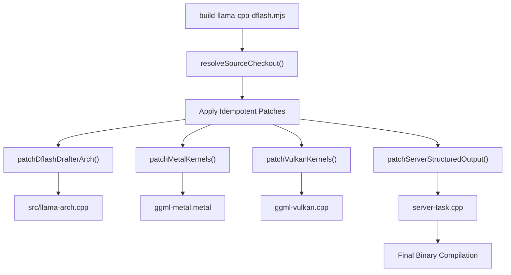
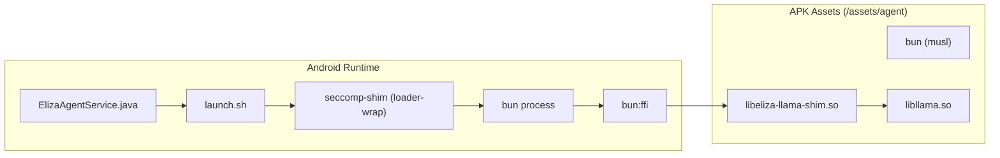

<!-- source: DeepWiki mcp.deepwiki.com · repo elizaOS/eliza · page 15.2 llama.cpp Build System and Kernel Patches · fetched 2026-10-29 -->

# llama.cpp Build System and Kernel Patches

Relevant source files

The following files were used as context for generating this wiki page:

- [packages/app-core/platforms/android/app/src/main/java/ai/elizaos/app/ElizaAgentService.java](packages/app-core/platforms/android/app/src/main/java/ai/elizaos/app/ElizaAgentService.java)
- [packages/app-core/platforms/electrobun/scripts/lib/app-dir.mjs](packages/app-core/platforms/electrobun/scripts/lib/app-dir.mjs)
- [packages/app-core/platforms/electrobun/scripts/lib/repo-root.mjs](packages/app-core/platforms/electrobun/scripts/lib/repo-root.mjs)
- [packages/app-core/platforms/electrobun/scripts/verify-rpc-handlers.ts](packages/app-core/platforms/electrobun/scripts/verify-rpc-handlers.ts)
- [packages/app-core/scripts/aosp/compile-libllama-fused.test.mjs](packages/app-core/scripts/aosp/compile-libllama-fused.test.mjs)
- [packages/app-core/scripts/aosp/compile-libllama.mjs](packages/app-core/scripts/aosp/compile-libllama.mjs)
- [packages/app-core/scripts/aosp/compile-shim.mjs](packages/app-core/scripts/aosp/compile-shim.mjs)
- [packages/app-core/scripts/aosp/e2e-validate.mjs](packages/app-core/scripts/aosp/e2e-validate.mjs)
- [packages/app-core/scripts/aosp/llama-cpp-patches/apply-patches.mjs](packages/app-core/scripts/aosp/llama-cpp-patches/apply-patches.mjs)
- [packages/app-core/scripts/aosp/llama-cpp-patches/qjl/0005-ggml-flip-block_qjl1_256-to-signs-then-norm.patch](packages/app-core/scripts/aosp/llama-cpp-patches/qjl/0005-ggml-flip-block_qjl1_256-to-signs-then-norm.patch)
- [packages/app-core/scripts/aosp/seccomp-shim/sigsys-handler-arm64.c](packages/app-core/scripts/aosp/seccomp-shim/sigsys-handler-arm64.c)
- [packages/app-core/scripts/aosp/seccomp-shim/sigsys-handler-riscv64.c](packages/app-core/scripts/aosp/seccomp-shim/sigsys-handler-riscv64.c)
- [packages/app-core/scripts/build-llama-cpp-desktop-dylib.mjs](packages/app-core/scripts/build-llama-cpp-desktop-dylib.mjs)
- [packages/app-core/scripts/build-llama-cpp-dflash.mjs](packages/app-core/scripts/build-llama-cpp-dflash.mjs)
- [packages/app-core/scripts/desktop-llama-shim/eliza_llama_shim.c](packages/app-core/scripts/desktop-llama-shim/eliza_llama_shim.c)
- [packages/app-core/scripts/desktop-llama-shim/eliza_llama_shim.h](packages/app-core/scripts/desktop-llama-shim/eliza_llama_shim.h)
- [packages/app-core/scripts/kernel-patches/server-structured-output.mjs](packages/app-core/scripts/kernel-patches/server-structured-output.mjs)
- [packages/app-core/scripts/lib/stage-android-agent.mjs](packages/app-core/scripts/lib/stage-android-agent.mjs)
- [packages/app-core/test/app/streaming-visible-text.live.e2e.test.ts](packages/app-core/test/app/streaming-visible-text.live.e2e.test.ts)
- [packages/benchmarks/eliza-adapter/eliza_adapter/terminal_bench.py](packages/benchmarks/eliza-adapter/eliza_adapter/terminal_bench.py)
- [packages/benchmarks/eliza-adapter/tests/test_bfcl_function_registry.py](packages/benchmarks/eliza-adapter/tests/test_bfcl_function_registry.py)
- [packages/benchmarks/eliza-adapter/tests/test_server_manager.py](packages/benchmarks/eliza-adapter/tests/test_server_manager.py)
- [packages/benchmarks/hermes-adapter/tests/test_swe_env_smoke.py](packages/benchmarks/hermes-adapter/tests/test_swe_env_smoke.py)
- [packages/examples/README.md](packages/examples/README.md)
- [packages/examples/agent-console/README.md](packages/examples/agent-console/README.md)
- [packages/examples/agent-console/package.json](packages/examples/agent-console/package.json)
- [packages/examples/agent-console/server.ts](packages/examples/agent-console/server.ts)
- [packages/native/ios-deps/llama.cpp/build-ios.sh](packages/native/ios-deps/llama.cpp/build-ios.sh)
- [packages/scenario-runner/src/native-export.test.ts](packages/scenario-runner/src/native-export.test.ts)
- [packages/scripts/cloud/admin/dev/cloud-api-hono-dev.ts](packages/scripts/cloud/admin/dev/cloud-api-hono-dev.ts)
- [packages/test/cloud-mocks/src/control-plane/server.ts](packages/test/cloud-mocks/src/control-plane/server.ts)
- [packages/test/cloud-mocks/test/control-plane-fidelity.test.ts](packages/test/cloud-mocks/test/control-plane-fidelity.test.ts)
- [packages/training/AGENTS.md](packages/training/AGENTS.md)
- [packages/training/README.md](packages/training/README.md)
- [packages/training/config/eliza1_action_aliases.json](packages/training/config/eliza1_action_aliases.json)
- [packages/training/pyproject.toml](packages/training/pyproject.toml)
- [packages/training/scripts/manifest/eliza1_platform_plan.py](packages/training/scripts/manifest/eliza1_platform_plan.py)
- [packages/training/scripts/manifest/release_process_guard.py](packages/training/scripts/manifest/release_process_guard.py)
- [packages/training/scripts/manifest/stage_eliza1_source_weights.py](packages/training/scripts/manifest/stage_eliza1_source_weights.py)
- [packages/training/scripts/manifest/stage_local_eliza1_bundle.py](packages/training/scripts/manifest/stage_local_eliza1_bundle.py)
- [packages/training/scripts/manifest/stage_real_eliza1_bundle.py](packages/training/scripts/manifest/stage_real_eliza1_bundle.py)
- [packages/training/scripts/manifest/test_stage_eliza1_source_weights.py](packages/training/scripts/manifest/test_stage_eliza1_source_weights.py)
- [packages/training/scripts/prepare_eliza1_trajectory_dataset.py](packages/training/scripts/prepare_eliza1_trajectory_dataset.py)
- [packages/training/scripts/test_prepare_eliza1_trajectory_dataset.py](packages/training/scripts/test_prepare_eliza1_trajectory_dataset.py)
- [packages/training/scripts/test_train_local_low_vram_smoke.py](packages/training/scripts/test_train_local_low_vram_smoke.py)
- [packages/vault/src/inventory.ts](packages/vault/src/inventory.ts)
- [plugins/plugin-aosp-local-inference/__tests__/aosp-kokoro-tts-handler.test.ts](plugins/plugin-aosp-local-inference/__tests__/aosp-kokoro-tts-handler.test.ts)
- [plugins/plugin-aosp-local-inference/__tests__/aosp-local-inference-bootstrap.test.ts](plugins/plugin-aosp-local-inference/__tests__/aosp-local-inference-bootstrap.test.ts)
- [plugins/plugin-aosp-local-inference/package.json](plugins/plugin-aosp-local-inference/package.json)
- [plugins/plugin-aosp-local-inference/src/aosp-llama-adapter.ts](plugins/plugin-aosp-local-inference/src/aosp-llama-adapter.ts)
- [plugins/plugin-aosp-local-inference/src/aosp-local-inference-bootstrap.ts](plugins/plugin-aosp-local-inference/src/aosp-local-inference-bootstrap.ts)
- [plugins/plugin-local-inference/FFI_BACKEND_WIREUP_PLAN.md](plugins/plugin-local-inference/FFI_BACKEND_WIREUP_PLAN.md)
- [plugins/plugin-local-inference/MLX_IN_PROCESS_PLAN.md](plugins/plugin-local-inference/MLX_IN_PROCESS_PLAN.md)
- [plugins/plugin-local-inference/__tests__/voice-attribution-pipeline-wiring.test.ts](plugins/plugin-local-inference/__tests__/voice-attribution-pipeline-wiring.test.ts)
- [plugins/plugin-local-inference/src/services/__tests__/ffi-streaming-runner.test.ts](plugins/plugin-local-inference/src/services/__tests__/ffi-streaming-runner.test.ts)
- [plugins/plugin-local-inference/src/services/__tests__/llm-streaming-binding.test.ts](plugins/plugin-local-inference/src/services/__tests__/llm-streaming-binding.test.ts)
- [plugins/plugin-local-inference/src/services/__tests__/runtime-dispatcher.test.ts](plugins/plugin-local-inference/src/services/__tests__/runtime-dispatcher.test.ts)
- [plugins/plugin-local-inference/src/services/backend.test.ts](plugins/plugin-local-inference/src/services/backend.test.ts)
- [plugins/plugin-local-inference/src/services/backend.ts](plugins/plugin-local-inference/src/services/backend.ts)
- [plugins/plugin-local-inference/src/services/desktop-ffi-backend-runtime.ts](plugins/plugin-local-inference/src/services/desktop-ffi-backend-runtime.ts)
- [plugins/plugin-local-inference/src/services/desktop-llama-adapter.ts](plugins/plugin-local-inference/src/services/desktop-llama-adapter.ts)
- [plugins/plugin-local-inference/src/services/ffi-streaming-backend.ts](plugins/plugin-local-inference/src/services/ffi-streaming-backend.ts)
- [plugins/plugin-local-inference/src/services/ffi-streaming-runner.ts](plugins/plugin-local-inference/src/services/ffi-streaming-runner.ts)
- [plugins/plugin-local-inference/src/services/llm-streaming-binding.ts](plugins/plugin-local-inference/src/services/llm-streaming-binding.ts)
- [plugins/plugin-local-inference/src/services/types.ts](plugins/plugin-local-inference/src/services/types.ts)
- [plugins/plugin-local-inference/src/services/voice/interactive-session.e2e.test.ts](plugins/plugin-local-inference/src/services/voice/interactive-session.e2e.test.ts)
- [plugins/plugin-local-inference/src/services/voice/voice-duet.e2e.test.ts](plugins/plugin-local-inference/src/services/voice/voice-duet.e2e.test.ts)

The elizaOS local inference stack relies on a specialized fork of `llama.cpp` that implements custom quantization kernels, speculative decoding architectures, and platform-specific optimizations for mobile and desktop environments. This page documents the build pipeline, the kernel patching mechanism, and the cross-compilation strategy used to deliver high-performance inference on-device.

## Build Pipeline Overview

The build system is divided into two primary pipelines: one for desktop/server environments (using CMake and native toolchains) and one for Android/AOSP (using Zig for musl-linked cross-compilation). Both pipelines consume the `elizaOS/llama.cpp` fork, which integrates proprietary Eliza-1 features like **DFlash** and **PolarQuant**.

### Desktop and Server Builds

The `build-llama-cpp-dflash.mjs` script manages the compilation of the DFlash-capable `llama-server`. It supports a multi-target matrix including Metal (macOS), CUDA (Linux/Windows), Vulkan, and CPU-only variants [packages/app-core/scripts/build-llama-cpp-dflash.mjs:17-29]().

Key features of this pipeline:
*   **Backend Auto-selection**: Automatically detects available hardware (e.g., `nvcc` for CUDA, `metal` for macOS) [packages/app-core/scripts/build-llama-cpp-dflash.mjs:33-37]().
*   **OmniVoice Fusion**: Integrates the OmniVoice TTS engine directly into the llama-server binary using the `ELIZA_FUSE_OMNIVOICE` guard [packages/app-core/scripts/build-llama-cpp-dflash.mjs:77-82]().
*   **State Management**: Artifacts are stored in `$ELIZA_STATE_DIR/local-inference/bin/dflash/<platform>-<arch>-<backend>/` [packages/app-core/scripts/build-llama-cpp-dflash.mjs:17-18]().

### Android and AOSP Cross-Compilation

For mobile targets, `compile-libllama.mjs` provides a cross-compilation path using `zig cc --target={aarch64,x86_64}-linux-musl` [packages/app-core/scripts/aosp/compile-libllama.mjs:25-30](). This is necessary to produce **musl-linked** shared objects (`.so`) that can run inside the elizaOS Android environment without relying on the Bionic libc, which lacks compatibility with the Bun runtime used for agent logic [packages/app-core/scripts/aosp/compile-libllama.mjs:7-18]().

**Sources:**
* [packages/app-core/scripts/build-llama-cpp-dflash.mjs:1-125]()
* [packages/app-core/scripts/aosp/compile-libllama.mjs:1-115]()

---

## Kernel Patching System

Because the `llama.cpp` submodule is frequently reset or updated, elizaOS applies "first-class" idempotent patches during the build process rather than maintaining a dirty submodule.

### DFlash Drafter Architecture
The `patchDflashDrafterArch.mjs` script injects the `dflash-draft` model architecture into the `llama.cpp` source tree. This allows the model loader to recognize Eliza-1 drafter GGUFs [packages/app-core/scripts/kernel-patches/dflash-drafter-arch.mjs:1-7]().

### Hardware Acceleration Kernels
Custom kernels are patched into the `ggml` source for various backends:
*   **Metal (macOS/iOS)**: Standalone `.metal` shaders for `TBQ3_0`, `TBQ4_0`, and `PolarQuant` are copied into the fork under `ggml/src/ggml-metal/eliza-kernels/` [packages/app-core/scripts/aosp/compile-libllama.mjs:66-68]().
*   **Vulkan**: verified `.comp` shaders are staged into the build. The system applies patches to register these SPIR-V blobs [packages/app-core/scripts/build-llama-cpp-dflash.mjs:84-84]().
*   **CUDA**: Specific optimizations for TBQ (TurboQuant) and QJL (Quantized Johnson-Lindenstrauss) are applied via `CUDA_KERNEL_CMAKE_FLAGS` [packages/app-core/scripts/build-llama-cpp-dflash.mjs:71-74]().

### Server Extensions
The `server-structured-output.mjs` patch adds a `verifier` extension to the llama-server's SSE (Server-Sent Events) stream. This allows the DFlash speculative decoding loop to notify the client when previously emitted tokens are rejected, enabling "Rollback Coupling" with the TTS engine [packages/app-core/scripts/kernel-patches/server-structured-output.mjs:17-31]().

**Kernel Patch Flow**
Title: Kernel Patch Application Flow

**Sources:**
* [packages/app-core/scripts/kernel-patches/dflash-drafter-arch.mjs:1-102]()
* [packages/app-core/scripts/kernel-patches/metal-kernels.mjs:1-161]()
* [packages/app-core/scripts/kernel-patches/vulkan-kernels.mjs:1-138]()
* [packages/app-core/scripts/kernel-patches/server-structured-output.mjs:1-81]()

---

## Android Seccomp and Staging

Running a full `llama.cpp` stack on Android requires bypassing standard application sandboxing restrictions for system-level performance.

### Seccomp-Shim
The `seccomp-shim` (managed via `compile-shim.mjs`) handles restrictions generated when the musl loader attempts restricted system calls. It allows the `untrusted_app` SELinux context to execute the musl-linked `bun` and `libllama.so` binaries by wrapping the loader [packages/app-core/scripts/aosp/compile-shim.mjs:7-18]().

### Asset Staging
The `stage-android-agent.mjs` script organizes the inference binaries into the APK's `assets/agent/` directory, including the `bun` binary, `ld-musl` loader, and `libllama.so` [packages/app-core/scripts/lib/stage-android-agent.mjs:10-23]().

### Android Agent Service
The `ElizaAgentService.java` is a foreground service that owns the local Eliza agent process. It unpacks the runtime from assets into the app's writable data dir and executes it via `Runtime.exec` [packages/app-core/platforms/android/app/src/main/java/ai/elizaos/app/ElizaAgentService.java:41-49]().

**Android Inference Stack**
Title: Android Local Inference Runtime Structure

**Sources:**
* [packages/app-core/scripts/lib/stage-android-agent.mjs:1-106]()
* [packages/app-core/scripts/aosp/compile-libllama.mjs:7-30]()
* [packages/app-core/scripts/aosp/compile-shim.mjs:1-50]()
* [packages/app-core/platforms/android/app/src/main/java/ai/elizaos/app/ElizaAgentService.java:41-55]()

---

## DFlash Server Extensions

The elizaOS fork modifies `llama-server` to support advanced agentic workflows.

### SSE Verifier Extensions
The server is patched to emit specific JSON payloads in the SSE stream:
*   **`verifier.rejected`**: An array `[a, b]` indicating a range of tokens that were drafted but failed verification [packages/app-core/scripts/kernel-patches/server-structured-output.mjs:135-151]().
*   **`prefill_assistant`**: Supports continuing a partial assistant message, essential for multi-turn dialogue consistency [packages/app-core/scripts/kernel-patches/server-structured-output.mjs:105-112]().

### Structured Output
The build system asserts the presence of `grammar_lazy` and `json_schema` features in the fork, ensuring that the local inference engine supports GBNF-constrained decoding for reliable tool use and JSON responses [packages/app-core/scripts/kernel-patches/server-structured-output.mjs:88-104]().

### Model Compatibility
The Eliza fork composes several quantization techniques:
*   **TBQ3_0 / TBQ4_0**: 3-bit and 4-bit TurboQuant KV-cache compression [packages/app-core/scripts/aosp/compile-libllama.mjs:55-60]().
*   **QJL1_256**: 1-bit JL-transform K-cache [packages/app-core/scripts/aosp/compile-libllama.mjs:61-62]().
*   **Q4_POLAR**: 4-bit PolarQuant weight quantization [packages/app-core/scripts/aosp/compile-libllama.mjs:63-65]().

**Sources:**
* [packages/app-core/scripts/kernel-patches/server-structured-output.mjs:1-151]()
* [packages/app-core/scripts/build-llama-cpp-dflash.mjs:105-113]()
* [packages/app-core/scripts/aosp/compile-libllama.mjs:53-74]()

---

