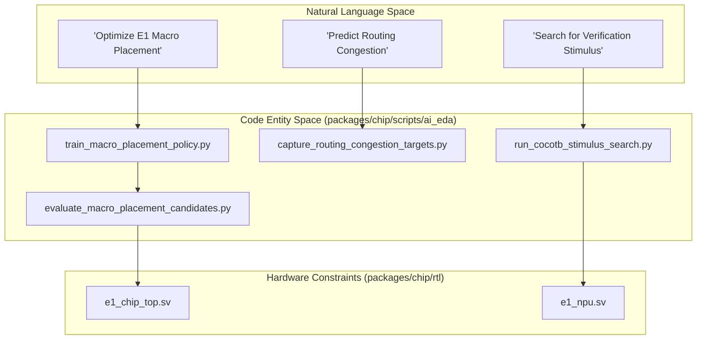
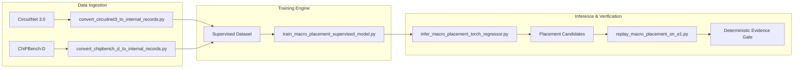

<!-- source: DeepWiki mcp.deepwiki.com · repo elizaOS/eliza · page 17.2 AI-EDA Optimization Stack · fetched 2026-10-29 -->

# AI-EDA Optimization Stack

Relevant source files

The following files were used as context for generating this wiki page:

- [packages/app-core/platforms/electrobun/src/preload.js](packages/app-core/platforms/electrobun/src/preload.js)
- [packages/chip/Makefile](packages/chip/Makefile)
- [packages/chip/README.md](packages/chip/README.md)
- [packages/chip/compiler/runtime/e1_npu_partitioner.py](packages/chip/compiler/runtime/e1_npu_partitioner.py)
- [packages/chip/compiler/runtime/test_e1_partitioner.py](packages/chip/compiler/runtime/test_e1_partitioner.py)
- [packages/chip/docs/arch/npu.md](packages/chip/docs/arch/npu.md)
- [packages/chip/docs/npu/2028-targets.md](packages/chip/docs/npu/2028-targets.md)
- [packages/chip/docs/spec-db/e1-npu-runtime-contract.json](packages/chip/docs/spec-db/e1-npu-runtime-contract.json)
- [packages/chip/external/README.md](packages/chip/external/README.md)
- [packages/chip/external/SOURCES.lock.yaml](packages/chip/external/SOURCES.lock.yaml)
- [packages/chip/external/repos/google-circuit-training/manifest.yaml](packages/chip/external/repos/google-circuit-training/manifest.yaml)
- [packages/chip/research/alpha_chip_macro_placement/01_sources/ai_eda_automation_readiness.yaml](packages/chip/research/alpha_chip_macro_placement/01_sources/ai_eda_automation_readiness.yaml)
- [packages/chip/research/alpha_chip_macro_placement/01_sources/ai_eda_integration_backlog.yaml](packages/chip/research/alpha_chip_macro_placement/01_sources/ai_eda_integration_backlog.yaml)
- [packages/chip/research/alpha_chip_macro_placement/01_sources/ai_eda_literature_and_tools_2026-05-19.md](packages/chip/research/alpha_chip_macro_placement/01_sources/ai_eda_literature_and_tools_2026-05-19.md)
- [packages/chip/research/alpha_chip_macro_placement/01_sources/ai_eda_provenance_matrix.yaml](packages/chip/research/alpha_chip_macro_placement/01_sources/ai_eda_provenance_matrix.yaml)
- [packages/chip/research/alpha_chip_macro_placement/01_sources/ai_eda_sota_review.md](packages/chip/research/alpha_chip_macro_placement/01_sources/ai_eda_sota_review.md)
- [packages/chip/research/alpha_chip_macro_placement/01_sources/ai_eda_source_inventory.yaml](packages/chip/research/alpha_chip_macro_placement/01_sources/ai_eda_source_inventory.yaml)
- [packages/chip/research/alpha_chip_macro_placement/01_sources/ai_for_chip_design_sota.md](packages/chip/research/alpha_chip_macro_placement/01_sources/ai_for_chip_design_sota.md)
- [packages/chip/research/alpha_chip_macro_placement/08_full_stack_ai_chip_optimization_plan_2026-05-20.md](packages/chip/research/alpha_chip_macro_placement/08_full_stack_ai_chip_optimization_plan_2026-05-20.md)
- [packages/chip/scripts/ai_eda/bootstrap_ai_eda_stack.py](packages/chip/scripts/ai_eda/bootstrap_ai_eda_stack.py)
- [packages/chip/scripts/ai_eda/build_macro_placement_supervised_dataset.py](packages/chip/scripts/ai_eda/build_macro_placement_supervised_dataset.py)
- [packages/chip/scripts/ai_eda/check_alphachip_checkpoint_blocker.py](packages/chip/scripts/ai_eda/check_alphachip_checkpoint_blocker.py)
- [packages/chip/scripts/ai_eda/check_chipbench_d_conversion.py](packages/chip/scripts/ai_eda/check_chipbench_d_conversion.py)
- [packages/chip/scripts/ai_eda/check_external_intake_manifests.py](packages/chip/scripts/ai_eda/check_external_intake_manifests.py)
- [packages/chip/scripts/ai_eda/check_logic_synthesis_policy_baseline.py](packages/chip/scripts/ai_eda/check_logic_synthesis_policy_baseline.py)
- [packages/chip/scripts/ai_eda/check_macro_placement_supervised_model.py](packages/chip/scripts/ai_eda/check_macro_placement_supervised_model.py)
- [packages/chip/scripts/ai_eda/check_macro_placement_torch_inference.py](packages/chip/scripts/ai_eda/check_macro_placement_torch_inference.py)
- [packages/chip/scripts/ai_eda/check_openabc_d_conversion.py](packages/chip/scripts/ai_eda/check_openabc_d_conversion.py)
- [packages/chip/scripts/ai_eda/convert_chipbench_d_to_internal_records.py](packages/chip/scripts/ai_eda/convert_chipbench_d_to_internal_records.py)
- [packages/chip/scripts/ai_eda/convert_circuitnet3_to_internal_records.py](packages/chip/scripts/ai_eda/convert_circuitnet3_to_internal_records.py)
- [packages/chip/scripts/ai_eda/convert_openabc_d_to_internal_records.py](packages/chip/scripts/ai_eda/convert_openabc_d_to_internal_records.py)
- [packages/chip/scripts/ai_eda/convert_openroad_eda_corpus.py](packages/chip/scripts/ai_eda/convert_openroad_eda_corpus.py)
- [packages/chip/scripts/ai_eda/convert_tilos_macroplacement.py](packages/chip/scripts/ai_eda/convert_tilos_macroplacement.py)
- [packages/chip/scripts/ai_eda/evaluate_macro_placement_candidates.py](packages/chip/scripts/ai_eda/evaluate_macro_placement_candidates.py)
- [packages/chip/scripts/ai_eda/fetch_external_asset.py](packages/chip/scripts/ai_eda/fetch_external_asset.py)
- [packages/chip/scripts/ai_eda/infer_macro_placement_torch_regressor.py](packages/chip/scripts/ai_eda/infer_macro_placement_torch_regressor.py)
- [packages/chip/scripts/ai_eda/materialize_e1_softmacro_cases.py](packages/chip/scripts/ai_eda/materialize_e1_softmacro_cases.py)
- [packages/chip/scripts/ai_eda/package_cuda_training_payload.py](packages/chip/scripts/ai_eda/package_cuda_training_payload.py)
- [packages/chip/scripts/ai_eda/train_circuitnet3_timing_power_baseline.py](packages/chip/scripts/ai_eda/train_circuitnet3_timing_power_baseline.py)
- [packages/chip/scripts/ai_eda/train_macro_placement_policy.py](packages/chip/scripts/ai_eda/train_macro_placement_policy.py)
- [packages/chip/scripts/ai_eda/train_macro_placement_supervised_model.py](packages/chip/scripts/ai_eda/train_macro_placement_supervised_model.py)
- [packages/chip/scripts/ai_eda/train_macro_placement_torch_regressor.py](packages/chip/scripts/ai_eda/train_macro_placement_torch_regressor.py)
- [packages/chip/scripts/check_ai_eda_source_inventory.py](packages/chip/scripts/check_ai_eda_source_inventory.py)
- [packages/chip/scripts/check_e1_npu_runtime_contract.py](packages/chip/scripts/check_e1_npu_runtime_contract.py)
- [packages/chip/scripts/check_npu_2028_targets.py](packages/chip/scripts/check_npu_2028_targets.py)
- [packages/cloud-frontend/src/dashboard/api-explorer/_components/use-explorer-api-key.ts](packages/cloud-frontend/src/dashboard/api-explorer/_components/use-explorer-api-key.ts)
- [packages/cloud-frontend/tests/e2e/aesthetic-audit.spec.ts](packages/cloud-frontend/tests/e2e/aesthetic-audit.spec.ts)
- [packages/cloud-frontend/tests/e2e/solana-login.spec.ts](packages/cloud-frontend/tests/e2e/solana-login.spec.ts)
- [packages/cloud-frontend/tests/e2e/view-switching.spec.ts](packages/cloud-frontend/tests/e2e/view-switching.spec.ts)
- [packages/homepage/scripts/generate-contact-sheet.mjs](packages/homepage/scripts/generate-contact-sheet.mjs)
- [packages/homepage/src/lib/api/siws.ts](packages/homepage/src/lib/api/siws.ts)
- [packages/homepage/tests/e2e/aesthetic-audit.spec.ts](packages/homepage/tests/e2e/aesthetic-audit.spec.ts)

The AI-EDA (Electronic Design Automation) Optimization Stack is a specialized pipeline within the E1 chip project designed to automate and optimize physical design tasks using machine learning. Its primary focus is **macro placement optimization**, leveraging reinforcement learning (RL) and supervised learning to improve wirelength, congestion, and power-performance-area (PPA) metrics for the E1 RISC-V SoC [packages/chip/research/alpha_chip_macro_placement/08_full_stack_ai_chip_optimization_plan_2026-05-20.md:1-9]().

## Overview

The stack operates as a "multi-lane optimizer" that integrates public chip-design corpora with deterministic E1 verification gates [packages/chip/research/alpha_chip_macro_placement/08_full_stack_ai_chip_optimization_plan_2026-05-20.md:19-33](). It bridges the gap between AI-generated design candidates and production-grade hardware by enforcing strict evidence requirements before any AI prediction is accepted as a design claim [packages/chip/research/alpha_chip_macro_placement/08_full_stack_ai_chip_optimization_plan_2026-05-20.md:13-15]().

### Data Flow and Code Entity Mapping

The following diagram illustrates how natural language design requirements are transformed into code-driven optimization tasks and verified against hardware constraints.

**Diagram: Natural Language to EDA Code Entity Mapping**

Sources: [packages/chip/scripts/ai_eda/train_macro_placement_policy.py:1-5](), [packages/chip/scripts/ai_eda/capture_routing_congestion_targets.py:1-5](), [packages/chip/scripts/ai_eda/run_cocotb_stimulus_search.py:1-5](), [packages/chip/scripts/ai_eda/evaluate_macro_placement_candidates.py:1-5](), [packages/chip/Makefile:9-10]()

## Macro Placement Pipeline

The macro placement lane utilizes the **AlphaChip** (Circuit Training) framework to perform distributed deep RL for floorplanning [packages/chip/research/alpha_chip_macro_placement/08_full_stack_ai_chip_optimization_plan_2026-05-20.md:111-117]().

### Integration Components
*   **Circuit Training Integration**: Wrappers for Google's RL framework to optimize wirelength and density [packages/chip/research/alpha_chip_macro_placement/08_full_stack_ai_chip_optimization_plan_2026-05-20.md:113-117]().
*   **Dataset Ingestion**: Converters for public datasets including **CircuitNet 3.0** (for timing/power baselines) and **ChiPBench-D** [packages/chip/scripts/ai_eda/bootstrap_ai_eda_stack.py:42-45]().
*   **PyTorch Regression Models**: Used for placement inference and surrogate modeling of physical design predictors [packages/chip/scripts/ai_eda/train_macro_placement_torch_regressor.py:1-5]().

### Implementation Logic
The stack implements a `macro_name_then_type_then_global_mean` algorithm for supervised baselines, which calculates normalized placements from historical records [packages/chip/scripts/ai_eda/train_macro_placement_supervised_model.py:103-104]().

**Diagram: Placement Optimization Data Flow**

Sources: [packages/chip/scripts/ai_eda/bootstrap_ai_eda_stack.py:68-79](), [packages/chip/scripts/ai_eda/train_macro_placement_supervised_model.py:90-116](), [packages/chip/scripts/ai_eda/infer_macro_placement_torch_regressor.py:1-5](), [packages/chip/scripts/ai_eda/replay_macro_placement_on_e1.py:1-5]()

## Evidence Gates and Safety

A core principle of the AI-EDA stack is the **Claim Boundary**. No AI-generated artifact is considered valid design evidence until it passes a deterministic verification gate [packages/chip/research/alpha_chip_macro_placement/08_full_stack_ai_chip_optimization_plan_2026-05-20.md:13-15]().

| Tool/Lane | Claim Boundary String | Verification Mechanism |
| :--- | :--- | :--- |
| Macro Placement | `macro_placement_supervised_model_only...` | OpenROAD/OpenLane Replay [packages/chip/scripts/ai_eda/train_macro_placement_supervised_model.py:31]() |
| NPU DSE | `architecture_estimate_only_no_tops...` | ZigZag NPU Simulator [packages/chip/scripts/check_ai_eda_source_inventory.py:45]() |
| Stimulus Search | `no_ai_generated_stimulus_as_evidence...` | Cocotb Regression [packages/chip/scripts/check_ai_eda_source_inventory.py:40]() |
| RAG Index | `read_only_cited_triage_no_code_edit...` | Manual Review [packages/chip/scripts/check_ai_eda_source_inventory.py:35]() |

## Remote Training and Handoff

For high-compute tasks, the stack provides a packaging mechanism to offload training to remote CUDA hosts (e.g., Nebius H200 instances) [packages/chip/scripts/ai_eda/package_cuda_training_payload.py:2-7]().

### CUDA Training Payload
The script `package_cuda_training_payload.py` creates a reproducibility handoff containing:
*   **Source Manifests**: `external/SOURCES.lock.yaml` [packages/chip/scripts/ai_eda/package_cuda_training_payload.py:31]().
*   **Run Plans**: Machine-readable instructions for the remote host [packages/chip/scripts/ai_eda/package_cuda_training_payload.py:6-7]().
*   **Tooling**: Selected scripts and `Makefile` for the remote environment [packages/chip/scripts/ai_eda/package_cuda_training_payload.py:28-29]().

### Bootstrapping
The `bootstrap_ai_eda_stack.py` script automates the setup of the optimization stack on fresh machines, supporting profiles for `metadata`, `setup-check`, `local-smoke`, and `training-handoff` [packages/chip/scripts/ai_eda/bootstrap_ai_eda_stack.py:171-180]().

Sources: [packages/chip/scripts/ai_eda/package_cuda_training_payload.py:1-138](), [packages/chip/scripts/ai_eda/bootstrap_ai_eda_stack.py:1-194](), [packages/chip/research/alpha_chip_macro_placement/08_full_stack_ai_chip_optimization_plan_2026-05-20.md:1-150](), [packages/chip/scripts/check_ai_eda_source_inventory.py:1-120](), [packages/chip/scripts/ai_eda/train_macro_placement_supervised_model.py:1-179]()

---

