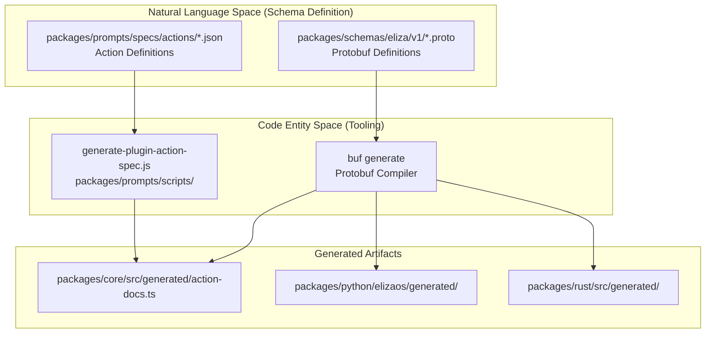
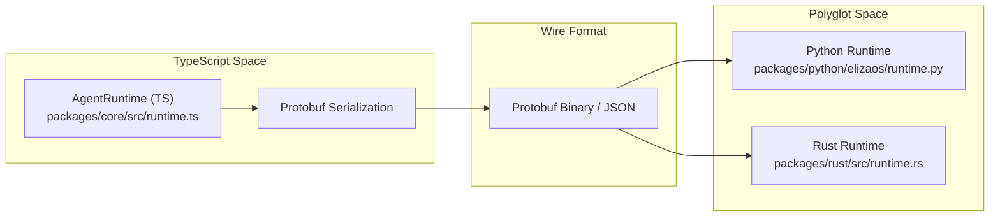

<!-- source: DeepWiki mcp.deepwiki.com · repo elizaOS/eliza · page 3 Protocol Buffers and Schemas · fetched 2026-10-29 -->

# Protocol Buffers and Schemas

Relevant source files

The following files were used as context for generating this wiki page:

- [.gitattributes](.gitattributes)
- [.gitignore](.gitignore)
- [packages/app/test/ui-smoke/apps-utility-interactions.spec.ts](packages/app/test/ui-smoke/apps-utility-interactions.spec.ts)
- [packages/app/test/ui-smoke/remote-capability-view.spec.ts](packages/app/test/ui-smoke/remote-capability-view.spec.ts)
- [packages/cloud-frontend/tests/e2e/api-explorer-flow.spec.ts](packages/cloud-frontend/tests/e2e/api-explorer-flow.spec.ts)
- [packages/core/src/__tests__/action-structure-audit.test.ts](packages/core/src/__tests__/action-structure-audit.test.ts)
- [packages/core/src/generated/action-docs.ts](packages/core/src/generated/action-docs.ts)
- [packages/core/src/utils/context-catalog.ts](packages/core/src/utils/context-catalog.ts)
- [packages/elizaos/templates-manifest.json](packages/elizaos/templates-manifest.json)
- [packages/examples/a2a/tsconfig.json](packages/examples/a2a/tsconfig.json)
- [packages/examples/agent-console/tsconfig.json](packages/examples/agent-console/tsconfig.json)
- [packages/examples/aws/tsconfig.json](packages/examples/aws/tsconfig.json)
- [packages/examples/bluesky/tsconfig.json](packages/examples/bluesky/tsconfig.json)
- [packages/examples/setup-guide.html](packages/examples/setup-guide.html)
- [packages/prompts/scripts/generate-plugin-action-spec.js](packages/prompts/scripts/generate-plugin-action-spec.js)
- [packages/prompts/specs/actions/plugins.generated.json](packages/prompts/specs/actions/plugins.generated.json)
- [packages/ui/src/bridge/capacitor-bridge.ts](packages/ui/src/bridge/capacitor-bridge.ts)
- [packages/ui/src/bridge/plugin-bridge.ts](packages/ui/src/bridge/plugin-bridge.ts)
- [packages/ui/src/components/apps/GameView.tsx](packages/ui/src/components/apps/GameView.tsx)
- [packages/ui/src/components/apps/load-apps-catalog.ts](packages/ui/src/components/apps/load-apps-catalog.ts)
- [packages/ui/src/components/character/CharacterEditor.tsx](packages/ui/src/components/character/CharacterEditor.tsx)
- [plugins/plugin-browser/src/actions/browser.ts](plugins/plugin-browser/src/actions/browser.ts)
- [plugins/plugin-coding-tools/src/services/ripgrep-service.ts](plugins/plugin-coding-tools/src/services/ripgrep-service.ts)
- [tsconfig.dist-paths.json](tsconfig.dist-paths.json)
- [turbo.json](turbo.json)

The `@elizaos/schemas` package provides the **single source of truth** for all type definitions in elizaOS [tsconfig.dist-paths.json:80](). It uses Protocol Buffers (protobuf) to define data structures once and generate strongly-typed implementations for TypeScript, Python, and Rust. This ensures type consistency across the entire multi-language platform and eliminates the need to manually maintain parallel type definitions.

**Scope**: This page explains the role of Protocol Buffers in the elizaOS architecture, the schema package structure, and the code generation workflow. For details on writing `.proto` schema files, see [Schema Definition](#3.1). For the technical details of multi-language code generation, see [Code Generation](#3.2).

---

## Purpose and Architecture

Protocol Buffers serve as the type system foundation for elizaOS's multi-language architecture. By defining types once in `.proto` files and generating language-specific implementations, the system achieves:

- **Type safety across language boundaries**: Messages passed between TypeScript, Python, and Rust components are guaranteed to have matching structures.
- **Single source of truth**: Type definitions exist in one location, preventing drift and inconsistencies.
- **Automatic serialization**: Protocol Buffer runtime libraries, such as `@bufbuild/protobuf`, handle efficient serialization for high-performance communication.
- **Backward compatibility**: Protobuf's evolution semantics allow schema changes without breaking existing code.

The schemas package is consumed by all language runtimes in the elizaOS platform, including `@elizaos/core` [packages/core/package.json:2](), `@elizaos/agent` [packages/agent/package.json:81](), and the various language-specific runtimes.

**Sources**: [tsconfig.dist-paths.json:80-80](), [packages/core/package.json:2-4]()

---

## Package Structure

The schema system is organized to support the [Buf](https://buf.build) toolchain for schema management. The definitions reside in `packages/schemas/` and are referenced across the monorepo via workspace symlinks.

| Component | Purpose |
| :--- | :--- |
| `.proto` Files | Core schema definitions (Agent, Memory, Events, etc.) located in `packages/schemas/eliza/v1/`. |
| `buf.yaml` | Buf configuration for linting and compilation. |
| `buf.gen.yaml` | Configuration for multi-language code generation (TS, Python, Rust). |
| Generated Types | Output directories such as `packages/core/src/generated/` for TypeScript [packages/core/src/generated/action-docs.ts:1-4](). |

The package publishes schema definitions and configuration files. Each language runtime package contains its own generated types in its source tree to ensure they can be built without the full protobuf toolchain present during standard installation. For example, action and provider documentation is auto-generated from prompts and specs into the core runtime [packages/core/src/generated/action-docs.ts:1-4]().

**Sources**: [tsconfig.dist-paths.json:80-80](), [packages/core/src/generated/action-docs.ts:1-4]()

---

## Schema Compilation Flow

The diagram below illustrates how `.proto` schemas and prompt specifications are compiled into language-specific type definitions and documentation using the `buf` toolchain and custom generation scripts.

### Type Generation Pipeline

**Sources**: [packages/prompts/scripts/generate-plugin-action-spec.js:1-25](), [packages/core/src/generated/action-docs.ts:1-4](), [tsconfig.dist-paths.json:80-80]()

---

## Build Scripts and Workflow

The system provides centralized scripts to manage the schema lifecycle. The build orchestration is handled by Turbo, ensuring dependencies are built in the correct order.

| Script | Command | Purpose |
|--------|---------|---------|
| `build` | `turbo run build` | Orchestrates builds across all packages including schemas [turbo.json:10]() |
| `generate-plugin-action-spec.js` | `node packages/prompts/scripts/generate-plugin-action-spec.js` | Scans plugins to generate canonical action specifications [packages/prompts/scripts/generate-plugin-action-spec.js:1-25]() |

The typical workflow for updating schemas:
1. Edit `.proto` files in `packages/schemas/eliza/v1/`.
2. Run the generation scripts to update language targets.
3. The build system (Turbo) ensures that dependent packages like `@elizaos/core` are rebuilt with the new types, specifically checking `@elizaos/core#build` [turbo.json:11]().

**Sources**: [turbo.json:10-11](), [packages/prompts/scripts/generate-plugin-action-spec.js:1-25]()

---

## Cross-Language Serialization

Protocol Buffers enable seamless data exchange between the language runtimes. This is critical for the "Interop" layer where TypeScript, Python, and Rust components interact.

### Interop Data Flow

**Sources**: [tsconfig.dist-paths.json:10-16](), [packages/core/src/utils/context-catalog.ts:1-13]()

---

## Integration with Language Runtimes

Each language runtime package consumes the generated types and requires specific runtime dependencies to handle the serialization logic.

### TypeScript Integration
The `@elizaos/core` package uses these generated types for component interfaces, action documentation [packages/core/src/generated/action-docs.ts:52-61](), and the `ACTION_CONTEXT_MAP` [packages/core/src/utils/context-catalog.ts:3-10]().

### Python and Rust Integration
The `@elizaos/python` and `@elizaos/rust` packages maintain their own copies of generated types. Rust uses these types within its runtime implementations to ensure high-performance execution while remaining compatible with the TypeScript-based orchestrator.

**Sources**: [packages/core/src/generated/action-docs.ts:52-61](), [packages/core/src/utils/context-catalog.ts:3-10](), [tsconfig.dist-paths.json:80-84]()

---

## Next Steps

- **[Schema Definition](#3.1)**: Learn how to define Protocol Buffer schemas, including message types, field types, and best practices for the v1 schema.
- **[Code Generation](#3.2)**: Understand the multi-language code generation process (TS, Python, Rust) and the build pipeline.
- **[Cross-Language Interoperability](#9.4)**: See how Protocol Buffers enable communication between TypeScript, Python, and Rust components via the Interop package.

---

