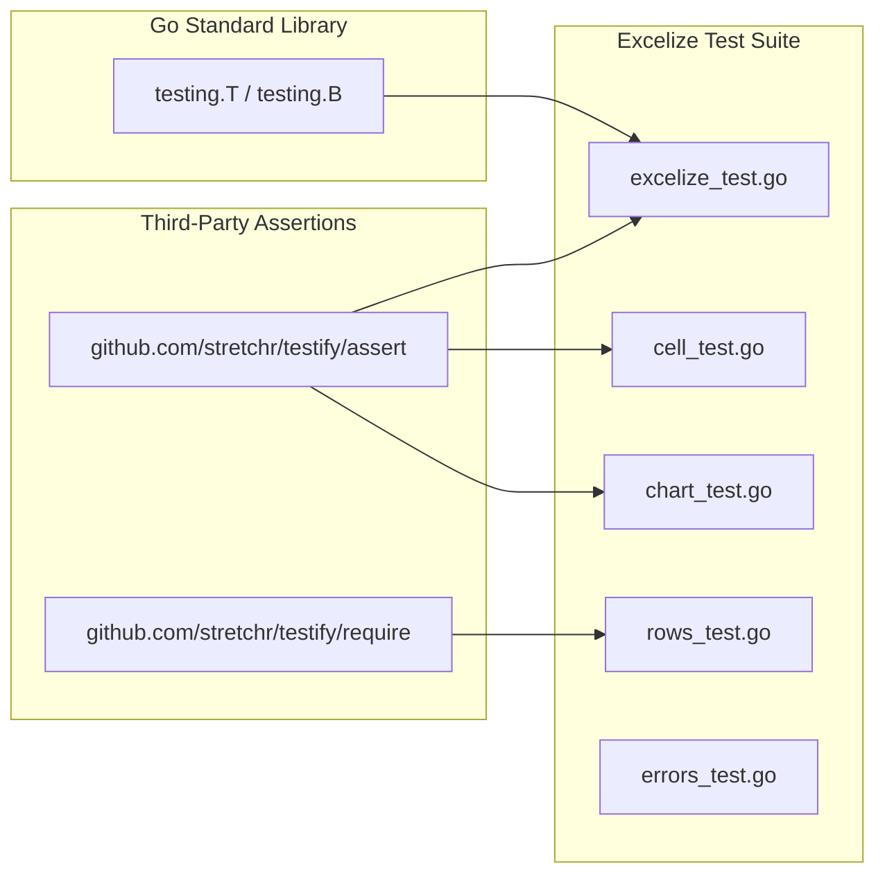
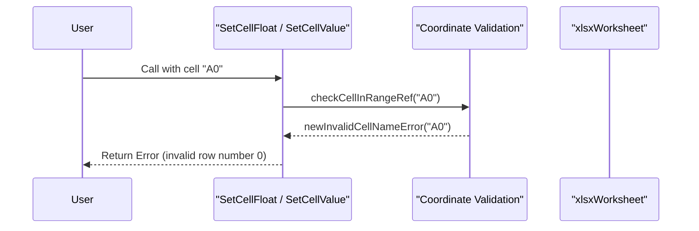
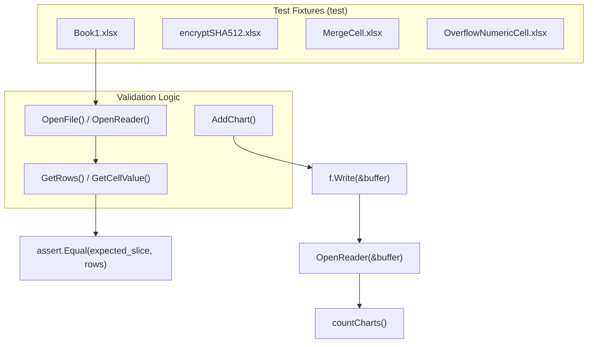

<!-- source: DeepWiki mcp.deepwiki.com · repo qax-os/excelize · page 5.1 Testing and Validation · fetched 2026-10-29 -->

# Testing and Validation

<details>
<summary>Relevant source files</summary>

The following files were used as context for generating this wiki page:

- [cell_test.go](cell_test.go)
- [chart_test.go](chart_test.go)
- [errors_test.go](errors_test.go)
- [excelize_test.go](excelize_test.go)
- [logo.png](logo.png)
- [rows_test.go](rows_test.go)
- [test/BadWorkbook.xlsx](test/BadWorkbook.xlsx)
- [test/Book1.xlsx](test/Book1.xlsx)
- [test/MergeCell.xlsx](test/MergeCell.xlsx)
- [test/OverflowNumericCell.xlsx](test/OverflowNumericCell.xlsx)
- [test/encryptSHA512.xlsx](test/encryptSHA512.xlsx)

</details>


Testing and validation are critical components of the Excelize library, ensuring that manipulations of Office Open XML (OOXML) spreadsheets remain compatible with Microsoft Excel and other spreadsheet applications. The library employs a comprehensive suite of unit, integration, concurrency, and benchmark tests.

## Testing Framework

Excelize utilizes the standard Go `testing` package in conjunction with the `testify` library to provide a structured and expressive testing environment.

### Code-to-Entity Mapping: Test Suite Components

The following diagram maps high-level testing concepts to the specific code entities and third-party packages used in the `excelize` codebase.



Sources: [excelize_test.go:20-23](), [cell_test.go:13-16](), [rows_test.go:11-12](), [chart_test.go:10-10]()

## Test Suite Structure

The test suite is modularized into several files, each focusing on specific subsystems of the library.

| Test File | Focus Area | Key Functions Tested |
| :--- | :--- | :--- |
| `excelize_test.go` | Core File I/O & Sheets | `OpenFile`, `SaveAs`, `NewSheet`, `SetSheetName` |
| `cell_test.go` | Cell Data & Types | `SetCellValue`, `GetCellValue`, `SetCellFloat`, `SetCellUint` |
| `rows_test.go` | Row Iteration & Properties | `Rows`, `GetRows`, `SetRowHeight`, `GetRowHeight` |
| `chart_test.go` | Visualization | `AddChart`, `addDrawingChart`, `countCharts` |
| `errors_test.go` | Error Generation | `newInvalidColumnNameError`, `newInvalidRowNumberError` |

Sources: [excelize_test.go:27-142](), [cell_test.go:19-203](), [rows_test.go:15-152](), [chart_test.go:13-136](), [errors_test.go:9-26]()

## Validation Patterns

Excelize implements strict validation patterns to prevent the generation of corrupt XML files.

### 1. Coordinate and Range Validation
Before any cell operation (Read/Write), the library validates cell coordinates using helper functions that check for valid row numbers and column names.



Sources: [cell_test.go:119-158](), [cell_test.go:189-190](), [errors_test.go:14-16]()

### 2. Sheet Name Constraints
Excel imposes a 31-character limit and forbids certain characters (`:\/?*[]`) in sheet titles. Excelize validates these constraints in `NewSheet` and `SetSheetName`.

- **Length Validation**: `f.NewSheet("Maximum 31 characters allowed...")` returns `ErrSheetNameLength` [excelize_test.go:76-77]().
- **Character Validation**: Names containing invalid characters like `:` return `ErrSheetNameInvalid` [excelize_test.go:36-37]().

### 3. Concurrency Validation
Since the `File` struct manages internal maps and XML parts, thread safety is verified via `TestConcurrency`. This test spawns multiple goroutines to perform simultaneous read/write operations on a single `File` instance.

```go
func TestConcurrency(t *testing.T) {
    f, err := OpenFile(filepath.Join("test", "Book1.xlsx"))
    // ... setup WaitGroup
    for i := 1; i <= 5; i++ {
        go func(val int, t *testing.T) {
            assert.NoError(t, f.SetCellValue("Sheet1", fmt.Sprintf("A%d", val), val))
            assert.NoError(t, f.SetCellStyle("Sheet1", "A3", "A3", style))
            // ... more concurrent operations
        }(i, t)
    }
    // ... wait and verify
}
```

Sources: [cell_test.go:19-117]()

## Test Fixtures and Data Flow

Excelize relies on physical `.xlsx` files located in the `test/` directory to validate real-world compatibility and edge cases.

### Data Flow: Fixture-Based Validation



Sources: [excelize_test.go:29-54](), [chart_test.go:58-67](), [rows_test.go:27-41]()

### Key Fixture Files
- **`test/Book1.xlsx`**: Primary integration fixture containing multiple sheets, formulas, and styles [excelize_test.go:29-30]().
- **`test/encryptSHA512.xlsx`**: Used for validating decryption and handling of password-protected files [test/encryptSHA512.xlsx:1-31]().
- **`test/MergeCell.xlsx`**: Validates the handling of merged cell ranges [test/MergeCell.xlsx:1-28]().
- **`test/OverflowNumericCell.xlsx`**: Tests edge cases for large numeric values that might overflow standard parsers [test/OverflowNumericCell.xlsx:1-20]().

## Performance and Regression Testing

### Benchmark Testing
Performance is tracked using Go benchmarks, particularly for high-volume operations like row iteration and cell value setting. These ensure that optimizations (like the streaming API) remain effective.

Sources: [rows_test.go:85-114]()

### XML Integrity Validation
For features like Charts and Drawings, the test suite often performs "Round-trip" validation:
1. Create a new file in memory.
2. Add a complex entity (e.g., `AddChart`) [chart_test.go:44-56]().
3. Serialize to a buffer using `Write` [chart_test.go:61]().
4. Re-open the buffer and unmarshal the underlying XML to verify structure [chart_test.go:63-88]().

Sources: [chart_test.go:13-98]()

---

