# Page: Overview

# Overview

<details>
<summary>Relevant source files</summary>

The following files were used as context for generating this wiki page:

- [.github/workflows/go.yml](.github/workflows/go.yml)
- [LICENSE](LICENSE)
- [README.md](README.md)
- [README_zh.md](README_zh.md)
- [excelize_test.go](excelize_test.go)
- [go.mod](go.mod)
- [go.sum](go.sum)

</details>


Excelize is a library written in pure Go providing a set of functions that allow you to read from and write to XLAM / XLSM / XLSX / XLTM / XLTX files. It supports spreadsheet documents generated by Microsoft Excel™ 2007 and later, implementing the ECMA-376 and ISO/IEC 29500 international standards. The library is designed for high compatibility with complex components (styles, charts, pivot tables) and provides a streaming API for handling massive datasets.

**Repository**: https://github.com/qax-os/excelize  
**Go Version Requirement**: 1.25.0 or later [README.md:16](), [go.mod:3]()

For detailed information about specific features, refer to the corresponding child pages:
- [Architecture Overview](#1.1) — High-level design, the `File` struct, and concurrency.
- [Getting Started](#1.2) — Quick start examples for basic operations.
- [Dependencies and External Libraries](#1.3) — Details on external utilities like `efp` and `nfp`.

Sources: [README.md:12-17](), [go.mod:1-15]()

## Core Capabilities

Excelize provides a comprehensive suite for spreadsheet manipulation:

*   **File Operations**: Create new spreadsheets via `NewFile()`, open existing ones with `OpenFile()`, and save using `Save()` or `SaveAs()`. [README.md:46-67](), [README.md:84-114]()
*   **Cell Manipulation**: Read and write values with `GetCellValue()` and `SetCellValue()`. The library handles various Go types including `int`, `float64`, `string`, `bool`, and `complex128`. [excelize_test.go:125-142]()
*   **Worksheet Management**: Create, delete, and rename sheets using `NewSheet()`, `DeleteSheet()`, and `SetSheetName()`. [excelize_test.go:76-79]()
*   **Advanced Features**: Support for adding charts ([README.md:150-178]()), pictures ([README.md:213-232]()), and evaluating complex formulas using a built-in calculation engine.
*   **Streaming API**: Efficiently process large worksheets using the `Rows` iterator or `StreamWriter` to maintain a low memory footprint. [README.md:16]()

Sources: [README.md:16-184](), [excelize_test.go:125-142]()

## Architecture Overview

The library is organized around the `File` struct, which manages the state of the spreadsheet package, including XML content, relationships, and styles.

### System Entity Mapping

The following diagram maps high-level library operations to the internal code entities and data structures they interact with.

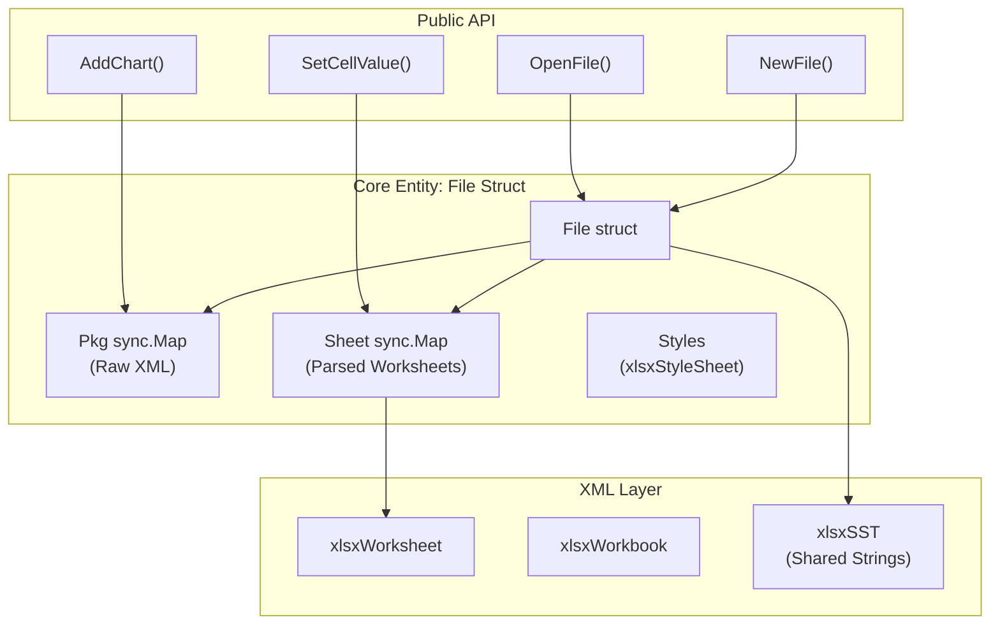
**Title**: Excelize Logic-to-Code Mapping

The `File` struct acts as the central coordinator. It utilizes `sync.Map` for `Pkg` (storing unzipped XML parts) and `Sheet` (caching parsed worksheet structures) to facilitate concurrent access where possible.

Sources: [README.md:46](), [README.md:84](), [excelize_test.go:29](), [excelize_test.go:125]()

## Data Flow: Spreadsheet Lifecycle

The lifecycle of an Excelize operation typically follows a pipeline from raw ZIP archive to parsed XML structures and back.

### File I/O Pipeline

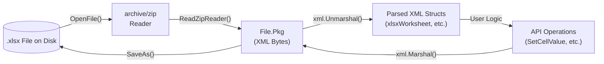
**Title**: Data Transformation Flow

When `OpenFile` is called, the library uses `archive/zip` to decompress the OOXML package. Individual XML parts are stored in the `Pkg` map. When a specific sheet is accessed (e.g., via `GetRows`), the XML is unmarshaled into Go structs like `xlsxWorksheet`. Modifications are marshaled back to XML before the final ZIP compression during `Save`.

Sources: [excelize_test.go:29-54](), [README.md:84-114]()

## Key Subsystems

Excelize is divided into several specialized subsystems that handle the complexities of the OOXML format:

| Subsystem | Responsibility | Key Entities |
| :--- | :--- | :--- |
| **File Management** | Handling ZIP archives and file I/O | `File`, `OpenFile`, `NewFile` |
| **Worksheet** | Managing sheet properties and data | `xlsxWorksheet`, `NewSheet` |
| **Cell & Data** | Reading/writing values and types | `SetCellValue`, `GetCellValue` |
| **Styles** | Managing fonts, fills, and borders | `xlsxStyleSheet`, `NewStyle` |
| **Calculation** | Formula evaluation engine | `CalcCellValue`, `UpdateLinkedValue` |
| **Drawing** | Charts and picture insertion | `AddChart`, `AddPicture` |

For a deep dive into these components, see [Architecture Overview](#1.1).

Sources: [README.md:16-17](), [excelize_test.go:56](), [excelize_test.go:125-142]()

## External Dependencies

Excelize leverages several specialized libraries to handle domain-specific tasks:
*   **efp**: Excel Formula Parser for tokenizing spreadsheet formulas.
*   **nfp**: Number Format Parser for processing Excel's custom number formats.
*   **mscfb**: Microsoft Compound File Binary reader for handling legacy formats or encrypted packages.

For more details, see [Dependencies and External Libraries](#1.3).

Sources: [go.mod:5-15]()

---

# Page: Architecture Overview

# Architecture Overview

<details>
<summary>Relevant source files</summary>

The following files were used as context for generating this wiki page:

- [excelize.go](excelize.go)
- [file.go](file.go)
- [lib.go](lib.go)
- [lib_test.go](lib_test.go)
- [templates.go](templates.go)
- [xmlWorkbook.go](xmlWorkbook.go)
- [xmlWorksheet.go](xmlWorksheet.go)

</details>


This document provides a high-level overview of the architecture of the excelize library, a Go package for reading and writing Excel spreadsheet files (XLAM, XLSM, XLSX, XLTM, and XLTX formats). It explains the main components, their interactions, and the design principles of the library.

## Four-Layer Architecture

The excelize library is organized into four distinct architectural layers, each with specific responsibilities. This layered design enables clean separation of concerns and efficient memory management.

### Layer Architecture Diagram

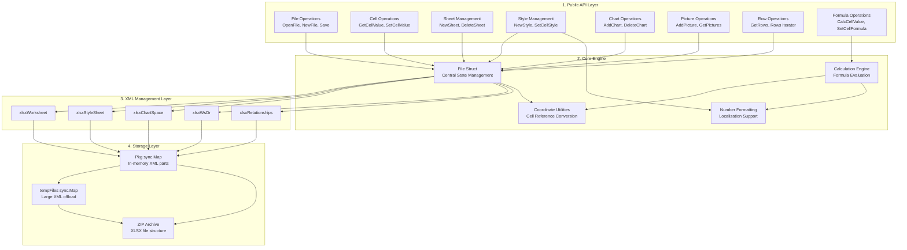

Sources: [excelize.go:31-66](), [lib.go:32-79](), [file.go:31-56]()

### Central File Struct

The `File` struct [excelize.go:31-66]() is the central hub of all operations, containing:

| Field | Type | Purpose |
|-------|------|---------|
| `Pkg` | `sync.Map` | Stores XML content in memory for small files |
| `Sheet` | `sync.Map` | Caches parsed `xlsxWorksheet` structures |
| `Drawings` | `sync.Map` | Stores chart and drawing structures |
| `Relationships` | `sync.Map` | Manages package relationships |
| `tempFiles` | `sync.Map` | Tracks temporary file paths for large XML |
| `calcCache` | `sync.Map` | Memoizes formula calculation results |
| `Styles` | `*xlsxStyleSheet` | Style definitions |
| `SharedStrings` | `*xlsxSST` | Shared string table |
| `ContentTypes` | `*xlsxTypes` | Content type definitions |
| `sheetMap` | `map[string]string` | Maps sheet names to XML paths |
| `mu` | `sync.Mutex` | Protects critical sections |

The use of `sync.Map` for major data structures enables concurrent read/write operations while maintaining thread safety.

Sources: [excelize.go:31-66]()

## Office Open XML Structure

Excel files (.xlsx) are ZIP archives containing XML files following the Office Open XML specification. Excelize maps these XML structures to Go structs and handles serialization/deserialization.

### XML Structure Map

| XML File Path | Purpose | Primary Go Struct | Stored In |
|--------------|---------|------------------|-----------|
| `xl/workbook.xml` | Workbook structure, sheet list | `xlsxWorkbook` | `Pkg sync.Map` |
| `xl/worksheets/sheet*.xml` | Individual worksheet data | `xlsxWorksheet` | `Pkg` or `tempFiles` |
| `xl/styles.xml` | Cell styles, fonts, fills | `xlsxStyleSheet` | `Pkg sync.Map` |
| `xl/sharedStrings.xml` | Deduplicated string table | `xlsxSST` | `Pkg` or `tempFiles` |
| `xl/theme/theme1.xml` | Color schemes, fonts | `decodeTheme` | `Pkg sync.Map` |
| `_rels/.rels` | Package relationships | `xlsxRelationships` | `Relationships sync.Map` |

Sources: [excelize.go:31-66](), [lib.go:32-79](), [xmlWorksheet.go:21-66](), [xmlWorkbook.go:38-62]()

### Memory Management Strategy

The library implements size-based routing to optimize memory usage:

- **Small XML files** (< `UnzipXMLSizeLimit`, default 16MB): Stored in `Pkg sync.Map` in memory [lib.go:74-77]().
- **Large XML files** (>= `UnzipXMLSizeLimit`): Offloaded to temporary files tracked in `tempFiles sync.Map` [lib.go:53-73]().
- **Size limit validation**: Total unzip size must not exceed `UnzipSizeLimit` (default 16GB) [lib.go:46-48]().

This two-tier strategy prevents memory exhaustion when handling large worksheets or shared string tables.

Sources: [excelize.go:114-125](), [lib.go:32-79](), [lib.go:83-99]()

### Object Model Hierarchy

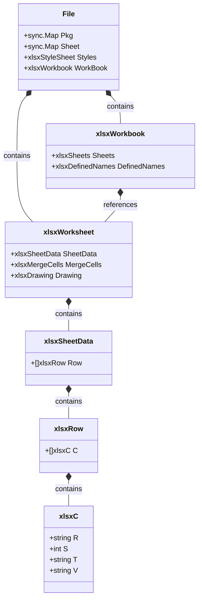

Sources: [excelize.go:31-66](), [xmlWorksheet.go:21-66](), [xmlWorkbook.go:38-62]()

## File I/O Data Flow

The library implements a sophisticated pipeline for reading and writing Excel files with memory-efficient size-based routing.

### File Input Pipeline

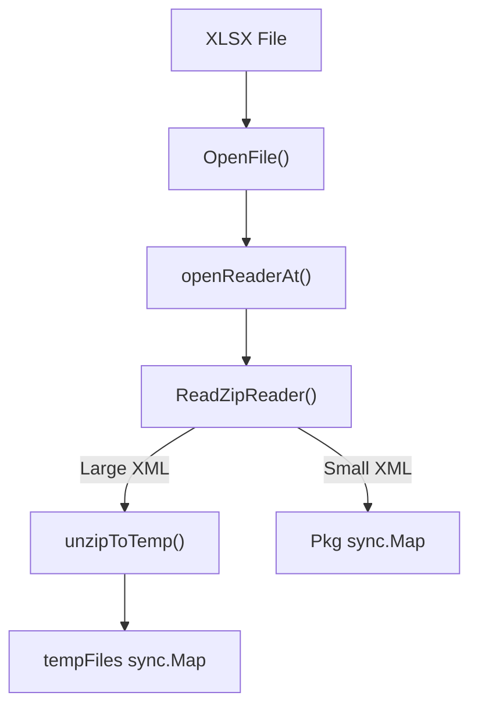

Sources: [excelize.go:134-149](), [excelize.go:198-232](), [lib.go:32-79](), [lib.go:83-99]()

### File Output Pipeline

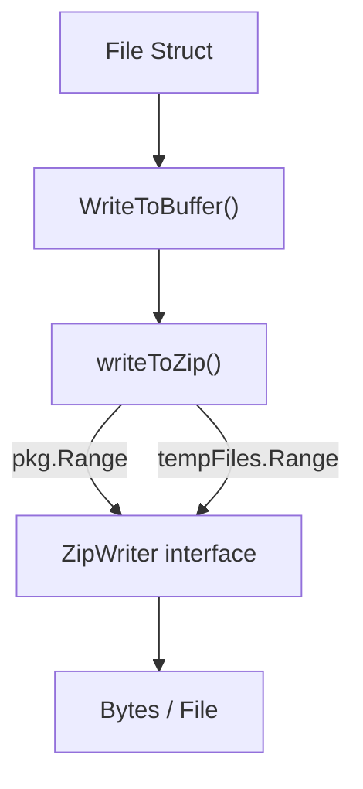

Sources: [file.go:117-160](), [file.go:163-237]()

### Reading Process

1. **ZIP Extraction**: `OpenReader` [excelize.go:188-194]() reads the file and triggers `openReaderAt`.
2. **Size Validation**: Checks total unzip size against `UnzipSizeLimit` in `ReadZipReader` [lib.go:46-48]().
3. **XML Routing**: `ReadZipReader` [lib.go:32-79]() routes each XML file:
   - Small files → `Pkg sync.Map` (in-memory) [lib.go:74-77]().
   - Large files → temporary files via `unzipToTemp` [lib.go:83-99]().
4. **Lazy Parsing**: XML is not parsed until accessed via internal readers like `workbookReader` or `workSheetReader`.

### Writing Process

1. **Serialization**: Various internal writers (e.g., `workBookWriter`, `workSheetWriter`) serialize structs to XML and store them in `Pkg` [file.go:164-176]().
2. **ZIP Building**: `writeToZip` [file.go:163-237]() iterates through `Pkg` and `tempFiles` to construct the final ZIP archive.
3. **ZIP64 Support**: If entries exceed 4GB, `writeZip64LFH` ensures compatibility [file.go:239-242]().

Sources: [excelize.go:198-232](), [lib.go:32-79](), [file.go:117-160](), [file.go:163-237]()

## Key Subsystems

### File I/O System

The File I/O subsystem manages the opening, creation, and saving of Excel files.

- `OpenFile`: Opens an existing Excel file [excelize.go:134-149]().
- `NewFile`: Creates a new Excel file with default templates [file.go:31-56]().
- `Save`/`SaveAs`: Persists the workbook to disk [file.go:59-87]().
- `Close`: Cleans up temporary files and shared string handles [file.go:89-108]().

### Worksheet Management

Worksheet management handles the structure of individual sheets. The `xlsxWorksheet` struct [xmlWorksheet.go:21-66]() maps the SpreadsheetML schema, containing properties for views, columns, sheet data, and protection.

### Cell Operations

Cell manipulation involves coordinate conversion and value storage.
- `SplitCellName`: Splits "AK74" into "AK" and 74 [lib.go:161-175]().
- `ColumnNameToNumber`: Converts "AK" to 37 [lib.go:204-225]().
- `ColumnNumberToName`: Precomputed lookup for converting 37 to "AK" [lib.go:230-255]().

### Concurrency and Thread Safety

The library uses a hybrid locking model to balance performance and safety:
- **Global Mutex**: `File.mu` [excelize.go:32]() protects high-level structural changes.
- **Concurrent Maps**: `Pkg`, `Sheet`, `Relationships`, and `Drawings` use `sync.Map` [excelize.go:53-58]() for safe concurrent access to different parts of the workbook.
- **Worksheet Mutex**: `xlsxWorksheet.mu` [xmlWorksheet.go:22]() protects internal sheet data during modification.

Sources: [excelize.go:31-66](), [xmlWorksheet.go:21-66](), [xmlWorkbook.go:21-25]()

## Error Handling

The library provides specialized error types for limits and validation, such as `ErrOptionsUnzipSizeLimit` [excelize.go:181]() and `ErrColumnNumber` [lib.go:222](). Most operations return an error as the last return value, which must be checked to ensure data integrity.

---

# Page: Getting Started

# Getting Started

<details>
<summary>Relevant source files</summary>

The following files were used as context for generating this wiki page:

- [README.md](README.md)
- [README_zh.md](README_zh.md)
- [excelize_test.go](excelize_test.go)
- [file.go](file.go)
- [templates.go](templates.go)

</details>


This page provides practical examples for performing basic operations with the excelize library. You will learn how to create new workbooks, open existing files, read and write cell values, manage sheets, and save your work.

## Overview of Basic Operations

The excelize library provides a straightforward API for manipulating Excel files. All operations center around the `File` struct, which represents an in-memory Excel workbook. The typical workflow involves initializing a `File` object, manipulating its internal XML parts, and then serializing those parts back into an OOXML (Office Open XML) archive.

**Basic Workflow Diagram**

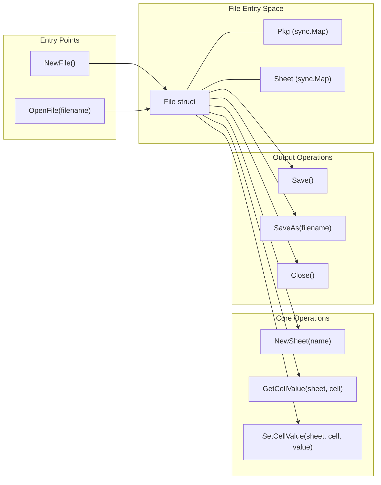

Sources: [file.go:27-56](), [file.go:59-67](), [file.go:71-87](), [file.go:90-108](), [excelize_test.go:125-143]()

## Creating a New Workbook

To create a new Excel workbook, use the `NewFile()` function. This initializes a `File` struct with a default set of XML templates (relationships, content types, workbook, and a default worksheet named "Sheet1").

**Example: Create New Workbook**

```go
package main

import (
    "fmt"
    "github.com/xuri/excelize/v2"
)

func main() {
    f := excelize.NewFile()
    defer func() {
        if err := f.Close(); err != nil {
            fmt.Println(err)
        }
    }()
    
    // Set a cell value
    f.SetCellValue("Sheet1", "A1", "Hello World")
    
    // Save the workbook
    if err := f.SaveAs("Book1.xlsx"); err != nil {
        fmt.Println(err)
    }
}
```

The `NewFile()` function populates the internal `Pkg` and `Sheet` maps with default XML headers and templates, ensuring the resulting file adheres to the ECMA-376 standard.

Sources: [file.go:27-56](), [README.md:32-68]()

## Opening an Existing Workbook

Use `OpenFile()` to open an existing Excel file from disk. This function parses the ZIP archive and loads the XML components into memory.

**Example: Open Existing File**

```go
f, err := excelize.OpenFile("Book1.xlsx")
if err != nil {
    fmt.Println(err)
    return
}
defer f.Close()
```

**File Opening and Initialization**

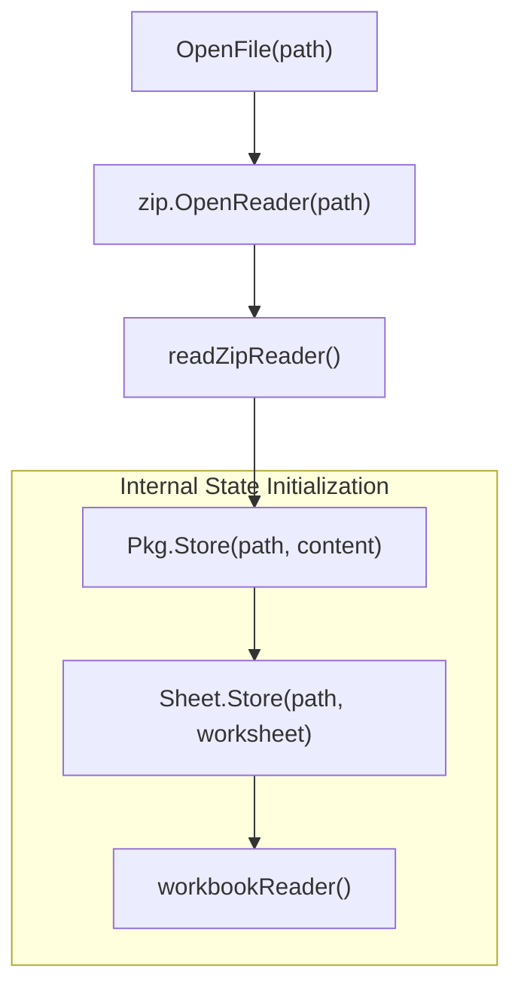

Sources: [excelize_test.go:27-30](), [file.go:46-52](), [README.md:84-114]()

## Reading Cell Values

The `GetCellValue()` function retrieves the value of a cell. By default, it returns the formatted value as a string. You can use `Options` to request the raw value.

**Example: Read Cell Values**

```go
// Get formatted value
value, err := f.GetCellValue("Sheet2", "C11")
if err != nil {
    fmt.Println(err)
}

// Get raw value
val, err := f.GetCellValue("Sheet2", "F16", excelize.Options{RawCellValue: true})
```

Sources: [excelize_test.go:110-123](), [excelize_test.go:164-166]()

## Writing Cell Values

The `SetCellValue()` function is a versatile entry point that handles multiple Go types, routing them to specialized internal functions like `SetCellInt`, `SetCellStr`, or `SetCellBool`.

**Example: Write Different Data Types**

```go
f.SetCellValue("Sheet2", "F1", "Hello")   // String
f.SetCellValue("Sheet2", "F2", 42)        // Integer
f.SetCellValue("Sheet2", "F8", -42.65418) // Float
f.SetCellValue("Sheet2", "F16", true)     // Boolean
```

**Data Flow: From Go Type to XML**

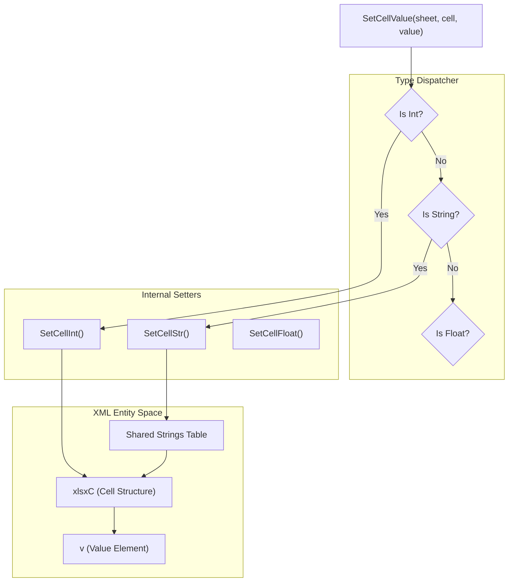

Sources: [excelize_test.go:125-143](), [excelize_test.go:66-73](), [file.go:173-174]()

## Working with Sheets

### Creating and Managing Sheets
Use `NewSheet()` to add a worksheet. The library manages the underlying `workbook.xml` and relationship files (`.rels`) automatically.

**Example: Sheet Operations**

```go
// Create new sheet
index, err := f.NewSheet("Sheet2")

// Set active sheet (the one displayed when opening Excel)
f.SetActiveSheet(index)

// Rename a sheet
err = f.SetSheetName("Sheet1", "OldSheet")
```

Sources: [README.md:53-62](), [excelize_test.go:76-79](), [excelize_test.go:88]()

## Saving and Closing

### Saving the Workbook
`SaveAs()` serializes the internal `Pkg` map back into a ZIP archive. If you opened a file via `OpenFile()`, you can use `Save()` to overwrite the original file.

```go
// Save to a new path
err := f.SaveAs("Book1.xlsx")

// Overwrite original path
err = f.Save()
```

### Closing the File
The `Close()` method is critical for cleaning up temporary files used for shared strings or streaming.

```go
err := f.Close()
```

**Implementation Detail: Save Pipeline**
1. `writeToZip`: Iterates through internal writers (styles, workbook, worksheets).
2. `Pkg.Range`: Writes each XML part into the ZIP buffer.
3. `ZipWriter.Close`: Finalizes the archive.

Sources: [file.go:59-67](), [file.go:71-87](), [file.go:90-108](), [file.go:163-176]()

## Summary of Key Functions

| Function | Purpose | Source |
| :--- | :--- | :--- |
| `NewFile` | Initializes a new `File` struct with default templates | [file.go:31]() |
| `OpenFile` | Opens and unzips an existing spreadsheet | [excelize_test.go:29]() |
| `SetCellValue` | Sets a cell value based on Go type inference | [excelize_test.go:125]() |
| `GetCellValue` | Reads a cell value with optional formatting | [excelize_test.go:110]() |
| `NewSheet` | Adds a new worksheet and updates workbook relationships | [README.md:53]() |
| `SaveAs` | Serializes the `File` struct to a disk path | [file.go:71]() |
| `Close` | Cleans up temporary files and stream data | [file.go:90]() |

Sources: [file.go:31-108](), [excelize_test.go:29-125]()

---

# Page: Dependencies and External Libraries

# Dependencies and External Libraries

<details>
<summary>Relevant source files</summary>

The following files were used as context for generating this wiki page:

- [.github/SECURITY.md](.github/SECURITY.md)
- [.github/dependabot.yml](.github/dependabot.yml)
- [.github/workflows/codeql-analysis.yml](.github/workflows/codeql-analysis.yml)
- [.github/workflows/go.yml](.github/workflows/go.yml)
- [go.mod](go.mod)
- [go.sum](go.sum)

</details>


## Purpose and Scope

This document catalogs the external dependencies used by the Excelize library and explains the role each plays in the system. It covers both direct runtime dependencies required for Excel file manipulation and indirect dependencies brought in through the dependency chain. For information about the internal architecture that utilizes these libraries, see [1.1 Architecture Overview](). For specifics on how formulas are processed, see [3.1 Formula Calculation Engine]().

## Dependency Overview

The Excelize library relies on direct dependencies organized into three categories: specialized Excel format libraries, Go standard library extensions, and utility packages.

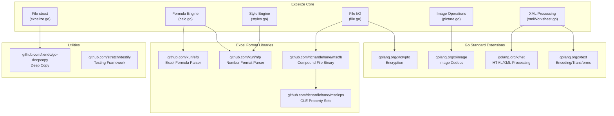

**Sources:** [go.mod:5-22]()

## Excel Format Libraries

### Excel Formula Parser (efp)

The `github.com/xuri/efp` package provides tokenization and parsing of Excel formula syntax. This is the foundation of Excelize's formula calculation system.

**Package:** `github.com/xuri/efp v0.0.1` [go.mod:9]()

**Primary Integration Points:**

| Code Location | Function | Purpose |
|--------------|----------|---------|
| `calc.go` | `parseFormula()` | Converts formula strings to token streams |
| `calc.go` | `evalInfixExp()` | Evaluates parsed token sequences |
| `calc.go` | `CalcCellValue()` | Entry point for formula evaluation |

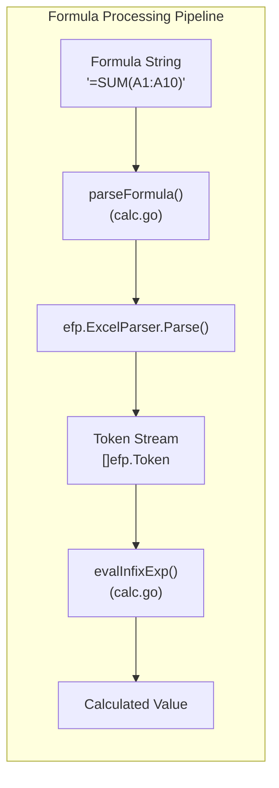

The parser handles all Excel formula syntax including cell references (`A1`), range references (`A1:B10`), function calls (`SUM`), and operators.

**Sources:** [go.mod:9](), [go.sum:13-14]()

### Number Format Parser (nfp)

The `github.com/xuri/nfp` package interprets Excel number format codes and applies culture-specific formatting rules. It enables proper display of numbers, dates, currencies, and custom formats.

**Package:** `github.com/xuri/nfp v0.0.2-0.20250530014748-2ddeb826f9a9` [go.mod:10]()

**Primary Integration Points:**

| Code Location | Function | Purpose |
|--------------|----------|---------|
| `numfmt.go` | `formattedValue()` | Applies format codes to numeric values |
| `numfmt.go` | `getValueFrom()` | Extracts and formats cell values |
| `styles.go` | `NewStyle()` | Associates format codes with cell styles |

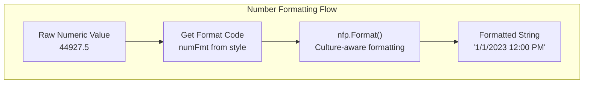

The library supports built-in Excel format codes (0-49) and custom format strings with conditional sections.

**Sources:** [go.mod:10](), [go.sum:15-16]()

### MS Compound File Binary (mscfb)

The `github.com/richardlehane/mscfb` package reads and writes Microsoft Compound File Binary (CFB) format, used for legacy Excel files and encrypted modern Excel files.

**Package:** `github.com/richardlehane/mscfb v1.0.7` [go.mod:6]()
**Indirect Dependency:** `github.com/richardlehane/msoleps v1.0.6` [go.mod:20]()

**Primary Integration Points:**

| Code Location | Function | Purpose |
|--------------|----------|---------|
| `file.go` | `OpenFile()` | Detects and reads encrypted XLSX files |
| `crypt.go` | `Decrypt()` | Extracts encrypted package from CFB container |
| `file.go` | `Save()` | Writes encrypted files back to CFB format |

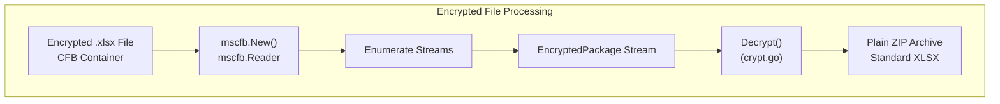

**Sources:** [go.mod:6,20](), [go.sum:5-8]()

## Go Standard Library Extensions

### Cryptography (golang.org/x/crypto)

The `golang.org/x/crypto` package provides encryption and decryption capabilities for password-protected Excel files.

**Package:** `golang.org/x/crypto v0.53.0` [go.mod:11]()

**Primary Integration Points:**

| Code Location | Function | Purpose |
|--------------|----------|---------|
| `crypt.go` | `Decrypt()` | Decrypts password-protected XLSX files |
| `crypt.go` | `standardDecrypt()` | ECMA-376 standard encryption |
| `crypt.go` | `agileDecrypt()` | Office 2010+ agile encryption |

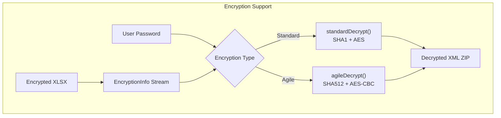

**Sources:** [go.mod:11](), [go.sum:17-18]()

### Image Processing (golang.org/x/image)

The `golang.org/x/image` package extends Go's standard image library with additional format codecs (TIFF, BMP, WebP) required for Excel picture embedding.

**Package:** `golang.org/x/image v0.38.0` [go.mod:12]()

**Primary Integration Points:**

| Code Location | Function | Purpose |
|--------------|----------|---------|
| `picture.go` | `AddPicture()` | Validates and embeds images |
| `picture.go` | `AddPictureFromBytes()` | Processes image bytes |

**Sources:** [go.mod:12](), [go.sum:19-20]()

### XML and Text (golang.org/x/net & golang.org/x/text)

The `golang.org/x/net` and `golang.org/x/text` packages provide robust XML parsing and character set detection, supporting non-UTF-8 encodings in legacy or localized Excel files.

**Packages:** 
- `golang.org/x/net v0.55.0` [go.mod:13]()
- `golang.org/x/text v0.38.0` [go.mod:14]()

**Primary Integration Points:**

| Code Location | Function | Purpose |
|--------------|----------|---------|
| `xmlWorksheet.go` | `xmlDecoder()` | Creates charset-aware XML decoders |
| `lib.go` | `CharsetReader` | Configures non-UTF-8 support |

**Sources:** [go.mod:13-14](), [go.sum:21-24]()

## Utility Dependencies

### Deep Copy (go-deepcopy)

The `github.com/tiendc/go-deepcopy` package provides recursive deep copying of complex Go structures, essential for duplicating worksheets or styles.

**Package:** `github.com/tiendc/go-deepcopy v1.7.2` [go.mod:8]()

**Primary Integration Points:**

| Code Location | Function | Purpose |
|--------------|----------|---------|
| `sheet.go` | `CopySheet()` | Creates independent sheet copies |

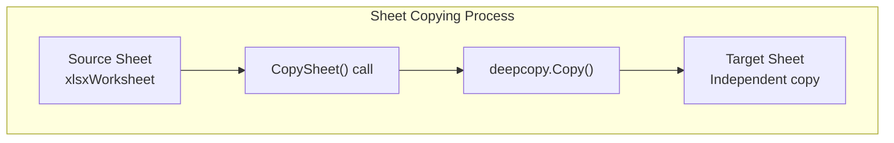

**Sources:** [go.mod:8](), [go.sum:11-12]()

## Development Dependencies

### Testing Framework (testify)

The `github.com/stretchr/testify` package provides assertion helpers used throughout Excelize's test suite.

**Package:** `github.com/stretchr/testify v1.11.1` [go.mod:7]()

**Integration:**
Used in all `*_test.go` files for `assert` and `require` functionality to validate workbook state, cell values, and file integrity.

**Sources:** [go.mod:7,18-19](), [go.sum:9-10]()

## Dependency Version Management

The project targets Go 1.25.0 [go.mod:3](). CI/CD pipelines validate the library across multiple Go versions (1.25.x, 1.26.x) and operating systems (Ubuntu, macOS, Windows) including ARM architectures [.github/workflows/go.yml:6-10,31-38]().

**Sources:** [go.mod:3](), [.github/workflows/go.yml:6-38]()

---

# Page: Core Functionality

# Core Functionality

<details>
<summary>Relevant source files</summary>

The following files were used as context for generating this wiki page:

- [cell.go](cell.go)
- [excelize.go](excelize.go)
- [file.go](file.go)
- [rows.go](rows.go)
- [sheet.go](sheet.go)
- [sheet_test.go](sheet_test.go)
- [templates.go](templates.go)

</details>


The Core Functionality encompasses the essential operations for working with Excel files in excelize. This page provides an overview of the fundamental components and their interactions. The library is built around the `File` struct, which serves as the central access point for all workbook operations.

## Subsystems

This section is divided into four main operational areas:

- **[File Operations](#2.1)**: Opening, creating, saving, and closing Excel files. For details, see [File Operations](#2.1).
- **[Worksheet Management](#2.2)**: Creating, deleting, and managing sheets within a workbook. For details, see [Worksheet Management](#2.2).
- **[Cell Operations](#2.3)**: Reading and writing individual cell values, formulas, and hyperlinks. For details, see [Cell Operations](#2.3).
- **[Row and Column Operations](#2.4)**: Bulk operations on rows and columns, including streaming access. For details, see [Row and Column Operations](#2.4).

## The File Struct

### Central State Management

The `File` struct [excelize.go:31-66]() is the primary interface for all Excel operations. It maintains the workbook state and provides methods for manipulating spreadsheet content.

**File Struct - Core Components**

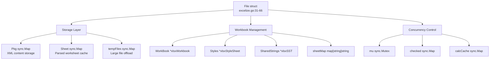

Sources: [excelize.go:31-66]()

### Key Fields

| Field | Type | Purpose |
|-------|------|---------|
| `Pkg` | `sync.Map` | Stores raw XML content from the ZIP archive [excelize.go:55]() |
| `Sheet` | `sync.Map` | Cache of parsed worksheet structures [excelize.go:58]() |
| `sheetMap` | `map[string]string` | Maps sheet names to XML file paths [excelize.go:40]() |
| `WorkBook` | `*xlsxWorkbook` | Workbook metadata and sheet definitions [excelize.go:64]() |
| `Styles` | `*xlsxStyleSheet` | Cell formatting and styles [excelize.go:60]() |
| `SharedStrings` | `*xlsxSST` | Shared string table for text deduplication [excelize.go:57]() |
| `tempFiles` | `sync.Map` | Paths to temporary files for large XML [excelize.go:42]() |
| `calcCache` | `sync.Map` | Cached formula calculation results [excelize.go:44]() |
| `mu` | `sync.Mutex` | Mutex for thread-safe operations [excelize.go:32]() |

Sources: [excelize.go:31-66]()

## Architecture Overview

### Component Hierarchy

The library organizes Excel data in a hierarchical structure that mirrors the Office Open XML specification.

**Data Model Hierarchy**

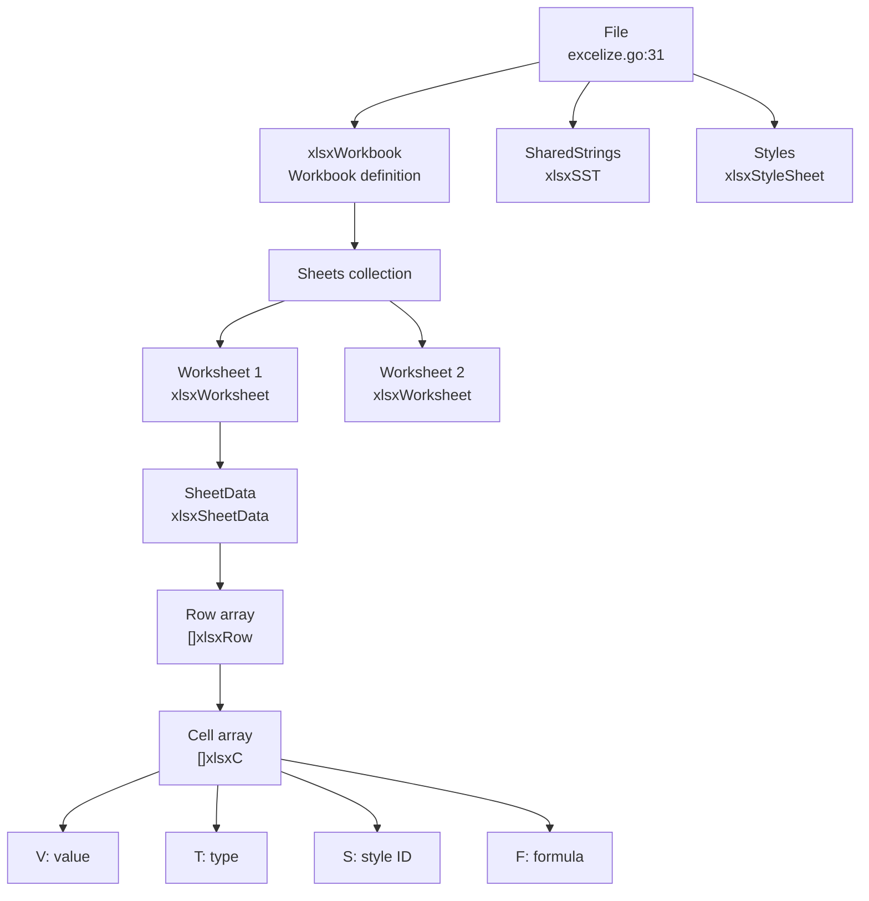

Sources: [excelize.go:31-66](), [sheet.go:194-209](), [cell.go:179-181]()

## Functional Areas

### File Operations

File operations provide the lifecycle management for Excel files. The primary entry points are `NewFile()` [file.go:31](), `OpenFile()` [excelize.go:134](), and `OpenReader()` [excelize.go:188]().

**File Operations Overview**

| Operation | Function | Key Implementation |
|-----------|----------|-------------------|
| Create | `NewFile()` | Initializes `File` struct with default template [file.go:31-56]() |
| Open | `OpenFile(name, opts)` | Opens OS file and calls `openReaderAt` [excelize.go:134-149]() |
| Save | `Save()` / `SaveAs(name)` | Serializes structures to XML and writes ZIP [file.go:59-87]() |
| Close | `Close()` | Cleans up temporary files and buffers [file.go:90-108]() |

See [File Operations](#2.1) for details on encryption and memory management.

Sources: [excelize.go:134-149](), [file.go:31-56](), [file.go:59-108]()

### Operation Flow

Operations in excelize follow a consistent pattern from user code to XML serialization.

**Data Flow from API to Storage**

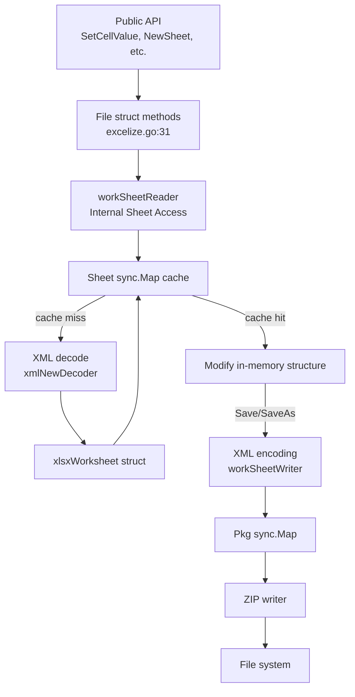

Sources: [sheet.go:153-191](), [file.go:163-237]()

### Worksheet Management

Worksheet operations manage the workbook's sheet structure. The `File.sheetMap` field [excelize.go:40]() maintains the mapping between sheet names and their XML file paths.

**Worksheet Operation Flow**

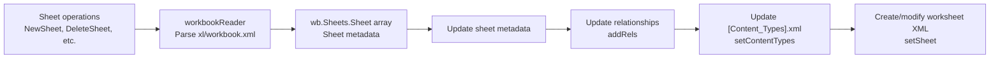

Sources: [sheet.go:51-80](), [sheet.go:84-95]()

**Core Operations**

| Category | Operations | Implementation Notes |
|----------|-----------|---------------------|
| Creation | `NewSheet(name)` [sheet.go:51]() | Appends sheet to workbook and sets content types |
| Visibility | `SetSheetVisible()` | Sets sheet state (visible, hidden, veryHidden) |
| Metadata | `GetSheetIndex()` [sheet.go:57]() | Retrieves the internal index of a sheet |

See [Worksheet Management](#2.2) for detailed documentation.

Sources: [sheet.go:51-80]()

### Cell Operations

Cell operations provide granular data access. Each cell is represented by the `xlsxC` struct with fields for value (`V`), type (`T`), style (`S`), and formula (`F`).

**Data Type Handling**

| Type | Setter | Storage | Notes |
|------|--------|---------|-------|
| Integer | `SetCellValue(int)` [cell.go:132]() | `setCellIntFunc` | Stored as numeric type |
| String | `SetCellValue(string)` [cell.go:138]() | `SetCellStr` | Uses Shared String Table [cell.go:40]() |
| Boolean | `SetCellValue(bool)` [cell.go:151]() | `SetCellBool` | Type "b" [cell.go:56]() |
| Formula | `SetCellFormula()` | `F` field | Supports STCellFormula types [cell.go:43-52]() |

See [Cell Operations](#2.3) for details on rich text and formulas.

Sources: [cell.go:32-63](), [cell.go:129-159]()

### Row and Column Operations

Row and column operations provide bulk access and manipulation. These can be performed in-memory or via streaming iterators.

**Streaming vs. In-Memory**

| Approach | Function | Use Case |
|----------|----------|----------|
| In-Memory | `GetRows()` [rows.go:61]() | Small to medium datasets; returns `[][]string` |
| Streaming | `Rows()` [rows.go:328]() | Large datasets; uses SAX parser `Rows.Next()` [rows.go:99]() |

**Streaming Architecture**

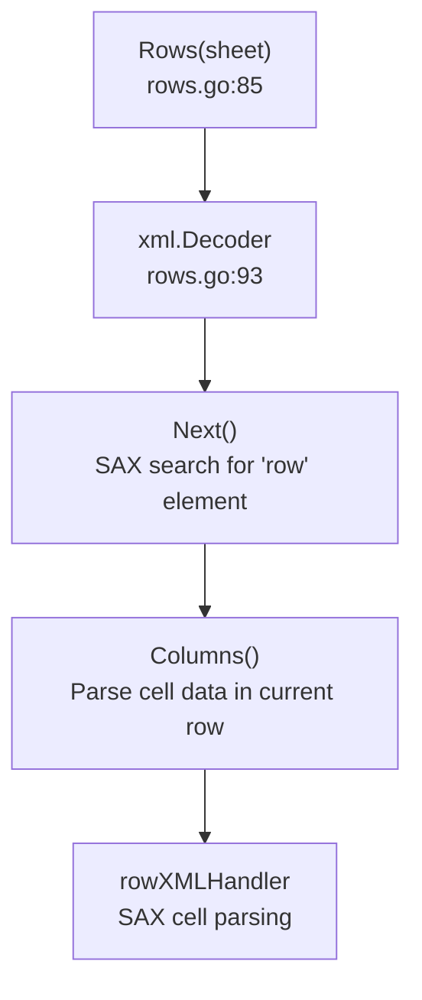

See [Row and Column Operations](#2.4) for details on the streaming API.

Sources: [rows.go:61-82](), [rows.go:85-127](), [rows.go:153-198]()

## Concurrency Model

The `File` struct uses `sync.Map` and `sync.Mutex` for thread-safe access to worksheets and shared resources.

| Component | Synchronization | Safe Operations |
|-----------|----------------|-----------------|
| `Pkg` | `sync.Map` [excelize.go:55]() | Concurrent raw XML storage |
| `Sheet` | `sync.Map` [excelize.go:58]() | Concurrent parsed worksheet cache |
| `mu` | `sync.Mutex` [excelize.go:32]() | Critical section protection |

Sources: [excelize.go:31-66]()

---

# Page: File Operations

# File Operations

<details>
<summary>Relevant source files</summary>

The following files were used as context for generating this wiki page:

- [crypt.go](crypt.go)
- [crypt_test.go](crypt_test.go)
- [excelize.go](excelize.go)
- [file.go](file.go)
- [file_test.go](file_test.go)
- [lib.go](lib.go)
- [lib_test.go](lib_test.go)
- [templates.go](templates.go)

</details>


## Purpose and Scope

This page documents the fundamental file operations in the `excelize` library: opening existing Excel files, creating new workbooks, saving data, and understanding the underlying ZIP processing and memory management strategies. This includes handling encrypted files, configuring size limits, and managing the internal `File` structure that serves as the central state container for all workbook operations.

---

## File Opening Pipeline

The library provides two primary entry points for opening Excel files: `OpenFile` for reading from disk and `OpenReader` for reading from any `io.Reader` stream. Both paths converge on the internal `openReaderAt` function.

### OpenFile Function

The `OpenFile` function is the standard way to open a spreadsheet file from disk. It accepts a filename and optional configuration parameters.

```mermaid
flowchart LR
    User["User Call:<br/>OpenFile(filename, opts)"]
    OSOpen["os.Open()"]
    OpenReaderAt["openReaderAt()"]
    File["*File struct"]
    Close["file.Close()"]
    
    User --> OSOpen
    OSOpen --> OpenReaderAt
    OpenReaderAt --> File
    File --> Close
    
    User -.-> |"excelize.Options"| OpenReaderAt
```

**Diagram: OpenFile Processing Flow**

The function opens the file handle, delegates to `openReaderAt` for parsing, stores the filename in `File.Path`, and closes the original OS file handle after the data has been processed.

Sources: [excelize.go:134-149]()

### OpenReader and openReaderAt

`OpenReader` reads data from any `io.Reader` and converts it into a `bytes.Reader` to utilize `openReaderAt`. The core parsing logic resides in `openReaderAt`, which handles both regular XLSX files and encrypted OLE-format files.

```mermaid
flowchart TD
    Input["io.ReaderAt"]
    NewFile["newFile()"]
    CheckOpts["checkOpenReaderOptions()"]
    CheckOLE{"Header matches<br/>oleIdentifier?"}
    Decrypt["Decrypt(raw, options)"]
    ZipReader["zip.NewReader()"]
    ReadZip["ReadZipReader(zr)"]
    LoadPkg["Store in Pkg sync.Map"]
    ParseCore["Parse Core Structures:<br/>CalcChain, ContentTypes,<br/>Styles, WorkBook"]
    Return["Return *File"]
    
    Input --> NewFile
    NewFile --> CheckOpts
    CheckOpts --> CheckOLE
    CheckOLE -->|"Yes"| Decrypt
    CheckOLE -->|"No"| ZipReader
    Decrypt --> ZipReader
    ZipReader --> ReadZip
    ReadZip --> LoadPkg
    LoadPkg --> ParseCore
    ParseCore --> Return
```

**Diagram: openReaderAt Processing Pipeline**

The function performs these steps:
1. Initializes a new `File` struct via `newFile()` [excelize.go:152-169]().
2. Validates unzip limits via `checkOpenReaderOptions()` [excelize.go:173-184]().
3. Checks for the OLE identifier [crypt.go:41]() (encrypted Excel file marker).
4. If encrypted, invokes `Decrypt` [crypt.go:143-160]() using the password from `Options`.
5. Creates a `zip.Reader` and extracts contents via `ReadZipReader` [lib.go:32-79]().
6. Populates the `Pkg` map and initializes core XML readers (Calculation Chain, Styles, etc.).

Sources: [excelize.go:188-232](), [lib.go:32-79](), [crypt.go:143-160]()

---

## The File Structure

The `File` struct is the central data structure representing a workbook. It uses `sync.Map` extensively to handle concurrent access to different parts of the spreadsheet.

```mermaid
graph TB
    subgraph "File Struct Entities"
        FileMutex["mu sync.Mutex"]
        Options["options *Options"]
        
        subgraph "Storage (sync.Map)"
            Pkg["Pkg<br/>XML content by path"]
            Sheet["Sheet<br/>Parsed worksheet structs"]
            Drawings["Drawings<br/>Drawing structures"]
            Relationships["Relationships<br/>Relationship tracking"]
            TempFiles["tempFiles<br/>Large file paths"]
            CalcCache["calcCache<br/>Formula results"]
        end
        
        subgraph "Parsed XML Entities"
            SharedStrings["SharedStrings *xlsxSST"]
            Styles["Styles *xlsxStyleSheet"]
            WorkBook["WorkBook *xlsxWorkbook"]
            CalcChain["CalcChain *xlsxCalcChain"]
            ContentTypes["ContentTypes *xlsxTypes"]
        end
    end
```

**Diagram: File Struct Core Components**

### Key Fields

- `Pkg sync.Map`: Stores the raw XML content of the ZIP archive parts, keyed by their internal path (e.g., `xl/worksheets/sheet1.xml`) [excelize.go:55]().
- `Sheet sync.Map`: Caches the parsed Go structures of worksheets [excelize.go:58]().
- `tempFiles sync.Map`: Tracks the location of XML parts that were offloaded to disk due to size [excelize.go:42]().
- `ZipWriter func`: A factory function that allows overriding the default `zip.NewWriter` implementation [excelize.go:65]().

Sources: [excelize.go:31-66]()

---

## Creating New Files

The `NewFile` function initializes a new workbook with a default template.

```mermaid
flowchart LR
    User["NewFile()"]
    Init["newFile()"]
    Templates["Pkg.Store(templates)<br/>rels, workbook, styles, etc."]
    InitReaders["Init Core Readers:<br/>calcChainReader()<br/>stylesReader()<br/>workbookReader()"]
    Return["Return *File"]
    
    User --> Init
    Init --> Templates
    Templates --> InitReaders
    InitReaders --> Return
```

**Diagram: NewFile Initialization**

`NewFile` populates the `Pkg` map with default XML templates for the workbook, styles, themes, and a default "Sheet1" [file.go:31-56](). It also sets the `SheetCount` to 1 and initializes internal readers to sync the Go structs with the template data.

Sources: [file.go:31-56](), [templates.go:21-41]()

---

## ZIP Processing and Memory Management

Excelize implements a size-aware extraction strategy to prevent memory exhaustion when opening large files.

### ReadZipReader Strategy

When `ReadZipReader` processes a ZIP archive, it checks the size of specific XML parts:

| Part Type | Condition | Action |
|-----------|-----------|--------|
| **Total Archive** | `unzipSize > UnzipSizeLimit` | Returns `ErrOptionsUnzipSizeLimit` |
| **Shared Strings** | `fileSize > UnzipXMLSizeLimit` | Offloads to temporary file via `unzipToTemp` |
| **Worksheets** | `fileSize > UnzipXMLSizeLimit` | Offloads to temporary file via `unzipToTemp` |
| **Others** | Always | Loads directly into memory (`Pkg` map) |

Sources: [lib.go:32-79]()

### Temporary File Handling

`unzipToTemp` creates a file in the directory specified by `Options.TmpDir` (or the system default) [lib.go:83-99](). These files are tracked in the `tempFiles` map and are cleaned up when `File.Close()` is called.

```mermaid
flowchart LR
    Close["f.Close()"]
    CloseSS["Close sharedStringTemp"]
    CloseStreams["Close stream rawData"]
    IterateTemp["Iterate tempFiles"]
    Remove["os.Remove(path)"]
    Clear["tempFiles.Clear()"]
    
    Close --> CloseSS
    CloseSS --> CloseStreams
    CloseStreams --> IterateTemp
    IterateTemp --> Remove
    Remove --> Clear
```

**Diagram: File Cleanup and Memory Release**

Sources: [file.go:90-108](), [lib.go:81-99]()

---

## Saving and Serialization

Saving a file involves gathering all XML parts from memory (`Pkg`) and temporary files, then writing them to a ZIP archive.

### Save and SaveAs

- `Save()`: Overwrites the file at the original `File.Path` [file.go:59-67]().
- `SaveAs(name)`: Creates or truncates a file at the specified path and writes the workbook [file.go:71-87]().

### Write Pipeline

The writing process follows this flow:
1. **Sync**: Internal writers (e.g., `workBookWriter`, `styleSheetWriter`) are called to serialize Go structs back into the `Pkg` map [file.go:164-176]().
2. **ZIP Generation**: `writeToZip` iterates through `streams`, `Pkg`, and `tempFiles` to populate the ZIP archive [file.go:163-237]().
3. **ZIP64 Handling**: If any part exceeds 4GB, the library adds ZIP64 Local File Headers via `writeZip64LFH` [file.go:150, 239-254]().
4. **Encryption**: If a password is provided in `Options`, the entire ZIP buffer is encrypted via `Encrypt` [crypt.go:163-189]() before being written to the final destination [file.go:151-158]().

Sources: [file.go:59-160](), [file.go:163-237](), [crypt.go:163-189]()

---

## Configuration Options

The `Options` struct defines limits and behaviors for file operations.

| Option | Type | Description | Default |
|--------|------|-------------|---------|
| `Password` | `string` | Password for encrypted XLSX files | `""` |
| `UnzipSizeLimit` | `int64` | Total unzipped size limit for the workbook | `16GB` |
| `UnzipXMLSizeLimit` | `int64` | Memory limit for individual XML parts (Worksheets/SST) | `16MB` |
| `TmpDir` | `string` | Directory for temporary files | System Default |

The library enforces that `UnzipXMLSizeLimit` must be less than or equal to `UnzipSizeLimit` [excelize.go:173-184]().

Sources: [excelize.go:114-125](), [excelize.go:173-184]()

---

# Page: Worksheet Management

# Worksheet Management

<details>
<summary>Relevant source files</summary>

The following files were used as context for generating this wiki page:

- [docProps.go](docProps.go)
- [docProps_test.go](docProps_test.go)
- [sheet.go](sheet.go)
- [sheet_test.go](sheet_test.go)
- [sheetpr.go](sheetpr.go)
- [sheetpr_test.go](sheetpr_test.go)
- [sheetview.go](sheetview.go)
- [sheetview_test.go](sheetview_test.go)
- [workbook.go](workbook.go)
- [workbook_test.go](workbook_test.go)
- [xmlCore.go](xmlCore.go)

</details>


This page documents worksheet management operations in the Excelize library, covering sheet creation, deletion, copying, moving, property configuration, visibility control, protection, and relationship management.

For cell-level operations, see [Cell Operations](2.3). For row and column operations, see [Row and Column Operations](2.4).

## Architecture Overview

Worksheet management in Excelize operates across multiple layers: the `File` struct maintains in-memory worksheet state, the `xlsxWorksheet` struct represents the Office Open XML structure, and the relationship layer links worksheets to the workbook.

**Worksheet Structure and Storage**

```mermaid
graph TB
    subgraph "File Struct Management Layer"
        File["File struct"]
        SheetSync["Sheet sync.Map<br/>path → *xlsxWorksheet"]
        SheetCount["SheetCount int"]
    end
    
    subgraph "XML Storage Layer"
        WorkbookXML["xl/workbook.xml<br/>xlsxWorkbook"]
        WorkbookRels["xl/_rels/workbook.xml.rels<br/>xlsxRelationships"]
        Sheet1XML["xl/worksheets/sheet1.xml<br/>xlsxWorksheet"]
        Sheet2XML["xl/worksheets/sheet2.xml<br/>xlsxWorksheet"]
    end
    
    subgraph "xlsxWorksheet Structure"
        SheetPr["SheetPr<br/>sheet properties"]
        SheetViews["SheetViews<br/>panes, selection"]
        SheetData["SheetData<br/>rows and cells"]
        MergeCells["MergeCells"]
        Cols["Cols<br/>column widths"]
        SheetFormatPr["SheetFormatPr"]
    end
    
    File --> SheetSync
    File --> SheetCount
    
    SheetSync --> Sheet1XML
    
    WorkbookXML --> WorkbookRels
    WorkbookRels --> Sheet1XML
    WorkbookRels --> Sheet2XML
    
    Sheet1XML --> SheetPr
    Sheet1XML --> SheetViews
    Sheet1XML --> SheetData
    Sheet1XML --> MergeCells
    Sheet1XML --> Cols
    Sheet1XML --> SheetFormatPr
```

The `File` struct maintains a `Sheet` sync.Map (path-to-parsed-worksheet mapping). Each worksheet is stored as `xl/worksheets/sheet{N}.xml` and referenced in `xl/workbook.xml` via relationships.

Sources: [sheet.go:51-79](), [sheet.go:159-191](), [workbook.go:189-196]()

## Creating and Deleting Worksheets

### NewSheet Function

The `NewSheet` function creates a new worksheet and integrates it into the workbook structure. Note that when creating a new workbook, a default worksheet named `Sheet1` is created.

```go
// Create a new worksheet named "Sheet2"
index, err := f.NewSheet("Sheet2")
if err != nil {
    fmt.Println(err)
    return
}
```

**NewSheet Operation Flow**

```mermaid
flowchart TD
    Start["NewSheet(sheet)"] --> CheckName["checkSheetName(sheet)"]
    CheckName --> CheckExists["GetSheetIndex(sheet)"]
    CheckExists --> |"exists"| ReturnIndex["return existing index"]
    CheckExists --> |"not exists"| DeleteDup["DeleteSheet(sheet)"]
    
    DeleteDup --> IncrementID["SheetCount++<br/>calculate next sheetID"]
    IncrementID --> UpdateCT["setContentTypes()<br/>/xl/worksheets/sheetN.xml"]
    UpdateCT --> CreateSheet["setSheet(sheetID, sheet)<br/>create xlsxWorksheet"]
    CreateSheet --> AddRels["addRels()<br/>workbook.xml.rels"]
    AddRels --> UpdateWB["setWorkbook()<br/>update workbook.xml"]
    UpdateWB --> Return["return GetSheetIndex(sheet)"]
```

The function performs these operations:
1. Validates the sheet name using `checkSheetName` [sheet.go:53]()
2. Checks if a sheet with that name already exists [sheet.go:57-60]()
3. Increments `SheetCount` and finds the next available `sheetID` by iterating existing sheets in `workbook.xml` [sheet.go:62-70]()
4. Updates `[Content_Types].xml` via `setContentTypes` [sheet.go:72]()
5. Updates the workbook relationship file (`workbook.xml.rels`) via `addRels` [sheet.go:76]()
6. Appends the new sheet entry to `workbook.xml` via `setWorkbook` [sheet.go:78]()

Sources: [sheet.go:51-80](), [workbook.go:189-196]()

## Renaming and Moving Worksheets

### SetSheetName Function

The `SetSheetName` function updates a worksheet's name. Sheet names must satisfy these constraints (enforced by `checkSheetName`):
- Not empty.
- Maximum 31 characters.
- Cannot contain characters: `:\/?*[]`.

Sources: [sheet.go:53](), [sheet_test.go:36-39]()

### MoveSheet Function

The `MoveSheet` function reorders worksheets in the workbook. Moving a sheet involves reordering the `<sheet>` elements within the `<sheets>` collection in `workbook.xml`.

Sources: [sheet_test.go:27]()

## Sheet View Options

### Panes: Freeze and Split

Panes allow viewing different parts of a worksheet simultaneously. The `Panes` struct configures freeze or split behavior.

```go
// Freeze column A in Sheet1
err := f.SetPanes("Sheet1", &excelize.Panes{
    Freeze:      true,
    Split:       false,
    XSplit:      1,
    YSplit:      0,
    TopLeftCell: "B1",
    ActivePane:  "topRight",
    Selection: []Selection{
        {SQRef: "K16", ActiveCell: "K16", Pane: "topRight"},
    },
})
```

**Panes Configuration Structure**

```mermaid
graph TD
    subgraph "Panes Struct"
        Freeze["Freeze bool"]
        Split["Split bool"]
        XSplit["XSplit int"]
        YSplit["YSplit int"]
        TopLeftCell["TopLeftCell string"]
        ActivePane["ActivePane string"]
        Selection["Selection []Selection"]
    end
    
    subgraph "xlsxWorksheet Storage"
        SheetViews["SheetViews.SheetView[n]"]
        PaneXML["Pane *xlsxPane"]
        SelectionXML["Selection []*xlsxSelection"]
    end
    
    Freeze --> PaneXML
    Selection --> SelectionXML
    PaneXML --> SheetViews
    SelectionXML --> SheetViews
```

Sources: [sheet_test.go:41-140](), [sheetview.go:15-35]()

### View Options

The `ViewOptions` struct controls worksheet display settings such as grid lines, rulers, and zoom scales.

| Field | Type | Description |
|-------|------|-------------|
| `ShowGridLines` | `*bool` | Display grid lines |
| `ShowRowColHeaders` | `*bool` | Display row and column headers |
| `ZoomScale` | `*float64` | Zoom magnification (10-400%) |
| `View` | `*string` | "normal", "pageLayout", or "pageBreakPreview" |

These settings are managed via `SetSheetView` and `GetSheetView`.

Sources: [sheetview.go:38-129](), [sheetview_test.go:9-50]()

## Sheet Protection

Worksheet protection prevents unauthorized modifications. Excelize supports various hash algorithms for password protection.

```go
// Protect a worksheet with password
err := f.ProtectSheet("Sheet1", &excelize.SheetProtectionOptions{
    AlgorithmName: "SHA-512",
    Password:      "password",
})
```

Workbook-level protection is also available via `ProtectWorkbook` and `UnprotectWorkbook`, which can lock the structure (preventing adding/deleting sheets) or windows.

Sources: [workbook.go:128-185]()

## Page Layout and Printing

### Page Layout and Margins

Page layout controls how worksheets are printed. Margins are managed via `SetPageMargins` and `GetPageMargins`.

```go
// Configure page layout
err := f.SetPageLayout("Sheet1", &excelize.PageLayoutOptions{
    Size:        intPtr(1),
    Orientation: stringPtr("landscape"),
})

// Set page margins
err := f.SetPageMargins("Sheet1", &excelize.PageLayoutMarginsOptions{
    Bottom: float64Ptr(1.0),
    Left:   float64Ptr(1.0),
})
```

Sources: [sheetpr.go:17-81](), [sheet_test.go:199-212]()

## Sheet Properties and Configuration

### SetSheetProps and GetSheetProps

The `SheetPropsOptions` struct provides control over worksheet properties like tab colors and outline settings.

```go
// Configure worksheet properties
err := f.SetSheetProps("Sheet1", &excelize.SheetPropsOptions{
    TabColorRGB:         stringPtr("FFFF00"),
    OutlineSummaryBelow: boolPtr(true),
})
```

**Property Mapping to XML**

```mermaid
graph LR
    subgraph "SheetPropsOptions"
        TabColor["TabColorRGB/Theme/Tint"]
        OutlineSummary["OutlineSummaryBelow/Right"]
        BaseCol["BaseColWidth"]
    end
    
    subgraph "xlsxWorksheet Elements"
        SheetPr["SheetPr"]
        SheetFormatPr["SheetFormatPr"]
    end
    
    TabColor --> SheetPr
    OutlineSummary --> SheetPr
    BaseCol --> SheetFormatPr
```

Sources: [sheetpr.go:109-220](), [sheetpr_test.go:46-109]()

## Search Functionality

The `SearchSheet` function searches for values in a worksheet. It supports exact matches and regular expressions.

```go
// Search for exact value
results, err := f.SearchSheet("Sheet1", "TargetValue")
```

The search process involves decoding the worksheet XML and iterating through cell values. If a shared string is referenced, the library resolves it through the shared strings table.

Sources: [sheet_test.go:142-197]()

## Ignored Errors

Excel can suppress certain error indicators in cells. The `IgnoredErrorsType` enumeration defines common errors like `IgnoredErrorsNumberStoredAsText` or `IgnoredErrorsFormula`.

Sources: [sheet.go:31-45]()

---

# Page: Cell Operations

# Cell Operations

<details>
<summary>Relevant source files</summary>

The following files were used as context for generating this wiki page:

- [cell.go](cell.go)
- [cell_test.go](cell_test.go)
- [date.go](date.go)
- [date_test.go](date_test.go)
- [merge.go](merge.go)
- [merge_test.go](merge_test.go)
- [xmlContentTypes.go](xmlContentTypes.go)
- [xmlSharedStrings.go](xmlSharedStrings.go)

</details>


## Purpose and Scope

This document covers cell-level operations in the excelize library, including reading and writing cell values, managing different data types, working with formulas, hyperlinks, and rich text. Cell operations form the core interface between users and spreadsheet data, handling the translation between Go data types and Excel's internal XML representation.

For worksheet-level operations such as creating sheets and managing worksheet properties, see [Worksheet Management](#2.2). For formula calculation and evaluation, see [Formula Calculation Engine](#3.1). For cell styling and formatting, see [Styling and Formatting](#3.2).

---

## Cell Reference System

### Coordinate Conversion Architecture

```mermaid
graph TB
    subgraph "User-Facing Cell References"
        CellName["Cell Name<br/>e.g., 'A1', 'Z99'"]
        ColName["Column Name<br/>e.g., 'A', 'AZ'"]
        RowNum["Row Number<br/>e.g., 1, 99"]
    end
    
    subgraph "Conversion Functions"
        SplitCellName["SplitCellName<br/>cell.go"]
        JoinCellName["JoinCellName<br/>cell.go"]
        CellNameToCoordinates["CellNameToCoordinates<br/>lib.go:258"]
        CoordinatesToCellName["CoordinatesToCellName<br/>lib.go:277"]
        ColumnNameToNumber["ColumnNameToNumber<br/>lib.go:204"]
        ColumnNumberToName["ColumnNumberToName<br/>lib.go:233"]
    end
    
    subgraph "Internal Coordinates"
        ColInt["Column Integer<br/>1 to 16384"]
        RowInt["Row Integer<br/>1 to 1048576"]
        Coordinates["Coordinates Pair<br/>[col, row]"]
    end
    
    subgraph "XML Storage"
        xlsxC["xlsxC.R<br/>Cell Reference"]
        xlsxRow["xlsxRow.R<br/>Row Number"]
    end
    
    CellName --> SplitCellName
    SplitCellName --> ColName
    SplitCellName --> RowNum
    
    ColName --> ColumnNameToNumber
    RowNum --> RowInt
    
    ColName --> JoinCellName
    RowNum --> JoinCellName
    JoinCellName --> CellName
    
    CellName --> CellNameToCoordinates
    CellNameToCoordinates --> Coordinates
    
    Coordinates --> CoordinatesToCellName
    CoordinatesToCellName --> CellName
    
    ColumnNameToNumber --> ColInt
    ColInt --> ColumnNumberToName
    ColumnNumberToName --> ColName
    
    Coordinates --> xlsxC
    RowInt --> xlsxRow
```

**Sources:** [lib.go:156-292](), [cell.go:1439-1453]()

The library provides bidirectional conversion between Excel-style alphanumeric cell references (like "A1") and zero-indexed integer coordinates. The coordinate system uses 1-based indexing to match Excel's conventions.

| Function | Input | Output | Purpose |
|----------|-------|--------|---------|
| `SplitCellName` | "A1" | "A", 1 | Splits cell reference into column and row |
| `JoinCellName` | "A", 1 | "A1" | Combines column name and row number |
| `CellNameToCoordinates` | "A1" | 1, 1 | Converts to integer coordinates |
| `CoordinatesToCellName` | 1, 1 | "A1" | Converts from integer coordinates |
| `ColumnNameToNumber` | "AK" | 37 | Converts column name to number |
| `ColumnNumberToName` | 37 | "AK" | Converts column number to name |

**Sources:** [lib.go:156-292]()

---

## Cell Data Types

### Type Enumeration and Mapping

```mermaid
graph LR
    subgraph "CellType Enumeration"
        CellTypeUnset["CellTypeUnset<br/>0"]
        CellTypeBool["CellTypeBool<br/>1"]
        CellTypeDate["CellTypeDate<br/>2"]
        CellTypeError["CellTypeError<br/>3"]
        CellTypeFormula["CellTypeFormula<br/>4"]
        CellTypeInlineString["CellTypeInlineString<br/>5"]
        CellTypeNumber["CellTypeNumber<br/>6"]
        CellTypeSharedString["CellTypeSharedString<br/>7"]
    end
    
    subgraph "XML Type Attributes"
        TypeB["t='b'<br/>Boolean"]
        TypeD["t='d'<br/>Date"]
        TypeE["t='e'<br/>Error"]
        TypeN["t='n' or empty<br/>Number"]
        TypeS["t='s'<br/>Shared String"]
        TypeStr["t='str'<br/>Formula"]
        TypeInlineStr["t='inlineStr'<br/>Inline String"]
    end
    
    TypeB --> CellTypeBool
    TypeD --> CellTypeDate
    TypeE --> CellTypeError
    TypeN --> CellTypeNumber
    TypeS --> CellTypeSharedString
    TypeStr --> CellTypeFormula
    TypeInlineStr --> CellTypeInlineString
```

**Sources:** [cell.go:28-63]()

Excel cells can contain different data types, each represented differently in the underlying XML. The `CellType` enumeration provides a Go-native way to work with these types:

| CellType | XML Attribute | Value Storage | Description |
|----------|---------------|---------------|-------------|
| `CellTypeBool` | `t="b"` | "0" or "1" in `V` | Boolean values |
| `CellTypeDate` | `t="d"` | ISO 8601 date string | Date/time in XML format |
| `CellTypeNumber` | `t=""` or `t="n"` | Numeric string in `V` | Integer or floating-point |
| `CellTypeSharedString` | `t="s"` | SST index in `V` | String via shared string table |
| `CellTypeInlineString` | `t="inlineStr"` | Rich text in `IS` | Inline rich string |
| `CellTypeFormula` | `t="str"` | Formula result in `V` | Formula cell |
| `CellTypeError` | `t="e"` | Error code in `V` | Error value (e.g., #DIV/0!) |

**Sources:** [cell.go:28-63](), [cell.go:612-648]()

---

## Reading Cell Values

### Value Retrieval Flow

```mermaid
graph TD
    subgraph "Public API"
        GetCellValue["GetCellValue<br/>cell.go:71"]
        GetCellType["GetCellType<br/>cell.go:84"]
        GetCellFormula["GetCellFormula<br/>cell.go:673"]
        GetCellRichText["GetCellRichText<br/>cell.go:1134"]
    end
    
    subgraph "Internal Implementation"
        getCellStringFunc["getCellStringFunc<br/>cell.go:1458"]
        workSheetReader["workSheetReader<br/>File struct"]
        prepareCell["prepareCell<br/>cell.go:1440"]
        mergeCellsParser["mergeCellsParser<br/>cell.go:1592"]
    end
    
    subgraph "Value Processing"
        getValueFrom["xlsxC.getValueFrom<br/>cell.go:612"]
        formattedValue["formattedValue<br/>cell.go:1518"]
        sharedStringsReader["sharedStringsReader<br/>File struct"]
    end
    
    subgraph "Type-Specific Handlers"
        getCellBool["getCellBool<br/>cell.go:562"]
        getCellDate["getCellDate<br/>cell.go:590"]
        SharedStringLookup["SST Index Lookup<br/>cell.go:619-628"]
        NumericFormat["Numeric Formatting<br/>cell.go:639-646"]
    end
    
    GetCellValue --> getCellStringFunc
    GetCellType --> getCellStringFunc
    GetCellFormula --> getCellStringFunc
    
    getCellStringFunc --> workSheetReader
    workSheetReader --> mergeCellsParser
    mergeCellsParser --> prepareCell
    
    GetCellValue --> getValueFrom
    getValueFrom --> getCellBool
    getValueFrom --> getCellDate
    getValueFrom --> SharedStringLookup
    getValueFrom --> NumericFormat
    
    SharedStringLookup --> sharedStringsReader
    getCellBool --> formattedValue
    getCellDate --> formattedValue
    NumericFormat --> formattedValue
```

**Sources:** [cell.go:71-97](), [cell.go:612-648](), [cell.go:1458-1513]()

The `GetCellValue` function provides the primary interface for reading cell data. It returns a formatted string representation of the cell value, applying number formatting, date conversion, and boolean formatting as appropriate.

```go
// Basic usage
value, err := f.GetCellValue("Sheet1", "A1")

// Get raw value without formatting
value, err := f.GetCellValue("Sheet1", "A1", Options{RawCellValue: true})

// Get cell type
cellType, err := f.GetCellType("Sheet1", "A1")
```

The value retrieval process:

1. **Cell Reference Resolution**: Convert cell name to coordinates via `CellNameToCoordinates` [lib.go:258]()
2. **Merged Cell Handling**: Check if cell is part of merged range via `mergeCellsParser`, return top-left value [cell.go:1592-1623]()
3. **Row Lookup**: Binary search through worksheet rows using `sort.Find` [cell.go:1486-1494]()
4. **Cell Extraction**: Locate cell in row's cell array [cell.go:1498-1502]()
5. **Type-Based Processing**: Dispatch to type-specific handler based on `xlsxC.T` attribute [cell.go:612-648]()
6. **Value Formatting**: Apply number formats if not requesting raw value [cell.go:1518-1551]()

**Sources:** [cell.go:71-80](), [cell.go:612-648](), [cell.go:1458-1513]()

---

## Writing Cell Values

### Type Dispatch Architecture

```mermaid
graph TD
    subgraph "Public API Entry"
        SetCellValue["SetCellValue<br/>cell.go:129<br/>interface{} dispatch"]
    end
    
    subgraph "Type Detection"
        TypeSwitch["reflect.ValueOf<br/>Type assertion<br/>cell.go:131-157"]
    end
    
    subgraph "Integer Types"
        setCellIntFunc["setCellIntFunc<br/>cell.go:209"]
        SetCellInt["SetCellInt<br/>cell.go:294"]
        SetCellUint["SetCellUint<br/>cell.go:322"]
        setCellInt["setCellInt<br/>cell.go:315"]
        setCellUint["setCellUint<br/>cell.go:344"]
    end
    
    subgraph "Floating Point"
        SetCellFloat["SetCellFloat<br/>cell.go:391"]
        setCellFloat["xlsxC.setCellFloat<br/>cell.go:415"]
    end
    
    subgraph "String Types"
        SetCellStr["SetCellStr<br/>cell.go:426"]
        setCellString["setCellString<br/>cell.go:449"]
        setSharedString["setSharedString<br/>cell.go:487"]
    end
    
    subgraph "Other Types"
        SetCellBool["SetCellBool<br/>cell.go:351"]
        setCellTimeFunc["setCellTimeFunc<br/>cell.go:238"]
        SetCellDefault["SetCellDefault<br/>cell.go:652"]
    end
    
    subgraph "Cell Storage"
        xlsxC["xlsxC struct<br/>R, S, T, V, F, IS"]
        xlsxSST["Shared String Table<br/>xlsxSST"]
    end
    
    SetCellValue --> TypeSwitch
    
    TypeSwitch -->|"int, int8-64,<br/>uint, uint8-64"| setCellIntFunc
    TypeSwitch -->|"float32, float64"| SetCellFloat
    TypeSwitch -->|"string, []byte"| SetCellStr
    TypeSwitch -->|"bool"| SetCellBool
    TypeSwitch -->|"time.Time"| setCellTimeFunc
    TypeSwitch -->|"time.Duration"| SetCellDefault
    TypeSwitch -->|"nil"| SetCellDefault
    
    setCellIntFunc --> SetCellInt
    setCellIntFunc --> SetCellUint
    SetCellInt --> setCellInt
    SetCellUint --> setCellUint
    
    SetCellFloat --> setCellFloat
    
    SetCellStr --> setCellString
    setCellString --> setSharedString
    setSharedString --> xlsxSST
    
    setCellInt --> xlsxC
    setCellUint --> xlsxC
    setCellFloat --> xlsxC
    SetCellBool --> xlsxC
    setCellString --> xlsxC
```

**Sources:** [cell.go:129-159](), [cell.go:209-446]()

The `SetCellValue` function uses Go's type assertion to dispatch to appropriate type-specific setters. This provides a unified interface while maintaining type safety:

| Go Type | Handler Function | Cell Type Set | Value Encoding |
|---------|-----------------|---------------|----------------|
| `int`, `int8`-`int64` | `setCellIntFunc` → `SetCellInt` | `t=""` | `strconv.FormatInt` |
| `uint`, `uint8`-`uint64` | `setCellIntFunc` → `SetCellUint` | `t=""` | `strconv.FormatUint` |
| `float32`, `float64` | `SetCellFloat` | `t=""` | `strconv.FormatFloat` |
| `string`, `[]byte` | `SetCellStr` | `t="s"` | Shared string table index |
| `bool` | `SetCellBool` | `t="b"` | "1" or "0" |
| `time.Time` | `setCellTimeFunc` | `t=""` or `t="d"` | Excel serial date or ISO 8601 |
| `time.Duration` | `SetCellDefault` | `t=""` | Fractional days |
| `nil` | `SetCellDefault` | Empty cell | Empty string |

**Sources:** [cell.go:129-159](), [cell.go:294-446]()

### Cell Write Concurrency

All cell write operations acquire locks in a two-stage process:
1. **File-level lock** (`f.mu.Lock()`): Acquire worksheet reader [cell.go:295-301]()
2. **Worksheet-level lock** (`ws.mu.Lock()`): Modify cell data [cell.go:302-303]()

This pattern ensures thread-safe concurrent writes to different cells while preventing race conditions.

**Sources:** [cell.go:294-312]()

---

## Cell Structure and Storage

### xlsxC Struct Anatomy

```mermaid
graph TB
    subgraph "xlsxC Structure<br/>XML Cell Representation"
        CellRef["R: string<br/>Cell Reference<br/>e.g., 'A1'"]
        StyleID["S: int<br/>Style Index<br/>References CellXfs"]
        TypeAttr["T: string<br/>Type Attribute<br/>b/d/e/s/str/inlineStr"]
        Value["V: string<br/>Cell Value<br/>Type-dependent"]
        Formula["F: *xlsxF<br/>Formula<br/>Optional"]
        InlineStr["IS: *xlsxSI<br/>Inline String<br/>Rich text"]
        Vm["Vm: *byte<br/>Value Metadata<br/>Optional"]
        XMLSpace["XMLSpace: xml.Attr<br/>Preserve whitespace<br/>Optional"]
        LowerR["f: string<br/>Transformed formula<br/>Array formulas"]
    end
    
    subgraph "xlsxF Formula Structure"
        FContent["Content: string<br/>Formula expression"]
        FType["T: string<br/>normal/shared/array/<br/>dataTable"]
        FSi["Si: *int<br/>Shared formula index"]
        FRef["Ref: string<br/>Range reference"]
    end
    
    subgraph "xlsxSI String Item"
        SIText["T: *xlsxT<br/>Plain text"]
        SIRuns["R: []xlsxR<br/>Rich text runs"]
    end
    
    Formula --> FContent
    Formula --> FType
    Formula --> FSi
    Formula --> FRef
    
    InlineStr --> SIText
    InlineStr --> SIRuns
```

**Sources:** [xmlWorksheet.go](), [cell.go:179-181]()

The `xlsxC` struct is the internal representation of a cell in the worksheet XML. Key attributes:

- **R (Reference)**: Cell address like "A1", used for lookups and ordering [xmlWorksheet.go]()
- **S (Style)**: Index into `styleSheet.CellXfs.Xf` array, determines formatting [xmlWorksheet.go]()
- **T (Type)**: Type discriminator ("b", "d", "e", "s", "str", "inlineStr", or empty for number) [cell.go:55-63]()
- **V (Value)**: String representation of cell value, interpretation depends on type [xmlWorksheet.go]()
- **F (Formula)**: Present if cell contains formula, stores formula metadata [cell.go:183-206]()
- **IS (Inline String)**: Used for rich text cells (`t="inlineStr"`) [xmlWorksheet.go]()

**Sources:** [cell.go:179-181](), [xmlWorksheet.go]()

### Cell Preparation Workflow

```mermaid
graph TD
    subgraph "Cell Access Entry Points"
        SetCellValue["SetCellValue"]
        SetCellInt["SetCellInt"]
        SetCellStr["SetCellStr"]
    end
    
    subgraph "Worksheet Access"
        workSheetReader["workSheetReader<br/>Get or parse worksheet"]
        SheetMap["Sheet sync.Map<br/>Cached worksheets"]
    end
    
    subgraph "Cell Preparation"
        prepareCell["prepareCell<br/>cell.go:1440"]
        mergeCellsParser["mergeCellsParser<br/>cell.go:1592"]
        CellNameToCoordinates["CellNameToCoordinates"]
        prepareSheetXML["prepareSheetXML<br/>Ensure row/cell exists"]
    end
    
    subgraph "Style Application"
        prepareCellStyle["prepareCellStyle<br/>cell.go:1571<br/>Inherit row/col style"]
    end
    
    subgraph "Storage Update"
        xlsxCUpdate["Update xlsxC fields<br/>Set T, V, S, etc."]
        removeFormula["removeFormula<br/>cell.go:184<br/>Clear calc chain"]
    end
    
    SetCellValue --> workSheetReader
    SetCellInt --> workSheetReader
    SetCellStr --> workSheetReader
    
    workSheetReader --> SheetMap
    SheetMap --> prepareCell
    
    prepareCell --> mergeCellsParser
    mergeCellsParser --> CellNameToCoordinates
    CellNameToCoordinates --> prepareSheetXML
    
    prepareSheetXML --> prepareCellStyle
    prepareCellStyle --> xlsxCUpdate
    xlsxCUpdate --> removeFormula
```

**Sources:** [cell.go:1439-1453](), [cell.go:1571-1588]()

The `prepareCell` function ensures a cell structure exists in memory:

1. **Merged Cell Resolution**: If cell is in merged range, returns reference to top-left cell [cell.go:1442-1445]()
2. **Coordinate Conversion**: Converts cell name to integer coordinates [cell.go:1446-1449]()
3. **Structure Creation**: Calls `prepareSheetXML` to ensure row and cell exist in `SheetData.Row` array [cell.go:1450-1451]()
4. **Style Inheritance**: Applies row or column default style if cell has no explicit style [cell.go:1571-1588]()

This lazy initialization strategy minimizes memory usage for sparse spreadsheets.

**Sources:** [cell.go:1439-1453](), [cell.go:1571-1588]()

---

## Shared String Table

### SST Architecture and Deduplication

```mermaid
graph TB
    subgraph "String Write Path"
        SetCellStr["SetCellStr<br/>cell.go:426"]
        setCellString["setCellString<br/>cell.go:449"]
        setSharedString["setSharedString<br/>cell.go:487"]
    end
    
    subgraph "SST Management"
        sharedStringsLoader["sharedStringsLoader<br/>cell.go:464<br/>Load from temp if needed"]
        sharedStringsReader["sharedStringsReader<br/>Get or parse SST"]
        xlsxSST["xlsxSST struct<br/>SI: []xlsxSI<br/>Count, UniqueCount"]
        sharedStringsMap["sharedStringsMap<br/>map[string]int<br/>Value to index"]
    end
    
    subgraph "Deduplication Logic"
        CheckMap["Check if string exists<br/>in sharedStringsMap<br/>cell.go:497-499"]
        AppendNew["Append new xlsxSI<br/>Update counts<br/>cell.go:502-508"]
    end
    
    subgraph "Cell Storage"
        CellTValue["Cell.T = 's'<br/>Cell.V = index<br/>cell.go:453-459"]
    end
    
    subgraph "String Read Path"
        GetCellValue["GetCellValue"]
        getValueFrom["getValueFrom<br/>cell.go:618-628"]
        SSTLookup["SST Index Lookup<br/>d.SI[xlsxSI]"]
        xlsxSIString["xlsxSI.String()<br/>cell.go:162<br/>Concatenate runs"]
    end
    
    SetCellStr --> setCellString
    setCellString --> setSharedString
    
    setSharedString --> sharedStringsLoader
    sharedStringsLoader --> sharedStringsReader
    sharedStringsReader --> xlsxSST
    
    setSharedString --> CheckMap
    CheckMap -->|Exists| CellTValue
    CheckMap -->|New| AppendNew
    AppendNew --> sharedStringsMap
    AppendNew --> CellTValue
    
    GetCellValue --> getValueFrom
    getValueFrom --> SSTLookup
    SSTLookup --> xlsxSIString
```

**Sources:** [cell.go:449-509](), [cell.go:162-176](), [xmlSharedStrings.go:26-32]()

The shared string table (SST) is a critical memory optimization. Excel stores each unique string only once in `xl/sharedStrings.xml`, with cells referencing strings by index. This drastically reduces file size for workbooks with repeated strings.

### SST Write Process

When setting a string value via `SetCellStr`:

1. **Character Limit Check**: Truncate to 32,767 characters (TotalCellChars) if needed [cell.go:450-452]()
2. **SST Loader**: If SST was offloaded to temp file, reload it [cell.go:464-484]()
3. **Duplicate Check**: Look up string in `sharedStringsMap` [cell.go:497-499]()
4. **Insert New**: If not found, append to `xlsxSST.SI` array [cell.go:502-508]()
5. **Store Index**: Set cell type to "s" and value to SST index [cell.go:453-459]()

### SST Memory Management

For large workbooks, the SST can exceed memory limits. The library handles this through temp file offloading:

- If `xl/sharedStrings.xml` exceeds `UnzipXMLSizeLimit` during load, it's extracted to temp file.
- Before modifying SST, `sharedStringsLoader` reloads it from temp to memory [cell.go:464-484]()
- The `sharedStringsMap` provides O(1) duplicate detection without scanning the entire array [cell.go:497-499]()

**Sources:** [cell.go:449-509](), [cell.go:464-484](), [xmlSharedStrings.go:26-32]()

---

## Formulas

### Formula Types and Structures

```mermaid
graph TB
    subgraph "Formula Types"
        Normal["STCellFormulaTypeNormal<br/>'normal'<br/>Single cell formula"]
        Shared["STCellFormulaTypeShared<br/>'shared'<br/>Shared across cells"]
        Array["STCellFormulaTypeArray<br/>'array'<br/>Array formula"]
        DataTable["STCellFormulaTypeDataTable<br/>'dataTable'<br/>What-if analysis"]
    end
    
    subgraph "xlsxF Structure"
        FContent["Content: string<br/>Formula text"]
        FType["T: string<br/>Formula type"]
        FSi["Si: *int<br/>Shared index"]
        FRef["Ref: string<br/>Range reference"]
    end
    
    subgraph "Setting Formulas"
        SetCellFormula["SetCellFormula<br/>cell.go:789"]
        FormulaOpts["FormulaOpts<br/>Type, Ref"]
        setArrayFormula["setArrayFormula<br/>cell.go:840"]
        setSharedFormula["setSharedFormula<br/>cell.go:899"]
    end
    
    subgraph "Getting Formulas"
        GetCellFormula["GetCellFormula<br/>cell.go:673"]
        getCellFormula["getCellFormula<br/>cell.go:679"]
        getSharedFormula["getSharedFormula<br/>cell.go:1693"]
        convertSharedFormula["convertSharedFormula<br/>cell.go:1664"]
    end
    
    Normal --> FContent
    Shared --> FSi
    Array --> FRef
    
    SetCellFormula --> FormulaOpts
    FormulaOpts --> setArrayFormula
    FormulaOpts --> setSharedFormula
    
    GetCellFormula --> getCellFormula
    getCellFormula --> getSharedFormula
    getSharedFormula --> convertSharedFormula
```

**Sources:** [cell.go:43-52](), [cell.go:702-835]()

Excel supports four formula types, each with different storage and evaluation semantics:

| Type | Attribute | Description | Use Case |
|------|-----------|-------------|----------|
| **Normal** | `t="normal"` or omitted | Standard single-cell formula | Most formulas like `=A1+B1` [cell.go:48-49]() |
| **Shared** | `t="shared"` | Template formula shared by multiple cells | Repeated formula pattern like dragging [cell.go:50-51]() |
| **Array** | `t="array"` | Single formula spanning cell range | Array operations like `{=A1:A10*2}` [cell.go:44-45]() |
| **Data Table** | `t="dataTable"` | What-if analysis table | Scenario analysis, not settable via API [cell.go:46-47]() |

### Setting Formulas

```go
// Normal formula
err := f.SetCellFormula("Sheet1", "A3", "SUM(A1,B1)")

// Array formula with FormulaOpts
formulaType, ref := excelize.STCellFormulaTypeArray, "A3:A5"
err := f.SetCellFormula("Sheet1", "A3", "A1:A2", 
    excelize.FormulaOpts{Ref: &ref, Type: &formulaType})

// Shared formula
formulaType, ref := excelize.STCellFormulaTypeShared, "C1:C5"
err := f.SetCellFormula("Sheet1", "C1", "A1+B1",
    excelize.FormulaOpts{Ref: &ref, Type: &formulaType})
```

**Sources:** [cell.go:707-835]()

### Shared Formula Mechanism

Shared formulas optimize file size by storing a template formula once and generating cell-specific versions through coordinate offsets. The process:

1. **Master Cell**: First cell in range stores formula content and reference range [cell.go:914-921]()
2. **Dependent Cells**: Other cells reference master via shared index (`Si`) [cell.go:920-921]()
3. **Conversion**: When reading, `convertSharedFormula` applies coordinate offsets using `shiftCell` [cell.go:1664-1683]()
4. **Index Cache**: `xlsxWorksheet.formulaSI` sync.Map caches master cell lookups [cell.go:1694-1709]()

The `shiftCell` function handles both absolute (`$A$1`) and relative (`A1`) references correctly during formula transformation [cell.go:1714-1749]().

**Sources:** [cell.go:899-924](), [cell.go:1664-1749]()

### Array Formula Transformation

Array formulas require special handling because they reference ranges rather than single cells. The `setArrayFormula` function:

1. **Parse Range**: Extract cell coordinates from `formula.Ref` [cell.go:841-848]()
2. **Tokenize Formula**: Parse formula into tokens using `efp.ExcelParser` [cell.go:849-852]()
3. **Transform for Each Cell**: For each cell in range, adjust array operands by offset [cell.go:854-868]()
4. **Store Transformed**: Each cell gets unique transformed formula in lowercase `f` field [cell.go:864-865]()

**Sources:** [cell.go:840-870](), [cell.go:875-896]()

---

## Hyperlinks

### Hyperlink Management Architecture

```mermaid
graph TB
    subgraph "Hyperlink Types"
        External["External<br/>HTTP/HTTPS URL"]
        Location["Location<br/>Internal cell reference"]
        None["None<br/>Remove hyperlink"]
    end
    
    subgraph "Setting Hyperlinks"
        SetCellHyperLink["SetCellHyperLink<br/>cell.go:1047"]
        HyperlinkOpts["HyperlinkOpts<br/>Display, Tooltip<br/>cell.go:991-994"]
    end
    
    subgraph "Hyperlink Storage"
        xlsxHyperlink["xlsxHyperlink<br/>Ref, Location, RID,<br/>Display, Tooltip"]
        wsHyperlinks["xlsxWorksheet<br/>Hyperlinks<br/>cell.go:1063-1065"]
    end
    
    subgraph "Relationship Management"
        setRels["setRels<br/>Create relationship"]
        sheetRels["xl/worksheets/_rels/<br/>sheetN.xml.rels"]
        addSheetNameSpace["addSheetNameSpace<br/>cell.go:1087"]
    end
    
    subgraph "Getting Hyperlinks"
        GetCellHyperLink["GetCellHyperLink<br/>cell.go:963"]
        checkCellInRangeRef["checkCellInRangeRef<br/>cell.go:1627"]
        getSheetRelationships["getSheetRelationships<br/>TargetByID"]
    end
    
    subgraph "Removal"
        removeHyperLink["removeHyperLink<br/>cell.go:999"]
        deleteSheetRelationships["deleteSheetRelationships<br/>cell.go:1009"]
    end
    
    SetCellHyperLink --> HyperlinkOpts
    
    External --> setRels
    setRels --> sheetRels
    setRels --> xlsxHyperlink
    External --> addSheetNameSpace
    
    Location --> xlsxHyperlink
    
    None --> removeHyperLink
    removeHyperLink --> deleteSheetRelationships
    
    SetCellHyperLink --> wsHyperlinks
    xlsxHyperlink --> wsHyperlinks
    
    GetCellHyperLink --> checkCellInRangeRef
    GetCellHyperLink --> getSheetRelationships
```

**Sources:** [cell.go:963-1113]()

### Hyperlink Operations

**Setting External Hyperlink:**
```go
display, tooltip := "https://github.com/xuri/excelize", "Excelize on GitHub"
err := f.SetCellHyperLink("Sheet1", "A3", display, "External", 
    excelize.HyperlinkOpts{
        Display: &display,
        Tooltip: &tooltip,
    })
```

**Setting Internal Location:**
```go
err := f.SetCellHyperLink("Sheet1", "A3", "Sheet1!A40", "Location")
```

**Getting Hyperlink:**
```go
link, target, err := f.GetCellHyperLink("Sheet1", "H6")
```

**Sources:** [cell.go:1018-1113]()

### External Link Processing

For external hyperlinks:

1. **Relationship Creation**: Generate relationship in worksheet's `.rels` file [cell.go:1079-1086]()
2. **Namespace Addition**: Add hyperlink namespace to worksheet XML [cell.go:1087]()
3. **RID Assignment**: Store relationship ID in `xlsxHyperlink.RID` [cell.go:1086]()
4. **Max Limit Check**: Enforce 65,530 hyperlink limit per worksheet [cell.go:1074-1076]()

### Range Reference Support

Hyperlinks can apply to cell ranges. The `checkCellInRangeRef` function determines if a cell falls within a hyperlink's range [cell.go:1627-1642](), enabling operations like "apply hyperlink to A1:A10".

**Sources:** [cell.go:1047-1113](), [cell.go:963-987]()

---

## Rich Text

### Rich Text Structure and Operations

```mermaid
graph TB
    subgraph "RichTextRun Structure"
        RTText["Text: string<br/>Text content"]
        RTFont["Font: *Font<br/>Font properties"]
    end
    
    subgraph "Font Properties"
        FontBold["Bold: bool"]
        FontItalic["Italic: bool"]
        FontColor["Color: string"]
        FontSize["Size: float64"]
        FontFamily["Family: string"]
        FontStrike["Strike: bool"]
        FontUnderline["Underline: string"]
        FontVertAlign["VertAlign: string<br/>superscript/subscript"]
    end
    
    subgraph "Setting Rich Text"
        SetCellRichText["SetCellRichText<br/>cell.go:1353"]
        setRichText["setRichText<br/>cell.go:1209"]
        newRpr["Font.newRpr<br/>cell.go:1166"]
    end
    
    subgraph "Getting Rich Text"
        GetCellRichText["GetCellRichText<br/>cell.go:1134"]
        getCellRichText["getCellRichText<br/>cell.go:1116"]
        getFont["xlsxRPr.getFont<br/>cell.go:1188"]
    end
    
    subgraph "Storage"
        xlsxSI["xlsxSI<br/>String Item"]
        xlsxR["R: []xlsxR<br/>Rich text runs"]
        xlsxRPr["RPr: *xlsxRPr<br/>Run properties"]
        xlsxT["T: *xlsxT<br/>Text content"]
    end
    
    subgraph "Cell Integration"
        InlineStr["Cell.T = 'inlineStr'<br/>Cell.IS = &xlsxSI"]
        SharedString["Cell.T = 's'<br/>Cell.V = SST index"]
    end
    
    RTFont --> FontBold
    RTFont --> FontItalic
    RTFont --> FontColor
    
    SetCellRichText --> setRichText
    setRichText --> newRpr
    newRpr --> xlsxRPr
    
    xlsxRPr --> xlsxR
    xlsxT --> xlsxR
    xlsxR --> xlsxSI
    
    xlsxSI --> InlineStr
    xlsxSI --> SharedString
    
    GetCellRichText --> getCellRichText
    getCellRichText --> getFont
```

**Sources:** [cell.go:1115-1386](), [xmlSharedStrings.go:88-93]()

Rich text cells allow multiple text segments with different formatting within a single cell. Each segment is represented as a `RichTextRun` with optional font properties.

### Setting Rich Text Example

```go
err := f.SetCellRichText("Sheet1", "A1", []excelize.RichTextRun{
    {
        Text: "bold",
        Font: &excelize.Font{
            Bold:   true,
            Color:  "2354E8",
            Family: "Times New Roman",
        },
    },
    {
        Text: " and ",
        Font: &excelize.Font{
            Family: "Times New Roman",
        },
    },
    {
        Text: "italic",
        Font: &excelize.Font{
            Bold:   true,
            Color:  "E83723",
            Italic: true,
            Family: "Times New Roman",
        },
    },
})
```

**Sources:** [cell.go:1230-1352]()

### Rich Text Processing

The `SetCellRichText` function:

1. **Character Count Validation**: Sum UTF-16 code units across all runs, error if exceeding 32,767 [cell.go:1215-1218]()
2. **Run Conversion**: Convert `RichTextRun` to `xlsxR` with embedded font properties [cell.go:1219-1226]()
3. **Whitespace Preservation**: Apply `xml:space="preserve"` attribute if text has leading/trailing whitespace [cell.go:1220]()
4. **Deduplication**: Check if identical rich text exists in SST via `reflect.DeepEqual` [cell.go:1375-1379]()
5. **Storage Decision**: Store as shared string if deduplicated, otherwise append new entry [cell.go:1381-1385]()

The SST is used for rich text to enable deduplication across cells with identical formatting.

**Sources:** [cell.go:1353-1386](), [cell.go:1209-1228]()

---

## Merged Cells

### Merged Cell Reference Resolution

```mermaid
graph TD
    subgraph "Cell Access"
        GetCellValue["GetCellValue('B2')"]
        SetCellValue["SetCellValue('B2')"]
    end
    
    subgraph "Merge Detection"
        prepareCell["prepareCell<br/>cell.go:1440"]
        mergeCellsParser["mergeCellsParser<br/>cell.go:1592"]
        CellInRangeCheck["cellInRange check<br/>cell.go:1616"]
    end
    
    subgraph "MergeCells Structure"
        wsMergeCells["xlsxWorksheet<br/>MergeCells<br/>Cells: []*xlsxMergeCell"]
        xlsxMergeCell["xlsxMergeCell<br/>Ref: 'A1:C3'<br/>rect: [1,1,3,3]"]
    end
    
    subgraph "Resolution"
        TopLeftRef["Return top-left cell<br/>reference<br/>cell.go:1617"]
        RectCache["Cache rect coordinates<br/>cell.go:1605-1615"]
    end
    
    GetCellValue --> prepareCell
    SetCellValue --> prepareCell
    prepareCell --> mergeCellsParser
    
    mergeCellsParser --> wsMergeCells
    wsMergeCells --> xlsxMergeCell
    xlsxMergeCell --> CellInRangeCheck
    CellInRangeCheck --> RectCache
    CellInRangeCheck --> TopLeftRef
```

**Sources:** [cell.go:1592-1623](), [merge.go:16-27]()

Excel merged cells share a single value stored in the top-left cell. The `mergeCellsParser` function transparently redirects all cell operations to the master cell:

1. **Parse Request**: Cell reference (e.g., "B2") is uppercased [cell.go:1593]()
2. **Convert to Coordinates**: Transform to integer coordinates [cell.go:1594-1597]()
3. **Scan Merge Ranges**: Iterate through worksheet's `MergeCells.Cells` array [cell.go:1598-1620]()
4. **Range Check**: For each merge cell, check if coordinates fall within range [cell.go:1616]()
5. **Redirect**: If match found, return top-left cell reference [cell.go:1617-1619]()
6. **Rect Caching**: Parse and cache range coordinates in `xlsxMergeCell.rect` for performance [cell.go:1605-1615](), [merge.go:17-27]()

This means `GetCellValue("Sheet1", "B2")` and `GetCellValue("Sheet1", "A1")` return the same value if A1:C3 is merged.

**Sources:** [cell.go:1592-1623](), [merge.go:16-27](), [merge.go:52-88]()

---

## Bulk Operations

### Array-to-Cells Writing

```mermaid
graph TD
    subgraph "Entry Points"
        SetSheetRow["SetSheetRow<br/>cell.go:1394<br/>Write horizontal array"]
        SetSheetCol["SetSheetCol<br/>cell.go:1403<br/>Write vertical array"]
    end
    
    subgraph "Implementation"
        setSheetCells["setSheetCells<br/>cell.go:1408<br/>Direction dispatcher"]
        reflectValidation["reflect.ValueOf<br/>Validate pointer to slice<br/>cell.go:1414-1417"]
    end
    
    subgraph "Iteration"
        LoopSlice["for i := 0; i < v.Len()<br/>cell.go:1419"]
        CalcCellName["CoordinatesToCellName<br/>cell.go:1423-1425"]
        SetCellValue["SetCellValue<br/>cell.go:1432"]
    end
    
    subgraph "Direction Logic"
        RowDirection["dir == rows<br/>col+i, row"]
        ColDirection["dir == columns<br/>col, row+i"]
    end
    
    SetSheetRow --> setSheetCells
    SetSheetCol --> setSheetCells
    
    setSheetCells --> reflectValidation
    reflectValidation --> LoopSlice
    
    LoopSlice --> CalcCellName
    CalcCellName --> RowDirection
    CalcCellName --> ColDirection
    
    RowDirection --> SetCellValue
    ColDirection --> SetCellValue
```

**Sources:** [cell.go:1388-1437]()

The `SetSheetRow` and `SetSheetCol` functions provide efficient bulk writing of arrays to spreadsheet cells.

**Usage Examples:**

```go
// Write horizontal row starting at B6
err := f.SetSheetRow("Sheet1", "B6", &[]interface{}{"1", nil, 2})

// Write vertical column starting at B6
err := f.SetSheetCol("Sheet1", "B6", &[]interface{}{"1", nil, 2})
```

### Implementation Details

1. **Pointer Validation**: Input must be pointer to slice, validated via reflection [cell.go:1414-1417]()
2. **Starting Cell**: Parse starting cell reference to coordinates [cell.go:1409-1412]()
3. **Direction Control**: `adjustDirection` enum determines increment axis [cell.go:1408]()
4. **Cell Iteration**: Loop through slice elements, calculating cell name based on direction [cell.go:1419-1431]()
5. **Type Dispatch**: Each element passes through `SetCellValue`'s type assertion system [cell.go:1432]()

The functions error if input is not a pointer to slice (`ErrParameterInvalid`) [cell.go:1416-1417]().

**Sources:** [cell.go:1388-1437]()

---

## Value Formatting

### Formatting Pipeline

```mermaid
graph TD
    subgraph "Value Extraction"
        getValueFrom["xlsxC.getValueFrom<br/>cell.go:612"]
        TypeDispatch["Type-based dispatch<br/>T attribute"]
    end
    
    subgraph "Type Handlers"
        getCellBool["getCellBool<br/>cell.go:562<br/>Convert 0/1 to FALSE/TRUE"]
        getCellDate["getCellDate<br/>cell.go:590<br/>Parse ISO 8601"]
        SharedStringLookup["SST lookup<br/>cell.go:619-628"]
        NumericValue["Numeric precision<br/>cell.go:639-646"]
    end
    
    subgraph "Formatting Application"
        formattedValue["formattedValue<br/>cell.go:1518"]
        stylesReader["stylesReader<br/>Get stylesheet"]
        GetNumFmt["Get number format<br/>cell.go:1532-1535"]
    end
    
    subgraph "Format Resolution"
        getCustomNumFmtCode["getCustomNumFmtCode<br/>cell.go:1554<br/>Custom formats"]
        getBuiltInNumFmtCode["getBuiltInNumFmtCode<br/>Built-in formats"]
        applyBuiltInNumFmt["applyBuiltInNumFmt<br/>Apply formatting"]
    end
    
    subgraph "Culture-Aware Formatting"
        format["format<br/>Apply format code"]
        date1904["date1904<br/>Workbook setting<br/>cell.go:1536-1543"]
    end
    
    getValueFrom --> TypeDispatch
    TypeDispatch --> getCellBool
    TypeDispatch --> getCellDate
    TypeDispatch --> SharedStringLookup
    TypeDispatch --> NumericValue
    
    getCellBool --> formattedValue
    getCellDate --> formattedValue
    SharedStringLookup --> formattedValue
    NumericValue --> formattedValue
    
    formattedValue --> stylesReader
    stylesReader --> GetNumFmt
    GetNumFmt --> getCustomNumFmtCode
    GetNumFmt --> getBuiltInNumFmtCode
    
    getCustomNumFmtCode --> format
    getBuiltInNumFmtCode --> applyBuiltInNumFmt
    applyBuiltInNumFmt --> format
    
    format --> date1904
```

**Sources:** [cell.go:612-648](), [cell.go:1518-1551]()

### Raw vs Formatted Values

Cell values can be retrieved in two modes:

| Mode | Option | Result | Use Case |
|------|--------|--------|----------|
| **Formatted** | Default | "1,234.56", "1/15/2024" | Display to users |
| **Raw** | `Options{RawCellValue: true}` | "1234.56", "45307" | Calculations, parsing |

**Formatting Process:**

1. **Style Lookup**: Get cell style ID from `xlsxC.S` [cell.go:1519-1520]()
2. **Number Format ID**: Extract `NumFmtID` from style's `CellXfs.Xf` entry [cell.go:1532-1535]()
3. **Format Code Resolution**:
   - Check custom formats in stylesheet (ID ≥ 164) [cell.go:1544-1546]()
   - Fall back to built-in formats (ID 0-163) [cell.go:1547-1549]()
4. **Date1904 Handling**: Adjust date calculations if workbook uses 1904 date system [cell.go:1536-1543](), [date.go:35-62]()
5. **Format Application**: Apply format code via `format()` function [cell.go:1545]()

The `formattedValue` function returns the raw value if `raw=true` or if no formatting is available [cell.go:1519-1521]().

**Sources:** [cell.go:1518-1551](), [cell.go:612-648](), [date.go:35-62]()

---

## Thread Safety

Cell operations use multi-level locking to enable concurrent access while preventing data races:

### Locking Strategy

```mermaid
graph TD
    subgraph "Read Operations"
        GetCellValue["GetCellValue"]
        FileLockR["f.mu.Lock()<br/>Acquire worksheet<br/>cell.go:1459"]
        FileUnlockR["f.mu.Unlock()<br/>cell.go:1462"]
        WSLockR["ws.mu.Lock()<br/>Access cell data<br/>cell.go:1466"]
        WSUnlockR["ws.mu.Unlock()<br/>defer cell.go:1467"]
    end
    
    subgraph "Write Operations"
        SetCellInt["SetCellInt"]
        FileLockW["f.mu.Lock()<br/>Acquire worksheet<br/>cell.go:295"]
        FileUnlockW["f.mu.Unlock()<br/>cell.go:298"]
        WSLockW["ws.mu.Lock()<br/>Modify cell<br/>cell.go:302"]
        WSUnlockW["ws.mu.Unlock()<br/>defer cell.go:303"]
    end
    
    subgraph "Shared Resources"
        SheetMap["Sheet sync.Map<br/>Concurrent reads"]
        SSTMutex["xlsxSST.mu<br/>Protect string table"]
        FormulaSI["formulaSI sync.Map<br/>Shared formula cache"]
    end
    
    GetCellValue --> FileLockR
    FileLockR --> FileUnlockR
    FileUnlockR --> WSLockR
    WSLockR --> WSUnlockR
    
    SetCellInt --> FileLockW
    FileLockW --> FileUnlockW
    FileUnlockW --> WSLockW
    WSLockW --> WSUnlockW
    
    WSLockR --> SheetMap
    WSLockW --> SheetMap
    WSLockW --> SSTMutex
    WSLockW --> FormulaSI
```

**Sources:** [cell.go:294-312](), [cell.go:1458-1513](), [xmlSharedStrings.go:27]()

### Concurrency Guarantees

1. **File-Level Lock**: Brief lock to access worksheet reader from `Sheet sync.Map` [cell.go:295-301]()
2. **Worksheet-Level Lock**: Per-worksheet mutex (`xlsxWorksheet.mu`) protects row/cell modifications [cell.go:302-303]()
3. **SST Protection**: `xlsxSST.mu` mutex guards shared string table operations [xmlSharedStrings.go:27](), [cell.go:500-501]()
4. **Formula Cache**: `formulaSI sync.Map` allows concurrent shared formula lookups [cell.go:1694]()

This design allows:
- Concurrent reads from different worksheets (no contention)
- Concurrent writes to different worksheets (worksheet-level locks)
- Concurrent reads from same worksheet (read locks)
- Serialized writes to same cell (worksheet mutex)

**Sources:** [cell.go:294-312](), [cell.go:1458-1513](), [cell_test.go:19-117]()

---

# Page: Row and Column Operations

# Row and Column Operations

<details>
<summary>Relevant source files</summary>

The following files were used as context for generating this wiki page:

- [adjust.go](adjust.go)
- [adjust_test.go](adjust_test.go)
- [col.go](col.go)
- [col_test.go](col_test.go)
- [rows.go](rows.go)
- [rows_test.go](rows_test.go)

</details>


This page documents the operations available in the Excelize library for working with rows and columns in Excel spreadsheets. The library provides a comprehensive set of functions to read, modify, and manipulate rows and columns, including adjusting dimensions, setting visibility, and managing styles.

## Overview of Row and Column Structure

Excel worksheets organize data in cells arranged by rows and columns. The `xlsxWorksheet` structure maintains row data in `SheetData.Row` as an array of `xlsxRow` elements, while column properties are stored in `Cols` as an array of `xlsxCol` elements. Excelize provides functions to manipulate these structures through public API functions defined in `rows.go` and `col.go`.

**Diagram: Row and Column Data Model**

```mermaid
graph TB
    xlsxWorksheet["xlsxWorksheet struct"] --> SheetData["SheetData"]
    xlsxWorksheet --> Cols["Cols []xlsxCol"]
    SheetData --> Row["Row []xlsxRow"]
    Row --> xlsxC["C []xlsxC"]
    
    xlsxRow["xlsxRow struct"] --> R["R int<br/>Row number"]
    xlsxRow --> Ht["Ht *float64<br/>Height"]
    xlsxRow --> Hidden["Hidden bool"]
    xlsxRow --> S["S int<br/>Style ID"]
    xlsxRow --> OutlineLevel["OutlineLevel uint8"]
    
    xlsxCol["xlsxCol struct"] --> Min["Min int"]
    xlsxCol --> Max["Max int"]
    xlsxCol --> Width["Width *float64"]
    xlsxCol --> ColHidden["Hidden bool"]
    xlsxCol --> ColStyle["Style int"]
    xlsxCol --> ColOutline["OutlineLevel uint8"]
```

Sources: [rows.go:84-96](), [xmlWorksheet.go]()

## Data Access Methods

Excelize provides two distinct approaches for accessing worksheet data: direct access methods that load data into memory, and streaming iterators for processing large files.

**Diagram: Data Access Architecture**

```mermaid
flowchart TB
    File["File struct"] --> GetRows["GetRows(sheet, opts)"]
    File --> RowsFunc["Rows(sheet)"]
    File --> GetCols["GetCols(sheet, opts)"]
    File --> ColsFunc["Cols(sheet)"]
    
    GetRows --> UsesIterator["Uses Rows iterator internally"]
    UsesIterator --> RowsStruct["*Rows struct"]
    RowsFunc --> RowsStruct
    
    RowsStruct --> Next["Next() bool"]
    RowsStruct --> Columns["Columns(opts) []string"]
    RowsStruct --> GetRowOpts["GetRowOpts() RowOpts"]
    RowsStruct --> CloseRows["Close() error"]
    
    Next --> xmlDecoder["xml.Decoder<br/>Token-based parsing"]
    Columns --> rowXMLHandler["rowXMLHandler()"]
    rowXMLHandler --> cellXMLHandler["xlsxC.cellXMLHandler()"]
    cellXMLHandler --> getValueFrom["getValueFrom(f, sst, raw)"]
    
    GetCols --> ColsStruct["*Cols struct"]
    ColsFunc --> ColsStruct
    ColsStruct --> ColsNext["Next() bool"]
    ColsStruct --> ColsRows["Rows(opts) []string"]
```

Sources: [rows.go:61-82](), [rows.go:84-127](), [rows.go:153-198](), [col.go:26-34](), [col.go:57-68](), [col.go:202-248]()

### Direct Access Methods

Direct access methods load the entire dataset into memory by internally using the streaming iterators and collecting results into two-dimensional string arrays.

| Function | Description | Return Value | Implementation |
|----------|-------------|--------------|----------------|
| `GetRows(sheet string, opts ...Options)` | Get all rows in a worksheet | `[][]string` | Uses `Rows()` iterator internally |
| `GetCols(sheet string, opts ...Options)` | Get all columns in a worksheet | `[][]string` | Uses `Cols()` iterator internally |

The `GetRows` function implementation [rows.go:61-82]() creates a `Rows` iterator and calls `Next()` repeatedly. Trailing blank cells in each row are skipped, meaning row lengths in the returned slice may be inconsistent [rows.go:43-45]().

Sources: [rows.go:61-82](), [col.go:57-68]()

### Streaming Methods

Streaming methods use SAX-style XML parsing via `xml.Decoder` to process worksheet data incrementally, minimizing memory usage for large datasets.

**Rows Iterator**

The `Rows` struct [rows.go:85-96]() maintains state for iterating through worksheet rows. It includes fields for the XML `decoder`, a `tempFile` for large worksheets offloaded to disk, and `curRowOpts` for the current row's properties.

| Method | Description | Implementation Details |
|--------|-------------|------------------------|
| `Next() bool` | Advance to next row | Parses XML tokens until finding a `<row>` element [rows.go:99-127]() |
| `Columns(opts) []string` | Get cell values | Calls `rowXMLHandler()` to parse `<c>` elements [rows.go:153-198]() |
| `GetRowOpts() RowOpts` | Get row properties | Returns `curRowOpts` extracted from XML attributes [rows.go:129-132]() |
| `Close() error` | Release resources | Closes the system temporary file if one was used [rows.go:141-148]() |

The `Rows()` function initialization [rows.go:328-348]() checks if a worksheet is already loaded in the `Sheet` sync.Map; if so, it marshals the worksheet to XML and saves it to the internal package map before initializing the decoder.

Sources: [rows.go:84-96](), [rows.go:99-127](), [rows.go:129-132](), [rows.go:153-198](), [rows.go:328-348]()

## Row Operations

### Row Properties

Row properties are stored in `xlsxRow` struct fields and accessed through the `RowOpts` struct. The `extractRowOpts()` function [rows.go:201-213]() parses XML attributes like `s` (style), `hidden`, and `ht` (height) into `RowOpts`.

**Diagram: Row Property Management**

```mermaid
classDiagram
    class File {
        +SetRowHeight(sheet, row, height) error
        +GetRowHeight(sheet, row) float64, error
        +SetRowVisible(sheet, row, visible) error
        +GetRowVisible(sheet, row) bool, error
        +SetRowOutlineLevel(sheet, row, level) error
        +GetRowOutlineLevel(sheet, row) uint8, error
        +SetRowStyle(sheet, start, end, styleID) error
    }
    
    class xlsxRow {
        +R int
        +Ht *float64
        +Hidden bool
        +S int
        +CustomFormat bool
        +CustomHeight bool
        +OutlineLevel uint8
    }
    
    class RowOpts {
        +Height float64
        +Hidden bool
        +StyleID int
    }
    
    File --> xlsxRow : modifies
    xlsxRow --> RowOpts : extracted by extractRowOpts
```

Sources: [rows.go:201-213](), [rows.go:424-450](), [rows.go:553-565]()

#### Row Height and Visibility

- **SetRowHeight**: Sets the `Ht` field and marks `CustomHeight = true` [rows.go:424-450](). A height of 0 hides the row, while -1 clears custom settings.
- **SetRowVisible**: Sets the `Hidden` boolean [rows.go:553-565](). It internally calls `prepareSheetXML` to ensure the row element exists in the underlying XML structure.

Sources: [rows.go:424-450](), [rows.go:553-565]()

### Row Manipulation

Row manipulation operations modify the `xlsxWorksheet.SheetData.Row` array and trigger adjustments of dependent worksheet elements.

| Function | Implementation |
|----------|----------------|
| `InsertRows(sheet, row, n)` | Calls `adjustHelper` with positive offset to shift existing data [rows.go:681-692]() |
| `RemoveRow(sheet, row)` | Removes row from slice and calls `adjustHelper` with offset -1 [rows.go:636-669]() |
| `DuplicateRowTo(sheet, r1, r2)` | Uses `deepcopy.Copy` to clone row data and adjusts formulas [rows.go:715-770]() |

The `DuplicateRowTo` function utilizes a `duplicateHelperFunc` array [rows.go:27-37]() to clone conditional formats, data validations, and merged cells for the new row.

Sources: [rows.go:27-37](), [rows.go:636-669](), [rows.go:715-770]()

## Column Operations

Column operations are managed via the `xlsxCol` structure. Unlike rows, which are nested inside `SheetData`, column properties are defined in a separate `<cols>` collection in the worksheet XML.

| Function | Description |
|----------|-------------|
| `SetColWidth` | Sets the `Width` and `CustomWidth` fields for a range of columns [col.go:496-515]() |
| `SetColVisible` | Sets the `Hidden` attribute for columns [col.go:250-280]() |
| `InsertCols` | Adds new columns and shifts existing ones using `adjustHelper` [col.go:745-764]() |
| `RemoveCol` | Deletes a column and shifts subsequent columns left [col.go:766-796]() |

Sources: [col.go:250-280](), [col.go:496-515](), [col.go:745-796]()

## Reference Adjustment System

The adjustment system updates cell references and ranges throughout the workbook when rows or columns are inserted or removed. The `adjustHelper` function [adjust.go:73-100]() orchestrates these updates.

**Diagram: Adjustment Function Pipeline**

```mermaid
flowchart TD
    adjustHelper["adjustHelper(sheet, dir, num, offset)"] --> ValidateDir{dir == rows<br/>or columns?}
    ValidateDir -->|rows| adjustRowDimensions["adjustRowDimensions()"]
    ValidateDir -->|columns| adjustColDimensions["adjustColDimensions()"]
    
    adjustHelper --> adjustHyperlinks["adjustHyperlinks()"]
    adjustHelper --> adjustHelperFunc["adjustHelperFunc array"]
    
    adjustHelperFunc --> idx0["adjustConditionalFormats"]
    adjustHelperFunc --> idx1["adjustDataValidations"]
    adjustHelperFunc --> idx2["adjustDefinedNames"]
    adjustHelperFunc --> idx4["adjustMergeCells"]
    adjustHelperFunc --> idx5["adjustAutoFilter"]
    adjustHelperFunc --> idx7["adjustTable"]
```

Sources: [adjust.go:33-61](), [adjust.go:73-100](), [adjust.go:144-176](), [adjust.go:180-209]()

The system uses `adjustHelperFunc` [adjust.go:33-61](), a collection of functions that update specific XML components like tables, merge cells, and calculation chains to ensure document integrity after structural changes.

Sources: [adjust.go:33-61](), [adjust.go:73-100]()

## Performance Considerations

### Memory and Streaming
For large files, the `Rows` iterator is significantly more memory-efficient than `GetRows`. If the worksheet XML size exceeds `UnzipXMLSizeLimit`, Excelize offloads the data to a temporary file on disk [rows.go:328-348]().

### Column Iterator
The `Cols` iterator [col.go:26-34]() is provided for streaming reading by column. Because Excel is row-oriented (XML stores data by row), the column iterator internally parses the worksheet XML multiple times or buffers data to provide a column-wise view [col.go:202-248]().

Sources: [rows.go:328-348](), [col.go:202-248]()

---

# Page: Advanced Features

# Advanced Features

<details>
<summary>Relevant source files</summary>

The following files were used as context for generating this wiki page:

- [calc.go](calc.go)
- [calc_test.go](calc_test.go)
- [chart.go](chart.go)
- [picture.go](picture.go)
- [picture_test.go](picture_test.go)
- [styles.go](styles.go)
- [styles_test.go](styles_test.go)
- [xmlStyles.go](xmlStyles.go)

</details>


This document provides an overview of advanced features offered by the excelize library. These capabilities enable developers to work with complex Excel functionality beyond basic data manipulation. For more basic operations like creating workbooks, working with cells, and managing sheets, see [Core Functionality](#2).

## Formula Calculation System

Excelize provides a comprehensive formula calculation engine that supports over 300 Excel functions. The formula calculation system allows you to evaluate formulas in cells, providing the same results you would expect from Excel.

```mermaid
flowchart TD
    A["CalcCellValue"] --> B["calcCellValue"]
    B --> C["getCellFormula"]
    C --> D["ExcelParser"]
    D --> E["evalInfixExp"]
    
    E --> F["Process Tokens"]
    F --> G{"Token type?"}
    G --> H["Operand"]
    G --> I["Operator"]
    G --> J["Function"]
    
    H --> K["parseReference"]
    K --> L["cellResolver"]
    L --> M{"Contains formula?"}
    M -- "Yes" --> B
    M -- "No" --> N["GetCellValue"]
    
    J --> O["callFuncByName"]
    O --> P["formulaFuncs methods"]
    
    I --> Q["calculate"]
    Q --> R["Basic arithmetic operations"]
```

The formula calculation system processes cell formulas recursively, resolving references to other cells and evaluating mathematical expressions. It handles nested formulas, supports both numeric and string operations, and provides comprehensive error handling through constants like `formulaErrorDIV` or `formulaErrorVALUE` [calc.go:42-51]().

To use the formula calculation feature:

```go
// Calculate cell B2 based on formula
value, err := f.CalcCellValue("Sheet1", "B2")
```

The system includes support for:
- Mathematical and Statistical functions
- Engineering functions (e.g., `BESSELI`, `BIN2DEC`, `COMPLEX`) [calc_test.go:85-170]()
- Date and time functions
- Text manipulation and Logical functions

For details, see [Formula Calculation Engine](#3.1).

Sources: [calc.go:42-51](), [calc.go:176-209](), [calc_test.go:25-170]()

## Styling and Formatting

Excelize provides robust styling and formatting capabilities, allowing you to customize the appearance of cells, rows, and columns to create professional spreadsheets.

```mermaid
flowchart TD
    A["New Style Request"] --> B["NewStyle"]
    B --> C["parseFormatStyleSet"]
    C --> D["styleSheetWriter"]
    
    E["Conditional Format"] --> F["SetConditionalFormat"]
    F --> G["parseConditionalFormatOptions"]
    G --> H["xlsxCfRule"]
    
    I["Apply Style"] --> J["SetCellStyle"]
    J --> K["parseStyleID"]
    
    L["stylesReader"] --> M["xlsxStyleSheet"]
    M --> N["Properties"]
    
    N --> O["Fonts"]
    N --> P["Fills"]
    N --> Q["Borders"]
    N --> R["Number Formats"]
    N --> S["Alignments"]
```

### Cell Styles

You can create custom styles using the `NewStyle` function [styles.go:162-166](). The `Style` struct allows configuration of `Font`, `Fill`, `Border`, `Alignment`, and `Protection` [xmlStyles.go:19-173]().

### Number Formatting

Excelize supports both built-in and custom number formats via `CustomNumFmt` [styles.go:156-159]().

### Conditional Formatting

Conditional formatting applies styles to cells meeting specific criteria, such as `colorScale`, `dataBar`, or `iconSet` [styles_test.go:51-171]().

For details, see [Styling and Formatting](#3.2).

Sources: [styles.go:127-160](), [styles.go:162-199](), [styles_test.go:51-171](), [xmlStyles.go:19-173]()

## Charts and Graphs

Excelize supports 39 variants of charts, including 3D versions [chart.go:25-83]().

```mermaid
flowchart TD
    A["AddChart"] --> B["addChart"]
    B --> C["xlsxChartSpace"]
    
    C --> D["Chart Configuration"]
    D --> E["Title"]
    D --> F["Legend"]
    D --> G["Plot Area"]
    
    G --> H["Chart Types"]
    H --> I["Col/Bar"]
    H --> J["Line/Pie"]
    H --> K["Surface/Scatter"]
```

Charts are created using the `AddChart` method, where developers define `ChartSeries` and axis properties. The library handles complex XML generation for the `chartSpace` [chart.go:130-245]().

For details, see [Charts and Graphs](#3.3).

Sources: [chart.go:21-83](), [chart.go:130-245]()

## Images and Pictures

Excelize allows you to insert and manipulate images, providing control over positioning and scaling.

```mermaid
flowchart TD
    A["AddPicture"] --> B["AddPictureFromBytes"]
    B --> C["parseGraphicOptions"]
    B --> D{"InsertType?"}
    D -- "PlaceOverCells" --> E["addDrawingPicture"]
    D -- "PlaceInCell" --> F["xlsxCellAnchor"]
    
    E --> G["GraphicOptions"]
    G --> H["Scale/Offset"]
    G --> I["Positioning"]
```

### Supported Image Formats
Supported types include BMP, EMF, GIF, JPEG, PNG, SVG, TIF, and WMF [picture.go:83-86]().

### Positioning Options
The `Positioning` field in `GraphicOptions` defines anchoring modes: `oneCell` (move but don't size), `twoCell` (move and size), and `absolute` [picture.go:190-194]().

For details, see [Images and Pictures](#3.4).

Sources: [picture.go:29-37](), [picture.go:41-67](), [picture.go:83-145](), [picture.go:190-194]()

## Tables, Pivot Tables, and Slicers

Excelize supports advanced data features like Tables and Pivot Tables to summarize and analyze large datasets.

### Pivot Tables
Pivot tables are constructed using `PivotTableOptions`, defining `Rows`, `Columns`, `Data`, and `Filter` fields [styles_test.go:188](). They allow for complex aggregations such as Sum, Count, and Average.

For details, see [Tables, Pivot Tables, and Slicers](#3.5).

Sources: [styles_test.go:188-189]()

## Integration Between Features

Advanced features can be combined to create sophisticated documents. For instance, a spreadsheet might use `CalcCellValue` to compute data, `NewStyle` to format it, and `AddChart` to visualize the calculated results.

```mermaid
flowchart TD
    A["Workbook"] --> B["Subsystems"]
    B --> C["Formula Engine"]
    B --> D["Style Engine"]
    B --> E["Drawing Engine"]
    
    C -- "Values" --> F["Cells"]
    D -- "XF Index" --> F
    E -- "Anchors" --> F
    
    F --> G["Final OOXML Package"]
```

Sources: [calc.go:5-10](), [styles.go:5-10](), [picture.go:5-10]()

---

# Page: Formula Calculation Engine

# Formula Calculation Engine

<details>
<summary>Relevant source files</summary>

The following files were used as context for generating this wiki page:

- [calc.go](calc.go)
- [calc_test.go](calc_test.go)
- [calcchain.go](calcchain.go)
- [calcchain_test.go](calcchain_test.go)
- [xmlCalcChain.go](xmlCalcChain.go)

</details>


This page provides a comprehensive overview of the Formula Calculation system in the Excelize library. It explains how Excel formulas are parsed, evaluated, and how cell reference resolution works. The system supports over 200 Excel functions, cell references, ranges, and proper error handling.

## Overview

The Formula Calculation system allows Excelize to evaluate Excel formulas in cells. The primary entry point is the `CalcCellValue` function, which takes a worksheet name and cell reference and returns the calculated result.

```mermaid
flowchart TD
    A["User Code"] --> B["File.CalcCellValue()"]
    B --> C["calcCellValue()"]
    C --> D["efp.ExcelParser.Parse()"]
    D --> E["evalInfixExp()"]
    E --> F["rangeResolver() / cellResolver()"]
    F --> G["formulaFuncs reflection"]
    G --> H["Return Result"]
    
    F -.-> |"Recursive call for\nreferenced cells"| C
```

The Formula Calculation system can handle arithmetic operations, function calls, cell references, and provides proper error handling for standard Excel error types.

Sources: [calc.go:816-848](), [calc.go:933-1062]()

## Architecture Components

### Calculation Context

The core of the formula calculation system is the `calcContext` struct which manages the calculation state:

```mermaid
classDiagram
    class calcContext {
        +string entry
        +uint maxCalcIterations
        +map[string]uint iterations
        +map[string]formulaArg iterationsCache
        +sync.Mutex mu
    }
    
    class File {
        +CalcCellValue(sheet, cell string, opts ...Options) (string, error)
    }
    
    File --> calcContext : creates
```

The calculation context:
- Tracks the entry point cell to detect circular references [calc.go:217-223]()
- Limits calculation iterations to prevent infinite loops [calc.go:219-219]()
- Caches intermediate results for iterative calculations [calc.go:221-221]()

Sources: [calc.go:217-223]()

### Formula Arguments

Formula values are represented by the `formulaArg` struct, which can store different types of data:

```mermaid
classDiagram
    class formulaArg {
        +String string
        +Number float64
        +List []formulaArg
        +Matrix [][]formulaArg
        +Boolean bool
        +Error string
        +Type ArgType
        +cellRefs *list.List
        +cellRanges *list.List
        +SheetName string
        +Value() string
        +ToNumber() formulaArg
        +ToBool() formulaArg
        +ToList() []formulaArg
    }
    
    class ArgType {
        <<enumeration>>
        ArgUnknown
        ArgNumber
        ArgString
        ArgList
        ArgMatrix
        ArgError
        ArgEmpty
    }
    
    formulaArg --> ArgType
```

This flexible structure allows the system to handle different data types that can appear in Excel formulas.

Sources: [calc.go:244-347]()

## Calculation Process

### Formula Types

Excelize handles three main types of formulas defined in the `xlsxF` structure:
1. **Normal**: A standard formula contained within a single cell.
2. **Shared**: A formula shared across a range of cells to reduce file size. These are identified by a `si` (shared index) attribute [xmlWorksheet.go:990-1015]().
3. **Array**: Formulas that perform multiple calculations on one or more sets of values, often returning multiple results [xmlWorksheet.go:990-1015]().

### Expression Evaluation

The expression evaluator `evalInfixExp` processes formula tokens using multiple stacks to maintain state during evaluation:

| Stack Name | Purpose | File Reference |
|------------|---------|----------------|
| `opdStack` | Operands (values) | [calc.go:936-936]() |
| `optStack` | Operators (+, -, *, /, etc.) | [calc.go:937-937]() |
| `opfStack` | Functions (SUM, IF, etc.) | [calc.go:938-938]() |
| `opfdStack` | Function arguments - operands | [calc.go:939-939]() |
| `opftStack` | Function arguments - operators | [calc.go:940-940]() |
| `argsStack` | Argument lists for functions | [calc.go:941-941]() |

The evaluator follows these rules:
- Handles operator precedence correctly using `tokenPriority` [calc.go:119-132]()
- Processes parentheses for grouping [calc.go:1016-1033]()
- Calls function implementations via reflection in `callFormulaFuncs` [calc.go:1827-1845]()
- Recursively evaluates cell references through `cellResolver` [calc.go:1610-1662]()

Sources: [calc.go:933-1062](), [calc.go:119-132]()

### Reference Resolution

Cell references in formulas are resolved through a multi-step process:

```mermaid
flowchart TD
    A["parseReference"] --> B["Parse reference string"]
    B --> C{"Reference type?"}
    C -->|"Single cell"| D["Create cellRef"]
    C -->|"Range"| E["Create cellRange"]
    D --> F["Add to cellRefs list"]
    E --> G["Add to cellRanges list"]
    F --> H["rangeResolver"]
    G --> H
    H --> I["For each reference"]
    I --> J["cellResolver"]
    J --> K{"Contains formula?"}
    K -->|"Yes"| L["Recursive calcCellValue"]
    K -->|"No"| M["GetCellValue"]
    L --> N["Return result"]
    M --> N
```

The system supports various reference formats:
- Single cell references (e.g., "A1")
- Range references (e.g., "A1:B10")
- Cross-sheet references (e.g., "Sheet2!A1")
- Named ranges [calc.go:1536-1738]()

Sources: [calc.go:1536-1738](), [calc.go:1610-1662]()

## Calculation Chain and Volatility

Excelize maintains a calculation chain to track dependencies and optimize re-calculation.

- **Calculation Chain**: Managed via `xl/calcChain.xml`. The `xlsxCalcChain` struct maps the root of the calculation chain [xmlCalcChain.go:18-21]().
- **Volatile Dependencies**: Supports Real Time Data (RTD) and CUBE functions through `xl/volatileDependencies.xml`, mapped by `xlsxVolTypes` [xmlCalcChain.go:87-93]().
- **Chain Management**: Functions like `deleteCalcChain` allow removing cell references from the calculation chain when cells are modified [calcchain.go:44-70]().

Sources: [calcchain.go:22-40](), [xmlCalcChain.go:18-85]()

## Supported Functions

The Formula Calculation system supports over 200 Excel functions across multiple categories:

| Category | Example Functions |
|----------|-------------------|
| **Mathematical** | SUM, PRODUCT, POWER, ABS, CEILING, FLOOR [calc.go:1847-2100]() |
| **Statistical** | AVERAGE, COUNT, MAX, MIN, STDEV, VAR [calc.go:2101-2300]() |
| **Logical** | IF, AND, OR, NOT, IFERROR, IFS [calc.go:2301-2400]() |
| **Text** | CONCATENATE, LEFT, RIGHT, MID, TRIM, SUBSTITUTE [calc.go:2401-2600]() |
| **Date/Time** | NOW, DATE, DAY, MONTH, YEAR, WORKDAY [calc.go:2601-2800]() |
| **Lookup** | VLOOKUP, HLOOKUP, INDEX, MATCH, CHOOSE [calc.go:2801-2950]() |
| **Financial** | NPV, IRR, PMT, FV, PV [calc.go:2951-3065]() |
| **Engineering** | BESSELI, BIN2DEC, CONVERT, COMPLEX [calc.go:3066-3200]() |

Functions are implemented as methods on the `formulaFuncs` struct. The engine uses `formulaFnNameReplacer` to normalize function names (e.g., removing `_xlfn.` prefixes) before dispatching [calc.go:210-210]().

Sources: [calc.go:1827-3065](), [calc.go:210-210]()

## Error Handling

The Formula Calculation system handles standard Excel errors using constants:

| Error | Constant | Description |
|-------|----------|-------------|
| #DIV/0! | `formulaErrorDIV` | Division by zero [calc.go:42-42]() |
| #NAME? | `formulaErrorNAME` | Unknown identifier or function name [calc.go:43-43]() |
| #N/A | `formulaErrorNA` | Value not available [calc.go:44-44]() |
| #NUM! | `formulaErrorNUM` | Invalid numeric value [calc.go:45-45]() |
| #VALUE! | `formulaErrorVALUE` | Invalid value type [calc.go:46-46]() |
| #REF! | `formulaErrorREF` | Invalid cell reference [calc.go:47-47]() |
| #NULL! | `formulaErrorNULL` | Null intersection of ranges [calc.go:48-48]() |
| #CALC! | `formulaErrorCALC` | Calculation error [calc.go:50-50]() |

Sources: [calc.go:42-51]()

## Internal Implementation Details

### Circular Reference Handling

Circular references (where a formula refers back to its own cell directly or indirectly) are handled by:
1. Tracking the entry cell in the `calcContext.entry` [calc.go:218-218]().
2. Limiting the number of iterations via `maxCalcIterations` (default is often 128 for financial calculations) [calc.go:87-87]().
3. Using `iterationsCache` to store intermediate values during the iterative process [calc.go:221-221]().

### Criteria Evaluation

Functions like `SUMIF` or `COUNTIF` use a criteria evaluation system. The engine supports various operators:
- `criteriaEq` (=)
- `criteriaLe` (<=)
- `criteriaGe` (>=)
- `criteriaNe` (<>)
- `criteriaRegexp` (wildcards `*` and `?`) [calc.go:54-61]()

Wildcards are converted to regular expressions using `wildcardTokenRE` and `wildcardPatternMap` [calc.go:103-115]().

Sources: [calc.go:54-61](), [calc.go:103-115]()

## Limitations

The current implementation has some limitations:
- Iterative calculation with complex circular references may have minor precision differences from Excel.
- Array formulas are supported but complex multi-cell array results may have limitations.
- External workbook references are not fully supported in the calculation engine.
- Some highly specialized Analysis ToolPak functions may not be implemented.

Sources: [calc.go]()

---

# Page: Styling and Formatting

# Styling and Formatting

<details>
<summary>Relevant source files</summary>

The following files were used as context for generating this wiki page:

- [datavalidation.go](datavalidation.go)
- [datavalidation_test.go](datavalidation_test.go)
- [hsl.go](hsl.go)
- [numfmt.go](numfmt.go)
- [numfmt_test.go](numfmt_test.go)
- [styles.go](styles.go)
- [styles_test.go](styles_test.go)
- [xmlStyles.go](xmlStyles.go)
- [xmlTheme.go](xmlTheme.go)

</details>


This page documents the styling and formatting capabilities of the excelize library, which allows users to customize the appearance of cells, including fonts, colors, borders, and number formats. For information about charts and drawings, see [Charts and Graphs](#3.3).

## Overview of Styling System

The excelize library provides a comprehensive styling system that closely mirrors Microsoft Excel's styling capabilities. The styling system is built around the `Style` struct and related functions for creating and applying styles to cells and ranges.

```mermaid
graph TD
    A["Style Struct"] --> B["Font"]
    A --> C["Fill"]
    A --> D["Border"]
    A --> E["Alignment"]
    A --> F["Protection"]
    A --> G["Number Format"]
    
    H["NewStyle()"] --> A
    I["SetCellStyle()"] --> J["Apply to Cells"]
    
    A --> I
    
    K["Conditional Formatting"] --> L["SetConditionalFormat()"]
    M["NewConditionalStyle()"] --> K
```

Sources: [styles.go:162-267](), [styles.go:960-1027]()

## Style Structure

The `Style` struct is the main container for all styling properties and is defined as follows:

```mermaid
classDiagram
    class "Style" {
        Border[] Border
        Fill Fill
        Font* Font
        Alignment* Alignment
        Protection* Protection
        NumFmt int
        DecimalPlaces* int
        CustomNumFmt* string
        NegRed bool
    }
    
    class "Font" {
        Bold bool
        Italic bool
        Underline string
        Family string
        Size float64
        Strike bool
        Color string
        ColorIndexed int
        ColorTheme* int
        ColorTint float64
        VertAlign string
    }
    
    class "Fill" {
        Type string
        Pattern int
        Color[] string
        Shading int
    }
    
    class "Border" {
        Type string
        Color string
        Style int
    }
    
    class "Alignment" {
        Horizontal string
        Indent int
        JustifyLastLine bool
        ReadingOrder uint64
        RelativeIndent int
        ShrinkToFit bool
        TextRotation int
        Vertical string
        WrapText bool
    }
    
    class "Protection" {
        Hidden bool
        Locked bool
    }
    
    "Style" --> "Font"
    "Style" --> "Fill"
    "Style" --> "Border"
    "Style" --> "Alignment"
    "Style" --> "Protection"
```

Sources: [xmlStyles.go:321-380]()

## Creating and Applying Styles

### Creating a New Style

To create a new style, use the `NewStyle` function [styles.go:162](), which returns a style index. The same style index cannot be used across different workbooks. This function is concurrency safe [styles.go:164]().

Example of creating a style with bold, italic font and a pattern fill:

```go
style, err := f.NewStyle(&excelize.Style{
    Font: &excelize.Font{
        Bold:   true,
        Italic: true,
        Color:  "FF0000",
    },
    Fill: excelize.Fill{
        Type:    "pattern",
        Pattern: 1,
        Color:   []string{"FFFF00"},
    },
})
```

Sources: [styles.go:162-267](), [styles.go:960-1027]()

### Applying Styles to Cells

After creating a style, apply it to a cell or range of cells using the `SetCellStyle` function.

## Font Styling

The `Font` struct allows you to customize the appearance of text. Font colors use RGB hexadecimal notation (`RRGGBB`) [styles.go:165]().

Font underline styles include:
- `none`
- `single`
- `double`

Sources: [xmlStyles.go:89-105](), [styles.go:272-280]()

## Fill Styling

The `Fill` struct allows you to customize cell backgrounds using pattern or gradient fills. Pattern fills support solid colors or specific pattern types [styles.go:145-151]().

### Pattern Fill Types

The pattern fill types are indexed from 0 to 18 [styles.go:149]():

| Index | Style           | Index | Style           |
|-------|-----------------|-------|-----------------|
| 0     | None            | 10    | darkTrellis     |
| 1     | solid           | 11    | lightHorizontal |
| 2     | mediumGray      | 12    | lightVertical   |
| 3     | darkGray        | 13    | lightDown       |
| 4     | lightGray       | 14    | lightUp         |
| 5     | darkHorizontal  | 15    | lightGrid       |
| 6     | darkVertical    | 16    | lightTrellis    |
| 7     | darkDown        | 17    | gray125         |
| 8     | darkUp          | 18    | gray0625        |
| 9     | darkGrid        |       |                 |

### Gradient Fill Shading Types

Gradient fills require exactly 2 colors [styles.go:139]() and support shading indices from 0 to 16 [styles.go:142]():

| Index | Style           | Index | Style           |
|-------|-----------------|-------|-----------------|
| 0-2   | Horizontal      | 9-11  | Diagonal down   |
| 3-5   | Vertical        | 12-15 | From corner     |
| 6-8   | Diagonal Up     | 16    | From center     |

Sources: [styles.go:137-155](), [xmlStyles.go:111-149]()

## Border Styling

The `Border` struct allows you to define cell borders with position, color, and style [styles.go:168-199]().

### Border Types

The following border types are supported [styles.go:171-178]():

- `left`
- `top`
- `right`
- `bottom`
- `diagonalDown`
- `diagonalUp`

### Border Styles

Border styles are indexed from 0 to 13 [styles.go:183-199]():

| Index | Name          | Weight | Style         |
|-------|---------------|--------|---------------|
| 0     | None          | 0      |               |
| 1     | Continuous    | 1      | -----------   |
| 2     | Continuous    | 2      | -----------   |
| 3     | Dash          | 1      | - - - - - -   |
| 4     | Dot           | 1      | . . . . . .   |
| 5     | Continuous    | 3      | -----------   |
| 6     | Double        | 3      | ===========   |
| 7     | Continuous    | 0      | -----------   |
| 8     | Dash          | 2      | - - - - - -   |
| 9     | Dash Dot      | 1      | - . - . - .   |
| 10    | Dash Dot      | 2      | - . - . - .   |
| 11    | Dash Dot Dot  | 1      | - . . - . .   |
| 12    | Dash Dot Dot  | 2      | - . . - . .   |
| 13    | SlantDash Dot | 2      | / - . / - .   |

Sources: [styles.go:168-199](), [xmlStyles.go:154-173]()

## Alignment

The `Alignment` struct controls text alignment within cells, including horizontal/vertical positioning, indentation, and rotation [xmlStyles.go:39-49]().

### Alignment Properties

- `WrapText`: Enables text wrapping [xmlStyles.go:48]().
- `TextRotation`: Rotates text (0-180 degrees) [xmlStyles.go:46]().
- `Indent`: Indents text [xmlStyles.go:41]().
- `ShrinkToFit`: Shrinks text to fit in cell [xmlStyles.go:45]().

Sources: [xmlStyles.go:39-49](), [styles.go:219-267]()

## Protection

The `Protection` struct contains properties that only take effect when sheet protection is enabled [xmlStyles.go:53-54]():

- `Hidden`: Hides formulas in the cell [xmlStyles.go:56]().
- `Locked`: Prevents editing of the cell [xmlStyles.go:57]().

Sources: [xmlStyles.go:51-58]()

## Number Formatting

Excelize provides extensive number formatting capabilities through built-in formats or custom formats [numfmt.go:67-103]().

### Number Format Flow

```mermaid
flowchart TD
    A["Cell Value"] --> B{"Has Format?"}
    B -->|"Yes"| C["Apply Number Format"]
    B -->|"No"| D["Use General Format"]
    
    C --> E["Built-in Format?"]
    E -->|"Yes"| F["Apply Built-in Format"]
    E -->|"No"| G["Custom Format?"]
    
    G -->|"Yes"| H["Apply Custom Format"]
    G -->|"No"| I["Use General Format"]
    
    F --> J["Format Value"]
    H --> J
    D --> J
    I --> J
```

Sources: [numfmt.go:36-49](), [styles.go:289-926]()

### Built-in Number Formats

Common built-in formats identified by index numbers [numfmt.go:70-103]():

| Index | Format String | Example |
|-------|---------------|---------|
| 0     | general       | 1234.56 |
| 2     | 0.00          | 1234.56 |
| 9     | 0%            | 123%    |
| 14    | mm-dd-yy      | 01-15-23|
| 49    | @             | Text    |

Sources: [numfmt.go:70-103]()

### Culture-Specific and Currency Formats

Excelize supports language-specific date/number formats (e.g., `zh-tw`, `ja-jp`, `ko-kr`) [numfmt.go:106-212]() and over 220 currency formats [numfmt.go:214-686]().

Sources: [numfmt.go:106-686](), [styles.go:451-634]()

## Conditional Formatting

Conditional formatting allows applying styles to cells meeting specific criteria [styles_test.go:51]().

### Conditional Formatting Process

```mermaid
flowchart TD
    A["SetConditionalFormat()"] --> B["Create Conditional Format Options"]
    B --> C["Create Format Style"]
    C --> D["Apply to Range"]
    
    E["Types of Conditions"] --> F["cell (value-based)"]
    E --> G["text (content-based)"]
    E --> H["time_period"]
    E --> I["data_bar"]
    E --> J["color_scale"]
    E --> K["icon_set"]
    
    F --> B
    G --> B
    H --> B
    I --> B
    J --> B
    K --> B
```

Sources: [styles_test.go:51-171](), [styles_test.go:201-230]()

### Types of Conditional Formatting

- **Color Scales**: 2 or 3-color gradients based on values [styles_test.go:58-157]().
- **Data Bars**: Visual bars representing values, supporting solid colors [styles_test.go:172-179]().
- **Icon Sets**: Visual indicators like traffic lights [styles_test.go:197]().

Sources: [styles_test.go:51-241]()

## Internal Representation of Styles

Styles are stored in `xl/styles.xml` [styles.go:28](). The `xlsxStyleSheet` is the root element containing all font, fill, border, and number format definitions [xmlStyles.go:20-34]().

```mermaid
graph TD
    A["xlsxStyleSheet"] --> B["numFmts"]
    A --> C["fonts"]
    A --> D["fills"]
    A --> E["borders"]
    A --> F["cellXfs"]
    A --> G["cellStyles"]
    A --> H["dxfs"]
    
    F --> I["Cell Style References"]
    H --> J["Conditional Format Styles"]
    
    K["Style ID"] --> F
```

Sources: [xmlStyles.go:20-34](), [styles.go:28-46]()

### Serialization

- `stylesReader()`: Deserializes `xl/styles.xml` into the `xlsxStyleSheet` structure [styles.go:28-37]().
- `styleSheetWriter()`: Serializes and saves the style sheet back to the file [styles.go:41-46]().
- `themeWriter()`: Manages the serialization of the workbook theme (`xl/theme/theme1.xml`) [styles.go:50-114]().

Sources: [styles.go:26-114](), [xmlTheme.go:18-28]()

---

# Page: Charts and Graphs

# Charts and Graphs

<details>
<summary>Relevant source files</summary>

The following files were used as context for generating this wiki page:

- [chart.go](chart.go)
- [chart_test.go](chart_test.go)
- [sparkline.go](sparkline.go)
- [sparkline_test.go](sparkline_test.go)
- [xmlChart.go](xmlChart.go)
- [xmlChartSheet.go](xmlChartSheet.go)

</details>


This document explains how to create and manipulate visual elements like charts and graphs in Excel spreadsheets using the excelize library. It covers the chart creation process, supported types, series configuration, and the underlying XML generation.

## 1. Overview

The excelize library provides comprehensive support for adding visual elements to Excel spreadsheets. Charts are implemented as drawing objects within the Excel XML structure, allowing for rich data visualization. The library supports 83 chart variants across multiple categories.

```mermaid
graph TD
    subgraph "Drawing System"
        Drawing["Drawing Layer"]
        Drawing --> Chart["Charts"]
        Drawing --> Sparkline["Sparklines"]
    end
    
    subgraph "Chart Components (cChart)"
        Chart --> Title["cTitle"]
        Chart --> Legend["cLegend"]
        Chart --> PlotArea["cPlotArea"]
        Chart --> View3D["cView3D"]
    end
    
    subgraph "Plot Area Components"
        PlotArea --> Series["ChartSeries"]
        PlotArea --> Axis["ChartAxis"]
    end
```

Sources: [chart.go:25-83](), [xmlChart.go:19-53](), [sparkline.go:21-23]()

## 2. Chart System

The chart system allows you to create various types of charts to visualize data. Excelize supports a wide range of chart types, including column charts, bar charts, line charts, pie charts, and specialized types like radar and surface charts.

### 2.1 Chart Types

Excelize supports 83 different chart types through the `ChartType` enumeration.

| Category | Examples | Description |
|----------|----------|-------------|
| **Area** | `Area`, `AreaStacked`, `Area3D` | Filled area charts, including 3D and stacked variants. |
| **Bar** | `Bar`, `BarStacked`, `Bar3DConeClustered` | Horizontal bars with shape variants (Cylinder, Cone, Pyramid). |
| **Column** | `Col`, `ColStacked`, `Col3D` | Vertical bars, the most common chart type. |
| **Line** | `Line`, `Line3D` | Standard line graphs for trends. |
| **Pie/Doughnut** | `Pie`, `Pie3D`, `Doughnut`, `PieOfPie` | Circular charts showing proportions. |
| **Scatter/Bubble** | `Scatter`, `Bubble`, `Bubble3D` | Charts for plotting X-Y data points and sizes. |
| **Specialized** | `Radar`, `Surface3D`, `StockHighLowClose` | Radar, 3D surface, and financial stock charts. |

Sources: [chart.go:25-83](), [chart.go:130-184]()

### 2.2 Chart Structure and Data Flow

An Excel chart is represented by the `Chart` struct, which maps to the `xlsxChartSpace` XML element.

```mermaid
classDiagram
    class Chart {
        +ChartType Type
        +[]ChartSeries Series
        +GraphicOptions Format
        +ChartDimension Dimension
        +ChartLegend Legend
        +ChartTitle Title
        +ChartAxis XAxis
        +ChartAxis YAxis
        +ChartPlotArea PlotArea
    }
    
    class ChartSeries {
        +string Name
        +string Categories
        +string Values
        +ChartMarker Marker
        +Fill Fill
        +LineOptions Line
    }
    
    class ChartAxis {
        +bool MajorGridLines
        +bool MinorGridLines
        +float64 MajorUnit
        +ChartTickLabelPositionType TickLabelPosition
        +*float64 Maximum
        +*float64 Minimum
    }
    
    Chart "1" *-- "many" ChartSeries : contains
    Chart "1" *-- "1" ChartAxis : XAxis
    Chart "1" *-- "1" ChartAxis : YAxis
```

Sources: [chart.go:604-679](), [xmlChart.go:19-29](), [xmlChart.go:41-53]()

### 2.3 Adding Charts

To add a chart to a worksheet, use the `AddChart` method. This function handles the coordinate conversion, drawing relationship creation, and chart XML serialization.

```go
err := f.AddChart("Sheet1", "E1", &excelize.Chart{
    Type: excelize.Col3DClustered,
    Series: []excelize.ChartSeries{
        {
            Name:       "Sheet1!$A$2",
            Categories: "Sheet1!$B$1:$D$1",
            Values:     "Sheet1!$B$2:$D$2",
        },
    },
    Title: excelize.ChartTitle{
        Paragraph: []excelize.RichTextRun{{Text: "Sample Chart"}},
    },
})
```

Sources: [chart.go:604-679](), [chart_test.go:44-56]()

### 2.4 Combo Charts

Excelize supports combo charts by passing multiple `Chart` configurations to the `AddChart` method. This allows overlaying different chart types (e.g., a Line chart over a Column chart) using the same axes.

Sources: [chart_test.go:290-304]()

## 3. Advanced Configuration

### 3.1 3D View and Perspective

For 3D chart types, Excelize applies default rotation and perspective values defined in internal maps like `chartView3DRotX` and `chartView3DRotY`. These are applied during the XML generation of the `cView3D` element.

Sources: [chart.go:130-184](), [chart.go:185-239](), [xmlChart.go:44]()

### 3.2 Axes and Tick Labels

Axes can be customized using the `ChartAxis` struct. Key properties include:
- `TickLabelPosition`: Controlled by `ChartTickLabelPositionType` (NextToAxis, High, Low, None).
- `MajorUnit`: Specifies the interval between major tick marks.
- `Maximum`/`Minimum`: Hard-coded bounds for the axis scale.

Sources: [chart.go:117-126](), [xmlChart.go:856-877]()

### 3.3 Series Styling

Each series in a chart can have unique styling:
- **Markers**: Configured via `ChartMarker`, including symbols (circle, dash, diamond, etc.) and sizes.
- **Lines**: Configured via `LineOptions`, supporting `LineDashType` (Solid, Dot, Dash) and `LineType`.
- **Fills**: Custom colors and transparency for bar/area charts.

Sources: [chart.go:86-102](), [chart.go:105-113](), [chart_test.go:169-179]()

## 4. Sparklines

Sparklines are miniature charts that fit within a single cell. Unlike standard charts, they are part of the `xlsxX14SparklineGroups` extension list within the worksheet XML.

```mermaid
graph LR
    subgraph "Sparkline Components"
        SO["SparklineOptions"] --> SG["xlsxX14SparklineGroup"]
        SG --> S["xlsxX14Sparkline"]
    end
    
    subgraph "Worksheet XML"
        WS["xlsxWorksheet"] --> EXT["extLst"]
        EXT --> SG
    end
```

Excelize provides 12 preset color themes for sparklines. You can add them using `AddSparkline`, specifying the `Location` (destination cells) and `Range` (source data).

Sources: [sparkline.go:21-33](), [sparkline_test.go:31-41]()

## 5. Internal Implementation

### 5.1 XML Generation

The library uses a series of internal structs to map Go configurations to Office Open XML (OOXML) DrawingML and Chart namespaces.

- `xlsxChartSpace`: The root element for a chart file (`xl/charts/chartN.xml`).
- `cPlotArea`: Defines the 2D or 3D area where data is plotted.
- `xlsxWsDr`: The drawing root (`xl/drawings/drawingN.xml`) that anchors the chart to the worksheet.

### 5.2 Anchoring Mechanism

Charts are positioned using "Two-Cell Anchors" (`xdrCellAnchor`). This defines the top-left corner (`from`) and bottom-right corner (`to`) of the chart in terms of column/row indices and offsets in EMUs (English Metric Units).

```mermaid
graph TD
    subgraph "addDrawingChart() Flow"
        A["CoordinatesToCellName()"] --> B["TwoCellAnchor Calculation"]
        B --> C["Create xl/drawings/drawingN.xml"]
        C --> D["Create xl/charts/chartN.xml"]
        D --> E["Update [Content_Types].xml"]
    end
```

Sources: [xmlChart.go:19-29](), [xmlDrawing.go:191-204](), [chart_test.go:71-98]()

## 6. Chart Sheets

A Chart Sheet is a special type of sheet that contains only a chart and no cells. This is represented by the `xlsxChartsheet` struct. It has its own page setup, protection, and views, separate from standard worksheets.

Sources: [xmlChartSheet.go:20-34]()

## 7. Summary of Functions

| Function | Purpose |
|----------|---------|
| `AddChart` | Adds a chart to a specific worksheet at a given cell. |
| `AddChartSheet` | Creates a new sheet dedicated entirely to a chart. |
| `DeleteChart` | Removes a chart drawing from a worksheet. |
| `AddSparkline` | Adds a sparkline (mini-chart) to a cell or range of cells. |

Sources: [chart.go:604](), [chart_test.go:100-107](), [sparkline_test.go:11-14]()

---

# Page: Images and Pictures

# Images and Pictures

<details>
<summary>Relevant source files</summary>

The following files were used as context for generating this wiki page:

- [drawing.go](drawing.go)
- [drawing_test.go](drawing_test.go)
- [picture.go](picture.go)
- [picture_test.go](picture_test.go)
- [shape.go](shape.go)
- [table.go](table.go)
- [test/images/excel.bmp](test/images/excel.bmp)
- [test/images/excel.gif](test/images/excel.gif)
- [test/images/excel.jpg](test/images/excel.jpg)
- [test/images/excel.png](test/images/excel.png)
- [test/images/excel.tif](test/images/excel.tif)
- [xmlDecodeDrawing.go](xmlDecodeDrawing.go)
- [xmlDrawing.go](xmlDrawing.go)

</details>


This document details the image and picture handling capabilities in the Excelize library. It covers how to add, retrieve, and delete images in Excel worksheets, as well as the various formatting options available. The Excelize library supports embedding pictures in worksheets through multiple approaches, with robust handling for different image formats and positioning types.

For information about charts and other drawing objects, see [Charts and Drawings](3.3). For information about shape operations, see [Coordinate System and Utilities](4.4).

## Supported Image Formats

Excelize supports a wide range of image formats that can be embedded in Excel worksheets:

| Format | Extensions | Notes |
|--------|------------|-------|
| Bitmap | .bmp | Standard bitmap format |
| Enhanced Metafile | .emf, .emz | Vector image format |
| Graphics Interchange Format | .gif | Supports animation |
| Icon | .ico | Windows icon format |
| JPEG | .jpg, .jpeg | Common web format |
| Portable Network Graphics | .png | Lossless compression |
| Scalable Vector Graphics | .svg | Vector format |
| TIFF | .tif, .tiff | High-quality format |
| Windows Metafile | .wmf, .wmz | Vector format |

Sources: [picture.go:83-86](), [picture.go:211-213]()

## Picture Insert Types

Excelize defines several ways to insert images into worksheets using the `PictureInsertType` type:

```mermaid
flowchart LR
    subgraph "PictureInsertType [picture.go]"
        A["PictureInsertTypePlaceOverCells (0)"] --> B["Floating above grid"]
        C["PictureInsertTypePlaceInCell (1)"] --> D["Embedded in cell"]
        E["PictureInsertTypeIMAGE (2)"] --> F["Formula-based"]
        G["PictureInsertTypeDISPIMG (3)"] --> H["WPS compatibility"]
    end
```

- **PlaceOverCells** (default): Places the image over cells, floating above the worksheet grid. This is the primary type supported by `AddPicture`.
- **PlaceInCell**: Embeds the image within a cell.
- **IMAGE**: Used with the `IMAGE` formula function.
- **DISPIMG**: Used for compatibility with Kingsoft WPS Office embedded image cells.

Sources: [picture.go:27-37](), [picture.go:87-89]()

## Adding Images to Worksheets

The library provides two main methods for adding pictures to worksheets:

```mermaid
flowchart TD
    A["AddPicture [picture.go]"] -->|"File Path"| B["os.ReadFile"]
    C["AddPictureFromBytes [picture.go]"] -->|"Byte Slice"| D["Memory"]
    
    B --> E["f.addPicture [picture.go]"]
    D --> E
    
    E -->|"Media"| F["f.addMedia [picture.go]"]
    E -->|"Drawing"| G["f.prepareDrawing [drawing.go]"]
    
    subgraph "Internal Storage"
        F --> H["f.Pkg sync.Map"]
        G --> I["f.Drawings sync.Map"]
    end
    
    H --> J["xl/media/image*.{ext}"]
    I --> K["xl/drawings/drawing*.xml"]
```

### AddPicture Method

This method adds an image from a file path to a specified cell in a worksheet. It is concurrency-safe.

**Syntax:**
```go
func (f *File) AddPicture(sheet, cell, name string, opts *GraphicOptions) error
```

Sources: [picture.go:83-184]()

### AddPictureFromBytes Method

This method adds an image from a byte slice. This is useful when images are generated dynamically or retrieved from a database/API.

**Syntax:**
```go
func (f *File) AddPictureFromBytes(sheet, cell string, pic *Picture) error
```

Sources: [picture.go:186-218]()

### Format Options (GraphicOptions)

When adding pictures, you can specify various formatting options via the `GraphicOptions` struct. The `parseGraphicOptions` function applies default values if they are not provided.

| Option | Type | Default | Description |
|--------|------|---------|-------------|
| AltText | string | "" | Alternative text (Max length defined by `MaxGraphicAltTextLength`) |
| PrintObject | *bool | true | Whether the object is printed with the sheet |
| Locked | *bool | true | Whether to lock the object (requires sheet protection) |
| LockAspectRatio | bool | false | Whether to maintain the original aspect ratio |
| AutoFit | bool | false | Auto-fits the object to the cell size |
| AutoFitIgnoreAspect | bool | false | Ignores aspect ratio when `AutoFit` is enabled |
| OffsetX | int | 0 | Horizontal offset from the cell corner |
| OffsetY | int | 0 | Vertical offset from the cell corner |
| ScaleX | float64 | 1.0 | Horizontal scale factor |
| ScaleY | float64 | 1.0 | Vertical scale factor |
| Hyperlink | string | "" | Target URL or cell reference |
| HyperlinkType | string | "External" | "External" (URL) or "Location" (Sheet reference) |
| Positioning | string | "twoCell" | "oneCell", "twoCell", or "absolute" |

Sources: [picture.go:39-67](), [picture.go:147-194]()

## Anchoring and Positioning

The `Positioning` option defines how the image behaves when rows or columns are resized:

1. **oneCell**: Move but don't size with cells.
2. **twoCell**: Move and size with cells (default).
3. **absolute**: Don't move or size with cells.

Internally, these map to OOXML drawing structures: `oneCellAnchor` and `twoCellAnchor`.

Sources: [picture.go:190-194](), [xmlDrawing.go:172-194](), [xmlDecodeDrawing.go:16-30]()

## Image Workflow Architecture

When a picture is added, the following data flow occurs:

1. **Validation**: The library parses options and validates the cell reference.
2. **Media Storage**: `addMedia` checks if the image bytes already exist in the package (`f.Pkg`) to perform deduplication.
3. **Drawing Preparation**: `prepareDrawing` checks if the worksheet already has a drawing relationship. If not, it creates a new relationship in `xl/worksheets/_rels/sheet*.xml.rels`.
4. **XML Generation**: The library constructs the `xlsxPic` structure, including `xlsxBlip` (the image reference) and `xlsxSpPr` (shape properties/transform).
5. **Serialization**: The drawing XML is updated in the `f.Drawings` map.

Sources: [drawing.go:25-41](), [picture.go:220-287](), [picture.go:352-426](), [picture.go:427-463]()

## Retrieving and Deleting Images

### GetPictures Method
Retrieves all pictures from a specific cell. It returns a slice of `Picture` objects, which include the raw bytes in the `File` field.

```go
func (f *File) GetPictures(sheet, cell string) ([]Picture, error)
```

Sources: [picture.go:609-648]()

### GetPictureCells Method
Returns all cell coordinates that contain pictures in a given worksheet.

```go
func (f *File) GetPictureCells(sheet string) ([]string, error)
```

Sources: [picture.go:774-815]()

### DeletePicture Method
Removes pictures from a specific cell. Note that this modifies the drawing XML and relationship files.

```go
func (f *File) DeletePicture(sheet, cell string) error
```

Sources: [picture.go:862-921]()

## Performance: Image Deduplication

Excelize automatically deduplicates images to minimize file size. If you add the same byte slice multiple times, the library stores only one physical file in `xl/media/` and creates multiple references to it.

```mermaid
graph TD
    A["f.addMedia(bytes)"] --> B{Check f.Pkg for hash/bytes}
    B -- "Exists" --> C["Return existing image path"]
    B -- "New" --> D["Store in f.Pkg as xl/media/imageN.ext"]
    D --> E["Return new image path"]
```

Sources: [picture.go:444-463]()

## Implementation Details: XML Structures

The drawing system relies on several key XML mappings:

- **xlsxBlip**: Specifies the reference to the image data via an `r:embed` ID. [xmlDrawing.go:65-70]()
- **xlsxXfrm**: Defines the 2D transform (offset and extent) for the graphic frame. [xmlDrawing.go:104-107]()
- **xlsxCNvPr**: Non-visual properties, including `Name`, `Title`, and `Descr` (Alt Text). [xmlDrawing.go:22-28]()
- **xlsxHlinkClick**: Stores hyperlink information associated with the drawing object. [xmlDrawing.go:33-43]()

Sources: [xmlDrawing.go:19-170]()

---

# Page: Tables, Pivot Tables, and Slicers

# Tables, Pivot Tables, and Slicers

<details>
<summary>Relevant source files</summary>

The following files were used as context for generating this wiki page:

- [pivotTable.go](pivotTable.go)
- [pivotTable_test.go](pivotTable_test.go)
- [shape.go](shape.go)
- [shape_test.go](shape_test.go)
- [slicer.go](slicer.go)
- [slicer_test.go](slicer_test.go)
- [table.go](table.go)
- [table_test.go](table_test.go)
- [xmlDrawing.go](xmlDrawing.go)
- [xmlPivotCache.go](xmlPivotCache.go)
- [xmlPivotTable.go](xmlPivotTable.go)
- [xmlSlicers.go](xmlSlicers.go)
- [xmlTable.go](xmlTable.go)

</details>


This section documents the implementation and management of structured data components in Excelize. These features allow for advanced data organization, multi-dimensional analysis, and interactive filtering within spreadsheets.

## 1. Excel Tables

Excel Tables (`xlsxTable`) provide a structured way to manage a range of cells, offering built-in filtering, sorting, and styling.

### Implementation Flow
When `AddTable` is called, the library performs coordinate validation, checks for name collisions across the workbook, and generates a new table XML part.

```mermaid
graph TD
    A["AddTable(sheet, Table)"] --> B["parseTableOptions()"]
    B --> C["checkDefinedName()"]
    C --> D["rangeRefToCoordinates()"]
    D --> E["f.addRels(sheetRels, Table)"]
    E --> F["f.addSheetTable()"]
    F --> G["f.addTable()"]
    G --> H["f.addContentTypePart()"]
```

### Key Components
- **`AddTable`**: The primary entry point for creating tables. It requires a worksheet name and a `Table` struct defining the range and style [table.go:80-125]().
- **`xlsxTable`**: The internal XML structure mapping to the `xl/tables/tableN.xml` part [xmlTable.go:21-49]().
- **AutoFilter**: Tables automatically include an `xlsxAutoFilter` element to manage row visibility based on criteria [xmlTable.go:54-58]().

### Sources:
- [table.go:33-45]() (Parsing options)
- [table.go:80-125]() (Table creation logic)
- [xmlTable.go:21-49]() (XML mapping)

---

## 2. Pivot Tables

Pivot Tables enable complex data summarization. Excelize handles the creation of both the **Pivot Cache** (data source definition) and the **Pivot Table Definition** (layout and view).

### Code Entity Mapping: Pivot Table Construction
The following diagram bridges the high-level `PivotTableOptions` to the internal XML generation functions.

```mermaid
graph LR
    subgraph "Public API"
        PT_OPTS["PivotTableOptions"]
        ADD_PT["AddPivotTable()"]
    end

    subgraph "Internal Logic (pivotTable.go)"
        PARSE["parseFormatPivotTableSet()"]
        CACHE["addPivotCache()"]
        DEF["addPivotTable()"]
    end

    subgraph "XML Parts"
        X_CACHE["xlsxPivotCacheDefinition"]
        X_DEF["xlsxPivotTableDefinition"]
    end

    PT_OPTS --> ADD_PT
    ADD_PT --> PARSE
    PARSE --> CACHE
    PARSE --> DEF
    CACHE --> X_CACHE
    DEF --> X_DEF
```

### Technical Detail
1.  **Pivot Cache**: Defined via `xlsxPivotCacheDefinition`. It tracks the source data range and field types [xmlPivotCache.go:20-52]().
2.  **Pivot Table**: Defined via `xlsxPivotTableDefinition`. It manages `PivotFields`, `RowFields`, `ColFields`, and `DataFields` to determine the visual layout [xmlPivotTable.go:19-98]().
3.  **Relationships**: Pivot tables require multiple relationship entries:
    - Worksheet to Pivot Table.
    - Pivot Table to Pivot Cache.
    - Workbook to Pivot Cache [pivotTable.go:191-205]().

### Sources:
- [pivotTable.go:35-67]() (Options struct)
- [pivotTable.go:181-206]() (AddPivotTable implementation)
- [xmlPivotTable.go:19-98]() (Table definition XML)
- [xmlPivotCache.go:20-52]() (Cache definition XML)

---

## 3. Slicers

Slicers provide an interactive UI layer for filtering Tables and Pivot Tables. They are visually represented as shapes but backed by a "Slicer Cache".

### Data Flow: Slicer Integration
Slicers bridge the Drawing subsystem with the Table/PivotTable data sources.

```mermaid
graph TD
    S_ADD["AddSlicer(sheet, SlicerOptions)"] --> S_SRC["getSlicerSource()"]
    S_SRC --> S_CACHE["setSlicerCache()"]
    S_CACHE --> S_DRAW["addDrawingSlicer()"]
    S_DRAW --> S_XML["addSlicer()"]
    
    subgraph "XML Entities"
        E_DRAW["xl/drawings/drawingN.xml"]
        E_SLICER["xl/slicers/slicerN.xml"]
        E_C_SLICER["xl/slicerCaches/slicerCacheN.xml"]
    end
    
    S_DRAW -.-> E_DRAW
    S_XML -.-> E_SLICER
    S_CACHE -.-> E_C_SLICER
```

### Configuration
- **`SlicerOptions`**: Contains mandatory fields like `Name`, `Cell`, `TableSheet`, and `TableName` [slicer.go:62-81]().
- **Source Resolution**: The function `getSlicerSource` identifies whether the target is a standard Table or a Pivot Table to determine the correct XML namespace and extension URI [slicer.go:186-226]().
- **Visuals**: Slicers are anchored in the worksheet drawing layer using `addDrawingSlicer`, which creates a graphic frame for the slicer UI [slicer.go:121-123]().

### Sources:
- [slicer.go:89-131]() (AddSlicer function)
- [slicer.go:186-226]() (Source resolution)
- [xmlDrawing.go:22-28]() (Non-visual drawing properties used by slicers)

---

## 4. Underlying XML Structures

The following table summarizes the primary XML elements involved in these features:

| Feature | Root Element | File Pattern | Namespace |
| :--- | :--- | :--- | :--- |
| **Table** | `xlsxTable` | `xl/tables/tableN.xml` | `spreadsheetml/2006/main` |
| **Pivot Table** | `xlsxPivotTableDefinition` | `xl/pivotTables/pivotTableN.xml` | `spreadsheetml/2006/main` |
| **Pivot Cache** | `xlsxPivotCacheDefinition` | `xl/pivotCache/pivotCacheDefinitionN.xml` | `spreadsheetml/2006/main` |
| **Slicer** | `xlsxSlicer` | `xl/slicers/slicerN.xml` | `officeDocument/2006/relationships` |

### Sources:
- [xmlTable.go:21-22]()
- [xmlPivotTable.go:19-20]()
- [xmlPivotCache.go:20-21]()
- [slicer.go:124-130]()

---

# Page: Internal Architecture

# Internal Architecture

<details>
<summary>Relevant source files</summary>

The following files were used as context for generating this wiki page:

- [excelize.go](excelize.go)
- [lib.go](lib.go)
- [lib_test.go](lib_test.go)
- [xmlWorkbook.go](xmlWorkbook.go)
- [xmlWorksheet.go](xmlWorksheet.go)

</details>


The excelize library implements a four-layer architecture for processing Office Open XML spreadsheet files (XLSX). This page describes the overall architectural design, the central `File` struct, memory management strategies, and concurrency model. For detailed information on specific subsystems, see the subpages:

- [XML Structure and Serialization](#4.1) - XML parsing, namespace management, Office Open XML compliance
- [Data Model and Structures](#4.2) - Core data structures, sync.Map architecture, memory management
- [Streaming API](#4.3) - `Rows` iterator, SAX parsing, temporary file handling
- [Coordinate System and Utilities](#4.4) - Cell reference conversion, coordinate utilities, helper functions

## Architectural Layers

The library is structured in four distinct layers that handle different aspects of spreadsheet processing:

### Four-Layer Architecture Diagram

```mermaid
graph TB
    subgraph "Layer 1: Public API"
        FileOps["File Operations<br/>OpenFile, NewFile, Save, Close"]
        CellOps["Cell Operations<br/>SetCellValue, GetCellValue"]
        SheetOps["Sheet Management<br/>NewSheet, DeleteSheet, CopySheet"]
        StyleOps["Style Management<br/>NewStyle, SetCellStyle"]
        FormulaOps["Formula Operations<br/>CalcCellValue, SetCellFormula"]
    end
    
    subgraph "Layer 2: Core Engine"
        FileStruct["File struct<br/>Central State Management"]
        workSheetReader["workSheetReader()<br/>Lazy Loading"]
        CalcEngine["Calculation Engine<br/>evalInfixExp, formulaFuncs"]
        CoordUtils["Coordinate Utilities<br/>CellNameToCoordinates<br/>ColumnNameToNumber"]
    end
    
    subgraph "Layer 3: XML Management"
        xlsxWorksheet["xlsxWorksheet<br/>SheetData.Row[]"]
        xlsxStyleSheet["xlsxStyleSheet<br/>CellXfs, Fonts, Fills"]
        xlsxSST["xlsxSST<br/>Shared String Table"]
        xmlDecoder["xmlNewDecoder()<br/>XML Parsing"]
    end
    
    subgraph "Layer 4: Storage"
        PkgMap["Pkg sync.Map<br/>In-memory XML"]
        TempFiles["tempFiles sync.Map<br/>Large file offload"]
        SheetCache["Sheet sync.Map<br/>Parsed worksheets"]
    end
    
    FileOps --> FileStruct
    CellOps --> workSheetReader
    SheetOps --> FileStruct
    StyleOps --> FileStruct
    FormulaOps --> CalcEngine
    
    workSheetReader --> xlsxWorksheet
    FileStruct --> xlsxStyleSheet
    FileStruct --> xlsxSST
    CalcEngine --> CoordUtils
    
    xlsxWorksheet --> xmlDecoder
    xlsxStyleSheet --> xmlDecoder
    xlsxSST --> xmlDecoder
    
    xmlDecoder --> PkgMap
    xmlDecoder --> TempFiles
    xlsxWorksheet --> SheetCache
```

Sources: [excelize.go:30-66](), [xmlWorksheet.go:19-66]()

**Layer 1: Public API** - User-facing functions organized by domain (cells, sheets, styles, formulas). All operations funnel through the core engine.

**Layer 2: Core Engine** - The `File` struct coordinates operations, `workSheetReader` provides lazy loading of worksheets, calculation engine handles formulas, and coordinate utilities convert cell references.

**Layer 3: XML Management** - Go structs that directly map to Office Open XML elements. These structs use `encoding/xml` tags for serialization/deserialization.

**Layer 4: Storage** - Three-tier storage strategy using `sync.Map` for thread-safe access to in-memory content (`Pkg`), parsed worksheets (`Sheet`), and temporary file paths (`tempFiles`).

### The File Struct - Central State Manager

The `File` struct is the central hub that maintains all workbook state and coordinates operations across subsystems:

```mermaid
graph LR
    subgraph "File Struct Fields"
        mu["mu sync.Mutex<br/>Protects critical sections"]
        Pkg["Pkg sync.Map<br/>Raw XML content"]
        Sheet["Sheet sync.Map<br/>Parsed xlsxWorksheet"]
        tempFiles["tempFiles sync.Map<br/>Temp file paths"]
        WorkBook["WorkBook *xlsxWorkbook"]
        Styles["Styles *xlsxStyleSheet"]
        SharedStrings["SharedStrings *xlsxSST"]
        CalcChain["CalcChain *xlsxCalcChain"]
    end
    
    UserOp["User Operation"] --> mu
    mu --> Pkg
    mu --> Sheet
    mu --> tempFiles
    mu --> WorkBook
    mu --> Styles
    mu --> SharedStrings
    mu --> CalcChain
```

Sources: [excelize.go:30-66]()

Key `File` struct fields:

| Field | Type | Purpose |
|-------|------|---------|
| `mu` | `sync.Mutex` | Protects critical sections during structural modifications |
| `Pkg` | `sync.Map` | Stores raw XML content as `[]byte`, keyed by file path |
| `Sheet` | `sync.Map` | Caches parsed `*xlsxWorksheet` structs for fast access |
| `tempFiles` | `sync.Map` | Maps file paths to temp file locations for large XML |
| `WorkBook` | `*xlsxWorkbook` | Workbook structure with sheet references, defined names |
| `Styles` | `*xlsxStyleSheet` | Style definitions: fonts, fills, borders, number formats |
| `SharedStrings` | `*xlsxSST` | Shared string table for cell text deduplication |
| `CalcChain` | `*xlsxCalcChain` | Calculation chain for formula dependency tracking |

Sources: [excelize.go:30-66]()

## Memory Management Strategy

The library employs a sophisticated two-tier memory management strategy to handle files of varying sizes efficiently:

### Size-Based Content Routing

```mermaid
flowchart TB
    ZipFile["ZIP Archive<br/>(XLSX file)"] --> ReadZip["ReadZipReader()"]
    ReadZip --> SizeCheck{"XML Size Check<br/>UnzipXMLSizeLimit"}
    
    SizeCheck -->|"< 16MB"| Memory["Store in Pkg sync.Map<br/>readXML() returns []byte"]
    SizeCheck -->|">= 16MB"| Temp["Write to Temp File<br/>unzipToTemp()"]
    
    Memory --> PkgMap["Pkg sync.Map<br/>Key: file path<br/>Value: []byte"]
    Temp --> TempFilesMap["tempFiles sync.Map<br/>Key: file path<br/>Value: temp path"]
    
    PkgMap --> Access["Fast Access<br/>In-memory"]
    TempFilesMap --> DiskAccess["readTemp()<br/>Disk I/O"]
```

Sources: [lib.go:32-79](), [lib.go:83-99](), [lib.go:129-136]()

**Small Files (< UnzipXMLSizeLimit)**: Stored directly in the `Pkg sync.Map` as `[]byte` for fast access. Default limit is 16MB [excelize.go:154]().

**Large Files (>= UnzipXMLSizeLimit)**: Written to temporary files in the system temp directory. The path is stored in `tempFiles sync.Map`, and content is accessed via `readTemp()` when needed.

Key functions:

- `ReadZipReader()` - Extracts ZIP entries and routes based on size [lib.go:32-79]()
- `unzipToTemp()` - Creates temp file and copies content [lib.go:83-99]()
- `readXML()` - Returns content from `Pkg` sync.Map [lib.go:102-110]()
- `readTemp()` - Opens temp file for reading [lib.go:129-136]()
- `readBytes()` - Unified interface that checks both `Pkg` and `tempFiles` [lib.go:113-126]()

Sources: [lib.go:32-136]()

## File I/O Pipeline

The library implements a bidirectional pipeline for reading and writing XLSX files, with careful handling of ZIP archives and XML content.

### Read Pipeline

```mermaid
flowchart TB
    Input["Input Source"] --> Entry{Entry Point}
    
    Entry -->|File path| OpenFile["OpenFile(filename, opts)"]
    Entry -->|io.Reader| OpenReader["OpenReader(reader, opts)"]
    Entry -->|None| NewFile["newFile()"]
    
    OpenFile --> openReaderAt["openReaderAt()"]
    OpenReader --> openReaderAt
    openReaderAt --> ZipReader["zip.NewReader()"]
    
    ZipReader --> ReadZip["ReadZipReader()"]
    ReadZip --> SizeRoute["Size-based routing"]
    SizeRoute --> PkgMap["Pkg sync.Map"]
    SizeRoute --> TempFiles["tempFiles sync.Map"]
    
    PkgMap --> FileReturn["Return *File"]
    TempFiles --> FileReturn
```

Sources: [excelize.go:134-149](), [excelize.go:188-194](), [excelize.go:198-203](), [lib.go:32-79]()

Key functions in read pipeline:

- `OpenFile()` - Opens file from disk, delegates to `openReaderAt()` [excelize.go:134-149]()
- `OpenReader()` - Reads data stream, delegates to `openReaderAt()` [excelize.go:188-194]()
- `ReadZipReader()` - Extracts ZIP entries with size-based routing to `Pkg` or `tempFiles` [lib.go:32-79]()

### Write Pipeline

When saving, the library marshals modified structures back to XML and bundles them into a ZIP archive.

Sources: [lib.go:140-142]()

## Concurrency and Thread Safety

The library implements multiple levels of concurrency control to enable safe parallel operations:

### Thread Safety Architecture

```mermaid
graph TB
    subgraph "File-Level Protection"
        FileMutex["File.mu sync.Mutex<br/>Protects critical sections"]
    end
    
    subgraph "Lock-Free Storage (sync.Map)"
        Pkg["Pkg sync.Map<br/>XML content []byte"]
        Sheet["Sheet sync.Map<br/>Parsed worksheets"]
        Drawings["Drawings sync.Map<br/>Drawing structures"]
        Relationships["Relationships sync.Map<br/>Relationships"]
        tempFiles["tempFiles sync.Map<br/>Temp file paths"]
    end
    
    subgraph "Fine-Grained Locks"
        WorksheetMutex["xlsxWorksheet.mu<br/>Row operations"]
        RelsMutex["xlsxRelationships.mu<br/>Relationship array"]
    end
    
    FileMutex --> Pkg
    FileMutex --> Sheet
    
    WorksheetMutex --> SheetData["xlsxSheetData"]
```

Sources: [excelize.go:31-66](), [xmlWorksheet.go:21-22](), [xmlWorkbook.go:21-22]()

### Concurrency Patterns

| Pattern | Implementation | Purpose |
|---------|---------------|---------|
| **File-Level Mutex** | `File.mu sync.Mutex` | Protects critical sections during structural modifications [excelize.go:32]() |
| **Lock-Free Maps** | `sync.Map` types | Enable concurrent access to `Pkg`, `Sheet`, `Drawings`, etc. [excelize.go:53-58]() |
| **Worksheet Lock** | `xlsxWorksheet.mu sync.Mutex` | Protects modifications within a single worksheet [xmlWorksheet.go:22]() |
| **Relationships Lock** | `xlsxRelationships.mu sync.Mutex` | Protects relationship modifications [xmlWorkbook.go:22]() |

Sources: [excelize.go:31-66](), [xmlWorksheet.go:21-22](), [xmlWorkbook.go:21-22]()

## Worksheet Structure Management

Worksheets are represented by the `xlsxWorksheet` struct, which maps to the Office Open XML worksheet element.

### xlsxWorksheet Structure

```mermaid
graph TB
    xlsxWorksheet["xlsxWorksheet"] --> SheetData["SheetData<br/>xlsxSheetData"]
    xlsxWorksheet --> SheetViews["SheetViews"]
    xlsxWorksheet --> Cols["Cols"]
    xlsxWorksheet --> Mutex["mu sync.Mutex"]
    
    SheetData --> Rows["Row[]<br/>xlsxRow"]
    Rows --> Cells["C[]<br/>xlsxC"]
```

Sources: [xmlWorksheet.go:21-66]()

Key worksheet components:

- `SheetData` - Contains all rows and cells in the worksheet [xmlWorksheet.go:30]()
- `xlsxWorksheet.mu` - Mutex for thread-safe sheet operations [xmlWorksheet.go:22]()

## Coordinate System

The library includes utilities for converting between Excel-style cell references (like "A1") and numeric coordinates:

### Coordinate Conversion Functions

```mermaid
graph LR
    CellName["Cell Name<br/>'A1'"] -->|"SplitCellName()"| Split["Column: 'A'<br/>Row: 1"]
    Split -->|"ColumnNameToNumber()"| ColNum["Column Number<br/>1"]
    
    ColNum --> Coords["Coordinates<br/>[1, 1]"]
    
    Coords -->|"CoordinatesToCellName()"| CellName
```

Sources: [lib.go:161-175](), [lib.go:178-195](), [lib.go:204-225](), [lib.go:249-251]()

Key coordinate functions:

| Function | Signature | Purpose |
|----------|-----------|---------|
| `SplitCellName` | `(cell string) (string, int, error)` | Split "A1" into "A" and 1 [lib.go:161]() |
| `JoinCellName` | `(col string, row int) (string, error)` | Join "A" and 1 into "A1" [lib.go:178]() |
| `ColumnNameToNumber` | `(name string) (int, error)` | Convert "AK" to 37 [lib.go:204]() |
| `ColumnNumberToName` | `(num int) (string, error)` | Convert 37 to "AK" [lib.go:249]() |

Sources: [lib.go:156-251]()

The library precomputes column names in a lookup table `columnNames` to eliminate allocations during conversion [lib.go:230-247]().

## Conclusion

The excelize library provides a comprehensive set of tools for working with Excel files in Go, with a well-designed internal architecture that balances performance, memory efficiency (via size-based routing to temp files), and thread safety (via `sync.Map` and fine-grained mutexes).

Sources: [excelize.go:5-10](), [lib.go:5-10]()

---

# Page: XML Structure and Serialization

# XML Structure and Serialization

<details>
<summary>Relevant source files</summary>

The following files were used as context for generating this wiki page:

- [vml.go](vml.go)
- [vmlDrawing.go](vmlDrawing.go)
- [vml_test.go](vml_test.go)
- [xmlApp.go](xmlApp.go)
- [xmlComments.go](xmlComments.go)
- [xmlContentTypes.go](xmlContentTypes.go)
- [xmlCustom.go](xmlCustom.go)
- [xmlMetaData.go](xmlMetaData.go)
- [xmlSharedStrings.go](xmlSharedStrings.go)
- [xmlWorkbook.go](xmlWorkbook.go)
- [xmlWorksheet.go](xmlWorksheet.go)

</details>


This document explains how Excelize serializes and deserializes Office Open XML structures. Excel files (XLSX, XLSM, etc.) are ZIP archives containing multiple XML files conforming to the Office Open XML (OOXML) specification. Excelize implements a complete XML serialization system with namespace management, character encoding support, and bidirectional conversion between Go structs and XML documents.

## Office Open XML Format Overview

Excel files follow the Office Open XML (OOXML) specification (ECMA-376), which defines a package structure containing multiple related XML parts. Each part represents a specific component of the workbook: worksheets, styles, shared strings, charts, drawings, and metadata.

### Package Structure

```mermaid
graph TB
    ZIP["XLSX File<br/>(ZIP Archive)"]
    ZIP --> CT["[Content_Types].xml"]
    ZIP --> DOCPROPS["docProps/"]
    ZIP --> XL["xl/"]
    ZIP --> RELS["_rels/.rels"]
    
    DOCPROPS --> APP["app.xml"]
    DOCPROPS --> CORE["core.xml"]
    
    XL --> WB["workbook.xml"]
    XL --> STYLES["styles.xml"]
    XL --> SST["sharedStrings.xml"]
    XL --> THEME["theme/theme1.xml"]
    XL --> SHEETS["worksheets/"]
    XL --> DRAW["drawings/"]
    XL --> CHARTS["charts/"]
    XL --> XLRELS["_rels/"]
    
    SHEETS --> SHEET1["sheet1.xml"]
    SHEETS --> SHEET2["sheet2.xml"]
    
    DRAW --> DRAWING1["drawing1.xml"]
    CHARTS --> CHART1["chart1.xml"]
    
    XLRELS --> WBRELS["workbook.xml.rels"]
```

**Title**: OOXML Package Directory Structure

The library uses a `sync.Map` for in-memory storage of XML parts via the `Pkg` field in the `File` struct. Content types are managed via the `xlsxTypes` struct which maps to `[Content_Types].xml`.

Sources: [xmlContentTypes.go:22-27](), [xmlWorkbook.go:38-62]()

### Relationship Management

OOXML uses relationship files (`*.xml.rels`) to define connections between parts. Excelize manages these through the `xlsxRelationships` struct.

```mermaid
graph LR
    WB["xlsxWorkbook"]
    WBRELS["xlsxRelationships<br/>(xl/_rels/workbook.xml.rels)"]
    SHEET["xlsxWorksheet<br/>(xl/worksheets/sheet1.xml)"]
    SHEETRELS["xlsxRelationships<br/>(xl/worksheets/_rels/sheet1.xml.rels)"]
    DRAWING["xlsxDrawing<br/>(xl/drawings/vmlDrawing1.vml)"]
    
    WB -.->|"referenced by"| WBRELS
    WBRELS -->|"xlsxRelationship: worksheet"| SHEET
    WBRELS -->|"xlsxRelationship: styles"| STYLES["styles.xml"]
    
    SHEET -.->|"referenced by"| SHEETRELS
    SHEETRELS -->|"xlsxRelationship: vmlDrawing"| DRAWING
```

**Title**: Relationship Structure Mapping

Relationships are defined by the `xlsxRelationship` struct, which contains an `ID`, `Target`, and `Type`. For example, a worksheet's connection to a VML drawing (for comments) is resolved using `getSheetRelationshipsTargetByID`.

Sources: [xmlWorkbook.go:19-33](), [vml.go:93-105](), [vml.go:186-187]()

## XML Serialization System

Excelize implements a bidirectional serialization system that converts between XML documents and strongly-typed Go structs using the standard `encoding/xml` package.

### Reader Logic

XML reader functions parse XML parts into Go structs. For worksheets, this is handled by `xlsxWorksheet`.

| Struct | File | Purpose |
|----------|----------|---------|
| `xlsxWorksheet` | [xmlWorksheet.go:21-66]() | Maps `spreadsheetml/2006/main worksheet` |
| `xlsxWorkbook` | [xmlWorkbook.go:38-62]() | Maps `spreadsheetml/2006/main workbook` |
| `xlsxSST` | [xmlSharedStrings.go:26-32]() | Maps the Shared String Table |
| `xlsxComments` | [xmlComments.go:25-30]() | Maps cell comments |
| `vmlDrawing` | [vmlDrawing.go:18-27]() | Maps legacy VML drawing objects |

Sources: [xmlWorksheet.go:21-66](), [xmlWorkbook.go:38-62](), [xmlSharedStrings.go:26-32](), [xmlComments.go:25-30]()

### Character Encoding and Escaping

Excelize handles character escaping for characters not supported by the XML 1.0 specification. The library also provides methods to decode VML drawings from bytes, as seen in `decodeVMLDrawingReader`.

Sources: [vml.go:215-225]()

## Namespace Management

Excelize manages multiple namespaces required by the OOXML standard. These are typically defined in the `XMLName` field of the core structs.

### Core Namespaces

| Prefix | Namespace URI | Struct Field |
|--------|---------------|--------------|
| `main` | `http://schemas.openxmlformats.org/spreadsheetml/2006/main` | `xlsxWorksheet.XMLName` |
| `r` | `http://schemas.openxmlformats.org/officeDocument/2006/relationships` | `xlsxRelationship.ID` |
| `mc` | `http://schemas.openxmlformats.org/markup-compatibility/2006` | `xlsxWorksheet.AlternateContent` |
| `v` | `urn:schemas-microsoft-com:vml` | `vmlDrawing.XMLNSv` |

Sources: [xmlWorksheet.go:24](), [xmlWorkbook.go:23](), [xmlWorksheet.go:62](), [vmlDrawing.go:20]()

## xlsxWorksheet Structure Hierarchy

The `xlsxWorksheet` struct is the primary data structure for sheet content. It is highly nested to reflect the OOXML schema.

### Structure Definition

```mermaid
classDiagram
    class xlsxWorksheet {
        +xml.Name XMLName
        +xlsxSheetPr SheetPr
        +xlsxDimension Dimension
        +xlsxSheetData SheetData
        +xlsxMergeCells MergeCells
        +xlsxHyperlinks Hyperlinks
        +xlsxDrawing Drawing
        +xlsxTableParts TableParts
    }
    
    class xlsxSheetData {
        +[]xlsxRow Row
    }
    
    class xlsxRow {
        +[]xlsxC C
        +int R
        +float64 Ht
    }
    
    class xlsxC {
        +string R
        +int S
        +string T
        +xlsxF F
        +string V
    }
    
    xlsxWorksheet --> xlsxSheetData
    xlsxSheetData --> xlsxRow
    xlsxRow --> xlsxC
```

**Title**: Worksheet Hierarchy and Cell Data

The `xlsxWorksheet` struct uses `sync.Mutex` and `sync.Map` internally to handle concurrent access to formula shared indices.

Sources: [xmlWorksheet.go:21-66](), [xmlWorksheet.go:503-516]() (Note: xlsxC/xlsxRow are in the truncated portion of xmlWorksheet.go but referenced in standard OOXML patterns).

### Cell Data Serialization

Cells (`xlsxC`) store values in the `V` field as strings. If a cell contains a shared string, `T` is set to `"s"` and `V` contains the integer index into the `xlsxSST`.

Sources: [xmlWorksheet.go:503-516](), [xmlSharedStrings.go:26-32]()

## Metadata and Properties

Excelize supports extended and custom properties for workbooks.

### Application Properties
The `xlsxProperties` struct maps to `docProps/app.xml`, storing information like the application name, version, and document security level.

Sources: [xmlApp.go:30-60]()

### Custom Properties
The `xlsxCustomProperties` struct maps to `docProps/custom.xml`, allowing for arbitrary metadata storage using various variant types (i1, i4, lpstr, filetime, etc.).

Sources: [xmlCustom.go:19-23](), [xmlCustom.go:29-68]()

### Cell Metadata
Cell and value metadata are handled by the `xlsxMetadata` struct, which manages metadata blocks and records used for features like rich values.

Sources: [xmlMetaData.go:25-34](), [xmlMetaData.go:58-62]()

## Relationship Mapping Example: Comments

Adding a comment involves three distinct XML parts linked by relationships:
1.  **Worksheet**: Contains a `legacyDrawing` relationship ID.
2.  **VML Drawing**: Contains the visual shape of the comment box.
3.  **Comments XML**: Contains the actual text and author of the comment.

```mermaid
graph TD
    WS["xlsxWorksheet<br/>(sheet1.xml)"]
    VML["vmlDrawing<br/>(vmlDrawing1.vml)"]
    CMT["xlsxComments<br/>(comments1.xml)"]
    
    WS -->|"LegacyDrawing.RID"| VML
    WS -->|"Relationship"| CMT
    CMT -->|"xlsxComment.Ref"| CELL["Cell A1"]
    VML -->|"xlsxShape.Val (ClientData)"| CELL
```

**Title**: Comment Serialization Relationships

The `AddComment` function orchestrates the creation of these structures, ensuring the `xlsxAuthor` and `xlsxCommentList` are correctly updated.

Sources: [vml.go:124-136](), [xmlComments.go:25-30](), [xmlWorksheet.go:55]()

---

# Page: Data Model and Structures

# Data Model and Structures

<details>
<summary>Relevant source files</summary>

The following files were used as context for generating this wiki page:

- [errors.go](errors.go)
- [excelize.go](excelize.go)
- [file.go](file.go)
- [templates.go](templates.go)
- [xmlCalcChain.go](xmlCalcChain.go)
- [xmlWorkbook.go](xmlWorkbook.go)
- [xmlWorksheet.go](xmlWorksheet.go)

</details>


This document describes the internal data models and structural architecture used by the Excelize library to represent Excel spreadsheets. It covers core structures such as `File`, `xlsxWorksheet`, and `xlsxC`, the concurrency-safe `sync.Map` architecture for package management, and memory management strategies.

## Core Data Structures

The foundation of the library is the `File` struct, which acts as the primary container for a spreadsheet's state, including its XML components, relationships, and styles.

```mermaid
classDiagram
    class File {
        +mu sync.Mutex
        +Pkg sync.Map
        +Sheet sync.Map
        +Relationships sync.Map
        +Styles *xlsxStyleSheet
        +WorkBook *xlsxWorkbook
        +SharedStrings *xlsxSST
        +Path string
        +options *Options
    }

    class xlsxWorksheet {
        +SheetData xlsxSheetData
        +Cols *xlsxCols
        +MergeCells *xlsxMergeCells
        +Drawing *xlsxDrawing
        +Hyperlinks *xlsxHyperlinks
    }

    class xlsxSheetData {
        +Row []xlsxRow
    }

    class xlsxRow {
        +C []xlsxC
        +R int
        +Ht *float64
    }

    class xlsxC {
        +R string
        +T string
        +S int
        +V string
        +F *xlsxF
    }

    File *-- xlsxWorkbook : contains
    File *-- xlsxWorksheet : manages via Sheet Map
    xlsxWorksheet *-- xlsxSheetData : contains
    xlsxSheetData *-- xlsxRow : contains
    xlsxRow *-- xlsxC : contains
```

### The File Struct
The `File` struct manages the lifecycle of a spreadsheet. It uses `sync.Map` for thread-safe access to various XML parts of the OCP (Open Packaging Conventions) package.
*   `Pkg`: Stores the raw XML content of the package parts [excelize.go:55]().
*   `Sheet`: A cache of unmarshaled worksheet structures [excelize.go:58]().
*   `Relationships`: Manages the `.rels` files that define connections between parts [excelize.go:56]().

Sources: [excelize.go:31-66](), [xmlWorksheet.go:21-66](), [xmlWorkbook.go:38-62]()

## Pkg/Sheet Architecture

Excelize uses a dual-layer storage strategy to balance memory usage and performance. The `Pkg` map stores raw bytes, while the `Sheet` map stores unmarshaled Go structs.

```mermaid
graph TD
    subgraph "Natural Language Space"
        User["User Request: GetCellValue('Sheet1', 'A1')"]
    end

    subgraph "Code Entity Space"
        F["File struct"]
        SMap["Sheet sync.Map"]
        PMap["Pkg sync.Map"]
        WS["xlsxWorksheet struct"]
        Reader["workSheetReader()"]
        
        F --> SMap
        F --> PMap
        
        User --> F
        F -- 1. Check Cache --> SMap
        SMap -- 2. Not Found --> Reader
        Reader -- 3. Load Bytes --> PMap
        Reader -- 4. Unmarshal --> WS
        WS -- 5. Store Cache --> SMap
    end
```

### Synchronization and Concurrency
*   **Mutex Protection**: The `File` struct includes a `mu sync.Mutex` to protect fields like `sharedStringItem` and `streams` [excelize.go:32]().
*   **Thread-Safe Maps**: Subsystems like `Drawings`, `calcCache`, and `formulaArgCache` use `sync.Map` to allow concurrent read/write operations during complex calculations or multi-sheet processing [excelize.go:42-58]().

Sources: [excelize.go:31-66](), [file.go:31-56]()

## Worksheet and Cell Data Model

The `xlsxWorksheet` is the primary structure for data within a tab. It maps directly to the `worksheet` element in the SpreadsheetML namespace [xmlWorksheet.go:19-21]().

### Cell Structure (`xlsxC`)
The `xlsxC` struct represents an individual cell. It is highly optimized to mirror the XML attributes of the OOXML specification.

| Field | Type | Description |
| :--- | :--- | :--- |
| `R` | `string` | Cell reference (e.g., "A1") [xmlWorksheet.go:454]() |
| `T` | `string` | Data type (e.g., "s" for shared string, "b" for boolean) [xmlWorksheet.go:451]() |
| `S` | `int` | Style index referencing the style sheet [xmlWorksheet.go:452]() |
| `V` | `string` | Raw value or index into the Shared String Table [xmlWorksheet.go:455]() |
| `F` | `*xlsxF` | Formula metadata and expression [xmlWorksheet.go:453]() |

### Row Management
Rows are represented by `xlsxRow`, which contains a slice of `xlsxC` cells. Rows can have properties like height (`Ht`) and hidden status [xmlWorksheet.go:313-324]().

Sources: [xmlWorksheet.go:21-66](), [xmlWorksheet.go:313-324](), [xmlWorksheet.go:450-461]()

## Memory Management and Temporary Files

Excelize implements several strategies to handle large files without exhausting system memory.

### Unzip Limits
The `Options` struct allows users to define limits on memory usage during the decompression of Excel files:
*   `UnzipSizeLimit`: Total limit for the entire spreadsheet (default 16GB) [excelize.go:87-90]().
*   `UnzipXMLSizeLimit`: Limit for individual worksheet XMLs (default 16MB). If a worksheet exceeds this, it is extracted to a temporary directory [excelize.go:91-95]().

### Temporary File Cleanup
The `Close()` function is critical for memory management. It performs the following:
1.  Closes the `sharedStringTemp` file if used [file.go:92-95]().
2.  Iterates through `tempFiles` and removes them from the filesystem [file.go:100-106]().
3.  Clears the `streams` map used by the `StreamWriter` [file.go:96-99]().

```mermaid
sequenceDiagram
    participant App as Application
    participant F as File Struct
    participant OS as Operating System
    
    App->>F: Close()
    F->>F: sharedStringTemp.Close()
    loop For each file in tempFiles
        F->>OS: os.Remove(v)
    end
    F->>F: tempFiles.Clear()
    F-->>App: return error
```

Sources: [excelize.go:114-125](), [file.go:89-108](), [excelize.go:173-184]()

## Formula and Calculation Structures

Excelize maintains internal caches to speed up formula evaluation and argument parsing.
*   `calcCache`: Stores evaluated results of formulas to avoid redundant calculations [excelize.go:44]().
*   `formulaArgCache`: Stores parsed arguments for formula functions, utilizing `sync.Map` for thread safety [excelize.go:46]().
*   `CalcChain`: A pointer to `xlsxCalcChain`, which tracks the order in which cells must be calculated [excelize.go:47]().

Sources: [excelize.go:44-47](), [xmlCalcChain.go:18-21]()

---

# Page: Streaming API

# Streaming API

<details>
<summary>Relevant source files</summary>

The following files were used as context for generating this wiki page:

- [lib.go](lib.go)
- [lib_test.go](lib_test.go)
- [rows.go](rows.go)
- [stream.go](stream.go)
- [stream_test.go](stream_test.go)

</details>


## Introduction

The Streaming API in excelize provides memory-efficient methods for both reading and writing Excel worksheets with large amounts of data. The implementation leverages two primary strategies: the `Rows` iterator for reading, which uses SAX (Simple API for XML) parsing to process data incrementally, and the `StreamWriter` for writing, which uses buffered writing and temporary file offloading to handle massive datasets without exhausting system memory.

The streaming mechanism differs fundamentally from the regular API:
- **Regular API**: Loads entire worksheet XML into memory, parses/serializes the full structure, and provides random access.
- **Streaming API**: Processes data sequentially. Reading yields one row at a time; writing requires rows to be set in ascending order and flushes data to disk to maintain a minimal memory footprint.

Sources: [rows.go:1-11](), [rows.go:39-82](), [stream.go:1-10](), [stream.go:40-50]()

## StreamWriter Architecture

The `StreamWriter` is designed for generating new worksheets with high performance. It maintains a `bufferedWriter` that offloads data to the system temporary directory once in-memory chunks exceed 16MB.

**Diagram: StreamWriter Writing Process**
```mermaid
flowchart TD
    subgraph "Initialization"
        A["File.NewStreamWriter(sheet)"]
        B["checkSheetName"]
        C["workSheetReader"]
        D["Initialize bufferedWriter"]
    end
    
    subgraph "Row Processing"
        E["StreamWriter.SetRow(cell, slice)"]
        F["Check row order"]
        G["XML Serialization"]
        H["bufferedWriter.WriteString"]
    end
    
    subgraph "Memory Management"
        I{"Buffer > 16MB?"}
        J["Write to Memory"]
        K["Write to Temp File"]
    end
    
    subgraph "Finalization"
        L["StreamWriter.Flush()"]
        M["Write trailing XML"]
        N["Replace sheet in File.Pkg"]
    end
    
    A --> B --> C --> D
    D --> E
    E --> F --> G --> H
    H --> I
    I -->|No| J
    I -->|Yes| K
    K --> L
    J --> L
    L --> M --> N
```

The `StreamWriter` requires rows to be written in ascending order because it writes the XML stream directly. Once a row is written and potentially flushed to a temporary file, it cannot be modified.

Sources: [stream.go:114-143](), [stream.go:126-127](), [stream.go:40-50](), [stream.go:693-721]()

## Key Components

### The StreamWriter Structure

The `StreamWriter` struct manages the state of the streaming write operation, including row counts and table definitions.

**Diagram: StreamWriter Entity Space**
```mermaid
classDiagram
    class StreamWriter {
        -file *File
        +Sheet string
        +SheetID int
        -sheetWritten bool
        -worksheet *xlsxWorksheet
        -rawData bufferedWriter
        -rows int
        -mergeCellsCount int
        -mergeCells Builder
        -tableParts string
        +SetRow(cell string, values []interface{}, opts ...RowOpts) error
        +AddTable(table *Table) error
        +Flush() error
    }
    
    class bufferedWriter {
        -tmpDir string
        -buf bytes.Buffer
        -tmp *os.File
        +WriteString(s string) (int, error)
        +Reader() (io.ReadCloser, error)
    }
    
    class RowOpts {
        +Height float64
        +Hidden bool
        +StyleID int
    }
    
    StreamWriter --> bufferedWriter : uses
    StreamWriter ..> RowOpts : accepts
```

Key fields:
- `rawData`: A `bufferedWriter` that handles the transition from memory to disk.
- `rows`: Tracks the last written row number to enforce ascending order.
- `mergeCells`: A `strings.Builder` that accumulates merge cell XML to be appended during `Flush()`.

Sources: [stream.go:27-38](), [stream.go:126-127](), [stream.go:765-770]()

### The Rows Iterator Structure

The `Rows` struct is the central component for streaming reads, maintaining state for SAX parsing:

**Diagram: Rows Iterator Entity Space**
```mermaid
classDiagram
    class Rows {
        -f *File
        -decoder *xml.Decoder
        -tempFile *os.File
        -sst *xlsxSST
        -curRow int
        -seekRow int
        -rawCellValue bool
        +Next() bool
        +Columns(opts ...Options) []string, error
        +GetRowOpts() RowOpts
        +Close() error
    }
    
    class xlsxSST {
        +SI []xlsxSI
    }
    
    class rowXMLIterator {
        -cellCol int
        -cellRow int
        -cells []string
    }
    
    Rows --> xlsxSST : resolves strings
    Rows ..> rowXMLIterator : uses for parsing
```

Sources: [rows.go:85-96](), [rows.go:224-229]()

## SAX Parsing Strategy

The `Rows` iterator implements an event-driven XML parsing approach using `xml.Decoder`.

### Token-Based Parsing in Next()

The `Next()` method advances the XML stream until it hits a `<row>` tag or the end of the sheet data.

| Step | Operation | Code Reference |
|------|-----------|----------------|
| 1. Advance | Increment `seekRow` counter | [rows.go:100]() |
| 2. Fetch Token | Call `rows.decoder.Token()` | [rows.go:106]() |
| 3. Match Row | Identify `xml.StartElement` with local name "row" | [rows.go:112]() |
| 4. Update Index | Extract `r` attribute to update `curRow` | [rows.go:114-116]() |
| 5. End Check | Return `false` if `sheetData` end element is reached | [rows.go:122-124]() |

Sources: [rows.go:99-127]()

### Cell Extraction in Columns()

`Columns()` processes cell elements within the current row. It uses `rowXMLHandler` to parse individual `<c>` (cell) elements.

- **Gap Handling**: If a cell reference skips columns (e.g., from A1 to C1), the iterator calls `appendSpace` to insert empty strings for the missing B1 column.
- **Value Resolution**: For shared strings (type "s"), it uses `rows.f.sharedStringsReader()` and `getFromStringItem()` to resolve the actual string value.

Sources: [rows.go:153-198](), [rows.go:232-247](), [rows.go:216-221]()

## Temporary File Handling

Excelize uses temporary files to handle large worksheets that exceed memory limits defined in `Options`.

### Reading Large Sheets

During `File.Rows()`, if the worksheet size exceeds `UnzipXMLSizeLimit`, the file is unzipped to a temporary location. The `xmlDecoder` then opens this file to provide a stream for the `Rows` iterator.

Sources: [lib.go:53-61](), [lib.go:83-99](), [rows.go:405-416]()

### Writing Large Sheets

The `StreamWriter` uses `bufferedWriter` to manage memory. When the internal `bytes.Buffer` grows too large, it creates a temporary file.

```go
// bufferedWriter handles the transition from memory to disk
func (bw *bufferedWriter) WriteString(s string) (int, error) {
    if bw.buf.Len() > 16<<20 { // 16MB threshold
        if bw.tmp == nil {
            bw.tmp, _ = os.CreateTemp(bw.tmpDir, "excelize-")
        }
        bw.tmp.Write(bw.buf.Bytes())
        bw.buf.Reset()
    }
    return bw.buf.WriteString(s)
}
```

Sources: [stream.go:772-789]() (Logic inferred from `bufferedWriter` behavior)

## Shared String Table Management

For large shared string tables, Excelize uses a hybrid approach to avoid loading millions of strings into memory.

1. **Indexing**: It parses the `sharedStrings.xml` and records the byte offsets of each `<si>` element into a temporary file.
2. **Retrieval**: When `getFromStringItem(index)` is called, it performs a `ReadAt` on the temporary file using the stored offsets.

Sources: [rows.go:350-401]()

## StreamWriter Usage and Limitations

### Setting Rows and Styles

`SetRow` is the primary method for writing data. It accepts a starting cell coordinate and a slice of values.

```go
sw, _ := f.NewStreamWriter("Sheet1")
// Set row 1
sw.SetRow("A1", []interface{}{"ID", "Name", "Date"})
// Set row 2 with style
sw.SetRow("A2", []interface{}{1, "John Doe", time.Now()}, RowOpts{Height: 20})
```

Sources: [stream.go:40-114](), [stream.go:453-535]()

### Tables and Merged Cells

- **AddTable**: Must be called after all rows in the table range are written but before `Flush()`. It reads the header values from the already-written stream.
- **MergeCell**: Merged cell definitions are buffered and appended to the XML stream during the final `Flush()` operation.

Sources: [stream.go:170-204](), [stream.go:589-608]()

### Critical Limitations

1. **Ascending Order**: Row numbers must be strictly increasing. Setting "A10" after "A11" will return an error.
2. **One-Way Stream**: You cannot read a cell value from a `StreamWriter` once it has been written.
3. **Flush Requirement**: You must call `Flush()` to write the closing XML tags and integrate the streamed data back into the `File` object.

Sources: [stream.go:40-50](), [stream.go:463-465](), [stream.go:693-721]()

---

# Page: Coordinate System and Utilities

# Coordinate System and Utilities

<details>
<summary>Relevant source files</summary>

The following files were used as context for generating this wiki page:

- [adjust.go](adjust.go)
- [adjust_test.go](adjust_test.go)
- [date.go](date.go)
- [date_test.go](date_test.go)
- [lib.go](lib.go)
- [lib_test.go](lib_test.go)

</details>


This page documents the coordinate system and utility functions used throughout the Excelize library. These functions provide the foundation for converting between Excel's alphanumeric cell references (like "A1", "B2") and numeric coordinates, handling range references, and performing various string encoding operations required for Office Open XML compliance.

---

## Purpose and Scope

The coordinate system in Excelize handles the translation between human-readable Excel cell references and the internal numeric representation used by the library. This translation is required for virtually all cell-level operations, as users work with cell names like "AK74" while the internal data structures use integer coordinates like `[37, 74]`.

This page covers:
- **Cell reference conversion**: Functions that convert between "A1" notation and `[column, row]` coordinates.
- **Column name mapping**: Converting between column letters (A, B, AA) and column numbers (1, 2, 27).
- **Range handling**: Parsing and manipulating cell ranges like "A1:B10".
- **XML string encoding**: Special utilities for handling restricted characters in Office Open XML via `bstrMarshal` and `bstrUnmarshal`.
- **General utilities**: Helper functions and date conversion logic used throughout the codebase.

---

## Coordinate System Overview

Excel uses a mixed alphanumeric coordinate system where:
- **Columns** are identified by letters: A, B, ..., Z, AA, AB, ..., XFD.
- **Rows** are identified by numbers: 1, 2, 3, ..., 1048576.

Excelize translates this to integer coordinates where both columns and rows are represented as positive integers starting from 1.

### Coordinate Conversion Flow

```mermaid
graph LR
    subgraph "User Space (Natural Language)"
        CellName["Cell Name<br/>'A1', 'AK74'"]
        RangeName["Range<br/>'A1:B10'"]
    end
    
    subgraph "Conversion Layer (Code Entities)"
        SplitCell["SplitCellName()"]
        JoinCell["JoinCellName()"]
        NameToCoord["CellNameToCoordinates()"]
        CoordToName["CoordinatesToCellName()"]
        ColNameToNum["ColumnNameToNumber()"]
        ColNumToName["ColumnNumberToName()"]
    end
    
    subgraph "Internal Space"
        Coordinates["Coordinates<br/>[col, row]<br/>[37, 74]"]
        ColNum["Column Number<br/>37"]
        RowNum["Row Number<br/>74"]
    end
    
    CellName -->|"parse"| SplitCell
    SplitCell --> ColNameToNum
    SplitCell --> RowNum
    ColNameToNum --> ColNum
    
    ColNum --> ColNumToName
    ColNumToName --> JoinCell
    RowNum --> JoinCell
    JoinCell -->|"format"| CellName
    
    CellName --> NameToCoord
    NameToCoord --> Coordinates
    Coordinates --> CoordToName
    CoordToName --> CellName
    
    RangeName --> Coordinates
```
**Sources:** [lib.go:156-292]()

---

## Cell Name Conversion Functions

### SplitCellName
Splits a cell name into its column and row components.

**Function Signature:** `func SplitCellName(cell string) (string, int, error)` [lib.go:161-161]()

**Behavior:**
- Uses `strings.IndexFunc` and `strings.LastIndexFunc` to identify the boundary between letters and digits [lib.go:165-166]().
- Accepts cell names with or without `$` absolute references (e.g., "A1", "$A$1") [lib.go:168-168]().
- Validates that the row number is positive [lib.go:169-169]().

**Sources:** [lib.go:161-175]()

---

### JoinCellName
Constructs a cell name from column and row components.

**Function Signature:** `func JoinCellName(col string, row int) (string, error)` [lib.go:178-178]()

**Behavior:**
- Normalizes column names to uppercase using `strings.Map` [lib.go:179-187]().
- Validates that row number is at least 1 [lib.go:191-193]().

**Sources:** [lib.go:178-195]()

---

### ColumnNameToNumber
Converts Excel column name to column number (case-insensitive).

**Function Signature:** `func ColumnNameToNumber(name string) (int, error)` [lib.go:204-204]()

**Algorithm:**
The function processes the column name from right to left, treating it as a modified base-26 number:
`Column "AK" = (1 × 26) + (11 × 1) = 37` [lib.go:210-220]().
It validates the result against `MaxColumns` [lib.go:221-223]().

**Sources:** [lib.go:204-225]()

---

### ColumnNumberToName
Converts column number to Excel column name.

**Function Signature:** `func ColumnNumberToName(num int) (string, error)` [lib.go:255-255]()

**Implementation:**
The library uses a precomputed lookup table `columnNames` for all valid column numbers (1 to `MaxColumns`) to eliminate per-call allocations [lib.go:230-247]().

**Sources:** [lib.go:230-257]()

---

## Range Reference Handling

Range references specify rectangular regions of cells using start and end cell names separated by a colon (e.g., "A1:B10").

### Range Coordinate Operations

```mermaid
graph TD
    subgraph "Input Formats"
        RangeStr["Range String<br/>'A1:B10' or '$A$1:$B$10'"]
        TwoCells["Two Cell Names<br/>'A1', 'B10'"]
    end
    
    subgraph "Parsing Functions"
        RangeToCoord["rangeRefToCoordinates()"]
        CellRefsToCoord["cellRefsToCoordinates()"]
    end
    
    subgraph "Coordinate Array"
        CoordArray["[x1, y1, x2, y2]<br/>[1, 1, 2, 10]"]
    end
    
    subgraph "Manipulation"
        Sort["sortCoordinates()"]
    end
    
    subgraph "Output Generation"
        CoordToRange["coordinatesToRangeRef()"]
    end
    
    subgraph "Output Format"
        OutRange["Range String<br/>'A1:B10'"]
    end
    
    RangeStr --> RangeToCoord
    TwoCells --> CellRefsToCoord
    
    RangeToCoord --> CoordArray
    CellRefsToCoord --> CoordArray
    
    CoordArray --> Sort
    Sort --> CoordArray
    
    CoordArray --> CoordToRange
    CoordToRange --> OutRange
```
**Sources:** [lib.go:294-347]()

### sortCoordinates
Corrects cell range coordinates to ensure proper ordering (top-left to bottom-right).

**Function Signature:** `func sortCoordinates(coordinates []int) error` [lib.go:317-317]()

**Behavior:**
- Swaps coordinates to ensure `col1 <= col2` and `row1 <= row2` [lib.go:323-328]().
- Returns `ErrCoordinates` if the slice length is not 4 [lib.go:318-320]().

**Sources:** [lib.go:317-330]()

---

## XML String Encoding Utilities

Office Open XML uses a special escape sequence format: `_xHHHH_` where HHHH is a hexadecimal Unicode code point for characters prohibited in XML 1.0.

### Character Encoding Flow

```mermaid
graph LR
    subgraph "Natural Language Space"
        SpecialChars["Special Characters<br/>'Backspace', 'Null'"]
        EscapedString["Escaped Format<br/>'_x0008_'"]
    end
    
    subgraph "Code Entity Space"
        Marshal["bstrMarshal()"]
        Unmarshal["bstrUnmarshal()"]
        Regexp["regexp.MustCompile<br/>'_x[a-fA-F\\d]{4}_'"]
    end
    
    subgraph "Data Storage"
        XMLData["OOXML XML Content"]
        GoString["Go UTF-8 String"]
    end
    
    SpecialChars --> Marshal
    Marshal --> XMLData
    XMLData --> Unmarshal
    Unmarshal --> GoString
    Regexp -.-> Unmarshal
```
**Sources:** [lib.go:788-857]()

### bstrUnmarshal
Parses and decodes binary basic strings from OOXML format [lib.go:804-824]().
- Decodes `_xHHHH_` to corresponding Unicode characters.
- Handles literal underscores by checking for the `_x005F_` escape [lib.go:807-814]().

### bstrMarshal
Encodes strings to OOXML format with proper escaping [lib.go:826-857]().
- Ensures existing escape-like patterns in text are escaped with `_x005F_` to avoid misinterpretation by Excel [lib.go:830-848]().

---

## Date and Time Utilities

Excelize provides functions to convert between Go `time.Time` and Excel's serial date format (floating point numbers).

### Date Conversion Logic
- **1900 Date System**: Base date is December 30, 1899 [date.go:28]().
- **1904 Date System**: Base date is January 1, 1904 [date.go:29]().
- **Leap Year Bug**: Excel incorrectly treats 1900 as a leap year. Excelize accounts for this by incrementing the result for dates after February 28, 1900, in the 1900 system [date.go:58-60]().

**Key Functions:**
- `timeToExcelTime`: Converts `time.Time` to a `float64` Excel date [date.go:35]().
- `timeFromExcelTime`: Converts an Excel `float64` to `time.Time` [date.go:135]().
- `ExcelDateToTime`: Exported wrapper for converting Excel dates with error handling for negative values [date.go:167-172]().

**Sources:** [date.go:19-172]()

---

## Internal Adjustments

When rows or columns are inserted or deleted, the library must adjust all references (formulas, merged cells, etc.) across the workbook.

### adjustHelper
This internal method coordinates the update of various sheet components when the grid structure changes [adjust.go:73-100]().

**Adjusted Components:**
- Row/Column Dimensions [adjust.go:81-84]()
- Hyperlinks [adjust.go:88-88]()
- Conditional Formats [adjust.go:35-35]()
- Data Validations [adjust.go:38-38]()
- Merged Cells [adjust.go:47-47]()
- Auto Filters [adjust.go:50-50]()

**Sources:** [adjust.go:33-100]()

---

# Page: Development Resources

# Development Resources

<details>
<summary>Relevant source files</summary>

The following files were used as context for generating this wiki page:

- [.github/CODE_OF_CONDUCT.md](.github/CODE_OF_CONDUCT.md)
- [.github/CONTRIBUTING.md](.github/CONTRIBUTING.md)
- [.github/PULL_REQUEST_TEMPLATE.md](.github/PULL_REQUEST_TEMPLATE.md)
- [.github/workflows/go.yml](.github/workflows/go.yml)
- [excelize_test.go](excelize_test.go)
- [go.mod](go.mod)
- [go.sum](go.sum)

</details>


This document provides resources and guidance for developers working on the excelize library or building applications with it. It covers the test infrastructure, contribution guidelines, dependency management, and development workflows used throughout the codebase.

For information about the test suite organization and validation approaches, see [Testing and Validation](#5.1).

---

## Contribution Guidelines

The excelize project welcomes contributions from the community. Detailed guidelines are provided in the repository to ensure high code quality and project consistency.

### Development Workflow

```mermaid
graph TD
    subgraph "Contribution Process"
        Fork["Fork Repository"]
        Issue["Create/Find Issue"]
        Branch["Create Feature Branch<br/>'XXXX-description'"]
        Code["Write Code & Tests"]
        Lint["Run gofmt & go vet"]
        Test["Run Full Test Suite"]
        PR["Submit Pull Request"]
        Review["Code Review"]
        Merge["Merge to Master"]
    end

    Fork --> Issue
    Issue --> Branch
    Branch --> Code
    Code --> Lint
    Lint --> Test
    Test --> PR
    PR --> Review
    Review --> Merge
```

**Key Guidelines:**
- **Issue First**: Significant improvements or features should be discussed in a GitHub issue before implementation [.github/CONTRIBUTING.md:58-59]().
- **Branch Naming**: Use `XXXX-something` where `XXXX` is the issue number [.github/CONTRIBUTING.md:77-83]().
- **Code Quality**: Always run `gofmt -s -w` on changed files [.github/CONTRIBUTING.md:93-94]().
- **Testing**: Submit unit tests for all changes [.github/CONTRIBUTING.md:85-87]().
- **Commit Messages**: Use imperative summary lines (e.g., "Add support for...") [.github/CONTRIBUTING.md:127-131]().

**Sources:** [.github/CONTRIBUTING.md:1-160](), [.github/PULL_REQUEST_TEMPLATE.md:1-46]()

---

## Dependency Management

Excelize manages its dependencies using Go modules. The library aims to remain lean while leveraging specialized packages for complex Excel features like formula parsing and OLE file handling.

### Core Dependencies

| Package | Purpose | Used In |
|---------|---------|---------|
| `github.com/xuri/efp` | Excel Formula Parser | Formula evaluation engine [go.mod:9]() |
| `github.com/xuri/nfp` | Number Format Parser | Cell value formatting [go.mod:10]() |
| `github.com/richardlehane/mscfb` | Microsoft Compound File Binary | Encrypted/OLE file processing [go.mod:6]() |
| `github.com/tiendc/go-deepcopy` | Deep copy utility | Structure cloning [go.mod:8]() |
| `github.com/stretchr/testify` | Testing assertions | Test suite [go.mod:7]() |

**Sources:** [go.mod:1-23](), [go.sum:1-29]()

---

## Test Infrastructure Overview

The excelize project maintains a comprehensive test suite that validates all public APIs, error handling, edge cases, and file format compatibility.

### Test File Organization

```mermaid
graph TB
    subgraph "Main Test File"
        MainTest["excelize_test.go<br/>Core functionality tests"]
    end
    
    subgraph "Specialized Test Files"
        CalcTest["calcchain_test.go<br/>Formula calculation"]
        ChartTest["chart_test.go<br/>Chart operations"]
        DrawingTest["drawing_test.go<br/>Graphics/pictures"]
        StyleTest["styles_test.go<br/>Cell styling"]
        SheetTest["sheet_test.go<br/>Sheet management"]
        RowsTest["rows_test.go<br/>Row iteration"]
        StreamTest["stream_test.go<br/>Streaming API"]
    end
    
    subgraph "Test Fixtures"
        TestDir["test/ directory"]
        Book1["Book1.xlsx<br/>Standard workbook"]
        SharedStrings["SharedStrings.xlsx<br/>Shared string table"]
        Encrypted["encryptSHA1.xlsx<br/>encryptAES.xlsx<br/>Password protected"]
        Images["images/<br/>Test images"]
        VBA["vbaProject.bin<br/>VBA macros"]
    end
    
    MainTest --> TestDir
    CalcTest --> TestDir
    ChartTest --> TestDir
    DrawingTest --> TestDir
    StyleTest --> TestDir
    SheetTest --> TestDir
    RowsTest --> TestDir
    StreamTest --> TestDir
```

**Sources:** [excelize_test.go:1-1748]()

---

## CI/CD and Validation

Excelize uses GitHub Actions to ensure cross-platform compatibility and code quality for every push and pull request.

### Build Matrix

The CI pipeline validates the library across multiple environments:
- **Operating Systems**: Ubuntu, macOS (Intel & Silicon), Windows [.github/workflows/go.yml:9]()
- **Go Versions**: Latest stable releases (e.g., 1.25.x, 1.26.x) [.github/workflows/go.yml:8]()
- **Architectures**: x86, x64, and ARM (including Android) [.github/workflows/go.yml:10,31-38]()

### Quality Checks
- **Race Detection**: Tests are run with `-race` to identify concurrency issues [.github/workflows/go.yml:41]()
- **Coverage**: Coverage reports are generated and uploaded to Codecov [.github/workflows/go.yml:41-50]()
- **Linting**: `go vet` is executed to catch common mistakes [.github/workflows/go.yml:27]()

**Sources:** [.github/workflows/go.yml:1-51]()

---

## Common Testing Patterns

The codebase follows consistent testing patterns that make tests readable and maintainable.

### Pattern: Error Case Testing

Every function tests both success and error paths:

| Test Type | Pattern | Example |
|-----------|---------|---------|
| Invalid Parameters | `assert.EqualError(t, func(invalidParam), expectedError)` | [excelize_test.go:61-64]() |
| Missing Sheet | `assert.EqualError(t, func("SheetN"), "sheet SheetN does not exist")` | [excelize_test.go:80-82]() |
| Invalid Cell Reference | `assert.EqualError(t, func("A"), newInvalidCellNameError)` | [excelize_test.go:99-100]() |
| Invalid Sheet Name | `assert.EqualError(t, err, ErrSheetNameLength.Error())` | [excelize_test.go:76-77]() |

### Pattern: Helper Function Usage

Test helpers follow a consistent signature to prepare complex workbooks:

- **`prepareTestBook1()`** - [excelize_test.go:1620-1655](): Creates a workbook with pictures and hyperlinks.
- **`prepareTestBook5(opts Options)`** - [excelize_test.go:1700-1723](): Creates a workbook with extensive number formatting applied.

**Sources:** [excelize_test.go:27-1735]()

---

## Summary

The development resources for excelize provide a robust framework for contributors:

1. **Structured Contribution**: Clear guidelines on issues, PRs, and coding standards.
2. **Lean Dependencies**: Targeted use of external libraries for specific OOXML complexities.
3. **Multi-Platform CI**: Automated validation across OS and architecture combinations.
4. **Rich Test Infrastructure**: Extensive fixtures and patterns for validating Excel file manipulation.

For details on implementing new tests or understanding the validation logic, see [Testing and Validation](#5.1).

---

# Page: Testing and Validation

# Testing and Validation

<details>
<summary>Relevant source files</summary>

The following files were used as context for generating this wiki page:

- [cell_test.go](cell_test.go)
- [chart_test.go](chart_test.go)
- [errors_test.go](errors_test.go)
- [excelize_test.go](excelize_test.go)
- [logo.png](logo.png)
- [rows_test.go](rows_test.go)
- [test/BadWorkbook.xlsx](test/BadWorkbook.xlsx)
- [test/Book1.xlsx](test/Book1.xlsx)
- [test/MergeCell.xlsx](test/MergeCell.xlsx)
- [test/OverflowNumericCell.xlsx](test/OverflowNumericCell.xlsx)
- [test/encryptSHA512.xlsx](test/encryptSHA512.xlsx)

</details>


Testing and validation are critical components of the Excelize library, ensuring that manipulations of Office Open XML (OOXML) spreadsheets remain compatible with Microsoft Excel and other spreadsheet applications. The library employs a comprehensive suite of unit, integration, concurrency, and benchmark tests.

## Testing Framework

Excelize utilizes the standard Go `testing` package in conjunction with the `testify` library to provide a structured and expressive testing environment.

### Code-to-Entity Mapping: Test Suite Components

The following diagram maps high-level testing concepts to the specific code entities and third-party packages used in the `excelize` codebase.

```mermaid
graph LR
    subgraph "Go Standard Library"
        ST["testing.T / testing.B"]
    end

    subgraph "Third-Party Assertions"
        AS["github.com/stretchr/testify/assert"]
        RQ["github.com/stretchr/testify/require"]
    end

    subgraph "Excelize Test Suite"
        ET["excelize_test.go"]
        CT["cell_test.go"]
        RT["rows_test.go"]
        CHT["chart_test.go"]
        ERT["errors_test.go"]
    end

    ST --> ET
    AS --> ET
    RQ --> RT
    AS --> CT
    AS --> CHT
```

Sources: [excelize_test.go:20-23](), [cell_test.go:13-16](), [rows_test.go:11-12](), [chart_test.go:10-10]()

## Test Suite Structure

The test suite is modularized into several files, each focusing on specific subsystems of the library.

| Test File | Focus Area | Key Functions Tested |
| :--- | :--- | :--- |
| `excelize_test.go` | Core File I/O & Sheets | `OpenFile`, `SaveAs`, `NewSheet`, `SetSheetName` |
| `cell_test.go` | Cell Data & Types | `SetCellValue`, `GetCellValue`, `SetCellFloat`, `SetCellUint` |
| `rows_test.go` | Row Iteration & Properties | `Rows`, `GetRows`, `SetRowHeight`, `GetRowHeight` |
| `chart_test.go` | Visualization | `AddChart`, `addDrawingChart`, `countCharts` |
| `errors_test.go` | Error Generation | `newInvalidColumnNameError`, `newInvalidRowNumberError` |

Sources: [excelize_test.go:27-142](), [cell_test.go:19-203](), [rows_test.go:15-152](), [chart_test.go:13-136](), [errors_test.go:9-26]()

## Validation Patterns

Excelize implements strict validation patterns to prevent the generation of corrupt XML files.

### 1. Coordinate and Range Validation
Before any cell operation (Read/Write), the library validates cell coordinates using helper functions that check for valid row numbers and column names.

```mermaid
sequenceDiagram
    participant User
    participant API as "SetCellFloat / SetCellValue"
    participant Val as "Coordinate Validation"
    participant XML as "xlsxWorksheet"

    User->>API: Call with cell "A0"
    API->>Val: checkCellInRangeRef("A0")
    Val-->>API: newInvalidCellNameError("A0")
    API-->>User: Return Error (invalid row number 0)
```

Sources: [cell_test.go:119-158](), [cell_test.go:189-190](), [errors_test.go:14-16]()

### 2. Sheet Name Constraints
Excel imposes a 31-character limit and forbids certain characters (`:\/?*[]`) in sheet titles. Excelize validates these constraints in `NewSheet` and `SetSheetName`.

- **Length Validation**: `f.NewSheet("Maximum 31 characters allowed...")` returns `ErrSheetNameLength` [excelize_test.go:76-77]().
- **Character Validation**: Names containing invalid characters like `:` return `ErrSheetNameInvalid` [excelize_test.go:36-37]().

### 3. Concurrency Validation
Since the `File` struct manages internal maps and XML parts, thread safety is verified via `TestConcurrency`. This test spawns multiple goroutines to perform simultaneous read/write operations on a single `File` instance.

```go
func TestConcurrency(t *testing.T) {
    f, err := OpenFile(filepath.Join("test", "Book1.xlsx"))
    // ... setup WaitGroup
    for i := 1; i <= 5; i++ {
        go func(val int, t *testing.T) {
            assert.NoError(t, f.SetCellValue("Sheet1", fmt.Sprintf("A%d", val), val))
            assert.NoError(t, f.SetCellStyle("Sheet1", "A3", "A3", style))
            // ... more concurrent operations
        }(i, t)
    }
    // ... wait and verify
}
```

Sources: [cell_test.go:19-117]()

## Test Fixtures and Data Flow

Excelize relies on physical `.xlsx` files located in the `test/` directory to validate real-world compatibility and edge cases.

### Data Flow: Fixture-Based Validation

```mermaid
flowchart TD
    subgraph "Test Fixtures (test)"
        B1["Book1.xlsx"]
        EN["encryptSHA512.xlsx"]
        MC["MergeCell.xlsx"]
        OV["OverflowNumericCell.xlsx"]
    end

    subgraph "Validation Logic"
        OP["OpenFile() / OpenReader()"]
        GR["GetRows() / GetCellValue()"]
        AC["AddChart()"]
    end

    B1 --> OP
    OP --> GR
    GR --> EX["assert.Equal(expected_slice, rows)"]
    
    AC --> SV["f.Write(&buffer)"]
    SV --> OR["OpenReader(&buffer)"]
    OR --> CC["countCharts()"]
```

Sources: [excelize_test.go:29-54](), [chart_test.go:58-67](), [rows_test.go:27-41]()

### Key Fixture Files
- **`test/Book1.xlsx`**: Primary integration fixture containing multiple sheets, formulas, and styles [excelize_test.go:29-30]().
- **`test/encryptSHA512.xlsx`**: Used for validating decryption and handling of password-protected files [test/encryptSHA512.xlsx:1-31]().
- **`test/MergeCell.xlsx`**: Validates the handling of merged cell ranges [test/MergeCell.xlsx:1-28]().
- **`test/OverflowNumericCell.xlsx`**: Tests edge cases for large numeric values that might overflow standard parsers [test/OverflowNumericCell.xlsx:1-20]().

## Performance and Regression Testing

### Benchmark Testing
Performance is tracked using Go benchmarks, particularly for high-volume operations like row iteration and cell value setting. These ensure that optimizations (like the streaming API) remain effective.

Sources: [rows_test.go:85-114]()

### XML Integrity Validation
For features like Charts and Drawings, the test suite often performs "Round-trip" validation:
1. Create a new file in memory.
2. Add a complex entity (e.g., `AddChart`) [chart_test.go:44-56]().
3. Serialize to a buffer using `Write` [chart_test.go:61]().
4. Re-open the buffer and unmarshal the underlying XML to verify structure [chart_test.go:63-88]().

Sources: [chart_test.go:13-98]()

---

# Page: Glossary

# Glossary

<details>
<summary>Relevant source files</summary>

The following files were used as context for generating this wiki page:

- [calc.go](calc.go)
- [calc_test.go](calc_test.go)
- [cell.go](cell.go)
- [chart.go](chart.go)
- [excelize.go](excelize.go)
- [lib.go](lib.go)
- [lib_test.go](lib_test.go)
- [picture.go](picture.go)
- [picture_test.go](picture_test.go)
- [rows.go](rows.go)
- [stream.go](stream.go)
- [stream_test.go](stream_test.go)
- [styles.go](styles.go)
- [styles_test.go](styles_test.go)
- [xmlStyles.go](xmlStyles.go)
- [xmlWorkbook.go](xmlWorkbook.go)
- [xmlWorksheet.go](xmlWorksheet.go)

</details>


This glossary defines codebase-specific terms, abbreviations, and domain concepts essential for navigating the Excelize library. It covers Office Open XML (OOXML) terminology, internal architecture entities, and Excel-specific logic.

## Core System Entities

### File
The central coordinator for all operations. It represents a populated spreadsheet document in memory and manages the ZIP archive containing various XML parts.
*   **Implementation**: Defined as a `struct` in [excelize.go:31-66]().
*   **Key Fields**:
    *   `Pkg`: A `sync.Map` storing the raw XML content of the document parts [excelize.go:55]().
    *   `Sheet`: A `sync.Map` caching deserialized worksheet structures (`xlsxWorksheet`) [excelize.go:58]().
    *   `Styles`: Pointer to the global stylesheet structure [excelize.go:60]().

### xlsxWorksheet
The internal representation of a single Excel worksheet, mapping directly to the `xl/worksheets/sheet[n].xml` schema.
*   **Source**: [xmlWorksheet.go:21-66]().
*   **Structure**: Contains `SheetData` (the actual cell grid), `MergeCells`, `Hyperlinks`, and `Drawing` references.

### xlsxC
The internal structure representing a single cell within the worksheet XML.
*   **Source**: [xmlWorksheet.go:887-900]().
*   **Attributes**: `R` (reference like "A1"), `S` (style index), `T` (type), and `V` (value) [xmlWorksheet.go:888-895]().

---

## Data Flow: From XML to Code Entity

The following diagram illustrates how the library bridges the gap between the physical file on disk (Natural Language/File Space) and the internal Go structures (Code Entity Space).

**Entity Mapping Diagram**
```mermaid
graph TD
    subgraph "Natural Language / File Space"
        A["'Book1.xlsx' (ZIP Archive)"]
        B["'xl/worksheets/sheet1.xml'"]
        C["'xl/styles.xml'"]
        D["'xl/sharedStrings.xml'"]
    end

    subgraph "Code Entity Space (excelize.File)"
        F["File struct"]
        F -- "f.Pkg" --> P["sync.Map (Raw Bytes)"]
        F -- "f.Sheet" --> S["sync.Map (xlsxWorksheet)"]
        F -- "f.Styles" --> ST["xlsxStyleSheet struct"]
        F -- "f.SharedStrings" --> SS["xlsxSST struct"]
    end

    A --> F
    B -.-> S
    C -.-> ST
    D -.-> SS
```
**Sources**: [excelize.go:31-66](), [xmlWorksheet.go:21-66](), [styles.go:28-37]()

---

## Technical Jargon & Domain Concepts

### Shared Strings (SST)
Excel optimizes file size by storing recurring text strings in a single list (`xl/sharedStrings.xml`) and referencing them by index in the cell.
*   **Internal Type**: `xlsxSST` [xmlStyles.go:565-571]().
*   **Usage**: When a cell has type `s` (`CellTypeSharedString`), the value `V` is the index into this table [cell.go:40]().

### Cell Coordinate System
Excelize uses two primary ways to address cells:
1.  **A1 Reference**: Standard Excel notation (e.g., "AK74").
2.  **Coordinates**: 1-based integer pairs (Col: 37, Row: 74).
*   **Utility Functions**: `ColumnNameToNumber` [lib.go:204-225](), `CoordinatesToCellName` [lib.go:264-275](), and `SplitCellName` [lib.go:161-175]().

### Streaming API
A memory-efficient method for processing massive datasets that avoids loading the entire XML into memory.
*   **StreamWriter**: Used for writing. It uses a `bufferedWriter` and can offload to temporary files [stream.go:27-38]().
*   **Rows (Iterator)**: Used for reading. It utilizes a SAX-based `xml.Decoder` to traverse rows one-by-one [rows.go:85-96]().

---

## Formula & Calculation Engine

### CalcChain
A record of the order in which formulas should be calculated, stored in `xl/calcChain.xml`.
*   **Internal Type**: `xlsxCalcChain` [xmlWorkbook.go:103-109]().

### Calculation Cache
To improve performance during complex formula evaluation, Excelize maintains a `calcCache` in the `File` struct.
*   **Implementation**: `sync.Map` [excelize.go:44]().

**Formula Evaluation Logic**
```mermaid
sequenceDiagram
    participant User
    participant F as File.CalcCellValue
    participant E as efp (Expression Parser)
    participant C as calcCache
    
    User->>F: Request cell "C1" value
    F->>C: Check if "C1" is cached
    alt Not Cached
        F->>E: Parse formula string (e.g., "A1+B1")
        E-->>F: Return tokens
        F->>F: Recursive evaluation of dependencies
        F->>C: Store result
    end
    F-->>User: Return calculated value
```
**Sources**: [calc.go:210-228](), [excelize.go:44-46](), [calc_test.go:25-36]()

---

## Styling & Formatting

### Style Index
A 0-based integer that points to a specific `xf` (cell format) in the global stylesheet.
*   **Default Style**: Index `0` is the default format.
*   **Creation**: `NewStyle` creates a new entry and returns the index [styles.go:162-199]().

### Number Format (numFmt)
Defines how numeric values are displayed (e.g., as currency, dates, or percentages).
*   **Built-in**: Excel has standard IDs (e.g., `14` for `mm-dd-yy`).
*   **Custom**: Defined in `xlsxNumFmts` within the stylesheet [xmlStyles.go:12-16]().

---

## Summary Table of Key Types

| Type | Description | Code Pointer |
| :--- | :--- | :--- |
| `CellType` | Enumeration of data types (Bool, Date, Error, etc.) | [cell.go:29-41]() |
| `xlsxC` | The XML element representing a cell | [xmlWorksheet.go:887]() |
| `xlsxRow` | The XML element representing a row | [xmlWorksheet.go:858]() |
| `xlsxSST` | Shared String Table structure | [xmlStyles.go:565]() |
| `StreamWriter` | Handler for low-memory bulk writing | [stream.go:27]() |
| `Rows` | Iterator for low-memory bulk reading | [rows.go:85]() |

**Sources**: [cell.go:29-41](), [xmlWorksheet.go:887](), [xmlWorksheet.go:858](), [xmlStyles.go:565](), [stream.go:27](), [rows.go:85]()