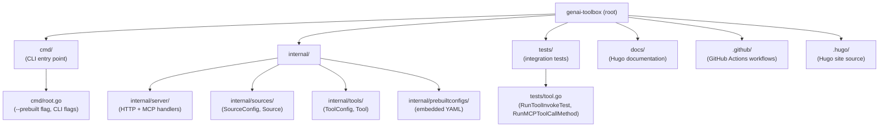
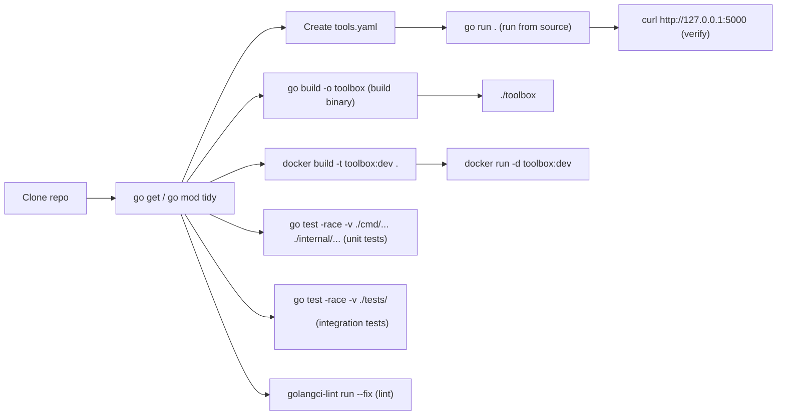
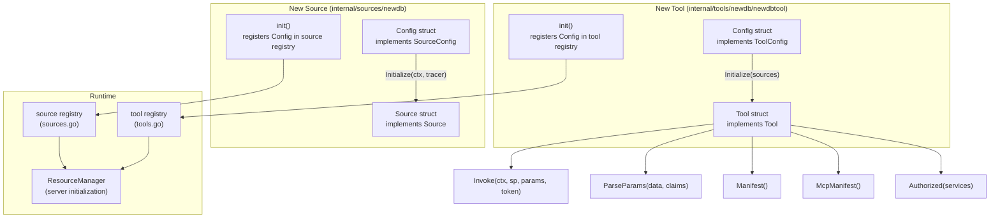
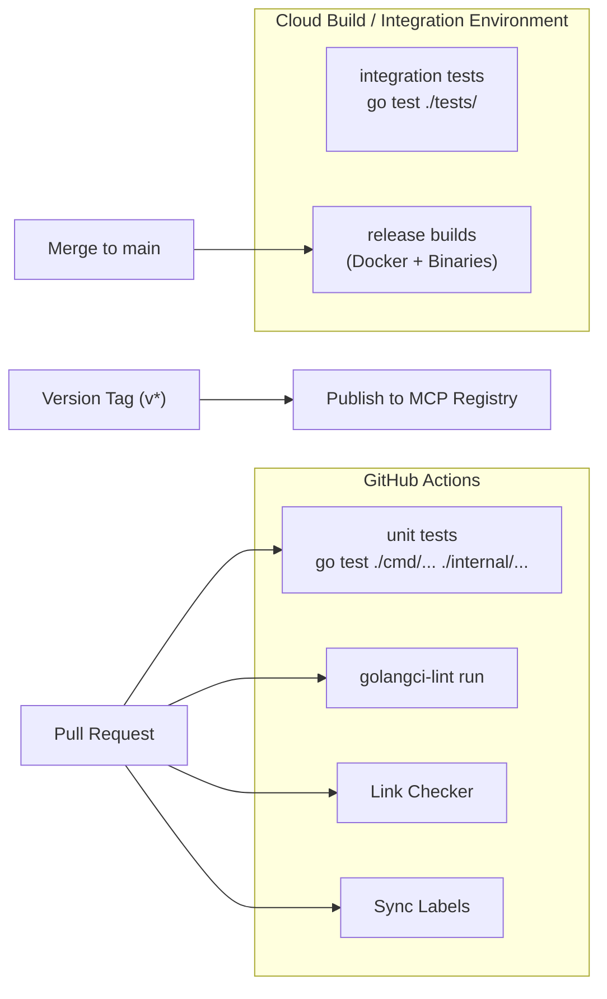

<!-- source: DeepWiki mcp.deepwiki.com · repo googleapis/genai-toolbox · page 10 Development · fetched 2026-10-29 -->

# Development

<details>
<summary>Relevant source files</summary>

The following files were used as context for generating this wiki page:

- [.gemini/styleguide.md](.gemini/styleguide.md)
- [.github/workflows/link_checker.yaml](.github/workflows/link_checker.yaml)
- [.github/workflows/link_checker_report.yaml](.github/workflows/link_checker_report.yaml)
- [.github/workflows/lint.yaml](.github/workflows/lint.yaml)
- [.github/workflows/publish-mcp.yml](.github/workflows/publish-mcp.yml)
- [.github/workflows/sync-labels.yaml](.github/workflows/sync-labels.yaml)
- [.github/workflows/tests.yaml](.github/workflows/tests.yaml)
- [.github/workflows/tests_fallback.yaml](.github/workflows/tests_fallback.yaml)
- [.gitignore](.gitignore)
- [AGENTS.md](AGENTS.md)
- [CLAUDE.md](CLAUDE.md)
- [CONTRIBUTING.md](CONTRIBUTING.md)
- [DEVELOPER.md](DEVELOPER.md)
- [GEMINI.md](GEMINI.md)
- [LICENSE](LICENSE)

</details>


This section is the top-level reference for contributors and developers who want to build, test, extend, or release MCP Toolbox for Databases. It covers the local development workflow, the testing framework, patterns for adding new sources and tools, the CI/CD pipeline, and the release process.

For information about deploying and operating the server in production, see [Deployment and Operations](#9). For contribution process guidelines (PR format, CLA, code review SLOs), see [Contributing](#11).

---

## Overview

MCP Toolbox is a Go application. All server code lives under `cmd/` and `internal/`. Integration tests live under `tests/`. Documentation lives under `docs/` and is built with Hugo from `.hugo/`.

The sections below summarize the major developer workflows. Each subsection of this page links to a more detailed child page.

---

## Repository Layout

The following diagram maps top-level directories to their roles and key Go packages or interfaces they contain.

**Repository Structure and Key Code Entities**



Sources: [GEMINI.md:18-29](), [DEVELOPER.md:181-220]()

---

## Prerequisites

| Requirement | Notes |
|---|---|
| Go (1.23+) | Install from https://go.dev/doc/install |
| Database instances | Required for integration tests; see test resource list below |
| `golangci-lint` | Required for linting |
| Hugo extended ≥ 0.146.0 | Required for documentation preview only |
| `npm` | Required for Hugo dependency installation only |
| Zig (optional) | Required for cross-compiling for Windows |

After cloning, fetch dependencies:

```bash
go get
go mod tidy
```

Sources: [DEVELOPER.md:6-18](), [GEMINI.md:12-16](), [DEVELOPER.md:51-60]()

---

## Developer Workflows

The diagram below shows the primary workflows a developer follows, mapped to the commands and files involved.

**Developer Workflow Map**



Sources: [DEVELOPER.md:22-45](), [GEMINI.md:38-53]()

For full setup instructions, see [Development Environment Setup](#10.1).

---

## Naming Conventions

Tool configuration in `tools.yaml` has two distinct name fields with different conventions.

| Field | Example | Convention |
|---|---|---|
| `name` (tool name) | `list_hotels` | `snake_case`; underscores over hyphens; no product prefix |
| `type` (tool type) | `postgres-sql` | `kebab-case`; hyphens over underscores; product name included |

Tool names are used by LLMs to invoke tools and are considered **superficial** — changes are not breaking. Tool types are configuration identifiers — changes are **breaking** and must be avoided once published.

Sources: [DEVELOPER.md:83-127](), [GEMINI.md:82-88]()

---

## Extending the System

New sources and tools are registered through Go's `init()` mechanism. The diagram below shows how a new source or tool flows from implementation to runtime registration.

**Source and Tool Registration Pattern**



Tool invocation utilizes specific error types to guide LLM behavior. `AgentError` is used for fixable issues (like SQL syntax), while `ClientServerError` is used for infrastructure failures.

Sources: [DEVELOPER.md:132-162](), [DEVELOPER.md:181-220]()

For the complete guide on adding new source types and tool types, see [Extending the System](#10.4).

---

## Testing Infrastructure

Toolbox uses GitHub Actions for unit tests and linting, while integration tests typically run in environments with access to Google Cloud resources.

**Testing Infrastructure Overview**



Sources: [.github/workflows/tests.yaml:15-80](), [.github/workflows/lint.yaml:15-57](), [.github/workflows/publish-mcp.yml:15-74]()

### Unit Tests
Run locally with:
`go test -race -v ./cmd/... ./internal/...`

### Integration Tests
Each database type has its own test directory under `tests/`. Integration tests often require specific environment variables or Cloud SQL Auth Proxy setups.
`go test -race -v ./tests/alloydbpg`

See [Testing Framework](#10.2) and [Writing Tests](#10.3) for detailed documentation.

---

## CI/CD and Release Process

The project uses `release-please` for automated versioning and changelog generation.

*   **Linting:** Enforces `golangci-lint` and `go mod tidy` checks.
*   **Link Checking:** Uses `lychee` to verify documentation links on PRs and weekly schedules.
*   **MCP Publishing:** Automatically publishes to the Model Context Protocol registry when a version tag (`v*`) is pushed.

Sources: [.github/workflows/lint.yaml:52-57](), [.github/workflows/link_checker.yaml:14-80](), [.github/workflows/publish-mcp.yml:15-19]()

For the full CI/CD pipeline documentation, see [CI/CD Pipeline](#10.5). For the release process, see [Release Process](#10.6).

---

## Documentation Development

Documentation is built with Hugo. To preview locally:
1.  Navigate to `.hugo/`
2.  Run `npm ci`
3.  Build search index: `hugo --environment development && npx pagefind --site public --output-path static/pagefind`
4.  Start server: `hugo server`

Sources: [GEMINI.md:55-68]()

---

