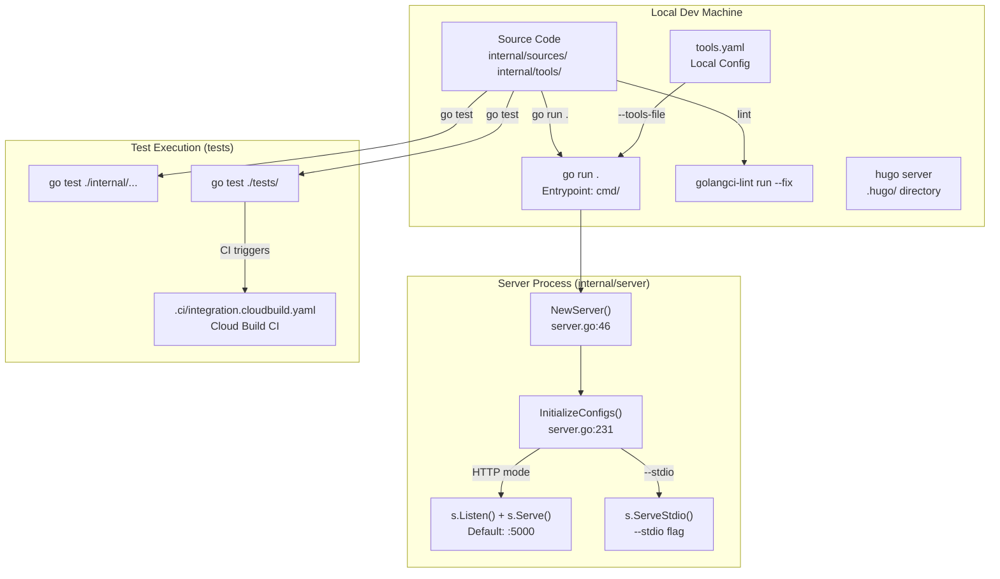
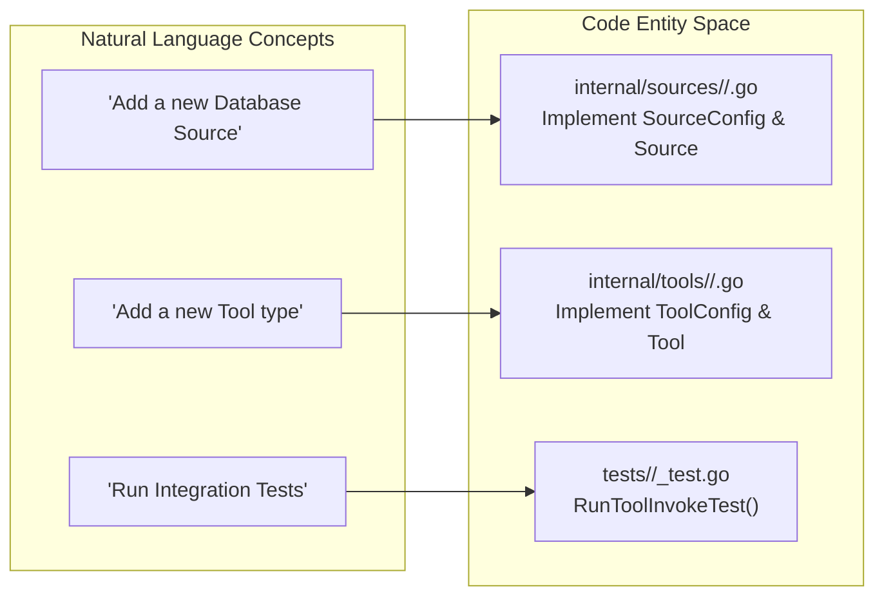

<!-- source: DeepWiki mcp.deepwiki.com · repo googleapis/genai-toolbox · page 10.1 Development Environment Setup · fetched 2026-10-29 -->

# Development Environment Setup

<details>
<summary>Relevant source files</summary>

The following files were used as context for generating this wiki page:

- [.gemini/styleguide.md](.gemini/styleguide.md)
- [.gitignore](.gitignore)
- [AGENTS.md](AGENTS.md)
- [CLAUDE.md](CLAUDE.md)
- [CONTRIBUTING.md](CONTRIBUTING.md)
- [DEVELOPER.md](DEVELOPER.md)
- [GEMINI.md](GEMINI.md)
- [LICENSE](LICENSE)

</details>


## Purpose and Scope

This document covers the setup of a local development environment for contributing to the `genai-toolbox` codebase. It includes prerequisite tools, initial repository configuration, running the server locally, building the binary, and cross-compiling for different platforms.

For information about writing and running tests, see [Testing Framework](#10.2) and [Writing Tests](#10.3). For guidance on adding new sources and tools, see [Extending the System](#10.4). For deployment and building production artifacts, see [Building and Packaging](#9.1).

---

## Prerequisites

### Required Tools

The following tools must be installed before beginning development:

| Tool | Purpose | Version Requirement |
|------|---------|---------------------|
| **Go** | Primary language runtime | 1.23 or later (see [DEVELOPER.md:12](), [GEMINI.md:12]()) |
| **Docker** | Containerization and testing | Latest version (see [GEMINI.md:14]()) |
| **golangci-lint** | Code linting | Latest version (see [GEMINI.md:16]()) |
| **Hugo Extended** | Documentation generation | v0.146.0 or later (see [GEMINI.md:13]()) |
| **Node.js** | Documentation dependencies | Required for `npm ci` (see [GEMINI.md:60]()) |

Sources: [DEVELOPER.md:12](), [GEMINI.md:12-16](), [GEMINI.md:60]()

---

## Initial Setup

### Clone and Initialize Repository

```bash
# Clone the repository
git clone https://github.com/googleapis/genai-toolbox
cd genai-toolbox

# Download and manage project dependencies
go get
go mod tidy
```

`go mod tidy` ensures all dependencies are properly resolved and removes unused entries.

Sources: [DEVELOPER.md:15-18]()

---

## Development Environment Architecture

**Development Environment Component Map**



This diagram maps local development commands to the code entities they interact with. `go run .` initializes the `Server` struct defined in `internal/server/server.go` [internal/server/server.go:46-56](), which manages resource initialization via `InitializeConfigs` [internal/server/server.go:231-270]().

Sources: [internal/server/server.go:46-56](), [internal/server/server.go:231-270](), [DEVELOPER.md:22-45](), [GEMINI.md:18-28]()

---

## Running from Local Source

### Configuration

Create a `tools.yaml` file in the repository root to configure your sources and tools. This file is the primary configuration mechanism for the server.

```yaml
kind: tool
name: list_tables
type: postgres-sql
source: my_pg_source
```

Sources: [DEVELOPER.md:24-26](), [DEVELOPER.md:88-93]()

### Server Execution

**View Available CLI Flags:**

```bash
go run . --help
```

**Start the Server:**

The server listens on port 5000 by default.

```bash
# Standard run
go run .

# Run with specific tools file
go run . --tools-file tools.yaml
```

**Verify the Server:**

```bash
curl http://127.0.0.1:5000
```

Sources: [DEVELOPER.md:27-45](), [GEMINI.md:38-43]()

---

## Building the Binary

### Local Build

To build a standard binary for your current operating system and architecture:

```bash
go build -o toolbox
```

Sources: [GEMINI.md:40](), [.gitignore:27]()

### Cross-Compiling for Windows

Compiling for Windows from a Unix-like environment requires `zig` to provide a C/C++ compiler for CGO dependencies.

1. **Install Zig:**
   Download the appropriate version (e.g., 0.15.2) from [ziglang.org](https://ziglang.org/download).

2. **Run Cross-Compile Command:**
   ```bash
   GOOS=windows \
   GOARCH=amd64 \
   CGO_ENABLED=1 \
   CC="$HOME/zig/zig cc -target x86_64-windows-gnu" \
   CXX="$HOME/zig/zig c++ -target x86_64-windows-gnu" \
   go build -o toolbox.exe
   ```

Sources: [DEVELOPER.md:47-81]()

---

## Running with Docker

The project supports containerized execution. You can build and run the toolbox using the provided Docker infrastructure.

```bash
# Build the image
docker build -t genai-toolbox .

# Run the container
docker run -p 5000:5000 -v $(pwd)/tools.yaml:/tools.yaml genai-toolbox --tools-file /tools.yaml
```

Sources: [GEMINI.md:14](), [GEMINI.md:35]()

---

## Development Workflow

**Natural Language to Code Entity Space**



Sources: [DEVELOPER.md:166-208](), [CONTRIBUTING.md:69-78](), [GEMINI.md:151-160]()

### Tool Naming Conventions

When developing new tools, adhere to the following naming standards:

*   **Tool Name (`snake_case`):** Used by LLMs to invoke the tool (e.g., `list_tables`). Do not include product names [DEVELOPER.md:107-110]().
*   **Tool Type (`kebab-case`):** Serves as the category (e.g., `postgres-sql`). Must include product names [DEVELOPER.md:122-125]().

Sources: [DEVELOPER.md:83-127](), [GEMINI.md:82-88]()

### Error Handling

When implementing tool logic, use typed errors from `internal/util/errors.go` to help the LLM distinguish between fixable issues and infrastructure failures.

| Category | Go Type | Description |
|---|---|---|
| **Agent Error** | `util.NewAgentError` | Logic/Input errors (e.g., SQL syntax) that an LLM can fix [DEVELOPER.md:138](). |
| **Server Error** | `util.NewClientServerError` | Infrastructure failures (e.g., DB down) that require developer intervention [DEVELOPER.md:139](). |

Sources: [DEVELOPER.md:128-162]()

---

## Documentation Development

To preview documentation changes locally:

1.  Navigate to the Hugo directory: `cd .hugo` [GEMINI.md:64]().
2.  Install dependencies: `npm ci` [GEMINI.md:65]().
3.  Generate the search index:
    ```bash
    hugo --environment development && npx pagefind --site public --output-path static/pagefind
    ```
    [GEMINI.md:66-67]().
4.  Start the server: `hugo server` [GEMINI.md:68]().

Sources: [GEMINI.md:55-69]()

---

