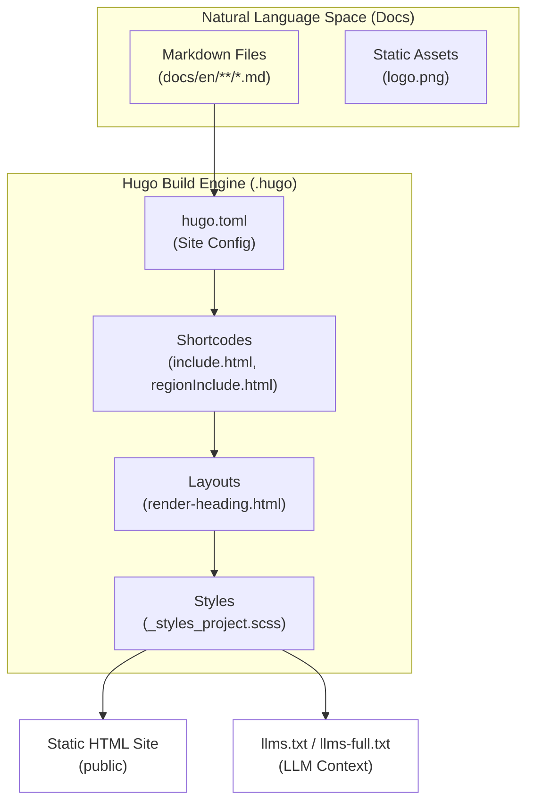
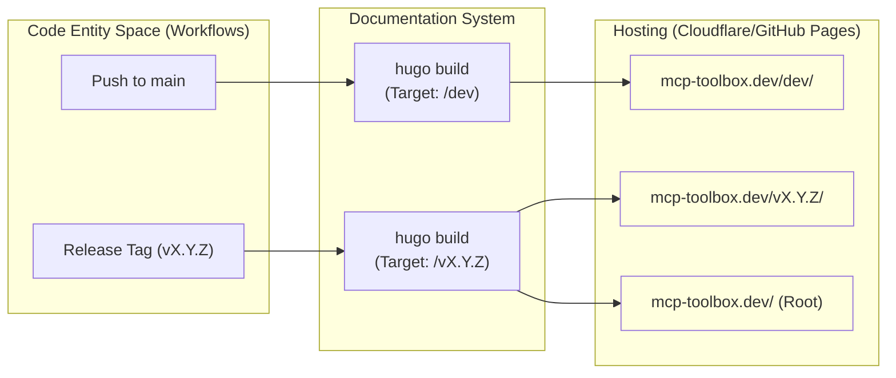

<!-- source: DeepWiki mcp.deepwiki.com · repo googleapis/genai-toolbox · page 11.2 Documentation System · fetched 2026-10-29 -->

# Documentation System

Relevant source files

The following files were used as context for generating this wiki page:

- [.github/header-checker-lint.yml](.github/header-checker-lint.yml)
- [.hugo/assets/scss/_styles_project.scss](.hugo/assets/scss/_styles_project.scss)
- [.hugo/hugo.cloudflare.toml](.hugo/hugo.cloudflare.toml)
- [.hugo/hugo.toml](.hugo/hugo.toml)
- [.hugo/layouts/partials/td/render-heading.html](.hugo/layouts/partials/td/render-heading.html)
- [.hugo/layouts/shortcodes/include.html](.hugo/layouts/shortcodes/include.html)
- [.hugo/layouts/shortcodes/regionInclude.html](.hugo/layouts/shortcodes/regionInclude.html)
- [CODE_OF_CONDUCT.md](CODE_OF_CONDUCT.md)
- [docs/en/_index.md](docs/en/_index.md)
- [logo.png](logo.png)

## Purpose and Scope

The documentation system for MCP Toolbox for Databases is built on **Hugo**, a static site generator, utilizing the **Docsy** theme. It is designed to provide a versioned, searchable, and LLM-friendly documentation experience. The system supports multiple deployment targets, including a continuous `/dev` version, versioned release documentation (e.g., `/v1.0.0/`), and automated preview deployments for Pull Requests.

---

## Hugo Site Architecture

The documentation infrastructure is located in the `.hugo` directory, while the Markdown content is maintained in `docs/en`.

### Core Technologies
- **Hugo**: Static site generator (Minimum version: `0.146.0` extended) [ .hugo/hugo.toml:22 ]().
- **Docsy**: The underlying Hugo theme for technical documentation [ .hugo/hugo.toml:27 ]().
- **Goldmark**: The Markdown parser, configured to allow unsafe HTML for advanced layout components [ .hugo/hugo.toml:175-176 ]().
- **Mermaid**: Used for technical diagrams throughout the documentation.

### Directory Mapping
The Hugo configuration uses module mounts to map the documentation content from the repository root into the Hugo virtual filesystem:
- **Source**: `../docs/en` [ .hugo/hugo.toml:24 ]()
- **Target**: `content` [ .hugo/hugo.toml:25 ]()

### Content Processing Flow

**Sources:** [ .hugo/hugo.toml:23-31 ](), [ .hugo/layouts/shortcodes/include.html:1-14 ](), [ .hugo/layouts/shortcodes/regionInclude.html:1-54 ]()

---

## Shortcodes and Dynamic Content

To maintain "Single Source of Truth" and reduce duplication, the system employs custom Hugo shortcodes to pull code snippets directly into the documentation.

### `include` Shortcode
Used to include the entire content of a file. It supports optional syntax highlighting.
- **Implementation**: [ .hugo/layouts/shortcodes/include.html:1-14 ]()
- **Usage**: ``

### `regionInclude` Shortcode
Used to include a specific named region from a file, delimited by `[START region_name]` and `[END region_name]` tags.
- **Implementation**: [ .hugo/layouts/shortcodes/regionInclude.html:1-54 ]()
- **Key Logic**: It reads the file [ .hugo/layouts/shortcodes/regionInclude.html:23 ](), iterates through lines to find the start/end tags [ .hugo/layouts/shortcodes/regionInclude.html:29-39 ](), and renders the content with the specified language highlighter [ .hugo/layouts/shortcodes/regionInclude.html:50-52 ]().

---

## LLM Consumption (llms.txt)

The documentation system automatically generates specialized outputs for Large Language Models (LLMs) to facilitate better context windows when using AI coding assistants.

### Output Formats
The `hugo.toml` defines custom output formats for LLM consumption:
- **LLMS**: A summary/index file (`llms.txt`) [ .hugo/hugo.toml:183-187 ]().
- **LLMS-FULL**: A concatenated full-text version of the documentation (`llms-full.txt`) [ .hugo/hugo.toml:188-192 ]().

These formats are enabled for the home page [ .hugo/hugo.toml:202 ](), allowing LLMs to ingest the entire toolbox documentation suite in a single request.

**Sources:** [ .hugo/hugo.toml:182-202 ]()

---

## Versioning and Deployment

The site maintains a version dropdown menu [ .hugo/hugo.toml:39 ]() populated by the `params.versions` list.

### Version Configuration
Versions are manually added to `hugo.toml` before every release to update the UI dropdown.
- **Dev Version**: Points to `https://mcp-toolbox.dev/dev/` [ .hugo/hugo.toml:58-59 ]().
- **Release Versions**: Specific versions like `v1.0.0` or `v0.32.0` point to their respective subdirectories [ .hugo/hugo.toml:64-70 ]().

### Deployment Workflow Logic

**Sources:** [ .hugo/hugo.toml:57-167 ](), [ .hugo/hugo.cloudflare.toml:72-130 ]()

---

## Local Development and Preview

To run the documentation site locally for testing changes:

1.  **Prerequisites**: Install Hugo (extended) and Node.js.
2.  **Initialize**: Navigate to the `.hugo` directory.
3.  **Run Server**: Execute `hugo server` from the repository root or the `.hugo` directory.
    - Hugo will watch for changes in `docs/en` and automatically reload the browser.
    - The server typically runs at `http://localhost:1313/`.

### Configuration Overrides
The project includes a specific configuration for Cloudflare deployments (`.hugo/hugo.cloudflare.toml`) which sets `global_logo_url = "/"` [ .hugo/hugo.cloudflare.toml:56 ]() and disables the migration banner [ .hugo/hugo.cloudflare.toml:54 ]().

**Sources:** [ .hugo/hugo.toml ](), [ .hugo/hugo.cloudflare.toml ]()

---

