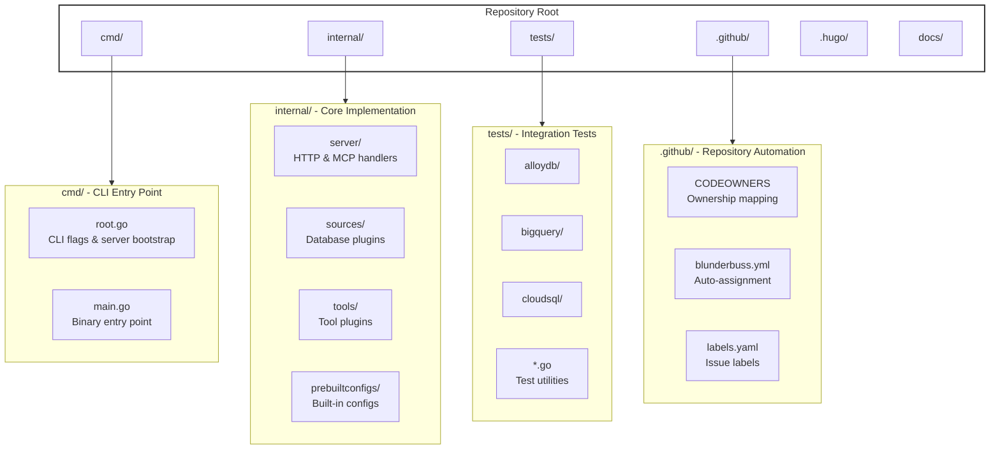
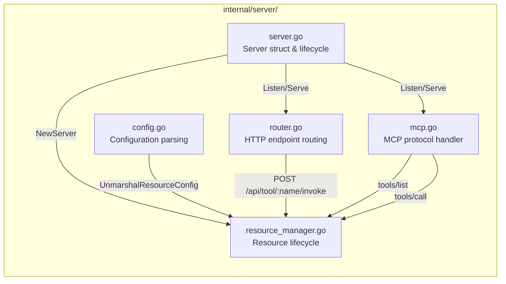
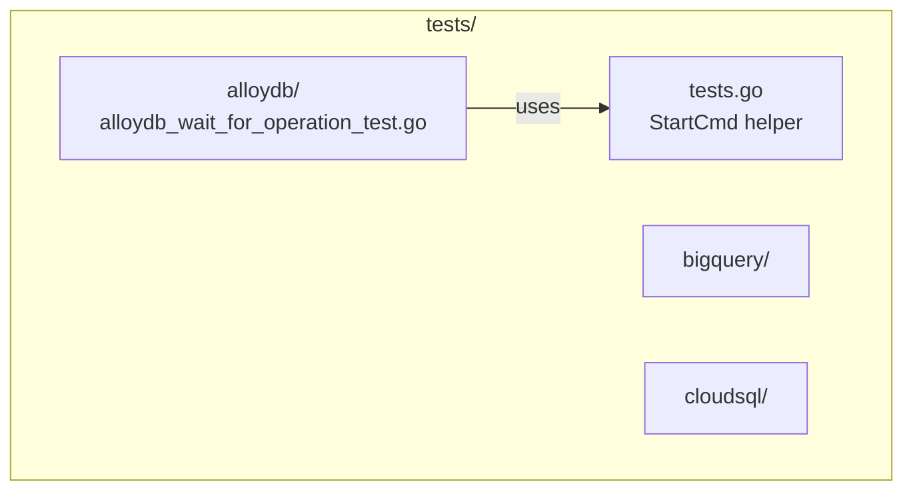

<!-- source: DeepWiki mcp.deepwiki.com · repo googleapis/genai-toolbox · page 11.3 Code Organization · fetched 2026-10-29 -->

# Code Organization

<details>
<summary>Relevant source files</summary>

The following files were used as context for generating this wiki page:

- [.gemini/styleguide.md](.gemini/styleguide.md)
- [.github/CODEOWNERS](.github/CODEOWNERS)
- [.github/blunderbuss.yml](.github/blunderbuss.yml)
- [.github/labels.yaml](.github/labels.yaml)
- [.gitignore](.gitignore)
- [AGENTS.md](AGENTS.md)
- [CLAUDE.md](CLAUDE.md)
- [CONTRIBUTING.md](CONTRIBUTING.md)
- [DEVELOPER.md](DEVELOPER.md)
- [GEMINI.md](GEMINI.md)
- [LICENSE](LICENSE)
- [internal/tools/alloydb/alloydbwaitforoperation/alloydbwaitforoperation_test.go](internal/tools/alloydb/alloydbwaitforoperation/alloydbwaitforoperation_test.go)
- [tests/alloydb/alloydb_wait_for_operation_test.go](tests/alloydb/alloydb_wait_for_operation_test.go)

</details>


This page documents the directory structure, package organization, code ownership model, and team routing mechanisms for the GenAI Toolbox codebase. For information about extending the system with new sources or tools, see [10.4 Extending the System](). For contribution guidelines, see [11.1 Contribution Guidelines]().

## Directory Structure Overview

The repository follows a standard Go project layout with clear separation between public interfaces (`cmd/`), internal implementations (`internal/`), and integration tests (`tests/`). [GEMINI.md:18-29]()



**Sources:** [GEMINI.md:18-29](), [CONTRIBUTING.md:71-79](), [.github/CODEOWNERS:1-18]()

## Command Line Interface Package (cmd)

The `cmd/` package contains the binary entry point and CLI flag definitions. This is the only package compiled into the `toolbox` binary. [GEMINI.md:20]()

| File | Purpose | Key Components |
|------|---------|----------------|
| `main.go` | Binary entry point | Calls `cmd.Execute()` |
| `root.go` | CLI flag parsing & server initialization | Flag definitions, configuration loading, `NewServer()` call |

The CLI supports multiple configuration input methods through flags. Server mode is controlled by flags like `--stdio`, `--ui`, and `--port`. For complete CLI documentation, see [3.2 Command Line Interface](). [DEVELOPER.md:27-46]()

**Sources:** [DEVELOPER.md:27-46](), [GEMINI.md:40-44]()

## Internal Package Organization

### internal/server/

The `server/` package implements the HTTP and MCP protocol handlers, resource management, and server lifecycle. [GEMINI.md:47]()



**Key Components:**

- `Server` struct: Main server instance managing HTTP/STDIO listeners.
- `ResourceManager`: Manages lifecycle of sources, tools, toolsets, and auth services.
- `UnmarshalResourceConfig`: Parses YAML configuration into internal structs. [internal/tools/alloydb/alloydbwaitforoperation/alloydbwaitforoperation_test.go:67-67]()

**Sources:** [internal/tools/alloydb/alloydbwaitforoperation/alloydbwaitforoperation_test.go:21-23](), [GEMINI.md:47]()

### internal/sources/

The `sources/` package contains all database source implementations using a plugin architecture. Each database type has its own subdirectory. [GEMINI.md:21]()

**Directory Structure Pattern:**

```
internal/sources/
├── sources.go                 # Core interfaces and registry
├── postgres/
│   ├── postgres.go           # Config, Source, Initialize()
│   └── postgres_test.go      # Unit tests
├── bigquery/
│   ├── bigquery.go
│   └── bigquery_test.go
└── [Other database directories]
```

Each source package includes an `init()` function that registers its factory with the global registry. [DEVELOPER.md:181-209]()

**Sources:** [DEVELOPER.md:181-209](), [GEMINI.md:21]()

### internal/tools/

The `tools/` package contains all tool implementations, organized by source type and tool kind. [GEMINI.md:22]()

**Tool Naming Convention:**

- **Tool Name:** `snake_case` (e.g., `list_collections`). Should not have product name. [DEVELOPER.md:95-110]()
- **Tool Type:** `kebab-case` (e.g., `firestore-list-collections`). Must include product name. [DEVELOPER.md:116-126]()

**Implementation Pattern:**
Tools must implement `Invoke()` and `ParseParams()`, returning appropriate `ToolboxError` types (e.g., `AgentError` for LLM-fixable issues, `ClientServerError` for infra failures). [DEVELOPER.md:132-153]()

**Sources:** [DEVELOPER.md:83-162](), [GEMINI.md:82-88]()

### internal/prebuiltconfigs/

The `prebuiltconfigs/` package contains prebuilt `tools.yaml` files for various database types, enabling users to start with the `--prebuilt` flag. [CONTRIBUTING.md:78]()

**Sources:** [CONTRIBUTING.md:78]()

## Test Organization (tests)

Integration tests are organized by database type in the `tests/` directory. [GEMINI.md:23]()



**Key Test Functions:**
- `tests.StartCmd`: Starts the toolbox server for integration testing. [tests/alloydb/alloydb_wait_for_operation_test.go:140-140]()
- `testutils.WaitForString`: Waits for specific log output (e.g., "Server ready to serve"). [tests/alloydb/alloydb_wait_for_operation_test.go:148-148]()

**Sources:** [tests/alloydb/alloydb_wait_for_operation_test.go:33-152](), [GEMINI.md:48-51]()

## Code Ownership Model

The repository uses a hierarchical code ownership model with team-based routing for reviews.

### CODEOWNERS Structure

The [.github/CODEOWNERS]() file defines ownership at multiple levels: [CODEOWNERS:1-18]()

| Pattern | Owner Team |
|---------|------------|
| `*` | `@googleapis/senseai-eco-team` |
| `**/alloydb*/` | `@googleapis/toolbox-alloydb-team` |
| `**/bigquery/` | `@googleapis/toolbox-bigquery-team` |
| `**/cloudsqlpg/` | `@googleapis/toolbox-cloud-sql-postgres-team` |
| `**/looker/` | `@googleapis/toolbox-looker-team` |

**Sources:** [.github/CODEOWNERS:1-18]()

### Automated Issue and PR Assignment (Blunderbuss)

The [.github/blunderbuss.yml]() file configures automatic assignment of issues and pull requests using product labels. [blunderbuss.yml:15-105]()

| Label | Assigned Team |
|-------|---------------|
| `product: alloydb` | `googleapis/toolbox-alloydb-team` |
| `product: bigquery` | `googleapis/toolbox-bigquery-team` |
| `product: mssql` | `googleapis/toolbox-cloud-sql-mssql-team` |
| `product: postgres` | `googleapis/toolbox-cloud-sql-postgres-team` |

**Sources:** [.github/blunderbuss.yml:21-61]()

## Issue Labels and Classification

The repository uses a structured labeling system defined in [.github/labels.yaml]() to categorize issues and PRs. [labels.yaml:1-183]()

| Category | Labels |
|----------|--------|
| **Type** | `type: bug`, `type: feature request`, `type: docs` |
| **Priority** | `priority: p0`, `priority: p1`, `priority: p2` |
| **Product** | `product: alloydb`, `product: bigquery`, `product: spanner`, etc. |

**Sources:** [.github/labels.yaml:19-182]()

---

