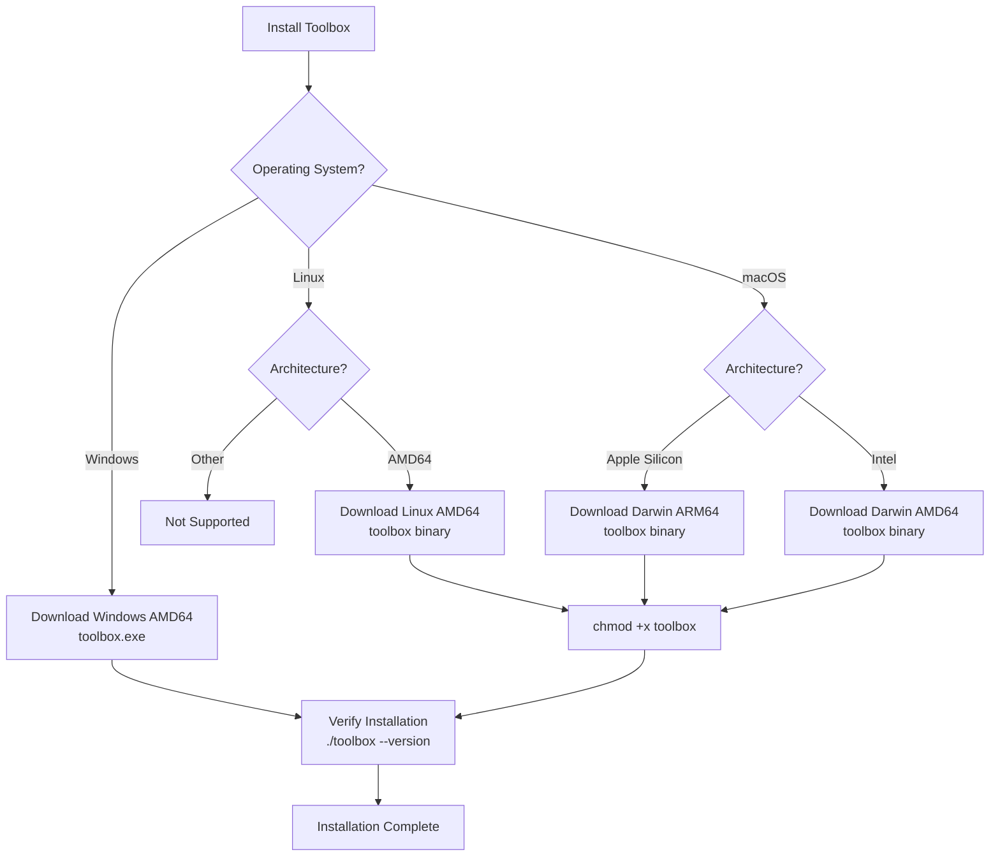
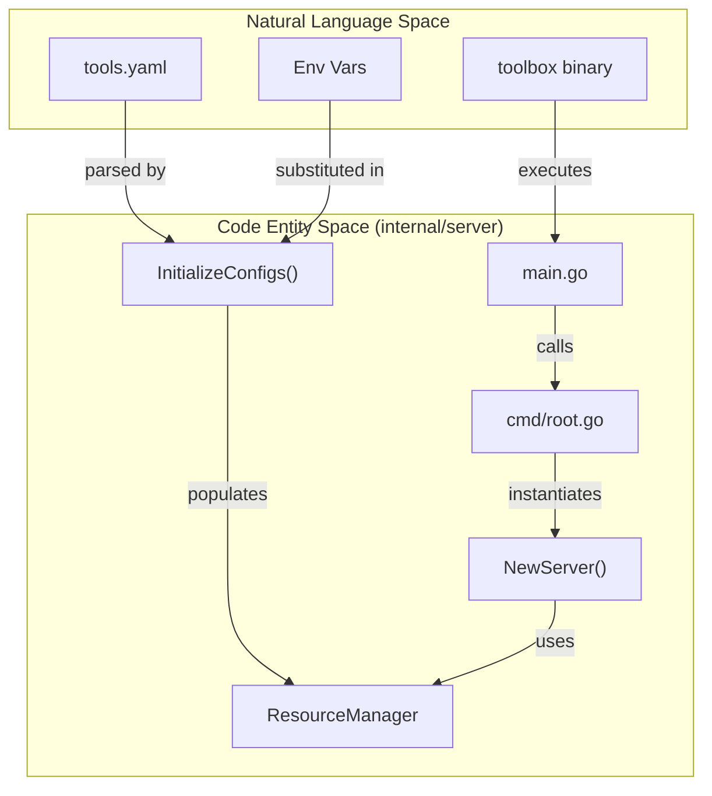

<!-- source: DeepWiki mcp.deepwiki.com · repo googleapis/genai-toolbox · page 2.1 Installation and Setup · fetched 2026-10-29 -->

# Installation and Setup

<details>
<summary>Relevant source files</summary>

The following files were used as context for generating this wiki page:

- [.ci/continuous.release.cloudbuild.yaml](.ci/continuous.release.cloudbuild.yaml)
- [.ci/generate_release_table.sh](.ci/generate_release_table.sh)
- [.ci/versioned.release.cloudbuild.yaml](.ci/versioned.release.cloudbuild.yaml)
- [CHANGELOG.md](CHANGELOG.md)
- [Dockerfile](Dockerfile)
- [README.md](README.md)
- [cmd/version.txt](cmd/version.txt)
- [docs/en/documentation/introduction/_index.md](docs/en/documentation/introduction/_index.md)
- [gemini-extension.json](gemini-extension.json)
- [server.json](server.json)

</details>


## Purpose and Scope

This document covers the installation of the **MCP Toolbox for Databases** server binary and the initial environment setup required to run the server. It includes installation methods for multiple platforms, verification steps, and a minimal `tools.yaml` to confirm the server is working. For detailed configuration of sources, tools, and toolsets, see [Configuration](#3). For deploying Toolbox in production environments, see [Deployment and Operations](#9).

The project was recently renamed from `genai-toolbox` to `mcp-toolbox` to align with its core compatibility with the Model Context Protocol (MCP) [README.md:35-41]().

## Prerequisites

Before installing Toolbox, ensure the following prerequisites are met:

**For Binary/Container Installation:**
- Operating system: Linux (AMD64/ARM64), macOS (Apple Silicon or Intel), or Windows (AMD64).
- Network access to download binaries from `storage.googleapis.com/mcp-toolbox-for-databases/`.
- At least one database system accessible for Toolbox to connect to (PostgreSQL, MySQL, BigQuery, AlloyDB, Spanner, etc.) [README.md:99-101]().

**For Building from Source:**
- Go 1.21+ installed ([go.dev/doc/install](https://go.dev/doc/install)).
- Git for cloning the repository.
- CGO requirements: Building requires a C compiler (Zig is used in the project's own CI for cross-compilation) [Dockerfile:16-21]().

**For Container Installation:**
- Docker or a compatible container runtime.

Sources: [README.md:1-41](), [Dockerfile:14-21]()

## Installation Methods

Toolbox provides multiple installation methods. The current stable version is `1.0.0` [cmd/version.txt:1]().

### Installation Method Comparison

| Method | Use Case | Update Mechanism | Isolation |
|--------|----------|------------------|-----------|
| **Binary** | Direct execution, maximum control | Manual download | None |
| **Homebrew** | macOS/Linux package management | `brew upgrade` | System-level |
| **Container** | Containerized environments, cloud deployment | `docker pull` | Full containerization |
| **NPX** | Quick start, IDE integration, no install | Fetches latest on run | Node.js process |
| **From Source** | Development, custom builds | Git pull + `go build` | None |

Sources: [README.md:48-51](), [docs/en/documentation/introduction/_index.md:54-180]()

### Binary Installation

The Toolbox server is distributed as a standalone binary. Binaries are hosted at `https://storage.googleapis.com/mcp-toolbox-for-databases/v{VERSION}/{OS}/{ARCH}/toolbox`.

#### Installation Decision Flow



Sources: [docs/en/documentation/introduction/_index.md:105-162](), [.ci/generate_release_table.sh:11-44]()

#### Linux (AMD64)
```bash
export VERSION=1.0.0
curl -L -o toolbox https://storage.googleapis.com/mcp-toolbox-for-databases/v$VERSION/linux/amd64/toolbox
chmod +x toolbox
```

#### macOS (Apple Silicon)
```bash
export VERSION=1.0.0
curl -L -o toolbox https://storage.googleapis.com/mcp-toolbox-for-databases/v$VERSION/darwin/arm64/toolbox
chmod +x toolbox
```

#### Windows (PowerShell)
```powershell
$VERSION = "1.0.0"
curl.exe -o toolbox.exe "https://storage.googleapis.com/mcp-toolbox-for-databases/v$VERSION/windows/amd64/toolbox.exe"
```

Sources: [docs/en/documentation/introduction/_index.md:108-160](), [cmd/version.txt:1]()

### Homebrew Installation

For macOS and Linux users, Toolbox is available via Homebrew:

```bash
brew install mcp-toolbox
```

Sources: [docs/en/documentation/introduction/_index.md:173-180]()

### NPX (Quick Start)

Requires Node.js. This is the fastest way to run Toolbox for use with MCP clients like Claude Desktop or Gemini CLI:

```bash
# Run with prebuilt tools for PostgreSQL
npx @toolbox-sdk/server --prebuilt=postgres
```

Sources: [README.md:83-93](), [docs/en/documentation/introduction/_index.md:60-73]()

### Container Image Installation

Images are published to Google Artifact Registry.

#### Pull Container Image
```bash
export VERSION=1.0.0
docker pull us-central1-docker.pkg.dev/database-toolbox/toolbox/toolbox:$VERSION
```

#### Running the Container
The container uses a distroless base image (`gcr.io/distroless/cc-debian12:nonroot`) for security [Dockerfile:47-51]().

```bash
docker run -p 5000:5000 \
  -v $(pwd)/tools.yaml:/app/tools.yaml \
  us-central1-docker.pkg.dev/database-toolbox/toolbox/toolbox:$VERSION \
  --config "/app/tools.yaml"
```

Sources: [Dockerfile:47-56](), [server.json:21]()

### Building from Source

To build the latest features from the `main` branch:

```bash
git clone https://github.com/googleapis/mcp-toolbox.git
cd mcp-toolbox
go build -o toolbox .
```

The build process uses `ldflags` to embed the version and commit SHA [Dockerfile:43]().

Sources: [docs/en/documentation/introduction/_index.md:181-191](), [Dockerfile:42-44]()

## Installation Verification

Verify the installation by checking the version:

```bash
./toolbox --version
# Output: 1.0.0
```

Check available flags:
```bash
./toolbox --help
```

Sources: [cmd/version.txt:1](), [server.json:152-161]()

## Installation Architecture

The following diagram maps the installation artifacts to the internal server initialization logic.

### Installation to Code Entity Mapping



Sources: [server.json:26-45](), [Dockerfile:55](), [docs/en/documentation/introduction/_index.md:41-50]()

## Environment Configuration

Toolbox supports environment variable substitution using `${VAR_NAME}` syntax in configuration files. This is essential for managing secrets like database passwords.

### Example Environment Setup
```bash
export POSTGRES_PASSWORD="my-secret-password"
export GOOGLE_CLOUD_PROJECT="my-project-id"
```

Sources: [docs/en/documentation/introduction/_index.md:75-76](), [server.json:52-58]()

## First Run with minimal tools.yaml

To start the server, create a `tools.yaml` file. Toolbox uses a multi-document YAML format with a `kind` field to distinguish resources.

### Minimal tools.yaml
```yaml
kind: sources
name: my-db
type: postgres
host: localhost
port: 5432
database: test_db
user: postgres
password: ${POSTGRES_PASSWORD}
---
kind: tools
name: list-users
type: postgres-sql
source: my-db
description: List all users from the database.
statement: SELECT * FROM users;
```

### Starting the Server
```bash
./toolbox --config tools.yaml
```

The server will start an HTTP server on port 5000 by default [server.json:70](). To run as a local MCP server for IDEs, use the `--stdio` flag [server.json:111]().

Sources: [server.json:31-73](), [README.md:114-123]()

## Command Line Flags Reference

| Flag | Default | Description |
|---|---|---|
| `--config` | `tools.yaml` | Path to the tool configuration file [server.json:31](). |
| `--prebuilt` | - | Use a prebuilt config (e.g., `postgres`, `bigquery`) [server.json:106](). |
| `--stdio` | `false` | Run via MCP STDIO transport [server.json:111](). |
| `--port` | `5000` | Port for the HTTP/SSE server [server.json:70](). |
| `--ui` | `false` | Launch the built-in Toolbox UI [server.json:138](). |
| `--disable-reload`| `false` | Disable hot-reloading of config files [server.json:99](). |

Sources: [server.json:26-162]()

---

